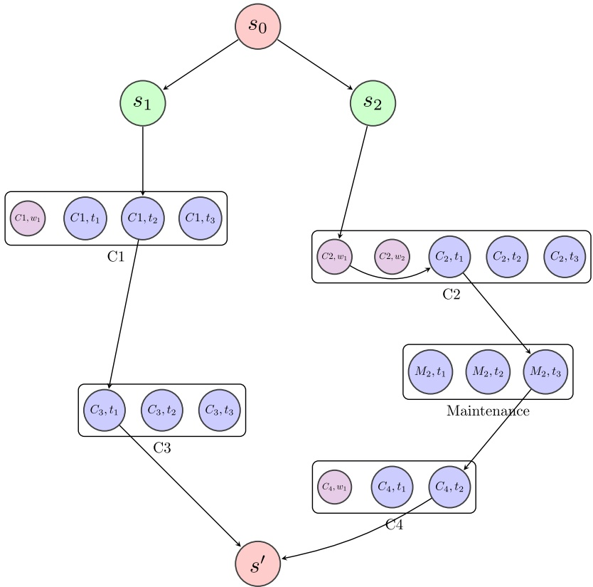

Sara Al-Haidous, Mohamed Kais Msakni, Mohamed Haouari ⇑

Mechanical and Industrial Engineering Department, Qatar University, Doha, Qatar

## a r t i c l e i n f o

Article history: Received 8 February 2016 Received in revised form 23 May 2016 Accepted 23 May 2016 Available online 3 June 2016

Keywords: Maritime transportation LNG supply chain Annual delivery plan Arc-flow models

## a b s t r a c t

We investigate the problem of designing an optimal annual delivery plan for Liquefied Natural Gas (LNG). This problem requires determining the long-term cargo delivery dates and the assignment of vessels to the cargoes while accommodating several constraints, including berth availability, liquefaction terminal inventory, planned maintenance, and bunkering requirements. We describe a novel mixed-integer programming formulation that captures important industry requirements and constraints with the objective of minimizing the vessel fleet size. A peculiar property of the proposed formulation is that it includes a polynomial number of variables and constraints and is, in our experience, computationally tractable for large problem instances using a commercial solver. Extensive computational runs demonstrate the efficacy of the proposed model for real instances provided by a major energy company that involve up to 118 cargoes and a 373-day planning horizon.

 2016 Elsevier Ltd. All rights reserved.

## 1. Introduction

As the world energy demand is steadily increasing, mainly boosted by the emerging economies in BRICS and other fast growing markets, the quest for new sources of energy has become more crucial than ever. In this context, natural gas (NG) has emerged as an attractive source of energy. Actually, its share of the total energy market is growing at an impressive pace. Indeed, during the last three decades, the ratio of the world demand of NG to the world demand of oil grew from 45% to 70% (Yergin, 2012, p. 343). One of the main reasons of this impressive growth is that NG exhibits the property to be cleaner than other fossil energy such as oil and coal. As a matter-of-fact, natural gas is half as polluting as coal for power generation (Total, 2015), thus making it an attractive source of energy in the current context of increasing concern about serious global warming issues. However, although NG has been used as a combustible for many centuries (in Szechuan, China, natural gas was extracted before 400 B.C. and the start of the Han Dynasty (Orsay et al., 2008)), its global widespread had long been crippled by several technical, economical, and political issues related to its transportation and distribution over long-distance pipelines. Actually, the emergence of NG as a new supply source is mainly due to the rapid development of the so-called liquefied natural gas (LNG) that is obtained by condensing natural gas by cooling it to approximately 162 C (260 F). In so doing, LNG takes up about 0.16% the volume of natural gas in the gaseous state and therefore becomes cost efficient to transport over long distances using specially designed cryogenic double-hulled ships. These ships use spherical tanks and are designed to prevent leakage in case of an accident. Hence, the development of the LNG technology made it possible to easily supply natural gas to remote markets worldwide. To match the supply with a rapid growing demand, the LNG industry has developed complex supply chains that include plants, storage facilities, specialized berth facilities, as well as large LNG vessel fleets. The efficient design and management of these supply chains poses many challenging optimization issues. The importance of these issues is largely motivated by the huge investment and operating costs that are typical of this industry.

<small>⇑ Corresponding author.</small>

<small>E-mail address: [mohamed.haouari@qu.edu.qa](mailto:mohamed.haouari@qu.edu.qa) (M. Haouari).</small>

This paper aims at describing a novel model for optimizing the LNG delivery process which is a specific case of maritime transportation planning. The interest in maritime transportation planning has witnessed an impressive growth since the publication in 1983 of the first review paper dedicated to this topic (Ronen, 1983). We refer to the state-of-the-art survey by Christiansen et al. (2007) for a comprehensive description of OR models and approaches for planning problems arising in maritime transportation. In this excellent survey, 119 papers dealing with strategic, tactical, and operational models are thoroughly analyzed. Recently, an updated survey was published by Christiansen et al. (2013) in which the authors analyzed over a hundred papers dealing with ship routing and scheduling that were mostly published during the last decade. In addition to these general surveys, and prompted by the ever-increasing interest for optimization models for maritime transportation, several more focused survey papers were recently published. In particular, Pantuso et al. (2014) analyzed the body of literature pertaining to ship fleet size and mix issues. Furthermore, many authors investigated maritime transportation problems that are related to the LNG supply chain decisions. In this regard, Andersson et al. (2010) studied the LNG supply chain from the natural gas extraction stage until the end-customers stage. The authors investigated two problems: the former arises for a producer, and the latter for a vertically integrated company. They mainly focused on making shipping decisions while integrating inventory management decisions at the loading and unloading terminals. For each problem, they proposed a mathematical programming model and briefly sketched solution methods. However, no computational results were provided. Grønhaug and Christiansen (2009) considered the LNG Inventory Routing Problem (LNG-IRP) where there are multiple loading ports, and where it is possible for one vessel to visit multiple unloading ports during one voyage. They described both arc- and path-flow models. This latter was subsequently used in Grønhaug et al. (2010) to develop a branchand-price algorithm. Computational results of both studies were reported for small-sized instances with restricted number of vessels, ports and planning horizon. Recently, Andersson et al. (2015) proposed a new formulation for the LNG-IRP initially studied by Grønhaug and Christiansen (2009). This formulation was solved using a new decomposition scheme within a branch-and-cut framework. The authors presented the results of computational experiments showing that the proposed approach provides optimal or near-optimal solutions within 10-h CPU time limit and outperforms the previous methods. Goel et al. (2012) developed an arc-flow formulation for the LNG-IRP where the objective is to optimize ship schedule decisions. They also proposed both construction and improvement heuristics. Later, Goel et al. (2015) developed a constraint programming model and an iterative search heuristic that was found to outperform the results in Goel et al. (2012). In addition, Shao et al. (2015) studied a similar problem and developed a set of heuristics.

An important tactical problem that is faced by LNG producers requires designing an optimal Annual Delivery Plan (ADP) This problem requires to determine the long-term cargo delivery dates and the assignment of the cargoes to the vessels, while accommodating several technical constraints. The issue of constructing a cost-effective ADP was addressed by Rakke et al. (2011) who presented a compact mixed-integer programming model while considering the opportunity of selling the LNG in the spot market. For large scale problems, the authors proposed a rolling horizon heuristic that breaks down the original problem into sub-problems with a restricted time horizon. The same problem was also studied by Stålhane et al. (2012). They proposed a heuristic approach that starts by constructing a set of initial solutions that are subsequently improved by applying different neighborhood operators. A second approach was later proposed by Rakke et al. (2014) and is based on delivery patterns and a branch-price-and-cut algorithm. Halvorsen-Weare and Fagerholt (2013) proposed a decomposition-based heuristic method. The first step considers the original problem without the berth and inventory level constraints. The objective is to find the routing of each vessel in such a way that all cargoes are serviced and the costs are minimized. The second step, called feasibility scheduling problem, uses the solution of the first step to find the starting dates to service the cargoes while considering the berth capacity and inventory level constraints. Recently, Mutlu et al. (2016) proposed a mixed-integer programming model to design an ADP that considers the possibility of achieving split deliveries. A heuristic solution method was developed and shown to yield good solutions within a short CPU time.

Furthermore, we mention that, in contrast to previous studies, Ghiami et al. (2015) considered the inland distribution of LNG. They investigated a sophisticated routing model with deteriorating inventory, and proposed both arc- and path-flow formulations.

In this paper, we investigate a real LNG distribution problem that arises at the world’s largest LNG producer and that requires designing an optimal Annual Delivery Plan (ADP). Our main contribution is the development of a novel mixedinteger programming formulation for this problem while accommodating several realistic constraints. The proposed formulation is compact and enables, in our experience, optimal solutions to large-scale realistic instances using a general-purpose solver without resorting to sophisticated branch-and-price or branch-and-cut algorithms. We provide evidence that this formulation can be used for solving large-scale real-world instances.

The remainder of this paper is organized as follows. Section 2 presents a description of the investigated problem together with an overview of the LNG supply chain. Section 3 describes the underlying graph as well as the proposed compact mixedinteger programming model for building an ADP for LNG. Section 4 includes the results of extensive numerical experiments that were carried out on a set of real data. Finally, Section 5 provides some concluding remarks and outlines future research directions.

## 2. Problem description

The efficient supply of LNG is achieved through a supply chain that includes the following stages. First, onshore (or offshore) facilities are used to extract natural gas from the well. Usually, the extracted gas includes mostly methane, but also ethane and other alkanes as well as small quantities of different gases. Next, a piping system is used to ensure a continuous flow of the extracted natural gas toward a processing plant. At this plant, natural gas is first dehydrated and purified by removal of non-methane components like carbon dioxide, hydrogen sulfide, and other impurities. As a result, NG is made of more than 95% of methane. Next, it is condensed and stored in specialized cryogenic tanks at liquid state (LNG). The downstream stage involves loading the LNG onto special purpose vessels and shipping it to remote specialized seaport facilities where it is unloaded and converted back to natural gas. This regasification operation involves heating the LNG by sea water to convert it to natural gas in gaseous state at atmospheric temperature. Finally, natural gas is distributed to end customers (both industrial and residential) using pipelines.

The efficient management of the LNG supply chain requires a clever coordination between all its different components. For instance, transportation decisions must be carefully integrated with the inventory management to ensure that the inventory level of the storage tanks remains within some specified upper and lower limits. Indeed, if the inventory level at a liquefaction terminal exceeds the storage capacity, then the producer must shut down gas production, which inevitably will translate into high incurred costs (Andersson et al. (2010, 2015)). Also, if a vessel is ready for loading while the LNG inventory is depleted then the vessel is compelled to remain idle at a high additional cost until the storage tank is refilled. However, although being appealing, the optimization of the integrated LNG value chain is a daunting task that goes beyond today’s capabilities of optimization and modeling techniques. Therefore, researchers as well as practitioners split the global problem into more tractable subproblems that are solved in turn.

In this regard, in this paper we address a tactical distribution planning problem that arises for an energy company that is located in the Gulf region. Two types of LNG are produced: rich LNG and lean LNG. These two types of LNG have different chemical compositions (in particular, in terms of their respective amount of methane), thereby they have different calorific values. Hence, one cubic meter of lean LNG provides less energy than the same volume of rich LNG and therefore lean LNG price is lower than the rich LNG price. Both products are loaded from the same liquefaction terminal. However, each of these products is stored at different tanks, and shipped on dedicated vessels through dedicated berths. Hence, the rich and the lean products are managed independently. In the present study, we focus on the design of an Annual Delivery Plan (ADP) for the rich LNG only. We assume that the product is supplied from the production facility to a finite-capacity storage tank at some daily rate that depends on the planned production and maintenance schedules. The company should fulfill a set of long-term contracts for customers that are located in Japan and South Korea, respectively. Typically, each long-term contract spans a duration of twenty years, and requires delivering a specified yearly amount of LNG at a specified regasification terminal. At this point, it is worth mentioning that in addition, to these long-term (mandatory) contracts, LNG can be optionally loaded on chartered vessels and sold in the spot market. Given the annual produced amount of rich LNG, the total quantity sold to the spot market is constant because it is equal to the annual produced quantity minus the sum of mandatory long-term contracts. In practice, the spot deliveries are used to avoid exceeding the storage capacity.

Well ahead of the beginning of the planning horizon, which is typically one year, the producer decides upon mutual agreements with the customers, and in accordance with the long-term contracts, on the total number of deliveries as well as the preferred delivery dates. These dates are usually provided with some flexibility since the customer may specify a (hard) time-window during which the delivery should occur. In this case, the delivery to the customer should be planned within some specified earliest and latest dates (however, waiting at the regasifcation terminal before the earliest delivery date is allowed as long as it does not exceed a specified maximum waiting time). The LNG producer operates a set of homogenous fleet of vessels that have the same capacity, sailing speed, and are loaded at the same single berth. The cost structure is not the same for all vessels. Some vessels are owned by the company while others are either owned by one or a group of customers, or chartered (based on long-term contracts). Since the chartering cost constitutes a high financial burden, the primary objective of the company is to minimize its fixed charges by minimizing the number of vessels. The vessel that is not used could be returned to her owner (if the chartering contract permits), used for lean LNG deliveries, or chartered to a sister LNG company. All deliveries should be achieved through full ship loads. That is, a cargo that represents the full vessel’s capacity must be loaded at the liquefaction terminal and directly shipped to the customer regasification terminal without planning any delivery at any intermediate terminal. However, it is worth mentioning that the actual LNG volume that can be delivered to a customer is always less than the full load capacity. This paradox is due to the so-called boil-off effect. This effect is inherent to the storage of LNG at very low temperature at atmospheric pressure. Indeed, due to the heat input from ambient environment, the stored LNG boils and therefore ‘‘boil -off” vapors are released from the vessel at some specific rate (say, 0.05%/day). Hence, a fraction of the loaded cargo is inevitably lost during the voyage to the customer terminal, and this amount increases as the voyage duration is longer. Furthermore, the vessel tanks should never be totally emptied at the unloading terminal because these tanks should be kept at very low temperature during the return voyage, otherwise a 24-h cool down operation is required at the loading port before loading the vessel for the next voyage, which results in occupying a berth for one additional day. Hence, a minimum quantity of LNG (that is appropriately computed to accommodate the quantity that will boil during the return voyage) should always be left in the tanks after unloading at the regasification terminal.

At the beginning of the time horizon, not all vessels are immediately available for delivery. Indeed, some vessels may be serving deliveries that were scheduled by the end of the previous delivery plan, and therefore will become ready upon their return to the loading port. Furthermore, some vessels may become unavailable during some period within the time horizon due to a planned maintenance activity. This operation is generally performed every five years and requires the vessel to be dry-docked during a few weeks. During this operation, the vessel tanks are completely emptied and warmed. Next, after the planned maintenance is completed, the cargo tanks are filled with inert gas or nitrogen. Before loading the vessel with LNG for the next voyage, it requires to go through gassing up (i.e. replacing the inert gas with warm LNG vapor) and cool down processes at a berth in the liquefaction terminal. These operations require around two days making the berth occupied for two consecutive days (in addition to the loading time). Hence, it is assumed that a subset of vessels that should undergo a planned maintenance is known, and for each of these vessels a time window, during which the maintenance operation should start, is given. Based on average fuel consumption and sailing distances (recall that all regasification terminals are closely located within the same region), a vessel needs to be bunkered (refueled) after four voyages. Also, a vessel must be bunkered after a planned maintenance. Vessels may bunker at different locations on their voyage back to the liquefaction terminal. The additional time that is required for bunkering is one day.

All data is assumed deterministic. That is, the sailing durations between the liquefaction terminal and the regasification terminals are known with certainty. Also, it is assumed that loading or unloading the vessel requires occupying a berth during one full day.

The problem requires to determine the delivery date of each cargo, the sequence of deliveries to be achieved by each vessel, and the quantities and dates of the spot sales, while accommodating time window, inventory, berth, maintenance, and bunkering constraints. The objective is to minimize the number of vessels that are required for cargo deliveries. Thus, the LNG producer strives for delivering all long-term contracts while using vessels that are under its ownership, or possibly that are property of a group of customers, without resorting to charter additional vessels, unless necessary. It is noteworthy that the solution of the studied tactical problem constitutes a framework for a short-term decision problem that is solved subsequently. In this latter operational problem, the LNG company seeks to jointly schedule both mandatory deliveries and spot deliveries with the objective of maximizing the net profit (knowing that spot deliveries usually exhibit a higher profit margin and that planned mandatory may be delayed at some penalty cost). This short-term problem is out the scope of the present paper and will not be investigated here.

At this stage, it is worth noting that the tactical problem that is considered in this paper can be viewed as a restricted variant of the general model that is described in Rakke et al. (2011) and Stålhane et al. (2012). Indeed, in these latter papers, the authors investigate the design of an ADP while including the following additional problem features: (i) integrated planning of rich LNG and lean LNG deliveries and inventories, (ii) operation of a heterogeneous fleet of vessels, (iii) delivery of multiple cargoes to fulfill demands, and (iv) with the objective of maximizing the net profit. By contrast, our model focuses on the rich LNG deliveries only, accommodate similar maintenance, inventory, and berth constraints, as well as bunkering constraint (this latter was never considered before), and aims at minimizing the fleet size. These assumptions were made in alignment with the current practices of the LNG producer where a homogeneous fleet is dedicated for rich LNG, and the minimization of the cost of the chartered vessels is the primary goal.

## 3. Problem formulation

In this section, we present a mixed-integer programming model for the problem under consideration. Toward this end, we will first introduce the notation that shall be used through out the paper. Next, we provide a detailed description of the underlying graph. Finally, we describe the proposed model.

## 3.1. Notation

In the sequel, the following notation shall be used.

Sets

– V: set of vessels, indexed by v,

$\mathcal { V } _ { \mathcal { M } } \subset \mathcal { V } \mathbf { : }$ set of vessels that should undergo a planned maintenance, indexed by v,

${ \mathcal { C } } ;$ set of cargoes, indexed by c, where a cargo is specified by a customer and a time window,

– T : set of days that cover the planning horizon, indexed by t.

## Parameters

$[ \bar { e } _ { \nu } , \bar { l } _ { \nu } ] ;$ time window during which should start the planned maintenance of vessel $\pmb { \nu } , \pmb { \nu } \in \mathcal { V } _ { \mathcal { M } } .$

$[ e _ { c } , l _ { c } ] ;$ time window during which should be delivered cargo $c , c \in { \mathcal { C } } ,$

$- \; Q _ { c } ;$ amount to be picked up at the liquefaction port for delivering cargo c (it corresponds to a full loaded vessel, including the boil-off quantity for the round trip), $c \in { \mathcal { C } } ,$

$t _ { C } ;$ voyage duration from the liquefaction terminal for delivering cargo $c , c \in { \mathcal { C } } ,$

– tc : voyage duration back to the liquefaction terminal after delivering cargo $c , c \in { \mathcal { C } } ,$

– wc : maximum waiting time at the regasification terminal before unloading $\mathtt { c a r g o } c , c \in { \mathcal { C } } ,$

$P _ { t } ;$ planned production on day $t , t \in \mathcal { T }$

$- \mathrm { ~ } u _ { \mathrm { m a x } } \cdot$ maximal number of deliveries between two consecutive bunkerings, $- ~ u ^ { \nu } \colon$ number of deliveries that were achieved by vessel v between the last bunkering and the beginning of the planning horizon (we assume w.n.l.g that $u ^ { \nu } < u _ { \operatorname* { m a x } } ) ,   \nu \in \mathcal { V } ,$

– B: number of available berths,

$I _ { \mathrm { m i n } } / I _ { \mathrm { m a x } } ;$ minimal/maximal inventory levels of the storage tank at the liquefaction terminal,

$I _ { 0 } ;$ initial inventory level of the storage tank at the liquefaction terminal,

$- S_{\min} / S_{\max}$ minimal/maximal quantity loaded on a chartered vessel,

$- \; D ^ { \nu } ;$ duration of a planned vessel maintenance v (including the duration of the bunkering that is scheduled after a maintenance operation), $\pmb { \mathscr { v } } \in \mathcal { V } _ { \mathcal { M } }$

## 3.2. Graph construction

We describe a directed graph $\pmb { G } = ( V , \pmb { A } )$ that will be subsequently used as a cornerstone for the proposed problem formulation.

Node set V: the set of nodes is the union of six subsets that are defined as follows.

(i) $V _ { 0 } = \{ s _ { 0 } \}$ , where $s _ { 0 }$ represents a source node,

(ii) $V _ { 1 } = \left\{ s _ { 1 } , \ldots , s _ { | \mathcal { V } | } \right\}$ , where $s _ { \nu }   ( \nu \in \mathcal { V } )$ represents a dummy start node of vessel $\upsilon _ { \ast }$

(iii) $V _ { 2 } ^ { c } = \{ \pmb { i } = ( \pmb { c } , \pmb { t } ) : \pmb { t } \in [ \pmb { e } _ { c } , \pmb { l } _ { c } ] \} , \pmb { c } \in \mathcal { C } ,$ represents a set of ‘‘delivery nodes” associated with cargo c, where node $i = ( c , t )$ represents a delivery of cargo c on day t. We define $V _ { 2 } = \cup _ { c \in \mathcal { C } } V _ { 2 } ^ { c } .$ , as the set of delivery nodes,

(iv) $V _ { 3 } ^ { c } = \{ w = ( c , t ) : t \in [ e _ { c } - w _ { c } , e _ { c } - 1 ] \} , c \in \mathcal { C } : w _ { c } \geqslant 1$ , represents a set of ‘‘waiting nodes” associated with cargo c, where node $\boldsymbol { \mathsf { w } } = ( \boldsymbol { \mathsf { c } } , t )$ represents an arrival to the regasification terminal of cargo c on day t (before the earliest delivery date). We define $V _ { 3 } = \cup _ { c \in \mathcal { C } } V _ { 3 } ^ { c }$ as the set of waiting nodes,

(v) $V _ { 4 } ^ { v } = \{ m = ( v , t ) : t \in [ \bar { e } _ { v } , \bar { l } _ { v } ] \} , v \in \mathcal { V } _ { \mathcal { M } }$ , represents a set of ‘‘maintenance nodes” associated with vessel $\upsilon ,$ where node $\pmb { m } = ( \pmb { \nu } , t )$ represents a maintenance of vessel v that starts on day t. We define $V _ { 4 } = \cup _ { v \in \mathcal { V } _ { \mathcal { M } } } V _ { 4 } ^ { v }$ as the set of maintenance nodes,

(vi) $V _ { 5 } = \{ \mathfrak { s } ^ { \prime } \}$ , where $s ^ { \prime }$ represents a sink node.

Hence, we have $V = \bigcup _ { h = 0 } ^ { 5 } V _ { h } .$

Arc set A: The set of arcs includes the following six arc subsets:

(i) $A _ { 0 } ;$ Set of vessel selection arcs. $\mathbf { A } _ { 0 } = \{ ( s _ { 0 } , s _ { v } ) : v \in \mathcal { V } \}$

(ii) $A _ { 1 } ;$ Set of start arcs. First, we define $A _ { 1 } ^ { v }$ for $\nu \in \mathcal { V } .$ An arc $( s _ { \nu } , i )$ , where $s _ { v } \in V _ { 1 }$ and $i = ( c , t ) \in V _ { 2 }$ , belongs to $A _ { 1 } ^ { v }$ iif cargo c can be the first cargo to be delivered by vessel v and this delivery occurs on day t. We define $A _ { 1 } = \cup _ { \nu \in \mathcal { V } } A _ { 1 } ^ { \nu }$

(iii) $A _ { 2 } ;$ Set of delivery arcs. These arcs are used to model consecutive deliveries. An arc ði; jÞ, where $\pmb { i } = ( \pmb { c } ( \pmb { i } ) , \pmb { t } ( \pmb { i } ) ) \in V _ { 2 }$ and $\pmb { j } = ( \pmb { c } ( \pmb { j } ) , \pmb { t } ( \pmb { j } ) ) \in V _ { 2 } ,$ belongs to $A _ { 2 }$ iif a vessel can consecutively deliver cargo $c ( i )$ on day $t ( i )$ and $c ( j )$ on day $t ( j )$ , respectively. In this case, a vessel should achieve the following sequence of tasks: (a) deliver cðiÞ on day $t ( i ) \in [ e _ { c ( i ) } , l _ { c ( i ) } ] , ( \mathsf { b } )$ leave the regasification terminal on day $t ( i ) + 1$ (because the unloading operation takes one day), (c) reach the liquefaction terminal on day $t ( i ) + 1 + \bar { t } _ { c ( i ) } , ( \mathbf { d } )$ possibly remain idle for few days (this will occur if no berth or no product is available), (e) spend one day for loading, and (f) sail for $t _ { c ( j ) }$ days for reaching the regasification terminal of $c ( j )$ , and finally (d) deliver $c ( j )$ on day $t ( \pmb { j } ) \in [ e _ { c ( j ) } , l _ { c ( j ) } ]$ . Hence, arc $( i , j ) \in V _ { 2 } \times V _ { 2 }$ is included in $A _ { 2 }$ iif the inequality

$$
t (i) + \bar {t} _ {c (i)} + t _ {c (j)} + 2 \leqslant t (j)
$$

holds. It is worth noting that arc $( i , j ) \in A _ { 2 }$ involves a waiting time at the liquefaction terminal that is equal to $t ( \boldsymbol { \mathrm { j } } ) - t ( \boldsymbol { \mathrm { i } } ) - \bar { t } _ { c ( i ) } - t _ { c ( j ) } - 2 .$

(iv) $A _ { 3 } ;$ Set of waiting arcs. These arcs are used for modeling idle times at the regasification terminals. An arc $( i , w )$ , where $\pmb { i } = ( c ( \pmb { i } ) , t ( \pmb { i } ) ) \in V _ { 2 }$ and $\pmb { w } = ( c ( \pmb { w } ) , t ( \pmb { w } ) ) \in V _ { 3 }$ , belongs to $A _ { 3 }$ iif a vessel can consecutively deliver cargo $c ( i )$ on day tðiÞ and arrive to the regasification terminal of cargo cðwÞ on day tðwÞ, respectively. Hence, using the same argument as for delivery arcs, we see that an arc $( i , w ) \in V _ { 2 } \times V _ { 3 }$ is included in $A _ { 3 }$ iif the inequality

$$
t (i) + \bar {t} _ {c (i)} + t _ {c (w)} + 2 \leqslant t (w)
$$

holds. Furthermore, to ensure the continuity of the vessel routes, an arc is defined between each waiting node $\pmb { w } = ( c ( \pmb { w } ) , t ( \pmb { w } ) ) \in V _ { 3 }$ and the corresponding ‘‘first delivery $\mathbf { d a t e }$ node $\pmb { j } = ( c ( \pmb { w } ) , \pmb { e } _ { c ( \pmb { w } ) } ) \in V _ { 2 }$ , respectively. This latter arc models a vessel that reaches the regasification terminal of cargo cðwÞ on day $t ( w )$ (before the start of the time window), remain idle for $e _ { c ( w ) } - t ( w )$ days, and unload the product on the earliest feasible date.

(v) $A _ { 4 } ;$ Set of maintenance arcs. These arcs are used for modeling planned maintenance operations. An arc $( i , m )$ , where $\pmb { i } = ( c ( \pmb { i } ) , t ( \pmb { i } ) ) \in V _ { 2 }$ and $\pmb { m } = ( \nu ( \pmb { m } ) , t ( \pmb { m } ) ) \in V _ { 4 }$ , belongs to $A _ { 4 }$ iif vessel $\pmb { \nu } ( m ) \in \mathcal { V } _ { \mathcal { M } }$ can consecutively deliver cargo $c ( i )$ on day tðiÞ and directly go to the dry docking location for starting maintenance on day $t ( m ) \in [ \bar { e } _ { \nu ( m ) } , \bar { l } _ { \nu ( m ) } ]$ . Therefore, arc $( i , m ) \in V _ { 2 } \times V _ { 4 }$ belongs to $A _ { 4 }$ if the inequality

$$
t (i) + \bar {t} _ {c (i)} + 1 \leqslant t (m)
$$

holds. Clearly, if the inequality is strict then a waiting time is involved. Furthermore, an arc $( m , j )$ , where ${ \pmb m } = ( { \pmb v } ( { \pmb m } ) , { \pmb t } ( { \pmb m } ) ) \in V _ { 4 } \; { \pmb \mathrm { a n d } } \; { \pmb j } = ( c ( { \pmb j } ) , t ( { \pmb j } ) ) \in V _ { 2 }$ , belongs to $A _ { 4 }$ iif vessel $\nu ( m ) \in \mathcal { V } _ { \mathcal { M } }$ can start maintenance on day tðmÞ and deliver cargo $c ( j )$ on day $t ( j )$ upon completing the maintenance operation. That is, vessel $\nu ( m )$ should finish maintenance on day $t ( m ) + D ^ { \nu ( m ) }$ , spend three days at the liquefaction terminal (for gassing up, cooling down, and loading), and then sail to the regasification terminal of $c ( j )$ . Thus, arc $( m , j ) \in V _ { 4 } \times V _ { 2 }$ belongs to $A _ { 4 }$ if the inequality

$$
t (m) + D ^ {\nu (m)} + t _ {c (j)} + 3 \leqslant t (j)
$$

holds.

(vi) A5: Set of path termination arcs. These arcs are used for modeling the last delivery of each vessel. Each node $\pmb { i } = ( c ( \pmb { i } ) , t ( \pmb { i } ) ) \in V _ { 2 }$ is linked to the sink node t. Furthermore, there is an arc $\pmb { m } = ( \pmb { \nu } ( \pmb { m } ) , \pmb { t } ) \in V _ { 4 }$ , to model that no delivery is achieved by vessel after $\nu ( m )$ after undergoing maintenance.

Hence, we have $A = \bigcup _ { h = 0 } ^ { 5 } A _ { h } .$

Fig. 1 illustrates a simplified example of an instance with two vessels and four cargoes C1; C2; C3, and C4. The time window width is 3 for all cargoes, except C4 which has a time window width of 4. Waiting is allowed for cargoes C1 (one day), and C2 (two days) only. For the sake of clarity, only arcs representing the vessel routes are displayed. In this example, we see that Vessel 1 consecutively delivers cargoes C1 then C3, while Vessel 2 delivers C2 then C4. However, we observe that Vessel 2 should undergo a planned maintenance after serving cargo C2 and before delivering cargo C4.

Fig. 1. An example of a plan delivery with 2 vessels.

## 3.3. A compact MIP formulation

In this section, we propose some additional notation and we successively describe a valid basic MIP model and an enhanced one.

## 3.3.1. Additional notation

We define the following sets of arcs.

$A _ { t } ^ { l } ;$ set of arcs in A that involve loading a vessel on day $t ( t \in \mathcal { T } )$ . That is, if $( i , j ) \in A$ and $\pmb { j } = ( \pmb { c } ( \pmb { j } ) , \pmb { t } ( \pmb { j } ) ) \in V _ { 2 }$ , then $( i , j ) \in A _ { t ( j ) - t _ { j } - 1 } ^ { l }$ (because arc $( i , j )$ models a vessel that reaches cðjÞ on day tðjÞ, and therefore should be loaded on day $t = t ( j ) - t _ { c ( j ) } - 1 )$ . Similarly, if $( i , w ) \in A$ and $\pmb { w } = ( c ( \pmb { w } ) , t ( \pmb { w } ) ) \in V _ { 3 }$ , then $( i , w ) \in A _ { t ( w ) - t _ { c ( w ) } - 1 } ^ { l } .$

$A _ { t } ^ { b } ;$ set of arcs in A that involve occupying a berth on day $t \left( t \in \mathcal { T } \right)$ by a vessel for the purpose of gassing up or cool down (just completing planned maintenance). Thus, if arc $( m , j ) \in A$ , where $m = ( \nu ( m ) , t ( m ) ) \in V _ { 4 }$ and $\pmb { j } = ( \pmb { c } ( \pmb { j } ) , \pmb { t } ( \pmb { j } ) ) \in V _ { 2 }$ then vessel $\nu ( m )$ should undergo gassing up and cool down on days $t ( j ) - t _ { c ( j ) } - 3$ and $t ( j ) - t _ { c ( j ) } - 2 ,$ , respectively. Hence, we have $( m , j ) \in A _ { t ( j ) - t _ { c ( j ) } - 3 } ^ { b }$ and $( m , j ) \in A _ { t ( j ) - t _ { c ( j ) } - 2 } ^ { b } .$

$A _ { B } ;$ set of arcs in A that involve a strictly positive idle time before loading at the liquefaction terminal. Thus, if $( i , j ) \in A _ { B }$ then a vessel can be bunkered (during one day) before loading without delaying the planned delivery. Hence:

(a) if $( i , j ) \in A ,$ where ${ \pmb i } = ( { \pmb c } ( { \pmb i } ) , { \pmb t } ( { \pmb i } ) ) \in V _ { 2 } { \mathrm { \tt ~ a n d } }   { \pmb j } = ( { \pmb c } ( { \pmb j } ) , { \pmb t } ( { \pmb j } ) ) \in V _ { 2 }$ , and

$$
t (i) + \bar {t} _ {c (i)} + t _ {c (j)} + 2 <   t (j)
$$

holds, then $( i , j ) \in A _ { B } .$

(b) if $( i , w ) \in A ,$ where $\pmb { i } = ( c ( \pmb { i } ) , t ( \pmb { i } ) ) \in V _ { 2 }$ and $\pmb { w } = ( c ( \pmb { w } ) , t ( \pmb { w } ) ) \in V _ { 3 }$ , and

$$
t (i) + \bar {t} _ {c (i)} + t _ {c (w)} + 2 <   t (w)
$$

holds, then $( i , w ) \in A _ { B }$

(c) if $( m , j ) \in A ,$ where $\pmb { m } = ( \pmb { \nu } ( \pmb { m } ) , \pmb { t } ( \pmb { m } ) ) \in V _ { 4 }$ and $\pmb { j } = ( \pmb { c } ( \pmb { j } ) , \pmb { t } ( \pmb { j } ) ) \in V _ { 2 }$ , then $( m , j ) \in A _ { B }$ (because a bunkering is always planned after a maintenance).

$\delta _ { i } ^ { - } / \delta _ { i } ^ { + }$ : set or arcs in A that are incoming to/outgoing from node $i \in V .$

## 3.3.2. A valid formulation

For the sake of clarity, we first introduce a valid formulation that includes all the relevant features. Next, this latter will be enhanced through variable aggregation.

Decision variables:

xvi : binary variable that takes value 1 if vessel v visits node jafter node i, and 0 otherwise, $\pmb { \mathscr { v } } \in \mathcal { V } , ( i , j ) \in \pmb { A } ,$

$y _ { i } ;$ binary variable that takes value 1 if a bunkering is scheduled immediately after visiting delivery node i, and 0 otherwise, $i \in V _ { 1 } \cup V _ { 2 } \cup V _ { 4 }$

$u _ { i } ;$ number of voyages since the last bunkering that were achieved by the vessel that visits node $i , i \in V \setminus \{ t \}$

$Z _ { t } ;$ number of chartered vessels used to deliver spot sales that are loaded on day $t , t \in \mathcal { T }$

$S _ { t } ;$ amount loaded on chartered vessels for fulfilling spot sales on day $t , t \in \mathcal { T }$

$I _ { t } ;$ inventory level of liquefaction terminal’s storage tank on day $t ,   t \in { \mathcal { T } } .$

The formulation reads as follows.

$$
(F 1): \min \sum_ {v \in \mathcal {V}} x _ {s _ {0}, s _ {v}} ^ {v}\tag{1}
$$

subject to

$$
\sum_ {(s _ {v}, i) \in \delta_ {s _ {v}} ^ {+}} x _ {s _ {v}, i} ^ {v} = x _ {s _ {0}, s _ {v}} ^ {v}, \quad \forall v \in \mathcal {V},\tag{2}
$$

$$
\sum_ {(i, t) \in \delta_ {t} ^ {-}} x _ {i t} ^ {v} = x _ {s _ {0}, s _ {v}} ^ {v}, \quad \forall v \in \mathcal {V},\tag{3}
$$

$$
\sum_ {(i, j) \in \delta_ {-} ^ {-}} x _ {i j} ^ {v} - \sum_ {(j, k) \in \delta_ {i} ^ {+}} x _ {j k} ^ {v} = 0, \quad \forall v \in \mathcal {V},   j \in V \setminus \{s _ {0}, t \},\tag{4}
$$

$$
\sum_ {v \in \mathcal {V}} \sum_ {j \in \mathcal {V} _ {2} ^ {c}} \sum_ {(i, j) \in \delta_ {i} ^ {-}} x _ {i j} ^ {v} = 1, \quad \forall c \in \mathcal {C},\tag{5}
$$

$$
\sum_ {j \in V _ {s} ^ {v}} \sum_ {(i, j) \in \delta_ {i} ^ {-}} x _ {i j} ^ {v} = x _ {s _ {0}, s _ {v}} ^ {v}, \quad \forall v \in \mathcal {V} _ {\mathcal {M}},
$$

$$
z _ {t} + \sum_ {v \in \mathcal {V}} \sum_ {(i, j) \in A _ {i} ^ {t} \cup A _ {i} ^ {b}} x _ {i j} ^ {v} \leqslant B, \quad \forall t \in \mathcal {T},\tag{6}
$$

$$
S _ {\min} z _ {t} \leqslant S _ {t} \leqslant S _ {\max} z _ {t}, \quad \forall t \in \mathcal {T},\tag{7}
$$

$$
I _ {t} - I _ {t - 1} + S _ {t} + \sum_ {v \in \mathcal {V}} \sum_ {(i, j) \in A _ {t} ^ {l}} Q _ {c (j)} x _ {i j} ^ {v} = P _ {t}, \quad \forall t \in \mathcal {T},\tag{8}
$$

(9)

$$
\sum_ {v \in \mathcal {V}} \sum_ {(i, j) \in A _ {B}} x _ {i j} ^ {v} \geqslant y _ {i}, \quad \forall i \in V _ {2},\tag{10}
$$

$$
u _ {\max} y _ {i} \leqslant u _ {i}, \quad \forall i \in V _ {2},
$$

$$
y _ {i} \geqslant u _ {i} - u _ {\max} + 1, \quad \forall i \in V _ {2},\tag{11}
$$

(12)

$$
u _ {j} \geqslant u _ {i} + 1 - u _ {\max} y _ {i} - u _ {\max} \left(1 - \sum_ {v \in \mathcal {V}} x _ {i j} ^ {v}\right), \quad \forall (i, j) \in A \cap \left(\left(V _ {1} \cup V _ {2} \cup V _ {4}\right) \times \left(V _ {2} \cup V _ {3}\right)\right),\tag{13}
$$

$$
u _ {j} \leqslant u _ {i} + 1 - u _ {\max} y _ {i} + u _ {\max} \left(1 - \sum_ {v \in \mathcal {V}} x _ {i j} ^ {v}\right), \quad \forall (i, j) \in A \cap \left(\left(V _ {1} \cup V _ {2} \cup V _ {4}\right) \times \left(V _ {2} \cup V _ {3}\right)\right),\tag{14}
$$

$$
u _ {j} \geqslant u _ {i} - (u _ {\max} - 1) \left(1 - \sum_ {v \in \mathcal {V}} x _ {i j} ^ {v}\right), \quad \forall (i, j) \in (A \cap (V _ {3} \times V _ {2})),\tag{15}
$$

$$
u _ {j} \leqslant u _ {i} + (u _ {\max} - 1) \left(1 - \sum_ {v \in \mathcal {V}} x _ {i j} ^ {v}\right), \quad \forall (i, j) \in (A \cap (V _ {3} \times V _ {2})),
$$

$$
y _ {i} = 0, \quad \forall i \in V _ {1},\tag{16}
$$

$$
y _ {i} = 1, \quad \forall i \in V _ {4},\tag{17}
$$

$$
u _ {s _ {v}} = u ^ {v}, \quad \forall v \in \mathcal {V},\tag{18}
$$

(19)

$$
x _ {i j} ^ {\nu} \in \{\mathbf {0}, 1 \}, \quad \forall (i, j) \in A,   \nu \in \mathcal {V},\tag{20}
$$

$$
y _ {i} \in \{0, 1 \}, \forall i \in V _ {1} \cup V _ {2} \cup V _ {4},\tag{21}
$$

$$
z _ {t} \text {integer}, \quad \forall t \in \mathcal {T},\tag{22}
$$

$$
I _ {\min} \leqslant I _ {t} \leqslant I _ {\max}, \quad \forall t \in \mathcal {T},\tag{23}
$$

$$
1 \leqslant u _ {i} \leqslant u _ {\max}, \forall i \in V \setminus \{t \}.\tag{24}
$$

The objective function (1) minimizes the number of vessels used to satisfy all customer cargoes. Constraints $(2) - (4)$ ensure the flow conservation: each selected vessel v (that is, $x _ { s _ { 0 } , s _ { v } } ^ { \nu } = 1 )$ should start from the source node ${ \mathcal { S } } _ { \mathcal { V } } ,$ then traverse delivery nodes (and possibly, waiting and maintenance nodes as well), until it reaches the sink node t. Constraint (5) guarantees that each cargo must be served by one vessel. Constraint (6) enforces a vessel that requires maintenance to visit a corresponding maintenance node. Constraint (7) enforces the berth capacity restrictions at the liquefaction terminal. It requires that at most B vessels (including those chartered for spot sales) could occupy the berths (either for loading, gassing up, or cool down) at any day. Constraint (8) enforces that if chartered vessels are loaded on day t then the loaded quantity should lie within a specified interval, otherwise no loading is permitted. Constraint (9) is the inventory balance constraint of the storage tank. It requires that for each day t, the sum of the initial inventory and the produced amount minus the final inventory should be equal to the total loaded amount (both for spot sales and mandatory cargoes). Constraint (10) expresses that if a bunkering is planned $( y _ { i } = 1 )$ after delivery to node i, then the vessel should be idle for at least one day before loading at the liquefaction terminal. Constraints (11) and (12) enforce that a bunkering should be scheduled after achieving $u _ { \mathrm { m a x } }$ voyages. Indeed, it follows from (11) to (12) that if $\left[ y _ { i } = 1 \right.$ then $u _ { i } = u _ { \operatorname* { m a x } }$ , for all $i \in V _ { 2 }$ . On the other hand, from (12) we have if $u _ { i } = u _ { \operatorname* { m a x } }$ then $y _ { i } = 1$ , for all $i \in V _ { 2 }$ . Thus, it follows that $y _ { i } = 1 \iff u _ { i } = u _ { \operatorname* { m a x } } , \forall i \in V _ { 2 }$ . The values of the labels $u _ { i }$ ’s are controlled by Constraints (13)–(16). These restrictions accommodate the following cases:

 Case 1: If i is a delivery node and j is either a delivery or a waiting node, and arc $( i , j )$ is selected, then we have $u _ { j } = u _ { i } + 1$ if no bunkering is scheduled after visiting i, and $u _ { j } = 1$ , otherwise. In this case, we see from (13) to (14) that if $\begin{array} { r } { \sum _ { \nu \in \mathcal { V } }   x _ { i j } ^ { \nu } = 1 } \end{array}$ then we get $u _ { j } = u _ { i } + 1 - u _ { \operatorname* { m a x } } y _ { i }$ . Hence, $\mathrm { i f }   y _ { i } = \mathbf { 0 }$ (no bunkering) then $u _ { j } = u _ { i } + 1$ , otherwise $( y _ { i } = 1 )$ , we have $u _ { i } = u _ { \operatorname* { m a x } }$ and therefore $u _ { j } = 1$ . On the other hand, if $\begin{array} { r } { \sum _ { v \in \mathcal { V } }   x _ { i j } ^ { v } = 0 } \end{array}$ then both (13) and (14) become redundant. Indeed, in this case (13) reads as $u _ { j } \geqslant u _ { i } + 1 - u _ { \operatorname* { m a x } } y _ { i } - u _ { \operatorname* { m a x } } . \mathrm { I f }   y _ { i } = 0$ then we get $u _ { j } \geq u _ { i } - u _ { \operatorname* { m a x } } + 1$ , and otherwise, we get $u _ { j } \geq 1 - u _ { \operatorname* { m a x } }$ . Similarly, $\begin{array} { r } { \mathbf { i f } \sum _ { \nu \in \mathcal { V } } \pmb { x } _ { i j } ^ { \nu } = \pmb { 0 } } \end{array}$ then (14) reads as $u_{j} \leqslant u_{i} + 1 - u_{\max}y_{i} + u_{\max}$ then we get $u _ { j } \leqslant u _ { \operatorname* { m a x } } + u _ { i } + 1$ , and otherwise, we get $u _ { j } \leqslant u _ { \operatorname* { m a x } } + 1$ For the particular cases where i is a start node or a maintenance node, and $( i , j )$ is selected, we should have $u _ { j } = u _ { i } + 1$ or $u _ { j } = 1$ , respectively. By virtue of (17) and (18), these latter cases are accommodated by (13) and (14) as well.  Case 2: If i is a waiting node and j is a delivery node, and arc $( i , j )$ is selected, then we have $u _ { j } = u _ { i }$ . In this case, we see from (15) to (16) that $\begin{array} { r } { \mathbf { i f } \sum _ { \nu \in \mathcal { V } } \pmb { x } _ { i j } ^ { \nu } = 1 } \end{array}$ then we get $u _ { j } = u _ { i }$ . Furthermore, $\begin{array} { r } { \mathbf { i f } \sum _ { \nu \in \mathcal { V } }   x _ { i j } ^ { \nu } = 0 } \end{array}$ then both (15) and (16) become redundant. PIndeed, in this case (15) and (16) read as $u _ { j } \geq u _ { i } - u _ { \operatorname* { m a x } } + 1$ , and $u _ { j } \leqslant u _ { \operatorname* { m a x } } + u _ { i } + 1$ , respectively.

Constraint (19) initializes the u-variables. Clearly, (20) and (21) enforce that the $x - , y -$ , and z-variables are binary, and (23) and (24) define the bounds on the I- and u-variables, respectively.

## 3.3.3. An aggregated formulation

Let $\overline { { \mathcal { V } } } _ { \mathcal { M } } = \mathcal { V } \setminus \mathcal { V } _ { \mathcal { M } }$ denote the set of vessels that are not planned to undergo any maintenance during the planning horizon. Since, these vessels only differ by their respective initial locations, the model exhibits an inherent symmetry. Indeed, all vessels in $\overline { { \mathcal { V } } } _ { \mathcal { M } }$ exhibit identical characteristics. Therefore, from a modeling perspective we found it unnecessary to define a specific arc variable for each of these vessels. To defeat this symmetry and reduce the number of decision variables and constraints, we define a new aggregate binary decision variable $\tilde { x } _ { i j }$ that takes value 1 if a vessel from $\bar { \mathcal { V } } _ { \mathcal { M } }$ travels from i to j, and 0 otherwise, $( i , j ) \in A .$ Hence, we set:

$$
\tilde {x} _ {i j} = \sum_ {v \in \overline {{V}} _ {\mathcal {M}}} x _ {i j} ^ {v}, \quad \forall (i, j) \in A.
$$

Upon introducing the new aggregate variable, substituting $\textstyle \sum _ { \nu \in \mathcal { V } }   x _ { i j } ^ { \nu }$ with $\begin{array} { r } { \left( \tilde { \boldsymbol { x } } _ { i j } + { \sum } _ { \boldsymbol { v } \in \mathcal { V } _ { \mathcal { M } } } \boldsymbol { x } _ { i j } ^ { \boldsymbol { v } } \right) } \end{array}$ , and aggregating Constraints (3) and (4), the formulation reads as follows.

$$
\min \sum_ {v \in \mathcal {V} _ {\mathcal {M}}} x _ {s _ {0}, s _ {v}} ^ {v} + \sum_ {v \in \overline {{\mathcal {V}}} _ {\mathcal {M}}} \tilde {x} _ {s _ {0}, s _ {v}} \tag {F2}\tag{25}
$$

subject to

$$
\sum_ {(s _ {v}, i) \in \delta_ {s _ {v}} ^ {+}} \mathsf {x} _ {s _ {v}, i} ^ {v} = \mathsf {x} _ {s _ {0}, s _ {v}} ^ {v}, \quad \forall v \in \mathcal {V} _ {\mathcal {M}},\tag{26}
$$

$$
\sum_ {(i, t) \in \delta_ {t} ^ {\nu}} x _ {i t} ^ {\nu} = x _ {s _ {0}, s _ {v}} ^ {\nu}, \quad \forall \nu \in \mathcal {V} _ {\mathcal {M}},\tag{27}
$$

$$
\sum_ {(i, t) \in \delta_ {t} ^ {c}} \tilde {x} _ {i t} = \sum_ {v \in \overline {{V}} _ {\mathcal {M}}} \tilde {x} _ {s _ {0} s _ {v}},\tag{28}
$$

$$
\sum_ {(i, j) \in \delta_ {j} ^ {-}} x _ {i j} ^ {v} - \sum_ {(j, k) \in \delta_ {j} ^ {+}} x _ {j k} ^ {v} = 0, \quad \forall v \in \mathcal {V} _ {\mathcal {M}}, j \in V \setminus \{s _ {0}, t \},\tag{29}
$$

$$
\sum_ {(i, j) \in \delta_ {j} ^ {-}} \tilde {x} _ {i j} - \sum_ {(i, j) \in \delta_ {i} ^ {+}} \tilde {x} _ {i j} = 0, \quad \forall j \in V \setminus \{s _ {0}, t \},\tag{30}
$$

$$
\sum_ {j \in V _ {2} ^ {c}} \sum_ {(i, j) \in \delta_ {j} ^ {-}} \left(\tilde {x} _ {i j} + \sum_ {\nu \in \mathcal {V} _ {\mathcal {M}}} x _ {i j} ^ {\nu}\right) = 1, \quad \forall c \in \mathcal {C},\tag{31}
$$

$$
z _ {t} + \sum_ {(i, j) \in A _ {t} ^ {l} \cup A _ {t} ^ {b}} \left(\tilde {x} _ {i j} + \sum_ {v \in \mathcal {V} _ {\mathcal {M}}} x _ {i j} ^ {v}\right) \leqslant B, \quad \forall t \in \mathcal {T},\tag{32}
$$

$$
I _ {t} - I _ {t - 1} + S _ {t} + \sum_ {(i, j) \in A _ {t} ^ {l}} Q _ {c (j)} \left(\tilde {x} _ {i j} + \sum_ {v \in \mathcal {V} _ {\mathcal {M}}} x _ {i j} ^ {v}\right) = P _ {t}, \quad \forall t \in \mathcal {T},\tag{33}
$$

$$
\sum_ {(i, j) \in A _ {B}} \left(\tilde {x} _ {i j} + \sum_ {v \in \mathcal {V} _ {\mathcal {M}}} x _ {i j} ^ {v}\right) \geqslant y _ {i}, \quad \forall i \in V _ {2},\tag{34}
$$

$$
u _ {j} \geqslant u _ {i} + 1 - u _ {\max} y _ {i} - u _ {\max} \left(1 - \left(\tilde {x} _ {i j} + \sum_ {v \in \mathcal {V} _ {\mathcal {M}}} x _ {i j} ^ {v}\right), \quad \forall (i, j) \in A \cap \left(\left(V _ {1} \cup V _ {2} \cup V _ {4}\right) \times \left(V _ {2} \cup V _ {3}\right)\right), \right.\tag{35}
$$

$$
u _ {j} \leqslant u _ {i} + 1 - u _ {\max} y _ {i} + u _ {\max} \left(1 - \left(\tilde {x} _ {i j} + \sum_ {v \in \mathcal {V} _ {\mathcal {M}}} x _ {i j} ^ {v}\right)\right), \quad \forall (i, j) \in A \cap \left(\left(V _ {1} \cup V _ {2} \cup V _ {4}\right) \times \left(V _ {2} \cup V _ {3}\right)\right),\tag{36}
$$

$$
u _ {j} \geqslant u _ {i} - (u _ {\max} - 1) \left(1 - \left(\tilde {x} _ {i j} + \sum_ {v \in \mathcal {V} _ {\mathcal {M}}} x _ {i j} ^ {v}\right)\right), \quad \forall (i, j) \in (A \cap (V _ {3} \times V _ {2})),\tag{37}
$$

$$
u _ {j} \leqslant u _ {i} + (u _ {\max} - 1) \left(1 - \left(\tilde {x} _ {i j} + \sum_ {v \in \mathcal {V} _ {\mathcal {M}}} x _ {i j} ^ {v}\right)\right), \quad \forall (i, j) \in (A \cap (V _ {3} \times V _ {2})),\tag{38}
$$

$$
x _ {i j} ^ {v} \in \{0, 1 \}, \quad \forall (i, j) \in A, v \in \mathcal {V} _ {\mathcal {M}},\tag{39}
$$

$$
\tilde {x} _ {i j} \in \{0, 1 \}, \quad \forall (i, j) \in A,\tag{40}
$$

ð6Þ; ð8Þ; ð11Þ; ð12Þ; ð17Þ; ð18Þ; ð19Þ; ð21Þ; ð22Þ; ð23Þ; ð24Þ

## 4. Computational experiments

The aim of this section is to assess the empirical performance of the proposed formulations. To build the underlying graphs, a program was coded in C++ language using Microsoft Visual Studio C++ 2012 environment. The models were implemented using OPL script language and solved with CPLEX 12.6. All the tests were performed on a Windows 7 operating system with Intel i7 3.1 GHz processor and 8 GB of RAM.

The test instances are based on real data provided by an LNG producer. The testbed is divided into four Classes A, B, C, and D, each of which includes three instances. Class A represents the benchmark class and contains the genuine instances provided by the producer, and corresponds to three consecutive years, respectively. In these instances, the number of vessels is ranging between 14 and 16, the number of cargoes is ranging between 110 and 118, and the planning horizon is ranging between 366 and 373. The instances of Class B were derived from the real instances of Class A by generating different time windows, number of available vessels, and planned maintenance periods. Class C is similar to Class A, except that the demand was increased by 10%. Finally, Class D is similar to Class A, but the planning horizon was reduced to 6 months instead of one year. Table 1 displays a summary of the characteristics of each instance.

To provide an insight into the instance sizes, we report in Table 1 the metrics of the corresponding graphs. Also, we report in Table 1 the number of variables and constraints of the formulations. We can see from this latter that introducing the new aggregate \~x-variables significantly reduced the formulation size. Indeed, we found that, on the average, Formulation F2 only accounts for 28% of Model F1.

We run Model F1 on instances of Class A and observed that no solution was delivered upon a maximum CPU time limit of 12 h. Therefore, we decided to focus on Model F2 only. The results are displayed in Table 2. We observe that all instances were optimally solved. While the (relatively) small-sized instances of Class D require less that 1 min. CPU time, the hardest instance required nearly 13 h. To the best of our knowledge, this is the first time that such large-scale instances are optimally solved. Though, it is worth emphasizing that a direct comparison with previously published exact approaches (for LNG delivery planning) is irrelevant because the investigated models are different and the instances are also different. As a matter of fact, all previously published exact models for LNG distribution planning, were tested on a set of LNG-IRP instances that involve 1–5 vessels, 3–6 ports, where each port may have multiple ship calls during the planning horizon, and time horizon ranging between 30 and 75 periods (see Grønhaug and Christiansen (2009), Grønhaug et al. (2010), and Andersson et al. (2015)).

Table 1

Instances characteristics.

<table><tr><td rowspan="2">Instance</td><td colspan="4">Size</td><td colspan="2">Graph G</td><td colspan="3">Model F1</td><td colspan="3">Model F2</td></tr><tr><td> $|\mathcal{V}|$ </td><td> $|\mathcal{C}|$ </td><td> $|\mathcal{V}_{\mathcal{M}}|$ </td><td> $|\mathcal{T}|$ </td><td>Nodes</td><td>Arcs</td><td>Constraints</td><td>Variables</td><td>Binary variables</td><td>Constraints</td><td>Variables</td><td>Binary variables</td></tr><tr><td>A1</td><td>14</td><td>110</td><td>2</td><td>366</td><td>526</td><td>20,091</td><td>553,232</td><td>275,106</td><td>273,117</td><td>120,597</td><td>60,389</td><td>58,400</td></tr><tr><td>A2</td><td>14</td><td>118</td><td>3</td><td>373</td><td>579</td><td>16,824</td><td>468,353</td><td>232,235</td><td>230,165</td><td>135,597</td><td>67,637</td><td>65,567</td></tr><tr><td>A3</td><td>15</td><td>116</td><td>4</td><td>366</td><td>581</td><td>12,063</td><td>289,957</td><td>142,241</td><td>140,197</td><td>117,117</td><td>58,001</td><td>55,957</td></tr><tr><td>B1</td><td>14</td><td>112</td><td>2</td><td>365</td><td>568</td><td>25,506</td><td>699,009</td><td>347,850</td><td>345,823</td><td>152,704</td><td>76,408</td><td>74,381</td></tr><tr><td>B2</td><td>15</td><td>114</td><td>3</td><td>365</td><td>566</td><td>18,253</td><td>539,949</td><td>267,926</td><td>265,901</td><td>146,272</td><td>72,985</td><td>70,960</td></tr><tr><td>B3</td><td>16</td><td>118</td><td>3</td><td>366</td><td>590</td><td>11,346</td><td>285,824</td><td>139,863</td><td>137,810</td><td>88,400</td><td>43,833</td><td>41,780</td></tr><tr><td>C1</td><td>16</td><td>121</td><td>2</td><td>366</td><td>592</td><td>26,527</td><td>824,966</td><td>410,261</td><td>408,206</td><td>157,529</td><td>78,772</td><td>76,717</td></tr><tr><td>C2</td><td>16</td><td>128</td><td>4</td><td>365</td><td>631</td><td>22,576</td><td>703,344</td><td>349,190</td><td>347,100</td><td>223,164</td><td>111,179</td><td>109,089</td></tr><tr><td>C3</td><td>16</td><td>130</td><td>4</td><td>366</td><td>660</td><td>16,132</td><td>410,882</td><td>201,865</td><td>199,742</td><td>155,607</td><td>77,049</td><td>74,926</td></tr><tr><td>D1</td><td>14</td><td>50</td><td>2</td><td>183</td><td>253</td><td>7078</td><td>190,612</td><td>95,090</td><td>94,106</td><td>40,358</td><td>20,359</td><td>19,375</td></tr><tr><td>D2</td><td>17</td><td>53</td><td>2</td><td>187</td><td>275</td><td>6144</td><td>200,655</td><td>99,908</td><td>98,886</td><td>35,423</td><td>17,866</td><td>16,844</td></tr><tr><td>D3</td><td>17</td><td>54</td><td>3</td><td>200</td><td>303</td><td>6407</td><td>132,205</td><td>64,884</td><td>63,782</td><td>45,671</td><td>22,774</td><td>21,672</td></tr></table>

Table 2

The obtained results.

<table><tr><td rowspan="2">Instance</td><td colspan="2">Model F2</td><td colspan="2">Heuristic decomposition</td></tr><tr><td>Objective value</td><td> $CPU^a$ </td><td>Objective value</td><td> $CPU^a$ </td></tr><tr><td>A1</td><td>12</td><td>4:01:04</td><td>12</td><td>1:00:15</td></tr><tr><td>A2</td><td>13</td><td>6:52:00</td><td>13</td><td>0:16:54</td></tr><tr><td>A3</td><td>13</td><td>1:33:51</td><td>13</td><td>1:17:19</td></tr><tr><td>B1</td><td>14</td><td>2:35:55</td><td>14</td><td>0:38:56</td></tr><tr><td>B2</td><td>13</td><td>2:58:27</td><td>13</td><td>0:31:38</td></tr><tr><td>B3</td><td>14</td><td>1:08:46</td><td>14</td><td>0:49:51</td></tr><tr><td>C1</td><td>14</td><td>12:53:34</td><td>14</td><td>0:38:40</td></tr><tr><td>C2</td><td>14</td><td>6:32:52</td><td>14</td><td>1:56:36</td></tr><tr><td>C3</td><td>14</td><td>5:42:51</td><td>14</td><td>1:51:04</td></tr><tr><td>D1</td><td>12</td><td>0:01:08</td><td>12</td><td>0:01:29</td></tr><tr><td>D2</td><td>13</td><td>0:00:54</td><td>13</td><td>0:01:16</td></tr><tr><td>D3</td><td>11</td><td>0:01:00</td><td>11</td><td>0:01:46</td></tr></table>

a CPU time in format (hh:mm:ss).

Pushing our analysis a step further, we implemented a heuristic decomposition scheme that aims at deriving a nearoptimal solution while requiring less intensive computational efforts. Toward this end, the planning horizon is split into four intervals of equal duration. First, we relax the integrality of all arc-flow variables (i.e. x and \~x) whose endpoints are delivery nodes, except those that correspond to deliveries that should occur during the first time interval. Then, we solve the resulting MIP relaxation of Model F2. Second, we permanently fix to 0 or 1 the arc-flow variables that correspond to deliveries occurring during the first time interval as ascribed by the solution of the first MIP relaxation. Next, we relax the integrality of all arc-flow variables whose endpoints are delivery nodes, except those that correspond to deliveries that should occur during the second time interval. Similarly to the first step, upon solving the resulting MIP relaxation, we permanently fix the arcflow variables that correspond to deliveries occurring during the second time interval. The same process is repeated for the third and the fourth time interval in turn. In so doing, a feasible binary solution is constructed sequentially. Table 2 displays a summary of the results obtained with the heuristic decomposition approach. We see from this table that the heuristic exhibits a good performance. Indeed, all of the derived solutions are optimal and the requested CPU time never exceeded 2 h. Actually, for the hardest instance (C1), the CPU time was reduced by 95%.

## 5. Conclusion

The LNG supply chain poses a number of challenging optimization problems. In this regard, we addressed the optimal design of an annual delivery plan of the rich LNG for a large energy company. The problem requires assigning long-term contracts to vessels and building annual delivery schedules, while accommodating inventory, berth, planned maintenance, and bunkering constraints. We considered the objective of minimizing the number of required vessels. The relevance of this problem stems from the fact that the effective management of the LNG supply chain will positively impinge on the profitability of LNG producers. Actually, the paramountcy of LNG logistics efficiency is even amplified in the current context of steady decline of primary energy prices.

We proposed a novel mixed-integer programming model which captures different problem features. This MIP model is based on an appropriate network and exhibits the appealing property of having a polynomial number of variables and constraints. We presented the results of a computational study, that was carried out on a set of real instances, and that provides evidence that the proposed model can solve to optimality real-life problem instances using a commercial solver, while requiring reasonable CPU times. Furthermore, we described a constructive heuristic that is based on an inexact decomposition of the proposed model and found that is yields excellent solutions in moderate CPU times. These computational results constitute a proof-of-concept to support the significance of the proposed compact model.

Although the instances that were solved in this paper can be considered, with respect to the standard of similar problems that are optimally solved in the literature, as relatively large, many transportation planning problems arising in the LNG industry are much larger. As a matter of fact, the annual delivery plan of the lean LNG that arises in the same energy company requires scheduling more than fifty vessels and several hundreds of cargo deliveries. Clearly, this gigantic problem size is beyond today’s exact algorithms capabilities. To solve this lean LNG problem, we recommend embedding the MIP model, that was described in this paper, into a rolling horizon-type heuristic framework, in the spirit of Rakke et al. (2011), that decomposes the genuine problem into smaller (manageable) instances that are optimally solved in turn. As a second topic worth of future investigation, we recommend investigating models and solution approaches for building robust annual delivery plans. Indeed, non-controllable factors, like inclement meteorological conditions (that translate into unpredictable sailing times) and vessel breakdowns, to quote just a few, may cause delays and disruptions to the planned schedule that will incur additional costs for the producer. Developing novel methodologies for building annual delivery plans that will perform reasonably well under unfavorable scenarios, and that are less vulnerable to disruptions is an important direction for future research.

## References

[Andersson, H., Christiansen, M., Desaulniers, G., 2015. A new decomposition algorithm for a liquefied natural gas inventory routing problem. Int. J. Prod. Res. 1–15 (ahead-of-print)](http://refhub.elsevier.com/S0968-090X%2816%2930054-7/h0005).

[Andersson, H., Christiansen, M., Fagerholt, K., 2010. Transportation planning and inventory management in the LNG supply chain. In: Energy, Natural Resources and Environmental Economics. Springer, pp. 427–439](http://refhub.elsevier.com/S0968-090X%2816%2930054-7/h0010).

[Christiansen, M., Fagerholt, K., Nygreen, B., Ronen, D., 2007. Chapter 4 maritime transportation. In: Barnhart, C., Laporte, G. (Eds.), Transportation, Handbooks in Operations Research and Management Science, vol. 14. Elsevier, pp. 189–284](http://refhub.elsevier.com/S0968-090X%2816%2930054-7/h0015).

[Christiansen, M., Fagerholt, K., Nygreen, B., Ronen, D., 2013. Ship routing and scheduling in the new millennium. Eur. J. Oper. Res. 228 (3), 467–483](http://refhub.elsevier.com/S0968-090X%2816%2930054-7/h0020).

[Ghiami, Y., Van Woensel, T., Christiansen, M., Laporte, G., 2015. A combined liquefied natural gas routing and deteriorating inventory management problem. Lecture Notes in Computer Science, vol. 9335. Springer International Publishing, pp. 91–104](http://refhub.elsevier.com/S0968-090X%2816%2930054-7/h0025).

[Goel, V., Furman, K.C., Song, J.-H., El-Bakry, A.S., 2012. Large neighborhood search for LNG inventory routing. J. Heuristics 18 (6), 821–848](http://refhub.elsevier.com/S0968-090X%2816%2930054-7/h0030).

[Goel, V., Slusky, M., van Hoeve, W.-J., Furman, K., Shao, Y., 2015. Constraint programming for LNG ship scheduling and inventory management. Eur. J. Oper. Res. 241 (3), 662–673](http://refhub.elsevier.com/S0968-090X%2816%2930054-7/h0035).

[Gr](http://refhub.elsevier.com/S0968-090X%2816%2930054-7/h0040)ø[nhaug, R., Christiansen, M., 2009. Supply chain optimization for the liquefied natural gas business. Innov. Distrib. Logist. 619, 195–218](http://refhub.elsevier.com/S0968-090X%2816%2930054-7/h0040).

[Gr](http://refhub.elsevier.com/S0968-090X%2816%2930054-7/h0045)ø[nhaug, R., Christiansen, M., Desaulniers, G., Desrosiers, J., 2010. A branch-and-price method for a liquefied natural gas inventory routing problem. Transp. Sci. 44 (3), 400–415](http://refhub.elsevier.com/S0968-090X%2816%2930054-7/h0045).

[Halvorsen-Weare, E.E., Fagerholt, K., 2013. Routing and scheduling in a liquefied natural gas shipping problem with inventory and berth constraints. Ann. Oper. Res. 203 (1), 167–186](http://refhub.elsevier.com/S0968-090X%2816%2930054-7/h0050).

[Mutlu, F., Msakni, M.K., Yildiz, H., Sönmez, E., Pokharel, S., 2016. A comprehensive annual delivery program for upstream liquefied natural gas supply chain. Eur. J. Oper. Res. 250 (1), 120–130](http://refhub.elsevier.com/S0968-090X%2816%2930054-7/h0055).

Orsay, P., Hadley-Ives, E., Hadley-Ives, C.-C., 2008. The First Oil Wells [&lt;http://www.historylines.net/history/chinese/oil_well.html&gt;](http://www.historylines.net/history/chinese/oil_well.html).

[Pantuso, G., Fagerholt, K., Hvattum, L.M., 2014. A survey on maritime fleet size and mix problems. Eur. J. Oper. Res. 235 (2), 341–349 (Maritime Logistics)](http://refhub.elsevier.com/S0968-090X%2816%2930054-7/h0065).

[Rakke, J.G., Andersson, H., Christiansen, M., Desaulniers, G., 2014. A new formulation based on customer delivery patterns for a maritime inventory routing problem. Transp. Sci. 49 (2), 384–401](http://refhub.elsevier.com/S0968-090X%2816%2930054-7/h0070).

[Rakke, J.G., Stålhane, M., Moe, C.R., Christiansen, M., Andersson, H., Fagerholt, K., Norstad, I., 2011. A rolling horizon heuristic for creating a liquefied natural gas annual delivery program. Transp. Res. Part C: Emerg. Technol. 19 (5), 896–911](http://refhub.elsevier.com/S0968-090X%2816%2930054-7/h0075).

[Ronen, D., 1983. Cargo ships routing and scheduling: survey of models and problems. Eur. J. Oper. Res. 12 (2), 119–126](http://refhub.elsevier.com/S0968-090X%2816%2930054-7/h0080).

[Shao, Y., Furman, K.C., Goel, V., Hoda, S., 2015. A hybrid heuristic strategy for liquefied natural gas inventory routing. Transp. Res. Part C: Emerg. Technol. 53, 151–171](http://refhub.elsevier.com/S0968-090X%2816%2930054-7/h0085).

[Stålhane, M., Rakke, J.G., Moe, C.R., Andersson, H., Christiansen, M., Fagerholt, K., 2012. A construction and improvement heuristic for a liquefied natural gas inventory routing problem. Comput. Ind. Eng. 62 (1), 245–255](http://refhub.elsevier.com/S0968-090X%2816%2930054-7/h0090).

Total, 2015. LNG: Total is Investing in an Energy of Tomorrow [&lt;http://www.total.com/en/dossiers/lng-total-investing-energy-tomorrow&gt;](http://www.total.com/en/dossiers/lng-total-investing-energy-tomorrow).

[Yergin, D., 2012. The Quest: Energy, Security, and the Remaking of the Modern World. Penguin Press](http://refhub.elsevier.com/S0968-090X%2816%2930054-7/h0100).