# Optimal Portfolios from Ordering Information∗

Robert Almgren† and Neil Chriss‡

December 10, 2004§

## Abstract

Modern portfolio theory produces an optimal portfolio from estimates of expected returns and a covariance matrix. We present a method for portfolio optimization based on replacing expected returns with sorting criteria, that is, with information about the order of the expected returns but not their values. We give a simple and economically rational definition of optimal portfolios that extends Markowitz’ definition in a natural way; in particular, our construction allows full use of covariance information. We give efficient numerical algorithms for constructing optimal portfolios. This formulation is very general and is easily extended to more general cases: where assets are divided into multiple sectors or there are multiple sorting criteria available, and may be combined with transaction cost restrictions. Using both real and simulated data, we demonstrate dramatic improvement over simpler strategies.

<small>∗We are grateful for helpful discussions with and comments from Steve Allen, Alex Barnard, Michael Chong, Sam Hou, David Koziol, Andrei Pokravsky, Matthew Rhodes-Kropf, and Colin Rust.</small>

<small>†University of Toronto, Departments of Mathematics and Computer Science, Robert.Almgren@utoronto.ca</small>

<small>‡SAC Capital Management, Neil.Chriss@sac.com</small>

<small>§First draft, August 2004.</small>

## Contents

- **1 Introduction** 3
- **2 Efficient Portfolios** 7
- 2.1 Modern Portfolio Theory 8
- 2.2 The set of returns consistent with a sort 10
- 2.3 The preference relation arising from a portfolio sort 12
- 2.4 Efficient portfolios 14
- 2.5 Examples of constraint sets 19
- **3 Optimal Portfolios 24**
- 3.1 The centroid 26
- 3.2 Centroid optimal portfolios 29
- 3.3 Symmetric distributions 30
- 3.4 Computing the centroid 31
- **4 A Variety of Sorts 33**
- 4.1 Complete sort 33
- 4.2 Sector sorts 34
- 4.3 Complete sort with long-short beliefs 35
- 4.4 Performance relative to index 37
- 4.5 Partial and overlapping information 38
- **5 Empirical Tests 39**
- 5.1 Portfolio formation methods and backtests 41
- 5.2 Reversal strategies 43
- 5.3 Simulation Results 50
- **6 Conclusions 57**
- **A Computation of centroid vector 59**
- **References 62**

## 1 Introduction

This paper presents a framework for portfolio selection when an investor possesses information about the order of expected returns in the cross-section of stocks. Such ordering information is any information about the order of expected returns, such as the rank of expected returns across all stocks, multiple sorts or sorts within certain subsets of stocks such as sectors or other subdivisions. We take such ordering information as given and produce a simple, natural method of producing portfolios that are in a certain well defined sense optimal with respect to this information.

Portfolio selection as introduced by Markowitz (1952) constructs portfolios from information about expected returns. It boils down to an optimization problem in which expected return is maximized subject to a set of constraints. Markowitz’ key contribution was the observation that an optimizing investor should want to invest only in efficient portfolios, that is, portfolios which deliver the maximum level of expected return for a given level of risk. In the absence of expected returns it is not clear how to generalize this approach to portfolio selection. On the other hand, ordering information has become increasingly important to the financial literature and the investment process. A host of researchers and practitioners have associated both firm characteristics and recent price history to expected returns in a manner that naturally gives rise to ordering information (Fama and French 1992; Fama and French 1996; Daniel and Titman 1997; Daniel and Titman 1998; Banz 1981; Campbell, Grossman, and Wang 1993).

The difficulty in constructing portfolios from ordering information is that there is no obvious objective function that naturally relates to it. One may construct an objective function in one of several ways including estimating expected returns from the data that gives rise to the ordering information. One can also develop ad hoc rules relating such characteristics to expected returns and proceed in the same fashion. Finally, one can simply develop ad hoc rules for constructing portfolios from ordering information, such as buying the top decile of stocks and selling the bottom decile.

In this paper we propose a portfolio selection procedure that assumes no information beyond the given ordering information and derives from a simple, economically rational set of assumption. In this way, we do not rely on any expected return estimates or ad hoc rules to produce portfolios. In fact, our method completely bypasses any auxilliary procedure and moves naturally from ordering information to portfolio. We do not argue one way or the other whether one should or could obtain better results by estimating expected returns and then performing ordinary portfolio observation. We simply observe that there may be cases where one either cannot obtain enough data to make such estimates or where one does not have sufficient confidence in the reliability of such estimates to warrant using this approach. Therefore our base assumption is that the investor is in possession of no information beyond the given ordering information.

Our approach starts with the observation that Markowitz portfolio selection may be viewed as a statement about investor preferences. All else being equal, an investor should prefer a portfolio with a higher expected return to one with a lower expected return. Efficient portfolios are simply portfolios that are maxmially preferable among those with a fixed level of risk. This is a very slight change in the point of view offered by Markowitz, but yields a substantial generalization of Markowitz portfolio selection theory. In the present paper we extend the notion of a portfolio preferenc to one based on ordering information instead of expected returns. Given such a preference relation we define an efficient portfolio as one that is again maximally preferable for a given level of risk exactly analogous to the Markowitz definition. The challenge of this paper is to provide a simple, economically rational definition of such a preference relation and then demonstate how to calculate efficient portfolios and that these portfolios have desirable properties.

We start with the observation that for any ordering information there is a set of expected returns that are consistent with this information. For example, if we start with three stocks $S _ { 1 } , S _ { 2 } , S _ { 3 }$ and our information consists of the belief that $\rho _ { 1 } \geq \rho _ { 2 } \geq \rho _ { 3 }$ where $\rho _ { i }$ is the expected return for $S _ { i } ,$ , then all triples of the form $( r _ { 1 } , r _ { 2 } , r _ { 3 } )$ where $r _ { 1 } \geq r _ { 2 } \geq r _ { 3 }$ are consistent with the ordering. We write Q for the set of all expected returns that are consistent with the given ordering and for short call these consistent returns. We then state that given two portfolios $w _ { 1 }$ and $w _ { 2 }$ an investor should prefer $w _ { 1 }$ to $w _ { 2 }$ if $w _ { 1 }$ has a higher expected return than $w _ { 2 }$ for every expected return consistent with the ordering, that is for every $r \in$

In Section 2 we study the above defined preference relation in detail and define an efficient portfolio to be one that is maximally preferable subject to a given level of risk. Specifically if the covariance matrix of the stocks in the portfolio is given by $V ,$ , then for a given level of variance $\sigma ^ { 2 }$ a portfolio w is efficient if

$$
w ^ {\mathrm{T}} V w \leq \sigma^ {2}
$$

and there is no portfolio v such that v is preferable to $w$ and $\nu ^ { \mathrm { { T } } } V \nu \leq \sigma ^ { 2 }$

Our definition of efficient is obviously a natural analog of the Markowitz notion of efficient; in addition it reduces to exactly Markowitz’ efficient set in the case of an information set consisting only of one expected return vector. We exploit the mathematical structure of the set $Q$ to completely characterize the set of efficient portfolios. We also show how to construct efficient portfolios and show how to extend these constructions to more general constraint sets including market neutral portfolios with a given level of risk and portfolios constrained by transaction cost limits.

We note that the preference relation obtained from ordering infor mation is not strong enough to identify a unique efficient portfolio for a given level of risk. For a fixed level of risk, Markowitz portfolio selection does identifiy a unique efficient portfolio; our process identifies an infinite set of portfolios which are all equally preferable. That said, the efficient set is extremely small relative to the entire constraint set. In fact, it is on the order of less than $1 / n !$ the measure of the constraint set, where n is the number of stocks in the portfolio.

In Section 3 we refine the preference relation introduced in Section 2 to produce a unique efficient portfolio for each level of risk. This refinement starts with the observation that while we certainly prefer $w _ { 1 }$ to $w _ { 2 }$ when its expected return is greater for all consistent returns, we would in fact prefer it if its expected return were higher for a greater fraction of consistent returns. To make sense of this notion we have no choice but to introduce a probability measure on the set of expected returns which assesses the relative likelihood of different consistent returns being the true expected returns. Once we specify such a probability measure we are able to produce our natural refinement of the preference relation.

<small>Q</small>

<small>1For the purposes of the introduction only we have slightly simplified the definition of the preference relation to give its intuition. The actual definition is slightly more complicated and involves decomposing each portfolio into directions that are orthogonal and not orthogonal to and then looking at the expected returns on the non-orthogonal parts of each portfolio. This step is necessary to make mathematical and financial sense of the preference relation.</small>

We show that the preference relation thus obtainted yields a unique efficient portfolio for each level of risk. Moreover, we show that when the probability distribtion obeys certain very natural symmetry properties, the related preference relation is completely characterized by a certain linear function called, for reasons that will become clear later, the centroid. Specifically this function is defined by the center of mass, or centroid, of the set Q under the probability measure. We call the efficent portfolios with respect to the centroid preference relation centroid optimal.

A natural probability distribution on the set of consistent returns is one in which, roughly speaking, all expected returns are equally likely. This is most consistent with the notion that we have no information about expected returns beyond the ordering information. On the other hand, one might argue that at least on a qualitative level consistent returns that have very large or very small separation are relatively less likely than those which have moderate separtion. For example, if the average return during the past twelve months among three stocks is .03 then while (.0001, .0000001, .000000001) and (.05, .03, .02) and (1000, 500, 200) all may be consistent, one might argue that the first and the last ought to be less likely than the second. Fortunately, we show that to a large extent such considerations do not affect the outcome of our analysis in the sense that for a large class of distributions, the centroid optimal portfolio is the same. In particular, one may construct disrtibutions that assign different probabilities as one scales a particular consistent expected return. For example if one has a certain probability on the interval [0, ∞] then one can move that distribution to the ray λ(.05, .03, 02) for all λ ≥ 0. If one extends this distribution so that it is the same along all such rays, then we show that the centroid optimal portfolio is independent of what distribution is chosen along each ray.

The rest of this paper is organized as follows. In Section 2 we give a detailed discussion of preference relations and how they give rise to efficient portfolios. In Section 3 we derive the theory behind centroid optimal portfolios and explain how to calculate them. In Section 4 we study a variety of different types of ordering information, including sorts within sectors, sorts that arise from index outperform versus underform ratings, and multiple sorts that arise from multiple firm characteristics. In each case we demonstrate how this information fits into our framework and show how to calculate centroid optimal portfolios. In Section 5 we conduct two different studies. First, we demonstrate how to compute centroid optimal portfolios for reversal strategies, that is, strategies that involve ordering information derived from recent price action. We compare performance history on a cross-section of stocks for four different portfolio construction methodologies and show that the centroid optimal portfolios outperform by a substantial margin. Our second set of tests are based on simulated data. These tests are designed to examine the robustness of our methods relative to imperfect knowledge of the exact order of expected returns. We show that our method is highly robust to rather large levels of information degradation.

## 2 Efficient Portfolios

This section studies portfolio selection from asset ordering information. We construct portfolios which, by analogy to Modern Portfolio Theory (MPT), are efficient in the sense that they are maximally preferable to a rational investor for a fixed level of variance. In MPT investors start with two sets of probability beliefs, concerning the first two moments of the return distributions of the stocks in their universe, and seek to find efficient portfolios, that is, portfolios that provide the maximum level of expected return for a given level of variance. In our setting these expected return beliefs are replaced by ordering beliefs whereby an investor has a set of beliefs about the order of the expected returns of a universe of assets.

We summarize the portfolio selection procedure in this section as follows. We start with a universe of stocks, a portfolio sort and a budget contsraint set. A portfolio sort is information about an investor’s belief as to the order of expected returns. This may be in the form of a complete or partial sort and may possibly contain more than one sort. For example, an investor may have one sort arising from book to market value and another arising from market capitalization. The key example of a budget constraint is portfolio variance, but more generally a budget constraint is any bounded, convex subest of the space of all portfolios. Given this information, we use the portfolio sort to define a unique preference relation among portfolios whereby, roughly speaking, one portfolio is preferred to another if it has a higher expected return for all expected returns that are consistent with the sort. Given this preference relation and the budget constraint we define a portfolio to be efficient if it is maximally preferable within the budget constraint set.

The aim of this section is to make precise the notion of an efficient portfolio and to show how we may calculate efficient portfolios. Along the way we show that our preference relation naturally extends the portfolio preference relation implicit in Markowitz’ portfolio selection in which a rational investor prefers one portfolio to another if it has a higher expected return. The main difference that comes to light in building portfo lios from sorts is that the efficient set for a fixed budget constraint (e.g., for a fixed level of portfolio variance) is no longer a unique portfolio but rather a bounded subset of the constraint set.

## 2.1 Modern Portfolio Theory

In order to motivate the development in this section, we briefly review Modern Portfolio Theory, recast in terms that can we can generalize to the case of portfolio selection from ordering information. We assume throughout that we have a list of assets in a fixed order and that vectors represent either expected returns for those assets or investments in those assets. Thus a vector $\rho   =   ( \rho _ { 1 } , \ldots , \rho _ { n } )$ will represent expected return estimates for assets $1 , \ldots ,$ , n respectively, and a vector $w = ( w _ { 1 } , \ldots , w _ { n } )$ will refer to a portfolio of investments in assets $1 , . . . , n$ respectively.2 Therefore the expected return of a portfolio w is $w ^ { \mathrm { { r } } } \rho$

Markowitz introduced the notion of efficient portfolios, that is, those portfolios which provide the maximimum expected return subject to having a given level of variance or less. He stated that optimizing investors should seek to invest only in efficient portfolios. Therefore, the Markowitz portfolio selection problem may be stated as the constrained optimization problem find the portfolio with the highest expected return for a given level of variance. This problem can be easily re-cast in terms of preference relations.

<small>T</small>

<small>2We take all vectors to be column vectors, and T denotes transpose, so the matrix product w r is equivalent to the standard Euclidean inner product . w · r = hw, r i This formality is useful when we extend our notation to mutiple linear conditions.</small>

Throughout this paper, we will use the symbol $\succeq$ to denote preference between portfolios; $\nu \geq w$ means that an optimizing investor prefers v to w. In MPT, for a given $\rho ,$ optimizing investors set their preferences on the basis of their expected returns subject to a risk constraint:

$\nu \geq w$ if and only if $\boldsymbol { \nu } ^ { \mathrm { { T } } } \boldsymbol { \rho } \geq \boldsymbol { w } ^ { \mathrm { { T } } } \boldsymbol { \rho }$

An investor seeking an efficient portfolios wants to invest in only those portfolios which are maximally preferable subject to having no more than a fixed level of variance.

This small change in point of view (from maximizing expected returns to finding most preferable portfolios) allows us to introduce the appropriate language for generalizing MPT to the case of portfolio selection from ordering information. To do this we introduce two new notions: expected return cones and relevant portfolio components.

**Expected Return Cones** Let

$$
\overline {{Q}} = \{\lambda \rho \mid \lambda \geq 0 \}.\tag{1}
$$

be the smallest cone that contains $\rho .$ We remind the reader that a subset $Q$ of a vector space is a cone if for every $r \in Q$ and scalar $\lambda > 0$ we have $\lambda r \in Q$ . Note that

$$
\boldsymbol {v} \succeq \boldsymbol {w} \text {if and only if} \boldsymbol {v} ^ {\mathrm{T}} \boldsymbol {r} \geq \boldsymbol {w} ^ {\mathrm{T}} \boldsymbol {r} \text {for all} \boldsymbol {r} \in \overline {{Q}}.
$$

Thus in terms of setting investor preferences a specific expected return vector is interchangeable with the cone containing it. That is, it is not the magnitude of the expected return vector that determines investor preferences, but only its direction. In Section 2.2 we generalize this construction to the case of portfolio beliefs.

We also define the half-space whose inward normal is $\rho ;$

$$
Q = \left\{r \in \mathbb {R} ^ {n} \mid \rho^ {\mathrm{T}} r \geq 0 \right\}.
$$

We will see later in this section that this half-space contains the same belief information as the vector $\rho$ or the ray $\overline { { Q } }$ in terms of investor beliefs.

**Relevant and Irrelevant Portfolio Directions** We now define a decomposition of the space of portfolios into directions relevant and irrelevant to a given expected return vector $\rho ,$

$$
R ^ {\perp} = \left\{r \in \mathbb {R} ^ {n} \mid \rho^ {\mathrm{T}} r = 0 \right\}.\tag{2}
$$

This subspace is the complete collection of return vectors that are orthogonal to $\rho$ . Let

$$
R = (R ^ {\perp}) ^ {\perp} = \left\{w \in \mathbb {R} ^ {n} \mid w ^ {\mathrm{T}} r = 0 \text {for all} r \in R ^ {\perp} \right\}.
$$

be the orthogonal subspace to $R ^ { \perp }$ . This subspace contains $\rho$ but is larger; in particular it contains negative multiples of the base vector $\rho .$ We note that R and $R ^ { \perp }$ define a unique decomposition of the space of portfolios as follows. For a portfolio $w$ we have that w may be written

$$
w = w _ {0} + w _ {\perp} \quad \text {with} w _ {0} \in R \text {and} w _ {\perp} \in R ^ {\perp}.
$$

R is the “relevant” subspace defined by our beliefs, as expressed by the expected return vector $\rho .$ . It is relevant in the sense that its complementary component $w _ { \perp }$ has zero expected return.

The portfolio preference relation defined above may now be re-written as

$$
\nu \succeq w \text {if and only if} v _ {0} ^ {\mathrm{T}} r \geq w _ {0} ^ {\mathrm{T}} r \text {for all} r \in Q
$$

where $w _ { 0 }$ and $\nu _ { 0 }$ are the relevant components of $w$ and v respectively. Note now we have two very different ways of expressing the same preference relation among portfolios. On the one hand we may compare portfolios $\nu$ and w versus the returns in the cone $\overline { { Q } }$ while on the other hand we may compare the relevant parts of each portfolio versus all expected returns in the half-space $Q ,$ . These two formuations are equivalent in terms of the preference relation they yield, but as we shall see in Section 2.3 the half-space formulation may be generalized to the case of preference relations arising from portfolio sorts.

## 2.2 The set of returns consistent with a sort

In this section we tackle in more detail the notion of portfolio sorts and formalize some notation. We define the key object of study in relation to portfolio sorts, which is the set of expected returns which are consistent with a sort. Intuitively this is the set of all possible expected returns which could be the actual set of expected returns given an investors beliefs.

We start with an investor who possesses a list of n stocks with expected return $\boldsymbol { r } = ( r _ { 1 } , \ldots , r _ { n } )$ and covariance matrix V. We assume the investor does not know r but has m distinct beliefs about the relationship between the components of $r ,$ expressed by m different sets of inequalities. In this sense each belief is a linear inequality relationship among the expected returns. As an example, a belief might be of the form $\gamma _ { 4 } \geq \gamma _ { 8 }$ or $4 r _ { 2 } + 2 r _ { 3 } \geq r _ { 4 }$ . We restrict our attention to homogeneous linear relationships, with no constant term. Thus, for example, we do not allow beliefs of the form “the average of $r _ { 1 }$ and $r _ { 2 }$ is at least 3% annual.”

Each belief may be expressed in a mathematically compact form as a linear combination of expected returns being greater than or equal to zero. For example,

$$
4 r _ {2} + 2 r _ {3} - r _ {4} \geq 0.
$$

In this way we may place the coefficients of such inequalities into a column vector $D _ { 1 }$ and write the inequality in the form $D _ { 1 } ^ { \mathrm { T } } Y \geq 0$ . In the above example we would have

$$
D _ {1} = (0, 4, 2, - 1, 0, \dots , 0) ^ {\mathrm{T}}.
$$

We can collect together all beliefs into m column vectors $D _ { 1 } , \ldots , D _ { m }$ containing the coefficients of the inequalities as above. We call each vector $D _ { j }$ a belief vector, and our aim is to look at these in their totality.

The total set of beliefs may succinctly be expressed as $D r \geq 0$ , where D is the $m \times n$ belief matrix whose rows are $D _ { 1 } ^ { \mathrm { T } } , \ldots , D _ { m } ^ { \mathrm { T } }$ , and a vector $\mathrm { i s } \geq 0$ if and only if each of its components is nonnegative. We do not require that the belief vectors be independent, and we allow $m   <   n$ $m = n   or   m > n$ , that is, we may have any number of beliefs relative to the number of assets that we wish. The only restriction on the set of beliefs that our method requires is that the set of beliefs admits a set of expected returns with a nonempty interior; this rules out the use of certain opposing inequalities to impose equality conditions.

A vector $r$ of expected returns is consistent with D if it satisfies the given set of inequality conditions. That is, a consistent return vector is one that could occur given our beliefs. We write

$$
\begin{array}{r c l} Q & = & \left\{r \in \mathbb {R} ^ {n} \mid D r \geq 0 \right\} \\ & = & \left\{r \in \mathbb {R} ^ {n} \mid D _ {j} ^ {\mathrm{T}} r \geq 0 \text {for each} j = 1, \dots , m \right\} \end{array}\tag{3}
$$

for the set of consistent expected returns. This is a cone in the space $\mathbb { R } ^ { n }$ of all possible expected returns, and it is the natural generalization of (1) to the case of inequality information. Any vector $r \in Q$ may be the actual expected return vector.

A straightforward generalization of the classic construction in Section 2.1 would now assert that $\nu \geq w$ if and only if $\boldsymbol { \nu } ^ { \mathrm { { T } } } \boldsymbol { r }   \geq   w ^ { \mathrm { { T } } } \boldsymbol { r }$ for all $r \in Q$ . However it will turn out that this is not the most useful definition since it brings in the orthogonal components.

We now give a simple example. This is the motivation for our entire work, but the real power of our approach is illustrated by the rich variety of examples in Section 4.

**Complete sort** The simplest example is that of a complete sort where we have sorted stocks so that

$$
r _ {1} \geq r _ {2} \geq \dots \geq r _ {n}.
$$

We have $m = n - 1$ beliefs of the form $r _ { j } - r _ { j + 1 } \geq 0$ for $j = 1 , \ldots , n - 1$ The belief vectors are of the form $D _ { j } = ( 0 , \ldots , 0 , 1 , - 1 , 0 , \ldots , 0 ) ^ { \mathrm { T } }$ , and the matrix D is (empty spaces are zeros)

$$
D = \left( \begin{array}{c} D _ {1} ^ {\mathrm{T}} \\ \vdots \\ D _ {m} ^ {\mathrm{T}} \end{array} \right) = \left( \begin{array}{c c c c c} 1 & - 1 & & & \\ & 1 & - 1 & & \\ & & \ddots & \ddots & \\ & & & 1 & - 1 \end{array} \right).\tag{4}
$$

The consistent cone is a wedge shape in $\mathbb { R } ^ { n }$ , with a “spine” along the diagonal $( 1 , \ldots , 1 )$ direction.

## 2.3 The preference relation arising from a portfolio sort

In this section we show that there is a unique preference relation associated with a portfolio sorts. The preference relation extend the preference relation  of Section 2.1 to the case of inequality beliefs in a natural way. Our main tool is an orthogonal decomposition of the return space and of the portfolio space into two linear subspaces. Recalling the definition (3), we set

$$
\begin{array}{r c l} R ^ {\perp} & = & \left\{r \in \mathbb {R} ^ {n} \mid D r = 0 \right\} = Q \cap (- Q) \\ R & = & (R ^ {\perp}) ^ {\perp} = \left\{w \in \mathbb {R} ^ {n} \mid w ^ {\mathrm{T}} r = 0 \text {for all} r \in R ^ {\perp} \right\} \end{array}
$$

By standard linear algebra, $R = \mathrm{span}(D_1, \ldots, D_m) = \left\{ D^{\mathrm{T}} x \mid x \in \mathbb{R}^m \right\}$ , the subspace spanned by the rows of D. Again, R is the “relevant” subspace.

For any portfolio w we can again write

$$
w = w _ {0} + w _ {\perp} \quad \text {with} w _ {0} \in R \text {and} w _ {\perp} \in R ^ {\perp}.
$$

We want to define preference only in terms of the component $w _ { 0 }$ that is relevant to our beliefs, ignoring the orthogonal component $w _ { \perp }$ . Equivalently, we want to compare portfolios using only components of the return vector for which we have a sign belief, ignoring the perpendicular components which may have either sign.

If w and v are two portfolios, decompose them into parallel parts $w _ { 0 } , \nu _ { 0 } \in R$ and perpendicular parts $w _ { \perp } , \nu _ { \perp } \in R ^ { \perp }$ . Then we define

$\nu \geq w$ if and only if $\boldsymbol { \nu } _ { 0 } ^ { \mathrm { T } } \boldsymbol { r } \geq \boldsymbol { w } _ { 0 } ^ { \mathrm { T } } \boldsymbol { r }$ for all $r \in Q$

Since any candidate return vector $\boldsymbol { r }   =   \boldsymbol { r } _ { 0 } + \boldsymbol { r } _ { \perp }$ may be similarly decomposed, with $\boldsymbol { w } ^ { \mathtt { T } } \boldsymbol { r } = \boldsymbol { w } _ { 0 } ^ { \mathtt { T } } \boldsymbol { r } _ { 0 } + \boldsymbol { w } _ { \perp } ^ { \mathtt { T } } \boldsymbol { r } _ { \perp }$ , an equivalent characterization is

$\nu \geq w$ if and only if $\boldsymbol { \nu } ^ { \mathrm { { T } } } \boldsymbol { r } \geq \boldsymbol { w } ^ { \mathrm { { T } } } \boldsymbol { r }$ for all $r \in \overline { { Q } }$

where

$$
\overline {{Q}} = Q \cap R.
$$

That is, it is equivalent whether we test the relevant part of the portfolio weight vector against all consistent returns, or the entire weight vector against returns for which we have a sign belief.

We further define strict preference as

$\nu \succ w$ if and only if $\nu \geq w$ and $w \ngeq \nu$

which is equivalent to stating

$\nu \succ w$ if and only if $\boldsymbol { \nu } ^ { \mathrm { { T } } } \boldsymbol { r } \geq \boldsymbol { w } ^ { \mathrm { { T } } } \boldsymbol { r }$ for all $r \in { \overline { { Q } } }$

and $\boldsymbol { \nu } ^ { \mathrm { { T } } } \boldsymbol { r } > \boldsymbol { w } ^ { \mathrm { { T } } } \boldsymbol { r }$ for at least one $r \in \overline { { Q } }$

This notion of preference does not mean that portfolio w produces a higher return than portfolio v for every consistent return r , since the portfolios w and v may have different exposure to components of the return vector about which we have no information or opinion, and which may have either sign.

For example, in the complete sort case we write

$$
\boldsymbol {w} = \sum_ {i = 1} ^ {n - 1} x _ {i} D _ {i} + x _ {n} (1, \dots , 1) ^ {\mathrm{T}},
$$

where $x _ { 1 } , \ldots , x _ { n }$ are real numbers. The “relevant” part of our beliefs is spanned by the vectors $D _ { i } . \mathrm { ~ A ~ }$ long position in $D_{1} = (1, -1, 0, \ldots, 0)^{\mathrm{T}}$ is an investment in the belief that stock 1 has a higher expected return than stock 2; for a universe of n stocks, there are $n - 1$ belief vectors. The single remaining dimension is spanned by $( 1 , \ldots , 1 ) ^ { \mathrm { T } }$ , a vector which has no significance in the context of our sort information.

This definition is weak since not every pair of portfolios $w , \nu$ can be compared. If here are some $r \in Q$ for which $w _ { 0 } ^ { \tt T } r > \nu _ { 0 } ^ { \tt T } r$ , and also some $r \in Q$ for which $\nu _ { 0 } ^ { \tt T } r > w _ { 0 } ^ { \tt T } r$ , then neither $\nu \geq w$ nor $w \geq \nu$ . In Section 3 we refine the definition to permit such comparisons, but for now we explore the consequences of this rather uncontroversial definition.

## 2.4 Efficient portfolios

In MPT investors seek out portfolios that provide the maximum level of expected return for a given level of variance. Such portfolios are called efficient. Viewing efficient portfolios as those which are maximally preferable under the preference relation of Section 2.1 our goal is now to identify “maximally preferable” portfolios under the preference relation arising from a sort, subject to the constraints imposed by risk limits, total investment caps, or liquidity restrictions. These constraints are just as important as the preference definition in constructing optimal portfolios. In this section we prove two technical theorems which pave the way for calculating efficient portfolios in the case of portfolio sorts. This will prove more than a strictly academic exercise since in the end not only do we show that efficient portfolios exist, but we identify precisely which portfolios are efficient and in the case of a risk budget we show how to construct them.

Let $\mathcal { M } \subset \mathbb { R } ^ { n }$ denote the budget constraint set. This is the set of allowable portfolio weight vectors, those that satisfy our constraints. We say that

w is efficient in M if there is no $\nu \in \mathcal { M }$ with $\nu \succ w$

That is, there is no other allowable portfolio that dominates $w ,$ in the sense defined above. This does not mean that $w \geq \nu$ for all $\nu   \in   \mathcal { M } ;$ there may be many v for which neither $w \geq \nu$ nor $\nu \geq w$

We define the efficient set $\hat { \mathcal { M } } \subset \mathcal { M }$ as

$$
\hat {\mathcal {M}} = \left\{w \in \mathcal {M} \mid w \text {is efficient in} \mathcal {M} \right\}.
$$

The efficient portfolios are far from unique and in fact for typical constraint sets and belief structures, $\hat { \mathcal { M } }$ can be rather large. Nonetheless the construction of the efficient set already gives a lot of information.

The goal of this section is to characterize efficient points in terms of the consistent cone Q and the constraint set M. From the examples in Section 2.5 it is clear that reasonable sets M are convex, but do not typically have smooth surfaces. For this reason, we need to be somewhat careful with the mathematics.

Our main result in this section is the two theorems below: portfolio w is efficient in M if and only if M has a supporting hyperplane at w whose normal lies in both the cone $Q$ and the hyperplane R. To give the precise statement we need some definitions. These are based on standard constructions (Boyd and Vandenberghe 2004) but we need some modifications to properly account for our orthogonal subspaces.

For any set $A \subset \mathbb { R } ^ { n }$ , we define the dual (or polar) set

$$
A ^ {*} = \left\{x \in \mathbb {R} ^ {n} \mid x ^ {\mathrm{T}} y \geq 0 \text {for all} y \in A \right\}
$$

Thus $\nu \geq w$ if $\nu - w \in \overline { { Q } } ^ { * }$ , or equivalently, if $\nu _ { 0 } - w _ { 0 } \in Q ^ { * }$ . It is also useful to define the interior of the consistent cone

$$
Q ^ {\circ} = \left\{r \in \mathbb {R} ^ {n} \mid D r > 0 \right\}
$$

and its planar restriction, the relative interior of $\overline { { Q } }$ in $R$ ,

$$
\overline {{Q ^ {\circ}}} = Q ^ {\circ} \cap R.
$$

All of our sets have linear structure along $R ^ { \perp }$ : we may write $Q = { \overline { { Q } } } \oplus R ^ { \perp }$ and $Q ^ { \circ } = { \overline { { Q ^ { \circ } } } } \oplus R ^ { \perp }$ , where ⊕ denotes orthogonal sum. As a consequence, $Q ^ { \circ } = \emptyset$ if and only if $\overline { { Q ^ { \circ } } } = \varnothing$

A normal to a supporting hyperplane for M at w is a nonzero vector $b \in \mathbb { R } ^ { n }$ such that $b ^ { \mathrm { { r } } } ( \nu - w ) \leq 0$ for all $\nu \in \mathcal { M }$ . A strict normal is one for which $b ^ { \mathrm { { r } } } ( \nu - w ) < 0$ for all $\nu \in \mathcal { M }$ with $\nu \neq w$

Now we can state and prove our two theorems that characterise the relationship between normals and efficiency.

**Theorem 1** Suppose that M has a supporting hyperplane at w whose normal $b \in \overline { { Q } }$ . If b is a strict normal, or if $b \in \overline { { Q ^ { \circ } } }$ , then w is efficient.

**Theorem 2** Suppose that Q has a nonempty interior, and suppose that M is convex. If w is efficient in M, then there is a supporting hyperplane to M at w whose normal $b \in \overline { { Q } }$

Since we have not assumed smoothness, these theorems apply to non-smooth sets having faces and edges. In the next section, we show how to determine the efficient sets explicitly for the examples of most interest.

**Proof of Theorem 1** First, suppose that $b \in \overline { { Q } }$ is a strict normal. If there is $\mathsf { a } \; \nu \in \mathcal { M }$ with $\nu \succ w$ , then in particular $\nu \geq w$ , that is, $( \nu - w ) ^ { \tt T } r \geq 0$ for all $r \in \overline { { Q } }$ . But this contradicts the hypothesis.

Second, suppose that $b \in \overline { { Q ^ { \circ } } }$ is a normal, that is, that $b ^ { \mathrm { { T } } } ( \nu - w ) \leq 0$ for all $\nu \in \mathcal { M }$ . Suppose there is a $\nu \in \mathcal { M }$ with $\nu \geq w$ , that is, $( \nu - w ) ^ { \tt T } r \geq$ 0 for all $r \in { \overline { { Q } } } ;$ then $( \boldsymbol { v }   -   w ) ^ { \mathrm { T } } \boldsymbol { b } = 0$ . Since $b \in \overline { { Q ^ { \circ } } }$ , for any $s \in R , b + \epsilon s \in \overline { { Q } }$ for  small. Then $( \nu - w ) ^ { \tt T } ( b + \epsilon s ) \geq 0$ , which implies $( \boldsymbol { \nu } - \boldsymbol { w } ) ^ { \mathrm { T } } \boldsymbol { s } = 0$ for all $s \in R$ , so $\nu - w \in R ^ { \perp }$ . But then it is impossible that $( \nu - w ) ^ { \tt T } \gamma > 0$ for any $r \in { \overline { { Q } } } ,$ , so $\nu \neq w$

Simple examples show that the strictness conditions are necessary.

In proving Theorem 2, we must make use of the set

$$
K = \left\{w \in \mathbb {R} ^ {n} \mid w \succ 0 \right\}
$$

$= { \bigl \{ }   w   { \bigl | }   w ^ { \mathtt { T } } r \geq 0$ for all $r \in \overline { { Q } }$ and $w ^ { \mathrm { T } } r > 0$ for at least one $\gamma \in \overline { { Q } } \left\{ \right.$ $= \left\{   w   \middle |   w _ { 0 } ^ { \tt T } r \geq 0 \right.$ for all $r \in Q$ and $w _ { 0 } ^ { \mathrm { T } } r > 0$ for at least one $\gamma \in Q   \}$

By the last representation, we have $K = K _ { 0 } \oplus R ^ { \perp }$ with $K _ { 0 } \subset R$

**Lemma** K is convex, and $K \cup \{ 0 \}$ is a convex cone.

**Proof** For $w _ { 1 } , w _ { 2 } \in K$ and $\alpha , \beta \geq 0$ , we must show $\bar { w }   =   \alpha w _ { 1 } + \beta w _ { 2 } \in K$ for α and $\beta$ not both zero. Clearly $\bar { w } ^ { \mathrm { T } } \boldsymbol { r } \geq 0$ for $r \in \overline { { Q } }$ . And letting $r _ { i } \in \overline { { Q } }$ be such that $w _ { i } ^ { \mathrm { T } } r _ { i } > 0$ and setting $\bar { r } = \alpha r _ { 1 } + \beta r _ { 2 }   ( \overline { { Q } }$ is a convex cone), we have $\bar { w } ^ { \intercal } \bar { r } = \alpha ^ { 2 } \dot { w } _ { 1 } ^ { \intercal } r _ { 1 } + \beta ^ { 2 } w _ { 2 } ^ { \intercal } r _ { 2 } + \alpha \beta \big ( w _ { 1 } ^ { \intercal } r _ { 2 } + w _ { 2 } ^ { \intercal } r _ { 1 } \big ) > 0$

**Lemma** If $\overline { { Q ^ { \circ } } }$ is nonempty, then $\overline { { Q } } ^ { * } \subset K \cup R ^ { \perp }$

**Proof** Take any $w   \in   \overline { { Q } } ^ { * }$ , so $w ^ { \mathrm { { T } } } r   \geq   0$ for all $r   \in   { \overline { { Q } } } .$ . Choose $r _ { 0 } \in \overline { { Q ^ { \circ } } }$ then $r _ { 0 } + \epsilon s \in \overline { { Q } }$ for all $s \in R$ and for all  small enough. If w $\notin R ^ { \perp }$ , then there are s so $w ^ { \mathrm { { r } } } s \neq 0$ and hence if $w ^ { \mathrm { { T } } } r _ { 0 } = 0$ there would be $r \in \overline { { Q } }$ with $w ^ { \mathrm { { T } } } r < 0$ . Thus we must have $w ^ { \mathrm { { T } } } r _ { 0 } > 0$ and $w \in K$

Lemma If $\overline { { Q ^ { \circ } } }$ is nonempty, then ${ \overline { { Q } } } ^ { * } \subset \operatorname { c l } ( K )$ , where cl(·) is closure. **Proof** We need to show that $R ^ { \perp } \subset \operatorname { c l } ( K )$ . But the previous Lemma but one showed that $0 \in \operatorname { c l } ( K )$ , and the result follows from $K = K _ { 0 } \oplus R ^ { \perp }$

The following facts are more or less standard; they are either proved in Boyd and Vandenberghe (2004) or are quite simple:

If $A \subset \mathbb { R } ^ { n }$ is a closed convex cone, then $( A ^ { * } ) ^ { * } = A .$

If $A \subset B ,$ , then $B ^ { * } \subset A ^ { * }$

cl $(A)^{*} = A^{*}.$

**Proof of Theorem 2** Since w is efficient, the convex sets $w + K$ and M are disjoint. By the Supporting Hyperplane Theorem, M has a supporting hyperplane at $w$ whose normal b has $b ^ { \mathrm { { r } } } ( \nu - w ) \geq 0$ for all $\nu - w \in K$ That is, $b \in K ^ { * }$ and we need $b \in { \overline { { Q } } } ;$ we must show $K ^ { * } \subset { \overline { { Q } } }$

This follows from the Lemmas: $K ^ { * } = \operatorname { c l } ( K ) ^ { * } \subset \left( { \overline { { Q } } } ^ { * } \right) ^ { * } = { \overline { { Q } } }$

This theorem is also true if M is the boundary of a convex set, since it relies only on the existence of a separating hyperplane at w.

**Need for interior** As an example, suppose we believe that the “market,” defined by equal weightings on all assets, will not go either up or down, but we have no opinion about the relative motions of its components. That is, we believe $r _ { 1 } + \cdot \cdot \cdot + r _ { n } = 0$ . We might attempt to capture this in our framework by setting $D _ { 1 } = ( 1 , \ldots , 1 ) ^ { \mathrm { T } }$ and $D_{2} = (-1,\ldots,-1)^{\mathrm{T}}$ ; the consistent cone is then $Q = \left\{   r = ( r _ { 1 } , \ldots , r _ { n } ) \mid r _ { 1 } + \cdot \cdot \cdot + r _ { n } = 0   \right\}$ which has empty interior. There are no pairs of portfolios for which $w   \succ   \nu$ and every point is efficient. The above theorems do not tell us anything about normals to M.

**Connection to classic theory** Suppose we are given an expected return vector $\rho ,$ . In our new framework, we introduce the single belief vector $D _ { 1 } = \rho$ . We are thus saying that we believe the actual return vector may be any $r   \in   Q$ ; that is, we only believe that $\rho ^ { \mathrm { T } } \boldsymbol { r }   \geq   0$ This is a weaker statement than the belief that $r   =   \rho$ . However, the procedure outlined here tells us to ignore the orthogonal directions, about which we have no sign information. At any efficient point we have a normal $b   \in   \overline { { Q } }$ that is $b   =   \lambda \rho$ for some $\lambda > 0$ . This is exactly the same result that we would have obtained in the classic formulation, and our new formulation extends it to more general inequality belief structures.

**Complete sort** For constructing examples, it is useful to have an explicit characterization of $\overline { { Q } }$ as a positive span of a set of basis vectors. That is, we look for an $n \times m$ matrix E so that $\overline { { Q } } = \left\{ \left. E x \right| x \geq 0 \mathrm { i n } \mathbb { R } ^ { m } \right\}$

In general, finding the columns $E _ { 1 } , \ldots , E _ { m }$ of E is equivalent to finding a convex hull. But if $D _ { 1 } , \ldots , D _ { m }$ are linearly independent, which of course requires $m   \leq   n$ , then E may be found as the Moore-Penrose pseudoinverse of D: span $( E _ { 1 } , \ldots , E _ { m } ) = \operatorname { s p a n } ( D _ { 1 } , \ldots , D _ { m } )$ and $E _ { i } ^ { \mathrm { T } } D _ { j } = \delta _ { i j }$

For a single sort, the dual of the $( n - 1 ) \times n$ matrix D from (4) is the $n \times ( n - 1 )$ matrix

$$
E = \frac {1}{n} \left( \begin{array}{c c c c c c} n - 1 & n - 2 & n - 3 & \dots & 2 & 1 \\ - 1 & n - 2 & n - 3 & \dots & 2 & 1 \\ - 1 & - 2 & n - 3 & \dots & 2 & 1 \\ \vdots & \vdots & \ddots & & \ddots & \vdots \\ - 1 & - 2 & - 3 & \dots & - (n - 2) & 1 \\ - 1 & - 2 & - 3 & \dots & - (n - 2) & - (n - 1) \end{array} \right)\tag{5}
$$

For $n = 3$ , the difference vectors and their duals are

$$
D _ {1} = \left( \begin{array}{c} 1 \\ - 1 \\ 0 \end{array} \right), \quad D _ {2} = \left( \begin{array}{c} 0 \\ 1 \\ - 1 \end{array} \right), \quad E _ {1} = \frac {1}{3} \left( \begin{array}{c} 2 \\ - 1 \\ - 1 \end{array} \right), \quad E _ {2} = \frac {1}{3} \left( \begin{array}{c} 1 \\ 1 \\ - 2 \end{array} \right),
$$

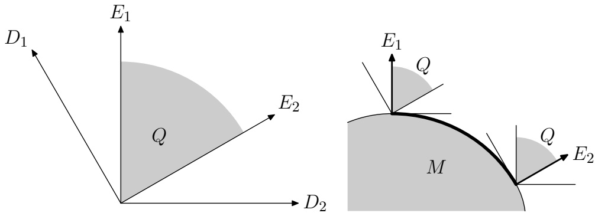

Figure 1: Geometry for 3 assets, with two sorting conditions. The view is from the direction of $( 1 , 1 , 1 ) ^ { \mathrm { T } }$ , so the image plane is $R ,$ . The left panel is in the space of expected return $r ,$ where $Q$ is the consistent set; the full three-dimensional shape is a wedge extending perpendicular to the image plane. The right panel shows a smooth constraint set M of portfolio vectors $w ;$ the efficient set is the shaded arc, where the normal is in the positive cone of $E _ { 1 } ,   E _ { 2 }$ . Along this arc, the normal must be in the image plane; if M is curved in three dimensions, then the efficient set is only this one-dimensional arc.

so that $D _ { i } ^ { \tt T } E _ { j } \; = \; \delta _ { i j }$ . The angle between $D _ { 1 }$ and $D _ { 2 }$ is $1 2 0 ^ { \circ }$ , the angle between $E _ { 1 }$ and $E _ { 2 }$ is $6 0 ^ { \circ }$ , and they all lie in the plane R whose normal is $( 1 , 1 , 1 ) ^ { \mathrm { T } }$ , the plane of the image in Figure 1.

## 2.5 Examples of constraint sets

We now demonstrate the computation of efficient sets in the most com mon situations that arise in the practice of investment management: when portfolio constraint sets are based a total risk budget or on a maximum investment constraint, with possible additional constraints from market neutrality or transaction costs. As we have noted, the efficient sets are defined by two independent but equal pieces of input:

1. The belief vectors D about the expected return vector $r .$

2. The constraint set M imposed on the portfolio $w$

We will consider several different structures for M, and within each we will construct the efficient set for the complete sort example. In Section 4 we consider more general beliefs.

## 2.5.1 Total investment constraint

In our first example, we are limited to total investment at most W dollars, with long or short positions permitted in any asset. We take $\mathcal { M } = \left\{ \; w \in \right.$ $\mathbb { R } ^ { n } \; \big | \; | w _ { 1 } | + \cdot \cdot \cdot + | w _ { n } | \leq W \big \}$

We first consider the case of a single sorted list. Start with a portfolio weighting $w = ( w _ { 1 } , \ldots , w _ { n } )$ . If $w _ { j } > 0$ for some $j = 2 , \ldots , n$ , then form the portfolio $\boldsymbol { w } ^ { \prime } = ( w _ { 1 } + w _ { j } , \ldots , 0 , \ldots , w _ { n } )$ , in which the component $w _ { j }$ has been set to zero by moving its weight to the first element. This has the same total investment as w if $w _ { 1 }   \geq   0$ , and strictly less if $w _ { 1 }   <   0$ It is more optimal since the difference $w ^ { \prime } - w = ( w _ { j } , \ldots , - w _ { j } , \ldots ) =$ $w _ { j } ( D _ { 1 } + \cdot \cdot \cdot + D _ { j - 1 } )$ is a positive combination of difference vectors.

Similarly, if any $w _ { j } < 0$ for $j = 1 , \ldots , n - 1$ , we define a more optimal portfolio $\boldsymbol { w } ^ { \prime } = ( w _ { 1 } , \ldots , 0 , \ldots , w _ { n } + w _ { j } )$ , which has the same or less total investment, and is more optimal than w.

We conclude that the only possible efficient portfolios are of the form $w   =   ( w _ { 1 } , 0 , \ldots , 0 , w _ { n } )$ with $w _ { 1 } \geq 0 ,   w _ { n } \leq 0$ , and $| w _ { 1 } | + | w _ { n } | = W$ , and it is not hard to see that all such portfolios are efficient. This is the classic portfolio of going maximally long the most positive asset, and maximally short the most negative asset. In this example, the covariance matrix plays no role.

By similar reasoning, the efficient portfolios in the case of multiple sectors go long the top asset and short the bottom asset within each sector; any combination of overall sector weightings is acceptable.

## 2.5.2 Risk constraint

Here we take $\mathcal { M }   =   \left\{   w   \in   \mathbb { R } ^ { n }   \middle |   w ^ { \mathtt { T } } V w   \leq   \sigma ^ { 2 }   \right\}$ , where V is the variance covariance matrix of the n assets and $\sigma$ is the maximum permissible volatility. This set is a smooth ellipsoid, and at each surface point w it has the unique strict normal $b = V w$ (up to multiplication by a positive scalar). Conversely, given any vector $b \in \mathbb { R } ^ { n }$ , there is a unique surface point w in M having normal $\boldsymbol { b } ; \boldsymbol { w }$ is a positive multiple of $V ^ { - 1 } b$ . As noted above, b is in effect a vector of imputed returns, and any such vector correponds to exactly one efficient point on M.

By the theorems, $w \in \mathcal { M }$ is efficient if and only if $b \in \overline { { Q } }$ . So we may parameterize the set $\hat { \mathcal { M } }$ of efficient points by $b = E x$ with $x \in \mathbb { R } ^ { m }$ with $x \geq 0$ . We may write this explicitly as

$$
w = V ^ {- 1} \sum_ {j = 1} ^ {m} x _ {j} E _ {j}.
$$

with appropriate scaling so $w ^ { \mathrm { { r } } } V w = \sigma ^ { 2 }$

The efficient set $\hat { \mathcal { M } }$ is a portion of the surface of the risk ellipsoid intersected with the plane where the local normal is in ${ \overline { { Q } } } ,$ . For example, in the case of a single sort it is a distorted simplex with $n - 1$ vertices corresponding to only a single $x _ { j }$ being nonzero. In general, each of the n! possible orderings gives a different set $\hat { \mathcal { M } }$ , and the set of these possibilities covers the whole set $\mathcal { M } \cap V ^ { - 1 } \overline { { Q } }$ . That $\mathbf { i s } ,$ the size of $\hat { \mathcal { M } }$ is $1 / n !$ of the entire possible set.

To select a single optimal portfolio we must pick one point within this set. For example, we might take the “center” point with $x   =   ( 1 , \ldots , 1 )$ which gives $b   =   E _ { 1 }   +   \cdot   \cdot   \cdot   +   E _ { m }$ . In the case of a single sorted list, this gives the linear return vector

$$
b _ {i} = \sum_ {j = 1} ^ {n - 1} E _ {i j} = \frac {n + 1}{2} - i.
$$

Of course, this is to be multiplied by $V ^ { - 1 }$ and scaled to get the actual weights. In Section 3 we propose a more logical definition of “center” point, and in Section 5 we demonstrate that the difference is important.

Figure 2 shows the unique efficient portfolio in the case of two assets; since there is only one vector $E _ { 1 }$ there is only a single point.

## 2.5.3 Risk constraint with market neutrality

Suppose that we impose two constraints. We require that the portfolio have a maximum level of total volatility as described above. In addition, we require that the portfolio be market-neutral, meaning that $\mu ^ { \mathrm { { r } } } w   =   0$ where $\mu$ is a vector defining the market weightings. We assume that $\mu \notin$ span $( D _ { 1 } , \ldots , D _ { m } )$ . For example, for equal weightings, $\boldsymbol { \mu } = ( 1 , \ldots , 1 ) ^ { \mathrm { T } }$

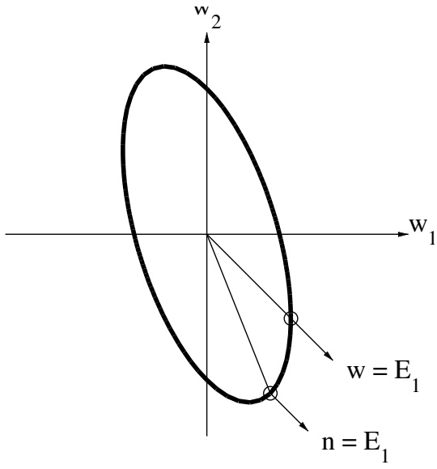

Figure 2: Optimal portfolios for two assets. The lower solution in this picture is the unique efficient point with no constraint of market neutrality; the upper solution is the market-neutral solution. The risk ellipsoid takes $\sigma _ { \mathrm { 1 } } = 2 \sigma _ { \mathrm { 2 } }$ and $\rho = 0 . 5$

The set M is now an ellipsoid of dimension $n   -   1 . \mathrm { ~ A t ~ } ^ { \alpha }$ “interior” points where $w ^ { \tt T } V w < \sigma ^ { 2 }$ , it has normal $\pm \mu . \mathrm { ~  ~ A t ~ } ^ { \mathrm { ~ e ~ } }$ boundary” points where $w ^ { \mathrm { { \scriptstyle T } } } V w \; = \; \sigma ^ { 2 }$ , it has a one-parameter family of normals $\mathcal { B } \; = \; \left\{ \; \alpha V w \; + \right.$ $\beta \mu \mid \alpha \geq 0 , \beta \in \mathbb { R } \}$ . Proof: We need to show $b ^ { \mathrm { { T } } } ( w - \nu ) \geq 0$ for all $b \in \mathcal { B }$ and all $\nu \in \mathcal { M }$ . But $b ^ { \tau } ( w   -   \nu )   =   \alpha ( w ^ { \tau } V w   -   w ^ { \tau } V \nu )   +   \beta ( \mu ^ { \tau } w   -   \mu ^ { \tau } \nu )   =$ $\begin{array} { r } { \frac { 1 } { 2 } \alpha ( \pmb { w } - \pmb { v } ) ^ { \tt T } V ( \pmb { w } - \pmb { v } ) + \frac { 1 } { 2 } \alpha \big ( \pmb { w } ^ { \tt T } V \pmb { w } - \pmb { v } ^ { \tt T } V \pmb { v } \big ) \geq 0 } \end{array}$ since $\mu ^ { \tt T } w   =   \mu ^ { \tt T } \nu   =   0$ $\bar { w } ^ { \tt T } V w = \sigma ^ { 2 } , \nu ^ { \tt T } V \nu \leq \sigma ^ { 2 }$ , and V is positive definite. It is clear that these are the only normals since the boundary of M has dimension $n - 2$ . The strict normals to M at w are those with $\alpha > 0$

For w to be efficient, we must have $\mathcal { B } \cap \overline { { Q } } \neq \varnothing$ . That is, there must exist $\alpha \geq 0$ and $\beta$ not both zero and $x _ { 1 } , \ldots , x _ { m } \geq 0$ , not all zero, so that

$$
\alpha V w + \beta \mu = x _ {1} E _ {1} + \dots + x _ {m} E _ {m}.
$$

Since $\mu \notin$ span $( E _ { 1 } , \ldots , E _ { m } )$ , we must have $\alpha > 0$ , and this is equivalent to

$$
V w = x _ {1} E _ {1} + \dots + x _ {m} E _ {m} + y \mu
$$

where $y$ is determined so that $\mu ^ { \mathrm { { T } } } w = 0$ . We may explicitly parameterize the set of efficient w by

$$
w = x _ {1} V ^ {- 1} E _ {1} + \dots + x _ {m} V ^ {- 1} E _ {m} + y V ^ {- 1} \mu
$$

with

$$
y = - \frac {x _ {1} \mu^ {\mathrm{T}} V ^ {- 1} E _ {1} + \cdots + x _ {m} \mu^ {\mathrm{T}} V ^ {- 1} E _ {m}}{\mu^ {\mathrm{T}} V ^ {- 1} \mu},
$$

or

$$
w = V ^ {- 1} \sum_ {j = 1} ^ {m} x _ {j} \tilde {E} _ {j}, \quad \tilde {E} _ {j} = E _ {j} - \frac {\mu^ {\mathrm{T}} V ^ {- 1} E _ {j}}{\mu^ {\mathrm{T}} V ^ {- 1} \mu} \mu .
$$

As $x _ { 1 } , \ldots , x _ { m }$ range through all nonnegative values, this sweeps out all efficient w, with suitable scaling to maintain $w ^ { \mathrm { { r } } } V w   =   \sigma ^ { 2 }$ . As with the previous case, this is a rather large efficient family, but in the next section we will show how to choose a single optimal element. Figure 2 shows the extremely simple case of two assets.

## 2.5.4 Transaction cost limits

An extremely important issue in practice is the transaction costs that will be incurred in moving from the current portfolio to another one that has been computed to be more optimal. If portfolios are regularly rebalanced, then the holding period for the new portfolio will be finite, and the costs of the transition must be directly balanced against the expected increase in rate of return.

One common way to formulate this tradeoff follows the formulation of volatility above: a rigid limit is given on the transaction costs that may be incurred in any proposed rebalancing, and the efficient portfolios are sought within the set of new portfolios that can be reached from the starting portfolio without incurring unacceptable costs. In this formulation, our procedure naturally incorporates transaction cost modeling.

Let $w ^ { 0 }$ be the current portfolio, and w be a candidate new portfolio. In order to rebalance $w ^ { 0 }$ to $w , w _ { i } - w _ { i } ^ { 0 }$ shares must be bought in the ith asset, for $i = 1 , \ldots , n ;$ if this quantity is negative, then that number of shares must be sold.

A popular and realistic model (Almgren and Chriss 2000; Almgren 2003) for market impact costs asserts that the cost per share of a trade execution schedule is proportional to the kth power of the “rate of trading” measured in shares per unit time, where k is some positive exponent; $k = { \frac { 1 } { 2 } }$ is a typical value. Assuming that the program is always executed in a given fixed time, and recalling that the per-share cost is experienced on $w _ { i } - w _ { i } ^ { 0 }$ shares, the total cost of the rebalancing is

$$
\text {rebalancing cost} \equiv F (w) = \sum_ {i = 1} ^ {n} \eta_ {i} \left| w _ {i} - w _ {i} ^ {0} \right| ^ {k + 1}
$$

where $\eta _ { i }$ is a stock-specific liquidity coefficient (we neglect “cross-impacts,” where trading in stock i affects the price received on simultaneous trades in stock j).

If a total cost limit C is imposed, then the constraint set becomes

$$
\mathcal {M} = \mathcal {M} _ {0} \cap \left\{\boldsymbol {w} \in \mathbb {R} ^ {n} \mid F (\boldsymbol {w}) \leq C \right\},
$$

where $\mathcal { M } _ { 0 }$ is a preexisting constraint set that may take any of the forms describe above such as total risk limit. Since $k > 0$ , F is a convex func tion and hence its level sets are convex. Since $\mathcal { M } _ { 0 }$ is assumed convex, the intersection M is also a convex set, and the theorems above apply. Computing the efficient set is then a nontrivial problem in mathematical programming, though for the important special case $k = { \frac { 1 } { 2 } }$ , methods of cone programming may be applied. The geometry is illustrated in Figure 3. Note that the intersection does not have a smooth boundary although each individual set does; in the case shown here, efficient portfolios will most likely be at the bottom right corner of the dark region.

## 3 Optimal Portfolios

In this section we extend the portfolio preference preference relation de veloped in the previous section to produce a unique efficient portfolio among the efficient set $\hat { \mathcal { M } } .$ The previous section’s preference relation ranks one portfolio relatively higher than another when its expected return is greater than the other’s across all expected returns consistent with the portfolio sort. This relation leads to the efficient set, but produces no way of distinguishing among portolios in the consistent set.

In this section we refine the preference relation to distinguish between efficient portfolios. We say that we prefer one portfolio to another when its expected returns are greater than the other’s for a greater fraction of the set of expected returns consistent with our beliefs. We show how to make the previous statement precise by equipping the consistent cone with any distribution from a broad class of distributions that live on this cone. This allows us to quantify the subjective likelihood of any of a range of expected returns being the actual expected returns. We then show that the preference relation thus defined is completely captured by a linear function on the space of portfolios. We show that this linear function is defined by the geometric centroid (with respect to the measure) of the consistent cone, so that a maximum of this linear function on a budget constraint set is both efficient and has the property that compared with any other portfolio, this portfolio has a higher expected return greater than fifty percent of the time. It turns out that the centroid is rather easy to compute in practice and therefore computing optimal portfolios is reduced to maximizing a certain linear function on a known budget constraint set.

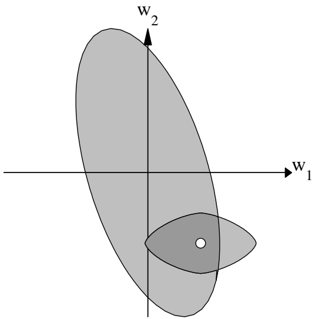

Figure 3: Transaction cost limit in combination with risk limit, for two assets. The ellipsoid represents the total risk limit, with $\sigma _ { 1 } / \sigma _ { 2 } = 2$ and $\rho \; = \; 0 . 5$ The curved diamond represents the new portfolios that are reachable from the given starting portfolio with a limit on total transition cost; $\eta _ { \mathrm { 2 } } / \eta _ { \mathrm { 1 } } = 2 . 5$ , and the exponent $\textstyle k = { \frac { 1 } { 2 } }$ . The dark shaded region is the set of new portfolios that satisfy both constraints.

## 3.1 The centroid

The fundamental idea behind our refining of the previous preference relation is to abandon the idea of comparing only those portfolios for which all expected returns are better the other’s and replace it with the weaker idea that more expected returns are better. The latter notion clearly applies to all portfolios once we make sense of what “more” means. To do this requires placing a suitably defined probability measure on the set of consistent expected returns. We can then define that one portfolio is preferred to another precisely when the measure of the set where the one has greater expected returns than the other is greater than where the other has greater expected returns. We then prove the remarkable fact that for a rather broad class of measures this preference relation is defined precisely by the linear function defined by the center of mass–that is, the centroid–of the consistent set.

**Extended preference definition** Consider two portfolio w and v, along with their “relevant” parts $w _ { 0 }$ and $\nu _ { 0 }$ as defined in Section 2.3. In general, unless $w \geq \nu$ or $\nu \geq w$ , there will be some consistent expected returns for which $w _ { 0 }$ has an expected return superior to $\nu _ { 0 }$ , and a complementary set of expected return vectors for which $\nu _ { 0 }$ gives a higher expected return. Only if $w \geq \nu$ or $\nu \geq w$ do all consistent expected return vectors give better results for one portfolio or the other.

To define the extended preference relation we need to introduce some notation. Although the portfolio vectors and the return vectors both are elements of the vector space $R ^ { n }$ , it will be convenient to denote the space of return vectors by R and the space of portfolio vectors by $\mathcal { W } ;$ the inner product $w ^ { \mathrm { { T } } } r = \langle w , r \rangle$ defines a bilinear map $\mathcal { W } \times \mathcal { R } \to \mathbb { R }$ . For any portfolio vector $w \in \mathcal { W }$ , we define $Q _ { w } \subset Q$ by

$$
Q _ {w} = \left\{r \in Q \mid w _ {0} ^ {\mathrm{T}} r \geq 0 \right\}.
$$

Clearly, $Q _ { w }$ and $Q _ { - w }$ are complementary in the sense that $Q _ { w } \cup Q _ { - w } = Q$ We could equally well formulate the comparison by using a cone $\overline { { Q } } _ { w } =$ $\{   r   \in   \overline { { Q } }   \mid   w ^ { \tt T } r   \geq   0   \}$ . These formulations will be equivalent under the mirror symmetry assumption below, but for now we continue as we have started.

For two portfolios w and v, we now consider the complementary sets $Q _ { w _ { 0 } - \nu _ { 0 } }$ and $Q _ { \nu _ { 0 } - w _ { 0 } }$ . Here $Q _ { w _ { 0 } - \nu _ { 0 } }$ is the set of consistent return vectors for which the portfolio $w$ will be at least as large an expected return as $\nu ,$ comparing only the relevant parts $w _ { \mathrm { 0 } } , \nu _ { \mathrm { 0 } }$ . We now define the extended preference relation, retaining the same notation $\nu \geq w$ as meaning v is preferred to w.

Let $\mu$ be a probability measure on R so that $\mu ( Q ) = 1$ . We say that $\nu \geq w$ (with respect to µ) if $\mu ( Q _ { v _ { 0 } - w _ { 0 } } ) \geq \mu ( Q _ { w _ { 0 } - v _ { 0 } } )$

This definition includes and extends the definition of the preference relation of the previous section. Stated in these terms, that preference relation said that $\nu \geq w$ if $\mu ( Q _ { v _ { 0 } - w _ { 0 } } ) = 1$

We write $\nu \simeq w$ if $\mu ( Q _ { v _ { 0 } - w _ { 0 } } ) = \mu ( Q _ { w _ { 0 } - v _ { 0 } } )$ and we write $\nu \succ w$ if µQv0−w0> µQw0−v0.

The above definition is fairly broad as it defines one preference relation for every probability measure on $Q ,$ . Below we make a specific choice for the measure $\mu .$ But for now we assume that a density has been given, and we follow through on some of the geometrical consequences.

**The Centroid** In order to find efficient portfolios with the new preference relation, we will identify a real-valued function $h ( w )$ on the space of portfolios W such that $w \succ \nu$ if and only if $h ( w ) > h ( \nu )$ . Then the maximizer of this function on a given convex budget set is the unique efficient portfolio under our preference relation.

To identify the function $h ( w )$ , we consider its level sets, defined by the relation $w \simeq \nu$ for a given portfolio v. Any such w must satisfy the condition

$$
\mu (Q _ {w _ {0} - v _ {0}}) = \mu (Q _ {v _ {0} - w _ {0}}) = \frac {1}{2},
$$

where $\mu$ is the measure defined above.

To understand this properly we look at the space $\mathcal { H }$ of hyperplanes through the origin in $\mathcal { R }$ . For $w \in \mathcal { W }$ define $w ^ { \perp } \subset \mathcal { R }$ by

$$
w ^ {\perp} = \left\{r \in \mathcal {R} \mid w ^ {\mathrm{T}} r = 0 \right\}.
$$

In this way each $w \in \mathcal { W }$ defines a hyperplane H through the origin in $\mathcal { R }$ whose normal is $w$ . Let H be the set of all such hyperplanes. Conversely, for any $H \in \mathcal { H }$ , there is a one-parameter family of normals $w$ so that $H = w ^ { \perp }$ : if w is a normal to H then so is λw for any $\lambda \in \mathbb { R }$

Now, for a given hyperplane $H = w ^ { \perp } \in \mathcal { H }$ , we say that H bisects the set of consistent returns $Q$ if and only if

$$
\mu (Q _ {w}) = \mu (Q _ {- w}) = \frac {1}{2}.
$$

Clearly, $w \simeq \nu$ if and only if the hyperplane $( w _ { 0 } - \nu _ { 0 } ) ^ { \perp }$ bisects $Q$

Let $\mathcal { P }$ be the subset of H of all hyperplanes through the origin that bisect $Q _ { 1 }$ . Let $c$ be the centroid or center of mass of $Q _ { 1 }$ ; that is, the mean of all points in $Q$ under the measure $\mu$ as defined by the integral

$$
c = \int_ {r \in Q} r d \mu .
$$

The following standard result characterises $\mathcal { P }$ in terms of $c ;$

**Theorem 3** The line joining the origin and the centroid is the intersection of all hyperplanes through the origin in R that bisect $Q _ { 1 }$

$$
\{\lambda c \mid \lambda \in \mathbb {R} \} = \bigcap_ {H \in \mathcal {P}} H.
$$

Since we are only interested in rays rather than points, we often say that $\textbf { \textit { C } } ^ { \mathrm { { e } } } \mathrm { { i s } } ^ { \mathrm { { n } } }$ this intersection.

We now make the following assumption about the measure $\mu ;$

$\mu$ has mirror symmetry about the plane $\overline { { Q } }$

As a consequence, $c \in { \overline { { Q } } }$ and we have the minor

**Lemma** For any $w \in \mathcal { W } , w ^ { \mathtt { T } } c = w _ { 0 } ^ { \mathtt { T } } c .$

**Proof** Write $w = w _ { 0 } + w _ { \perp }$ and observe that $w _ { \perp } ^ { \mathrm { T } } c = 0$ since $c \in { \overline { { Q } } }$

The symmetry assumption is natural given our lack of information about return components orthogonal to our belief vectors, and it leads immediately to a characterization of our portfolio preference relation in terms of the centroid.

**Theorem 4** Let $w , \nu \in \mathcal { W }$ be portfolios and $c$ be the centroid vector as defined above. Then we have

$$
\left| \begin{array}{l l l} w \simeq v & \Longleftrightarrow & (w - v) ^ {\mathrm{T}} c = 0 \end{array} \right|
$$

**Proof** By definition, $w \simeq \nu$ if and only if $\mu ( Q _ { w _ { 0 } - v _ { 0 } } ) = \mu ( Q _ { v _ { 0 } - w _ { 0 } } )$ . This means precisely that $( w _ { 0 } - \nu _ { 0 } ) ^ { \perp }$ must bisect $Q .$ That is, $( w _ { 0 } - \nu _ { 0 } ) ^ { \perp } \in \mathcal { P }$ This implies that $c \in ( w _ { 0 } - v _ { 0 } ) ^ { \perp }$ , or in other words $( \boldsymbol { w } _ { 0 } - \boldsymbol { \nu } _ { 0 } ) ^ { \mathrm { T } } \boldsymbol { c } = 0 .$ . By the Lemma, this is equivalent to $( \boldsymbol { w } - \boldsymbol { \nu } ) ^ { \mathrm { T } } \boldsymbol { c } = 0$

Conversely, if $( \boldsymbol { w }   -   \boldsymbol { \nu } ) ^ { \mathrm { T } } \boldsymbol { c }   =   0$ then $( \boldsymbol { w } _ { 0 } - \boldsymbol { v } _ { 0 } ) ^ { \mathrm { T } } \boldsymbol { c } = 0 ;$ ; this means that $c \in ( w _ { 0 } - \nu _ { 0 } ) ^ { \perp }$ , which implies by Theorem 1 that $( w _ { 0 } - \nu _ { 0 } ) ^ { \perp } \in \mathcal { P }$ . That is, that $w \simeq \nu$

## 3.2 Centroid optimal portfolios

The theorems of the previous section characterize our portfolio preference relation in terms of the centroid vector c. This means that the entire problem of calculating efficient or optimal portfolios is reduced to manipulations involving the centroid vector: two portfolios are equivalently preferable if and only if $\boldsymbol { w } ^ { \mathrm { { T } } } \boldsymbol { c } = \boldsymbol { \nu } ^ { \mathrm { { T } } } \boldsymbol { c }$ . We now cast the notion of efficiency in terms of the centroid vector c.

Given a convex budget set M, a point $w \in \mathcal { M }$ is efficient (in the sense that there is no portfolio in M preferred to it) if and only if $( \nu   -   w ) ^ { \mathrm { T } } c \leq 0$ for all $\nu \in \mathcal { M }$ . That is, M must have a supporting hyperplane at w whose normal is $c ;$ as described in Section 2.4. We now summarize this in a formal definition.

**Definition** Let c be the centroid vector related to a portfolio sort. Let $\mathcal { M } \subset \mathcal { W }$ be a convex budget constraint set. A candidate portfolio $w \in \mathcal { M }$ is centroid optimal if there is no portfolio $\nu \in \mathcal { M }$ such that $\boldsymbol { \nu } ^ { \mathrm { { T } } } \boldsymbol { c } > \boldsymbol { w } ^ { \mathrm { { T } } } \boldsymbol { c }$

We now state our main result which allows us to calculate centroid optimal portfolios in practice.

**Theorem 5** If $w$ is centroid optimal, then M has a supporting hyperplane at $w$ whose normal is c. Hence, by Theorem 4, it is efficient with respect to the equivalance relation defined in Section(2.3).

In order for $w$ to be efficient in the sense of Section 2.4, we must further require that $c \in { \overline { { Q } } } = Q \cap R$ . This will be true if and only if the density $\mu$ is symmetric about the plane $R ;$ symmetry in this sense is part of our assumptions in the next section.

Just as in classic portfolio theory (Section 2.1), the magnitude of the vector c has no effect on the resulting optimal portfolio, given a specified budget constraint set. In effect, we consider the centroid c to be defined only up to a scalar factor; we think of it as a ray through the origin rather than a single point. In Appendix A we present efficient techniques for computing the centroid vector c, both for single portfolios and for collections of sectors.

The most common budget constraint is a risk constraint based on total portfolio variance as in Section 2.5.2. If the portfolio constraints are of more complicated form involving, for example, position limits, short sales constraints, or liquidity costs relative to an initial portfolio, then all the standard machinery of constrained optimization may be brought to bear in our situation. Constraints on the portfolio weights are “orthogonal” to the inequality structure on the expected returns.

## 3.3 Symmetric distributions

The above work refines the portfolio preference relation of Section 2 to yield a unique optimal portfolio in terms of the centroid vector of the consistent cone. Our refined preference relation and the centroid depend on the specification of the distribution of expected returns, which introduces an element of parametrization into the formulation of our problem in that it characterizes how the expected returns consistent with a sort are likely to be distributed.

What is the correct probability distribution on the space of consistent expected returns? By hypothesis, we have no information about the expected return vector other than the inequality constraints that define the consistent set (recall that we believe that the covariance structure is not related to the expected moments). This forces us to make the most “neutral” possible choice.

We assume that the probability density µ is radially symmetric about the origin, restricted to the consistent cone Q. A radially symmetric density is one which is the same along any ray from the origin. That is, we consider densities that can be written in the form $\mu ( r ) = f { \bigl ( } | r | { \bigr ) } g { \bigl ( } r / | r | { \bigr ) }$ where $f ( \rho )$ for $\rho \geq 0$ contains the radial structure and $g ( \omega )$ with $| \omega | = 1$ contains the azimuthal structure. We then require that $g ( \omega )$ be a constant density, restricted to the segment of the unit sphere included in the wedge $Q _ { 1 }$ . The radial function $f ( \rho )$ may have any form, as long as it decreases sufficiently rapidly as $\rho \to \infty$ so that the total measure is finite.

For example, the n-component uncorrelated normal distribution, with density proportional to $f ( \rho ) = \rho ^ { n - 1 } \exp \left( - \rho ^ { 2 } / 2 R ^ { 2 } \right)$ , is a candidate distribution. Or, we could choose a distribution uniform on the sphere of radius R. In both of these examples, R is a typical scale of return magnitude, for example 5% per year, and may have any value.

An essential feature of our construction is that we do not need to specify the value of the radius R or even the structure of the distribution: the relative classification of returns is identical under any radially symmetric density. This will be apparent from the construction below, and mirrors the observation in Section 2.1 that with a fixed risk budget, the classic mean-variance portfolio depends only on the direction of the expected return, not on its magnitude. In effect, since all the sets of interest to us are cones, we measure their size by their angular measure.

Radial symmetry means geometrically that two points in return space R have equal probability if they have the same Euclidean distance from the origin: $| r | ^ { 2 } = r _ { 1 } ^ { 2 } + \cdots + r _ { n } ^ { 2 }$ . It is not obvious that this distance is the most appropriate measure; one might argue that the metric should depend somehow on the covariance matrix. But, as we have argued in Section 2, we assume that our information about the first moments of the return distribution is independent of the second moments. Thus we propose this as the only definition that respects our lack of information aside from the homogeneous inequality constraints.

## 3.4 Computing the centroid

The key fact about the centroid vector is that we capture a rather complicated equivalence relation for portfolios in a very simple geometric construction. We have shown that if we have a formula for the centroid then we transform the problem of finding efficient portfolios into a linear optimization problem, which is solvable by known means. Equation 3.1 gives us the key to calculating the centroid for an arbitrary portfolio sort via a straightforward Monte Carlo approach.

In Appendix A we demonstrate how to do this Monte Carlo simulation in some detail. The key observation about this approach is that it is straightforward and directly related to Equation 3.1. The entire trick to the computation is providing a method for randomly sampling from the consistent cone Q associated to a given sort. This method, therefore, works in principle for any sort, whether it be a complete sort, partial sort, or even the cone associated to multiple sorts (see 4 for more on this).

In the case of a complete sort the method for sampling from the consistent cone Q boils down to generating a draw from an uncorrelated n-dimensional Gaussian and then sorting the draw according to the sort. This sorting process is equivalent to applying a sequence of reflections in Rn that move the draw into the consistent cone. The Monte Carlo simulation is then the process of averaging of these draws which in effect computes the integral in Equation 3.1.

In the case of a complete sort the averaging process is equivalent to drawing from the order statistics of a Gaussian. The component associated to the top ranked stock is a draw from the average of the largest draw from n independent draws from a Gaussian, the next ranked stock is the average of the second largest draw from n independent draws from a Gaussian, etc. We show in the appendix that this procedure produces something very close to the inverse image of a set of equally spaced points of the cumulative normal function (see section 4) for a picture of what this looks like.

Thus, centroid optimal portfolios in the case of a complete sort are equivalent to portfolios constructed by creating a set of expected returns from the inverse image of the cumulative normal function, where the top ranked stock receives the highest alpha, and the alphas have the same order as the stocks themselves. So, the centroid optimal portfolio is the same portfolio as the Markowitz optimal portfolio corresponding to a set of expected returns that are normally distributed in the order of the corresponding stocks. This is remarkable in light of the completely general framework from which this fact was derived. In a completely natural, economic way, the optimal portfolio to trade is exactly that portfolio derived in the Markowitz framework from a set of normally distributed expected returns.

But, because our approach in this paper is completely general and applies to any portfolio sort, we can apply the method to a much broader set of sorts than simply complete sorts. In the next section we examine these in detail.

## 4 A Variety of Sorts

Above we outlined in detail how to calculate centroid optimal portfolios. Our construction was completely general. We showed that given the equivalence relation that states we prefer one portfolio to another when the one’s expected return is greater than the other’s (on its set of relevant direction) for returns consistent with the ordering more often (with respect to a certain measure µ) than it is not greater. We showed that this equivalance relation is completely characterized by the linear function given by the centroid of the cone of consistent returns Q with respect to µ.

The purpose of this section is to illustrate the variety of inequality criteria to which our methodology can be applied, and to show the centroid in all these cases.

## 4.1 Complete sort

To begin, we illustrate the simple sort used as an example in Section 2. Figure 4 shows the centroid vector, for a moderate portfolio of 50 assets, compared to the linear weighting. These vectors are defined only up to a scalar constant; for the plot they have been scaled to have the same sum of squares. As suggested in Section 2.5.2, the linear portfolio is a natural way to smoothly weight the portfolio from the first (believed best) asset to the the last (believed worst).

The linear portfolio in effect assigns equal weight to each difference component. By comparison, the centroid portfolio curves up at the ends, assigning greater weight to the differences at the ends than the differences in the middle of the portfolio. The reason for this is that typical distributions have long “tails,”, so two neighboring samples near the endpoints are likely to be more different from each other than two samples near the middle. In fact, the centroid profile looks like the graph of the inverse cumulative normal distribution; this is indeed true when n is reasonably large and is exploited in Appendix A.

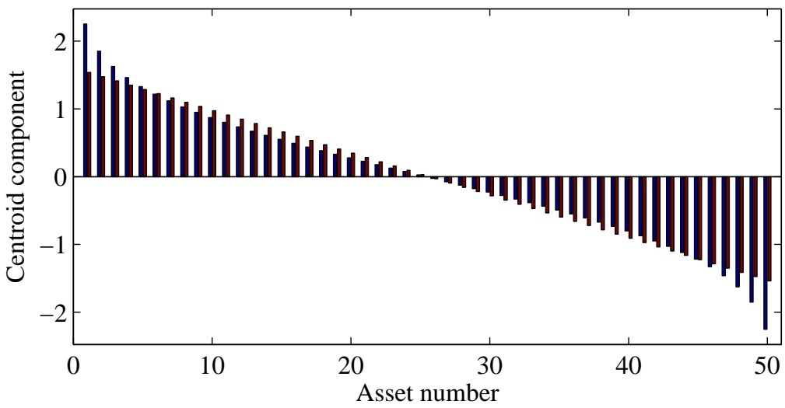

Figure 4: The centroid vector for a complete sort of 50 assets, compared with linear weights. The centroid overweights very high and very low ranked stocks while underweighting the middle. The weights have been chosen so that the sum of the absolute value of each are the same.

## 4.2 Sector sorts

Next, we look at the case where we assume that each stock in our universe is assigned to a distinct sector and that within each sector we have a complete sort. If we have k sectors with $m _ { i }$ stocks in sector i then we can order our stocks as follows:

$$
(r _ {1}, r _ {2}, \dots , r _ {n _ {1}}), (r _ {n _ {1} + 1}, \dots , r _ {n _ {2}}), \dots , (r _ {n _ {k - 1} + 1}, \dots , r _ {n})
$$

with $m_{1} = m_{1}, n_{2} = m_{1} + m_{2}, \cdots, n_{k} = m_{1} + \cdots + m_{k} = n$ . Then we assume a sort within each group:

$$
r _ {1} \geq \dots \geq r _ {n _ {1}}, \quad r _ {n _ {1} + 1} \geq \dots \geq r _ {n _ {2}}, \quad \dots , \quad r _ {n _ {k - 1} + 1} \geq \dots \geq r _ {n}.
$$

This is almost as much information about as in the complete sort case except that we do not have information about the relationships at the sector transitions. If there are k sectors, there are $m = n - k$ columns $D _ { j }$ of the form $( 0 , \ldots , 0 , 1 , - 1 , 0 , \ldots , 0 ) ^ { \mathrm { { r } } }$ , and the matrix D is of size $( n -$ $k ) \times n$ . The consistent cone $Q$ is a Cartesian product of the sector cones of dimension $m _ { 1 } , \ldots , m _ { k }$

As a specific example, if there are five assets, divided into two sectors of length two and three, then

$$
D = \left( \begin{array}{c c c c c} 1 & - 1 & & \\ \hline & & 1 & - 1 & \\ & & & 1 & - 1 \end{array} \right).
$$

**Orthogonal decomposition** For k sectors, there are k orthogonal directions, corresponding to the mean expected returns within each sector. $R ^ { \perp }$ has dimension $k ,$ and R has dimension $n - k$

**Matrix structure** The dual matrix is multiple copies of the single-sector dual in (5).

**Centroid profile** Figure 5 shows the centroid portfolio for two sectors: one sector has 10 assets and the other has 50 assets, for a total portfolio size of $n = 6 0$ . Within each sector, the vector is a scaled version of the centroid vector for a single sector. Although the overall scaling of the graph is arbitrary, the relative scaling between the two sectors is fixed by our construction and is quite consistent with intuition. It assigns larger weight to the extreme elements of the larger sector, than to the extreme elements of the smaller sector. This is natural because we have asserted that we believe the first element of the sector with 50 elements dominates 49 other components, whereas the first element of the sector with 10 elements dominates only 9 other assets.

## 4.3 Complete sort with long-short beliefs

As a modification of the above case, we imagine that the stocks are divided into two groups: a “long” group that we believe will go up, and a “short” group that we believe will go down. Within each group we additionally have ranking information. If \` is the number of long stocks, then these beliefs may be expressed as

$$
r _ {1} \geq \dots \geq r _ {\ell} \geq 0 \geq r _ {\ell + 1} \geq \dots \geq r _ {n}
$$

which is a total of $m = n$ beliefs. This includes the special cases $\ell = n$ when we believe all assets will have positive return, and $\ell = 0$ when we believe all will have negative return.

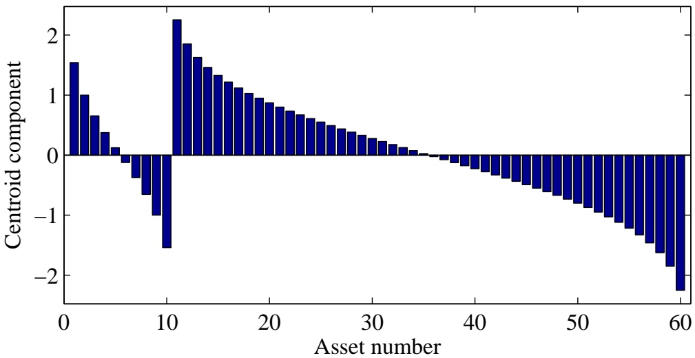

Figure 5: The centroid portfolio for two sectors of sizes $m _ { \mathrm { 1 } }   =   1 0$ and $m _ { 2 } = 5 0$

To illustrate, let us take five assets, with the first two believed to have positive return, the last three to have negative. Then $n = 5 ,   \ell = 2$ , and

$$
D = \left( \begin{array}{c c c c c} 1 & - 1 & & & \\ & 1 & & & \\ \hline & & - 1 & & \\ & & 1 & - 1 & \\ & & & 1 & - 1 \end{array} \right).\tag{6}
$$

**Orthogonal decomposition** For a complete sort with long-short classification, there are no orthogonal directions since $m = n$ . Every component of the return vector is relevant to our forecast. $R ^ { \perp } = \{ 0 \}$ , and $R = \mathbb { R } ^ { n }$

**Matrix structure** The dual matrix is (6),

$$
E = D ^ {- 1} = \left( \begin{array}{c c c c c} 1 & 1 & & \\ & 1 & \\ \hline & & - 1 & & \\ & & - 1 & - 1 & \\ & & - 1 & - 1 & - 1 \end{array} \right).
$$

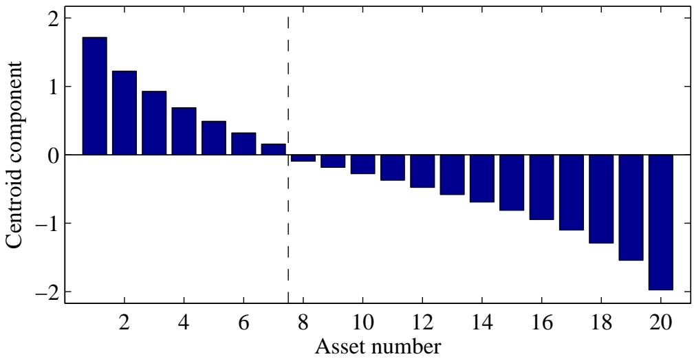

Figure 6: The centroid vector for a single sector of 20 assets, with sorting information plus the additional belief that the first $7$ will have positive return while the last 13 will have negative return.

**Centroid profile** Figure 6 shows the centroid vector with long/short constraints, for the case $n   =   2 0$ and $\ell = 7$ . This vector is not a simple linear transformation of the centroid vector without the zero constraint; its shape is more complicated.

## 4.4 Performance relative to index

We define an index to be a linear weighting of the assets

$$
I = \mu_ {1} S _ {1} + \dots + \mu_ {n} S _ {n}
$$

with

$$
\mu_ {j} > 0 \quad \text {and} \quad \mu_ {1} + \dots + \mu_ {n} = 1.
$$

We believe that the first \` stocks with overperform the index, and the last $n - \ell$ will underperform, with $0 < \ell < n$ . Thus our beliefs are

$$
\begin{array}{l l} r _ {j} - \left(\mu_ {1} r _ {1} + \dots + \mu_ {n} r _ {n}\right) \geq 0, & j = 1, \ldots , \ell \\ \left(\mu_ {1} r _ {1} + \dots + \mu_ {n} r _ {n}\right) - r _ {j} \geq 0, & j = \ell + 1, \ldots , n. \end{array}
$$

and the belief matrix is

$$
D = \left( \begin{array}{c c c c c c} 1 - \mu_ {1} & \dots & - \mu_ {\ell} & - \mu_ {\ell + 1} & \dots & - \mu_ {n} \\ \vdots & \ddots & \vdots & \vdots & & \vdots \\ - \mu_ {1} & \dots & 1 - \mu_ {\ell} & - \mu_ {\ell + 1} & \dots & - \mu_ {n} \\ \mu_ {1} & \dots & \mu_ {\ell} & \mu_ {\ell + 1} - 1 & \dots & \mu_ {n} \\ \vdots & & \vdots & \vdots & \ddots & \vdots \\ \mu_ {1} & \dots & \mu_ {\ell} & \mu_ {\ell + 1} & \dots & \mu_ {n} - 1 \end{array} \right)
$$

Each of the belief vectors is orthogonal to $( 1 , \ldots , 1 ) ^ { \mathrm { T } }$ . Thus the n belief vectors are in an $( n - 1 )$ -dimensional subspace, and cannot be independents. But the cone $Q = \left\{ D r \geq 0 \right\}$ has a nonempty interior $\{ D r > 0 \}$ ; in fact it contains the vector $\boldsymbol{r} = (1, \ldots, 1, -1, \ldots, -1)^{\mathrm{T}}$ for which

$$
(D r) _ {i} = \left\{ \begin{array}{l l} 2 \left(\mu_ {\ell + 1} + \dots + \mu_ {n}\right), & i = 1, \dots , \ell , \\ 2 \left(\mu_ {1} + \dots + \mu_ {\ell}\right), & i = \ell + 1, \dots , n. \end{array} \right.
$$

Thus the theorems of Section 2 apply.

## 4.5 Partial and overlapping information

Below we review several different varieties of sorts that arise in practice.

**Partial Sorts** The centroid method works well for producing optimal portfolios from partial sorts, that is, from sorts that do not extend across an entire universe of stocks. The most natural way this arises in practice is in the case of a universe of stocks broken up into sectors. In this case a portfolio manager might have sorting criteria appropriate for stocks within a sector but which do not necessarily work for stocks across sectors.

**Multiple Sorts** In practice it is possible to have multiple sorting criteria. For example one might sort stocks according their book-to-market ratio and size, for example, the logarithm of market capitalization. These characteristics provide two different sort, but the resulting sorts are different and hence it is impossible that they both be true. Nevertheless, both contain useful information that it would be suboptimal to discard.

Our portfolio optimization framework is valid in this case. Let $Q _ { 1 }$ and $Q _ { 2 }$ be the consistent cones under the two different criteria $( e . g . ,   Q _ { 1 }$ is the consistent cone for the book-to-market sort, and $Q _ { 2 }$ is the consistent cone for the size sort). To apply our methodology, we have to supply a measure $\mu$ on the union of $Q _ { 1 }$ and $Q _ { 2 }$ . We may do $\mathbf { s o }$ by creating a density that assigns a probability $p$ of finding an expected return in $Q _ { 1 }$ and $1 - p$ in $Q _ { 2 }$ . The centroid of the combined set under this measure is simply the weighted average of the two individual centroids. Using only the inequality information given by the sorts for $Q _ { 1 }$ and $Q _ { 2 }$ that have been specified, this is the only natural construction.

This formulation clearly applies to more than two nonoverlapping weightings; we simply take the centroid of the combined set, which is an equal-weighted combination of the individual centroids. As an example, suppose that three orderings are given, and that two are close to each other. Then this algorithm will produce a centroid close to the centroids of the two close orderings.

**Missing information** The above logic clearly indicates how to proceed when some information is considered unreliable. Suppose, for example, that it is believed that in the middle one-third of the asset list, the rankings have no significance. That is, the investor’s beliefs are that all rankings within that subset are equally probable.

The extension of the above strategy says to simply compute the superposition of the centroids of all the compatible orderings. The result of this is simply to average the centroid components within the uncertain index range.

## 5 Empirical Tests

In this section we provide empirical examples of applications of optimization from ordering information using the linear, centroid, optimized linear and optimized centroid algorithm. Throughout this section we look to quantify the absolute and relative performance of the optimized centroid portfolios to portfolios constructed using the other methodologies. In particular, we would like to study the significance of incorporating covariance information into portfolio formation, especially as it pertains to improving performance relative to methods that omit this information. Since in practice many portfolio managers who use ordering information ignore covariance information, we believe an important part of this work involves examining the extent to which using this method improves investment performance over existing methods. Put simply, we have proved the theoretical superiority of the centroid optimization method. Now we examine its practical significance.

We take two approaches to this, one based on studying an actual portfolio sort on real historical data, and the other based on simulations. In both approaches we create backtests over a period of time and for each time within the backtest period produce portfolios using four different construction methods from a single sort. The four methods we look at are the optimized and unoptimized versions of the linear and centroid methods, as described above.

To evaluate performance we examine at the information ratio, that is, the annualized ratio of the sample mean and sample standard deviation of daily returns, of each time series derived from returns using the different construction methods. In our empirical work, we study reversal strategies, which simply put derive from the hypothesis that the magnitude of recent short horizon returns contain information about future returns over short horizons. Reversal strategies are easy to use test portfolio construction methods using ordering information because in this case the ordering information is provided simply by recent returns. To be precise we sort stocks within a universe of stocks based on the magnitude of past returns and then use the linear and centroid methods to construct portfolios and record thei returns. The reversal work in this section demonstrates that the centroid optimization method provides a significant risk-adjusted performance boost over the unoptimized methods as well as a smaller, but significant, performance boost over the optimized linear method.

In our simulated work, we simulate markets using a stationary return generating process of which we have complete knowledge. We then build portfolios based on the resulting asset sort and covariance information. We also look at the effect of creating portfolio sorts based on the correct asset ordering information after being re-arranged with a permutation. We study the relationship between the variance of the permutation, that is, the extent of the variance that the permutation introduces into the asset sort and the resulting portfolio performance.

## 5.1 Portfolio formation methods and backtests

The empirical sections below show tests of the relative performance of different methodologies of forming portfolios from stock sorts. Both sections will take the same approach though the first section will be a real empirical study while the second will be based on simulations.

To briefly review the definitions and results of Sections 2 and 3, all portfolio construction methods start with a list of portfolio constituents and a portfolio sort, which is an order or arrangement for the stocks in the portfolio $S _ { 1 } , \ldots , S _ { n }$ such that $r _ { 1 } \geq \cdot \cdot \cdot \cdot \geq r _ { n }$ , where $r _ { i }$ is the expected return for $S _ { i } ,$ . The portfolio formation methods are procedures for transforming a portfolio sort and (possibly) a covariance matrix into a portfolio. Here a portfolio is a list of dollar investments for each stock $S _ { i }$ in the portfolio, where the investment can be a postive number (representing a long position) or a negative number (representing a short position). In this instance, each portfolio is assumed to be held for a fixed time horizon at which point the portfolio is rebalanced, that is, replaced, with a new portfolio. The return to such a portfolio over this fixed horizon is then defined as the sum of the products of the dollar investments multiplied by the stock returns over those fixed horizons. This is equivalent to looking at the dollar profit and loss to the portfolio over that period of time divided by the gross market value of the portfolio. We shall compare the relative performance of the four basic approaches for portfolio formation looked at in this paper: linear, centroid, optimized linear, and optimized centroid.

In the linear and the centroid portfolio, the weights are specified directly with no use made of the covariance matrix. The linear portfolio is the portfolio that forms a dollar neutral portfolio with linearly decreasing weights, assigning the highest weight to the highest ranked stock and the lowest weight to the lowest ranked stock. Variants of this portfolio are used in practice quite often in the asset management community. The (unoptimized) centroid portfolio is the portfolio formed by assigning a weight proportional to that of the centroid vector to each stock according to the rank of the stock. Intuitively, this portfolio is similar to the linear portfolio but with the tails overweighted; that is, the highest and lowest rank stocks receive proportionately more weight in this portfolio than the linear one.

The two “optimized” construction methods make use of the covariance matrix and are extremal in the sense of Section 2. Roughly speak ing, they construct mean-variance optimal portfolios as if the expected returns for the asset universes have a respectively linear (for the optimized linear) or centroid (for the optimized centroid) profile with respect to their rankings.

For the purposes of this section a backtest is a method for testing the joint procedure of forming a portfolio sort and constructing a portfolio using a particular construction method. That is, a backtest tests the investment performance of a particular portfolio sorting procedure (for example, the reversal sort) combined with a particular portfolio construction method. The basic premise is that a superior portfolio sort combined with a superior portfolio construction method will produce a superior risk adjusted return. A backtest then produces a timeseries of investment returns based on repeated application of a consistent portfolio construction method to a particular portfolio sorting procedure. Performance is measured by the information ratio which measures the return per unit of risk as the annualized ratio of the average return of the portfolio to the standard deviation of that return.

In all that follows we will produce backtests for a single portfolio sorting method while forming all four of the above portfolios (linear, centroid, optimized linear, optimized centroid) and compare information coefficients.

A backtest has several major components:

1. **Periodicity:** This is the time frequency over which portfolio returns are produced. A daily backtest produces portfolio returns for each day.

2. **Length:** This is the number of time steps (where each time step’s length is determined by the periodicity) of the backtest.

3. **Start Date:** This is the first date on which a return is produced for the backtest.

4. **End Date:** This is the last date on which a return is produced for the backtest.

5. **Portfolio Formation Dates:** These are dates on which portfolios are formed within the backtest.

In our backtests below we will use the following basic procedure for each portfolio formation date between a specified start date and end date:

1. Determine portfolio sort;

2. Compute covariance matrix;

3. Form the four portfolios: linear, centroid, optimized linear, optimized centroid;

4. Determine return of each portfolio held from formation date to next formation date.

In each step of the above procedure we take care to avoid look-ahead bias in both our covariance computations and the production of our sorts.

## 5.2 Reversal strategies

In this empirical example we look at reversal strategies that seek to buy stocks whose prices appear to have moved too low or too high due to liquidity and not due to fundamental reasons. Effectively the strategy seeks to buy stocks at a discount and sell stocks at a premium to fair prices in order to satisfy a counterparty’s requirements for immediacy.

The theoretical underpinnings for reversal strategies and empirical evidence for them are discussed in Campbell, Grossman, and Wang (1993). These authors looked specifically at stocks with large price movements accompanied by large trading volume and measured observed serial correlation around these events. We call the hypothesis that stock prices reverse in the manner just described the reversal hypothesis and take as given that trading strategies exploiting these strategies will produce positive expected returns.

We build a simple portfolio sort to exploit the tendency for stocks to reverse. We produce the sort from the magnitude of recent past returns and sort stocks from highest to lowest according to their negative. Stocks whose past returns are most negative are therefore deemed most favorable, while stocks whose returns are most postive are viewed least favorably. This provides us with a straightforward method for demonstrating the effectiveness of the portfolio construction methods in this paper. We do not explicitly form expected returns from the information about past returns, we only sort stocks according to this information and construct portfolios accordingly.

## 5.2.1 Data, portfolio formation and reversal factor

Since we aim to produce an overall picture of the relative performance of the four portfolio formation methods we will look at the reversal strategy across a range of possible variations of its basic parameters. Below is a list of the key variants in the reversal strategy tests.

1. The portfolio size N is the number of stocks in the portfolio on any given date. For all of our studies the number of stocks in the portfolio remains constant over the test period. We study portfolios of sizes 25, 50, 100, 150, 200, 250, 300, and 500.

2. The reversal period K is the number of days of return data to include in the computation of the reversal factor. We study strategies with reversal periods 5, 10, 15, 20, and 25. For example, a reversal period of 5 means that we sort stocks based on past returns over five day periods.

3. The reversal lag L is the number of days prior to a given portfolio formation date that the reversal factor is computed over. We study strategies with reversal lags 0 and 1.

We use the Center for Research in Security Prices (CRSP) database of daily US stock prices from NYSE, Amex and Nasdaq. The return of a stock on day t is the CRSP total return of the stock: the arithmetic return of the price from day t − 1 to day t plus the effect of dividends and other income that would accrue to the investor over that period.

For each reversal strategy variant above the following procedure is undertaken. We start with the CRSP database of returns from January 19, 1990 to December 31, 2002. On the first date of this period we choose a universe consisting of the 1,000 largest stocks sorted by capitalization for which there also exists at least 1,000 valid days of data prior to the start date. On each subsequent date if a stock drops out of the universe (e.g., if the stock is delisted, merges or goes bankrupt), we replace it with a new stock that (a) is not already in our universe, (b) has at least 1,000 valid days of data through that date, and (c) is the largest possible stock that meets the criteria (a) and (b). After this universe is created, reversal strategy parameters are selected: a value is chosen for portfolio size N, reversal lag L, and reversal period K. From this data a backtest is conducted as follows:

1. For each date t in the backtest period we form a portfolio list for date t, by criteria (a), (b), and (c) above. The portfolio list is the list of candidate stocks for the portfolio on that date.

2. The N constituents of the portfolio formed on date t − 1 are chosen randomly from the portfolio list.

3. The sort parameter on date t − 1 is the negative of the cumulative total return from date t−L−K to t−L−1. The stocks are rearranged into decreasing order by this variable. Thus stock with index i is always the stock whose performance is expected to be ith from the top, but this will be a different stock on different dates.

4. For a portfolio formed on date t − 1 we compute a covariance matrix from a rectangular matrix of data consisting of the N columns and 2N rows of data from days up to but not including day t. By construction all elements of this rectangular grid contain a valid total return for the portfolio constituents at time t − 1.

5. For each date t in the backtest period we form linear, centroid, optimized linear, and optimized centroid portfolios on date t − 1 using a portfolio sort and covariance matrix. The portfolios are normalized to have unit ex ante risk as measured by the estimated covariance matrix. They are not contrained to be market neutral.

6. The portfolio formed on day t − 1 is held from t − 1 to t. Its return over this period is calculated as the sum of the product of the return of each stock in the portfolio on day t−1 multiplied by the portfolio holding in that stock on day t − 1. The portfolio is assumed to be rebalanced at the close of day t, that is, traded into at a price equal to the closing price on day t and then held until day t + 1. In this way the entire backtest is run.

## 5.2.2 Comments

Our method for producing the active universe from which to form portfolios was designed to create a universe which had no look-ahead or survivorship biases present, and which was compact enough to allow us to use simple methods for computing the covariance matrices. We make no attempt to measure transaction costs or to form realistic trading strategies to minimize turnover. (It is anecdotally known that even trading strategies with reported information ratios as high as 5 before transaction costs and commissions still do not return a profit in actual trading.)

While our strategies do not suffer from look-ahead or survivorship bias, they are not necessarily realistic. For example, when the reversal lag is set to zero, the reversal factor is literally formed from returns data including the same day’s closing prices as is supposedly captured in the rebalance. Therefore, a reversal lag of zero is technically impossible, but actually the limit as time tends to zero of a procedure which is technically possible once transaction costs are taken into account. Nevertheless, the procedure does not incorporate data in any way that could not be (at least theoretically) known prior to portfolio formation. In addition, while a reversal lag of zero is impossible, a reversal lag of one is unrealistically long since no realistic trading strategy would form a factor and wait an entire day before trading.

The key aim of this example is to examine the relative performance of a strategy based on centroid optimization versus a linear weighting scheme. We are not attempting to test either the availability of excess returns or the validity of a certain hypothesis about a certain pricing anomaly. In fact, we take as given that reversal hypothesis holds. It is obvious that building a portfolio from reversal information will produce positive returns if the reversal hypothesis holds. It is also seems obvious that by using only information about the relative strength of the expected reversal and not information about the covariance structure of the stocks in the universe, one cannot expect to construct a portfolio with maximum information ratio. What is not obvious, however, is the degree to which the covariance structure can improve the information ratio. This is the empirical piece of information we are attempting to calibrate.

<table><tr><td rowspan="2">Number of stocks</td><td colspan="10">Reversal Period (days)</td></tr><tr><td colspan="2">5</td><td colspan="2">10</td><td colspan="2">15</td><td colspan="2">20</td><td colspan="2">25</td></tr><tr><td rowspan="2">25</td><td>2.50</td><td>2.47</td><td>2.36</td><td>2.40</td><td>1.72</td><td>1.75</td><td>1.42</td><td>1.45</td><td>1.59</td><td>1.61</td></tr><tr><td>3.21</td><td>3.20</td><td>2.37</td><td>2.50</td><td>1.84</td><td>1.95</td><td>1.69</td><td>1.93</td><td>1.63</td><td>1.79</td></tr><tr><td rowspan="2">50</td><td>2.88</td><td>2.95</td><td>2.92</td><td>3.10</td><td>2.39</td><td>2.52</td><td>2.07</td><td>2.16</td><td>2.06</td><td>2.14</td></tr><tr><td>3.53</td><td>3.99</td><td>3.26</td><td>3.63</td><td>3.03</td><td>3.35</td><td>2.93</td><td>3.30</td><td>2.79</td><td>3.07</td></tr><tr><td rowspan="2">100</td><td>3.18</td><td>3.20</td><td>2.98</td><td>3.12</td><td>2.46</td><td>2.61</td><td>2.09</td><td>2.17</td><td>2.17</td><td>2.19</td></tr><tr><td>4.26</td><td>4.76</td><td>3.65</td><td>4.09</td><td>3.54</td><td>3.95</td><td>3.19</td><td>3.73</td><td>3.10</td><td>3.43</td></tr><tr><td rowspan="2">150</td><td>3.04</td><td>3.14</td><td>2.83</td><td>2.99</td><td>2.57</td><td>2.69</td><td>2.21</td><td>2.33</td><td>2.29</td><td>2.34</td></tr><tr><td>4.79</td><td>5.65</td><td>4.15</td><td>4.82</td><td>4.13</td><td>4.80</td><td>3.69</td><td>4.44</td><td>3.53</td><td>3.97</td></tr><tr><td rowspan="2">250</td><td>2.80</td><td>2.93</td><td>2.43</td><td>2.64</td><td>2.16</td><td>2.33</td><td>1.94</td><td>2.10</td><td>2.06</td><td>2.20</td></tr><tr><td>4.88</td><td>5.73</td><td>3.67</td><td>4.47</td><td>3.61</td><td>4.27</td><td>3.39</td><td>4.12</td><td>3.13</td><td>3.68</td></tr><tr><td rowspan="2">500</td><td>2.97</td><td>3.22</td><td>2.40</td><td>2.72</td><td>2.11</td><td>2.37</td><td>1.91</td><td>2.19</td><td>1.93</td><td>2.16</td></tr><tr><td>5.82</td><td>6.88</td><td>4.33</td><td>5.38</td><td>4.31</td><td>5.25</td><td>4.44</td><td>5.40</td><td>4.31</td><td>5.10</td></tr><tr><td colspan="11"></td></tr><tr><td rowspan="2">25</td><td>2.32</td><td>2.32</td><td>2.10</td><td>2.15</td><td>1.61</td><td>1.61</td><td>1.20</td><td>1.24</td><td>1.46</td><td>1.46</td></tr><tr><td>2.39</td><td>2.41</td><td>1.84</td><td>1.86</td><td>1.35</td><td>1.40</td><td>1.25</td><td>1.43</td><td>1.35</td><td>1.48</td></tr><tr><td rowspan="2">50</td><td>2.91</td><td>2.97</td><td>2.80</td><td>2.96</td><td>2.29</td><td>2.37</td><td>1.85</td><td>1.90</td><td>1.93</td><td>1.97</td></tr><tr><td>2.58</td><td>2.89</td><td>2.52</td><td>2.85</td><td>2.46</td><td>2.65</td><td>2.32</td><td>2.54</td><td>2.30</td><td>2.48</td></tr><tr><td rowspan="2">100</td><td>3.25</td><td>3.15</td><td>2.77</td><td>2.84</td><td>2.29</td><td>2.38</td><td>1.81</td><td>1.85</td><td>1.95</td><td>1.94</td></tr><tr><td>3.07</td><td>3.30</td><td>2.47</td><td>2.83</td><td>2.62</td><td>3.02</td><td>2.34</td><td>2.87</td><td>2.38</td><td>2.68</td></tr><tr><td rowspan="2">150</td><td>3.31</td><td>3.23</td><td>2.68</td><td>2.73</td><td>2.38</td><td>2.44</td><td>1.89</td><td>1.98</td><td>2.00</td><td>2.04</td></tr><tr><td>3.55</td><td>3.89</td><td>3.07</td><td>3.48</td><td>3.24</td><td>3.69</td><td>2.72</td><td>3.28</td><td>2.75</td><td>3.05</td></tr><tr><td rowspan="2">250</td><td>2.94</td><td>2.90</td><td>2.22</td><td>2.32</td><td>1.87</td><td>1.97</td><td>1.59</td><td>1.69</td><td>1.68</td><td>1.80</td></tr><tr><td>3.41</td><td>3.86</td><td>2.41</td><td>2.90</td><td>2.35</td><td>2.88</td><td>2.26</td><td>2.86</td><td>2.10</td><td>2.54</td></tr><tr><td rowspan="2">500</td><td>2.72</td><td>2.84</td><td>1.95</td><td>2.15</td><td>1.60</td><td>1.81</td><td>1.36</td><td>1.59</td><td>1.37</td><td>1.60</td></tr><tr><td>3.55</td><td>4.20</td><td>2.27</td><td>2.95</td><td>2.47</td><td>3.19</td><td>2.74</td><td>3.46</td><td>2.71</td><td>3.30</td></tr></table>

Table 1: Information ratios for the four strategies considered in this paper, for all combinations of input parameters. Upper panel is zero lag, lower panel is lag of 1 day. Within each box, the left column is based on the linear portfolio, the right on the centroid; the upper row is the unoptimized portfolios and the lower row is the optimized portfolios.

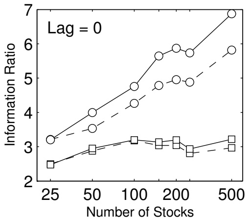

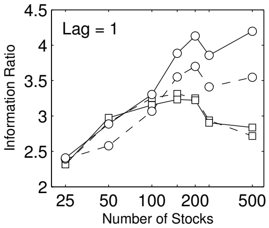

Figure 7: Mean realized Information Ratios of the four algorithms described in this paper, using a reversal strategy with reversal period of 5 days. From bottom to top the curves represent the unoptimized linear, the unoptimized centroid, optimized linear, and optimized centroid constructions; the linear portfolios are drawn with dashed lines and the optimized portfolios are drawn with round markers. The left panel shows reversal lag of zero, meaning that information is used instantly; the right panel shows a lag of one day. For large portfolios, the optimized centroid gives more than a two-fold improvement over the unoptimized linear, and is substantially better than the optimized linear.

## 5.2.3 Backtest Results for Reversal Strategies

Figure 7 shows a concise summary of the results. For a reversal period of 5 days, we show the Information Ratios (mean return divided by its standard deviation) for the four strategies described above, for lag of zero and lag of one day. Table 1 shows the full set of results.

The information ratios of the unoptimized portfolios are consistently around three or less. Use of the covariance matrix dramatically improves the results: both the optimized linear and the optimized centroid algorithms achieve information ratios that are always better than either unoptimized version, and the improvement increases logarithmically with portfolio size.

Most significantly, for all portfolio sizes the optimized centroid algo rithm performs substantially better than the optimized linear algorithm, although the two unoptimized portfolios are essentially equivalent. This supports the main argument of this paper, that the centroid construction is the best way to combine covariance information with sorts. The results shown here cannot be achieved for any portfolio construction algorithm based on linear profiles.

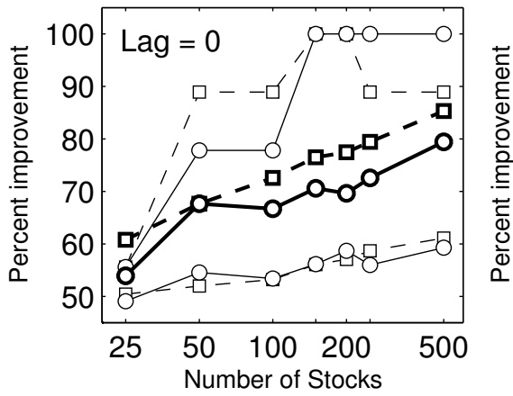

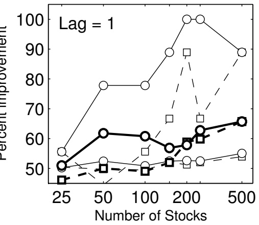

Figure 8: Percentage of days, months, and years on which the optimized centroid portfolio realises higher return than the unoptimized linear portfolio (dashed lines, square markers) and than the optimized linear portfolio (solid lines, round markers). From bottom to top, the curves show 1 day, 20 day (heavy lines), and 250 day non-overlapping periods.

The improvement is weaker for a lag of one day, but still substantial. For longer reversal periods, the results are similar though less dramatic.

To reinforce this point, in Figure 8 we show the percentage of nonoverlapping days, months, and years for which our optimized centroid algorithm realises a higher return than its two competitors: the unoptimized linear algorithm and the optimized linear algorithm. For example, in the monthly returns (heavy lines), the optimized centroid realizes a better return over 80% of the time for large portfolios, with zero lag.

Note that this is not a direct test of the reasoning underlying our centroid algorithm. In Section 3 we constructed the centroid vector to maximise the fraction of realizations of the expected return vector for which it would be optimal. In this test we measure the actual returns, which depend additionally on the covariance structure and any possible non-Gaussian properties. Our intention has been to provide a realistic and financially meaningful test of the algorithm in practice.

## 5.3 Simulation Results

We now seek to explore our portfolio construction methods in an environment where we have complete control and knowledge of all the return generating processes and portfolio sorts. This section has two aims. The first is to test the limits of the method and understand in numerical terms what the limits of the method are when perfect knowledge of portfolio sorts is available. The second is to characterize the impact of information degradation on our methods. We do this by turning perfect knowledge of portfolio sorts into less-then-perfect knowledge of portfolio sorts by introducing the effect of a permutation on the precise expected return ordering and studying the ensuing breakdown of portfolio performance.

We run backtests using the portfolio construction methods of this paper and using the same structure as in the reversal tests above. In this case, however, we simulated stock returns and have perfect knowledge of the key elements necessary to estimate our models. That is, we retain perfect knowledge of the covariance matrix and order of expected returns. We do this in a variety of scenarios across different portfolio sizes (from 25 to 500 stocks) and different volatility structures (from very low levels to very high levels of cross-sectional volatility). For each scenario we run multiple iterations and record the average performance across iterations to ensure that the results are representative of the average expected performance levels. Most importantly, we study the degradation of performance, both absolute (in terms of information ratios) and relative (in terms of the improvement of optimized methods to non-optimized methods), as we degrade information. We introduce a measure of information distortion generated by examining the amount of variance introduced into the system by permuting the indices of the correct order and relate this to the correlation coefficient of a Gaussian copula.

## 5.3.1 Simulated stock returns

In order to simulate backtests of our results, we simulate stock returns for a universe of stocks and then use these return histories as in section 5.1. Presently, we discuss in detail the parameters that define our simulated stock histories.

As we are mainly interested in bounding the overall expected levels of performance of the portfolios we construct from sorting data, we focus on variables that we believe ex ante provide the greatest degree of variability in overall portfolio performance. In our view these are cross-sectional volatility and expected return spread, and number of stocks in the portfolio. Cross-sectional volatility refers, roughly speaking, to the variability of volatility at a point in time in the cross-section of stocks in the universe. Return spread refers to the differential in expected return spread in the cross-section of stocks.

A critical other variable that will clearly determine the success of our methods is the extent of ones knowledge of the order of expected returns. In the main text of this paper we assumed perfect knowledge, but in practice perfect knowledge is impossible to come by. Therefore we turn our sights to performance in the presence of information that is correlated to, but not identical to, the precise order of expected returns.

We simulate the returns of a portfolio by assuming that variation among its constituents is generated by a system consisting of a common factor and an idiosynchratic component. We assume we have a portfolio with N stocks $S _ { 1 } , \ldots , S _ { N }$ whose expected returns $r _ { 1 } , \ldots , r _ { N }$ are in descending order, that is, they satisfy the inequalities $r _ { 1 } \leq \cdot \cdot \cdot \cdot \leq r _ { N }$

In our simulations, the realized return $r _ { i t }$ of stock i at time t is generated by the factor equation

$$
r _ {i t} = F _ {t} + \epsilon_ {i t} + \mu_ {i},\tag{7}
$$

where $F _ { t }$ is regarded as a “factor return” at time t. We assume the $F _ { t }$ are independent, identically distributed normal random variables. Similarly, $\epsilon _ { i t }$ is “idiosyncratic risk” and for a fixed $i ,$ the $\epsilon _ { i t }$ are indepent, identically distributed normal random variables. We have each $\epsilon _ { i t }$ is mean zero and with variance set to the number $\sigma _ { i } ^ { 2 } / 2 ;$ likewise F is a normally distributed random variable with mean zero and variance equal to the average variance of the $\epsilon _ { i } ,$ that is:

$$
\sigma^ {2} (F) = \frac {1}{N} \sum_ {i} \frac {\sigma_ {i} ^ {2}}{2}
$$

The $\sigma _ { i } { } ^ { \prime } \mathbf { S }$ are set to be equally spaced in log space and sorted so that

$$
\sigma_ {1} <   \sigma_ {2} <   \dots <   \sigma_ {N}
$$

That is, if $\sigma _ { \mathrm { m i n } }$ and $\sigma _ { \mathrm { m a x } }$ are respectively associated with the minimum and maximum idiosyncratic volatility, then if $\sigma _ { 1 }   =   \sigma _ { \mathrm { m i n } }$ and $\sigma _ { N }   =   \sigma _ { \mathrm { m a x } }$ then we have

$$
\log \sigma_ {1}, \log \sigma_ {2} \dots , \log \sigma_ {N}
$$

are equally spaced. We do this so that in the space of stocks the occurence of high volatility stocks is less frequent then that of low volatility stocks. Also, we specify the distance in log-space between the minimum and maxmimum volatility, δ and call this the volatility dispersion. It is defined by

$$
\sigma_{\max} = \delta \sigma_{\min}
$$

Finally, the variable $\mu _ { i }$ is a constant for each simulation that defines the cross-sectional expecetd return spread. It is sorted so that

$$
\mu_ {1} \leq \mu_ {2} \leq \dots \leq \mu_ {N}
$$

and the vector $( \mu _ { 1 } , \ldots , \mu _ { N } )$ is generated as the ascending sort of N i.i.d. draws from a normal distribution with mean and variance equal to both equal to ${ \bf \Pi } _ { 1 6 } ^ { . 6 }   \cdot   \sigma ^ { 2 } ( F )$ This means that the average daily Sharpe ratio in the cross-section of stocks is approximately $. 6 / 1 6$ so that the annualized Sharpe ratio of each stock is approximately 0.6.

The volatilities of the stocks in the cross-section are calibrated as follows. For each simulation run we choose a volatility dispersion δ and build equal log-spaced volatilities, $\sigma _ { i }$ , with $\sigma _ { \mathrm { m i n } } = . 0 0 5 / \sqrt ( 2 )$ and $\sigma _ { \mathrm { m a x } } =$ $\delta \cdot \sigma _ { \mathrm { m i n } }$

To relate this characterization of volatility dispersion to US markets, we briefly examine recent market behavior. Volatility dispersion is somewhat difficult to measure in practice due to outliers in the cross-section of volatility within the US market. But to give a sense, in a randomly selected sample of 500 of the largest US stocks we have the following observations. We compute volatility by computing annualized standard deviation of past 250 day returns. For a given day we then compute the cross-sectional standard deviation of volatility and trim those volatilities which exceed three standard deviations above or below the mean. Using such a measure, the dispersion of volatility has ranged from 4.31 to 16.7 in our data set.

## 5.3.2 Permutations and information distortion

In practice we do not expect portfolio managers to know the exact order of the expected returns of a list of stocks. Rather, we expect a proposed ordering to be correlated with the true ordering of the expected returns. In this section we provide a measurement of the difference between the exact ordering of expected returns and a permutation of that ordering. To describe this, we begin with a list of stocks

$$
S _ {1}, S _ {2}, \ldots , S _ {N}
$$

whose true expected returns satisfy

$$
r _ {1} \leq r _ {2} \leq \dots \leq r _ {N},
$$

A permutation $\pi$ of the list is a mapping

$$
\pi : \{S _ {1}, \ldots , S _ {N} \} \mapsto \{S _ {\pi (1)}, \ldots , S _ {\pi (N)} \}
$$

representing the relationship between the true ordering and our partially erroneous information. The minimally distorting permuation $\pi _ { \mathrm { m i n } }$ is the identity map $( S _ { 1 } , \ldots , S _ { N } ) \; \mapsto \; ( S _ { 1 } , \ldots , S _ { N } )$ , representing perfect information. The maximally distorting permutation $\pi _ { \mathrm { m a x } }$ is the permutation that completely reverses the order of the indices: $( S _ { 1 } , \ldots , S _ { N } )   \mapsto   ( S _ { N } , \ldots , S _ { 1 } )$ representing information that is perfectly wrong. We define the distance $\sigma$ of a permutation $\pi$ to measure position between these two extremes:

$$
\sigma (\pi) = \sqrt {\frac {\sum \left(\pi (i) - i\right) ^ {2}}{\sum \left(\pi_ {\max} (i) - i\right) ^ {2}}} = \sqrt {\frac {1}{2} (1 - b)},
$$

where $b$ is the coefficient in the linear regression to the points $( i , \pi ( i ) )$

Thus permutation distance $\sigma ( \pi )$ is a number between zero and one, that measures the degradation of our information about the order of the expected returns. It is a general measure of information loss. Figure 9 provides a graphical representation of permutation distances. As permutation distance increases from zero, the quality of our information about the sort decreases; maximal uncertainty, or complete randomness, is obtained at $\sigma = 1 / { \sqrt { 2 } } .$

For any value of  there are many permutations whose distance is ap proximately . Naturally, for a given , there is a finite space of permutations of N indices with distance  which have varying characteristics. As a consequence in our simulations below where we study the impact of permutation of order on investment performance we are careful to multiple iterations of simulations for given permutation distances, sampling randomly from the space of correlations.

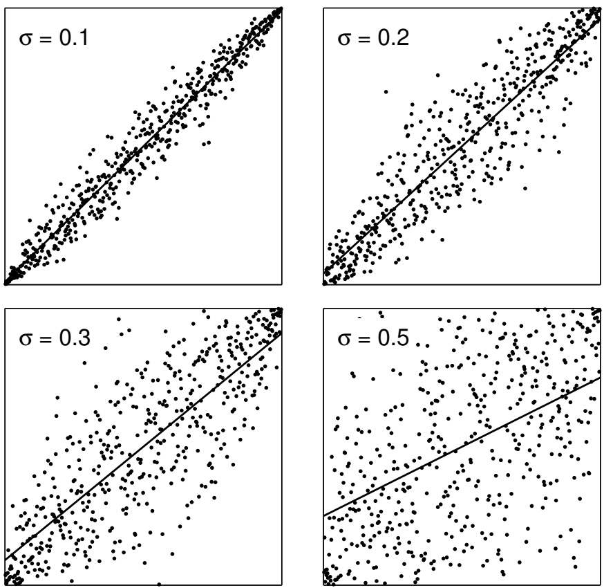

Figure 9: Permutations with specified distances, for $N = 5 0 0$ . The points have coordinates $( i , \pi ( i ) )$ , where i is a permutation index and $\pi ( i )$ is its destination under the permutation; the line is the linear regression of slope $1 - 2 \sigma ^ { 2 }$ . A distance of 0.71 is completely random.

## 5.3.3 Simulation results

For each scenario the following parameters apply:

1. **Portfolio Size:** The portfolio size describes the number of stocks N in the portfolio. In our simulations, the portfolio sizes vary from 25 to 500 stocks.

2. **Factor Structure:** Factor structure describes the structure of the return generating process for the stocks in the simulated portfolio and is given by Eq. (7).

3. **Volatility Dispersion:** As described above. In our simulations volatility dispersion ranges from 1 to 20.

4. **Permutation Distance:** We generate 10 permutations with distances equal to 0, 0.01, 0.05, 0.075, 0.1, 0.125, 0.15, 0.175, 0.2, 0.25, 0.5, and 0.7071.

5. **Simulation Length:** Simulation length describes the number of time steps in each simulation. In this backtest the simulation length is always set to 2000, meaning that each simulation simulates a backtest of 2000 timesteps.

6. **Iterations:** The number of iterations computed for each set of parameters over which to compute statistics. For all simulation parameter sets in this paper we compute 50 iterations.

Our simulated results provide insight into the possible improvements that our methodologies provide. All of the basic relationships hold. Information ratios increase with volatility dispersion and number of stocks in our portfolios increase. Also, holding other factors constant, information ratios decrease as permutation distance increases. This indicates, as expected, that as the quality of a portfolio manager’s sort decreases, so does investment performance. Of course, we also see that the algorithm is highly robust to information loss. Examining Table 2 we see that even for high degrees of information loss, the strategies still provide significant return on risk.

An important observation which can also be seen in Table 2 is that, holding other factors constant, as permutation distance increases the extent of the improvement between the optimized centroid and optimized linear algorithm narrows. For example, for 500 stocks, a volatility dispersion of 20 and with zero permutation distance (the perfect knowledge scenario) the opimized linear algorithm provides an average information ratio (over 50 trials) of 37.4 while the optimized centroid provides an information ratio of 40.4, an improvement of over 8%. For a permutation distance of .5, the optimized linear algorithm provides an average information ratio of 15.3 while the optimized centroid provides an information ratio of 15.7, a spread of only 2.6%.

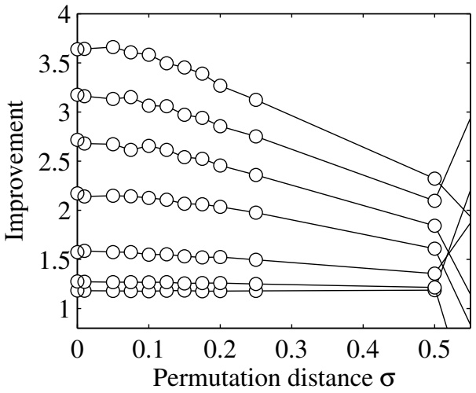

Figure 10: Mean improvement in Sharpe ratio of the risk-optimized cen troid algorithm relative to the linear portfolio weighting, for simulated portfolios of 250 assets. The horizontal axis is permutation distance as defined in the text. From bottom to top, the curves have volatility dispersion 1, 2, 4, 8, 12, 16, 20. The improvement is quite dramatic when substantial dispersion is present, and degrades only very slowly.

The above-described pattern of contracting optimized centroid performance in the presence of information degration is present throughout the table. In an indirect way it confirms one of the central arguments of our paper which is that the optimized centroid not only outperforms the unoptimized algorithms but other extremal optimized algorithms. An intuitive explanation for this may be found by recalling the nature of the optimized centroid algorithm. In our simulations, roughly speaking subject to a risk budget the optimized centroid algorithm maximizes exposure to difference assets.

Difference assets are assets that express a single belief, such as “stock one is better than stock two.” Such a belief is expressed by means of a difference asset by maximizing exposure to such an asset. For the pre-ceding example, belief the asset would be $D   =   S _ { \mathrm { 1 } } - S _ { \mathrm { 2 } }$ . Now, what does “perfect information” concerning the order of expected returns mean in the context of difference assets? The answer is clear: it implies that every difference asset has a positive expected return. Now, when we introduce permutations, that is information degradation, into the picture, what happens is we switch some of the difference assets from having positive to having negative expected returns. The upshot of this is that the algorithm which maximizes exposure to the difference assets should have the most rapid degradation of performance relative due to the introduction of permutations. This naturally suggests a possible avenue of further research. Is there a robust version of the centroid algorithm which better deals with information degradation in assuming that a certain percentage of the difference assets might swap from positive to negative expected returns? And, would such an algorithm outperform in real-life scenarios the centroid algorithm?

## 6 Conclusions

This paper began with a simple question: what is the best way to form an investment portfolio given a list of assets, an ordering of relative preferences on those assets, and a covariance matrix? A large part of the motivation came from the observation that existing methods were very ad hoc and had no way to incorporate volatility and correlation information. These methods were therefore incompatible with the main stream of portfolio methods going back to Markowitz, who emphasized the importance of incorporating risk into the construction of the optimal portfolio.

In the course of developing this solution, we were led to develop a very robust and powerful framework for thinking about portfolio optimization problems. This framework includes “classic” portfolio theory as a special case, and provides a natural generalization to a broad class of ordering information. It also includes more modern constructions such as robust optimization, as we now discuss.

To summarize, our formulation has three ingredients:

1. Ordering information which gives rise to a cone of consistent returns. This is a set in which the true expected return vector is believed to lie. In the examples considered in this paper, this cone is always constructed as the intersection of half-spaces corresponding to a finite list of homogeneous inequality beliefs. But more generally, we may specify any convex cone, with curved edges or other more complicated geometrical structure; our construction can in principle be carried out for any such set.

<table><tr><td rowspan="2">Vol. Disp.</td><td colspan="10">Permutation Distance  $\sigma$ </td></tr><tr><td colspan="2">0</td><td colspan="2">0.1</td><td colspan="2">0.2</td><td colspan="2">0.5</td><td colspan="2">0.7</td></tr><tr><td rowspan="2">1</td><td>18.1</td><td>18.6</td><td>18.0</td><td>18.3</td><td>16.9</td><td>17.2</td><td>9.5</td><td>9.6</td><td>0.0</td><td>0.0</td></tr><tr><td>21.0</td><td>21.4</td><td>20.7</td><td>21.1</td><td>19.5</td><td>19.9</td><td>11.1</td><td>11.2</td><td>0.0</td><td>0.0</td></tr><tr><td rowspan="2">2</td><td>17.3</td><td>17.5</td><td>17.1</td><td>17.3</td><td>16.2</td><td>16.3</td><td>9.1</td><td>9.2</td><td>-0.1</td><td>-0.1</td></tr><tr><td>21.4</td><td>22.0</td><td>21.0</td><td>21.6</td><td>19.9</td><td>20.3</td><td>10.8</td><td>11.0</td><td>0.1</td><td>0.2</td></tr><tr><td rowspan="2">4</td><td>15.4</td><td>15.2</td><td>15.3</td><td>15.1</td><td>14.5</td><td>14.4</td><td>8.5</td><td>8.6</td><td>0.0</td><td>0.0</td></tr><tr><td>23.4</td><td>24.3</td><td>22.9</td><td>23.6</td><td>21.5</td><td>22.1</td><td>11.3</td><td>11.5</td><td>-0.2</td><td>-0.3</td></tr><tr><td rowspan="2">8</td><td>13.3</td><td>12.8</td><td>13.1</td><td>12.6</td><td>12.7</td><td>12.2</td><td>7.8</td><td>7.7</td><td>0.0</td><td>0.0</td></tr><tr><td>27.2</td><td>28.8</td><td>26.4</td><td>27.8</td><td>24.7</td><td>25.8</td><td>12.3</td><td>12.5</td><td>0.5</td><td>0.5</td></tr><tr><td rowspan="2">16</td><td>11.6</td><td>11.0</td><td>11.5</td><td>10.9</td><td>11.2</td><td>10.6</td><td>6.9</td><td>6.8</td><td>0.0</td><td>-0.1</td></tr><tr><td>34.3</td><td>36.8</td><td>33.0</td><td>35.1</td><td>30.3</td><td>31.9</td><td>14.1</td><td>14.4</td><td>-0.1</td><td>0.0</td></tr><tr><td rowspan="2">20</td><td>11.1</td><td>10.4</td><td>10.9</td><td>10.3</td><td>10.6</td><td>9.9</td><td>6.8</td><td>6.7</td><td>0.0</td><td>0.0</td></tr><tr><td>37.4</td><td>40.4</td><td>36.4</td><td>39.2</td><td>32.6</td><td>34.5</td><td>15.3</td><td>15.7</td><td>-0.8</td><td>-0.8</td></tr></table>

Table 2: Information ratios for backtests run on simulated markets generated with a one factor model with volatility dispersions and permutation distance (information degradation) as shown. Each cell of this table represents the mean information ratios for the four portfolio construction algorithms described in this paper laid out as in Table 1. All portfolios have 500 stocks and all backtests are run over a period of 2000 days. Stocks are calibrated so that they have on average an annualized information ratio of 0.6, assuming each time-step is one day and each year has 256 days. Information ratios are annualized assuming that each time step is one day and each year has 256 days.

2. A probability density within the belief cone: a measure that specifies our belief about the relative probability of the actual expected return vector being any particular location within the belief cone. In this paper, we have considered only the case in which this density has radial symmetry, but the framework also allows more general densities.

3. A constraint set in which the portfolio is constrained to lie. In the most important application, this constraint set is determined by a total risk limit given by a covariance matrix, but it may be any convex set. In particular, it may include short sales constraints or position limits; all the standard techniques of constrained optimization may be brought into play.

Empirical tests show that the resulting portfolios are substantially better than the ones given by the ad hoc formluations.

In classic Markowitz theory, a single expected return vector is given. In our formulation, that single vector generates a half-space of possible expected return vectors that have nonnegative inner product with the given vector. For any given constraint set, our construction of the efficient set and then the optimal portfolio gives the identical result to the Markowitz theory. If further inequality constraints are then added we naturally incorporate those beliefs.

In robust optimization, it is recognized that the actual expected return vector may not be exactly equal to the single given vector. In effect, a probability density is introduced centered on the given vector, and various minimax techniques are used to generate optimal portfolios. In our framework, the density would be modeled directly, and it could additionally be constrained by inequality relationships.

Our construction provides a rich and flexible framework for exploring the nature of optimal portfolios. In future work, we plan to consider some of these extensions and applications.

## A Computation of centroid vector

Given a wedge domain Q, the centroid c is defined as the geometric centroid of $Q _ { \mathrm { : } }$ under any radially symmetric density function. Of course, c is defined only up to a positive scalar constant, and hence the radial structure of the density is not important.

## Monte Carlo

The simplest way to calculate c is by Monte Carlo. Let x be a sample from an n-dimensional uncorrelated Gaussian, and for the single-sector case, let $y$ be the vector whose components are the components of x sorted into decreasing order. Then $\mathcal { y } \in Q$ , and since the sorting operation consists only of interchanges of components which are equivalent to planar reflections, the density of $y$ is a radially symmetric Gaussian restricted to $Q$ . The estimate of $c$ is then the sample average of many independent draws of $y$

The multiple-sector case is handled simply by sorting only within each sector. Note that this automatically determines the relative weights between the sectors.

The case with comparison to zero is also easily handled. The initial Gaussian vector is sign corrected so that its first $\ell$ components are non-negative and its last $n - \ell$ components are nonpositive; then a sort is performed within each section. Clearly, each of these operations pre-serves measure.

For more complicated inequality information structures, the geometry is not always so simple; it is not always possible to reduce a general point x into the wedge $Q$ by measure-preserving reflections. Each new situation must be evaluated on its own.

## Direct calculation

For a single sort, computing the centroid is a special case of the general problem of order statistics (David and Nagaraja 2003). Let $x$ be a nvector of independent samples from a distribution with density $f ( x )$ and cumulative distribution $F ( x )$ ; in our case this density will be a standard Gaussian so that the density of x is spherically symmetric. Let y be the vector consisting of the components of x sorted into decreasing order. Then elementary reasoning shows that the density of the jth component $y _ { j , n }$ is

$$
\text {Prob} \{w <   y _ {j, n} <   w + d w \} = \frac {n !}{(j - 1) ! (n - j) !} F (w) ^ {n - j} \big (1 - F (w) \big) ^ {j - 1} f (w) d w.
$$

The centroid component $c _ { j , n }$ is the mean of this distribution:

$$
\begin{array}{r l} c _ {j, n} & = \frac {n !}{(j - 1) ! (n - j) !} \int_ {- \infty} ^ {\infty} w   F (w) ^ {n - j} \big (1 - F (w) \big) ^ {j - 1}   f (w)   d w \\ & = \frac {n !}{(j - 1) ! (n - j) !} \int_ {0} ^ {1} F ^ {- 1} (z)   z ^ {n - j} (1 - z) ^ {j - 1}   d z = \mathbb {E} _ {g} \big (F ^ {- 1} (z) \big) \end{array}\tag{8}
$$

where $\mathbb { E } _ { g } ( \cdot )$ denotes expectation under the probability density

$$
g (z) = \frac {n !}{(j - 1) ! (n - j) !} z ^ {n - j} (1 - z) ^ {j - 1}.
$$

When $j$ and n are large, this distribution is narrow. Thus reasonable approximations to the integral are either $F ^ { - 1 } ( z _ { \mathrm { m e a n } } )$ or $F ^ { - 1 } ( z _ { \mathrm { m a x } } )$ , where the mean and the peak of the distribution are

$$
z _ {\text {mean}} = \frac {n - j + 1}{n + 1}, \quad z _ {\max} = \frac {n - j}{n - 1}
$$

(Using the max value has the disadvantage that it requires $F ^ { - 1 } ( z )$ at $z =$ 0, 1, which is not defined.)

For the normal distribution, these formulas are special cases, with $\alpha = 0 , 1$ , of “Blom’s approximation” (Blom 1958)

$$
c _ {j, n} \approx N ^ {- 1} \left(\frac {n + 1 - j - \alpha}{n - 2 \alpha + 1}\right).
$$

Blom shows (in part analytically, in part reasoning from numerical results) that the values $\alpha = 0 . 3 3$ and 0.50 provide lower and upper bounds for the true value of $c _ { j , n } ,$ and he suggests that $\alpha = 0 . 3 7 5$ is a reasonable approximation for all values of j, n. More detailed calculations (Harter 1961) suggest that values closer to $\alpha = 0 . 4 0$ give more accurate results when n is large.

By comparison with numerical integration of (8), we have found that an excellent approximation is $\alpha = A   -   B j ^ { - \beta }$ , with $A = 0 . 4 4 2 4 , B = 0 . 1 1 8 5$ and $\beta = 0 . 2 1$ . This gives centroid components with maximum fractional error less than one-half percent when n is very small, decreasing rapidly as n increases. Since c is defined only up to a scalar factor the errors in the normalized coefficients will be smaller.

For multiple sectors, the above procedure may simply be applied within each sector. Because we have been careful to preserve the normalization, the relative magnitudes are correct.

## References

Almgren, R. and N. Chriss (2000). Optimal execution of portfolio transactions. J. Risk 3(2), 5–39. 23

Almgren, R. F. (2003). Optimal execution with nonlinear impact functions and trading-enhanced risk. Appl. Math. Fin. 10, 1–18. 23

Banz, R. W. (1981). The relationship between return and market value of common stocks. J. Financial Econ. 9, 3–18. 3

Blom, G. (1958). Statistical Estimates and Transformed Beta-Variables, Chapter 6.10, pp. 69–72. John Wiley and Sons. 61

Boyd, S. and L. Vandenberghe (2004). Convex Optimization. Cambridge University Press. 15, 17

Campbell, J., S. J. Grossman, and J. Wang (1993). Trading volume and serial correlation in stock returns. Quart. J. Econ 108, 905–939. 3, 43

Daniel, K. and S. Titman (1997). Evidence on the characteristics of cross sectional variation in stock returns. J. Finance 52, 1–33. 3

Daniel, K. and S. Titman (1998). Characteristics or covariances: Building superior portfolios using characteristics. J. Portfolio Management 24, 24–33. 3

David, H. A. and H. N. Nagaraja (2003). Order Statistics (3rd ed.). John Wiley and Sons. 60

Fama, E. F. and K. R. French (1992). The cross-section of expected stock returns. J. Finance 47, 427–465. 3

Fama, E. F. and K. R. French (1996). Multifactor explanations of asset pricing anomalies. J. Finance 51, 55–84. 3

Harter, H. L. (1961). Expected values of normal order statistics. Biometrika 48, 151–165. 61

Markowitz, H. (1952). Portfolio selection. J. Finance 7, 77–91. 3