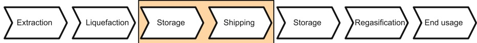
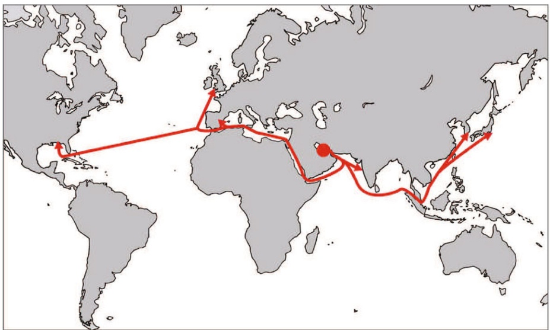
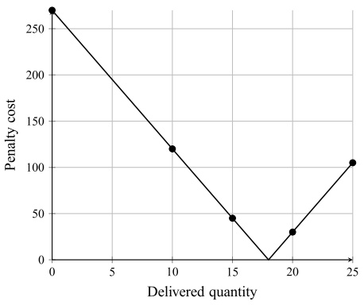
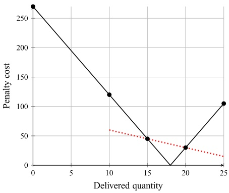
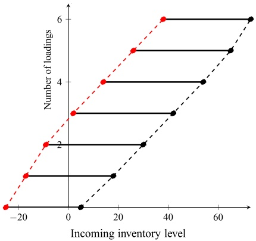
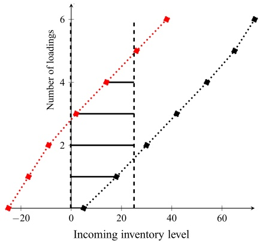
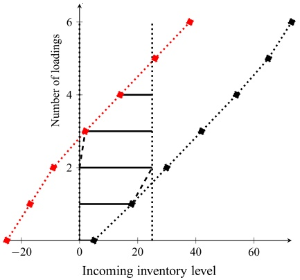
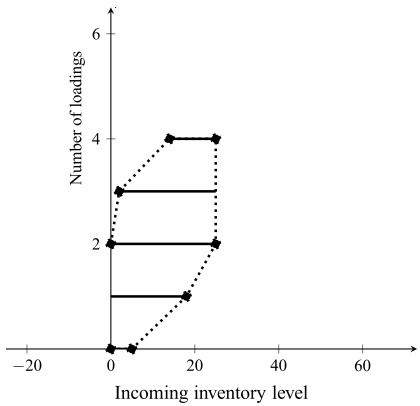

# Creating annual delivery programs of liquefied natural gas

Henrik Andersson1 • Marielle Christiansen1 • Guy Desaulniers2,3 • Jørgen Glomvik Rakke1

Received: 8 May 2015 / Accepted: 29 November 2015 / Published online: 24 December 2015

\- Springer Science+Business Media New York 2015

Abstract The annual delivery program (ADP) setup is an important problem in liquefied natural gas (LNG) supply chain planning. The ADP for an actor in the chain is the complete sailing schedule of the ships in the fleet for the coming year. In this paper we focus on the ADP planning problem for one of the world’s largest producers of LNG. The producer is responsible for the LNG inventories at the liquefaction plant, the loading port with a limited number of berths, and the routing and scheduling of a heterogeneous fleet of LNG ships. In addition, the producer has to fulfill a set of long-term contracts to customers all around the world. The objective is to design an ADP to fulfill the long-term contracts at minimum cost, while maximizing revenue from selling LNG in the spot market. A mixed integer programming (MIP) formulation of the ADP planning problem is presented and solved with a branch-and-cut algorithm. Several types of valid inequalities are developed that allow us to reduce the linear programming gap of the MIP formulation. The computational study shows that the problem is very complex, but that the valid inequalities are effective.

<small>& Henrik Andersson henrik.andersson@iot.ntnu.no</small>

<small>Marielle Christiansen marielle.christiansen@iot.ntnu.no</small>

<small>Guy Desaulniers guy.desaulniers@gerad.ca</small>

<small>Jørgen Glomvik Rakke jorgen.rakke@iot.ntnu.no</small>

<small>Department of Industrial Economics and Technology Management, Norwegian University of Science and Technology, Gløshaugen, Alfred Getz vei 3, 7491 Trondheim, Norway</small>

<small>2 Département de mathématiques et génie industriel, É cole Polytechnique, C.P. 6079, Succ. Centre-Ville, Montreal, QC H3C 3A7, Canada</small>

<small>3 GERAD, Montreal, Canada</small>

## 1 Introduction

There are large reserves of natural gas worldwide and the demand for the gas is increasing in the foreseeable future. Natural gas has traditionally been transported in pipelines to markets close to the production areas. However, in several of the areas where gas has been found there are no significant markets and a pipeline solution is not an economically viable alternative for longer distances, especially across oceans. Technological advances in the maritime industry have made ships a good alternative for long distance transportation of natural gas. The gas can be cooled down at atmospheric pressure to a temperature of -162 C (-260 F). At this temperature the natural gas reaches its liquid state and turns into liquefied natural gas (LNG). This reduces the volume of the gas by a factor of 610 (EIA 2011), which makes transportation and storage more efficient. In addition, LNG offers greater trade flexibility than pipeline transportation.

The increase production and consumption have led to, and will continue to lead to, large investments in many stages of the LNG supply chain. The LNG supply chain, illustrated in Fig. 1, begins with the natural gas being extracted and sent through pipelines to a nearby liquefaction plant. Impurities are removed from the gas, which is cooled down to its liquid state and stored in tanks built with fullcontainment walls and systems to keep the gas liquefied. The LNG is then transported by ships to its destination terminal. There, it is again stored until it is regasified and finally sent through pipelines to the end users, which can be power plants, industrial customers and households.

The LNG supply chain has become more complex in recent years, partly due to the increased volumes and higher number of supply sources and demand regions. Traditionally, most LNG ships have been tied up to specific long-term contracts (defined as contracts with duration of more than 4 years), where they would be dedicated to sail between given liquefaction plants and regasification terminals. Lately, this situation has changed. There is a growing spot market for LNG, which creates more business opportunities serving different markets and introduces more flexibility in utilizing the LNG ships. For instance, spot and short-term imports recorded a very strong increase and has more than doubled in volume since 2009. In comparison, LNG traded under long-term contracts has recorded a 30 % increase since 2009 (GIIGNL 2014). Moreover, this also contributes to making the supply chain planning much more challenging.

In this paper, we focus on the creation of an annual delivery program (ADP) for a large-scale producer and distributor of LNG. The ADP setup is a tactical planning problem with a typical planning horizon of 12–18 months. When creating an ADP, the aim is to determine an optimal fleet schedule, including the delivery dates (or time windows) at the different customers’ terminals. This fleet schedule must also satisfy inventory and berth constraints, as well as contract constraints. Figure 1 highlights the parts of the supply chain we focus on.

Fig. 1 The LNG supply chain

The ADP planning problem considered in this paper is a combined LNG ship routing and inventory management problem. The producer has a single liquefaction plant with storage tanks. Two types of LNG are produced at the liquefaction plant and the quantity of LNG in the storage tanks has to stay within its limits. Connected to the liquefaction plant is a loading port. The number of ships that can load simultaneously is restricted by the number of berths. From the loading port, the LNG is shipped to customers world-wide, see Fig. 2.

The producer has to fulfill a set of long-term contracts that either outline a monthly demand for a given regasification terminal, or state that a certain quantity of LNG is to be delivered fairly evenly spread throughout the year. Over- and underdeliveries are accepted, but penalized. In addition to this, the producer has the opportunity to sell LNG in the spot market using short-term contracts. The producer operates a large fixed fleet of heterogeneous LNG ships and has the option to charter in additional ships in peak periods. All shipments are full shiploads. To plan for the coming years, the producer creates an ADP which is a list of scheduled voyages. Each scheduled voyage includes information about the ship chosen for the voyage, the day of loading at the loading port and the contract served. The objective is to create an ADP that abides by the long-term contractual agreements at lowest possible cost, while maximizing the expected revenue from spot contracts. Henceforth, this is referred to as the ADP planning problem.

The purpose of this paper is twofold: (1) Present the LNG supply chain and a case study from a large-scale producer and distributor of LNG, where the objective is to create an ADP, and (2) Describe a mathematical formulation and valid inequalities for the ADP planning problem that is solved by a branch-and-cut algorithm. This problem is also studied in Rakke et al. (2011), Stålhane et al. (2012) and Rakke et al. (2013) where it is solved by a rolling horizon heuristic, a construction and improvement heuristic, and branch-price-and-cut, respectively. The research in this paper complements the previous research for this important problem by introducing four families of inequalities to improve the lower bounds on the optimal value of the problem. One family specifically targets the pricing of overand under-deliveries, others deal with the quantities delivered and the timing of the deliveries while the last family is composed of symmetry breaking constraints. The algorithm can act as a basis for other solution approaches like a rolling horizon heuristic and branch-cut-and-price methods for solving real large-scale instances of the problem.

Fig. 2 A map showing the loading port and possible customer locations

The rest of the paper is organized as follows: A brief overview of the recent literature within LNG supply chain optimization is presented in Sect. 2. Section 3 is devoted to a detailed description of the ADP planning problem, while the mixed integer programming formulation is given in Sect. 4. Valid inequalities are described in Sect. 5. Section 6 presents the real-world cases tested and the associated computational results. Finally, concluding remarks follow in Sect. 7.

## 2 Literature

In this section, we limit ourselves to present literature related to the optimization of the LNG supply chain.

Combined routing and inventory management within maritime transportation has only been considered in the literature during the last one and a half decades. A survey on maritime inventory routing problems is presented in Christiansen and Fagerholt (2009), while Christiansen et al. (2007) and Christiansen et al. (2013) give comprehensive reviews within maritime transportation in general.

The liquefied natural gas inventory routing problem (LNG-IRP) was introduced by Grønhaug and Christiansen (2009) and is an important problem withing LNG supply chain optimization. The problem includes decisions about production and sales quantities, inventory management at both liquefaction plants and regasification terminals, and routing and scheduling of a heterogeneous fleet of ships. The hold of the LNG ships is separated into several cargo tanks. The ships are always fully loaded, but partial unloading is allowed. The need to consider boil-off adds extra complexity to the problem. The objective of the LNG-IRP is to maximize the profit by designing routes and schedules for the fleet, including determining the production and sales quantities at all plants and terminals, without exceeding the ship capacities or the inventory limits of the storages. The LNG-IRP is studied by Grønhaug and Christiansen (2009) and Grønhaug et al. (2010). Grønhaug and Christiansen (2009) propose two formulations for the problem; one arc-based formulation and one path-based. A priori generation of all feasible paths is used to solve the path-based formulation. The problem is further analyzed in Grønhaug et al. (2010) where a branch-price-and-cut algorithm is developed for the path-based formulation. Andersson et al. (2015) develop a duty-based decomposition algorithm for the problem and solve it using a priori column generation. A duty consists of a visit to a liquefaction plant, then one or two visits to a regasification terminal before ending in a liquefaction plant. The duties are then combined into schedules covering the whole planning horizon.

Fodstad et al. (2010) and Uggen et al. (2013) study a richer version of the LNG-IRP which also addresses contract management and trading in a spot market among other things. An arc-based formulation is developed and solved by Fodstad et al. (2010), while Uggen et al. (2013) propose a heuristic method based on fix-and-relax time decomposition for the same formulation.

Furman et al. (2013) analyze a real business application and formulate a rich LNG-IRP based on this application. The problem is further analyzed in Song et al. (2013) where a flexible modeling framework for inventory routing problems is presented together with a large neighborhood search heuristic. Goel et al. (2012) present a arc-flow formulation based on the problem described in Song et al. (2013) and propose a large neighborhood search heuristic to solve it. An algorithm based on constraint programming is developed by Goel et al. (2015), and Shao et al. (2015) propose a two phase using a greedy randomized adaptive search procedure together with a matheuristic, both for the problem introduced by Goel et al. (2012).

There are some differences between the LNG-IRP as defined by Grønhaug and Christiansen (2009) and the ADP planning problem. The LNG-IRP has a more complex structure than the ADP planning problem; it involves more than one production port, inventory constraints both at the production and consumption ports, and partial unloading. The ADP planning problem on the other hand includes multiple types of LNG and is considerably larger with respect to the size of the fleet and the length of the planning horizon.

The ADP planning problem presented here is also studied in several other papers. Rakke et al. (2011) solve the problem using a rolling horizon heuristic (RHH). The planning horizon is partitioned into shorter time intervals and the RHH iteratively solves subproblems over these time intervals. A construction and improvement heuristic for the problem is developed by Stålhane et al. (2012). Initial ADPs are built in a construction phase and then improved using two different heuristics, one local search and one based on a reduced MIP formulation, in the improvement phase. The construction and improvement phases are then repeated many times for different values of the parameters controlling the construction. A similar MIP-based improvement heuristic is also used to improve the ADPs produced by the RHH. A new formulation using delivery patterns is proposed by Rakke et al. (2013). A delivery pattern states the number of deliveries by each ship to a given contract within a time interval. A branch-price-and-cut algorithm is used to solve the problem.

Halvorsen-Weare and Fagerholt (2013) study a similar problem where cargoes with defined time windows are generated a priori for each long-term contract, and the fleet of ships can be divided into disjoint groups. This study does not include a spot market, as opposed to Rakke et al. (2011), Stålhane et al. (2012), Rakke et al. (2013), and this paper. Halvorsen-Weare and Fagerholt (2013) decompose the problem using Dantzig-Wolfe decomposition and handle inventory, berth, and scheduling decisions in the master problem, while routing decisions are dealt with in the subproblem. The master problem is a feasibility problem minimizing penalties for time window violations and is solved using branch-and-bound, while the subproblems are minimizing the port and transportation costs and are solved using either a local search heuristic or branch-and-bound.

The most general study of the LNG supply chain including some of its main characteristics is presented in Andersson et al. (2009). They consider two problems, reflecting different actors in the LNG supply chain. Mathematical models for each problem are presented and solution approaches for both problems are discussed. One of the problems is very similar to the problem considered in this paper, but the problem there is simplified with respect to the number of LNG types and the possibility of selling LNG in the spot market. The other problem is for a vertically integrated company. Here, inventory management and sales of LNG at the regasification terminals are also considered.

## 3 Problem description

The ADP planning problem includes inventory and berth management at the producer, routing and scheduling of a fleet of ships, and contract management between the producer and its customers.

## 3.1 Inventory and berth management at the liquefaction plant

We consider a large-scale producer of LNG with liquefaction facilities and storages in one production area. Two types of LNG are being produced; rich LNG (RLNG) and lean LNG (LLNG). The production rates of LNG are always such that the equipment available for gas refinement is 100 % utilized. Thus, fluctuations in production rates occur only because of planned maintenance or unforeseen events such as breakdowns or strikes. This means that the production rates are given as parameters, but may vary during a year. Here, stochasticity is not considered and the production rates are assumed to be known at the time of planning. The different types of LNG are stored in separate tanks with given upper and lower limits. From the tanks the LNG is transported in pipelines to the docking facilities, where a limited number of berths for loading LLNG and RLNG are available. We estimate the total time between arrival and departure at the loading port to 24 hours. It includes the port arrival, docking and loading operation. The inventory and berth management consist of ensuring that the quantity of LNG in the storage tanks is within its limits and that the berth capacity is not violated.

## 3.2 Routing and scheduling of LNG ships

The producer operates a heterogeneous fleet of ships. These ships are either owned by the producer or by one, or a group of customers. However, the producer is responsible for the routing and scheduling of all ships.

Several factors influence the availability of the ships in the fleet. Since there is no depot, some of the ships may be en route at the start of the planning horizon and become available for operation when they return to the loading port. The ships may also be unavailable because of certain pre-allocated activities, e.g. each ship is required to dry-dock for maintenance for a certain number of days every fifth year. The maintenance is not fixed to certain dates, but is required to be carried out within a given time interval. Maintenance is always scheduled to a dry-dock along the sailing lane, thus minimizing the time the ship is out of commission. After the maintenance has been performed, the ship has to go through a purge and cool-down procedure at a berth in the loading port before starting its next voyage. This procedure takes on average 24 h, but depends on the ship type and the initial temperature of the empty tank. For planning purposes, we assume a fix time of 24 h for the procedure.

A shipload must contain either LLNG or RLNG, but a ship can carry different types of LNG on consecutive voyages without any intermediate preparations. Though it is technically possible for a ship to sail between the loading port and a regasification terminal with only some of its tanks filled, this is not considered economically feasible by the producer and is never done in practice. Due to this, and in order to avoid sloshing during transportation, the ship tanks are always filled to their capacities at the loading port. The duration of the voyage influences the amount of LNG delivered to the customer because of boil-off, which causes a fixed ship-dependent percentage of the total capacity of a tank to evaporate each day. To keep the LNG tanks cool during the return leg, a certain amount of LNG must be kept in the tanks to keep the boil-off process going until the ship returns to the loading port and the loading operation can begin. Consequently, the amount of LNG loaded at the loading port and the amount delivered to the customer will differ, depending on the time spent in transit. If boil-off causes the ship tanks to be completely empty, a 24-h cool-down period is required at the loading port before the next loading operation can take place. However, the producer assumes that a ship will never be completely empty, which means that ships never have to go through a cool-down process, except before the first voyage following a maintenance period.

The travel times depend on the ship, because every ship has an individual cruising speed. The duration of a voyage may depend on the time of year, as sailing conditions vary between the summer and the winter months. Due to ocean currents the travel time may also vary between the outbound and return leg of a voyage. Not all ships can visit all regasification terminals. This is due to vessel acceptance policies at the ports, and the fact that some ships are owned by one, or a group of customers, limiting them to only visit their owners’ regasification terminals.

The transportation costs consist of several components. The fixed costs are the time charter rates, while the variable costs are port and canal fees that are determined by the ship type and the contract served. A third variable component is the bunker oil cost, which is dependent on the ship size, the load on board and the duration of the voyage. Since the fixed costs cannot be changed during the time horizon, the cost of sailing a scheduled voyage is assumed to be dependent on the capacity class of the ship, the duration of the voyage and the regasification terminal visited.

If the producer does not have enough ships available at a given time, additional ships may be chartered in for one-off deliveries. A daily charter rate defines the cost of these ships.

## 3.3 Contract management: long-term contracts and sale of spot cargoes

The producer has a set of long-term contracts by which it is obliged to deliver a certain amount of LNG to specified regasification terminals each year. These contracts have time frames of 20–30 years, so the total amount of LNG the producer will deliver in a given year is known well in advance. A contract also specifies the regasification terminal to receive the LNG, but a regasification terminal may have more than one contract associated with it. A long-term contract either outlines the monthly demand that is to be delivered to the customer’s regasification terminals, or simply states that the LNG is to be delivered fairly evenly spread throughout the year. Due to the contracts being long-term, there is some flexibility in the volumes that have to be delivered in a given year. The current ‘‘rule of thumb’’ is that it is acceptable for the delivered amount of LNG to deviate, as long as this is evened out the following year. However, the producer always tries to satisfy the customers and aims to deliver as close as possible to the annual demands.

In addition to serving the long-term contracts, the producer has the opportunity to sell LNG in the spot market. The spot sales are short-term contracts for one-off deliveries from the producer to buyers on agreed terms, and represent possibilities for increased revenue. To maximize the expected contribution margin from this option while minimizing the total cost of fulfilling long-term contracts, spot sales are incorporated in the model.

## 4 Model

The ADP planning problem described in Sect. 3 can be formulated as a mixed integer linear program. We define G, C, V, T, I to be the sets of LNG types, contracts, ships, time periods, and time intervals respectively. Contract is here a generic term representing not only the deliveries of LNG but also a period of maintenance. The set of contracts can be divided into disjoint sets $\mathbb { C } _ { g }$ , representing contracts for LNG type $g .$ . In each $\mathbf { C } _ { g } ,$ one contract is a maintenance contract and one contract is a spot contract; the sets of maintenance and spot contracts are denoted $\mathbb { C } ^ { M }$ and $\mathbb { C } ^ { S }$ respectively. The maintenance contracts are needed to model the purge and cooldown procedure which takes place at one of the berths in the loading port. All other contracts are associated with long-term contracts and the set of these contracts is denoted $\mathbb { C } ^ { L T }$ . The set of ships can be divided into two disjoint subsets; $\vee ^ { P }$ denotes the set of ships operated by the producer and $V ^ { S }$ denotes the set of spot ships. The set of ships that must undergo maintenance during the planning horizon is denoted $V ^ { M }$ . We also introduce $\nabla _ { c }$ as the set of ships that can serve contract $c .$

There are two types of LNG produced and stored at the liquefaction plant. The production rate on day t of LNG type $g$ is denoted $P _ { g t }$ and the time-dependent upper and lower limits of the storage tanks are denoted $\overline { { Q } } _ { g t }$ and $\underline { { \underline { { Q } } } } _ { g t }$ . The berth capacity $B _ { g }$ restricts the number of ships that can load LNG type g or go through a purge and cool-down procedure after maintenance using LNG type $g$ in a given time period.

The capacity of ship v is denoted $L _ { \nu }$ , and the cost and duration of a sailing on contract c is denoted $C _ { c \nu } ^ { T }$ and $T _ { c \nu }$ , respectively. The set of time periods where ship v is available for service is denoted $\mathsf { T } _ { \nu }$ and the set of time periods where it can start maintenance is denoted $\mathsf { T } _ { \nu } ^ { M }$

The time horizon is divided into time intervals. These intervals cover the horizon and may be overlapping. The set of time periods in time interval i is denoted $\mathsf { T } _ { i } ^ { I }$ and the demand of contract c in time interval i is denoted $D _ { c i }$ . The demand does not need to be met exactly, but there are penalty costs associated with over-delivery, $C _ { c i } ^ { D + }$ and under-delivery, $C _ { c i } ^ { D - }$ . The revenue from sending one unit of LNG to spot contract $c$ is denoted $R _ { c } ^ { S }$ and the revenue from having one unit of LNG type $g$ left in the storage tanks at the end of the planning horizon is denoted $R _ { g } ^ { I }$ . The end of the planning horizon is denoted $\overline { { T } } .$

The binary variable $x _ { c v t }$ is 1 if ship v starts sailing on contract $c$ in time period $t ,$ and 0 otherwise. The outgoing inventory level of LNG type $g$ at the liquefaction plant in time period t is denoted $q _ { g t }$ . Over- and under-delivery to contract $c$ in time interval i is given by $y _ { c i } ^ { + }$ and $y _ { c i } ^ { - }$ , respectively. Using this notation, the ADP planning problem can be formulated as:

$$
\begin{array}{l} \min z = \sum_ {c \in \mathsf {C}} \sum_ {v \in \mathsf {V} _ {c}} \sum_ {t \in \mathsf {T} _ {v}} C _ {c v} ^ {T} x _ {c v t} + \sum_ {c \in \mathsf {C} ^ {L T}} \sum_ {i \in \mathsf {I}} \big (C _ {c i} ^ {D +} y _ {c i} ^ {+} + C _ {c i} ^ {D -} y _ {c i} ^ {-} \big) \\ \qquad - \sum_ {c \in \mathsf {C} ^ {S}} \sum_ {v \in \mathsf {V} _ {c}} \sum_ {t \in \mathsf {T} _ {v}} R _ {c} ^ {S} L _ {v} x _ {c v t} - \sum_ {g \in \mathsf {G}} R _ {g} ^ {I} q _ {g \overline {{T}}} \end{array}\tag{1}
$$

$$
\left|\sum_{c\in \mathbf{C}_{g}\setminus \mathbf{C}^{M}}\sum_{\substack{v\in \mathbf{V}_{c}|\\ t\in \mathsf{T}_{v}}}x_{cvt} + \sum_{c\in \mathbf{C}_{g}\cap \mathbf{C}^{M}}\sum_{\substack{v\in \mathbf{V}^{M}|\\ \tilde{t}\in \mathsf{T}_{v}}}x_{cv\tilde{t}}\leq B_{g}\quad g\in \mathbf{G},t\in \mathsf{T},\right|\tag{2}
$$

$$
q _ {g, t - 1} + P _ {g t} - q _ {g t} - \sum_ {c \in \mathbb {C} _ {g} \backslash \mathbb {C} ^ {M}} \sum_ {v \in \mathsf {V} _ {c}} L _ {v} x _ {c v t} = 0 \quad g \in \mathsf {G}, t \in \mathsf {T},\tag{3}
$$

$$
\left| \sum_{c\in \mathbb{C}}\sum_{\substack{\tau \in \mathsf{T}_{v}|\\ \tilde{t}\leq \tau \leq t}}x_{cv\tau}\leq 1\quad \quad v\in \mathsf{V}^{P},t\in \mathsf{T}_{v},\right|\tag{4}
$$

$$
\sum_ {c \in \mathbb {C} ^ {M}} \sum_ {t \in \mathsf {T} _ {v} ^ {M}} x _ {c v t} = 1 \qquad v \in \mathsf {V} ^ {M},\tag{5}
$$

$$
\sum_ {v \in \mathsf {V} _ {c}} \sum_ {t \in \mathsf {T} _ {i} ^ {I} \cap \mathsf {T} _ {v}} L _ {v} x _ {c v t} + y _ {c i} ^ {-} - y _ {c i} ^ {+} = D _ {c i} \quad c \in \mathbf {C} ^ {L T}, i \in \mathsf {I},\tag{6}
$$

$$
\underline {{Q}} _ {g t} \leq q _ {g t} \leq \overline {{Q}} _ {g t} \quad g \in \mathsf {G}, t \in \mathsf {T},\tag{7}
$$

$$
x _ {c v t} \in \{0, 1 \} \quad c \in \mathsf {C}, v \in \mathsf {V} _ {c}, t \in \mathsf {T} _ {v},\tag{8}
$$

$$
y _ {c i} ^ {+}, y _ {c i} ^ {-} \geq 0 \quad c \in \mathbf {C} ^ {L T}, i \in \mathsf {l}.\tag{9}
$$

The objective function (1) minimizes the transportation and penalty costs minus the revenue from LNG sold in the spot market and the LNG left in the tanks at the end of the planning horizon. Constraints (2) state the berth capacities. After maintenance, a ship goes through a purge and cool-down procedure at one of the berths, and because of this, the variables representing a sailing on a maintenance contract are added to the constraints on the last day of the sailing. $\tilde { t } = t - ( T _ { c v } - 1 )$ is introduced in (2) and (4) for ease of presentation. Inventory balance at the liquefaction plant is given by constraints (3). Constraints (4) ensure that each ship serves at most one contract each day, and constraints (5) state that the ships that are scheduled for maintenance undergo maintenance. The demand is handled in constraints (6) where the delivered quantity is balanced with the demand using the variables for over- and under-delivery. The inventory limits are given by constraints (7) and the variable restrictions by constraints (8) and (9).

## 5 Strengthening the formulation

The LP-relaxation of the formulation presented in Section 4 does not provide a good lower bound. In this section we present valid inequalities that can be added to strengthen the formulation.

## 5.1 Delivery inequalities

The penalty costs for over- and under-deliveries are a substantial part of the total objective value. In a fractional solution, these costs can be avoided since it is always possible to deliver exactly the demand by using fractional ship loads. In Fig. 3a, the penalty function of a small example with one contact and two ships is shown. The demand of the contract is 18 and the ships have capacities of 10 and 15 respectively. The penalty for over- and under-delivery is 15 per unit. The dots show the feasible integer solutions; no delivery, one delivery with the small ship, one delivery with the large ship, two deliveries with the small ship and so on.

(a)

(b)

Fig. 3 Illustration of the penalty cost as a function of delivered volume

It is clear that the penalty cost can be zero in a fractional solution; using the small ship 1.8 times is one possible solution. If this possibility could be cut away, we would have a strengthened formulation. Figure 3b illustrates the idea behind the delivery inequalities; forcing the penalty cost to be above the red dotted line cuts away the zero cost solution. The red line can be represented as a valid inequality connecting the delivered quantity and the penalty cost. If we define $( Q _ { c i } ^ { - } , C _ { c i } ^ { - } )$ as the maximum quantity that can be delivered to contract $c$ in time interval i given that we under-deliver and the corresponding penalty cost, and $( Q _ { c i } ^ { + } , C _ { c i } ^ { + } )$ as the minimum quantity that can be delivered given that we over-deliver and the corresponding penalty cost, the following inequalities are valid:

$$
c _ {c i} ^ {D} \geq \frac {\left(C _ {c i} ^ {+} - C _ {c i} ^ {-}\right)}{\left(Q _ {c i} ^ {+} - Q _ {c i} ^ {-}\right)} \cdot \left(\sum_ {v \in \mathsf {V} _ {c}} \sum_ {t \in \mathsf {T} _ {i} ^ {I} \cap \mathsf {T} _ {v}} L _ {v} x _ {c v t} - Q _ {c i} ^ {-}\right) + C _ {c i} ^ {-} \quad c \in \mathbf {C} ^ {L T}, i \in \mathsf {I},\tag{10}
$$

where $c _ { c i } ^ { D }$ is the penalty cost for contract $c$ in time interval i. To incorporate this in the model, the following constraints must also be defined:

$$
c _ {c i} ^ {D} \geq C _ {c i} ^ {D -} y _ {c i} ^ {-} \quad c \in \mathbb {C} ^ {L T}, i \in \mathsf {I},\tag{11}
$$

$$
c _ {c i} ^ {D} \geq C _ {c i} ^ {D +} y _ {c i} ^ {+} \quad c \in \mathbb {C} ^ {L T}, i \in \mathsf {I}.\tag{12}
$$

The penalty costs in the objective function, $\left( C _ { c i } ^ { D + } y _ { c i } ^ { + } + C _ { c i } ^ { D - } y _ { c i } ^ { - } \right)$ , are then replaced with $c _ { c i } ^ { D }$ . The quantities $Q _ { c i } ^ { - }$ and $Q _ { c i } ^ { + }$ and the corresponding costs are found by solving two integer knapsack problems.

## 5.2 Symmetry breaking inequalities

Identical ships give rise to solutions that are mathematically different but similar from a practical point of view; with five identical ships and two sailings, there are 20 mathematically different solutions that are the same from a practical point of view. To reduce this symmetry, the following inequalities are derived.

Let $\nabla ^ { \sigma }$ be a set of identical ships and let $\overline { { V } } ^ { \sigma }$ be the last of these ships. Two ships are identical if they have the same capacity, cruising speed and cost structure, and if they can serve the same contracts. Order the ships in $\nabla ^ { \sigma }$ in a non-decreasing order with respect to the day when the ships become available for operation. The symmetry between the ships can be reduced by adding

$$
\left| \sum_ {c \in \mathbf {C}} \sum_ {t \in \mathbf {T}} \left(T _ {c j} x _ {c j t} - T _ {c, j + 1} x _ {c, j + 1, t}\right) \geq 0 \quad j \in \mathrm{V} ^ {\sigma} \backslash \overline {{V}} ^ {\sigma}, \right.\tag{13}
$$

where $j$ is the $j ^ { t h }$ ship in $\nabla ^ { \sigma }$ . The inequalities force ship j to be used at least as many days as ship $j + 1$

## 5.3 Loading inequalities

For any given time interval $\mathsf { T } ^ { \prime } = \{ \underline { { T } } ^ { \prime } , \underline { { \phantom { . . . } } } . , \overline { { T } } ^ { \prime } \}$ , the maximum and minimum number of loading operations of LNG type $g$ can be calculated from the incoming inventory level $q _ { g , \underline { { T } } ^ { \prime } - 1 }$ and the total production $\begin{array} { r } { P ^ { \prime } = \sum _ { t \in \mathsf { T } ^ { \prime } } P _ { g t } } \end{array}$ . Start by ordering all ships that can load LNG of type $g$ in $\top ^ { \prime }$ in a non-decreasing order with respect to capacity. From this order, two sequences of loading quantities can be created by taken into account the number of times each ship can load within $\top ^ { \prime }$ . Assuming that there are three ships, $\nu _ { 1 } ,   \nu _ { 2 }$ , and $\nu _ { 3 }$ , with capacity 8, 11, and 12, respectively. Within $\mathsf { T } ^ { \prime } ,   \nu _ { 1 }$ can load LNG type $g$ at most 2 times, $\nu _ { 2 }$ can load at most 1 time and $\nu _ { 3 }$ at most $3$ times. The minimum quantity that can be loaded given one loading operation is thus 8, i.e. using $\nu _ { 1 }$ . Given two loading operations, the minimum loading quantity is 16, i.e. using $\nu _ { 1 }$ twice. Given three loading operations, the minimum loading quantity is 27, i.e. using $\nu _ { 1 }$ twice and $\nu _ { 2 }$ once and so on. These minimum loading quantities form a sequence of minimum loading quantities $\underline { { S } } = ( 8 , 1 6 , 2 7 , 3 9 , 5 1 , 6 3 )$ . Correspondingly, we can define a sequence of maximum loading quantities $\overline { { S } } =$ ð12; 24; 36; 47; 55; 63Þ by reversing the order of the ships.

Disregarding the bounds on the incoming inventory we see that the incoming inventory level must be at least $\underline { { q } } _ { g , \underline { { T } } ^ { \prime } - 1 } = \underline { { Q } } _ { g , \overline { { T } } ^ { \prime } } - P ^ { \prime }$ to be feasible with respect to the lower bound on the outgoing inventory. Thus, to allow i loading operations, $q _ { g , \underline { { T } } ^ { \prime } - 1 }$ must be at least $\underline { { q } } _ { g , \underline { { T } } ^ { \prime } - 1 } + \underline { { s } } _ { i }$ , where $\underline { { \underline { { s } } } } _ { i }$ is the $i ^ { t h }$ element in $\underline { { S } } .$ Hence, the number of loading operations is bounded from above by $\underline { { q } } _ { g , \underline { { T } } ^ { \prime } - 1 }$ and $\underline { { \underline { { S } } } } .$ Similarly, the lowest quantity at which we have to start loading is when $\overline { { q } } _ { g , \underline { { T } } ^ { \prime } - 1 } = \overline { { \mathcal { Q } } } _ { g , \overline { { T } } ^ { \prime } } - P ^ { \prime }$ , which means that at least $j$ loading operations are needed when $q _ { g , \underline { { T } } ^ { \prime } - 1 } > \overline { { q } } _ { g , \underline { { T } } ^ { \prime } - 1 } + \overline { { s } } _ { j - 1 }$ where $\overline { { s } } _ { j }$ is the $j ^ { t h }$ element in $\overline { { S } }$ and $\overline { { s } } _ { 0 } = 0$ . The number of loading operations is thus bounded from below by $\overline { { q } } _ { g , \underline { { T } } ^ { \prime } - 1 }$ and $\overline { { S } } .$

Figure 4a shows an example of how the number of loadings can be bounded using the sequences $\underline { { S } }$ and $\overline { { S } }$ where $P ^ { \prime } = 3 0 , \; \underline { { Q } } _ { g , \overline { { T } } ^ { \prime } } = 5$ and $\overline { { \mathcal { Q } } } _ { g , \overline { { T } } ^ { \prime } } = 3 5$ . The red dotted line shows the maximum number of loadings that can be performed, while the black dotted line shows the minimum number of loadings that must be performed. The solid black lines define the feasible integer solutions.

We can strengthen this by including the upper and lower bounds on the incoming inventory. In Fig. 4b, these bounds are included; $\underline { { Q } } _ { g , \underline { { T } } ^ { \prime } } = 0$ and $\overline { { Q } } _ { g , \underline { { T } } ^ { \prime } } = 2 5$ . The feasible region of the LP relaxation can be further reduced by cutting away non-integer extreme points, this is illustrated in Fig. 4c. Finally, the remaining feasible region of the LP relaxation and the feasible integer solutions are shown in Fig. 4d. Each facet in Fig. 4d can be expressed as a linear constraint containing the number of loadings and the incoming inventory level.

A sightly different version of this cut is proposed by Engineer et al. (2012) and later strengthened by Rakke et al. (2013). We have used the same ideas as in Rakke et al. (2013), where a more detailed description of the cuts are presented.

(a) Max/min loading quantities

(b) Bounds on incoming inventory

(c) Cut non-integer extreme points

(d)

Fig. 4 Illustration of the relation between the incoming inventory and the number of loadings

## 5.4 Timing inequalities

A common phenomenon in fractional solutions is premature loadings, which means that fractions of ships load LNG before enough gas for a full ship load is available. Engineer et al. (2012) developed a cut to remedy this problem. Their cut relates the production rate and incoming inventory level to a time-weighted sum of loading days. The cut was later used in Rakke et al. (2013), and we have adopted this idea.

Start with a given time interval $\mathsf { T } ^ { \prime } = \{ \underline { { T } } ^ { \prime } , \underline { { \phantom { . . . } } } . \underline { { \phantom { . . . } } } , \overline { { T } } ^ { \prime } \}$ and the sequence of maximum loading quantities, $\overline { { S } } ,$ defined in Sect. 5.3. Let $l _ { \mathrm { T } ^ { \prime } }$ be the total quantity loaded during $\top ^ { \prime }$ and let K define the least number of ships needed to load $l _ { \mathrm { T } ^ { \prime } }$ , i.e $\overline { { s } } _ { K - 1 }   <   l _ { \mathsf { T } ^ { \prime } }   \leq   \overline { { s } } _ { K }$ where $\overline { { s } } _ { i }$ is the $i ^ { t h }$ element in ${ \overline { { S } } } .$ The earliest time for the $k ^ { t h }$ loading, $\underline { { t } } _ { k }$ , is such that

$$
q _ {\underline {{T}} ^ {\prime} - 1} + \sum_ {t = \underline {{T}} ^ {\prime}} ^ {\underline {{t}} _ {k} - 1} P _ {t} <   \underline {{s}} _ {k} \leq q _ {\underline {{T}} ^ {\prime} - 1} + \sum_ {t = \underline {{T}} ^ {\prime}} ^ {\underline {{t}} _ {k}} P _ {t},\tag{14}
$$

where $\underline { { \mathcal { S } } } _ { k }$ is the $k ^ { t h }$ element in $\underline { { S } }$ defined in Sect. 5.3. For the sake of simplicity and without loss of generality, we have removed the index representing LNG type in this section. The least number of days, counting from $\underline { { T } } ^ { \prime } - 1$ , for the K loadings is thus $\textstyle \sum _ { k = 1 } ^ { K } ( \underline { { t } } _ { k } - \underline { { T } } ^ { \prime } + 1 )$ and this can be used to bound the time-weighted sum of loadings. To estimate $\underline { { t } } _ { k }$ , we introduce a production constant $P$ instead of $P _ { t }$ . With P we can reformulate the second inequality of (14) into

$$
\underline {{s}} _ {k} \leq q _ {\underline {{T}} ^ {\prime} - 1} + \left(\underline {{t}} _ {k} - \underline {{T}} ^ {\prime} + 1\right) P \Rightarrow t _ {k} \geq \frac {\underline {{s}} _ {k} - q _ {\underline {{T}} ^ {\prime} - 1}}{P} + \underline {{T}} ^ {\prime} - 1 \quad k \in \{1, \dots , K \}\tag{15}
$$

A natural way to estimate $P$ is $P = \operatorname* { m a x } _ { t \in \mathbb { T } ^ { ' } } P _ { t }$ , but a better estimate can be found by using the average production rate over a subinterval of $\top ^ { \prime }$ starting from $\underline { { T ^ { \prime } } }$ . With this, we get the following estimate of P

$$
P = \max _ {\tau \in T ^ {\prime}} \frac {\sum_ {t = \underline {{T}} ^ {\prime}} ^ {\tau} P _ {t}}{\tau - \underline {{T}} ^ {\prime} + 1}\tag{16}
$$

The bounding inequality

$$
\sum_ {c \in \mathbb {C} \backslash \mathbb {C} ^ {M}} \sum_ {v \in \mathbb {V} _ {c}} \sum_ {t \in \mathsf {T} ^ {\prime}} (t - \underline {{T}} ^ {\prime} + 1) x _ {c v t} \geq \sum_ {k = 1} ^ {K} (\underline {{t}} _ {k} - \underline {{T}} ^ {\prime} + 1)\tag{17}
$$

relating the time-weighted sum of the loadings and the least number of loading days can now be stated as a valid inequality by substituting $\underline { { t } } _ { k }$ using (15). This gives

$$
\sum_ {c \in \mathbb {C} \backslash \mathbb {C} ^ {M}} \sum_ {v \in \mathbb {V} _ {c}} \sum_ {t \in \mathsf {T} ^ {\prime}} (t - \underline {{T}} ^ {\prime} + 1) x _ {c v t} \geq \sum_ {k = 1} ^ {K} \left(\frac {\underline {{S}} _ {k} - q _ {\underline {{T}} ^ {\prime} - 1}}{P}\right)\tag{18}
$$

where $P$ is given by (16). For a different and more detailed description of the cut, the reader is referred to Rakke et al. (2013).

## 6 Computational study

The branch-and-cut algorithm for the ADP planning problem is implemented using Xpress-MP 7.2 and Mosel 3.2.2. The cut separation was written in $\mathbf { C } { + } { + }$ and called as a module from Mosel. All tests were done on a HP dl165 G5 with a $2 \times 2 . 4$ GHz AMD Opteron 2431 and 24 Gb of RAM.

The delivery inequalities, presented in Sect. 5.1, and the symmetry breaking inequalities, presented in Sect. 5.2, are added to the formulation a priori. On the other hand, the loading and timing inequalities, presented in Sects. 5.3 and 5.4 respectively, are implemented as cuts. The separation routines are run in every node of the branch-and-bound tree and if a violated cut is found, it is included and the node is reoptimized. Note that some algorithmic considerations have been made about which cuts to search for in the separation routines. This has a minor effect on the results.

## 6.1 Instances

We have tested the branch-and-cut algorithm on the instances presented in Rakke et al. (2011) and Stålhane et al. (2012). The test set consists of four groups of instances. Groups A and C represent the situations in 2008 and 2012, respectively. Groups B and D are reduced versions of groups A and C where some contracts and ships have been removed. Within each group, four different instances are generated, having a planning horizon of 12, 8, 6, and 4 months respectively. The instances are denoted with the letter of the group and a number between 1 and 4 where 1 represents a 12-month planning horizon and 4 a 4-month planning horizon, i.e. B2 is the instance from group B with an 8-month planning horizon. This naming is the same as in Rakke et al. (2011) and Stålhane et al. (2012). Table 1 summarizes information about the instances. The # Contracts columns give the number of contracts for each type of LNG, while the # Berths columns give the number of berths for each type of LNG at the production port.

The fleets of all instances are highly heterogeneous, the ship capacities range from 125 to 267 and very few ships have exactly the same capacity. It is assumed that LNG can be sold on the spot market at a fixed price of 150 at any time during the planning horizon. The penalty for over- and under-deliveries is set to 25 for the monthly demand and 175 for the total demand during the planning horizon. The value of having LNG left in the storage tanks equals the spot price. These values were also used in Rakke et al. (2011) and Stålhane et al. (2012).

## 6.2 Results

The computational study focuses on two aspects, the improvement of the initial LP bounds and the improvement of the best bounds after 4 hours. As was noted in Rakke et al. (2011) and Stålhane et al. (2012), not only the relative gap, but also the absolute gap is interesting to study. The 2008 and 2012 cases are rather different; in the 2008 case there is a lot of excess LNG to sell, causing the revenue from selling LNG in the spot market to be approximately the same as the transportation and penalty costs and giving a lower bound close to zero. This makes the relative differences large in these cases. The 2012 case is much more tightly constrained when it comes to excess LNG. Hence, the objective value is much closer to the sum of transportation and penalty costs, giving relatively smaller differences.

Table 1 Information about the instances

<table><tr><td rowspan="2">Group</td><td rowspan="2"># Ships</td><td colspan="2"># Contracts</td><td colspan="2"># Berths</td></tr><tr><td>LLNG</td><td>RLNG</td><td>LLNG</td><td>RLNG</td></tr><tr><td>A</td><td>34</td><td>5</td><td>3</td><td>4</td><td>1</td></tr><tr><td>B</td><td>16</td><td>1</td><td>3</td><td>2</td><td>1</td></tr><tr><td>C</td><td>46</td><td>6</td><td>11</td><td>4</td><td>1</td></tr><tr><td>D</td><td>30</td><td>4</td><td>4</td><td>4</td><td>1</td></tr></table>

Table 2 shows the improvements of the initial LP bound for a small set of combinations of inequalities and cuts. Each column is marked with the section where the included inequalities are presented, the column denoted ’All’ shows the results when all inequalities and cuts are included. The first set of results show the relative improvement of the objective value, in percentage, of including the inequalities compared with not including any inequalities. The second set shows the absolute difference between the objective values. It is clear that the delivery inequalities, presented in Sect. 5.1, are efficient and improve the objective value of the LP relaxation by 7.1 % on average. They are especially efficient on the 2008 reduced instances; fewer ships make it harder to deliver the right quantity to the contracts and may thus create a larger deviation between the fractional and integer delivery quantities. The other inequalities are not as efficient, but still manage to improve the objective value of the LP relaxation on some instances. In our tests, we observe that the separation routine for the timing inequalities is rather time consuming and more than double the solution time of the initial LP. For the loading constraints, the increase in time is moderate.

The patterns from the LP values presented in Table 2 are repeated when we study the improvements of the best bound after 4 h in Table 3. Here, not all combinations of inequalities and cuts improve the bound. Sometimes the separation routines take a long time, which means that the number of examined nodes in the branch-and-bound tree is reduced, something that leads to weaker bounds. It is clear that the symmetry breaking constraints are not effective, mainly because the number of identical ships is very small.

Table 2 Improvements of the LP optimal value

<table><tr><td rowspan="2">Instance</td><td colspan="5">Relative improvement</td><td colspan="5">Absolute improvement</td></tr><tr><td>5.1</td><td>5.2</td><td>5.3</td><td>5.4</td><td>All</td><td>5.1</td><td>5.2</td><td>5.3</td><td>5.4</td><td>All</td></tr><tr><td>A1</td><td>7.1</td><td>0.0</td><td>0.0</td><td>0.1</td><td>7.1</td><td>7152</td><td>0</td><td>34</td><td>128</td><td>7186</td></tr><tr><td>A2</td><td>3.4</td><td>0.0</td><td>0.0</td><td>0.0</td><td>3.4</td><td>4841</td><td>0</td><td>0</td><td>47</td><td>4842</td></tr><tr><td>A3</td><td>5.2</td><td>0.0</td><td>0.0</td><td>0.1</td><td>5.4</td><td>3505</td><td>0</td><td>18</td><td>46</td><td>3605</td></tr><tr><td>A4</td><td>2.5</td><td>0.0</td><td>0.0</td><td>0.0</td><td>2.5</td><td>2221</td><td>0</td><td>21</td><td>3</td><td>2245</td></tr><tr><td>B1</td><td>26.6</td><td>0.0</td><td>0.0</td><td>0.3</td><td>26.9</td><td>13,798</td><td>0</td><td>0</td><td>131</td><td>13,928</td></tr><tr><td>B2</td><td>13.9</td><td>0.0</td><td>0.0</td><td>0.4</td><td>14.1</td><td>10,350</td><td>0</td><td>0</td><td>275</td><td>10,490</td></tr><tr><td>B3</td><td>16.1</td><td>0.0</td><td>0.0</td><td>0.6</td><td>16.5</td><td>6302</td><td>0</td><td>1</td><td>248</td><td>6434</td></tr><tr><td>B4</td><td>11.4</td><td>0.0</td><td>0.0</td><td>0.0</td><td>13.4</td><td>3848</td><td>0</td><td>0</td><td>0</td><td>4516</td></tr><tr><td>C1</td><td>4.6</td><td>0.0</td><td>0.0</td><td>0.0</td><td>4.6</td><td>60,544</td><td>0</td><td>0</td><td>0</td><td>60,544</td></tr><tr><td>C2</td><td>4.2</td><td>0.0</td><td>0.0</td><td>0.0</td><td>4.2</td><td>38,140</td><td>0</td><td>0</td><td>0</td><td>38140</td></tr><tr><td>C3</td><td>4.1</td><td>0.0</td><td>0.0</td><td>0.5</td><td>4.1</td><td>29,506</td><td>0</td><td>0</td><td>3783</td><td>29,506</td></tr><tr><td>C4</td><td>4.1</td><td>0.0</td><td>0.0</td><td>1.1</td><td>5.2</td><td>19,564</td><td>0</td><td>0</td><td>5322</td><td>24,834</td></tr><tr><td>D1</td><td>2.9</td><td>0.0</td><td>0.0</td><td>0.0</td><td>2.9</td><td>23,241</td><td>0</td><td>0</td><td>0</td><td>23,241</td></tr><tr><td>D2</td><td>2.7</td><td>0.0</td><td>0.0</td><td>0.0</td><td>2.7</td><td>15,367</td><td>0</td><td>0</td><td>0</td><td>15,367</td></tr><tr><td>D3</td><td>2.3</td><td>0.0</td><td>0.0</td><td>0.0</td><td>2.5</td><td>10,636</td><td>0</td><td>0</td><td>0</td><td>11,258</td></tr><tr><td>D4</td><td>3.0</td><td>0.0</td><td>0.0</td><td>1.8</td><td>4.5</td><td>8590</td><td>0</td><td>0</td><td>5184</td><td>12,910</td></tr><tr><td>Avg.</td><td>7.1</td><td>0.0</td><td>0.0</td><td>0.3</td><td>7.5</td><td>16,100</td><td>0</td><td>5</td><td>948</td><td>16,815</td></tr></table>

Table 3 Improvements of the best bound after four hours

<table><tr><td rowspan="2">Instance</td><td colspan="5">Relative improvement</td><td colspan="5">Absolute improvement</td></tr><tr><td>5.1</td><td>5.2</td><td>5.3</td><td>5.4</td><td>All</td><td>5.1</td><td>5.2</td><td>5.3</td><td>5.4</td><td>All</td></tr><tr><td>A1</td><td>7.0</td><td>0.0</td><td>0.1</td><td>0.0</td><td>7.0</td><td>7015</td><td>1</td><td>66</td><td>17</td><td>7044</td></tr><tr><td>A2</td><td>3.3</td><td>0.0</td><td>0.0</td><td>0.0</td><td>3.3</td><td>4642</td><td>1</td><td>44</td><td>61</td><td>4677</td></tr><tr><td>A3</td><td>5.3</td><td>0.0</td><td>0.1</td><td>0.0</td><td>5.4</td><td>3567</td><td>0</td><td>50</td><td>5</td><td>3587</td></tr><tr><td>A4</td><td>2.3</td><td>0.0</td><td>0.0</td><td>0.0</td><td>2.3</td><td>2054</td><td>0</td><td>17</td><td>-17</td><td>2080</td></tr><tr><td>B1</td><td>27.5</td><td>0.0</td><td>-1.5</td><td>2.3</td><td>28.9</td><td>13,872</td><td>0</td><td>-762</td><td>1178</td><td>14,604</td></tr><tr><td>B2</td><td>9.5</td><td>0.0</td><td>0.3</td><td>-1.3</td><td>10.2</td><td>6145</td><td>0</td><td>171</td><td>-819</td><td>6605</td></tr><tr><td>B3</td><td>12.1</td><td>0.0</td><td>1.8</td><td>-3.6</td><td>11.9</td><td>3757</td><td>0</td><td>563</td><td>-1130</td><td>3682</td></tr><tr><td>B4</td><td>12.1</td><td>0.0</td><td>11.6</td><td>1.0</td><td>12.7</td><td>3494</td><td>0</td><td>3370</td><td>302</td><td>3672</td></tr><tr><td>C1</td><td>4.6</td><td>0.0</td><td>0.0</td><td>0.0</td><td>4.6</td><td>60,567</td><td>0</td><td>0</td><td>10</td><td>60,562</td></tr><tr><td>C2</td><td>4.2</td><td>0.0</td><td>0.0</td><td>0.0</td><td>4.2</td><td>38,148</td><td>-16</td><td>-14</td><td>-1</td><td>38156</td></tr><tr><td>C3</td><td>3.5</td><td>0.0</td><td>0.0</td><td>0.0</td><td>4.3</td><td>25,725</td><td>0</td><td>1</td><td>13</td><td>31,222</td></tr><tr><td>C4</td><td>4.0</td><td>0.0</td><td>0.1</td><td>0.3</td><td>4.0</td><td>19,533</td><td>1</td><td>420</td><td>1437</td><td>19,568</td></tr><tr><td>D1</td><td>2.9</td><td>0.0</td><td>0.0</td><td>0.0</td><td>3.3</td><td>22,927</td><td>303</td><td>-44</td><td>-91</td><td>26,226</td></tr><tr><td>D2</td><td>2.7</td><td>0.0</td><td>0.0</td><td>0.0</td><td>3.7</td><td>15,367</td><td>0</td><td>25</td><td>0</td><td>21,478</td></tr><tr><td>D3</td><td>-0.1</td><td>-0.1</td><td>-0.6</td><td>-1.5</td><td>0.8</td><td>-480</td><td>-431</td><td>-2656</td><td>-7235</td><td>3620</td></tr><tr><td>D4</td><td>0.5</td><td>0.2</td><td>-0.4</td><td>-0.3</td><td>0.9</td><td>1550</td><td>560</td><td>-1119</td><td>-919</td><td>2722</td></tr><tr><td>Avg.</td><td>6.3</td><td>0.0</td><td>0.7</td><td>-0.2</td><td>6.7</td><td>14,243</td><td>26</td><td>8</td><td>-449</td><td>15,594</td></tr></table>

## 7 Concluding remarks

This paper presents a branch-and-cut algorithm and valid inequalities for the ADP planning problem. The ADP planning problem is an important problem in LNG supply chain planning and includes the inventory and berth management at the producer, the routing and scheduling of a fleet of ships, and the contract management between the producer and its customers.

Four families of inequalities to strengthen the formulation are presented. The first family of inequalities cuts away the possibility to do fractional deliveries without incurring a penalty cost, while the second is symmetry breaking constraints. The third family of inequalities bounds the number of loadings in a given time interval by relating it to the incoming inventory. The fourth family handles the timing of loadings and prevents that fractions of ships load LNG before enough gas for a full ship load is available. The computational study shows that the delivery inequalities are very effective. The effect of the other valid inequalities is much smaller but they all have a positive effect on some instances.

The paper also provides a detailed description of the ADP planning problem and an updated review of literature related to the optimization of the LNG supply chain.

Acknowledgments This work was partly supported by the Research Council of Norway through the DOMinant II project and by the Natural Sciences and Engineering Research Council of Canada. This support is gratefully acknowledged.

## References

Andersson H, Christiansen M, Desaulniers G (2015) A new decomposition algorithm for a liquefied natural gas inventory routing problem. Int J Prod Res. doi:[10.1080/00207543.2015.1037024](http://dx.doi.org/10.1080/00207543.2015.1037024)

Andersson H, Christiansen M, Fagerholt K (2009) Transportation planning and inventory management in the LNG supply chain. In: Bjørndal E, Bjørndal M, Pardalos PM, Rönnqvist M (eds) Energy, natural resources and environmental economics. Springer, Berlin, pp 429–441

Christiansen M, Fagerholt K (2009) Maritime inventory routing problems. In: Floudas CA, Pardalos PM (eds) Encyclopedia of optimization, 2nd edn. Springer, Berlin, pp 1947–1955

Christiansen M, Fagerholt K, Nygreen B, Ronen D (2007) Maritime transportation. In: Barnhart C, Laporte G (eds), Transportation. Handbooks in operations research and management science, vol 14. Elsevier Science, Amsterdam, pp 189–284

Christiansen M, Fagerholt K, Nygreen B, Ronen D (2013) Ship routing and scheduling in the new millennium. Eur J Oper Res 228(3):467–483

EIA (2011) International Energy Outlook 2011. Technical report, Energy Information Administration, U.S. Department of Energy, Washington, DC 20585

Engineer F, Furman K, Nemhauser G, Savelsbergh M, Song J-W (2012) A branch-price-and-cut algorithm for single-product maritime inventory routing. Oper Res 60(1):106–122

Fodstad M, Uggen KT, Rømo F, Lium A-G, Stremersch G, Hecq S (2011) LNGScheduler: a rich model for coordinating vessel routing, inventories and trade in the liquefied natural gas supply chain. J Energy Mark 3(4):1–34

Furman KC, Song J-H, Kocis GR, McDonald MK, Warrick PH (2011) Feedstock routing in the ExxonMobil downstream sector. Interfaces 41(2):149–163

GIIGNL, 2014. The LNG Industry 2014. International Group of Liquefied Natural Gas Importers, Levallois-Perret, France. [http://www.giignl.org](http://www.giignl.org)

Goel V, Furman KC, Song J-H, El-Bakry AS (2012) Large neighborhood search for LNG inventory routing. J Heuristics 18(6):821–848

Goel V, Slusky M, van Hoeve W-J, Furman KC, Shao Y (2015) Constraint programming for LNG ship scheduling and inventory management. Eur J Oper Res 241(3):662–673

Grønhaug R, Christiansen M (2009) Supply chain optimization for the liquefied natural gas business. In: Bertazzi L, Nunen J V, Speranza M (eds) Innovations in distribution logistics. Lecture notes in economics and mathematical systems, vol 619. Springer, Berlin, pp 195–218

Grønhaug R, Christiansen M, Desaulniers G, Desrosiers J (2010) A branch-and-price method for a liquefied natural gas inventory routing problem. Transp Sci 44(3):400–415

Halvorsen-Weare E, Fagerholt K (2013) Routing and scheduling in a liquefied natural gas shipping problem with inventory and berth constraints. Ann Oper Res 203(1):167–186

Rakke J, Stålhane M, Moe C, Andersson H, Christiansen M, Fagerholt K, Norstad I (2011) A rolling horizon heuristic for creating a liquefied natural gas annual delivery program. Transp Res C 19(5):896–911

Rakke J, Christiansen M, Andersson H, Desaulniers G (2014) Branch-price-and-cut for creating an annual delivery program of multi-product liquefied natural gas. Transp Sci (forthcoming)

Shao Y, Furman KC, Goel V, Hoda S (2015) A hybrid heuristic strategy for liquefied natural gas inventory routing. Transp Res C Emerg Technol 53:151–171

Song J-H, Furman KC (2013) A maritime inventory routing problem: practical approach. Comput Oper Res 40(3):657–665

Stålhane M, Rakke J, Moe C, Andersson H, Christiansen M, Fagerholt K (2012) A construction and improvement heuristic for a liquefied natural gas inventory routing problem. Comput Ind Eng 62(1):245–255

Uggen KT, Fodstad M, Nørstebø VS (2013) Using and extending fix-and-relax to solve maritime inventory routing problems. TOP 21(2):355–377