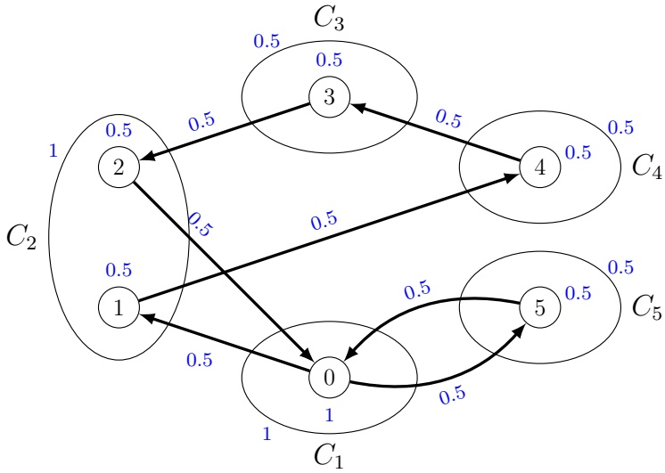

# [A new formulation and a branch-and-cut algorithm for the set orienteering problem](https://www.researchgate.net/publication/374340854_A_new_formulation_and_a_branch-and-cut_algorithm_for_the_set_orienteering_problem?enrichId=rgreq-764bf6034d07081a92bc63901de4fb65-XXX&enrichSource=Y292ZXJQYWdlOzM3NDM0MDg1NDtBUzoxMTQzMTI4MTE5NjIwNTUwMkAxNjk2NTg3ODkzOTE1&el=1_x_3&_esc=publicationCoverPdf)

**Article**  in  European Journal of Operational Research · September 2023 DOI: 10.1016/j.ejor.2023.09.038

CITATIONS 0

**4 authors**, including:

[Claudia Archetti](https://www.researchgate.net/profile/Claudia-Archetti?enrichId=rgreq-764bf6034d07081a92bc63901de4fb65-XXX&enrichSource=Y292ZXJQYWdlOzM3NDM0MDg1NDtBUzoxMTQzMTI4MTE5NjIwNTUwMkAxNjk2NTg3ODkzOTE1&el=1_x_5&_esc=publicationCoverPdf)

[ESSEC - Ecole Supérieur des Sciences Economiques et Commerciales](https://www.researchgate.net/institution/ESSEC-Ecole_Superieur_des_Sciences_Economiques_et_Commerciales?enrichId=rgreq-764bf6034d07081a92bc63901de4fb65-XXX&enrichSource=Y292ZXJQYWdlOzM3NDM0MDg1NDtBUzoxMTQzMTI4MTE5NjIwNTUwMkAxNjk2NTg3ODkzOTE1&el=1_x_6&_esc=publicationCoverPdf)

**11** PUBLICATIONS   **190** CITATIONS

[SEE PROFILE](https://www.researchgate.net/profile/Claudia-Archetti?enrichId=rgreq-764bf6034d07081a92bc63901de4fb65-XXX&enrichSource=Y292ZXJQYWdlOzM3NDM0MDg1NDtBUzoxMTQzMTI4MTE5NjIwNTUwMkAxNjk2NTg3ODkzOTE1&el=1_x_7&_esc=publicationCoverPdf)

[Raffaele Cerulli](https://www.researchgate.net/profile/Raffaele-Cerulli?enrichId=rgreq-764bf6034d07081a92bc63901de4fb65-XXX&enrichSource=Y292ZXJQYWdlOzM3NDM0MDg1NDtBUzoxMTQzMTI4MTE5NjIwNTUwMkAxNjk2NTg3ODkzOTE1&el=1_x_5&_esc=publicationCoverPdf)

[Università degli Studi di Salerno](https://www.researchgate.net/institution/Universita_degli_Studi_di_Salerno?enrichId=rgreq-764bf6034d07081a92bc63901de4fb65-XXX&enrichSource=Y292ZXJQYWdlOzM3NDM0MDg1NDtBUzoxMTQzMTI4MTE5NjIwNTUwMkAxNjk2NTg3ODkzOTE1&el=1_x_6&_esc=publicationCoverPdf)

**108** PUBLICATIONS   **1,482** CITATIONS

READS 23

[SEE PROFILE](https://www.researchgate.net/profile/Raffaele-Cerulli?enrichId=rgreq-764bf6034d07081a92bc63901de4fb65-XXX&enrichSource=Y292ZXJQYWdlOzM3NDM0MDg1NDtBUzoxMTQzMTI4MTE5NjIwNTUwMkAxNjk2NTg3ODkzOTE1&el=1_x_7&_esc=publicationCoverPdf)

[Francesco Carrabs](https://www.researchgate.net/profile/Francesco-Carrabs?enrichId=rgreq-764bf6034d07081a92bc63901de4fb65-XXX&enrichSource=Y292ZXJQYWdlOzM3NDM0MDg1NDtBUzoxMTQzMTI4MTE5NjIwNTUwMkAxNjk2NTg3ODkzOTE1&el=1_x_5&_esc=publicationCoverPdf) [Università degli Studi di Salerno](https://www.researchgate.net/institution/Universita_degli_Studi_di_Salerno?enrichId=rgreq-764bf6034d07081a92bc63901de4fb65-XXX&enrichSource=Y292ZXJQYWdlOzM3NDM0MDg1NDtBUzoxMTQzMTI4MTE5NjIwNTUwMkAxNjk2NTg3ODkzOTE1&el=1_x_6&_esc=publicationCoverPdf) **62** PUBLICATIONS   **900** CITATIONS

[SEE PROFILE](https://www.researchgate.net/profile/Francesco-Carrabs?enrichId=rgreq-764bf6034d07081a92bc63901de4fb65-XXX&enrichSource=Y292ZXJQYWdlOzM3NDM0MDg1NDtBUzoxMTQzMTI4MTE5NjIwNTUwMkAxNjk2NTg3ODkzOTE1&el=1_x_7&_esc=publicationCoverPdf)

# A New Formulation and a Branch-and-Cut Algorithm for the Set Orienteering Problem

C. Archetti2, F. Carrabs∗1, R. Cerulli1, and F. Laureana1

1Department of Mathematics, University of Salerno, Italy, flaureana@unisa.it, fcarrabs@unisa.it, raffaele@unisa.it, Corresponding author 2Department of Information Systems, Decision Sciences and Statistics, ESSEC Business School in Paris, France, archetti@essec.edu

## Abstract

In this study we address the Set Orienteering Problem, which is a generalization of the Orienteering Problem where customers are clustered in groups. Each group is associated with a profit which is gained in case at least one customer in the group is served. A single vehicle is available to serve the customers. The aim is to find the vehicle route that maximizes the profit collected without exceeding a maximum route cost, which can be interpreted also as route duration. The problem was introduced in [2] together with a mathematical programming formulation. In this paper, we propose a new formulation which uses less variables. We also derive different classes of valid inequalities to strengthen the formulation. In addition, separation algorithms are developed, some of which are new with respect to those presented in the literature. A branch-and-cut algorithm is implemented to solve the problem and tests are made on benchmark instances. The results show that the branch-and-cut algorithm is effective in solving instances with up to 100 customers. Moreover, the difficulty of solving the problem largely depends on the maximum route duration. We also show that valid inequalities are effective in speeding up the solution process. Finally, a comparison with two exact benchmark approaches proposed in the literature shows that the branch-and-cut algorithm proposed in this paper is the new state-of-the-art exact approach for solving the Set Orienteering Problem.

Keywords: Routing; Orienteering Problem; Integer Linear Programming; Branch-and-cut.

## 1 Introduction

The class of routing problems with profits have received a lot of attention in recent years thanks to their many practical applications. We refer the reader to the surveys by [3] and [16] for an exhaustive review of the literature on these problems. The most widely known problem in the class is the Orienteering Problem (OP) which was introduced in [24]. In the OP, there is a single vehicle, leaving and returning to a depot, which serves a set of geographically dispersed customers. Each customer is associated with a profit which is collected in case the customer is served. The aim is to define the vehicle route maximizing the collected profit in such a way that the route cost does not exceed a maximum threshold.

The literature on OP is wide and the problem has recently found interesting applications in the context of last-mile (or same-day) delivery services (see [26] and [17]). In addition, generalizations of the problems also emerged considering the cases in which customers are clustered and profits are associated with cluster of customers. A first contribution related to such a case is by [1] where the Clustered Orienteering Problem (COP) is studied, in which the profit of a cluster is collected in case all customers in the cluster are visited. On the opposite, in [2] the Set Orienteering Problem (SOP) was introduced, where the profit of a cluster is collected in case at least one customer from the cluster is served.

In the current paper, we focus on the SOP. As mentioned in [2], the SOP finds application in mass distribution products where customers are clustered in groups and carriers stipulate the contract with each group. Once the contract is signed, the carrier receives the corresponding compensation in case the delivery is performed to one customer from the group, which is chosen by the carrier. The entire quantity requested by the group is delivered to that single customer, which will then distribute it among the others. This allows the carrier to offer a better price for delivery. Another application arises when private customers group together either to reach the minimum quantity order required by the carrier or to reach large quantity orders to hopefully gain a lower price. Typically, in this case, the delivery is made to a single location. Finally, SOP finds application in the recent domain of lastmile fast delivery services. Specifically, when the service to a customer can be made in different locations (for example, customer’s place, pickup station, delivery locker), then the carrier can choose what is the most convenient place to deliver the order. This problem has been recently studied in the literature under the name ‘vehicle routing problem with delivery options (see [11, 12, 18, 23, 25, 27]). The SOP models the case where a single vehicle is available to perform the deliveries and a prize is associated with each customer and collected only in case the delivery is performed. In this case, each customer represents a cluster and the nodes in each cluster represent the locations where the delivery can be performed.

Heuristic algorithms for the SOP have been proposed in [20] and [5]. In the first paper, the authors propose a Variable Neighborhood Search (VNS) which is applied, in addition to the SOP, also to the Orienteering Problem with Neighborhoods (OPN) and the Dubins Orienteering Problem (DOP). The OPN is the problem in which the profit of a customer is collected within a radius centered to the customer itself, while the DOP uses airplane-like smooth trajectories to connect individual customers (see [4], [22], [21]). To the best of our knowledge, the only contributions proposing a mathematical formulation for the SOP are [2] and [20]. In both cases, the model includes binary variables associated with a visit to each customer. The difference among the two formulations is that, in [2], subtour elimination constraints are formulated in a polynomial way using the Miller-Tucker-Zemlin (MTZ) formulation (see [9]). Instead, in [20] subtour elimination constraints are formulated as exponentially many connectivity constraints.

The contribution of the current work can be summarized as follows:

We propose a new mathematical formulation for the SOP which does not include binary visiting variables associated with customers. Also, subtour elimination constraints are formulated through exponentially many connectivity constraints linking arc-flow variables with binary variables associated with clusters visit.

• We introduce different classes of valid inequalities to strengthen the formulation. Some of them are inherited from existing works while others are new and tailored to the new formulation.

We propose separation algorithms for subtour elimination constraints and valid inequalities. Specifically, we propose a novel algorithm for a class of valid inequalities called path inequalities.

We perform extensive computational tests on benchmark instances. The novel formulation, with the addition of valid inequalities, is solved through a branch-and-cut algorithm. The results show that the approach is effective in handling instances with up to 100 customers and that the problem difficulty largely depends on the maximum route duration. The formulation, and the corresponding branch-and-cut algorithm, performs favorably against exact approaches proposed in the literature both in terms of computational time and number of instances solved to optimality.

The paper is organized as follows. In Section 2 we formally describe the problem, present a mathematical formulation proposed in the literature and propose a new formulation. We also show that that new formulation has a stronger relaxation than the benchmark formulation. Section 3 presents the valid inequalities used to strengthen the formulation while in Section 4 we describe the branch-and-cut algorithm. Computational results are presented in Section 5. Finally, in Section 6 some conclusions are drawn.

## 2 Problem description and mathematical formulations

The SOP can be described as follows. Let $G = ( V , A )$ be a complete directed graph, where $V   =   \{ 0 \} \bigcup C$ . Vertex 0 is the depot where the route of the vehicle starts and ends, while C is the set of customers, and it is partitioned into l clusters, $C _ { 1 } , . . . , C _ { l }$ . Let us denote by $\mathcal { P }   =   \{ 0 , 1 , . . . , l \}$ the set of the indices associated with clusters. Each cluster $C _ { g }$ has an associated profit $p _ { g } ,$ which is collected when at least a customer $i   \in   C _ { g }$ is visited. The profit of a cluster can be collected at most once. Cluster 0 corresponds to the cluster containing the depot only and is associated with a profit $p _ { 0 } \: = \: 0$ Furthermore, let $c _ { i j }$ be a non-negative cost associated with arc $( i , j ) \in A$ . The Set Orienteering Problem $( S O P )$ consists in finding a route maximizing the collected profit, assuring that the associated cost does not exceed a maximum value $T _ { m a x }$ . In what follows, we assume that the costs $c _ { i j }$ satisfy the triangle inequality. This implies that there exists an optimal solution containing at most one vertex for each visited cluster.

In [2] and [20], the authors proposed a 0-1 Integer Linear Program (ILP) for the SOP using the three following classes of binary variables:

$y _ { i } ,   \forall i \in V$ , equals to 1 if vertex i is visited, 0 otherwise;

$x _ { i j } ,   \forall ( i , j ) \in A$ , equals to 1 if arc $( i , j )$ is traversed, 0 otherwise;

$z _ { g } ,   \forall g   \in   \mathcal { P }$ , equals to 1 if at least a vertex in cluster $C _ { g }$ is visited, 0 otherwise.

Given $A ^ { \prime } \subseteq A$ and $V ^ { \prime } \subseteq V$ , we use the notations $\begin{array} { r } { x ( A ^ { \prime } ) = \sum _ { ( i , j ) \in A ^ { \prime } } x _ { i j } } \end{array}$ , and $\begin{array} { r } { y ( V ^ { \prime } )   =   \sum _ { v \in V ^ { \prime } } y _ { v } } \end{array}$ . Furthermore, for ${ \mathcal { Q } } \subseteq { \mathcal { P } }$ , we use the notation $z ( \mathcal { Q } ) =$ $\textstyle \sum _ { g \in \mathcal { Q } } z _ { g }$ . For $S , S ^ { \prime } \subseteq V$ , we denote by $A ( S : S ^ { \prime } ) = \{ ( u , v ) \in A : u \in S , v \in$ $S ^ { \prime } \tilde { \}$ the set of arcs having source in $S$ and sink in $S ^ { \prime }$ , and by $A ( S ) = A ( S : S )$ the set of the arcs having both extremes in $S .$ Given a subset $S \subseteq V$ , we denote by $\delta ^ { + } ( S )   =   \{ ( i , j )   \in   A   :   i   \in   S , j   \notin   S \}$ the set of its outgoing arcs, and by $\delta ^ { - } ( S ) = \{ ( i , j ) \in A : i \notin S   j \in S \}$ the set of its incoming arcs. When $S   =   \{ v \} , \; \delta ^ { + } ( \{ v \} )$ and $\delta ^ { - } ( \{ v \} )$ are substituted by $\delta ^ { + } ( v )$ and $\delta ^ { - } ( v )$ for the ease of reading.

In this formulation, connectivity is ensured by cutset constraints expressed by using vertices visiting variables $y$ , thus we call the formulation cutset formulation (cut). It reads as follows:

$$
\left| \begin{array}{l l} (\mathbf {c u t}) & \text {Maximize} z = \sum_ {g \in \mathcal {P}} p _ {g} z _ {g} \end{array} \right|\tag{1}
$$

subject to

$$
y _ {0} = 1\tag{2}
$$

$$
\sum c _ {i j} x _ {i j} \leq T _ {\max}\tag{3}
$$

$$
(i, j) \in A
$$

$$
x (\delta^ {+} (i)) = y _ {i}
$$

$$
i \in V\tag{4}
$$

$$
x (\delta^ {-} (i)) = y _ {i}
$$

$$
i \in V\tag{5}
$$

$$
x (\delta^ {+} (S)) \geq y _ {h} \quad S \subset V, 0 \in S, h \notin S\tag{6}
$$

$$
y (C _ {g}) = z _ {g}
$$

$$
g \in \mathcal {P}\tag{7}
$$

$$
x _ {a} \in \{0, 1 \}
$$

$$
| a \in A |\tag{8}
$$

$$
y _ {v} \in \{0, 1 \}
$$

$$
v \in V\tag{9}
$$

$$
z _ {g} \in \{0, 1 \}
$$

$$
g \in \mathcal {P}\tag{10}
$$

The objective function (1) maximizes the collected profit. Constraint (2) ensures that the depot belongs to the tour. Constraint (3) guarantees that the total cost of the tour is lower than $T _ { m a x }$ . Constraints (4) and (5) ensure that exactly one arc enters and leaves every visited node. Constraints (6) avoid subtours among visited nodes. Finally, constraints (7) ensure that variable $z _ { g }$ is equal to 0 when no customer in cluster $C _ { g }$ is visited. Constraints (8)–(10) define the variables domain.

We note that in [2] subtour elimination constraints are formulated as MTZ constraints (see [9]), while in [20] they are formulated as:

$$
x (A (S)) \leq y (S \backslash \{h \}) \quad S \subset V, 0 \in S, h \in S.
$$

The first main contribution of this paper is the proposal of a new formulation for the SOP that does not include vertex visiting variables $y .$ . Indeed, as the profit is associated with clusters of customers, the value of a solution is measured through z variables. Also, connectivity constraints can be modelled by using z variables. Note that both formulations proposed in [2] and [20] use vertices visiting variables. A first clear advantage of our new formulation is related to the fact that it uses fewer binary variables. Also, we show in the following that the new formulation provides a stronger lower bound associated with the linear relaxation, as the polyhedron of the new formulation is contained in the one of the cut formulation.

Our formulation uses only two families of binary variables, namely, $x _ { i j }$ and $z _ { g } .$ . Connectivity is ensured by cluster cutset constraints, thus we call it cluster cutset formulation (clucut). It reads as follows:

$$
\left(\mathbf {c l u c u t}\right) \quad \text {Maximize} z = \sum_ {g \in \mathcal {P}} p _ {g} z _ {g}\left. \right\vert\tag{11}
$$

subject to

$$
z _ {0} = 1\tag{12}
$$

$$
\sum c _ {i j} x _ {i j} \leq T _ {\max}\tag{13}
$$

$$
(i, j) \in A
$$

$$
x (\delta^ {+} (i)) = x (\delta^ {-} (i))
$$

$$
i \in V\tag{14}
$$

$$
x (\delta^ {+} (S)) \geq z _ {g} \quad g \in \mathcal {P}, S \subset V \setminus C _ {g}, 0 \in S\tag{15}
$$

$$
x (\delta^ {+} (C _ {g})) = z _ {g}
$$

$$
g \in \mathcal {P}\tag{16}
$$

$$
x (\delta^ {-} (C _ {g})) = z _ {g}
$$

$$
g \in \mathcal {P}\tag{17}
$$

$$
x (A (C _ {g})) = 0
$$

$$
g \in \mathcal {P}\tag{18}
$$

$$
x _ {a} \in \{0, 1 \}
$$

$$
a \in A\tag{19}
$$

$$
z _ {g} \in \{0, 1 \}
$$

$$
\left| g \in \mathcal {P} \right|\tag{20}
$$

The objective function (11) corresponds to maximizing the profit collected, as in the cut formulation. Constraint (12) ensures that the cluster containing the depot belongs to the tour. Constraint (13) is the same as constraint (3) and ensure that the maximum duration $T _ { m a x }$ is not exceeded. Constraints (14) are flow balance constraints associated with each node.

Constraints (15) avoid subtours among visited clusters. Constraints (16) and (17) ensure that variable $z _ { g }$ is equal to 1 if and only if at least one vertex in cluster $C _ { g }$ is visited. Constraints (18) ensure that intra-cluster arcs are equal to zero. Note that (18) are not needed for the correctness of the formulation and are used to strengthen it. Finally, (19) and (20) are variables domain.

## 2.1 Properties of the cluster cutset formulation

We first show that formulation clucut is a valid formulation for the SOP by showing that any feasible solution of clucut can be transformed in a feasible solution of cut and vice versa.

Theorem 1. Any feasible solution of cut can be transformed in a feasible solution of clucut and vice versa.

Proof. Let us consider a feasible solution of cut. Note that, because of (7), for each cluster $g \in \mathcal { P }$ we have that $y ( C _ { g } ) \leq 1$ . Let ${ \mathcal { P } } ^ { \prime } \subseteq { \mathcal { P } }$ be the subset of clusters visited. A feasible solution for clucut is obtained by simply setting the values of the variables x and z equal to the corresponding value in the feasible solution of cut. Note that this solution is feasible for clucut. In fact, constraints (12)–(14) correspond to $(2) - (5)$ . Also, by combing constraints (4) (or (5)) and (7), we obtain (16) (or (17)) and (18). Similarly, by combining (7) and (6), we obtain (15). Thus, any feasible solution of cut can be transformed in a feasible solution for clucut.

Let us now consider a feasible solution for clucut. Similarly as above, let $\mathcal { P } ^ { \prime } \subseteq \mathcal { P }$ be the subset of clusters visited. Because of constraints (16), (17) and (14), there is at most one vertex visited for each cluster $g \in \mathcal { P } ^ { \prime }$ . Let us call this vertex $i _ { g } , \mathrm { ~ A ~ }$ solution of cut is obtained by setting the values of the variables x and z equal to the corresponding value in the feasible solution of clucut and by setting $y _ { i _ { g } }   =   1 ,   g   \in   \mathcal { P } ^ { \prime }$ . This way, constraints (2)–(5) and (7) are satisfied. Also, because of (15), connectivity is guaranteed so (6) are satisfied as well. □

We now show that formulation clucut provides a strongest relaxation than the one associated with formulation cut as the polyhedron of clucut is included in the one of cut.

Let us denote by $P _ { c u t }$ and $P _ { c l u c u t }$ the polytopes associated with the linear relaxation of formulations cut and clucut, respectively, projected in the space of x and z variables.

The following proposition holds.

Theorem 2. $P _ { c l u c u t } \subset P _ { c u t }$

Proof. First, we show that, given $( x , z ) \in P _ { \mathit { c l u c u t } }$ , there exists a vector y such that $( x , y , z )   \in   P _ { c u t }$ . Let us choose y in such a way that $y _ { i }   =   x ( \delta ^ { + } ( i ) )   =$ $x ( \delta ^ { - } ( i ) )$ , for any $i   \in   V$ . Because of constraints (16), (17) and $( 7 ) ,   ( x , y , z )$ satisfies constraints (4) and (5). Constraint (2) is implied by (12). Therefore, to prove that $( x , y , z )$ belongs to $P _ { c u t } ,$ it is sufficient to show that it satisfies constraints (6). Indeed, by combining (15) with (16) or (17), we obtain (6). This proves that $P _ { \mathit { c l u c u t } } \subseteq P _ { \mathit { c u t } }$

As for the strict inclusion, the solution depicted in Figure 1 shows a solution which is feasible for the linear relaxation of cut, but not of the one of clucut. Vertex 0 corresponds to the depot and the $5$ customers are grouped in 4 clusters. The numbers close to each vertex and arc show the value of the $y$ and $x$ variables, respectively, in the solution of the linear relaxation of cut. We can notice that all constraints of cut are satisfies while constraints (15) are violated for $S = \{ 0 , 5 \}$ and $C _ { g } = C _ { 2 } = \{ 1 , 2 \}$ □

Figure 1: A solution in $P _ { c u t } \setminus P _ { c l u c u t }$

## 3 Valid Inequalities

In the following we describe the valid inequalities we used to strengthen formulation clucut. They are inherited from the literature about routing problems in general and are adapted to the SOP.

Given an instance of the SOP defined on graph $G ,$ let us consider the following polytope:

$$
P (G) = \operatorname{conv} \{(x, z) \in \mathbb {R} ^ {m + n}: (x, z) \text {satisfies} (1 2) - (2 0) \}.
$$

## 3.1 Cover Inequalities

Cover inequalities enhance $T _ { m a x }$ constraint (13). Specifically, given $T \subset A$ such that $\textstyle \sum _ { ( i , j ) \in T } c _ { i j } > T _ { m a x }$ , we have that

$$
x (T) \leq | T | - 1\tag{21}
$$

is valid for $P ( G )$ . Inequality (21) can be further strengthened by considering all the arcs of the graph having cost at least equal to $m a x _ { ( i , j ) \in T } c _ { i j }$ (see [14]). In such a way we obtain the following inequality, which is valid for $P ( G )$

$$
x (\bar {T} \cup \bar {T}) \leq | T | - 1,\tag{22}
$$

where $\bar { T } = \{ ( h , k ) \in A \setminus T : c _ { h k } \geq m a x _ { ( i , j ) \in T } c _ { i j } \}$

## 3.2 Conditional Cuts

Fischetti et al. in [14] introduced the so-called conditional cuts for the OP. In the current paper, we adapted them to the SOP. Let $z ^ { L B }$ be a lower bound on the optimal solution to the SOP. Given a subset of nodes, $S \subset V \cup \{ 0 \}$ such that $0 \in S$ , we denote by $\mathcal { P } _ { S }$ the subset of $\mathcal { P }$ such that $\mathcal { P } _ { S } = \{ g \in \mathcal { P }$ $S \cap C _ { g } \neq \emptyset \}$ . If it results that $\textstyle \sum _ { g \in \mathcal { P } _ { S } } p _ { g } \leq z ^ { L B }$ , then the following inequality

$$
x (A (S)) \leq z (\mathcal {P} _ {S}) - 1,\tag{23}
$$

is satisfied by the optimal solution to the SOP.

## 3.3 Cluster Cover Inequalities

Let $z ^ { U B }$ be an upper bound on the optimal solution to the SOP. Given a subset $\mathcal { Q } \subset \mathcal { P }$ , such that $\begin{array} { r } { \sum _ { g \in \mathcal { Q } } p _ { g } > z ^ { U B } } \end{array}$ , the following inequality

$$
z (\mathcal {Q}) \leq | \mathcal {Q} | - 1,\tag{24}
$$

is satisfied by the optimal solution to the SOP. These inequalities are adapted from the vertex cover inequalities, which were first proposed for the $\mathrm { O P }$ in [15].

## 3.4 Path Inequalities

Path inequalities were first introduced in [14] for the Orienteering Problem and we adapt them to the SOP. The idea is the following. Given k clusters, $C _ { i _ { 1 } } , . . . , C _ { i _ { k } }$ , let $I   =   \{ ( i _ { 1 } , i _ { 2 } ) , . . . , ( i _ { k - 1 } , i _ { k } ) \}$ be a simple path through nodes $V ( I ) \: = \: \{ i _ { 1 } , . . . , i _ { k } \} \: \subset \: C$ , such that $i _ { 1 } \: \in \: C _ { i _ { 1 } } , . . . , i _ { k } \: \in \: C _ { i _ { k } }$ . We define the following subset of nodes:

$W ( I ) = \{ v \in V \setminus V ( I ) : I \cup ( i _ { k } , v )$ is part of a feasible SOP solution}.

$W ( I )$ represent the set of all vertices to which path I can be feasibly extended. Path inequalities are formulated as:

$$
\left| \sum_ {j = 1} ^ {k - 1} x _ {i _ {j} i _ {j + 1}} - \sum_ {j = 2} ^ {k - 1} z _ {i _ {j}} - \sum_ {v \in W (I)} x _ {i _ {k} v} \leq 0. \right.\tag{25}
$$

Theorem 3. Inequalities (25) are valid for $P ( G )$

Proof. Let us suppose that there exists a feasible solution to the SOP, $( x ^ { * } , z ^ { * } )$ violating (25). This implies that

$$
x _ {i _ {1} i _ {2}} ^ {*} + (x _ {i _ {2} i _ {3}} ^ {*} - z _ {i _ {2}} ^ {*}) + \dots + (x _ {i _ {k - 1} i _ {k}} ^ {*} - z _ {i _ {k - 1}} ^ {*}) - \sum_ {v \in W (I)} x _ {i _ {k} v} > 0.
$$

Let us note that, thanks to constraints (16), it results that $x _ { i _ { j } i _ { j + 1 } } ^ { * } - z _ { i _ { j } } ^ { * } \leq 0$ for $j = 2 , . . . , k - 1$ . Therefore, for the left hand side to be greater than zero, it must be $x _ { i _ { 1 } i _ { 2 } } ^ { * } = 1 ,   x _ { i _ { j } i _ { j + 1 } } ^ { * } - z _ { i _ { j } } ^ { * } = 0$ , for any $j = 2 , . . . , k - 1$ , and $x _ { i _ { k } v } ^ { * } = 0$ , for any $v   \in   \bar { W } ( I )$ . It follows that $x _ { i _ { j } i _ { j + 1 } } ^ { * } = 1$ , for any $j = 1 , . . . , k - 1$ , and $z _ { i _ { 1 } } ^ { * } = z _ { i _ { 2 } } ^ { * } = . . . = z _ { i _ { k } } ^ { * } = 1$ , and this means that $( x ^ { * } , z ^ { * } )$ contains every arc in $I ,$ and at least an arc $( i _ { k } , v )$ , with $v \notin W ( I )$ , which cannot be according to the definition of $W ( I )$ □

## 4 Branch-and-cut algorithm

We devised a branch-and-cut algorithm for the SOP based on the clucut formulation. A preprocessing procedure is carried out before executing the algorithm by using the properties introduced in [5]. This procedure is aimed at removing from G the vertices, arcs and clusters that are not necessary to build an optimal solution. In particular, for the edge removal, we use the procedure proposed in [7] and successfully applied also in [6, 8].

The initial LP model is obtained by removing constraints (15), and relaxing the integrality constraints on the variables of the original formulation.

For any subproblem L of the branch-and-bound tree, we compute the optimal Linear Programming (LP) solution $( x _ { L P } ^ { * } ( \mathcal { L } ) )$ . If $x _ { L P } ^ { * } ( \mathcal { L } )$ is not feasible, we search for violated constraints (15), (22), (23), (24) and (25). When no violation is identified, the algorithm performs the branching on a fractional variable, by using the default CPLEX parameters.

As for the sequence in which subtour elimination constraints (15) and valid inequalities (22)–(25) are separated in each node of the branch-and-bound tree, after some preliminary experiments, we determined that the most efficient setting is the following. First, cover inequalities (22) and cluster cover inequalities (24) are separated. Subtour elimination constraints (15) are separated after (22) and (24). Moreover, except for the root node, they are separated only in case no violated inequality (22) and (24) is identified. Set S determined by the separation algorithm of (15) is checked also for potential violation of conditional cuts (23). Lastly, path inequalities (25), whose separation procedure is time consuming, are separated only in case none of the former inequalities is violated.

In the following subsection, we describe the separation procedures used for each family of valid inequalities. While most procedures are inherited from benchmark algorithms proposed in the literature, we propose a new procedure for separating path inequalities.

## 4.1 Separation Procedures

In the following we denote by $G ^ { * } = \left( V ^ { * } , A ^ { * } \right)$ the graph associated with the fractional solution $( x ^ { * } , z ^ { * } )$ . More in detail, $V ^ { * } = \{ i   \in   V   :   \exists ( i , j )   \in   \delta ^ { + } ( i )$ $x_{ij}^{*} > 0 \} \cup \{ i \in V : \exists (j,i) \in \delta^{-}(i) : x_{ji}^{*} > 0 \}$ and $A ^ { * } = \left\{ ( i , j ) \in A : x _ { i j } ^ { * } > 0 \right\}$ Subtour elimination constraints (15) are separated through the classical exact in polynomial time min-cut algorithm (see [19]).

Cover inequalities (22) are separated by using the following exact separation procedure. We determine a set $T \subseteq A$ such that $\textstyle \sum _ { ( i , j ) \in T } c _ { i j } \: > \: T _ { m a x }$ and for which $x ^ { * } ( T ) - | T | + \epsilon$ is maximum by solving the following Knapsack Problem:

$$
\begin{array}{c} \text {Minimize} \tilde {z} = \sum_ {(i, j) \in A} (1 - x _ {i j} ^ {*}) \tilde {z} _ {i j} \\ \sum_ {(i, j) \in A} c _ {i j} \tilde {z} _ {i j} \geq T _ {m a x} + \epsilon \\ \tilde {z} _ {i j} \in \{0, 1 \}, (i, j) \in A \end{array}
$$

If the optimal solution is strictly less than 1, inequality (21) corresponding to subset $T = \{ ( i , j ) \in A : \tilde { z } _ { i j } ^ { * } = 1 \}$ is violated. Furthermore, to obtain the stronger inequality (22), we simply look for any arc with cost greater than $m a x _ { ( i , j ) \in T } c _ { i j }$ , and we add it to $T$ . Note that a similar procedure was proposed in [14] for the OP. Also note that, for the results presented in Section 5.3, the value of  is set to 1 as distances are integer in the tested instances.

Conditional cuts (23) are separated heuristically by using a procedure based on the separation algorithm for constraints (15). Indeed, given $z ^ { L B }$ the value of the best integer solution found so far, and $S ^ { * }$ , a subset obtained by computing the minimum cut on $\tilde { G } ,$ , if it results that $\textstyle \sum _ { g \in \mathcal { P } _ { S ^ { * } } } p _ { g }   \leq   z ^ { L B }$ then we check if $x \big ( A \big ( S ^ { * } \big ) \big ) > z \big ( \mathcal { P } _ { S ^ { * } } \big ) - 1$ , and if so we add the corresponding violated inequality (23) to the formulation.

Cluster cover inequalities (24) are separated exactly by solving the following knapsack problem:

$$
\left| \begin{array}{c} \text {Minimize} u = \sum_ {g \in \mathcal {P}} (1 - z _ {g} ^ {*}) u _ {g} \\ \sum_ {g \in \mathcal {P}} p _ {g} u _ {g} \geq z ^ {U B} + 1 \\ u _ {g} \in \{0, 1 \}, g \in \mathcal {P} \end{array} \right|
$$

where $z ^ { U B }$ is the value of the current upper bound. It is easy to see that if the optimal solution is strictly less than 1, by choosing $\mathcal { Q } = \{ g \in \mathcal { P } : u _ { g } ^ { * } = 1 \}$ we obtain a violated inequality (24).

Path inequalities (25) are separated heuristically by using the following procedure. Given the graph $G ^ { * }   =   \left( V ^ { * } , A ^ { * } \right)$ we define a weight function, $w : A ^ { * } \to \mathbb { R }$ , such that $w _ { i j }   =   z _ { i } ^ { * } -   x _ { i j } ^ { * }$ , for any $( i , j )   \in   A ^ { * }$ . For any $u , v \in$ $V \setminus \{ 0 \}$ such that $u$ and v belong to different clusters, we compute a path $I \; = \; \{ ( i _ { 1 } , i _ { 2 } ) , . . . , ( i _ { k - 1 } , i _ { k } ) \}$ from $\textit { u } = \textit { i } _ { 1 }$ to $v   =   i _ { k }$ in $G ^ { * }$ , assuring that it contains at most one vertex for each cluster and having minimum weight, $\begin{array} { r } { w ( I ) = \sum _ { j = 1 } ^ { k - 1 } w _ { i _ { j } i _ { j + 1 } } } \end{array}$ . It is easy to see that

$$
w (I) = \sum_ {j = 1} ^ {k - 1} z _ {i _ {j}} ^ {*} - \sum_ {j = 1} ^ {k - 1} x _ {i _ {j} i _ {j + 1}} ^ {*}
$$

To compute I for a given pair of vertices $u , v$ we solve the following ILP where $s _ { i j }$ is a binary variables taking value 1 if arc $( i , j )$ is traversed and $t _ { i }$ is a binary variables equal to 1 if vertex i is visited:

$$
\text {Minimize} w = \sum_ {(i, j) \in A ^ {*}} w _ {i j} s _ {i j}\tag{26}
$$

$$
\left| \sum_ {(i, j) \in \delta^ {+} (i)} s _ {i j} - \sum_ {(l, i) \in \delta^ {-} (i)} s _ {l i} = \left\{ \begin{array}{l l} 1, & i = u \\ 0, & i \neq u, v \\ - 1, & i = v \end{array} \quad i \in V ^ {*} \right. \right|\tag{27}
$$

$$
\left| \sum_ {i \in C _ {g} \cap V ^ {*}} t _ {i} \leq 1, \quad g \in \mathcal {P} \right|\tag{28}
$$

$$
t _ {i} \geq s _ {i j}, \quad (i, j) \in A ^ {*}\tag{29}
$$

$$
t _ {j} \geq s _ {i j}, \quad (i, j) \in A ^ {*}\tag{30}
$$

$$
t _ {i} \leq \sum_ {j \in F S (i)} s _ {i j} + \sum_ {l \in B S (i)} s _ {l i}, \quad i \in V ^ {*}\tag{31}
$$

$$
t _ {u} = 1\tag{32}
$$

$$
t _ {v} = 1\tag{33}
$$

$$
s _ {i j} \in \{0, 1 \}, \quad (i, j) \in A ^ {*}\tag{34}
$$

$$
t _ {i} \in \{0, 1 \}, \quad i \in V ^ {*}\tag{35}
$$

Formulation (26)–(35) aims at finding the shortest path from $u$ to $v$ in $G ^ { * }$ The objective function (26) minimizes the value of $w ( I )$ . Constraints (27) are flow conservation constraints while (28) establish that one vertex per cluster at most is visited. Constraints (29) and (30) force t variables to take value 1 in case an arc incident to the corresponding vertex is traversed. Constraints (31) fix the value of variable $t _ { i }$ to 0 in case vertex $i$ is not visited. (32) and (33) force the visit of vertices u and $v ,$ respectively, while (34)–(35) define variables domain. Note that constraints (31)–(33) are not needed. However, they strengthen the formulation and speed up the solution process.

If $w ( I ) - z _ { i _ { 1 } } ^ { * } \geq 0$ , then I does not lead to a violated inequality (25). Otherwise, we build $W ( I )$ as follows: for any $v \in V \setminus V(I), \mathrm{if} c_{0i_1} + \sum_{(i,j) \in I} c_{ij} +$ $c _ { i _ { k } v } + c _ { v 0 }$ is lower than $T _ { m a x }$ , then we add v to $W ( I )$ . Finally, we check if $\begin{array} { r } { - w ( I ) + z _ { i _ { 1 } } ^ { * } - \sum _ { v \in W ( I ) } x _ { i _ { k } v } ^ { * } } \end{array}$ is strictly greater than 0, and in such a case we have identified a violated inequality (25). The idea is that first a new vertex $v$ is added to the path and then the inequality is checked for violation.

Note that path inequalities were introduced in [14]. However, the separation procedure used in the latter paper was different and it consisted in an enumeration scheme to detect path I. This scheme is not suitable for the SOP as a further check is needed to assure that all nodes in I belong to different clusters, making the procedure too slow to be applied in an effective way. This has motivated the design of the new procedure described above.

## 5 Computational Tests

In this section, we present the results obtained by the branch-and-cut algorithm described in Section 4. The branch-and-cut algorithm (called ‘BC from now on) was coded in C++ using the LEMON graph library [10]. All tests were performed on an OSX platform (iMac 2020), running on an Intel Core i9-10910 processor clocked at 3.6 GHz with 64 GB of RAM. The mathematical formulation was solved using the ILOG Concert Technology library and CPLEX 20.1 in single thread mode. A time limit of one hour and a memory limit of 5GB were imposed. All remaining CPLEX parameters were left to their default value.

The computational tests were carried out on the instances proposed in [2] and named Set1. This set of instances was obtained by adapting the instances of the Generalized Traveling Salesman Problem proposed in [13]. The number of vertices ranges from 52 to 1084 but we only consider the instances with up to 198 nodes for our computational tests as for higher dimensions the exact approach is not practicable. The number of clusters is equal to ∼ 20% the number of vertices. $T _ { m a x }$ is set to $\omega \times G T S P ^ { * }$ , where $G T S P ^ { * }$ is the best-known solution value of the GTSP (taken from [13]) and $\omega$ is set to 0.4, 0.6, and 0.8. Finally, two rules, $g _ { 1 }$ and $g _ { 2 }$ , are used to assign the profit to the clusters. The first rule sets the profit of each cluster $C _ { g }$ equal to $| C _ { g } |$ . The second rule assigns to vertex $j$ a profit equal to $1 + ( 7 1 4 1 j + 7 3 ) m o d ( 1 0 0 )$ and the profit of a cluster is given by the sum of the values of the profit of all vertices belonging to it.

Another set of instances for SOP, named Set2, was introduced in [2]. The instances in this set are the same as those in Set1. More specifically, the instances contain the same vertices and the same number of clusters as the instances in $S e t I ,$ but the vertices are assigned in a random way to the clusters. Both sets contain 27 instances each. The datasets and the tables of the paper are available here https://github.com/fcarrabs/Set\_Orienteering\_Problem

The section is organized as follows. We first analyze the effectiveness of the valid inequalities presented in Section 3. Specifically, in Section 5.1, we present the results of tests in which we run the branch-and-cut algorithm with the full set of valid inequalities and we compare it with the version of the algorithm in which we discard one inequality at a time. These tests enable us to determine the best version of the algorithm which is used to run the final tests. In Section 5.2 we provide the detailed results of the final version of the algorithm and we provide some statistics on the performance of the algorithm. Finally, in Section 5.3 we compare the performance of our algorithm with two benchmark approaches available in the literature.

<table><tr><td rowspan="2"></td><td rowspan="2">C-BC Time</td><td colspan="2">NoCond</td><td colspan="2">NoCover</td><td colspan="2">NoCluCover</td><td colspan="2">NoPath</td></tr><tr><td>Time</td><td>Gap%</td><td>Time</td><td>Gap%</td><td>Time</td><td>Gap%</td><td>Time</td><td>Gap%</td></tr><tr><td></td><td></td><td></td><td></td><td colspan="6"> $\omega = 0.4$  and  $g_1$ </td></tr><tr><td>AVG</td><td>677.07</td><td>641.82</td><td>0.84%</td><td>1151.30</td><td>-2.41%</td><td>624.66</td><td>0.01%</td><td>1370.31</td><td>-8.17%</td></tr><tr><td>#Worse</td><td></td><td></td><td>0</td><td></td><td>5</td><td></td><td>0</td><td></td><td>10</td></tr><tr><td></td><td></td><td></td><td></td><td colspan="6"> $\omega = 0.4$  and  $g_2$ </td></tr><tr><td>AVG</td><td>911.10</td><td>746.53</td><td>0.33%</td><td>1148.56</td><td>-2.41%</td><td>800.54</td><td>0.02%</td><td>1380.10</td><td>-7.79%</td></tr><tr><td>#Worse</td><td></td><td></td><td>0</td><td></td><td>5</td><td></td><td>0</td><td></td><td>10</td></tr><tr><td></td><td></td><td></td><td></td><td colspan="6"> $\omega = 0.6$  and  $g_1$ </td></tr><tr><td>AVG</td><td>1073.27</td><td>1092.24</td><td>0.13%</td><td>1631.90</td><td>-1.58%</td><td>1003.63</td><td>0.24%</td><td>1783.17</td><td>-2.17%</td></tr><tr><td>#Worse</td><td></td><td></td><td>1</td><td></td><td>4</td><td></td><td>0</td><td></td><td>5</td></tr><tr><td></td><td></td><td></td><td></td><td colspan="6"> $\omega = 0.6$  and  $g_2$ </td></tr><tr><td>AVG</td><td>1131.93</td><td>1077.09</td><td>-0.15%</td><td>1585.04</td><td>-0.28%</td><td>1099.55</td><td>0.00%</td><td>1499.79</td><td>-0.66%</td></tr><tr><td>#Worse</td><td></td><td></td><td>1</td><td></td><td>2</td><td></td><td>0</td><td></td><td>2</td></tr><tr><td></td><td></td><td></td><td></td><td colspan="6"> $\omega = 0.8$  and  $g_1$ </td></tr><tr><td>AVG</td><td>1108.27</td><td>1338.76</td><td>-0.83%</td><td>2249.00</td><td>-4.80%</td><td>1051.52</td><td>0.00%</td><td>2209.43</td><td>-4.71%</td></tr><tr><td>#Worse</td><td></td><td></td><td>2</td><td></td><td>10</td><td></td><td>0</td><td></td><td>10</td></tr><tr><td></td><td></td><td></td><td></td><td colspan="6"> $\omega = 0.8$  and  $g_2$ </td></tr><tr><td>AVG</td><td>1826.45</td><td>1739.30</td><td>0.67%</td><td>2304.46</td><td>-2.48%</td><td>1842.27</td><td>0.56%</td><td>2368.43</td><td>-2.67%</td></tr><tr><td>#Worse</td><td></td><td></td><td>1</td><td></td><td>9</td><td></td><td>1</td><td></td><td>9</td></tr></table>

Table 1: Summary of the computational results for the five versions of the branch-and-cut algorithm on all instances.

## 5.1 Valid Inequalities Effectiveness

As mentioned above, this section is dedicated to evaluate the effectiveness of the valid inequalities presented in Section 3. Specifically, we run the branchand-cut algorithm with the full set of inequalities and we compare it with the versions in which we discard a single inequality at a time. Tests are made over all instances presented above.

The results of this comparison are summarized in Table 1 for the instances with $\omega   =   0 . 4 , 0 . 6 , 0 . 8$ and profits $g _ { 1 }$ and $g _ { 2 }$ . The detailed results are reported in Tables 12–15 of Appendix A. The first column of the table reports the computational time, in seconds, of the branch-and-cut version with the full set of inequalities $\left( C \text{-} BC \right)$ . Four groups of two columns follow, corresponding to the four versions of the branch-and-cut algorithm in which one inequality is excluded: no conditional cuts (NoCond), no cover inequalities (NoCover ), no cluster cover inequalities $( N o C l u C o v e r )$ and no path inequalities $( N o P a t h )$ . Under the Time and Gap% headings, for each branch-and-cut version, we report the corresponding computational time and the percentage gap between the upper bound of the version considered and the upper bound obtained by C-BC, respectively. This gap is calculated as $\begin{array} { r } { g a p = \frac { \Gamma _ { U B _ { * } - U B _ { C - B C } } } { U B _ { C - B C } } } \end{array}$ , where $U B _ { C - B C }$ and $U B _ { z }$ ∗ are the upper bound by C-BC and by the version considered, respectively. Note that positive values of the gap mean that the version of the algorithm without the inequality gives a better result than C-BC. Results are aggregated by values of $\omega$ and classes of profit. The rows of the table are organized in groups of two lines reporting, for each version of the algorithm in which an inequality is excluded: the average values of time and gap $( A V G )$ and the number of times in which the upper bound provided by the version without an inequality is worse than the one provided by C-BC $( \# W o r s e )$

We note that, when $\omega \; = \; 0 . 4$ , cover and path inequalities are indeed effective as their exclusion cause both a remarkable increase in computing time and a deterioration in the value of the upper bound. In more detail, for both $g _ { 1 }$ and $g _ { 2 }$ profits, we observe that the upper bound of NoCover and NoPath worsens 5 and 10 times while the computational time increases by 70% and 100%, respectively. For $\omega = 0 . 6$ , the contribution of these two inequalities is less impactful but still relevant. For $\omega = 0 . 8$ , the behaviour of version without path inequalities is similar to the one observed for $\omega =$ 0.4 while is much different for the version without the cover inequalities. Indeed, for this version we observe that both the computational time and #Worse value are around doubled with respect to the results with $\omega =$ 0.4. The effectiveness of conditional cuts is instead more debatable: indeed, they are not effective when $\omega   =   0 . 4$ , as their removal improve the upper bound and reduces the computational time. However, when $\omega   =   0 . 6$ , the computational time increases when they are removed for the case $g _ { 1 }$ and the upper bound slightly deteriorates for the case $g _ { 2 }$ . Finally, when $\omega = 0 . 8$ , they are effective in $g _ { 1 }$ instances and not effective in $g _ { 2 }$ instances. Given that the overall difference between the two versions of the algorithm (with or without conditional cuts) is slightly to the advantage of the first version, we decided to retain them in the final version of the branch-and-cut algorithm. Finally, as for cluster cover inequalities, we notice that they are almost never effective: in fact, the impact on the value of the upper bound is null apart of very few instances, while the computational time reduces when they are discarded (apart the case $\omega = 0 . 8 \mathrm { a n d } g _ { 2 } )$ . For this reason, we decided to remove these inequalities from the final version of the branch-and-cut algorithm.

## 5.2 Branch-and-cut performance

The results presented above show that the best version of the branch-and-cut algorithm is the one that does not include cluster cover inequalities. This is the version for which we present the results in the remaining of this section, which is from now on called BC.

This section is organized as follows. We first present some statistics about cuts and valid inequalities separation. Then, we analyse the performance of the algorithm over all instances of the testbed and compare it with a version of the algorithm where none of the inequalities presented in Section 3 is used. The aim of this comparison is to show that indeed the inequalities pay-off (apart the cluster cover inequalities as mentioned in the former section).

Specifically, Tables 2–5 present statistics about the separation of subtour elimination constraints and the remaining inequalities for the instances with $\omega   =   0 . 4 , 0 . 6 , 0 . 8$ , respectively. The first column reports the name of the instance which contains the reference to the number of customers in the instance (last part of the instance’ name). In the second we have the number of nodes of the branch-and-bound tree explored at termination (Nnodes). Then we report statistics related to the separation of subtour elimination constraints, conditional cuts, cover inequalities and path inequalities, respectively. Specifically, for each family of inequality, we report the number of inequalities separated (Num) and the total computational time for separation (Time). The rows of the table are divided in two groups associated with the datasets Set1 and Set2, respectively. Finally, the last row of the table (AVG) reports the average values of Nnodes, Num and Time.

Focusing first on Table 2, we see that subtour elimination constraints are by far the most widely violated constraints, followed by path inequalities. The remaining inequalities are much less often violated. As for the time for separation, we notice that, while subtour elimination constraints are sepa-

<table><tr><td colspan="2"></td><td colspan="9"> $\omega = 0.4$  and  $g_1$ </td></tr><tr><td rowspan="2"></td><td>Nnodes</td><td colspan="2">Subtour</td><td colspan="2">Conditional</td><td colspan="2">Cover</td><td colspan="3">Path</td></tr><tr><td>Instance</td><td>Num</td><td>Time</td><td>Num</td><td>Time</td><td>Num</td><td>Time</td><td>Num</td><td colspan="2">Time</td></tr><tr><td rowspan="27">Set1</td><td>11berlin52</td><td>47</td><td>148</td><td>0.02</td><td>3</td><td>0.00</td><td>5</td><td>0.13</td><td>26</td><td>0.15</td></tr><tr><td>11eil51</td><td>44</td><td>163</td><td>0.02</td><td>0</td><td>0.00</td><td>4</td><td>0.08</td><td>18</td><td>0.04</td></tr><tr><td>14st70</td><td>60</td><td>217</td><td>0.03</td><td>0</td><td>0.00</td><td>3</td><td>0.13</td><td>29</td><td>0.10</td></tr><tr><td>16eil76</td><td>144</td><td>709</td><td>0.19</td><td>2</td><td>0.00</td><td>12</td><td>0.45</td><td>182</td><td>0.72</td></tr><tr><td>16pr76</td><td>126</td><td>705</td><td>0.21</td><td>0</td><td>0.00</td><td>6</td><td>1.06</td><td>51</td><td>0.25</td></tr><tr><td>20kroA100</td><td>327</td><td>2754</td><td>1.58</td><td>0</td><td>0.00</td><td>11</td><td>4.43</td><td>137</td><td>0.63</td></tr><tr><td>20kroB100</td><td>179</td><td>1125</td><td>0.55</td><td>2</td><td>0.00</td><td>17</td><td>1.74</td><td>94</td><td>0.91</td></tr><tr><td>20kroC100</td><td>86</td><td>534</td><td>0.17</td><td>1</td><td>0.00</td><td>5</td><td>0.64</td><td>36</td><td>0.23</td></tr><tr><td>20kroD100</td><td>127</td><td>670</td><td>0.20</td><td>1</td><td>0.00</td><td>15</td><td>0.64</td><td>125</td><td>0.91</td></tr><tr><td>20kroE100</td><td>131</td><td>743</td><td>0.23</td><td>1</td><td>0.00</td><td>3</td><td>0.80</td><td>24</td><td>0.16</td></tr><tr><td>20rat99</td><td>107</td><td>433</td><td>0.06</td><td>2</td><td>0.00</td><td>3</td><td>0.19</td><td>50</td><td>0.59</td></tr><tr><td>20rd100</td><td>262</td><td>1340</td><td>0.45</td><td>3</td><td>0.00</td><td>13</td><td>1.15</td><td>261</td><td>1.07</td></tr><tr><td>21eil101</td><td>150</td><td>1229</td><td>1.36</td><td>0</td><td>0.00</td><td>11</td><td>1.18</td><td>112</td><td>1.89</td></tr><tr><td>21lin105</td><td>243</td><td>1212</td><td>0.32</td><td>3</td><td>0.00</td><td>6</td><td>1.20</td><td>61</td><td>0.34</td></tr><tr><td>22pr107</td><td>3</td><td>9</td><td>0.00</td><td>0</td><td>0.00</td><td>0</td><td>0.01</td><td>0</td><td>0.00</td></tr><tr><td>25pr124</td><td>775</td><td>4938</td><td>3.46</td><td>2</td><td>0.00</td><td>41</td><td>10.72</td><td>310</td><td>6.73</td></tr><tr><td>26bier127</td><td>948</td><td>10409</td><td>26.63</td><td>1</td><td>0.00</td><td>13</td><td>22.44</td><td>184</td><td>3.69</td></tr><tr><td>26ch130</td><td>764</td><td>8784</td><td>19.24</td><td>4</td><td>0.00</td><td>17</td><td>10.80</td><td>270</td><td>7.01</td></tr><tr><td>28pr136</td><td>305</td><td>2423</td><td>2.48</td><td>0</td><td>0.00</td><td>19</td><td>2.94</td><td>291</td><td>4.41</td></tr><tr><td>29pr144</td><td>1669</td><td>16353</td><td>24.17</td><td>3</td><td>0.00</td><td>24</td><td>22.39</td><td>462</td><td>5.98</td></tr><tr><td>30ch150</td><td>1810</td><td>9897</td><td>16.95</td><td>20</td><td>0.00</td><td>174</td><td>20.15</td><td>655</td><td>36.79</td></tr><tr><td>30kroA150</td><td>1118</td><td>12733</td><td>28.14</td><td>2</td><td>0.00</td><td>57</td><td>24.17</td><td>358</td><td>13.31</td></tr><tr><td>30kroB150</td><td>692</td><td>7658</td><td>20.91</td><td>7</td><td>0.00</td><td>29</td><td>18.26</td><td>531</td><td>31.09</td></tr><tr><td>31pr152</td><td>1094</td><td>11838</td><td>14.55</td><td>4</td><td>0.00</td><td>12</td><td>14.72</td><td>305</td><td>4.04</td></tr><tr><td>32u159</td><td>969</td><td>10084</td><td>14.66</td><td>1</td><td>0.00</td><td>23</td><td>10.88</td><td>125</td><td>4.02</td></tr><tr><td>39rat195</td><td>685</td><td>8612</td><td>14.71</td><td>1</td><td>0.00</td><td>17</td><td>6.84</td><td>344</td><td>10.11</td></tr><tr><td>40d198</td><td>419</td><td>2364</td><td>1.77</td><td>15</td><td>0.00</td><td>32</td><td>2.98</td><td>346</td><td>17.70</td></tr><tr><td rowspan="27">Set2</td><td>11berlin52</td><td>53</td><td>283</td><td>0.06</td><td>4</td><td>0.00</td><td>4</td><td>0.20</td><td>37</td><td>0.35</td></tr><tr><td>11eil51</td><td>116</td><td>466</td><td>0.08</td><td>1</td><td>0.00</td><td>18</td><td>0.31</td><td>151</td><td>1.70</td></tr><tr><td>14st70</td><td>41</td><td>293</td><td>0.06</td><td>0</td><td>0.00</td><td>2</td><td>0.13</td><td>33</td><td>0.22</td></tr><tr><td>16eil76</td><td>103</td><td>672</td><td>0.29</td><td>0</td><td>0.00</td><td>4</td><td>0.38</td><td>120</td><td>0.95</td></tr><tr><td>16pr76</td><td>225</td><td>1765</td><td>0.88</td><td>3</td><td>0.00</td><td>3</td><td>2.49</td><td>44</td><td>0.64</td></tr><tr><td>20kroA100</td><td>243</td><td>2564</td><td>2.46</td><td>3</td><td>0.00</td><td>17</td><td>5.64</td><td>166</td><td>10.79</td></tr><tr><td>20kroB100</td><td>277</td><td>2645</td><td>2.18</td><td>1</td><td>0.00</td><td>15</td><td>2.96</td><td>47</td><td>4.46</td></tr><tr><td>20kroC100</td><td>260</td><td>2051</td><td>1.56</td><td>0</td><td>0.00</td><td>23</td><td>2.72</td><td>157</td><td>8.69</td></tr><tr><td>20kroD100</td><td>135</td><td>1042</td><td>0.65</td><td>0</td><td>0.00</td><td>8</td><td>1.50</td><td>80</td><td>4.40</td></tr><tr><td>20kroE100</td><td>87</td><td>790</td><td>0.50</td><td>1</td><td>0.00</td><td>6</td><td>0.78</td><td>39</td><td>3.61</td></tr><tr><td>20rat99</td><td>56</td><td>416</td><td>0.11</td><td>8</td><td>0.00</td><td>2</td><td>0.17</td><td>5</td><td>1.24</td></tr><tr><td>20rd100</td><td>203</td><td>1402</td><td>0.92</td><td>0</td><td>0.00</td><td>15</td><td>1.48</td><td>205</td><td>17.41</td></tr><tr><td>21eil101</td><td>231</td><td>2506</td><td>3.18</td><td>2</td><td>0.00</td><td>16</td><td>2.51</td><td>110</td><td>5.74</td></tr><tr><td>21lin105</td><td>496</td><td>3880</td><td>2.34</td><td>42</td><td>0.00</td><td>24</td><td>3.16</td><td>430</td><td>7.29</td></tr><tr><td>22pr107</td><td>281</td><td>2789</td><td>0.94</td><td>18</td><td>0.00</td><td>21</td><td>1.33</td><td>191</td><td>4.66</td></tr><tr><td>25pr124</td><td>556</td><td>6744</td><td>8.37</td><td>0</td><td>0.00</td><td>12</td><td>14.38</td><td>185</td><td>49.05</td></tr><tr><td>26bier127</td><td>777</td><td>15382</td><td>47.45</td><td>23</td><td>0.00</td><td>23</td><td>33.39</td><td>260</td><td>19.57</td></tr><tr><td>26ch130</td><td>345</td><td>7852</td><td>20.76</td><td>1</td><td>0.00</td><td>6</td><td>11.89</td><td>155</td><td>2.89</td></tr><tr><td>28pr136</td><td>186</td><td>2864</td><td>4.30</td><td>0</td><td>0.00</td><td>5</td><td>2.17</td><td>77</td><td>4.57</td></tr><tr><td>29pr144</td><td>385</td><td>8673</td><td>18.80</td><td>0</td><td>0.00</td><td>10</td><td>13.10</td><td>336</td><td>7.27</td></tr><tr><td>30ch150</td><td>1242</td><td>14321</td><td>36.99</td><td>0</td><td>0.00</td><td>64</td><td>23.46</td><td>857</td><td>367.06</td></tr><tr><td>30kroA150</td><td>369</td><td>9129</td><td>29.60</td><td>4</td><td>0.00</td><td>11</td><td>16.19</td><td>173</td><td>12.30</td></tr><tr><td>30kroB150</td><td>433</td><td>9117</td><td>31.05</td><td>11</td><td>0.00</td><td>34</td><td>21.08</td><td>336</td><td>61.62</td></tr><tr><td>31pr152</td><td>457</td><td>9460</td><td>18.17</td><td>0</td><td>0.00</td><td>18</td><td>11.19</td><td>328</td><td>19.43</td></tr><tr><td>32u159</td><td>333</td><td>5439</td><td>12.74</td><td>0</td><td>0.00</td><td>19</td><td>4.84</td><td>154</td><td>10.10</td></tr><tr><td>39rat195</td><td>746</td><td>14727</td><td>38.24</td><td>0</td><td>0.00</td><td>29</td><td>9.18</td><td>154</td><td>59.55</td></tr><tr><td>40d198</td><td>311</td><td>4261</td><td>6.74</td><td>2</td><td>0.00</td><td>17</td><td>2.69</td><td>389</td><td>23.04</td></tr><tr><td colspan="2">AVG</td><td>411.69</td><td>4622.54</td><td>8.94</td><td>3.74</td><td>0.00</td><td>18.48</td><td>6.86</td><td>196.41</td><td>15.95</td></tr></table>

Table 2: Branch-and-cut statistics on the instances with ω = 0.4 and profit g1.

rated very efficiently, the computational time for separating path inequalities is, in comparison, much larger. This justifies our choice of separating path inequalities only when no other inequality is violated. As for the other inequalities, we recall that conditional cuts are separated during the separation of subtour elimination constraints, which explains the short computing time of separation for this class. As for the cover inequalities, the separation time is short so this justifies the choice of keeping these inequalities despite the fact that they are violated quite rarely.

Similar considerations can be done for ω equal to 0.4 and profit $g _ { 2 }$ . However, an interesting observation here is that instances in $g _ { 2 }$ are more difficult to solve as witnessed by the larger number of nodes of the branch-and-bound tree. As a consequence, the number of inequalities separated and the computational time required to separate them almost always increases for all the types of inequalities.

The same trend is observed for values of ω equal to 0.6 and 0.8 (reported in Tables 4 and 5, respectively) where again we notice that the instances with profit $g _ { 2 }$ are more difficult to solve with respect to the ones with profit $g _ { 1 }$

We now present the results of the comparison between BC and the branchand-cut algorithm that solves formulation clucut only, i.e., with none of the valid inequalities proposed in Section 3. Formulation clucut is solved through branch-and-cut by separating the subtour elimination constraints (15). The separation algorithm is the same as the one used in BC.

The results of the comparison between clucut and BC are reported in Tables 6–8 for values of $\omega$ equal to 0.4, 0.6 and 0.8, respectively.

Each table is organized as follows. The first column reports the name of the instance. Then, two groups of six columns report the results for profits $g _ { 1 }$ and $g _ { 2 }$ , respectively. Each group is composed by two subgroups of three columns, referring to the results by clucut, first, and BC, second. Specifically, we report the value of the best solution found at termination, the computational time (in seconds) and the optimality gap at termination (which is 0% in case the instance is solved to proven optimality). The rows of the table are divided in two groups associated with the datasets Set1 and Set2, respectively. The last two rows of each table report the average computational time and the average optimality gap, and the number of instances solved to optimality, respectively.

The values on the AVG line in Table 6, related to instances with $\omega = 0 . 4$ show that BC is much faster than clucut. Indeed, the average computational time for BC is equal to 624 and 800 seconds for the instances with profits

<table><tr><td colspan="2"></td><td colspan="9"> $\omega = 0.4$  and  $g_2$ </td></tr><tr><td rowspan="2"></td><td>Nnodes</td><td colspan="2">Subtour</td><td colspan="2">Conditional</td><td colspan="2">Cover</td><td colspan="3">Path</td></tr><tr><td>Instance</td><td>Num</td><td>Time</td><td>Num</td><td>Time</td><td>Num</td><td>Time</td><td>Num</td><td colspan="2">Time</td></tr><tr><td rowspan="27">Set1</td><td>11berlin52</td><td>60</td><td>182</td><td>0.02</td><td>1</td><td>0.00</td><td>6</td><td>0.16</td><td>38</td><td>0.13</td></tr><tr><td>11eil51</td><td>159</td><td>332</td><td>0.04</td><td>0</td><td>0.00</td><td>21</td><td>0.28</td><td>152</td><td>0.54</td></tr><tr><td>14st70</td><td>74</td><td>295</td><td>0.04</td><td>2</td><td>0.00</td><td>2</td><td>0.17</td><td>8</td><td>0.03</td></tr><tr><td>16eil76</td><td>126</td><td>547</td><td>0.14</td><td>18</td><td>0.00</td><td>14</td><td>0.38</td><td>112</td><td>0.44</td></tr><tr><td>16pr76</td><td>139</td><td>599</td><td>0.19</td><td>13</td><td>0.00</td><td>9</td><td>0.84</td><td>89</td><td>0.27</td></tr><tr><td>20kroA100</td><td>402</td><td>2517</td><td>1.42</td><td>1</td><td>0.00</td><td>20</td><td>5.43</td><td>173</td><td>3.85</td></tr><tr><td>20kroB100</td><td>296</td><td>1623</td><td>0.82</td><td>0</td><td>0.00</td><td>35</td><td>2.95</td><td>200</td><td>3.29</td></tr><tr><td>20kroC100</td><td>194</td><td>796</td><td>0.26</td><td>3</td><td>0.00</td><td>14</td><td>1.14</td><td>162</td><td>1.52</td></tr><tr><td>20kroD100</td><td>288</td><td>992</td><td>0.29</td><td>0</td><td>0.00</td><td>29</td><td>1.55</td><td>522</td><td>3.34</td></tr><tr><td>20kroE100</td><td>168</td><td>944</td><td>0.30</td><td>1</td><td>0.00</td><td>11</td><td>1.17</td><td>103</td><td>1.02</td></tr><tr><td>20rat99</td><td>76</td><td>278</td><td>0.04</td><td>2</td><td>0.00</td><td>4</td><td>0.13</td><td>34</td><td>0.14</td></tr><tr><td>20rd100</td><td>233</td><td>1372</td><td>0.46</td><td>1</td><td>0.00</td><td>4</td><td>1.03</td><td>99</td><td>0.35</td></tr><tr><td>21eil101</td><td>229</td><td>1816</td><td>1.92</td><td>2</td><td>0.00</td><td>6</td><td>1.64</td><td>72</td><td>0.99</td></tr><tr><td>21lin105</td><td>229</td><td>944</td><td>0.26</td><td>13</td><td>0.00</td><td>11</td><td>1.07</td><td>128</td><td>1.11</td></tr><tr><td>22pr107</td><td>7</td><td>29</td><td>0.00</td><td>0</td><td>0.00</td><td>1</td><td>0.02</td><td>17</td><td>0.03</td></tr><tr><td>25pr124</td><td>1135</td><td>5835</td><td>4.23</td><td>4</td><td>0.00</td><td>85</td><td>13.32</td><td>629</td><td>18.43</td></tr><tr><td>26bier127</td><td>2083</td><td>18913</td><td>50.33</td><td>1</td><td>0.00</td><td>57</td><td>38.89</td><td>504</td><td>33.46</td></tr><tr><td>26ch130</td><td>1255</td><td>13238</td><td>29.43</td><td>9</td><td>0.00</td><td>32</td><td>17.75</td><td>221</td><td>4.54</td></tr><tr><td>28pr136</td><td>865</td><td>7784</td><td>7.86</td><td>2</td><td>0.00</td><td>36</td><td>9.02</td><td>617</td><td>4.99</td></tr><tr><td>29pr144</td><td>3682</td><td>12905</td><td>18.22</td><td>8</td><td>0.00</td><td>490</td><td>43.79</td><td>1889</td><td>100.04</td></tr><tr><td>30ch150</td><td>1694</td><td>13530</td><td>23.64</td><td>3</td><td>0.00</td><td>69</td><td>18.71</td><td>535</td><td>20.07</td></tr><tr><td>30kroA150</td><td>1473</td><td>12756</td><td>27.34</td><td>1</td><td>0.00</td><td>111</td><td>33.16</td><td>898</td><td>33.12</td></tr><tr><td>30kroB150</td><td>2359</td><td>17929</td><td>49.10</td><td>3</td><td>0.00</td><td>258</td><td>56.60</td><td>1335</td><td>61.52</td></tr><tr><td>31pr152</td><td>1099</td><td>11895</td><td>14.80</td><td>2</td><td>0.00</td><td>14</td><td>14.82</td><td>270</td><td>4.26</td></tr><tr><td>32u159</td><td>884</td><td>9275</td><td>13.38</td><td>1</td><td>0.00</td><td>15</td><td>11.53</td><td>139</td><td>4.06</td></tr><tr><td>39rat195</td><td>749</td><td>7499</td><td>14.03</td><td>4</td><td>0.00</td><td>81</td><td>9.67</td><td>920</td><td>34.86</td></tr><tr><td>40d198</td><td>298</td><td>1801</td><td>1.37</td><td>16</td><td>0.00</td><td>19</td><td>2.15</td><td>238</td><td>5.32</td></tr><tr><td rowspan="27">Set2</td><td>11berlin52</td><td>36</td><td>211</td><td>0.04</td><td>3</td><td>0.00</td><td>4</td><td>0.14</td><td>35</td><td>0.47</td></tr><tr><td>11eil51</td><td>71</td><td>308</td><td>0.05</td><td>2</td><td>0.00</td><td>5</td><td>0.15</td><td>24</td><td>0.23</td></tr><tr><td>14st70</td><td>78</td><td>401</td><td>0.08</td><td>3</td><td>0.00</td><td>5</td><td>0.18</td><td>35</td><td>0.20</td></tr><tr><td>16eil76</td><td>273</td><td>1224</td><td>0.51</td><td>1</td><td>0.00</td><td>20</td><td>1.02</td><td>274</td><td>7.94</td></tr><tr><td>16pr76</td><td>214</td><td>1353</td><td>0.61</td><td>0</td><td>0.00</td><td>12</td><td>2.32</td><td>131</td><td>6.85</td></tr><tr><td>20kroA100</td><td>342</td><td>2832</td><td>2.67</td><td>1</td><td>0.00</td><td>35</td><td>6.81</td><td>237</td><td>21.65</td></tr><tr><td>20kroB100</td><td>396</td><td>2920</td><td>2.47</td><td>3</td><td>0.00</td><td>37</td><td>6.88</td><td>183</td><td>41.71</td></tr><tr><td>20kroC100</td><td>808</td><td>3278</td><td>2.63</td><td>3</td><td>0.00</td><td>91</td><td>8.14</td><td>646</td><td>44.45</td></tr><tr><td>20kroD100</td><td>342</td><td>2421</td><td>1.60</td><td>1</td><td>0.00</td><td>31</td><td>3.42</td><td>155</td><td>11.95</td></tr><tr><td>20kroE100</td><td>154</td><td>1397</td><td>0.98</td><td>1</td><td>0.00</td><td>11</td><td>2.20</td><td>109</td><td>20.08</td></tr><tr><td>20rat99</td><td>395</td><td>975</td><td>0.25</td><td>16</td><td>0.00</td><td>38</td><td>1.05</td><td>405</td><td>40.70</td></tr><tr><td>20rd100</td><td>314</td><td>2081</td><td>1.38</td><td>1</td><td>0.00</td><td>22</td><td>2.31</td><td>280</td><td>30.36</td></tr><tr><td>21eil101</td><td>356</td><td>3269</td><td>4.17</td><td>2</td><td>0.00</td><td>32</td><td>4.04</td><td>165</td><td>9.48</td></tr><tr><td>21lin105</td><td>392</td><td>3677</td><td>2.12</td><td>4</td><td>0.00</td><td>9</td><td>2.54</td><td>177</td><td>3.06</td></tr><tr><td>22pr107</td><td>253</td><td>2304</td><td>0.80</td><td>30</td><td>0.00</td><td>12</td><td>1.13</td><td>187</td><td>2.98</td></tr><tr><td>25pr124</td><td>502</td><td>8704</td><td>9.98</td><td>4</td><td>0.00</td><td>9</td><td>15.91</td><td>129</td><td>11.35</td></tr><tr><td>26bier127</td><td>526</td><td>9534</td><td>26.05</td><td>5</td><td>0.00</td><td>40</td><td>15.92</td><td>419</td><td>43.62</td></tr><tr><td>26ch130</td><td>397</td><td>7953</td><td>21.01</td><td>1</td><td>0.00</td><td>17</td><td>10.67</td><td>297</td><td>18.58</td></tr><tr><td>28pr136</td><td>491</td><td>4656</td><td>6.98</td><td>0</td><td>0.00</td><td>57</td><td>4.62</td><td>243</td><td>31.92</td></tr><tr><td>29pr144</td><td>330</td><td>7211</td><td>15.34</td><td>0</td><td>0.00</td><td>9</td><td>9.08</td><td>319</td><td>7.72</td></tr><tr><td>30ch150</td><td>1249</td><td>17137</td><td>44.88</td><td>0</td><td>0.00</td><td>64</td><td>24.88</td><td>499</td><td>209.57</td></tr><tr><td>30kroA150</td><td>436</td><td>10989</td><td>34.99</td><td>2</td><td>0.00</td><td>10</td><td>23.36</td><td>210</td><td>5.96</td></tr><tr><td>30kroB150</td><td>395</td><td>6989</td><td>22.93</td><td>2</td><td>0.00</td><td>64</td><td>22.63</td><td>464</td><td>274.32</td></tr><tr><td>31pr152</td><td>434</td><td>9557</td><td>18.87</td><td>1</td><td>0.00</td><td>9</td><td>10.53</td><td>251</td><td>8.14</td></tr><tr><td>32u159</td><td>392</td><td>6500</td><td>15.09</td><td>1</td><td>0.00</td><td>11</td><td>6.04</td><td>143</td><td>7.65</td></tr><tr><td>39rat195</td><td>655</td><td>9809</td><td>25.77</td><td>1</td><td>0.00</td><td>57</td><td>7.07</td><td>477</td><td>70.99</td></tr><tr><td>40d198</td><td>713</td><td>7124</td><td>11.08</td><td>0</td><td>0.00</td><td>60</td><td>6.00</td><td>197</td><td>165.95</td></tr><tr><td colspan="2">AVG</td><td>577.78</td><td>5211.85</td><td>9.88</td><td>3.69</td><td>0.00</td><td>41.20</td><td>9.01</td><td>311.02</td><td>26.66</td></tr></table>

Table 3: Branch-and-cut statistics on the instances with ω = 0.4 and profit g2.

<table><tr><td colspan="2"></td><td colspan="9">ω = 0.6 and g1</td></tr><tr><td></td><td>Nnodes</td><td colspan="2">Subtour</td><td colspan="2">Conditional</td><td colspan="2">Cover</td><td colspan="3">Path</td></tr><tr><td>Instance</td><td></td><td>Num</td><td>Time</td><td>Num</td><td>Time</td><td>Num</td><td>Time</td><td>Num</td><td colspan="2">Time</td></tr><tr><td>11berlin52</td><td>214</td><td>813</td><td>0.14</td><td>0</td><td>0.00</td><td>14</td><td>0.77</td><td>100</td><td colspan="2">0.86</td></tr><tr><td>11eil51</td><td>105</td><td>509</td><td>0.11</td><td>0</td><td>0.00</td><td>12</td><td>0.36</td><td>65</td><td colspan="2">0.51</td></tr><tr><td>14st70</td><td>226</td><td>1316</td><td>0.49</td><td>2</td><td>0.00</td><td>11</td><td>0.84</td><td>109</td><td colspan="2">2.89</td></tr><tr><td>16eil76</td><td>167</td><td>1466</td><td>0.70</td><td>3</td><td>0.00</td><td>6</td><td>0.84</td><td>54</td><td colspan="2">0.51</td></tr><tr><td>16pr76</td><td>321</td><td>2092</td><td>1.28</td><td>3</td><td>0.00</td><td>16</td><td>2.57</td><td>158</td><td colspan="2">2.29</td></tr><tr><td>20kroA100</td><td>490</td><td>5432</td><td>5.78</td><td>2</td><td>0.00</td><td>7</td><td>8.90</td><td>80</td><td colspan="2">1.83</td></tr><tr><td>20kroB100</td><td>428</td><td>4196</td><td>4.71</td><td>0</td><td>0.00</td><td>11</td><td>6.12</td><td>144</td><td colspan="2">1.05</td></tr><tr><td>20kroC100</td><td>425</td><td>4048</td><td>4.25</td><td>1</td><td>0.00</td><td>24</td><td>6.01</td><td>261</td><td colspan="2">2.24</td></tr><tr><td>20kroD100</td><td>451</td><td>4369</td><td>3.91</td><td>1</td><td>0.00</td><td>9</td><td>5.81</td><td>105</td><td colspan="2">3.29</td></tr><tr><td>20kroE100</td><td>477</td><td>3959</td><td>2.58</td><td>0</td><td>0.00</td><td>4</td><td>4.41</td><td>46</td><td colspan="2">0.52</td></tr><tr><td>20rat99</td><td>313</td><td>2436</td><td>1.15</td><td>1</td><td>0.00</td><td>3</td><td>1.35</td><td>36</td><td colspan="2">0.96</td></tr><tr><td>20rd100</td><td>408</td><td>3854</td><td>3.94</td><td>0</td><td>0.00</td><td>14</td><td>4.63</td><td>162</td><td colspan="2">2.82</td></tr><tr><td>21eil101</td><td>450</td><td>4324</td><td>5.66</td><td>4</td><td>0.00</td><td>19</td><td>3.47</td><td>126</td><td colspan="2">3.25</td></tr><tr><td>21lin105</td><td>752</td><td>5506</td><td>4.00</td><td>7</td><td>0.00</td><td>9</td><td>6.35</td><td>90</td><td colspan="2">1.21</td></tr><tr><td>22pr107</td><td>649</td><td>6841</td><td>4.80</td><td>0</td><td>0.00</td><td>8</td><td>5.42</td><td>246</td><td colspan="2">1.86</td></tr><tr><td>11berlin52</td><td>7</td><td>39</td><td>0.01</td><td>1</td><td>0.00</td><td>0</td><td>0.03</td><td>0</td><td colspan="2">0.00</td></tr><tr><td>11eil51</td><td>82</td><td>544</td><td>0.14</td><td>0</td><td>0.00</td><td>4</td><td>0.36</td><td>34</td><td colspan="2">2.45</td></tr><tr><td>14st70</td><td>336</td><td>2471</td><td>1.21</td><td>6</td><td>0.00</td><td>8</td><td>1.36</td><td>64</td><td colspan="2">1.19</td></tr><tr><td>16eil76</td><td>250</td><td>2542</td><td>1.77</td><td>3</td><td>0.00</td><td>6</td><td>1.65</td><td>5</td><td colspan="2">4.17</td></tr><tr><td>16pr76</td><td>316</td><td>2895</td><td>2.09</td><td>4</td><td>0.00</td><td>9</td><td>3.94</td><td>87</td><td colspan="2">1.61</td></tr><tr><td>20kroA100</td><td>350</td><td>5813</td><td>7.68</td><td>2</td><td>0.00</td><td>21</td><td>10.62</td><td>276</td><td colspan="2">10.20</td></tr><tr><td>20kroB100</td><td>328</td><td>5294</td><td>6.54</td><td>0</td><td>0.00</td><td>5</td><td>8.62</td><td>133</td><td colspan="2">1.39</td></tr><tr><td>20kroC100</td><td>321</td><td>4654</td><td>6.86</td><td>6</td><td>0.00</td><td>13</td><td>12.15</td><td>155</td><td colspan="2">8.79</td></tr><tr><td>20kroD100</td><td>394</td><td>5305</td><td>7.12</td><td>2</td><td>0.00</td><td>12</td><td>9.65</td><td>297</td><td colspan="2">6.56</td></tr><tr><td>20kroE100</td><td>314</td><td>3121</td><td>2.91</td><td>2</td><td>0.00</td><td>13</td><td>5.10</td><td>80</td><td colspan="2">17.03</td></tr><tr><td>20rat99</td><td>419</td><td>2929</td><td>2.09</td><td>2</td><td>0.00</td><td>3</td><td>2.05</td><td>21</td><td colspan="2">56.14</td></tr><tr><td>20rd100</td><td>384</td><td>5360</td><td>7.43</td><td>11</td><td>0.00</td><td>19</td><td>7.73</td><td>202</td><td colspan="2">18.37</td></tr><tr><td>21eil101</td><td>262</td><td>3696</td><td>5.96</td><td>0</td><td>0.00</td><td>3</td><td>2.79</td><td>60</td><td colspan="2">3.00</td></tr><tr><td>21lin105</td><td>515</td><td>7737</td><td>7.80</td><td>1</td><td>0.00</td><td>3</td><td>10.74</td><td>45</td><td colspan="2">1.10</td></tr><tr><td>22pr107</td><td>96</td><td>596</td><td>0.45</td><td>0</td><td>0.00</td><td>20</td><td>0.61</td><td>312</td><td colspan="2">7.09</td></tr><tr><td>AVG</td><td>341.67</td><td>3471.90</td><td>3.45</td><td>2.13</td><td>0.00</td><td>10.20</td><td>4.51</td><td>118.43</td><td colspan="2">5.51</td></tr><tr><td colspan="2"></td><td colspan="9">ω = 0.6 and g2</td></tr><tr><td></td><td>Nnodes</td><td colspan="2">Subtour</td><td colspan="2">Conditional</td><td colspan="2">Cover</td><td colspan="3">Path</td></tr><tr><td>Instance</td><td></td><td>Num</td><td>Time</td><td>Num</td><td>Time</td><td>Num</td><td>Time</td><td>Num</td><td colspan="2">Time</td></tr><tr><td>11berlin52</td><td>258</td><td>1063</td><td>0.20</td><td>5</td><td>0.00</td><td>10</td><td>1.09</td><td>67</td><td colspan="2">0.40</td></tr><tr><td>11eil51</td><td>73</td><td>414</td><td>0.09</td><td>0</td><td>0.00</td><td>4</td><td>0.22</td><td>53</td><td colspan="2">0.43</td></tr><tr><td>14st70</td><td>254</td><td>1075</td><td>0.39</td><td>1</td><td>0.00</td><td>25</td><td>0.93</td><td>292</td><td colspan="2">6.87</td></tr><tr><td>16eil76</td><td>224</td><td>1597</td><td>0.76</td><td>1</td><td>0.00</td><td>3</td><td>0.81</td><td>21</td><td colspan="2">0.35</td></tr><tr><td>16pr76</td><td>764</td><td>4298</td><td>2.70</td><td>5</td><td>0.00</td><td>54</td><td>5.98</td><td>210</td><td colspan="2">6.54</td></tr><tr><td>20kroA100</td><td>576</td><td>5376</td><td>5.81</td><td>0</td><td>0.00</td><td>37</td><td>9.72</td><td>273</td><td colspan="2">7.31</td></tr><tr><td>20kroB100</td><td>575</td><td>5233</td><td>5.78</td><td>1</td><td>0.00</td><td>16</td><td>8.97</td><td>130</td><td colspan="2">1.69</td></tr><tr><td>20kroC100</td><td>886</td><td>7800</td><td>8.36</td><td>5</td><td>0.00</td><td>37</td><td>12.38</td><td>200</td><td colspan="2">7.99</td></tr><tr><td>20kroD100</td><td>597</td><td>4214</td><td>3.61</td><td>1</td><td>0.00</td><td>39</td><td>6.26</td><td>396</td><td colspan="2">9.11</td></tr><tr><td>20kroE100</td><td>457</td><td>3425</td><td>2.36</td><td>0</td><td>0.00</td><td>7</td><td>3.49</td><td>147</td><td colspan="2">1.55</td></tr><tr><td>20rat99</td><td>311</td><td>2443</td><td>1.15</td><td>2</td><td>0.00</td><td>5</td><td>1.43</td><td>70</td><td colspan="2">0.73</td></tr><tr><td>20rd100</td><td>1200</td><td>5474</td><td>6.00</td><td>0</td><td>0.00</td><td>134</td><td>10.84</td><td>1233</td><td colspan="2">63.00</td></tr><tr><td>21eil101</td><td>966</td><td>6079</td><td>7.91</td><td>0</td><td>0.00</td><td>84</td><td>7.57</td><td>304</td><td colspan="2">22.79</td></tr><tr><td>21lin105</td><td>837</td><td>5216</td><td>3.86</td><td>0</td><td>0.00</td><td>14</td><td>7.27</td><td>160</td><td colspan="2">3.76</td></tr><tr><td>22pr107</td><td>696</td><td>7327</td><td>5.12</td><td>8</td><td>0.00</td><td>17</td><td>6.17</td><td>464</td><td colspan="2">4.40</td></tr><tr><td>11berlin52</td><td>7</td><td>39</td><td>0.01</td><td>1</td><td>0.00</td><td>0</td><td>0.03</td><td>0</td><td colspan="2">0.00</td></tr><tr><td>11eil51</td><td>21</td><td>104</td><td>0.02</td><td>0</td><td>0.00</td><td>3</td><td>0.09</td><td>17</td><td colspan="2">0.29</td></tr><tr><td>14st70</td><td>420</td><td>3085</td><td>1.65</td><td>1</td><td>0.00</td><td>3</td><td>1.65</td><td>30</td><td colspan="2">0.73</td></tr><tr><td>16eil76</td><td>222</td><td>2109</td><td>1.43</td><td>4</td><td>0.00</td><td>8</td><td>1.29</td><td>47</td><td colspan="2">1.25</td></tr><tr><td>16pr76</td><td>260</td><td>2112</td><td>1.55</td><td>0</td><td>0.00</td><td>4</td><td>2.38</td><td>69</td><td colspan="2">1.14</td></tr><tr><td>20kroA100</td><td>329</td><td>5548</td><td>7.87</td><td>0</td><td>0.00</td><td>7</td><td>12.44</td><td>107</td><td colspan="2">29.89</td></tr><tr><td>20kroB100</td><td>442</td><td>6745</td><td>9.14</td><td>4</td><td>0.00</td><td>13</td><td>14.43</td><td>254</td><td colspan="2">5.29</td></tr><tr><td>20kroC100</td><td>321</td><td>4949</td><td>6.59</td><td>0</td><td>0.00</td><td>12</td><td>7.96</td><td>134</td><td colspan="2">5.14</td></tr><tr><td>20kroD100</td><td>370</td><td>5380</td><td>6.45</td><td>2</td><td>0.00</td><td>22</td><td>8.99</td><td>131</td><td colspan="2">7.36</td></tr><tr><td>20kroE100</td><td>388</td><td>5214</td><td>5.49</td><td>13</td><td>0.00</td><td>11</td><td>6.91</td><td>124</td><td colspan="2">3.19</td></tr><tr><td>20rat99</td><td>493</td><td>3264</td><td>2.25</td><td>1</td><td>0.00</td><td>3</td><td>2.45</td><td>96</td><td colspan="2">82.73</td></tr><tr><td>20rd100</td><td>255</td><td>3181</td><td>4.61</td><td>5</td><td>0.00</td><td>41</td><td>4.39</td><td>232</td><td colspan="2">13.51</td></tr><tr><td>21eil101</td><td>434</td><td>7126</td><td>11.34</td><td>4</td><td>0.00</td><td>4</td><td>5.91</td><td>52</td><td colspan="2">22.01</td></tr><tr><td>21lin105</td><td>626</td><td>9382</td><td>11.35</td><td>13</td><td>0.00</td><td>10</td><td>10.28</td><td>302</td><td colspan="2">7.00</td></tr><tr><td>22pr107</td><td>460</td><td>5835</td><td>5.92</td><td>44</td><td>0.00</td><td>53</td><td>4.95</td><td>495</td><td colspan="2">29.04</td></tr><tr><td>AVG</td><td>457.40</td><td>4170.23</td><td>4.33</td><td>4.03</td><td>0.00</td><td>22.67</td><td>5.58</td><td>203.67</td><td colspan="2">11.52</td></tr><tr><td colspan="2"></td><td colspan="9">ω = 0.8 and g1</td></tr><tr><td></td><td rowspan="2">Nnodes</td><td colspan="2">Subtour</td><td colspan="2">Conditional</td><td colspan="2">Cover</td><td colspan="3">Path</td></tr><tr><td>Instance</td><td>Num</td><td>Time</td><td>Num</td><td>Time</td><td>Num</td><td>Time</td><td>Num</td><td colspan="2">Time</td></tr><tr><td>11berlin52</td><td>269</td><td>1286</td><td>0.25</td><td>22</td><td>0.00</td><td>10</td><td>1.10</td><td>81</td><td colspan="2">0.48</td></tr><tr><td>11eil51</td><td>101</td><td>472</td><td>0.11</td><td>1</td><td>0.00</td><td>5</td><td>0.24</td><td>31</td><td colspan="2">0.15</td></tr><tr><td>14st70</td><td>319</td><td>2313</td><td>1.08</td><td>2</td><td>0.00</td><td>4</td><td>1.40</td><td>40</td><td colspan="2">0.42</td></tr><tr><td>16eil76</td><td>294</td><td>2533</td><td>1.43</td><td>2</td><td>0.00</td><td>12</td><td>1.35</td><td>90</td><td colspan="2">1.13</td></tr><tr><td>16pr76</td><td>365</td><td>3602</td><td>2.37</td><td>2</td><td>0.00</td><td>12</td><td>3.95</td><td>116</td><td colspan="2">5.28</td></tr><tr><td>20kroA100</td><td>570</td><td>4960</td><td>5.56</td><td>0</td><td>0.00</td><td>54</td><td>7.88</td><td>293</td><td colspan="2">18.16</td></tr><tr><td>20kroB100</td><td>1125</td><td>12442</td><td>15.74</td><td>1</td><td>0.00</td><td>28</td><td>16.78</td><td>328</td><td colspan="2">63.67</td></tr><tr><td>20kroC100</td><td>482</td><td>4720</td><td>5.38</td><td>5</td><td>0.00</td><td>45</td><td>6.29</td><td>462</td><td colspan="2">21.73</td></tr><tr><td>20kroD100</td><td>473</td><td>5581</td><td>6.31</td><td>1</td><td>0.00</td><td>16</td><td>5.86</td><td>226</td><td colspan="2">3.08</td></tr><tr><td>20kroE100</td><td>788</td><td>5783</td><td>6.50</td><td>6</td><td>0.00</td><td>53</td><td>9.93</td><td>406</td><td colspan="2">23.83</td></tr><tr><td>20rat99</td><td>737</td><td>6604</td><td>6.21</td><td>3</td><td>0.00</td><td>27</td><td>5.14</td><td>155</td><td colspan="2">11.58</td></tr><tr><td>20rd100</td><td>666</td><td>9528</td><td>11.79</td><td>3</td><td>0.00</td><td>11</td><td>12.29</td><td>193</td><td colspan="2">4.57</td></tr><tr><td>21eil101</td><td>523</td><td>6211</td><td>8.78</td><td>3</td><td>0.00</td><td>7</td><td>4.49</td><td>48</td><td colspan="2">2.14</td></tr><tr><td>21lin105</td><td>748</td><td>7544</td><td>10.98</td><td>10</td><td>0.00</td><td>27</td><td>10.80</td><td>193</td><td colspan="2">6.61</td></tr><tr><td>22pr107</td><td>908</td><td>14048</td><td>16.96</td><td>9</td><td>0.00</td><td>30</td><td>13.62</td><td>612</td><td colspan="2">13.47</td></tr><tr><td>11berlin52</td><td>0</td><td>4</td><td>0.00</td><td>0</td><td>0.00</td><td>0</td><td>0.01</td><td>0</td><td colspan="2">0.00</td></tr><tr><td>11eil51</td><td>69</td><td>363</td><td>0.07</td><td>8</td><td>0.00</td><td>2</td><td>0.21</td><td>9</td><td colspan="2">0.07</td></tr><tr><td>14st70</td><td>92</td><td>599</td><td>0.28</td><td>3</td><td>0.00</td><td>6</td><td>0.52</td><td>49</td><td colspan="2">0.56</td></tr><tr><td>16eil76</td><td>83</td><td>821</td><td>0.49</td><td>16</td><td>0.00</td><td>4</td><td>0.60</td><td>41</td><td colspan="2">1.03</td></tr><tr><td>16pr76</td><td>130</td><td>1214</td><td>0.72</td><td>20</td><td>0.00</td><td>9</td><td>1.61</td><td>95</td><td colspan="2">1.48</td></tr><tr><td>20kroA100</td><td>80</td><td>972</td><td>1.21</td><td>4</td><td>0.00</td><td>9</td><td>1.68</td><td>85</td><td colspan="2">2.55</td></tr><tr><td>20kroB100</td><td>420</td><td>6160</td><td>9.22</td><td>14</td><td>0.00</td><td>10</td><td>13.66</td><td>118</td><td colspan="2">2.96</td></tr><tr><td>20kroC100</td><td>407</td><td>6062</td><td>9.80</td><td>1</td><td>0.00</td><td>6</td><td>13.64</td><td>102</td><td colspan="2">2.43</td></tr><tr><td>20kroD100</td><td>628</td><td>9368</td><td>13.94</td><td>16</td><td>0.00</td><td>2</td><td>17.81</td><td>17</td><td colspan="2">0.62</td></tr><tr><td>20kroE100</td><td>455</td><td>5856</td><td>7.35</td><td>1</td><td>0.00</td><td>19</td><td>10.92</td><td>258</td><td colspan="2">8.46</td></tr><tr><td>20rat99</td><td>304</td><td>4146</td><td>3.69</td><td>1</td><td>0.00</td><td>2</td><td>3.21</td><td>16</td><td colspan="2">1.50</td></tr><tr><td>20rd100</td><td>193</td><td>2412</td><td>3.04</td><td>6</td><td>0.00</td><td>8</td><td>3.51</td><td>101</td><td colspan="2">2.72</td></tr><tr><td>21eil101</td><td>327</td><td>5445</td><td>8.71</td><td>6</td><td>0.00</td><td>3</td><td>4.43</td><td>33</td><td colspan="2">10.89</td></tr><tr><td>21lin105</td><td>36</td><td>329</td><td>0.42</td><td>1</td><td>0.00</td><td>4</td><td>0.55</td><td>48</td><td colspan="2">0.88</td></tr><tr><td>22pr107</td><td>45</td><td>408</td><td>0.56</td><td>3</td><td>0.00</td><td>9</td><td>0.63</td><td>95</td><td colspan="2">2.97</td></tr><tr><td>AVG</td><td>387.90</td><td>4392.87</td><td>5.30</td><td>5.67</td><td>0.00</td><td>14.47</td><td>5.80</td><td>144.70</td><td colspan="2">7.18</td></tr><tr><td colspan="2"></td><td colspan="9">ω = 0.8 and g2</td></tr><tr><td></td><td rowspan="2">Nnodes</td><td colspan="2">Subtour</td><td colspan="2">Conditional</td><td colspan="2">Cover</td><td colspan="3">Path</td></tr><tr><td>Instance</td><td>Num</td><td>Time</td><td>Num</td><td>Time</td><td>Num</td><td>Time</td><td>Num</td><td colspan="2">Time</td></tr><tr><td>11berlin52</td><td>384</td><td>1568</td><td>0.31</td><td>27</td><td>0.00</td><td>7</td><td>1.31</td><td>51</td><td colspan="2">0.63</td></tr><tr><td>11eil51</td><td>228</td><td>1091</td><td>0.27</td><td>1</td><td>0.00</td><td>9</td><td>0.58</td><td>27</td><td colspan="2">0.50</td></tr><tr><td>14st70</td><td>434</td><td>2729</td><td>1.37</td><td>14</td><td>0.00</td><td>5</td><td>1.55</td><td>41</td><td colspan="2">0.40</td></tr><tr><td>16eil76</td><td>300</td><td>2120</td><td>1.25</td><td>0</td><td>0.00</td><td>10</td><td>1.23</td><td>86</td><td colspan="2">1.63</td></tr><tr><td>16pr76</td><td>572</td><td>5379</td><td>4.07</td><td>8</td><td>0.00</td><td>14</td><td>6.41</td><td>89</td><td colspan="2">2.01</td></tr><tr><td>20kroA100</td><td>920</td><td>7834</td><td>9.10</td><td>0</td><td>0.00</td><td>74</td><td>13.10</td><td>486</td><td colspan="2">27.51</td></tr><tr><td>20kroB100</td><td>834</td><td>11595</td><td>14.10</td><td>1</td><td>0.00</td><td>25</td><td>15.05</td><td>181</td><td colspan="2">2.80</td></tr><tr><td>20kroC100</td><td>811</td><td>6911</td><td>8.43</td><td>3</td><td>0.00</td><td>43</td><td>8.99</td><td>394</td><td colspan="2">23.79</td></tr><tr><td>20kroD100</td><td>543</td><td>8331</td><td>9.40</td><td>1</td><td>0.00</td><td>12</td><td>8.92</td><td>103</td><td colspan="2">2.98</td></tr><tr><td>20kroE100</td><td>720</td><td>5812</td><td>6.64</td><td>0</td><td>0.00</td><td>31</td><td>8.41</td><td>718</td><td colspan="2">26.45</td></tr><tr><td>20rat99</td><td>1111</td><td>9701</td><td>9.02</td><td>6</td><td>0.00</td><td>31</td><td>7.35</td><td>287</td><td colspan="2">10.01</td></tr><tr><td>20rd100</td><td>755</td><td>8781</td><td>11.18</td><td>0</td><td>0.00</td><td>16</td><td>14.00</td><td>152</td><td colspan="2">6.99</td></tr><tr><td>21eil101</td><td>1048</td><td>9168</td><td>14.25</td><td>0</td><td>0.00</td><td>38</td><td>9.36</td><td>113</td><td colspan="2">32.83</td></tr><tr><td>21lin105</td><td>801</td><td>11912</td><td>16.29</td><td>2</td><td>0.00</td><td>12</td><td>15.14</td><td>77</td><td colspan="2">3.50</td></tr><tr><td>22pr107</td><td>730</td><td>10442</td><td>12.29</td><td>17</td><td>0.00</td><td>14</td><td>10.09</td><td>254</td><td colspan="2">4.50</td></tr><tr><td>11berlin52</td><td>2</td><td>6</td><td>0.00</td><td>0</td><td>0.00</td><td>0</td><td>0.01</td><td>0</td><td colspan="2">0.00</td></tr><tr><td>11eil51</td><td>34</td><td>235</td><td>0.05</td><td>1</td><td>0.00</td><td>1</td><td>0.14</td><td>6</td><td colspan="2">0.03</td></tr><tr><td>14st70</td><td>220</td><td>2137</td><td>0.90</td><td>0</td><td>0.00</td><td>4</td><td>1.33</td><td>35</td><td colspan="2">0.26</td></tr><tr><td>16eil76</td><td>350</td><td>3974</td><td>2.92</td><td>8</td><td>0.00</td><td>3</td><td>2.63</td><td>32</td><td colspan="2">4.99</td></tr><tr><td>16pr76</td><td>510</td><td>5235</td><td>3.61</td><td>26</td><td>0.00</td><td>8</td><td>6.67</td><td>76</td><td colspan="2">2.97</td></tr><tr><td>20kroA100</td><td>476</td><td>6285</td><td>8.55</td><td>7</td><td>0.00</td><td>44</td><td>13.48</td><td>222</td><td colspan="2">19.71</td></tr><tr><td>20kroB100</td><td>546</td><td>6829</td><td>8.72</td><td>0</td><td>0.00</td><td>12</td><td>12.30</td><td>146</td><td colspan="2">3.36</td></tr><tr><td>20kroC100</td><td>376</td><td>5856</td><td>7.56</td><td>2</td><td>0.00</td><td>11</td><td>11.15</td><td>151</td><td colspan="2">3.87</td></tr><tr><td>20kroD100</td><td>712</td><td>10252</td><td>13.53</td><td>29</td><td>0.00</td><td>17</td><td>20.06</td><td>185</td><td colspan="2">4.20</td></tr><tr><td>20kroE100</td><td>566</td><td>8299</td><td>10.14</td><td>0</td><td>0.00</td><td>7</td><td>16.61</td><td>110</td><td colspan="2">1.62</td></tr><tr><td>20rat99</td><td>286</td><td>3537</td><td>4.09</td><td>4</td><td>0.00</td><td>10</td><td>3.08</td><td>117</td><td colspan="2">30.17</td></tr><tr><td>20rd100</td><td>264</td><td>3387</td><td>4.47</td><td>3</td><td>0.00</td><td>7</td><td>4.65</td><td>71</td><td colspan="2">4.46</td></tr><tr><td>21eil101</td><td>602</td><td>9076</td><td>15.19</td><td>10</td><td>0.00</td><td>7</td><td>8.15</td><td>87</td><td colspan="2">54.06</td></tr><tr><td>21lin105</td><td>761</td><td>9707</td><td>14.59</td><td>21</td><td>0.00</td><td>27</td><td>18.13</td><td>281</td><td colspan="2">11.06</td></tr><tr><td>22pr107</td><td>316</td><td>2880</td><td>3.89</td><td>1</td><td>0.00</td><td>26</td><td>3.89</td><td>383</td><td colspan="2">8.68</td></tr><tr><td>AVG</td><td>540.40</td><td>6035.63</td><td>7.21</td><td>6.40</td><td>0.00</td><td>17.50</td><td>8.12</td><td>165.37</td><td colspan="2">9.87</td></tr></table>

Table 4: Branch-and-cut statistics on the instances with $\omega = 0 . 6$ and profit $g _ { 1 }$ and $g _ { 2 }$

|  |  |  |  |  |  |  | ω = 0.4 |  |  |  |  |  |  |
| --- | --- | --- | --- | --- | --- | --- | --- | --- | --- | --- | --- | --- | --- |
| Set1 | Instance11berlin5211eil5114st7016eil7616pr7620kroA10020kroB10020kroC10020kroD10020kroE10020rat9920rd10021eil10121lin10522pr10725pr12426bier12726ch13028pr13629pr14430ch15030kroA15030kroB15031pr15232u15939rat19540d198 | Sol37243340474249423952374567504146109675366158669767167 | clucut Time0.600.150.473.864.9749.1015.763.123.403.730.896.6048.8516.930.032375.003761.213752.86286.133663.383741.773747.953722.503653.241791.041354.30181.26 | g1Gap%0.00%0.00%0.00%0.00%0.00%0.00%0.00%0.00%0.00%0.00%0.00%0.00%0.00%0.00%0.00%0.00%8.58%28.51%0.00%94.06%20.97%30.92%16.77%91.43%0.00%0.00%0.00% | Sol3724334047424942395237456750414611070536061586657767167 | BC Time0.460.230.532.555.1728.968.862.123.123.851.677.9312.6232.540.04114.731002.35371.5933.181739.49536.10654.18354.68949.211429.35311.4085.93 | Gap%0.00%0.00%0.00%0.00%0.00%0.00%0.00%0.00%0.00%0.00%0.00%0.00%0.00%0.00%0.00%0.00%0.00%0.00%0.00%0.00%0.00%0.00%0.00%0.00%0.00%0.00%0.00% | Sol182912791672222324492151243121741740241519052228336524892123230250693320269930553078302631722440400236563400 | clucut Time0.640.290.613.8215.2984.5628.053.149.642.570.8013.5861.3813.270.053635.893686.753747.83449.723774.933527.503739.373731.573651.872568.581034.44229.74 | g2Gap%0.00%0.00%0.00%0.00%0.00%0.00%0.00%0.00%0.00%0.00%0.00%0.00%0.00%0.00%0.00%32.82%15.49%26.53%0.00%39.20%0.00%18.18%24.69%54.71%0.00%0.00%0.00% | Sol182912791672222324492151243121741740241519052228336524892123230254203423269930553078303931722915400236563400 | BC Time0.511.150.541.773.9632.5616.124.648.455.300.607.4415.8913.530.11182.222991.91820.31327.491707.93749.83779.692081.341574.61584.44287.2448.96 | Gap%0.00%0.00%0.00%0.00%0.00%0.00%0.00%0.00%0.00%0.00%0.00%0.00%0.00%0.00%0.00%0.00%0.00%0.00%0.00%0.00%0.00%0.00%0.00%0.00%0.00%0.00%0.00% |
| Set2 | 11berlin5211eil5114st7016eil7616pr7620kroA10020kroB10020kroC10020kroD10020kroE10020rat9920rd10021eil10121lin10522pr10725pr12426bier12726ch13028pr13629pr14430ch15030kroA15030kroB15031pr15232u15939rat19540d198 | 5037565170808672789073808395949011912049011989143135148 | 0.970.351.974.10161.881478.11664.66132.1028.27191.230.3144.4347.70753.0510.563625.693656.223622.162524.203637.333627.753626.793631.113632.393627.59740.85844.70 | 0.00%0.00%0.00%0.00%0.00%0.00%0.00%0.00%0.00%0.00%0.00%0.00%0.00%0.00%0.00%25.62%91.27%93.02%0.00%97.20%39.60%92.62%93.92%40.67%7.14%0.00%0.00% | 50375651708086727890738083959410112491204111991159143135148 | 0.952.470.762.70156.1142.4352.3528.2511.027.981.7026.6031.13378.5314.26832.763656.473632.6137.803630.011524.723634.163630.133629.20428.13467.60178.10 | 0.00%0.00%0.00%0.00%0.00%0.00%0.00%0.00%0.00%0.00%0.00%0.00%0.00%0.00%0.00%0.00%1.59%92.91%0.00%97.20%0.00%33.56%21.97%94.00%0.00%0.00%0.00% | 2584192927362518355038944357358637994614362440384264481447404334623615361061664361141171431750768137412 | 0.770.251.826.81146.07848.40678.83206.21112.8525.391.1434.1272.82879.2576.293622.933673.083625.691788.953628.283633.843626.623627.873636.323620.251190.791082.76 | 0.00%0.00%0.00%0.00%0.00%0.00%0.00%0.00%0.00%0.00%0.00%0.00%0.00%0.00%0.00%28.41%1.53%97.65%0.00%97.71%42.11%98.13%97.73%94.34%4.37%0.00%0.00% | 2584192927362518355038944357358637994614362440384264481447403859600448336106166589644786190431750768137412 | 0.870.620.8511.8033.1356.70433.0199.6333.4528.7143.4847.1247.98403.0220.253625.213637.123633.23157.293626.392552.853636.823624.803630.87913.46288.77393.32 | 0.00%0.00%0.00%0.00%0.00%0.00%0.00%0.00%0.00%0.00%0.00%0.00%0.00%0.00%0.00%36.26%5.20%24.40%0.00%97.71%0.00%39.94%17.73%94.34%0.00%0.00%0.00% |
| AVG |  |  | 1342.70 | 16.15% |  | 624.66 | 6.32% |  | 1367.86 | 14.33% |  | 800.54 | 5.84% |
| #Opt |  |  |  | 38 |  |  | 48 |  |  | 38 |  |  | 47 |
|  |  |  |  |  |  |  | ω = 0.6 |  |  |  |  |  |  |
| Set1 | Instance11berlin5211eil5114st7016eil7616pr7620kroA10020kroB10020kroC10020kroD10020kroE10020rat9920rd10021eil10121lin10522pr107 | Sol433950596565596264635272827853 | clucut Time3.660.57101.1976.9069.791979.633628.84521.262517.85107.71130.32449.97913.40504.573622.95 | g1Gap%0.00%0.00%0.00%0.00%0.00%0.00%39.80%0.00%0.00%0.00%0.00%0.00%0.00%0.00%36.14% | Sol433950596565666264635272827853 | BC Time4.141.9021.738.88133.84110.03100.8374.9478.32190.1150.5467.0785.72137.833624.22 | Gap%0.00%0.00%0.00%0.00%0.00%0.00%0.00%0.00%0.00%0.00%0.00%0.00%0.00%0.00%31.17% | Sol219019112589311932753192320331103133295026433585418739552697 | clucut Time2.180.6439.2181.991496.691740.701966.861700.932324.23318.5380.56413.49720.221178.393626.79 | g2Gap%0.00%0.00%0.00%0.00%0.00%0.00%0.00%0.00%0.00%0.00%0.00%0.00%0.00%0.00%34.73% | Sol219019112589311932753192320331103133295026433585418739552697 | BC Time4.041.2420.6921.55190.71140.00167.72255.1084.3789.7944.13278.74447.34171.083627.39 | Gap%0.00%0.00%0.00%0.00%0.00%0.00%0.00%0.00%0.00%0.00%0.00%0.00%0.00%0.00%30.44% |
| Set2 | 11berlin5211eil5114st7016eil7616pr7620kroA10020kroB10020kroC10020kroD10020kroE10020rat9920rd10021eil10121lin10522pr107 | 515064747491935497879795102106 | 0.120.622152.43526.063619.813624.903628.733625.873623.193621.57162.263628.593623.443642.77243.66 | 0.00%0.00%0.00%0.00%1.33%8.08%6.06%94.95%95.96%2.02%0.00%2.02%5.00%1.92%0.00% | 5150647474952909397879997104106 | 0.153.83341.90193.862088.283624.033621.633620.443618.892619.04216.163459.781111.29888.4411.22 | 0.00%0.00%0.00%0.00%0.00%4.04%97.98%9.09%6.06%0.00%0.00%0.00%0.00%0.00%0.00% | 260825753218372837293763357839154394491045165008492544955363 | 0.120.633619.29117.153621.313630.363630.583622.643628.433622.5976.811113.813622.633631.2229.30 | 0.00%0.00%8.40%0.00%1.85%24.86%28.55%21.83%12.26%1.96%0.00%0.00%2.48%14.02%0.00% | 260825753218372837294554466845344570491045165008492551035363 | 0.150.56569.45108.64532.503621.703624.083618.493619.553617.79165.88572.593623.813627.80139.67 | 0.00%0.00%0.00%0.00%0.00%9.07%6.79%9.46%8.75%1.96%0.00%0.00%2.48%2.39%0.00% |
| AVG |  |  | 1678.42 | 9.78% |  | 1003.63 | 4.94% |  | 1655.28 | 5.03% |  | 1099.55 | 2.38% |
| #Opt |  |  |  | 19 |  |  | 25 |  |  | 20 |  |  | 22 |

Table 6: Comparison between clucut and BC on the Set1 and Set2 instances with $\omega = 0 . 4$

$g _ { 1 }$ and $g _ { 2 } ,$ , respectively. On the contrary, for clucut this time is equal to 1342 and 1367 seconds, respectively. Regarding the effectiveness, the average Gap% values are equal to 6.32% and 5.84% for BC and equal to 16.15% and 14.33% for clucut. Moreover, from line #Opt we observe that BC is able to solve 48 instances to optimality (out of 54) for $g _ { 1 }$ and 47 for $g _ { 2 }$ , while clucut solves 38 instances in both cases. It is worth noting that BC optimally solves all the instances of Set1 while it does not find the optimal solution 13 times on the Set2 dataset. This shows that, for our algorithm, the instances of Set2 are more difficult to solve than the ones of Set1. We recall that the only difference is that customers are randomly assigned to clusters in Set2, while they are geographically clustered in Set1.

Similar considerations can be done for the results reported in Table 7 which are related to $\omega = 0 . 6$ . Here we report the results for instances with up to 107 customers as no meaningful result was obtained for larger sizes. BC solves 25 instances to optimality (out of 30) for $g _ { 1 }$ and 22 for $g _ { 2 }$ , while clucut solves 19 and 20, respectively. Also, as before, BC performs much better in terms of both computational time and optimality gap. More in detail, the Gap% value for BC is equal to 4.94% and 2.38% for $g _ { 1 }$ and $g _ { 2 }$ , respectively, while it is around double for clucut. Regarding the computational time, BC is nearly 33% faster than clucut in both cases. It is interesting to note that instances with $\omega = 0 . 6$ are more difficult to solve than those with $\omega   =   0 . 4$ Indeed, for both algorithms, the number of instances optimally solved decreases while the computational times increase. This was expected: the larger is the value of $\omega ,$ the larger is the set of feasible solutions so the more difficult is the problem to solve.

|  |  |  |  |  |  |  | ω = 0.8 |  |  |  |  |  |  |
| --- | --- | --- | --- | --- | --- | --- | --- | --- | --- | --- | --- | --- | --- |
| Set1 | Instance11berlin5211eil5114st7016eil7616pr7620kroA10020kroB10020kroC10020kroD10020kroE10020rat9920rd10021eil10121lin10522pr107 | Sol47436569726877766877698389876 | clucut Time59.464.341110.40695.413619.393629.653636.473631.853635.663627.713634.313636.903631.473642.103635.60 | g1Gap%0.00%0.00%0.00%0.00%2.70%31.31%22.22%23.23%31.31%22.22%21.59%16.16%11.00%16.35%94.34% | Sol474365697279868385807990919053 | BC Time6.742.19445.78178.461952.07240.743125.63466.70480.44372.252046.563629.83347.45302.213650.20 | Gap%0.00%0.00%0.00%0.00%0.00%0.00%0.00%0.00%0.00%0.00%0.00%6.25%0.00%0.00%50.00% | Sol238421143355357336112713418839993854388738554155453842452156 | clucut Time12.517.42692.921852.743625.633632.383628.883625.913630.863628.613623.543632.643633.803648.973638.31 | g2Gap%0.00%0.00%0.00%0.00%3.15%45.83%16.37%20.15%23.04%14.00%13.06%17.03%10.14%18.80%59.80% | Sol238421143355357336114115411739994026400239924640471745612697 | BC Time13.117.36661.5297.013620.783466.793640.61300.133625.95414.393113.481982.411969.203641.843636.78 | Gap%0.00%0.00%0.00%0.00%2.25%0.00%16.25%0.00%19.61%0.00%0.00%0.00%0.00%10.73%49.71% |
| Set2 | 11berlin5211eil5114st7016eil7616pr7620kroA10020kroB10020kroC10020kroD10020kroE10020rat9920rd10021eil10121lin10522pr107 | 515069757599694597987099104106 | 0.021.398.8514.062600.91395.393636.213633.343631.713626.651511.343633.443622.453.7612.00 | 0.00%0.00%0.00%0.00%0.00%0.00%30.30%95.96%94.95%2.02%0.00%29.29%1.00%0.00%0.00% | 515069757599999495989899100104106 | 0.030.823.714.128.5610.081362.173623.573632.243621.08166.2953.931798.184.668.96 | 0.00%0.00%0.00%0.00%0.00%0.00%0.00%5.05%4.04%1.01%0.00%0.00%0.00%0.00%0.00% | 26082575351338003800408683249375032550075008483152285363 | 0.070.5628.793.742500.983628.323631.283641.883624.933633.31595.0540.193628.612185.6464.45 | 0.00%0.00%0.00%0.00%0.00%18.41%98.34%95.03%25.12%93.51%0.00%0.00%4.34%0.00%0.00% | 26082575351338003800424146683043477632550075008493352285363 | 0.080.5014.10177.32753.523624.173624.583622.843635.723628.20360.49121.383630.671737.87145.45 | 0.00%0.00%0.00%0.00%0.00%15.32%6.79%39.24%4.63%93.51%0.00%0.00%2.32%0.00%0.00% |
| AVG |  |  | 2272.07 | 18.20% |  | 1051.52 | 2.21% |  | 2324.10 | 19.20% |  | 1842.27 | 8.68% |
| #Opt |  |  |  | 13 |  |  | 25 |  |  | 13 |  |  | 19 |

Table 8: Comparison between clucut and BC on the Set1 and Set2 instances with $\omega = 0 . 8$

The results of Table 8, which are related to $\omega \; = \; 0 . 8$ , show that the performance of clucut largely deteriorates with respect to the case $\omega = 0 . 6$ In fact, the number of instances solved to optimality reduces to 13 for both $g _ { 1 }$ and $g _ { 2 }$ while the average optimality gap increases to 18.2% for $g _ { 1 }$ and 19.2% for $g _ { 2 }$ . There is also an increase of the computational time of clucut, which now exceeds 2200 seconds. On the contrary, the results of BC are more stable. Indeed it solves 25 instances to optimality for $g _ { 1 }$ and 19 for $g _ { 2 }$ . Once again BC largely outperforms clucut in both computational time and optimality gap at termination. It is worth noting that, when going from $\omega   =   0 . 6$ to $\omega = 0 . 8$ , the average time of BC with profit $g _ { 1 }$ does not significantly change and the optimality gap reduces from 4.94% to 2.21%. On the contrary, for profit $g _ { 2 }$ , both the computational time and the optimality gap remarkably increase. Therefore, when going from $\omega = 0.6  to  \omega = 0.8$ , there is a significant difference in the behaviour of the algorithm with respect to the type of profit considered.

Thus, by summarizing all results in Tables 6–8, except for cluster cover inequalities, we can conclude that the valid inequalities described in Section 3 greatly improves the efficacy of the exact algorithm.

## 5.3 Comparison with Benchmark Approaches

In this section, we compare BC with two exact approaches proposed in the literature, specifically, the one proposed in [2] (called ACC from now on) and the one proposed in [20] (called PFS). It is worth noting that BC and ACC were executed on the same machine and then their CPU times are directly comparable. For PFS, we scale the CPU time according to the processor performance.

In Tables 9 and 10 we compare the solutions found by BC with the ACC algorithm proposed in [2] on the dataset Set1 and Set2, respectively. The formulation used in ACC is a polynomial formulation where subtour elimination constraints are modelled as Miller-Tucker-Zemlin (MTZ) constraints. The formulation uses three types of binary variables: arc variables, vertex visiting variables and cluster visiting variables. The results are restricted to the instances with 100 customers at most as ACC was not capable of providing any solution within the time limit for larger instances. The first three columns of the Tables report the name of the instance (Instance), the $\omega$ value (ω) and the type of profit $( p _ { g } )$ . The next six columns are grouped in two parts referring to the results by ACC, first, and BC, second. Specifically, we report the value of the best solution found at termination (Sol), the computational time (Time), in seconds, and the optimality gap (Gap% ) at termination (which is 0% in case the instance is solved to proven optimality).

|  |  |  |  | ACC |  |  | BC |  |
| --- | --- | --- | --- | --- | --- | --- | --- | --- |
| Instance | ω | pg | Sol | Time | Gap% | Sol | Time | Gap% |
| 11berlin52 | 0.4 | g1 | 37 | 15.42 | 0.00% | 37 | 0.46 | 0.00% |
| 11berlin52 | 0.4 | g2 | 1829 | 18.49 | 0.00% | 1829 | 0.51 | 0.00% |
| 11berlin52 | 0.6 | g1 | 43 | 657.21 | 0.00% | 43 | 4.14 | 0.00% |
| 11berlin52 | 0.6 | g2 | 2190 | 536.60 | 0.00% | 2190 | 4.04 | 0.00% |
| 11berlin52 | 0.8 | g1 | 47 | 1868.82 | 0.00% | 47 | 6.74 | 0.00% |
| 11berlin52 | 0.8 | g2 | 2384 | 1192.20 | 0.00% | 2384 | 13.11 | 0.00% |
| 11eil51 | 0.4 | g1 | 24 | 12.25 | 0.00% | 24 | 0.23 | 0.00% |
| 11eil51 | 0.4 | g2 | 1279 | 15.84 | 0.00% | 1279 | 1.15 | 0.00% |
| 11eil51 | 0.6 | g1 | 39 | 9.31 | 0.00% | 39 | 1.90 | 0.00% |
| 11eil51 | 0.6 | g2 | 1911 | 74.08 | 0.00% | 1911 | 1.24 | 0.00% |
| 11eil51 | 0.8 | g1 | 43 | 1972.84 | 0.00% | 43 | 2.19 | 0.00% |
| 11eil51 | 0.8 | g2 | 2114 | 1669.23 | 0.00% | 2114 | 7.36 | 0.00% |
| 14st70 | 0.4 | g1 | 33 | 3609.66 | 18.73% | 33 | 0.53 | 0.00% |
| 14st70 | 0.4 | g2 | 1672 | 3608.71 | 14.53% | 1672 | 0.54 | 0.00% |
| 14st70 | 0.6 | g1 | 50 | 3609.21 | 14.35% | 50 | 21.73 | 0.00% |
| 14st70 | 0.6 | g2 | 2589 | 3609.41 | 14.13% | 2589 | 20.69 | 0.00% |
| 14st70 | 0.8 | g1 | 64 | 3606.89 | 5.88% | 65 | 445.78 | 0.00% |
| 14st70 | 0.8 | g2 | 3355 | 3609.92 | 3.81% | 3355 | 661.52 | 0.00% |
| Set1 |  |  |  |  |  |  |  |  |
| 16eil76 | 0.4 | g1 | 40 | 2127.46 | 0.00% | 40 | 2.55 | 0.00% |
| 16eil76 | 0.4 | g2 | 2223 | 2118.91 | 0.00% | 2223 | 1.77 | 0.00% |
| 16eil76 | 0.6 | g1 | 59 | 3609.85 | 9.40% | 59 | 8.88 | 0.00% |
| 16eil76 | 0.6 | g2 | 3119 | 3609.89 | 8.62% | 3119 | 21.55 | 0.00% |
| 16eil76 | 0.8 | g1 | 67 | 3609.75 | 8.22% | 69 | 178.46 | 0.00% |
| 16eil76 | 0.8 | g2 | 3525 | 3609.85 | 6.60% | 3573 | 97.01 | 0.00% |
| 16pr76 | 0.4 | g1 | 47 | 3609.91 | 20.15% | 47 | 5.17 | 0.00% |
| 16pr76 | 0.4 | g2 | 2449 | 3609.83 | 18.87% | 2449 | 3.96 | 0.00% |
| 16pr76 | 0.6 | g1 | 65 | 3609.89 | 7.47% | 65 | 133.84 | 0.00% |
| 16pr76 | 0.6 | g2 | 3275 | 3609.85 | 7.36% | 3275 | 190.71 | 0.00% |
| 16pr76 | 0.8 | g1 | 71 | 3609.59 | 4.05% | 72 | 1952.07 | 0.00% |
| 16pr76 | 0.8 | g2 | 3601 | 3609.64 | 3.43% | 3611 | 3620.78 | 2.25% |
| 20kroA100 | 0.4 | g1 | 42 | 3609.77 | 26.60% | 42 | 28.96 | 0.00% |
| 20kroA100 | 0.4 | g2 | 2151 | 3609.86 | 28.56% | 2151 | 32.56 | 0.00% |
| 20kroA100 | 0.6 | g1 | 65 | 3610.12 | 18.66% | 65 | 110.03 | 0.00% |
| 20kroA100 | 0.6 | g2 | 3192 | 3609.13 | 22.88% | 3192 | 140.00 | 0.00% |
| 20kroA100 | 0.8 | g1 | 75 | 3609.80 | 24.24% | 79 | 240.74 | 0.00% |
| 20kroA100 | 0.8 | g2 | 3947 | 3609.85 | 21.19% | 4115 | 3466.79 | 0.00% |
| AVG |  |  |  | 2547.20 | 8.55% |  | 317.49 | 0.06% |
| #Opt |  |  |  |  | 14 |  |  | 35 |

Table 9: Comparison between ACC and BC on the Set1 instances.

The last two rows of each table report the average computational time and the average optimality gap, and the number of instances solved to optimality, respectively.

The results of Table 9 highlight that BC is much better than ACC from the effectiveness and performance point of view. The AVG line shows that the average gap of BC is equal to 0.06% and 35 out of 36 instances are optimally solved. In the only case in which BC fails to find the optimal solution, the

Gap% value is equal to 2.25%. Instead, the average gap of ACC goes up to 8.55% and the algorithm optimally solves only 14 instances within the time limit of one hour. It is worth noting that in 10 out of 22 instances not optimally solved by ACC, the Gap% value is greater than 14% with a peak equal to 28.56%. Regarding the performance, with an average computational time equal to 317 seconds, BC is eight times faster than ACC. BC proves to be better than ACC even on dataset Set2 but the gap is smaller here. Indeed, BC optimally solves 33 out of 36 instances while ACC solves 22 of them. The average gap is equal to 0.79% for BC and 3.84% for ACC and, about the performance, the average time of BC is equal to 444 seconds while it is 1642 seconds for ACC. Finally, in the worst case, the Gap% value is equal to 15.32% for BC and 33.13% for ACC.

The last comparison is carried out between BC and PFS. The formulation used in PFS involves only two types of binary variables, namely arc variables and vertex visiting variables. Subtour elimination constraints are dynamically separated. Moreover, a greedy construction procedure is used for creating an initial feasible solution which is used as a warm start for CPLEX. The results of the comparison are shown in Table 11 and are restricted to the instances tested in [20], i.e., 11berlin52, 11eil51, 14st70, 16eil76, for values of ω equal to 0.4, 0.6 and 0.8. The headings of Table 11 are the same as in Table 10, the only difference being that the Gap% column is removed because all the instances are optimally solved by both algorithms. Indeed, in [20] only instances solved to optimality are reported. In order to have a fair comparative from the performance point of view, the CPU time reported in [20] has been scaled according to the scaling factor reported here: https://www.cpubenchmark.net/CPU\_mega\_page.html. From the results of Table 11, we observe that the average computational time of the two algorithms is very similar. A detailed analysis reveals that in 14 out of 20 instances, BC is faster than PFS. Essentially, PFS wins on the smallest instances where probably the branch-and-cut pays on overhead associated with the separation of the valid inequalities. This is certified by the results of the two algorithms on the last 11 instances of the table, the largest ones, where BC is faster than PFS in 10 cases.

|  |  |  |  | ACC |  |  | BC |  |
| --- | --- | --- | --- | --- | --- | --- | --- | --- |
| Instance | ω | pg | Sol | Time | Gap% | Sol | Time | Gap% |
| 11berlin52 | 0.4 | g1 | 50 | 32.08 | 0.00% | 50 | 0.95 | 0.00% |
| 11berlin52 | 0.4 | g2 | 2584 | 55.68 | 0.00% | 2584 | 0.87 | 0.00% |
| 11berlin52 | 0.6 | g1 | 51 | 1.01 | 0.00% | 51 | 0.15 | 0.00% |
| 11berlin52 | 0.6 | g2 | 2608 | 1.17 | 0.00% | 2608 | 0.15 | 0.00% |
| 11berlin52 | 0.8 | g1 | 51 | 0.51 | 0.00% | 51 | 0.03 | 0.00% |
| 11berlin52 | 0.8 | g2 | 2608 | 0.68 | 0.00% | 2608 | 0.08 | 0.00% |
| 11eil51 | 0.4 | g1 | 37 | 4.10 | 0.00% | 37 | 2.47 | 0.00% |
| 11eil51 | 0.4 | g2 | 1929 | 10.47 | 0.00% | 1929 | 0.62 | 0.00% |
| 11eil51 | 0.6 | g1 | 50 | 17.60 | 0.00% | 50 | 3.83 | 0.00% |
| 11eil51 | 0.6 | g2 | 2575 | 10.48 | 0.00% | 2575 | 0.56 | 0.00% |
| 11eil51 | 0.8 | g1 | 50 | 4.82 | 0.00% | 50 | 0.82 | 0.00% |
| 11eil51 | 0.8 | g2 | 2575 | 1.60 | 0.00% | 2575 | 0.50 | 0.00% |
| 14st70 | 0.4 | g1 | 56 | 3608.77 | 12.50% | 56 | 0.76 | 0.00% |
| 14st70 | 0.4 | g2 | 2736 | 3610.05 | 16.07% | 2736 | 0.85 | 0.00% |
| 14st70 | 0.6 | g1 | 64 | 3609.59 | 7.25% | 64 | 341.90 | 0.00% |
| 14st70 | 0.6 | g2 | 3218 | 3608.74 | 8.40% | 3218 | 569.45 | 0.00% |
| 14st70 | 0.8 | g1 | 69 | 78.36 | 0.00% | 69 | 3.71 | 0.00% |
| 14st70 | 0.8 | g2 | 3513 | 130.65 | 0.00% | 3513 | 14.10 | 0.00% |
| Set2 |  |  |  |  |  |  |  |  |
| 16eil76 | 0.4 | g1 | 51 | 1528.22 | 0.00% | 51 | 2.70 | 0.00% |
| 16eil76 | 0.4 | g2 | 2518 | 3609.33 | 6.31% | 2518 | 11.80 | 0.00% |
| 16eil76 | 0.6 | g1 | 74 | 1746.64 | 0.00% | 74 | 193.86 | 0.00% |
| 16eil76 | 0.6 | g2 | 3728 | 1168.94 | 0.00% | 3728 | 108.64 | 0.00% |
| 16eil76 | 0.8 | g1 | 75 | 244.87 | 0.00% | 75 | 4.12 | 0.00% |
| 16eil76 | 0.8 | g2 | 3800 | 63.45 | 0.00% | 3800 | 177.32 | 0.00% |
| 16pr76 | 0.4 | g1 | 67 | 3606.98 | 8.13% | 70 | 156.11 | 0.00% |
| 16pr76 | 0.4 | g2 | 3402 | 3610.04 | 8.51% | 3550 | 33.13 | 0.00% |
| 16pr76 | 0.6 | g1 | 74 | 3394.58 | 0.00% | 74 | 2088.28 | 0.00% |
| 16pr76 | 0.6 | g2 | 3729 | 3609.85 | 1.66% | 3729 | 532.50 | 0.00% |
| 16pr76 | 0.8 | g1 | 75 | 68.29 | 0.00% | 75 | 8.56 | 0.00% |
| 16pr76 | 0.8 | g2 | 3800 | 21.33 | 0.00% | 3800 | 753.52 | 0.00% |
| 20kroA100 | 0.4 | g1 | 75 | 3609.91 | 24.24% | 80 | 42.43 | 0.00% |
| 20kroA100 | 0.4 | g2 | 3349 | 3609.75 | 33.13% | 3894 | 56.70 | 0.00% |
| 20kroA100 | 0.6 | g1 | 95 | 3609.88 | 4.04% | 95 | 3624.03 | 4.04% |
| 20kroA100 | 0.6 | g2 | 4741 | 3609.92 | 5.33% | 4554 | 3621.70 | 9.07% |
| 20kroA100 | 0.8 | g1 | 98 | 3609.83 | 1.01% | 99 | 10.08 | 0.00% |
| 20kroA100 | 0.8 | g2 | 4920 | 3609.92 | 1.76% | 4241 | 3624.17 | 15.32% |
| AVG |  |  |  | 1642.17 | 3.84% |  | 444.21 | 0.79% |
| #Opt |  |  |  |  | 22 |  |  | 33 |

Table 10: Comparison between ACC and BC on the Set2 instances.

## 6 Conclusions

This paper deals with the Set Orienteering Problem (SOP), which is a variant of the Orienteering Problem recently introduced in the literature. Specifi cally, in the SOP, customers are grouped in clusters and the profit associated with a cluster is collected in case at least one customer from the cluster is visited. The SOP finds interesting applications in practice, especially related to mass distribution products. In general, routing problems with profits are facing a new wave of interest from the research community thanks to their link with fast delivery services, where it often happens that not all customers requiring a service can be satisfied, thus a selection is needed (which is the main feature of routing problems with profits). Specifically, the SOP finds applications in delivery services where multiple options are associated with each customer regarding where a parcel can be delivered.

|  |  |  | P | FS | B | C |
| --- | --- | --- | --- | --- | --- | --- |
| Instance | ω | pg | Sol | Time | Sol | Time |
| 11berlin52 | 0.4 | g1 | 37 | 0.78 | 37 | 0.46 |
| 11berlin52 | 0.4 | g2 | 1829 | 0.85 | 1829 | 0.51 |
| 11berlin52 | 0.6 | g1 | 43 | 3.05 | 43 | 4.14 |
| 11berlin52 | 0.6 | g2 | 2190 | 0.96 | 2190 | 4.04 |
| 11berlin52 | 0.8 | g1 | 47 | 3.33 | 47 | 6.74 |
| 11berlin52 | 0.8 | g2 | 2384 | 5.52 | 2384 | 13.11 |
| 11eil51 | 0.4 | g1 | 24 | 1.83 | 24 | 0.23 |
| 11eil51 | 0.4 | g2 | 1279 | 2.02 | 1279 | 1.15 |
| 11eil51 | 0.6 | g1 | 39 | 1.20 | 39 | 1.90 |
| 11eil51 | 0.6 | g2 | 1911 | 2.17 | 1911 | 1.24 |
| Set1 |  |  |  |  |  |  |
| 11eil51 | 0.8 | g1 | 43 | 11.88 | 43 | 2.19 |
| 11eil51 | 0.8 | g2 | 2114 | 29.01 | 2114 | 7.36 |
| 14st70 | 0.4 | g1 | 33 | 11.98 | 33 | 0.53 |
| 14st70 | 0.4 | g2 | 1672 | 20.50 | 1672 | 0.54 |
| 14st70 | 0.8 | g1 | 65 | 690.35 | 65 | 445.78 |
| 14st70 | 0.8 | g2 | 3355 | 164.63 | 3355 | 661.52 |
| 16eil76 | 0.4 | g1 | 40 | 62.00 | 40 | 2.55 |
| 16eil76 | 0.4 | g2 | 2223 | 27.01 | 2223 | 1.77 |
| 16eil76 | 0.6 | g1 | 59 | 46.27 | 59 | 8.88 |
| 16eil76 | 0.6 | g2 | 3119 | 78.24 | 3119 | 21.55 |
| AVG |  |  |  | 58.18 |  | 59.31 |

Table 11: Comparison between PFS and BC

We focus on developing an exact algorithm for the SOP. Specifically, we propose a new formulation for the problem that has fewer variables than those proposed in the literature as it does not include vertex visiting variables. We show that the new formulation has a stronger relaxation than the formulation with vertex visiting variables. Then, we propose different classes of valid inequalities to strengthen the formulation. Exhaustive com putational tests show that the resulting branch-and-cut algorithm is effective. The performance depends on the number of customers and on the value of ω, which measures the maximum route length. Specifically, when ω is small (and the vehicle route is short), the branch-and-cut algorithm is able to solve almost all instances with up to 200 vertices. For larger values of ω, the algorithm fails to solve instances with more than 107 customers, while it solves the majority of those with fewer customers. Also, a comparison with two exact approaches proposed in the literature shows that our branch-and-cut algorithm scales better in terms of number of customers and can thus be considered as the new state-of-the art exact solution approach for the SOP.

As a future research direction, we plan to study the case in which multiple vehicles are available and to adapt the branch-and-cut algorithm to this case. Also, a column generation approach might be suitable in the multiple vehicle case. Finally, it might be interesting to investigate whether similar formulations as the one proposed in this paper (which get rid of the vertex visiting variables) are effective in the solution of similar problems, as, for example, the Cluster Orienteering Problem.

## References

[1] E. Angelelli, C. Archetti, and M. Vindigni. The clustered orienteering problem. European Journal of Operational Research, 238:404–414, 2014.

[2] C. Archetti, F. Carrabs, and R. Cerulli. The set orienteering problem. European Journal of Operational Research, 267(1):264–272, 2018.

[3] C. Archetti, M.G. Speranza, and D. Vigo. Vehicle routing problems with profits. In P. Toth and D. Vigo, editors, Vehicle Routing: Problems, Methods, and Applications, Second Edition, MOS-SIAM Series on Optimization 18, pages 273–298. SIAM, 2014.

[4] G. Best and G.A. Hollinger. Decentralised self-organising maps for the online orienteering problem with neighbourhoods. In International Sym posium on Multi-Robot and Multi-Agent Systems, pages 139–141, 2019.

[5] F. Carrabs. A biased random-key genetic algorithm for the set orienteering problem. European Journal of Operational Research, 292(3):830–854, 2021.

[6] F. Carrabs, C. Cerrone, R. Cerulli, and C. D’Ambrosio. Improved upper and lower bounds for the close enough traveling salesman problem. Lecture Notes in Computer Science (including subseries Lecture Notes in Artificial Intelligence and Lecture Notes in Bioinformatics), 10232 LNCS:165–177, 2017.

[7] F. Carrabs, C. Cerrone, R. Cerulli, and M. Gaudioso. A novel discretization scheme for the close enough traveling salesman problem. Computers and Operations Research, 78:163–171, 2017.

[8] F. Carrabs, C. Cerrone, R. Cerulli, and B.L. Golden. An adaptive heuristic approach to compute upper and lower bounds for the closeenough traveling salesman problem. INFORMS Journal on Computing, 32(4):1030–1048, 2020.

[9] M. Desrochers and G. Laporte. Improvements and extensions to the miller-tucker-zemlin subtour elimination constraints. Operations Research Letters, 10(1):27–36, 1991.

[10] B. Dezső, A. Jüttner, and P. Kovács. LEMON – an Open Source C++ Graph Template Library. Electronic Notes in Theoretical Computer Science, 264:23–45, 2011.

[11] A.G. Dragomir, T. Van Woensel, and K.F. Doerner. The pickup and delivery problem with alternative locations and overlapping time windows. Computers & Operations Research, 143:105758, 2022.

[12] D. Dumez, F. Lehuédé, and O. Péton. A large neighborhood search approach to the vehicle routing problem with delivery options. Transportation Research Part B: Methodological, 144:103–132, 2021.

[13] M. Fischetti, J.J. Salazar, and P. Toth. A branch-and-cut algorithm for the symmetric generalized traveling salesman problem. Operations Research, 45(3):378–394, 1997.

[14] M. Fischetti, J.J. Salazar, and P. Toth. Solving the orienteering problem through branch-and-cut. INFORMS Journal on Computing, 10:133–148, 1998.

[15] M. Gendreau, G. Laporte, and F. Semet. A branch-and-cut algorithm for the undirected selective traveling salesman problem. Networks, 32:263–273, 1998.

[16] A. Gunawan, H.C. Lau, and P. Vansteenwegen. Orienteering problem: A survey of recent variants, solution approaches and applications. European Journal of Operational Research, 255(2):315–332, 2016.

[17] Y. Li, C. Archetti, and I. Ljubic. Reinforcement learning approaches for the orienteering problem with stochastic and dynamic release dates. arXiv preprint arXiv:2207.00885, 2022.

[18] S. Mancini and M. Gansterer. Vehicle routing with private and shared delivery locations. Computers & Operations Research, 133:105361, 2021.

[19] M. Padberg and G. Rinaldi. A branch-and-cut algorithm for the resolution of large-scale symmetric traveling salesman problems. SIAM review, 33(1):60–100, 1991.

[20] R. Pěnička, J. Faigl, and M. Saska. Variable neighborhood search for the set orienteering problem and its application to other orienteering problem variants. European Journal of Operational Research, 276(3):816–825, 2019.

[21] R. Pěnička, J. Faigl, P. Váňa, and M. Saska. Dubins orienteering problem. IEEE Robotics and Automation Letters, 2(2):1210–1217, 2017.

[22] R. Pěnička, J. Faigl, P. Váňa, and M. Saska. Dubins orienteering problem with neighborhoods. In Proceedings of the International conference on unmanned aircraft systems, pages 1555–1562, 2017.

[23] C. Tilk, K. Olkis, and S. Irnich. The last-mile vehicle routing problem with delivery options. OR Spectrum, 43(4):877–904, 2021.

[24] T. Tsiligirides. Heuristic methods applied to orienteering. Journal of the Operational Research Society, 35:797–809, 1984.

[25] M.W. Ulmer and S. Streng. Same-day delivery with pickup stations and autonomous vehicles. Computers & Operations Research, 108:1–19, 2019.

[26] S.A. Voccia, A.M. Campbell, and B.W. Thomas. The same-day delivery problem for online purchases. Transportation Science, 53(1):167–184, 2019.

[27] L. Zhou, R. Baldacci, D. Vigo, and X. Wang. A multi-depot two-echelon vehicle routing problem with delivery options arising in the last mile distribution. European Journal of Operational Research, 265(2):765–778, 2018.

## Appendix A Detailed Results

In this section we show the detailed results of the comparison among the branch-and-cut algorithm with the full set of inequalities and the versions in which we discard a single inequality at a time. These results are presented in Tables 12–15. The first column (Instance) shows the name of the instance. Then, five groups of columns follow, corresponding to the five versions of the branch-and-cut algorithm: the version with the full set of inequalities (C-BC ), no conditional cuts (NoCond), no cover inequalities (NoCover ), no cluster cover inequalities (NoCluCover ) and no path inequalities $( N o P a t h )$ For each version of the algorithm, we report the value of the upper bound (UB) at termination (which corresponds to the value of the optimal solution in case the computational time is lower than one hour) and the computational time (Time). Also, for each version of the algorithm in which one inequality is excluded, we report the percentage gap of the corresponding upper bound with respect to the upper bound obtained by C-BC, calculated as $g a p   =$ $\frac { \frac { U B _ { * } - U { B _ { C } } ^ { \mathbf { T } } } { U B _ { C - B C } } } { U B _ { C - B C } }$ , where $U B _ { C - B C }$ and $U B _ { * }$ are the upper bound of C-BC and of the version considered, respectively. Note that positive values of the gap mean that the version of the algorithm without the inequality gives a better result that C-BC. The second last row of each table reports the average values of time and gap while the last row report, for each version of the algorithm in which an inequality is excluded, the number of times in which the upper bound provided by that version is worse than the one provided by C-BC. These two rows are the same as the ones reported in Table 1.

<table><tr><td colspan="2"></td><td colspan="14">ω=0.4 and g1</td></tr><tr><td rowspan="2"></td><td rowspan="2">Instance</td><td colspan="2">C-BC</td><td colspan="3">NoCond</td><td colspan="3">NoCover</td><td colspan="3">NoCluCover</td><td colspan="3">NoPath</td></tr><tr><td>UB</td><td>Time</td><td>UB</td><td>Time</td><td>Gap%</td><td>UB</td><td>Time</td><td>Gap%</td><td>UB</td><td>Time</td><td>Gap%</td><td>UB</td><td>Time</td><td>Gap%</td></tr><tr><td rowspan="27">Set1</td><td>11berlin52</td><td>37.0</td><td>0.43</td><td>37.0</td><td>0.60</td><td>0.00%</td><td>37.0</td><td>0.67</td><td>0.00%</td><td>37.0</td><td>0.46</td><td>0.00%</td><td>37.0</td><td>1.26</td><td>0.00%</td></tr><tr><td>11eil51</td><td>24.0</td><td>0.34</td><td>24.0</td><td>0.36</td><td>0.00%</td><td>24.0</td><td>0.31</td><td>0.00%</td><td>24.0</td><td>0.23</td><td>0.00%</td><td>24.0</td><td>0.40</td><td>0.00%</td></tr><tr><td>14st70</td><td>33.0</td><td>0.50</td><td>33.0</td><td>0.51</td><td>0.00%</td><td>33.0</td><td>0.59</td><td>0.00%</td><td>33.0</td><td>0.53</td><td>0.00%</td><td>33.0</td><td>0.69</td><td>0.00%</td></tr><tr><td>16eil76</td><td>40.0</td><td>2.73</td><td>40.0</td><td>2.69</td><td>0.00%</td><td>40.0</td><td>1.58</td><td>0.00%</td><td>40.0</td><td>2.55</td><td>0.00%</td><td>40.0</td><td>4.66</td><td>0.00%</td></tr><tr><td>16pr76</td><td>47.0</td><td>5.72</td><td>47.0</td><td>5.69</td><td>0.00%</td><td>47.0</td><td>8.33</td><td>0.00%</td><td>47.0</td><td>5.17</td><td>0.00%</td><td>47.0</td><td>7.36</td><td>0.00%</td></tr><tr><td>20kroA100</td><td>42.0</td><td>32.15</td><td>42.0</td><td>29.53</td><td>0.00%</td><td>42.0</td><td>32.55</td><td>0.00%</td><td>42.0</td><td>28.96</td><td>0.00%</td><td>42.0</td><td>38.14</td><td>0.00%</td></tr><tr><td>20kroB100</td><td>49.0</td><td>12.46</td><td>49.0</td><td>10.77</td><td>0.00%</td><td>49.0</td><td>14.75</td><td>0.00%</td><td>49.0</td><td>8.86</td><td>0.00%</td><td>49.0</td><td>22.25</td><td>0.00%</td></tr><tr><td>20kroC100</td><td>42.0</td><td>2.26</td><td>42.0</td><td>2.07</td><td>0.00%</td><td>42.0</td><td>3.09</td><td>0.00%</td><td>42.0</td><td>2.12</td><td>0.00%</td><td>42.0</td><td>4.75</td><td>0.00%</td></tr><tr><td>20kroD100</td><td>39.0</td><td>3.27</td><td>39.0</td><td>2.96</td><td>0.00%</td><td>39.0</td><td>4.40</td><td>0.00%</td><td>39.0</td><td>3.12</td><td>0.00%</td><td>39.0</td><td>7.19</td><td>0.00%</td></tr><tr><td>20kroE100</td><td>52.0</td><td>5.61</td><td>52.0</td><td>4.53</td><td>0.00%</td><td>52.0</td><td>3.69</td><td>0.00%</td><td>52.0</td><td>3.85</td><td>0.00%</td><td>52.0</td><td>5.64</td><td>0.00%</td></tr><tr><td>20rat99</td><td>37.0</td><td>1.76</td><td>37.0</td><td>0.82</td><td>0.00%</td><td>37.0</td><td>0.99</td><td>0.00%</td><td>37.0</td><td>1.67</td><td>0.00%</td><td>37.0</td><td>1.05</td><td>0.00%</td></tr><tr><td>20rd100</td><td>45.0</td><td>26.64</td><td>45.0</td><td>9.42</td><td>0.00%</td><td>45.0</td><td>9.42</td><td>0.00%</td><td>45.0</td><td>7.93</td><td>0.00%</td><td>45.0</td><td>14.37</td><td>0.00%</td></tr><tr><td>21eil101</td><td>67.0</td><td>25.88</td><td>67.0</td><td>31.54</td><td>0.00%</td><td>67.0</td><td>22.79</td><td>0.00%</td><td>67.0</td><td>12.62</td><td>0.00%</td><td>67.0</td><td>45.91</td><td>0.00%</td></tr><tr><td>21lin105</td><td>50.0</td><td>35.79</td><td>50.0</td><td>6.20</td><td>0.00%</td><td>50.0</td><td>39.00</td><td>0.00%</td><td>50.0</td><td>32.54</td><td>0.00%</td><td>50.0</td><td>14.41</td><td>0.00%</td></tr><tr><td>22pr107</td><td>41.0</td><td>0.04</td><td>41.0</td><td>0.04</td><td>0.00%</td><td>41.0</td><td>0.03</td><td>0.00%</td><td>41.0</td><td>0.04</td><td>0.00%</td><td>41.0</td><td>0.04</td><td>0.00%</td></tr><tr><td>25pr124</td><td>46.0</td><td>146.36</td><td>46.0</td><td>120.98</td><td>0.00%</td><td>46.0</td><td>2515.85</td><td>0.00%</td><td>46.0</td><td>114.73</td><td>0.00%</td><td>46.0</td><td>2461.07</td><td>0.00%</td></tr><tr><td>26bier127</td><td>110.0</td><td>1887.40</td><td>110.0</td><td>1117.96</td><td>0.00%</td><td>112.7</td><td>3721.14</td><td>-2.48%</td><td>110.0</td><td>1002.35</td><td>0.00%</td><td>120.1</td><td>3659.50</td><td>-9.19%</td></tr><tr><td>26ch130</td><td>70.0</td><td>645.64</td><td>70.0</td><td>595.73</td><td>0.00%</td><td>70.0</td><td>1015.86</td><td>0.00%</td><td>70.0</td><td>371.59</td><td>0.00%</td><td>94.6</td><td>3745.89</td><td>-35.09%</td></tr><tr><td>28pr136</td><td>53.0</td><td>40.99</td><td>53.0</td><td>38.90</td><td>0.00%</td><td>53.0</td><td>319.81</td><td>0.00%</td><td>53.0</td><td>33.18</td><td>0.00%</td><td>53.0</td><td>323.75</td><td>0.00%</td></tr><tr><td>29pr144</td><td>60.0</td><td>702.00</td><td>60.0</td><td>939.05</td><td>0.00%</td><td>60.0</td><td>2193.33</td><td>0.00%</td><td>60.0</td><td>1739.49</td><td>0.00%</td><td>100.0</td><td>3722.86</td><td>-66.71%</td></tr><tr><td>30ch150</td><td>61.0</td><td>885.73</td><td>61.0</td><td>638.60</td><td>0.00%</td><td>61.0</td><td>1493.63</td><td>0.00%</td><td>61.0</td><td>536.10</td><td>0.00%</td><td>61.0</td><td>1751.17</td><td>0.00%</td></tr><tr><td>30kroA150</td><td>58.0</td><td>1262.42</td><td>58.0</td><td>1094.27</td><td>0.00%</td><td>58.0</td><td>1585.65</td><td>0.00%</td><td>58.0</td><td>654.18</td><td>0.00%</td><td>105.9</td><td>3803.87</td><td>-82.52%</td></tr><tr><td>30kroB150</td><td>66.0</td><td>449.92</td><td>66.0</td><td>388.37</td><td>0.00%</td><td>66.0</td><td>1907.75</td><td>0.00%</td><td>66.0</td><td>354.68</td><td>0.00%</td><td>132.0</td><td>3634.77</td><td>-100.00%</td></tr><tr><td>31pr152</td><td>57.0</td><td>1220.81</td><td>57.0</td><td>2357.11</td><td>0.00%</td><td>105.0</td><td>3670.01</td><td>-84.21%</td><td>57.0</td><td>949.21</td><td>0.00%</td><td>105.0</td><td>3678.45</td><td>-84.21%</td></tr><tr><td>32ul159</td><td>76.0</td><td>1992.89</td><td>76.0</td><td>1392.06</td><td>0.00%</td><td>76.0</td><td>1860.69</td><td>0.00%</td><td>76.0</td><td>1429.35</td><td>0.00%</td><td>76.0</td><td>2660.55</td><td>0.00%</td></tr><tr><td>39rat195</td><td>71.0</td><td>358.58</td><td>71.0</td><td>904.95</td><td>0.00%</td><td>71.0</td><td>2031.57</td><td>0.00%</td><td>71.0</td><td>311.40</td><td>0.00%</td><td>71.0</td><td>1969.40</td><td>0.00%</td></tr><tr><td>40d198</td><td>67.0</td><td>96.96</td><td>67.0</td><td>75.12</td><td>0.00%</td><td>67.0</td><td>164.96</td><td>0.00%</td><td>67.0</td><td>85.93</td><td>0.00%</td><td>67.0</td><td>1189.82</td><td>0.00%</td></tr><tr><td rowspan="27">Set2</td><td>11berlin52</td><td>50.0</td><td>1.03</td><td>50.0</td><td>1.07</td><td>0.00%</td><td>50.0</td><td>0.55</td><td>0.00%</td><td>50.0</td><td>0.95</td><td>0.00%</td><td>50.0</td><td>1.09</td><td>0.00%</td></tr><tr><td>11eil51</td><td>37.0</td><td>0.63</td><td>37.0</td><td>0.65</td><td>0.00%</td><td>37.0</td><td>0.55</td><td>0.00%</td><td>37.0</td><td>2.47</td><td>0.00%</td><td>37.0</td><td>0.68</td><td>0.00%</td></tr><tr><td>14st70</td><td>56.0</td><td>0.83</td><td>56.0</td><td>0.78</td><td>0.00%</td><td>56.0</td><td>2.59</td><td>0.00%</td><td>56.0</td><td>0.76</td><td>0.00%</td><td>56.0</td><td>1.70</td><td>0.00%</td></tr><tr><td>16eil76</td><td>51.0</td><td>8.62</td><td>51.0</td><td>8.25</td><td>0.00%</td><td>51.0</td><td>3.59</td><td>0.00%</td><td>51.0</td><td>2.70</td><td>0.00%</td><td>51.0</td><td>4.00</td><td>0.00%</td></tr><tr><td>16pr76</td><td>70.0</td><td>172.10</td><td>70.0</td><td>157.62</td><td>0.00%</td><td>70.0</td><td>120.75</td><td>0.00%</td><td>70.0</td><td>156.11</td><td>0.00%</td><td>70.0</td><td>148.66</td><td>0.00%</td></tr><tr><td>20kroA100</td><td>80.0</td><td>44.14</td><td>80.0</td><td>24.60</td><td>0.00%</td><td>80.0</td><td>1856.62</td><td>0.00%</td><td>80.0</td><td>42.43</td><td>0.00%</td><td>80.0</td><td>901.02</td><td>0.00%</td></tr><tr><td>20kroB100</td><td>86.0</td><td>58.41</td><td>86.0</td><td>75.58</td><td>0.00%</td><td>86.0</td><td>921.16</td><td>0.00%</td><td>86.0</td><td>52.35</td><td>0.00%</td><td>86.0</td><td>587.83</td><td>0.00%</td></tr><tr><td>20kroC100</td><td>72.0</td><td>29.10</td><td>72.0</td><td>27.28</td><td>0.00%</td><td>72.0</td><td>127.62</td><td>0.00%</td><td>72.0</td><td>28.25</td><td>0.00%</td><td>72.0</td><td>116.93</td><td>0.00%</td></tr><tr><td>20kroD100</td><td>78.0</td><td>11.20</td><td>78.0</td><td>10.06</td><td>0.00%</td><td>78.0</td><td>31.87</td><td>0.00%</td><td>78.0</td><td>11.02</td><td>0.00%</td><td>78.0</td><td>89.22</td><td>0.00%</td></tr><tr><td>20kroE100</td><td>90.0</td><td>7.71</td><td>90.0</td><td>3.98</td><td>0.00%</td><td>90.0</td><td>260.78</td><td>0.00%</td><td>90.0</td><td>7.98</td><td>0.00%</td><td>90.0</td><td>67.15</td><td>0.00%</td></tr><tr><td>20rat99</td><td>73.0</td><td>0.92</td><td>73.0</td><td>0.86</td><td>0.00%</td><td>73.0</td><td>6.58</td><td>0.00%</td><td>73.0</td><td>1.70</td><td>0.00%</td><td>73.0</td><td>0.69</td><td>0.00%</td></tr><tr><td>20rd100</td><td>80.0</td><td>28.49</td><td>80.0</td><td>24.61</td><td>0.00%</td><td>80.0</td><td>83.55</td><td>0.00%</td><td>80.0</td><td>26.60</td><td>0.00%</td><td>80.0</td><td>55.42</td><td>0.00%</td></tr><tr><td>21eil101</td><td>83.0</td><td>30.15</td><td>83.0</td><td>24.51</td><td>0.00%</td><td>83.0</td><td>32.85</td><td>0.00%</td><td>83.0</td><td>31.13</td><td>0.00%</td><td>83.0</td><td>50.18</td><td>0.00%</td></tr><tr><td>21lin105</td><td>95.0</td><td>445.60</td><td>95.0</td><td>363.74</td><td>0.00%</td><td>95.0</td><td>643.37</td><td>0.00%</td><td>95.0</td><td>378.53</td><td>0.00%</td><td>95.0</td><td>1119.89</td><td>0.00%</td></tr><tr><td>22pr107</td><td>94.0</td><td>14.81</td><td>94.0</td><td>13.73</td><td>0.00%</td><td>94.0</td><td>11.77</td><td>0.00%</td><td>94.0</td><td>14.26</td><td>0.00%</td><td>94.0</td><td>9.04</td><td>0.00%</td></tr><tr><td>25pr124</td><td>101.0</td><td>905.03</td><td>101.0</td><td>785.17</td><td>0.00%</td><td>101.0</td><td>2865.88</td><td>0.00%</td><td>101.0</td><td>832.76</td><td>0.00%</td><td>121.0</td><td>3619.14</td><td>-19.80%</td></tr><tr><td>26bier127</td><td>126.0</td><td>3653.95</td><td>126.0</td><td>3664.52</td><td>0.00%</td><td>126.0</td><td>3646.64</td><td>0.00%</td><td>126.0</td><td>3656.47</td><td>0.00%</td><td>126.0</td><td>3639.98</td><td>0.00%</td></tr><tr><td>26ch130</td><td>127.0</td><td>3633.25</td><td>127.0</td><td>3643.73</td><td>0.00%</td><td>129.0</td><td>3620.47</td><td>-1.57%</td><td>127.0</td><td>3632.61</td><td>0.00%</td><td>129.0</td><td>3622.76</td><td>-1.57%</td></tr><tr><td>28pr136</td><td>120.0</td><td>40.96</td><td>120.0</td><td>37.50</td><td>0.00%</td><td>120.0</td><td>2363.76</td><td>0.00%</td><td>120.0</td><td>37.80</td><td>0.00%</td><td>120.0</td><td>3129.15</td><td>0.00%</td></tr><tr><td>29pr144</td><td>143.0</td><td>3627.29</td><td>143.0</td><td>3629.83</td><td>0.00%</td><td>143.0</td><td>3635.37</td><td>0.00%</td><td>143.0</td><td>3630.01</td><td>0.00%</td><td>143.0</td><td>3628.59</td><td>0.00%</td></tr><tr><td>30ch150</td><td>111.0</td><td>1742.11</td><td>111.0</td><td>1600.11</td><td>0.00%</td><td>149.0</td><td>3621.80</td><td>-34.23%</td><td>111.0</td><td>1524.72</td><td>0.00%</td><td>149.0</td><td>3634.03</td><td>-34.23%</td></tr><tr><td>30kroA150</td><td>149.0</td><td>3635.93</td><td>110.0</td><td>2519.41</td><td>26.17%</td><td>149.0</td><td>3623.93</td><td>0.00%</td><td>149.0</td><td>3634.16</td><td>0.00%</td><td>149.0</td><td>3635.73</td><td>0.00%</td></tr><tr><td>30kroB150</td><td>148.0</td><td>3623.50</td><td>120.0</td><td>3432.90</td><td>18.92%</td><td>148.0</td><td>3629.32</td><td>0.00%</td><td>147.4</td><td>3630.13</td><td>0.42%</td><td>148.0</td><td>3629.36</td><td>0.00%</td></tr><tr><td>31pr152</td><td>150.0</td><td>3629.71</td><td>150.0</td><td>3630.16</td><td>0.00%</td><td>150.0</td><td>3629.85</td><td>0.00%</td><td>150.0</td><td>3629.20</td><td>0.00%</td><td>150.0</td><td>3627.36</td><td>0.00%</td></tr><tr><td>32ul159</td><td>143.0</td><td>552.40</td><td>143.0</td><td>484.90</td><td>0.00%</td><td>154.0</td><td>3627.88</td><td>-7.69%</td><td>143.0</td><td>428.13</td><td>0.00%</td><td>154.0</td><td>3621.60</td><td>-7.69%</td></tr><tr><td>39rat195</td><td>135.0</td><td>559.03</td><td>135.0</td><td>524.33</td><td>0.00%</td><td>135.0</td><td>315.68</td><td>0.00%</td><td>135.0</td><td>467.60</td><td>0.00%</td><td>135.0</td><td>534.86</td><td>0.00%</td></tr><tr><td>40d198</td><td>148.0</td><td>259.48</td><td>148.0</td><td>197.73</td><td>0.00%</td><td>148.0</td><td>863.13</td><td>0.00%</td><td>148.0</td><td>178.10</td><td>0.00%</td><td>148.0</td><td>1751.35</td><td>0.00%</td></tr><tr><td colspan="2">AVG</td><td></td><td>677.07</td><td></td><td>641.82</td><td>0.84%</td><td></td><td>1151.30</td><td>-2.41%</td><td></td><td>624.66</td><td>0.01%</td><td></td><td>1370.31</td><td>-8.17%</td></tr><tr><td colspan="2">#Worse</td><td></td><td></td><td></td><td></td><td>0</td><td></td><td></td><td>5</td><td></td><td></td><td>0</td><td></td><td></td><td>10</td></tr><tr><td colspan="2"></td><td colspan="14">ω=0.4 and g2</td></tr><tr><td rowspan="29">Set1</td><td rowspan="2">Instance</td><td colspan="2">C-BC</td><td colspan="3">NoCond</td><td colspan="3">NoCover</td><td colspan="3">NoCluCover</td><td colspan="3">NoPath</td></tr><tr><td>UB</td><td>Time</td><td>UB</td><td>Time</td><td>Gap%</td><td>UB</td><td>Time</td><td>Gap%</td><td>UB</td><td>Time</td><td>Gap%</td><td>UB</td><td>Time</td><td>Gap%</td></tr><tr><td>11berlin52</td><td>1829.0</td><td>0.55</td><td>1829.0</td><td>0.83</td><td>0.00%</td><td>1829.0</td><td>0.80</td><td>0.00%</td><td>1829.0</td><td>0.51</td><td>0.00%</td><td>1829.0</td><td>1.29</td><td>0.00%</td></tr><tr><td>11eil51</td><td>1279.0</td><td>0.58</td><td>1279.0</td><td>0.60</td><td>0.00%</td><td>1279.0</td><td>0.54</td><td>0.00%</td><td>1279.0</td><td>1.15</td><td>0.00%</td><td>1279.0</td><td>0.75</td><td>0.00%</td></tr><tr><td>14st70</td><td>1672.0</td><td>0.68</td><td>1672.0</td><td>0.70</td><td>0.00%</td><td>1672.0</td><td>0.86</td><td>0.00%</td><td>1672.0</td><td>0.54</td><td>0.00%</td><td>1672.0</td><td>0.88</td><td>0.00%</td></tr><tr><td>16eil76</td><td>2223.0</td><td>6.39</td><td>2223.0</td><td>2.76</td><td>0.00%</td><td>2223.0</td><td>6.79</td><td>0.00%</td><td>2223.0</td><td>1.77</td><td>0.00%</td><td>2223.0</td><td>8.86</td><td>0.00%</td></tr><tr><td>16pr76</td><td>2449.0</td><td>7.69</td><td>2449.0</td><td>8.68</td><td>0.00%</td><td>2449.0</td><td>11.69</td><td>0.00%</td><td>2449.0</td><td>3.96</td><td>0.00%</td><td>2449.0</td><td>8.22</td><td>0.00%</td></tr><tr><td>20kroA100</td><td>2151.0</td><td>42.81</td><td>2151.0</td><td>55.71</td><td>0.00%</td><td>2151.0</td><td>42.03</td><td>0.00%</td><td>2151.0</td><td>32.56</td><td>0.00%</td><td>2151.0</td><td>111.31</td><td>0.00%</td></tr><tr><td>20kroB100</td><td>2431.0</td><td>22.45</td><td>2431.0</td><td>19.82</td><td>0.00%</td><td>2431.0</td><td>11.51</td><td>0.00%</td><td>2431.0</td><td>16.12</td><td>0.00%</td><td>2431.0</td><td>43.90</td><td>0.00%</td></tr><tr><td>20kroC100</td><td>2174.0</td><td>34.13</td><td>2174.0</td><td>31.96</td><td>0.00%</td><td>2174.0</td><td>12.40</td><td>0.00%</td><td>2174.0</td><td>4.64</td><td>0.00%</td><td>2174.0</td><td>4.54</td><td>0.00%</td></tr><tr><td>20kroD100</td><td>1740.0</td><td>16.97</td><td>1740.0</td><td>16.29</td><td>0.00%</td><td>1740.0</td><td>22.18</td><td>0.00%</td><td>1740.0</td><td>8.45</td><td>0.00%</td><td>1740.0</td><td>13.21</td><td>0.00%</td></tr><tr><td>20kroE100</td><td>2415.0</td><td>2.93</td><td>2415.0</td><td>2.74</td><td>0.00%</td><td>2415.0</td><td>10.04</td><td>0.00%</td><td>2415.0</td><td>5.30</td><td>0.00%</td><td>2415.0</td><td>6.94</td><td>0.00%</td></tr><tr><td>20rat99</td><td>1905.0</td><td>1.33</td><td>1905.0</td><td>1.58</td><td>0.00%</td><td>1905.0</td><td>0.84</td><td>0.00%</td><td>1905.0</td><td>0.60</td><td>0.00%</td><td>1905.0</td><td>0.87</td><td>0.00%</td></tr><tr><td>20rd100</td><td>2228.0</td><td>10.12</td><td>2228.0</td><td>21.45</td><td>0.00%</td><td>2228.0</td><td>5.92</td><td>0.00%</td><td>2228.0</td><td>7.44</td><td>0.00%</td><td>2228.0</td><td>8.87</td><td>0.00%</td></tr><tr><td>21eil101</td><td>3365.0</td><td>35.92</td><td>3365.0</td><td>34.24</td><td>0.00%</td><td>3365.0</td><td>39.90</td><td>0.00%</td><td>3365.0</td><td>15.89</td><td>0.00%</td><td>3365.0</td><td>41.63</td><td>0.00%</td></tr><tr><td>21lin105</td><td>2489.0</td><td>19.25</td><td>2489.0</td><td>27.33</td><td>0.00%</td><td>2489.0</td><td>14.34</td><td>0.00%</td><td>2489.0</td><td>13.53</td><td>0.00%</td><td>2489.0</td><td>21.59</td><td>0.00%</td></tr><tr><td>22pr107</td><td>2123.0</td><td>0.11</td><td>2123.0</td><td>0.11</td><td>0.00%</td><td>2123.0</td><td>0.05</td><td>0.00%</td><td>2123.0</td><td>0.11</td><td>0.00%</td><td>2123.0</td><td>0.09</td><td>0.00%</td></tr><tr><td>25pr124</td><td>2302.0</td><td>178.77</td><td>2302.0</td><td>177.06</td><td>0.00%</td><td>2302.0</td><td>2201.79</td><td>0.00%</td><td>2302.0</td><td>182.22</td><td>0.00%</td><td>4301.7</td><td>3628.16</td><td>-86.87%</td></tr><tr><td>26bier127</td><td>5420.0</td><td>2679.12</td><td>5420.0</td><td>1449.67</td><td>0.00%</td><td>5420.0</td><td>2688.83</td><td>0.00%</td><td>5420.0</td><td>2991.91</td><td>0.00%</td><td>5971.4</td><td>3746.83</td><td>-10.17%</td></tr><tr><td>26ch130</td><td>3423.0</td><td>1015.96</td><td>3423.0</td><td>560.37</td><td>0.00%</td><td>3423.0</td><td>2011.10</td><td>0.00%</td><td>3423.0</td><td>820.31</td><td>0.00%</td><td>3423.0</td><td>2503.06</td><td>0.00%</td></tr><tr><td>28pr136</td><td>2699.0</td><td>115.08</td><td>2699.0</td><td>108.52</td><td>0.00%</td><td>2699.0</td><td>160.67</td><td>0.00%</td><td>2699.0</td><td>327.49</td><td>0.00%</td><td>2699.0</td><td>443.34</td><td>0.00%</td></tr><tr><td>29pr144</td><td>3055.0</td><td>3641.34</td><td>3055.0</td><td>2338.69</td><td>0.00%</td><td>3055.0</td><td>2393.32</td><td>0.00%</td><td>3055.0</td><td>1707.93</td><td>0.00%</td><td>5033.6</td><td>3752.26</td><td>-64.76%</td></tr><tr><td>30ch150</td><td>3078.0</td><td>1287.09</td><td>3078.0</td><td>1252.06</td><td>0.00%</td><td>3078.0</td><td>2035.30</td><td>0.00%</td><td>3078.0</td><td>749.83</td><td>0.00%</td><td>3078.0</td><td>2188.28</td><td>0.00%</td></tr><tr><td>30kroA150</td><td>3039.0</td><td>972.11</td><td>3039.0</td><td>880.55</td><td>0.00%</td><td>3039.0</td><td>1267.96</td><td>0.00%</td><td>3039.0</td><td>779.69</td><td>0.00%</td><td>4511.1</td><td>3740.16</td><td>-48.44%</td></tr><tr><td>30kroB150</td><td>3172.0</td><td>2333.08</td><td>3172.0</td><td>1801.99</td><td>0.00%</td><td>3526.4</td><td>3732.56</td><td>-11.17%</td><td>3172.0</td><td>2081.34</td><td>0.00%</td><td>5720.5</td><td>3769.91</td><td>-80.34%</td></tr><tr><td>31pr152</td><td>2915.0</td><td>2096.40</td><td>2915.0</td><td>1508.69</td><td>0.00%</td><td>5387.0</td><td>3649.53</td><td>-84.80%</td><td>2915.0</td><td>1574.61</td><td>0.00%</td><td>5387.0</td><td>3645.78</td><td>-84.80%</td></tr><tr><td>32u159</td><td>4002.0</td><td>611.86</td><td>4002.0</td><td>438.63</td><td>0.00%</td><td>4002.0</td><td>302.90</td><td>0.00%</td><td>4002.0</td><td>584.44</td><td>0.00%</td><td>4002.0</td><td>1003.69</td><td>0.00%</td></tr><tr><td>39rat195</td><td>3656.0</td><td>523.36</td><td>3656.0</td><td>423.03</td><td>0.00%</td><td>3656.0</td><td>742.81</td><td>0.00%</td><td>3656.0</td><td>287.24</td><td>0.00%</td><td>3656.0</td><td>2755.14</td><td>0.00%</td></tr><tr><td>40d198</td><td>3400.0</td><td>48.41</td><td>3400.0</td><td>61.36</td><td>0.00%</td><td>3400.0</td><td>107.94</td><td>0.00%</td><td>3400.0</td><td>48.96</td><td>0.00%</td><td>3400.0</td><td>433.70</td><td>0.00%</td></tr><tr><td rowspan="27">Set2</td><td>11berlin52</td><td>2584.0</td><td>0.91</td><td>2584.0</td><td>0.99</td><td>0.00%</td><td>2584.0</td><td>0.60</td><td>0.00%</td><td>2584.0</td><td>0.87</td><td>0.00%</td><td>2584.0</td><td>0.77</td><td>0.00%</td></tr><tr><td>11eil51</td><td>1929.0</td><td>1.79</td><td>1929.0</td><td>1.66</td><td>0.00%</td><td>1929.0</td><td>2.41</td><td>0.00%</td><td>1929.0</td><td>0.62</td><td>0.00%</td><td>1929.0</td><td>0.60</td><td>0.00%</td></tr><tr><td>14st70</td><td>2736.0</td><td>1.59</td><td>2736.0</td><td>1.42</td><td>0.00%</td><td>2736.0</td><td>1.76</td><td>0.00%</td><td>2736.0</td><td>0.85</td><td>0.00%</td><td>2736.0</td><td>1.94</td><td>0.00%</td></tr><tr><td>16eil76</td><td>2518.0</td><td>35.36</td><td>2518.0</td><td>9.43</td><td>0.00%</td><td>2518.0</td><td>22.03</td><td>0.00%</td><td>2518.0</td><td>11.80</td><td>0.00%</td><td>2518.0</td><td>8.06</td><td>0.00%</td></tr><tr><td>16pr76</td><td>3550.0</td><td>36.18</td><td>3550.0</td><td>32.83</td><td>0.00%</td><td>3550.0</td><td>117.98</td><td>0.00%</td><td>3550.0</td><td>33.13</td><td>0.00%</td><td>3550.0</td><td>260.61</td><td>0.00%</td></tr><tr><td>20kroA100</td><td>3894.0</td><td>59.61</td><td>3894.0</td><td>64.50</td><td>0.00%</td><td>3894.0</td><td>638.31</td><td>0.00%</td><td>3894.0</td><td>56.70</td><td>0.00%</td><td>3894.0</td><td>1422.76</td><td>0.00%</td></tr><tr><td>20kroB100</td><td>4357.0</td><td>566.25</td><td>4357.0</td><td>429.45</td><td>0.00%</td><td>4357.0</td><td>613.19</td><td>0.00%</td><td>4357.0</td><td>433.01</td><td>0.00%</td><td>4357.0</td><td>1437.14</td><td>0.00%</td></tr><tr><td>20kroC100</td><td>3586.0</td><td>195.69</td><td>3586.0</td><td>105.30</td><td>0.00%</td><td>3586.0</td><td>344.56</td><td>0.00%</td><td>3586.0</td><td>99.63</td><td>0.00%</td><td>3586.0</td><td>223.54</td><td>0.00%</td></tr><tr><td>20kroD100</td><td>3799.0</td><td>62.27</td><td>3799.0</td><td>63.03</td><td>0.00%</td><td>3799.0</td><td>150.51</td><td>0.00%</td><td>3799.0</td><td>33.45</td><td>0.00%</td><td>3799.0</td><td>257.65</td><td>0.00%</td></tr><tr><td>20kroE100</td><td>4614.0</td><td>43.79</td><td>4614.0</td><td>9.30</td><td>0.00%</td><td>4614.0</td><td>38.55</td><td>0.00%</td><td>4614.0</td><td>28.71</td><td>0.00%</td><td>4614.0</td><td>42.50</td><td>0.00%</td></tr><tr><td>20rat99</td><td>3624.0</td><td>14.74</td><td>3624.0</td><td>17.40</td><td>0.00%</td><td>3624.0</td><td>21.46</td><td>0.00%</td><td>3624.0</td><td>43.48</td><td>0.00%</td><td>3624.0</td><td>3.05</td><td>0.00%</td></tr><tr><td>20rd100</td><td>4038.0</td><td>75.75</td><td>4038.0</td><td>27.19</td><td>0.00%</td><td>4038.0</td><td>72.30</td><td>0.00%</td><td>4038.0</td><td>47.12</td><td>0.00%</td><td>4038.0</td><td>57.73</td><td>0.00%</td></tr><tr><td>21eil101</td><td>4264.0</td><td>17.96</td><td>4264.0</td><td>46.56</td><td>0.00%</td><td>4264.0</td><td>55.31</td><td>0.00%</td><td>4264.0</td><td>47.98</td><td>0.00%</td><td>4264.0</td><td>76.00</td><td>0.00%</td></tr><tr><td>21lin105</td><td>4814.0</td><td>479.66</td><td>4814.0</td><td>366.55</td><td>0.00%</td><td>4814.0</td><td>1692.57</td><td>0.00%</td><td>4814.0</td><td>403.02</td><td>0.00%</td><td>4814.0</td><td>419.51</td><td>0.00%</td></tr><tr><td>22pr107</td><td>4740.0</td><td>21.12</td><td>4740.0</td><td>17.08</td><td>0.00%</td><td>4740.0</td><td>10.77</td><td>0.00%</td><td>4740.0</td><td>20.25</td><td>0.00%</td><td>4740.0</td><td>55.28</td><td>0.00%</td></tr><tr><td>25pr124</td><td>6054.0</td><td>3624.29</td><td>5035.0</td><td>820.78</td><td>16.83%</td><td>6054.0</td><td>3621.75</td><td>0.00%</td><td>6054.0</td><td>3625.21</td><td>0.00%</td><td>6054.0</td><td>3624.54</td><td>0.00%</td></tr><tr><td>26bier127</td><td>6333.0</td><td>3637.72</td><td>6333.0</td><td>3635.02</td><td>0.00%</td><td>6333.0</td><td>3641.18</td><td>0.00%</td><td>6333.0</td><td>3637.12</td><td>0.00%</td><td>6333.0</td><td>3702.05</td><td>0.00%</td></tr><tr><td>26ch130</td><td>6393.0</td><td>3630.67</td><td>6393.0</td><td>3631.43</td><td>0.00%</td><td>6503.0</td><td>3625.11</td><td>-1.72%</td><td>6393.0</td><td>3633.23</td><td>0.00%</td><td>6503.0</td><td>3626.92</td><td>-1.72%</td></tr><tr><td>28pr136</td><td>6106.0</td><td>264.60</td><td>6106.0</td><td>242.66</td><td>0.00%</td><td>6106.0</td><td>1729.98</td><td>0.00%</td><td>6106.0</td><td>157.29</td><td>0.00%</td><td>6777.0</td><td>3624.30</td><td>-10.99%</td></tr><tr><td>29pr144</td><td>7242.0</td><td>3625.44</td><td>7242.0</td><td>3626.89</td><td>0.00%</td><td>7242.0</td><td>3627.30</td><td>0.00%</td><td>7242.0</td><td>3626.39</td><td>0.00%</td><td>7242.0</td><td>3632.66</td><td>0.00%</td></tr><tr><td>30ch150</td><td>5896.0</td><td>3004.11</td><td>5896.0</td><td>2678.14</td><td>0.00%</td><td>7533.0</td><td>3628.18</td><td>-27.76%</td><td>5896.0</td><td>2552.85</td><td>0.00%</td><td>7533.0</td><td>3641.55</td><td>-27.76%</td></tr><tr><td>30kroA150</td><td>7533.0</td><td>3628.81</td><td>7456.0</td><td>3635.03</td><td>1.02%</td><td>7533.0</td><td>3627.35</td><td>0.00%</td><td>7456.0</td><td>3636.82</td><td>1.02%</td><td>7533.0</td><td>3624.66</td><td>0.00%</td></tr><tr><td>30kroB150</td><td>7524.0</td><td>3629.77</td><td>7524.0</td><td>3623.99</td><td>0.00%</td><td>7524.0</td><td>3626.86</td><td>0.00%</td><td>7524.0</td><td>3624.80</td><td>0.00%</td><td>7524.0</td><td>3628.45</td><td>0.00%</td></tr><tr><td>31pr152</td><td>7613.0</td><td>3631.57</td><td>7613.0</td><td>3628.43</td><td>0.00%</td><td>7613.0</td><td>3632.08</td><td>0.00%</td><td>7613.0</td><td>3630.87</td><td>0.00%</td><td>7613.0</td><td>3629.10</td><td>0.00%</td></tr><tr><td>32u159</td><td>7507.0</td><td>780.38</td><td>7507.0</td><td>447.48</td><td>0.00%</td><td>7850.0</td><td>3627.07</td><td>-4.57%</td><td>7507.0</td><td>913.46</td><td>0.00%</td><td>7860.0</td><td>3625.84</td><td>-4.70%</td></tr><tr><td>39rat195</td><td>6813.0</td><td>1927.29</td><td>6813.0</td><td>1456.62</td><td>0.00%</td><td>6813.0</td><td>835.79</td><td>0.00%</td><td>6813.0</td><td>288.77</td><td>0.00%</td><td>6813.0</td><td>593.00</td><td>0.00%</td></tr><tr><td>40d198</td><td>7412.0</td><td>497.59</td><td>7412.0</td><td>467.76</td><td>0.00%</td><td>7412.0</td><td>1542.77</td><td>0.00%</td><td>7412.0</td><td>393.32</td><td>0.00%</td><td>7412.0</td><td>1422.14</td><td>0.00%</td></tr><tr><td colspan="2">AVG</td><td colspan="2">911.10</td><td colspan="2">746.53</td><td>0.33%</td><td></td><td>1148.56</td><td>-2.41%</td><td></td><td>800.54</td><td>0.02%</td><td></td><td>1380.10</td><td>-7.79%</td></tr><tr><td colspan="2">#Worse</td><td colspan="2"></td><td colspan="2"></td><td>0</td><td></td><td></td><td>5</td><td></td><td></td><td>0</td><td></td><td></td><td>10</td></tr><tr><td></td><td colspan="15">ω = 0.6 and g1</td></tr><tr><td rowspan="17">Set1</td><td rowspan="2">Instance</td><td colspan="2">C-BC</td><td colspan="3">NoCond</td><td colspan="3">NoCover</td><td colspan="3">NoCluCover</td><td colspan="3">NoPath</td></tr><tr><td>UB</td><td>Time</td><td>UB</td><td>Time</td><td>Gap%</td><td>UB</td><td>Time</td><td>Gap%</td><td>UB</td><td>Time</td><td>Gap%</td><td>UB</td><td>Time</td><td>Gap%</td></tr><tr><td>11berlin52</td><td>43.0</td><td>3.98</td><td>43.0</td><td>4.28</td><td>0.00%</td><td>43.0</td><td>3.85</td><td>0.00%</td><td>43.0</td><td>4.14</td><td>0.00%</td><td>43.0</td><td>3.20</td><td>0.00%</td></tr><tr><td>11eil51</td><td>39.0</td><td>1.81</td><td>39.0</td><td>1.90</td><td>0.00%</td><td>39.0</td><td>0.58</td><td>0.00%</td><td>39.0</td><td>1.90</td><td>0.00%</td><td>39.0</td><td>0.82</td><td>0.00%</td></tr><tr><td>14st70</td><td>50.0</td><td>27.65</td><td>50.0</td><td>18.60</td><td>0.00%</td><td>50.0</td><td>28.31</td><td>0.00%</td><td>50.0</td><td>21.73</td><td>0.00%</td><td>50.0</td><td>37.35</td><td>0.00%</td></tr><tr><td>16eil76</td><td>59.0</td><td>3.57</td><td>59.0</td><td>5.95</td><td>0.00%</td><td>59.0</td><td>29.79</td><td>0.00%</td><td>59.0</td><td>8.88</td><td>0.00%</td><td>59.0</td><td>19.89</td><td>0.00%</td></tr><tr><td>16pr76</td><td>65.0</td><td>283.58</td><td>65.0</td><td>233.66</td><td>0.00%</td><td>65.0</td><td>559.62</td><td>0.00%</td><td>65.0</td><td>133.84</td><td>0.00%</td><td>65.0</td><td>2695.01</td><td>0.00%</td></tr><tr><td>20kroA100</td><td>65.0</td><td>117.42</td><td>65.0</td><td>103.31</td><td>0.00%</td><td>65.0</td><td>2278.77</td><td>0.00%</td><td>65.0</td><td>110.03</td><td>0.00%</td><td>65.0</td><td>1645.65</td><td>0.00%</td></tr><tr><td>20kroB100</td><td>66.0</td><td>108.04</td><td>66.0</td><td>101.92</td><td>0.00%</td><td>93.0</td><td>3629.61</td><td>-40.91%</td><td>66.0</td><td>100.83</td><td>0.00%</td><td>98.0</td><td>3629.19</td><td>-48.48%</td></tr><tr><td>20kroC100</td><td>62.0</td><td>80.74</td><td>62.0</td><td>98.32</td><td>0.00%</td><td>62.0</td><td>573.33</td><td>0.00%</td><td>62.0</td><td>74.94</td><td>0.00%</td><td>62.0</td><td>849.50</td><td>0.00%</td></tr><tr><td>20kroD100</td><td>64.0</td><td>81.58</td><td>64.0</td><td>65.83</td><td>0.00%</td><td>64.0</td><td>2676.24</td><td>0.00%</td><td>64.0</td><td>78.32</td><td>0.00%</td><td>64.0</td><td>2155.43</td><td>0.00%</td></tr><tr><td>20kroE100</td><td>63.0</td><td>225.29</td><td>63.0</td><td>200.33</td><td>0.00%</td><td>63.0</td><td>103.96</td><td>0.00%</td><td>63.0</td><td>190.11</td><td>0.00%</td><td>63.0</td><td>165.55</td><td>0.00%</td></tr><tr><td>20rat99</td><td>52.0</td><td>56.44</td><td>52.0</td><td>62.61</td><td>0.00%</td><td>52.0</td><td>124.90</td><td>0.00%</td><td>52.0</td><td>50.54</td><td>0.00%</td><td>52.0</td><td>153.29</td><td>0.00%</td></tr><tr><td>20rd100</td><td>72.0</td><td>106.08</td><td>72.0</td><td>100.52</td><td>0.00%</td><td>72.0</td><td>180.46</td><td>0.00%</td><td>72.0</td><td>67.07</td><td>0.00%</td><td>72.0</td><td>217.97</td><td>0.00%</td></tr><tr><td>21eil101</td><td>82.0</td><td>101.65</td><td>82.0</td><td>128.91</td><td>0.00%</td><td>82.0</td><td>255.49</td><td>0.00%</td><td>82.0</td><td>85.72</td><td>0.00%</td><td>82.0</td><td>190.09</td><td>0.00%</td></tr><tr><td>21lin105</td><td>78.0</td><td>298.74</td><td>78.0</td><td>375.45</td><td>0.00%</td><td>78.0</td><td>343.50</td><td>0.00%</td><td>78.0</td><td>137.83</td><td>0.00%</td><td>86.0</td><td>3633.49</td><td>-10.26%</td></tr><tr><td>22pr107</td><td>83.0</td><td>3621.75</td><td>83.0</td><td>3623.02</td><td>0.00%</td><td>83.0</td><td>3626.18</td><td>0.00%</td><td>77.0</td><td>3624.22</td><td>7.23%</td><td>83.0</td><td>3647.35</td><td>0.00%</td></tr><tr><td rowspan="15">Set2</td><td>11berlin52</td><td>51.0</td><td>0.16</td><td>51.0</td><td>0.16</td><td>0.00%</td><td>51.0</td><td>0.12</td><td>0.00%</td><td>51.0</td><td>0.15</td><td>0.00%</td><td>51.0</td><td>0.14</td><td>0.00%</td></tr><tr><td>11eil51</td><td>50.0</td><td>4.16</td><td>50.0</td><td>3.87</td><td>0.00%</td><td>50.0</td><td>0.72</td><td>0.00%</td><td>50.0</td><td>3.83</td><td>0.00%</td><td>50.0</td><td>0.96</td><td>0.00%</td></tr><tr><td>14st70</td><td>64.0</td><td>416.03</td><td>64.0</td><td>609.17</td><td>0.00%</td><td>64.0</td><td>1203.38</td><td>0.00%</td><td>64.0</td><td>341.90</td><td>0.00%</td><td>64.0</td><td>701.74</td><td>0.00%</td></tr><tr><td>16eil76</td><td>74.0</td><td>220.64</td><td>74.0</td><td>706.94</td><td>0.00%</td><td>74.0</td><td>281.36</td><td>0.00%</td><td>74.0</td><td>193.86</td><td>0.00%</td><td>74.0</td><td>302.56</td><td>0.00%</td></tr><tr><td>16pr76</td><td>74.0</td><td>2457.78</td><td>74.0</td><td>929.67</td><td>0.00%</td><td>75.0</td><td>3621.21</td><td>-1.35%</td><td>74.0</td><td>2088.28</td><td>0.00%</td><td>75.0</td><td>3618.45</td><td>-1.35%</td></tr><tr><td>20kroA100</td><td>99.0</td><td>3623.03</td><td>99.0</td><td>3619.42</td><td>0.00%</td><td>99.0</td><td>3624.95</td><td>0.00%</td><td>99.0</td><td>3624.03</td><td>0.00%</td><td>99.0</td><td>3621.94</td><td>0.00%</td></tr><tr><td>20kroB100</td><td>99.0</td><td>3621.40</td><td>99.0</td><td>3623.16</td><td>0.00%</td><td>99.0</td><td>3627.07</td><td>0.00%</td><td>99.0</td><td>3621.63</td><td>0.00%</td><td>99.0</td><td>3621.71</td><td>0.00%</td></tr><tr><td>20kroC100</td><td>99.0</td><td>3619.06</td><td>99.0</td><td>3620.47</td><td>0.00%</td><td>99.0</td><td>3626.19</td><td>0.00%</td><td>99.0</td><td>3620.44</td><td>0.00%</td><td>99.0</td><td>3627.07</td><td>0.00%</td></tr><tr><td>20kroD100</td><td>99.0</td><td>3618.92</td><td>93.0</td><td>3037.95</td><td>6.06%</td><td>99.0</td><td>3621.38</td><td>0.00%</td><td>99.0</td><td>3618.89</td><td>0.00%</td><td>99.0</td><td>3624.46</td><td>0.00%</td></tr><tr><td>20kroE100</td><td>97.0</td><td>2981.44</td><td>99.0</td><td>3616.35</td><td>-2.06%</td><td>99.0</td><td>3622.68</td><td>-2.06%</td><td>97.0</td><td>2619.04</td><td>0.00%</td><td>99.0</td><td>3618.61</td><td>-2.06%</td></tr><tr><td>20rat99</td><td>87.0</td><td>256.55</td><td>87.0</td><td>219.55</td><td>0.00%</td><td>87.0</td><td>256.41</td><td>0.00%</td><td>87.0</td><td>216.16</td><td>0.00%</td><td>87.0</td><td>72.64</td><td>0.00%</td></tr><tr><td>20rd100</td><td>99.0</td><td>3621.37</td><td>99.0</td><td>3621.38</td><td>0.00%</td><td>99.0</td><td>3624.71</td><td>0.00%</td><td>99.0</td><td>3459.78</td><td>0.00%</td><td>99.0</td><td>3623.15</td><td>0.00%</td></tr><tr><td>21eil101</td><td>97.0</td><td>1614.44</td><td>97.0</td><td>961.06</td><td>0.00%</td><td>100.0</td><td>3632.77</td><td>-3.09%</td><td>97.0</td><td>1111.29</td><td>0.00%</td><td>100.0</td><td>3622.63</td><td>-3.09%</td></tr><tr><td>21lin105</td><td>104.0</td><td>1013.22</td><td>104.0</td><td>3062.24</td><td>0.00%</td><td>104.0</td><td>3640.34</td><td>0.00%</td><td>104.0</td><td>888.44</td><td>0.00%</td><td>104.0</td><td>3646.08</td><td>0.00%</td></tr><tr><td>22pr107</td><td>106.0</td><td>11.68</td><td>106.0</td><td>11.22</td><td>0.00%</td><td>106.0</td><td>159.25</td><td>0.00%</td><td>106.0</td><td>11.22</td><td>0.00%</td><td>106.0</td><td>749.26</td><td>0.00%</td></tr><tr><td rowspan="2">AVG #Worse</td><td></td><td colspan="2">1073.27</td><td colspan="2">1092.24</td><td>0.13%</td><td colspan="2">1631.90</td><td>-1.58%</td><td colspan="2">1003.63</td><td>0.24%</td><td colspan="2">1783.17</td><td>-2.17%</td></tr><tr><td></td><td colspan="2"></td><td colspan="2">1</td><td></td><td colspan="2">4</td><td></td><td colspan="2">0</td><td></td><td colspan="2">5</td><td></td></tr><tr><td></td><td colspan="15">ω = 0.6 and g2</td></tr><tr><td rowspan="17">Set1</td><td rowspan="2">Instance</td><td colspan="2">C-BC</td><td colspan="3">NoCond</td><td colspan="3">NoCover</td><td colspan="3">NoCluCover</td><td colspan="3">NoPath</td></tr><tr><td>UB</td><td>Time</td><td>UB</td><td>Time</td><td>Gap%</td><td>UB</td><td>Time</td><td>Gap%</td><td>UB</td><td>Time</td><td>Gap%</td><td>UB</td><td>Time</td><td>Gap%</td></tr><tr><td>11berlin52</td><td>2190.0</td><td>2.93</td><td>2190.0</td><td>3.09</td><td>0.00%</td><td>2190.0</td><td>2.24</td><td>0.00%</td><td>2190.0</td><td>4.04</td><td>0.00%</td><td>2190.0</td><td>3.73</td><td>0.00%</td></tr><tr><td>11eil51</td><td>1911.0</td><td>4.72</td><td>1911.0</td><td>5.06</td><td>0.00%</td><td>1911.0</td><td>1.94</td><td>0.00%</td><td>1911.0</td><td>1.24</td><td>0.00%</td><td>1911.0</td><td>0.88</td><td>0.00%</td></tr><tr><td>14st70</td><td>2589.0</td><td>27.67</td><td>2589.0</td><td>16.34</td><td>0.00%</td><td>2589.0</td><td>47.09</td><td>0.00%</td><td>2589.0</td><td>20.69</td><td>0.00%</td><td>2589.0</td><td>16.53</td><td>0.00%</td></tr><tr><td>16eil76</td><td>3119.0</td><td>26.56</td><td>3119.0</td><td>25.64</td><td>0.00%</td><td>3119.0</td><td>93.55</td><td>0.00%</td><td>3119.0</td><td>21.55</td><td>0.00%</td><td>3119.0</td><td>49.39</td><td>0.00%</td></tr><tr><td>16pr76</td><td>3275.0</td><td>61.89</td><td>3275.0</td><td>58.62</td><td>0.00%</td><td>3275.0</td><td>43.38</td><td>0.00%</td><td>3275.0</td><td>190.71</td><td>0.00%</td><td>3275.0</td><td>529.02</td><td>0.00%</td></tr><tr><td>20kroA100</td><td>3192.0</td><td>239.86</td><td>3192.0</td><td>227.15</td><td>0.00%</td><td>3192.0</td><td>1455.96</td><td>0.00%</td><td>3192.0</td><td>140.00</td><td>0.00%</td><td>3192.0</td><td>2912.55</td><td>0.00%</td></tr><tr><td>20kroB100</td><td>3203.0</td><td>181.27</td><td>3203.0</td><td>166.82</td><td>0.00%</td><td>3203.0</td><td>3531.19</td><td>0.00%</td><td>3203.0</td><td>167.72</td><td>0.00%</td><td>4753.0</td><td>3629.68</td><td>-48.39%</td></tr><tr><td>20kroC100</td><td>3110.0</td><td>547.27</td><td>3110.0</td><td>247.25</td><td>0.00%</td><td>3110.0</td><td>734.65</td><td>0.00%</td><td>3110.0</td><td>255.10</td><td>0.00%</td><td>3110.0</td><td>592.11</td><td>0.00%</td></tr><tr><td>20kroD100</td><td>3133.0</td><td>85.69</td><td>3133.0</td><td>132.64</td><td>0.00%</td><td>3133.0</td><td>1595.27</td><td>0.00%</td><td>3133.0</td><td>84.37</td><td>0.00%</td><td>3133.0</td><td>2564.74</td><td>0.00%</td></tr><tr><td>20kroE100</td><td>2950.0</td><td>158.46</td><td>2950.0</td><td>145.21</td><td>0.00%</td><td>2950.0</td><td>1030.21</td><td>0.00%</td><td>2950.0</td><td>89.79</td><td>0.00%</td><td>2950.0</td><td>295.43</td><td>0.00%</td></tr><tr><td>20rat99</td><td>2643.0</td><td>49.00</td><td>2643.0</td><td>53.37</td><td>0.00%</td><td>2643.0</td><td>66.81</td><td>0.00%</td><td>2643.0</td><td>44.13</td><td>0.00%</td><td>2643.0</td><td>133.64</td><td>0.00%</td></tr><tr><td>20rd100</td><td>3585.0</td><td>301.10</td><td>3585.0</td><td>194.05</td><td>0.00%</td><td>3585.0</td><td>258.11</td><td>0.00%</td><td>3585.0</td><td>278.74</td><td>0.00%</td><td>3585.0</td><td>751.91</td><td>0.00%</td></tr><tr><td>21eil101</td><td>4187.0</td><td>457.79</td><td>4187.0</td><td>338.07</td><td>0.00%</td><td>4187.0</td><td>359.33</td><td>0.00%</td><td>4187.0</td><td>447.34</td><td>0.00%</td><td>4187.0</td><td>610.95</td><td>0.00%</td></tr><tr><td>21lin105</td><td>3955.0</td><td>204.65</td><td>3955.0</td><td>192.04</td><td>0.00%</td><td>3955.0</td><td>1332.84</td><td>0.00%</td><td>3955.0</td><td>171.08</td><td>0.00%</td><td>3955.0</td><td>961.20</td><td>0.00%</td></tr><tr><td>22pr107</td><td>3877.0</td><td>3627.21</td><td>4132.0</td><td>3628.21</td><td>-6.58%</td><td>4132.0</td><td>3625.73</td><td>-6.58%</td><td>3877.0</td><td>3627.39</td><td>0.00%</td><td>2697.0</td><td>2570.45</td><td>30.44%</td></tr><tr><td rowspan="15">Set2</td><td>11berlin52</td><td>2608.0</td><td>0.16</td><td>2608.0</td><td>0.16</td><td>0.00%</td><td>2608.0</td><td>0.12</td><td>0.00%</td><td>2608.0</td><td>0.15</td><td>0.00%</td><td>2608.0</td><td>0.15</td><td>0.00%</td></tr><tr><td>11eil51</td><td>2575.0</td><td>0.58</td><td>2575.0</td><td>0.57</td><td>0.00%</td><td>2575.0</td><td>0.92</td><td>0.00%</td><td>2575.0</td><td>0.56</td><td>0.00%</td><td>2575.0</td><td>1.70</td><td>0.00%</td></tr><tr><td>14st70</td><td>3218.0</td><td>687.46</td><td>3218.0</td><td>370.22</td><td>0.00%</td><td>3218.0</td><td>2845.90</td><td>0.00%</td><td>3218.0</td><td>569.45</td><td>0.00%</td><td>3218.0</td><td>679.68</td><td>0.00%</td></tr><tr><td>16eil76</td><td>3728.0</td><td>126.41</td><td>3728.0</td><td>93.11</td><td>0.00%</td><td>3728.0</td><td>451.62</td><td>0.00%</td><td>3728.0</td><td>108.64</td><td>0.00%</td><td>3728.0</td><td>86.35</td><td>0.00%</td></tr><tr><td>16pr76</td><td>3729.0</td><td>622.58</td><td>3729.0</td><td>517.22</td><td>0.00%</td><td>3800.0</td><td>3623.86</td><td>-1.90%</td><td>3729.0</td><td>532.50</td><td>0.00%</td><td>3800.0</td><td>3623.35</td><td>-1.90%</td></tr><tr><td>20kroA100</td><td>5008.0</td><td>3621.23</td><td>5008.0</td><td>3622.12</td><td>0.00%</td><td>5008.0</td><td>3627.65</td><td>0.00%</td><td>5008.0</td><td>3621.70</td><td>0.00%</td><td>5008.0</td><td>3625.07</td><td>0.00%</td></tr><tr><td>20kroB100</td><td>5008.0</td><td>3623.43</td><td>5008.0</td><td>3623.29</td><td>0.00%</td><td>5008.0</td><td>3634.30</td><td>0.00%</td><td>5008.0</td><td>3624.08</td><td>0.00%</td><td>5008.0</td><td>3627.82</td><td>0.00%</td></tr><tr><td>20kroC100</td><td>5008.0</td><td>3618.40</td><td>5008.0</td><td>3619.14</td><td>0.00%</td><td>5008.0</td><td>3620.38</td><td>0.00%</td><td>5008.0</td><td>3618.49</td><td>0.00%</td><td>5008.0</td><td>3620.88</td><td>0.00%</td></tr><tr><td>20kroD100</td><td>5008.0</td><td>3619.63</td><td>5008.0</td><td>3617.45</td><td>0.00%</td><td>5008.0</td><td>3622.40</td><td>0.00%</td><td>5008.0</td><td>3619.55</td><td>0.00%</td><td>5008.0</td><td>3630.94</td><td>0.00%</td></tr><tr><td>20kroE100</td><td>5008.0</td><td>3618.32</td><td>4910.0</td><td>3422.82</td><td>1.96%</td><td>5008.0</td><td>3618.94</td><td>0.00%</td><td>5008.0</td><td>3617.79</td><td>0.00%</td><td>5008.0</td><td>3622.63</td><td>0.00%</td></tr><tr><td>20rat99</td><td>4516.0</td><td>214.44</td><td>4516.0</td><td>218.59</td><td>0.00%</td><td>4516.0</td><td>123.63</td><td>0.00%</td><td>4516.0</td><td>165.88</td><td>0.00%</td><td>4516.0</td><td>73.86</td><td>0.00%</td></tr><tr><td>20rd100</td><td>5008.0</td><td>827.55</td><td>5008.0</td><td>479.90</td><td>0.00%</td><td>5008.0</td><td>915.68</td><td>0.00%</td><td>5008.0</td><td>572.59</td><td>0.00%</td><td>5008.0</td><td>1394.30</td><td>0.00%</td></tr><tr><td>21eil101</td><td>5050.0</td><td>3624.16</td><td>5037.0</td><td>3617.78</td><td>0.26%</td><td>5050.0</td><td>3624.88</td><td>0.00%</td><td>5050.0</td><td>3623.81</td><td>0.00%</td><td>5050.0</td><td>3627.97</td><td>0.00%</td></tr><tr><td>21lin105</td><td>5228.0</td><td>3628.61</td><td>5228.0</td><td>3641.16</td><td>0.00%</td><td>5228.0</td><td>3641.64</td><td>0.00%</td><td>5228.0</td><td>3627.80</td><td>0.00%</td><td>5228.0</td><td>1637.44</td><td>0.00%</td></tr><tr><td>22pr107</td><td>5363.0</td><td>149.02</td><td>5363.0</td><td>35.54</td><td>0.00%</td><td>5363.0</td><td>20.88</td><td>0.00%</td><td>5363.0</td><td>139.67</td><td>0.00%</td><td>5363.0</td><td>119.22</td><td>0.00%</td></tr><tr><td>AVG #Worse</td><td></td><td colspan="2">1131.93</td><td colspan="2">1077.09</td><td>-0.15%</td><td colspan="2">1585.04</td><td>-0.28%</td><td colspan="2">1099.55</td><td>0.00%</td><td>1499</td><td></td><td></td></tr><tr><td colspan="16">ω = 0.8 and g1</td></tr><tr><td rowspan="2"></td><td rowspan="2">Instance</td><td colspan="2">C-BC</td><td colspan="3">NoCond</td><td colspan="3">NoCover</td><td colspan="3">NoCluCover</td><td colspan="3">NoPath</td></tr><tr><td>UB</td><td>Time</td><td>UB</td><td>Time</td><td>Gap%</td><td>UB</td><td>Time</td><td>Gap%</td><td>UB</td><td>Time</td><td>Gap%</td><td>UB</td><td>Time</td><td>Gap%</td></tr><tr><td rowspan="15">Set1</td><td>11berlin52</td><td>47.0</td><td>6.60</td><td>47.0</td><td>9.47</td><td>0.00%</td><td>47.0</td><td>34.75</td><td>0.00%</td><td>47.0</td><td>6.74</td><td>0.00%</td><td>47.0</td><td>27.09</td><td>0.00%</td></tr><tr><td>11eil51</td><td>43.0</td><td>2.20</td><td>43.0</td><td>6.03</td><td>0.00%</td><td>43.0</td><td>6.54</td><td>0.00%</td><td>43.0</td><td>2.19</td><td>0.00%</td><td>43.0</td><td>6.99</td><td>0.00%</td></tr><tr><td>14st70</td><td>65.0</td><td>504.65</td><td>65.0</td><td>72.36</td><td>0.00%</td><td>65.0</td><td>2618.19</td><td>0.00%</td><td>65.0</td><td>445.78</td><td>0.00%</td><td>65.0</td><td>1252.17</td><td>0.00%</td></tr><tr><td>16eil76</td><td>69.0</td><td>215.30</td><td>69.0</td><td>110.15</td><td>0.00%</td><td>69.0</td><td>787.35</td><td>0.00%</td><td>69.0</td><td>178.46</td><td>0.00%</td><td>69.0</td><td>748.75</td><td>0.00%</td></tr><tr><td>16pr76</td><td>72.0</td><td>2308.18</td><td>72.0</td><td>1863.67</td><td>0.00%</td><td>75.0</td><td>3626.30</td><td>-4.17%</td><td>72.0</td><td>1952.07</td><td>0.00%</td><td>73.0</td><td>3620.26</td><td>-1.39%</td></tr><tr><td>20kroA100</td><td>79.0</td><td>254.07</td><td>79.0</td><td>241.82</td><td>0.00%</td><td>99.0</td><td>3629.21</td><td>-25.32%</td><td>79.0</td><td>240.74</td><td>0.00%</td><td>99.0</td><td>3630.52</td><td>-25.32%</td></tr><tr><td>20kroB100</td><td>86.0</td><td>3341.82</td><td>99.0</td><td>3643.99</td><td>-15.12%</td><td>99.0</td><td>3635.80</td><td>-15.12%</td><td>86.0</td><td>3125.63</td><td>0.00%</td><td>99.0</td><td>3637.20</td><td>-15.12%</td></tr><tr><td>20kroC100</td><td>83.0</td><td>549.29</td><td>83.0</td><td>440.76</td><td>0.00%</td><td>99.0</td><td>3631.21</td><td>-19.28%</td><td>83.0</td><td>466.70</td><td>0.00%</td><td>99.0</td><td>3630.15</td><td>-19.28%</td></tr><tr><td>20kroD100</td><td>85.0</td><td>570.84</td><td>85.0</td><td>290.65</td><td>0.00%</td><td>99.0</td><td>3633.11</td><td>-16.47%</td><td>85.0</td><td>480.44</td><td>0.00%</td><td>99.0</td><td>3632.63</td><td>-16.47%</td></tr><tr><td>20kroE100</td><td>80.0</td><td>409.86</td><td>80.0</td><td>193.81</td><td>0.00%</td><td>99.0</td><td>3625.41</td><td>-23.75%</td><td>80.0</td><td>372.25</td><td>0.00%</td><td>99.0</td><td>3625.67</td><td>-23.75%</td></tr><tr><td>20rat99</td><td>79.0</td><td>2290.92</td><td>79.0</td><td>1816.34</td><td>0.00%</td><td>88.0</td><td>3624.16</td><td>-11.39%</td><td>79.0</td><td>2046.56</td><td>0.00%</td><td>88.0</td><td>3622.88</td><td>-11.39%</td></tr><tr><td>20rd100</td><td>96.0</td><td>3629.88</td><td>96.0</td><td>3627.57</td><td>0.00%</td><td>99.0</td><td>3636.15</td><td>-3.13%</td><td>96.0</td><td>3629.83</td><td>0.00%</td><td>99.0</td><td>3632.43</td><td>-3.13%</td></tr><tr><td>21eil101</td><td>91.0</td><td>391.98</td><td>100.0</td><td>3629.03</td><td>-9.89%</td><td>100.0</td><td>3639.92</td><td>-9.89%</td><td>91.0</td><td>347.45</td><td>0.00%</td><td>100.0</td><td>3636.25</td><td>-9.89%</td></tr><tr><td>21lin105</td><td>90.0</td><td>305.71</td><td>90.0</td><td>1690.05</td><td>0.00%</td><td>104.0</td><td>3638.75</td><td>-15.56%</td><td>90.0</td><td>302.21</td><td>0.00%</td><td>104.0</td><td>3641.13</td><td>-15.56%</td></tr><tr><td>22pr107</td><td>106.0</td><td>3647.38</td><td>106.0</td><td>3642.22</td><td>0.00%</td><td>106.0</td><td>3643.43</td><td>0.00%</td><td>106.0</td><td>3650.20</td><td>0.00%</td><td>106.0</td><td>3631.31</td><td>0.00%</td></tr><tr><td rowspan="15">Set2</td><td>11berlin52</td><td>51.0</td><td>0.03</td><td>51.0</td><td>0.03</td><td>0.00%</td><td>51.0</td><td>0.02</td><td>0.00%</td><td>51.0</td><td>0.03</td><td>0.00%</td><td>51.0</td><td>0.03</td><td>0.00%</td></tr><tr><td>11eil51</td><td>50.0</td><td>0.86</td><td>50.0</td><td>0.53</td><td>0.00%</td><td>50.0</td><td>0.82</td><td>0.00%</td><td>50.0</td><td>0.82</td><td>0.00%</td><td>50.0</td><td>1.24</td><td>0.00%</td></tr><tr><td>14st70</td><td>69.0</td><td>3.97</td><td>69.0</td><td>6.32</td><td>0.00%</td><td>69.0</td><td>136.08</td><td>0.00%</td><td>69.0</td><td>3.71</td><td>0.00%</td><td>69.0</td><td>16.47</td><td>0.00%</td></tr><tr><td>16eil76</td><td>75.0</td><td>4.32</td><td>75.0</td><td>3.33</td><td>0.00%</td><td>75.0</td><td>13.13</td><td>0.00%</td><td>75.0</td><td>4.12</td><td>0.00%</td><td>75.0</td><td>2.65</td><td>0.00%</td></tr><tr><td>16pr76</td><td>75.0</td><td>9.54</td><td>75.0</td><td>19.61</td><td>0.00%</td><td>75.0</td><td>3642.06</td><td>0.00%</td><td>75.0</td><td>8.56</td><td>0.00%</td><td>75.0</td><td>1394.10</td><td>0.00%</td></tr><tr><td>20kroA100</td><td>99.0</td><td>10.62</td><td>99.0</td><td>29.17</td><td>0.00%</td><td>99.0</td><td>528.85</td><td>0.00%</td><td>99.0</td><td>10.08</td><td>0.00%</td><td>99.0</td><td>626.14</td><td>0.00%</td></tr><tr><td>20kroB100</td><td>99.0</td><td>1534.24</td><td>99.0</td><td>3626.46</td><td>0.00%</td><td>99.0</td><td>3633.59</td><td>0.00%</td><td>99.0</td><td>1362.17</td><td>0.00%</td><td>99.0</td><td>3629.30</td><td>0.00%</td></tr><tr><td>20kroC100</td><td>99.0</td><td>3623.41</td><td>99.0</td><td>3622.80</td><td>0.00%</td><td>99.0</td><td>3630.44</td><td>0.00%</td><td>99.0</td><td>3623.57</td><td>0.00%</td><td>99.0</td><td>3633.56</td><td>0.00%</td></tr><tr><td>20kroD100</td><td>99.0</td><td>3630.15</td><td>99.0</td><td>3634.69</td><td>0.00%</td><td>99.0</td><td>3628.86</td><td>0.00%</td><td>99.0</td><td>3632.24</td><td>0.00%</td><td>99.0</td><td>3622.11</td><td>0.00%</td></tr><tr><td>20kroE100</td><td>99.0</td><td>3622.11</td><td>99.0</td><td>3626.25</td><td>0.00%</td><td>99.0</td><td>3638.74</td><td>0.00%</td><td>99.0</td><td>3621.08</td><td>0.00%</td><td>99.0</td><td>3630.61</td><td>0.00%</td></tr><tr><td>20rat99</td><td>98.0</td><td>200.35</td><td>98.0</td><td>629.32</td><td>0.00%</td><td>98.0</td><td>927.71</td><td>0.00%</td><td>98.0</td><td>166.29</td><td>0.00%</td><td>98.0</td><td>1295.28</td><td>0.00%</td></tr><tr><td>20rd100</td><td>99.0</td><td>66.23</td><td>99.0</td><td>41.65</td><td>0.00%</td><td>99.0</td><td>2142.88</td><td>0.00%</td><td>99.0</td><td>53.93</td><td>0.00%</td><td>99.0</td><td>2807.67</td><td>0.00%</td></tr><tr><td>21eil101</td><td>100.0</td><td>2099.31</td><td>100.0</td><td>3625.02</td><td>0.00%</td><td>100.0</td><td>2120.98</td><td>0.00%</td><td>100.0</td><td>1798.18</td><td>0.00%</td><td>100.0</td><td>3625.12</td><td>0.00%</td></tr><tr><td>21lin105</td><td>104.0</td><td>4.87</td><td>104.0</td><td>10.31</td><td>0.00%</td><td>104.0</td><td>3.24</td><td>0.00%</td><td>104.0</td><td>4.66</td><td>0.00%</td><td>104.0</td><td>6.66</td><td>0.00%</td></tr><tr><td>22pr107</td><td>106.0</td><td>9.36</td><td>106.0</td><td>9.36</td><td>0.00%</td><td>106.0</td><td>12.17</td><td>0.00%</td><td>106.0</td><td>8.96</td><td>0.00%</td><td>106.0</td><td>16.47</td><td>0.00%</td></tr><tr><td>AVG</td><td></td><td colspan="2">1108.27</td><td colspan="2">1338.76</td><td>-0.83%</td><td colspan="2">2249.00</td><td>-4.80%</td><td colspan="2">1051.52</td><td>0.00%</td><td colspan="2">2209.43</td><td>-4.71%</td></tr><tr><td>#Worse</td><td></td><td colspan="2"></td><td colspan="3">2</td><td colspan="3">10</td><td colspan="3">0</td><td colspan="3">10</td></tr><tr><td colspan="16">ω = 0.8 and g2</td></tr><tr><td rowspan="17">Set1</td><td rowspan="2">Instance</td><td colspan="2">C-BC</td><td colspan="3">NoCond</td><td colspan="3">NoCover</td><td colspan="3">NoCluCover</td><td colspan="3">NoPath</td></tr><tr><td>UB</td><td>Time</td><td>UB</td><td>Time</td><td>Gap%</td><td>UB</td><td>Time</td><td>Gap%</td><td>UB</td><td>Time</td><td>Gap%</td><td>UB</td><td>Time</td><td>Gap%</td></tr><tr><td>11berlin52</td><td>2384.0</td><td>10.73</td><td>2384.0</td><td>13.12</td><td>0.00%</td><td>2384.0</td><td>18.57</td><td>0.00%</td><td>2384.0</td><td>13.11</td><td>0.00%</td><td>2384.0</td><td>19.58</td><td>0.00%</td></tr><tr><td>11eil51</td><td>2114.0</td><td>10.19</td><td>2114.0</td><td>12.48</td><td>0.00%</td><td>2114.0</td><td>9.29</td><td>0.00%</td><td>2114.0</td><td>7.36</td><td>0.00%</td><td>2114.0</td><td>6.97</td><td>0.00%</td></tr><tr><td>14st70</td><td>3355.0</td><td>742.91</td><td>3355.0</td><td>149.11</td><td>0.00%</td><td>3355.0</td><td>796.41</td><td>0.00%</td><td>3355.0</td><td>661.52</td><td>0.00%</td><td>3355.0</td><td>386.11</td><td>0.00%</td></tr><tr><td>16eil76</td><td>3573.0</td><td>68.63</td><td>3573.0</td><td>67.33</td><td>0.00%</td><td>3573.0</td><td>1560.22</td><td>0.00%</td><td>3573.0</td><td>97.01</td><td>0.00%</td><td>3573.0</td><td>3053.67</td><td>0.00%</td></tr><tr><td>16pr76</td><td>3611.0</td><td>1120.32</td><td>3611.0</td><td>961.29</td><td>0.00%</td><td>3694.0</td><td>3623.72</td><td>-2.30%</td><td>3694.0</td><td>3620.78</td><td>-2.30%</td><td>3765.0</td><td>3625.28</td><td>-4.26%</td></tr><tr><td>20kroA100</td><td>4699.0</td><td>3624.78</td><td>4115.0</td><td>3448.29</td><td>12.43%</td><td>5008.0</td><td>3635.18</td><td>-6.58%</td><td>4115.0</td><td>3466.79</td><td>12.43%</td><td>5008.0</td><td>3632.12</td><td>-6.58%</td></tr><tr><td>20kroB100</td><td>4916.0</td><td>3639.45</td><td>4916.0</td><td>3642.26</td><td>0.00%</td><td>5008.0</td><td>3628.60</td><td>-1.87%</td><td>4916.0</td><td>3640.61</td><td>0.00%</td><td>5008.0</td><td>3630.13</td><td>-1.87%</td></tr><tr><td>20kroC100</td><td>3999.0</td><td>344.17</td><td>3999.0</td><td>618.63</td><td>0.00%</td><td>5008.0</td><td>3626.25</td><td>-25.23%</td><td>3999.0</td><td>300.13</td><td>0.00%</td><td>5008.0</td><td>3624.43</td><td>-25.23%</td></tr><tr><td>20kroD100</td><td>5008.0</td><td>3624.64</td><td>5008.0</td><td>3626.91</td><td>0.00%</td><td>5008.0</td><td>3622.23</td><td>0.00%</td><td>5008.0</td><td>3625.95</td><td>0.00%</td><td>5008.0</td><td>3629.64</td><td>0.00%</td></tr><tr><td>20kroE100</td><td>4002.0</td><td>452.64</td><td>4002.0</td><td>419.24</td><td>0.00%</td><td>4703.0</td><td>3622.63</td><td>-17.52%</td><td>4002.0</td><td>414.39</td><td>0.00%</td><td>5008.0</td><td>3631.14</td><td>-25.14%</td></tr><tr><td>20rat99</td><td>4239.1</td><td>3630.97</td><td>4335.0</td><td>3628.27</td><td>-2.26%</td><td>4434.0</td><td>3622.69</td><td>-4.60%</td><td>3992.0</td><td>3113.48</td><td>5.83%</td><td>4434.0</td><td>3625.02</td><td>-4.60%</td></tr><tr><td>20rd100</td><td>4640.0</td><td>2348.43</td><td>4640.0</td><td>2142.58</td><td>0.00%</td><td>5008.0</td><td>3629.23</td><td>-7.93%</td><td>4640.0</td><td>1982.41</td><td>0.00%</td><td>4831.0</td><td>3632.80</td><td>-4.12%</td></tr><tr><td>21eil101</td><td>4717.0</td><td>2310.25</td><td>4717.0</td><td>2075.15</td><td>0.00%</td><td>5050.0</td><td>3633.86</td><td>-7.06%</td><td>4717.0</td><td>1969.20</td><td>0.00%</td><td>5050.0</td><td>3625.98</td><td>-7.06%</td></tr><tr><td>21lin105</td><td>5157.0</td><td>3641.17</td><td>4645.0</td><td>3664.64</td><td>9.93%</td><td>5228.0</td><td>3625.16</td><td>-1.38%</td><td>5109.0</td><td>3641.84</td><td>0.93%</td><td>5228.0</td><td>3643.62</td><td>-1.38%</td></tr><tr><td>22pr107</td><td>5363.0</td><td>3636.55</td><td>5363.0</td><td>3632.57</td><td>0.00%</td><td>5363.0</td><td>3637.24</td><td>0.00%</td><td>5363.0</td><td>3636.78</td><td>0.00%</td><td>5363.0</td><td>3650.70</td><td>0.00%</td></tr><tr><td rowspan="15">Set2</td><td rowspan="2">Instance</td><td>11berlin52</td><td>2608.0</td><td>0.08</td><td>2608.0</td><td>0.08</td><td>2608.0</td><td>0.07</td><td>0.00%</td><td>2608.0</td><td>0.08</td><td>0.00%</td><td>2608.0</td><td>0.07</td><td>0.00%</td></tr><tr><td>11eil51</td><td>2575.0</td><td>0.54</td><td>2575.0</td><td>0.51</td><td>2575.0</td><td>0.47</td><td>0.00%</td><td>2575.0</td><td>0.50</td><td>0.00%</td><td>2575.0</td><td>0.61</td><td>0.00%</td></tr><tr><td>14st70</td><td>3513.0</td><td>15.56</td><td>3513.0</td><td>14.53</td><td>0.00%</td><td>3513.0</td><td>23.15</td><td>0.00%</td><td>3513.0</td><td>14.10</td><td>0.00%</td><td>3513.0</td><td>72.60</td><td>0.00%</td></tr><tr><td>16eil76</td><td>3800.0</td><td>194.57</td><td>3800.0</td><td>34.19</td><td>0.00%</td><td>3800.0</td><td>2.07</td><td>0.00%</td><td>3800.0</td><td>177.32</td><td>0.00%</td><td>3800.0</td><td>106.45</td><td>0.00%</td></tr><tr><td>16pr76</td><td>3800.0</td><td>837.94</td><td>3800.0</td><td>265.65</td><td>0.00%</td><td>3800.0</td><td>989.23</td><td>0.00%</td><td>3800.0</td><td>753.52</td><td>0.00%</td><td>3800.0</td><td>599.43</td><td>0.00%</td></tr><tr><td>20kroA100</td><td>5008.0</td><td>3623.69</td><td>5008.0</td><td>3625.34</td><td>0.00%</td><td>5008.0</td><td>3626.40</td><td>0.00%</td><td>5008.0</td><td>3624.17</td><td>0.00%</td><td>5008.0</td><td>3630.25</td><td>0.00%</td></tr><tr><td>20kroB100</td><td>5008.0</td><td>3624.87</td><td>5008.0</td><td>3624.25</td><td>0.00%</td><td>5008.0</td><td>3630.06</td><td>0.00%</td><td>5008.0</td><td>3624.58</td><td>0.00%</td><td>5008.0</td><td>3636.28</td><td>0.00%</td></tr><tr><td>20kroC100</td><td>5008.0</td><td>3622.94</td><td>5008.0</td><td>3622.60</td><td>0.00%</td><td>5008.0</td><td>3642.26</td><td>0.00%</td><td>5008.0</td><td>3622.84</td><td>0.00%</td><td>5008.0</td><td>3637.67</td><td>0.00%</td></tr><tr><td>20kroD100</td><td>5008.0</td><td>3635.99</td><td>5008.0</td><td>3633.46</td><td>0.00%</td><td>5008.0</td><td>3624.17</td><td>0.00%</td><td>5008.0</td><td>3635.72</td><td>0.00%</td><td>5008.0</td><td>3624.13</td><td>0.00%</td></tr><tr><td>20kroE100</td><td>5008.0</td><td>3627.33</td><td>5008.0</td><td>3628.00</td><td>0.00%</td><td>5008.0</td><td>3631.08</td><td>0.00%</td><td>5008.0</td><td>3628.20</td><td>0.00%</td><td>5008.0</td><td>3640.17</td><td>0.00%</td></tr><tr><td>20rat99</td><td>5007.0</td><td>481.72</td><td>5007.0</td><td>109.84</td><td>0.00%</td><td>5007.0</td><td>207.78</td><td>0.00%</td><td>5007.0</td><td>360.49</td><td>0.00%</td><td>5007.0</td><td>1767.06</td><td>0.00%</td></tr><tr><td>20rd100</td><td>5008.0</td><td>157.71</td><td>5008.0</td><td>25.64</td><td>0.00%</td><td>5008.0</td><td>17.80</td><td>0.00%</td><td>5008.0</td><td>121.38</td><td>0.00%</td><td>5008.0</td><td>105.84</td><td>0.00%</td></tr><tr><td>21eil101</td><td>5050.0</td><td>3629.28</td><td>5050.0</td><td>3626.68</td><td>0.00%</td><td>5050.0</td><td>3629.71</td><td>0.00%</td><td>5050.0</td><td>3630.67</td><td>0.00%</td><td>5050.0</td><td>3643.17</td><td>0.00%</td></tr><tr><td>21lin105</td><td>5228.0</td><td>1979.89</td><td>5228.0</td><td>1831.79</td><td>0.00%</td><td>5228.0</td><td>3537.43</td><td>0.00%</td><td>5228.0</td><td>1737.87</td><td>0.00%</td><td>5228.0</td><td>2360.53</td><td>0.00%</td></tr><tr><td>22pr107</td><td>5363.0</td><td>155.71</td><td>5363.0</td><td>34.56</td><td>0.00%</td><td>5363.0</td><td>280.82</td><td>0.00%</td><td>5363.0</td><td>145.45</td><td>0.00%</td><td>5363.0</td><td>811.51</td><td>0.00%</td></tr><tr><td>AVG</td><td></td><td></td><td></td><td></td><td></td><td></td><td></td><td></td><td></td><td></td><td></td><td></td><td></td><td></td><td></td></tr></table>

Table 12: Computational results for the five versions of the branch-and-cut algorithm on the instances with $\omega = 0 . 4$ and profit $g _ { 1 }$