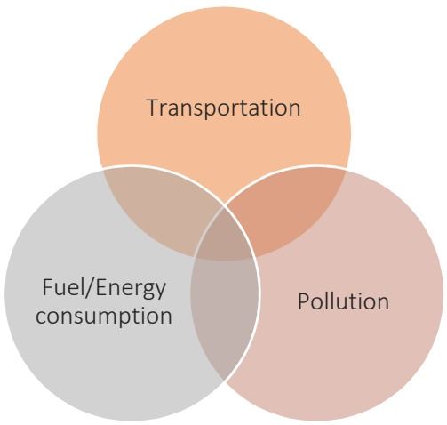
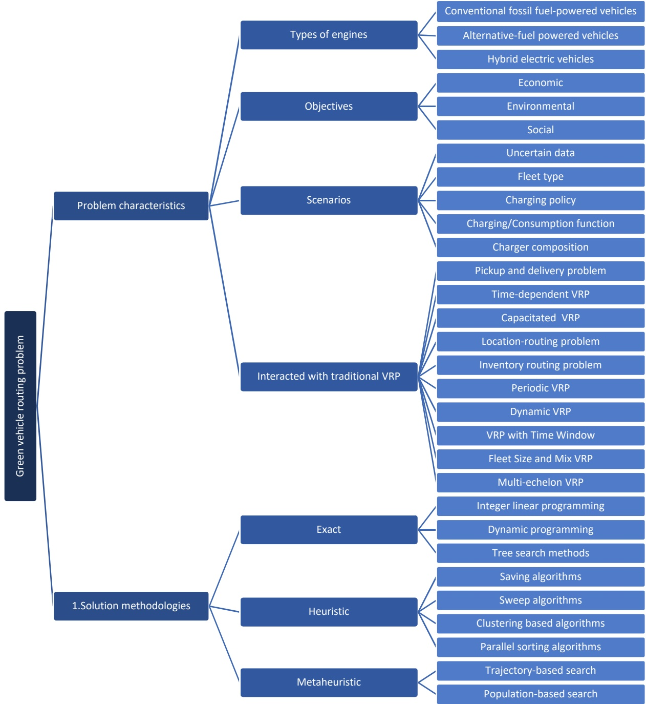
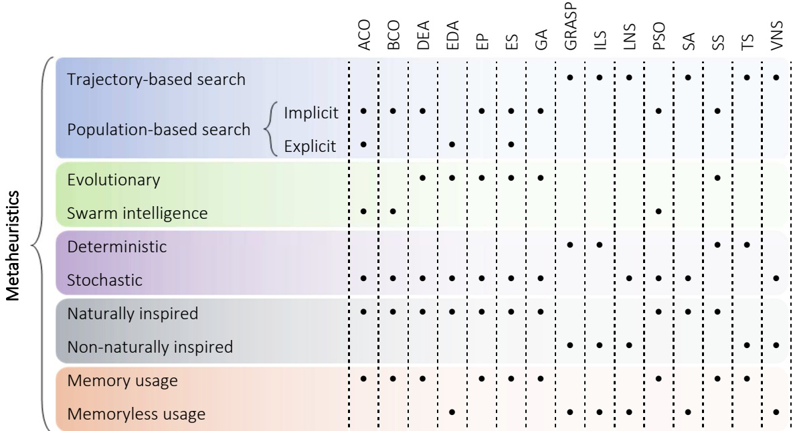
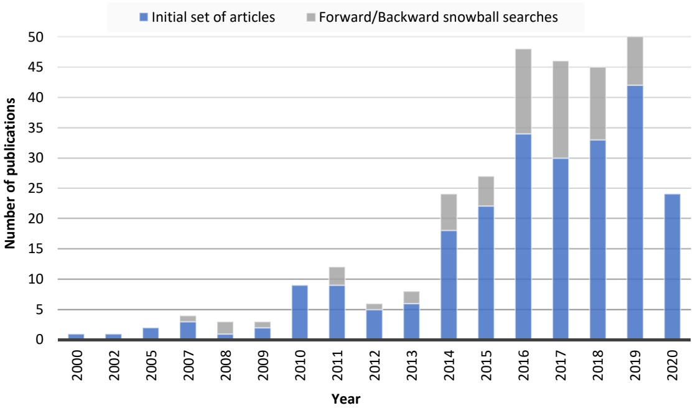
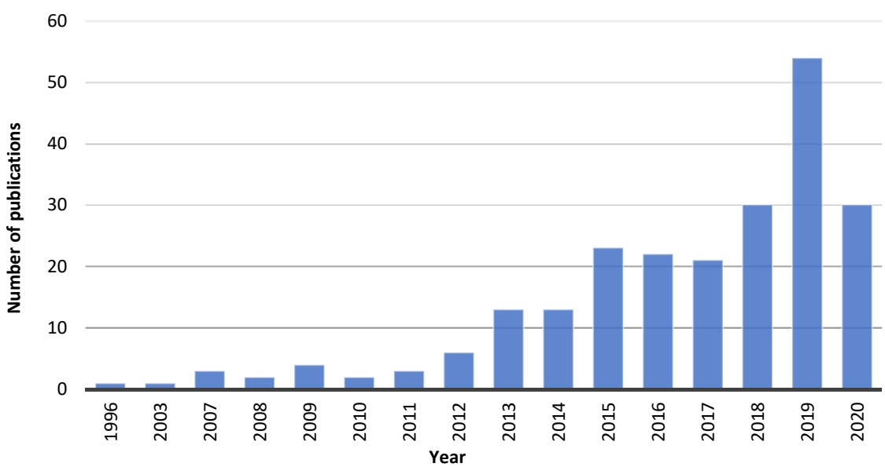

# Green vehicle routing problem: A state-of-the-art review

**Mohammad Asghari a**, **S. Mohammad J. Mirzapour Al-e-hashem a**, b,\*

(**mohammad.asghari@aut.ac.ir**, mirzapour@aut.ac.ir)

Department of Industrial Engineering and Management Systems, Amirkabir University of a Technology, Tehran, Iran

b Rennes School of Business, 2 Rue Robert d'Arbrissel, 35065 Rennes, France

\* **Corresponding author:**

**S.M.J. Mirzapour Al-e-hashem**

Assistant Professor, Department of Industrial Engineering and Management Systems, Amirkabir University of Technology, Tehran, Iran (mirzapour@aut.ac.ir, b.mirzapour@gmail.com)

Assistant Professor, Rennes School of Business, 2 Rue Robert d'Arbrissel, 35065 Rennes, France (seyed.mirzapour-al-e-hashem@esc-rennes.com)

Google scholar: https://scholar.google.com/citations?hl=en&user=YaIA0ioAAAAJ

## Mohammad Asghari

PhD candidate, Department of Industrial Engineering and Management Systems, Amirkabir University of Technology, Tehran, Iran (**mohammad.asghari@aut.ac.ir**)

Google scholar: https://scholar.google.com/citations?hl=en&user=LvQgUd0AAAAJ

# Green vehicle routing problem: A state-of-the-art review

## Abstract

**As energy overuse and generated pollution have a potential threat to our environmental and ecological conditions, many researchers have taken the initiative way to join the green campaign to prevent more damage to the environment. This paper investigates the main contributions related to the green vehicle routing problem (Green-VRP) and presents a classification scheme based on its variants considered in scientific literature, in particular, three major and applicable streams including internal combustion engine vehicles (ICEVs), alternative-fuel powered vehicles (AFVs), and hybrid electric vehicles (HEVs), and also several sub-categories for each of them. This systematic literature review intends to provide a comprehensive and structured survey of the state of knowledge and discuss the most important characteristics of the problems, including techniques of formulation, solution methodologies, and areas of application. This paper presents different analytical summary tables for each variant to emphasize some main features that provide the direction of the development of researches. Finally, to spot future avenues, gaps in the literature are distinguished to illustrate how new contributions are different from traditional problems.**

**Keywords: Green vehicle routing problem; Internal combustion engine vehicles; Alternativefuel powered vehicles; Hybrid electric vehicles; Systematic literature review**

## 1. Introduction

**The vehicle routing problem (VRP) is a combinatorial optimization that involves finding an optimal design of routes traveled by a fleet of vehicles to serve a set of customers. In the traditional VRP, we try to detect routes for a homogeneous fleet of vehicles to satisfy the customers’ demands. Every customer node is visited once by just one vehicle which begins** **and completes its travel at the central station, and some side constraints must be satisfied. In previous years, different variants have been intensively investigated. To study more details on the variants of VRP and its features, refer to Montoya-Torres et al. (2015) and Braekers et al. (2016).**

**According to the 2019 report of the world energy outlook series, the future estimation of energy systems indicates that a serious loss will happen by 2040 (World Energy Outlook 2019). This future decline in fossil energy availability and the pollution generated by unnatural resources lead to many efforts for preventing the damages by overcoming the pollution resulting from fossil fuel consumption. Advances in digital technologies and cost reductions in the renewable sources of energy, while eliminating some energy security dilemmas, provide tremendous opportunities for energy transitions. In the sustainable development scenario, in addition to the direct use of hydrogen and renewables, electricity would be one of the few energy sources experiencing an increase in consumption by 2040 (Höök et al., 2012), where the share of electricity in final consumption, less than half that of today oil, exceeds oil (World Energy Outlook 2019), mainly due to electric vehicles (EVs).**

**Additionally, in the last decade, regarding the growing knowledge about the hazardous effects of logistics activities, such as transportation which has a considerable impact on the ecological environment, requests for more environmentally friendly practices have increased (Lin et al., 2014). The European Union (EU) has targeted a 40% reduction in greenhouse gas (GHG) emissions by 2030 compared to 1990 (European Commission, 2014). This is a challenge for the transportation sector, which is responsible for 20% of total GHG emissions, according to the European Environment Agency (2014b). Moreover, with increasing urbanization, air quality in cities is emerging as a hot topic, which has led to a debate over the prohibition on internal combustion engine vehicles (ICEVs) in European metropolitan areas (European Commission, 2011; European Environment Agency, 2014a).**

**With technological developments, scientists concentrate on bringing down global emissions by considering new sources of energy as the base of their researches even though they are still in limited use (Iwata and Matsumoto, 2016). In this way, the green vehicle routing problem (Green-VRP) as an extension of the classic routing problem was introduced by Erdogan and Miller-Hooks (2012), a relatively new research field. To decrease energy consumption in fleet operations, Green-VRPs aim to minimize fuel consumption or adopt alternative-fuel powered vehicles (AFVs) solely or along with existing ICEVs in fleets.**

**As we know, the efforts of studies before 2010 mainly concentrated on classic routing problems. During this period, a few papers on Green-VRP especially EV had been carried out. Since 2010, routing problems covering pollution emissions and energy consumption have attracted the attention of researchers and became an important issue in recent years. However, in this field, no literature review of state-of-the-art and recent research has been published which had undertaken a systematic classification of the green logistics variants to shed light on future directions. Bridging this gap, this review work tries to review, categorize, and analyze featured articles in the field of green context. For earlier surveys, interested readers can refer to Lin et al. (2014).**

**The contribution of our survey is to provide a systematic and up-to-date review and clear classification of the existing studies on the Green-VRP, with an emphasis on the recent literature. This paper presents a new and broader classification of articles published until the end of 2019. In particular, the paper tries to highlight the lack of investigations and point out future research opportunities of research in the Green-VRPs, especially for conventional, electric, and hybrid vehicles. To shed light on the topic, we seek to review the optimization techniques which can better contribute to deal with the challenges of different types of engines. More importantly, a holistic overview of the past publications on the pollutionrouting problems (PRPs) is also summarized to inspire researchers to find out how the** **outcome of the investigations can be related to the solution of real-life problems. The paper also includes a comparative survey on the performance of the state-of-the-art heuristics/metaheuristics developed for the Green-VRP variants to systematize new contributions in the last few years.**

**Our review study generally motivated by elevating the scope of research through identified gaps and addressing the academic community with a useful insight into future directions and potential areas of further and more in-depth study. For practical purposes, the evaluation of transportation problems concerning environmental-related issues can help to gain a better understanding of the economic and environmental importance of vehicles with different features and limitations, and their relative role in operational settings which can be beneficial in acting at different levels to achieve green logistics. A summary of the terms and abbreviations used throughout the article is provided in Appendix A.**

**The rest of the study is organized as follows. Section 2 draws up the conceptual framework. Section 3 is devoted to a summary of the most important earlier review/partial-review papers and an overview of the research methodology. Section 4 contains a summary of the most relevant publications considered green logistics with conventional fossil fuel-powered vehicles (CFFVs), while Section 5 discusses detailed analyses and classifications of AFVs variants. This is followed by surveys on hybrid types of vehicles in Section 6. This section also highlights the recent contributions investigated mixed fleet of electric and conventional vehicles. To make these easier for interested readers, the formulation techniques, approaches of the solution, and other essential features are summarized in some tables. Eventually, Section 7 concludes the main findings of the literature review, research limitations, and directions for further research.**

## 2. Conceptual framework

**To characterize the existing literature on Green-VRP policies, this section proposes a conceptual framework. It is important to know the current view on the concept of green logistics in order to link it to academic progress and future promising research streams in the Green-VRP sub-areas. Based on our understanding, our work proposes the first conceptual framework by going into further detail regarding the attributes of Green-VRP. As depicted in Fig. 1, the proposed framework was derived in an integrated approach from three dimensions of the Green-VRP. The research on Green-VRP generally deals with the optimization of energy consumption to overcome pollution in logistics and transportation activities. In the next sections, different impacts of these dimensions of the green concerns of logistics in transport systems are discussed in more detail.**

Fig. 1. Three structured review term categories of Green-VRP.

**A comprehensive and practical taxonomy of Green-VRPs is undoubtedly a tool to hang the nature of the problem and identify interesting areas for future research for those who are absorbed in research on Green-VRPs. Based on the type of engine, we distinguish the classification scheme into three broad categories of Green-VRP, including ICEVs, EVs, and hybrid electric vehicles (HEVs). We also discuss their distinct characteristics, previous** **efforts, and employed solution methodologies. Classifying the literature on Green-VRP, we used a conceptual framework illustrated in Fig. 2. The framework considers various classification schemes to categorize the literature. Stripped down to the essential elements of the Green-VRP is containing based on the works treating the problem, we found consistency among the following aspects.**

Fig. 2. Conceptual framework used for classifying the green vehicle routing problems.

**Since we herein attempt to focus on making a taxonomy for categorizing research and examining their approach in optimizing fuel/energy consumption and reducing pollution, our classification scheme is based on the most common characteristics of elements of the problem and the algorithms rather than their application scenarios. An in-depth classification of the problem revealing sub-categories of each class is one of the main advantages of this design which provides a much clearer and wider horizon to the scientific progress of this problem. To some extent, the Green-VRP and its sub-categories are identified using this scheme. We briefly summarize them as follows:**

## 2.1. Problem characteristics

**Regarding the Green-VRP type, four major features of the problem have been discussed in the literature:**

## • Types of engines

**Over the growing use of diesel internal combustion engines, carbon dioxide emission resulting from fuel combustion increased significantly (European Environment Agency, 2013). This has led to an increase in research into more efficient and cleaner methods for using fossil fuels and a variety of alternative engines. To deal with the challenges of different types of engines as well as their problem characteristics and techniques, the framework dimension is classified by the sub-dimensions CFFVs, AFVs, and HEVs.**

Conventional fossil fuel-powered vehicles’ **exhaust fumes are among the most important sources of** $\mathrm{NO_{x}, SO_{2}}$ **, and** $\mathrm { C O } _ { 2 }$ **emissions. The pollution-routing problem, as one of the main related works, has been broadly considered in the literature, where the estimation of fuel** **consumption and generated** $\mathrm { C O } _ { 2 }$ **emissions by mobile sources is the main minimization criterion.**

Alternative-fuel powered vehicles **rely on greener energy sources like hydrogen, natural gas, electricity, etc. (Erdogan and Miller-Hooks, 2012). We concentrate on the approaches proposed to deal with the main obstacles encountered when replacing the conventional vehicles with the AFVs such as the scarcity of alternative fuel stations (AFSs) and the limited capacity of the fuel tank or battery of an AFV.**

Hybrid electric vehicles **have recently been developed to reduce the necessary stops and dependence on infrastructure by using two different engines, a pure electric motor and an internal combustion engine, which can be easily switched. To help researchers in finding a landscape of literature, we analyze exploited the results in detail and identify the gap.**

## • Objectives

**Green transportation can be achieved by extending the economic objectives of traditional VRP to take into account the social and environmental impacts related to fuel consumption and GHG emissions. There exist several references that have sought to formulate an inclusive objective function meeting green criteria and efficiency objectives simultaneously. Regarding different objective functions conducted on the literature, the routing problems with environmental considerations can be categorized based on economic (e.g. travel cost, station installation cost, fuel/charging cost), environmental (fuel consumption, emission, and environmental impacts), and social (e.g. satisfaction, level of service, journey risk, and responsibility) objectives.**

## • Scenarios

**This sub-dimension describes the scenario at hand according to their degree of realism, and they include strategic and planning attributes. The main issues must be re-examined and reformulated to deal with the new challenges associated with the restrictions of different types of vehicles, for example, the number and type of fuel stations that need to be established, the location of these stations, and their optimal capacity. They may influence the environmental and operational dimensions of the Green-VRP and ultimately affect the computational complexity of eventual solution procedures. To describe the influence of some of these aspects in the Green-VRP, the problem** scenarios **including** uncertain data, fleet type, charging policy, charging/consumption function**, and** charger composition**, are devoted to the review.**

## • Interacted with traditional VRP

**Green-VRP is a VRP concerning environmental issues. There are a wide variety of VRP types that can be combined with the Green-VRP models, making them comprehensive, more applicable, and closer to real issues. Setting the VRP in transportation planning provides opportunities to reduce greenhouse gas emissions through the inclusion of broader objective functions that reflect environmental cost. Thus, we draw the review on the Green-VRP, by analyzing how the Green-VRP interacts with the traditional VRP types.**

## 2.2. Solution methodologies

**Another dimension of our framework examines the characteristics of the algorithms used to solve the Green-VRPs as well as their computational complexity. The Green-VRP is NP-hard because it is a natural extension of the standard VRPs which are classified as NP-hard. Three general types of solution approaches have been presented in the literature,** exact algorithms, heuristics**, and** metaheuristics**. An exact algorithm always finds the optimal solution, but it can only tackle relatively small-sized problems. A heuristic algorithm is an experience-based technique for finding provably good-quality solutions through a series of processes or an iterative procedure within a relatively short execution time, however, it does not guarantee the optimality of the solution. As the extension of the heuristics, metaheuristics are random-based algorithms for exploring possible solutions into a large range. Each metaheuristic has its behavior and features. However, all of them share some fundamental components and execute operations that fall into a limited number of groups. See Talbi (2009) for a more detailed description of metaheuristics. As demonstrated in Fig. 3, metaheuristics can be classified as attending to different criteria, not exclusive between them.**

Fig. 3. Classification of the most common metaheuristics in solving the Green-VRPs.

• Trajectory-based, and population-based search

**Generally, metaheuristics are divided into trajectory-based and population-based search. The former means the metaheuristic keeps exploring the solution space by iteratively moving from the current solution to another promising solution in its neighborhood. As the iterations continue, the trajectory-based algorithms trace out a path by using one solution or a single agent at a time. Typical examples of trajectory-based search for Green-VRP are large neighborhood search (LNS), simulated annealing (SA), and variable neighborhood search (VNS). However, the latter, a population search based metaheuristic, uses multiple agents interacting and tracing out multiple paths which means after seeking out the best solutions in an iteration, the algorithm maintains a pool of these solutions as parents and so as to update the pool, continually selects good ones for producing promising offspring. Most of the population-based search algorithms have no prior information on the distribution of the points, therefore they** implicitly **detect them through processes of diversification and intensification, like ant colony optimization (ACO). On the contrary, some procedures, such as estimation of distribution algorithm (EDA), employ an approximation of the distribution in the sampling of the objective function which is called** explicit **metaheuristic (see Baluja, 1997).**

## • Evolutionary versus swarm intelligence algorithms

**Evolutionary algorithms are characterized by the presence of a population of individuals exposed to environmental pressures, which lead to natural selection, i.e. the survival of the fittest, and in turn an improvement in the average fitness of the population. The main evolutionary algorithms are genetic algorithm (GA), evolutionary programming (EP), and evolution strategy (ES). Swarm intelligence algorithms are directly inspired by the behavior of social animals such as ants, birds, bees, bats, and others. By using appropriate communication rules, the population as a whole exhibits a complex emergent behavior that is** **indeed very intelligent. ACO, bee colony optimization (BCO), and particle swarm optimization (PSO) are among the best-known swarm intelligence algorithms.**

## • Deterministic versus stochastic algorithms

**Deterministic metaheuristics, like iterated local search (ILS) and greedy randomized adaptive search procedure (GRASP), solve the optimization problems by making deterministic decisions. Conversely, stochastic algorithms, which include most of the metaheuristics, apply some random rules during the search process. In deterministic metaheuristics, the use of the same initial solution leads to the same final solution, while in stochastic algorithms such as SA, GA, and ES, different final solutions may be obtained from the same initial solution. This characteristic must be considered in evaluating the performance of metaheuristic algorithms.**

## • Nature inspired versus non-nature inspired algorithms

**Many algorithms have strategies or schemes inspired by elements of nature phenomena and have been developed by mimicking the intelligence characteristics of biological and physical agents, such as ACO, GAs, PSO, and SA. Other methods are not nature-inspired, like differential evolution algorithm (DEA), scatter search (SS), and tabu search (TS).**

## • Memory usage versus memoryless algorithms

**Some algorithms employ memory to store information extracted while exploring solution space, such as memories in the TS algorithm.**

## 3. Literature review

## 3.1. Related literature reviews

**The most important characteristic of the Green-VRP is harmonizing the environmental and economic objectives through achieving optimal design meeting the environmental-related issues and financial indexes. Due to the significant number of recent articles published in the domain of Green-VRPs, now is an appropriate time for carrying out a systematic literature review on the state-of-research. In order to show the need for this research, some review papers will be mentioned in this section. In Table 1, the earlier review/partial review studies and their main characteristics are summarized to clarify a structured review. To highlight the contribution of the study, Table 1 compares related review papers with regard to research focus, number of reviewed articles (Nu), time span, the development of a conceptual framework (Cf), using a review methodology (Rm) like a literature selection strategy to facilitate the search of scholarly databases, and scope of the review.**

**As illustrated in Table 1, we cannot observe a comprehensive review paper in the literature analyzing state-of-the-art recent publications on the Green-VRP. Aside from the duration of the studies, the most important limitation of surveys is the scope of research. Moreover, using a systematic state-of-the-art literature search and selection strategy and consequently more sample of works on Green-VRP than addressed by any of earlier survey papers makes it possible for us to reach the research objectives which have not been covered in the existing reviews. All of the studies in Table 1 are partial review papers with specific aims, for example in ICEV (Demir et al., 2014b; Park and Chae, 2014), HEVs, (Amjad et al., 2010; Hannan et al., 2014; Pelletier et al., 2016; Rahman et al., 2016), and EV (Pelletier et al., 2017; Juan et al., 2016). To this date, the literature lacks a well-organized analysis of the difficulties encountered by an integrated consideration including ICEVs, EVs, and HEVs of** **different types in the Green-VRP. The three-vehicle classes differ in terms of charging choices and engine operation.**

## Table 1

Main characteristics of earlier published review papers.

| Papers | Area | Nu | Span | Cf | Rm | Scope |
| --- | --- | --- | --- | --- | --- | --- |
| Amjad et al.(2010) | PHEV | 27 | Until 2009 |  |  | Design considerations; Technological challenges |
| Lin et al. (2014) | PRP, RL | 280 | Until 2013 |  | ✓ | Interacting of traditional VRP variants with Green-VRP; Research opportunities |
| Demir et al.(2014b) | ICEV | 53 | Until 2013 |  |  | Green road freight transportation; Factors affecting fuel consumption; Vehicle emission models |
| Hannan et al.(2014) | HEV | 114 | Until 2012 |  |  | Energy management system; Power conditioning; Propulsion system |
| Park and Chae (2014) | ICEV | 42 | 2000-2014 |  |  | Solution approaches; Fuel consumption |
| Juan et al. (2016) | EV | 114 | Until 2016 |  |  | Strategic, planning, and operational challenges |
| Pelletier et al.(2016) | EV, HEV | 100 | 2000-2014 |  |  | Good distribution; Research opportunities |
| Rahman et al.(2016) | EV, PHEV | 107 | 2008-2015 |  |  | Optimization techniques for charging infrastructure |
| Mahmudul et al.(2017) | AFV | 191 | Until 2016 |  |  | Production, characterization and performance of biodiesel |
| Pelletier et al.(2017) | EV | 115 | 1998-2016 |  |  | Battery degradation and behavior |
| Our Study | ICEV, AFV, HEV | 313 | 2000-2020 | ✓ | ✓ | The problem characteristics and solution methodologies of the Green-VRPs |

Nu: Number of reviewed articles, Cf: Conceptual framework, Rm: Review methodology, AFV: alternative-fuel powered vehicle, EV: Electric vehicle, HEV: Hybrid electric vehicle, ICEV: Internal combustion engine vehicle, PHEV: Plug-in hybrid electric vehicle, PRP: Pollution-routing problem, RL: Reverse logistics

**Among all the considered review studies in Table 1, Lin et al. (2014) just seek to investigate a vast number of publications in their study. However, they included articles published before 2013 and did not cover the publications on alternative fuel vehicles and HEVs. Although the papers of Rahman et al. (2016) and Pelletier et al. (2016) analyzed both electric and hybrid vehicles, their paper did not consider CFFVs and the number of examined papers is low. On the other hand, the mentioned review papers have not also undertaken some of the new promising lines of research on EVs yet. Therefore, it seems a full exploration of research challenges connected to the dimensions of EVs’ planning is needed to point out** **environmental concerns, strategic challenges, and emerging operational issues associated with the planning of EVs in routing problems.**

**Since hybrid electric vehicle routing problems have recently arisen in the literature, there is low awareness about how to overcome the optimizing obstacles of the use of different modes on variant segments of the route. Thus, there remains a continuing need for enriching relevant contributions either by real-world applications or theoretical analyses through. Accordingly, the analysis of exploited the results in detail and the identification of the gaps can help researchers to find a landscape of literature. Some of the partial review papers in this area are summarized below.**

**Amjad et al. (2010) provided a brief review of design considerations and technological challenges ahead of plug-in hybrid electric vehicles (PHEVs). Another review paper detailed hybrid vehicle technology and its short comes was explained by Hannan et al. (2014). Pelletier et al. (2016) can be mentioned here as they presented a survey of electric vehicular technology for good distribution. However, the authors ignored charging policies that affect battery lifespan, and also the fleet size and potential mix of ICEVs and EVs. Rahman et al. (2016) considered the algorithmic and computational aspects of various optimization methods employed for charging infrastructure.**

**As a consequence, despite the large number of articles published in recent years in the field of Green-VRP, there is not an integrated review after 2016 that provides a comprehensive (not partial) literature review. Furthermore, it is now necessary to reconstruct a systematic review paper is built upon new studies in the area to have a general overview of current and future research directions in Green-VRP. According to these dominating activities, the current paper tries to identify and review, from an operations research perspective, several open and difficult research challenges associated with sustainable transportation issues which** **are denoted as Green-VRP. The last row of Table 1 presents the role of our study in covering the literature gap.**

## 3.2. Research methodology

**To explore the trend of past and new contributions done on Green-VRP and its three major and applicable streams, CFFVs, EVs and HEVs, we have examined and analyzed the articles in order to better understand their development, which drew the fundamental philosophy of the presented paper. To gain a comprehensive overview of the state of knowledge on Green-VRPs, we conducted a systematic literature review according to the methodology offered by Cooper (2010) and used, for example, in Masae et al. (2020) and Osterrieder et al. (2020). To survey the literature, we have majorly used three sources: (1) several academic databases, including Scopus, ScienceDirect, EBSCO, Link, Springer, etc., accessed from the university library and using various keywords such as green vehicle routing problem, pollution-routing problem, electric vehicle, hybrid electric vehicle, green logistics, and so on; (2) bibliographies of book chapters and survey papers on Green-VRP; (3) a snowball search conducted by which all ignored papers that were cited in any of the studies found in the first and second sources (backward search) and all ignored papers that cited any of the studies found in the first and second sources (forward search) have been checked further for relevance. We ran our snowball for five rounds.**

**In the first two steps, we have ensured substantive relevance by requiring that each of the studies includes at least one keyword combination in its title, abstract, or list of keywords. In the next step, the snowballing approach, relevance of content is checked by manual analysis of their abstracts or, if needed, by completely reading all works. Backward and forward snowball searches enabled us to find 17 articles that had been missing in the first two steps. Eventually, we have discussed the results with experts to identify missing studies.**

**Discussions with experts helped to find another 9 additional works. Appendix B provides a simplified version of the research protocol adopted. As shown in Table 2, about 313 papers published between 2000 and 2020 are reviewed in this paper that reflect the environmental sensitivity consideration in routing problems and one can observe that this concern is increasing day by day.**

## Table 2

**The scientific contribution reviewed in this paper.**

| Year | Papers |
| --- | --- |
| 2000 | Pronello and André |
| 2002 | Plotkin et al. |
| 2005 | Barth et al.; Lübbecke and Desrosiers |
| 2007 | McKinnon; Palmer; Chan; Sciarretta and Guzzella |
| 2008 | Apaydin and Gonullu; Golden et al.; Gong et al. |
| 2009 | Upchurch et al.; Silva, et al.; Bradley and Frank |
| 2010 | Kuo; Scott et al.; Jovicic et al.; Maden et al.; Bauer et al.; Fagerholt et al.; Sbihi and Eglese; Amjad et al.; Urquhart et al. |
| 2011 | Conrad and Figliozzi; Bektaş and Laporte; Pitera et al.; Suzuki; Ubeda et al.; Faulin et al.; Xue et al.; Gonçalves et al.; Figliozzi; Bae et al.; Kuo and Wang; Rakha et al. |
| 2012 | Xiao et al.; Erdogan and Miller-Hooks; Demir et al.; Jabali et al.; Li; Höök et al. |
| 2013 | Wang and Cheu; Van Duin et al.; Pan et al.; Kwon et al.; Murgovski et al.; Franceschetti et al.; Feng and Figliozzi; Pradenas et al. |
| 2014 | Demir et al. (a); Demir et al. (b); Felipe et al.; Sassi et al.; Preis et al.; Schneider et al.; Afroditi et al.; Zheng et al.; Adler and Mirchandani; Lin et al.; Park and Chae; Jovanovic et al.; Cirovic et al.; Juan et al.; Kopfer et al.; Koç et al.; Frank et al.; Hannan, et al.; Tajik et al.; Archetti and Speranza; Zhang; Qian and Eglese; Molina et al.; Salimifard and Raeesi; |
| 2015 | Montoya-Torres et al.; Yang and Sun; Li-ying and Yuan-bin; Goeke and Schneider; Aggoune-Mtalaa et al.; Bruglieri et al.(a); Bruglieri et al.(b); Lebeau et al.; Tiwari and Chang; Schneider et al.; Chung and Kwon; Ding et al.; Fukasawa et al.; Liu et al.; Arslan et al.; Kramer et al. (a); Kramer et al. (b); Soysal et al. (a); Gharaei et al.; Malekly; Greenblatt and Shaheen; Li et al.; Soysal et al. (b); Niakan and Rahimi; Yang et al.; Zhang et al.; Sweda and Klabjan |
| 2016 | Braekers et al.; Rahman et al.; Dabia et al.; Iwata and Matsumoto; Desaulniers et al.; Li et al.; Casals et al.; Lin et al.; Keskin and Çatay; Liao et al.; Grandinetti et al.; Pelletier et al.; Hiermann et al. (a); Hiermann et al. (b); Penna et al.; Roberti and Wen; Wen et al.; Fiori et al.; Küçükoglu and Öztürk; Bektaş et al.; Yu et al.; Qazvini et al.; Yin and Chuang; Bruglieri et al.; Montoya et al.; Afshar-Bakeshloo et al.; Teng and Zhang; Verma and Sharma; Beiter and Tian; Fukasawa et al.; Koç and Karaoglan; Qian and Eglese; Sun and Zhou; Suzuki; Xiao and Konak; Ehmke et al.; Sanchez et al.; Kim et al.; Laporte; Juan et al.; Alinaghian and Naderipour; Naderipour and Alinaghian; Lee and Prabhu; Zeng et al.; Kumar et al.; Cheng et al.; Li et al.; Demir et al. |
| 2017 | Andelmin and Bartolini; Hof et al.; Schiffer and Walther (a); Schiffer and Walther (b); Montoya et al.; Froger et al.(a); Froger et al.(b); Pelletier et al.; Abdulaal et al.; Bruglieri et al.(a); Bruglieri et al.(b); Fetene et al.; Yuan et al.; Liu et al.; Sawik et al.; Mirmohammadi et al.; Jabir et al.; Kazemian and Aref; Mahmudul et al.; Franceschetti et al.; Qiu et al.; Eshtehadi et al.; Yavuz; Leggieri and Haouari; Zhang et al.; Mancini; Yu et al.; Sweda et al. (a); Sweda et al. (b); Çimen and Soysal; Soysal and Cimen; Toro et al.; Yavuz and Çapar; Nejad et al.; Huang et al.; Shukla et al.; Saka et al.; Setak et al.; Guo and Liu; Cheng et al.; Rahimi et al.; Tricoire and Parragh; Androutsopoulos and Zografos; Behnke and Kirschstein; Murakami; Vincent et al. |
| 2018 | Fernandez; Keskin and Çatay; Paz et al.; Koç et al.; Masmoudi et al. (a); Masmoudi et al. (b); Pelletier et al.; Wang et al. (a); Wang et al. (b); Wang et al. (c); Li et al. (a); Li et al. (b); Li et al. (c); Villegas et |

**al.; Zhang et al. (a); Zhang et al. (b); Zhang et al. (c); Madankumar and Rajendran; Schiffer and Walther; Lu et al.; Kancharla and Ramadurai; Schiffer et al.; Shao et al.; Zhou and Tan; Majidi et al.; Poonthalir and Nadarajan; Ferro et al.; Abad et al.; Micheli and Mantella; Niu et al.; Rabbani et al.; Suzuki and Lan; Kopfer and Vornhusen; Duan et al.; Soleimani et al.; Costa et al.; Kim and Park; Soysal et al. (a); Soysal et al. (b); Mirhedayatian and Yan; Stellingwerf et al. (a); Stellingwerf et al. (b); Letnik et al.; Rau et al.; Verma 2019 Keskin et al.; Froger et al.; Jie et al.; Breunig et al.; Macrina et al. (a); Macrina et al. (b); Pelletier et al.; Yu et al.; Zhen et al.; Karak and Abdelghany; Li et al. (a); Li et al. (b); Zhang et al. (a); Zhang et al. (b); Wang et al. (a); Wang et al. (b); Raeesi and Zografos; Dukkanci et al.; Bruglieri et al. (a); Bruglieri et al. (b); Bruglieri et al. (c); Koyuncu and Yavuz; Rauniyar et al.; Xiao et al.; Küçükoglu et al.; Basso et al.; Göpfert and Bock; Yu et al.; Poonthalir and Nadarajan; Van den Hove; Hiermann et al.; Kunnapapdeelert and Klinsrisuk; Goeke; Tan et al.; Bravo et al.; Saad and Bahadori; Sun et al.; Schröder and Cabral; Ghannadpour and Zarrabi; Rezgui et al.; Anderluh et al.; Eskandarpour et al.; Rastani et al.; Andelmin and Bartolini; Cortés-Murcia et al.; Kellner and Schneiderbauer; Erdem and Koç; Zuo et al.; Darvish et al.; Xu et al.; Ashtineh and Pishvaee 2020 Asghari and Mirzapour Al-e-Hashem (a); Asghari and Mirzapour Al-e-Hashem (b); Alkaabneh et al.; Zeng et al.; Bahrami et al.; Li et al. (a); Li et al. (b); Xiao et al.; Abdi et al.; Sayarshad et al.; Poonthalir et al.; Liao et al.; Zulvia et al.; Liu et al. (a); Liu et al. (b); Pitakaso et al.; Almouhanna et al.; Karakostas et al.; Ganji et al.; Shao and Dessouky; De and Giri; Zhang et al.; Giallanza and Puma; Cui et al.**

**Fig. 4 highlights a clear trend and plurality of scientific contributions on Green-VRP including an initial set of review and research articles and those found by forward/backward snowballing searches. As shown in the figure, over the years, the green concept and its several variants have gained growing attention in the scientific context, especially in the field of operations research. Fig. 4 underlines this fact that over 95 percent of the articles in the area of Green-VRP were written in the last decade. Table 3 exhibits the number of publications and the literature distribution and the scientific journals that published at least three articles. Reviewing Table 3 reveals that the subject of Green-VRP is approved by different journals and the distribution of journals in which the reviewed studies were published shows the desires of numerous operations research journals. As can be seen, the 10 most popular outlets with at least six articles in Green-VRP, including** Computers and Operations Research, Computers and Industrial Engineering, European Journal of Operational Research, International Journal of Production Economics, Journal of Cleaner Production, Transportation Research (parts: B, C, D, E**), and** Transportation Science**, only account for more than half of the total published papers. The residual papers have been** **published in another 73 journals. Also, 102 papers were found in different journals that had few publications (fewer than 3) in this field.**

Fig. 4. Studies in the context of Green-VRP and its variants (313 papers: 2000-2020).

## Table 3

**Journals distribution based on the publication source.**

| Journal | Number of articles |
| --- | --- |
| Journal of Cleaner Production | 24 |
| Transp. Res. Part D | 24 |
| European Journal of Operational Research | 22 |
| Transp. Res. Part E | 18 |
| Computers &amp; Operations Research | 17 |
| Transp. Res. Part B | 17 |
| Int. J. Production Economics | 15 |
| Computers &amp; Industrial Engineering | 12 |
| Transp. Res. Part C | 10 |
| Transportation Science | 10 |
| Expert Systems with Applications | 9 |
| Renewable and Sustainable Energy Reviews | 7 |
| Applied Soft Computing | 5 |
| International Transaction in Operational Research | 5 |
| Journal of the Operational Research Society | 4 |
| Electron. Notes Discrete Math | 3 |
| Energy | 3 |
| Resources, Conservation &amp; Recycling | 3 |
| Transportation Research Procedia | 3 |
| Others (1 &amp; 2 papers) | 102 |
| Total | 313 |

## 4. Conventional fossil fuel-powered vehicles

**Transportation is identified as one of the largest consumers of petroleum and responsible for a considerable part of air pollutants (Salimifard and Raeesi, 2014). The growing concerns about direct or indirect harmful impacts of transportation on both human and ecological systems indicate an urgent need to re-planning of the transportation network with special emphasis on reducing GHG and specifically** $\mathrm { C O } _ { 2 }$ **emissions (Bekta**ş **and Laporte, 2011). For this reason, Bekta**ş **and Laporte (2011) introduced the PRP aiming at determining an efficient vehicle dispatching plan with less pollution, specifically, lower** $\mathrm { C O } _ { 2 }$ **emissions. Decreasing carbon emissions is achievable by evolving the classic routing problem to consider the relevant environmental and social impact (e.g. Apaydin and Gonullu, 2008; Jovicic et al., 2010; Qian and Eglese, 2016; Sbihi and Eglese, 2010; Dabia et al., 2016; Palmer, 2007; Qiu et al., 2017; Fukasawa et al., 2016; Maden et al., 2010; Demir et al., 2012, 2014a, b; Molina et al., 2014; Zhang et al., 2015; Zeng et al., 2016; Bekta**ş **and Laporte, 2011; Afshar-Bakeshloo et al., 2016; Faulin et al., 2011; Cirovic et al., 2014; Sawik et al., 2017; Franceschetti et al., 2017; Eskandarpour et al., 2019; Li et al., 2020a; Zeng et al., 2020). Some green routing problems focus on energy consumption. Reducing fuel consumption may conflict with the appointed economic aims. Investigating the relationship between transportation and environmental impact of fuel consumption through the planning of routes can also bring valuable and practical ideas. Since a desirable reduction in fossil fuel consumption can correspondingly decrease GHG emissions significantly (Xiao et al., 2012), petroleum-based fuel consumption is known as a very important indicator in the Green-VRP (Kuo, 2010; Zeng et al., 2020). A survey paper that focuses on different fuel consumption formulations is Demir et al. (2014b). With aim of minimizing the fossil fuel consumption,**

**Bekta**ş **and Laporte (2011) extended traditional VRP with a broader and more comprehensive objective function that not only considers the distance traveled by vehicles, but it can also deal with the cost of travel time, fuel, and GHG emissions:**

$$
\begin{array}{l} \text {Min} \sum_ {(i, j) \in A} (c _ {f} + e) \alpha_ {i j} d _ {i j} w x _ {i j} + \sum_ {(i, j) \in A} (c _ {f} + e) \alpha_ {i j} f _ {i j} d _ {i j} \\ \qquad + \sum_ {(i, j) \in A} (c _ {f} + e) d _ {i j} \beta \left(\sum_ {r \in R} \bar {v} ^ {r ^ {2}} z _ {i j} ^ {r}\right) + \sum_ {j \in N _ {0}} p s _ {j} \end{array}\tag{1}
$$

**This function consists of four components. The first two calculate the cost implied by the gross weight of vehicle plus carried load. The next part calculates the cost incurred by variations in speed. These three components translated directly into the total cost of fuel** consumption and emission of greenhouse gases measured by the unit cost $( c _ { f } + e )$ **multiplied by the total amount of fuel consumed over each arc (\$, %). All used constants and decision variables are presented in Table 1A of Appendix C. Recently, Xiao et al. (2020) extended the discrete PRP of Bektas and Laporte (2011) to a continuous case through taking the travel speed as a continuous decision variable, such that all related scheduling variables including travel time, load flow, and departing/arrival/waiting times are all treated as continuous decision variables.**

**The models in the PRP commonly consider a constant energy consumption rate (ECR) which has a linear relationship with the distance traveled by vehicles. To consider the fuel consumption in the formulation, it is necessary to calculate the amount of consumption according to the different conditions of the traveling vehicles. As reported by the US Department of Energy (2008), some factors such as the weight of the load, travel speed as well as distance considerably affect the amount of fuel consumption. Several relevant references about the fuel consumption exist in the literature, which calculate the carbon dioxide emission based on more complex factors such as velocity, payload, the road gradient,** **and driving habits (Scott et al., 2010; Kuo, 2010; Tiwari and Chang, 2015; Bekta**ş **et al., 2016; Xiao et al., 2012; Murakami, 2017; Kim et al., 2016; Yu et al., 2019; Park and Chae, 2014; Laporte, 2016).**

**Table 4 reviews the relevant works on the ICEVs published between 2015 to 2020. We illustrate the main characteristics of the mathematical models including fleet type, considering capacity restriction (Ca.), load (L.), speed (S.), time windows (TW), multi-objective function (MO), the objective functions (Obj.) and the approaches used to solve the problem. Homogeneous and heterogeneous vehicles are indicated by Ho and Ht. DP, NRGA, and NSGA-II correspond to dynamic programming, non-dominated ranking genetic algorithm, and non-dominated genetic algorithm II, respectively. Table 5 presents the defines the encoding used for each objective function.**

## Table 4

Summary of the previous work on the ICEVs.

<table><tr><td rowspan="2">Study</td><td colspan="2">Fleet type</td><td rowspan="2">Ca.</td><td rowspan="2">L.</td><td rowspan="2">S.</td><td rowspan="2">TW</td><td rowspan="2">MO</td><td rowspan="2">Obj.</td><td rowspan="2">Solution method</td></tr><tr><td>Ho</td><td>Ht</td></tr><tr><td>Kramer et al. (2015a, b)</td><td>✓</td><td></td><td>✓</td><td>✓</td><td>✓</td><td>✓</td><td>✓</td><td>1, 3</td><td>ILS</td></tr><tr><td>Fukasawa et al. (2016)</td><td>✓</td><td></td><td>✓</td><td>✓</td><td>✓</td><td>✓</td><td></td><td>1, 3</td><td>Exact method</td></tr><tr><td>Kumar et al. (2016)</td><td>✓</td><td></td><td>✓</td><td>✓</td><td>✓</td><td>✓</td><td>✓</td><td>3, 12</td><td>Self-Learning PSO</td></tr><tr><td>Suzuki (2016)</td><td>✓</td><td></td><td>✓</td><td>✓</td><td>✓</td><td></td><td>✓</td><td>3</td><td>SA &amp; TS</td></tr><tr><td>Behnke and Kirschstein (2017)</td><td></td><td>✓</td><td>✓</td><td>✓</td><td></td><td></td><td></td><td>3</td><td>Exact method</td></tr><tr><td>Cheng et al. (2017)</td><td></td><td>✓</td><td>✓</td><td>✓</td><td>✓</td><td></td><td></td><td>1, 3, 8, 16</td><td>Brach-and-cut</td></tr><tr><td>Çimen and Soysal (2017)</td><td>✓</td><td></td><td>✓</td><td>✓</td><td>✓</td><td></td><td>✓</td><td>3, 8</td><td>DP</td></tr><tr><td>Eshtehadi et al. (2017)</td><td>✓</td><td></td><td>✓</td><td>✓</td><td>✓</td><td>✓</td><td></td><td>3</td><td>Exact method</td></tr><tr><td>Franceschetti et al. (2017)</td><td>✓</td><td></td><td>✓</td><td>✓</td><td>✓</td><td>✓</td><td>✓</td><td>1, 3</td><td>ALNS</td></tr><tr><td>Jabir et al. (2017)</td><td>✓</td><td></td><td>✓</td><td>✓</td><td></td><td></td><td>✓</td><td>2, 3</td><td>ACO &amp; VNS</td></tr><tr><td>Murakami (2017)</td><td></td><td>AFV &amp; ICEV</td><td>✓</td><td>✓</td><td>✓</td><td></td><td></td><td>2, 16</td><td>Exact method</td></tr><tr><td>Soysal and Cimen (2017)</td><td>✓</td><td></td><td>✓</td><td>✓</td><td>✓</td><td></td><td></td><td>2</td><td>DP</td></tr><tr><td>Tricoire and Parragh (2017)</td><td></td><td>AFV &amp; ICEV</td><td>✓</td><td>✓</td><td></td><td></td><td>✓</td><td>3, 12</td><td>Exact method</td></tr><tr><td>Toro et al. (2017)</td><td>✓</td><td></td><td>✓</td><td>✓</td><td>✓</td><td></td><td>✓</td><td>3, 12</td><td>Exact method</td></tr><tr><td>Yavuz (2017)</td><td></td><td>AFV &amp; ICEV</td><td></td><td></td><td></td><td></td><td></td><td>2</td><td>Heuristic procedure</td></tr><tr><td>Yavuz and Çapar (2017)</td><td></td><td>AFV &amp; ICEV</td><td>✓</td><td></td><td></td><td></td><td></td><td>2, 3, 8</td><td>VNS</td></tr><tr><td>Abad et al. (2018)</td><td>✓</td><td></td><td>✓</td><td>✓</td><td>✓</td><td>✓</td><td>✓</td><td>2, 3, 12</td><td>NRGA, NSGA-II &amp; PSO</td></tr><tr><td>Micheli and Mantella (2018)</td><td></td><td>✓</td><td>✓</td><td>✓</td><td>✓</td><td></td><td></td><td>2</td><td>Exact method</td></tr><tr><td>Niu et al. (2018)</td><td>✓</td><td></td><td>✓</td><td>✓</td><td>✓</td><td>✓</td><td></td><td>1, 3</td><td>TS</td></tr><tr><td>Poonthalir and Nadarajan (2018)</td><td>✓</td><td></td><td></td><td></td><td>✓</td><td></td><td>✓</td><td>2, 3</td><td>PSO</td></tr><tr><td>Soysal et al. (2018a)</td><td>✓</td><td></td><td>✓</td><td>✓</td><td>✓</td><td></td><td></td><td>1, 8, 12</td><td>Exact method</td></tr><tr><td>Zhang et al. (2018b)</td><td>✓</td><td></td><td>✓</td><td>✓</td><td>✓</td><td>✓</td><td></td><td>3, 8, 11</td><td>ALNS</td></tr><tr><td>Anderluh et al. (2019)</td><td></td><td>AFV &amp; ICEV</td><td>✓</td><td></td><td></td><td></td><td>✓</td><td>2, 3, 4</td><td>LNS</td></tr><tr><td>Dukkanci et al. (2019)</td><td>✓</td><td></td><td>✓</td><td>✓</td><td>✓</td><td>✓</td><td></td><td>3, 12</td><td>Local search</td></tr><tr><td>Ghannadpour and Zarrabi (2019)</td><td></td><td>✓</td><td>✓</td><td>✓</td><td></td><td>✓</td><td>✓</td><td>2, 3, 17, 18</td><td>NSGA-II</td></tr><tr><td>Li et al. (2019b)</td><td>✓</td><td></td><td>✓</td><td></td><td></td><td></td><td>✓</td><td>2, 3, 7, 11</td><td>ACO</td></tr><tr><td>Koyuncu and Yavuz (2019)</td><td></td><td>AFV &amp; ICEV</td><td>✓</td><td></td><td></td><td>✓</td><td></td><td>2</td><td>Brach-and-cut</td></tr><tr><td>Raeesi and Zografos (2019)</td><td></td><td>ICEV</td><td></td><td>✓</td><td>✓</td><td>✓</td><td></td><td>1, 3, 7</td><td>Exact method</td></tr><tr><td>Rauniyar et al. (2019)</td><td>✓</td><td></td><td></td><td>✓</td><td>✓</td><td></td><td></td><td>2, 3</td><td>NSGA-II</td></tr><tr><td>Wang et al. (2019a)</td><td></td><td>AFV &amp; ICEV</td><td></td><td>✓</td><td></td><td></td><td></td><td>3</td><td>TS</td></tr><tr><td>Eskandarpour et al. (2019)</td><td></td><td>AFV &amp; ICEV</td><td>✓</td><td></td><td></td><td></td><td>✓</td><td>2, 3</td><td>Multi-Directional Local Search</td></tr><tr><td>Xu et al. (2019)</td><td>✓</td><td></td><td>✓</td><td>✓</td><td>✓</td><td>✓</td><td>✓</td><td>3, 18</td><td>NSGA-II</td></tr><tr><td>Alkaabneh et al. (2020)</td><td></td><td>✓</td><td>✓</td><td>✓</td><td>✓</td><td></td><td></td><td>2, 11, 12</td><td>Exact method</td></tr><tr><td>Asghari and Mirzapour Al-e-Hashem (2020a)</td><td></td><td>✓</td><td>✓</td><td>✓</td><td></td><td>✓</td><td>✓</td><td>3, 8, 11, 14</td><td>Self-learning NSGA-II</td></tr><tr><td>Karakostas et al. (2020)</td><td></td><td>✓</td><td>✓</td><td>✓</td><td>✓</td><td></td><td></td><td>1, 2, 3, 8, 12</td><td>VNS</td></tr></table>

## Table 5

Explanation of the objective functions used in Table 4 and 7.

| 1: Vehicle cost/driver wage | 7: Total makespan (duration) | 13: Battery swapping cost |
| --- | --- | --- |
| 2: Traveling cost/time | 8: Fueling cost/time | 14: Violated time windows penalty |
| 3: Fuel consumption/emission | 9: Battery cost | 15: Recharging cost |
| 4: Waiting/disturbance cost | 10: Charging cost | 16: Fixed and maintenance cost |
| 5: Station installation cost | 11: Profit/revenue | 17: Size of fleet |
| 6: Stopping cost/time at a station | 12: Operational costs | 18: Satisfaction |

**As shown in Table 4, most PRPs examined vehicle weight, speed, and travel time as effective factors on greenhouse emissions. For example, Bekta**ş **and Laporte (2011) proposed a PRP considering speed and load as main factors in generating pollutions and utilized a fuel consumption function which was previously introduced by Barth et al. (2005) in a** comprehensive modal emission model. Their calculation of fuel consumption and $\mathrm { C O } _ { 2 }$ emissions for a given link $( i , j )$ **with length of** $d _ { i j }$ **depends on distance, speed, and load carried on the vehicle (including curb weight):**

$$
F _ {i j} = \omega \gamma d _ {i j} \left(\frac {M (a _ {i j} + g \sin \theta_ {i j} + g C _ {r} \cos \theta_ {i j}) + 0 . 5 C _ {d} \rho A v _ {i j} ^ {2}}{1 0 0 0 \eta \times \eta_ {t f}} + \frac {k N V}{v _ {i j}}\right)\tag{2}
$$

**In Table 2A of Appendix C, detailed notations of Eq. (2) are provided. Their model has benefited from dependence on fuel type and viewing biodiesel as an alternative fuel applied in existing conventional gasoline or diesel vehicles, either on its own or blended with petroleum-based diesel (Verma and Sharma, 2016). As quantified by Ashtineh and Pishvaee** **(2019), biodiesel is capable of reducing GHG emissions by 37%. Besides, due to the suitability and properties of biodiesel, a specific diesel-powered vehicle does not need any modification in the engine for employing biodiesel instead of (or mixed with) diesel and new ones operate on biodiesel fuels without any adjustments (Beiter and Tian, 2016). For more information about biodiesel, interested readers can refer to Mahmudul et al. (2017), Masmoudi et al. (2018a) and Xue et al. (2011).**

**Bauer et al. (2010), Figliozzi (2011), McKinnon (2007), Pan et al. (2013), and Letnik et al. (2018) explicitly concentrated on minimizing the amount of** $\mathrm { C O } _ { 2 }$ **emission in intermodal freight transport and showed its potential effect on decreasing pollutions. Previous developments in this field, including a review of various vehicle-emission formulations as well as their applications in common freight transportation, were comprehensively reviewed by Bekta**ş **et al. (2016). The first study that incorporates minimizing carbon dioxide equivalent emissions in a routing problem with backhauls was done by Ubeda et al. (2011). The authors showed that backhauling can be an effective way in enhancing energy consumption and controlling GHG emissions. Stellingwerf et al. (2018a, b) extend the loaddependent model in temperature-controlled road transportation to reduce refrigeration emissions which is responsible for 40% of the** $\mathrm { C O } _ { 2 }$ **emissions. They showed that in cooled transport, emissions can reduce by driving on higher speed routes. Recently, Van den Hove et al. (2019) developed a cyclist routing procedure which aims at minimizing personal exposure to black carbon with assuming a gradual transition from routes reducing average exposure to routes reducing peak exposure. In the field of road freight transportation, Schröder and Cabral (2019) introduced a three-dimensional routing model based on Geographic Information System (GIS) to show the impacts of road inclination and varying velocities on fuel consumption and GHG emission. Kellner and Schneiderbauer (2019) provided suggestions for a global carbon accounting standard in road freight transportation. They** **studied three road freight GHG emission allocation scenarios and used the Shapley value to study the accurateness of various allocation rules.**

**In the previous years, various features of VRPs have been incorporated into the PRPs literature (Asghari and Mirzapour Al-e-Hashem, 2020b), including vehicle capacities and customer time windows (Figliozzi, 2011; Bekta**ş **and Laporte, 2011; Franceschetti et al., 2013; Koç et al., 2014; Qian and Eglese, 2016; Xiao and Konak, 2016; Costa et al., 2018; Majidi et al., 2018; Bravo et al., 2019; Yu et al., 2019), uncertain data (Tajik et al., 2014; Malekly, 2015; Demir et al., 2016; Soysal et al., 2018a; Zhang et al., 2018a; Giallanza and Puma, 2020), heterogeneous feet (Koç et al., 2014; De and Giri, 2020; Ganji et al., 2020), time dependency (Figliozzi, 2011; Androutsopoulos and Zografos, 2017; Raeesi and Zografos, 2019; Zulvia et al., 2020). Also, the PRP has conducted in other VRP-related researches like pickup and delivery problem (Tajik et al., 2014; Majidi et al., 2018), inventory routing problem (Soysal et al., 2015b; Niakan and Rahimi, 2015; Cheng et al., 2016; Cheng et al., 2017; Rahimi et al., 2017; Rau et al., 2018; Soysal et al., 2018a; Darvish et al., 2019; Alkaabneh et al., 2020; Karakostas et al., 2020), and location-routing problem (Qazvini et al., 2016; Tricoire and Parragh, 2017; Toro, 2017; Letnik et al., 2018; Zhang et al., 2018a ; Dukkanci et al., 2019; Li et al., 2019a; Karakostas et al., 2020; Pitakaso et al., 2020).**

## 4.1. Time-dependent problems

**The time-dependent Green-VRP literature has widely concentrated on time-dependent travel times mostly because of road congestion. The studies are divided into static or dynamic models based on the time that may be assumed to be constant for a given time interval or change dynamically, respectively. The static formulations cover deterministic (Keskin et al., 2019; Franceschetti et al., 2017; Wang et al., 2019b; Jabali et al., 2012; Poonthalir and**

**Nadarajan, 2018; Raeesi and Zografos, 2019; Soysal et al., 2015a) or stochastic features (Çimen and Soysal, 2017; Rabbani et al., 2018; Eshtehadi et al., 2017) whereas Lee and Prabhu (2016) and Soysal and Çimen (2017) dealt with dynamic models. Recent papers of time-dependent PRP are suggested here. Figliozzi (2011), Demir et al. (2012, 2014a), Li (2012), Franceschetti et al. (2013), Qian and Eglese (2014, 2016), Xiao and Konak (2016), Ehmke et al. (2016), Qazvini et al. (2016), Sanchez et al. (2016), Alinaghian and Naderipour (2016), Naderipour and Alinaghian (2016), Guo and Liu (2017), Huang et al. (2017), Kazemian and Aref (2017), Setak et al. (2017), Androutsopoulos and Zografos (2017), Dukkanci et al. (2019), Xu et al. (2019), Yu et al. (2019), Liu et al. (2020a), and Zulvia et al. (2020).**

**Pronello and André (2000) offered, to the best of our knowledge, the first study that considered traveling time for estimating the pollution generated by a vehicle. Palmer (2007) developed a routing model and calculated the amount of carbon dioxide as well as distance and traveling time. They tried to examine the effects of speed on emissions reduction in different traffic situations in the context of traffic congestion with time windows. A timedependent routing problem in different traffic scenarios was considered Sbihi and Eglese (2010). When the vehicles are moving at their optimum speeds, less pollution is generated, therefore directing fleet away from congestion tends to be greener, albeit new planning results in taking longer routes. Also, Maden et al. (2010) solved the same optimization problem with the objective of minimization of the total travel time and reported about a 7% decrease in carbon emissions by a function conducted from the time-varying speeds. Qian and Eglese (2014) addressed a least polluting problem for a single route in a network with time-varying speeds where optimal routes and speeds are determined by the level of congestion on the roads at the time as follows:**

$$
\min \sum_ {k = 1} ^ {N} \alpha . F C \Big (s (z ^ {k}) \Big). d (z ^ {k})\tag{3}
$$

**where** $\alpha$ is a conversion factor used to calculate $\mathrm { C O } _ { 2 } \mathrm { e } .$ , is a sequence of arcs, $s ( z ^ { k } )$ **and** $d ( z ^ { k } ) , k = 1 , \ldots , N$ **are associated speeds and length of arcs, respectively.** $F C ( s )$ **is the vehicle fuel consumption function based on the speed-emission coefficients reported in Road Vehicle Emission Factors (2009). Since the relationship form varies at very low and very high speeds, the function is only valid when the vehicle speed is between 6 and 90 kilometers per hour. In addition, for any arc, the time taken to drive from the depot** $( c _ { 0 } )$ **t**o the last customers $( c _ { r } )$ is given by Eq. (4) where $b ( c _ { r } )$ **and** $w ( c _ { r } ) , r = 1 , \ldots , p$ **are the service time and waiting time for customers, respectively.**

$$
t _ {k ^ {\prime}} = \sum_ {k = 1} ^ {k ^ {\prime}} \{d (z ^ {k}) / s (z ^ {k}) \} + \sum_ {r = 1} ^ {m - 1} \{b (c _ {r}) + w (c _ {r}) \}\tag{4}
$$

**To improve fuel economy, Fagerholt et al. (2010) tried to optimize the speed of each segment of routes in a transportation problem with fixed shipping paths and time windows. Mirmohammadi et al. (2017) modeled a periodic Green-VRP with time-dependent urban traffic congestion and time window to minimize** $\mathrm { C O } _ { 2 }$ **emission and penalties of earliness and lateness. To decrease the amount of fuel consumption and pollutants in a time-dependent problem, Kuo (2010) applied a string-based SA on retail stores. Their formulating is based on the calculation done by Kuo (2010). Suzuki (2011) also investigated a time-dependent routing problem with multi-stop trucks which aims to decrease fuel consumption and the resulting emissions. Xiao et al. (2012) reached about twenty-five percent improvement in fuel consumption by employing a regression formulation, however, their routing model had a longer traveling time and distance. Li et al. (2016) investigated a two-echelon timeconstrained VRP in linehaul-delivery systems that takes** $\mathrm { C O } _ { 2 }$ **emissions per ton-kilometer as the objective. The authors showed that adjusting the central depot location and eliminating empty-running of tractors can reduce the emissions. To illustrate the fuel consumption of trucks in congested areas, Suzuki and Lan (2018) recently developed previous consumption models to include deceleration and negative effects of acceleration. The authors assumed that the ECR cannot be lower than that of engine idling, to lessen the unreal case of negative fuel burn during the deceleration condition.**

## 4.2. Pickup and delivery problems

**Recently, Kunnapapdeelert and Klinsrisuk (2019) addressed the comparison of pickup and delivery and green pickup and delivery problem (Green-PDP) by employing a differential evolution algorithm (DEA). The authors proved that planning routes by minimizing GHG lead to more environmentally friendly design than planning routes when concentrating just on minimizing total cost. To address Green-PDPs with the lowest** $\mathrm { C O } _ { 2 }$ **emissions, Tajik et al. (2014), Li et al. (2015), Yu et al. (2016), Qazvini et al. (2016), Guo and Liu (2017), Majidi et al. (2018), Wang et al. (2018a), Abad et al. (2018), Soleimani et al. (2018), Soysal et al. (2018b), Sun et al. (2019), Tan et al. (2019), Abdi et al. (2020), and Asghari and Mirzapour Al-e-Hashem (2020a) are suggested papers.**

**Li et al. (2015) investigated a tractor-semitrailer routing problem with many-to-many demand aiming at minimizing** $\mathrm { C O } _ { 2 }$ **emissions. Qazvini et al. (2016) reconsidered a multi-depot Green-PDP along with time windows to lessen fuel consumption. Following up, Majidi et al. (2018) investigated a nonlinear mixed-integer programming model for PRP with simultaneous pickup and delivery and employed an ALNS heuristic to solve it. Their calculation of fuel consumption was based on comprehensive modal emission model introduced by Barth et al. (2005). In a cooperative Green-PDP with the lowest** $\mathrm { C O } _ { 2 }$ **emission, Wang et al. (2018a) used** **the cooperative game theory to address the compensation and profit distribution. By using a bi-objective programming model for pickup and delivery PRP, Abad et al. (2018) minimized the total system cost, fuel consumption, and the resulting air pollution. Soleimani et al. (2018) also proposed a multi-objective nonlinear mathematical model for the Green-PDP of end of life (EOL) products. The authors indicated that the applied problem is capable of minimizing the cost of distribution center set-up, fuel, and providing vehicles, as well as reducing carbon emission. Recently, a scarce delivery-pickup problem was introduced by Asghari and Mirzapour Al-e-Hashem (2020a) to integrate a kind of crowdsourcing into a for-profit corporation.**

## 4.3. Heterogeneous fleet problems

**In the literature, most of studies are based on the assumption that vehicles in the fleet are homogeneous. The PRP is one of the important types of Green-VRP that specifically requires a heterogeneous fleet of vehicles; firstly, because many companies use various vehicles having different kinds of engines (ICEVs, EVs, or HEVs), new and old models, and various brands; and secondly, because vehicles may generate a variety of emissions (Kwon et al., 2013; Koç et al. 2014; Kopfer et al., 2014; Juan et al., 2014; Yavuz, 2017; Saka et al., 2017). A significant improvement in air pollutions reduction was demonstrated in an** $\mathrm { C O } _ { 2 }$ **emission minimization routing decision modeled by Pitera et al. (2011) for an urban pickup system with a heterogeneous fleet. To minimize emission and weighted tardiness, Xiao and Konak (2016) formulated a time-dependent heterogeneous Green-VRP and determined travel schedules of different vehicles. The latest investigations on the heterogeneous Green-VRP, where the reduction of carbon emissions is studied, can be found in the work of Bravo et al. (2019), Kancharla and Ramadurai (2018) Micheli and Mantella (2018), Raeesi and Zografos** **(2019), Yu et al. (2019), Wang et al. (2019a), Li et al. (2018b), De and Giri (2020), and Ganji et al. (2020).**

## 4.4. Solution methodologies for PRPs

**The Green-VRP is an NP-hard problem due to this fact that it is a natural extension of the standard VRP which is classified as NP-hard, thus most of the studies in this field, as summarized in Table 6, developed local search-based metaheuristics, such as simulated annealing, tabu search and adaptive large neighborhood search, which seems have thoroughly performed satisfying in this context. Since approximate approaches can obtain near-optimal solutions for large-sized numerical cases within a very satisfactory run time, they have been frequently employed in research. In comparison with the early heuristics, Metaheuristics search the solution space thoroughly which sometimes allows for inferior and infeasible moves and also combines solutions to make new ones. In addition to better performance and lower computation time, metaheuristics are able to consistently generate high-quality solutions than classical heuristics. Table 6 reviews the metaheuristics algorithms for ICEVsrelated literature published in the recent decade.**

**Tabu search algorithm employed by Jabali et al. (2012) reached an average optimality gap of 4% over the different sets. Kramer et al. (2015b) showed that combining an ILS with speed optimization algorithm and integer programming approach over a set partitioning formulation consistently produces solutions of high quality on the fuel consumption VRP. Their computational experiments performed on two standard problems with environmental considerations, Christofides et al. (1979) and Golden et al. (1998), show that the average gaps between the proposed algorithm and the best-known solutions are 0.16 and 0.31 percent, respectively. These gaps are much smaller than the results of Xiao et al. (2012) who achieved gaps of 2.20 and 1.95 percent. Although the average improvement in the solution-value** **obtained by a two-stage hybrid algorithm using SA and TA proposed by Suzuki (2016) is relatively small for Christofides et al. (1979) samples (0.39%), it significantly increases to 2.64% for Golden et al. (1998) samples. However, the proposed method was rather slow, requiring 1.4-2.9 times longer computation time than a comparable procedure in the benchmark. Franceschetti et al. (2017) employed the ALNS algorithm on the Kramer et al. (2015b) instances and show that it is very robust as in most cases, the percentage gap between best and average solution is of the order of 1–2%.**

## Table 6

Metaheuristic optimization algorithms employed in the ICEVs-related papers .

<table><tr><td>Study</td><td>ACO</td><td>DEA</td><td>GA/NSGA-II</td><td>ILS</td><td>A-/LNS</td><td>PSO</td><td>SA</td><td>A-/TS</td><td>A-/E-/VNS</td><td>Other</td></tr><tr><td></td><td colspan="10">Kuo (2010)</td></tr><tr><td></td><td colspan="10">Kuo and Wang (2011)</td></tr><tr><td></td><td colspan="10">Demir et al. (2012)</td></tr><tr><td></td><td colspan="10">Jabali et al. (2012)</td></tr><tr><td></td><td colspan="10">Li (2012)</td></tr><tr><td></td><td colspan="10">Xiao et al. (2012)</td></tr><tr><td></td><td colspan="10">Kwon et al. (2013)</td></tr><tr><td></td><td colspan="10">Cirovic et al. (2014)</td></tr><tr><td></td><td colspan="10">Demir et al. (2014a)</td></tr><tr><td></td><td colspan="10">Jovanovic et al. (2014)</td></tr><tr><td></td><td colspan="10">Kog et al. (2014)</td></tr><tr><td></td><td colspan="10">Kramer et al. (2015b)</td></tr><tr><td></td><td colspan="10">Yang et al. (2015)</td></tr><tr><td></td><td colspan="10">Zhang et al. (2015)</td></tr><tr><td></td><td colspan="10">Cheng et al. (2016)</td></tr><tr><td></td><td colspan="10">Ehmke et al. (2016)</td></tr><tr><td></td><td colspan="10">Naderipour and Alinaghian (2016)</td></tr><tr><td></td><td colspan="10">Qian and Eglese (2016)</td></tr><tr><td></td><td colspan="10">Sanchez et al. (2016)</td></tr><tr><td></td><td colspan="10">Suzuki (2016)</td></tr><tr><td></td><td colspan="10">Teng and Zhang (2016)</td></tr><tr><td></td><td colspan="10">Yin and Chuang (2016)</td></tr><tr><td></td><td colspan="10">Franceschetti et al. (2017)</td></tr><tr><td></td><td colspan="10">Jabir et al. (2017)</td></tr><tr><td></td><td colspan="10">Setak et al. (2017)</td></tr><tr><td></td><td colspan="10">Androutsopoulos and Zografos (2017)</td></tr><tr><td></td><td colspan="10">Yavuz and Çapar (2017)</td></tr><tr><td></td><td colspan="10">Abad et al. (2018)</td></tr><tr><td></td><td colspan="10">Costa et al. (2018)</td></tr><tr><td></td><td colspan="10">Kim and Park (2018)</td></tr><tr><td></td><td colspan="10">Majidi et al. (2018)</td></tr><tr><td></td><td colspan="10">Niu et al. (2018)</td></tr><tr><td></td><td colspan="10">Rau et al. (2018)</td></tr><tr><td></td><td colspan="10">Wang et al. (2018c)</td></tr><tr><td></td><td colspan="10">Zhang et al. (2018b)</td></tr><tr><td></td><td colspan="10">Bravo et al. (2019)</td></tr><tr><td></td><td colspan="10">Dukkanci et al. (2019)</td></tr><tr><td></td><td colspan="10">Ghamadpour and Zarrabi (2019)</td></tr><tr><td></td><td colspan="10">Kunnapadeelert and Klinrisuk (2019)</td></tr><tr><td></td><td colspan="10">Li et al. (2019b)</td></tr><tr><td></td><td colspan="10">Raumiyar et al. (2019)</td></tr><tr><td></td><td colspan="10">Saad and Bahadori (2019)</td></tr><tr><td></td><td colspan="10">Tan et al. (2019)</td></tr><tr><td></td><td colspan="10">Wang et al. (2019a)</td></tr><tr><td></td><td colspan="10">Liu et al. (2020a)</td></tr><tr><td></td><td colspan="10">Liu et al. (2020b)</td></tr><tr><td></td><td colspan="10">Pitakaso et al. (2020)</td></tr><tr><td></td><td colspan="10">Poonthalir et al. (2020)</td></tr></table>

**Since 2010, various metaheuristics algorithms have been developed by the authors to efficiently solve different variants of Green-VRP. Some of the metaheuristics that were extensively studied in the literature are:**

## • Ant colony optimization (ACO)

**ACO algorithm is a probabilistic technique that has been emerged recently, inspired by the behavior of the real ants, to solve very complicate programming problems complex computational optimization problems. The main mechanism of such a technique is based on the cooperation of a colony of artificial ants seeking good paths and consequently finding optimal solutions for a combinatorial problem (see Dorigo and Di Caro, 1999). ACO is extremely practical for solving multi-objective problems (sometimes conflicting objectives) with reliable solutions in reasonable time-frames, due to its capability in guided search as well as using of the elitist phenomenon where the good solutions attain more weight to influence the search direction. The application of ACO in the PRP is reported in some researches such as Kramer et al. (2015a), Kramer et al. (2015b), Jabir et al. (2017), Kim and Park (2018), Li et al. (2019b), and Tan et al. (2019). These published works have reported successful applications. Recently, to efficiently solve a multi-objective Green-VRP, Li et al. (2019b) developed the conventional ACO algorithm by using an innovative way of pheromone updating. They improved solution quality and time through innovative modification of population and nature-based techniques.**

## • Large neighborhood search (LNS)

**Some authors have tried to provide an improved approach for creating more effective neighborhoods in the solution procedure (Demir et al., 2012; Demir et al., 2014a; Franceschetti et al., 2017; Majidi et al., 2018; Zhang et al., 2018b). For example, Demir et al.**

**(2012) produced solutions with low fuel consumption through redesigning an ALNS heuristic framework consisting of removal and reinsertion operators. Based on a roulette-wheel mechanism, following a removal operator of twelve ones, the nodes in the feasible solutions are removed, and then new nodes are reinserted to the solutions by following a reinsertion operator of five insertion operators to generate neighborhoods. Their computational results indicate that the proposed method is able to find the same solutions as those of commercial software such as CPLEX but in a substantially smaller amount of time even for large-sized instances and is highly effective up to 200 nodes samples where CPLEX cannot find optimal solutions in limited time. The improvements can be around 10% for cases with a maximum of 100 nodes, about 18% for cases with 150 nodes and as high as 30% for cases of up to 200 nodes. The most important elements of the LNS algorithm in the solving process of Green-VRP are (**i**) the** selection procedure **that helps diversify the searches in the algorithm, (**ii) initial temperature and cooling rate **which is employed to calibrate the simulated annealing search framework, and (**iii) allowable number for removal or insertion operators **that significantly affects the quality of solutions.**

## • Genetic algorithm (GA)

**Genetic algorithm is an optimization method that is implemented mostly for optimizing very complicate problems. Based upon an evolutionary process, this technique follows an evolution path as a biological pathway would own. In other words, GA tries to move towards the optimal solution points by producing different generations (sets of feasible solutions). Among the modern metaheuristics, GA has been employed broadly with various applications reported in the context of PRP (Urquhart et al., 2010; Yang et al., 2015; Abad et al., 2018; Rauniyar et al., 2019; Tan et al., 2019). It can be stated that the execution time of the algorithm increases proportionally to the problem size and the computing complexity of the** **formula. However, GA still competes with other modern heuristics in terms of computation time and solution quality. The average CPU time for each iteration of the algorithm is usually less than 2 minutes. In applying a GA, deciding on the solution representation is one of the most important decisions. In the PRP like other routing problems, we have found that the most frequently used solution representation of the GA is one where the value of a gene signifies the location of a node which should be served, and the sequence of the genes in a chromosome represents the visiting order of the locations (Shukla et al., 2017; Abad et al., 2018; Rauniyar et al., 2019). Besides, it can be remarked that the most commonly employed crossover operator is the partially matched crossover (Shukla et al., 2017).**

## • Simulated annealing (SA)

**Simulated annealing algorithm is an effective metaheuristic optimization technique that has been successfully used to solve the routing problem and its variants (Xiao et al., 2012; Cirovic et al., 2014; Suzuki, 2016; Teng and Zhang, 2016; Saad and Bahadori, 2019). In the area of PRP, SA is one of the most common metaheuristic approaches which was developed by Kuo (2010) for minimizing total fuel consumption. To design an optimal routing plan, the author used a cooling function into the algorithm that runs to reduce the temperature at each iteration. This metaheuristic includes two stages: (**i**) the initial phase which tries to produce an initial feasible solution by using the nearest neighbor algorithm, and (**ii**) the improvement phase which is started after completing the initial stage and uses a local search and neighborhood structures to improve the solution obtained from the first stage. As one of the metaheuristics, the main advantage of the SA algorithm is its capability in moving out of local optimal points and reach to a global optimum through accepting the worse solutions with a certain probability function.**

## • Tabu search (TS)

**This method is a direct searching technique for solving nonlinear and very complicated mathematical programming models. Based on the human memory process, the TS algorithm uses a list of the latest points that are being investigated. The tabu list is used to prevent the transfer to the points which have been examined previously. The purpose of preparing this list is to avoid the local optimum by prohibiting the factors that prevent the change of solution. Three main parameters of the TS algorithm are threshold for updating, the maximum number of iterations, and the tabu tenure length. Given that the TS algorithm works effectively on vehicle routing problems, some works employed TS for finding solutions regarding pollution reduction. Examples are the works of Kuo and Wang (2011), Jabali et al. (2012), Li (2012), Kwon et al. (2013), Ehmke et al. (2016), Qian and Eglese (2016), Suzuki (2016), Setak et al. (2017), Niu et al. (2018), and Wang et al. (2019a).**

## Hybrid algorithm in Green-VRP

**A technique that is known as a hybrid algorithm combines one or more of metaheuristics algorithms with an optimization or heuristic approach to solve the complicated problems accurately, quickly, and easily. To minimize total fuel consumption, Li (2012) proposed a novel TS algorithm along with a random variable neighborhood descent procedure, which uses the random neighborhood ordering and shaking mechanisms, and also an adaptive parallel route construction heuristic. Kramer et al. (2015b) proposed a matheuristic approach for the PRP which combines a local search-based metaheuristic with an integer programming optimization over a recursive speed-optimization algorithm and a set covering formulation. Their computational results on two other environmental-based VRPs, namely the fuel consumption and the energy minimizing VRP, indicate that the proposed approach can** **generate high-quality solutions in a completely consistent manner, outperforming previous approaches from the literature.**

**A two-stage hybrid algorithm for the PRP with multiple objectives is studied by Suzuki (2016). In the first stage, the author used a simple SA algorithm to approximate a Pareto frontier while employed a TS algorithm in the second stage to improve each element of the frontier. For solving large scale instances, a hybrid approach to a multi-depot Green-VRP using ACO and VNS has also been reported by Jabir et al. (2017). Tan et al. (2019) also considered a hybrid heuristic which incorporates ACO and a multiple population GA. Li et al. (2019a) developed a hybrid GA embedded with TS and local search for a green two-echelon location and routing model with carbon emissions constraints. Liao et al. (2020) proposed a two-stage solution strategy based on NSGA-II and ALNS. In the first stage, the authors adopted NSGA-II to find an initial distribution routing, then, applied principal component analysis and k-means technique to cluster similar customers. In the second stage, they developed an ALNS to improve the quality of initial solutions.**

## 5. Alternative-fuel powered vehicles

**To voluntarily reduce the hazard impacts of fossil fuel on the environment or satisfy the energy policies or environmental regulations, different government agencies and private organizations and companies have begun using AFVs (Erdogan and Miller-Hooks, 2012). Green routing problems are mainly concentrated on alleviating the destructive effects associated with CFFVs on the environment. One way of alleviating such negative influences is to convert the fleets of trucks to the AFVs. Compared with ICEVs, the AFVs employ clean energy such as hydrogen and electricity as energy sources. Economical and the environmental impacts of different AFVs have been assessed and reported by Ashtineh and Pishvaee (2019). The AFVs, however, suffer from some weaknesses like limited storage** **capacity (e.g. low capacity of EVs' battery) and access to the AFSs. Therefore, in solving the AFVs routing problems, the recharging or refueling issue of the vehicles and charging infrastructure planning become more important and complicates the route selection for the AFVs (e.g. Göpfert and Bock, 2019).**

**Table 7 classifies the main features of the studies done on AFVs published between 2014 to 2020. The headings of the column represent recharging function (Rch), the function of electricity consumption (EC), fleet type, charger composition in the stations, the charge amount, considering time windows (TW), determining the location of station (Lc), the objective function (Obj.) and solution approach; linear and nonlinear recharging time functions are indicated by L and N; homogeneous and heterogeneous fleets are indicated by Ho and Ht. Also, some abbreviations have been used such as consumption dependent on speed, the weight of load and gradient of the terrain (\*), linear charging with different cost components for each charge levels (\*\*), linear charging with different cost and rates for various chargers (\*\*\*), linear and constant charging for battery swapping and parallel with considering service time (\*\*\*\*); CG, HC, PBA, and WSM correspond to column generation, heuristic concentration, path-based approach, and weighted sum method, respectively. CS also stands for the articles that just apply a commercial solver for reporting results. Definitions of the numbers associated with each objective function have been presented in Table 5.**

Summary of AFVs literature.

<table><tr><td rowspan="2">Study</td><td colspan="2">Rch</td><td colspan="2">EC</td><td colspan="2">Fleet type</td><td colspan="2">Charger composition</td><td colspan="2">Charging</td><td rowspan="2">TW</td><td rowspan="2">Lc</td><td rowspan="2">Obj.</td><td rowspan="2">Solution method</td></tr><tr><td>L</td><td>N</td><td>L</td><td>N</td><td>Ho</td><td>Ht</td><td>Single</td><td>Multi.</td><td>Full</td><td>Partial</td></tr><tr><td>Felipe et al. (2014)</td><td>✓</td><td></td><td>✓</td><td></td><td>✓</td><td></td><td>✓</td><td></td><td>✓</td><td></td><td>✓</td><td>2, 15</td><td></td><td>Several heuristics and SA</td></tr><tr><td>Sassi et al. (2014)</td><td>✓</td><td></td><td>✓</td><td></td><td></td><td>EV, ICEV</td><td>✓</td><td></td><td>✓</td><td></td><td>✓</td><td>1, 2, 15</td><td></td><td>Several heuristics</td></tr><tr><td>Schneider et al. (2014)</td><td>✓</td><td></td><td>✓</td><td></td><td>✓</td><td></td><td></td><td></td><td>✓</td><td></td><td>✓</td><td>1, 2</td><td></td><td>Hybrid VNS and TS</td></tr><tr><td>Bruglieri et al. (2015b)</td><td>✓</td><td></td><td>✓</td><td></td><td>✓</td><td></td><td>✓</td><td></td><td>✓</td><td></td><td>✓</td><td>1, 2, 4, 15</td><td></td><td>VNS branching</td></tr><tr><td>Ding et al. (2015)</td><td>✓</td><td></td><td>✓</td><td></td><td>✓</td><td></td><td>✓</td><td></td><td>✓</td><td></td><td>✓</td><td>2</td><td></td><td>Hybrid VNS and TS</td></tr><tr><td>Goeke and Schneider (2015)</td><td>✓</td><td></td><td>✓</td><td></td><td>*</td><td></td><td>EV, ICEV</td><td>✓</td><td>✓</td><td></td><td>✓</td><td>2, 8, 9, 10, 15</td><td></td><td>ALNS</td></tr><tr><td>Li-ying and Yuan-bin (2015)</td><td>***</td><td></td><td>✓</td><td></td><td>✓</td><td></td><td></td><td>✓</td><td>✓</td><td></td><td>✓</td><td>5, 8, 15</td><td></td><td>Hybrid AVNS and TS</td></tr><tr><td>Yang and Sun (2015)</td><td></td><td></td><td>✓</td><td></td><td>✓</td><td></td><td>✓</td><td></td><td></td><td></td><td>✓</td><td>2, 5</td><td></td><td>Several heuristics</td></tr><tr><td>Desaulhiers et al. (2016)</td><td>✓</td><td></td><td>✓</td><td></td><td>✓</td><td></td><td>✓</td><td></td><td>✓</td><td></td><td>✓</td><td>2</td><td></td><td>Branch-price-and-cut</td></tr><tr><td>Grandinetti et al. (2016)</td><td>✓</td><td></td><td>✓</td><td></td><td>✓</td><td></td><td>✓</td><td></td><td>✓</td><td></td><td>✓</td><td>1, 2, 15</td><td></td><td>WSM</td></tr><tr><td>Hiermann et al. (2016b)</td><td>✓</td><td></td><td>✓</td><td></td><td></td><td>✓</td><td></td><td>✓</td><td>✓</td><td></td><td>✓</td><td>1, 2</td><td></td><td>Branch-price, and ALNS</td></tr><tr><td>Keskin and Çatay (2016)</td><td>✓</td><td></td><td>✓</td><td></td><td>✓</td><td></td><td>✓</td><td></td><td>✓</td><td></td><td>✓</td><td>1, 2</td><td></td><td>ALNS</td></tr><tr><td>Koç and Karaoglan (2016)</td><td></td><td></td><td>✓</td><td></td><td>✓</td><td></td><td>✓</td><td></td><td></td><td></td><td></td><td>2</td><td></td><td>Brach-and-cut</td></tr><tr><td>Liao et al. (2016)</td><td></td><td></td><td>✓</td><td></td><td>✓</td><td></td><td>✓</td><td></td><td></td><td></td><td></td><td>8</td><td></td><td>DP</td></tr><tr><td>Lin et al. (2016)</td><td>✓</td><td></td><td>✓</td><td></td><td>✓</td><td></td><td>✓</td><td></td><td></td><td></td><td></td><td>1, 2, 15</td><td></td><td>CS</td></tr><tr><td>Montoya et al. (2016)</td><td>✓</td><td></td><td>✓</td><td></td><td>✓</td><td></td><td>✓</td><td></td><td>✓</td><td></td><td></td><td>2</td><td></td><td>Multi-space sampling heuristic</td></tr><tr><td>Roberti and Wen (2016)</td><td>✓</td><td></td><td>✓</td><td></td><td>✓</td><td></td><td>✓</td><td></td><td>✓</td><td></td><td>✓</td><td>2</td><td></td><td>General VNS, DP</td></tr><tr><td>Wen et al. (2016)</td><td></td><td></td><td>✓</td><td></td><td>✓</td><td></td><td>✓</td><td></td><td>✓</td><td></td><td>✓</td><td>1, 2</td><td></td><td>ALNS</td></tr><tr><td>Andelmin and Bartolini (2017)</td><td></td><td></td><td>✓</td><td></td><td>✓</td><td></td><td>✓</td><td></td><td>✓</td><td></td><td></td><td>2</td><td></td><td>Exact method</td></tr><tr><td>Froger et al. (2017a)</td><td></td><td></td><td>✓</td><td></td><td>✓</td><td></td><td>✓</td><td></td><td>✓</td><td></td><td></td><td>8</td><td></td><td>Two-stage matheuristic</td></tr><tr><td>Hof et al. (2017)</td><td></td><td></td><td>✓</td><td></td><td>✓</td><td></td><td>✓</td><td></td><td></td><td></td><td>✓</td><td>2, 5</td><td></td><td>AVNS</td></tr><tr><td>Leggiert and Haouari (2017)</td><td></td><td></td><td>✓</td><td></td><td>✓</td><td></td><td>✓</td><td></td><td>✓</td><td></td><td></td><td>2</td><td></td><td>CS</td></tr><tr><td>Montoya et al. (2017)</td><td></td><td></td><td>✓</td><td></td><td>✓</td><td></td><td></td><td></td><td>✓</td><td></td><td></td><td>8</td><td></td><td>Hybrid ILS and HC</td></tr><tr><td>Schiffer and Walther (2017b)</td><td></td><td></td><td>✓</td><td></td><td>✓</td><td></td><td>✓</td><td></td><td>✓</td><td></td><td>✓</td><td>1, 2, 5</td><td></td><td>CS</td></tr><tr><td>Sweda et al. (2017a)</td><td></td><td></td><td>**</td><td></td><td>✓</td><td></td><td></td><td></td><td>✓</td><td></td><td></td><td>2, 4, 15</td><td></td><td>Exact and heuristic method</td></tr><tr><td>Keskin and Çatay (2018)</td><td></td><td></td><td>✓</td><td></td><td>✓</td><td></td><td>✓</td><td></td><td>✓</td><td></td><td>✓</td><td>1, 15</td><td></td><td>ALNS based matheuristic</td></tr><tr><td>Koç et al. (2018)</td><td></td><td></td><td>✓</td><td></td><td>✓</td><td></td><td>✓</td><td></td><td>✓</td><td></td><td>✓</td><td>5, 8</td><td></td><td>ALNS based matheuristic</td></tr><tr><td>Kopfer and Vornhusen (2018)</td><td></td><td></td><td>✓</td><td></td><td>✓</td><td></td><td></td><td></td><td>✓</td><td></td><td>✓</td><td>11</td><td></td><td>CS</td></tr><tr><td>Li et al. (2018a)</td><td></td><td></td><td>✓</td><td></td><td>✓</td><td></td><td></td><td></td><td>✓</td><td></td><td></td><td>8, 15</td><td></td><td>CS</td></tr><tr><td>Madankumar and Rajendran (2018)</td><td></td><td></td><td>✓</td><td></td><td>✓</td><td></td><td>✓</td><td></td><td>✓</td><td></td><td>✓</td><td>2</td><td></td><td>CS</td></tr><tr><td>Masmoudi et al. (2018b)</td><td></td><td></td><td>*</td><td></td><td>✓</td><td></td><td>✓</td><td></td><td>✓</td><td></td><td>✓</td><td>2</td><td></td><td>EVNS</td></tr><tr><td>Paz et al. (2018)</td><td></td><td></td><td>****</td><td></td><td>✓</td><td></td><td>✓</td><td></td><td>✓</td><td></td><td>✓</td><td>1, 2, 5</td><td></td><td>CS</td></tr><tr><td>Schiffer and Walther (2018)</td><td></td><td></td><td>✓</td><td></td><td>✓</td><td></td><td>✓</td><td></td><td>✓</td><td></td><td>✓</td><td>1, 5, 8</td><td></td><td>ALNS, DP</td></tr><tr><td>Villegas et al. (2018)</td><td></td><td></td><td>✓</td><td></td><td>✓</td><td></td><td></td><td></td><td>✓</td><td></td><td>✓</td><td>1, 2, 6, 15</td><td></td><td>GRASP based matheuristic</td></tr><tr><td>Wang et al. (2018b)</td><td></td><td></td><td>✓</td><td></td><td>✓</td><td></td><td>✓</td><td></td><td>✓</td><td></td><td>✓</td><td>12</td><td></td><td>Heuristic procedures</td></tr><tr><td>Zhang et al. (2018c)</td><td></td><td></td><td>✓</td><td></td><td>✓</td><td></td><td>✓</td><td></td><td>✓</td><td></td><td>✓</td><td>1, 2, 4, 8, 15</td><td></td><td>TS</td></tr><tr><td>Basso et al. (2019)</td><td></td><td></td><td>✓</td><td></td><td>*</td><td></td><td>✓</td><td></td><td>✓</td><td></td><td>✓</td><td></td><td>3</td><td>Bellman-Ford algorithm</td></tr><tr><td>Breunig et al. (2019)</td><td></td><td></td><td>✓</td><td></td><td></td><td></td><td>✓</td><td></td><td>✓</td><td></td><td></td><td></td><td>1, 2</td><td>LNS, Exact algorithm</td></tr><tr><td>Bruglieri et al. (2019a)</td><td></td><td></td><td>✓</td><td></td><td></td><td></td><td>✓</td><td></td><td>✓</td><td></td><td></td><td></td><td>2</td><td>PBA</td></tr><tr><td>Bruglieri et al. (2019b)</td><td></td><td></td><td>✓</td><td></td><td>✓</td><td></td><td>✓</td><td></td><td></td><td></td><td></td><td>1, 8</td><td></td><td>Cutting Planes methods</td></tr><tr><td>Bruglieri et al. (2019c)</td><td></td><td></td><td>✓</td><td></td><td>✓</td><td></td><td>✓</td><td></td><td>✓</td><td></td><td></td><td>2</td><td></td><td>Exact method</td></tr><tr><td>Cortes-Murcia et al. (2019)</td><td></td><td></td><td>✓</td><td></td><td>✓</td><td></td><td>✓</td><td></td><td>✓</td><td></td><td>✓</td><td>6</td><td></td><td>ILS</td></tr><tr><td>Froger et al. (2019)</td><td></td><td></td><td>✓</td><td></td><td>✓</td><td></td><td>✓</td><td></td><td>✓</td><td></td><td>✓</td><td>8</td><td></td><td>CS</td></tr><tr><td>Hiermann et al. (2019)</td><td></td><td></td><td>✓</td><td></td><td></td><td></td><td></td><td></td><td>✓</td><td></td><td>✓</td><td>1, 9, 15</td><td></td><td>GA, LNS with IP solver</td></tr><tr><td>Jie et al. (2019)</td><td></td><td></td><td>✓</td><td></td><td></td><td></td><td>EV, ICEV</td><td>✓</td><td></td><td></td><td>✓</td><td>2, 13, 14</td><td></td><td>Hybrid CG and ALNS</td></tr><tr><td>Macrina et al. (2019a, b)</td><td></td><td></td><td>✓</td><td></td><td></td><td></td><td></td><td>✓</td><td></td><td></td><td>✓</td><td>2, 15</td><td></td><td>ILS</td></tr><tr><td>Pelletier et al. (2019)</td><td></td><td></td><td>✓</td><td></td><td>✓</td><td></td><td></td><td></td><td></td><td></td><td></td><td>16</td><td></td><td>Two-phase based LNS</td></tr><tr><td>Rastani et al. (2019)</td><td></td><td></td><td>✓</td><td></td><td>✓</td><td></td><td></td><td></td><td></td><td></td><td></td><td></td><td>3</td><td>ALNS</td></tr><tr><td>Zuo et al. (2019)</td><td></td><td></td><td>✓</td><td></td><td>✓</td><td></td><td></td><td></td><td>✓</td><td></td><td>✓</td><td>1, 2, 8, 14</td><td></td><td>CS</td></tr><tr><td>Shao and Dessouky (2020)</td><td></td><td></td><td>✓</td><td></td><td>✓</td><td></td><td>✓</td><td></td><td></td><td></td><td>✓</td><td>2, 8</td><td></td><td>ALNS</td></tr></table>

## 5.1. Electric vehicles

**In the last decade, the market share of EVs as alternative-energy vehicles for personal and commercial uses has grown rapidly (Feng and Figliozzi, 2013). The environment-friendly aspects of electric engines, such as low noise pollution, no GHG emissions, and high-energy efficiency are the main reason of an increase in the popularity of EVs that benefit logistics firms in achieving a real image from a growing number of environmentally and socially knowledgeable clients (Desaulniers et al., 2016). Moreover, the support of state regulatory and government policies is an influential factor that encourages using EVs in both individual travel and public transportations (Li et al., 2016). Along with the environmental advantages, these kinds of vehicles are considered attractive than conventional vehicles in terms of a cost perspective. In comparison to the cost of fuel (gasoline or petrol) consumed by an ICEVs, when traversing the same distance, an EV costs 85% to 90% less.**

**In recent years, despite comprehensive researches on the characteristics and attributes of EVs and the design of charging infrastructure, the network modeling of EVs is still developing and limited. Because of the assuring opportunity of the EVs for reducing pollution impacts and transportation costs compared with fossil-fuel-based engines, the electric vehicle routing problem (EVRP), which plans routes for dealing with electric commercial vehicles (ECVs), is one of the logistics distribution/service field investigating in the recent years by researchers (Afroditi et al., 2014; Verma, 2018; Mirhedayatian and Yan, 2018; Hiermann et al., 2019; Pelletier et al., 2016; Zhang et al., 2017; Bruglieri et al., 2019c; Lin et al., 2016; Rastani et al., 2019; Xiao et al., 2019; Li et al., 2020b). Fig. 5 displays the number of EV-related papers published during the last decade in Scopus-indexed journals by using search query string {"Electric vehicle" AND ((books[filter] OR Journal Article[ptyp] OR Review[ptyp] OR systematic[sb]) AND English[lang])}. The increasing number of scientific articles obviously demonstrates the growing interest in the context of electric motors among practitioners and** **researchers. Readers can find recent sustainability investigation and realistic evaluation techniques of life cycle carbon emission generated by electric vehicles in Casals et al. (2016), and Fernandez (2018).**

Fig. 5. Evolution of EVs related publications in Scopus-indexed journals (228 articles: 1996–2020).

**Conrad and Figliozzi (2011) presented the first research on the EVRP where EVs can be recharged at some client places to continue their trip. In addition to the standard constraints of the capacitated VRP, they used the following additional constraints specific to the recharging:**

$$
f _ {j} ^ {k} = x _ {i j} ^ {k} \left(f _ {i} ^ {k} \big (1 - r _ {i} ^ {k} \big) + r _ {i} ^ {k}. \max \{f _ {\max}, f _ {i} ^ {k} + \gamma f _ {\max} \} - F \big (v _ {i}, v _ {j} \big)\right) \quad \forall i, j \in N, k \in K\tag{5}
$$

$$
r _ {i} ^ {k} \leq \tilde {r} _ {i} \quad \forall i \in N / N _ {0}, k \in K\tag{6}
$$

$$
f _ {0} ^ {k} = f _ {\text {max}} \quad \forall i \in N, k \in K\tag{7}
$$

$$
x _ {i j} ^ {k} \big (y _ {i} ^ {k} + \max \{g _ {r}, g _ {i} \} + t _ {i j} \big) \leq y _ {j} ^ {k} \quad \forall i, j \in N, k \in K\tag{8}
$$

**The necessary notations are presented in Table 3A of Appendix C. The variable** $f _ { j } ^ { k }$ keeps track of remaining energy in a given vehicle < upon arriving at customer % and has been defined recursively by constraint (5). Constraints (6) and (7) guarantee that vehicles can recharge only where recharging is allowed and always leave the depot with a full charge, respectively. Constraint (8) states that service start times must also consider the travel time between customers as well as servicing and recharging. Recharging is allowed while servicing customers, but vehicles must remain at customer locations until servicing is complete. The model had a fixed charging time by allowing full charge or maximize 80% of the energy capacity at just client places. Since then, several extensions have been proposed. Recently, some papers have studied the two-echelon problems (Anderluh et al., 2019; Jie et al., 2019; Breunig et al., 2019; Soysal et al., 2015a), mobile charging service (Cui et al., **2020), technician routing problem (Villegas et al., 2018), pickup and delivery problem (Ding et al., 2015; Grandinetti et al., 2016; Lin et al., 2016; Madankumar and Rajendran, 2018; Goeke, 2019; Pelletier et al., 2019), and electric traveling salesman problem which is a special case of the VRP with only one EV (Roberti and Wen, 2016; Küçükoglu et al., 2019). A comprehensive review of the distribution network using EVs can be found in Pelletier et al. (2016, 2017, 2018).**

## 5.1.1. Solution methodologies for EVRPs

**Considering the literature, many different strategies exist for solving the problems with EVs variations. In this kind of problem, AFSs may be copied several times treated as dummy nodes (special customers) which are visited just the once. The EVRP can be consequently converted to be under the frameworks of classic routing problems and in a strong sense, it can equally be recognized as an NP-hard problem (Zhang et al., 2018c; Desaulniers et al., 2016). Hence, efficient metaheuristic optimization algorithms, which are earlier introduced for** **global optimization problems, are employed in order to solve most of the studies in this field. Table 8 lists the metaheuristic algorithm-based solution approaches employed in the EVRP context. To improve algorithm efficiency, the integrated approaches, such as column generation, metaheuristic, dynamic programming, etc., have been applied as a subroutine in the algorithms. As can be seen in the table, most of the papers consider large neighborhood search and population-based algorithms like the GA, although a permutation order-based coding scheme seems is able to allow rendering a solution without doing any transformation. Similarly, studies using matheuristics have begun to appear regularly in the literature (Bruglieri et al., 2015a; Bruglieri et al., 2015b; Bruglieri et al., 2017b; Koç et al., 2018; Keskin et al., 2019). It is worth noting that matheuristics, which have been widely used for a variety of routing problems, are optimization algorithms made by the interoperation of mathematical programming techniques in a heuristic/metaheuristic framework. To study the details of the approach and a brief overview of implementations, we refer the interested reader to Archetti and Speranza (2014).**

## Table 8

Metaheuristic optimization algorithms employed in the EVs-related articles .

| Study | ACO | GA | ILS | A-/LNS | PSO | SA | A-/TS | A-/E-/VNS | Other |
| --- | --- | --- | --- | --- | --- | --- | --- | --- | --- |
| Wang and Cheu (2013) |  |  |  |  |  | ✓ |  | ✓ |  |
| Felipe et al. (2014) |  |  |  |  |  | ✓ |  | ✓ |  |
| Preis et al. (2014) |  |  |  |  |  | ✓ |  | ✓ |  |
| Schneider et al. (2014) |  |  |  |  |  | ✓ |  | ✓ |  |
| Aggoune-Mtalaa et al. (2015) |  | ✓ |  |  |  | ✓ |  | ✓ |  |
| Bruglieri et al. (2015a, b) |  |  |  |  |  | ✓ |  | ✓ |  |
| Ding et al. (2015) |  |  |  |  |  | ✓ |  | ✓ |  |
| Goeke and Schneider (2015) |  |  |  | ✓ |  | ✓ |  | ✓ |  |
| Li-ying and Yuan-bin (2015) |  |  |  |  |  | ✓ |  | ✓ |  |
| Yang et al. (2015) |  | ✓ |  |  |  |  |  |  |  |
| Hiermann et al. (2016a) |  |  |  | ✓ |  |  |  |  |  |
| Hiermann et al. (2016b) |  |  |  | ✓ |  |  |  |  |  |
| Keskin and Çatay (2016) |  |  |  | ✓ |  |  |  |  |  |
| Penna et al. (2016) |  |  | ✓ |  |  |  |  |  |  |
| Roberti and Wen (2016) |  |  |  |  |  |  | ✓ |  |  |
| Wen et al. (2016) |  |  |  | ✓ |  |  |  |  |  |
| Abdulaal et al. (2017) |  |  |  |  |  |  |  |  |  |
| Bruglieri et al. (2017b) |  |  |  |  |  |  | ✓ |  |  |
| Hof et al. (2017) |  |  |  |  |  |  | ✓ |  |  |
| Montoya et al. (2017) |  |  | ✓ |  |  |  |  |  |  |
| Kancharla and Ramadurai (2018) |  |  |  | ✓ |  |  |  |  |  |
| Keskin and Çatay (2018) |  |  |  | ✓ |  |  |  |  |  |
| Koç et al. (2018) |  |  |  | ✓ |  |  |  |  |  |
| Masmoudi et al. (2018b) |  |  | ✓ |  |  |  |  | ✓ |  |
| Schiffer and Walther (2018) |  |  |  | ✓ |  |  |  |  |  |
| Schiffer et al. (2018) |  |  |  | ✓ |  |  |  |  |  |
| Shao et al. (2018) |  |  |  |  |  |  |  |  |  |
| Zhang et al. (2018c) |  | ✓ |  | ✓ |  |  |  |  |  |
| Zhou and Tan (2018) |  |  |  |  |  |  |  |  |  |
| Breunig et al. (2019) |  |  |  |  | ✓ |  |  |  |  |
| Erdem and Koç (2019) |  |  | ✓ |  |  |  |  |  |  |
| Hiermann et al. (2019) |  |  | ✓ |  |  |  |  |  |  |
| Jie et al. (2019) |  |  |  | ✓ |  |  |  |  |  |
| Keskin et al. (2019) |  |  |  |  |  |  |  |  |  |
| Küçikoglu et al. (2019) |  |  |  |  |  |  |  |  |  |
| Macrina et al. (2019a, b) |  |  |  | ✓ |  |  | ✓ |  |  |
| Rezgui et al. (2019) |  |  |  |  |  |  |  |  |  |
| Zhang et al. (2019a) |  |  |  |  |  | ✓ |  |  | ✓ |
| Almouhanna et al. (2020) |  |  |  |  |  |  |  |  |  |
| Li et al. (2020b) |  | ✓ |  |  |  |  |  |  |  |
| Zhang et al. (2020) |  |  |  | ✓ |  |  |  |  |  |

**Some studies, however, have used exact methods to solve the EVs routing problems. For example, Andelmin and Bartolini (2017) adapt an arc-duplicating formulation that was previously studied by Frank et al. (2014) and Koç and Karaoglan (2016) in a way that includes multiple external station visits under a full charging policy. They performed a set partitioning formulation where columns illustrated the possible routes like simple circuits in multiple graphs in which nodes represent customers while each arc is associated with a feasible and non-dominated route connecting two customers that probably applies alternative fueling stations. The set partitioning problem was strengthened by several validation inequalities and then was solved through a CG method. Their computational experiments proved that the technique used in solving large-scale instance sets is generally suitable with an average computational time of three hours. As stated by Lübbecke and Desrosiers (2005), CG is a very effective solution approach but its consistency and convergence are very slow. Thus, it is suited to optimally solve some large-scale instances in long computational times, though not suitable enough in providing near-optimal solutions for small size instances within a short computational time.**

## 5.1.2. Energy consumption rate

**Since EVs have limited capacity for energy storage and accordingly a shorter obtainable range of distance, new approaches that are able to accurately monitor vehicles’ ECR must be considered in such routing problems to ensure they never get stranded. In most of the studies, as shown in Table 7, there is a simple assumption about the energy consumed by a vehicle over a route as an assumed linear function of the traveled distance. Following a comprehensive emissions problem modeled by Barth et al. (2005), many of the next studies investigated a more detailed formulation of energy consumption which calculates the required energy for traversing arcs according to the characteristics of any given arc and** **vehicle (for example, mass, speed, elevation, acceleration, rolling friction, air drag, frontal area). Bekta**ş **and Laporte 2011 used this kind of energy/fuel consumption for the first time in the context of the VRP setting for the PRP to estimate carbon emissions, and it subsequently was considered in many other studies to track the state of energy consumption (Preis et al., 2014; Goeke and Schneider, 2015; Lebeau et al., 2015; Basso et al., 2019). To determine the battery discharges rate of EVs, Fetene et al. (2017) harnessed big data and showed that the ECR may change considerably with a nonlinear behavior depended on the weather conditions and pattern of driving.**

**The earliest research on the modeling of a more realistic energy consumption approach in an EVRP was presented by Goeke and Schneider (2015) who designed a nonlinear ECR for a mixed fleet of ICEVs and EVs. Although the authors considered practical factors such as the gradient of the terrain, the vehicle speed and load, the travel speeds/times are considered constants and previously known. Therefore, only the weight of the cargo affects energy consumption over a route. Lin et al. (2016) is another study that developed the energy consumption model for EVs, which considered the effects of vehicle load on battery consumption. Fiori et al. (2016) introduced a comprehensive power-based electricity consumption formulation that can estimate the instantaneous ECRs by evaluating inputs of EVs (vehicle mass as well as vehicle speed and the instantaneous acceleration). To compute the energy consumption (kW h/km), they used following equation:**

$$
E C = \frac {1}{3 , 6 0 0 , 0 0 0 \times d} \int_ {0} ^ {t} P _ {\text {Electric motor}} (t). d t\tag{9}
$$

**where**  **is the distance in kilometer and** $P _ { E l e c t r i c \; m o t o r } ( t )$ **is the power at the electric motor which is same as following the power at the wheels with considering a reasonable driveline** efficiency (authors assumed that the efficiency of the electric motor is $\eta _ { E l e c t r i c \; m o t o r } =$ **91%):**

$$
\begin{array}{c} P _ {W h e e l s} (t) = \Big (m a (t) + m g \cos (\theta). C _ {r} (c _ {1} v (t) + c _ {2}) + \frac {1}{2} \rho_ {A i r} A _ {f} C _ {D} v ^ {2} (t) \\ \qquad + m g \sin (\theta) \Big). v (t) \end{array}\tag{10}
$$

**The notations of the Eq. (10) are defined in Table 4A of Appendix C. The typical values of vehicle coefficients were reported in Rakha et al. (2011). A physical-based analytical approach for calculating the energy consumption of EVs was developed by Yuan et al. (2017). The authors traced ECRs based on the flow path of energy during the driving cycle including the losses of driveline, electric motor, battery, load, and brake. Liu et al. (2017) studied the effect of the road gradient on the ECR of an EV. Recently, Xiao et al. (2019) considered the maximum achievable range or the energy consumption per unit of the distance traversed by an EV dynamically according to speed and load along the route.**

## 5.2. Alternative fuel station

**In comparison with other variants of Green-VRPs, the literature that considers halts for refueling/recharging at fuel/charging stations is limited. The main difficulty associated with planning the EVs is how to include the visiting stations into the optimization because the EVs have short travel range and their recharging can be time-consuming and uncomfortable during the travel. Chargers in each station may be equipped with various options including maximum current and power voltage, which have an effect on the duration of charging. Some models take stations with different chargers into account (Sassi et al., 2014; Li-ying and Yuan-bin, 2015; Keskin and Çatay, 2018; Felipe et al., 2014). Several studies have incorporated the location of the stations in the route optimization and route planning (Upchurch et al., 2009; Sweda and Klabjan, 2015; Yang and Sun, 2015; Li-ying and Yuanbin, 2015; Hof et al., 2017; Schiffer and Walther, 2017b, 2018; Koç et al., 2018; Paz et al., 2018).**

**Lin et al. (2014) dealt with charging stations on the tour to overcome the limitation of storage capacity in the fuel tank. As reported in Chung and Kwon (2015), setting up a network of refueling stations is a long-term process that normally takes several periods to completely be established. Therefore, in their formulation, the number of newly installed fueling stations per period was restricted while the maximum achievable traffic during all periods was pursued. Bruglieri et al. (2016) contributed a new formulation which includes a precomputation of AFS to locate between each pair of vertices. Their model avoids using multiple copies of AFS that leads to a noticeable decrease in the number of decision variables. The problems with capacitated AFSs have been introduced by Bruglieri et al. (2017a) and was developed by Froger et al. (2017b). To minimize the load variance, Lu et al. (2018) recently considered load dispatch of a microgrid accessing stochastically to a large-sized of uncoordinated charging of EVs.**

## 5.2.1. Waiting time at the fueling station

**Regarding the uncertain service time spent at the stations, Sweda et al. (2017a) investigate the stations under the probability unavailability. When an EV reaches an occupied station, it may need to wait for a random time to get service. A relevant problem has solved by Froger et al. (2017a) who determined an inadequate number of chargers for each station and a vehicle has to wait for recharging while other EVs in the fleet are using the chargers. Although in the proposed problem, the routing and charging features affect the use of the chargers, the queue lengths do not depend on these decisions. The waiting times at the AFSs have studied by Bruglieri et al. (2019c). The authors planned the routing of the AFVs so that the consumed times for refueling of the AFVs do not overlap in the fuel stations. Recently, Poonthalir and**

**Nadarajan (2019) addressed the issues related to waiting time at the fueling station. Each fueling station was modeled as a M/M/1 queueing model, where the vehicles are allowed to wait in the queue. Keskin et al. (2019) investigate time-dependent queueing times at the fueling stations with allowing but penalizing late arrivals at the depot and client sites.**

## 5.2.2. Refueling policies

**There are two recharging ideas about departure state-of-energy in the tank and the time spent for at a fuel station: (**i**) in “Full charging policy”, it has been assumed that a vehicle leaves with full state-of-energy in a particular constant duration, which suits battery swap stations (BSSs), or in a proportional time which depends on the energy required for filling the tank capacity, and (**ii**) “Partial charging policy” allows a vehicle to depart a fueling station with partial state-of-energy in a proportional fueling time (Sweda et al., 2017b). Below we summarize the main studies on these recharging policies.**

## (i) Full charging policy

**A full recharging strategy means that an EV is allowed to leave a charging station contingent upon its battery capacity is fully charged. Under this approach, some of the studies considered a constant time spent on refueling, in which the tank capacity of AFV is filled at AFSs within a constant amount of time (Erdogan and Miller-Hooks, 2012; Frank et al., 2014; Goeke and Schneider, 2015; Montoya et al., 2016; Koç and Karaoglan, 2016; Leggieri and Haouari, 2017; Yavuz and Çapar, 2017; Andelmin and Bartolini, 2017; Poonthalir and Nadarajan, 2018; Zhang et al., 2019b), whereas other researches cover a proportional time, in which time consumed for recharging depends on the amount of energy left upon arriving at a charging vertex. Recharging starts at any battery state of charge** $( \mathrm { S o C } )$ **, remains continuously until the battery capacity is fully charged, and the duration of charging is assumed that is** **proportional to the energy completely transferred. Schneider et al. (2014, 2015) and Hiermann et al. (2016b) can be mentioned as elite studies in this direction.**

## • Battery swapping

**Using batteries is the main feature of an EV which directly influences the cost and performance of the driving (Rahman et al., 2016). In the literature, some researchers assumed that the EVs have swappable batteries that can exchange immediately in BSS, thereby avoiding a long recharging time. The EV always departs a station with full battery with considering BSSs instead of charging stations. Besides, in the basic formulation, a BSS can be visited at most once. Adler and Mirchandani (2014), Zheng et al. (2014), Yang and Sun, 2015, Liao et al. (2016), Schiffer and Walther (2017b, 2018), Hof et al. (2017), Masmoudi et al. (2018b), Paz et al. (2018), Verma (2018), Wang et al. (2018b), Jie et al. (2019), Zhang et al. (2019a), and Sayarshad et al. (2020) are suggested papers in this area.**

**Yang and Sun (2015) concentrated on planning routes and determining the location of BSSs in a location-routing model with capacitated EVs and also considering the limitations on the distance traveled with a single battery swapping. The approach of Yang and Sun was developed by Schiffer and Walther (2017b) to consider simultaneously full and partial charging policies for EVs, as well as time windows constraint in a location-routing problem with the aim of minimizing traveled distance, the number of charging stations, and used EVs. Subsequently, Hof et al. (2017) developed an AVNS algorithm to solve a location-routing formulation with BSSs and intermediate stops of EVs. Also, Paz et al. (2018) investigated the same problem which considers multi-depot and battery swapping policy in different locations.**

## (ii) Partial charging policy

**Aside from the full charging assumption, some researches following a partial charging option where EVs may leave recharging stations with a full charge or any level depending on the time spent for recharging. The researches of Felipe et al. (2014), Bruglieri et al. (2015a, 2015b), Desaulniers et al. (2016), Keskin and Çatay (2016), Bruglieri et al. (2017b), Ferro et al. (2018), Hiermann et al. (2019), Koyuncu and Yavuz (2019) and Macrina et al. (2019a, b) can be mentioned here.**

**The full charging policy was first relaxed and the EVRP was modeled by allowing EVs to recharge partially by Felipe et al. (2014) who applied various recharging technologies consisting of slow- and fast-charging for the EVs. The impact of fast charging options has also been investigated by Keskin and Çatay (2018). Further research on partial charging is tackled by Desaulniers et al. (2016) concentrating on four different recharging features per route including only a single full charge, only a single partial charge, multiple full charges, and multiple partial charges. In Li et al. (2018a) recharging is done by an inductive charging method which is known as wireless charging systems and located along the roads.**

**The first study that considers nonlinear charging time functions is presented by Montoya et al. (2017), who aimed at minimizing the total time of the operations including charging time and travel time. Other formulations of nonlinear charging times function have been considered by Froger et al. (2017b, 2019), Koç et al. (2018), and Villegas et al. (2018).**

## 6. Hybrid electric vehicles

**The so-called HEVs with features of both EVs and ICEVs can easily switch two engines, an internal combustion engine and a pure electrical engine, allowing the use of different modes on variant segments of the route (Plotkin et al., 2002). HEVs do not have the operational range limitation of EVs and are able to charge within the journey. As a result, they can be** **beneficial in reducing the use of fossil fuel on other trips and, as a direct consequence, the cost and emitted** $\mathrm { C O } _ { 2 }$ **emissions. When vehicles equipped with alternative power systems need to take up a long-distance tour, they have to halt for refueling in an AFS. When there are a limited number of AFSs, vehicles will have to choose routes forcefully to reach the available refueling stations which can lead to an increase in distance-based costs. As suggested by Mancini (2017), the vehicles can overcome this obstacle if they are able to switch between fuel and battery depending on the requirements, called the HEV, to lessen the necessary stops and the infrastructure dependence.**

**Although a hybrid vehicle is preferable, the contributions on routing models considering HEVs are even less or almost absent. Hence, this section intends to review the HEVs which are categorized into the Green-VRPs by Lin, et al. (2014) as they also take the environmental impacts into account. The growing market of HEVs supports the practicality of the hybrid electric vehicle routing problems (HEVRPs) which often aim at minimizing the total cost incurred by employing hybrid vehicles. The researches of Sciarretta and Guzzella (2007), Chan (2007), Gong et al. (2008), Silva, et al. (2009), Bradley and Frank (2009), Amjad et al. (2010), Murgovski et al. (2013), Juan et al. (2014), Hannan, et al. (2014), Arslan et al. (2015), Liu et al. (2015), Doppstadt et al. (2016), Sun and Zhou (2016), Mancini (2017), Yu et al. (2017), Vincent et al. (2017), Nejad et al. (2017), Karak and Abdelghany (2019), and Zhen et al. (2019) can be mentioned as the main papers on HEVRP and their variants.**

**A VRP with different driving ranges was introduced by Juan et al. (2014), who tried dealing with the possible challenge driven by the developing EVs with various levels of autonomy in corporate fleets. Their results support this hypothesis that electric and hybrid vehicles can be applied in designing optimal routes without necessarily incurring significant additional transportation-related costs. Zhen et al. (2019) illustrated a practical application of hybrid vehicles in a logistics industry that considers battery capacity constraints, gasoline** **constraints, and mode selection according to the characteristics of HEVs and the background of green logistics, which minimized total cost of energy consumption. To reach the optimal use of fuel in HEVs, the mode selection system is used for adjusting the driving mode based on different conditions of the road.**

**In HEV engineering, there are two main configurations: (**i**) in a series hybrid, the drive system which is used for controlling the speed, torque and direction of the motor is electrical, and the power transmission system involves both combustion engines, and (**ii**) in a parallel hybrid, the electrical drive system is mechanical, and the power transmission, in the same way, comes from both combustion engines. Both of these systems are able to be employed independently or in combination. Another hybrid form, called a series-parallel hybrid, has a more complex structure where the electric motor and generator are the integration of engines, mechanical components, and electric power (Chan, 2007). There are different levels of “hybridization” among HEVs on the market. Hannan, et al. (2014) presented a new classification based on the hybridization factor and performance of HEVs including Micro-HEV, Mild-HEV, Power-assisted HEV, and Plug-in HEV.**

## 6.1. Plug-in hybrid electric vehicles

**A PHEV is the next generation of HEVs, whose battery can be recharged by plugging them into external sources of electric power, as well as by their onboard generator and engine, offering significant benefits over the most efficient and cleanest of today’s hybrid vehicles (Amjad et al., 2010). Sources of energy involved in the generation of power for propulsion in PHEVs consist of the chemical process from a hydrocarbon-based fuel, energy recovery when the vehicle decelerates or comes from a standstill while braking (stored in the battery), and electrical grid (Silva et al., 2009). Bradley and Frank (2009) classified PHEV operation into different modes, such as engine-only mode, EV mode, charge-depleting mode, and** **charge-sustaining mode. Silva et al. (2009) explained how a PHEV operates in a range extender and a blended mechanism. In a range extender PHEV, electricity primarily discharged from the battery, and after the charge is reduced to a minimum, a charge sustaining mode turns on. The blended PHEVs operate like a range extender one, however, they may run on the internal combustion engines whenever required in the charge-depleting mode.**

**The strategy of controlling the energy among these multiple energy sources of HEVs is termed powertrain energy management. Sciarretta and Guzzella (2007) provided an overview of literature related to this area. Reviewing the researches clearly shows that most of the algorithms presented for powertrain energy management control are static and attempt to utilize the battery charge of PHEVs at the earliest opportunity, regardless of better opportunities that may be provided along the route to best utilize the charge within the battery. This reflects the fact that no algorithm has been developed for route planning of PHEVs, and automobile manufacturers have yet to use dynamic algorithms that consider the complete route plan in managing the operating modes of vehicle powertrain. Some articles have addressed the powertrain control in a PHEV from an energy management control viewpoint, for example, Gong et al. (2008), Murgovski et al. (2013), and Bahrami et al. (2020).**

## 6.2. Solution methodologies for HEVRPs

**There are several sources and factors that contribute to the complexity of the HEVRP. For example, even for small-scale instances, the HEVRP contains many decision variables such as routing decisions, location of dispatching and collection, and vehicle capabilities/resources. Moreover, most decision variables are highly interdependent and cannot be optimized separately. Since the hybrid problems are the extension of the traditional**

**VRPs which are known as NP-hard (Golden et al., 2008), the longer computational time is required to find exact optimal solutions that grows exponentially with increasing the size of the problem.**

**To solve a hybrid vehicle routing model, Liu et al. (2015) proposed a new algorithm combining SA and PSO. Due to the inherent mathematical operators of the PSO, the performance of the PSO algorithm has an imbalance phenomenon between the convergence precision and the convergence rate. Recently, Vincent et al. (2017) proposed a SA algorithm with a restart strategy to solve a HEVRP.**

**It is noteworthy that the existing shortest-path based algorithms cannot be employed for solving PHEV problems for following reasons: (**i**) emitted emissions of a PHEV depend not only on the traveled distance but also on the state of batteries’ charge; (**ii**) optimal planning may include circles along the route for recharging; (**iii**) in some road segments, energy harvesting caused by regenerative braking can lead to negative energy consumption. To tackle these issues, Sun and Zhou (2016) proposed a green navigation algorithm that found the optimal plans: where to go and where it needs to be recharged. The algorithm discretized the SoC and then made the routing problem of PHEV to meet the principle of optimality. Eventually, the green navigation algorithm adopted dynamic programming to solve the problem.**

## 6.3. Fleet Size and Mix

**A heterogeneous fleet incorporates different types of vehicles combining ICEVs, EVs, and HEVs. An EV is significantly constrained in the service range by the battery limitation and recharging operations which may be sometime very time-consuming. HEVs benefit of two different engines, an internal combustion engine and an electric engine using a built-in rechargeable battery. This type of vehicle can switch between engines to lessen the necessary** **stops. In turn, having two engines also means a heavier baseload, which leads to higher consumption of both fossil fuel and electricity. Therefore, this flexibility generally comes with a more cost of higher consumption rate and utility.**

**Although assuming a heterogeneous fleet can be realistic, it is more complex than considering homogeneous vehicles, as previously assumed in most problems. Choosing the best diversity of the vehicle fleet with variations in carbon emissions is a very difficult task. Some studies pay attention to the impacts of fleet size and mix on planning routes and incurred driving costs. The suggested studies incorporating fleet mix are those by Gonçalves et al. (2011), Bae et al. (2011), Feng and Figliozzi (2013), Van Duin et al. (2013), Sassi et al. (2014), Lebeau et al. (2015), Goeke and Schneider (2015), Küçükoglu and Öztürk (2016), Penna et al. (2016), Hiermann et al. (2016b), Yavuz and Çapar (2017), Li et al. (2018c), Macrina et al. (2019a, b), Koyuncu and Yavuz (2019) Hiermann et al. (2019), and Rezgui et al. (2019).**

## 7. Concluding discussion

**In line with the trend of green logistics and sustainable issues, concern about Green-VRP has attracted growing interest from academic researchers, governments, nonprofit organizations, and private companies. To bring order into the existing literature on Green-VRPs, this paper has tried to provide an overview of the main existing research works on three major and applicable streams of the Green-VRPs, namely, ICEVs, AFVs, and HEVs. This paper presented a new and broader classification of articles published until 2020. The main objective of the research was the organization of recent literature to provide a reference point for future research on new aspects of Green-VRPs. A wide range of these three variants and their complicate planning efforts have been studied and an up-to-date and holistic overview of the past publications has been summarized by paying special attention to energyconsuming and emissions to inspire researchers to find out how the outcome of the investigations can be related to the solution of real-life problems. To shed light on the topic, we tried to review the optimization techniques that can better contribute to deal with the challenges of different types of engines. This paper also excluded a comparative survey on the performance of the state-of-the-art heuristics/metaheuristics developed for the Green-VRP variants to systematize new contributions over the past few years.**

## 7.1. Academic and practical contributions

**The originality of this work lied in how the research has been presented. Our study has been focused on identifying recent developments and advances in this field of knowledge as well as highlighting the results and particular details attained through the survey, which may be regarded as a great academic and practical opportunity in guiding the trends of future research. Although our review study is still limited to evaluating past publications on the Green-VRP and the gaps between the theoretical gains and applicable agenda, we have seen several practical, fruitful, and potential research outcomes in this area. We hope and trust that the presented review leads to stimulating researchers, contributing to further study on Green-VRP and consequently theoretical achievements and new applicable opportunities.**

**For academic purposes, the current literature of Green-VRP has sought to elevate the scope of research through exploring gaps and addressing the academic community with beneficial insights into future research directions and potential areas of further studies. The identification of transportation problems concerning green logistics, from a practical point of view, can help to gain a better understanding of the economic and environmental importance of vehicles with different features and limitations, and their relative role in operational settings that can be useful in taking action at different levels to address environmental-related issues.**

## 7.2. Limitations and research opportunities in literature review

**The current study has still some limitations that we encountered, but these limitations leave room for future investigations in some directions, especially in a systematic review which has been considered as an outstanding theme in a wide range of earlier literature reviews. We hope that established and younger scholars address many of these issues because the problems we are facing from an environmental perspective infringe on our lives more than ever. In reference to the limitations associated with the review we have provided, there are following ample opportunities for future analyses and reviews of Green-VRP publications:**

**Although a rigorous and structured approach was used in the categorization of the researchers, the validation and the content analysis of these studies remain interpretative and hence subjective. Due to the extensiveness of the reviewed literature, more comprehensive bibliometric citation analyses and statistical methods could be employed to assess and cluster related works and to examine contingencies of different categories. Furthermore, future studies should contain the proceeding papers which have not been peer-reviewed. Moreover, the critical analysis should tie the recent technological developments with the environmental performance of routing problems. Substantial research in the experimental designs and their characteristics is needed for future research.**

**Reverse logistics and waste collection are two areas of research that, in some articles, it may be difficult to explicitly declare a link to green transportation. Therefore, by reviewing the studies of other related and similar subjects such as sustainability and green considerations in routing problems, the surveys could be evolved. Another limitation of the current study was the classification method. Here, the publications have been classified according to the content of the articles. However, an analysis of the articles’ approach could be another angle. The existing contributions, for example, may be divided into two main approaches: qualitative** **and quantitative articles. Subsequently, the works may be reviewed in each subcategorization provided based on two main groups. The same evaluation can be undertaken by comparing two or more similar journals in order to contribute to a better understanding of future research opportunities and the particular policies and distinctions of each journal.**

## 7.3. Main insights

**In this subsection, valuable insights based on the outcomes of the literature review are discussed. This includes the understanding with regards to the most promising research lines and optimization approaches which can better contribute to deal with the open and difficult research challenges of the Green-VRPs. Reviewing the literature provide us with the following main insights:**

**The majority of PRPs examined vehicle weight, speed, and travel time as effective factors on greenhouse emissions. The cost of externalities, such as infrastructure wear, air pollution, noise, etc., are generally ignored in logistics and transportation activities. The most frequently discussed CFFVs operate on diesel-powered vehicles. Due to the suitability and properties of biodiesel, a specific diesel-powered vehicle does not need any adjustments in the engine for employing biodiesel instead of (or mixed with) diesel.**

• **In terms of time-dependent PRPs, most of the stated problems were confined to the static formulations, and only Soysal and Çimen (2017) dealt with dynamic models. Furthermore, in the EVRP, the charging time of an EV cannot be assumed to be fixed but depends on the vehicle's battery SoC when arriving at the charging station. Besides, charging operation takes a great deal of time, and therefore clearly affects the route planning.**

• **As can be seen, despite the extensive literature in the field of green transportation, most of the publications have assumed homogeneous vehicles consist of only ICEVs and EVs,** **which is not exactly the current picture. A different and rarely used approach is the utilization of heterogeneous fleet incorporating fewer polluting means of transport and alternative technologies. Furthermore, few optimization approaches were developed for determining the optimal combination of different types of vehicles such as ICEVs, EVs, and HEVs (fleet size and mix problem) whose specific characteristics must be covered in adequate formulations.**

**From both an environmental and energy standpoint, research on EVs, as first priority for the reduction of energy consumption, has grown significantly. However, investigations on the EVs’ technologies are currently facing several weak points, which can be summarized as follows: (**i**) the long charging time of EV’s battery in comparison with the relatively fast process of fueling an ICEV’s tank, (**ii**) the low energy density of battery in comparison with the fossil fuels used in the ICEVs, and (**iii**) the scarcity of public and/or private charging stations for EVs.**

• **Unlike a conventional vehicle, an EV need to be recharged frequently due to its short battery length in terms of travel distance, i.e., its restricted driving range. Therefore, users have to take into consideration how many miles can be covered before the battery needs to be recharged. This undoubtedly limits their use as a means of transportation. Thus, providing the necessary charging stations and integrating them into the transportation network are important issues that need to be addressed. These main issues include (**i**) the number and type of charging stations that should be established, (**ii**) the location of these stations, and (**iii**) their optimal capacity.**

**Metaheuristics have frequently been used to solve Green-VRPs that were studied in combination with one or more optimization or heuristic techniques. The GA, ALNS, and VNS were the most popular metaheuristics in solving single objective nonlinear and very complicated programming problems, whereas NSGA-II was the most common algorithm** **in solving the multi-objective optimization problems. The hybrid approaches account not just for uncertainty and real-time decision making, but also other aspects such as multi-periodicity in the transportation activity, diversity of vehicle driving ranges, dynamism, richer objective functions (including environmental costs), and integration with other strategic and operational challenges.**

## 7.4. Trends and future research directions of Green-VRPs

**In spite of the fact that the published papers on the Green-VRP field are limited to analyze the current gaps in the literature, there is a high volume of practical and potentially fruitful research opportunities in this area. Based on the provided review, we draw the following trends and future research directions in the Green-VRP to provide insights and inspiration for logistics practitioners and enthusiastic researchers. We believe that this review can spur more contributions in these emerging fields of transportation science.**

## Real-time transportation information

**We believe that the service time, especially in the stochastic form, is not negligible in future research. Also, real-time information with providing dynamic real-world data can lay a foundation for further research into the PRPs. Consideration of real-time transportation information such as the condition of the road and parking spaces availability, vehicles can be efficiently directed to less congested routes to meet service time exactly. Moreover, it can imply a more environment-friendly process because by planning to travel at the best speed, less pollution is released.**

**As a recommendation for further investigation, interested researchers can develop practical issues that can indicate the real patterns of daily traffic congestion and provide various analyzes of what-if scenarios, for example, planning horizons, depot location, fleet size and** **mix, departure time, customers’ demand, and negotiation of their time-windows, that can help to a better understanding of the operation of logistics systems in cities.**

## • Handling the variation of energy consumption

**There are extensive variants of VRP that can be used in combination with the PRPs and make them comprehensive, more applicable and closer to real-world issues. Since the amount of fuel consumption closely depends on the vehicle's conditions, the flexibility in using various types of vehicles may lead to a significant reduction in fuel consumption. The behavior of the fleet mix under effective factors is not still investigated extensively in the current literature.**

**Due to its significant practical relevance, examining the variation of energy consumption according to various practical factors is one of the serious challenges. Future researches may handle more external factors associated with the ECR function like environmental temperature and weather conditions.**

## Extension of queuing models

**Another extension of the Green-VRP can be modeling techniques like queuing and scheduling fueling/charging in peak hours which has been gaining an increasing interest in the recent literature. As inconvenience caused by a long waiting time for charging would threaten the market adoption of EVs, it is essential to pay more attention to queuing issues in future research. Note that standing time in the queue can be affected by partial charging and it may substantially change the structure of the problem.**

## • Charging policies of HEVs

**Also, the researches can be further extended to investigate the effect of partial and fully charged batteries on speed variation and fuel consumption of HEVs. To render they** **applicable, other developments could be to incorporate in-route partial charging and also the use of the so-called regenerative braking which is an energy recovery mechanism that allows the electric engine to store charge while traveling on downhill roads. They can also study how it affects speed when there is a switch over between battery and fuel.**

## Development of optimization techniques

**The development of new solution methods such as hybrid optimization-simulation techniques to efficiently cope with the complexities of incorporating fleet size and mix, including dynamic scenarios especially with other types of uncertainty sets would be valuable in promoting the desired shift towards more sustainable sources of energy. We also strongly believe that promising research avenue lies in the integration of new features in the field of AFVs. For example, the development of the rewards-driven mechanism (Gharaei et al., 2015) or maintenance operation (Duan et al., 2018).**

## Multi-trip optimization in a time-dependent setting

**Although time-dependent multi-trip optimization has never been studied before, it forms an interesting line of research for being new which brings new challenges previously unvisited when tackling real life-size samples. The frequent use of economically and more energyefficient resources in the planning horizon through multi-trip optimization results in more cost savings and further reduction of emissions, especially in metropolitan areas where trips are rather short, and vehicles may be dispatched and reloaded for an extra round of travel.**

• Analysis of the potential of autonomous ground vehicles in reducing the emissions **As reported in Greenblatt and Shaheen (2015), by the mid-21st century, the share of fully autonomous vehicles will increase dramatically and will significantly change the road** **transport system. Widespread implementation of autonomous vehicles would be a turning point in terms of improving road safety and the environmental impact of road traffic. Autonomous vehicles play a key role not only in significantly improving traffic safety and increasing the potential mobility of people who are currently unable to drive independently but also to provide opportunities to reduce energy consumption and GHG emissions. Properly planned autonomous vehicles will be able to fully utilize the ecological principles of driving during the journey, reduce fuel consumption by 20% and greenhouse gas emissions by the same amount. Moreover, smoothly driving minimizes the need for acceleration, which is known as a particularly energy-intensive process. It is, therefore, necessary to examine the theoretical approaches of autonomous vehicles in transport problems, and also their environmental impacts that depend on various factors originating from the vehicle itself, user reactions and the transportation network. It is important to use available real-world data to make a more realistic evaluation of the potential/upcoming benefits.**

## Dynamic charging of EVs along arcs

**Dynamic charging methods that allow the vehicle to charge while driving along the arcs have an important role in adopting a wide range of EVs, both for the transportation of cargo and passenger. It stems from the fact that dynamic charging lessens the necessity of overnight or stationary charging at the depot node during service and strengthens the reliability of electric vehicles. It not only has the benefit of avoiding time-consuming recharging breaks during service, in the long run, it also reduces the price of electric kinds of vehicles, because smaller batteries would be sufficient and they only require to provide energy between segments with dynamic charging infrastructure.**

## • Battery swapping system with using drones

**The biggest problem with EVs is their limited driving range. Utilizing drones for battery swapping can be an innovative approach and a smart platform for autonomously swapping the power source which facilitates the use of EVs, especially in the countryside. In this case, the range of service provided by the BSSs will be increased to the maximum time of flight of the drones (around 30 min depending on the drone). This infrastructure will allow EVs to conduct larger and longer operations and also accelerate the use of them in the market. There is growing hope for the development of this mechanism and technical research on it in the future.**

## • Portable charging of EVs

**By introducing the mobile EV chargers on the market, which have the ability to quickly charge at level 3 speeds, EV owners no longer need to be tied down to a charging station. Alternatively, they can receive the charge when they are grocery shopping or grabbing a coffee through opening an app on the smartphone and ordering range to their electric car at the push of a button. EV owners can drive long distances and receive more range anywhere, anytime. We now need more research on how this new service may operate and how it will affect future transportation systems, and there is also a need to introduce new models and algorithms that take into account complexities and different characteristics of constructing such networks. We believe that research on the efficiency of portable charging systems under different network and demand scenarios is an interesting topic and their new challenges and opportunities provide a rich vein of research.**

## Wireless charging of EVs

**Plug-in charging is common today, but in the near future it will become high-power fast wireless charging. Waiting in queuing for charging is generally undesirable, and such** **traditional charging systems in future cities are unnecessary with a sufficient number of wireless charging systems. With wireless charging systems embedded in EVs, properly established all over the city as well as at owners’ homes, it is not necessary to plug EVs into the charging system anymore. Drivers just have to park on a coil normally located on or buried in the ground. Therefore, adaptation charging infrastructure with such technology and including them into strategic decisions such as network design can potentially solve some real-life issues and also lead to higher satisfaction of electric vehicle users.**

## Smart charging of EVs

**Smart charging refers to a system that shares the data of an electric vehicle and a connected charging device with a charging operator. Unlike conventional charging mechanisms that cannot connect to the cloud, smart chargers allow the stations' owners to monitor, manage, and restrict the charging machines remotely. This naturally leads to a wide range of interesting optimization problems associated with controlling network capacity and managing energy consumption.**

## Acknowledgement

**The authors wish to sincerely thank the editor Prof. Ou Tang and the two anonymous reviewers for the valuable suggestions and constructive criticisms to improve the manuscript substantially.**

## References

[1] Abad, K.E.H., Vahdani, B., Sharifi, M., Etebari, F., 2018. A bi-objective model for pickup and delivery pollution-routing problem with integration and consolidation shipments in crossdocking system. Journal of Cleaner Production. 193, 784-801.

[2] Abdi, A., Abdi, A., Akbarpour, N., Amiri, A.S., Hajiaghaei-Keshteli, M., 2020. Innovative Approaches to Design and Address Green Supply Chain Network with Simultaneous Pick-up and Split Delivery. Journal of Cleaner Production. 250, 119437.

[3] Abdulaal, A., Cintuglu, M.H., Asfour, S., Mohammed, O.A., 2017. Solving the multivariant EV routing problem incorporating V2G and G2V options. IEEE Transactions on Transportation Electrification. 3(1), 238–248.

[4] Adler, J.D., Mirchandani, P.B., 2014. Online routing and battery reservations for electric vehicles with swappable batteries. Transp. Res. B Methodol. 70, 285–302.

[5] Afshar-Bakeshloo, M., Mehrabi, A., Safari, H., Maleki, M., Jolai, F., 2016. A green vehicle routing problem with customer satisfaction criteria. Journal of Industrial Engineering International. 12(4), 529–544.

[6] Afroditi, A., Boile, M., Theofanis, S., Sdoukopoulos, E., Margaritis, D., 2014. Electric vehicle routing problem with industry constraints: trends and insights for future research. Transportation Research Procedia. 3, 452–459.

[7] Aggoune-Mtalaa, W., Habbas, Z., Ouahmed, A.A., Khadraoui, D., 2015. Solving new urban freight distribution problems involving modular electric vehicles. IET Intelligent Transport Systems, 9(6), 654–661.

[8] Alinaghian, M., Naderipour, M., 2016. A novel comprehensive macroscopic model for time-dependent vehicle routing problem with multi-alternative graph to reduce fuel consumption: A case study. Computers & Industrial Engineering. 99, 210-222.

[9] Alkaabneh, F., Diabat, A., Gao, H.O., 2020. Benders decomposition for the inventory vehicle routing problem with perishable products and environmental costs. Computers & Operations Research. 113, 104751.

[10] Almouhanna, A., Quintero-Araujo, C.L., Panadero, J., Juan, A.A., Khosravi, B., Ouelhadj, D., 2020. The Location Routing Problem using Electric Vehicles with Constrained Distance. Computers & Operations Research. 115, 104864.

[11] Amjad, S., Neelakrishnan, S., Rudramoorthy, R., 2010. Review of design considerations and technological challenges for successful development and deployment of plug-in hybrid electric vehicles. Renewable and Sustainable Energy Reviews. 14, 1104-1110.

[12] Andelmin, J., Bartolini, E., 2017. An exact algorithm for the green vehicle routing problem. Transportation Science. 51 (4), 1288–1303.

[13] Andelmin, J., Bartolini, E., 2019. A multi-start local search heuristic for the Green Vehicle Routing Problem based on a multigraph reformulation. Computers & Operations Research. 109, 43-63.

[14] Anderluh, A., Nolz, P.C., Hemmelmayr, V.C., Crainic, T.G., 2019. Multi-objective optimization of a two-echelon vehicle routing problem with vehicle synchronization and ‘grey zone’ customers arising in urban logistics. European Journal of Operational Research. In Press https://doi.org/10.1016/j.ejor.2019.07.049

[15] Androutsopoulos, K.N., Zografos, K.G., 2017. An integrated modelling approach for the bicriterion vehicle routing and scheduling problem with environmental considerations. Transp. Res. C Emerging Technol. 82, 180-209.

[16] Apaydin, O., Gonullu, M.T., 2008. Emission control with route optimization in solid waste collection process: a case study. Sadhana. 33, 71–82.

[17] Archetti, C., Speranza, M.G., 2014. A survey on matheuristics for routing problems. EURO Journal on Computational Optimization. 2 (4), 223-246.

[18] Arslan, O., Yildiz, B., Karas¸ an, O.E., 2015. Minimum cost path problem for plug-in hybrid electric vehicles. Transp. Res. E Logist. Transp. Rev. 80, 123–141.

[19] Asghari, M., Mirzapour Al-e-hashem, S.M.J., 2020a. A Green Delivery-Pickup Problem for Home Hemodialysis Machines; Sharing Economy in Distributing Scarce Resources. Transp. Res. E Logist. Transp. Rev. 134, 101815.

[20] Asghari, M., Mirzapour Al-e-Hashem, S.M.J., 2020b. New advances in vehicle routing problems; a literature review to explore the future. Green transportation and new advances in Vehicle Routing Problems. Springer In press.

[21] Ashtineh, H., Pishvaee, M.S., 2019. Alternative fuel vehicle-routing problem: A life cycle analysis of transportation fuels. Journal of Cleaner Production. 219, 166-182.

[22] Bae, S.H., Sarkis, J., Yoo, C.S., 2011. Greening transportation fleets: Insights from a two-stage game theoretic model. Transp. Res. E Logist. Transp. Rev. 47 (6), 793–807.

[23] Bahrami, S., Nourinejad, M., Amirjamshidi, G., Roorda, M.J., 2020. The Plugin Hybrid Electric Vehicle routing problem: A power management strategy model. Transp. Res. C Emerging Technol. 111, 318-333.

[24] Baluja, S., 1997. Genetic Algorithms and Explicit Search Statistics. Advances in Neural Information Processing Systems. 9, 319-325.

[25] Barth, M., Younglove, T., Scora, G., 2005. Development of a heavy-duty diesel modal emissions and fuel consumption model. UC Berkeley: California Partners for Advanced Transportation Technology. Retrieved from https://escholarship.org/uc/item/67f0v3zf

[26] Basso, R., Kulcsár, B., Egardt, B., Lindroth, P., Sanchez-Diaz, I., 2019. Energy consumption estimation integrated into the Electric Vehicle Routing Problem. Transp. Res. D Transp. Environ. 69, 141–167.

[27] Bauer, J., Bektaş, T., Crainic, T.G., 2010. Minimizing greenhouse gas emissions in intermodal freight transport: an application to rail service design. Journal of the Operational Research Society, 61, 530–542.

[28] Behnke, M., Kirschstein, T., 2017. The impact of path selection on GHG emissions in city logistics. Transp. Res. E Logist. Transp. Rev. 106, 320-336.

[29] Beiter, P., Tian, T., 2016. 2015 Renewable Energy Data Book (No. DOE/GO-102016-4904). National Renewable Energy Laboratory.

[30] Bektaş, T., Demir, E., Laporte, G., 2016. Green vehicle routing. In: Psaraftis, N.H. (Ed.), Green Transportation Logistics: The Quest for Win-Win Solutions. Springer International Publishing, Cham, pp. 243–265.

[31] Bektaş, T., Laporte, G., 2011. The pollution-routing problem. Transp. Res. B Methodol. 45, 1232–1250.

[32] Bradley, T.H., Frank, A.A., 2009. Design, demonstrations and sustainability impact assessments for plug-in hybrid electric vehicles. Renewable and Sustainable Energy Reviews. 13, 115–128.

[33] Braekers, K., Ramaekersa, K., Nieuwenhu, I., 2016. The vehicle routing problem: state of the art classification and review. Computers & Industrial Engineering. 99, 300-313.

[34] Bravo, M., Rojas, L.P., Parada, V., 2019. An evolutionary algorithm for the multi-objective pick-up and delivery pollution-routing problem. International Transaction in Operational Research. 26, 302-317.

[35] Breunig, U., Baldacci, R., Hartl, R.F., Vidal, T., 2019. The electric two-echelon vehicle routing problem. Computers & Operations Research. 103, 198–210.

[36] Bruglieri, M., Mancini, S., Pezzella, F., Pisacane, O., 2016. A new mathematical programming model for the green vehicle routing problem. Electron. Notes Discrete Math. 55, 89–92.

[37] Bruglieri, M., Mancini, S., Pezzella, F., Pisacane, O., 2017a. The green vehicle routing problem with capacitated alternative fuel stations. Verolog 2017, Amsterdam, July 10th-2th.

[38] Bruglieri, M., Mancini, S., Pezzella, F., Pisacane, O., 2019a. A path-based solution approach for the green vehicle routing problem. Computers & Operations Research. 103, 109–122.

[39] Bruglieri, M., Mancini, S., Pezzella, F., Pisacane, O., 2019b. The green vehicle routing problem with capacitated alternative fuel stations. Computers & Operations Research. 112, 104759.

[40] Bruglieri, M., Mancini, S., Pezzella, F., Pisacane, O., Suraci, S., 2017b. A three-phase matheuristic for the time-effective electric vehicle routing problem with partial recharges. Electron. Notes Discrete Math. 58, 95–102.

[41] Bruglieri, M., Mancini, S., Pisacane, O., 2019c. More efficient formulations and valid inequalities for the Green Vehicle Routing Problem. Transp. Res. C Emerging Technol. 105, 283-296.

[42] Bruglieri, M., Pezzella, F., Pisacane, O., Suraci, S., 2015a. A matheuristic for the electric vehicle routing problem with time windows. arXiv preprint 1506.00211.

[43] Bruglieri, M., Pezzella, F., Pisacane, O., Suraci, S., 2015b. A variable neighborhood search branching for the electric vehicle routing problem with time windows. Electron. Notes Discrete Math. 47, 221–228.

[44] Casals, L.C., Martinez-Laserna, E., García, B.A., Nieto, N., 2016. Sustainability analysis of the electric vehicle use in Europe for $\mathrm { C O } _ { 2 }$ emissions reduction. Journal of Cleaner Production. 127, 425-437.

[45] Chan, C., 2007. The state of the art of electric, hybrid, and fuel cell vehicles, Proc. IEEE 95, 704–718.

[46] Cheng, C., Qi, M., Wang, X., Zhang, Y., 2016. Multi-period inventory routing problem under carbon emission regulations. Int. J. Production Economics. 182, 263-275.

[47] Cheng, C., Yang, P., Qi, M., Rousseau, L.M., 2017. Modeling a green inventory routing problem with a heterogeneous fleet. Transp. Res. E Logist. Transp. Rev. 97, 97-112.

[48] Christofides, N., Mingozzi, A., Toth, P., 1979. The vehicle routing problem. In: Christofides, N., Mingozzi, A., Toth, A., Sandi, C. (Eds.), Combinatorial Optimization. Wiley, Chichester, UK, pp. 318–338.

[49] Chung, S. H., Kwon, C., 2015. Multi-period planning for electric car charging station locations: A case of Korean expressways. European Journal of Operational Research, 242, 677–687.

[50] Çimen, M., Soysal, M., 2017. Time-dependent green vehicle routing problem with stochastic vehicle speeds: an approximate dynamic programming algorithm. Transp. Res. D Transp. Environ. 54, 82–98.

[51] Cirovic, G., Pamuo̧ ar, D., Božanic, D., 2014. Green logistic vehicle routing problem: Routing light delivery vehicles in urban areas using a neuro-fuzzy model. Expert Systems with Applications. 41 (9), 4245–4258.

[52] Conrad, R.G., Figliozzi, M.A., 2011. The recharging vehicle routing problem. In: Doolen, T., Van Aken, E. (Eds.), Proceedings of the 2011 Industrial Engineering Research Conference, Reno, Nevada.

[53] Cooper, H., 2010. Research Synthesis and Meta-Analysis: A Step-by-step Approach, fourth ed. Sage publications, Thousand Oaks.

[54] Cortés-Murcia, D.L., Prodhon, C., Afsar, H.M., 2019. The electric vehicle routing problem with time windows, partial recharges and satellite customers. Transp. Res. E Logist. Transp. Rev. 130, 184-206.

[55] Costa, L., Lust, T., Kramer, R., Subramanian, A., 2018. A two-phase pareto local search heuristic for the bi-objective pollution-routing problem. Networks. 72 (3), 311-336.

[56] Cui, S., Yao, B., Chen, G., Zhu, C., Yu, B., 2020. The mobile charging service problem with time windows and multiple mode service. Energy. 198, 117302.

[57] Dabia, S., Demir, E., Van Woensel, T., 2016. An exact approach for the pollutionrouting problem. Transportation Science. 51 (2), 607-628.

[58] Darvish, M., Archetti, C., Coelho, L.C., 2019. Trade-offs between environmental and economic performance in production and inventory-routing problems. Int. J. Production Economics. 217, 269-280.

[59] De, M., Giri, B.C., 2020. Modelling a closed-loop supply chain with a heterogeneous fleet under carbon emission reduction policy. Transp. Res. E Logist. Transp. Rev. 133, 101813.

[60] Demir, E., Bektaş, T., Laporte, G., 2012. An adaptive large neighborhood search heuristic for the pollution-routing problem. European Journal of Operational Research. 223 (2), 346–359.

[61] Demir, E., Bektaş, T., Laporte, G., 2014a. The bi-objective pollution-routing problem. European Journal of Operational Research. 232 (3), 464–478.

[62] Demir, E., Bektaş, T., Laporte, G., 2014b. A review of recent research on green road freight transportation. European Journal of Operational Research. 237 (3), 775–793.

[63] Demir, E., Burgholzer, W., Hrušovský, M., Arıkan, E., Jammernegg, W., Woensel, T.V., 2016. A green intermodal service network design problem with travel time uncertainty. Transp. Res. B Methodol. 93, 789-807.

[64] Department for Transport, Road vehicle emission factors (2009). Available online https://www.gov.uk/government/publications/road-vehicle-emissionfactors-2009

[65] Desaulniers, G., Errico, F., Irnich, S., Schneider, M., 2016. Exact algorithms for electric vehicle-routing problems with time windows. Operations Research. 64 (6), 1388–1405.

[66] Ding, N., Batta, R., Kwon, C., 2015. Conflict-Free Electric Vehicle Routing Problem with Capacitated Charging Stations and Partial Recharge. Buffalo: SUNY.

[67] Duan, C.Q., Deng, C., Gharaei, A., Wu, J., Wang, B.R., 2018. Selective maintenance scheduling under stochastic maintenance quality with multiple maintenance actions. International Journal of Production Research. 56 (23), 7160-7178.

[68] Dukkanci, O., Kara, B.Y., Bektaş¸ T., 2019. The green location-routing problem. Computers & Operations Research. 105, 187–202.

[69] Ehmke, J.F., Campbell, A.M., Thomas, B.W., 2016. Vehicle routing to minimize time-dependent emissions in urban areas. European Journal of Operational Research. 251 (2), 478-494.

[70] Erdem, M., Koç, Ç., 2019. Analysis of electric vehicles in home health care routing problem. Journal of Cleaner Production. 234, 1471-1483.

[71] Erdogan, S., Miller-Hooks, E., 2012. A green vehicle routing problem. Transp. Res. E Logist. Transp. Rev. 48 (1), 100–114.

[72] Eshtehadi, R., Fathian, M., Demir, E., 2017. Robust solutions to the pollution-routing problem with demand and travel time uncertainty. Transp. Res. D Transp. Environ. 51, 351-363.

[73] Eskandarpour, M., Ouelhadj, D., Hatami, S., Juan, A.A., Khosravi, B., 2019. Enhanced multi-directional local search for the bi-objective heterogeneous vehicle routing problem with multiple driving ranges. European Journal of Operational Research. 277, 479-491.

[74] European Commission (2011). White Paper –Roadmap to a single European transport area –Towards a competitive and resource efficient transport system. http://eur-lex.europa.eu/LexUriServ/LexUriServ.do?uri=COM:2011:0144:FIN:EN:PDF

[75] European Commission (2014). Report from the commission to the European parliament and the council – Progress towards achieving the Kyoto and EU2020 objecitves. European Commission.

[76] European Environment Agency (2013). The impact of international shipping on European air quality and climate forcing, Copenhagen, European Environment Agency.

[77] European Environment Agency (2014a). Air quality in Europe –2014 report. EEA report No 5/2014. European Environment Agency. doi:10.2800/22775

[78] European Environment Agency (2014b). Annual European union greenhouse gas inventory 1990–2012 and inventory report 2014. Technical report No 09/2014. European Environment Agency.

[79] Fagerholt, K., Laporte, G., Norstad, I., 2010. Reducing fuel emissions by optimizing speed on shipping routes. Journal of the Operational Research Society, 61, 523–529.

[80] Faulin, J., Juan, A., Lera, F., Grasman, S., 2011. Solving the capacitated vehicle routing problem with environmental criteria based on real estimations in road transportation: a case study. Procedia - Social and Behavioral Sciences. 20, 323–334.

[81] Fetene, M.G., Kaplan, S., Mabit, L.S., Jensen, F.A., Prato, G.C., 2017. Harnessing big data for estimating the energy consumption and driving range of electric vehicles. Transp. Res. D Transp. Environ. 54, 1-11.

[82] Felipe, A., Ortuño, M.T., Righini, G., Tirado, G., 2014. A heuristic approach for the green vehicle routing problem with multiple technologies and partial recharges. Transp. Res. E Logist. Transp. Rev. 71, 111–128.

[83] Feng, W., Figliozzi, M., 2013. An economic and technological analysis of the key factors affecting the competitiveness of electric commercial vehicles: a case study from the USA market. Transp. Res. C Emerging Technol. 26, 135–145.

[84] Fernandez, R. A., 2018. A more realistic approach to electric vehicle contribution to greenhouse gas emissions in the city. Journal of Cleaner Production. 172, 949-959.

[85] Ferro, G., Paolucci, M., Robba, M., 2018. An optimization model for electrical vehicles routing with time of use energy pricing and partial recharging. IFAC-PapersOnLine 51, 212–217.

[86] Figliozzi, M.A., 2011. The impacts of congestion on time-definitive urban freight distribution networks $\mathrm { C O } _ { 2 }$ emission levels: Results from a case study in Portland, Oregon. Transp. Res. C Emerging Technol.19 (5), 766-778.

[87] Fiori, C., Ahn, K., Rakha, A.H., 2016. Power-based electric vehicle energy consumption model: Model development and validation. Applied Energy, 168, 257–268.

[88] Franceschetti, A., Demir, E., Honhon, D., Van Woensel, T., Laporte, G., Stobbe, M., 2017. A metaheuristic for the time-dependent pollution-routing problem. European Journal of Operational Research. 259 (3), 972–991.

[89] Franceschetti, A., Honhon, D., Van Woensel, T., Bektaş, T., Laporte, G., 2013. The time dependent pollution-routing problem. Transp. Res. B Methodol. 56, 265–293.

[90] Frank, S., Preis, H., Nachtigall, K., 2014. On the modeling of recharging stops in context of vehicle routing problems. In: Operations Research Proceedings 2013. Springer, pp. 129–135.

[91] Froger, A., Mendoza, J.E., Jabali, O., Laporte, G., 2017a. A Matheuristic for the Electric Vehicle Routing Problem with Capacitated Charging Stations. Technical Report.

[92] Froger, A., Mendoza, J., Jabali, O., Laporte, G., 2017b. New Formulations for the Electric Vehicle Routing Problem with Nonlinear Charging Functions. Available online http://www.cirrelt.ca/DocumentsTravail/CIRRELT-2017-31.pdf

[93] Froger, A., Mendoza, J.E., Jabali, O., Laporte, G., 2019. Improved formulations and algorithmic components for the electric vehicle routing problem with nonlinear charging functions. Computers & Operations Research 104, 256–294.

[94] Fukasawa, R, He, Q, Song, Y., 2015. A branch-cut-and-price algorithm for the energy minimization vehicle routing problem. Transportation Science. 50 (1), 23–34.

[95] Fukasawa, R., He, Q., Song, Y., 2016. A disjunctive convex programming approach to the pollution-routing problem. Transp. Res. B Methodol. 94, 61-79.

[96] Ganji, M., Kazemipoor, H., Hadji Molana, S.M., Sajadi, S.M., 2020. A green multi-objective integrated scheduling of production and distribution with heterogeneous fleet vehicle routing and time windows. Journal of Cleaner Production. 259, 120824.

[97] Gharaei, A., Naderi, B., Mohammadi, M., 2015. Optimization of rewards in single machine scheduling in the rewards-driven systems. Management Science Letters. 5 (6), 629-638.

[98] Giallanza, A., Puma, G.L., 2020. Fuzzy green vehicle routing problem for designing a three echelons supply chain. Journal of Cleaner Production. 259, 120774.

[99] Goeke, D., Schneider, M., 2015. Routing a mixed fleet of electric and conventional vehicles. European Journal of Operational Research. 245 (1), 81–99.

[100] Goeke, D., 2019. Granular tabu search for the pickup and delivery problem with time windows and electric vehicles. European Journal of Operational Research, 278 (3), 821-836.

[101] Golden, B.L., Raghavan, S., Wasil, E., 2008. The vehicle routing problem: latest advances and new challenges. New Work: Springer.

[102] Golden, B.L., Wasil, E.A., Kelly, J.P., Chao, I., 1998. The impact of metaheuristics on solving the vehicle routing problem: algorithms, problem sets, and computational results. In: Crainic, T.G., Laporte, G. (Eds.), Fleet Management & Logistics. Kluwer Academic, Boston, MA, pp.33–56.

[103] Gonçalves, F., Cardoso, S.R., Relvas, S., and Barbosa-Povoa, A., 2011. Optimization of a distribution network using electric vehicles: A VRP problem. 10 2011-15 Congresso da assoçiãgao Portuguesa de Investigação Operacional.

[104] Gong, Q., Li, Y., Peng, Z.R., 2008. Trip-based optimal power management of plug-in hybrid electric vehicles. IEEE Trans. Vehicular Tech. 57(6), 3393–3401.

[105] Ghannadpour, S.F., Zarrabi, A., 2019. Multi-objective heterogeneous vehicle routing and scheduling problem with energy minimizing. Swarm and Evolutionary Computation. 44, 728-747.

[106] Göpfert, P., Bock, S., 2019. A Branch & Cut approach to recharging and refueling infrastructure planning. European Journal of Operational Research. 279, 808–823.

[107] Grandinetti, L., Guerriero, F., Pezzella, F., Pisacane, O., 2016. A pick-up and delivery problem with time windows by electric vehicles. Int. J. Prod. Qual. Manage. 18 (2–3), 403–423.

[108] Greenblatt, J.B., Shaheen, S., 2015. Automated Vehicles, On-Demand Mobility, and Environmental Impacts. Current Sustainable/Renewable Energy Reports. 2, 74-81.

[109] Guo, J., Liu, C., 2017. Time-dependent vehicle routing of free pickup and delivery service in flight ticket sales companies based on carbon emissions. Journal of Advanced Transportation. 2017,1918903.

[110] Hannan, M.A., Azidin, F.A., Mohamed, A., 2014. Hybrid electric vehicles and their challenges: a review. Renewable and Sustainable Energy Reviews. 29, 135–150.

[111] Hiermann, G., Hartl, R.F., Puchinger, J., Vidal, T., 2019. Routing a mix of conventional, plug-in hybrid, and electric vehicles. European Journal of Operational Research. 272 (1), 235–248.

[112] Hiermann, G., Puchinger, J., Hartl, R.F., 2016a. The electric fleet size and mix vehicle routing problem with time windows and recharging stations. European Journal of Operational Research. 252 (3), 995-1018.

[113] Hiermann, G., Puchinger, J., Ropke, S., Hartl, R.F., 2016b. The electric fleet size and mix vehicle routing problem with time windows and recharging stations. European Journal of Operational Research. 252 (3), 995–1018.

[114] Hof, J., Schneider, M., Goeke, D., 2017. Solving the battery swap station locationrouting problem with capacitated electric vehicles using an AVNS algorithm for vehicle-routing problems with intermediate stops. Transp. Res. B Methodol. 97, 102–112.

[115] Höök, M., Li, J., Johansson, K., Snowden, S., 2012. Growth Rates of Global Energy Systems and Future Outlooks. Nat Resour Res. 21, 23–41.

[116] Huang, Y., Zhao, L., Van Woensel, T., Gross, J.P., 2017. Time-dependent vehicle routing problem with path flexibility. Transp. Res. B Methodol. 95, 169-195.

[117] Iwata, K., Matsumoto, S., 2016. Use of hybrid vehicles in japan: an analysis of used car market data. Transp. Res. D Transp. Environ. 46, 200–206.

[118] Jabali, O., Van Woensel, T., de Kok, A., 2012. Analysis of travel times and $\mathrm { C O } _ { 2 }$ emissions in time-dependent vehicle routing. Production and Operations Management. 21 (6), 1060–1074.

[119] Jabir, E., Panicker, V., Sridharan, R., 2017. Design and development of a hybrid ant colony-variable neighbourhood search algorithm for a multi-depot green vehicle routing problem. Transp. Res. D Transp. Environ. 57, 422-457.

[120] Jie, W., Yang, J., Zhang, M., Huang, Y., 2019. The two-echelon capacitated electric vehicle routing problem with battery swapping stations: formulation and efficient methodology. European Journal of Operational Research. 272 (3), 879–904.

[121] Juan, A., Goentzel, J., Bektaş, T., 2014. Routing fleets with multiple driving ranges: is it possible to use greener fleet configurations? Applied Soft Computing. 21:84–21:94.

[122] Juan, A.A., Mendez, A.C., Faulin, J., De Armas, J., Grasman, E.S., 2016. Electric Vehicles in Logistics and Transportation: A Survey on Emerging Environmental, Strategic, and Operational Challenges. Energies. 9 (2), 86; doi:10.3390/en9020086

[123] Jovanovic, A.D., Pamucar, D.S., Pejcic-Tarle, S., 2014. Green vehicle routing in urban zones – A neuro-fuzzy approach. Expert Systems with Applications. 41(7), 3189–3203.

[124] Jovicic, N.M., Boškovic, G.B., Vujic, G.V., Jovicic, G.R., Despotovic, M.Z., Milovanovic, D.M., et al., 2010. Route optimization to increase energy efficiency and reduce fuel consumption of communal vehicles. Thermal Science. 14, 67–78.

[125] Kancharla, S., Ramadurai, G., 2018. Incorporating driving cycle based fuel consumption estimation in green vehicle routing problems. Sustain. Cities Soc. (40) 214–221.

[126] Karak, A., Abdelghany, K., 2019. The hybrid vehicle-drone routing problem for pickup and delivery services. Transp. Res. C Emerging Technol. 102, 427–449.

[127] Karakostas, P., Sifaleras, A., Georgiadis, M.C., 2020. Adaptive variable neighborhood search solution methods for the fleet size and mix pollution location-inventory-routing problem. Expert Systems with Applications. 153, 113444.

[128] Kazemian, I., Aref, S., 2017. A green perspective on capacitated time-dependent vehicle routing problem with time windows. International Journal of Supply Chain and Inventory Management, 2(1), 20–38.

[129] Kellner, F., Schneiderbauer, M., 2019. Further insights into the allocation of greenhouse gas emissions to shipments in road freight transportation: The pollution routing game. European Journal of Operational Research. 278, 296-313.

[130] Keskin, M., Çatay, B., 2016. Partial recharge strategies for the electric vehicle routing problem with time windows. Transp. Res. C Emerging Technol. 65, 111–127.

[131] Keskin, M., Çatay, B., 2018. A matheuristic method for the electric vehicle routing problem with time windows and fast chargers. Computers & Operations Research 100, 172–188.

[132] Keskin, M., Laporte G., Çatay, B., 2019. Electric Vehicle Routing Problem with Time-Dependent Waiting Times at Recharging Stations. Computers & Operations Research. 107, 77–94.

[133] Kim, H., Park, K., 2018. Greenhouse gas emission reduction on collection logistics of end-of-life consumer electronics considering environmental information. ICIC Express Letters, Part B: Applications. 9 (6), 599-605.

[134] Kim, W., Kang, J.-G., Kim, H., 2016. Pollution routing problem to reverse logistics of disposed food waste. Information (Japan). 19(3), 771-780.

[135] Kunnapapdeelert, S., Klinsrisuk, R., 2019. Determination of green vehicle routing problem via differential evolution. International Journal of Logistics Systems and Management. 34 (3), 395-410.

[136] Koç, Ç., Bektaş, T., Jabali, O., Laporte, G., 2014. The fleet size and mix pollutionrouting problem. Transp. Res. B Methodol. 70, 239–254.

[137] Koç, C., Jabali, O., Laporte, G., 2018. Long-haul vehicle routing and scheduling with idling options. Journal of the Operational Research Society. 69 (2), 235–246.

[138] Koç, C., Karaoglan, I., 2016. The green vehicle routing problem: a heuristic based exact solution approach. Applied Soft Computing. 39, 154–164.

[139] Kopfer, H., Schnberger, J., Kopfer, H., 2014. Reducing greenhouse gas emissions of a heterogeneous vehicle fleet. Flexible Services and Manufacturing Journal, 26(1-2), 221–248.

[140] Kopfer, H., Vornhusen, B., 2018. Energy vehicle routing problem for differently sized and powered vehicles. Journal of Business Economics. 1–29.

[141] Koyuncu, I., Yavuz, M., 2019. Duplicating nodes or arcs in green vehicle routing: A computational comparison of two formulations. Transp. Res. E Logist. Transp. Rev. 122, 605–623.

[142] Kramer, R., Maculan, N., Subramanian, A., Vidal, T., 2015a. A speed and departure time optimization algorithm for the pollution-routing problem. European Journal of Operational Research. 247 (3), 782–787.

[143] Kramer, R., Subramanian, A., Vidal, T., Cabral, L.D.A.F., 2015b. A matheuristic approach for the pollution-routing problem. European Journal of Operational Research. 243 (2), 523–539.

[144] Küçükoglu, I., Dewil, R., Cattrysse, D., 2019. Hybrid simulated annealing and tabu search method for the electric travelling salesman problem with time windows and mixed charging rates. Expert Systems with Applications. 134, 279–303.

[145] Küçükoglu, I., Öztürk, N., 2016. Route optimization of the electric vehicles with heterogeneous fleet. CBU Journal of Science. 12(3), 525–533.

[146] Kumar, R.S., Kondapaneni, K., Dixit, V., Goswami, A., Thakur, L.S., Tiwari, M.K., 2016. Multi-objective modeling of production and pollution routing problem with time window: A self-learning particle swarm optimization approach, Computers & Industrial Engineering. 99, 29-40.

[147] Kuo, Y., 2010. Using simulated annealing to minimize fuel consumption for the timedependent vehicle routing problem. Computers & Industrial Engineering. 59(1), 157–165.

[148] Kuo, Y., Wang, C.C., 2011. Optimizing the VRP by minimizing fuel consumption. Management of Environmental Quality. 22, 440–450.

[149] Kwon, Y.J., Choi, Y.J., Lee, D.H., 2013. Heterogeneous fixed fleet vehicle routing considering carbon emission. Transp. Res. D Transp. Environ. 23, 81–89.

[150] Laporte, G., 2016. Scheduling issues in vehicle routing. Annals of Operations Research. 236 (2), 463-474.

[151] Lebeau, P., De Cauwer, C., Van Mierlo, J., Macharis, C., Verbeke, W., Coosemans, T., 2015. Conventional, Hybrid, or Electric Vehicles: Which Technology for an Urban Distribution Centre. Scientific World Journal. 302867.

[152] Lee, S., Prabhu, V.V., 2016. Just-in-time delivery for green fleets: A feedback control approach. Transp. Res. D Transp. Environ. 46, 229-245.

[153] Leggieri, V., Haouari, M., 2017. A practical solution approach for the green vehicle routing problem. Transp. Res. E Logist. Transp. Rev. 104, 97–112.

[154] Letnik, T., Farina, A., Mencinger, M., Lupi, M., Božičnik, S., 2018. Dynamic Management of Loading Bays for Energy Efficient Urban Freight Deliveries. Energy. 159, 916-928.

[155] Li, C., Ding, T., Liu, X., Huang, C., 2018a. An electric vehicle routing optimization model with hybrid plug-in and wireless charging systems. IEEE Access 6, 27569–27578.

[156] Li, H., Lv, T., Li, Y., 2015. The tractor and semitrailer routing problem with many-to-many demand considering carbon dioxide emissions. Transp. Res. D Transp. Environ. 34, 68-82.

[157] Li, H., Yuan, J., Lv, T., Chang, X., 2016. The two-echelon time-constrained vehicle routing problem in linehaul-delivery systems considering carbon dioxide emissions. Transp. Res. D Transp. Environ. 49, 231-245.

[158] Li, J., 2012. Vehicle routing problem with time windows for reducing fuel consumption. Journal of Computers. 7 (12), 3020–3027.

[159] Li, J., Wang, D., Zhang, J., 2018b. Heterogeneous fixed fleet vehicle routing problem based on fuel and carbon emissions. Journal of Cleaner Production. 201, 896-908.

[160] Li, L., Lo, H.K., Xiao, F., Cen, X., 2018c. Mixed bus fleet management strategy for minimizing overall and emissions external costs. Transp. Res. D Transp. Environ. 60, 104-118.

[161] Li, S., Wang, Z., Wang, X., Zhang, D., Liu, Y., 2019a. Integrated optimization model of a biomass feedstock delivery problem with carbon emissions constraints and split loads. Computers & Industrial Engineering. 137, 106013.

[162] Li, Y., Lim, M.K., Hu, J., Tseng, M.L., 2020a. Investigating the effect of carbon tax and carbon quota policy to achieve low carbon logistics operations. Resources, Conservation & Recycling. 154, 104535.

[163] Li, Y., Lim, M.K., Tan, Y., Lee, S.Y., Tseng, M.L., 2020b. Sharing economy to improve routing for urban logistics distribution using electric vehicles. Resources, Conservation & Recycling. 153, 104585.

[164] Li, Y., Soleimani, H., Zohal, M., 2019b. An improved ant colony optimization algorithm for the multi-depot green vehicle routing problem with multiple objectives. Journal of Cleaner Production. 227, 1161-1172.

[165] Li, Y., Zhan, C., Jong, de M., Lukszo, Z., 2016. Business innovation and government regulation for the promotion of electric vehicle use: lessons from Shenzhen, China. Journal of Cleaner Production. 134 (A), 371-383.

[166] Liu, C., Kou, G., Zhou, X., Peng, Y., Sheng, H., Alsaadi, F.E., 2020a. Timedependent vehicle routing problem with time windows of city logistics with a congestion avoidance approach. Knowledge-Based Systems. 188, 104813.

[167] Liu, G., Hu, J., Yang, Y., Xia, S., Lim, M.K., 2020b. Vehicle routing problem in cold Chain logistics: A joint distribution model with carbon trading mechanisms. Resources, Conservation & Recycling. 156, 104715.

[168] Liu, K., Yamamoto, T., Morikawa, T., 2017. Impact of road gradient on energy consumption of electric vehicles. Transp. Res. D Transp. Environ. 54, 74-81.

[169] Liu, L., Liu, C., Liu, X., Wang, S., Zhou, W., Zhan, Z., 2015. Research and application of multiple constrained hot strip mill scheduling problem based on HPSA.

The International Journal of Advanced Manufacturing Technology volume. 81, 1817–1829.

[170] Liao, C.S., Lu, S.H., Shen, Z.J.M, 2016. The electric vehicle touring problem. Transp. Res. B Methodol. 86, 163–180.

[171] Liao, W., Zhang, L., Wei, Z., 2020. Multi-objective green meal delivery routing problem based on a two-stage solution strategy. Journal of Cleaner Production. 258, 120627.

[172] Li-Ying, W., Yuan-Bin, S., 2015. Multiple charging station location-routing problem with time window of electric vehicle. Journal of Engineering Science and Technology Review. 8 (5), 190–201.

[173] Lin, C., Choy, K.L., Ho, G.T.S., Chung, S.H., Lam, H.Y., 2014. Survey of green vehicle routing problem: past and future trends. Expert Systems with Applications. 41, 1118–1138.

[174] Lin, J., Zhou, W., Wolfson, O., 2016. Electric vehicle routing problem. Transportation Research Procedia. 12, 508–521.

[175] Lu, X., Zhou, K., Yang, S., Liu, H., 2018. Multi-objective optimal load dispatch of microgrid with stochastic access of electric vehicles. Journal of Cleaner Production. 195, 187-199.

[176] Lübbecke, M.E., Desrosiers, J., 2005. Selected topics in column generation. Operations Research. 53 (6), 1007-1023.

[177] Macrina, G., Di Puglia Pugliese, L., Guerriero, F., Laporte, G., 2019a. The green mixed fleet vehicle routing problem with partial battery recharging and time windows. Computers & Operations Research. 101, 183-199.

[178] Macrina, G., Laporte, G., Guerriero, F., Luigi, Puglia Pugliese, D., 2019b. An energyefficient green-vehicle routing problem with mixed vehicle fleet, partial battery recharging and time windows. European Journal of Operational Research. 276, 971–982.

[179] Madankumar, S., Rajendran, C., 2018. Mathematical models for green vehicle routing problems with pickup and delivery: a case of semiconductor supply chain. Computers & Operations Research 89, 183–192.

[180] Maden, W., Eglese, R., Black, D., 2010. Vehicle routing and scheduling with timevarying data: a case study. Journal of the Operational Research Society. 61, 515–522.

[181] Mahmudul, H.M., Hagos, F.Y., Mamat, R., Adam, A.A., Ishak, W.F.W., Alenezi, R., 2017. Production, characterization and performance of biodiesel as an alternative fuel in diesel engines–a review. Renewable and Sustainable Energy Reviews. 72, 497–509.

[182] Majidi, S, Hosseini-Motlagh, S M, Ignatius, J., 2018. Adaptive large neighborhood search heuristic for pollution-routing problem with simultaneous pickup and delivery. Applied Soft Computing. 22 (9), 2851–2865.

[183] Malekly, H., 2015. The inventory pollution-routing problem under uncertainty. Green Logistics and Transportation: A Sustainable Supply Chain Perspective. pp. 83-118.

[184] Molina, J.C., Eguia, I., Racero, J., Guerrero, F., 2014. Multi-objective vehicle routing problem with cost and emission functions. Procedia - Social and Behavioral Sciences.160, 254-263.

[185] Mancini, S., 2017. The Hybrid Vehicle Routing Problem. Transp. Res. C Emerging Technol. 78, 1–12.

[186] Masae, M., Glock, Ch.H., Grosse, E.H., 2020. Order picker routing in warehouses: A systematic literature review. Int. J. Production Economics. 224, 107564.

[187] Masmoudi, M.A., Hosny, M., Demir, E., Genikomsakis, K.N., Cheikhrouhou, N., 2018a. A study on the heterogeneous fleet of alternative fuel vehicles: Reducing $\mathrm { C O } _ { 2 }$ emissions by means of biodiesel fuel. Transp. Res. D Transp. Environ. 63, 137-155.

[188] Masmoudi, M.A., Hosny, M., Demir, E., Genikomsakis, K.N., Cheikhrouhou, N., 2018b. The dial-a-ride problem with electric vehicles and battery swapping stations. Transp. Res. E Logist. Transp. Rev. 118, 392–420.

[189] McKinnon, A., 2007. $\mathrm { C O } _ { 2 }$ Emissions from freight transport in the UK. Technical Report. Prepared for the Climate Change Working Group of the Commission for Integrated Transport, London, UK.

[190] Micheli, G.J.L., Mantella, F., 2018. Modelling an environmentally-extended inventory routing problem with demand uncertainty and a heterogeneous fleet under carbon control policies. Int. J. Production Economics. 204, 316–327.

[191] Mirhedayatian, S.M., Yan, S., 2018. A framework to evaluate policy options for supporting electric vehicles in urban freight transport. Transp. Res. D Transp. Environ. 58, 22-38.

[192] Mirmohammadi, S. H., Babaee Tirkolaee, E., Goli, A., Dehnavi-Arani, S., 2017. The periodic green vehicle routing problem with considering of time-dependent urban traffic and time windows. Iran University of Science & Technology, 7(1), 143–156.

[193] Montoya, A., Guéret, C., Mendoza, J.E., Villegas, J.G., 2016. A multi-space sampling heuristic for the green vehicle routing problem. Transp. Res. C Emerging Technol. 70, 113-128.

[194] Montoya, A., Guéret, C., Mendoza, J.E., Villegas, J.G., 2017. The electric vehicle routing problem with nonlinear charging function. Transp. Res. B Methodol. 103, 87–110.

[195] Montoya-Torres, J.R., López Franco, J., Nieto Isaza, S., Felizzola Jiménez, H., Herazo-Padilla, N., 2015. A literature review on the vehicle routing problem with multiple depots. Computers & Industrial Engineering. 79, 115–129.

[196] Murakami, K., 2017. A new model and approach to electric and diesel-powered vehicle routing. Transp. Res. E Logist. Transp. Rev. 107, 23-37.

[197] Murgovski, N., Johannesson, L., Sjöberg, J., 2013 Engine on/off control for dimensioning hybrid electric powertrains via convex optimization. IEEE Trans. Vehicular Tech. 62(7), 2949–2962.

[198] Naderipour, M., Alinaghian, M., 2016. Measurement, evaluation and minimization of $\mathrm{CO}_{2}, \mathrm{NO}_{x},$ and CO emissions in the open time dependent vehicle routing problem. Measurement. 60, 443-452.

[199] Nejad, M., Mashayekhy, L., Grosu, D., Chinnam, R., 2017. Optimal Routing for Plugin Hybrid Electric Vehicles. Transportation Science. 51 (4), 1304–1325.

[200] Niakan, F., Rahimi, M., 2015. A multi-objective healthcare inventory routing problem; a fuzzy possibilistic approach. Transp. Res. E Logist. Transp. Rev. 80, 74-94.

[201] Niu, Y., Yang, Z., Chen, P., Xiao, J., 2018. Optimizing the green open vehicle routing problem with time windows by minimizing comprehensive routing cost. Journal of Cleaner Production. 171, 962-971.

[202] Osterrieder, Ph., Budde, L., Friedli, Th., 2020. The smart factory as a key construct of industry 4.0: A systematic literature review. Int. J. Production Economics. 221, 107476.

[203] Palmer, A., 2007. The development of an integrated routing and carbon dioxide emissions model for goods vehicles. Ph.D. Dissertation, School of Management, Cranfield University.

[204] Pan, S., Ballot, E., Fontane, F., 2013. The reduction of greenhouse gas emissions from freight transport by pooling supply chains. Int. J. Production Economics, 143 (1), 86–94.

[205] Pradenas, L., Oportus, B., Parada, V., 2013. Mitigation of greenhouse gas emissions in vehicle routing problems with backhauling. Expert Systems with Applications. 40, 2985–2991.

[206] Park, Y., Chae, J., 2014. A review of the solution approaches used in recent G-VRP (Green Vehicle Routing Problem). International Journal of Advanced Logistics. 3 (1-2), 27-37.

[207] Paz, J., Granada-Echeverri, M., Escobar, J., 2018. The multi-depot electric vehicle location routing problem with time windows. International Journal of Industrial Engineering Computations. 9 (1), 123–136.

[208] Pelletier, S., Jabali, O., Laporte, G., 2016. Goods distribution with electric vehicles: review and research perspectives. Transportation Science. 50 (1), 3–22.

[209] Pelletier, S., Jabali, O., Laporte, G., 2018. Charge scheduling for electric freight vehicles. Transp. Res. B Methodol. 115, 246-269.

[210] Pelletier, S., Jabali, O., Laporte, G., 2019. The electric vehicle routing problem with energy consumption uncertainty. Transp. Res. B Methodol. 126, 225–255.

[211] Pelletier, S., Jabali, O., Laporte, G., Veneroni, M., 2017. Battery degradation and behavior for electric vehicles: review and numerical analyses of several models. Transp. Res. B Methodol. 103, 158–187.

[212] Penna, P.H.V., Afsar, H.M., Prins, C., Prodhon, C., 2016. A hybrid iterative local search algorithm for the electric fleet size and mix vehicle for the electric fleet size and mix vehicle routing problem with time windows and recharging stations. IFAC-PapersOnLine. 49 (12), 955–960.

[213] Pitakaso, R., Sethanan, K., Theeraviriya, C., 2020. Variable neighborhood strategy adaptive search for solving green 2-echelon location routing problem. Computers and Electronics in Agriculture. 173, 105406.

[214] Pitera, K., Sandoval, F., Goodchild, A., 2011. Evaluation of emissions reduction in urban pickup systems. Transportation Research Record: Journal of the Transportation Research Board. 2224 (1), 8–16.

[215] Preis, H., Frank, S., Nachtigall, K., 2014. Energy-optimized routing of electric vehicles in urban delivery systems. In: Helber, S., Breitner, M., Rösch, D., Schön, C., von der Schulenburg, J.M.G., Sibbertsen, P., Steinbach, M., Weber, S., Wolter, A. (Eds.), Proceedings of the Operations Research. Springer International Publishing, Switzerland. 583–588.

[216] Plotkin, S., Santini, D., Vyas, A., Anderson, J., Wang, M., Bharathan, D., He, J., 2002. Hybrid electric vehicle technology assessment: Methodology, analytical issues, and interim results. Argonne National Lab, Lemont, IL. United States. doi:10.2172/807353.

[217] Poonthalir, G., Nadarajan, R., 2018. A fuel efficient green vehicle routing problem with varying speed constraint (F-GVRP). Expert Systems with Applications. 100, 131-144.

[218] Poonthalir, G., Nadarajan, R., 2019. Green vehicle routing problem with queues. Expert Systems with Applications. 138, 112823.

[219] Poonthalir, G., Nadarajan, R., Kumar, M.S., 2020. Hierarchical optimization of green routing for mobile advertisement vehicle. Journal of Cleaner Production. 258, 120661.

[220] Pronello, C., André, M., 2000. Pollutant emissions estimation in road transport models. INRETS-LTE Report. 2007.

[221] Qazvini, Z., Ebrahimi, A., Mohsen, S., Mina, H., 2016. A green multi-depot location routing model with split-delivery and time window. Int. J. Management Concepts and Philosophy. 9 (4), 271–282.

[222] Qian, J., Eglese, R., 2014. Finding least fuel emission paths in a network with timevarying speeds. Networks. 63 (1), 96–106.

[223] Qian, J., Eglese, R., 2016. Fuel emissions optimization in vehicle routing problems with time-varying speeds. European Journal of Operational Research. 248 (3), 840–848.

[224] Qiu, Y., Qiao, J., Pardalos, P.M., 2017. A branch-and-price algorithm for production routing problems with carbon cap-and-trade. Omega. 68, 49–61.

[225] Rabbani, M., Bosjin, S., Yazdanparast, R., Saravi, N., 2018. A stochastic timedependent green capacitated vehicle routing and scheduling problem with time window, resiliency and reliability: a case study. Decision Science Letters. 7 (4), 381–394.

[226] Raeesi, R., Zografos, K.G., 2019. The multi-objective Steiner pollution-routing problem on congested urban road networks. Transp. Res. B Methodol. 122, 457–485.

[227] Rahimi, M., Baboli, A., Rekik, Y., 2017. Multi-objective inventory routing problem: A stochastic model to consider profit, service level and green criteria. Transp. Res. E Logist. Transp. Rev. 101, 59-83.

[228] Rahman, I., Vasant, P.M., Singh, B.S.M., Abdullah-Al-Wadud, M., Adnan, N., 2016. Review of recent trends in optimization techniques for plug-in hybrid, and electric vehicle charging infrastructures. Renewable and Sustainable Energy Reviews. 58, 1039–1047.

[229] Rakha, H.A., Ahn, K., Moran, K., Saerens, B., Van den Bulck, E., 2011. Virginia tech comprehensive power-based fuel consumption model: model development and testing. Transp. Res. D Transp. Environ.16, 492–503.

[230] Rastani, S., Yüksel, T., Çatay, B., 2019. Effects of ambient temperature on the route planning of electric freight vehicles. Transp. Res. D Transp. Environ. 74, 124-141.

[231] Rau, H., Budiman, S.D., Widyadana, G.A., 2018. Optimization of the multi-objective green cyclical inventory routing problem using discrete multi-swarm PSO method. Transp. Res. E Logist. Transp. Rev. 120, 51-75.

[232] Rauniyar, A., Nath, R., Muhuri, P.K., 2019. Multi-factorial evolutionary algorithm based novel solution approach for multi-objective pollution-routing problem. Computers & Industrial Engineering. 130, 757–771.

[233] Rezgui, D., Chaouachi-Siala, J., Aggoune-Mtalaa, W., Bouziri, H., 2019. Application of a variable neighborhood search algorithm to a fleet size and mix vehicle routing problem with electric modular vehicles. Computers & Industrial Engineering. 130, 537-550.

[234] Roberti, R., Wen, M., 2016. The electric traveling salesman problem with time windows. Transp. Res. E Logist. Transp. Rev. 89, 32–52.

[235] Saad, S.M., Bahadori, R., 2019. Pollution routing problem with time window and split delivery. 7th International Workshop on Simulation for Energy, Sustainable Development and Environment, SESDE 2019. pp. 23-29.

[236] Saka, O.C., Gürel, S., Woensel, T.V., 2017. Using cost change estimates in a local search heuristic for the pollution routing problem. OR Spectrum. 39 (2), 557-587.

[237] Salimifard, K., Raeesi, R., 2014. A green routing problem: optimising CO2 emissions and costs from a bi-fuel vehicle fleet. International Journal of Advanced Operations Management. 6 (1), 27-57.

[238] Sanchez, M., Pradenas, L., Deschamps, J.C., Parada, V., 2016. Reducing the carbon footprint in a vehicle routing problem by pooling resources from different companies. NETNOMICS: Economic Research and Electronic Networking. 17 (1), 29-45.

[239] Sassi, O., Cherif, W.R., Oulamara, A., 2014. Vehicle Routing Problem with Mixed Fleet of Conventional and Heterogenous Electric Vehicles and Time Dependent Charging Costs. https://hal.archives-ouvertes.fr/hal-01083966/file/Sassi-VRP.pdf

[240] Sawik, B., Faulin, J, Elena, Pérez-Bernabeu., 2017. A multicriteria analysis for the green VRP: a case discussion for the distribution problem of a Spanish retailer. Transportation Research Procedia. 22, 305–313.

[241] Sayarshad, H.R., Mahmoodian, V., Gao, H.O., 2020. Non-myopic dynamic routing of electric taxis with battery swapping stations. Sustainable Cities and Society. 57, 102113.

[242] Setak, M., Shakeri, Z., Patoghi, A., 2017. A time dependent pollution routing problem in multi-graph. International Journal of Engineering, Transactions B: Applications. 30 (2), 1197-1206.

[243] Sbihi, A., Eglese, R.W., 2010. Combinatorial optimization and green logistics. Annals of Operations Research. 175, 159–175.

[244] Schiffer, M., Schneider, M., Laporte, G., 2018. Designing sustainable mid-haul logistics networks with intra-route multi-resource facilities. European Journal of Operational Research. 265, 517–532.

[245] Schiffer, M., Walther, G., 2017a. An adaptive large neighborhood search for the location routing problem with intra-route facilities. Transportation Science, 52 (2), 331–352.

[246] Schiffer, M., Walther, G., 2017b. The electric location routing problem with time windows and partial recharging. European Journal of Operational Research. 260 (3), 995–1013.

[247] Schiffer, M., Walther, G., 2018. Strategic planning of electric logistics fleet networks: a robust location-routing approach. Omega. 80, 31–42.

[248] Schneider, M., Stenger, A., Goeke, G., 2014. The electric vehicle-routing problem with time windows and recharging stations. Transportation Science. 48 (4), 500–520.

[249] Schneider, M., Stenger, A., Hof, J., 2015. An adaptive VNS algorithm for vehicle routing problems with intermediate stops. OR Spectrum. 37 (2), 353–387.

[250] Schröder, M., Cabral, P., 2019. Eco-friendly 3D-Routing: A GIS based 3D-Routing-Model to estimate andreduce CO2-emissions of distribution transports. Computers, Environment and Urban Systems. 73, 40-55.

[251] Sciarretta A, Guzzella, L., 2007. Control of hybrid electric vehicles. IEEE Control Systems. 27(2), 60–70.

[252] Scott, C., Urquhart, N., Hart, E., 2010. Influence of topology and payload on $\mathrm { C O } _ { 2 }$ optimised vehicle routing. In C. Chio, A. Brabazon, G. Caro, M. Ebner, M. Farooq, A. Fink, J. Grahl, G. Greenfield, P. Machado, M. O’Neill, E. Tarantino, N. Urquhart (Eds.), Applications of evolutionary computation (pp. 141–150). Springer Berlin Heidelberg. Lecture Notes in Computer Science, Vol. 6025.

[253] Shao, S., Guan, W., Bi, J., 2018. Electric vehicle routing problem with charging demands and energy consumption. IET Intelligent Transport Systems. 12(3), 202–212.

[254] Shao, Y., Dessouky, M., 2020. A routing model and solution approach for alternative fuel vehicles with consideration of the fixed fueling time. Computers & Industrial Engineering. 142, 106364.

[255] Shukla, A.K., Nath, R., Muhuri, P.K., 2017. NSGA-II based multi-objective pollution routing problem with higher order uncertainty. IEEE International Conference on Fuzzy Systems. 8015668.

[256] Silva, C., Ross, M., Farias, T., 2009. Evaluation of energy consumption, emissions and cost of plug-in hybrid vehicles. Energy Conversion and Management. 50, 1635–1643.

[257] Soleimani, H., Chaharlang, Y., Ghaderi, H., 2018. Collection and distribution of returned-remanufactured products in a vehicle routing problem with pickup and delivery considering sustainable and green criteria. Journal of Cleaner Production. 172, 960-970.

[258] Soysal, M., Bloemhof-Ruwaard, J.M., Bektaş, T., 2015a. The time-dependent twoechelon capacitated vehicle routing problem with environmental considerations. Int. J. Production Economics. 164, 366–378.

[259] Soysal, M., Bloemhof-Ruwaard, J.M., Haijema, R., van der Vorst, J.G.A.J., 2015b. Modeling an inventory routing problem for perishable products with environmental considerations and demand uncertainty. Int. J. Production Economics. 164, 118-133.

[260] Soysal, M., Bloemhof-Ruwaard, J.M., Haijema, R., van der Vorst, J.G.A.J., 2018a. Modeling a green inventory routing problem for perishable products with horizontal collaboration. Computers & Operations Research. 89, 168-182.

[261] Soysal, M., Çimen, M., 2017. A simulation based restricted dynamic programming approach for the green time dependent vehicle routing problem. Computers & Operations Research. 88, 297-305.

[262] Soysal, M., Çimen, M., Demir, E., 2018b. On the mathematical modeling of green one-to-one pickup and delivery problem with road segmentation. Journal of Cleaner Production. 174, 1664–1678.

[263] Stellingwerf, H.M., Kanellopoulos, A., van der Vorst, J.G.A.J., Bloemhof, J.M., 2018a. Reducing $\mathrm { C O } _ { 2 }$ emissions in temperature-controlled road transportation using the LDVRP model. Transp. Res. D Transp. Environ. 58, 80-93.

[264] Stellingwerf, H.M., Laporteb, G., Cruijssenc, F.C.A.M., Kanellopoulos, A., Bloemhof, J.M., 2018b. Quantifying the environmental and economic benefits of cooperation: A case study in temperature-controlled food logistics. Transp. Res. D Transp. Environ. 65, 178-193.

[265] Sun, W., Yu, Y., Wang, J., 2019. Heterogeneous vehicle pickup and delivery problems: Formulation and exact solution. Transp. Res E Logist. Transp. Rev. 125, 181–202.

[266] Sun, Z., Zhou, X., 2016. To save money or to save time: intelligent routing design for plug-in hybrid electric vehicle. Transp. Res. D Transp. Environ. 43, 238–250.

[267] Suzuki, Y., 2011. A new truck-routing approach for reducing fuel consumption and pollutants emission. Transp. Res. D Transp. Environ. 16(1), 73–77.

[268] Suzuki, Y., 2016. A dual-objective metaheuristic approach to solve practical pollution routing problem. Int. J. Production Economics. 176, 143-153.

[269] Suzuki, Y., Lan, B., 2018. Cutting fuel consumption of truckload carriers by using new enhanced refueling policies. Int. J. Production Economics. 202, 69–80.

[270] Sweda, T.M., Dolinskaya, I.S., Klabjan, D., 2017a. Adaptive routing and recharging policies for electric vehicles. Transportation Science. 51 (4), 1326–1348.

[271] Sweda, T.M., Dolinskaya, I.S., Klabjan, D., 2017b. Optimal recharging policies for electric vehicles. Transportation Science. 51 (2), 457-479.

[272] Sweda, T.M., Klabjan, D., 2015. Agent-based information system for electric vehicle charging infrastructure deployment. Journal of Infrastructure Systems. 21 (2), 04014043.

[273] Tajik, N., Tavakkoli-Moghaddama, R., Vahdani, B., Meysam Mousavic, S., 2014. A robust optimization approach for pollution routing problem with pickup and delivery under uncertainty. Journal of Manufacturing Systems. 33, 277-286.

[274] Talbi, E.G., 2009. Metaheuristics: From Design to Implementation. Hoboken, New Jersey, USA: John Wiley & Sons.

[275] Tan, Y., Deng, L., Li, L., Yuan, F., 2019. The capacitated pollution routing problem with pickup and delivery in the last mile. Asia Pacific Journal of Marketing and Logistics. 31 (4), 1193-1215.

[276] Teng, L., Zhang, Z., 2016. Green vehicle routing problem with load factor. Advances in Transportation Studies. 3, 75–82.

[277] Tiwari, A., Chang, P.C., 2015. A block recombination approach to solve green vehicle routing problem. Int. J. Production Economics. 164, 379–387.

[278] Toro, E.M., Franco, J.F., Echeverri, M.G., Guimaraes, F.G., 2017. A multi-objective model for the green capacitated location-routing problem considering environmental impact. Computers & Industrial Engineering. 110, 114-125.

[279] Tricoire, F., Parragh, S.N., 2017. Investing in logistics facilities today to reduce routing emissions tomorrow. Transp. Res. B Methodol. 103, 56-67.

[280] Ubeda, S., Arcelus, F.J., Faulin, J., 2011. Green logistics at Eroski: A case study. Int. J. Production Economics. 131(1), 44–51.

[281] Upchurch, C., Kuby, M., Lim, S., 2009. A model for location of capacitated alternative fuel stations. Geographical Analysis, 41(1), 85–106.

[282] Urquhart, N., Hart, E., Scott, C., 2010. Building low CO2 solutions to the vehicle routing problem with Time Windows using an evolutionary algorithm. In: 2010 IEEE Congress on Evolutionary Computation (CEC). Proceedings; 2010 Jul 18–23; Barcelona, Spain. Piscataway, NJ: IEEE; 2010. p. 1–6.

[283] US Department of Energy, 2008. Fuel economy guide. Available online http://www.fueleconomy.gov

[284] Van den Hove, A., Verwaeren, J., Van den Bossche, J., Theunis, J., De Baets, B., 2019. Development of a land use regression model for black carbon using mobile monitoring data and its application to pollution-avoiding routing. Environmental Research. 183, 108619.

[285] Van Duin, J.H.R., Tavasszy, L.A., Quak, H.J., 2013. Towards E(lectric)-urban freight: First promising steps in the electric vehicle revolution. European Transport \ Trasporti Europei. 54, 1–19.

[286] Verma, A., 2018. Electric vehicle routing problem with time windows, recharging stations and battery swapping stations. EURO Journal on Transportation and Logistics. 7, 415-451

[287] Verma, P., Sharma, M.P., 2016. Review of process parameters for biodiesel production from different feedstocks. Renewable and Sustainable Energy Reviews. 62, 1063–1071.

[288] Villegas, J., Guéret, C., Mendoza, J.E., Montoya, A., 2018. The Technician Routing and Scheduling Problem with Conventional and Electric Vehicle. https://hal.archives-ouvertes.fr/hal-01813887

[289] Vincent, F., Yu, A.A.N., Redi, P., Hidayat, Y.A., Wibowo, O.J., 2017. A simulated annealing heuristic for the hybrid vehicle routing problem. Applied Soft Computing. 53, 119-132.

[290] Wang, H., Cheu, R., 2013. Operations of a taxi fleet for advance reservations using electric vehicles and charging stations. Transportation Research Record: Journal of the Transportation Research Board. 1–10.

[291] Wang, J., Yao, S., Sheng, J., Yang, H., 2019a. Minimizing total carbon emissions in an integrated machine scheduling and vehicle routing problem. Journal of Cleaner Production. 229, 1004-1017.

[292] Wang, J., Yu, Y., Tang, J., 2018a. Compensation and profit distribution for cooperative green pickup and delivery problem. Transp. Res. B Methodol. 113, 54–69.

[293] Wang, Y., Assogba, K., Fan, J., Xu, M., Liu, Y., Wang, H., 2019b. Multi-depot green vehicle routing problem with shared transportation resource: Integration of timedependent speed and piecewise penalty cost. Journal of Cleaner Production. 232, 12-29.

[294] Wang, Y.W., Lin, C.C., Lee, T.J., 2018b. Electric vehicle tour planning. Transp. Res. D Transp. Environ. 63, 121–136.

[295] Wang, Y., Zhang, S., Assogba, K., Fan, J., Xu, M., Wang, Y., 2018c. Economic and environmental evaluations in the two-echelon collaborative multiple centers vehicle routing optimization. Journal of Cleaner Production. 197, 443-461.

[296] Wen, M., Linde, E., Ropke, S., Mirchandani, P., Larsen, A., 2016. An adaptive large neighborhood search heuristic for the electric vehicle scheduling problem. Computers & Operations Research 76, 73–83.

[297] World Energy Outlook 2019. Available online https://www.iea.org/reports/world-energy-outlook-2019

[298] Xiao, Y., Konak, A., 2016. The heterogeneous green vehicle routing and scheduling problem with time-varying traffic congestion. Transp. Res. E Logist. Transp. Rev. 88, 146-166.

[299] Xiao, Y., Zhao, Q., Kaku, I., Xu, Y., 2012. Development of a fuel consumption optimization model for the capacitated vehicle routing problem. Computers & Operations Research 39 (7), 1419–1431.

[300] Xiao, Y., Zuo, X., Huang, J., Konak, A., Xu, Y., 2020. The continuous pollution routing problem. Applied Mathematics and Computation. In Press. https://doi.org/10.1016/j.amc.2020.125072

[301] Xiao, Y., Zuo, X., Kaku, I., Zhou, S., Pan, X., 2019. Development of energy consumption optimization model for the electric vehicle routing problem with time windows. Journal of Cleaner Production. 225, 647-663.

[302] Xu, Z., Elomri, A., Pokharel, S., Mutlu, F., 2019. A model for capacitated green vehicle routing problem with the time-varying vehicle speed and soft time windows. Computers & Industrial Engineering. 137, 106011.

[303] Xue, J., Grift, T.E., Hansen, A.C., 2011. Effect of biodiesel on engine performances and emissions. Renewable and Sustainable Energy Reviews. 15 (2), 1098–1116.

[304] Yang, B., Hu, Z-H., Wei, C., Li, S-Q., Zhao, L., Jia, S., 2015. Routing with timewindows for multiple environmental vehicle types, Computers & Industrial Engineering. 89, 150-161.

[305] Yang, J., Sun, H., 2015. Battery swap station location-routing problem with capacitated electric vehicles. Computers & Operations Research 55, 217–232.

[306] Yavuz, M., 2017. An iterated beam search algorithm for the green vehicle routing problem. Networks. 69, 317–328.

[307] Yavuz, M., Çapar, İ., 2017. Alternative-fuel vehicle adoption in service fleets: impact evaluation through optimization modeling. Transportation Science. 51, 480–493.

[308] Yin, P.Y., Chuang, Y.L., 2016. Adaptive memory artificial bee colony algorithm for green vehicle routing with cross-docking. Applied Mathematical Modelling. 40 (21), 9302-9315.

[309] Yu, V.F., Redi, A.A.N.P., Hidayat, Y.A., Wibowo, O.J., 2017. A simulated annealing heuristic for the hybrid vehicle routing problem. Applied Soft Computing. 53, 119-132

[310] Yu, Y., Tang, J., Li, J., Sun, W., Wang, J., 2016. Reducing carbon emission of pickup and delivery using integrated scheduling. Transp. Res. D Transp. Environ. 47, 237–250.

[311] Yu, Y., Wang, S., Wang, J., Huang, H., 2019. A branch-and-price algorithm for the heterogeneous fleet green vehicle routing problem with time windows. Transp. Res. B Methodol. 122, 511–527.

[312] Yu, Y., Wu, Y., Wang, J., 2019. Bi-objective green ride-sharing problem: model and exact method. Int. J. Production Economics. 208, 472–482.

[313] Yuan, X., Zhang, C., Hong, G., Huang, X., Li, L., 2017. Method for evaluating the realworld driving energy consumptions of electric vehicles. Energy. 141, 1955-1968.

[314] Zeng, W., Miwa, T., Morikawa, T., 2016. Prediction of vehicle CO2 emission and its application to eco-routing navigation. Transp. Res. C Emerging Technol. 68, 194-214.

[315] Zheng, Y., Dong, Z.Y., Xu, Y., Meng, K., Zhao, J.H., Qiu, J., 2014. Electric vehicle battery charging/swap stations in distribution systems: comparison study and optimal planning. IEEE Transactions on Power Systems. 29 (1), 221e229.

[316] Zhang, B., Li, H., Li, S., Peng, J., 2018a. Sustainable multi-depot emergency facilities location-routing problem with uncertain information. Applied Mathematics and Computation. 333, 506-520.

[317] Zhang, D., Wang, X., Li, S., Ni, N., Zhang, Z., 2018b. Joint optimization of green vehicle scheduling and routing problem with time-varying speeds. PloS One. 13 (2), 1–20.

[318] Zhang, H., Hu, Z., Xu, Z., Song, Y., 2017, Evaluation of Achievable Vehicle-to-Grid Capacity Using Aggregate PEV Model. In IEEE Transactions on Power Systems, 32 (1), 784-79.

[319] Zhang, J., Zhao, Y., Xue W., Li, J., 2015. Vehicle routing problem with fuel consumption and carbon emission. Int. J. Production Economics. 170, 234-242.

[320] Zhang, S., 2014. Design and development of a hybrid artificial bee colony algorithm for the environmental vehicle routing problem. Transp. Res. D Transp. Environ. 31, 85–99.

[321] Zhang, S., Chen, M., Zhang, W., Zhuang, X., 2020. Fuzzy optimization model for electric vehicle routing problem with time windows and recharging stations. Expert Systems with Applications. 145, 113123.

[322] Zhang, S., Chen, M.Z., Zhang, W.Y., 2019a. A novel location-routing problem in electric vehicle transportation with stochastic demands. Journal of Cleaner Production. 221, 567-581.

[323] Zhang, S., Gajpal, Y., Appadoo, S.S., Abdulkader, M.M.S., 2018c. Electric vehicle routing problem with recharging stations for minimizing energy consumption. Int. J. Production Economics. 203, 404–413.

[324] Zhang, S., Zhang, W., Gajpal, Y., Appadoo, S.S., 2019b. Ant Colony Algorithm for Routing Alternate Fuel Vehicles in Multi-depot Vehicle Routing Problem. Decision Science in Action: Theory and Applications of Modern Decision Analytic Optimisation. Springer, Singapore, pp. 251-260.

[325] Zhen, L., Xu, Z., Ma, C., Xiao, L., 2019. Hybrid electric vehicle routing problem with mode selection. International Journal of Production Research. 1-15.

[326] Zeng, W., Miwa, T., Morikawa, T., 2020. Eco-routing problem considering fuel consumption and probabilistic travel time budget. Transp. Res. D Transp. Environ. 78, 102219.

[327] Zhou, B.-h., & Tan, F. (2018). Electric vehicle handling routing and battery swap station location optimisation for automotive assembly lines. International Journal of Computer Integrated Manufacturing, 31(10), 978–991.

[328] Zulvia, F.E., Kuo, R.J., Nugroho, D.Y., 2020. A many-objective gradient evolution algorithm for solving a green vehicle routing problem with time windows and time dependency for perishable products. Journal of Cleaner Production. 242, 118428.

[329] Zuo, X., Xiao, Y., You, M., Kaku, I., Xu, Y., 2019. A new formulation of the electric vehicle routing problem with time windows considering concave nonlinear charging function. Journal of Cleaner Production. 236, 117687.

Appendix A. List of all acronyms and abbreviations.

| Acronym/Abbreviation | Definition |
| --- | --- |
| ACO | Ant colony optimization |
| AFS | Alternative fuel station |
| AFV | Alternative-fuel powered vehicle |
| ALNS | Adaptive large neighborhood search |
| ATS | Adaptive tabu search |
| AVNS | Adaptive variable neighborhood search |
| BCO | Bee colony optimization |
| BSS | Battery swap station |
| CFFV | Conventional fossil fuel-powered vehicle |
| CG | Column generation |
| CS | Commercial solver |
| DEA | Differential evolution algorithm |
| DP | Dynamic programming |
| ECR | Energy consumption rate |
| ECV | Electric commercial vehicle |
| EDA | Estimation of distribution algorithm |
| EOL | End of life |
| EP | Evolutionary programming |
| ES | Evolution strategy |
| EU | The European Union |
| EV | Electric vehicle |
| EVNS | Evolutionary variable neighborhood search |
| EVRP | Electric vehicle routing problem |
| GA | Genetic algorithm |
| GHG | Greenhouse Gas |
| GIS | Geographic information system |
| GRASP | Greedy randomized adaptive search procedure |
| Green-PDP | Green pickup and delivery problem |
| Green-VRP | Green vehicle routing problem |
| HC | Heuristic concentration |
| HEV | Hybrid electric vehicle |
| HEVRP | Hybrid electric vehicle routing problem |
| ICEV | Internal combustion engine vehicle |
| ILS | Iterated local search |
| IP | Integer programming |
| LNS | Large neighborhood search |
| NRGA | Non-dominated ranking genetic algorithm |
| NSGA-II | Non-dominated genetic algorithm II |
| PBA | Path-based approach |
| PHEV | Plug-in hybrid electric vehicle |
| PRP | Pollution routing problem |
| PSO | Particle swarm optimization |
| RL | Reverse logistics |
| SA | Simulated annealing |
| SoC | State of charge |
| SS | Scatter search |
| TS | Tabu search |
| VNS | Variable neighborhood search |
| VRP | Vehicle routing problem |
| WSM | Weighted sum method |

Appendix B. Research protocol and instruction.

<table><tr><td>Topic</td><td>Description</td></tr><tr><td colspan="2">Background</td></tr><tr><td>Needs for a study on the topic</td><td>To decrease energy consumption in fleet operations meeting the environmental-related issues and financial indexes</td></tr><tr><td>Main research question</td><td>How optimization techniques can better contribute to deal with the challenges of different types of engines?How the outcome of the investigations can be related to the solution of real-life problems?</td></tr><tr><td>Needs for extension</td><td>Providing a systematic and up-to-date review and clear classification of the existing studies on the Green-VRPFinding lack of investigations and pointing out future research opportunities of research in the Green-VRPs</td></tr><tr><td colspan="2">Search Strategy</td></tr><tr><td>Search fields</td><td>Title; Abstract; Keywords</td></tr><tr><td>Publication type</td><td>Review articles and research articles</td></tr><tr><td>Scientific database</td><td>Scopus, ScienceDirect, EBSCO, Link, Springer</td></tr><tr><td>Snowball approach</td><td>Search for additional articles in academic databases and bibliographies and through forward/backward snowball searches based on all previously selected articles</td></tr><tr><td colspan="2">Selection Criteria</td></tr><tr><td>Time span</td><td>January 2000 to May 2020</td></tr><tr><td>Language</td><td>Limited to English</td></tr><tr><td>Search string</td><td>TITLE-ABS-KEY{(&quot;vehicle routing problem&quot; OR &quot;route optimization&quot;) AND TITLE-ABS-KEY (&quot;green transportation&quot; OR &quot;green logistics&quot; OR &quot;electric vehicle&quot; OR &quot;hybrid electric vehicle&quot; OR &quot;pollution routing problem&quot; OR &quot;CO2 emissions&quot; OR &quot;GHG emissions&quot; OR &quot;alternative fuel vehicle&quot; OR &quot;Green-VRP&quot; OR &quot;GVRP&quot; OR &quot;HEV&quot; OR &quot;PRP&quot; OR &quot;PHEV&quot;)}</td></tr><tr><td>Boolean operators</td><td>OR between keywords; AND between database search fields</td></tr><tr><td>Inclusion criteria when reading search fields</td><td>Papers with a focus on three-vehicle classes including ICEVs, EVs, and HEVs of different types in the Green-VRP</td></tr><tr><td>Exclusion criteria when reading search fields</td><td>So-called grey literature such as technical reports, theses, conference papers, book chapters, etc.</td></tr><tr><td>Peer-reviewed journals</td><td>Academic journal papers</td></tr><tr><td>Synthesis</td><td>Narrative; Tabulation</td></tr><tr><td>Study Limitations</td><td>Intrinsic constraints in the context of the study such as the high variety of green problems</td></tr></table>

## Appendix C. Notations

## Table 1A

**The notations used in Eq. (1).**

| u ==,7 | tah ceo smetp oleft aerc gsra dpehfi wneidth b =etw asee thne ea secth o pfa niro odfes no indcelsuding 0 as the depot (=G = =/L0N) and 7 as |
| --- | --- |
| v̅ | sa edevsistteit ormaafngac stepeeed s fper codeoem lsdetv $ a oe ttfol es e %am Rch=itt leeLd1ve, G2l,H I…G∈,Iv,…N |
| w | empty vehicle weight |
| p | a wage paid to the driver of a vehicle per unit time |
| sj | total time that a driver spends on a tour |
| cf | additional running costs associated with repairs and maintenance |
| xij | 1, if a vehicle travels on arc (i,j) ∈ A; 0, otherwise |
| β | a vehicle specific constant |
| αij | an arc specific constant |
| fij | amount of commodity flowing on arc (i,j) ∈ A |
| zijr | 1, if a vehicle travels at speed level r ∈ R on arc (i,j) ∈ A; 0, otherwise |

## Table 2A

The notations used in Eq. (2).

| k | engine friction factor |
| --- | --- |
| M | mass of the vehicle (kg) |
| V | engine displacement (l) |
| N | engine speed [radian per second (rps)] |
| ρ | air density (kg/m3) |
| A | surface area in front of the vehicle (m2) |
| θij | road angle (rad) |
| g | gravitational constant (9.81m/s2) |
| aij | acceleration (m/s2) |
| vij | speed (m/s) |
| Cr | coefficients of rolling resistance |
| Cd | coefficients of drag |
| γ | a conversion factor (g/s to l/s) |
| ω | amount of heat release when a gram of fuel burns (g/kJ) |
| η | a measure of efficiency for diesel engines |
| ηtf | drive efficiency constant |

## Table 3A

The notations used in constraints (5)-(8).

| $G = (N, A)$ | a graph with $N$ as the set of nodes including 0 as the depot ($N_0 = N/\{0\}$) and $A$ as the set of arcs defined between each pair of nodes ($v_i$) |
| --- | --- |
| $K$ | set of vehicles |
| $f_{max}$ | charge capacity |
| $\tilde{r}_i^k$ | a binary value that indicates whether vehicle recharging is allowed at customer $i$ |
| $g_i$ | service time |
| $\gamma$ | percentage of the charge capacity that can be obtained via a quick charge at customer locations ($0 < \gamma \leq 1$) |
| $F(v_i, v_j)$ | an arbitrary function that represents the amount of energy required to travel a distance without loss of generality $f_{max} \geq 2F(v_i, v_j)$ so that every customer can be feasibly served by the depot regardless of the feasibility of recharging at any given customer |
| $x_{ij}^k$ | a binary decision variable that indicates whether a vehicle $k$ travels between locations $v_i$ and $v_j$ |
| $r_i^k$ | a binary decision variable that indicates whether a vehicle $k$ recharges at customer $i$ incurring a recharging service time penalty $g_r$ before continuing its tour |
| $y_i^k$ | a positive variable that represents the service start time at customer $i$ |

## Table 4A

The notations used in Eq. (10).

| m | vehicle mass |
| --- | --- |
| a(t) | acceleration of the vehicle (m/s2) which takes negative values when the vehicle decelerates (a(t) = dv(t)/dt) |
| g | gravitational constant (9.81m/s2) |
| θ | road angle (rad) |
| Cr | rolling resistance parameter that varies as a function of the road surface type |
| c1 | rolling resistance parameter that varies as a function of the road condition |
| c2 | rolling resistance parameter that varies as a function of the vehicle tire type |
| ρAir | air density (kg/m3) |
| CD | aerodynamic drag coefficient of the vehicle |
| Af | frontal area of the vehicle (m2) |
| v(t) | vehicle speed (m/s) |