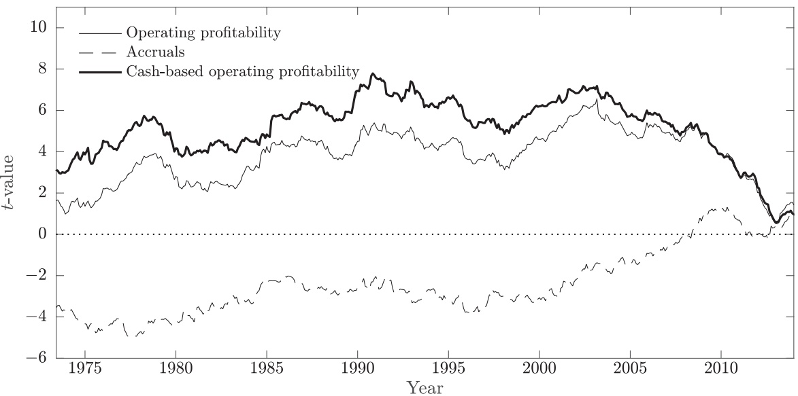
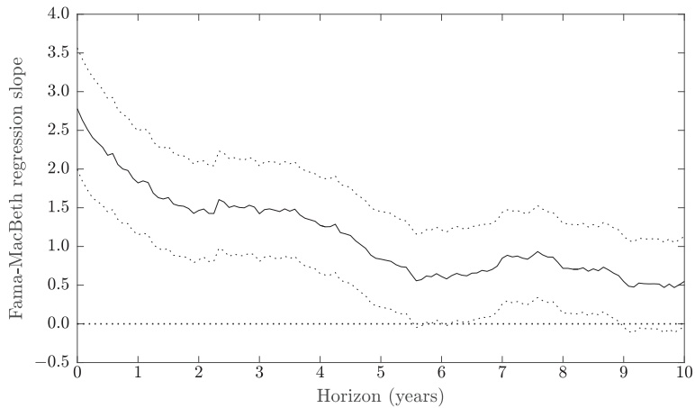
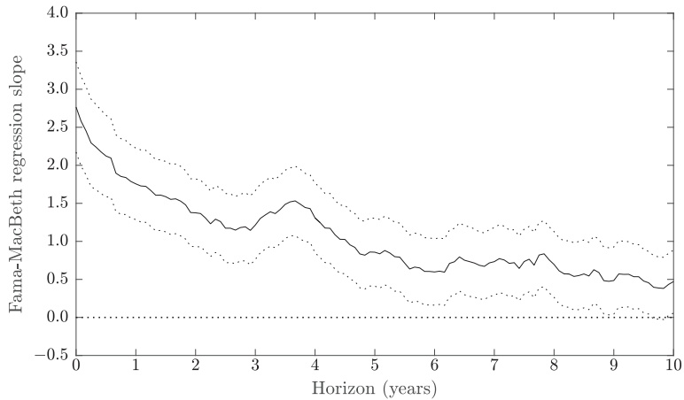
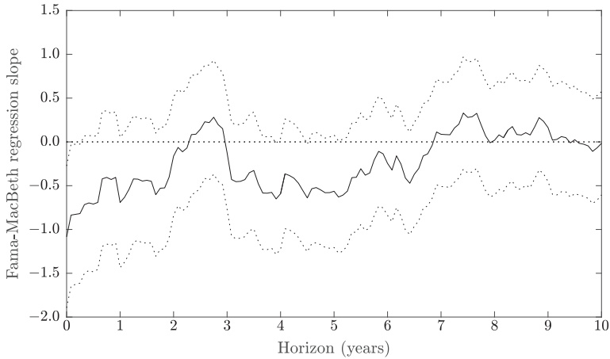
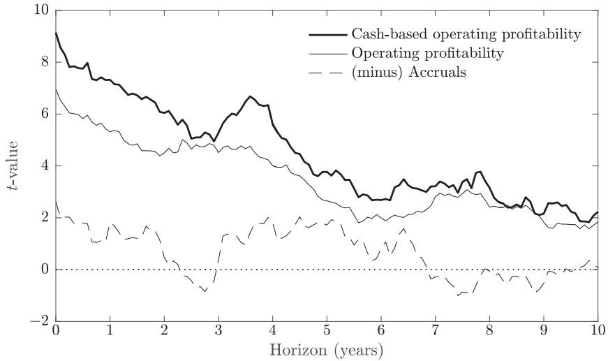
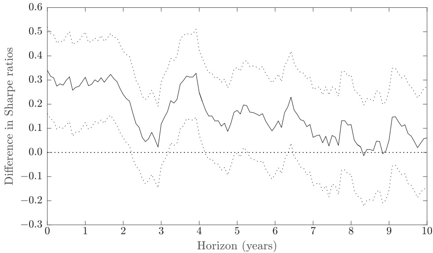

# Accruals, cash flows, and operating profitability in the cross section of stock returns-

Ray Ball a,∗, Joseph Gerakos a, Juhani T. Linnainmaa b,c, Valeri Nikolaev a

a University of Chicago Booth School of Business, 5807 South Woodlawn Avenue, Chicago, IL60637, United States b Marshall School of Business, University of Southern California, 3670 Trousdale Parkway, Los Angeles, CA 90089, United States c National Bureau of Economic Research, United States

## a r t i c l e i n f o

Article history: Received 17 April 2015 Revised 28 August 2015 Accepted 12 September 2015 Available online 12 March 2016

JEL Classification: G11 G12 M41

Keywords: Operating profitability Accruals Cash flows Anomalies Asset pricing

## a b s t r a c t

Accruals are the non-cash component of earnings. They represent adjustments made to cash flows to generate a profit measure largely unaffected by the timing of receipts and payments of cash. Prior research uncovers two anomalies: expected returns increase in profitability and decrease in accruals. We show that cash-based operating profitability (a measure that excludes accruals) outperforms measures of profitability that include accruals. Further, cash-based operating profitability subsumes accruals in predicting the cross section of average returns. An investor can increase a strategy’s Sharpe ratio more by adding just a cash-based operating profitability factor to the investment opportunity set than by adding both an accruals factor and a profitability factor that includes accruals.

© 2016 Elsevier B.V. All rights reserved.

## 1. Introduction

Expected returns increase in measures of profitability that include accounting accruals (e.g., Novy-Marx, 2013; Ball, Gerakos, Linnainmaa and Nikolaev, 2015). Accruals are adjustments accountants make to operating cash flows to better measure current-period firm performance (Dechow, 1994). Sloan (1996) documents a robust negative relation between accruals and the cross section of expected returns. This relation, known as the “accrual anomaly,” is not explained by the Fama and French (1996) three-factor model, their recent five-factor model that includes a profitability factor (Fama and French, 2015), the Novy-Marx (2013) gross profitability factor, or the Hou, Xue and Zhang (2015) q-factor model.1 Moreover, the accrual anomaly actually strengthens when evaluated using asset pricing models that include accruals-based profitability measures.

We show three primary results. First, cash-based operating profitability, a measure of profitability that is devoid of accounting accruals adjustments, better explains the cross section of expected returns than gross profitability, operating profitability, and net income, all of which include accruals. Second, cash-based operating profitability performs so well in explaining the cross section of expected returns that it subsumes the accrual anomaly. In fact, investors would be better off by just adding cash-based operating profitability to their investment opportunity set than by adding both accruals and profitability strategies. Third, cash-based operating profitability explains expected returns as far as ten years ahead.

<small>\- Ray Ball is a trustee of the Harbor Funds, though the views expressed here are his own. None of the authors has a financial interest in the outcomes of this research. We thank Francisco Barillas, Peter Easton, Gene Fama, Ken French (referee), Jeremiah Green (discussant), Scott Richardson, Bill Schwert (editor), Jay Shanken, Richard Sloan (discussant), and conference participants at the Ben Graham Centre’s 4th Symposium on Intelligent Investing and the University of Oregon Summer Finance Conference for their comments.</small>

<small>∗ Corresponding author. Tel.: +1 773 834 5941; fax: +1 773 926 0940. E-mail address: [Ray.Ball@ChicagoBooth.edu](mailto:Ray.Ball@ChicagoBooth.edu) (R. Ball).</small>

<small>1 There is a substantial literature on the accrual anomaly that includes Fama and French (2006), Hirshleifer, Hou and Teoh (2009), Polk and Sapienza (2009), Hirshleifer and Jiang (2010), Li and Zhang (2010), Hirshleifer, Teoh and Yu (2011), Lewellen (2011), Stambaugh, Yu and Yuan (2012), Avramov, Chordia, Jostova and Philipov (2013), Novy-Marx (2013), Hou, Xue and Zhang (2015), and Fama and French (2015).</small>

Taken together, our results provide a simple and compelling explanation for the accrual anomaly. Firms with high accruals today earn lower future returns because they are less profitable on a cash basis. When they are included in an asset pricing model without a profitability measure, accruals predict returns because they are negatively correlated with the cash-based component of profitability. Our findings explain why the accrual anomaly increases when evaluated using an asset pricing model that includes a profitability measure: accruals allow the regression to extract the cash-based component from the accruals-based profitability variable. In our analyses, any increase in profitability that is solely due to accruals themselves has no relation with the cross section of returns.

We start our empirical analysis by regressing returns on accruals and profitability. Among profitability measures, Ball, Gerakos, Linnainmaa and Nikolaev (2015) find that operating profitability better explains the cross section of expected returns than other commonly used measures, such as gross profitability (Novy-Marx, 2013) and “bottom line” net income (Ball and Brown, 1968). When we regress returns on operating profitability and accruals, we find that the signs of the coefficients on these two measures differ, but the economic magnitudes are similar. These estimates suggest that a positive “shock” to operating profitability, holding everything else constant, predicts a higher average stock return for the shocked firms. However, if we fully attribute the effect of this shock to accruals—that is, these firms are more profitable only because of an increase in the non-cash portion of earnings—the offsetting slopes on operating profitability and accruals indicate that the firms average returns would remain unchanged. In other words, the evidence implies that only the cash-based component of operating profits matters in the cross section of expected returns, and the predictive power of accruals is attributable to their negative correlation with the cash-based component.

When we create a cash-based operating profitability measure by purging accruals from operating profitability, we generate a significantly stronger predictor of future stock performance that effectively subsumes the accrual anomaly.2 While accruals have significant incremental predictive ability relative to operating profitability, we find that they have no incremental power in predicting returns within portfolios sorted by cash-based operating profitability. Furthermore, a cash-based operating profitability factor prices both operating profitability and accruals in the cross section.

The economic significance of these results can be demonstrated by comparing the maximum Sharpe ratios of portfolios generated using the traditional four factors (market, size, value, and momentum) and combinations of factors based on accruals, operating profitability, and cashbased operating profitability. Combining the cash-based operating profitability factor with the traditional four factors leads to the highest Sharpe ratio, which is substantially higher than the maximum Sharpe ratio generated using the traditional factors and both the accruals and operating profitability factors.

Sloan (1996) posits that the accrual anomaly arises because investors do not understand that accruals are less persistent than cash flows, which leads to mispricing. The idea is that if investors believe that accruals and cash flows are equally persistent, then they are predictably negatively surprised when accruals do not persist, which explains the negative relation between average returns and accruals. This explanation of the accrual anomaly implies that accruals would predict future surprises even when we control for cash-based operating profitability. However, we observe otherwise—accruals have no explanatory power if we control for cash-based operating profitability.

We find that cash-based operating profitability pre-dicts returns as far as ten years into the future. This could indicate an initial market under-reaction to cash flow information that is gradually corrected over a decade. Alternatively, this result could indicate that cash-based profitability and expected returns share common economic determinants (such as risk) that are relatively stationary over time (Ball, 1978).

This study relates to prior research that examines the relation between cash flows and the cross section of expected returns. Foerster, Tsagarelis and Wang (2015) examine the ability of cash flows to explain average returns relative to earnings-based profitability measures. They focus on measures of free cash flow as opposed to cashbased operating profitability and do not examine the relation between cash flows and the accrual anomaly. Desai, Rajgopal and Venkatachalam (2004) examine whether the accrual anomaly is a manifestation of the value premium. They find that the ratio of the total cash flow from operations to price, which is a proxy for the value premium, has explanatory power for the accrual anomaly. Cheng and Thomas (2006) find that abnormal accruals have incremental explanatory power controlling for operating cash flowsto-price and conclude that accruals are not part of the value premium. In contrast, we find that accruals have no incremental explanatory power when controlling for cashbased operating profitability. Moreover, our empirical tests control for the book-to-market ratio. Hence, cash-based operating profitability’s relation with the cross section of expected returns is distinct from the value premium.

<small>2 The empirical motivation for investigating the predictive power of cash-based operating profitability is similar to Fama and French’s (1992) motivation for the book-to-market ratio. Fama and French (1992) estimate cross-sectional return regressions and find that the estimated slopes on two leverage measures, log (A/ME) (“market leverage”) and log (A/BE) (“book leverage”), have opposite signs but are close to each other in magnitude. These estimates lead Fama and French (1992) to use</small>

<small>the log book-to-market ratio—the difference between the two leverage measures—as the single regressor.</small>

## 2. What are accruals?

The accounting role of accruals is to facilitate the periodic measurement of firm performance (Dechow, 1994). To this end, accountants “accrue” firm revenue as the value of goods and services delivered to customers during the period, based on the expected cash receipts for such deliveries. Revenue accrued during a period generally differs from the amount of cash received during the same period, because some cash receipts can occur in future or prior periods. Accountants adjust current-period cash receipts for these timing differences by recording revenue accruals. Similarly, accountants calculate expenses as the cost of resources consumed in producing the delivered goods and services, based on the expected value of cash payments for the resources used. Expenses in accounting are separated from the timing of payments for them, which accountants adjust for any timing differences by using expense accruals. Accounting earnings are then defined as accruals-based revenues minus accruals-based expenses. Earnings represent the accounting estimate of the value added by the firm in products and services delivered to customers during the period.

Timing differences between cash flows and earnings arise from two primary sources. The first source is shocks to the timing of cash inflows and outflows (“payment shocks” ). Payment shocks can arise from random exogenous events (for example, the firm’s customers pay for their credit purchases either before or after the end of the current fiscal period) and from endogenous management actions (for example, the firm delays or accelerates paying its bills). These shocks affect whether cash inflows and outflows occur within a particular fiscal year, so they are a source of variance in fiscal-year cash flows. Accrual accounting attempts to purge this variance from earnings by booking revenue based on expected cash receipts from delivered goods and services and expenses based on expected cash outflows for the resources used.3

The second primary source of timing differences between cash flows and earnings is net investment in working capital due to positive or negative growth.4 Growth typically alters the optimal level of working capital, such as inventory and accounts receivable, which, other things equal, affects current-period cash flows. Firms’ working capital investments, such as increases in inventory, are made on the basis of expected future levels of business, and their effects on cash flows are not caused by delivering goods and services to customers during the current period, so accountants do not allow them to affect current-period expenses and revenues.

Unlike accruals and operating profitability, cash-based operating profitability therefore contains information about payment shocks and growth, in addition to profitability. While accrual-based earnings aim to provide a better measure of current-period performance (Dechow, 1994) that managers cannot easily manipulate via the timing of cash receipts and payments, a cash-based profitability measure has the potential to be more informative about future stock returns.

## 3. Data

To construct our sample, we follow Novy-Marx (2013) and Ball, Gerakos, Linnainmaa and Nikolaev (2015). We take monthly stock returns from the Center for Research in Security Prices (CRSP) and annual accounting data from Compustat. We start our sample with all firms traded on NYSE, Amex, and Nasdaq, and exclude securities other than ordinary common shares. Delisting returns are taken from CRSP; if a delisting return is missing and the delisting is performance-related, we impute a return of −30% (Shumway, 1997; Beaver, McNichols and Price, 2007). We match the firms on CRSP against Compustat, and lag annual accounting information by six months. For example, if a firm’s fiscal year ends in December, we assume that this information is public by the end of the following June. We start our sample in July 1963 and end it in December 2014. The sample consists of firms with non-missing market value of equity, book-to-market, gross profit, book value of total assets, current month returns, and returns for the prior one-year period. We exclude financial firms, which are defined as firms with one-digit Standard Industrial Classification codes of six.

We calculate operating profitability by following the computations in Ball, Gerakos, Linnainmaa and Nikolaev (2015): sales minus cost of goods sold minus sales, general, and administrative expenses (excluding research and development expenditures). This measure captures the performance of the firm’s operations and is not affected by non-operating items, such as leverage and taxes. To evaluate the ability of the cash portion of operating profitability to predict returns, we remove the accrual components included in the computation of operating profitability to create the cash-based operating profitability measure. These components are the changes in accounts receivable, inventory, prepaid expenses, deferred revenue, accounts payable, and accrued expenses. This measure differs from other commonly used measures of cash flows. A common measure of cash flows used in the asset pricing literature is earnings before extraordinary items but after interest, depreciation, taxes, and preferred dividends plus depreciation (e.g., Fama and French, 1996). This measure includes “working capital” accruals such as changes in accounts payable, accounts receivable, and inventory. Another common measure is cash flow from operations calculated as per U.S. Generally Accepted

<small>3 Payment shocks can arise from both optimal and manipulative cash flow management. As an example of optimal cash management, a manager can delay payment to suppliers who provide their customers payment terms. Other things equal, such a delay increases current-period cash flows but reduces future cash flows. As an example of manipulative cash flow management, a manager evaluated on the basis of cash flow could increase the period’s reported performance by delaying payments to suppliers to subsequent financial reporting periods, even if that is suboptimal (e.g., involves losing discounts for prompt payment).</small>

<small>4 Working capital is the difference between current assets and current liabilities, which are defined as assets and liabilities with a cash-to-cash cycle of less than 12 months. Changes in current assets and liabilities generate accounting accruals.</small>

Accounting Principles, which differs from cash-based operating profitability in that it is net of taxes and interest and therefore is a levered measure of cash flows.

We initially follow Sloan (1996) and compute our accruals measure using balance sheet items on Compustat (e.g., changes in accounts receivable, accounts payable, deferred revenue, and inventory). We use the balance sheet to create the cash-based operating profitability and accruals measures, because cash flow statement accruals are available only starting in 1988. Hribar and Collins (2002) show that balance sheet accruals can be affected by large corporate investment and financing decisions such as equity offerings and mergers and acquisitions. In what follows, we therefore also construct the accruals and cash-based operating profitability measures using information from cash flow statements for the post-1988 sample. We provide detailed descriptions and formulas for operating profitability, cash-based operating profitability, and accruals in the Appendix. All profitability and accruals variables are scaled by the book value of total assets lagged by one year.5

To generate the book-to-market ratio, we calculate the book value of equity as shareholders’ equity, plus balance sheet deferred taxes, plus balance sheet investment tax credits, plus postretirement benefit liabilities, and minus preferred stock. We set missing values of balance sheet deferred taxes and investment tax credits equal to zero. To calculate the value of preferred stock, we set it equal to the redemption value if available, or else the liquidation value or the carrying value, in that order. If shareholders equity is missing, we set it equal to the value of common equity if available, or total assets minus total liabilities. We then use the Davis, Fama and French (2000) book values of equity from Ken French’s website to fill in missing values.6

In Fama and MacBeth (1973) regressions, we recompute the explanatory variables every month. In some of our empirical specifications, we split firms into Allbut-microcaps and Microcaps. Following Fama and French (2008), we define Microcaps as stocks with a market value of equity below the 20th percentile of the NYSE market capitalization distribution. In portfolio sorts, we rebalance the portfolios annually at the end of June. When we sort stocks into portfolios or construct factors based on operating profitability, accruals, and cash-based operating profitability, we include only those stocks with non-missing values for all three variables.

Panel A of Table 1 reports summary descriptive statistics for the accounting and control variables. We calculate the descriptive statistics as the time series averages of the percentiles. The deflated variables exhibit outliers, pointing to the need either to trim these variables in cross-sectional regressions or to base inferences on portfolio sorts. The average annual operating profitability is approximately 12.9% of total assets and accruals are −2.9% of total assets, with depreciation and amortization contributing to the negative sign. The average annual cash-based operating profitability is 11.7% of total assets.

Panel B presents the Pearson and Spearman correlations between operating profitability, accruals, and cashbased operating profitability. Several patterns emerge. First, the operating profitability measures are highly correlated (Pearson, 0.845; Spearman, 0.805). Second, accruals and operating profitability are positively correlated (Pearson, 0.163; Spearman, 0.130). Third, when we remove accruals from operating profitability, accruals and cash-based operating profitability are negatively correlated (Pearson, −0.252; Spearman, −0.280). This negative correlation implies that firms that are profitable because of high accruals are less profitable on a cash basis than firms that report low accruals. In what follows, we explore this negative relation between accruals and cash-based operating profitability in Fama and MacBeth (1973) regressions and portfolio sorts.

## 4. The cross section of returns

## 4.1. Fama and MacBeth regressions

Table 2 presents average slope coefficient estimates (multiplied by 100) and their t-values from Fama and Mac-Beth (1973) regressions of monthly stock returns on operating profitability, accruals, and cash-based operating profitability. Following prior studies (e.g., Novy-Marx, 2013), we include the following control variables in the regressions: the natural logarithm of the book-to-market ratio, the natural logarithm of the market value of equity, and past returns for the prior month and for the prior 12- month period, excluding month t − 1. We estimate the regressions monthly using data from July 1963 through December 2014.

To compare the explanatory power of the profitability measures and accruals, we focus on t-values. The average coefficient estimates in a Fama and MacBeth (1973) regression can be interpreted as monthly returns on long-short trading strategies that trade on that part of the variation in each regressor that is orthogonal to every other regressor.7 The t-values associated with the Fama-MacBeth slopes are therefore proportional to the Sharpe ratios of these self-financing strategies. They equal annualized Sharpe ratios times $\sqrt { T }$ , where T represents the number of years in the sample.

Panel A presents results for the All-but-microcaps sample. Column 1 replicates the results with respect to operating profitability presented in Table 6 of Ball, Gerakos, Linnainmaa and Nikolaev (2015). In this column, we trim the sample based on just operating profitability and the control variables. In the remaining columns, we require information on accruals and cash-based operating profitability and follow Novy-Marx (2013) and Ball, Gerakos, Linnainmaa and Nikolaev (2015) in trimming all independent variables to the 1st and 99th percentiles. To ensure

<small>5 We find similar results if we scale by the average of the book value of total assets for the current and prior year.</small>

<small>6 See [http://mba.tuck.dartmouth.edu/pages/faculty/ken.french/Data\_Library/variable\_definitions.html](http://mba.tuck.dartmouth.edu/pages/faculty/ken.french/Data_Library/variable_definitions.html) and Cohen, Polk and Vuolteenaho (2003, p. 613) for detailed discussions of how the book value of equity is defined.</small>

<small>7 See Chapter 9 of Fama (1976) for an analysis and description of these strategies; see Ball, Gerakos, Linnainmaa and Nikolaev (2015) for additional discussion.</small>

**Table 1**

Descriptive statistics, 1963–2014.

Panel A presents distributions for the variables used in our analysis. We calculate the descriptive statistics as the time series averages of the percentiles. Operating profitability (OP) is gross profit minus selling, general, and administrative expenses (excluding research and development expenditures) deflated by the book value of total assets lagged by one year. Accruals is the change in current assets minus the change in cash, the change in current liabilities, the change in current debt, the change in income taxes payable, and depreciation deflated by the book value of total assets lagged by one year. Cash-based operating profitability (CbOP) is operating profitability minus the change in accounts receivable, the change in inventory, and the change in prepaid expenses, plus the change in deferred revenues, the change in accounts payable, and the change in accrued expenses, deflated by the book value of assets lagged by one year. We describe the construction of operating profitability, accruals, and cash-based operating profitability in the Appendix. The other variables used in our analysis are defined as follows: log (BE/ME) is the natural logarithm of the book-to-market ratio; log (ME) is the natural logarithm of the market value of equity; $r _ { 1 , \mathrm { ~ l ~ } }$ is the prior one-month return; and $r _ { 1 2 , \; 2 }$ is the prior year’s return skipping the last month. Panel B presents Pearson and Spearman rank correlations between operating profitability, accruals, and cash-based operating profitability. Our sample period starts in July 1963 and ends in December 2014. We start our sample with all firms traded on NYSE, Amex, and Nasdaq, and exclude securities other than ordinary common shares. We then require that firms have non-missing values for the following items: market value of equity, book-to-market, gross profit, book value of total assets, current month returns, and returns for the prior one-year period. We exclude financial firms, which are defined as firms with one-digit Standard Industrial Classification codes of six.

Panel A: Distributions

<table><tr><td rowspan="2" colspan="2">Variable</td><td rowspan="2">Mean</td><td rowspan="2">SD</td><td colspan="5">Percentiles</td></tr><tr><td>1st</td><td>25th</td><td>50th</td><td>75th</td><td>99th</td></tr><tr><td colspan="9">Accounting variables/book value of total assets</td></tr><tr><td colspan="2">Operating profitability</td><td>0.129</td><td>0.159</td><td>-0.389</td><td>0.077</td><td>0.138</td><td>0.203</td><td>0.468</td></tr><tr><td colspan="2">Accruals</td><td>-0.029</td><td>0.114</td><td>-0.342</td><td>-0.069</td><td>-0.028</td><td>0.016</td><td>0.235</td></tr><tr><td colspan="2">Cash-based operating profitability</td><td>0.117</td><td>0.175</td><td>-0.433</td><td>0.056</td><td>0.126</td><td>0.195</td><td>0.491</td></tr><tr><td colspan="9">Control variables in regressions</td></tr><tr><td colspan="2">log (BE/ME)</td><td>-0.534</td><td>0.940</td><td>-3.204</td><td>-1.051</td><td>-0.450</td><td>0.059</td><td>1.537</td></tr><tr><td colspan="2">log (ME)</td><td>4.577</td><td>1.958</td><td>0.685</td><td>3.161</td><td>4.448</td><td>5.883</td><td>9.407</td></tr><tr><td colspan="2"> $r_{1,1}$ </td><td>0.013</td><td>0.152</td><td>-0.305</td><td>-0.063</td><td>0.001</td><td>0.071</td><td>0.488</td></tr><tr><td colspan="2"> $r_{12,2}$ </td><td>0.163</td><td>1.313</td><td>-0.670</td><td>-0.172</td><td>0.057</td><td>0.327</td><td>2.200</td></tr><tr><td colspan="9">Panel B: Correlations</td></tr><tr><td rowspan="2"></td><td colspan="3">Pearson</td><td rowspan="2"></td><td colspan="4">Spearman</td></tr><tr><td>OP</td><td>Accruals</td><td>CbOP</td><td>OP</td><td colspan="2">Accruals</td><td>CbOP</td></tr><tr><td>OP</td><td>1</td><td></td><td></td><td></td><td>1</td><td></td><td></td><td></td></tr><tr><td>Accruals</td><td>0.163</td><td>1</td><td></td><td></td><td>0.130</td><td>1</td><td></td><td></td></tr><tr><td>CbOP</td><td>0.845</td><td>-0.252</td><td>1</td><td></td><td>0.805</td><td colspan="2">-0.280</td><td>1</td></tr></table>

that regression coefficients from different model specifications are comparable across columns, we trim on a consistent table-by-table basis, with the exception of column 1. Hence, the different specifications shown in columns 2–7 of each panel are based on the same observations.

In column 1, the t-value associated with operating profitability is 8.86. When we restrict the sample to firms with non-missing values for accruals and cash-based operating profitability in column 2, the t-value associated with operating profitability decreases to 7.04. In column 3, the tvalue associated with accruals is −3.9. This result replicates the long-standing accrual anomaly documented by Sloan (1996)—that is, firms with high accruals on average earn low returns. When operating profitability and accruals are both included in the regression model presented in column 4, operating profitability does not explain the accrual anomaly or vice versa. In fact, the t-value associated with accruals increases in absolute value relative to its stand-alone equivalent in column 3. This finding is consistent with the estimates in Fama and French (2015), which indicate that including a profitability factor into an asset pricing model worsens the model in terms of its ability to price accruals-sorted portfolios.

In column 4, the absolute values of the slope coefficients for operating profitability and accruals are similar in magnitude (2.55 and 1.58), but are not additive inverses as suggested by our thesis that accruals predict returns because they are negatively correlated with the cash component of operating profitability. Hribar and Collins (2002) show that computing accruals from the balance sheet introduces measurement errors. These errors may attenuate the coefficient on accruals. Indeed, we show below that when we measure accruals using the statement of cash flows, the coefficients on operating profitability and accruals are close to additive inverses.

In column 5, we exclude accruals related to operating profitability and examine the predictive power of cashbased operating profitability. The slope on cash-based operating profitability is similar in magnitude to the slope on operating profitability (2.60 versus 2.55). However, the tvalue increases to 9.69 from 7.04 when we remove accruals from operating profitability.

## Table 2

Profitability and accruals in Fama-MacBeth regressions.

This table presents average Fama and MacBeth (1973) regression slopes (multiplied by 100) and their t-values from cross-sectional regressions that predict monthly returns. The regressions are estimated monthly using data from July 1963 through December 2014. We describe the sample in the legend for Table 1. Panel A presents results for All-but-microcaps and Panel B presents results for Microcaps. Microcaps are stocks with market values of equity below the 20th percentile of the NYSE market capitalization distribution. We describe the construction of operating profitability, accruals and cash-based operating profitability in the Appendix. Variables in regressions $( 2 )  – ( 7 )$ are trimmed at the 1st and 99th percentiles based on all explanatory variables. The first column does not require non-missing accruals or cash-based operating profitability, while the remaining columns require non-missing values.

Panel A: All-but-microcaps

<table><tr><td rowspan="2">Explanatory variable</td><td colspan="7">Regression</td></tr><tr><td>(1)</td><td>(2)</td><td>(3)</td><td>(4)</td><td>(5)</td><td>(6)</td><td>(7)</td></tr><tr><td>Operating profitability</td><td>2.99(8.86)</td><td>2.55(7.04)</td><td></td><td>2.55(7.09)</td><td></td><td></td><td>0.80(1.56)</td></tr><tr><td>Accruals</td><td></td><td></td><td>-1.41(-3.90)</td><td>-1.58(-4.45)</td><td></td><td>0.15(0.34)</td><td></td></tr><tr><td>Cash-based operating profitability</td><td></td><td></td><td></td><td></td><td>2.60(9.69)</td><td>2.54(7.40)</td><td>1.91(5.27)</td></tr><tr><td>log (BE/ME)</td><td>0.42(5.80)</td><td>0.36(5.08)</td><td>0.21(3.28)</td><td>0.33(4.66)</td><td>0.33(4.76)</td><td>0.32(4.53)</td><td>0.33(4.73)</td></tr><tr><td>log (ME)</td><td>-0.08(-2.07)</td><td>-0.09(-2.35)</td><td>-0.09(-2.24)</td><td>-0.10(-2.66)</td><td>-0.10(-2.59)</td><td>-0.10(-2.69)</td><td>-0.10(-2.59)</td></tr><tr><td> $r_{1,1}$ </td><td>-3.03(-6.97)</td><td>-3.23(-7.49)</td><td>-3.34(-7.76)</td><td>-3.30(-7.72)</td><td>-3.27(-7.58)</td><td>-3.32(-7.78)</td><td>-3.28(-7.66)</td></tr><tr><td> $r_{12,2}$ </td><td>1.03(5.69)</td><td>0.95(5.30)</td><td>0.86(4.81)</td><td>0.91(5.12)</td><td>0.92(5.11)</td><td>0.91(5.08)</td><td>0.92(5.15)</td></tr><tr><td>Adjusted  $R^2$ </td><td>5.6%</td><td>5.5%</td><td>5.2%</td><td>5.7%</td><td>5.4%</td><td>5.6%</td><td>5.6%</td></tr><tr><td colspan="8">Panel B: Microcaps</td></tr><tr><td>Operating profitability</td><td>2.14(6.25)</td><td>2.09(5.29)</td><td></td><td>2.30(5.85)</td><td></td><td></td><td>0.20(0.40)</td></tr><tr><td>Accruals</td><td></td><td></td><td>-1.97(-6.30)</td><td>-2.49(-8.26)</td><td></td><td>-0.75(-1.74)</td><td></td></tr><tr><td>Cash-based operating profitability</td><td></td><td></td><td></td><td></td><td>2.48(9.62)</td><td>2.27(6.67)</td><td>2.21(7.27)</td></tr><tr><td>log (BE/ME)</td><td>0.46(7.37)</td><td>0.41(6.25)</td><td>0.41(6.33)</td><td>0.39(5.89)</td><td>0.40(6.33)</td><td>0.39(6.06)</td><td>0.39(5.87)</td></tr><tr><td>log (ME)</td><td>-0.26(-4.24)</td><td>-0.26(-4.17)</td><td>-0.19(-2.92)</td><td>-0.25(-4.00)</td><td>-0.25(-3.92)</td><td>-0.24(-3.91)</td><td>-0.25(-4.09)</td></tr><tr><td> $r_{1,1}$ </td><td>-5.67(-13.10)</td><td>-6.12(-13.68)</td><td>-6.02(-13.37)</td><td>-6.17(-13.83)</td><td>-6.11(-13.66)</td><td>-6.16(-13.82)</td><td>-6.18(-13.84)</td></tr><tr><td> $r_{12,2}$ </td><td>1.02(5.60)</td><td>0.90(5.02)</td><td>0.91(4.98)</td><td>0.85(4.74)</td><td>0.88(4.89)</td><td>0.85(4.75)</td><td>0.86(4.79)</td></tr><tr><td>Adjusted  $R^2$ </td><td>3.1%</td><td>3.1%</td><td>2.9%</td><td>3.2%</td><td>3.0%</td><td>3.2%</td><td>3.2%</td></tr></table>

If we view the Fama and MacBeth (1973) regression slopes as monthly returns on long-short strategies that trade on operating profitability and cash-based operating profitability, a comparison of the estimates in columns 2 and 5 suggests that the annualized Sharpe ratio of the profitability strategy increases by almost 40% (t-value = 4.6) when we move from accruals-based operating profitability to cash-based operating profitability.8 Ball, Gerakos, Linnainmaa and Nikolaev (2015) find that operating profitability has greater explanatory power than either gross profitability or net income. Hence, we can infer from the significant increase from column 2 to column 5 that the Sharpe ratio for cash-based operating profitability is also higher than the Sharpe ratios for gross profitability and net income.

When both cash-based operating profitability and accruals are simultaneously included in a regression (column 6), cash-based operating profitability remains highly significant (t-value of 7.4) and subsumes the effect of accruals, which becomes statistically indistinguishable from zero $(t - value  = 0.34)$ . The fact that cash-based operating profitability subsumes accruals is inconsistent with Sloan’s (1996) hypothesis that investors “fixate” on profitability per se. Under his hypothesis, investors do not comprehend that accruals are less persistent than cash flows, and consequently they are predictably surprised when accruals do not persist. If investors are unable to distinguish between differences in persistence for accruals and cash flows, then accruals would predict future surprises even when we control for cash-based operating profitability. Furthermore, our result that only the cash-based component of operating profits matters in the cross section of expected returns explains why accruals predict returns in a regression incorporating profitability: they allow the regression to extract the cash-based component from the accruals-based profitability variable.

<small>8 We follow Ball, Gerakos, Linnainmaa and Nikolaev (2015) and test for the equality of Sharpe ratios using a bootstrap procedure. We resample the Fama and MacBeth (1973) regression slope estimates ten thousand times, compute annualized Sharpe ratios for each sample, and then obtain the standard error from the resulting bootstrapped distribution of differences in Sharpe ratios. The Sharpe ratio of cash-based operating profitability exceeds that of operating profitability in 99.4% of replications.</small>

When we run a horse race between operating profitability and cash-based operating profitability (column 7), operating profitability loses most of its predictive power and its t-value decreases to 1.56. Cash-based operating profitability wins this horse race with a t-value of 5.27.

Panel B of Table 2 reports the same regressions for Microcaps, which constitute 55% of all firms but an economically insignificant 3% of total market capitalization. These results mimic those reported for the All-but-microcaps sample. Both operating profitability and accruals are strong predictors of future returns. When operating profitability and accruals are used in separate regressions, their t-values are 5.29 (column 2) and −6.30 (column 3). When these variables are in the same regression, their t-values increase in absolute magnitude to 5.85 and −8.26 (column 4) and the absolute values of the slope coefficients on operating profitability and accruals are similar in magnitude (2.30 and 2.49). The cash-based profitability measure, however, continues to dominate with a t-value of 9.62 (column 5). Similar to Panel A’s sample, cash-based operating profitability subsumes the explanatory power of accruals (column 6) and wins the horse race with operating profitability (column 7).

A comparison of operating profitability and cash-based operating profitability. If we interpret the Fama-MacBeth slope estimates in columns 2 and 5 as realized returns, they indicate that the operating profitability and cash-based operating profitability strategies earn similar average returns, but that the latter strategy is less volatile. Why are the Fama-MacBeth slope estimates for cash-based operating profitability less volatile? A comparison of the estimates in columns 2 and 5 rules out two possibilities. The average R2 for cash-based operating profitability is slightly lower than for operating profitability (5.4% versus 5.5%) and the slope estimates for the control variables are similar in the two specifications. These estimates imply that the t-value does not increase because cash-based operating profitability explains more variation in returns, or because it correlates differently with the other regressors.

We conjecture that the explanation is as follows. The insignificant coefficient for operating profitability in column 7 suggests that the component of operating profitability that is orthogonal to cash-based operating profitability does not predict systematically high or low returns. At the same time, the slightly higher R2 for the operatingprofitability regression in column 7 suggests that stocks with high or low values of this orthogonal component move together. Put differently, the estimates in Table 2 are consistent with the relation between expected returns and the orthogonal component varying from month to month, with an unconditional expectation of zero.9 We note that this behavior of the operating profitability and cash-based operating profitability strategies is specific to the Fama and MacBeth (1973) regressions. When we later construct factors based on operating profitability and cash-based operating profitability, the cash-based operating profitability factor has both a higher mean and a lower standard deviation than the operating profitability factor.

Subsamples. Fig. 1 plots t-values associated with ten-year rolling averages of the Fama-MacBeth slopes for operating profitability, accruals, and cash-based operating profitability. These slopes are from the regressions presented in columns 2, 3, and 5 of Panel A of Table 2. The value on the x-axis indicates the end point of the ten-year average. The first point, for example, is for June 1973 and it reports the t-values associated with average slopes for operating profitability, accruals, and cash-based operating profitability from Fama and MacBeth (1973) regressions using data from July 1963 to June 1973.

Over the sample period, the t-values are positive for both operating profitability and cash-based operating profitability. Comparing the two, the t-values for cash-based operating profitability are, in general, larger in magnitude. For accruals, the rolling average is negative up to 2008. Starting around 2004, the t-values on all three strategies attenuate toward zero, indicating a structural shift beginning during the prior decade. Importantly, this shift is not specific to the earnings variables and is consistent with prior findings that almost all anomalies generate lower returns during this period (e.g., Keloharju, Linnainmaa and Nyberg, 2015).

Alternative specifications. In constructing the accruals and cash-based operating profitability measures presented in Table 2, we use the balance sheet approach to calculate accruals. Hribar and Collins (2002) show that accruals taken from the balance sheet can be affected by large corporate events such as mergers, acquisitions, and divestitures. For example, a large increase in inventory or accounts receivable could be due to a merger that occurs between one balance sheet date and the next. In our analysis, we use balance sheet accruals because they cover the sample period starting in 1963, which is commonly used in prior asset pricing research. An alternative approach that is not affected by such large corporate events is to calculate accruals using information from the statement of cash flows. However, U.S. firms were only required to report cash flow statements starting in 1988, so accruals data are not available from that source prior to this date.

To evaluate whether our results are affected by the use of balance sheet accruals, we replicate Panel A of Table 2 using cash flow statement accruals to generate our accruals and cash-based operating profitability measures.10 The results are presented in Table 3. We estimate two specifications. In the first, we use an accruals measure based on the statement of cash flows. In the sec-

<small>9 This argument is similar to that made in Gerakos and Linnainmaa (2016, Section 4.1 and Footnote 1) about the component of the book-to-</small>

<small>market ratio that is orthogonal to prior changes in the market value of equity. The slope on the book-to-market ratio is close to zero in Fama and MacBeth (1973) regressions that control for changes in the market value of equity, but the average R2 is higher than without this variable.</small>

<small>10 We describe the construction of these measures in the Appendix.</small>

Fig. 1. Subsample analysis of operating profitability, accruals, and cash-based operating profitability in Fama and MacBeth (1973) regressions. This figure presents t-values associated with rolling ten-year averages of Fama-MacBeth regression slopes from columns 2, 3, and 5 of Panel A of Table 2. Each ten-year period ends on the date indicated on the x-axis. The first points, for example, are for June 1973 and they report the t-values associated with operating profitability, accruals, and cash-based operating profitability from Fama-MacBeth regressions estimated using data from July 1963 through June 1973. We describe the sample in the legend for Table 1.

## Table 3

Profitability and accruals in Fama-MacBeth regressions: alternative specifications using the statement of cash flows.

This table presents average Fama and MacBeth (1973) regression slopes (multiplied by 100) and their t-values from cross sectional-regressions that predict monthly returns. The regressions are estimated monthly using data from July 1988 through December 2014 using All-but-microcaps, which are stocks with a market value of equity above the 20th percentile of the NYSE market capitalization distribution. We describe the sample in the legend for Table 1. In Specification 1, we construct the accruals measure using cash flow statement accruals. In Specification 2, we use cash flow statement accruals to construct both the accruals and cash-based operating profitability measures. The sample stays constant across regressions (1)–(4) and then again in regressions (5)–(8). We describe how we construct the accruals and cash-based operating profitability measures in the Appendix. Variables are trimmed at the 1st and 99th percentiles based on the explanatory variables used in the first two columns: operating profitability, book-to-market, size, prior one-month return, and prior one-year return skipping a month.

<table><tbody><tr><td rowspan="2"></td><td colspan="4">Specification 1</td><td colspan="4">Specification 2</td></tr><tr><td>s</td><td>Accruals tatement o</td><td>from the f cash flow</td><td>s</td><td>A oper</td><td>ccruals and ating profit statement o</td><td>cash-base ability from f cash flow</td><td>d the s</td></tr><tr><td>Explanatory variable</td><td>(1)</td><td>(2)</td><td>(3)</td><td>(4)</td><td>(5)</td><td>(6)</td><td>(7)</td><td>(8)</td></tr><tr><td>Operating profitability</td><td>2.33(5.07)</td><td></td><td>(1.08)</td><td>0.79</td><td>2.66(5.47)</td><td></td><td></td><td>0.13(0.15)</td></tr><tr><td>Accruals</td><td>-2.07(-3.39)</td><td></td><td>-0.44(-0.65)</td><td></td><td>-2.41(-3.89)</td><td></td><td>-0.42(-0.60)</td><td></td></tr><tr><td>Cash-based operating profitability</td><td>2.27</td><td>2.17(6.18)</td><td>1.54(5.55)</td><td>(2.78)</td><td></td><td>2.77(6.45)</td><td>2.62(5.68)</td><td>2.58(3.73)</td></tr><tr><td>log(BE/ME)</td><td>0.21(2.25)</td><td>0.22(2.29)</td><td>0.20(2.13)</td><td>0.21(2.28)</td><td>0.24(2.42)</td><td>0.24(2.46)</td><td>0.22(2.26)</td><td>0.23(2.40)</td></tr><tr><td>log(ME)</td><td>-0.07(-1.29)</td><td>-0.07(-1.27)</td><td>-0.08(-1.32)</td><td>-0.07(-1.25)</td><td>-0.07(-1.21)</td><td>-0.07(-1.19)</td><td>-0.07(-1.24)</td><td>-0.07(-1.21)</td></tr><tr><td>r1, 1</td><td>-1.21(-1.98)</td><td>-1.15(-1.88)</td><td>-1.19(-1.96)</td><td>-1.21(-1.99)</td><td>-1.01(-1.62)</td><td>-0.96(-1.54)</td><td>-1.02(-1.65)</td><td>-1.01(-1.64)</td></tr><tr><td>r12, 2</td><td>0.38(1.51)</td><td>0.39(1.55)</td><td>0.37(1.49)</td><td>0.39(1.58)</td><td>0.45(1.80)</td><td>0.46(1.85)</td><td>0.44(1.76)</td><td>0.46(1.85)</td></tr><tr><td>Adjusted R2</td><td>4.9%</td><td>4.6%</td><td>4.8%</td><td>4.9%</td><td>5.1%</td><td>4.8%</td><td>5.0%</td><td>5.1%</td></tr></tbody></table>

ond specification, we use cash flow statement accruals to create both the accruals and the cash-based operating profitability measures. The results for both specifications mimic those presented in Panel A of Table 2, although the t-values attenuate due to the shorter sample period.

Importantly, when we include operating profitability along with accruals in columns 1 and 5, the slope coefficients on operating profitability and accruals are closer in absolute magnitude than the slope coefficients presented in column 4 of Panel A of Table 2. The difference between the two tables is driven by an increase in the absolute values of the coefficient on accruals when we compute the accruals measure using the statement of cash flows. This finding is consistent with the balance sheet measure of accruals having greater noise, which attenuates the coefficient estimate.

Overall, cash-based operating profitability has the strongest predictive power relative to the measures of profitability considered in prior research. In addition, cash-based operating profitability subsumes the accrual anomaly.

## 4.2. Portfolio sorts

Given the skewed distributions and extreme observations for the profit measures and accruals (see Table 1), we also perform portfolio tests, which provide a potentially more robust method to evaluate predictive ability without imposing the parametric assumptions embedded in the Fama and MacBeth (1973) regressions. Table 4 compares operating profitability, accruals, and cash-based operating profitability in portfolio sorts. For each sorting variable, the table reports the portfolios’ value-weighted average excess returns, capital asset pricing model (CAPM) alphas, and three-factor model alphas. The loadings on the market, size, and value factors are omitted to preserve space. Panel A forms the portfolios using data on all stocks and Panel B forms the portfolios separately for small and big stocks, partitioned at the median NYSE market capitalization breakpoint. We rebalance the portfolios annually at the end of June and the sample runs from July 1963 to December 2014.

All three measures—operating profitability, accruals, and cash-based profitability—significantly predict future returns in portfolio sorts. In Panel A, the excess return on the high-minus-low decile portfolio formed on the basis of operating profitability is 29 basis points per month (t-${ \mathsf { v a l u e } }   =   1 . 8 4 )$ , and for accruals the excess return $\mathrm { i } \mathsf { s } \mathrm { ~ } { - } 3 5$ basis points $(t - value  = -2.55)$ . Consistent with the Fama and MacBeth regressions presented in Table 2, the highest excess return is for the cash-based operating profitability strategy—47 basis points per month with a t-value of 3.14.

We find similar results when we evaluate the strategies with CAPM and the three-factor model. The high-minuslow decile portfolio formed on the basis of operating profitability earns a CAPM alpha of 42 basis points (t-value $= 2 . 8 1 )$ and a three-factor model alpha of 74 basis points per month (t-value = 5.98). The equivalent strategy formed on the basis of accruals earns a CAPM alpha of −43 basis points (t-value = −3.15) and a three-factor model alpha of −39 basis points $(t - value  = -2.98)$ . Similar to the Fama and MacBeth (1973) regressions presented in Table 2, cash-based profitability continues to exhibit the strongest predictive power. The high-minus-low strategy earns a CAPM alpha of 65 basis points per month with a t-value of 4.74 and a three-factor model alpha of 89 basis points per month with a t-value of 8.48. For the profitability strategies, the alphas increase when the high-minus-low strategies are evaluated using the three-factor model. As shown by Novy-Marx (2013), this result arises because profitability correlates negatively with value.

Panel B shows that the results are not specific to either small or big stocks, although the high-minus-low return spreads are larger among small stocks. The high-minuslow strategy based on cash-based operating profitability, for example, earns a monthly three-factor model alpha of 102 basis points (t-value = 9.27) in the universe of smalls stocks and an alpha of 75 basis points (t-value = 6.31) among big stocks. The estimates for big stocks are quite close to Panel A’s estimates, because in Panel A we form the portfolios using NYSE breakpoints and use valueweighted returns.

## 5. Cash-based operating profitability factor

We next construct factors that capture the relation between average returns and operating profitability, accruals, and cash-based operating profitability. We augment the Fama and French (1993) three-factor model with these factors and then examine the extent to which these augmented models price accruals in the cross section of stock returns.

To construct the profitability factors, we follow the sixportfolio methodology in Fama and French (2015); this is also the methodology that Fama and French (1993) use to construct the HML factor. We first sort stocks by size into small and big sub-groups depending on whether a company is below or above the median NYSE market capitalization breakpoint. We then perform an independent sort based on operating profitability into weak (i.e., below the 30th NYSE percentile breakpoint) and robust (i.e., above the 70th NYSE percentile breakpoint). These sorts produce six value-weighted portfolios. The operating profitability factor, $\mathsf { R M W } _ { \mathsf { O P } } ,$ is constructed by taking the average of the two robust profitability portfolios minus the average of the two weak profitability portfolios. The cash-based operating profitability factor, $\mathsf { R M W } _ { \mathsf { C b O P } } ,$ is constructed in the same way, except that the second sort is on cash-based operating profitability. To construct the accruals factor, ACC, we use accruals for the second sort and switch the weak and robust portfolios to generate a factor with a positive mean.

Table 5 presents the average annualized returns, standard deviations, and t -values for the four traditional factors and the three earnings-related factors. Among the earnings-related factors, the accruals factor has the lowest average annualized return (2.7%) and the lowest t-value (3.42). The cash-based operating profitability factor has a substantially higher average annualized return (4.88% versus 3.25%) and t-value (6.29 versus 3.65) than the operating profitability factor.

Pricing portfolios sorted by size and accruals. The first block of numbers in Panel A of Table 6 reports average monthly returns in excess of one-month Treasury bill rates for 25 portfolios formed using a two-way independent sort on size and accruals. Consistent with prior studies, average returns decrease in both size and accruals. The portfolio consisting of small-low accruals stocks earns an average excess return of 0.94% per month; the big-high accruals portfolio earns a return of 0.31% per month. The remaining blocks in Panel A present monthly alphas and corresponding t-

## Table 4

Returns on portfolios sorted by operating profitability, accruals, and cash-based operating profitability.

This table reports value-weighted average excess returns, CAPM alphas, and three-factor model alphas for portfolios sorted by operating profitability, accruals, and cash-based operating profitability, each scaled by the book value of total assets. We sort stocks into deciles based on NYSE breakpoints at the end of each June and hold the portfolios for the following year. Panel A uses all stocks. Panel B reports the results separately for small stocks and big stocks. Small stocks are stocks with a market value of equity below the median of the NYSE market capitalization distribution. The sample starts in July 1963 and ends in December 2014. We describe the sample in the legend for Table 1.

Panel A: All stocks

<table><tr><td rowspan="3"></td><td colspan="4">Operating profitability</td><td colspan="3">Accruals</td><td colspan="3">Cash-based operating profitability</td></tr><tr><td rowspan="2">Portfolio</td><td rowspan="2">Excess return</td><td colspan="2">α</td><td rowspan="2">Excess return</td><td colspan="2">α</td><td rowspan="2">Excess return</td><td colspan="2">α</td></tr><tr><td>CAPM</td><td>FF3</td><td>CAPM</td><td>FF3</td><td>CAPM</td><td>FF3</td></tr><tr><td colspan="11">Monthly excess returns and alphas</td></tr><tr><td>1 (low)</td><td></td><td>0.29</td><td>-0.35</td><td>-0.45</td><td>0.68</td><td>0.11</td><td>0.19</td><td>0.16</td><td>-0.50</td><td>-0.55</td></tr><tr><td>2</td><td></td><td>0.42</td><td>-0.09</td><td>-0.21</td><td>0.61</td><td>0.12</td><td>0.13</td><td>0.36</td><td>-0.19</td><td>-0.30</td></tr><tr><td>3</td><td></td><td>0.52</td><td>0.04</td><td>-0.13</td><td>0.53</td><td>0.06</td><td>0.10</td><td>0.46</td><td>-0.02</td><td>-0.11</td></tr><tr><td>4</td><td></td><td>0.49</td><td>0.03</td><td>-0.10</td><td>0.55</td><td>0.07</td><td>0.06</td><td>0.52</td><td>0.02</td><td>-0.09</td></tr><tr><td>5</td><td></td><td>0.51</td><td>0.03</td><td>-0.01</td><td>0.61</td><td>0.15</td><td>0.12</td><td>0.59</td><td>0.11</td><td>0.02</td></tr><tr><td>6</td><td></td><td>0.58</td><td>0.11</td><td>0.05</td><td>0.57</td><td>0.11</td><td>0.11</td><td>0.44</td><td>-0.02</td><td>-0.08</td></tr><tr><td>7</td><td></td><td>0.54</td><td>0.05</td><td>-0.02</td><td>0.58</td><td>0.11</td><td>0.15</td><td>0.61</td><td>0.14</td><td>0.09</td></tr><tr><td>8</td><td></td><td>0.67</td><td>0.16</td><td>0.16</td><td>0.45</td><td>-0.05</td><td>-0.03</td><td>0.61</td><td>0.12</td><td>0.12</td></tr><tr><td>9</td><td></td><td>0.53</td><td>0.04</td><td>0.08</td><td>0.46</td><td>-0.11</td><td>-0.02</td><td>0.62</td><td>0.11</td><td>0.17</td></tr><tr><td>10 (high)</td><td></td><td>0.58</td><td>0.07</td><td>0.29</td><td>0.32</td><td>-0.32</td><td>-0.20</td><td>0.64</td><td>0.14</td><td>0.35</td></tr><tr><td>10 - 1</td><td></td><td>0.29</td><td>0.42</td><td>0.74</td><td>-0.35</td><td>-0.43</td><td>-0.39</td><td>0.47</td><td>0.65</td><td>0.89</td></tr><tr><td colspan="11">t-values</td></tr><tr><td>1 (low)</td><td></td><td>1.13</td><td>-2.89</td><td>-4.33</td><td>3.00</td><td>1.04</td><td>1.81</td><td>0.63</td><td>-4.59</td><td>-6.67</td></tr><tr><td>2</td><td></td><td>2.13</td><td>-1.07</td><td>-2.79</td><td>3.25</td><td>1.64</td><td>1.71</td><td>1.71</td><td>-2.30</td><td>-3.82</td></tr><tr><td>3</td><td></td><td>2.75</td><td>0.49</td><td>-1.71</td><td>2.91</td><td>0.80</td><td>1.31</td><td>2.52</td><td>-0.21</td><td>-1.61</td></tr><tr><td>4</td><td></td><td>2.74</td><td>0.41</td><td>-1.40</td><td>3.04</td><td>1.11</td><td>0.87</td><td>2.75</td><td>0.34</td><td>-1.34</td></tr><tr><td>5</td><td></td><td>2.79</td><td>0.47</td><td>-0.20</td><td>3.51</td><td>2.41</td><td>1.89</td><td>3.19</td><td>1.49</td><td>0.24</td></tr><tr><td>6</td><td></td><td>3.22</td><td>1.56</td><td>0.71</td><td>3.28</td><td>1.79</td><td>1.82</td><td>2.51</td><td>-0.34</td><td>-1.33</td></tr><tr><td>7</td><td></td><td>2.89</td><td>0.68</td><td>-0.23</td><td>3.25</td><td>1.68</td><td>2.35</td><td>3.44</td><td>2.26</td><td>1.49</td></tr><tr><td>8</td><td></td><td>3.53</td><td>2.67</td><td>2.70</td><td>2.36</td><td>-0.78</td><td>-0.47</td><td>3.30</td><td>1.84</td><td>1.92</td></tr><tr><td>9</td><td></td><td>2.91</td><td>0.70</td><td>1.35</td><td>2.16</td><td>-1.44</td><td>-0.22</td><td>3.31</td><td>2.03</td><td>3.04</td></tr><tr><td>10 (high)</td><td></td><td>2.98</td><td>0.95</td><td>4.80</td><td>1.30</td><td>-3.10</td><td>-2.47</td><td>3.37</td><td>1.95</td><td>5.98</td></tr><tr><td>10 - 1</td><td></td><td>1.84</td><td>2.81</td><td>5.98</td><td>-2.55</td><td>-3.15</td><td>-2.98</td><td>3.17</td><td>4.74</td><td>8.48</td></tr><tr><td colspan="11">Panel B: Small and big stocks</td></tr><tr><td rowspan="2"></td><td colspan="4">Operating profitability</td><td colspan="3">Accruals</td><td colspan="3">Cash-based operating profitability</td></tr><tr><td>Excess return</td><td colspan="3">α</td><td rowspan="2">Excess return</td><td colspan="2">α</td><td rowspan="2">Excess return</td><td colspan="2">α</td></tr><tr><td>Size</td><td>Portfolio</td><td>Return</td><td>CAPM</td><td>FF3</td><td>CAPM</td><td>FF3</td><td>CAPM</td><td>FF3</td></tr><tr><td colspan="11">Monthly excess returns and alphas</td></tr><tr><td rowspan="3">Small</td><td>1</td><td>0.26</td><td>-0.46</td><td>-0.63</td><td>0.87</td><td>0.19</td><td>0.00</td><td>0.26</td><td>-0.47</td><td>-0.60</td></tr><tr><td>10</td><td>1.04</td><td>0.41</td><td>0.34</td><td>0.46</td><td>-0.24</td><td>-0.38</td><td>1.13</td><td>0.51</td><td>0.41</td></tr><tr><td>10 - 1</td><td>0.78</td><td>0.87</td><td>0.97</td><td>-0.42</td><td>-0.43</td><td>-0.38</td><td>0.87</td><td>0.98</td><td>1.02</td></tr><tr><td rowspan="3">Big</td><td>1</td><td>0.37</td><td>-0.18</td><td>-0.24</td><td>0.59</td><td>0.04</td><td>0.14</td><td>0.22</td><td>-0.38</td><td>-0.37</td></tr><tr><td>10</td><td>0.55</td><td>0.06</td><td>0.30</td><td>0.34</td><td>-0.26</td><td>-0.09</td><td>0.65</td><td>0.16</td><td>0.37</td></tr><tr><td>10 - 1</td><td>0.17</td><td>0.23</td><td>0.54</td><td>-0.24</td><td>-0.30</td><td>-0.23</td><td>0.43</td><td>0.55</td><td>0.75</td></tr><tr><td colspan="11">t-values</td></tr><tr><td rowspan="3">Small</td><td>1</td><td>0.82</td><td>-2.47</td><td>-5.89</td><td>3.03</td><td>1.19</td><td>0.01</td><td>0.84</td><td>-2.79</td><td>-7.01</td></tr><tr><td>10</td><td>3.99</td><td>3.00</td><td>5.27</td><td>1.58</td><td>-1.60</td><td>-5.26</td><td>4.37</td><td>3.70</td><td>6.44</td></tr><tr><td>10 - 1</td><td>5.72</td><td>6.53</td><td>7.50</td><td>-3.98</td><td>-4.09</td><td>-3.54</td><td>7.48</td><td>8.86</td><td>9.27</td></tr><tr><td rowspan="3">Big</td><td>1</td><td>1.73</td><td>-1.79</td><td>-2.42</td><td>2.72</td><td>0.43</td><td>1.43</td><td>0.94</td><td>-4.30</td><td>-4.21</td></tr><tr><td>10</td><td>2.83</td><td>0.67</td><td>4.26</td><td>1.48</td><td>-2.74</td><td>-1.03</td><td>3.41</td><td>1.98</td><td>5.39</td></tr><tr><td>10 - 1</td><td>1.21</td><td>1.63</td><td>4.19</td><td>-1.82</td><td>-2.26</td><td>-1.73</td><td>3.31</td><td>4.34</td><td>6.31</td></tr></table>

values for the three-factor model and the augmented versions of this same model.

A three-factor model augmented with the operating profitability factor $\left( \mathsf{RMW}_{\mathsf{OP}} \right)$ generates more pronounced alphas than the three-factor model. The differences between these two models are particularly noticeable among the low and high accruals stocks. This evidence is consistent with the findings of Fama and French (2015) that the accrual anomaly strengthens when we condition on operating profitability. This result also lines up with our evidence in Table 2.

The next model reported in Table 6 augments the threefactor model with both the operating profitability and accruals factors. The performance of the model in pricing

## Table 5

Summary statistics for monthly factor returns.

This table shows the annualized average returns and standard deviations of the monthly factors. The factors include the traditional four factors: the market return minus the risk free rate, MKT; size, SMB; value, HML; and momentum, UMD. In addition, we construct three additional factors based on accruals, operating profitability, and cash-based operating profitability. These additional factors are formed using the same six-portfolio methodology as that in Fama and French (2015); that is, we first sort stocks by size into small (below the 50th NYSE percentile) and big (above 50th NYSE percentile) and (independently) by profitability to weak (below the 30th NYSE percentile) and robust (above the 70th NYSE percentile), and then define each factor as the difference $( 1 / 2 ) \times ( \mathsf { s m a l l } { \mathrm { - r o b u s t } } + \mathsf { b i g } { \mathrm { - r o b u s t } } ) - ( 1 / 2 )$ × (small-weak + big-weak). For the accruals factor the robust and weak labels are reversed. The sample starts in July 1963 and ends in December 2014. We describe the sample in the legend for Table 1.

<table><tr><td rowspan="2"></td><td colspan="7">Factor</td></tr><tr><td>MKT</td><td>SMB</td><td>HML</td><td>UMD</td><td>ACC</td><td>RMW $_{OP}$ </td><td>RMW $_{CbOP}$ </td></tr><tr><td>Average annualized return</td><td>6.09</td><td>2.88</td><td>4.35</td><td>8.27</td><td>2.70</td><td>3.25</td><td>4.88</td></tr><tr><td>Annualized standard deviation</td><td>15.44</td><td>10.75</td><td>9.91</td><td>14.64</td><td>5.66</td><td>6.39</td><td>5.57</td></tr><tr><td>t-value</td><td>2.83</td><td>1.92</td><td>3.15</td><td>4.05</td><td>3.42</td><td>3.65</td><td>6.29</td></tr></table>

accruals improves considerably. This exercise is similar to that of using the three-factor model to price the 25 Fama-French portfolios on size and book-to-market. The question here is how well a single accruals factor (in conjunction with the other factors) can price the entire surface of 25 portfolios. The alphas and the associated t-values in the high and the low accruals quintiles decrease in magnitude and generally lose statistical significance. Even this model, despite including the accruals factor, cannot price all portfolios. Small stocks in the second highest accruals quintile, for example, have an alpha of 23 basis points per month $( t \mathrm { - v a l u e } = 3 . 1 5 )$

The final model in Table 6 augments the three-factor model with just the cash-based operating profitability factor. The performance of this model, judged by the alphas and t-values, is comparable to that of the model that includes both the operating profitability and accruals factors. The test statistics reported in Panel B support this conclusion. The Gibbons, Ross and Shanken (1989) test statistics range from 2.32 to 3.99 depending on the model. The three-factor model augmented with the cash-based operating profitability factor performs the best; the worst model is the three-factor model augmented with the operating profitability factor.

We also report three other statistics that summarize model performance: $A [ { \hat { \alpha } } ]$ is the average absolute regression intercept; $\frac { A ( \left| a _ { i } \right| ) } { A ( \left| \bar { r } _ { i } \right| ) }$ is Fama and French’s (2016) measure that captures the dispersion of alphas left unexplained by the model; and $A ( R ^ { 2 } )$ is the average of the regression $R ^ { 2 } s .$ The three-factor model performs the best in these comparisons except for the average $R ^ { 2 } ,$ . In comparisons of the three other models, the model with the cash-based operating profitability factor is largely indistinguishable from the model augmented with both the operating profitability and accruals factors. The three-factor model augmented with the operating profitability factor performs the worst.

Comparing asset pricing models. We next address the question of which of these asset pricing models is best. For example, given that the three-factor model has the lowest average absolute alpha, should we prefer this model over the one augmented with the cash-based operating profitability factor?

Barillas and Shanken (2015) show that the relative performance of asset pricing models can be evaluated without using test assets. As discussed by Fama (1998), the relative performance of asset pricing models can instead be evaluated by comparing each model’s ability to price excluded factors. Barillas and Shanken (2015) provide the following example to illustrate the intuition for their result. Suppose that we are interested in comparing the CAPM and the three-factor model. The test-asset restrictions for the CAPM—that is, that the CAPM alphas for the assets are jointly zero—can be formulated in two ways. We can either examine how well the CAPM prices the test assets or, we can examine how well the CAPM prices the excluded factors (SMB and HML) and how well the three-factor model prices the test assets. That is, the CAPM is the right model only if the one-factor model alphas for SMB and HML are zero and the three-factor model alphas for the test assets are zero. Therefore, in assessing the relative performance of the CAPM and the three-factor model, the test assets are irrelevant. The only thing that matters is the CAPM’s ability to price the excluded factors.

Panel A of Table 7 evaluates the extent to which the three-factor model and augmented versions of this model explain returns on the factors omitted from each model. This analysis is similar to that used in (Fama and French, 2016, Table 6). The three-factor model, for example, leaves sizable alphas on the three profitability factors. The operating profitability factor has a three-factor model alpha of 46 basis points (t-value = 7.01); the cash-based operating profitability factor has an alpha of 58 basis points (t-value $=   1 0 . 0 9 )$ ; and the accruals factor has an alpha of 22 basis points (t-value = 3.34). These statistically significant alphas indicate that, relative to the three-factor model, each of these profitability factors contains useful information about expected returns; or, put differently, that an asset pricing model augmented with any of these factors dominates the three-factor model.11

<small>F (1, T − K − 1)</small>

<small>11 Barillas and Shanken (2015) note that the general test for nested models is a Gibbons, Ross and Shanken (1989) (GRS) test in which the nested model is used to price the excluded factors. In comparisons of the three-factor model against alternative models that add just one extra factor, the GRS test statistic is -distributed, which is the same</small>

## Table 6

## Pricing 25 portfolios sorted by size and accruals.

This table shows annualized alphas and t-values associated with those alphas for 25 portfolios formed by independent sorts on size and accruals. We sort stocks into quintiles based on NYSE breakpoints at the end of each June and hold the portfolios for the following year. Panel A reports average monthly excess returns as well as three-factor model alphas and alphas from three additional models that augment the three-factor model with operating profitability, accruals, and cash-based operating profitability factors. Panel B reports test statistics that evaluate model performance: $A [ { \hat { \alpha } } ]$ is the average absolute regression intercept; GRS is the Gibbons, Ross and Shanken (1989) test statistic; $\frac { \pi ( | \bar { u } _ { i } | ) } { A ( | \bar { r } _ { i } | ) }$ is Fama and French’s (2016) measure that captures the dispersion of alphas left unexplained by the model; and $A ( R ^ { 2 } )$ is the average of the regression $R ^ { 2 } S .$ The sample starts in July 1963 and ends in December 2014.

Panel A: Monthly excess returns and alphas

<table><tr><td rowspan="3">Size</td><td colspan="5">Monthly alphas</td><td colspan="5">t-values</td></tr><tr><td colspan="5">Accruals</td><td colspan="5">Accruals</td></tr><tr><td>Low</td><td>2</td><td>3</td><td>4</td><td>High</td><td>Low</td><td>2</td><td>3</td><td>4</td><td>High</td></tr><tr><td colspan="11">Excess returns</td></tr><tr><td>1 (Small)</td><td>0.94</td><td>1.10</td><td>0.87</td><td>0.91</td><td>0.62</td><td></td><td></td><td></td><td></td><td></td></tr><tr><td>2</td><td>0.88</td><td>0.96</td><td>0.89</td><td>0.81</td><td>0.56</td><td></td><td></td><td></td><td></td><td></td></tr><tr><td>3</td><td>0.87</td><td>0.83</td><td>0.86</td><td>0.79</td><td>0.46</td><td></td><td></td><td></td><td></td><td></td></tr><tr><td>4</td><td>0.79</td><td>0.76</td><td>0.67</td><td>0.69</td><td>0.72</td><td></td><td></td><td></td><td></td><td></td></tr><tr><td>5 (Big)</td><td>0.60</td><td>0.48</td><td>0.55</td><td>0.44</td><td>0.31</td><td></td><td></td><td></td><td></td><td></td></tr><tr><td colspan="11">Three-factor model</td></tr><tr><td>1 (Small)</td><td>0.05</td><td>0.04</td><td>0.11</td><td>0.13</td><td>0.20</td><td>0.60</td><td>0.59</td><td>1.35</td><td>1.39</td><td>2.44</td></tr><tr><td>2</td><td>0.24</td><td>0.15</td><td>0.12</td><td>0.11</td><td>0.08</td><td>3.38</td><td>2.29</td><td>1.60</td><td>1.58</td><td>1.27</td></tr><tr><td>3</td><td>0.03</td><td>0.13</td><td>0.16</td><td>0.02</td><td>0.14</td><td>0.38</td><td>1.83</td><td>2.16</td><td>0.35</td><td>2.38</td></tr><tr><td>4</td><td>0.10</td><td>0.01</td><td>0.08</td><td>0.08</td><td>0.06</td><td>1.28</td><td>0.14</td><td>1.12</td><td>1.23</td><td>1.03</td></tr><tr><td>5 (Big)</td><td>-0.25</td><td>-0.23</td><td>-0.26</td><td>0.11</td><td>-0.03</td><td>-3.66</td><td>-3.31</td><td>-3.34</td><td>1.34</td><td>-0.29</td></tr><tr><td colspan="11">Three-factor model + operating profitability factor</td></tr><tr><td>1 (Small)</td><td>0.17</td><td>0.28</td><td>0.10</td><td>0.12</td><td>-0.22</td><td>1.94</td><td>3.81</td><td>1.36</td><td>1.57</td><td>-3.10</td></tr><tr><td>2</td><td>0.13</td><td>0.15</td><td>0.16</td><td>-0.04</td><td>-0.30</td><td>1.67</td><td>2.13</td><td>2.28</td><td>-0.65</td><td>-4.19</td></tr><tr><td>3</td><td>0.18</td><td>0.14</td><td>0.18</td><td>0.09</td><td>-0.31</td><td>2.04</td><td>1.92</td><td>2.40</td><td>1.26</td><td>-3.85</td></tr><tr><td>4</td><td>0.22</td><td>0.17</td><td>0.08</td><td>0.10</td><td>0.09</td><td>2.29</td><td>2.36</td><td>1.28</td><td>1.35</td><td>1.08</td></tr><tr><td>5 (Big)</td><td>0.23</td><td>0.11</td><td>0.12</td><td>-0.01</td><td>-0.10</td><td>2.75</td><td>1.67</td><td>1.96</td><td>-0.18</td><td>-1.08</td></tr><tr><td colspan="11">Three-factor model + operating profitability factor + accruals factor</td></tr><tr><td>1 (Small)</td><td>0.00</td><td>0.23</td><td>0.07</td><td>0.11</td><td>-0.18</td><td>0.02</td><td>3.15</td><td>0.91</td><td>1.40</td><td>-2.45</td></tr><tr><td>2</td><td>0.02</td><td>0.14</td><td>0.20</td><td>0.02</td><td>-0.17</td><td>0.25</td><td>2.00</td><td>2.79</td><td>0.26</td><td>-2.51</td></tr><tr><td>3</td><td>0.11</td><td>0.16</td><td>0.22</td><td>0.16</td><td>-0.15</td><td>1.24</td><td>2.14</td><td>2.89</td><td>2.27</td><td>-2.04</td></tr><tr><td>4</td><td>0.14</td><td>0.17</td><td>0.15</td><td>0.18</td><td>0.21</td><td>1.45</td><td>2.38</td><td>2.27</td><td>2.49</td><td>2.40</td></tr><tr><td>5 (Big)</td><td>-0.02</td><td>-0.05</td><td>0.17</td><td>0.13</td><td>0.13</td><td>-0.23</td><td>-0.92</td><td>2.79</td><td>2.12</td><td>1.58</td></tr><tr><td colspan="11">Three-factor model + cash-based operating profitability factor</td></tr><tr><td>1 (Small)</td><td>0.07</td><td>0.25</td><td>0.09</td><td>0.12</td><td>-0.11</td><td>0.76</td><td>3.32</td><td>1.26</td><td>1.47</td><td>-1.55</td></tr><tr><td>2</td><td>0.11</td><td>0.16</td><td>0.19</td><td>-0.01</td><td>-0.15</td><td>1.34</td><td>2.19</td><td>2.52</td><td>-0.18</td><td>-1.96</td></tr><tr><td>3</td><td>0.14</td><td>0.15</td><td>0.16</td><td>0.16</td><td>-0.11</td><td>1.58</td><td>1.89</td><td>2.06</td><td>2.10</td><td>-1.40</td></tr><tr><td>4</td><td>0.23</td><td>0.19</td><td>0.15</td><td>0.14</td><td>0.18</td><td>2.34</td><td>2.57</td><td>2.27</td><td>1.94</td><td>1.97</td></tr><tr><td>5 (Big)</td><td>0.09</td><td>0.01</td><td>0.15</td><td>0.03</td><td>0.09</td><td>1.01</td><td>0.22</td><td>2.41</td><td>0.47</td><td>0.92</td></tr><tr><td colspan="11">Panel B: Test statistics</td></tr><tr><td>Model</td><td></td><td></td><td></td><td></td><td>GRS</td><td></td><td>A( $|\hat{\alpha}|$ )</td><td></td><td> $\frac{A(|\alpha_{i}|)}{A(|\hat{r}_{i}|)}$ </td><td> $A(R^{2})$ </td></tr><tr><td>Three-factor</td><td></td><td></td><td></td><td></td><td>3.62</td><td></td><td>0.116</td><td></td><td>0.74</td><td>90.0%</td></tr><tr><td>Three-factor + RMW $_{OP}$ </td><td></td><td></td><td></td><td></td><td>3.99</td><td></td><td>0.152</td><td></td><td>0.96</td><td>90.0%</td></tr><tr><td>Three-factor + RMW $_{OP}$  + ACC</td><td></td><td></td><td></td><td></td><td>2.98</td><td></td><td>0.131</td><td></td><td>0.83</td><td>90.9%</td></tr><tr><td>Three-factor + RMW $_{CbOP}$ </td><td></td><td></td><td></td><td></td><td>2.32</td><td></td><td>0.130</td><td></td><td>0.83</td><td>90.0%</td></tr></table>

When we augment the three-factor model with the cash-based operating profitability factor, the augmented model prices the operating profitability factor. The alpha from this regression is negative and statistically insignificant (t-value = −1.15). The converse is not true. The three-factor model augmented with the operating profitability factor leaves an alpha of 27 basis points (t-value = 7.08) for the cash-based operating profitability factor. The last regressions show that whereas neither the threefactor model nor the model augmented with the operating profitability factor can price the accruals factor, the three-factor model augmented with the cash-based operating profitability factor does so. The alpha on the accruals factor is just 12 basis points with a t-value of 1.69.

<small>RMWOP</small>

<small>equal ( ) = 7.01 2  49.0.</small>

<small>distribution as that followed by a square of a t-distributed random variable. To illustrate, consider the three-factor model regression for RMWOP in Table 7 with its alpha of 0.46% (t-value = 7.01). If we were to compute the GRS test statistic for how well the three-factor model prices the factor, this estimate implies that the GRS test statistic would</small>

## Table 7

Comparing asset pricing models.

This table examines the relative performance of the three-factor model and augmented versions of the three-factor model. Panel A reports estimates from spanning regressions. The left-hand side variable is the monthly return on the operating profitability factor, cashbased operating profitability factor, or accruals factor. The explanatory variables are the three-factor model factors and the operating profitability and cash-based operating profitability factors. Panel B reports pairwise model comparisons of the models that use the likelihood-ratio test of Barillas and Shanken (2015) to compare non-nested models. AIC is the difference between Models 2 and 1 in the Akaike information criterion, which adjust the likelihoods for the number of estimated parameters. The last column reports the relative adjusted likelihood of Model 1 to Model 2. The sample starts in July 1963 and ends in December 2014. We describe the sample in the legend for Table 1.

<table><tr><td colspan="8">Panel A: Spanning regressions</td></tr><tr><td rowspan="2"></td><td colspan="7">Dependent variable</td></tr><tr><td colspan="2">RMW $_{OP}$ </td><td colspan="2">RMW $_{CbOP}$ </td><td colspan="3">ACC</td></tr><tr><td colspan="8">Parameter estimates</td></tr><tr><td> $\alpha$ </td><td>0.46</td><td>-0.05</td><td>0.58</td><td>0.27</td><td>0.22</td><td>0.32</td><td>0.12</td></tr><tr><td>b(MKT)</td><td>-0.06</td><td>0.02</td><td>-0.09</td><td>-0.05</td><td>-0.03</td><td>-0.04</td><td>-0.01</td></tr><tr><td>b(SMB)</td><td>-0.16</td><td>-0.03</td><td>-0.15</td><td>-0.04</td><td>-0.07</td><td>-0.11</td><td>-0.05</td></tr><tr><td>b(HML)</td><td>-0.32</td><td>-0.11</td><td>-0.24</td><td>-0.02</td><td>0.11</td><td>0.04</td><td>0.15</td></tr><tr><td>b(RMW $_{OP}$ )</td><td></td><td></td><td></td><td>0.68</td><td></td><td>-0.24</td><td></td></tr><tr><td>b(RMW $_{CbOP}$ )</td><td>0.88</td><td></td><td></td><td></td><td></td><td></td><td>0.17</td></tr><tr><td colspan="8">t-values</td></tr><tr><td> $\alpha$ </td><td>7.01</td><td>-1.15</td><td>10.09</td><td>7.08</td><td>3.34</td><td>4.96</td><td>1.69</td></tr><tr><td>b(MKT)</td><td>-3.82</td><td>2.25</td><td>-6.86</td><td>-6.09</td><td>-1.67</td><td>-2.63</td><td>-0.62</td></tr><tr><td>b(SMB)</td><td>-7.47</td><td>-2.02</td><td>-7.93</td><td>-3.24</td><td>-3.33</td><td>-5.04</td><td>-2.05</td></tr><tr><td>b(HML)</td><td>-13.65</td><td>-6.87</td><td>-11.44</td><td>-1.24</td><td>4.78</td><td>1.37</td><td>5.97</td></tr><tr><td>b(RMW $_{OP}$ )</td><td></td><td></td><td></td><td>30.14</td><td></td><td>-6.08</td><td></td></tr><tr><td>b(RMW $_{CbOP}$ )</td><td>30.14</td><td></td><td></td><td></td><td></td><td></td><td>3.79</td></tr><tr><td>Adjusted  $R^2$ </td><td>26.2%</td><td>70.2%</td><td>25.3%</td><td>69.9%</td><td>8.3%</td><td>13.4%</td><td>10.3%</td></tr><tr><td colspan="8">Panel B: Pairwise model comparisons</td></tr><tr><td colspan="2">Model 1</td><td colspan="2">Model 2</td><td colspan="2"> $\Delta AIC$ </td><td colspan="2">Relative likelihood of Model 1 to Model 2</td></tr><tr><td colspan="2">FF3 + RMW $_{OP}$ </td><td colspan="2">FF3 + RMW $_{CbOP}$ </td><td colspan="2">47.25</td><td></td><td>0.000</td></tr><tr><td colspan="2">FF3 + RMW $_{OP}$  + ACC</td><td colspan="2">FF3 + RMW $_{CbOP}$ </td><td colspan="2">24.98</td><td></td><td>0.000</td></tr></table>

Panel B compares the three-factor model augmented with the cash-based operating profitability factor against two alternative models. The first alternative model is the three-factor model augmented with the operating profitability factor; the second alternative adds the accruals factor. We compare these models using the likelihood-ratio test proposed and used in Barillas and Shanken (2015). In these tests, the test-asset portion of the likelihoods cancels out because it is the same in each model; this portion is based on the composite model that includes all factors from both models. We report differences in the Akaike information criterion (AIC), which adjust the likelihoods for the number of estimated parameters. These comparisons show that the data overwhelmingly favor the threefactor model augmented with the cash-based operating profitability factor. Specifically, the differences in AICs suggest that the likelihood that the three-factor model augmented with both the operating profitability and accruals factors is the best model is negligible, $e ^ { - \frac { 1 } { 2 } ( 2 4 . 9 8 ) }$

## 6. Investment opportunity sets and ex post maximum Sharpe ratios

We can compute Sharpe ratios associated with different sets of factors to measure the economic significance of our results from an investor’s viewpoint. In this section, we construct ex post mean-variance efficient portfolios from the traditional four factors (market, size, value, and momentum) and factors based on accruals, operating profitability, and cash-based operating profitability. Differences in these portfolios’ Sharpe ratios measure how much investors could improve the mean-variance efficiency of their portfolios by augmenting the investment opportunity set with accruals, operating profitability, and cash-based operating profitability.

Table 8 presents the tangency portfolio weights along with Sharpe ratios. The (annualized) Sharpe ratio on the market portfolio over the 1963 through 2014 sample period is 0.39, and it increases to 1.06 when we construct the (ex post) mean-variance efficient portfolio using also the size, value, and momentum factors. An investor who trades the market along with these three factors would benefit by adding the accruals factor to the investment opportunity set. By doing so, the Sharpe ratio increases to 1.12. Both operating profitability and cash-based operating profitability are, however, more valuable to the investor than the accruals factor. Adding the operating profitability factor instead of the accruals factor increases the Sharpe ratio to 1.4, and adding the cash-based operating profitability factor increases it to 1.67.

## Table 8

Maximum ex post Sharpe ratios.

This table presents the maximum ex post Sharpe ratios that can be achieved by using different combinations of factors and the weights on each factor required to achieve the maximum Sharpe ratio. The factors include the traditional four factors: the market return minus the risk free rate, MKT; size, SMB; value, HML; and momentum, UMD. In addition, we construct three additional factors based on accruals, operating profitability, and cash-based operating profitability. The sample starts in July 1963 and ends in December 2014. We describe the sample in the legend for Table 1.

<table><tr><td rowspan="2">#</td><td colspan="7">Optimal weights</td><td rowspan="2">Sharpe ratio</td></tr><tr><td>MKT</td><td>SMB</td><td>HML</td><td>UMD</td><td>ACC</td><td>RMW $_{OP}$ </td><td>RMW $_{CbOP}$ </td></tr><tr><td>1</td><td>100%</td><td></td><td></td><td></td><td></td><td></td><td></td><td>0.39</td></tr><tr><td>2</td><td>27%</td><td>20%</td><td>54%</td><td></td><td></td><td></td><td></td><td>0.75</td></tr><tr><td>3</td><td>21%</td><td>12%</td><td>41%</td><td>26%</td><td></td><td></td><td></td><td>1.06</td></tr><tr><td>4</td><td>17%</td><td>11%</td><td>28%</td><td>19%</td><td>26%</td><td></td><td></td><td>1.12</td></tr><tr><td>5</td><td>11%</td><td>11%</td><td>30%</td><td>10%</td><td></td><td>38%</td><td></td><td>1.40</td></tr><tr><td>6</td><td>9%</td><td>11%</td><td>21%</td><td>6%</td><td>33%</td><td>20%</td><td></td><td>1.54</td></tr><tr><td>7</td><td>11%</td><td>11%</td><td>24%</td><td>5%</td><td></td><td></td><td>48%</td><td>1.67</td></tr><tr><td>8</td><td>11%</td><td>11%</td><td>22%</td><td>5%</td><td>7%</td><td></td><td>45%</td><td>1.69</td></tr></table>

Consistent with the results in Table 7, the cash-based operating profitability (but not the operating profitability) factor subsumes accruals. An investor who already trades the cash-based operating profitability strategy would benefit little from adding the accruals factor to the investment opportunity set—the maximum Sharpe ratio increases from 1.67 to 1.69. In contrast, for an investor trading the operating profitability factor, adding the accruals factor would be approximately as valuable—as indicated by the increase in the Sharpe ratio—as it would be when not trading the profitability factor at all.

If an investor trades the base factors along with the operating profitability and accruals factors, the ex post maximum Sharpe ratio that the investor could achieve is lower than if the investor traded the base factors along with the cash-based operating profitability factor, 1.54 versus 1.67. An investor would therefore do better by adding just the cash-based operating profitability to the investment opportunity set than by adding both accruals and operating profitability. This result implies that more of the variation in returns for accruals and operating profitability is unrelated to variation in expected returns than for cash-based operating profitability. The higher unpriced variation for operating profitability and accruals increases the denominator in the Sharpe ratio. Hence, trading just cash-based operating profitability leads to a higher Sharpe ratio.

## 7. Increasing the predictive horizon

We next examine how far out accruals and cash-based operating profitability predict returns and compare their predictive ability with operating profitability. The first three panels in Fig. 2 plot average Fama and MacBeth (1973) regression slopes on the earnings-related variables and their corresponding 95% confidence intervals from cross-sectional regressions of monthly returns on the control variables and lagged values of the three earningsrelated variables. We increase the lags in one-month increments up to ten years. The regressions are estimated for each month from July 1973 through December 2014 using data for All-but-microcaps. By starting in 1973, we ensure that the same left-hand side data are used for all lags.

The Fama and MacBeth (1973) regressions in Table 2 show that the current value of cash-based operating profitability predicts returns with a t -value of 9.69 when used in conjunction with current values of the control variables. We now use these regressions to assess the longevity of the information embedded in the three earnings measures. In Fig. 2, we assume that while we know the current values of the control variables, we do not know the current values of the profitability measures. Would investors still benefit from these profitability measures if they were forced to use profitability information from, say, five years ago?

Panels A and B of Fig. 2 show that operating profitability and cash-based operating profitability predict returns persistently over at least a ten-year horizon. Although the variables become stale as the return horizon increases, they continue to have predictive ability that is incremental to the current control variables. While the predictive ability decays over time, it remains reliably positive. The persistent predictive power is consistent with the profitability variables and expected returns sharing common economic determinants such as risk that are relatively stationary over time.12

Panel C of Fig. 2 shows that accruals predict returns only one year ahead, and even then the statistical significance is marginal. After a one-year lag, the upper confidence bounds mostly exceed zero. The point estimates turn positive after seven years, suggesting that accruals have negligible long-term predictive power in contrast with cash-based operating profitability and operating profitability.

To compare the explanatory power of the earningsrelated variables presented in Panels A, B, and C, we plot the t-values for their slope coefficients in Panel D.

<small>12 For an illustration of how past profitability can be informative about future returns in a rational pricing framework, see Ball (1978) and Section 7 of Ball, Gerakos, Linnainmaa and Nikolaev (2016).</small>

Panel A: Operating profitability

Panel B: Cash-based operating profitability

Panel C: Accruals

Fig. 2. Fama and MacBeth (1973) regressions of stock returns on lagged operating profitability, cash-based operating profitability, and accruals. Panels A, B, and C of this figure present average Fama and MacBeth (1973) regression slopes (multiplied by 100) and their corresponding 95% confidence intervals from regressions of monthly stock returns on control variables and lagged values of the three earnings-related variables: operating profitability, cash-based operating profitability, and accruals. Panel D compares the t-values from these regressions. For ease of comparison, we multiply the t-values for accruals by negative one. Panel E presents the mean and bootstrapped 95% confidence interval for differences in Sharpe ratios between cash-based operating profitability and operating profitability. These Sharpe ratios are computed by viewing the Fama-MacBeth slope estimates as returns on long-short trading strategies that trade on that part of the variation in each regressor that is orthogonal to every other regressor. The control variables in the regressions are: prior one-month return, prior one-year return skipping a month, log-book-to-market, and log-size. The lags increase in one-month increments up to ten years. The control variables (but not the three earnings-related variables) are updated over time. The regressions are estimated for each month from July 1973 through December 2014 using data for All-but-microcaps, which are stocks with a market value of equity above the 20th percentile of the NYSE market capitalization distribution. We describe the sample in the legend for Table 1. The same data are used for all lags.

Panel D: Comparison of t-values

Panel E: Differences in Sharpe ratios between cash-based operating profitability and operating profitability

Fig. 2. Continued

Consistent with the regressions presented in Table 2, the t -values for cash-based operating profitability are, in general, higher than those for either operating profitability or accruals.13 The one-year out t-value on accruals replicates Sloan’s (1996) accruals anomaly, but does not control for cash-based operating profitability, which we have shown to subsume it. Note that the one-year out t-value on cashbased operating profitability is three times larger in absolute value than the t-value on accruals.

In Panel E, we next plot the mean and 95% confidence interval for the differences in Sharpe ratios between cash-based operating profitability and operating profitability at the various horizons. Consistent with Panel D, the mean difference in Sharpe ratios decreases over time, but stays positive out to seven years. The 95% confidence interval is above zero out to four years, implying that an investor would do significantly better with cash-based operating profitability than operating profitability over at least a four-year horizon.

## 8. Conclusion

We study a cash-based measure of operating profitability that is devoid of accounting accruals adjustments. This measure significantly outperforms operating profitability (Ball, Gerakos, Linnainmaa and Nikolaev, 2015) in explaining the cross section of expected returns and subsumes the accruals anomaly (Sloan, 1996). In fact, investors would be better off by just adding cash-based operating profitability to their investment opportunity set than by adding both accruals and profitability strategies. Our evidence implies high average returns for profitable firms. In our analyses, any increase in profitability that is solely due to accruals themselves has no relation with the cross section of returns. We observe this result when accruals are calculated from balance sheet data as in Sloan (1996), and when they are calculated from cash flow statement data that are available only from 1988. As always, it is possible that different time periods or accruals measures could produce a different result. Once one purges accruals from operating profitability, a significantly stronger predictor of future stock performance obtains.

<small>13 For expository purposes, we multiply the t-values for accruals by negative one.</small>

Accrual accounting adjusts current-period cash flows with the objective of better measuring a firm’s currentperiod performance (Dechow, 1994), thereby making accounting earnings more useful than cash-based measures in contracting contexts (e.g., for performance evaluation). That is not a reason to expect that the accruals and cash flow components that jointly comprise earnings will have a similar predictive power with respect to future returns. Our evidence is that cash-based profitability provides the stronger signal of future returns.

## Appendix. Measuring operating profitability, cash-based operating profitability, and accruals

This appendix describes how we define operating profitability, cash-based operating profitability, and accruals. All three variables are deflated by the book value of total assets in year t − 1. The names of Compustat variables are provided in parentheses.

## Operating profitability

The definition of operating profitability follows Ball, Gerakos, Linnainmaa and Nikolaev (2015):

Operating profitability

≡ Revenue (REVT)

− Cost of goods sold (COGS)

−Reported sales, general, and

administrative expenses (XSGA− XRD),

in which “Reported sales, general, and administrative expenses” subtracts off expenditures on research and development to undo the adjustment that Standard & Poor’s makes to firms’ accounting statements.

## Cash-based operating profitability

We convert operating profitability to a cash basis by adding or subtracting changes in the balance sheet items associated with the income statement items that enter the calculation of operating profitability,

Cash-based operating profitability

= Operating profitability

− (Accounts receivable (RECT))

− (Inventory (INVT))

− (Prepaid expenses (XPP))

\+ (Deferred revenue (DRC+DRLT))

\+ (Trade accounts payable (AP))

\+ (Accrued expenses (XACC)).

All changes are computed on a year-to-year basis. Instances where balance sheet accounts have missing values are replaced with zero values for the computation of cashbased operating profitability.

In Table 3, we use cash flow statement accruals to convert operating profitability to a cash basis,

Cash-based operating profitability

= Operating profitability

\+ Decrease in accounts receivable (RECCH)

\+ Decrease in inventory (INVCH)

\+ Increase in accounts payable and accrued liabilities (APALCH).

## Accruals

In our main analysis, accruals are calculated using the balance sheet approach in accordance with Sloan (1996) as follows:

Accruals ≡ (Current assets (ACT)) − ( Cash (CH))

− [(Current liabilities(LCT))

− (Debt in current liabilities (DLC))

− (Income taxes payable (TXP))]

− Depreciation (DP).

Instances where balance sheet accounts have missing values are replaced with zero values for the computation of accruals.

In Table 3, we calculate the accruals measure using the cash flow statement as follows:

Accruals = −Decrease in accounts receivable (RECCH)

− Decrease in Inventory (INVCH)

− Increase in accounts payable and accrued liabilities (APALCH)

− Net change in other asset and liabilities (AOLOCH)

− Increase in accrued income taxes (TXACH).

## References

[Avramov, D., Chordia, T., Jostova, G., Philipov, A., 2013. Anomalies and financial distress. Journal of Financial Economics 108 (1), 139–159.](http://refhub.elsevier.com/S0304-405X%2816%2930030-7/sbref0001)

[Ball, R., 1978. Anomalies in relationships between securities’ yields and yield surrogates. Journal of Financial Economics 6, 103–126.](http://refhub.elsevier.com/S0304-405X%2816%2930030-7/sbref0002)

[Ball, R., Brown, P., 1968. An empirical evaluation of accounting income numbers. Journal of Accounting Research 6 (2), 159–178.](http://refhub.elsevier.com/S0304-405X%2816%2930030-7/sbref0003)

Barillas, F., Shanken, J., 2015. Which Alpha? NBER working paper No. 21698. NBER.

[Beaver, W., McNichols, M., Price, R., 2007. Delisting returns and their effect on accounting-based market anomalies. Journal of Accounting and Economics 43 (2–3), 341–368.](http://refhub.elsevier.com/S0304-405X%2816%2930030-7/sbref0005)

[Cheng, C., Thomas, W., 2006. Evidence of the abnormal accrual anomaly incremental to operating cash flows. The Accounting Review 81 (5), 1151–1167.](http://refhub.elsevier.com/S0304-405X%2816%2930030-7/sbref0006)

[Cohen, R., Polk, C., Vuolteenaho, T., 2003. The value spread. Journal of Finance 58 (2), 609–641.](http://refhub.elsevier.com/S0304-405X%2816%2930030-7/sbref0007)

[Davis, J., Fama, E., French, K., 2000. Characteristics, covariances, and average returns: 1929 to 1997. Journal of Finance 55 (1), 389–406.](http://refhub.elsevier.com/S0304-405X%2816%2930030-7/sbref0008)

[Dechow, P., 1994. Accounting earnings and cash flows as measures of firm performance: the role of accruals. Journal of Accounting and Economics 18 (1), 3–42.](http://refhub.elsevier.com/S0304-405X%2816%2930030-7/sbref0009)

[Desai, H., Rajgopal, S., Venkatachalam, M., 2004. Value-glamour and accruals mispricing: one anomaly or two? The Accounting Review 79 (2), 355–385.](http://refhub.elsevier.com/S0304-405X%2816%2930030-7/sbref0010)

[Fama, E., 1976. Foundations of Finance. Basic Books, New York, NY.](http://refhub.elsevier.com/S0304-405X%2816%2930030-7/sbref0011)

[Fama, E., 1998. Determining the number of priced state variables in the ICAPM. Journal of Financial and Quantitative Analysis 33 (2), 217–231.](http://refhub.elsevier.com/S0304-405X%2816%2930030-7/sbref0012)

[Fama, E., French, K., 1992. The cross-section of expected stock returns. Journal of Finance 47 (2), 427–465.](http://refhub.elsevier.com/S0304-405X%2816%2930030-7/sbref0013)

[Fama, E., French, K., 1993. Common risk factors in the returns of stocks and bonds. Journal of Financial Economics 33, 3–56.](http://refhub.elsevier.com/S0304-405X%2816%2930030-7/sbref0014)

[Fama, E., French, K., 1996. Multifactor explanations of asset pricing anomalies. Journal of Finance 51 (1), 55–84.](http://refhub.elsevier.com/S0304-405X%2816%2930030-7/sbref0015)

[Fama, E., French, K., 2006. Profitability, investment and average returns. Journal of Financial Economics 82, 491–518.](http://refhub.elsevier.com/S0304-405X%2816%2930030-7/sbref0016)

[Fama, E., French, K., 2008. Average returns, B/M, and share issues. Journal of Finance 63 (6), 2971–2995.](http://refhub.elsevier.com/S0304-405X%2816%2930030-7/sbref0017)

[Fama, E., French, K., 2015. A five-factor asset pricing model. Journal of Financial Economics 116 (1), 1–22.](http://refhub.elsevier.com/S0304-405X%2816%2930030-7/sbref0018)

[Fama, E., French, K., 2016. Dissecting anomalies with a five-factor model. Review of Financial Studies 29, 69–103.](http://refhub.elsevier.com/S0304-405X%2816%2930030-7/sbref0019)

[Fama, E., MacBeth, J., 1973. Risk, return, and equilibrium: empirical tests. Journal of Political Economy 81 (3), 607–636.](http://refhub.elsevier.com/S0304-405X%2816%2930030-7/sbref0020)

Foerster, S., Tsagarelis, J., Wang, G., 2015. Are cash flows better stock return predictorsthan profits? Unpublished working paper. Western University.

Gerakos, J., Linnainmaa, J., 2016. Average returns, book-to-market, and changes in firm size. Unpublished working paper. University of Chicago.

[Gibbons, M., Ross, S., Shanken, J., 1989. A test of the efficiency of a given portfolio. Econometrica 57 (5), 1121–1152.](http://refhub.elsevier.com/S0304-405X%2816%2930030-7/sbref0021)

[Hirshleifer, D., Hou, K., Teoh, S., 2009. Accruals, cash flows, and aggregate stock returns. Journal of Financial Economics 91 (3), 389–406.](http://refhub.elsevier.com/S0304-405X%2816%2930030-7/sbref0022)

[Hirshleifer, D., Jiang, D., 2010. A financing-based misvaluation factor and the cross-section of expected returns. Review of Financial Studies 23 (9), 3401–3436.](http://refhub.elsevier.com/S0304-405X%2816%2930030-7/sbref0023)

[Hirshleifer, D., Teoh, S., Yu, J., 2011. Short arbitrage, return asymmetry, and the accrual anomaly. Review of Financial Studies 24 (7), 2429–2461.](http://refhub.elsevier.com/S0304-405X%2816%2930030-7/sbref0024)

[Hou, K., Xue, C., Zhang, L., 2015. Digesting anomalies: an investment approach. Review of Financial Studies 28 (3), 650–750.](http://refhub.elsevier.com/S0304-405X%2816%2930030-7/sbref0025)

[Hribar, P., Collins, D., 2002. Errors in estimating accruals: implications for empirical research. Journal of Accounting Research 40 (1), 105–134.](http://refhub.elsevier.com/S0304-405X%2816%2930030-7/sbref0026)

[Keloharju, M., Linnainmaa, J., Nyberg, P., 2015. Return seasonalities. Journal of Finance, forthcoming.](http://refhub.elsevier.com/S0304-405X%2816%2930030-7/sbref0027)

[Lewellen, J., 2011. Institutional investors and the limits of arbitrage. Journal of Financial Economics 102 (1), 62–80.](http://refhub.elsevier.com/S0304-405X%2816%2930030-7/sbref0028)

[Li, D., Zhang, L., 2010. Does q-theory with investment frictions explain anomalies in the cross section of returns? Journal of Financial Economics 98 (2), 297–314.](http://refhub.elsevier.com/S0304-405X%2816%2930030-7/sbref0029)

[Novy-Marx, R., 2013. The other side of value: the gross profitability pre-mium. Journal of Financial Economics 108 (1), 1–28.](http://refhub.elsevier.com/S0304-405X%2816%2930030-7/sbref0030)

[Polk, C., Sapienza, P., 2009. The stock market and corporate investment: a test of catering theory. Review of Financial Studies 22 (1), 187–217.](http://refhub.elsevier.com/S0304-405X%2816%2930030-7/sbref0031)

[Shumway, T., 1997. The delisting bias in CRSP data. Journal of Finance 52 (1), 327–340.](http://refhub.elsevier.com/S0304-405X%2816%2930030-7/sbref0032)

[Sloan, R., 1996. Do stock prices fully reflect information in accruals and cash flows about future earnings? The Accounting Review 71 (3), 289–315.](http://refhub.elsevier.com/S0304-405X%2816%2930030-7/sbref0033)

[Stambaugh, R., Yu, J., Yuan, Y., 2012. The short of it: investor sentiment and anomalies. Journal of Financial Economics 104, 288–302.](http://refhub.elsevier.com/S0304-405X%2816%2930030-7/sbref0034)