# Efficient algorithms for periodic scheduling

Amotz Bar-Noy a, Vladimir Dreizin b, Boaz Patt-Shamir b,\*

a AT&T Research Labs, 180 Park Avenue, Florham Park, NJ 07932, USA

b Department of Electrical Engineering, Tel Aviv University, Tel Aviv 69978, Israel

Received 4 February 2003; received in revised form 14 November 2003; accepted 19 December 2003 Responsible Editor: N. Shroff

## Abstract

In a perfectly periodic schedule, time is divided into time slots, and each client gets a slot precisely every predefined number of time slots. The input to a schedule design algorithm is a frequency request for each client, and its task is to construct a perfectly periodic schedule that matches the requests as ‘‘closely’’ as possible. The quality of the schedule is measured by the ratios between the requested frequency and the allocated frequency for each client (either by the weighted average or by the maximum of these ratios over all clients). Perfectly Periodic schedules enjoy maximal fairness, and are very useful in many contexts of asymmetric communication, e.g., push systems and Bluetooth networks. However, finding an optimal perfectly periodic schedule is NP-hard.

Tree scheduling is a methodology for developing perfectly periodic schedules based on hierarchical round-robin, where the hierarchy is represented by trees. In this paper, we study algorithms for constructing scheduling trees. First, we give optimal (exponential time) algorithms for both the average and the maximum measures. Second, we present a few efficient heuristic algorithms for generating schedule trees, based on the structure and the analysis of the optimal algorithms. Simulation results indicate that some of these heuristics produce excellent schedules in practice, sometimes even beating the best known non-perfectly periodic scheduling algorithms.  2004 Elsevier B.V. All rights

Keywords: Periodic scheduling; Fair scheduling; Broadcast disks; Hierarchical round robin

## 1. Introduction

One of the major problems of mobile communication devices is power supply, partly due to the fact that radio communication is a relatively high power consumer. A common way to mitigate this difficulty is to use scheduling strategies that allow mobile devices to keep their radios turned off for most of the time. For example, Bluetooths Park Mode and Sniff Mode allow a client to sleep except for some pre-defined periodic interval [10]. Another example is Broadcast Disks [1], where a server broadcasts ‘‘pages’’ to clients. The goal is to minimize the waiting time and, in particular, the ‘‘busy waiting’’ time of a random client that wishes to access one of the pages [16].

One class of particularly attractive schedules (from the clients point of view) is the class of perfectly periodic schedules, where each client i gets one time slot exactly every $\beta _ { i }$ time slots, for some $\beta _ { i }$ called the period of i. Under a perfectly periodic schedule, a client needs to record only the period length and the offset relative to a globally known time zero to get a full description of its own schedule. In Broadcast Disks, other non-perfectly periodic schedules that guarantee low waiting time may require the client to actively listen until its turn arrives (busy waiting), while perfectly periodic schedules allow the client to actually shut down its receiver. Note that allocating many consecutive slots to the a client with large bandwidth demand will in fact increase the average waiting time of that client. Thus, the appeal for mobile devices from the power consumption point of view is therefore obvious. In addition, observe that perfectly periodic schedules have, in some sense, the best fairness among all schedules (cf., for example, the ‘‘chairperson assignment problem’’ [18]).

<small>\* Corresponding author. Tel.: +972-3-640-7036; fax: +972-3-640-7095.</small>

<small>E-mail addresses: amotz@research.att.com (A. Bar-Noy), vld@eng.tau.ac.il (V. Dreizin), boaz@eng.tau.ac.il (B. Patt-Shamir).</small>

The main question related to perfectly periodic scheduling is how to find good schedules. More specifically, the model is roughly as follows. We assume that we are given a set of share requests $\{ a _ { 1 } , \ldots , a _ { n } \}$ where each $a _ { i }$ represents the fraction of the bandwidth requested by client i, i.e., $\textstyle \sum _ { i = 1 } ^ { n } a _ { i } = 1$ . Given this input, an algorithm computes a perfectly periodic schedule that matches the clients requests as ‘‘closely’’ as possible. The schedule implies a period $\beta _ { i }$ and a share $b _ { i } = 1 / \beta _ { i }$ for each client i. Measuring the goodness of a schedule is done based on the ratio of the requested shares to the granted shares $a _ { i } / b _ { i } ;$ it makes sense, depending on the target application, to be concerned either by the weighted average of these ratios, or by the maximum of these ratios. (We will show that weighted maximum and unweighted average do not make sense.) Formally, for each $i ,$ let $\rho _ { i } = a _ { i } / b _ { i }$ . Using the $\rho _ { i } ^ { \mathrm { ~ \bf ~ \dot { ~ } } } { \bf S }$ we define the performance measures:

Maximum: $\mathsf { M A X } = \operatorname* { m a x } \{ \rho _ { i } | 1 \leqslant i \leqslant n \}$

Weighted average: ${ \mathsf { A V E } } = \sum _ { i = 1 } ^ { n } a _ { i } \rho _ { i } .$

Unfortunately, finding an optimal schedule (under either the maximum or average measure) is NP-hard [6], so one must resort to near-optimal algorithms. One of the most effective ways to construct perfectly periodic schedules is tree scheduling [7]. A tree schedule is essentially a hierarchical composition of round-robin schedules, where the hierarchy is represented by a tree (see example in Fig. 1; a detailed explanation is given later).

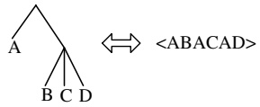

Fig. 1. An example of a tree and its corresponding schedule (see Section 2.3 for explanation).

In this paper, we study trees that represent ‘good’’ perfectly periodic schedules. Our strategy is to analyze the (exponential time) algorithm that constructs the optimal tree scheduling, and using it as the starting point, we develop ‘‘good’’ heuristic algorithms that run in polynomial-time. The goodness of the heuristics is tested by experimentally comparing them with the best known non-periodic algorithm.

## 1.1. Related work

Motivated by the goal of minimizing the waiting time, much research has focused on scheduling which is not perfectly periodic, using the average measure as the target function. For example, Bar-Noy et al. [6] presents an algorithm that produces a schedule whose average measure is at most $\frac{9}{8}$ times the best possible. Their algorithm uses the golden ratio schedule [13], and hence gaps between consecutive occurrences of a client can have any of three distinct values (whereas in perfect schedules there is exactly one possible value). In [15], Kenyon et al. describe a polynomial approximation scheme for the average measure; their solution is not perfectly periodic either. Hameed and Vaidya [19,20] propose, using Weighted Fair Queuing, to schedule broadcasts (which results in non-perfectly periodic schedules).

Ammar and Wong [2,3], consider the problem of minimizing the average response time in Teletext Systems, which is equivalent to Broadcast

Disks. They show that the optimal schedule is cyclic, and give nearly optimal algorithms for this problem. Khanna and Zhou [16] show how to use indexing with perfectly periodic scheduling to minimize busy waiting, and they also show how to get a 3approximation w.r.t. the average measure. Bar-Noy et al. prove in [6] that it is NP-hard to find the optimal perfectly periodic schedule.

Baruah et al. [9] and Anderson et al. [4] give algorithms for fair periodic scheduling. Their algorithms build schedules where at every time t a client with share demand $a _ { i } ,$ must have been scheduled either $\left[ a _ { i } \cdot t \right] \quad \mathrm { o r } \quad \left[ a _ { i } \cdot t \right]$ times. These schedules are not perfectly periodic: gaps between consecutive occurrences of a client can be as high as twice the requested period. Additional papers with analysis of the average measure (motivated by Broadcast Disks and related problems) are [1,8,17]. The machine maintenance problem [5,21] and the chairperson assignment problem [18] are also closely related to periodic scheduling.

The general notion of perfect periodicity and the tree methodology were introduced in [7]. This paper presents algorithms for constructing schedules that are guaranteed to be close to optimum w.r.t. the average measure, depending on the value of the maximal requested share.

## 1.2. Our contribution

In this paper, we study the problem of efficiently constructing good tree schedules. Given a set of frequencies requests, our goal is to find a tree schedule that grants these frequencies exactly or approximately. The quality of a schedule is measured by either the weighted average or the maximum of the ratios between the requested frequency and the allocated frequency for each client.

• We first give optimal (exponential time) algorithms for both measures. Their construction is based on a well structured bottom–up approach and is not straightforward.

• Next, based on the structure of the optimal algorithms, we develop a few efficient (good polynomial time) heuristic algorithms. These heuristics perform well on frequencies that are produced by the uniform distribution and the

Zipf distribution [22] under both the MAX and AVE measures. The Zipf distribution is believed to be the best distribution to approximate ‘‘real $\mathrm { l i f } \mathrm { e } ^ { \mathrm { \textgreater } }$ frequencies (see e.g., [11]).

Finally, we present experimental results. In extensive tests that we ran, we have found that our best algorithm manages to beat even the best known non-periodic algorithm for both distributions. This is interesting, since perfect periodicity is not always possible (consider, for example, the requests $a _ { 1 } = 1 / 2$ and $a _ { 2 } = 1 / 3 )$ .

We note that to the best of our knowledge, this work is the first to introduce the MAX criterion for measuring performance of schedules in this or similar settings.

## 1.3. Paper organization

The remainder of the paper is organized as follows. In Section 2, we formally define periodic schedules and the performance measures. In Section 3, we present the optimal tree scheduling algorithms. Our heuristic algorithms are described in Section 4. Experimental results are presented in Section 5. We conclude in Section 6.

## 2. Definitions and preliminaries

In this section, we define basic terms and give several preliminary results (see Fig. 2 for a summary). In Section 2.1, we formally define schedules. Quality measures are defined and discussed in Section 2.2. Tree scheduling is described in Section 2.3.

## 2.1. Schedules

We are given a set of n clients $1 , 2 , \ldots , n .$ Each client i requests a share $0 < a _ { i } < 1$ (of a common resource). We refer to $a _ { i }$ as a requested share or a frequency demand of client i. A frequency demand vectoris a vector $\mathcal { A } = \langle a _ { 1 } , a _ { 2 } , \ldots , a _ { n } \rangle$ , where $\textstyle \sum _ { i = 1 } ^ { n } a _ { i } = 1$ . Sometimes we state client demands in terms of requested periods $\alpha _ { i } = 1 / a _ { i }$

A schedule is an infinite sequence $S = s _ { 0 } , s _ { 1 } , \ldots ,$ where $S _ { j } \in \{ 1 , 2 , \ldots , n \}$ for all j. A schedule is cyclic if it is an infinite concatenation of a finite sequence $C = \langle s _ { 0 } , s _ { 1 } , \ldots , s _ { | C | - 1 } \rangle$ . C is a cycle of $S . \mathbf { A }$ schedule is perfectly periodic (or just $p e r f e c t$ for short) if slots allocated to each client are equally spaced, i.e. for each client i there exist non-negative integers $\beta _ { i } , o _ { i } \in \mathbb { Z } ^ { + }$ called the period and offset of $^ { \ast } i ,$ respectively, such that i is scheduled in slot j if and only if $j \equiv o _ { i }$ (mod $\beta _ { i } )$ . Note that perfectly periodic schedules are cyclic. The frequency $b _ { i }$ of a client i in a perfect schedule is the reciprocal of its period, i.e., $b _ { i } = 1 / \beta _ { i }$ . We refer to $b _ { i }$ as the granted share and to $\beta _ { i }$ as the granted period for client i.

| Notations related to the input: | Notations related to a given schedule: |
| --- | --- |
| • n: the number of clients | • C: schedule cycle |
| • $a_i$: share demand of client i | • $\beta_i$: granted period of client i |
| • $\alpha_i = 1/a_i$: requested period of client i | • $b_i = \frac{1}{\beta_i}$: granted frequency of client i |
| • $\mathcal{A} = \langle a_1, \dots, a_n \rangle$: frequency demand vector, $\sum_{i=1}^{n} a_i = 1$ | • $\mathcal{B} = \langle b_1, \dots, b_n \rangle$: granted frequency vector, $\sum_{i=1}^{n} b_i = 1$ |
| Notations related to trees: | • $MAX_{\mathcal{A},\mathcal{B}} = \max \left\{ \frac{a_1}{b_1}, \dots, \frac{a_n}{b_n} \right\}$ |
| • n: number of leaves | • $AVE_{\mathcal{A},\mathcal{B}} = \sum_{i=1}^{n} \frac{a_i^2}{b_i}$ |

Fig. 2. Glossary of notations.

## 2.2. Measures

Given a frequency demand vector $\mathcal { A }$ and a granted frequency vector $\mathcal { B }$ we consider for each client the ratio of the requested shares $a _ { i } ,$ to the granted shares bi: $\rho _ { i } = a _ { i } / b _ { i }$ . Using $\rho _ { i } ^ { \mathrm { ~ \bf ~ \dot { ~ } } } \mathbf { S }$ we define the following measures:

$$
\left| \begin{array}{l} \operatorname{MAX} _ {\mathscr {A}, \mathscr {B}} = \max \{\rho_ {i} | 1 \leqslant i \leqslant n \} \\ \quad = \max \left\{\frac {a _ {i}}{b _ {i}} | 1 \leqslant i \leqslant n \right\} \\ \quad = \max \left\{\frac {\beta_ {i}}{\alpha_ {i}} | 1 \leqslant i \leqslant n \right\}, \end{array} \right|
$$

$$
\mathrm{AVE} _ {\mathscr {A}, \mathscr {B}} = \sum_ {1 \leqslant i \leqslant n} \rho_ {i} a _ {i} = \sum_ {1 \leqslant i \leqslant n} \frac {a _ {i} ^ {2}}{b _ {i}} = \sum_ {1 \leqslant i \leqslant n} \frac {\beta_ {i}}{\alpha_ {i} ^ {2}}.
$$

We omit subscripts when they are clear by the context.

Intuitively, the ‘‘best’’ (or ‘‘fairest’’) perfect schedule should be the one that provides each client exactly with its demand, $\mathrm { i . e . , } b _ { i } = a _ { i }$ for all i. In this case we get that $\mathsf { M A X } = \mathsf { A V E } = 1$ . The following lemmas show that this is indeed the best possible for the MAX and the AVE measures.

Lemma 2.1. For all frequency vectors ${ \mathcal { A } } { \mathcal { B } } ,$ we have that $\mathsf { M A X } _ { \mathcal { A } , \mathcal { B } } \geqslant 1$

Proof. Since $\begin{array} { r } { \sum _ { 1 \leqslant i \leqslant n } a _ { i } = \sum _ { 1 \leqslant i \leqslant n } b _ { i } = 1 } \end{array}$ , it follows from the pigeon hole principle that it cannot be the case that $b _ { i } > a _ { i }$ for all $1 \leqslant i \leqslant n$ Thus, there exists an index j such that $a _ { j } \geqslant b _ { j }$ . As a result we get that $\mathsf { M A X } _ { \mathcal { A } , \mathcal { B } } \geq 1$ h

Lemma 2.2. For all frequency vectors ${ \mathcal { A } } { \mathcal { B } } ,$ we have that $\mathsf { A V E } _ { \mathcal { A B } } \geqslant 1$

Proof. Let $\mathcal { A } = \langle a _ { 1 } , a _ { 2 } , \ldots , a _ { n } \rangle$ be the frequency vector and let $\mathcal { B } = \langle b _ { 1 } , b _ { 2 } , \ldots , b _ { n } \rangle$ be a vector such that $\textstyle \sum _ { 1 \leqslant i \leqslant n } b _ { i } = 1$ We show that $\mathsf { A V E } _ { \mathcal { A B } } = \textstyle \sum _ { 1 \leqslant i \leqslant n } a _ { i } ^ { 2 } / b _ { i }$ gets the minimum value when $b _ { i } = a _ { i }$ for all $1 \leqslant i \leqslant n .$

For simplicity, we show the proof for $n = 2 ,$ the general case follows similar arguments. For the $n = 2$ case $\mathcal { A } = \langle a , 1 - a \rangle$ and $\mathcal { B } = \langle b , 1 - b \rangle$ . We view AVE a function on b: ave $\mathrm { { } } \mathrm { { } } \mathrm { { } } \mathrm { { } } \mathrm { { } } \mathrm { { } } \mathrm { { } } \mathrm { { } } \mathrm { { } } \mathrm { { } } \mathrm { { } } \mathrm { { } } \mathrm { { } } \mathrm { { } } \mathrm { { } } \mathrm { { } } \mathrm { { } } \mathrm { { } { } } \mathrm { { } } \mathrm { { } { } } \mathrm { { } { } } \mathrm { { } { } } \mathrm { { } { } } \mathrm { { } { } } \mathrm { { } { } } \mathrm { { } { } } \mathrm { { } { } } \mathrm { { } { } } \mathrm { { } { } } \mathrm { { } { } } \mathrm { { } { } { } } \mathrm { { } { } { } } \mathrm { { } { } { } { } { } { } { } { } { } { } { } { } { } { } { } { } { } { } { } { } { } { } { } { } { } { } { } { } { } { } { } { } { } { } { } { } { } { } { } { } { } { } { } { } { } { } { } { } { } { } { } { } { } { } { } { } { } { } { } { } { } { } { } { } { } { } { } { } { } { } { } { } { } { } { } { } { } { } { } { } { } { } { } { } { } { } { } { } { } { } { } { } { } { } { } { } { } { } { } { } { } { } { } { } { } { } { } { } { } { } { } { } { } { } { } { } { } { } { } { } { } { } { } { } { } { } { } { } { } { } { } { } { } { } { } { } { } { } { } { } { } { { } } { { } { } { } { } { } { } { } { } { } { } { } { } { } { } { } { } { } { } { } { } { } { } { } { } { } { } { } { } { } { } { } { { } } { { } { } { } { } { } { } { } { } { } { } { } { } { } { } { } { } { } { } { } { } { } { } { } { } { } { } { } { } { } { } { } { } { } { } { } { } { } { } { } { } { } { } { } { { } { } { } { } { } { } { } { } { } { } { } { } { } { } { } { } { } { } { } { } { } { } { { } } { } { } { { } { } { } { } { } { } { } { } { } { } { } { } { } { } { } { } { } { } { } { } { } { { } } { } { { } { } } { { } { } { } { }$ . Differentiating, we get that $\mathrm{d}(\mathrm{ave})/\mathrm{d}b = -a^2/b^2 + (1-a)^2/(1-b)^2$ Solving $\mathrm { d } ( \mathrm { a v e } ) / \mathrm { d } b   =   0 ,$ , we find that the minimum is obtained when a ¼ b. h

Table 1

| Schedule | ðb1;q1Þ | ðb2;q2Þ | ðb3;q3Þ | MAX | AVE |
| --- | --- | --- | --- | --- | --- |
| RR | (3,3/2) | (3,1) | (3,1/2) | 3/2 | 7/6 |
| C | (2,1) | (4,4/3) | (4,2/3) | 4/3 | 19/18 |

For both MAX and AVE, the closer to 1 the measure is, the more satisfied clients share demands are. Therefore, our goal is to find schedules minimizing performance measures.

Example 1. Let $a _ { 1 } = 1 / 2 ,   a _ { 2 } = 1 / 3 ,$ , and $a _ { 3 } = 1 / 6 .$ We compare the round-robin schedule $\mathbf { R } \mathbf { R } = \langle 1 , 2 , 3 \rangle$ with the only other perfect schedule with three clients $C = \langle 1 , 2 , 1 , 3 \rangle$ . Table 1 summarizes the performance of the two schedules for the two measures. Table 1 shows that C outperforms RR in both measures.

Example 2. Let $a_{1}=1/3,   a_{2}=1/3,   a_{3}=1/4,$ , and $a _ { 4 } = 1 / 1 2$ . We compare the following (and only) four perfect schedules with four clients:

$$
\mathrm{RR} = C _ {1} = \langle 1, 2, 3, 4 \rangle , C _ {2} = \langle 1, 2, 3, 1, 2, 4 \rangle ,
$$

$$
C _ {3} = \langle 1, 2, 1, 3, 1, 4 \rangle , C _ {4} = \langle 1, 2, 1, 3, 1, 2, 1, 4 \rangle .
$$

Table 2 summarizes the performance of the four schedules. The table shows that the round-robin schedule $C _ { 1 }$ is the best for the MAX measure, while $C _ { 2 }$ is the best schedule for the AVE measure.

## 2.2.1. Other performance measures: weighted max and unweighted average

In this paper, we work with unweighted MAX and weighted AVE measures. We show why we do not consider the other two possible measures. The first is the weighted MAX:

$$
\text {W\_MAX} _ {\mathscr {A}, \mathscr {B}} = \max \left\{\frac {a _ {i} ^ {2}}{b _ {i}} | 1 \leqslant i \leqslant n \right\}.
$$

The second is the unweighted AVE:

$$
\mathrm{U} _ {-} \mathrm{AVE} _ {\mathscr {A}, \mathscr {B}} = \frac {1}{n} \sum_ {1 \leqslant i \leqslant n} \frac {a _ {i}}{b _ {i}}.
$$

We say that a measure ‘‘makes sense’’ if granting the clients with their requested shares would yield the best performance. This is because in most applications the requested shares were calculated to yield the best performance or to satisfy fairness issues. It may be surprising, but unweighted average and weighted max do not make sense in this respect. The point with unweighted average is that if many low-weight requests get larger shares, they bias the measure merely by having many of them, even if their total weight is small. The flip side of this anomaly is weighted average: in this case, the measure suppresses the effect of granting a larger share to the heaviest client at the expense of the small clients. In what follows, we construct instances for which granting the requested shares is not optimal for the above two measures.

The perfect schedule that gives each client its exact shares yields $\mathbf{W} \_ \mathbf{M} \mathbf{A} \mathbf{X} = \max \{ a_i | 1 \leqslant i \leqslant n \}$ and ${ \mathsf { U } } { \mathsf { \_ A V E } } = 1$ . Consider the following two frequency vectors:

$$
\begin{array}{l} \hline \mathscr {A} _ {1} = \left\langle a, \frac {1 - a}{n - 1}, \dots , \frac {1 - a}{n - 1} \right\rangle , \\ \mathscr {A} _ {2} = \left\langle \frac {1}{2}, \frac {1}{2 (n - 1)}, \dots , \frac {1}{2 (n - 1)} \right\rangle . \end{array}
$$

Assume that $a = 1 / \alpha$ for an integer a such that $\alpha - 1$ divides $n - 1$ . For both vectors there exist corresponding schedules for which each client gets its exact share:

Table 2

| Schedule | ðb1;q1Þ | ðb2;q2Þ | ðb3;q3Þ | ðb4;q4Þ | MAX | AVE |
| --- | --- | --- | --- | --- | --- | --- |
| C1 | (4,4/3) | (4,4/3) | (4,1) | (4,1/3) | 4/3 | 7/6 |
| C2 | (3,1) | (3,1) | (6,3/2) | (6,1/2) | 3/2 | 13/12 |
| C3 | (2,2/3) | (6,2) | (6,3/2) | (6,1/2) | 2 | 47/36 |
| C4 | (2,2/3) | (4,4/3) | (8,2) | (8,2/3) | 2 | 11/9 |

$$
\begin{array}{c} C _ {1} = \langle 1, 2, \ldots , \alpha , 1, \alpha + 1, \ldots , 2 \alpha - 1, \ldots , 1, \\ n - \alpha + 1, \ldots , n - 1 \rangle , \end{array}
$$

$$
C _ {2} = \langle 1, 2, 1, 3, \dots , 1, n - 1 \rangle .
$$

To show the unnatural effect of W MAX, consider $\mathcal { A } _ { 1 }$ as the frequency vector, and let $\mathcal { C } _ { 1 }$ and $\mathcal { C } _ { 2 }$ denote the frequency vectors corresponding to $\mathcal { C } _ { 1 }$ and $\mathcal { C } _ { 2 } ,$ respectively. We have that W $\mathsf { M A X } _ { \mathcal { A } _ { 1 } , \mathcal { C } _ { 1 } } =$ max $\{ a , ( 1 - a ) / ( n - 1 ) \}$ and $\mathsf{W\_MAX_{\mathcal{A}_{1},\mathcal{C}_{2}}}=$ max $\left\{ 2 a ^ { 2 } , 2 ( 1 - a ) ^ { 2 } / ( n - 1 ) \right\}$ . If $n > 1 + \widetilde{(\alpha - 1)^2}$ then $2a^{2}>2(1-a)^{2} / (n-1)$ and $a > ( 1 - a ) /$ $( n - 1 )$ For such large values of n we get $\mathsf{W}\_\mathsf{MAX}_{\mathcal{A}_{1},\mathcal{C}_{1}}=a$ and $\mathsf{W.MAX}_{\mathcal{A}_{1},\mathcal{C}_{2}} = 2a^{2}$ . Under the W MAX measure, for $a < 1 / 2 , \mathcal { C } _ { 2 }$ is better than $\mathcal { C } _ { 1 }$ that meets exactly the demands of all clients! Moreover, the ratio of the performance of the schedules is $a / ( 2 a ^ { 2 } ) = \alpha / 2 ,$ , which can be arbitrarily large (by selecting n large enough such that $\alpha - 1 { \mathrm { ~ d i v i d e s ~ } } n - 1 )$ . Note that in order to achieve a better performance for W MAX, the schedule might prefer the first client as is the case with $\mathcal { C } _ { 2 }$

To show the unnatural effect of U AVE, consider $\mathcal { A } _ { 2 }$ as the frequency vector. We have that

$$
\mathrm{U\_AVE} _ {\mathcal {A} _ {2}, \mathcal {C} _ {2}} = 1
$$

and

$$
\mathrm{U} _ {-} \mathrm{AVE} _ {\mathscr {A} _ {2}, \mathscr {C} _ {1}} = \frac {1}{n} \left(\frac {1}{2 a} + \frac {n - 1}{2 (1 - a)}\right).
$$

Plugging in the value of $a = 1 / \alpha ,$ we get

$$
\mathrm{U} _ {-} \mathrm{AVE} _ {\mathscr {A} _ {2}, \mathscr {C} _ {1}} = \frac {\alpha n + \alpha^ {2} - 2 \alpha}{2 (\alpha - 1) n}.
$$

We choose a large value for a and then a larger value for $n$ to get that U $\mathsf { J } _ { - } \mathsf { A V E } _ { \mathcal { A } _ { 2 } , \mathcal { C } _ { 1 } } = \frac { 1 } { 2 } + \mathsf { O } ( 1 )$ Thus, for the U AVE measure, $\mathcal { C } _ { 1 }$ performs almost twice better than the natural schedule $\mathcal { C } _ { 2 }$ that meets exactly the demands of all clients. Note that in order to achieve a better performance for U AVE, the schedule might give the first client less slots as is the case with $\mathcal { C } _ { 1 }$

## 2.3. Scheduling trees

A tree is a connected acyclic graph. A rooted tree is a tree with one node designated as the root. We assume that all edges are directed away from the root. $\mathrm { ~ I f ~ } ( u , v )$ is a directed edge, then v is the child of u, and u is the parent of v. The degree of a node in a rooted tree is the number of its children. A leaf is a node with degree 0.

Tree scheduling is a methodology for constructing perfect schedules that can be represented by rooted trees [7]. The basic idea is that each leaf corresponds to a distinct client, and the period of each client is the product of the degree of all the nodes on the path leading from the root to the corresponding leaf. In the example of Fig. 1, the period of A is 2 because the root degree is 2, and the periods of $^ { B , C }$ and D are 6, because the root degree is 2 and the degree of their parent is 3. We refer to a tree that represents a schedule as a scheduling tree.

Given a scheduling tree, one can build a corresponding schedule in several ways. One possible way to construct a schedule is to explicitly compute offsets of clients from the tree [7]. Another way is to use a tree directly. One can build a full listing of schedule cycle from the tree as follows. We construct a schedule cycle recursively: Each leaf of the scheduling tree corresponds to a schedule cycle of length 1 consisting of its client. To construct a schedule cycle of an internal node, schedules of its children are brought to the same size by replication, and then the resulting schedules are interleaved in the round-robin manner. Finally, the schedule cycle associated with the root is the output of the algorithm. In the example of Fig. 1, the schedule associated with the parent of B, C, and D is hBCDi. The final schedule hABACADi is obtained by interleaving the two schedules hAAAi and hBCDi. More details on usage of scheduling trees can be found in [12]. We summarize basic properties of scheduling trees in the following lemma:

Theorem 2.3 (Bar-Noy et al. [7, Theorem 3.1]). Let T be a scheduling tree with n leaves labeled $1 , \ldots , n ,$ where leaf i corresponds to client i. Then there exists a perfect schedule for clients $1 , \ldots , n ;$ the period of each client i in the schedule is the product of the degrees of all ancestors of i in T .

## 3. Optimal tree scheduling

In this section, we describe optimal (exponential time) algorithms that construct scheduling trees, for both the MAX and the AVE measures. Since the algorithms for MAX and AVE are nearly identical, we describe MAX in detail and only point out the differences for AVE.

Our optimal algorithms use the bottom–up approach, in the sense that they combine a set of leaves into a single node and then continue recursively. This approach is similar to the construction of Huffman codes [14].

The optimal algorithms are based on the observation that for both MAX and AVE measures, it is always better to give more time slots in the schedule for clients whose requested shares are larger. This means that there exists an optimal tree where the smallest share in the schedule belongs to the client with the smallest share demand. To prove this idea, we need the following algebraic lemma.

Lemma 3.1. For $\alpha _ { 1 } \leqslant \alpha _ { 2 }$ and $\beta _ { 1 } \leqslant \beta _ { 2 }$

1. max $\{ \beta _ { 2 } / \alpha _ { 1 } , \beta _ { 1 } / \alpha _ { 2 } \}$ P max $\{ \beta _ { 1 } / \alpha _ { 1 } , \beta _ { 2 } / \alpha _ { 2 } \}$ ,

2. $\beta _ { 2 } / \alpha _ { 1 } ^ { 2 } + \beta _ { 1 } / \alpha _ { 2 } ^ { 2 } \geqslant \beta _ { 1 } / \alpha _ { 1 } ^ { 2 } + \beta _ { 2 } / \alpha _ { 2 } ^ { 2 } .$

## Proof

1. $\alpha _ { 1 } \leqslant \alpha _ { 2 }$ implies that $\beta _ { 2 } / \alpha _ { 1 } \geqslant \beta _ { 2 } / \alpha _ { 2 }$ and $\beta _ { 1 } \leqslant \beta _ { 2 }$ implies that $\beta _ { 2 } / \alpha _ { 1 } \geqslant \beta _ { 1 } / \alpha _ { 1 }$ Hence, $\beta _ { 2 } / \alpha _ { 1 } \geqslant$ max $\{ \beta _ { 1 } / \alpha _ { 1 } , \beta _ { 2 } / \alpha _ { 2 } \}$ , and therefore, max $\{ \beta _ { 2 } / \alpha _ { 1 }$ $\beta _ { 1 } / \alpha _ { 2 } \} \geqslant$ max $\{ \beta _ { 1 } / \alpha _ { 1 } , \beta _ { 2 } / \alpha _ { 2 } \}$

2. $\alpha _ { 1 } \leqslant \alpha _ { 2 }$ and $\beta _ { 1 } \leqslant \beta _ { 2 }$ imply that $( \beta _ { 2 } - \beta _ { 1 } ) ( \alpha _ { 2 } ^ { 2 } -$ $\alpha _ { 1 } ^ { 2 } ) \geqslant 0$ . Hence, $\beta _ { 2 } \alpha _ { 2 } ^ { 2 } + \beta _ { 1 } \alpha _ { 1 } ^ { 2 } \geqslant \beta _ { 1 } \alpha _ { 2 } ^ { 2 } + \beta _ { 2 } \alpha _ { 1 } ^ { 2 }$ and therefore $\beta _ { 2 } / \alpha _ { 1 } ^ { 2 } + \beta _ { 1 } / \alpha _ { 2 } ^ { 2 } \geqslant \bar { \beta _ { 1 } } / \alpha _ { 1 } ^ { 2 } + \bar { \beta _ { 2 } } / \alpha _ { 2 } ^ { 2 }$ h

We say that a scheduling tree is optimal for a given frequency request vector if its corresponding schedule achieves the best performance achievable by schedules that can be represented as trees. The following corollary states a property of some optimal trees.

Corollary 3.2. Let $\{ \alpha _ { 1 } \leqslant \cdots \leqslant \alpha _ { n } \}$ be the requested periods. Then, for both the MAX and the AVE measures, there exists an optimal scheduling tree whose corresponding granted periods preserve the non-decreasing order, i.e., $\beta _ { 1 }   \leqslant   \cdots   \leqslant   \beta _ { n }$

Proof. Let S be any optimal tree schedule associated with the optimal scheduling tree T . Assume that in S there exist two clients $1 \leqslant i , j \leqslant i$ n such that $\alpha _ { i } \leqslant \alpha _ { j }$ but $\beta _ { i } > \beta _ { j }$ . Let $S ^ { \prime }$ be the schedule $S$ in which the clients $i$ and $j$ are switched: $S ^ { \prime }$ grants client i period $\beta _ { j }$ and grants client $j$ period $\beta _ { i }$ . Let $T ^ { \prime }$ be the scheduling tree that is associated with the schedule $S ^ { \prime } ,$ Note that $T ^ { \prime }$ is the tree $T$ in which clients i and $j$ switch leaves. By Lemma 3.1, the cost of $S ^ { \prime }$ is at most the cost of S for both measures. Therefore, $T ^ { \prime }$ is also an optimal scheduling tree. We proceed with these switches to get an optimal scheduling tree $T ^ { \prime \prime }$ for which $\beta _ { i }   \leqslant   \beta _ { j }$ for all pairs of clients $1 \leqslant i , j \leqslant n$ such that $\alpha _ { i } \leqslant \alpha _ { j }$ h

The above corollary implies that there exists an optimal scheduling tree that preserves the non-increasing order of the requested shares. We use this to prove the following key theorem that is valid for both MAX and AVE measures. This theorem serves as the first step in constructing the bottom–up optimal algorithms.

Theorem 3.3. For each frequency demand vector $\mathcal { A } ,$ there exists an optimal scheduling tree $T ,$ an integer $2 \leqslant k \leqslant n,$ and a node q with k children such that the children of q in $T$ are the clients with the smallest k requested shares.

Proof. First, note that by definition siblings leaves have the same granted share. Second, note that if a leaf has an internal node as a sibling than all of the leaves in the subtree rooted at this node are granted a smaller share. Therefore, in any tree there exists at least one node $q$ that has $k \geqslant 2$ children all of them leaves whose granted shares are the smallest in the tree. By Corollary 3.2, there exists an optimal tree in which these k leaves are associated with the smallest k requested shares. h

Our optimal tree algorithms rely on Theorem 3.3. The idea is to coalesce k clients with the smallest share demands into a new client, and then solve the new problem recursively.

## 3.1. The optMax algorithm

We first explain the optimal algorithm for the MAX measure. The algorithm loops through all values of $k ,$ and for each value, it coalesces the k smallest clients, and solves the new set recursively.

Algorithm optMax
input: $\mathcal{A} = \langle a_1, a_2, \dots, a_n \rangle$
output: scheduling tree $T$, and its MAX value val
    if $n = 1$
        return ($\{a_1\}, a_1$)
    else
        for $2 \leq k \leq n$
            $M_k \leftarrow k$ smallest elements of $\mathcal{A}$
$\star \quad a'_k \leftarrow k \cdot \max\{a \mid a \in M_k\}$
            $\mathcal{A}_k \leftarrow \mathcal{A} \cup \{a'_k\} \setminus M_k$
            $(T_k, \text{val}_k) \leftarrow \text{optMax}(\mathcal{A}_k)$
            $k^* \leftarrow \arg \min\{\text{val}_k \mid 2 \leq k \leq n\}$
            $T \leftarrow T_{k^*}$, where nodes corresponding to elements of $M_{k^*}$
            are added as children of the node corresponding to $a'_{k^*}$ in $T_{k^*}$
    return ($T, \text{val}_{k^*}$)

Fig. 3. An optimal algorithm for the MAX measure. For the AVE measure, replace the line marked by H with Eq. (2).

The best k is chosen. Pseudo code is presented in Fig. 3.

The crux of the algorithm is the weight $a _ { k } ^ { \prime }$ that is assigned to a new client that replaces $k$ old clients with the smallest share demands

$$
a _ {k} ^ {\prime} = k \cdot \max \{a | a \in M _ {k} \}.\tag{1}
$$

To explain this choice, we first make the following definition. Let $\mathcal { A } = \langle a _ { 1 } , a _ { 2 } , \ldots , a _ { n } \rangle$ be a vector of frequencies. We do not require that $\textstyle \sum _ { i = 1 } ^ { n } a _ { i } = 1$ . Let $T$ be a tree with n leaves and granted frequency vector $\mathcal { B } ( T ) = \langle b _ { 1 } , \ldots , b _ { n } \rangle$ Then we define

$$
\operatorname{val} (\mathscr {A}, T) = \max \left\{\frac {a _ {1}}{b _ {1}}, \dots , \frac {a _ {n}}{b _ {n}} \right\}.
$$

We now prove that when optMax coalesces several clients, val is preserved.

Lemma 3.4. Let T be a tree with leaves $1 , \ldots , n .$ where clients $1 , \ldots , k$ are siblings with parent q. Let ${ \mathcal { A } } = \langle a _ { 1 } , \ldots , a _ { n } \rangle$ be the frequency requests of the clients of T . Let T 0 be the tree generated from T by replacing clients $1 , \ldots , k$ with q, and let A0 be the frequency request vector resulting from A by replacing $a _ { 1 } , \ldots , a _ { k }$ with $a_{q} = k \cdot \max\{a_{1}, \ldots, a_{k}\}$ Then val $( { \mathcal { A } } , T ) = \mathsf { v a l } ( { \mathcal { A } } ^ { \prime } , T ^ { \prime } )$

Proof. Let $\mathcal { B } = \langle b _ { 1 } , \ldots , b _ { n } \rangle$ and $\mathcal { B } ^ { \prime } = \langle b _ { q } ^ { \prime } , b _ { k + 1 } ^ { \prime } , \ldots ,$ $\left| b _ { n } ^ { \prime } \right\rangle$ be granted frequency vectors implied by $\bar { T }$ and $T ^ { \prime } ,$ , respectively. By definition, $b _ { i } = b _ { i } ^ { \prime }$ for $k + 1 \leqslant$ $i \leqslant n$ and $b _ { 1 } = b _ { 2 } = \cdots = b _ { k } = b _ { q } ^ { \prime } / k .$ Hence,

$$
\begin{array}{r l} \operatorname{val} (\mathscr {A} ^ {\prime}, T ^ {\prime}) & = \max \left\{\frac {a _ {q}}{b _ {q} ^ {\prime}}, \frac {a _ {k + 1}}{b _ {k + 1} ^ {\prime}}, \dots , \frac {a _ {n}}{b _ {n} ^ {\prime}} \right\} \\ & = \max \left\{\frac {k \cdot \max \{a _ {1} , \dots , a _ {k} \}}{b _ {q} ^ {\prime}}, \frac {a _ {k + 1}}{b _ {k + 1} ^ {\prime}}, \dots , \frac {a _ {n}}{b _ {n} ^ {\prime}} \right\} \\ & = \max \left\{\frac {a _ {1}}{b _ {q} ^ {\prime} / k}, \dots , \frac {a _ {k}}{b _ {q} ^ {\prime} / k}, \frac {a _ {k + 1}}{b _ {k + 1} ^ {\prime}}, \dots , \frac {a _ {n}}{b _ {n} ^ {\prime}} \right\} \\ & = \max \left\{\frac {a _ {1}}{b _ {1}}, \dots , \frac {a _ {k}}{b _ {k}}, \frac {a _ {k + 1}}{b _ {k + 1}}, \dots , \frac {a _ {n}}{b _ {n}} \right\} \\ & = \operatorname{val} (\mathscr {A}, T). \quad \square \end{array}
$$

We say that an algorithm finds an optimal tree $T ^ { * }$ for n clients with a frequency request vector $\mathcal { A }$ if for any tree T with n leaves va $\left| \left( \mathcal { A } , T ^ { * } \right) \leqslant \mathsf { v a l } ( \mathcal { A } , T ) \right.$ . The next lemma justifies the recursive step of the optMax algorithm. We use the following notation. For a vector $\mathcal { A } = \left\langle a _ { 1 } \leqslant a _ { 2 } \leqslant \cdots \leqslant a _ { n } \right\rangle$ of frequencies whose sum is not necessarily 1, we denote

$$
\mathcal {A} ^ {\prime} (k) = \left\langle a _ {k} ^ {\prime}, a _ {k + 1}, \dots , a _ {n} \right\rangle \quad \text {for} 1 <   k \leqslant n,
$$

where $a_{k}^{\prime} = k \cdot \max\{a_{1}, \ldots, a_{k}\}$

Lemma 3.5. Let A be a frequency demand vector, and let $T ^ { \prime } ( k )$ be an optimal tree for $\mathcal { A } ^ { \prime } ( k )$ . Let $T ( k )$ be a tree generated from $T^{\prime}(k)\ by$ adding k clients with frequency demands $a _ { 1 } , \ldots , a _ { k }$ as children of the node with frequency demand $a _ { k } ^ { \prime }$ . Let k be such that val $( \mathcal { A } ^ { \prime } ( k ) , T ^ { \prime } ( k ) )$ is minimized. Then $T ( k ^ { * } )$ is an optimal tree for A w.r.t. the MAX measure.

Proof. Let $T ^ { * }$ denote $T ( k ^ { * } )$ . Assume that $T ^ { * }$ is not optimal for $\mathcal { A }$ and let R be an optimal tree for $\mathcal { A } ,$ i.e., ${ \mathsf { v a l } } ( A , T ^ { * } ) > { \mathsf { v a l } } ( { \mathcal { A } } , R )$ . By Theorem $3 . 3 ,$ without loss of generality, there exists $2 \leqslant m \leqslant n$ such that m clients with the smallest frequency demands are siblings in R. Let $R ^ { \prime }$ be the tree generated from R by coalescing these m clients. Note that $R ^ { \prime }$ corresponds to the frequency demand vector ${ \mathcal { A } } ^ { \prime } ( m )$ Since coalescing clients does not change the value of the val function by Lemma 3.4, we get

$$
\left| \begin{array}{c} \operatorname{val} (\mathscr {A} ^ {\prime} (m), R ^ {\prime}) = \operatorname{val} (\mathscr {A}, R) <   \operatorname{val} (\mathscr {A}, T ^ {*}) \\ = \operatorname{val} (\mathscr {A} ^ {\prime} (k ^ {*}), T ^ {\prime} (k ^ {*})) \\ \leqslant \operatorname{val} (\mathscr {A} ^ {\prime} (m), T ^ {\prime} (m)). \end{array} \right|
$$

Hence, $\mathsf { v a l } \big ( \mathcal { A } ^ { \prime } ( m ) , R ^ { \prime } \big ) < \mathsf { v a l } \big ( \mathcal { A } ^ { \prime } ( m ) , T ^ { \prime } ( m ) \big )$ , contradicting the assumption that $T ^ { \prime } ( m )$ is optimal tree for $\mathcal{A}'(m).\quad  口$

Theorem 3.6 summarizes the correctness and optimality of Algorithm optMax.

Theorem 3.6. Algorithm optMax finds the optimal tree w.r.t. the MAX measure in time $\mathrm { O } ( 2 ^ { n } )$

Proof. We first prove optimality by induction on $n .$ For $n = 1$ the claim is trivial. For the inductive step, we have that by Lemma 3.5, optMax finds the tree T that minimizes ${ \mathsf { v a l } } ( { \mathcal { A } } , T )$ Since val $( \mathcal { A } , T ) = \mathsf { M A X } _ { \mathcal { A } , \mathcal { B } ( T ) }$ , we conclude that optMax finds the optimal tree. As for the running time, let $T ( n )$ denote the running time of optMax for n clients. Clearly, we have that the time is given by the recursive relation $T ( 1 ) =  { \mathbf { O } } ( 1 )$ and

$$
\begin{array}{l} T (n) = \sum_ {i = 1} ^ {n - 1} T (i) + \mathrm{O} (n ^ {2}), \\ \text {whose solution is} T (n) = \mathrm{O} (2 ^ {n}). \quad \square \end{array}
$$

We remark that there exists a more efficient implementation of the optMax algorithm that performs at each recursion step $\mathrm { O } ( n )$ operations rather than $\mathrm { O } ( n ^ { 2 } )$ , but this solution improves the asymptotic time complexity only by a constant factor. Details are omitted.

## 3.2. The optAve algorithm

Algorithm optAve for the AVE measure is identical to the optMax algorithm, except for the computation of the new client share demand. In optAve, coalescing k clients with share demands $( a _ { 1 } , \ldots , a _ { k } )$ produces the new client with the share demand

$$
a _ {k} ^ {\prime} = \sqrt {k (a _ {1} ^ {2} + \cdots + a _ {k} ^ {2})}.\tag{2}
$$

(In the pseudo code of Fig. 3, the equation above replaces the line marked by H.)

For the AVE measure, we define ${ \mathsf { v a l } } ( { \mathcal { A } } , T ) = a _ { 1 } ^ { 2 } / b _ { 1 } + \cdots + a _ { n } ^ { 2 } / b _ { n }$ . The following lemma shows that when optAve coalesces several clients, val is preserved.

Lemma 3.7. Let T be a tree with leaves $1 , \ldots , n ,$ where clients $1 , \ldots , k$ are siblings with parent q. Let ${ \mathcal { A } } = \langle a _ { 1 } , \ldots , a _ { n } \rangle$ be the frequency requests of the clients of T . Let T 0 be the tree generated from T by replacing clients $1 , \ldots , k$ with $q ,$ and let A0 be the frequency request vector resulting from A by replacing $a _ { 1 } , \ldots , a _ { k }$ with $a _ { q } = \sqrt { k ( a _ { 1 } ^ { 2 } + \cdots + a _ { k } ^ { 2 } ) }$ Then val $( { \mathcal { A } } , T ) = \mathsf { v a l } ( { \mathcal { A } } ^ { \prime } , T ^ { \prime } )$

Proof. Let $\mathcal { B } = \langle b _ { 1 } , \ldots , b _ { n } \rangle$ and $\mathcal { B } ^ { \prime } =$ $\langle b _ { c } ^ { \prime } , b _ { k + 1 } ^ { \prime } , \ldots , b _ { n } ^ { \prime } \rangle$ be granted frequency vectors implied by T and $T ^ { \prime }$ , respectively. Obviously, $b _ { i } = b _ { i } ^ { \prime }$ for $k + 1 \leqslant i \leqslant n$ and $b _ { 1 } = b _ { 2 } = \cdots = b _ { k } = b _ { c } ^ { \prime } / k .$ Hence,

$$
\begin{array}{r l} \operatorname{val} (\mathscr {A} ^ {\prime}, T ^ {\prime}) & = \frac {a _ {c} ^ {2}}{b _ {c} ^ {\prime}} + \frac {a _ {k + 1} ^ {2}}{b _ {k + 1} ^ {\prime}} + \dots + \frac {a _ {n} ^ {2}}{b _ {n} ^ {\prime}} \\ & = \frac {k (a _ {1} ^ {2} + \cdots + a _ {k} ^ {2})}{b _ {c} ^ {\prime}} + \frac {a _ {k + 1} ^ {2}}{b _ {k + 1} ^ {\prime}} + \dots + \frac {a _ {n} ^ {2}}{b _ {n} ^ {\prime}} \\ & = \frac {a _ {1} ^ {2}}{b _ {c} ^ {\prime} / k} + \dots + \frac {a _ {k} ^ {2}}{b _ {c} ^ {\prime} / k} + \frac {a _ {k + 1} ^ {2}}{b _ {k + 1} ^ {\prime}} + \dots + \frac {a _ {n} ^ {2}}{b _ {n} ^ {\prime}} \\ & = \frac {a _ {1} ^ {2}}{b _ {1}} + \dots + \frac {a _ {k} ^ {2}}{b _ {k}} + \frac {a _ {k + 1} ^ {2}}{b _ {k + 1}} + \dots + \frac {a _ {n} ^ {2}}{b _ {n}} \\ & = \operatorname{val} (\mathscr {A}, T). \quad \square \end{array}
$$

Theorem 3.8. Algorithm optAve finds the optimal tree w.r.t. the AVE measure in $\mathrm { O } ( 2 ^ { n } )$ time.

The proof is identical to the proof of Theorem 3.6, and it is therefore omitted.

## 4. Heuristics

In this section, we describe various ways to reduce the running time of the optimal algorithms by restricting their exhaustive search. At each recursive step, our algorithms coalesce k clients with the smallest share demands and continue recursively. The optimal algorithms try each $2 \leqslant k \leqslant n,$ resulting in exponential running time. To save time, we examine only some restricted subsets of values for k.

We now list all of our heuristics. We use the following convention in naming algorithms: the suffixes Ave and Max denote the measure targeted by the algorithm.

bin: The bin algorithm performs recursive calls for k ¼ 2 only, i.e., it generates the best possible binary trees.

rr: It turns out that the bin algorithms perform badly especially when all remaining clients have similar demands, and this gave rise to the following algorithm: at each step, the algorithm tries both the recursive call, and the round-robin option (which will finalize the tree). We add the rr-prefix to names of these algorithms.

binMixed: In the recursive step where ‘ clients are considered, binMixed recursively calls the bin algorithm if $\ell > \log ( n \log n )$ , and otherwise it calls the optimal algorithm.

pseudoOpt: The idea in pseudoOpt is to check, at each step, what is the best k according to some heuristic. Specifically, pseudoOpt tests the k smallest elements for all k, by coalescing them and applying rrBinMixed. The best k is chosen, the corresponding clients are coalesced, and the process continues.

The hierarchy among the algorithms is described in Fig. 4. In the following subsections, we study these algorithms in more detail.

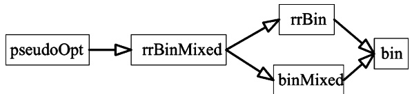

Fig. 4. The hierarchy among heuristic algorithms. An algorithm to the left of another looks at more trees and runs longer time.

## 4.1. The bin algorithms

The binMax algorithms find the best binary tree for the given frequencies request vector by coalescing at each stage two leaves with minimal requests. Pseudo code appears in Fig. 5. As is the case with the optimal algorithms, the binAve algorithm is identical to binMax except for the computation of the share demand of the new client.

The following lemma analyzes the running time of both binMax and binAve.

Lemma 4.1. The running time of the bin algorithms for n clients is Oðn log nÞ.

Proof. We use a heap for storing frequencies. The procedure of building a heap from the original frequencies array costs $\mathrm { O } ( n )$ . At each step we perform two delete-min operations and one insert operation, i.e., Oðlog nÞ operations. Therefore, the running time $T ( n )$ is defined by $T ( 1 ) =  { \mathbf { O } } ( 1 )$ and $T ( n ) = T ( n - 1 ) + \operatorname { O } ( \log n )$ . The solution of this recursive equation is $T ( n ) = \mathrm { O } ( n \log n )$ h

It is not difficult to show that the binMax algorithm guarantees an approximation ratio of at most 2; we omit the details (see [12]). We remark that it is known [7] that some binary tree schedules have approximation ratio of at most $\frac{4}{3} + \frac{2}{3} \max \{ a_i \}$ for the AVE measure. Since binAve produces the best possible binary tree schedule, it follows that its approximation ratio is never worse than $\frac{4}{3} + \frac{2}{3}\max\{a_i\}$ . Simulations show that practically, the performance of the algorithm is much better. Note that our other heuristics for both measures outperform bin, and hence their approximation ratio is also at most 2 for the MAX measure and at most $\frac{4}{3} + \frac{4}{3} \max \{ a_i \}$ for the AVE measure.

## 4.2. The rrBin algorithms

The rrBin algorithms choose at each step the best solution among the recursive solution and the round-robin solution. Clearly, the rrBin heuristics outperform the bin heuristics. Pseudo code for rrBinMax is presented in Fig. 6; the code for rrBinAve is nearly identical.

Algorithm binMax
input: $\mathcal{A} = \langle a_1, a_2, \ldots, a_n \rangle$
output: scheduling tree $T$, and its MAX value val
    if $n = 1$
        return ($\{a_1\}, a_1$)
    else
        $\{m_1, m_2\} \leftarrow 2$ smallest elements of $\mathcal{A}$
        $a' \leftarrow 2 \cdot \max \{m_1, m_2\}$
        $\mathcal{A}' \leftarrow \mathcal{A} \cup \{a'\} \setminus \{m_1, m_2\}$
        ($T', val$) $\leftarrow \text{binMax}(\mathcal{A}')$
        $T \leftarrow T'$, where nodes corresponding to $m_1$ and $m_2$ are added as children of the node corresponding to $a'$ in $T'$
        return ($T, val$)

Fig. 5. binMax algorithm.

Algorithm rrBinMax
input: $\mathcal{A} = \langle a_1, a_2, \dots, a_n \rangle$
output: scheduling tree $T$, and its MAX value val
    $r_n \leftarrow \max\{a_1, a_2, \dots, a_n\}$
    return $rrBinMax_{rec}(\mathcal{A}, r_n)$

Function $rrBinMax_{rec}$
input: $\mathcal{A} = \langle a_1, a_2, \dots, a_\ell \rangle$, $r_\ell = \max\{a \mid a \in \mathcal{A}\}$
output: scheduling tree $T$, and its MAX value val
    if $\ell = 1$
        return $(\{a_1\}, a_1)$
    else
        $\{m_1, m_2\} \leftarrow 2$ smallest elements of $\mathcal{A}$
        $a' \leftarrow 2 \cdot \max\{m_1, m_2\}$
        $\mathcal{A}' \leftarrow \mathcal{A} \cup \{a'\} \setminus \{m_1, m_2\}$
        $r_{\ell-1} \leftarrow \max\{r_\ell, a'\}$
        $(T', val) \leftarrow rrBinMax_{rec}(\mathcal{A}', r_{\ell-1})$
        if $r_\ell \cdot \ell &lt; val$
            $t$ is a new root node //round-robin solution
            build a tree $T$ by adding clients that correspond to $a_1, \dots, a_\ell$ as children of $t$
            return $(T, r_\ell \cdot \ell)$
        else // recursive solution
            $T \leftarrow T'$, where nodes corresponding to $m_1$ and $m_2$ are added as children of the node corresponding to $a'$ in $T'$
            return $(T, val)$

Fig. 6. rrBinMax algorithm.

Algorithm binMixedMax
input: $\mathcal{A} = \langle a_1, a_2, \dots, a_n \rangle$
output: scheduling tree $T$, and its MAX value val
    return binMixedMax$_{rec}(\mathcal{A}, n)$

Function binMixedMax$_{rec}$
input: $\mathcal{A} = \langle a_1, a_2, \dots, a_\ell \rangle$, $n$ - the initial number of clients
output: scheduling tree $T$, and its MAX value val
    if $\ell \leq n \log n$
        return optMax($\mathcal{A}$)
    else
        $\{m_1, m_2\} \leftarrow 2$ smallest elements of $\mathcal{A}$
        $a' \leftarrow 2 \cdot \max \{m_1, m_2\}$
        $\mathcal{A}' \leftarrow \mathcal{A} \cup \{a'\} \setminus \{m_1, m_2\}$
        $(T', val) \leftarrow binMixedMax_{rec}(\mathcal{A}', n)$
        $T \leftarrow T'$, where nodes corresponding $m_1$ and $m_2$ are added
            as children of the node corresponding to $a'$ in $T'$
        return $(T, val)$

Fig. 7. binMixedMax algorithm.

A na€ıve implementation of these algorithms calculates the performance of the round-robin schedule at each step by looking at all elements of $\mathcal { A } ,$ thus performing $\mathrm { O } ( n )$ computations at each step. We employ a more efficient implementation, that calculates the performance of the round-robin schedule in the current step using its value in the previous step in constant time. Since the overhead of the round-robin extension is only constant at each step, the total running time remains asymptotically the same as in the bin algorithms, namely Oðn log nÞ. Thus, we have

Lemma 4.2. The running time of the rrBin algorithms for n clients is Oðn log nÞ.

## 4.3. The binMixed algorithms

The main idea of the binMixed algorithms is as follows. In the recursive step where ‘ clients are considered, recursively call the bin algorithms if $\ell > \log ( n \log n )$ , otherwise call the optimal algorithms. Note that, the binMixed algorithms examine also the best binary tree as a possible solution, and therefore, outperform the bin algorithms. We present the pseudo code for the binMixedMax procedure in Fig. 7. The binMixedAve algorithm is identical to binMixedMax except for a computation of a share demand of a new client. The analysis of both binMixed algorithms appears in the next lemma.

Lemma 4.3. The running time of the binMixed algorithms is Oðn log nÞ.

Proof. $T _ { \mathsf { b i n M i x e d } } ( n ) \leqslant \mathsf { O } ( T _ { \mathsf { b i n } } ( n ) + T _ { \mathsf { o p t } } ( \log ( n \log n ) ) ) =$ $\mathrm{O}(n\log n + 2^{\log(n\log n)}) = \mathrm{O}(n\log n).$

## 4.4. The rrBinMixed algorithms

The rrBinMixed algorithms are the round-robin extension of the binMixed algorithms. At each step they try both the round-robin solution and the recursive call, and then choose the better solution. We omit the pseudo codes of rrBinMixed for both measures, since they result from a straightforward merging of the pseudo codes of rrBin and binMixed.

Algorithm pseudoOptMax
input: $\mathcal{A} = \langle a_1, a_2, \ldots, a_n \rangle$
output: scheduling tree $T$, and its MAX value val
    if $n = 1$
        return ($\{a_1\}, a_1$)
    else
        for $2 \leq k \leq n$
            $M_k \leftarrow k$ smallest elements of $\mathcal{A}$
            $a'_k \leftarrow k \cdot \max\{a \mid a \in M_k\}$
            $\mathcal{A}_k \leftarrow \mathcal{A} \cup \{a'_k\} \setminus M_k$
            $(T_k, \text{val}_k) \leftarrow \text{rrBinMixedMax}(\mathcal{A}_k)$
            $k^* \leftarrow \arg \min\{\text{val}_k \mid 2 \leq k \leq n\}$
            $(T', \text{val}') \leftarrow \text{pseudoOptMax}(\mathcal{A}_{k^*})$
            $T \leftarrow T'$, where nodes corresponding to elements of $M_{k^*}$ are added as children of the node corresponding to $a'_k_*$ in $T'$
return ($T, \text{val}'$)

Fig. 8. pseudoOptMax algorithm.

We note that the result achieved by the rrBinMixed algorithms on an input $\left\{ a _ { i } \right\}$ is the minimum of the results of rrBin and binMixed. It follows from the following observation:

• if the rrBinMixed algorithms choose the roundrobin solution at the first stage of the algorithm (a recursive call of the binary algorithm), their performance is equal to the performance of the rrBin algorithm.

• if the rrBinMixed algorithms never choose the round-robin solution at the first stage of the algorithm, their performance is equal to the performance of the binMixed algorithms.

The running time of the rrBinMixed algorithms is the same as the running time of the binMixed algorithms following the same reasoning that showed that the running time of the rrBin algorithms is the same as the running time of the bin algorithms.

Lemma 4.4. The running time of the rrBinMixed algorithms for n clients is Oðn log nÞ.

## 4.5. The pseudoOpt algorithms

The optimal algorithms choose the number of clients to be coalesced by a recursive call. The main idea of the pseudoOpt algorithms is to simulate recursive calls in the optimal algorithms by calls to rrBinMixed, thus saving on the running time. Clearly, the pseudoOpt algorithms outperform the rrBinMixed algorithms, since among others they examine all the trees examined by the rrBinMixed algorithms. Pseudo code of pseudoOptMax is given in Fig. 8; the pseudo code of the pseudoOptAve algorithm is very similar to pseudoOptMax. The running time of pseudoOpt is $\mathbf { O } ( n ^ { 3 } \log n )$ for both measures, since at each step the algorithm call up to n times the rrBinMixed algorithms, which run in Oðn log nÞ time.

Lemma 4.5. The running time of the pseudoOpt algorithms for n clients is $\mathbf { O } ( n ^ { 3 } \log n )$

## 5. Simulations

We study the performance of our heuristics for two distributions of share demands: the Zipf distribution [11,22] and the uniform distribution, under both the MAX and AVE measures.

The Zipf distribution. This distribution depends on a skew coefficient h. The value of the share of the ith client is proportional to $i ^ { - \theta } .$ That is,

$$
a _ {i} (\theta) = \frac {(1 / i) ^ {\theta}}{\sum_ {j = 1} ^ {n} (1 / j) ^ {\theta}}.
$$

We use $\theta = 0 . 8$ in our simulations [11].

The uniform distribution. Each client randomly chooses an ‘‘absolute’’ share demand $a _ { i } ^ { \prime } ,$ which is later normalized. Formally, $a _ { i } ^ { \prime } \sim U ( \vec { 0 } , 1 )$ and $\begin{array} { r } { a _ { i } = a _ { i } ^ { \prime } / \sum _ { j = 1 } ^ { n } a _ { j } ^ { \prime } } \end{array}$ . We repeat each experiment for the uniform distribution 10 times, and then average results.

In general, we found that the relative quality of the algorithms is the same for both the uniform and the Zipf distributions, for both the MAX and the AVE measures. Quantitatively, the algorithms get better results for AVE. For small numbers of clients, we compared our algorithms to the optimal algorithm (Figs. 9 and 10). For large numbers of clients, we present in Figs. 11 and 12 the performance achieved by our algorithms, noting that for both measures, the best possible performance of any perfect schedule is 1 by Lemmas 2.1 and 2.2.

Our empirical results follow the hierarchy of the heuristic algorithms (Fig. 4) for both distributions considered. The weakest results are due to the bin algorithms (about 1.45 for MAX and 1.04 for the AVE). While the rrBin algorithms perform only slightly better than bin, the binMixed algorithms

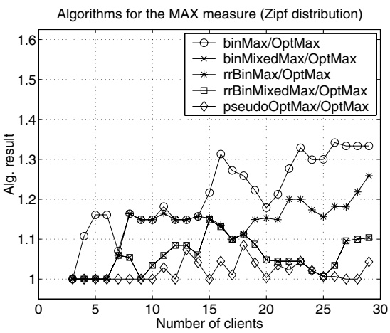

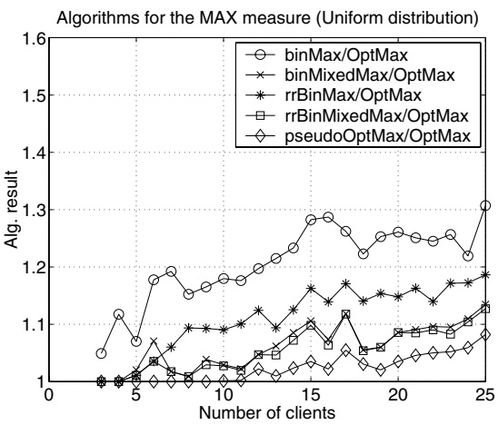

Fig. 9. The performance of algorithms for small number of clients for the MAX measure.

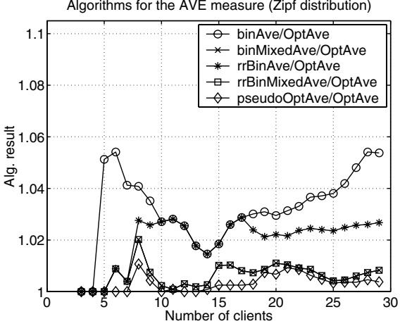

Algorithms for the AVE measure (Uniform distribution)

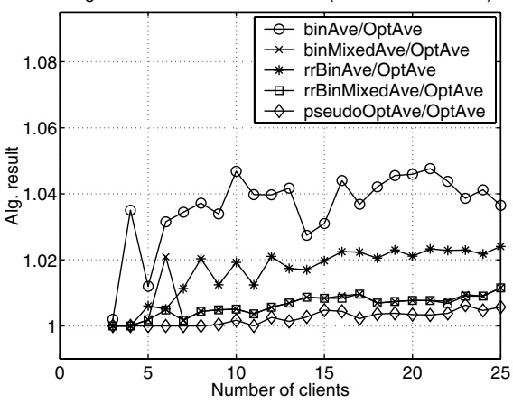

Fig. 10. The performance of algorithms for small number of clients for the AVE measure.

Algorithms for the MAX measure (Zipf distribution)

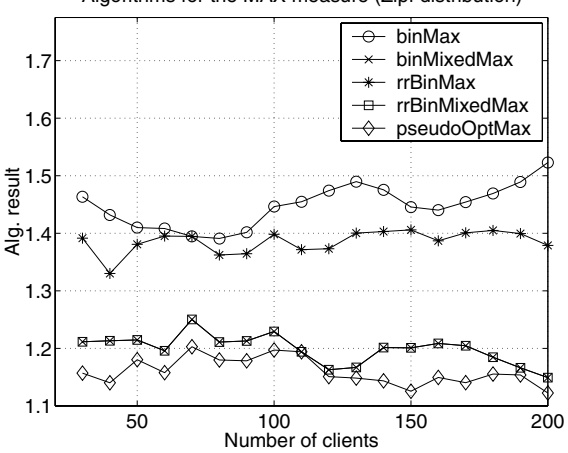

Algorithms for the MAX measure (Uniform distribution)

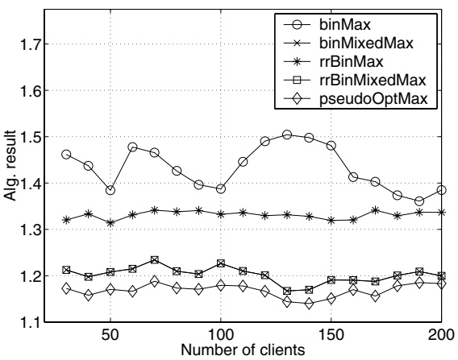

Fig. 11. The performance of algorithms for large number of clients for the MAX measure.

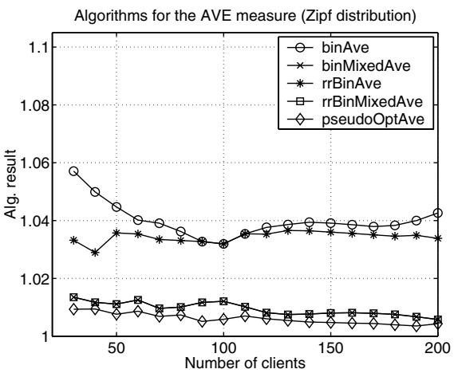

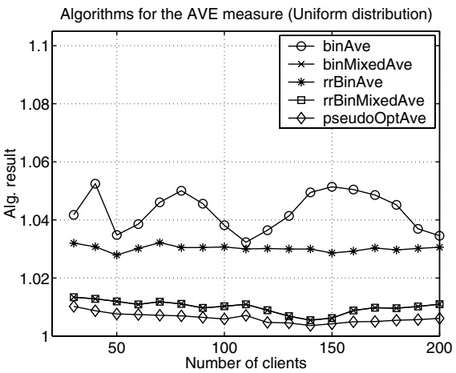

Fig. 12. The performance of algorithms for large number of clients for the AVE measure.

provide a significant improvement. The pseudoOpt algorithms improve on the results of the rrBinMixed algorithms as expected. To conclude, for both distributions, our best heuristic scheme produces schedules which are about 0.5% over the optimum for the AVE measure and about 15% over the optimum for the MAX measure.

All algorithms behave similarly for both the Zipf and the uniform distributions of share demands. Changing the h parameter of the Zipf distribution does not change the performance significantly, as can be seen in Fig. 13.

Recall that in Section 4.4 we argued that the rrBinMixed algorithms achieve the minimum between the rrBin and the binMixed algorithms. In this section, the binMixed algorithms demonstrate in our experiments much better performance than the rrBin algorithms. This observation explains why the graphs of rrBinMixed and binMixed almost coincide. It can be seen that for the uniform distribution, when very small number of clients is considered, the graphs of rrBinMixed and binMixed are very close to each other, but do not coincide completely (see Figs. 9 and 10). Each point on the graph for the uniform distribution is a result of 10 independent experiments. If for some n, rrBin is better than binMixed in at least one experiment, and, hence, for this particular experiment rrBinMixed achieves better result than binMixed, the overall average result of 10 experiments achieved by rrBinMixed is better as well. Thus, for such values of n, rrBinMixed is slightly better than binMixed.

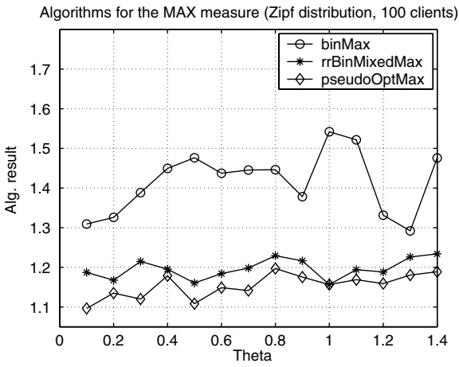

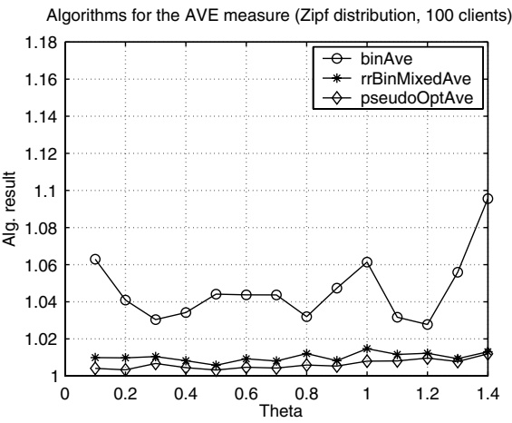

Fig. 13. The performance of algorithms for different values if h in Zipf distribution.

## 5.1. Performance for the broadcast disks problem

The Broadcast Disks problem [1] can be viewed as a relaxation of the AVE measure, in the sense that the schedule needs not be perfectly periodic. In this case, a $b _ { i }$ value represents only the average frequency for client i. The best known results for the Broadcast Disks problem, from simulations point of view, are based on some variations of a greedy heuristic (e.g., [6,19]). The idea in the greedy algorithms is to compute, every time slot, for each client i, what would be the ‘‘cost’’ of the schedule in case i is now scheduled, where cost is computed according the AVE measure. The client that minimizes the cost increase is scheduled. Note that the greedy algorithm requires knowledge of the demand vector, or else the cost cannot be computed. In the next paragraph we explain how we compare the output of the greedy heuristics with our heuristics.

The greedy algorithms, in general, produce non-cyclic schedules. In each time slot, they scan all the clients in order to choose one to schedule, i.e., XðnÞ operations. In addition, non-trivial computations need to be carried out. Therefore, in many cases one computes the schedule up to some point, and repeats it [8]. We use the same approach in order to be able to measure the performance of the greedy heuristics. We found that the best performance is achieved by greedy when the schedule length is about 100n. Following empirical observation of [8] that the performance of greedy as a function of the schedule length performs oscillations with period n, we chose the schedule length to be the best point in the interval [100n, 101n]. We assume that the demand probability of pages follows the Zipf distribution. It is known that the optimal schedule for the Broadcast Disks problem, if exists, is a perfect schedule in which page i is granted the share $\textstyle q _ { i } = { \sqrt { p _ { i } } } { \big / } { \sum _ { i = 1 } ^ { n } { \sqrt { p _ { i } } } }$ Hence, we build a perfect broadcast schedule by calling our algorithms with the frequency request vector ${ \mathcal { A } } = \langle q _ { 1 } , \ldots , q _ { n } \rangle$ . Then we compare a ratio between the average waiting time achieved by perfect schedules to the one achieved by the greedy algorithm. It can be seen in Fig. 14, that our algorithms perform very well compared to greedy and even give better results for some database sizes.

We note that for the Zipf distribution, many studies demonstrated that greedy is very close to optimal. In most of the cases, greedy does not produce a perfect schedule. Our results show that we can approach optimality with perfectly periodic schedules as well.

Perfectly periodic schedules vs. greedy schedule

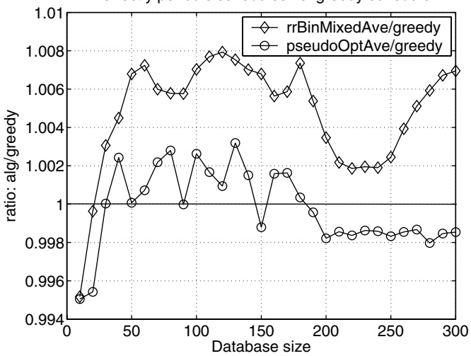

Fig. 14. The performance of our algorithms vs. greedy heuristic algorithm for Broadcast Disks problem. The heuristics are better than greedy whenever their graph is below 1.

## 5.2. Performance for perfectly periodic schedules without a tree representation

In this paper we considered perfectly periodic schedules that have a tree representation. In [7] it was demonstrated that there are perfect schedules that have no tree representation. In this section, we evaluate the performance of our algorithms with such instances.

Consider the following parametric instances. Let $p ,   q ,   r$ be three distinct prime numbers. The requested shares are either $1 / p q , 1 / p r , 1 / q r ,$ or $1 / p q r .$ It is straightforward to construct demand vectors that can be satisfied optimally, i.e., each client gets precisely its requested share. However, there cannot be any tree representation for clients with periods $p q , p r ,$ and $q r ;$ this follows from the observation that the degree of the root of the tree must divide all periods, and the greatest common divisor of these periods is 1.

More concretely, let $p = 2 , q = 3 ,$ , and $r = 5 .$ We have constructed a few examples where some clients have requested periods 6, 10 and 15, and remaining ones have period of 30. The requests were manually constructed so that each instance can be scheduled optimally (there is no known algorithm for finding such schedules in general). In Fig. 15, we present the results for four such instances. For each instance, the number of clients and the performance of pseudoOptAve and pseudoOptMax are given. By construction, there are perfect schedules for these instances with value of 1 for both the MAX and the AVE measures. The table demonstrates that the performance penalty for tree schedules is not very large.

| Number of clients | MAX | AVE |
| --- | --- | --- |
| 23 | 1.2 | 1.01556 |
| 18 | 1.06667 | 1.00667 |
| 33 | 1.14286 | 1.00794 |
| 93 | 1.06667 | 1.00571 |

Fig. 15. The performance of pseudoOptAve and pseudoOptMax on instances that have a perfect schedule but do not have a tree representation.

## 6. Discussion and open problems

In this paper, we studied a scheduling trees design problem. We considered the problem of constructing good scheduling trees and described a bottom–up structure exponential time algorithms to find the optimal scheduling trees for both the MAX and the AVE measures. Then we proposed several efficient polynomial-time heuristic algorithms based on the structure of the optimal algorithms. We tested our solutions by simulation. We concluded that for the Zipf and the Uniform frequency distributions, our approximation algorithms perform very well sometimes even beating the best known non-perfectly periodic scheduling algorithms.

## 6.1. Open problems and further research

We studied the average and maximum measures for periodic schedules. It seems interesting to study other measures that arise in practice. For example, the AVE measure ‘‘rewards’’ the system for clients who receive more than their requested share. In some applications, no reward is given in such case. Intuitively, this means ‘‘free upgrades,’’ i.e., only clients whose granted share is strictly less than the requested one influence the performance measure.

We showed that in a way the unweighted average measure does not make sense. One could think of a given weight (priority) vector, where averaging is done according to this vector. In this case, it is acceptable not to grant clients their requests share if they have low priorities.

• It is known that deciding whether there exists a perfect schedule for given values of shares is NP-hard [6]. Is it NP-hard to find the optimal tree? Is it possible to find the optimal tree with a polynomial-time algorithm?

There are perfect schedules that have no tree representation [7]. Is there a better way to represent, design and use perfect schedules?

• In this paper, we assumed that all the clients require exactly one slot. In a more general problem, each client may require to be scheduled for more than one slot at a time.

It is interesting to explore ‘‘almost’’ perfect schedule. For example, schedules in which each client gets two different periods that alternate. On one hand, they are a bit more complicated to maintain than perfect schedule, but on the other hand they might yield better performance.

## Acknowledgements

We thank the anonymous referees for their useful suggestions.

## References

[1] S. Acharya, R. Alonso, M. Franklin, S. Zdonik, Broadcast disks: data management for asymmetric communications environments, in: Proc. 1995 ACM SIGMOD, 1995, pp. 199–210.

[2] M.H. Ammar, J.W. Wong, The design of teletext broadcast cycles, Performance Evaluation 5 (4) (1985) 235–242.

[3] M.H. Ammar, J.W. Wong, On the optimality of cyclic transmission in teletext systems, IEEE Transactions on Communication COM-35 (1) (1987) 68–73.

[4] J. Anderson, A. Srinivasan, A new look at pfair priorities, 1999. Available from <[http://www.cs.unc.edu/\~anands/papers.html](http://www.cs.unc.edu/~anands/papers.html)>.

[5] S. Anily, C.A. Glass, R. Hassin, The scheduling of maintenance service, Discrete Applied Mathematics 80 (1998) 27–42.

[6] A. Bar-Noy, R. Bhatia, J. Naor, B. Schieber, Minimizing service and operation cost of periodic scheduling, in: Proc. 9th SODA, 1998, pp. 11–20.

[7] A. Bar-Noy, A. Nisgav, B. Patt-Shamir, Nearly optimal perfectly periodic schedules, in: Proc. 20th PODC, 2001, pp. 107–116.

[8] A. Bar-Noy, B. Patt-Shamir, I. Ziper, Broadcast disks with polynomial cost functions, in: Proc. INFOCOM 00, vol. 2, IEEE, 2000, pp. 575–584.

[9] S.K. Baruah, N.K. Cohen, C.G. Plaxton, D.A. Varvel, Proportionate progress: A notion of fairness in resourse allocation, Algorithmica 15 (1996) 600–625.

[10] Bluetooth technical specifications, version 1.1. Available from <[http://www.bluetooth.com/](http://www.bluetooth.com/)>, February 2001.

[11] L. Breslau, P. Cao, L. Fan, G. Phillips, S. Shenker, Web caching and Zipf distributions: evidence and implications, in: Proc. INFOCOM 99, 1999, pp. 126–134.

[12] V. Dreizin, Efficient periodic scheduling by trees, Masters thesis, Tel Aviv University, 2001. Available from <[http:// www.eng.tau.ac.il/\~vld/Th.html](http://www.eng.tau.ac.il/~vld/Th.html)>.

[13] M. Hofri, Z. Rosberg, Packet delay under the golden ratio weighted tdm policy in a multiple-access channel, IEEE Transactions on Information Theory 11–33 (1987) 341–349.

[14] D.A. Huffman, A method for the construction of minimum redundancy codes, in: Proceedings of IRE, vol. 40, 1962, pp. 1098–1101.

[15] C. Kenyon, N. Schabanel, N. Young, Polynomial-time approximation scheme for data broadcast, in: Proc. 32th Ann. ACM Symp. on Theory of Computing, 2000, pp. 659–666.

[16] S. Khanna, S. Zhou, On indexed data broadcast, in: Proc. 30th Ann. ACM Symp. on Theory of Computing, New York, 1998, pp. 463–472.

[17] C.J. Su, L. Tassiulas, Broadcast scheduling for information distribution, in: Proc. INFOCOM 97, vol. 1, IEEE, 1997, pp. 109–117.

[18] R. Tijdeman, The chairman assignment problem, Discrete Mathematics 32 (1980) 323–330.

[19] N. Vaidya, S. Hameed, Data broadcast: on-line and off-line algorithms, Technical Report 96–017, Department of Computer Science, Texas A&M University, 1996.

[20] N. Vaidya, S. Hameed, Log time algorithms for scheduling single and multiple channel data broadcast, in: Proc. MOBICOM 97, 1997, pp. 90–99.

[21] W. Wei, C. Liu, On a periodic maintenance problem, Operations Research Letters 2 (1983) 90–93.

[22] G. Zipf, Human Behaviour and the Principle of Least Effort, Addison-Wesley, Reading, MA, 1949.

Amotz Bar-Noy received the B.Sc. degree in 1981 in Mathematics and Computer Science and the Ph.D. degree in 1987 in Computer Science, both from the Hebrew University, Israel. From October 1987 to September 1989 he was a post-doc fellow in Stanford University, California. From October 1989 to August 1996 he was a Research Staff Member with IBM T.J. Watson Research Center, New York. From February 1995 to September 2001 he was an associate Professor with the Electrical Engineering-Systems department of Tel Aviv University, Israel. From September 1999 to December 2001 he was with AT&T Research Labs in New Jersey. Since February 2002 he is a Professor with the Computer and Information Science Department of Brooklyn College––CUNY, Brooklyn New York.

Vladimir Dreizin received the B.Sc. degree in Computer Science and Electrical Engineering in 2000, and the M.Sc. degree in Electrical Engineering in 2001, from Tel-Aviv University, where he is currently working towards the Ph.D. degree. He has been software engineer in Algorithmic Research, Israel, from 1998 to 2001. From 1999 to 2001, he worked as a teaching assistant in Tel-Aviv University. From 2001, he is with IBM Haifa Research Labs.

Boaz Patt-Shamir received his B.Sc. from Tel Aviv University in Mathematics and Computer Science in 1987, M.Sc. in Computer Science from the Weizmann Institute in 1989, and Ph.D. in Computer Science from MIT in 1995. He was an assistant professor in Northeastern University between 1994 and 1997, and since 1997 he is with the Department of Electrical Engineering in Tel Aviv University, where he directs the Computer Communication and Multimedia Laboratory. In 2002–2004 he is visiting HP Labs in Cambridge, Mass.