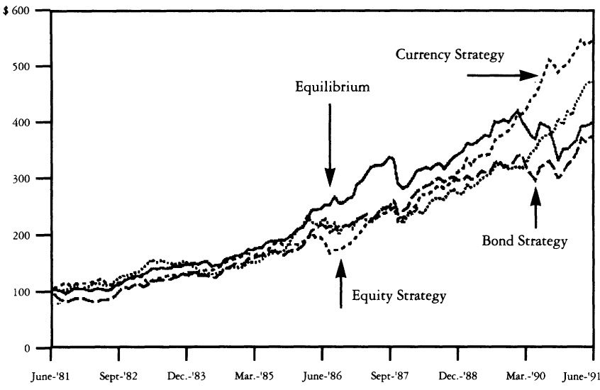
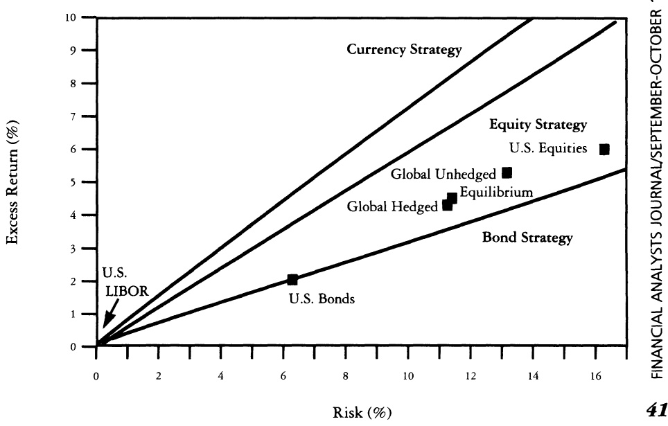

# Global Portfolio Optimization

Fischer Black & Robert Litterman

To cite this article: Fischer Black & Robert Litterman (1992) Global Portfolio Optimization, Financial Analysts Journal, 48:5, 28-43, DOI: 10.2469/faj.v48.n5.28

To link to this article: https://doi.org/10.2469/faj.v48.n5.28

Published online: 31 Dec 2018.

Submit your article to this journal ↗

Article views: 2518

View related articles ↗

Citing articles: 251 View citing articles ↗

# Global Portfolio Optimization

## Fischer Black and Robert Litterman

Quantitative asset allocation models have not played the important role they should in global portfolio management. A good part of the problem is that such models are difficult to use and tend to result in portfolios that are badly behaved.

Consideration of the global CAPM equilibrium can significantly improve the usefulness of these models. In particular, equilibrium returns for equities, bonds and currencies provide neutral starting points for estimating the set of expected excess returns needed to drive the portfolio optimization process. This set of neutral weights can then be tilted in accordance with the investor's views.

If the investor has no particular views about asset returns, he can use the neutral values given by the equilibrium model. If the investor does have one or more views about the relative performances of assets, or their absolute performances, he can adjust equilibrium values in accordance with those views. Furthermore, the investor can control how strongly a particular view influences portfolio weights, in accordance with the degree of confidence with which he holds the view.

Investors with global portfolios of equities and bonds are generally aware that their asset allocation decisions—the proportions of funds they invest in the asset classes of different countries and the degrees of currency hedging—are the most important investment decisions they make. In deciding on the appropriate allocation, they are usually comfortable making the simplifying assumption that their objective is to maximize expected return for a given level of risk (subject, in most cases, to various types of constraints).

Given the straightforward mathematics of this optimization problem, the many correlations among global asset classes required in measuring risk, and the large amounts of money involved, one might expect that, in today's computerized world, quantitative models would play a dominant role in the global allocation process. Unfortunately, when investors have tried to use quantitative models to help optimize the critical allocation decision, the unreasonable nature of the results has often thwarted their efforts.$^{1}$ When investors impose no constraints, the models almost always ordain large short positions in many assets. When constraints rule out short positions, the models often prescribe “corner” solutions with zero weights in many assets, as well as unreasonably large weights in the assets of markets with small capitalizations.

These unreasonable results stem from two well recognized problems. First, expected returns are very difficult to estimate. Investors typically have knowledgeable views about absolute or relative returns in only a few markets. A standard optimization model, however, requires them to provide expected returns for all assets and currencies. Thus investors must augment their views with a set of auxiliary assumptions, and the historical returns they often use for this purpose provide poor guides to future returns.

Second, the optimal portfolio asset weights and currency positions of standard asset allocation models are extremely sensitive to the return assumptions used. The two problems compound each other; the standard model has no way to distinguish strongly held views from auxiliary assumptions, and the optimal portfolio it generates, given its sensitivity to the expected returns, often appears to bear little or no relation to the views the investor wishes to express. In practice, therefore, despite the obvious conceptual attractions of a quantitative approach, few global investment managers regularly allow quantitative models to play a major role in their asset allocation decisions.

This article describes an approach that provides an intuitive solution to the two problems that have plagued quantitative asset allocation models. The key is combining two established tenets of modern portfolio theory—the mean-variance optimization framework of Markowitz and the capital asset pricing model (CAPM) of Sharpe and Lintner. $^{2}$

<small>Copyright 1991 by Goldman Sachs.</small>

## Glossary

## Asset Excess Returns:

In this article, returns on assets less the domestic short rate (see formulas in footnote 5).

## ▶Balance:

A measure of how close a portfolio is to the equilibrium portfolio.

▶ Benchmark Portfolio:
The standard used to define the risk of other portfolios. If a benchmark is defined, the risk of a portfolio is measured as the volatility of the tracking error—the difference between the portfolio’s returns and those of the benchmark.

▶ Currency Excess Returns: Returns on forward contracts (see formulas in footnote 5).

▶Expected Excess Returns: Expected values of the distribution of future excess returns.

## ▶Equilibrium:

The condition in which means (see below) equilibrate the demand for assets with the outstanding supply.

## ▶Equilibrium Portfolio:

The portfolio held in equilibrium; in this article, market capitalization weights, 80% currency hedged.

▶Means:
Expected excess returns.

▶Neutral Portfolio:
An optimal portfolio given neutral views.

▶Neutral Views:
Means when the investor has no views.

## ▶Normal Portfolio:

The portfolio that an investor feels comfortable with when he has no views. He can use the normal portfolio to infer a benchmark when no explicit benchmark exists.

## ▶Risk Premiums:

Means implied by the equilibrium model.

Our approach allows the investor to combine his views about the outlook for global equities, bonds and currencies with the risk premiums generated by Black's global version of CAPM equilibrium.$^{3}$ These equilibrium risk premiums are the excess returns that equate the supply and demand for global assets and currencies.

As we have noted, and will illustrate, the mean-variance optimization used in standard asset allocation models is extremely sensitive to the expected return assumptions the investor must provide. In our model, equilibrium risk premiums provide a neutral reference point for expected returns. This, in turn, allows the model to generate optimal portfolios that are much better behaved than the unreasonable portfolios that standard models typically produce, which often include large long and short positions unless otherwise constrained. Instead, our model gravitates toward a balanced—i.e., market-capitalization-weighted—portfolio that tilts in the direction of assets favored by the investor.

Our model does not assume that the world is always at CAPM equilibrium, but rather that when expected returns move away from their equilibrium values, imbalances in markets will tend to push them back. We thus think it is reasonable to assume that expected returns are not likely to deviate too far from equilibrium values. This suggests that the investor may profit by combining his views about returns in different markets with the information contained in equilibrium prices and returns.

Our approach distinguishes between the views of the investor and the expected returns that drive optimization analysis. Equilibrium risk premiums provide a center of gravity for expected returns. The expected returns used in our optimization will deviate from equilibrium risk premiums in accordance with the investor's explicitly stated views. The extent of the deviations from equilibrium will depend on the degree of confidence the investor has in each view. Our model makes adjustments in a manner as consistent as possible with historical covariances of returns of different assets and currencies.

Our use of equilibrium allows investors to specify views in a much more flexible and powerful way than is otherwise possible. For example, rather than requiring the investor to have a view about the absolute return on every asset and currency, our approach allows the investor to specify as many or as few views as he wishes. In addition, the investor can specify views about relative returns and can specify a degree of confidence about each view.

A set of examples illustrates how the incorporation of equilibrium into the standard asset allocation model makes it better behaved and enables it to generate insights for the global investment manager. To that end, we start with a discussion of how equilibrium can help an investor translate his views into a set of expected returns for all assets and currencies. We then follow with a set of applications of the model that illustrate how the equilibrium solves the problems that have traditionally led to unreasonable results in standard mean-variance models.

## Neutral Views

Why should an investor use a global equilibrium model to help make his global asset allocation decision? A neutral reference is a critically important input in making use of a mean-variance optimization model, and an equilibrium provides the appropriate neutral reference. Most of the time investors have views—feelings that some assets or currencies are overvalued or undervalued at current market prices. An asset allocation model can help them to apply those views to their advantage. But it is unrealistic to expect an investor to be able to state exact expected excess returns for every asset and currency. The equilibrium, however, can provide the investor an appropriate point of reference.

Table I Historical Excess Returns, January 1975–August 1991\*

<table><tr><td></td><td>Germany</td><td>France</td><td>Japan</td><td>U.K.</td><td>U.S.</td><td>Canada</td><td>Australia</td></tr><tr><td colspan="8">Total Mean Excess Return</td></tr><tr><td>Currencies</td><td>-20.8</td><td>3.2</td><td>23.3</td><td>13.4</td><td></td><td>12.6</td><td>3.0</td></tr><tr><td>Bonds</td><td>15.3</td><td>-2.3</td><td>42.3</td><td>21.4</td><td>-4.9</td><td>-22.8</td><td>-13.1</td></tr><tr><td>Equities</td><td>112.9</td><td>117.0</td><td>223.0</td><td>291.3</td><td>130.1</td><td>16.7</td><td>107.8</td></tr><tr><td colspan="8">Annualized Mean Excess Return</td></tr><tr><td>Currencies</td><td>-1.4</td><td>0.2</td><td>1.3</td><td>0.8</td><td></td><td>0.7</td><td>0.2</td></tr><tr><td>Bonds</td><td>0.9</td><td>-0.1</td><td>2.1</td><td>1.2</td><td>-0.3</td><td>-1.5</td><td>-0.8</td></tr><tr><td>Equities</td><td>4.7</td><td>4.8</td><td>7.3</td><td>8.6</td><td>5.2</td><td>0.9</td><td>4.5</td></tr><tr><td colspan="8">Annualized Standard Deviation</td></tr><tr><td>Currencies</td><td>12.1</td><td>11.7</td><td>12.3</td><td>11.9</td><td></td><td>4.7</td><td>10.3</td></tr><tr><td>Bonds</td><td>4.5</td><td>4.5</td><td>6.5</td><td>9.9</td><td>6.8</td><td>7.8</td><td>5.5</td></tr><tr><td>Equities</td><td>18.3</td><td>22.2</td><td>17.8</td><td>24.7</td><td>16.1</td><td>18.3</td><td>21.9</td></tr></table>

\* Bond and equity returns in U.S. dollars, currency hedged and in excess of the London interbank offered rate (LIBOR); returns on currencies are in excess of the one-month forward rates.

Suppose, for example, that an investor has no views. How then, can he define his optimal portfolio? Answering this question demonstrates the usefulness of the equilibrium risk premium.

In considering this question, and others throughout this article, we use historical data on global equities, bonds and currencies. We use a seven-country model with monthly returns for the United States, Japan, Germany, France, the United Kingdom, Canada and Australia from January 1975 through August 1991. $^{4}$

Table I presents the means and standard deviations of excess returns and Table II the correlations. All the results in this article are given from a U.S. dollar perspective; use of other currencies would give similar results. $^{5}$

Of course, besides equilibrium risk premiums, there are several other naive approaches investors might use to construct an optimal portfolio when they have no views about assets or currencies. We examine some of these—the historical average approach, the equal mean approach and the risk-adjusted equal mean approach—below.

## Historical Averages

The historical average approach assumes, as a neutral reference, that excess returns will equal their historical averages. The problem with this approach is that historical means provide very poor forecasts of future returns. For example, Table I shows many negative values. Table III shows what happens when we use such returns as expected excess return assumptions. We may optimize expected returns for each level of risk to get a frontier of optimal portfolios. The table illustrates the frontiers with the portfolios that have 10.7% risk, with and without shorting constraints. $^{6}$

We can make a number of points about these “optimal” portfolios. First, they illustrate what we mean when we claim that standard mean-variance optimization models often generate unreasonable portfolios. The portfolio that does not constrain against shorting has many large long and short positions that bear no obvious relation to the expected excess return assumptions. When we constrain shorting, we have positive weights in only two of the 14 potential assets. These portfolios are typical of those generated by standard optimization models.

The use of past excess returns to represent a “neutral” set of views is equivalent to assuming that the constant portfolio weights that would have performed best historically are in some sense neutral. In reality, of course, they are not neutral at all, but rather are a very special set of weights that go short assets that have done poorly and go long assets that have done well in the particular historical period.

## Equal Means

The investor might hope that assuming equal means for returns across all countries for each asset class would result in an appropriate neutral reference. Table IV gives an example of the optimal portfolio for this type of analysis. Again, we get an unreasonable portfolio. $^{7}$

Of course, one problem with this approach is that equal expected excess returns do not compensate investors appropriately for the different levels of risk in assets of different countries. Investors diversify globally to reduce risk. Everything else being equal, they prefer assets whose returns are less volatile and less correlated with those of other assets.

Although such preferences are obvious, it is perhaps surprising how unbalanced the optimal portfolio weights can be, as Table IV illustrates, when we take “everything else being equal” to such a literal extreme. With no constraints, the largest position is short Australian bonds.

Risk-Adjusted Equal Means
Our third naive approach to defining a neutral reference point is to assume that bonds and equities have the same expected excess return per unit of risk, where the risk measure is simply the volatility of asset returns. Currencies in this case are assumed to have no excess return. Table V shows the optimal portfolio for this case.

Table II Historical Correlations of Excess Returns, January 1975–August 1991

<table><tr><td rowspan="2"></td><td colspan="3">Germany</td><td colspan="3">France</td><td colspan="3">Japan</td></tr><tr><td>Equities</td><td>Bonds</td><td>Currency</td><td>Equities</td><td>Bonds</td><td>Currency</td><td>Equities</td><td>Bonds</td><td>Currency</td></tr><tr><td colspan="10">Germany</td></tr><tr><td>Equities</td><td>1.00</td><td></td><td></td><td></td><td></td><td></td><td></td><td></td><td></td></tr><tr><td>Bonds</td><td>0.28</td><td>1.00</td><td></td><td></td><td></td><td></td><td></td><td></td><td></td></tr><tr><td>Currency</td><td>0.02</td><td>0.36</td><td>1.00</td><td></td><td></td><td></td><td></td><td></td><td></td></tr><tr><td colspan="10">France</td></tr><tr><td>Equities</td><td>0.52</td><td>0.17</td><td>0.03</td><td>1.00</td><td></td><td></td><td></td><td></td><td></td></tr><tr><td>Bonds</td><td>0.23</td><td>0.46</td><td>0.15</td><td>0.36</td><td>1.00</td><td></td><td></td><td></td><td></td></tr><tr><td>Currency</td><td>0.03</td><td>0.33</td><td>0.92</td><td>0.08</td><td>0.15</td><td>1.00</td><td></td><td></td><td></td></tr><tr><td colspan="10">Japan</td></tr><tr><td>Equities</td><td>0.37</td><td>0.15</td><td>0.05</td><td>0.42</td><td>0.23</td><td>0.04</td><td>1.00</td><td></td><td></td></tr><tr><td>Bonds</td><td>0.10</td><td>0.48</td><td>0.27</td><td>0.11</td><td>0.31</td><td>0.21</td><td>0.35</td><td>1.00</td><td></td></tr><tr><td>Currency</td><td>0.01</td><td>0.21</td><td>0.62</td><td>0.10</td><td>0.19</td><td>0.62</td><td>0.18</td><td>0.45</td><td>1.00</td></tr><tr><td colspan="10">U.K.</td></tr><tr><td>Equities</td><td>0.42</td><td>0.20</td><td>-0.01</td><td>0.50</td><td>0.21</td><td>0.04</td><td>0.37</td><td>0.09</td><td>0.04</td></tr><tr><td>Bonds</td><td>0.14</td><td>0.36</td><td>0.09</td><td>0.20</td><td>0.31</td><td>0.09</td><td>0.20</td><td>0.33</td><td>0.19</td></tr><tr><td>Currency</td><td>0.02</td><td>0.22</td><td>0.66</td><td>0.05</td><td>0.05</td><td>0.66</td><td>0.06</td><td>0.24</td><td>0.54</td></tr><tr><td colspan="10">U.S.</td></tr><tr><td>Equities</td><td>0.43</td><td>0.23</td><td>0.03</td><td>0.52</td><td>0.21</td><td>0.06</td><td>0.41</td><td>0.12</td><td>-0.02</td></tr><tr><td>Bonds</td><td>0.17</td><td>0.50</td><td>0.26</td><td>0.10</td><td>0.33</td><td>0.22</td><td>0.11</td><td>0.28</td><td>0.18</td></tr><tr><td colspan="10">Canada</td></tr><tr><td>Equities</td><td>0.33</td><td>0.16</td><td>0.05</td><td>0.48</td><td>0.04</td><td>0.09</td><td>0.33</td><td>0.02</td><td>0.04</td></tr><tr><td>Bonds</td><td>0.13</td><td>0.49</td><td>0.24</td><td>0.10</td><td>0.35</td><td>0.21</td><td>0.14</td><td>0.33</td><td>0.22</td></tr><tr><td>Currency</td><td>0.05</td><td>0.14</td><td>0.11</td><td>0.10</td><td>0.04</td><td>0.10</td><td>0.12</td><td>0.05</td><td>0.06</td></tr><tr><td colspan="10">Australia</td></tr><tr><td>Equities</td><td>0.34</td><td>0.07</td><td>-0.00</td><td>0.39</td><td>0.07</td><td>0.05</td><td>0.25</td><td>-0.02</td><td>0.12</td></tr><tr><td>Bonds</td><td>0.24</td><td>0.19</td><td>0.09</td><td>0.04</td><td>0.16</td><td>0.08</td><td>0.12</td><td>0.16</td><td>0.09</td></tr><tr><td>Currency</td><td>-0.01</td><td>0.05</td><td>0.25</td><td>0.07</td><td>-0.03</td><td>0.29</td><td>0.05</td><td>0.10</td><td>0.27</td></tr><tr><td rowspan="2"></td><td colspan="3">United Kingdom</td><td colspan="2">United States</td><td colspan="2">Canada</td><td colspan="2">Australia</td></tr><tr><td>Equities</td><td>Bonds</td><td>Currency</td><td>Equities</td><td>Bonds</td><td>Equities</td><td>Bonds</td><td>Currency</td><td>Equities</td></tr><tr><td colspan="10">U.K.</td></tr><tr><td>Equities</td><td>1.00</td><td></td><td></td><td></td><td></td><td></td><td></td><td></td><td></td></tr><tr><td>Bonds</td><td>0.47</td><td>1.00</td><td></td><td></td><td></td><td></td><td></td><td></td><td></td></tr><tr><td>Currency</td><td>0.06</td><td>0.27</td><td>1.00</td><td></td><td></td><td></td><td></td><td></td><td></td></tr><tr><td colspan="10">U.S.</td></tr><tr><td>Equities</td><td>0.58</td><td>0.23</td><td>-0.02</td><td>1.00</td><td></td><td></td><td></td><td></td><td></td></tr><tr><td>Bonds</td><td>0.12</td><td>0.28</td><td>0.18</td><td>0.32</td><td>1.00</td><td></td><td></td><td></td><td></td></tr><tr><td colspan="10">Canada</td></tr><tr><td>Equities</td><td>0.56</td><td>0.27</td><td>0.11</td><td>0.74</td><td>0.18</td><td>1.00</td><td></td><td></td><td></td></tr><tr><td>Bonds</td><td>0.18</td><td>0.40</td><td>0.25</td><td>0.31</td><td>0.82</td><td>0.23</td><td>1.00</td><td></td><td></td></tr><tr><td>Currency</td><td>0.14</td><td>0.13</td><td>0.09</td><td>0.24</td><td>0.15</td><td>0.32</td><td>0.24</td><td>1.00</td><td></td></tr><tr><td colspan="10">Australia</td></tr><tr><td>Equities</td><td>0.50</td><td>0.20</td><td>0.15</td><td>0.48</td><td>-0.05</td><td>0.61</td><td>0.02</td><td>0.18</td><td>1.00</td></tr><tr><td>Bonds</td><td>0.17</td><td>0.17</td><td>0.09</td><td>0.24</td><td>0.20</td><td>0.21</td><td>0.18</td><td>0.13</td><td>0.37</td></tr><tr><td>Currency</td><td>0.06</td><td>0.05</td><td>0.27</td><td>0.07</td><td>-0.00</td><td>0.19</td><td>0.04</td><td>0.28</td><td>0.27</td></tr></table>

Now we have incorporated volatilities, but the portfolio behavior is no better. One problem with this approach is that it hasn't taken the correlations of the asset returns into account. But there is another problem as well—perhaps more subtle, but also more serious.

This approach, and the others we have so far used, are based on what might be called the “demand for assets” side of the equation—that is, historical returns and risk measures. The problem with such approaches is obvious when we bring in the supply side of the market.

Table III Optimal Portfolios Based on Historical Average Approach

<table><tr><td></td><td>Germany</td><td>France</td><td>Japan</td><td>U.K.</td><td>U.S.</td><td>Canada</td><td>Australia</td></tr><tr><td colspan="8">Unconstrained</td></tr><tr><td>Currency</td><td>-78.7</td><td>46.5</td><td>15.5</td><td>28.6</td><td></td><td>65.0</td><td>-5.2</td></tr><tr><td>Exposure (%)</td><td></td><td></td><td></td><td></td><td></td><td></td><td></td></tr><tr><td>Bonds (%)</td><td>30.4</td><td>-40.7</td><td>40.4</td><td>-1.4</td><td>54.5</td><td>-95.7</td><td>-52.5</td></tr><tr><td>Equities (%)</td><td>4.4</td><td>-4.4</td><td>15.5</td><td>13.3</td><td>44.0</td><td>-44.2</td><td>9.0</td></tr><tr><td colspan="8">With Constraints Against Shorting Assets</td></tr><tr><td>Currency</td><td>-160.0</td><td>115.2</td><td>18.0</td><td>23.7</td><td></td><td>77.8</td><td>-13.8</td></tr><tr><td>Exposure (%)</td><td></td><td></td><td></td><td></td><td></td><td></td><td></td></tr><tr><td>Bonds (%)</td><td>7.6</td><td>0.0</td><td>88.8</td><td>0.0</td><td>0.0</td><td>0.0</td><td>0.0</td></tr><tr><td>Equities (%)</td><td>0.0</td><td>0.0</td><td>0.0</td><td>0.0</td><td>0.0</td><td>0.0</td><td>0.0</td></tr></table>

Suppose the market portfolio comprises two assets, with weights 80% and 20%. In a simple world, with identical investors all holding the same views and both assets having equal volatilities, everyone cannot hold equal weights of each asset. Prices and expected excess returns in such a world would have to adjust as the excess demand for one asset and excess supply of the other affect the market.

The Equilibrium Approach
To us, the only sensible definition of neutral means is the set of expected returns that would “clear the market” if all investors had identical views. The concept of equilibrium in the context of a global portfolio of equities, bonds and currencies is similar, although currencies do raise a complicating question. How much currency hedging takes place in equilibrium? The answer is that, in a global equilibrium, investors worldwide will all want to take a small amount of currency risk. $^{8}$

This result arises because of a curiosity known in the currency world as “Siegel’s paradox.” The basic idea is that, because investors in different countries measure returns in different units, each will gain some expected return by taking some currency risk. Investors will accept currency risk up to the point where the additional risk balances the expected return. Under certain simplifying assumptions, the percentage of foreign currency risk hedged will be the same for investors of different countries—giving rise to the name “universal hedging” for this equilibrium.

The equilibrium degree of hedging—the “universal hedging constant”—depends on three averages—the average across countries of the mean return on the market portfolio of assets, the average across countries of the volatility of the world market portfolio, and the average across all pairs of countries of exchange rate volatility.

It is difficult to pin down exactly the right value for the universal hedging constant, primarily because the risk premium on the market portfolio is a difficult number to estimate. Nevertheless, we feel that universal hedging values between 75% and 85% are reasonable. In our monthly data set, the former value corresponds to a risk premium of 5.9% on U.S. equities, while the latter corresponds to a risk premium of 9.8%. For this article, we will use an equilibrium value for currency hedging of 80%. Table VI gives the equilibrium risk premiums for all assets, given this value of the universal hedging constant. $^{9}$

Table IV Optimal Portfolios Based on Equal Means

<table><tr><td></td><td>Germany</td><td>France</td><td>Japan</td><td>U.K.</td><td>U.S.</td><td>Canada</td><td>Australia</td></tr><tr><td colspan="8">Unconstrained</td></tr><tr><td>Currency</td><td>14.5</td><td>-12.6</td><td>-0.9</td><td>4.4</td><td></td><td>-18.7</td><td>-2.1</td></tr><tr><td>Exposure (%)</td><td></td><td></td><td></td><td></td><td></td><td></td><td></td></tr><tr><td>Bonds (%)</td><td>-11.6</td><td>4.2</td><td>-1.8</td><td>-10.8</td><td>13.9</td><td>-18.9</td><td>-32.7</td></tr><tr><td>Equities (%)</td><td>21.4</td><td>-4.8</td><td>23.0</td><td>-4.6</td><td>32.2</td><td>9.6</td><td>10.5</td></tr><tr><td colspan="8">With Constraints Against Shorting Assets</td></tr><tr><td>Currency</td><td>14.3</td><td>-11.2</td><td>-4.5</td><td>0.2</td><td></td><td>-25.9</td><td>-2.0</td></tr><tr><td>Exposure (%)</td><td></td><td></td><td></td><td></td><td></td><td></td><td></td></tr><tr><td>Bonds (%)</td><td>0.0</td><td>0.0</td><td>0.0</td><td>0.0</td><td>0.0</td><td>0.0</td><td>0.0</td></tr><tr><td>Equities (%)</td><td>17.5</td><td>0.0</td><td>22.1</td><td>0.0</td><td>27.0</td><td>8.2</td><td>7.3</td></tr></table>

Table V Optimal Portfolios Based on Equal Risk-Adjusted Means

<table><tr><td></td><td>Germany</td><td>France</td><td>Japan</td><td>U.K.</td><td>U.S.</td><td>Canada</td><td>Australia</td></tr><tr><td colspan="8">Unconstrained</td></tr><tr><td>Currency Exposure (%)</td><td>5.6</td><td>11.3</td><td>-28.6</td><td>-20.3</td><td></td><td>-50.9</td><td>-4.9</td></tr><tr><td>Bonds (%)</td><td>-23.9</td><td>12.6</td><td>54.0</td><td>20.8</td><td>23.1</td><td>37.8</td><td>15.6</td></tr><tr><td>Equities (%)</td><td>9.9</td><td>8.5</td><td>12.4</td><td>-0.3</td><td>-14.1</td><td>13.2</td><td>20.1</td></tr><tr><td colspan="8">With Constraints Against Shorting Assets</td></tr><tr><td>Currency Exposure (%)</td><td>21.7</td><td>-8.9</td><td>-14.0</td><td>-12.2</td><td></td><td>-47.9</td><td>-6.7</td></tr><tr><td>Bonds (%)</td><td>0.0</td><td>0.0</td><td>0.0</td><td>7.8</td><td>0.0</td><td>19.3</td><td>0.0</td></tr><tr><td>Equities (%)</td><td>11.1</td><td>9.4</td><td>19.2</td><td>6.0</td><td>0.0</td><td>7.6</td><td>19.5</td></tr></table>

Table VI Equilibrium Risk Premiums (% annualized excess returns)

|  | Germany | France | Japan | U.K. | U.S. | Canada | Australia |
| --- | --- | --- | --- | --- | --- | --- | --- |
| Currencies | 1.01 | 1.10 | 1.40 | 0.91 |  | 0.60 | 0.63 |
| Bonds | 2.29 | 2.23 | 2.88 | 3.28 | 1.87 | 2.54 | 1.74 |
| Equities | 6.27 | 8.48 | 8.72 | 10.27 | 7.32 | 7.28 | 6.45 |

Consider what happens when we adopt these equilibrium risk premiums as our neutral means when we have no views. Table VII shows the optimal portfolio. It is simply the market-capitalization portfolio with 80% of the currency risk hedged. Other portfolios on the frontier with different levels of risk would correspond to combinations of risk-free borrowing or lending plus more or less of this portfolio.

By itself, the equilibrium concept is interesting but not particularly useful. Its real value is to provide a neutral framework the investor can adjust according to his own views, optimization objectives and constraints.

between investor views on the one hand and a complete set of expected excess returns for all assets on the other—is not usually recognized. In our approach, views represent the subjective feelings of the investor about relative values offered in different markets. $^{10}$  If an investor does not have a view about a given market, he should not have to state one. And if some of his views are more strongly held than others, he should be able to express the differences.

Most views are relative. For example, the investor may feel one market will outperform another. Or he may feel bullish (above neutral) or bearish (below neutral) about a market. As we will show, the equilibrium allows the investor to express his views this way, instead of as a set of expected excess returns.

To see why this is so important, we start by illustrating the extreme sensitivity of portfolio weights to the expected excess returns and the inability of investors to express views directly as a complete set of expected returns. We have already seen how difficult it can be simply to translate no views into a set of expected excess returns that will not lead an asset allocation model to produce an unreasonable portfolio. But suppose that the investor has already solved that problem, using equilibrium risk premiums as the neutral means. He is comfortable with a portfolio that has market capitalization weights, 80% hedged. Consider what can happen when this investor now tries to express one simple, extremely modest view.

Suppose the investor's view is that, over the next three months, the economic recovery in the United States will be weak and bonds will perform relatively well and equities poorly. The investor's view is not very strong, and he quantifies it by assuming that, over the next three months, the U.S. benchmark bond yield will drop 1 basis point rather than rise

## Expressing Views

Investors trying to use quantitative asset allocation models must translate their views into a complete set of expected excess returns on assets that can be used as a basis for portfolio optimization. As we will show here, the problem is that optimal portfolio weights from a mean-variance model are incredibly sensitive to minor changes in expected excess returns. The advantage of incorporating a global equilibrium will become apparent when we show how to combine it with an investor's views to generate well-behaved portfolios, without requiring the investor to express a complete set of expected excess returns.

We should emphasize that the distinction we are making—

Table VII Equilibrium Optimal Portfolio

<table><tr><td></td><td>Germany</td><td>France</td><td>Japan</td><td>U.K.</td><td>U.S.</td><td>Canada</td><td>Australia</td></tr><tr><td>Currency</td><td>1.1</td><td>0.9</td><td>5.9</td><td>2.0</td><td></td><td>0.6</td><td>0.3</td></tr><tr><td colspan="8">Exposure (%)</td></tr><tr><td>Bonds (%)</td><td>2.9</td><td>1.9</td><td>6.0</td><td>1.8</td><td>16.3</td><td>1.4</td><td>0.3</td></tr><tr><td>Equities (%)</td><td>2.6</td><td>2.4</td><td>23.7</td><td>8.3</td><td>29.7</td><td>1.6</td><td>1.1</td></tr></table>

Table VIII Optimal Portfolios Based on a Moderate View

<table><tr><td></td><td>Germany</td><td>France</td><td>Japan</td><td>U.K.</td><td>U.S.</td><td>Canada</td><td>Australia</td></tr><tr><td colspan="8">Unconstrained</td></tr><tr><td>Currency Exposure (%)</td><td>-1.3</td><td>8.3</td><td>-3.3</td><td>-6.4</td><td></td><td>8.5</td><td>-1.9</td></tr><tr><td>Bonds (%)</td><td>-13.6</td><td>6.4</td><td>15.0</td><td>-3.3</td><td>112.9</td><td>-42.4</td><td>0.7</td></tr><tr><td>Equities (%)</td><td>3.7</td><td>6.3</td><td>27.2</td><td>14.5</td><td>-30.6</td><td>24.8</td><td>6.0</td></tr><tr><td colspan="8">With Constraints Against Shorting Assets</td></tr><tr><td>Currency Exposure (%)</td><td>2.3</td><td>4.3</td><td>5.0</td><td>-3.0</td><td></td><td>9.2</td><td>-0.6</td></tr><tr><td>Bonds (%)</td><td>0.0</td><td>0.0</td><td>0.0</td><td>0.0</td><td>35.7</td><td>0.0</td><td>0.0</td></tr><tr><td>Equities (%)</td><td>2.6</td><td>5.3</td><td>28.3</td><td>13.6</td><td>0.0</td><td>13.1</td><td>1.5</td></tr></table>

1 basis point, as is consistent with the equilibrium risk premium. $^{11}$  Similarly, the investor expects U.S. share prices to rise only 2.7% over the next three months, rather than to rise the 3.3% consistent with the equilibrium view.

To implement the asset allocation optimization, the investor starts with expected excess returns equal to the equilibrium risk premiums and adjusts them as follows. He moves the annualized expected excess returns on U.S. bonds up by 0.8 percentage points and the expected excess returns on U.S. equities down by 2.5 percentage points. All other expected excess returns remain unchanged. Table VIII shows the optimal portfolio, given this view.

Note the remarkable effect of this very modest change in expected excess returns. The portfolio weights change in dramatic and largely inexplicable ways. The optimal portfolio weights do shift out of U.S. equity into U.S. bonds, as might be expected, but the model also suggests shorting Canadian and German bonds. The lack of apparent connection between the view the investor is attempting to express and the optimal portfolio the model generates is a pervasive problem with standard mean-variance optimization. It arises because there is a complex interaction between expected excess returns and the volatilities and correlations used in measuring risk.

## Combining Investor Views with Market Equilibrium

How our approach translates a few views into expected excess returns for all assets is one of its more complex features, but also one of its most innovative. Here is the intuition behind our approach.

1. We believe there are two distinct sources of information about future excess returns—investor views and market equilibrium.

2. We assume that both sources of information are uncertain and are best expressed as probability distributions.

3. We choose expected excess returns that are as consistent as possible with both sources of information.

The above description captures the basic idea, but the implementation of the approach can lead to some novel insights. We will now show how a relative view about two assets can influence the expected excess return on a third asset. $^{12}$

Three-Asset Example
Let us first work through a very simple example of our approach. After this illustration, we will apply it in the context of our seven-country model. Suppose we know the true structure of a world that has just three assets, A, B and C. The excess return for each of these assets is known to be generated by an equilibrium risk premium plus four sources of risk—a common factor and independent shocks to each of the three assets. We can express this model as follows:

$$
\begin{array}{l} \mathrm {R_ {A}} = \pi_ {\mathrm{A}} + \gamma_ {\mathrm{A}} Z + v _ {\mathrm{A}}, \\ \mathrm {R_ {B}} = \pi_ {\mathrm{B}} + \gamma_ {\mathrm{B}} Z + v _ {\mathrm{B}}, \\ \mathrm {R_ {C}} = \pi_ {\mathrm{C}} + \gamma_ {\mathrm{C}} Z + v _ {\mathrm{C}}, \end{array}
$$

where:

$$
\begin{array}{l} \mathrm{R} _ {\mathrm{i}} = \text {the excess return on the} \\ \text {ith asset,} \end{array}
$$

$$
\pi_ {\mathrm{i}} = \begin{array}{l} \text {the equilibrium risk premium on the ith asset,} \end{array}
$$

$$
\begin{array}{c} \gamma_ {\mathrm{i}} = \text {the impact on the ith as-} \\ \text {set of Z,} \end{array}
$$

$Z =$ the common factor, and

$$
\begin{array}{c} v _ {\mathrm{i}} = \text {the independent shock} \\ \text {to the ith asset.} \end{array}
$$

In this world, the covariance matrix,  $\Sigma$ , of asset excess returns is determined by the relative impacts of the common factor and the independent shocks. The expected excess returns of the assets are a function of the equilibrium risk premiums, the expected value of the common factor, and the expected values of the independent shocks to each asset. For example, the expected excess return of asset A, which we write as  $E[R_{A}]$ , is given by:

$$
\mathrm{E} [ \mathrm{R} _ {\mathrm{A}} ] = \pi_ {\mathrm{A}} + \gamma_ {\mathrm{A}} \mathrm{E} [ \mathrm{Z} ] + \mathrm{E} [ \nu_ {\mathrm{A}} ].
$$

We are not assuming that the world is in equilibrium (i.e., that E[Z] and the E[$v_i$]s are equal to zero). We do assume that the mean, E[R\_A], is itself an unobservable random variable whose distribution is centered at the equilibrium risk premium. Our uncertainty about E[R\_A] is due to our uncertainty about E[Z] and the E[$v_i$]s. Furthermore, we assume the degree of uncertainty about E[Z] and the E[$v_i$]s is proportional to the volatilities of Z and the $v_i$s themselves.

This implies that  $E[R_{A}]$  is distributed with a covariance structure proportional to  $\Sigma$ . We will refer to this covariance matrix of the expected excess returns as  $\tau\Sigma$ . Because the uncertainty in the mean is much smaller than the uncertainty in the return itself,  $\tau$  will be close to zero. The equilibrium risk premiums together with  $\tau\Sigma$  determine the equilibrium distribution for expected excess returns. We assume this information is known to all; it is not a function of the circumstances of any individual investor.

In addition, we assume that each investor provides additional information about expected excess returns in the form of views. For example, one type of view is a statement of the form: “I expect asset A to outperform asset B by Q,” where Q is a given value.

We interpret such a view to mean that the investor has subjective information about the future returns of A relative to B. One way we think about representing that information is to act as if we had a summary statistic from a sample of data drawn from the distribution of future returns, data in which all we were able to observe is the difference between the returns of A and B. Alternatively, we can express the view directly as a probability distribution for the difference between the means of the excess returns of A and B. It doesn't matter which of these approaches we use to think about our views; in the end we get the same result.

Table IX Expected Excess Annualized Percentage Returns Combining Investor Views With Equilibrium

|  | Germany | France | Japan | U.K. | U.S. | Canada | Australia |
| --- | --- | --- | --- | --- | --- | --- | --- |
| Currencies | 1.32 | 1.28 | 1.73 | 1.22 |  | 0.44 | 0.47 |
| Bonds | 2.69 | 2.39 | 3.29 | 3.40 | 2.39 | 2.70 | 1.35 |
| Equities | 5.28 | 6.42 | 7.71 | 7.83 | 4.39 | 4.58 | 3.86 |

In both approaches, though, we need a measure of the investor's confidence in his views. We use this measure to determine how much weight to give to the view when combining it with the equilibrium. We can think of this degree of confidence as determining, in the first case, the number of observations that we have from the distribution of future returns or as determining, in the second, the standard deviation of the probability distribution.

In our example, consider the limiting case: The investor is 100% sure of his view. We might think of this as the case where we have an unbounded number of observations from the distribution of future returns, and where the average value of  $R_{A} - R_{B}$  from these data is Q. In this special case, we can represent the view as a linear restriction on the expected excess returns—i.e.,  $E[R_{A}] - E[R_{B}] = Q$ .

In this special case, we can compute the distribution of $\mathrm{E}[\mathrm{R}] = \{\mathrm{E}[\mathrm{R}_{\mathrm{A}}], \mathrm{E}[\mathrm{R}_{\mathrm{B}}], \mathrm{E}[\mathrm{R}_{\mathrm{C}}]\}$ conditional on the equilibrium and this information. This is a relatively straightforward problem from multivariate statistics. To simplify, assume a normal distribution for the means of the random components.

We have the equilibrium distribution for E[R], which is given by Normal  $(\pi, \tau\Sigma)$ , where  $\pi = \{\pi_{A}, \pi_{B}, \pi_{C}\}$ . We wish to calculate a conditional distribution for the expected returns, subject to the restriction that the expected returns satisfy the linear restriction  $E[R_{A}] - E[R_{B}] = Q$ . We can write this restriction as a linear equation in the expected returns: $^{13}$

$$
\mathrm {\bf P} \cdot \mathrm{E} [ \mathrm{R} ] ^ {\prime} = \mathrm{Q},
$$

where P is the vector  $[1, -1, 0]$ .

The conditional normal distribution has the following mean:

$$
\begin{array}{c} \pi^ {\prime} + \tau \Sigma \cdot \mathrm{P} ^ {\prime} \cdot [ \mathrm{P} \cdot \tau \Sigma \cdot \mathrm{P} ^ {\prime} ] ^ {- 1} \\ \cdot [ \mathrm{Q} - \mathrm{P} \cdot \pi^ {\prime} ], \end{array}
$$

which is the solution to the problem of minimizing

$$
(\mathrm{E} [ \mathrm{R} ] - \pi) \tau \Sigma^ {- 1} (\mathrm{E} [ \mathrm{R} ] - \pi) ^ {\prime}
$$

subject to $\mathrm{P}\cdot \mathrm{E}[\mathrm{R}]'$ = Q.

For the special case of 100% confidence in a view, we use this conditional mean as our vector of expected excess returns.

In the more general case where we are not 100% confident, we can think of a view as representing a fixed number of observations drawn from the distribution of future returns. In this case, we follow the “mixed estimation” strategy described in Theil. $^{14}$  Alternatively, we can think of the view as directly reflecting a subjective distribution for the expected excess returns. In this case, we use the Black-Litterman approach, given in the appendix. $^{15}$  The formula for the expected excess returns vector is the same from either perspective.

In either approach, we assume that the view can be summarized by a statement of the form  $P \cdot E[R]' = Q + \varepsilon$ , where P and Q are given and  $\varepsilon$  is an unobservable, normally distributed random variable with mean 0 and variance  $\Omega$ .  $\Omega$  represents the uncertainty in the view. In the limit, as  $\Omega$  goes to zero, the resulting mean converges to the conditional mean described above.

When there is more than one view, the vector of views can be represented by  $P \cdot E[R]' = Q + \varepsilon$ , where we now interpret P as a matrix, and  $\varepsilon$  is a normally distributed random vector with mean 0 and diagonal covariance matrix  $\Omega$ . A diagonal  $\Omega$  corresponds to the assumption that the views represent independent draws from the future distribution of returns, or that the deviations of expected returns from the means of the distribution representing each view are independent, depending on which approach is used to think about subjective views. The appendix gives the formula for the expected excess returns that combine views with equilibrium in the general case.

Table X Optimal Portfolio Combining Investor Views With Equilibrium

<table><tr><td></td><td>Germany</td><td>France</td><td>Japan</td><td>U.K.</td><td>U.S.</td><td>Canada</td><td>Australia</td></tr><tr><td>Currency</td><td>1.4</td><td>1.1</td><td>7.4</td><td>2.5</td><td></td><td>0.8</td><td>0.3</td></tr><tr><td colspan="8">Exposure (%)</td></tr><tr><td>Bonds (%)</td><td>3.6</td><td>2.4</td><td>7.5</td><td>2.3</td><td>67.0</td><td>1.7</td><td>0.3</td></tr><tr><td>Equities (%)</td><td>3.3</td><td>2.9</td><td>29.5</td><td>10.3</td><td>3.3</td><td>2.0</td><td>1.4</td></tr></table>

Table XI Economists' Views

<table><tr><td></td><td>Germany</td><td>France</td><td>Japan</td><td>U.K.</td><td>U.S.</td><td>Canada</td><td>Australia</td></tr><tr><td colspan="8">Currencies</td></tr><tr><td colspan="8">July 31, 1991</td></tr><tr><td>Current Spot Rates</td><td>1.743</td><td>5.928</td><td>137.3</td><td>1.688</td><td></td><td>1.151</td><td>1.285</td></tr><tr><td>Three-Month Horizon Expected Future Spot</td><td>1.790</td><td>6.050</td><td>141.0</td><td>1.640</td><td>1.000</td><td>1.156</td><td>1.324</td></tr><tr><td>Annualized Expected Excess Returns</td><td>-7.48</td><td>-4.61</td><td>-8.85</td><td>-6.16</td><td></td><td>0.77</td><td>-8.14</td></tr><tr><td colspan="8">Interest Rates</td></tr><tr><td colspan="8">July 31, 1991</td></tr><tr><td>Benchmark Bond Yields</td><td>8.7</td><td>9.3</td><td>6.6</td><td>10.2</td><td>8.2</td><td>9.9</td><td>11.0</td></tr><tr><td>Three-Month Horizon Expected Future Yields</td><td>8.8</td><td>9.5</td><td>6.5</td><td>10.1</td><td>8.4</td><td>10.1</td><td>10.8</td></tr><tr><td>Annualized Expected Excess Returns</td><td>-3.31</td><td>-5.31</td><td>1.78</td><td>1.66</td><td>-3.03</td><td>-3.48</td><td>5.68</td></tr></table>

Now consider our example, in which asset correlations result from the impact of one common factor. In general, we will not know the impacts of the factor on the assets—that is, the values of  $\gamma_{A}$ ,  $\gamma_{B}$  and  $\gamma_{C}$ . But suppose the unknown values are [3, 1, 2]. Suppose further that the independent shocks are small, so that the assets are highly correlated with volatilities approximately in the ratios 3:1:2.

Suppose, for example, the covariance matrix is as follows:

$$
\left[ \begin{array}{c c c} 9. 1 & 3. 0 & 6. 0 \\ 3. 0 & 1. 1 & 2. 0 \\ 6. 0 & 2. 0 & 4. 1 \end{array} \right]
$$

Assume also, for simplicity, that the percentage equilibrium risk premiums are equal—for example, [1, 1, 1]. There is a set of market capitalizations for which that is the case.

Now consider what happens when the investor expects A to outperform B by 2%. In this example, virtually all of the volatility of the assets is associated with movements in the common factor, and the expected return of A exceeds that of B by more than it does in equilibrium. From this, we clearly ought to impute that a shock to the common factor is the most likely reason A will outperform B. If so, C ought to perform better than equilibrium as well. The conditional mean in this case is [3.9, 1.9, 2.9]. Indeed, the investor's view of A relative to B has raised the expected return on C by 1.9 percentage points.

But now suppose the independent shocks have a much larger impact than the common factor. Let the  $\Sigma$  matrix be as follows:

$$
\left[ \begin{array}{c c c} 1 9. 0 & 3. 0 & 6. 0 \\ 3. 0 & 1 1. 0 & 2. 0 \\ 6. 0 & 2. 0 & 1 4. 0 \end{array} \right]
$$

Suppose the equilibrium risk premiums are again given by [1, 1, 1]. Now assume the investor expects that A will outperform B by 2%.

This time, more than half of the volatility of A is associated with its own independent shock. Although we should impute some change in the factor from the higher return of A relative to B, the impact on C should be less than in the previous case.

In this case, the conditional mean is [2.3, 0.3, 1.3]. Here the implied effect of the common-factor shock on asset C is lower than in the previous case. We may attribute most of the outperformance of A relative to B to the independent shocks; indeed, the implication for  $E[R_{B}]$  is negative relative to equilibrium. The impact of the independent shock to B is expected to dominate, even though the contribution of the common factor to asset B is positive.

Note that we can identify the impact of the common factor only if we assume that we know the true structure that generated the covariance matrix of returns. That is true here, but it will not be true in general. The computation of the conditional mean, however, does not depend on this special knowledge, but only on the covariance matrix of returns.

Table XII Optimal (Unconstrained) Portfolio Based on Economists' Views

<table><tr><td></td><td>Germany</td><td>France</td><td>Japan</td><td>U.K.</td><td>U.S.</td><td>Canada</td><td>Australia</td></tr><tr><td>Currency</td><td>16.3</td><td>68.8</td><td>-35.2</td><td>-12.7</td><td></td><td>29.7</td><td>-51.4</td></tr><tr><td colspan="8">Exposure (%)</td></tr><tr><td>Bonds (%)</td><td>34.5</td><td>-65.4</td><td>79.2</td><td>16.9</td><td>3.3</td><td>-22.7</td><td>108.3</td></tr><tr><td>Equities (%)</td><td>-2.2</td><td>0.6</td><td>6.6</td><td>0.7</td><td>3.6</td><td>5.2</td><td>0.5</td></tr></table>

Table XIII Optimal Portfolio With Less Confidence in the Economists' Views

<table><tr><td></td><td>Germany</td><td>France</td><td>Japan</td><td>U.K.</td><td>U.S.</td><td>Canada</td><td>Australia</td></tr><tr><td>Currency</td><td>-12.9</td><td>-3.5</td><td>-10.0</td><td>-6.9</td><td></td><td>-0.4</td><td>-17.9</td></tr><tr><td colspan="8">Exposure (%)</td></tr><tr><td>Bonds (%)</td><td>-3.9</td><td>-21.0</td><td>19.6</td><td>2.6</td><td>7.3</td><td>-13.6</td><td>42.4</td></tr><tr><td>Equities (%)</td><td>0.8</td><td>2.2</td><td>24.7</td><td>7.1</td><td>26.6</td><td>4.2</td><td>1.2</td></tr></table>

Finally, let's look at the case where the investor has less confidence in his view. We might say  $(\mathrm{E}[\mathrm{R}_{\mathrm{A}}] - \mathrm{E}[\mathrm{R}_{\mathrm{B}}])$  has a mean of 2 and a variance of 1, and the covariance matrix of returns is, as it was originally:

$$
\left[ \begin{array}{c c c} 9. 1 & 3. 0 & 6. 0 \\ 3. 0 & 1. 1 & 2. 0 \\ 6. 0 & 2. 0 & 4. 1 \end{array} \right]
$$

In this example, however, the conditional mean is based on an uncertain view. Using the formula given in the appendix, we find that the conditional mean is given by:

## [3.3, 1.7, 2.5].

Because the investor has less confidence in his view, the expected relative return of 2% for A - B is reduced to a value of 1.6, which is closer to the equilibrium value of 0. There will also be a smaller effect of the common factor on the third asset because of the uncertainty of the view.

Seven-Country Example
Now we will attempt to apply our view that bad news about the U.S. economy will cause U.S. bonds to outperform U.S. stocks to the actual data. The critical difference between our approach here and our earlier experiment that generated Table VIII is that here we say something about expected returns on U.S. bonds versus U.S. equities and we allow all other expected excess returns to adjust accordingly. Before we adjusted only the returns to U.S. bonds and U.S. equities, holding fixed all other expected excess returns. Another difference is that here we specify a differential of means, letting the equilibrium determine the actual levels of means; above we had to specify the levels directly.

Table IX shows the complete set of expected excess returns when we put 100% confidence in a view that the differential of expected excess returns of U.S. equities over bonds will be 2.0 percentage points below the equilibrium differential of 5.5 percentage points. Table X shows the optimal portfolio associated with this view.

These results contrast with the inexplicable results we saw earlier. We see here a balanced portfolio in which the weights have tilted away from market capitalizations toward U.S. bonds and away from U.S. equities. We now obtain a portfolio that we consider reasonable, given our view.

## Controlling the Balance of a Portfolio

In the previous section, we illustrated how our approach allows us to express a view that U.S. bonds will outperform U.S. equities, in a way that leads to a well-behaved optimal portfolio that expresses that view. In this section we focus more specifically on the concept of a “balanced” portfolio and show an additional feature of our approach: Changes in the “confidence” in views can be used to control the balance of the optimal portfolio.

We start by illustrating what happens when we put a set of stronger views, shown in Table XI, into our model. These happen to have been the short-term interest rate and exchange rate views expressed by Goldman Sachs economists on July 31, 1991. $^{16}$  We put 100% confidence in these views, solve for the expected excess returns on all assets, and find the optimal portfolio, shown in Table XII. Given such strong views on so many assets, and optimizing without constraints, we generate a rather extreme portfolio.

Analysts have tried a number of approaches to ameliorate this problem. Some put constraints on many of the asset weights. We resist using such artificial constraints. When asset weights run up against constraints, the portfolio optimization no longer balances return and risk across all assets.

Others specify a benchmark portfolio and limit the risk relative to the benchmark until a reasonably balanced portfolio is obtained. This makes sense if the objective of the optimization is to manage the portfolio relative to a benchmark. $^{17}$  We are uncomfortable when it is used simply to make the model better behaved.

An alternate response when the optimal portfolio seems too extreme is to consider reducing the confidence expressed in some or all of the views. Table XIII shows the optimal portfolio that results when we lower the confidence in all of our views. By putting less confidence in our views, we generate a set of expected excess returns that more strongly reflect equilibrium. This pulls the optimal portfolio weights toward a more balanced position.

Table XIV Optimal Portfolio With Less Confidence in Certain Views

<table><tr><td></td><td>Germany</td><td>France</td><td>Japan</td><td>U.K.</td><td>U.S.</td><td>Canada</td><td>Australia</td></tr><tr><td>Currency</td><td>-10.0</td><td>-0.4</td><td>-4.8</td><td>-2.8</td><td></td><td>-6.2</td><td>-7.8</td></tr><tr><td colspan="8">Exposure (%)</td></tr><tr><td>Bonds (%)</td><td>-10.3</td><td>-34.3</td><td>25.5</td><td>1.6</td><td>22.9</td><td>-2.4</td><td>28.1</td></tr><tr><td>Equities (%)</td><td>0.1</td><td>2.3</td><td>25.9</td><td>7.0</td><td>26.3</td><td>6.0</td><td>1.3</td></tr></table>

Table XV Alternative Domestic-Weighted Benchmark Portfolio

|  | Germany | France | Japan | U.K. | U.S. | Canada | Australia |
| --- | --- | --- | --- | --- | --- | --- | --- |
| Currency | 1.5 | 1.5 | 7.0 | 3.0 |  | 2.0 | 0.0 |
| Exposure (%) |  |  |  |  |  |  |  |
| Bonds (%) | 0.5 | 0.5 | 2.0 | 1.0 | 30.0 | 1.0 | 0.0 |
| Equities (%) | 1.0 | 1.0 | 5.0 | 2.0 | 55.0 | 1.0 | 0.0 |

We define balance as a measure of how similar a portfolio is to the global equilibrium portfolio—that is, the market-capitalization portfolio with 80% of the currency risk hedged. The distance measure we use is the volatility of the difference between the returns on the two portfolios.

We find this property of balance to be a useful supplement to the standard measures of portfolio optimization, expected return and risk. In our approach, for any given level of risk there will be a continuum of portfolios that maximize expected return depending on the relative levels of confidence that are expressed in the views. The less confidence the investor has, the more balanced his portfolio will be.

Suppose an investor does not have equal confidence in all his views. If the investor is willing to rank the relative confidence levels of his different views, then he can generate an even more powerful result. In this case, the model will move away from his less strongly held views more quickly than from his more strongly held ones.

We have specified higher confidence in our view of yield declines in the United Kingdom and yield increases in France and Germany. These are not the biggest yield changes that we expect, but they are the forecasts that we most strongly want to represent in our portfolio. We put less confidence in our views of interest rate moves in the United States and Australia.

When we put equal confidence in our views, we obtained the optimal portfolio shown in Table XIII. The view that dominated that portfolio was the interest rate decline in Australia. Now, when we put less than 100% confidence in our views, we have relatively more confidence in some views than in others. Table XIV shows the optimal portfolio for this case.

## Benchmarks

One of the most important, but often overlooked, influences on the asset allocation decision is the choice of the benchmark by which to measure risk. In mean-variance optimization, the objective is to maximize return per unit of portfolio risk. The investor's benchmark defines the point of origin for measuring this risk. In other words, it represents the minimum-risk portfolio.

In many investment problems, risk is measured as the volatility of the portfolio's excess returns. This is equivalent to having no benchmark, or to defining the benchmark as a portfolio $100\%$ invested in the domestic short-term interest rate. In many cases, however, an alternative benchmark is called for.

Many portfolio managers are given an explicit performance benchmark, such as a market-capitalization-weighted index. If an explicit performance benchmark exists, then the appropriate measure of risk for the purpose of portfolio optimization is the volatility of the tracking error of the portfolio vis-à-vis the benchmark. And for a manager funding a known set of liabilities, the appropriate benchmark portfolio represents the liabilities.

For many portfolio managers, the performance objective is less explicit, and the asset allocation decision is therefore more difficult. For example, a global equity portfolio manager may feel his objective is to perform in the top rankings of all global equity managers. Although he does not have an explicit performance benchmark, his risk is clearly related to the stance of his portfolio relative to the portfolios of his competitors.

Other examples are an over-funded pension plan or a university endowment where matching the measurable liability is only a small part of the total investment objective. In these types of situations, attempts to use quantitative approaches are often frustrated by the ambiguity of the investment objective.

When an explicit benchmark does not exist, two alternative approaches can be used. The first is to use the volatility of excess returns as the measure of risk. The second is to specify a “normal” portfolio, one that represents the desired allocation of assets in the absence of views. Such a portfolio might, for example, be designed with a higher-than-market weight for domestic assets in order to represent the domestic nature of liabilities without attempting to specify an explicit liability benchmark.

Table XVI Current Portfolio Weights for Implied-View Analysis

<table><tr><td></td><td>Germany</td><td>France</td><td>Japan</td><td>U.K.</td><td>U.S.</td><td>Canada</td><td>Australia</td></tr><tr><td>Currency</td><td>4.4</td><td>3.4</td><td>2.0</td><td>2.2</td><td></td><td>2.0</td><td>5.5</td></tr><tr><td colspan="8">Exposure (%)</td></tr><tr><td>Bonds (%)</td><td>1.0</td><td>0.5</td><td>4.7</td><td>2.5</td><td>13.0</td><td>0.3</td><td>3.5</td></tr><tr><td>Equities (%)</td><td>3.4</td><td>2.9</td><td>22.3</td><td>10.2</td><td>32.0</td><td>1.7</td><td>2.0</td></tr></table>

Table XVII Annualized Expected Excess Returns Implied by a Given Portfolio

<table><tr><td></td><td>Germany</td><td>France</td><td>Japan</td><td>U.K.</td><td>U.S.</td><td>Canada</td><td>Australia</td></tr><tr><td colspan="8">Views Relative to the Market-Capitalization Benchmark</td></tr><tr><td>Currencies</td><td>1.55</td><td>1.82</td><td>-0.27</td><td>1.22</td><td></td><td>0.63</td><td>2.45</td></tr><tr><td>Bonds</td><td>0.30</td><td>-0.30</td><td>-0.58</td><td>1.03</td><td>-0.13</td><td>-0.01</td><td>1.22</td></tr><tr><td>Equities</td><td>2.82</td><td>3.97</td><td>-0.30</td><td>6.73</td><td>4.15</td><td>5.01</td><td>5.88</td></tr></table>

<table><tr><td colspan="8">Views Relative to the Domestic-Weighted Benchmark</td></tr><tr><td>Currencies</td><td>0.05</td><td>0.20</td><td>0.50</td><td>0.54</td><td></td><td>0.01</td><td>0.90</td></tr><tr><td>Bonds</td><td>-0.01</td><td>0.21</td><td>0.72</td><td>0.85</td><td>-1.45</td><td>-1.01</td><td>0.18</td></tr><tr><td>Equities</td><td>2.24</td><td>2.83</td><td>5.24</td><td>4.83</td><td>-1.49</td><td>0.28</td><td>2.38</td></tr></table>

An equilibrium model can help in the design of a normal portfolio by quantifying some of the risk and return tradeoffs in the absence of views. The optimal portfolio in equilibrium is market-capitalization-weighted and is 80% currency hedged. It has an expected excess return (using equilibrium risk premiums) of 5.7% and an annualized volatility of 10.7%.

A pension fund wishing to increase the domestic weight of its portfolio to 85% from the current market capitalization of 45%, and not wishing to hedge the currency risk of the remaining 15% in international markets, might consider an alternative portfolio such as the one shown in Table XV. The higher domestic weights lead to an annualized volatility 0.4 percentage points higher than and an expected excess return 30 basis points below those of the optimal portfolio. The pension fund may or may not feel that its preference for domestic concentration is worth those costs.

model establishes a correspondence between views and optimal portfolios. Rather than treating a quantitative model as a black box, successful portfolio managers use a model to investigate the nature of this relationship. In particular, it is often useful to start an analysis by using a model to find the implied investor views for which an existing portfolio is optimal relative to a benchmark.

Once an investor has established his objectives, an asset allocation

For example, we assume a portfolio manager has a portfolio with weights as shown in Table XVI. The weights, relative to those of his benchmark, define the directions of the investor's views. By assuming the investor's degree of risk aversion, we can find the expected excess returns for which the portfolio is optimal.

## Implied Views

In this type of analysis, different benchmarks may imply very different views for a given portfolio. Table XVII shows the implied views of the portfolio shown in Table XVI, given that the benchmark is, alternatively, (1) a market-capitalization-weighted portfolio, 80% hedged, or (2) the domestic-weighted alternative shown in Table XV. Unless a portfolio manager has thought carefully about what his benchmark is and where his allocations are relative to it, and has conducted the type of analysis shown here, he may not have a clear idea of what views his portfolio represents.

## Quantifying the Benefits of Global Diversification

While most investors demonstrate a substantial bias toward domestic assets, many recent studies have documented a rapid growth in the international components of portfolios worldwide. It is perhaps not surprising, then, that investment advisers have started to question the traditional arguments that support global diversification. This has been particularly true in the United States, where global portfolios have tended to underperform domestic portfolios in recent years.

Of course, what matters for investors is the prospective returns from international assets, and as noted in our earlier discussion of neutral views, the historical returns are of virtually no value in projecting future expected excess returns. Historical analyses continue to be used in this context simply because investment advisers argue there is nothing better to measure the value of global diversification.

Table XVIII The Value of Global Diversification (expected excess returns in equilibrium at a constant 10.7% risk)

<table><tr><td></td><td>Domestic</td><td>Global</td><td>Basis-Point Difference</td><td>Percentage Gain</td></tr><tr><td colspan="5">Without Currency Hedging</td></tr><tr><td>Bonds Only</td><td>2.14</td><td>2.63</td><td>49</td><td>22.9</td></tr><tr><td>Equities Only</td><td>4.72</td><td>5.48</td><td>76</td><td>16.1</td></tr><tr><td>Bonds and Equities</td><td>4.76</td><td>5.50</td><td>74</td><td>15.5</td></tr><tr><td colspan="5">With Currency Hedging</td></tr><tr><td>Bonds Only</td><td>2.14</td><td>3.20</td><td>106</td><td>49.5</td></tr><tr><td>Equities Only</td><td>4.72</td><td>5.56</td><td>84</td><td>17.8</td></tr><tr><td>Bonds and Equities</td><td>4.76</td><td>5.61</td><td>85</td><td>17.9</td></tr></table>

We would suggest that there is something better. A reasonable measure of the value of global diversification is the degree to which allowing foreign assets into a portfolio raises the optimal portfolio frontier. A natural starting point for quantifying this value is to compute it based on the neutral views implied by a global CAPM equilibrium.

There are some limitations to using this measure. It assumes that there are no extra costs to international investment; thus relaxing the constraint against international investment cannot make the investor worse off. On the other hand, in measuring the value of global diversification this way, we are also assuming that markets are efficient and therefore we are neglecting to capture any value that an international portfolio manager might add through having informed views about these markets. We suspect that an important benefit of international investment that we are missing here is the freedom it gives the portfolio manager to take advantage of a larger number of opportunities to add value than are afforded by domestic markets alone.

We use the equilibrium concept here to calculate the value of global diversification for a bond portfolio, an equity portfolio and a portfolio containing both bonds and equities (in each case both with and without allowing currency hedging). We normalize the portfolio volatilities at 10.7%—the volatility of the market-capitalization-weighted portfolio, 80% hedged. Table XVIII shows the additional return available from including international assets relative to the optimal domestic portfolio with the same degree of risk.

What is clear from this table is that global diversification provides a substantial increase in expected return for the domestic bond portfolio manager, both in absolute and percentage terms. The gains for an equity manager, or a portfolio manager with both bonds and equities, are also substantial, although much smaller as a percentage of the excess returns of the domestic portfolio. These results also appear to provide a justification for the common practice of bond portfolio managers to hedge currency risk and of equity portfolio managers not to hedge. In the absence of currency views, the gains to currency hedging are clearly more important in both absolute and relative terms for fixed income investors.

## Historical Simulations

It is natural to ask how a model such as ours would have performed in simulations. However, our approach does not, in itself, produce investment strategies. It requires a set of views, and any simulation is a test not only of the model but also of the strategy producing the views.

One strategy that is fairly well known in the investment world, and that has performed quite well in recent years, is to invest funds in high-yielding currencies. Below, we show how a quantitative model such as ours can be used to optimize such a strategy. In particular, we will compare the historical performance of a strategy of investing in high-yielding currencies with two other strategies—(1) investing in the bonds of countries with high bond yields and (2) investing in the equities of countries with high ratios of dividend yield to bond yield.

Our purpose is to illustrate how a quantitative approach can be used to make a useful comparison of alternative investment strategies. We are not trying to promote or justify a particular strategy. We have chosen to focus on these three primarily because they are simple, relatively comparable, and representative of standard investment approaches.

Our simulations of all three strategies use the same basic methodology, the same data and the same underlying securities. The strategies differ in the sources of views about excess returns and in the assets to which those views are applied. All the simulations use our approach of adjusting expected excess returns away from the global equilibrium as a function of investor views.

In each of the simulations, we test a strategy by performing the following steps. Starting in July 1981 and continuing each month for the next 10 years, we use data up to that point in time to estimate a covariance matrix of returns on equities, bonds and currencies. We compute the equilibrium risk premiums, add views according to the particular strategy, and calculate the set of expected excess returns for all securities based on combining views with equilibrium.

We then optimize the equity, bond and currency weights for a given level of risk with no constraints on the portfolio weights. We calculate the excess returns that would have accrued in that month. At the end of each month, we update the data and repeat the calculation. At the end of 10 years, we compute the cumulative excess returns for each of the three strategies and compare them with one another and with several passive investments.

The views for the three strategies represent very different information but are generated using similar approaches. In simulations of the high-yielding currency strategy, our views are based on the assumption that the expected excess returns from holding a foreign currency are above their equilibrium value by an amount equal to the forward discount on that currency.

For example, if the equilibrium risk premium on yen, from a U.S. dollar perspective, is 1% and the forward discount (which, because of covered interest rate parity, approximately equals the difference between the short rate on yen-denominated deposits and the short rate on dollar-denominated deposits) is 2%, then we assume the expected excess return on yen currency exposures to be 3%. We compute expected excess returns on bonds and equities by adjusting their returns away from equilibrium in a manner consistent with 100% confidence in the currency views.

Figure A Historical Cumulative Monthly Returns, U.S.-dollar-based perspective

In simulations of a strategy of investing in fixed income markets with high yields, we generate views by assuming that expected excess returns on bonds are above their equilibrium values by an amount equal to the difference between the bond-equivalent yield in that country and the global market-capitalization-weighted average bond-equivalent yield.

For example, if the equilibrium risk premium on bonds in a given country is 1% and the yield on the 10-year benchmark bond is 2 percentage points above the world average yield, then we assume the expected excess return for bonds in that country to be 3%. We compute expected excess returns on currencies and equities by assuming 100% confidence in these views and adjusting returns away from equilibrium in the appropriate manner.

In simulations of a strategy of investing in equity markets with high ratios of dividend yield to bond yield, we generate views by assuming that expected excess returns on equities are above their equilibrium values by an amount equal to 50 times the difference between the ratio of dividend to bond yield in that country and the global market-capitalization-weighted average ratio of dividend to bond yield.

For example, if the equilibrium risk premium on equities in a given country is 6.0% and the dividend to bond yield ratio is 0.5 with a world average ratio of 0.4, then we assume the expected excess return for equities in that country to be 11%. We compute expected excess returns on currencies and bonds by assuming 100% confidence in these views for equities and adjusting the returns away from equilibrium in the appropriate manner.

Figures A and B show the results graphically. Figure A compares the cumulative value of \$100 invested in each of the three strategies as well as in the equilibrium portfolio, which is a global market portfolio of equities and bonds, with 80% currency hedging. The strategies were structured to have risk equal to that of the equilibrium portfolio. While the graph gives a clear picture of the relative performances of the different strategies, it cannot easily convey the tradeoff between risk and return that can be obtained by taking a more or less aggressive position for any given strategy.

Figure B Historical Risk/Return Tradeoffs, July 1981 - August 1991

Figure B makes such a comparison. Because the simulations have no constraints on asset weights, the risk/return tradeoffs obtained by combining the simulation portfolios with cash are linear and define the appropriate frontier for each strategy. We show each frontier, together with the risk/return positions of several benchmark portfolios—domestic bond and equity portfolios, the equilibrium portfolio and global market-capitalization-weighted bond and equity portfolios with and without currency hedging.

What we find is that strategies of investing in high-yielding currencies and in the equity markets of countries with high ratios of dividend yields to bond yields have performed remarkably well over the past 10 years. By contrast, a strategy of investing in high-yielding bond markets has not added value. Although past performance is certainly no guarantee of future performance, we believe that these results, and those of similar experiments with other strategies, suggest some interesting lines of inquiry.

## Conclusion

Quantitative asset allocation models have not played the important role that they should in global portfolio management. We suspect that a good part of the problem has been that users of such models have found them difficult to use and badly behaved.

We have learned that the inclusion of a global CAPM equilibrium with equities, bonds and currencies can significantly improve the behavior of these models. In particular, it allows us to distinguish between the views of the investor and the set of expected excess returns used to drive the portfolio optimization. This distinction in our approach allows us to generate optimal portfolios that start at a set of neutral weights and then tilt in the direction of the investor's views. By adjusting the confidence in his views, the investor can control how strongly the views influence the portfolio weights. Similarly, by specifying a ranking of confidence in different views, the investor can control which views are expressed most strongly in the portfolio. The investor can express views about the relative performance of assets as well as their absolute performance.

We hope that our series of examples—designed to illustrate the insights that quantitative modeling can provide—will stimulate investment managers to consider, or perhaps to reconsider, the application of such modeling to their own portfolios.

## Appendix

1. n assets—bonds, equities and currencies—are indexed by i = 1, . . ., n.

2. For bonds and equities, the market capitalization is given by  $M_{i}$ .

3. Market weights of the n assets are given by the vector  $W = \{W_{1}, \ldots, W_{n}\}$ . We define the  $W_{i}s$  as follows:

If asset i is a bond or equity:

$$
\mathrm{W} _ {\mathrm{i}} = \frac {\mathrm{M} _ {\mathrm{i}}}{\Sigma_ {\mathrm{i}} \mathrm{M} _ {\mathrm{i}}}.
$$

If asset $i$ is a currency of the jth country:

$$
\mathrm{W}_i = \lambda \mathrm{W}_j^c,
$$

where  $W_{j}^{c}$  is the country weight (the sum of market weights for bonds and equities in the jth country) and  $\lambda$  is the universal hedging constant.

4. Assets' excess returns are given by a vector $R = \{R_1, \dots, R_n\}$.

5. Assets' excess returns are normally distributed with a covariance matrix $\Sigma$.

6. The equilibrium-risk-premiums vector  $\Pi$  is given by  $\Pi = \delta\Sigma W$ , where  $\delta$  is a proportionality constant based on the formulas in Black. $^{18}$

7. The expected excess return, E[R], is unobservable. It is assumed to have a probability distribution that is proportional to a product of two normal distributions. The first distribution represents equilibrium; it is centered at  $\Pi$  with a covariance matrix  $\tau\Sigma$ , where  $\tau$  is a constant. The second distribution represents the investor's views about k linear combinations of the elements of E[R]. These views are expressed in the following form:

$$
\mathrm{PE[R] = Q + \varepsilon}
$$

Here P is a known  $k \cdot n$  matrix, Q is a k-dimensional vector, and  $\varepsilon$  is an unobservable normally distributed random vector with zero mean and a diagonal covariance matrix  $\Omega$ .

8. The resulting distribution for $\frac{\mathrm{E}[\mathrm{R}]}{\mathrm{E}[\mathrm{R}]}$ is normal with a mean

$$
\begin{array}{c} \overline {{\mathrm{E} [ \mathrm{R} ]}} = [ (\tau \Sigma) ^ {- 1} + \mathrm{P} ^ {\prime} \Omega^ {- 1} \mathrm{P} ] ^ {- 1} \\ [ (\tau \Sigma^ {- 1} \Pi + \mathrm{P} ^ {\prime} \Omega^ {- 1} \mathrm{Q} ]. \end{array}
$$

In portfolio optimization, we use  $\overline{E[R]}$  as the vector of expected excess returns.

## Footnotes

1. For some academic discussions of this issue, see R. C. Green and B. Hollifield, "When Will Mean-Variance Efficient Portfolios Be Well Diversified?" Journal of Finance, forthcoming, and M. J. Best and R. R. Grauer, "On the Sensitivity of Mean-Variance Efficient Portfolios to Changes in Asset Means: Some Analytical and Computational Results," Review of Financial Studies 4 (1991), pp. 16–22.

2. H. Markowitz, "Portfolio Selection," Journal of Finance, March 1952; J. Lintner, "The Valuation of Risk Assets and the Selection of Risky Investments in Stock Portfolios and Capital Budgets," Review of Eco-

nomics and Statistics, February 1965; and W. F. Sharpe, "Capital Asset Prices: A Theory of Market Equilibrium Under Conditions of Risk," Journal of Finance, September 1964.

3. F. Black, "Universal Hedging: How to Optimize Currency Risk and Reward in International Equity Portfolios," Financial Analysts Journal, July/August 1989.

4. In actual applications of the model, we typically include more asset classes and use daily data to measure more accurately the current state of the time-varying risk structure. We intend to address issues concerning uncertainty of the covariances in another paper. For the purposes of this article, we treat the true covariances of excess returns as known.

5. We define excess return on currency-hedged assets to be total return less the short rate and excess return on currency positions to be total return less the forward premium. In Table II, all excess returns and volatilities are percentages. The currency-hedged excess return on a bond or equity at time t is given by:

$$
\begin{array}{r l} \mathrm {E_ {t}} = \frac {\mathrm {P_ {t + 1} / X_ {t + 1}}}{\mathrm {P_ {t} / X_ {t}}} \cdot 1 0 0 \\ & - (1 + \mathrm {R_ {t}}) \mathrm {FX_ {t}} - \mathrm {R_ {t}}, \end{array}
$$

where $P_{t}$ is the price of the asset in foreign currency, $X_{t}$ the exchange rate in units of foreign currency per U.S. dollar, $R_{t}$ the domestic short rate and $FX_{t}$ the return on a forward contract, all at time $t$. The return on a forward contract or, equivalently, the excess return on a foreign currency, is given by:

$$
\mathrm{FX} _ {\mathrm{t}} = \frac {\mathrm{F} _ {\mathrm{t}} ^ {\mathrm{t} + 1} - \mathrm{X} _ {\mathrm{t} + 1}}{\mathrm{X} _ {\mathrm{t}}} \cdot 1 0 0,
$$

where $F_{t}^{t + 1}$ is the one-period forward exchange rate at time $t$.

6. We choose to normalize on 10.7% risk here and throughout the article because it happens to be the risk of the market-capitalization-weighted 80% currency-bedged portfolio that will be held in equilibrium in our model.

7. For the purposes of this exercise, we arbitrarily assigned to each country the average historical excess return across countries, as follows—0.2 for currencies, 0.4 for bonds and 5.1 for equities.

8. See Black, "Universal Hedging," op. cit.

9. The “universal hedging” equilibrium is, of course, based on a set of simplifying assumptions, such as a world with no taxes, no capital constraints and no inflation. Exchange rates in this world are the rates of exchange between the different consumption bundles of individuals of different countries. While some may find the assumptions that justify universal hedging overly restrictive, this equilibrium does have the virtue of being simpler than other global CAPM equilibriums that have been described elsewhere. (See B. H. Solnik, “An Equilibrium Model of the International Capital Market,” Journal of Economic Theory, August 1974, or F. L. A. Grauer, R. H. Litzenberger and R. E. Steble, “Sharing Rules and Equilibrium in an International Capital Market Under Uncertainty,” Journal of Financial Economics 3 (1976), pp. 233–56.) While these simplifying assumptions are necessary to justify the universal hedging equilibrium, we could easily apply the basic idea of this article—combining a global equilibrium with investors’ views—to another global equilibrium derived from a different, less restrictive, set of assumptions.

Views can represent feelings about the relationships between observable conditions and such relative values.

In this article we use the term "strength" of a view to refer to its magnitude. We reserve the term "confidence" to refer to the degree of certainty with which a view is held.

12. We try here to develop the intuition behind our approach using some basic concepts of statistics and matrix algebra. A more formal mathematical description is given in the appendix.

13. A "prime" symbol (e.g., $P'$) indicates a transposed vector or matrix.

14. H. Theil, Principles of Econometrics (New York: Wiley and Sons, 1971).

15. F. Black and R. Litterman, "Asset Allocation: Combining Investor Views with Market Equilibrium" (Goldman, Sachs & Co., September 1990).

16. For details of these views, see the following Goldman Sachs publications: The International Fixed Income Analyst, August 2, 1991, for interest rates and The International Economics Analyst, July/August 1991, for exchange rates.

17. We discuss this situation later.
18. Black, "Universal Hedging," op. cit.