# The Continuous Time Service Network Design Problem

Natashia Boland

H. Milton Stewart School of Industrial & Systems Engineering, Georgia Institute of Technology, Atlanta, GA

Mike Hewitt

Department of Information Systems and Operations Management, Quinlan School of Business, Loyola University Chicago

Luke Marshall

Martin Savelsbergh

H. Milton Stewart School of Industrial & Systems Engineering, Georgia Institute of Technology, Atlanta, GA

Consolidation carriers transport shipments that are small relative to trailer capacity. To be cost-effective, the carrier must consolidate shipments, which requires coordinating their paths in both space and time, i.e., the carrier must solve a Service Network Design problem. Most service network design models rely on discretization of time, i.e., instead of determining the exact time at which a dispatch should occur, the model determines a time interval during which a dispatch should occur. While the use of time discretization is widespread in service network design models, a fundamental question related to its use has never been answered: “Is it possible to produce an optimal continuous time solution without explicitly modeling each point in time?” We answer this question in the affirmative. We develop an iterative refinement algorithm using partially time-expanded networks that solves continuous time service network design problems. An extensive computational study demonstrates that the algorithm is not only of theoretical interest, but also performs well in practice.

Key words : service network design, time-expanded network, iterative refinement

## 1. Introduction

Consolidation carriers transport shipments that are small relative to trailer capacity. Such ship ments are vital to e-Commerce. Consolidation carriers operate in (1) the less-than-truckload (LTL) freight transport sector, a roughly \$30 billion industry, and (2) the small package/parcel transport sector, a much larger industry, with one player alone (UPS) reporting \$54 billion in revenue in 2012. Both LTL and small package carriers play a prominent role in the fulfillment of orders placed online (as well as other channels). Fast shipping times (and low cost) are critical to the success of the online sales channel, and e-tailers, such as Amazon.com, are continuously pushing the boundary, aiming for next-day and even same-day delivery. These trends result in increased pressure on LTL and small package transport companies to deliver in less time (without increasing their cost).

This phenomenon is reflected in Figure 1, which shows the freight profile for a large LTL carrier by service level. It shows that over 80% of their shipments need to be delivered within two days.

To deliver goods in a cost-effective manner, a consolidation carrier must consolidate shipments, which requires coordinating the paths for different shipments in both space and time. The push towards rapid delivery reduces the margin for error in this coordination,

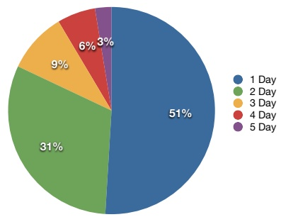

Figure 1 Freight profile for large a LTL carrier by service

which necessitates planning processes that accurately time dispatches. These planning processes have long been supported by solving the so-called Service Network Design problem (Crainic 2000, Wieberneit 2008), which decides the paths for the shipments and the services (or resources) necessary to execute them. Service network design decisions for a consolidation carrier have both a geographic and temporal component, e.g., “dispatch a truck from Chicago, IL to Atlanta, GA at 9.05 pm.” A common technique for modeling the temporal component is discretization; instead of deciding the exact time at which a dispatch should occur (e.g., 7.38 pm), the model decides a time interval during which the dispatch should occur (e.g., between 6pm and 8 pm).

When discretizing time, service network design problems can be formulated on a time-expanded network (Ford and Fulkerson 1958, 1962), in which a node encodes both a location and a time interval, and solutions prescribe dispatch time intervals for resources (trucks, drivers, etc.) and shipments. Service network design models calculate the costs for a set of dispatch decisions by estimating consolidation opportunities, i.e., by recognizing that prescribed dispatch time intervals for shipments allow travel together using the same resource. For example, shipments that should dispatch from the same origin node to the same destination node in the same dispatch time interval (say from Louisville, KY to Jackson, MI between 6 and 11 pm) are candidates for consolidation.

Clearly, the granularity of the time discretization has an impact on the candidate consolidation opportunities identified. At the same time, the granularity of the time discretization also impacts the computational tractability. With an hourly discetization of a week-long planning horizon, 168 timed copies of a node representing a location will be created. With a 5-minute discretization of a week-long planning horizon, 2,016 timed copies of a node representing a location will be created. The latter discretization will likely yield a service network design problem that is much too large to fit into memory or solve in a reasonable amount of time. (In his introduction to network flows over time Skutella (2009) also notes that the use of a discretization that includes each possibly relevant time point can be challenging computationally in many problem settings.)

While there is widespread use of discretizations of time and time-expanded networks in service network design models (Jarrah et al. 2009, Andersen et al. 2011, Erera et al. 2013, Crainic et al. 2014), we postulate that the fundamental question related to their use has not yet been answered: Is it possible to produce an optimal “continuous” time solution without explicitly modeling each point in time? In this paper, we show that this question can be answered in the affirmative. We refer to a service network design problem in which time is modeled in such a way that it accurately captures the consolidation opportunities as a Continuous Time Service Network Design Problem (CTSNDP). For all practical purposes, a time-expanded network based on a 1-minute time discretization gives a CTSNDP. Furthermore, we call a time-expanded network that does not include all the time points a partially time-expanded network.

We develop an algorithm that manipulates partially time-expanded networks and allows the solution of a CTSNDP without ever creating a fully time-expanded network. It relies on repeatedly solving a service network design problem defined on a partially time-expanded network and refining the partially time-expanded network based on an analysis of the solution obtained. Each partially time-expanded network is such that the resulting service network design problem is a relaxation of the CTSNDP. Thus, when the solution to this relaxation is feasible for the CTSNDP it is optimal as well.

An extensive computational study shows the efficacy of the algorithm: instances with networks consisting of 30 nodes and 700 arcs, with 400 commodities, and a planning horizon of about 8 hours, which, when using a full time discretization of 1 minute, leads to integer programs with more than 1,500,000 variables and close to 1,400,000 constraints, can often be solved to proven optimality in less than 30 minutes. Furthermore, the algorithm solves 97% of the several hundred instances in our test set and does so, on average, in less than 15 minutes. For those it does not solve the algorithm produces, on average, a solution with a provable optimality gap of 2.5% or less in two hours.

To summarize, the main contributions of the paper are (1) the development of an algorithm for efficiently solving large-scale continuous time service network design problems, and (2) demonstrating that an optimization problem defined on a time-expanded network can be solved to proven optimality without ever generating the complete time-expanded network. As time-expanded networks are frequently used to model transportation problems, we hope that the latter will stimulate other researchers to explore similar approaches in other contexts, and that that will ultimately result in an improved ability to solve practically relevant problems.

The remainder of the paper is organized as follows. In Section 2, we review relevant literature. In Section 3, we present a formal description of the CTSNDP and discuss a property that (to some extent) motivates our approach. In Section 4, we introduce an iterative refinement algorithm for solving CTSNDP. In Section 5, we present and interpret the results of an extensive computational study of the algorithm’s performance. Finally, in Section 6, we finish with conclusions and a discussion of future work.

## 2. Literature review

The importance of incorporating temporal aspects into flow models has been recognized since their inception. Already in 1958, Ford and Fulkerson (1958) introduced the notion of flows over time (also called dynamic flows). They considered networks with transit times on the arcs, specifying the amount of time it takes for flow to travel from the tail of the arc to the head of the arc, and sought to send a maximum flow from a source to a sink within a given time horizon. They showed that a flows-over-time problem in a network with transit times can be converted to an equivalent standard (static) flow problem in a corresponding time-expanded network. The fundamental concept of an s-t-cut in a network was extended to an s-t-cut over time as well (Anderson et al. 1982, Anderson and Nash 1987). A comprehensive overview of this research area can be found in Skutella (2009)

Similarly, researchers have extended the minimum cost s-t-flow problem to include a temporal component. Klinz and Woeginger (2004) show that, unlike the static problem, the minimum cost s-t-flow over time problem is weakly NP-Hard. Fleischer and Skutella (2007) provide a polynomial time approximation scheme for this (and other) problems (see also Fleischer and Skutella (2003)).

A problem that is more closely related to the CTSNDP is the multi-commodity flow over time problem (Hall et al. 2007), in which demands must be routed from sources to sinks within a given time horizon. Hall et al. (2007) characterizes when this problem is weakly NP-Hard. Topaloglu and Powell (2006) study a time-staged stochastic integer multi-commodity flow problem.

The problems mentioned above assume a fixed time horizon is provided as part of the input. Researchers have also looked at flow models where the objective is to minimize the time it takes to send a given amount of flow. For example, Burkard et al. (1993) present an algorithm that solves the quickest s-t flow problem in strongly polynomial time. Similarly, Hoppe and Tardos (2000) provide a polynomial-time algorithm to solve the quickest transshipment problem. Researchers have also studied the quickest multi-commodity flow problem, for which Fleischer and Skutella (2007) provide an approximation algorithm with peformance guarantee of 2. Researchers have also studied problems that seek flows with an earliest arrival property, in which the flows arriving at the destination at each time point are maximized (Gale 1958, Minieka 1973, Megiddo 1974, Jarvis and Ratliff 1982, Hoppe and Tardos 1994, Tjandra 2003, Baumann and Skutella 2006).

The CTSNDP adds an additional layer of complexity to the multi-commodity flow over time problem by also incorporating network design decisions, which introduces a packing component to the problem. Kennington and Nicholson (2010) study a related problem – the uncapacitated fixed-charge network flow problem defined on a time-expanded network – but focus on choosing appropriate artificial capacities on the arcs to strengthen the linear programming relaxation of the natural integer programming formulation, and only consider instances with relatively small timeexpanded networks. Fischer and Helmberg (2012) develop methods for dynamically generating time-expanded networks, but do so in the context of solving shortest path problems, and without having to make design decisions.

Powell et al. (1995) discuss the use of time-expanded networks in logistics planning models, noting that (at that time) most models create a time-expanded network by simply replicating the underlying network each time period.

Research on using partial time discretizations and dynamically adjusting a time discretization is scarce. Fleischer and Skutella (2007) use partial discretizations to generate (near-)optimal solutions to quickest-flow-over-time problems. Wang and Regan (2009) analyze the convergence of a time window discretization method for the traveling salesman problem with time windows (TSPTW) introduced in (Wang and Regan 2002) to obtain lower bounds on the optimal value. Their analysis shows that iteratively refining the discretization converges to the optimal value. Dash et al. (2012) present an extended formulation for the TSPTW based on partitioning the time windows into subwindows called buckets (which can be thought of as discretizing the time window). They present cutting planes for this formulation that are computationally more effective than the ones known in the literature because they exploit the division of the time windows into buckets. They propose an iterative refinement scheme to determine appropriate partitions of the time windows.

Unlike the quickest-flow-over-time problems mentioned above, optimal solutions to CTSNDP need to strike a balance between the flow time from origin to destination and the capacity utilization of the arcs in the network, with flows waiting at the tail of an arc to be consolidated with other flows using the same arc. Furthermore, the continuous time flow models described above do not explicitly capture the delivery time constraints encountered in many transportation problems. To the best of our knowledge, we are the first to look at dynamically generating a (partially) time-expanded network for a problem that captures design decisions as well as flow time windows.

## 3. Problem description

Let $\mathcal { D }   =   ( \mathcal { N } , \mathcal { A } )$ be a network with node set N and directed arc set ${ \mathcal { A } } .$ We will often refer to $\mathcal { D }$ as a “flat” network, as opposed to a time-expanded network, because the nodes in N model physical locations. Associated with each arc $a   =   ( i , j )   \in   \mathcal { A }$ is a travel time $t t _ { i j } \in \mathbb { N } _ { > 0 }$ , a per-unit-of-flow cost $c _ { i j } \in \mathbb { R } _ { > 0 }$ , a fixed cost $f _ { i j } \in \mathbb { R } _ { > 0 }$ , and a capacity $u _ { i j } \in \mathbb { N } _ { > 0 }$ . Let K denote a set of commodities, each of which has a single source $o _ { k } \in \mathcal { N }$ (also referred to as the commodity’s origin), a single sink $d _ { k } \in \mathcal { N }$ (also referred to as the commodity’s destination), and a quantity $q _ { k }$ that must be routed along a single path from source to sink. Finally, let $e _ { k } \in \mathbb { N } _ { \geq 0 }$ denote the time commodity k becomes available at its origin and $l _ { k } \in \mathbb { N } _ { \geq 0 }$ denote the time it is due at its destination. The Service Network Design Problem (SNDP) seeks to determine paths for the commodities and the resources required to transport the commodities along these paths so as to minimize the total cost, i.e., fixed and flow costs, and ensure that time constraints on the commodities are respected. The SNDP is typically modeled using a time-expanded network. A time-expanded network $\mathcal { D } _ { \mathcal { T } }   =   ( \mathcal { N } _ { \mathcal { T } } , \mathcal { H } _ { \mathcal { T } }   \cup   \mathcal { A } _ { \mathcal { T } } )$ is derived from D and a set of time points $\mathcal { T }   =   \bigcup _ { i \in \mathcal { N } } \mathcal { T } _ { i }$ with $\mathcal { T } _ { i } = \{ t _ { 1 } ^ { i } , \ldots , t _ { n _ { i } } ^ { i } \}$ . The node set $\mathcal { N } _ { T }$ has a node (i, t) for each $i \in \mathcal { N }$ and $t \in { \mathcal { T } } _ { i } .$ . The arc set $\mathcal { H } _ { \mathcal { T } }$ contains the arcs $( ( i , t _ { k } ^ { i } ) , ( i , t _ { k + 1 } ^ { i } ) )$ for all $i \in \mathcal { N }$ and $k   =   1 , \ldots , n _ { i } - 1$ and the arc set $\mathcal { A } _ { \mathcal { T } }$ contains arcs of the form $( ( i , t ) , ( j , \bar { t } ) )$ where $( i , j ) \in \mathcal { A } ,   t \in \mathcal { T } _ { i }$ and $\bar { t } \in \mathcal { T } _ { j }$ . Note that $\mathcal { N } _ { T }$ uniquely determines $\mathcal { H } _ { \mathcal { T } }$ , and that, henceforth, we will, for any given $\mathcal { N } _ { T }$ make use of $\mathcal { H } _ { \mathcal { T } }$ without explicit definition.

Arcs of the form $( ( i , t _ { k } ^ { i } ) , ( i , t _ { k + 1 } ^ { i } ) )$ model the possibility of holding freight in location i, which may be advantageous if the freight can be consolidated with freight that arrives in location i at a later point in time. Arcs of the form $( ( i , t ) , ( j , \bar { t } ) )$ model the possibility to dispatch freight from location i at time t to arrive at location j at time t¯. Note that an arc $( ( i , t ) , ( j , \bar { t } ) )$ does not have to satisfy $\bar { t } - t = t t _ { i j }$ . In fact, the flexibility to introduce arcs $( ( i , t ) , ( j , \bar { t } ) )$ with a travel time that deviates from the actual travel time $t t _ { i j }$ of arc $( i , j )$ is an essential feature of time-expanded networks and provides a mechanism to control the size of the time-expanded network. Unfortunately, deviating from the actual travel times also introduces approximations that may have undesirable effects. Consider, for example, using a discretization of time into hours and modeling travel from Chicago, IL to Milwaukee, WI, which takes about 95 minutes if departure is at 6 pm. When creating an arc ((Chicago,18:00), (Milwaukee, t¯)) one must choose whether to set $\bar { t }   =19:00 or   \bar { t }   =20:00$ . Both choices have downsides. Setting $\bar { t }   =   1 9 { : } 0 0$ implies that a service network design model using this time-expanded network perceives freight traveling on this arc as arriving in Milwaukee in time to consolidate with freight departing from Milwaukee at 19:00, which is not actually possible. However, setting $\bar { t }   =     2 0 { : } 0 0$ implies that a service network design model using this time-expanded network perceives freight destined for Milwaukee and due there at 19:45 traveling on this arc as arriving in Milwaukee too late, which is not the case. The latter shows that not only travel times have to be mapped onto the time-expanded network, but also the times that commodities are available at their origin and due at their destination. The typical mapping rounds up travel times, rounds up times that commodities are available, and rounds down times that commodities are due, because this ensures that any feasible solution to the SNDP model on the time-expanded network can be converted to a true feasible solution, i.e., a feasible solution in real or continuous time.

A regular and fully time-expanded network $\mathcal { D } _ { T } ^ { \Delta }$ associated with D and discretization parameter $\Delta \in \mathbb { N } _ { > 0 }$ has $\mathcal { T } _ { i } = \{ 0 , \Delta , 2 \Delta , \ldots , K \Delta \}$ for all $i \in \mathcal { N }$ and for $K \in \mathbb { N } _ { > 0 }$ with $\operatorname { m a x } _ { k \in \mathcal { K } } l _ { k } / \Delta \leq K <$ $\operatorname* { m a x } _ { k \in \mathcal { K } } l _ { k } / \Delta + 1$ . Furthermore, for every arc $( i , j ) \in \mathcal { A }$ and every node $( i , t ) \in \mathcal { N } _ { \mathcal { T } }$ , there is an arc $( ( i , t ) , ( j , t + \Delta \lceil t t _ { i j } / \Delta \rceil )$ in $\mathcal { A } _ { T }$ (unless $t + \Delta \lceil t t _ { i j } / \Delta \rceil )   >   K \Delta )$ ).

We define $\mathrm { S N D } ( \mathcal { D } _ { \mathcal { T } } )$ to be the service network design problem defined over a time-expanded network $\mathcal { D } _ { T }$ . Let $y _ { i j } ^ { t \bar { t } }$ denote the number of times arc $( i , j )$ must be installed to accommodate dispatches from i at time t arriving at time t¯ in $j .$ (Because these variables capture resource movements, $\mathbf { e . g . }$ , truck or trailer movements, we allow $y _ { i j } ^ { t \bar { t } }$ to take on values greater than one.) Let $x _ { i j } ^ { k t \bar { t } }$ represent whether commodity $k \in \mathcal { K }$ travels from i to $j$ departing at time t to arrive at $\bar { t } .$ Since we have assumed that a commodity must follow a single path from its origin to its destination the variables $x _ { i j } ^ { k t \bar { t } }$ are binary. For presentational convenience, we assume that the nodes $( o _ { k } , e _ { k } )$ and $( d _ { k } , l _ { k } )$ are in $\mathcal { N } _ { T }$ for all $k \in \mathcal { K }$ . (Otherwise, the nodes $( o _ { k } , t )$ with $t   =   \arg \operatorname* { m i n } \{ s \in \mathcal { T } _ { i } \mid s > e _ { k } \}$ and $( d _ { k } , t ^ { \prime } )$ with $t ^ { \prime }   =   \arg \operatorname* { m a x } \{ s \in \mathcal { T } _ { i } \mid t ^ { \prime }   <   l _ { k }$ can be used instead.)

Thus, $\mathrm { S N D } ( \mathcal { D } _ { \mathcal { T } } )$ seeks

$$
z (\mathcal {D} _ {\mathcal {T}}) = \text {minimize} \sum_ {((i, t), (j, \bar {t})) \in \mathcal {A} _ {\mathcal {T}}} f _ {i j} y _ {i j} ^ {t \bar {t}} + \sum_ {k \in \mathcal {K}} \sum_ {((i, t), (j, \bar {t})) \in \mathcal {A} _ {\mathcal {T}}} c _ {i j} q _ {k} x _ {i j} ^ {k t \bar {t}}
$$

subject to

$$
\sum_ {((i, t), (j, \bar {t})) \in \mathcal {A} _ {\mathcal {T}} \cup \mathcal {H} _ {\mathcal {T}}} x _ {i j} ^ {k t \bar {t}} - \sum_ {((j, \bar {t}), (i, t)) \in \mathcal {A} _ {\mathcal {T}} \cup \mathcal {H} _ {\mathcal {T}}} x _ {j i} ^ {k \bar {t} t} = \left\{ \begin{array}{l l} 1 & (i, t) = (o _ {k}, e _ {k}) \\ - 1 & (i, t) = (d _ {k}, l _ {k}) \\ 0 & \text {otherwise} \end{array} \quad \forall k \in \mathcal {K}, (i, t) \in \mathcal {N} _ {\mathcal {T}}, \right.\tag{1}
$$

$$
\sum_ {k \in K} q _ {k} x _ {i j} ^ {k t \bar {t}} \leq u _ {i j} y _ {i j} ^ {t \bar {t}} \forall ((i, t), (j, \bar {t})) \in \mathcal {A} _ {\mathcal {T}},\tag{2}
$$

$$
x _ {i j} ^ {k t \bar {t}} \in \{0, 1 \} \forall ((i, t), (j, \bar {t})) \in \mathcal {A} _ {\mathcal {T}} \cup \mathcal {H} _ {\mathcal {T}}, k \in \mathcal {K},\tag{3}
$$

$$
y _ {i j} ^ {t \bar {t}} \in \mathbb {N} _ {\geq 0} \forall ((i, t), (j, \bar {t})) \in \mathcal {A} _ {\mathcal {T}}.\tag{4}
$$

That is, $\mathrm { S N D } ( \mathcal { D } _ { \mathcal { T } } )$ seeks to minimize the sum of fixed costs (the first term, which models transportation-related costs) and variable costs (the second term, which models handling-related costs). Note that we implicitly assume that holding freight at a location does not result in additional costs. Constraints (1) ensure that each commodity departs from its origin when it becomes available and arrives at its destination when it is due. Note the presence of holding arcs allows a commodity to arrive early at its destination or depart late from its origin. Constraints (2) ensure that sufficient trailer capacity is available for the commodities that are sent from location i at time t to location $j$ at time $\bar { t } .$ Constraints (3) and (4) define the variables and their domains. We denote an optimal solution to this problem by $( x ( \mathcal { D } _ { \mathcal { T } } ) , y ( \mathcal { D } _ { \mathcal { T } } ) )$ and its value with $z ( \mathcal { D } _ { \mathcal { T } } )$

Observe that when using a regular and fully time-expanded network $\mathcal { D } _ { T } ^ { \Delta }$ , no approximations are introduced when $t t _ { i j } / \Delta , ~ e _ { k } / \Delta$ , and $l _ { k } / \Delta$ are naturally integer. In that case, a feasible solution to $\mathrm { S N D } ( \mathcal { D } _ { \mathcal { T } } ^ { \Delta } )$ is also feasible in continuous time and an optimal solution to $\mathrm { S N D } ( \mathcal { D } _ { \mathcal { T } } ^ { \Delta } )$ is also optimal in continuous time. Let $\hat { \Delta } = G C D ( G C D _ { ( i , j ) \in \mathcal { A } } t t _ { i j } , ~ G C D _ { k \in \mathcal { K } } e _ { k } , ~ G C D _ { k \in \mathcal { K } } l _ { k } )$ , where $G C D$ is the greatest common divisor. We define CTSNDP to be $\mathrm { S N D } ( \mathcal { D } _ { \mathcal { T } } ^ { \hat { \Delta } } )$ . We use $\hat { \mathcal { T } }   =   \textstyle \bigcup _ { i \in \mathcal { N } } \hat { \mathcal { T } } _ { i }$ to denote the time points included in $\mathcal { D } _ { \mathcal { T } } ^ { \hat { \Delta } } ,   \mathcal { N } _ { \mathcal { T } } ^ { \hat { \Delta } }$ to denote its nodes, and $\mathcal { A } _ { \mathcal { T } } ^ { \hat { \Delta } } \cup \mathcal { H } _ { \mathcal { T } } ^ { \hat { \Delta } }$ to denote its arcs.

The fully time-expanded network $\mathcal { D } _ { \mathcal { T } } ^ { \hat { \Delta } }$ tends to be prohibitively large for practical instances. Furthermore, it typically contains nodes that are superfluous. For example, a node $( i , t ) \in \mathcal { N } _ { \mathcal { T } } ^ { \hat { \Delta } }$ that cannot feasibly be reached by any commodity $k \in \mathcal { K }$ is superfluous. Therefore, a fundamental question is whether a smaller of set of nodes $\mathcal { N } _ { \mathcal { T } } \subset \mathcal { N } _ { \mathcal { T } } ^ { \hat { \Delta } }$ and set of arcs $\mathcal { A } _ { \mathcal { T } } \subset \mathcal { A } _ { \mathcal { T } } ^ { \hat { \Delta } }$ can be determined a priori, such that solving $\mathrm { S N D } ( \mathcal { D } _ { \mathcal { T } } )$ yields an optimal solution to $\mathrm { S N D } ( \mathcal { D } _ { \mathcal { T } } ^ { \hat { \Delta } } )$ . Theorem 1 shows how to contruct such a set $\tau$

Theorem 1. To ensure that any optimal solution to $S N D ( \mathcal { D } _ { \mathcal { T } } )$ is an optimal solution to CTSNDP, it is sufficient to include only time points in T that are determined by direct travel time paths starting at the origin of a commodity at the time that commodity becomes available, i.e., it is sufficient for T to consist only of time points of the form $e _ { k }$ for some commodity $k \in \mathcal { K } ,$ or of the form $\textstyle e _ { k } + \sum _ { a \in P } t t _ { a }$ for some commodity $k \in \mathcal { K }$ and some path $P \subseteq { \mathcal { A } }$ originating at $o _ { k }$

Proof Consider an optimal (continuous time) solution. Shift all dispatch times to be as early as possible without changing any consolidations. This implies that each dispatch time at a node is now determined by the time a commodity originating at that node becomes available or by the arrival time of another commodity at the node. Suppose there is a dispatch time that is not at a time point of the form defined in the statement of the theorem. Choose the earliest such dispatch time t. Because this dispatch time t cannot occur at the time a commodity becomes available, it must be determined by the arrival time of a commodity, i.e., there must be a commodity dispatched on some arc $a \in \mathcal { A }$ at time $t ^ { \prime }   =   t - t t _ { a }$ . However, because of the choice of t and the assumption that all travel times are positive, it must be that $t ^ { \prime }$ is one of the time points defined in the statement of the theorem. But, since $t   =   t ^ { \prime } + t t _ { a }$ , t itself must be a time point of the form defined in the statement of the theorem, which contradicts its definition. $\mathrm { Q . E . D }$

The set of time points defined in Theorem 1 may still be prohibitively large for practical instances, and is thus not enough, by itself, to enable solution of CTSNDP. However, it motivates, in part, one of the main ideas underlying our approach to solving CTSNDP. We iteratively refine (expand) a set of time points $\mathcal { T } .$ , containing time points $0 , \; e _ { k }$ and $l _ { k }$ for $k \in \mathcal { K }$ , and some time points of the form $\begin{array} { r } { t = e _ { k } + \sum _ { a \in P } t t _ { a } } \end{array}$ for some commodity $k \in K$ and some path $P \subseteq { \mathcal { A } }$ originating at $o _ { k }$ , until we can prove that the solution to $\mathrm { S N D } ( \mathcal { D } _ { \mathcal { T } } )$ for a carefully chosen arc set $\mathcal { A } _ { \mathcal { T } }$ can be converted to an optimal solution to CTSNDP. The details of the approach are provided in the next section.

## 4. An algorithm for solving CTSNDP

Our approach for solving CTSNDP can be thought of as a dual ascent procedure, because it repeatedly solves and refines a relaxation of CTSNDP until the solution to the relaxation can be converted to a feasible solution to CTSNDP of the same cost (and hence it is an optimal solution). Specifically, the approach repeatedly solves an instance of $\mathrm { S N D } ( \mathcal { D } _ { \mathcal { T } } )$ where $\mathcal { D } _ { T }$ has carefully chosen time points, carefully chosen arcs, and carefully chosen arc travel times $t t _ { i j } ^ { t }$ . We index the travel times by t as well, because the travel time for an arc $( i , j )$ will depend on the dispatch time t. Because $\mathcal { T } _ { i }$ may only contain a small subset of the time points in $\hat { \mathcal { T } } _ { i }$ for $i \in \mathcal { N }$ and the set of time points at different locations may differ, i.e., $\mathcal { T } _ { i }$ may be different from $\mathcal { T } _ { j }$ for $i \neq j$ , we refer to the time-expanded network $\mathcal { D } _ { T }$ as a partially time-expanded network. In the description of our algorithm, we will often refer to a “timed copy” of arc $( i , j ) \in \mathcal { A }$ at node $( i , t ) \in \mathcal { N } _ { \mathcal { T } }$ , which will mean an arc of the form $( ( i , t ) , ( j , \bar { t } ) ) \in \mathcal { A } _ { \mathcal { T } }$ . These partially time-expanded networks will have four important properties, which we discuss next. In all that follows, we will, for notational convenience, but without loss of generality, assume that $\hat { \Delta }   =   1$

Property 1. For all commodities $k \in \mathcal { K }$ , the nodes $( o _ { k } , e _ { k } )$ and $( d _ { k } , l _ { k } )$ are in $\mathcal { N } _ { T }$

Property 2. Every arc $( ( i , t ) , ( j , \bar { t } ) ) \in \mathcal { A } _ { \mathcal { T } }$ has $\bar { t }   \leq   t + t t _ { i j }$

That is, we work with timed copies of an arc in the flat network that are either of the correct length or are too short. This is illustrated in Figure 2, where we depict different timed copies of an arc $( j , k ) \in \mathcal { A }$ that may be created by the algorithm. Observe that the lengths (or travel times) of the timed copies are different for the different dispatch times $t , t ^ { \prime } , t ^ { \prime \prime }$ , and $t ^ { m }$ , and that the travel time of a timed copy may even be negative (as is the case for dispatch time $t ^ { \prime \prime \prime } )$

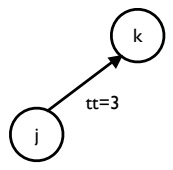

(a) Flat arc

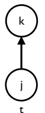

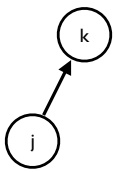

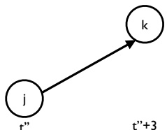

(b) Different timed copies of (j, k) can model travel time differently.

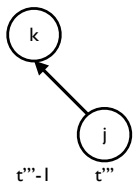

Figure 2 Travel times of timed copies of $( j , k ) ;$ ; travel times do not exceed the travel time of arc $( j , k )$

Before presenting the next property, we need to introduce a new concept.

Definition 1. Consider a path P in the flat network, i.e., $P = ( a _ { 1 } = ( i _ { 1 } , j _ { 1 } ) , a _ { 2 } = ( i _ { 2 } , j _ { 2 } ) , \ldots , a _ { l } =$ $( i _ { l } , j _ { l } ) )$ with $a _ { p } \in \mathcal { A }$ for $p   =   1 , \ldots , l$ and $j _ { p } = i _ { p + 1 }$ for $p   =   1 , \ldots , l - 1$ , and a node $( i _ { 1 } , t )$ in a partially time-expanded network, $\mathcal { D } _ { \mathcal { T } } = ( \mathcal { N } _ { \mathcal { T } } , \mathcal { A } _ { \mathcal { T } } \cup \mathcal { H } _ { \mathcal { T } } )$ , i.e., $( i _ { 1 } , t ) \in \mathcal { N } _ { \mathcal { T } }$ . An early-arrival timed copy of P originating at $( i _ { 1 } , t )$ is a path $P _ { T }$ in $\mathcal { D } _ { T }$ from $( i _ { 1 } , t )$ to $( j _ { l } , \tilde { t } )$ , for some $\tilde { t } ,$ on timed copies of the arcs $a _ { 1 } , \ldots , a _ { l }$ , without any holding arcs. Thus, $P _ { T }$ consists of a sequence of timed arcs $( ( i _ { p } , t _ { p } ) , ( i _ { p + 1 } , t _ { p + 1 } ) ) \in \mathcal { A } _ { \mathcal { T } }$ for $p   =   1 , \ldots , l - 1$ , with $t _ { 1 } = t$ . For brevity, we will refer to early-arrival timed copies of paths as early-arrival paths.

Observe that if, for $P$ in the flat network defined as above, and for some $( i _ { 1 } , t ) \in \mathcal { N } _ { \mathcal { T } }$ , an earlyarrival timed copy of $P ,   P _ { \mathcal { T } }$ , exists in $\mathcal { D } _ { T }$ , then, provided $\mathcal { D } _ { T }$ satisfies Property 2, the time of the final timed node in $P _ { T }$ cannot exceed $t + T$ , where $T$ is the sum of the travel times of the arcs in the path, i.e., $T = t t _ { i _ { 1 } j _ { 1 } } + \ldots + t t _ { i _ { l } j _ { l } }$ . This motivates the use of the term “early-arrival path” to describe $P _ { T }$

Note that if $P _ { T }$ is an early-arrival timed copy of $P ,$ then the subpath $P _ { T } ^ { \prime }$ of $P _ { T }$ corresponding to a subpath $P ^ { \prime }$ of $P$ is an early-arrival timed copy of $P ^ { \prime }$ . Note, too, that early-arrival paths may be joined to produce a new early-arrival path. Specifically, an early-arrival path that begins at $( i , t )$ and ends at $( j , t ^ { \prime } )$ and an early-arrival path that begins at $( j , t ^ { \prime } )$ and ends at $( k , t ^ { \prime \prime } )$ may be joined to form an early-arrival path beginning at $( i , t )$ and ending at $( k , t ^ { \prime \prime } )$

Our algorithm maintains a partially time-expanded network, $\mathcal { D } _ { \mathcal { T } }$ , with the property that there is an early-arrival timed copy of every path in the flat network, at every timed copy of the path’s node of origin. This property is a consequence of Property 2 in combination with the following property.

Property 3. For every arc $a   =   ( i , j )   \in   \mathcal { A }$ in the flat network, $\mathcal { D } .$ and for every node $( i , t )$ in the partially time-expanded network, $\mathcal { D } _ { \mathcal { T } }   =   ( \mathcal { N } _ { \mathcal { T } } , \mathcal { A } _ { \mathcal { T } } \cup \mathcal { H } _ { \mathcal { T } } )$ , there is a timed copy of a in $\mathcal { A } _ { T }$ starting at $( i , t )$

If $\mathcal { D } _ { \mathcal { T } }$ satisfies both Property 2 and Property 3, then it follows immediately that for every arc $a   = ( i , j ) \in \mathcal { A }$ in the flat network, and every timed node $( i , t ) \in \mathcal { N } _ { \mathcal { T } }$ , a timed arc $( ( i , t ) , ( j , \bar { t } ) )$ , with $\overline { { t } } \leq t + t t _ { a } ,$ exists in $\mathcal { A } _ { \mathcal { T } }$ . In fact, it implies that for each node $( i , t )$ in a partially time-expanded network $\mathcal { D } _ { T }$ and for each path $P$ in the flat network starting at $i ,$ there exists an early-arrival timed copy $P _ { T }$ of $P$ in $\mathcal { D } _ { T }$ that starts at $( i , t )$ and ends at $( j , \tilde { t } )$ , where $j$ is the final node in path $P ,$ and $\tilde { t }   \le   t + T$ , where $T$ is the sum of the travel times on the arcs in $P .$

Definition 2. If $\mathcal { D } _ { T }$ satisfies both Property 2 and Property 3, we say that $\mathcal { D } _ { T }$ has the earlyarrival property.

Theorem 2. Let $\mathcal { D } _ { T }$ be a partially time-expanded network that satisfies Property 1 and has the early-arrival property. Then $S N D ( \mathcal { D } _ { \mathcal { T } } )$ is a relaxation of the CTSNDP.

Proof Consider an optimal solution $( \overline { { x } } ( \mathcal { D } _ { \mathcal { T } } ^ { \hat { \Delta } } ) , \overline { { y } } ( \mathcal { D } _ { \mathcal { T } } ^ { \hat { \Delta } } ) )$ to CTSNDP and let $A ^ { * } = \{ ( ( i , t ) , ( j , t +$ $( t t _ { i j } ) ) \in \mathcal { A } _ { \mathcal { T } } ^ { \hat { \Delta } } \mid \overline { { y } } _ { i j } ^ { t , t + t t _ { i j } } > 0 \}$ (recalling the assumption that $\hat { \Delta } = 1 )$ . Furthermore, let $\mathcal { K } _ { ( ( i , t ) , ( j , t + t t _ { i j } ) ) }$ represent the set of commodities dispatched on arc $( ( i , t ) , ( j , t   +   t t _ { i j } ) ) \in A ^ { * }$ , in this optimal solution, i.e., let

$$
\mathcal {K} _ {((i, t), (j, t + t t _ {i j}))} = \{k \in \mathcal {K} \mid \overline {{x}} _ {i j} ^ {k, t, t + t t _ {i j}} > 0 \}.
$$

In what follows, we will identify each arc in $a \in \mathcal { A } ^ { * }$ with a unique timed arc in $\mu ( a ) \in \mathcal { A } _ { \mathcal { T } }$ , and construct $( x ( \mathcal { D } _ { \mathcal { T } } ) , y ( \mathcal { D } _ { \mathcal { T } } ) )$ so that the commodity flow represented by x and trailer capacity represented by $y ,$ on each timed arc of the form $\mu ( a )$ , is exactly that of $\overline { { x } }$ and $\overline { { y } } ,$ respectively, on $a ,$ and so that $( x , y )$ is feasible for $\mathrm { S N D } ( \mathcal { D } _ { \mathcal { T } } )$ and has cost identical to the optimal value of CTSNDP.

Initialize $y   =   0$ . Initialize x as follows. First, set $x = 0$ . Then, for each arc $\boldsymbol { a } = ( ( i , t ) , ( j , t + t t _ { i j } ) ) \in$ $\mathcal { A } ^ { * }$ and for each commodity dispatched on a that originates at node i, we set the commodity flow variables to 1 for all holding arcs at i that depart $\mathrm { a t } ,$ or after, the timed origin of the commodity and arrive at, or before, t. Formally, this requires that for all $k \in \mathcal { K } _ { a }$ with $o _ { k } = i$ , we set $x _ { i i } ^ { k , \tilde { t } ^ { - } , \tilde { t } }   =   1$ if $\tilde { t } ^ { - } \geq e _ { k }$ and ${ \tilde { t } } \leq t ,$ for all $( i , \tilde { t } )   \in   \mathcal { N } _ { \mathcal { T } }$ , where $\tilde { t } ^ { - }$ is the latest time point earlier than $\tilde { t }$ with $( i , \tilde { t } ^ { - } )   \in   \mathcal { N } _ { \mathcal { T } }$ Note that by Property 1, $( o _ { k } , e _ { k } ) \in \mathcal { N } _ { \mathcal { T } }$ for all $k \in \mathcal { K }$ . Furthermore, by feasibility of ${ \overline { { x } } } ,$ for all $\begin{array} { r } { a = \left( ( i , t ) , \left( j , t + t t _ { i j } \right) \right) \in \mathcal { A } ^ { * } , \; \rho _ { i } ( t ) \geq \operatorname* { m a x } _ { k \in \mathcal { K } _ { a } } e _ { k } } \end{array}$ , where $\rho _ { i } ( t )$ is the latest time point at or before t so that $(i, \rho_i(t)) \in \mathcal{N}_{\mathcal{T}}, \; \mathrm{i.e.}, \; \rho_i(t) = \arg \max\{s \in \mathcal{T}_i \mid s \leq t\}$ . Thus for each commodity $k \in { \mathcal { K } } .$ , if t is the time that k is dispatched from its origin, $o ( k )$ , under the optimal solution x, then flow of k for each arc in the path in $\mathcal { D } _ { T }$ from $( o ( k ) , e _ { k } )$ to $( o ( k ) , \rho _ { o ( k ) } ( t ) )$ has been included in the solution x constructed so far.

Next, consider each arc $a = \left( (i,t), \left( j,t + tt_{ij} \right) \right) \in A^*$ in order of nondecreasing t (breaking ties arbitrarily). We make the inductive assumption that for each such timed arc with tail at time point $t ,$ and for each commodity $k \in \mathcal { K } _ { a }$ dispatched on the arc, there exists a path in $\mathcal { D } _ { T }$ from $( o _ { k } , e _ { k } )$ to $( i , \rho _ { i } ( t ) )$ using only arcs $\begin{array} { r } { a ^ { \prime }   =   \left( \left( i ^ { \prime } , t ^ { \prime } \right) , \left( j ^ { \prime } , t ^ { \prime \prime } \right) \right) \in \mathcal { A } _ { \mathcal { T } } \cup \mathcal { H } _ { \mathcal { T } } } \end{array}$ with $x _ { i ^ { \prime } j ^ { \prime } } ^ { k , t ^ { \prime } , t ^ { \prime \prime } } = 1$ . Clearly this is true for the earliest $t ,$ since in this case $\mathcal { K } _ { a }$ can consist only of commodities originating at $i ,$ for which the required paths were constructed in the above initialization of $x .$

Now suppose the inductive assumption holds at some later t. Because $\mathcal { D } _ { T }$ has the early-arrival property, there is an arc $a ^ { \prime } = ( ( i , \rho _ { i } ( t ) ) , ( j , t ^ { \prime } ) ) \in \mathcal { D } _ { \mathcal { T } }$ with $t ^ { \prime } \leq \rho _ { i } ( t ) + t t _ { i j }$ . Choose any such arc $a ^ { \prime } ,$ and identify $\mu ( a )   =   a ^ { \prime }$ . Set $y _ { i j } ^ { \rho _ { i } ( t ) , t ^ { \prime } } = \overline { { y } } _ { i j } ^ { t , t + t t _ { i j } }$ and set $x _ { i j } ^ { k , \rho _ { i } ( t ) , t ^ { \prime } }   =   1   =   \overline { { x } } _ { i j } ^ { k , t , t + t t _ { i j } }$ for all $k \in \mathcal { K } _ { a }$ . Now for each commodity $k \in \mathcal { K } _ { a }$ which is not destined for $j ,$ i.e., has $d ( k ) \neq j$ , let $\tilde { t }$ be the time that k is dispatched from $j$ under the optimal solution, x. Since k must be dispatched from $j$ no later than it arrived at $j ,$ it must be that $\tilde { t }   \geq t + t t _ { i j }$ , and hence $\tilde { t } \geq \rho _ { i } ( t ) + t t _ { i j } \geq t ^ { \prime }$ . Since $( j , t ^ { \prime } ) \in \mathcal { N } _ { \mathcal { T } }$ it must be that $\rho _ { j } ( \tilde { t } ) \geq t ^ { \prime }$ . Now include flow of k on all holding arcs at $j$ that depart no earlier than $t ^ { \prime }$ and arrive no later than $\rho _ { j } ( \tilde { t } )$ in the constructed solution. Formally, this requires that for all $k \in K _ { a }$ with $d _ { k } \neq j$ , for all $( j , \tilde { t } ) \in \mathcal { N } _ { \mathcal { T } }$ with $\tilde { t } \leq \rho _ { j } ( \tilde { t } )$ and $\tilde { t } ^ { - } \geq t ^ { \prime }$ , where $\tilde { t } ^ { - }$ is the latest time point earlier than $\tilde { t }$ with $( j , \tilde { t } ^ { - } ) \in \mathcal { N } _ { \mathcal { T } }$ , we set $x _ { j j } ^ { k , \tilde { t } ^ { - } , \tilde { t } }   =   1$ . This ensures that the inductive assumption continues to hold: the existing path in $\mathcal { D } _ { \mathcal { T } }$ from $( o _ { k } , e _ { k } )$ to $( i , \rho _ { i } ( t ) )$ is extended along $a ^ { \prime }$ to $( j , t ^ { \prime } )$ , and then along the holding arcs to $( j , \rho _ { j } ( \tilde { t } ) )$ , with the flow variables for k along all arcs in the path included in the constructed solution, $x .$ For completeness, we also require that flow travels on any holding arcs needed to its final destination node. Thus for all $k \in \mathcal { K } _ { a }$ with $d _ { k } = j$ , for all $( j , \tilde { t } ) \in \mathcal { N } _ { \mathcal { T } }$ with $\tilde { t } \leq l _ { k }$ and $\tilde { t } ^ { - } \geq t ^ { \prime }$ , where $\tilde { t } ^ { - }$ is as defined above, we set $x _ { j j } ^ { k , \tilde { t } ^ { - } , \tilde { t } } = 1$ . This is well defined, since by Property 1 we have $( j , l _ { k } )   \in   \mathcal { N } _ { \mathcal { T } }$ for such commodities $k ,$ and since $l _ { k } \geq t + t t _ { i j } \geq \rho _ { i } ( t ) + t t _ { i j } \geq t ^ { \prime }$

Now, it is not hard to see that solution $( x , y )$ constructed in this way is feasible for $\mathrm { S N D } ( \mathcal { D } _ { \mathcal { T } } )$ , and replicates solution $( { \overline { { x } } } , { \overline { { y } } } )$ to CTSNDP in the sense that the commodities flow along the same paths (in the flat network) and the same consolidations occur. Hence the two solutions have identical objective function value. Thus $\mathrm { S N D } ( \mathcal { D } _ { \mathcal { T } } )$ is a relaxation of the CTSNDP. Q.E.D.

The following lemma regarding partially time-expanded networks with the early-arrival property will be useful when we refine a partially time-expanded network during the course of our algorithm. We omit its proof, since it follows immediately from the definitions of Property 2 and Property $3$

Lemma 1. If a partially time-expanded network $\mathcal { D } _ { T }$ has the early-arrival property, $( ( i , t ) , ( j , t ^ { \prime } ) ) \in$ $\mathcal { A } _ { T }$ , and $( j , t ^ { \prime \prime } ) \in \mathcal { N } _ { \mathcal { T } }$ with $t ^ { \prime \prime } \leq t + t t _ { i j }$ , then the partially time-expanded network in which arc $( ( i , t ) , ( j , t ^ { \prime } ) )$ is replaced with arc $( ( i , t ) , ( j , t ^ { \prime \prime } ) )$ will also have the early-arrival property.

There are many partially time-expanded networks $\mathcal { D } _ { T }$ that satisfy Properties 1, 2, and 3. We restrict ourselves to partially time-expanded networks with arc sets $\mathcal { A } _ { \mathcal { T } }$ that satisfy one additional property.

Property 4. If arc $( ( i , t ) , ( j , t ^ { \prime } ) ) \in \mathcal { A } _ { \mathcal { T } }$ , then there does not exist a node $( j , t ^ { \prime \prime } ) \in \mathcal { N } _ { \mathcal { T } }$ with $t ^ { \prime } <$ $t ^ { \prime \prime }   \leq   t + t t _ { i j }$ . (We refer to this property as the longest-feasible-arc property.)

Observe that, for a given $\mathcal { T } .$ , (and $\mathcal { N } _ { \mathcal { T } } )$ , there is a unique set of timed arcs that satisfy both the early-arrival and the longest-feasible-arc properties. To see this, first note if $( ( i , t ) , ( j , t ^ { \prime } ) )$ and $( ( i , t ) , ( j , t ^ { \prime \prime } ) )$ are both in $\mathcal { A } _ { \mathcal { T } }$ for some $t ^ { \prime } \neq t ^ { \prime \prime }$ , where without loss of generality $t ^ { \prime } < t ^ { \prime \prime }$ , then $t ^ { \prime } < t ^ { \prime \prime } \leq$ $t   +   t t _ { i j }$ by Property 2, and the longest-feasible-arc property fails. Thus for each $( i , t )   \in   \mathcal { N } _ { \mathcal { T } }$ and each $( i , j ) \in \mathcal { A } ,$ , there can be at most one arc of the form $( ( i , t ) , ( j , t ^ { \prime } )$ in $\mathcal { A } _ { \mathcal { T } }$ satisfying both properties. For $\mathcal { A } _ { T }$ satisfying Property 3 there must be at at least one such arc. Hence, if $\mathcal { A } _ { T }$ satisfies both properties, there is exactly one arc of the form $( ( i , t ) , ( j , t ^ { \prime } )$ in $\mathcal { A } _ { \mathcal { T } }$ for each $( i , t )   \in   \mathcal { N } _ { \mathcal { T } }$ and $( i , j ) \in \mathcal { A }$ By Property 2 and Property 4, it must be that $t ^ { \prime }   =   \arg \operatorname* { m a x } \{ s   |   s   \leq   t + t t _ { i j } ,   ( j , s )   \in   \mathcal { N } _ { \mathcal { T } } \}$

The reason for restricting ourselves to arc sets with the longest-feasible-arc property is the following theorem.

Theorem 3. For a fixed $\tau$ , (and $\mathcal { N } _ { \mathcal { T } } )$ , among the partially time-expanded networks $\mathcal { D } _ { \mathcal { T } }$ with the early-arrival property, the one with the longest-feasible arc property induces an instance of $S N D ( \mathcal { D } _ { \mathcal { T } } )$ with the largest optimal objective function value.

Proof Consider a partially time-expanded network $\mathcal { D } _ { \mathcal { T } } ^ { L F }   =   ( \mathcal { N } _ { \mathcal { T } } , \mathcal { A } _ { \mathcal { T } } ^ { L F }   \cup   \mathcal { H } _ { \mathcal { T } } )$ with arc set $\mathcal { A } _ { \mathcal { T } } ^ { L F }$ that has the longest-feasible-arc property and a partially time-expanded network $\mathcal { D } _ { \mathcal { T } } ^ { ' }   =   ( \mathcal { N } _ { \mathcal { T } } , \mathcal { A } _ { \mathcal { T } } ^ { ' } \cup \mathcal { H } _ { \mathcal { T } } )$ with arc set $\mathcal { A } _ { T } ^ { ' }$ that does not. Assume that both networks have the early-arrival property. We will show that any solution to $\mathrm { S N D } ( \mathcal { D } _ { \mathcal { T } } ^ { L F } )$ can be converted to a solution to $\mathrm { S N D } ( \mathcal { D } _ { \mathcal { T } } ^ { ' } )$ of equal value. Thus, the optimal objective function value of $\mathrm { S N D } ( \mathcal { D } _ { \mathcal { T } } ^ { ' } )$ can be no greater than that of $\mathrm { S N D } ( \mathcal { D } _ { \mathcal { T } } ^ { L F } )$ Consider a solution $( x ( \mathcal { D } _ { \mathcal { T } } ^ { L F } ) , y ( \mathcal { D } _ { \mathcal { T } } ^ { L F } ) )$ to the $\mathrm { S N D } ( \mathcal { D } _ { \mathcal { T } } ^ { L F } )$ and an arc $( ( i , t ) , ( j , t ^ { \prime } ) ) \in \mathcal { A } _ { \mathcal { T } } ^ { L F }$ such that $y _ { i j } ^ { t t ^ { \prime } } ( \mathcal { D } _ { \mathcal { T } } ^ { L F } ) > 0$ and all arcs of the form $( ( i , t ) , ( j , t ^ { \prime \prime } ) ) \in \mathcal { A } _ { \mathcal { T } } ^ { ' }$ have $t ^ { \prime \prime } - t < t ^ { \prime } - t .$ If no such arc exists, then the solution is clearly feasible for $\mathrm { S N D } ( \mathcal { D } _ { \mathcal { T } } ^ { ' } )$ . Thus, suppose such an arc exists.

Because both networks are defined on the same node set $\mathcal { N } _ { T }$ , the a path from $( j , t ^ { \prime \prime } )$ to $( j , t ^ { \prime } )$ exists in $( \mathcal { N } _ { \mathcal { T } } , \mathcal { H } _ { \mathcal { T } } )$ . Consequently, we can adapt the solution $\begin{array} { r } { ( x ( \mathcal { D } _ { \mathcal { T } } ^ { L F } ) , y ( \mathcal { D } _ { \mathcal { T } } ^ { L F } ) ) } \end{array}$ for this arc to one for the $\mathrm { S N D } ( \mathcal { D } _ { \mathcal { T } } ^ { ' } )$ by setting $y _ { i j } ^ { t t ^ { \prime \prime } } = 1$ and routing the corresponding commodity flows on the path formed by concatenating arc $( ( i , t ) , ( j , t ^ { \prime \prime } ) )$ with the path from $( j , t ^ { \prime \prime } )$ to $( j , t ^ { \prime } )$ . Note that the cost of this change is 0, because we have assumed that there is no cost associated with using the holding arcs. Because this change leaves any commodities that traveled on the arc $( ( i , t ) , ( j , t ^ { \prime } ) )$ in the solution to $\mathrm { S N D } ( \mathcal { D } _ { \mathcal { T } } ^ { L F } )$ at the same node $( j , t ^ { \prime } )$ , we can repeat this process one arc at a time and are left with a solution to the $\mathrm { S N D } ( \mathcal { D } _ { \mathcal { T } } ^ { ' } )$ of equal value. Q.E.D.

Theorem 2 (and to a lesser extent Theorem 3) provide the basis for our iterative-refinement algorithm for solving CTNSNDP; Algorithm 1 presents a high-level overview.

<div class="docvortex-algorithm" style="white-space: pre-wrap; font-family:monospace;">
Algorithm 1 SOLVE-CTSNDP
Require: Flat network $\mathcal{D} = (\mathcal{N}, \mathcal{A})$, commodity set $\mathcal{K}$
Create a partially time-expanded network $\mathcal{D}_{\mathcal{T}}$ satisfying Properties 1, 2, 3, and 4
while not solved do
    Solve $\text{SND}(\mathcal{D}_{\mathcal{T}})$
    Determine whether the solution to $\text{SND}(\mathcal{D}_{\mathcal{T}})$ can be converted to a feasible solution to CTSNDP with the same cost
    if it can be converted then
        Stop. Solution is optimal for CTSNDP.
    end if
    Refine partially time-expanded network $\mathcal{D}_{\mathcal{T}}$ by correcting the length of at least one arc in $\mathcal{A}_{\mathcal{T}}$ that is “too short”, in the process adding at least one new time point to $\mathcal{T}_{i}$ for some $i \in \mathcal{N}$.
end while
</div>

Before discussing the various components of the algorithm in more detail, we prove the following result.

Theorem 4. Solve-CTSNDP terminates with an optimal solution.

Proof The algorithm terminates when the optimal solution to $\mathrm { S N D } ( \mathcal { D } _ { \mathcal { T } } )$ can be converted to a solution of CTSNDP with the same cost. Because $\mathrm { S N D } ( \mathcal { D } _ { \mathcal { T } } )$ is a relaxation of CTSNDP (Theorem 2), the converted solution must be an optimal solution to CTSNDP.

Furthermore, at every iteration in which Solve-CTSNDP does not terminate, the length of at least one arc $a \in \mathcal { A } _ { \mathcal { T } }$ is increased to its correct length. Because there are a finite number of time points and arcs, at some iteration all arcs in $\mathcal { A } _ { T }$ must have travel times that correspond to the actual travel time of the corresponding arc in the flat network, in which case the solution to $\mathrm { S N D } ( \mathcal { D } _ { \mathcal { T } } )$ is a solution to CTSNDP and the algorithm terminates. $\mathrm { Q . E . D }$

Because arcs in $\mathcal { A } _ { \mathcal { T } }$ can be too short, it is possible that a solution to $\mathrm { S N D } ( \mathcal { D } _ { \mathcal { T } } )$ contains a path for a commodity $k \in \mathcal { K }$ that is too long, i.e., its actual length or duration exceeds the available time $l _ { k } - e _ { k }$ . In fact, the path can even contain an arc that cannot be part of any feasible path from the commodity’s origin to its destination. We avoid such solutions by adding valid inequalities to $\mathrm { S N D } ( \mathcal { D } _ { \mathcal { T } } )$ and using preprocessing techniques to remove variables that cannot appear in an optimal solution to CTSNDP. More specifically, we prevent paths that are too long by adding the following inequality to $\mathrm { S N D } ( \mathcal { D } _ { \mathcal { T } } )$ :

$$
\overline {{\sum_ {((i , t) , (j , t ^ {\prime})) \in \mathcal {A} _ {\mathcal {T}}} t t _ {i j} x _ {i j} ^ {k t t ^ {\prime}} \leq l _ {k} - e _ {k} .}}\tag{5}
$$

To determine a priori whether a path for a commodity $k \in \mathcal { K }$ can contain an arc $( i , j )$ , we compute the earliest time $e ( i , k )$ that commodity k can arrive at i from its origin and the latest time $l ( j , k )$ that commodity k can depart from $j$ and still reach its destination before its due time and check whether $e ( i , k ) + t t _ { i j } \leq l ( i , k )$ . If not, then we fix $x _ { i j } ^ { k t t ^ { \prime } }$ to 0.

## 4.1. Creating an initial partially time-expanded network

The initial partially time-expanded network consists of nodes $( o _ { k } , e _ { k } )$ and $( d _ { k } , l _ { k } )$ for all $k \in \mathcal { K }$ and $( u , 0 )$ for all $u   \in   \mathcal { N }$ . For each node $( i , t )   \in   \mathcal { N } _ { \mathcal { T } }$ and arc $( i , j ) \in \mathcal { A }$ , we find the node $( j , t ^ { \prime } )$ with largest t<sup>0</sup>such that $t ^ { \prime } \leq t + t t _ { i j }$ and add arc $( ( i , t ) , ( j , t ^ { \prime } ) )$ to $\mathcal { A } _ { \mathcal { T } }$ . Note that because $\mathcal { N } _ { T }$ includes nodes $( u , 0 )$ for $u \in \mathcal { N } ,$ it is always possible to find such a node $( j , t ^ { \prime } )$ . (Note too that we may have $t ^ { \prime } < t$ in which case the arc has a negative travel time.) Finally, for all nodes $( i , t )$ and $( i , t ^ { \prime } )$ such that $t ^ { \prime }$ is the smallest time point with $t ^ { \prime } > t$ , we add arc $( ( i , t ) , ( i , t ^ { \prime } ) )$ to $\mathcal { A } _ { \mathcal { T } }$ . It is not hard to see that this partially time-expanded network satisfies Properties 1, 2, 3, and 4. For a detailed description of Create-initial, see Algorithm 2.

Note that to tighten the bound produced by $\mathrm { S N D } ( \mathcal { D } _ { \mathcal { T } } )$ for the partially time-expanded network created by Create-initial, we calculate $\underline { { e } } = \operatorname* { m i n } _ { k } e _ { k }$ and instead of creating the node $( u , 0 )$ for each $u   \in   \mathcal { N }$ , we create the node $( u , \underline { { e } } )$

<div class="docvortex-algorithm" style="white-space: pre-wrap; font-family:monospace;">
Algorithm 2 CREATE-INITIAL
Require: Directed network $\mathcal{D} = (\mathcal{N}, \mathcal{A})$, commodity set $\mathcal{K}$
for all $k \in \mathcal{K}$ do
    Add node $(o_k, e_k)$ to $\mathcal{N}_{\mathcal{T}}$
    Add node $(d_k, l_k)$ to $\mathcal{N}_{\mathcal{T}}$
end for
for all $u \in \mathcal{N}$ do
    Add node $(u, 0)$ to $\mathcal{N}_{\mathcal{T}}$
end for
for all $(i, t) \in \mathcal{N}_{\mathcal{T}}$ do
    for all $(i, j) \in \mathcal{A}$ do
        Find largest $t'$ such that $(j, t') \in \mathcal{N}_{\mathcal{T}}$ and $t' - t \leq tt_{ij}$ and add arc $((i, t), (j, t'))$ to $\mathcal{A}_{\mathcal{T}}$
    end for
    Find smallest $t'$ such that $(i, t') \in \mathcal{N}_{\mathcal{T}}$ and $t' &gt; t$ and add arc $((i, t), (i, t'))$ to $\mathcal{H}_{\mathcal{T}}$
end for
</div>

## 4.2. Refining a partially time-expanded network

It is necessary to refine Dτ $\mathcal { D } _ { \mathcal { T } }$ when the solution to $\mathrm { S N D } ( \mathcal { D } _ { \mathcal { T } } )$ cannot be converted to a feasible solution to CTSNDP with the same cost, which can happen when an arc in $\mathcal { A } _ { \mathcal { T } }$ is “too short.” When refining $\mathcal { D } _ { T }$ , we ensure that (1) the length of at least one arc that is too short is corrected, and (2) that the resulting partially time-expanded network again satisfies properties 1, 2, 3, and 4.

More specifically, when we lengthen an arc $( ( i , t ) , ( j , t ^ { \prime } ) )$ that is too short, i.e., $t ^ { \prime } < t + t t _ { i j }$ , we replace it with the arc $( ( i , t ) , ( j , t + t t _ { i j } ) )$ . Because $\mathcal { D } _ { T }$ has the longest-feasible-arc property, node $( j , t + t t _ { i j } )$ was not in $\mathcal { N } _ { T }$ and will have to be added to $\mathcal { N } _ { T }$ . Lengthening arc $( ( i , t ) , ( j , t ^ { \prime } ) )$ to $( ( i , t ) , ( j , t   +   t _ { i j } ) )$ is a 2-step process based on the following two lemmas. Details of the two steps are provided in Algorithm 4 and Algorithm 5, respectively, and applied in sequence in Algorithm 3.

Lemma 2. If a time-expanded network $\mathcal { D } _ { T }$ has the early-arrival property, and (1) a new time point $t _ { n e w } ^ { i }$ with $t _ { k } ^ { i } < t _ { n e w } ^ { i } < t _ { k + 1 } ^ { i }$ is added to $\mathcal { T } _ { i } = \{ t _ { 1 } ^ { i } , \dots , t _ { n _ { i } } ^ { i } \}$ , (2) a new node $( i , t _ { n e w } ^ { i } )$ is added to $\mathcal { N } _ { T }$ , and (3) for every arc $( ( i , t _ { k } ^ { i } ) ( j , \bar { t } ) )$ in $\mathcal { D } _ { \mathcal { T } } ,$ a new arc $( ( i , t _ { n e w } ^ { i } ) , ( j , \bar { t } ) )$ is added to $\mathcal { A } _ { \mathcal { T } }$ , then the resulting time-expanded network again has the early-arrival property.

Proof The only new arcs added to $\mathcal { A } _ { T }$ are those of the form $( ( i , t _ { n e w } ^ { i } ) , ( j , \bar { t } ) )$ where $( ( i , t _ { k } ^ { i } ) , ( j , \bar { t } ) )$ was already in $\mathcal { A } _ { \mathcal { T } }$ and $t _ { n e w } ^ { i } > t _ { k } ^ { i }$ . If $\mathcal { D } _ { T }$ already satisfied Property 2, then $\bar { t } \leq t _ { k } ^ { i } + t t _ { i j }$ . Hence $\overline { { t } } < t _ { n e w } ^ { i } + t t _ { i j }$ , and Property 2 is preserved. The only new node added is $( i , t _ { n e w } ^ { i } )$ . Now if $\mathcal { D } _ { \mathcal { T } }$ already satisfied Property 3, it must be that for all $( i , j ) \in \mathcal { A }$ , there exists a timed arc $( ( i , t _ { k } ^ { i } ) , ( j , \bar { t } ) ) \in \mathcal { A } _ { \mathcal { T } }$ for some t. But for each such arc, the new arc $( ( i , t _ { n e w } ^ { i } ) , ( j , \bar { t } ) )$ is added to $\mathcal { A } _ { \mathcal { T } }$ . Thus Property 3 is preserved, too. Q.E.D.

Unfortunately, after adding the new time point, the new node, and the new arcs, the partially time-expanded network no longer satisfies the longest-feasible-arc property. However, a few simple changes to the network restore the longest-feasible-arc property while maintaining the early-arrival property, as is shown in the following lemma.

Lemma 3. After refining a partially time-expanded network $\mathcal { D } _ { T }$ having the longest-feasible-arc property by adding new time point $t _ { n e w } ^ { i }$ with $t _ { k } ^ { i } < t _ { n e w } ^ { i } < t _ { k + 1 } ^ { i }$ to $\mathcal { T } _ { i j }$ , adding new node $( i , t _ { n e w } ^ { i } )$ to $\mathcal { N } _ { T }$ and adding for every arc $( ( i , t _ { k } ^ { i } ) ( j , \bar { t } ) )$ in $\mathcal { D } _ { \mathcal { T } } ,$ a new arc $( i , t _ { n e w } ^ { i } ) , ( j , \bar { t } ) )$ to $\mathcal { A } _ { \mathcal { T } _ { 1 } }$ , the longest-feasible-arc property will be restored by

1. replacing every arc $( j , t ^ { \prime } ) , ( i , t _ { k } ^ { i } ) )$ with $t ^ { \prime } + t t _ { j i } \geq t _ { n e w } ^ { i }$ with arc $( ( j , t ^ { \prime } ) , ( i , t _ { n e w } ^ { i } ) )$ , and

2. finding for every new arc $( ( i , t _ { n e w } ^ { i } ) , ( j , \bar { t } ) )$ the node $( i , t ^ { \prime } )$ with largest t<sup>0</sup>such that $\bar { t } < t ^ { \prime } \leq$ $t _ { n e w } ^ { i } + t t _ { i j }$ and, if such a node exist, replacing arc $( ( i , t _ { n e w } ^ { i } ) , ( j , \bar { t } ) )$ with arc $( ( i , t _ { n e w } ^ { i } ) , ( j , t ^ { \prime } ) )$

Proof The only arcs in $\mathcal { D } _ { \mathcal { T } }$ that may violate the longest-feasible-arc property after the introduction of the new node $( i , t _ { n e w } ^ { i } )$ are those with head $( i , t _ { k } ^ { i } )$ . These arcs are replaced if needed. The newly added arcs may also violate the longest-feasible-arc property, but are replaced if needed. Q.E.D.

When Algorithm 4, Refine, is applied to a partially time-expanded network with the earlyarrival property, Lemma 2 ensures that the resulting partially time-expanded network will also have the early-arrival property. When Algorithm 5, Restore, is applied to a partially time-expanded network with the early-arrival property, Lemma 1 guarantees the property is maintained. Lemma 3 ensures both steps preserve the longest-feasible-arc property. Thus Algorithm 3, Lengthen-arc, preserves both the early-arrival and longest-feasible-arc properties.

```python
Algorithm 3 LENGTHEN-ARC((i, t), (j, t'))
Require: Arc ((i, t), (j, t')) ∈ A_T
    1: REFINE(j, t + tt_ij)
    2: RESTORE(j, t + tt_ij)
```

Observation 1. Because Lengthen-arc takes a timed arc that is too short and replaces it with a timed arc that has the correct length, i.e., the actual travel time, the length of an arc is corrected at most once. This implies that Solve-CTSNDP, with Lengthen-arc used in step 8, will terminate in a finite number of iterations. In particular, the number of iterations is bounded above by $| \hat { \mathcal { T } } | | \mathcal { A } |$ , since this is an upper bound on the number of timed arcs.

<div class="docvortex-algorithm" style="white-space: pre-wrap; font-family:monospace;">
Algorithm 4 REFINE($i, t_{new}^i$)
Require: Node $i \in \mathcal{N}$; time point $t_{new}^i \in \mathcal{T}_i$ with $t_k^i &lt; t_{new}^i &lt; t_{k+1}^i$
Add node $(i, t_{new}^i)$ to $\mathcal{N}_{\mathcal{T}}$;
Delete arc $((i, t_k^i), (i, t_{k+1}^i))$ from $\mathcal{A}_{\mathcal{T}}$; add arcs $((i, t_k^i), (i, t_{new}^i))$ and $((i, t_{new}^i), (i, t_{k+1}^i))$ to $\mathcal{A}_{\mathcal{T}}$
for $((i, t_k^i), (j, t)) \in \mathcal{A}_{\mathcal{T}}$ do
Add arc $((i, t_{new}^i), (j, t))$ to $\mathcal{A}_{\mathcal{T}}$
end for
</div>

<div class="docvortex-algorithm" style="white-space: pre-wrap; font-family:monospace;">
Algorithm 5 RESTORE($i, t_{new}^i$)
Require: Node $i \in \mathcal{N}$; time point $t_{new}^i \in \mathcal{T}_i$ with $t_k^i &lt; t_{new}^i &lt; t_{k+1}^i$
for all $((i, t_k^i), (j, t)) \in \mathcal{A}_{\mathcal{T}}$ do
    Set $t' = \arg \max\{s \in \mathcal{T}_i \mid s \leq t_{new}^i + tt_{ij}\}$.
    if $t' \neq t$ then
        Delete arc $((i, t_{new}^i), (j, t))$ from $\mathcal{A}_{\mathcal{T}}$; add arc $((i, t_{new}^i), (j, t'))$ to $\mathcal{A}_{\mathcal{T}}$
    end if
end for
for all $((j, t), (i, t_k^i)) \in \mathcal{A}_{\mathcal{T}}$ such that $t + tt_{ji} \leq t_{new}^i$ do
    Delete arc $((j, t), (i, t_k^i))$ from $\mathcal{A}_{\mathcal{T}}$; add arc $((j, t), (i, t_{new}^i))$ to $\mathcal{A}_{\mathcal{T}}$
end for
</div>

The reason for refining the partially time-expanded network is that the solution $( x ( \mathcal { D } _ { \mathcal { T } } ) , y ( \mathcal { D } _ { \mathcal { T } } ) )$ to $\mathrm { S N D } ( \mathcal { D } _ { \mathcal { T } } )$ cannot be converted to a solution to CTSNDP with equal value. A solution $( x ( \mathcal { D } _ { \mathcal { T } } ) , y ( \mathcal { D } _ { \mathcal { T } } ) )$ specifies the path each commodity k takes from its origin to its destination as well as the consolidations of commodities on arcs in the network, where a consolidation of commodities on an arc $( i , j ) \in \mathcal { A }$ occurs when two or more commodities travel on that arc at the same time, i.e., $| \mathcal { K } _ { ( ( i , t ) , ( j , t ^ { \prime } ) ) } | \geq 2 ,$ where

$$
\mathcal {K} _ {((i, t), (j, t ^ {\prime}))} = \{k \in \mathcal {K} \mid x _ {i j} ^ {k, t, t ^ {\prime}} = 1 \}.
$$

(Assuming $\textstyle \sum _ { k \in \mathcal { K } _ { ( ( i , t ) , ( j , t ^ { \prime } ) ) } } q _ { k } \leq u _ { i j }$ , these commodities will share the same resource, $\mathbf { i . e . }$ , will be loaded into the same trailer, and the fixed cost $f _ { i j }$ is incurred only once.)

Because Constraints (5) ensure that the paths specified in the solution for the commodities are time-feasible with actual travel times, the solution cannot be converted to a solution to CTSNDP with equal value because the consolidations specified in the solution cannot be realized when the actual travel times are observed. This implies that there has to be a commodity $k \in \mathcal { K }$ that flows on an arc that is too short, i.e., there has to be a commodity k and an arc $( ( i , t ) , ( j , t ^ { \prime } )$ with $t ^ { \prime }   <   t   +   t t _ { i j }$ for which $x _ { i j } ^ { k t t ^ { \prime } }   =   1$ . Next, we discuss how to identify arcs that are too short, to lengthen.

## 4.3. Converting a solution to $\mathbf { S N D } ( \mathcal { D } _ { \mathcal { T } } )$ to a solution to CTSNDP

For commodity $k \in \mathcal { K }$ , let $P _ { k } = \{ i _ { 1 } ^ { k } = o _ { k } , i _ { 2 } ^ { k } , i _ { 3 } ^ { k } , \ldots , i _ { p } ^ { k } = d _ { k } \}$ represent the path that commodity k follows from its source to its sink, in terms of the nodes it visits along the way, in the optimal solution to $\mathrm { S N D } ( \mathcal { D } _ { \mathcal { T } } )$ found. If we can find for every commodity k dispatch times at every node in $P _ { k }$ respecting the actual travel times of the arcs, such that (1) the commodity’s availability time and due time are respected, and (2) commodities that are dispatched together in the optimal solution to $\mathrm { S N D } ( \mathcal { D } _ { \mathcal { T } } )$ are still dispatched together (so that the same consolidations are realized), then we have succeeded in converting the solution to $\mathrm { S N D } ( \mathcal { D } _ { \mathcal { T } } )$ into a solution to CTSNDP.

To determine these dispatch times we solve a linear program. Specifically, for each $k \in \mathcal { K }$ and each node $i _ { p } ^ { k }$ in path $P _ { k }$ , we define variables $\tau _ { i _ { p } } ^ { k } \geq 0$ to represent the dispatch time of commodity k at node $i _ { p } ^ { k } .$ For each $a \in \mathcal { A } _ { \mathcal { T } }$ , define the set of all pairs of commodities dispatched on a: define $J _ { a } = \{ ( k _ { 1 } , k _ { 2 } ) \in \mathcal { K } _ { a } \times \mathcal { K } _ { a } \mid k _ { 1 } < k _ { 2 } \}$ . Now, for each pair of commodities $( k _ { 1 } , k _ { 2 } ) \in J _ { ( ( i , t ) , ( j , t ^ { \prime } ) ) }$ , we define a variable $\delta _ { i j t } ^ { k _ { 1 } k _ { 2 } } \geq 0$ to capture any difference in dispatch time of the two commodities on arc $( i , j )$ With these variables we define the following linear program (LP):

$$
Z = \text {minimize} \sum_ {(k _ {1}, k _ {2}) \in J _ {((i, t), (j, t ^ {\prime}))}} \delta_ {i j t} ^ {k _ {1} k _ {2}}
$$

$$
\tau_ {i _ {p}} ^ {k} + t t _ {i _ {p} i _ {p + 1}} \leq \tau_ {i _ {p + 1}} ^ {k} \quad \forall k \in \mathcal {K}, p = 1, \dots , | P _ {k} | - 1,\tag{6}
$$

$$
e _ {k} \leq \tau_ {o _ {k}} ^ {k} \quad \forall k \in \mathcal {K},\tag{7}
$$

$$
\tau_ {i _ {| P _ {k} | - 1}} + t t _ {i _ {| P _ {k} | - 1} d _ {k}} \leq l _ {k} \forall k \in \mathcal {K},\tag{8}
$$

$$
\delta_ {i j t} ^ {k _ {1} k _ {2}} \geq \tau_ {i} ^ {k _ {1}} - \tau_ {i} ^ {k _ {2}} \forall (k _ {1}, k _ {2}) \in J _ {((i, t), (j, t ^ {\prime}))},\tag{9}
$$

$$
\delta_ {i j t} ^ {k _ {1} k _ {2}} \geq \tau_ {i} ^ {k _ {2}} - \tau_ {i} ^ {k _ {1}} \forall (k _ {1}, k _ {2}) \in J _ {((i, t), (j, t ^ {\prime}))},\tag{10}
$$

$$
\tau_ {i _ {p}} ^ {k} \geq 0 \quad \forall k \in \mathcal {K}, p = 1, \dots , | P _ {k} |.\tag{11}
$$

When the optimal value Z of the LP is zero, then the dispatch times $\tau _ { i } ^ { k }$ show how to convert the solution to $\mathrm { S N D } ( \mathcal { D } _ { \mathcal { T } } )$ to a solution to CTSNDP of equal cost and $\mathrm { S O L V E - C T S N D P }$ can terminate.

Because the optimal solution to $\mathrm { S N D } ( \mathcal { D } _ { \mathcal { T } } )$ satisfies constraints (5), there will always be a feasible solution to the LP. The only reason the consolidations seen in the solution to $\mathrm { S N D } ( \mathcal { D } _ { \mathcal { T } } )$ cannot be seen in a feasible solution to the CTSNDP is if a commodity participating in a consolidation travels on a path that contains an arc that is too short.

Note that the LP presented above does not require that the consolidations take place at the times “suggested” by the solution to $\mathrm { S N D } ( \mathcal { D } _ { \mathcal { T } } )$ . It only stipulates that the commodities have to follow the same path and that the consolidations that occurred are reproduced.

Even when $Z > 0$ , the dispatch times $\tau _ { i } ^ { k }$ prescribed by the solution to the LP can be used to convert the solution to $\mathrm { S N D } ( \mathcal { D } _ { \mathcal { T } } )$ to a feasible solution to CTSNDP. Let the value of this solution be $z ( P \text { -} C T S N D P )$ . Thus, at each iteration of the algorithm, we can calculate an optimality gap with the following formula

$$
(z (P \text {-} C T S N D P) - z (\mathcal {D} _ {\mathcal {T}})) / z (P \text {-} C T S N D P).\tag{12}
$$

This also allows us to specify an optimality tolerance as a stopping condition when executing Solve-CTSNDP.

We modify the above LP slightly by distinguishing those commodities $k \in \mathcal { K }$ for which the (timed) path in the solution to $\mathrm { S N D } ( \mathcal { D } _ { \mathcal { T } } )$ uses only arcs that have the correct length, i.e., the path $P _ { k }$ is also feasible for CTSNDP. Let $\mathcal { K } ^ { F }$ denote this set of commodities, and let $P _ { k } ^ { t } = ( t _ { 1 } ^ { k } , t _ { 2 } ^ { k } , \ldots , t _ { p } ^ { k } )$ denote the dispatch times of commodity k in path $P _ { k }$ in the solution to $\mathrm { S N D } ( \mathcal { D } _ { \mathcal { T } } )$ . We add the following constraints to the LP:

$$
\tau_ {i _ {p}} ^ {k} = t _ {p} ^ {k} \quad \forall k \in \mathcal {K} ^ {F}, p = 1, \dots , | P _ {k} | - 1.\tag{13}
$$

That is, for commodities $k \in \mathcal { K } ^ { F }$ , we force the dispatch time to be equal to the dispatch time in the (timed) path $P _ { k }$ in the solution to $\mathrm { S N D } ( \mathcal { D } _ { \mathcal { T } } )$ . As a consequence, when $\delta _ { i j t } ^ { k _ { 1 } k _ { 2 } } > 0$ in the solution to the LP, then either $k _ { 1 } \notin \mathcal { K } ^ { F }$ or $k _ { 2 } \notin \mathcal { K } ^ { F }$ and thus either the path for $k _ { 1 }$ or the path for $k _ { 2 }$ must contain an arc that is too short. At an iteration of Solve-CTSNDP we solve this linear program for each pair of commodities $( k _ { 1 } , k _ { 2 } )$ that participate in a consolidation and lengthen at least one such arc using Lengthen-arc (if both commodities follow a path that contains an arc that is too short we lengthen an arc for each). When multiple arcs exist, we lengthen the arc that has the earliest dispatch time in the solution to $\mathrm { S N D } ( \mathcal { D } _ { \mathcal { T } } )$

We note that by restricting the dispatch times for commodities $k \in \mathcal { K } ^ { F }$ , it may be the case that even though the solution to $\mathrm { S N D } ( \mathcal { D } _ { \mathcal { T } } )$ can be converted to a solution to CTSNDP of equal value, the LP will not be able to recognize that. However, the benefit of easily identifying an arc that has to be lengthened outweighs this downside.

## 5. A Computational Study

The goal of the computational study presented in this section is to demonstrate the effectiveness and efficiency of the (straightforward implementation of the) proposed iterative refinement algorithm for solving CTSNDP and to gain a better understanding of the factors that contribute to its performance. We first describe the instances used in the computational study (Section 5.1), then we illustrate some of the challenges associated with discretizing time (Section 5.2), and then, we present the results of a series of experiments that demonstrate the efficacy of the proposed algorithm (Section 5.3).

To be able to assess the performance of the proposed algorithm on an instance, we also solve the instance using the formulation with full time discretization. We will refer to this as using Full-Discretization, or, FD. (We note that the same preprocessing techniques are used when using Full-Discretization as when solving $\mathrm { S N D } ( \mathcal { D } _ { \mathcal { T } } ) )$ . Abusing terminology, we will sometimes use FD to refer to the integer program it solves.

## 5.1. Instances

We derive the instances used in our computational study from the C and C+ instances described in detail in Crainic et al. (2001). These instances have been used to benchmark the performance of many algorithms for the capacitated fixed charge network design problem (Ghamlouch et al. 2003 Crainic et al. 2004, Ghamlouch et al. 2004, Katayama et al. 2009, Hewitt et al. 2010, Yaghini et al. 2012, Hewitt et al. 2013). The instances vary with respect to the number of nodes (20, 30), arcs (230,300,520,700), commodities (40,100,200, and 400), whether the variable costs, $c _ { i j }$ , outweigh the fixed costs, $f _ { i j }$ , and whether the arcs are loosely or tightly capacitated. For our experiments, we only considered the 24 instances with 100, 200, or 400 commodities. We provide a detailed list of these instances in Table 1. We refer to these instances as “untimed” as they do not have any time attributes, e.g., there are no travel times associated with arcs or available and due times associated with commodities.

We “timed” these instances using the following scheme. First, for a given parameter $\nu ,$ we set the travel time in minutes, $t t _ { i j }$ , of arc $( i , j )$ to be proportional to its fixed charge. Specifically, we set $t t _ { i j } = \nu f _ { i j } \quad \forall ( i , j ) \in \mathcal { A }$ . We calculated the value ν based on the premise that $f _ { i j }$ represents the transportation cost for a carrier that spends \$.55 cents per mile and their trucks travel at 60 miles per hour. (We note that the travel time for an arc does not, in these instances, depend on the departure time.)

When commodities become available and when they are due partially dictates whether they can consolidate. To be able to measure the degree to which these parameters impact consolidation, we generate for each untimed instance with associated arc travel times multiple instances with varying values for commodity available and due times. More specifically, we first calculate for each commodity $k \in \mathcal { K }$ the length of the shortest path from $o _ { k }$ to $d _ { k }$ with respect to the travel times $t t _ { i j }$ . We call this length $\mathcal { L } _ { k }$ and the average of these $| \mathcal { K } |$ lengths ${ \mathcal { L } } .$ We then create three normal distributions from which we draw the available time for each commodity, all of which are defined by a mean, $\mu _ { e } ,$ of $\mathcal { L }$ minutes, but vary with respect to their standard deviation. Specifically, we consider three values for the standard deviation, $\sigma _ { e } \colon { \textstyle \frac { 1 } { 3 } } \mathcal { L } , { \textstyle \frac { 1 } { 6 } } \mathcal { L }$ , and ${ \frac { 1 } { 9 } } { \mathcal { L } } .$ . Given commodity k’s available time, $e _ { k }$ , at its origin, it can arrive at its destination no sooner than $e _ { k } + \mathcal { L } _ { k }$ . Next, we introduce for each commodity $k \in \mathcal { K }$ a time flexibility, $f _ { k } \geq 0$ , and set its due time, $l _ { k } .$ , to $e _ { k }   +   \mathcal { L } _ { k }   +   f _ { k }$ . Similar to determining the available times, we create two normal distributions from which we draw these time flexibilities. The first has a mean, $\mu _ { f }$ , of ${ \frac { 1 } { 2 } } { \mathcal { L } } ,$ and the second has $\begin{array} { r } { \mu _ { f } = \frac { 1 } { 4 } \mathcal { L } . } \end{array}$ . Both distributions have a standard deviation, $\sigma _ { f }$ of $\frac { 1 } { 6 } \mu _ { f }$

In summary, there are three normal distributions from which we draw commodity available times and two normal distributions from which we draw commodity time flexibility. As such, we have six sets of instances, one for each combination of distributions, and randomly generate three instances for each set. When we randomly sample from one of the distributions, we repeatedly draw from the distribution until we generate a value that falls within three standard deviations of the mean of the distribution.

Therefore, we have a total of $2 4 \times 6 \times 3 = 4 3 2$ instances. Finally, we consider five discretization parameters, $\Delta ;$ 60 minutes, 30 minutes, 15 minutes, 5 minutes, and 1 minute. We summarize the parameter values used to generate the instances used in our computational study in Table 2.

Table 1 “Flat” instances from Crainic et al. (2001)

used in study

<table><tr><td>Instance</td><td> $|\mathcal{N}|$ </td><td> $|\mathcal{A}|$ </td><td> $|\mathcal{K}|$ </td><td>Fixed or Variable cost</td><td>Tight or Loosely capacitated</td><td colspan="2"></td></tr><tr><td>c37</td><td>20</td><td>230</td><td>200</td><td>V</td><td>L</td><td colspan="2"></td></tr><tr><td>c38</td><td>20</td><td>230</td><td>200</td><td>F</td><td>L</td><td colspan="2"></td></tr><tr><td>c39</td><td>20</td><td>230</td><td>200</td><td>V</td><td>T</td><td colspan="2"></td></tr><tr><td>c40</td><td>20</td><td>230</td><td>200</td><td>F</td><td>T</td><td colspan="2"></td></tr><tr><td>c45</td><td>20</td><td>300</td><td>200</td><td>V</td><td>L</td><td colspan="2"></td></tr><tr><td>c46</td><td>20</td><td>300</td><td>200</td><td>F</td><td>L</td><td colspan="2"></td></tr><tr><td>c47</td><td>20</td><td>300</td><td>200</td><td>V</td><td>T</td><td colspan="2"></td></tr><tr><td>c48</td><td>20</td><td>300</td><td>200</td><td>F</td><td>T</td><td>Normal distribution</td><td> $\mu$   $\sigma$ </td></tr><tr><td>c49</td><td>30</td><td>520</td><td>100</td><td>V</td><td>L</td><td>For generating  $e_k$ </td><td> $\mathcal{L}$   $\frac{1}{3}\mathcal{L},\frac{1}{6}\mathcal{L}$ , and  $\frac{1}{9}\mathcal{L}$ </td></tr><tr><td>c50</td><td>30</td><td>520</td><td>100</td><td>F</td><td>L</td><td>For generating  $f_k$ </td><td> $\frac{1}{2}\mathcal{L},\frac{1}{4}\mathcal{L}$  $\frac{1}{6}\mu$ </td></tr><tr><td>c51</td><td>30</td><td>520</td><td>100</td><td>V</td><td>T</td><td colspan="2"></td></tr><tr><td>c52</td><td>30</td><td>520</td><td>100</td><td>F</td><td>T</td><td rowspan="13"> $\Delta$ </td><td rowspan="13">60 min, 30 min, 15 min, 5 min, 1 min</td></tr><tr><td>c53</td><td>30</td><td>520</td><td>400</td><td>V</td><td>L</td></tr><tr><td>c54</td><td>30</td><td>520</td><td>400</td><td>F</td><td>L</td></tr><tr><td>c55</td><td>30</td><td>520</td><td>400</td><td>V</td><td>T</td></tr><tr><td>c56</td><td>30</td><td>520</td><td>400</td><td>F</td><td>T</td></tr><tr><td>c57</td><td>30</td><td>700</td><td>100</td><td>V</td><td>L</td></tr><tr><td>c58</td><td>30</td><td>700</td><td>100</td><td>F</td><td>L</td></tr><tr><td>c59</td><td>30</td><td>700</td><td>100</td><td>V</td><td>T</td></tr><tr><td>c60</td><td>30</td><td>700</td><td>100</td><td>F</td><td>T</td></tr><tr><td>c61</td><td>30</td><td>700</td><td>400</td><td>V</td><td>L</td></tr><tr><td>c62</td><td>30</td><td>700</td><td>400</td><td>F</td><td>L</td></tr><tr><td>c63</td><td>30</td><td>700</td><td>400</td><td>V</td><td>T</td></tr><tr><td>c64</td><td>30</td><td>700</td><td>400</td><td>F</td><td>T</td></tr></table>

The goal of service network design is to find the set of consolidations that yield high capacity utilizations while ensuring commodities arrive at their destinations on time. Thus, the number of consolidation opportunities in an instance may be a useful indicator for the difficulty of an instance. With this in mind, we introduce the consolidation opportunity index (COI) for an instance. For each arc $a \in { \mathcal { A } } ,$ we define a function $g _ { a } ( t )$ that gives for each time t in the planning horizon T the number of commodities that can be at the tail of the arc at time t. Note that this number changes at at most $2 | K |$ time points, namely at the earliest time a commodity can reach the tail of the arc from its origin and the latest time a commodity has to depart from the tail of the arc (along the arc) to reach its destination before its due time. We define the COI of an arc to be $\begin{array} { r } { \frac { 1 } { T } \int _ { 0 } ^ { T } \operatorname* { m a x } \{ g _ { a } ( t ) - 1 , 0 \} d t } \end{array}$

In Figures 3 and 4, we show the percentage of arcs over all arcs and over all instances with a given time flexibility and with a given available time spread, respectively, with a COI in a given

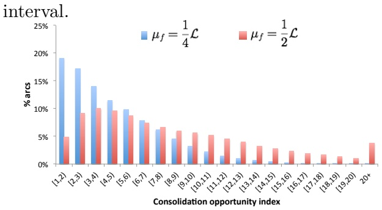

Figure 3 % arcs with a given COI for varying flexibility time

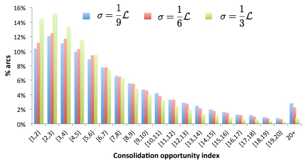

Figure 4 % arcs with a given COI for varying available time spread

Not surprisingly, we see that instances with a larger time flexibility $( \mu _ { f } = { \textstyle { \frac { 1 } { 2 } } } { \mathcal { L } } )$ result in arcs with a higher COI, and that instances with a larger available time spread $( \sigma _ { e } = { \textstyle { \frac { 1 } { 3 } } } { \mathcal { L } } )$ result in arcs with a lower COI.

## 5.2. The impact of discretizing time

As mentioned in the introduction, the granularity of the time discretization has an impact on the accuracy of a formulation as well as its size.

With regard to the size of the formulation, we report in Figure 5 the growth in the full discretization integer program, both in terms of number of variables and number of constraints, as the granularity is refined, i.e., when $\Delta$ is changed from 60 to 30, from 60 to 15, form 60 to 5, and from 60 to 1. (We report averages over all instances.) We see that growth is substantial. Refining the granularity from a 60-minute discretization to a 1-minute discretization results in a factor 15 increase in the size of the integer program.

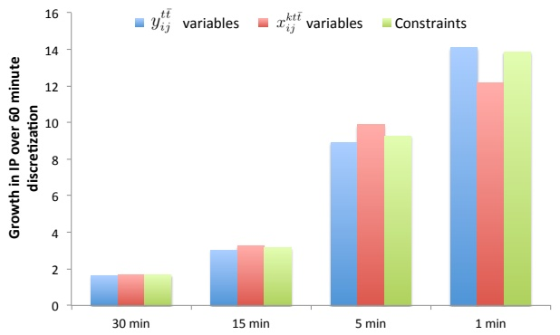

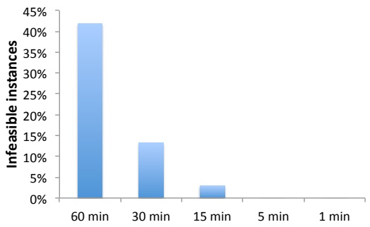

Figure 5 Growth in FD when the discretization $\Delta$ is changed from 60 to a smaller value.

Figure 6 The % of instances that become infeasible due to discretization for different choices of ∆. $\Delta .$

With regard to the accuracy, consider the time-feasibility of a path $p$ in the flat network. A path $p$ in the flat network is time-feasible if $\textstyle \sum _ { ( i , j ) \in p } t t _ { i j } \leq l _ { k } - e _ { k }$ . However, for discretization $\Delta .$ , the travel time of an arc $( i , j )$ will be modeled as $\Delta \lceil t t _ { i j } / \Delta \rceil$ , which can be strictly greater than $t t _ { i j } ,$ the available time of a commodity k will be modeled as $\Delta \lceil e _ { k } / \Delta \rceil$ , which can be strictly greater than $e _ { k } ,$ and the due time of a commodity k will be modeled as $\Delta [ l _ { k } / \Delta ]$ , which can be strictly smaller than $l _ { k }$ . As a result, paths that are time-feasible when considering the true travel times and the true available and due time may be rendered infeasible for a discretization $\Delta .$ Furthermore, if all time-feasible paths for some commodity k in an instance are rendered infeasible for a discretization $\Delta$ , then the instance itself will become infeasible. That this is a relevant and important issue is shown in Figure $6 ,$ where we display the percentage of the 432 instances that become infeasible due to discretization for different choices of $\Delta .$ We see that for $\Delta = 6 0$ over 40% of the instances become infeasible (when they are in fact feasible for a 1-minute discretization).

Figures 5 and 6 highlight the fundamental issue with modeling time-indexed decisions; while finer discretizations of time lead to more accurate models, an enumerative approach to choosing time points to model can lead to significantly larger optimization problems.

## 5.3. Performance of Solve-CTSNDP

We conducted a set of a computational experiments to assess the performance of our implementa tion of the proposed iterative refinement algorithm for solving CTSNDP using the instances that were not rendered infeasible by discretization (recall Figure 6 in the previous subsection). In all experiments, we gave FD and Solve-CTSNDP the same stopping criteria: a proven optimality gap of less than or equal to $1 \% ,$ where the optimality gap is calculated using (12), or a maximum run-time of two hours. Note that when Solve-CTSNDP stops because the feasible solution to the relaxation, $S N D ( \mathcal { D } _ { \mathcal { T } } )$ , can be converted to a feasible solution to CTSNDP, it terminates with a provable optimal solution. All experiments were run on a cluster of computers and each job was allowed to use a maximum of 16GB of memory.

To compare the performance of FD and Solve-CTSNDP, we graph averages over instances with the same discretization parameter $\Delta$ of: the time to termination (Figure 7), the optimality gap at termination (Figure 8), and the percentage of instances solved (Figure 9). We note that Solve-CTSNDP never exceeds the 16 GB memory limit, whereas FD does so for 41.67% of the instances with $\Delta   =   1$ (and never for the other discretizations). Therefore, we do not display results for $\Delta = 1$ in Figures 7 and 8. Instead, for the instances with $\Delta = 1$ , we report in Table 3 the performance of both methods separately for the instances where FD does not exceed the 16 GB memory limit $\mathrm { ( F D \leq 1 6 ~ G B ) }$ and the instances where FD does exceed the 16 GB memory limit $\left(  F-D  > 16  GB  \right)$

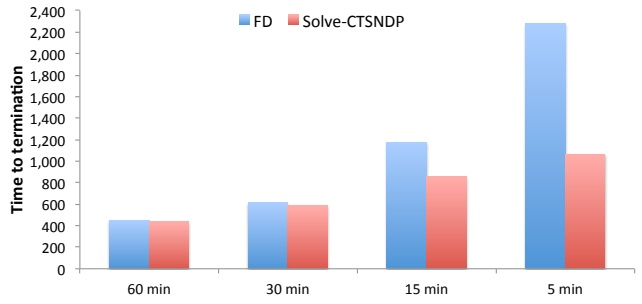

Figure 7 Time to termination for different ∆

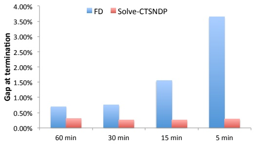

Figure 8 Optimality gap at termination for different $\Delta$

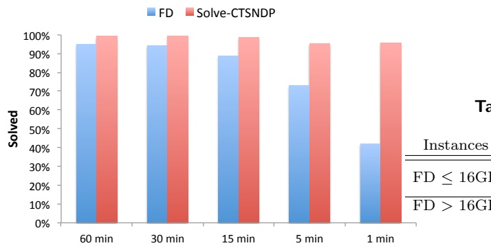

Table 3 Performance when $\Delta = 1$ minute

<table><tr><td>Instances</td><td>Method</td><td>Time</td><td>Opt. Gap</td><td>Solved</td></tr><tr><td rowspan="2">FD ≤ 16GB</td><td>FD</td><td>2,315.96</td><td>1.99%</td><td>71.49%</td></tr><tr><td>SOLVE-CTSNDP</td><td>214.85</td><td>0.22%</td><td>100.00%</td></tr><tr><td>FD &gt; 16GB</td><td>SOLVE-CTSNDP</td><td>2,410.46</td><td>0.32%</td><td>89.62%</td></tr></table>

Figure 9 Fraction of instances solved within the memory and time limits for different $\Delta$

We see that the performance of Solve-CTSNDP is slightly superior to that of FD on instances with coarse discretizations (60 min and 30 min), but clearly outperforms FD on fine discretizations (15 min, 5 min, and 1 min), where it requires less time to solve more instances and when it can not solve an instance yields a smaller optimality gap. Thus, as expected, the performance of FD significantly degrades as the discretization becomes finer, but, as anticipated, Solve-CTSNDP remains effective.

To better understand why Solve-CTSNDP outperforms FD, we first compare $| \mathcal { N } _ { F D } |$ , the cardinality of the node set of the fully time-expanded network that forms the basis of the integer program solved by FD, and $| \mathcal { N } \tau |$ , the node set of the partially time-expanded network that forms the basis of the last integer program solved by Solve-CTSNDP. In Figure 10, we show for the instances with a given discretization parameter $\Delta$ and for a given ratio $r ( 0 < r < 1 )$ , the fraction of instances with $| \mathcal { N } _ { \mathcal { T } } | / | \mathcal { N } _ { F D } | \leqslant r$ . We see that Solve-CTSNDP works with significantly smaller time-expanded networks while searching for a provably optimal solution to CTSNDP than FD, especially for instances with $\Delta   =   1$ , where $| \mathcal { N } _ { \mathcal { T } } | / | \mathcal { N } _ { F D } | \leqslant 0 . 0 4$ for all instances.

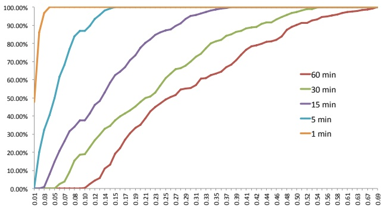

Figure 10 Relative time-expanded network size of the final $\mathsf { S N D } ( \mathcal { D } _ { \mathcal { T } } )$ ).

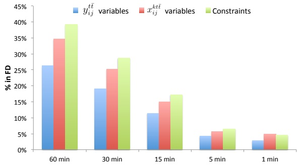

Figure 11 Relative integer programming size associated with the final ${ \mathsf { S N D } } ( { \mathcal { D } } _ { \mathcal { T } } )$

Next, in Figure 11, we compare the size of the integer programs solved by FD and the size of the last integer programs solved by Solve-CTSNDP (i.e., of the integer program associated with the final $\mathrm { S N D } ( \mathcal { D } _ { \mathcal { T } } ) )$ . Specifically, we show for the instances with a given discretization parameter $\Delta ,$ the averages of the following ratios: the number of $y _ { i j } ^ { t \bar { t } }$ variables in the last integer program solved by Solve-CTSNDP and the number of $y _ { i j } ^ { t \bar { t } }$ variables in the integer program solved by FD, the number of $x _ { i j } ^ { k t \bar { t } }$ variables in the last integer program solved by Solve-CTSNDP and the number of $x _ { i j } ^ { k t \bar { t } }$ variables in the integer program solved by FD, and the number of constraints in the last integer program solved by Solve-CTSNDP and the number of constraints in the integer program solved by FD. We see that the last integer programs solved by Solve-CTSNDP are significantly smaller than those solved by FD. Furthermore, as expected, we see that the finer the discretization the smaller the relative size of the integer program associated with the final $\mathrm { S N D } ( \mathcal { D } _ { \mathcal { T } } )$ solved by Solve-CTSNDP.

In Figure 10, we saw that the cardinality of the node set of the partially time-expanded network of the last $\mathrm { S N D } ( \mathcal { D } _ { \mathcal { T } } ) )$ solved by Solve-CTSNDP is much smaller than the cardinality of the node set $\mathrm { o f }$ the fully time-expanded network for the same instance. Next, we explore the growth of the partially time-expanded networks during the execution of Solve-CTSNDP. More specifically, in Figure 12, we report for the instances with a given discretization parameter $\Delta$ the averages of $| \mathcal { N } _ { \mathcal { T } } | / | \mathcal { N } _ { F D } |$ by iteration of Solve-CTSNDP for a specific flat network and set of timing parameter values. (This set of instances was chosen because Solve-CTSNDP struggled the most with this set of instances, i.e., solved the smallest fraction of instances.)

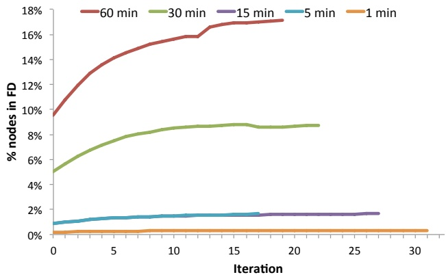

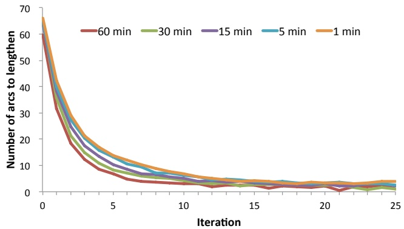

Figure 12 Relative time-expanded network size by iteration for instances with $\left| \mathcal { N } \right|   =   2 0 , \left| \mathcal { A } \right|   =   2 0 0 , \left| \mathcal { K } \right|   =$ $\begin{array} { r } { 2 0 0 , \sigma _ { e } = \frac { 1 } { 9 } \mathcal { L } , \mu _ { f } = \frac { 1 } { 2 } \mathcal { L } . } \end{array}$

Figure 13 Number of arcs to lengthen by iteration.

We see that the size of the partially time-expanded networks created and refined by Solve-CTSNDP remains fairly stable during the execution of algorithm (even for instances with dis cretization $\Delta = 6 0$ , the relative size only increases from about 10% to about 18%). The growth in the size of these networks is driven by the number of arcs that is lengthened in each iteration because they are “too short” and lead to a consolidation that is, in fact, not possible. Therefore, we display in Figure 13 the number of such arcs by iteration, for each discretization. We note that for iteration k, we are displaying an average over the instances for which Solve-CTSNDP required k iterations or more to terminate. The behavior we see in Figure 13 supports what we saw in Figure 12. In the initial iterations, a large number of arcs is lengthened (and, as a result, cause the partially time-expanded network to grow), but after five iterations, that number drops significantly and remains relatively stable. While Solve-CTSNDP does not guarantee that the number of arcs that has to be lengthened decreases from one iteration to the next, we do observe that behavior in Figure 13. Finally, we note that $\Delta$ has little effect on how many arcs Solve-CTSNDP are lengthened in an iteration, a feature we will see often in the next analyses.

The results of the computational experiments discussed above clearly demonstrate Solve-CTSNDP’s superiority over FD. We conclude that Solve-CTSNDP outperforms FD because it starts with a significantly smaller time-expanded network than FD and refines it in such a way that the time-expanded network grows only modestly. As a result, the integer programs solved by Solve-CTSNDP are significantly smaller than those solved by FD.

Next, we conduct a series of computational experiments that provide a detailed analysis of its performance. Specifically, we display distributions (in deciles) for each discretization of the number of iterations to termination (Figure 14), the time to termination (Figure 15), and the optimality gap at termination (Figure 16) for Solve-CTSNDP. We report the values of these statics at these deciles in Table 4.

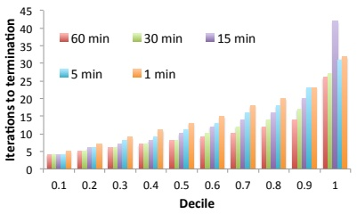

Figure 14 Number of iterations.

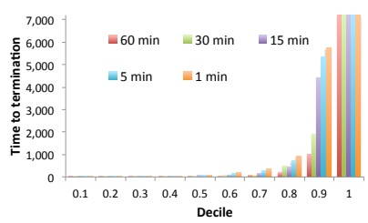

Figure 15 Time to termination.

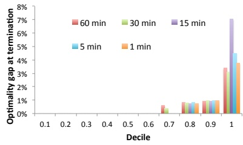

Figure 16 Optimality gap at termination.

Table 4 Distributions of number of iterations, time to termination, and optimality gap at termination for Solve-CTSNDP.

<table><tbody><tr><td colspan="6">Iterations</td><td colspan="5">Time</td><td colspan="5">Optimality gap</td></tr><tr><td>Decile</td><td>60min</td><td>30min</td><td>15min</td><td>5min</td><td>1min</td><td>60min</td><td>30min</td><td>15min</td><td>5min</td><td>1min</td><td>60min</td><td>30min</td><td>15min</td><td>5min</td><td>1min</td></tr><tr><td>0.1</td><td>4.0</td><td>4.0</td><td>4.0</td><td>4.0</td><td>5.0</td><td>4.00</td><td>3.00</td><td>3.00</td><td>4.00</td><td>4.10</td><td>0.00%</td><td>0.00%</td><td>0.00%</td><td>0.00%</td><td>0.00%</td></tr><tr><td>0.2</td><td>5.0</td><td>5.0</td><td>6.0</td><td>6.0</td><td>7.0</td><td>7.00</td><td>6.00</td><td>7.00</td><td>6.20</td><td>7.20</td><td>0.00%</td><td>0.00%</td><td>0.00%</td><td>0.00%</td><td>0.00%</td></tr><tr><td>0.3</td><td>6.0</td><td>6.0</td><td>7.0</td><td>8.0</td><td>9.0</td><td>15.00</td><td>17.00</td><td>21.00</td><td>13.00</td><td>18.00</td><td>0.00%</td><td>0.00%</td><td>0.00%</td><td>0.00%</td><td>0.00%</td></tr><tr><td>0.4</td><td>7.0</td><td>7.0</td><td>8.0</td><td>9.0</td><td>11.0</td><td>20.00</td><td>31.00</td><td>35.20</td><td>36.40</td><td>43.00</td><td>0.00%</td><td>0.00%</td><td>0.00%</td><td>0.00%</td><td>0.00%</td></tr><tr><td>0.5</td><td>8.0</td><td>8.0</td><td>10.0</td><td>11.0</td><td>13.0</td><td>29.00</td><td>45.00</td><td>61.00</td><td>70.00</td><td>92.50</td><td>0.00%</td><td>0.00%</td><td>0.00%</td><td>0.00%</td><td>0.00%</td></tr><tr><td>0.6</td><td>9.0</td><td>10.0</td><td>12.0</td><td>13.0</td><td>15.0</td><td>43.00</td><td>65.40</td><td>92.60</td><td>142.80</td><td>193.40</td><td>0.00%</td><td>0.00%</td><td>0.00%</td><td>0.00%</td><td>0.00%</td></tr><tr><td>0.7</td><td>10.0</td><td>12.0</td><td>14.0</td><td>16.0</td><td>18.0</td><td>98.00</td><td>93.80</td><td>162.60</td><td>271.70</td><td>357.50</td><td>0.62%</td><td>0.40%</td><td>0.00%</td><td>0.00%</td><td>0.00%</td></tr><tr><td>0.8</td><td>12.0</td><td>14.0</td><td>16.0</td><td>18.0</td><td>20.0</td><td>214.00</td><td>480.60</td><td>454.00</td><td>723.20</td><td>931.20</td><td>0.83%</td><td>0.80%</td><td>0.75%</td><td>0.83%</td><td>0.75%</td></tr><tr><td>0.9</td><td>14.0</td><td>17.0</td><td>20.0</td><td>23.0</td><td>23.0</td><td>1,007.00</td><td>1,920.20</td><td>4,420.40</td><td>5,339.20</td><td>5,752.70</td><td>0.94%</td><td>0.95%</td><td>0.92%</td><td>0.97%</td><td>0.95%</td></tr><tr><td>1</td><td>26.0</td><td>27.0</td><td>42.0</td><td>31.0</td><td>32.0</td><td>7,200.00</td><td>7,200.00</td><td>7,200.00</td><td>7,200.00</td><td>7,200.00</td><td>3.39%</td><td>3.10%</td><td>7.04%</td><td>4.50%</td><td>3.76%</td></tr><tr><td>Avg</td><td>8.7</td><td>10.8</td><td>12.6</td><td>13.7</td><td>14.8</td><td>435.04</td><td>719.74</td><td>1,020.51</td><td>1,162.63</td><td>1,237.28</td><td>0.31%</td><td>0.25%</td><td>0.32%</td><td>0.29%</td><td>0.23%</td></tr></tbody></table>

We see that the distributions for both the number of iterations and the time to termination are positively skewed, with outliers pulling the average up. For example, for all discretizations the $7 0 ^ { t h }$ percentile for the time to termination is less than six minutes (and significantly less than the average). The distributions of the optimality gaps indicate that for a large percentage of the instances Solve-CTSNDP terminates because the feasible solution to the relaxation, $S N D ( \mathcal { D } _ { \mathcal { T } } )$ can be converted to a feasible solution to CTSNDP (indicated by an optimality gap of 0%). We note that for all discretizations the $9 0 ^ { t h }$ percentile of optimality gaps is within our optimality tolerance of 1%.

Next, we analyze the changes in the lower and upper bounds during the execution of Solve CTSNDP. We note that because the number of iterations required to solve an instance varies across the instances, the number of instances for which we have a lower and upper bound at the $k ^ { t h }$ iteration is typically greater than the number of instances for which we have a lower and upper bound at the $k + 1 ^ { t h }$ iteration and this has to be kept in mind when interpreting the average values reported for an iteration.

We first examine the optimality gap at each iteration. To reduce the effect of the varying number of instances at an iteration, we partitioned the set of instances and report results for each set of instances in the partition. Figure 17 provides information about the chosen partition, which is based on the number of iterations to termination. In Figure 18, we display the optimality gap at each iteration of Solve-CTSNDP for all sets of instances in the partition.

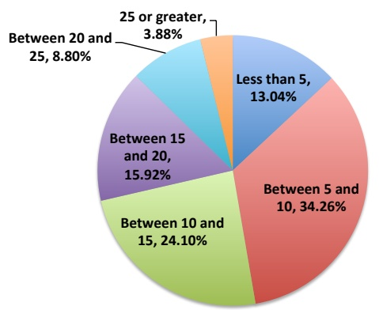

Figure 17 Distribution of instances by $\#$ iterations to termination.

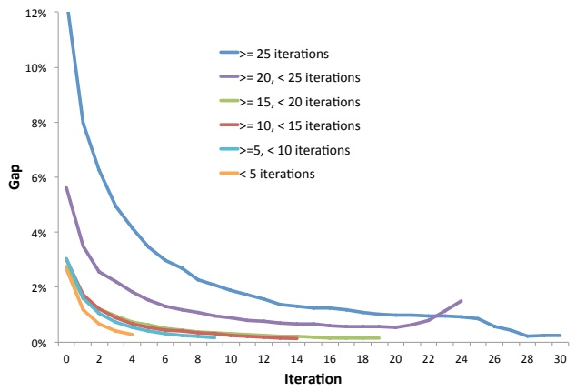

Figure 18 Optimality gap at each iterations for the set of instances partitioned by # iterations to termination.

Not surprisingly, the lower the initial gap, the fewer iterations Solve-CTSNDP needed. More importantly, we see that for all instances, Solve-CTSNDP produces a solution with a provable optimality gap of $2 \%$ or less in no more than ten iterations, and that Solve-CTSNDP terminated in fewer than ten iterations for nearly 50% of the instances.

The optimality gap reported by Solve-CTSNDP at an iteration is a function of both the quality of the primal solution and the strength of the dual bound produced. Therefore, we report in Figure 19 averages over all instances, but by discretization parameter and iteration, of gaps for both these measures. Specifically, we report the gap in value between the primal solution produced by Solve-CTSNDP at an iteration and the the primal solution produced at termination (labeled $\Delta$ min primal). Similarly, we report the gap in value between the dual bound produced by Solve-CTSNDP at an iteration and the dual bound produced at termination (labeled $\Delta$ min dual). (We note again that because not all executions of Solve-CTSNDP require the same number of iterations to terminate, for each iteration, we are reporting averages over the instances that needed at least that many iterations to terminate.)

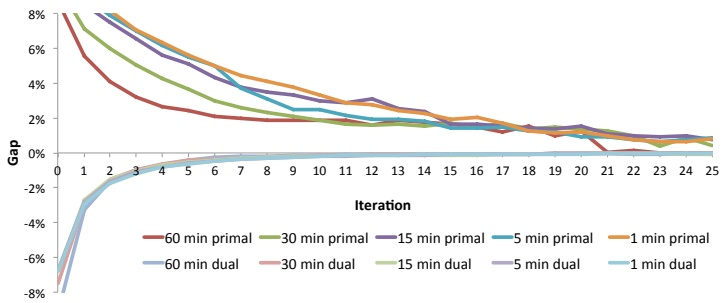

Figure 19 Primal and dual gaps by iteration

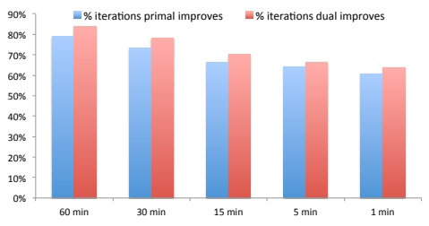

Figure 20 Frequency improve by $\Delta$

While both gaps converge quickly, we see that the dual bound produced by Solve-CTSNDP converges more quickly. A similar behavior can be observed in Figure 20, where we show the percentage of Solve-CTSNDP iterations over all instances, but by discretization, in which the primal and dual bounds improved. While both bounds improve more often than not, the dual bound improves roughly 4% more often.

Importantly, we note that the performance of Solve-CTSNDP with respect to both the quality of the primal solution and the strength of the dual bound produced at an iteration is consistent across discretizations. Coupled with the results discussed previously, we conclude that Solve-CTSNDP is robust with respect to the discretization parameter, $\Delta$

Finally, we seek to understand when an instance is challenging for Solve-CTSNDP. To do so, we present in Table 5 correlation coefficients between various instance parameters and two performance metrics for Solve-CTSNDP: (1) the number of iterations to termination, and, (2) the time to termination. Because the ratio of the number of commodities to the number of arcs in an instance is an indicator of how much consolidation will occur, we present a correlation coefficient for this statistic as well. As discussed above, we believe the consolidation opportunity index (COI) is another indicator of how much coonsolidation will occur and thus we present a correlation coefficient for this statistic too.

Table 5 Correlation coefficients between instance parameters and performance metrics

<table><tbody><tr><td colspan="2">Iterations to termination</td><td>Time to termination</td></tr><tr><td>∆</td><td>µf σe AK K A N COI</td><td>µf σe AK K A N COI</td></tr><tr><td>60 min</td><td>0.30 -0.16 0.34 -0.16 -0.47 -0.43 0.16</td><td>0.28 -0.07 0.26 -0.07 -0.29 -0.27 0.17</td></tr><tr><td>30 min</td><td>0.34 -0.15 0.48 0.03 -0.52 -0.51 0.37</td><td>0.34 -0.09 0.31 0.01 -0.32 -0.33 0.30</td></tr><tr><td>15 min</td><td>0.42 -0.18 0.58 0.26 -0.47 -0.46 0.57</td><td>0.42 -0.11 0.35 0.16 -0.24 -0.24 0.48</td></tr><tr><td>5 min</td><td>0.46 -0.20 0.62 0.39 -0.42 -0.40 0.62</td><td>0.46 -0.11 0.36 0.25 -0.19 -0.19 0.55</td></tr><tr><td>1 min</td><td>0.47 -0.18 0.64 0.45 -0.38 -0.38 0.65</td><td>0.47 -0.08 0.37 0.28 -0.18 -0.18 0.57</td></tr><tr><td>Overall</td><td>0.30 -0.17 0.51 0.25 -0.38 -0.37 0.48</td><td>0.40 -0.09 0.32 0.17 -0.20 -0.20 0.45</td></tr></tbody></table>

We see moderately strong and positive correlations between $\begin{array} { r } { \frac { \mathcal { K } } { \mathcal { A } } , \; \mu _ { f } } \end{array}$ , and COI and the number of iterations and time needed to reach termination. However, while there is always a stronger correlation between $\frac { \kappa } { A }$ and the number of iterations than $\mu _ { f }$ there is often a stronger correlation between $\mu _ { f }$ and the time required to reach termination. We see that while the correlation coefficients for $\scriptstyle { \frac { \mathcal { K } } { \mathcal { A } } } , \; \mu _ { f }$ , and COI with respect to iterations and time increase as the discretization becomes finer, the COI coefficients do so the most. We also note that there is a negative, and moderately strong, correlation between $\mathcal { N }$ and both performance measures. We believe that all these metrics can be seen as predictors of the amount of consolidation that will occur in a solution to $\mathrm { S N D } ( \mathcal { D } _ { \mathcal { T } } )$ , and, thus, we conclude that the greater the potential for consolidation in an instance, the harder it is for Solve-CTSNDP to solve.

We complement this analysis by looking at two specific classes of instances, $| \mathcal { N } | = 3 0 , | \mathcal { A } | =$ $5 2 0 , | \mathcal { K } |   =   1 0 0$ (Table 6a), and $| { \mathcal { N } } | = 3 0 , | { \mathcal { A } } | = 5 2 0 , | { \mathcal { K } } | = 4 0 0 { \mathrm { ~ ( T a b l e ~ 6 b ) } }$ with $\sigma _ { e } = { \textstyle { \frac { 1 } { 9 } } } { \mathcal { L } }$ but varying discretization parameters and $\mu _ { f }$ values. We see (particularly in Table 6b) that within a class, as the parameter $\mu _ { f }$ gets smaller, which in turn leads to a smaller time window, $l _ { k } - e _ { k }$ for delivering commodity k, the instances get significantly easier to solve. Similarly, for a given value of $\mu _ { f }$ , the class with the higher ratio ${ \frac { \mathcal { K } } { \mathcal { A } } } ,$ is much harder to solve. We note that the average COI across all instances is 5.52. While the average COI for the instances reported on in Table 6a is 2.24, for the instances reported on in Table 6b (which are much harder to solve) the average COI is 9.91.

Table 6 Detailed results for two instance classes with $\begin{array} { r } { | \mathcal { N } |   =   3 0 , | \mathcal { A } |   =   5 2 0 , \sigma _ { e }   =   \frac { 1 } { 9 } \mathcal { L } } \end{array}$

(a) $| \mathcal { K } | = 1 0 0$

| ∆ | Iter | µ<sub>f</sub>Time | = 21 L Opt. gap. | Solved | Iter | µTime | f = 14 L Opt gap. | Solved |
| --- | --- | --- | --- | --- | --- | --- | --- | --- |
| 60 | 10.00 | 8.67 | 0.15% | 100.00% | 7.17 | 3.83 | 0.12% | 100.00% |
| 30 | 7.75 | 9.25 | 0.30% | 100.00% | 8.50 | 7.00 | 0.27% | 100.00% |
| 15 | 8.92 | 15.33 | 0.33% | 100.00% | 6.45 | 6.82 | 0.45% | 100.00% |
| 5 | 9.83 | 12.00 | 0.06% | 100.00% | 7.92 | 5.67 | 0.31% | 100.00% |
| 1 | 11.50 | 14.67 | 0.00% | 100.00% | 7.75 | 6.92 | 0.50% | 100.00% |
| Avg | 9.56 | 12.35 | 0.17% | 100.00% | 7.51 | 6.19 | 0.36% | 100.00% |

(b) $| \mathcal { K } |   =   4 0 0$

| ∆ | Iter | µ<sub>f</sub>Time | = 12 L Opt. gap. | Solved | Iter | µ<sub>f</sub>Time | = 14 L Opt gap. | Solved |
| --- | --- | --- | --- | --- | --- | --- | --- | --- |
| 60 | 6.55 | 119.18 | 0.44% | 100.00% | 8.00 | 55.50 | 0.27% | 100.00% |
| 30 | 11.50 | 679.67 | 0.44% | 100.00% | 6.67 | 52.33 | 0.45% | 100.00% |
| 15 | 18.17 | 2,587.08 | 0.43% | 91.67% | 11.08 | 125.08 | 0.30% | 100.00% |
| 5 | 19.25 | 3,270.25 | 0.58% | 66.67% | 12.17 | 207.42 | 0.55% | 100.00% |
| 1 | 20.75 | 3,597.83 | 0.52% | 75.00% | 15.92 | 284.25 | 0.23% | 100.00% |
| Avg | 15.39 | 2,083.54 | 0.48% | 86.44% | 11.32 | 162.80 | 0.38% | 100.00% |

## 6. Conclusions and Future Work

We have presented an algorithm for solving service network design problems that uses timeexpanded networks, but that avoids having to introduce approximations (and thus uncertainty about the quality of the solution) to keep the size of the time-expanded network manageable.

Because time-expanded networks are commonly used in the solution of many transportation problems, we hope and expect that many of the fundamental ideas underlying our approach will can be applied in other contexts as well.

Our computational study has demonstrated that the current implementation of Solve-CTSNDP is quite effective. However, there are many enhancements that will increase its efficiency. We mention only a few. First, it is unnecessary to solve $\mathrm { S N D } ( \mathcal { D } _ { \mathcal { T } } )$ , which is the most time-consuming step in the algorithm, to optimality at each iteration. In the initial iterations, it may suffice to only solve the linear programming relaxation or to solve the problem to withing a proven percentage of optimality. Second, if $\mathrm { S N D } ( \mathcal { D } _ { \mathcal { T } } )$ does not change much from one iteration to the next, it may be possible to construct a high-quality initial solution to speed up the solution time. Finally, it may be beneficial to correct the length of several arcs that are too short rather than just one.

The ability to solve very large instance of a service network design problem also opens up the possibility to study new and innovative time-focused service network design models. For example, a carrier may be interested in understanding the degree to which altering the available and/or due times of a commodity impacts the costs. Such decisions can easily be incorporated in a service network design model, but will increase the size of instance substantially. However, by using an iterative refine algorithm based on partially time-expanded networks, the increase in size may be overcome.

## References

Andersen, Jardar, Marielle Christiansen, Teodor Gabriel Crainic, Roar Grønhaug. 2011. Branch and price for service network design with asset management constraints. Transportation Science 45(1) 33–49.

Anderson, Edward J, Peter Nash. 1987. Linear programming in infinite-dimensional spaces: theory and applications. Wiley New York.

Anderson, EJ, P Nash, AB Philpott. 1982. A class of continuous network flow problems. Mathematics of Operations Research 7(4) 501–514.

Baumann, Nadine, Martin Skutella. 2006. Solving evacuation problems efficiently–earliest arrival flows with multiple sources. Foundations of Computer Science, 2006. FOCS’06. 47th Annual IEEE Symposium on. IEEE, 399–410.

Burkard, Rainer E, Karin Dlaska, Bettina Klinz. 1993. The quickest flow problem. Zeitschrift für Operations Research 37(1) 31–58.

Crainic, Teodor Gabriel, Antonio Frangioni, Bernard Gendron. 2001. Bundle-based relaxation methods for multicommodity capacitated fixed charge network design. Discrete Applied Mathematics 112(1) 73–99.

Crainic, Teodor Gabriel, Mike Hewitt, Michel Toulouse, Duc Minh Vu. 2014. Service network design with resource constraints. Transportation Science doi:10.1287/trsc.2014.0525. URL [http://dx.doi.org/10.1287/trsc.2014.0525](http://dx.doi.org/10.1287/trsc.2014.0525). Articles in Advance.

Crainic, T.G. 2000. Service network design in freight transportation. European Journal of Operations Research 122(2) 272–288.

Crainic, T.G., B. Gendron, G. Hernu. 2004. A slope scaling/lagrangean perturbation heuristic with longterm memory for multicommodity capacitated fixed-charge network design. Journal of Heuristics 10 525–545.

Dash, Sanjeeb, Oktay Günlük, Andrea Lodi, Andrea Tramontani. 2012. A time bucket formulation for the traveling salesman problem with time windows. INFORMS Journal on Computing 24(1) 132–147.

Erera, Alan, Michael Hewitt, Martin Savelsbergh, Yang Zhang. 2013. Improved load plan design through integer programming based local search. Transportation Science 47(3) 412–427.

Fischer, Frank, Christoph Helmberg. 2012. Dynamic graph generation for the shortest path problem in time expanded networks. Mathematical Programming 1–41.

Fleischer, Lisa, Martin Skutella. 2003. Minimum cost flows over time without intermediate storage. Proceedings of the fourteenth annual ACM-SIAM symposium on Discrete algorithms . Society for Industrial and Applied Mathematics, 66–75.

Fleischer, Lisa, Martin Skutella. 2007. Quickest flows over time. SIAM Journal on Computing 36(6) 1600–1630.

Ford, Lester Randolph, Delbert Ray Fulkerson. 1958. Constructing maximal dynamic flows from static flows. Operations research 6(3) 419–433.

Ford, Lester Randolph, Delbert Ray Fulkerson. 1962. Flows in networks. Princeton University Press.

Gale, David. 1958. Transient flows in networks. Tech. rep., DTIC Document.

Ghamlouch, I., T. Crainic, M. Gendreau. 2003. Cycle-based neighborhoods for fixed charge capacitated multicommodity network design. Operations Research 51 655–667.

Ghamlouch, I., T. Crainic, M. Gendreau. 2004. Path relinking, cycle-based neighborhoods and capacitated multicommodity network design. Annals of Operations Research 131 109–133.

Hall, Alex, Steffen Hippler, Martin Skutella. 2007. Multicommodity flows over time: Efficient algorithms and complexity. Theoretical Computer Science 379(3) 387–404.

Hewitt, M., G.L. Nemhauser, M.W.P. Savelsbergh. 2010. Combining Exact and Heuristic Approaches for the Capacitated Fixed-Charge Network Flow Problem. INFORMS Journal on Computing 22(2) 314–325.

Hewitt, Mike, George Nemhauser, Martin WP Savelsbergh. 2013. Branch-and-price guided search for integer programs with an application to the multicommodity fixed-charge network flow problem. INFORMS Journal on Computing 25(2) 302–316.

Hoppe, Bruce, Eva Tardos. 1994. Polynomial time algorithms for some evacuation problems. ´ Proceedings of the fifth annual ACM-SIAM symposium on Discrete algorithms . Society for Industrial and Applied Mathematics, 433–441.

Hoppe, Bruce, Eva Tardos. 2000. The quickest transshipment problem. ´ Mathematics of Operations Research 25(1) 36–62.

Jarrah, Ahmad, Ellis Johnson, Lucas Neubert. 2009. Large-scale, less-than-truckload service network design. Operations Research 57(3).

Jarvis, John J, H Donald Ratliff. 1982. Notesome equivalent objectives for dynamic network flow problems. Management Science 28(1) 106–109.

Katayama, N, M Chen, M Kubo. 2009. A capacity scaling heuristic for the multicommodity capacitated network design problem. Journal of Computational and Applied Mathematics 232(1) 90–101.

Kennington, Jeffery L, Charles D Nicholson. 2010. The uncapacitated time-space fixed-charge network flow problem: an empirical investigation of procedures for arc capacity assignment. INFORMS Journal on Computing 22(2) 326–337.

Klinz, Bettina, Gerhard J Woeginger. 2004. Minimum-cost dynamic flows: The series-parallel case. Networks 43(3) 153–162.

Megiddo, Nimrod. 1974. Optimal flows in networks with multiple sources and sinks. Mathematical Programming 7(1) 97–107.

Minieka, Edward. 1973. Maximal, lexicographic, and dynamic network flows. Operations Research 21(2) 517–527.

Powell, Warren B, Patrick Jaillet, Amedeo Odoni. 1995. Stochastic and dynamic networks and routing. Handbooks in operations research and management science 8 141–295.

Skutella, Martin. 2009. An introduction to network flows over time. Research Trends in Combinatorial Optimization. Springer, 451–482.

Tjandra, Stevanus Adrianto. 2003. Dynamic network optimization with application to the evacuation problem. Ph.D. thesis, Universitat Kaiserslautern.

Topaloglu, Huseyin, Warren B Powell. 2006. Dynamic-programming approximations for stochastic timestaged integer multicommodity-flow problems. INFORMS Journal on Computing 18(1) 31–42.

Wang, Xiubin, Amelia C. Regan. 2002. Local truckload pickup and delivery with hard time window constraints. Transportation Research Part B: Methodological 36(2) 97–112.

Wang, Xiubin, Amelia C. Regan. 2009. On the convergence of a new time window discretization method for the traveling salesman problem with time window constraints. Computers & Industrial Engineering 56(1) 161–164.

Wieberneit, Nicole. 2008. Service network design for freight transportation: a review. OR Spectrum 30(1).

Yaghini, Masoud, Mohadeseh Rahbar, Mohammad Karimi. 2012. A hybrid simulated annealing and column generation approach for capacitated multicommodity network design. Journal of the Operational Research Society 64(7) 1010–1020.