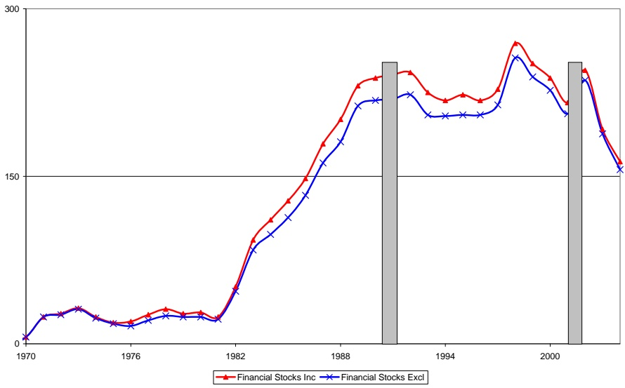
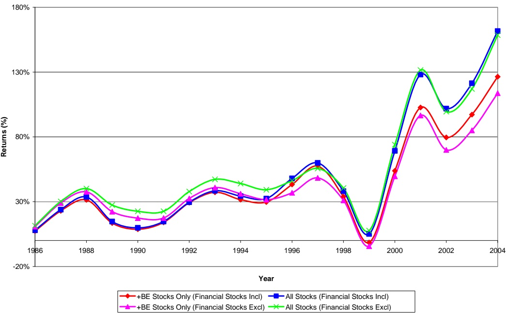

# Going Negative: What to Do with Negative Book Equity Stocks

Stephen Brown, Paul Lajbcygier, Bob Li

First draft 15 October 2007

This draft 19 December 2007

## ABSTRACT

A firm’s book equity is a measure of the value held by a firm’s ordinary shareholders. Increasingly, it is being reported as a negative number. Since the firm’s limited liability structure means that shareholders’ value cannot be negative value, negative book equity has no obvious interpretation. Consequently, both practitioners and academics typically omit such stocks. While these stocks are small in number they are disproportionately represented in extreme value/growth sectors, and therefore can have an impact on applications where “value” is defined in terms of book equity. We propose a new approach that classifies negative book equity stocks across the value/growth spectrum by considering how close their returns correspond to stocks that fit more obviously into these classifications. We find that this new value factor, which includes negative book equity stock, is economically and statistically different from the old value factor that excludes such stocks. Although we illustrate how this approach can be used to classify negative book equity stock, the approach is quite general and may be used whenever particular accounting data are unavailable or otherwise suspect.

<small>Stephen Brown is the David S. Loeb Professor of Finance at New York University Stern School of Business, Paul Lajbcygier is Associate Professor in the Business and Economics Faculty of Monash University and Bob Li is a doctoral candidate at Monash University. The authors would like to thank Alan Ramsay and Phil Ghagori for feedback on earlier drafts of the work. Part of this work was funded by a Melbourne Centre for Financial Studies Grant.</small>

# Going Negative: What to Do with Negative Book

**Equity Stocks**

## ABSTRACT

A firm’s book equity is a measure of the value held by a firm’s ordinary shareholders. Increasingly, it is being reported as a negative number. Since the firm’s limited liability structure means that shareholders’ value cannot be negative value, negative book equity has no obvious interpretation. Consequently, both practitioners and academics typically omit such stocks. While these stocks are small in number they are disproportionately represented in extreme value/growth sectors, and therefore can have an impact on applications where “value” is defined in terms of book equity. We propose a new approach that classifies negative book equity stocks across the value/growth spectrum by considering how close their returns correspond to stocks that fit more obviously into these classifications. We find that this new value factor, which includes negative book equity stock, is economically and statistically different from the old value factor that excludes such stocks. Although we illustrate how this approach can be used to classify negative book equity stock, the approach is quite general and may be used whenever particular accounting data are unavailable or otherwise suspect.

## 1 Introduction

A firm’s book equity (BE) represents the difference between the firm’s assets and liabilities. It is a measure of the equity held by a firm’s ordinary shareholders. Penman (1992) and Ohlson (1995) argue that BE is a fundamental index of firm value. Fama and French (1992) use the cross sectional dispersion of the ratio of BE to market value of equity (ME) to construct a value index for asset pricing.

<small>1 Normally preferred stock is also included in book equity; however, in this context it is excluded (see discussion Section 2.2).</small>

Occasionally, BE is negative. A firm’s limited liability structure means that shareholders cannot have negative value, so negative BE is difficult to interpret. Consequently, academics and practitioners exclude negative BE stocks from analysis, arguing that they are high default risk. But here is a paradox: if we exclude negative BE stocks then continuity arguments suggest that we should also consider excluding high-growth stocks, which constitute the smallest category of BE relative to ME.

Another argument for excluding negative BE stocks is that such stocks are few, and their omission should have an insignificant effect in any data application. However, since the late 1980s a greater incidence of firm losses has meant that the number of stocks with negative BE has increased dramatically, to the point where approximately 5% of all listed stocks have negative BE today. Furthermore, we argue that these stocks have a significant effect on value-based asset pricing models (for example, Fama and French (1992)), since we would expect that they constitute a much greater percentage of stocks that fall in the extremes of the growth/value continuum.

So, if we are to include negative BE stocks in current asset pricing models, the challenge is to appropriately classify them into value groups. Since these stocks have no intuitive interpretation in terms of “value,” to which value category should such stocks belong? According to the conventional method of sorting stocks into portfolios based on their BE/ME values, negative BE stocks, when not omitted altogether, are inevitably grouped into the same lowest BE/ME portfolio. If they fall into the lowest BE/ME ratio, can it be assumed that they have the highest growth potential? Or are they financially distressed firms that fall into some other classification? While many negative BE stocks are indeed financially distressed, reasons for reporting negative BE vary. For this reason it is not clear that they should fall into any particular BE/ME classification.

<small>2 Indeed, following on Fama and French (1992) most empirical research in accounting and finance (e.g., Vassalou and Xing (2004) and/or Griffin and Lemmon (2002)) exclude negative BE stocks for this reason.</small>

<small>3 Chan et al. (1991) represents one of the few studies that does not simply omit negative BE stocks. However, they classify them within the lowest value category.</small>

Our contribution is to apply a simple approach to classifying negative BE stocks across the value/growth spectrum by considering how close their returns correspond to stocks that fit more obviously into this classification scheme. We neither discard these stocks nor do we arbitrarily assign them to the same lowest BE/ME portfolio. We draw upon a well-known procedure used to allocate mutual funds and hedge funds into style categories (Brown and Goetzmann ,1997; Brown Goetzmann , 2003) and more recently used to group individual securities into basis asset portfolios used in asset pricing studies (Brown, Goetzmann and Grinblatt, 1998; Ahn, Conrad and Dittmar, 2007). To present, it has not been applied to the problem of allocating individual stocks to value or growth classifications. Although we illustrate how this approach can be used to classify negative book equity stock, it is general and may be used for any accounting data which is unavailable or difficult to interpret.

Once we correctly classify negative BE stocks, we find that most do not fall into the highest growth classification. They are more similar to value stocks. Including these stocks in the value group leads to an enhanced value premium. However, there is an important caveat. Many of these stocks that enter the high value category are indeed financially distressed, which is consistent with Fama and French (1992), who identify value as a distress risk factor. As a practical matter, this confirms the wisdom of incorporating a default risk screen on any investment strategy designed to exploit the observed value premium.

The paper is organized as follows. In Section 2 we provide details about our data set, factor construction, and the procedure we propose to classify negative BE stocks. Section 3 discusses the results of our empirical analysis and Section 4 concludes.

## 2 Data and Methods

## 2.1 Data

To facilitate comparison with the value premium documented in Fama and French (1993), we use a similar data set. Monthly returns and relevant accounting information for stocks trading on the New York Stock Exchange (NYSE), American Stock Exchange (AMEX) and NASDAQ are taken from the merged CRSP/COMPUSTAT database provided through the Center for Research in Security Prices (CRSP).

To be included in the study, a stock must satisfy the following conditions, consistent with Fama and French (1993):

• It must have CRSP monthly prices for December of year t-1 and June of year t;

It must have COMPUSTAT book common equity for year t-1;

• In order to calculate its size, it must have shares outstanding;

In order to avoid the survivorship bias inherent in the COMPUSTAT database, it must have appeared on COMPUSTAT for at least two years;

Finally, the share type must be an ordinary common equity (Share Type of 10 or 11 in CRSP data file), which means that American Depository Receipts (ADRs), Real Estate Investment Trust (REITs) and units of beneficial interest are excluded.

<small>4 While Fama and French (1992) exclude financial firms, we also consider the implications of including such stocks on the results we report.</small>

Unlike Fama and French (1992) who use data from as early as 1963, our study begins in 1986. There are numerous reasons for choosing 1986 as the starting year. As Fama and French (1993) point out, negative BE stocks are rare before 1980. The number of negative BE firms has increased since 1980 because the incidence of firm losses has increased (Givoly and Hayn 2000). This, in turn, may be caused by the growing accounting conservatism reported by Roychowdhury and Watts (2007). As depicted in Figure 1, the number of negative BE stocks doesn’t exceed 100 until 1985, and dramatically increases from 1986 onward. Therefore, the years prior to 1986 are relatively unimportant in the context of this study.

Figure 1. Number of negative BE Stocks.

Note: The shaded areas denote recession periods, as defined by The National Bureau of Economic Research (NBER).

<small>5 Fama and French (1992) used 1990 as the last year in their study. We, on the other hand, choose 2004 as our last year because these are the latest data available to us.</small>

<small>6 There have been two recessions since 1990. The early 1990s recession is from July 1990 to March 1991. The most recent one is from March 2001 to November 2001. Since negative BE stock are distressed, we expect their numbers to increase during recessions. This is not always the case (see Figure 1).</small>

## 2.2 Classification of negative BE stocks and construction of size and value indices

BE, as defined by Fama and French (1993), is the COMPUSTAT book value of stockholders’ equity, plus balance-sheet deferred taxes and investment tax credit (if available), minus the book value of preferred stock. The book value of preferred stock is estimated based on the redemption, liquidation, or par value (in this order), subject to availability.

Consider how the separate components of this definition can cause a firm to have negative BE. Shareholder’s equity represents the capital received from investors in exchange for stock and retained earnings as recorded on the balance sheet. Firms in financial distress will typically accumulate negative retained earnings, and this negative retention may be large enough to imply a negative value for BE. However, it is possible that a firm in an otherwise sound financial condition might record a negative value for BE. For example, negative BE can occur through the accounting treatment of goodwill when companies with significant growth potential are taken over by larger companies. Also, it can occur when start-ups with patents but no products “eat” into their equity. If they can easily raise capital, they are not truly “distressed.” There are inconsistencies between balance sheet accounting and the way the government measure what should be taxed. Typically, accountants are more conservative and allow provisions for any additional tax that might be paid. Essentially, balance sheet deferred taxes and investment tax credit adjusts the

<small>7 Goodwill is an accounting term used to reflect the portion of the market value of a business entity not directly attributable to its assets and liabilities. When AOL took over Time Warner, it recorded goodwill equal to the differences between the price paid and the value of net assets acquired, which was \$126.9 billion. In 2002, AOL adopted accounting standard SFAS No. 142, which stated that companies self-examine their book value goodwill relative to its fair value and if overstated, recognize the difference as a lump sum “goodwill impairment loss.” This occurred in January 2002, when \$54.24 billion of goodwill was written off by AOL.</small>

conservative accounting so that it is consistent with the taxes that must be paid. It is possible for these adjustments to create negative BE for a firm. The effect of preferred stock on BE must be removed too. If the redemption value of this preferred stock is larger than the book value, it can cause an otherwise profitable firm to have negative BE.

A brief analysis of the negative BE stocks in our sample reveals that 77% are from the NASDAQ and 11% are from NYSE and 12% are from AMEX. Furthermore, the top 3 industries of these stocks are: Computer Programming (10%), Pharmaceutical (5%) and Oil and Gas extraction (5%). This industry breakdown makes sense in light of our discussion of the causes of negative BE, since often stocks in these industries comprise ‘start-ups’ which ‘eat’ into their capital.

Rather than simply discard negative BE firms, we classify these firms into Fama and French value categories based on how similar their return history is to that of positive BE firms that belong more obviously to the value categories (described in Section 2.2). The classification approach, referred to as generalized style classification (GSC), was proposed by Brown and Goetzmann (1992) as a way to classify mutual funds into style categories based on similarities in returns on a month-by-month basis. Brown, Goetzmann and Grinblatt (1998) and Ahn, Conrad and Dittmar (2007) propose using variants of this approach to classify individual securities into industryor factor-related groupings. It is an intuitive approach to allocating negative BE stocks into the conventional Fama and French (1993) BE/ME and size groupings. Stocks with positive book value are first allocated to six classes stratified according to size and value using the procedure described in Fama and French (1993). Each

<small>8 The technique is a natural fit with the theoretical returns generating process for stocks and is consistent with a variety of asset pricing paradigms (see the Appendix of Brown and Goetzmann (1997)).</small>

negative BE stock is then allocated into one of these groups, based on how similar its historical returns are to those stocks already allocated to the group.

We then construct Fama and French Small minus Big (SMB) and High minus Low (HML) factors using NYSE stock returns exactly as described in Fama and French (1993), with the exception that instead of discarding negative BE stocks, we include them in the analysis using the GSC approach described above. Using only NYSE listed stocks, we calculate size rankings based on market capitalization in June of each year t. The median NYSE size is then used to split NYSE, NASDAQ and AMEX stocks into two groups: small (S) and big (B). These size rankings are used to construct size portfolios from July of year t to June of year t+1. Similarly, NYSE, NASDAQ and AMEX stocks are broken into three BE/ME groups based on the NYSE breakpoints for the bottom 30% (L), middle 40% (M) and top 30% (H) of the ranked values of BE/ME. The value factor (HML) is formed from the six portfolios presented above and is the equal weighted average of the returns on the two portfolios of high BE/MEs minus those of the low BE/MEs:

$$
\mathrm{HML} = [ (\mathrm{SH}) + (\mathrm{BH})) - ((\mathrm{SL}) + (\mathrm{BL}) ] / 2\tag{1}
$$

## 3 Results

When we use the returns-based GSC procedure to allocate negative BE stocks to value classifications, we find that Fama and French’s value premium is enhanced.

Panel A of Table 1 shows the number of stocks and their size by year. Over time, the number of positive BE and negative BE stocks fluctuate. However, the median market capitalization (i.e., size) increases for both. The positive BE stocks greatly outnumber the negative BE stocks and the median size is consistently three to four times larger. Panel B shows that the negative BE stocks account from 3.5% to 5.7% (when equal value weighted) of all stocks. In the case of non-financial stocks, the percentage of negative BE stocks increases to between 3.6% and 6.2%.

<small>9 The Generalized Style Classification (GSC) approach of Brown and Goetzmann, 1997 is a quasi-kmeans clustering algorithm. The main difference between GSC and the traditional k-means is that the GSC algorithm adjusts for heteroskedasticity by taking into consideration both time-series and cross-sectional variances, reducing the effect of outliers in the classification.</small>

Fama and French use market value weighting in the construction of their HML portfolio since it is difficult and costly to replicate an equally weighted portfolio due to the many allotments of small parcels of stocks that need to be purchased. In terms of value weighting, the negative BE stocks represent anywhere from 0.38% to 1.57% (as exhibited in the second column of Panel B). If we exclude financial firms, these figures also increase from 0.38% to 1.79%. This increase is expected since most negative BE stocks are small firms. Indeed, their median sizes are approximately onethird of those of positive BE stocks.

Table 1. Sample Characteristics

<table><tr><td colspan="12">Panel A. Sample Number and Size, by Year</td></tr><tr><td rowspan="2"></td><td colspan="6">Financial Stocks Included</td><td colspan="5">Financial Stocks Excluded</td></tr><tr><td colspan="3">Positive BE Stocks</td><td colspan="3">Negative BE Stocks</td><td colspan="3">Positive BE Stocks</td><td colspan="2">Negative BE Stocks</td></tr><tr><td rowspan="2">Year</td><td rowspan="2">Stocks</td><td colspan="2">Size ($M)</td><td rowspan="2">Stocks</td><td colspan="2">Size ($M)</td><td rowspan="2">Stocks</td><td colspan="2">Size ($M)</td><td rowspan="2">Stocks</td><td>Size ($M)</td></tr><tr><td>Median</td><td>Mean</td><td>Median</td><td>Mean</td><td>Median</td><td>Mean</td><td>Median</td></tr><tr><td>1986</td><td>4189</td><td>64</td><td>566</td><td>148</td><td>16</td><td>61</td><td>3732</td><td>55</td><td>546</td><td>133</td><td>16</td></tr><tr><td>1987</td><td>4354</td><td>58</td><td>622</td><td>179</td><td>18</td><td>90</td><td>3858</td><td>51</td><td>621</td><td>162</td><td>19</td></tr><tr><td>1988</td><td>4452</td><td>45</td><td>541</td><td>201</td><td>15</td><td>91</td><td>3931</td><td>41</td><td>543</td><td>181</td><td>13</td></tr><tr><td>1989</td><td>4345</td><td>52</td><td>614</td><td>231</td><td>13</td><td>182</td><td>3782</td><td>45</td><td>612</td><td>213</td><td>13</td></tr><tr><td>1990</td><td>4242</td><td>53</td><td>685</td><td>238</td><td>12</td><td>138</td><td>3693</td><td>46</td><td>694</td><td>218</td><td>12</td></tr><tr><td>1991</td><td>4246</td><td>54</td><td>720</td><td>241</td><td>16</td><td>153</td><td>3689</td><td>49</td><td>729</td><td>219</td><td>16</td></tr><tr><td>1992</td><td>4285</td><td>76</td><td>826</td><td>243</td><td>17</td><td>120</td><td>3695</td><td>68</td><td>826</td><td>223</td><td>18</td></tr><tr><td>1993</td><td>4586</td><td>90</td><td>921</td><td>225</td><td>27</td><td>207</td><td>3967</td><td>78</td><td>900</td><td>205</td><td>29</td></tr><tr><td>1994</td><td>5460</td><td>79</td><td>785</td><td>218</td><td>28</td><td>280</td><td>4346</td><td>79</td><td>824</td><td>204</td><td>28</td></tr><tr><td>1995</td><td>5703</td><td>90</td><td>936</td><td>223</td><td>39</td><td>289</td><td>4535</td><td>94</td><td>993</td><td>205</td><td>42</td></tr><tr><td>1996</td><td>5842</td><td>118</td><td>1161</td><td>218</td><td>56</td><td>321</td><td>4700</td><td>127</td><td>1211</td><td>205</td><td>60</td></tr><tr><td>1997</td><td>6209</td><td>123</td><td>1404</td><td>228</td><td>36</td><td>305</td><td>5090</td><td>121</td><td>1403</td><td>214</td><td>38</td></tr><tr><td>1998</td><td>5992</td><td>147</td><td>1880</td><td>269</td><td>50</td><td>468</td><td>4956</td><td>140</td><td>1821</td><td>256</td><td>52</td></tr><tr><td>1999</td><td>5548</td><td>136</td><td>2403</td><td>251</td><td>68</td><td>685</td><td>4566</td><td>134</td><td>2419</td><td>239</td><td>67</td></tr><tr><td>2000</td><td>5352</td><td>147</td><td>2879</td><td>238</td><td>85</td><td>766</td><td>4333</td><td>166</td><td>3080</td><td>227</td><td>89</td></tr><tr><td>2001</td><td>5192</td><td>163</td><td>2530</td><td>216</td><td>51</td><td>613</td><td>4175</td><td>189</td><td>2544</td><td>206</td><td>51</td></tr><tr><td>2002</td><td>4778</td><td>174</td><td>2292</td><td>245</td><td>43</td><td>397</td><td>3818</td><td>182</td><td>2249</td><td>236</td><td>43</td></tr><tr><td>2003</td><td>4473</td><td>208</td><td>2440</td><td>192</td><td>65</td><td>752</td><td>3524</td><td>223</td><td>2433</td><td>188</td><td>67</td></tr><tr><td>2004</td><td>4325</td><td>325</td><td>3021</td><td>163</td><td>101</td><td>853</td><td>3404</td><td>363</td><td>3028</td><td>156</td><td>101</td></tr><tr><td colspan="12">Panel B. Percentage of Negative BE Stocks/Positive BE Stocks, by Year</td></tr><tr><td rowspan="2"></td><td colspan="6">Financial Stocks Included</td><td colspan="5">Financial Stocks Excluded</td></tr><tr><td colspan="3">Equally Weight</td><td colspan="3">Value Weight</td><td colspan="2">Equally Weight</td><td colspan="3">Value Weight</td></tr><tr><td>1986</td><td colspan="3">3.5%</td><td colspan="3">0.38%</td><td colspan="2">3.6%</td><td colspan="3">0.38%</td></tr><tr><td>1987</td><td colspan="3">4.1%</td><td colspan="3">0.59%</td><td colspan="2">4.2%</td><td colspan="3">0.63%</td></tr><tr><td>1988</td><td colspan="3">4.5%</td><td colspan="3">0.76%</td><td colspan="2">4.6%</td><td colspan="3">0.80%</td></tr><tr><td>1989</td><td colspan="3">5.3%</td><td colspan="3">1.57%</td><td colspan="2">5.6%</td><td colspan="3">1.79%</td></tr><tr><td>1990</td><td colspan="3">5.6%</td><td colspan="3">1.13%</td><td colspan="2">5.9%</td><td colspan="3">1.24%</td></tr><tr><td>1991</td><td colspan="3">5.7%</td><td colspan="3">1.21%</td><td colspan="2">5.9%</td><td colspan="3">1.32%</td></tr><tr><td>1992</td><td colspan="3">5.7%</td><td colspan="3">0.82%</td><td colspan="2">6.0%</td><td colspan="3">0.88%</td></tr><tr><td>1993</td><td colspan="3">4.9%</td><td colspan="3">1.10%</td><td colspan="2">5.2%</td><td colspan="3">1.27%</td></tr><tr><td>1994</td><td colspan="3">4.0%</td><td colspan="3">1.42%</td><td colspan="2">4.7%</td><td colspan="3">1.63%</td></tr><tr><td>1995</td><td colspan="3">3.9%</td><td colspan="3">1.21%</td><td colspan="2">4.5%</td><td colspan="3">1.34%</td></tr><tr><td>1996</td><td colspan="3">3.7%</td><td colspan="3">1.03%</td><td colspan="2">4.4%</td><td colspan="3">1.19%</td></tr><tr><td>1997</td><td colspan="3">3.7%</td><td colspan="3">0.80%</td><td colspan="2">4.2%</td><td colspan="3">0.94%</td></tr><tr><td>1998</td><td colspan="3">4.5%</td><td colspan="3">1.12%</td><td colspan="2">5.2%</td><td colspan="3">1.39%</td></tr><tr><td>1999</td><td colspan="3">4.5%</td><td colspan="3">1.29%</td><td colspan="2">5.2%</td><td colspan="3">1.53%</td></tr><tr><td>2000</td><td colspan="3">4.4%</td><td colspan="3">1.18%</td><td colspan="2">5.2%</td><td colspan="3">1.35%</td></tr><tr><td>2001</td><td colspan="3">4.2%</td><td colspan="3">1.01%</td><td colspan="2">4.9%</td><td colspan="3">1.24%</td></tr><tr><td>2002</td><td colspan="3">5.1%</td><td colspan="3">0.89%</td><td colspan="2">6.2%</td><td colspan="3">1.11%</td></tr><tr><td>2003</td><td colspan="3">4.3%</td><td colspan="3">1.32%</td><td colspan="2">5.3%</td><td colspan="3">1.67%</td></tr><tr><td>2004</td><td colspan="3">3.8%</td><td colspan="3">1.06%</td><td colspan="2">4.6%</td><td colspan="3">1.31%</td></tr></table>

Note: Size is measured as price per share multiplied by shares outstanding in June of each year. Value weight is measured as total capitalization in June of negative BE stocks divided by total capitalization in June of Positive BE stocks.

Initially, one might presume that such small value weightings would not play an important role in altering the value premium, HML. However, if we break down the HML portfolio into its six constitute portfolios (SL, SM, SH, BL, BM and BH), we find that negative BE stocks play a crucial role in changing the magnitude of the value premium. This can be seen in Table 2.

Table 2. Percentage of Capitalization (Negative BE Stocks/Positive Stocks)

<table><tr><td colspan="7">Financial Stocks Included</td><td colspan="6">Financial Stocks Excluded</td></tr><tr><td>Year</td><td>SH</td><td>SM</td><td>SL</td><td>BH</td><td>BM</td><td>BL</td><td>SH</td><td>SM</td><td>SL</td><td>BH</td><td>BM</td><td>BL</td></tr><tr><td>1986</td><td>0.6%</td><td>1.8%</td><td>1.3%</td><td>0.2%</td><td>0.2%</td><td>0.6%</td><td>0.6%</td><td>2.0%</td><td>1.4%</td><td>0.2%</td><td>0.1%</td><td>1.0%</td></tr><tr><td>1987</td><td>0.1%</td><td>0.0%</td><td>0.5%</td><td>1.2%</td><td>0.3%</td><td>0.0%</td><td>0.3%</td><td>0.0%</td><td>0.6%</td><td>1.6%</td><td>0.1%</td><td>0.0%</td></tr><tr><td>1988</td><td>1.4%</td><td>11.5%</td><td>3.1%</td><td>0.1%</td><td>0.2%</td><td>0.3%</td><td>1.7%</td><td>11.5%</td><td>2.6%</td><td>0.1%</td><td>0.2%</td><td>0.3%</td></tr><tr><td>1989</td><td>10.5%</td><td>11.6%</td><td>5.5%</td><td>0.8%</td><td>0.1%</td><td>0.2%</td><td>11.3%</td><td>14.0%</td><td>21.0%</td><td>0.6%</td><td>0.1%</td><td>0.0%</td></tr><tr><td>1990</td><td>0.4%</td><td>0.0%</td><td>0.3%</td><td>1.9%</td><td>1.5%</td><td>0.0%</td><td>0.16%</td><td>0.00%</td><td>0.30%</td><td>0.51%</td><td>2.59%</td><td>0.05%</td></tr><tr><td>1991</td><td>0.0%</td><td>0.2%</td><td>1.4%</td><td>0.1%</td><td>3.3%</td><td>0.0%</td><td>0.0%</td><td>0.2%</td><td>1.0%</td><td>3.8%</td><td>0.3%</td><td>0.0%</td></tr><tr><td>1992</td><td>0.0%</td><td>0.0%</td><td>22.6%</td><td>0.0%</td><td>0.1%</td><td>0.7%</td><td>0.0%</td><td>0.0%</td><td>24.3%</td><td>0.2%</td><td>0.0%</td><td>0.6%</td></tr><tr><td>1993</td><td>0.1%</td><td>0.0%</td><td>5.7%</td><td>2.4%</td><td>1.2%</td><td>0.1%</td><td>0.3%</td><td>0.0%</td><td>4.5%</td><td>6.9%</td><td>0.3%</td><td>0.2%</td></tr><tr><td>1994</td><td>0.0%</td><td>0.8%</td><td>37.5%</td><td>0.3%</td><td>0.0%</td><td>0.0%</td><td>0.0%</td><td>0.8%</td><td>39.9%</td><td>0.1%</td><td>0.1%</td><td>0.0%</td></tr><tr><td>1995</td><td>0.0%</td><td>0.1%</td><td>0.1%</td><td>0.3%</td><td>2.6%</td><td>0.0%</td><td>0.0%</td><td>0.1%</td><td>0.1%</td><td>1.0%</td><td>2.7%</td><td>0.0%</td></tr><tr><td>1996</td><td>1.6%</td><td>5.6%</td><td>1.1%</td><td>0.2%</td><td>0.0%</td><td>1.6%</td><td>12.7%</td><td>7.6%</td><td>1.0%</td><td>1.4%</td><td>0.1%</td><td>0.7%</td></tr><tr><td>1997</td><td>0.0%</td><td>0.0%</td><td>21.7%</td><td>0.3%</td><td>0.0%</td><td>0.1%</td><td>0.0%</td><td>0.0%</td><td>22.4%</td><td>1.0%</td><td>0.0%</td><td>0.0%</td></tr><tr><td>1998</td><td>0.7%</td><td>0.1%</td><td>1.5%</td><td>10.3%</td><td>1.1%</td><td>0.4%</td><td>0.9%</td><td>0.2%</td><td>0.8%</td><td>13.0%</td><td>2.2%</td><td>0.4%</td></tr><tr><td>1999</td><td>1.8%</td><td>2.8%</td><td>0.7%</td><td>23.2%</td><td>0.7%</td><td>0.0%</td><td>1.9%</td><td>1.9%</td><td>0.1%</td><td>18.5%</td><td>2.9%</td><td>0.1%</td></tr><tr><td>2000</td><td>1.9%</td><td>51.3%</td><td>5.1%</td><td>0.0%</td><td>0.3%</td><td>0.2%</td><td>6.3%</td><td>61.3%</td><td>4.6%</td><td>0.0%</td><td>1.1%</td><td>0.2%</td></tr><tr><td>2001</td><td>0.5%</td><td>2.0%</td><td>2.4%</td><td>2.5%</td><td>1.8%</td><td>0.5%</td><td>0.3%</td><td>2.8%</td><td>2.1%</td><td>3.3%</td><td>2.6%</td><td>0.6%</td></tr><tr><td>2002</td><td>0.9%</td><td>0.2%</td><td>1.0%</td><td>0.1%</td><td>0.4%</td><td>1.5%</td><td>0.1%</td><td>0.3%</td><td>1.1%</td><td>0.1%</td><td>0.7%</td><td>1.6%</td></tr><tr><td>2003</td><td>0.0%</td><td>0.0%</td><td>0.0%</td><td>0.1%</td><td>2.9%</td><td>0.3%</td><td>0.0%</td><td>0.0%</td><td>0.0%</td><td>0.3%</td><td>4.4%</td><td>0.1%</td></tr><tr><td>2004</td><td>0.0%</td><td>1.2%</td><td>11.1%</td><td>0.0%</td><td>0.0%</td><td>1.6%</td><td>0.1%</td><td>1.7%</td><td>12.2%</td><td>0.0%</td><td>0.0%</td><td>1.6%</td></tr></table>

Note: Size is measured as price per share multiplied by shares outstanding in June of each year.

Table 2 shows that adding the negative BE stocks into the six pre-determined portfolios changes their composition (i.e., market capitalization), though the magnitudes of such changes vary. First, if we consider the effect on the size portfolios, we can see that the three small portfolios (SH, SM and SL) are the ones most affected. For example, the market capitalization of the SL portfolio changed by more than 10% in 1992, 1994, 1997 and 2004. Second, the value risk factor is also changed by at least 10% (see Table 2) for half the years in the sample (1988, 1989, 1992, 1994, 1997-2000 and 2004). In other words, including negative BE stocks changes the composition of the HML portfolios and significantly influences overall return, even though negative BE stocks represent only 1.57% (at most) of the value of all stocks.10

If non-financial stocks are considered, similar patterns are observed. As shown in Table 1, the exclusion of financial stocks results in a 17% decrease in the number of stocks. However, this only causes a 7% drop in the number of negative BE stocks.

<small>10 We shall see in Section 4 that only the highest probability of default risk negative BE stocks are crucial in determining the enhanced returns of the HML portfolio.</small>

The disproportionate decrease in the number of negative BE stocks results in the negative BE stocks having a larger impact on the value premium.

The impact of including negative BE stocks on the returns of the HML factor is shown in Table 3. In the case of value weighted portfolios that include financial stock, the average difference between the value premium that includes positive stocks only $\mathrm { ( H M L _ { o l d } ) }$ and that which includes negative BE stocks $\mathrm { ( H M L _ { n e w } ) }$ is 0.9%. This difference is larger – 1.1% – in the non-financial case.11

Table 3. Annualized Returns for HML

Value-weighted Annualized Returns of HML, by Year

<table><tr><td rowspan="2">Year</td><td colspan="2">Financial Stocks Included</td><td colspan="2">Financial Stocks Excluded</td></tr><tr><td>Positive BE Stocks Only</td><td>All Stocks</td><td>Positive BE Stocks Only</td><td>All Stocks</td></tr><tr><td>1986</td><td>7.3%</td><td>7.9%</td><td>10.8%</td><td>11.5%</td></tr><tr><td>1987</td><td>14.5%</td><td>14.7%</td><td>16.4%</td><td>16.7%</td></tr><tr><td>1988</td><td>6.9%</td><td>7.9%</td><td>6.7%</td><td>7.7%</td></tr><tr><td>1989</td><td>-13.6%</td><td>-14.2%</td><td>-11.1%</td><td>-9.1%</td></tr><tr><td>1990</td><td>-4.2%</td><td>-4.3%</td><td>-4.1%</td><td>-3.8%</td></tr><tr><td>1991</td><td>4.9%</td><td>4.4%</td><td>0.0%</td><td>0.0%</td></tr><tr><td>1992</td><td>13.3%</td><td>13.0%</td><td>12.9%</td><td>12.4%</td></tr><tr><td>1993</td><td>6.3%</td><td>6.8%</td><td>6.3%</td><td>6.8%</td></tr><tr><td>1994</td><td>-4.1%</td><td>-2.9%</td><td>-3.3%</td><td>-2.2%</td></tr><tr><td>1995</td><td>-1.4%</td><td>-1.5%</td><td>-3.3%</td><td>-3.3%</td></tr><tr><td>1996</td><td>10.4%</td><td>11.8%</td><td>4.0%</td><td>5.1%</td></tr><tr><td>1997</td><td>9.9%</td><td>8.1%</td><td>8.4%</td><td>6.4%</td></tr><tr><td>1998</td><td>-15.0%</td><td>-13.6%</td><td>-11.7%</td><td>-9.7%</td></tr><tr><td>1999</td><td>-26.4%</td><td>-23.9%</td><td>-27.0%</td><td>-23.4%</td></tr><tr><td>2000</td><td>56.2%</td><td>61.1%</td><td>56.4%</td><td>61.6%</td></tr><tr><td>2001</td><td>31.7%</td><td>34.8%</td><td>31.4%</td><td>33.1%</td></tr><tr><td>2002</td><td>-11.4%</td><td>-11.5%</td><td>-13.5%</td><td>-13.8%</td></tr><tr><td>2003</td><td>9.8%</td><td>9.7%</td><td>8.9%</td><td>8.8%</td></tr><tr><td>2004</td><td>14.8%</td><td>18.2%</td><td>15.5%</td><td>19.1%</td></tr></table>

Note: A stock’s size is calculated by multiplying its price by its shares outstanding. NYSE stocks are ranked according to their sizes. The median is then used to split all NYSE, AMEX and NASDAQ stocks into two groups: small (S) and big (B). Similarly, NYSE, NASDAQ and AMEX stocks are sorted into three BE/ME groups based on the breakpoints for the bottom 30% (L), middle 40% (M) and top 30% (H). BE, book common equity (for the fiscal year ending in calendar year t-1), is defined as the COMPUSTAT book value of stockholders’ equity plus balance-sheet deferred taxes and investment tax credit (if available), minus the book value of preferred stock. The book value of preferred stock is estimated based on the redemption, liquidation, or par value (in this order), subject to availability. For the fiscal year ending in calendar year t-1, market equity (ME) is obtained by multiplying a stock price in December of year t-1 by its shares outstanding. From July of year t to June of year t+1, six valueweighted portfolios (SL, SM, SH, BL, BM and BH) are created as the intersection of size and BE/ME groups. HML is the difference between the average return of the two highest portfolios and the two lowest portfolios. The figures in the above table are annualized based on monthly returns.

From Table 3 we can see that by adding negative BE stocks into the portfolios that constitute the HML factor, the value premium is increased or “enhanced.” This is to be expected, since, if negative BE stocks are predominantly (but not exclusively) distressed stocks, they need higher returns to compensate for the risk of bearing them.

<small>11 Barber and Lyon (1997) confirm that the inclusion of financial stocks has minimal impact on value factor returns.</small>

The accumulated returns for $\mathrm { H M L } _ { \mathrm { n e w } }$ and $\mathrm { H M L } _ { \mathrm { o l d } }$ for portfolios over the 18- year study period are illustrated in Figure 2 The differences in HML returns for the portfolios that include and exclude financial stocks are 17% and 20%, respectively. The t-values estimated on annual returns are 2.4 and 2.8, respectively, indicating that the returns between the new and old HML are significant at 95% confidence intervals.

Figure 2. Accumulative HML with and without inclusion of negative BE Stocks

In related work12 we attempt to understand these results. We consider the relationship between stock default risks,13 returns and their BE/ME ratios. Consistent with a risk/return interpretation of the value factor, we find that the negative BE

<small>12 Li et al. (2007)</small>

<small>13 As a proxy for a stocks’ default risk, we adopt an option-based default risk model that predicts the probability of bankruptcy.</small>

stocks with the highest probability of default have higher average returns than all positive BE stocks. We find that not only do these stocks have a higher return than other stocks, but they also group into value/growth portfolios in such a way as to enhance HML returns. This enhancement represents an increased default premium consistent with Fama and French’s (1992) interpretation of value as a distress factor. As a practical matter, this confirms the practical wisdom of incorporating a default risk screen on any investment strategy designed to exploit the observed value premium.

## 4 Conclusion

This research creates an innovative platform to analyze the impact of the negative BE stocks on the value premium, HML, by appropriately classifying these stocks into value groups. Both practitioners and academics usually discard negative BE stocks from any subsequent analysis. This omission is significant. By using past returns to classify these stocks into appropriate value strata, we show that once included, negative BE stocks significantly enhance the HML premium. We believe the reason for this is that many negative BE stocks are, in fact, in financial distress. If we interpret the HML premium as some kind of default premium, then to the extent that negative BE stocks have higher default risk than other stocks, we should expect that the HML premium would increase when these stocks are included. Indeed our results show that including these stocks leads to an increase in the value premium that is both statistically and economically significant. Although we illustrate how this approach can be used to classify negative book equity stock, the approach is quite general and may be used whenever particular accounting data are unavailable or otherwise suspect.

## 5 References

Ahn, D., J. Conrad and R. Dittmar (2007). “Basis Assets,” Review of Financial Studies (forthcoming).

Brown, S. and W. Goetzmann (1997). “Mutual fund style.” Journal of Financial Economics, 9, 205-258.

Brown, S. and W. Goetzmann (2003). “Hedge funds with style.” Journal of Portfolio Management, 29, 101-112.

Brown, S., W. Goetzmann and M. Grinblatt (1998). “Positive portfolio factors” (January 9, 1997). Yale School of Management Working Paper No. F-57. Available at http://ssrn.com/abstract=79373.

Chan, L. K., Y. Hamao and J. Lakinishok (1991). “Fundamentals and stock returns in Japan.” Journal of Finance, 46(5), 1739-1764.

Cheng, K. (2003). “The impact of goodwill on earnings.” The Journal of Corporate Accounting and Finance, January/February, 63-67.

Daniel, K. S. Titman and K. C. John Wei (2001). “Explaining the cross section of stock returns in Japan: Factors or characteristics?” Journal of Finance, 56(2), 743-766.

DeBondt, W. and R. H. Thaler (1987). “Further evidence on investor overreaction and stock market seasonality.” Journal of Finance, 42(3), 557-581.

Drew, M. E., T. Naughton, M. Veeraraghavan (2003). “Firm size, book-to-market equity and security returns: Evidence from the Shanghai Stock Exchange.” Australian Journal of Management, 28(2), 118-141.

Fama, E. F. and K. R. French (1992). “The cross section of expected stock returns.” Journal of Finance, 47, 427-465.

Fama, E. F. and K. R. French (1993). “Common risk factors in the returns on stocks and bonds.” Journal of Financial Economics, 33, 3-56.

Fama, E. F. and K. R. French (1995). “Size and book-to-market factors in earnings and returns.” Journal of Finance, 50(1), 131-155.

Li, B., Lajbcygier, P., Guo, S. and Chen, X. (2007) , "Default Risk, Return and Negative Book Equity Stock" Paper Available at SSRN: http://ssrn.com/abstract=1009426

Merton, R. C. (1974). “On the pricing of corporate debt: The risk structure of interest rates.” Journal of Finance, 29(2), 449-470.

Ohlson, J. A. (1995). “Earnings, book values and dividends in security valuation.” Contemporary Accounting Research, 11, 661-687.

Penman, S. (1992). “Return to fundamentals.” Journal of Accounting, Auditing and Finance 7, 465-483.

Roychowdhury, S. and Watts, R. (2007). “Asymmetric timeliness of earnings, marketto-book and conservatism in financial reporting.” Journal of Accounting and Economics, 44, 2-31.

Vassalou, M. and Y. Xing (2004). “Default risk in equity returns.” The Journal of Finance, 59(2), 831-868.