# Shrinkage Algorithms for MMSE Covariance Estimation

Yilun Chen, Ami Wiesel, Yonina C. Eldar and Alfred O. Hero III

## Abstract

We address covariance estimation in the sense of minimum mean-squared error (MMSE) for Gaussian samples. Specifically, we consider shrinkage methods which are suitable for high dimensional problems with a small number of samples (largep smalln). First, we improve on the Ledoit-Wolf (LW) method by conditioning on a sufficient statistic. By the Rao-Blackwell theorem, this yields a new estimator called RBLW, whose mean-squared error dominates that of LW for Gaussian variables. Second, to further reduce the estimation error, we propose an iterative approach which approximates the clairvoyant shrinkage estimator. Convergence of this iterative method is established and a closed form expression for the limit is determined, which is referred to as the oracle approximating shrinkage (OAS) estimator. Both RBLW and OAS estimators have simple expressions and are easily implemented. Although the two methods are developed from different persepctives, their structure is identical up to specified constants. The RBLW estimator provably dominates the LW method. Numerical simulations demonstrate that the OAS approach can perform even better than RBLW, especially whenn is much less thanp. We also demonstrate the performance of these techniques in the context of adaptive beamforming.

## Index Terms

Covariance estimation, shrinkage, minimum mean-squared error (MMSE), beamforming

<small>Y. C. Eldar is with the Technion - Israel Institute of Technology, Haifa, Israel 32000. Email: yonina@ee.technion.ac.il.</small>

<small>This research was partially supported by the AFOSR grant FA9550-06-1-0324 and NSF grant CCF 0830490. The work of A. Wiesel was supported by a Marie Curie Outgoing International Fellowship within the 7th European Community Framework Programme.</small>

## I. INTRODUCTION

Covariance matrix estimation is a fundamental problem in signal processing and related fields. Many applications varying from array processing [12] to functional genomics [17] rely on accurately estimated covariance matrices. In recent years, estimation of high dimensional $p   \times   p$ covariance matrices under small sample size n has attracted considerable interest. Examples include classification on gene expression from microarray data, financial forecasting, spectroscopic imaging, brain activation mapping from fMRI and many others. Standard estimation methods perform poorly in these large p small n settings. This is the main motivation for this work.

The sample covariance is a common estimate for the unknown covariance matrix. When it is invertible, the sample covariance coincides with the classical maximum likelihood estimate. However, while it is an unbiased estimator, it does not minimize the mean-squared error (MSE). Indeed, Stein demonstrated that superior performance may be obtained by shrinking the sample covariance [2], [3]. Since then, many shrinkage estimators have been proposed under different performance measures. For example, Haff [4] introduced an estimator inspired by the empirical Bayes approach. Dey and Srinivasan [5] derived a minimax estimator under Stein’s entropy loss function. Yang and Berger [6] obtained expressions for Bayesian estimators under a class of priors for the covariance. These works addressed the case of invertible sample covariance when $n \geq p$ . Recently, Ledoit and Wolf (LW) proposed a shrinkage estimator for the case $n < p$ which asymptotically minimizes the MSE [8]. The LW estimator is well conditioned for small sample sizes and can thus be applied to high dimensional problems. In contrast to previous approaches, they show that performance advantages are distribution-free and not restricted to Gaussian assumptions.

In this paper, we show that the LW estimator can be significantly improved when the samples are in fact Gaussian. Specifically, we develop two new estimation techniques that result from different considerations. The first follows from the Rao-Blackwell theorem, while the second is an application of the ideas of [11] to covariance estimation.

We begin by providing a closed form expression for the optimal clairvoyant shrinkage estimator under an MSE loss criteria. This estimator is an explicit function of the unknown covariance matrix that can be used as an oracle performance bound. Our first estimator is obtained by applying the well-known Rao-Blackwell theorem [31] to the LW method, and is therefore denoted by RBLW. Using several nontrivial Haar integral computations, we obtain a simple closed form solution which provably dominates the LW method in terms of MSE. We then introduce an iterative shrinkage estimator which tries to approximate the oracle. This approach follows the methodology developed in [11] for the case of linear regression. Beginning with an initial naive choice, each iteration is defined as the oracle solution when the unknown covariance is replaced by its estimate obtained in the previous iteration. Remarkably, a closed form expression can be determined for the limit of these iterations. We refer to the limit as the oracle approximating shrinkage (OAS) estimator.

The OAS and RBLW solutions have similar structure that is related to a sphericity test as discussed in [18]–[20]. Both OAS and RBLW estimators are intuitive, easy to compute and perform well with finite sample size. The RBLW technique provably dominates LW. Numerical results demonstrate that for small sample sizes, the OAS estimator is superior to both the RBLW and the LW methods.

To illustrate the proposed covariance estimators we apply them to problems of time series analysis and array signal processing. Specifically, in the context of time series analysis we establish performance advantages of OAS and RBLW to LW for covariance estimation in autoregressive models and in fractiona Brownian motion models, respectively. In the context of beamforming, we show that RBLW and OAS can be used to significantly improve the Capon beamformer. In [12] a multitude of covariance matrix estimators were implemented in Capon beamformers, and the authors reported that the LW approach substantially improves performance as compared to other methods. We show here that even better performance can be achieved by using the techniques introduced in this paper.

The paper is organized as follows. Section 2 formulates the problem. Section 3 introduces the oracle estimator together with the RBLW and OAS methods. Section 4 represents numerical simulation results and applications in adaptive beamforming. Section 5 summarizes our principal conclusions. The proofs of theorems and lemmas are provided in the Appendix.

Notation: In the following, we depict vectors in lowercase boldface letters and matrices in uppercase boldface letters. $( \cdot ) ^ { T }$ and $( \cdot ) ^ { H }$ denote the transpose and the conjugate transpose, respectively. $\operatorname { T r } \left( \cdot \right)$ $\left\| \cdot \right\| _ { F }$ , and det **(·)** are the trace, the Frobenius norm, and the determinant of a matrix, respectively. Finally, $\mathbf { A } \prec \mathbf { B }$ means that the matrix **B − A** is positive definite, and **A ≻ B** means that the matrix **A − B** is positive definite.

## II. PROBLEM FORMULATION

Let $\{ \mathbf { x } _ { i } \} _ { i = 1 } ^ { n }$ be a sample of independent identical distributed (i.i.d.) p-dimensional Gaussian vectors with zero mean and covariance Σ. We do not assume n $\iota \geq p .$ Our goal is to find an estimator $\widehat { \mathbf { \Sigma } } \left( \{ \mathbf { x } _ { i } \} _ { i = 1 } ^ { n } \right)$ which minimizes the MSE:

$$
E \left\{\left\| \widehat {\boldsymbol {\Sigma}} \left(\left\{\mathbf {x} _ {i} \right\} _ {i = 1} ^ {n}\right) - \boldsymbol {\Sigma} \right\| _ {F} ^ {2} \right\}.\tag{1}
$$

It is difficult to compute the MSE of $\widehat { \mathbf { \Sigma } } \left( \{ \mathbf { x } _ { i } \} _ { i = 1 } ^ { n } \right)$ without additional constraints and therefore we restrict ourselves to a specific class of estimators that employ shrinkage [1], [7]. The unstructured classical estimator of Σ is the sample covariance $\widehat { \mathbf { S } }$ defined as

$$
\left| \widehat {\mathbf {S}} = \frac {1}{n} \sum_ {i = 1} ^ {n} \mathbf {x} _ {i} \mathbf {x} _ {i} ^ {T}. \right|\tag{2}
$$

This estimator is unbiased $E \{ \widehat { \mathbf { S } } \} = \mathbf { \Sigma }$ , and is also the maximum likelihood solution if $n \geq p .$ However, it does not necessarily achieve low MSE due to its high variance and is usually ill-posed for large $p$ problems. On the other hand, we may consider a naive but most well-conditioned estimate for $\mathbf { \Sigma } )$

$$
\widehat {\mathbf {F}} = \frac {\operatorname{Tr} (\widehat {\mathbf {S}})}{p} \mathbf {I}.\tag{3}
$$

This “structured” estimate will result in reduced variance with the expense of increasing the bias. A reasonable tradeoff between low bias and low variance is achieved by shrinkage of $\widehat { \mathbf { S } }$ towards $\widehat { \mathbf { F } } ,$ , resulting in the following class of estimators:

$$
\widehat {\mathbf {\Sigma}} = (1 - \widehat {\rho}) \widehat {\mathbf {S}} + \widehat {\rho} \widehat {\mathbf {F}}.\tag{4}
$$

The estimator $\hat { \mathbf { \Sigma } }$ is characterized by the shrinkage coefficient $\hat { \rho } ,$ which is a parameter between 0 and 1 and can be a function of the observations $\{ \mathbf { x } _ { i } \} _ { i = 1 } ^ { n }$ . The matrix $\widehat { \mathbf { F } }$ is referred to as the shrinkage target.1

Throughout the paper, we restrict our attention to shrinkage estimates of the form (4). Our goal is to find a shrinkage coefficient $\hat { \rho }$ that minimizes the MSE (1). As we show in the next section, the optimal $\hat { \rho }$ minimizing the MSE depends in general on the unknown Σ and therefore in general cannot be implemented. Instead, we propose two different approaches to approximate the optimal shrinkage coefficient.

## III. SHRINKAGE ALGORITHMS

## A. The Oracle estimator

We begin by deriving a clairvoyant oracle estimator that uses an optimal nonrandom coefficient to minimize the mean-squared error. In the following subsections we will show how to approximate the oracle using implementable data-driven methods.

<small>( )</small>

<small>1The convex combination in 4 can be generalized to the linear combination of $\widehat { \mathbf { S } }$ and $\widehat { \mathbf { F } } .$ The reader is referred to [13] for further discussion.</small>

The oracle estimate $\hat { \Sigma } _ { O }$ is the solution to

$$
\begin{array}{l l} \hline \min _ {\rho} & E \left\{\left\| \widehat {\boldsymbol {\Sigma}} _ {O} - \boldsymbol {\Sigma} \right\| _ {F} ^ {2} \right\} \\ \text {s.t.} & \widehat {\boldsymbol {\Sigma}} _ {O} = (1 - \rho) \widehat {\mathbf {S}} + \rho \widehat {\mathbf {F}} \end{array} .\tag{5}
$$

The optimal parameter $\rho _ { O }$ is provided in the following theorem.

**Theorem 1.** Let $\widehat { \mathbf { S } }$ be the sample covariance of a set of p-dimensional vectors $\left\{ \mathbf { x } _ { i } \right\} _ { i = 1 } ^ { n } \mathbf { . } I f \left\{ \mathbf { x } _ { i } \right\} _ { i = 1 } ^ { n }$ are i.i.d. Gaussian vectors with covariance Σ, then the solution to $( 5 )$ is

$$
\begin{array}{r l} & {\rho_ {O} = \frac {E \left\{\mathrm{Tr} \left(\left(\boldsymbol {\Sigma} - \widehat {\mathbf {S}}\right) \left(\widehat {\mathbf {F}} - \widehat {\mathbf {S}}\right)\right) \right\}}{E \left\{\left\| \widehat {\mathbf {S}} - \widehat {\mathbf {F}} \right\| _ {F} ^ {2} \right\}}} \\ & {\quad = \frac {(1 - 2 / p) \mathrm{Tr} \left(\boldsymbol {\Sigma} ^ {2}\right) + \mathrm{Tr} ^ {2} (\boldsymbol {\Sigma})}{(n + 1 - 2 / p) \mathrm{Tr} (\boldsymbol {\Sigma} ^ {2}) + (1 - n / p) \mathrm{Tr} ^ {2} (\boldsymbol {\Sigma})}.} \end{array}\tag{6}
$$

(7)

Proof: Equation (6) was established in [7] for any distribution of $\{ \mathbf { x } _ { i } \} _ { i = 1 } ^ { n }$ . Under the additional Gaussian assumption, (7) can be obtained from straightforward evaluation of the expectations:

$$
\begin{array}{r l} & E \left\{\mathrm{Tr} \left(\left(\boldsymbol {\Sigma} - \widehat {\mathbf {S}}\right) \left(\widehat {\mathbf {F}} - \widehat {\mathbf {S}}\right)\right) \right\} = \frac {\mathrm{Tr} (\boldsymbol {\Sigma})}{p} E \left\{\mathrm{Tr} \left(\widehat {\mathbf {S}}\right) \right\} \\ & \qquad - \frac {E \left\{\mathrm{Tr} ^ {2} \left(\widehat {\mathbf {S}}\right) \right\}}{p} - E \left\{\mathrm{Tr} \left(\boldsymbol {\Sigma} \widehat {\mathbf {S}}\right) \right\} + E \left\{\mathrm{Tr} \left(\widehat {\mathbf {S}} ^ {2}\right) \right\}, \end{array}\tag{8}
$$

and

$$
\left| \begin{array}{l} E \left\{\left\| \widehat {\mathbf {S}} - \widehat {\mathbf {F}} \right\| _ {F} ^ {2} \right\} \\ = E \left\{\mathrm{Tr} \left(\widehat {\mathbf {S}} ^ {2}\right) \right\} - 2 E \left\{\mathrm{Tr} \left(\widehat {\mathbf {S}} \widehat {\mathbf {F}}\right) \right\} + E \left\{\mathrm{Tr} \left(\widehat {\mathbf {F}} ^ {2}\right) \right\} \\ = E \left\{\mathrm{Tr} \left(\widehat {\mathbf {S}} ^ {2}\right) \right\} - \frac {E \left\{\mathrm{Tr} ^ {2} \left(\widehat {\mathbf {S}}\right) \right\}}{p}. \end{array} \right|\tag{9}
$$

Equation (7) is a result of using the following identities [27]:

$$
E \left\{\operatorname{Tr} (\widehat {\mathbf {S}}) \right\} = \operatorname{Tr} (\boldsymbol {\Sigma}),\tag{10}
$$

$$
E \left\{\mathrm{Tr} \left(\widehat {\mathbf {S}} ^ {2}\right) \right\} = \frac {n + 1}{n} \mathrm{Tr} \left(\boldsymbol {\Sigma} ^ {2}\right) + \frac {1}{n} \mathrm{Tr} ^ {2} \left(\boldsymbol {\Sigma}\right),\tag{11}
$$

and

$$
E \left\{\mathrm{Tr} ^ {2} (\widehat {\mathbf {S}}) \right\} = \mathrm{Tr} ^ {2} (\boldsymbol {\Sigma}) + \frac {2}{n} \mathrm{Tr} (\boldsymbol {\Sigma} ^ {2}).\tag{12}
$$

Note that (6) specifies the optimal shrinkage coefficient for any sample distribution while **(7)** only holds for the Gaussian distribution.

## B. The Rao-Blackwell Ledoit-Wolf (RBLW) estimator

The oracle estimator defined by (5) is optimal but cannot be implemented, since the solution specified by both (6) and (7) depends on the unknown Σ. Without any knowledge of the sample distribution, Ledoit and Wolf [7], [8] proposed to approximate the oracle using the following consistent estimate of (6):

$$
\left| \hat {\rho} _ {L W} = \frac {\sum_ {i = 1} ^ {n} \left\| \mathbf {x} _ {i} \mathbf {x} _ {i} ^ {T} - \widehat {\mathbf {S}} \right\| _ {F} ^ {2}}{n ^ {2} \left[ \operatorname{Tr} \left(\widehat {\mathbf {S}} ^ {2}\right) - \operatorname{Tr} ^ {2} \left(\widehat {\mathbf {S}}\right) / p \right]} \right|.\tag{13}
$$

They then proved that when both $n , p   \to   \infty$ and $p / n   \to   c , \; 0   <   c   <   \infty$ , (13) converges to (6) in probability regardless of the sample distribution. The LW estimator $\hat { \Sigma } _ { L W }$ is then defined by plugging $\hat { \rho } _ { L W }$ into (4). In [8] Ledoit and Wolf also showed that the optimal $\rho _ { O }$ (6) is always between 0 and 1. To further improve the performance, they suggested using a modified shrinkage parameter

$$
\hat {\rho} _ {L W} ^ {*} = \min \left(\hat {\rho} _ {L W}, 1\right)\tag{14}
$$

instead of $\hat { \rho } _ { L W }$

The Rao-Blackwell LW (RBLW) estimator described below provably improves on the LW method under the Gaussian model. The motivation for the RBLW originates from the fact that under the Gaussian assumption on $\{ \mathbf { x } _ { i } \} _ { i = 1 } ^ { n }$ , a sufficient statistic for estimating Σ is the sample covariance $\widehat { \mathbf { S } } .$ Intuitively, the LW estimator is a function of not only $\widehat { \mathbf { S } }$ but other statistics and therefore, by the Rao-Blackwell theorem, can be improved. Specifically, the Rao-Blackwell theorem [31] states that if $g ( X )$ is an estimator of a parameter $\theta ,$ then the conditional expectation of $g ( X )$ given $T ( X )$ , where $T$ is a sufficient statistic, is never worse than the original estimator $g ( X )$ under any convex loss criterion. Applying the Rao-Blackwell theorem to the LW estimator yields the following result.

**Theorem 2.** Let $\{ \mathbf { x } _ { i } \} _ { i = 1 } ^ { n }$ be independent p-dimensional Gaussian vectors with covariance $\mathbf { \Sigma } ,$ and let $\widehat { \mathbf { S } }$ **b**e the sample covariance of $\{ \mathbf { x } _ { i } \} _ { i = 1 } ^ { n }$ . The conditioned expectation of the LW covariance estimator is

$$
\left| \begin{array}{c} \hat {\boldsymbol {\Sigma}} _ {R B L W} = E \left[ \hat {\boldsymbol {\Sigma}} _ {L W} \mid \hat {\mathbf {S}} \right] \end{array} \right|\tag{15}
$$

$$
= (1 - \hat {\rho} _ {R B L W}) \widehat {\mathbf {S}} + \hat {\rho} _ {R B L W} \widehat {\mathbf {F}}\tag{16}
$$

where

$$
\hat {\rho} _ {R B L W} = \frac {(n - 2) / n \cdot \mathrm{Tr} \left(\widehat {\mathbf {S}} ^ {2}\right) + \mathrm{Tr} ^ {2} \left(\widehat {\mathbf {S}}\right)}{(n + 2) \left[ \mathrm{Tr} \left(\widehat {\mathbf {S}} ^ {2}\right) - \mathrm{Tr} ^ {2} \left(\widehat {\mathbf {S}}\right) / p \right]}.\tag{17}
$$

DRAFT

This estimator satisfies

$$
E \left\{\left\| \widehat {\boldsymbol {\Sigma}} _ {R B L W} - \boldsymbol {\Sigma} \right\| _ {F} ^ {2} \right\} \leq E \left\{\left\| \widehat {\boldsymbol {\Sigma}} _ {L W} - \boldsymbol {\Sigma} \right\| _ {F} ^ {2} \right\},\tag{18}
$$

for every Σ.

The proof of Theorem 2 is given in the Appendix.

Similarly to the LW estimator, we propose the modification

$$
\hat {\rho} _ {R B L W} ^ {*} = \min \left(\hat {\rho} _ {R B L W}, 1\right)\tag{19}
$$

instead of $\hat { \rho } _ { R B L W }$

## C. The Oracle-Approximating Shrinkage (OAS) estimator

The basic idea of the LW estimator is to asymptotically approximate the oracle, which is designed for large sample size. For a large number of samples the LW asymptotically achieves the minimum MSE with respect to shrinkage estimators. Clearly, the RBLW also inherits this property. However, for very small n, which is often the case of interest, there is no guarantee that such optimality still holds. To illustrate this point, consider the extreme example when only one sample is available. For $n = 1$ we have both $\hat { \rho } _ { L W } ^ { * } = 1$ and $\hat { \rho } _ { R B L W } ^ { * } = 1$ , which indicates that $\widehat { \mathbf { \Sigma } } _ { L W } = \widehat { \mathbf { \Sigma } } _ { R B L W } = \widehat { \mathbf { S } }$ . This however contradicts our expectations since if a single sample is available, it is more reasonable to expect more confidence to be put on the more parsimonious $\widehat { \mathbf { F } }$ rather than ${ \widehat { \mathbf { S } } } .$

In this section, we consider an alternative approach to approximate the oracle estimator based on [11]. In (7), we obtained a closed-form formula of the oracle estimator under Gaussian assumptions. The idea behind the OAS is to approximate this oracle via an iterative procedure. We initialize the iterations with an initial guess of $\mathbf { \Sigma }$ and iteratively refine it. The initial guess $\hat { \mathbf { \Sigma } } _ { 0 }$ might be the sample covariance, the RBLW estimate or any other symmetric non-negative definite estimator. We replace Σ in the oracle solution by $\hat { \mathbf { \Sigma } } _ { 0 }$ yielding $\widehat { \mathbf { \Sigma } } _ { 1 }$ , which in turn generates $\widehat { \mathbf { \Sigma } } _ { 2 }$ through our proposed iteration. The iteration process is continued until convergence. The limit, denoted as $\widehat { \Sigma } _ { O A S }$ , is the OAS solution. Specifically, the proposed iteration is,

$$
\hat {\rho} _ {j + 1} = \frac {(1 - 2 / p) \operatorname{Tr} \left(\widehat {\boldsymbol {\Sigma}} _ {j} \widehat {\mathbf {S}}\right) + \operatorname{Tr} ^ {2} \left(\widehat {\boldsymbol {\Sigma}} _ {j}\right)}{(n + 1 - 2 / p) \operatorname{Tr} \left(\widehat {\boldsymbol {\Sigma}} _ {j} \widehat {\mathbf {S}}\right) + (1 - n / p) \operatorname{Tr} ^ {2} \left(\widehat {\boldsymbol {\Sigma}} _ {j}\right)},\tag{20}
$$

$$
\widehat {\boldsymbol {\Sigma}} _ {j + 1} = (1 - \hat {\rho} _ {j + 1}) \widehat {\mathbf {S}} + \hat {\rho} _ {j + 1} \widehat {\mathbf {F}}.\tag{21}
$$

Comparing with (7), notice that in (20) $\operatorname { T r } ( \mathbf { \Sigma } )$ and $\operatorname { T r } ( \mathbf { \Sigma } ^ { 2 } )$ are replaced by $\operatorname { T r } ( \widehat { \Sigma } _ { j } )$ and $\mathrm { T r } ( \widehat { \boldsymbol { \Sigma } } _ { j } \widehat { \mathbf { S } } )$ respectively. Here $\mathrm { T r } ( \widehat { \boldsymbol { \Sigma } } _ { j } \widehat { \mathbf { S } } )$ is used instead of $\mathrm { T r } ( \hat { \Sigma } _ { j } ^ { 2 } )$ since the latter would always force $\hat { \rho } _ { j }$ to converge to 1 while the former leads to a more meaningful limiting value.

**Theorem 3.** For any initial guess $\hat { \rho } _ { 0 }$ that is between 0 and 1, the iterations specified by (20), (21) converge as $j \rightarrow \infty$ to the following estimate:

$$
\widehat {\mathbf {\Sigma}} _ {O A S} = (1 - \hat {\rho} _ {O A S} ^ {*}) \widehat {\mathbf {S}} + \hat {\rho} _ {O A S} ^ {*} \widehat {\mathbf {F}},\tag{22}
$$

where

$$
\hat {\rho} _ {O A S} ^ {*} = \min \left(\frac {(1 - 2 / p) \operatorname{Tr} \left(\widehat {\mathbf {S}} ^ {2}\right) + \operatorname{Tr} ^ {2} \left(\widehat {\mathbf {S}}\right)}{(n + 1 - 2 / p) \left[ \operatorname{Tr} \left(\widehat {\mathbf {S}} ^ {2}\right) - \operatorname{Tr} ^ {2} \left(\widehat {\mathbf {S}}\right) / p \right]}, 1\right).\tag{23}
$$

In addition, $0 < \hat { \rho } _ { O A S } ^ { * } \leq 1 .$

Proof: Plugging in $\hat { \boldsymbol { \Sigma } } _ { j }$ from (21) into (20) and simplifying yields

$$
\hat {\rho} _ {j + 1} = \frac {1 - (1 - 2 / p) \hat {\phi} \hat {\rho} _ {j}}{1 + n \hat {\phi} - (n + 1 - 2 / p) \hat {\phi} \hat {\rho} _ {j}},\tag{24}
$$

where

$$
\hat {\phi} = \frac {\mathrm{Tr} \left(\widehat {\mathbf {S}} ^ {2}\right) - \mathrm{Tr} ^ {2} \left(\widehat {\mathbf {S}}\right) / p}{\mathrm{Tr} \left(\widehat {\mathbf {S}} ^ {2}\right) + \mathrm{Tr} ^ {2} \left(\widehat {\mathbf {S}}\right)}.\tag{25}
$$

Since $\mathrm { T r } ( \widehat { \mathbf { S } } ^ { 2 } ) \geq \mathrm { T r } ^ { 2 } ( \widehat { \mathbf { S } } ) / p ,   0 \leq \hat { \phi } < 1$ . Using a simple change of variables

$$
\hat {b} _ {j} = \frac {1}{1 - (n + 1 - 2 / p) \hat {\phi} \hat {\rho} _ {j}},\tag{26}
$$

(24) is equivalent to the following geometric series

$$
\hat {b} _ {j + 1} = \frac {n \hat {\phi}}{1 - (1 - 2 / p) \hat {\phi}} \hat {b} _ {j} + \frac {1}{1 - (1 - 2 / p) \hat {\phi}}.\tag{27}
$$

It is easy to see that

$$
\varliminf_ {j \to \infty} \hat {b} _ {j} = \left\{ \begin{array}{l l} \infty , & \frac {n \hat {\phi}}{1 - (1 - 2 / p) \hat {\phi}} \geq 1 \\ \frac {1}{1 - (n + 1 - 2 / p) \hat {\phi}}, & \frac {n \hat {\phi}}{1 - (1 - 2 / p) \hat {\phi}} <   1 \end{array} . \right.\tag{28}
$$

Therefore $\hat { \rho } _ { j }$ also converges as $j \rightarrow \infty$ and $\hat { \rho } _ { O A S } ^ { * }$ is given by

$$
\hat {\rho} _ {O A S} ^ {*} = \lim _ {j \to \infty} \hat {\rho} _ {j} = \left\{ \begin{array}{l l} \frac {1}{(n + 1 - 2 / p) \hat {\phi}} & (n + 1 - 2 / p) \hat {\phi} > 1 \\ 1 & (n + 1 - 2 / p) \hat {\phi} \leq 1 \end{array} . \right.\tag{29}
$$

We can write (29) equivalently as

$$
\hat {\rho} _ {O A S} ^ {*} = \min \left(\frac {1}{(n + 1 - 2 / p) \hat {\phi}}, 1\right).\tag{30}
$$

Equation (23) is obtained by substituting (25) into (29).

Note that (29) $\hat { \rho } _ { O A S } ^ { * }$ is naturally bounded within **[0, 1]**. This is different from $\hat { \rho } _ { L W } ^ { * }$ and $\hat { \rho } _ { R B L W } ^ { * }$ , where the **[0, 1]** constraint is imposed in an ad hoc fashion.

## D. Shrinkage and sphericity statistics

We now turn to theoretical comparisons between RBLW and OAS. The only difference is in their shrinkage coefficients. Although derived from distinct approaches, it is easy to see that $\hat { \rho } _ { O A S } ^ { * }$ shares the same structure as $\hat { \rho } _ { R B L W } ^ { * }$ . In fact, they can both be expressed as the parameterized function

$$
\hat {\rho} _ {E} ^ {*} = \min \left(\alpha + \frac {\beta}{\hat {U}}, 1\right)\tag{31}
$$

with $\hat { U }$ defined as

$$
\hat {U} = \frac {1}{p - 1} \left(\frac {p \cdot \mathrm{Tr} \left(\widehat {\mathbf {S}} ^ {2}\right)}{\mathrm{Tr} ^ {2} \left(\widehat {\mathbf {S}}\right)} - 1\right).\tag{32}
$$

For $\hat { \rho } _ { E } ^ { * } = \hat { \rho } _ { O A S } ^ { * } ,$ α and $\beta$ of (31) are given by

$$
\begin{array}{l} \alpha = \alpha_ {O A S} = \frac {1}{n + 1 - 2 / p} \\ \beta = \beta_ {O A S} = \frac {p + 1}{(n + 1 - 2 / p) (p - 1)} \end{array},\tag{33}
$$

while for $\hat { \rho } _ { E } ^ { * } = \hat { \rho } _ { R B L W } ^ { * } { : }$

$$
\begin{array}{l} \alpha = \alpha_ {R B L W} = \frac {n - 2}{n (n + 2)} \\ \beta = \beta_ {R B L W} = \frac {(p + 1) n - 2}{n (n + 2) (p - 1)}. \end{array}\tag{34}
$$

Thus the only difference between $\hat { \rho } _ { O A S } ^ { * }$ and $\hat { \rho } _ { R B L W } ^ { * }$ is the choice of $\alpha$ and $\beta .$ The statistic $\hat { U }$ arises in tests of sphericity of Σ [19], [20], $i . e .$ , testing whether or not Σ is a scaled identity matrix. In particular, $\hat { U }$ is the locally most powerful invariant test statistic for sphericity under orthogonal transformations [18]. The smaller the value of $\hat { U } .$ , the more likely that Σ is proportional to an identity matrix I. Similarly, in our shrinkage algorithms, the smaller the value of $\hat { U }$ , the more shrinkage occurs in $\widehat { \Sigma } _ { O A S }$ and $\hat { \mathbf { \Sigma } } _ { R B L W }$

## IV. NUMERICAL SIMULATIONS

In this section we implement and test the proposed covariance estimators. We first compare the estimated MSE of the RBLW and OAS techniques with the LW method. We then consider their application to the problem of adaptive beamforming, and show that they lead to improved performance of Capon beamformers.

## A. MSE Comparison

To test the MSE of the covariance estimators we designed two sets of experiments with different shapes of Σ. Such covariance matrices have been used to study covariance estimators in [10]. We use (14), (19) and (23) to calculate the shrinkage coefficients for the LW, the RBLW and the OAS estimators. For comparison, the oracle estimator (5) uses the true Σ and is included as a benchmark lower bound on MSE for comparison. For all simulations, we set $p = 1 0 0$ and let n range from 6 to **30**. Each simulation is repeated 5000 times and the MSE and shrinkage coefficients are plotted as a function of n. The 95% confidence intervals of the MSE and shrinkage coefficients were found to be smaller than the marker size and are omitted in the figures.

In the first experiment, an autoregressive covariance structured Σ is used. We let Σ be the covariance matrix of a Gaussian AR(1) process [32],

$$
\Sigma_ {i j} = r ^ {| i - j |},\tag{35}
$$

where $\mathbf { \Sigma } _ { i j }$ denotes the entry of $\mathbf { \Sigma }$ in row i and column $j .$ We take $r = 0 . 1 , 0 . 5$ and **0.9** for the different simulations reported below. Figs. 1(a)-3(a) show the MSE of the estimators for different values of $r .$ Figs. 1(b)-3(b) show the corresponding shrinkage coefficients.

In Fig. 4 we plot the MSE of the first three iterations obtained by the iterative procedure in (21) and (20). For comparison we also plot the results of the OAS and the oracle estimator. We set $r = 0 . 5$ in this example and start the iterations with the initial guess $\widehat { \mathbf { \Sigma } } _ { 0 } = \widehat { \mathbf { S } } .$ . From Fig. 4 it can be seen that as the iterations proceed, the MSE gradually decreases towards that of the OAS estimator, which is very close to that of the oracle.

In the second experiment, we set Σ as the covariance matrix associated with the increment process of fractional Brownian motion (FBM) exhibiting long-range dependence. Such processes are often used to model internet traffic [29] and other complex phenomena. The form of the covariance matrix is given by

$$
\Sigma_ {i j} = \frac {1}{2} \left[ (| i - j | + 1) ^ {2 H} - 2 | i - j | ^ {2 H} + (| i - j | - 1) ^ {2 H} \right],\tag{36}
$$

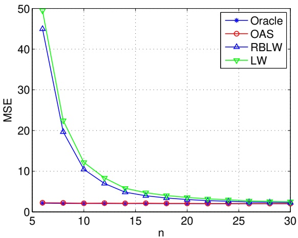

(a) MSE

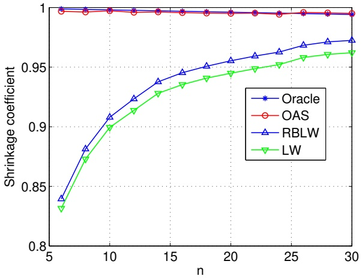

(b) Shrinkage coefficients

Fig. 1. AR(1) process: Comparison of covariance estimators when $p = 1 0 0 ,   r = 0 . 1$

where $H \in [ 0 . 5 , 1 ]$ is the so-called Hurst parameter. The typical value of H is below 0.9 in practical applications. We choose H equal to 0.6, 0.7 and 0.8. The MSE and shrinkage coefficients are plotted in Figs. 5(a)-7(a) and Figs. 5(b)-7(b), respectively.

From the simulation results in the above two experiments, it is evident that the OAS estimator performs very closely to the ideal oracle estimator. When n is small, the OAS significantly outperforms the LW and the RBLW. The RBLW improves slightly upon the LW, but this is not obvious at the scale of the plots shown in the figures. As expected, all the estimators converge to a common value when n increases.

As indicated in (5) and shown from simulation results, the oracle shrinkage coefficient $\rho _ { O }$ decreases in the sample number n. This makes sense since $( 1 - \rho _ { O } )$ can be regarded as a measure of “confidence”

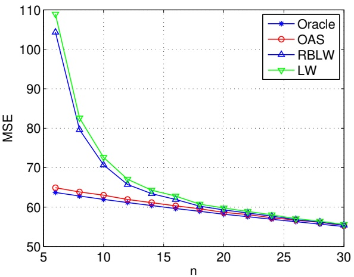

(a) MSE

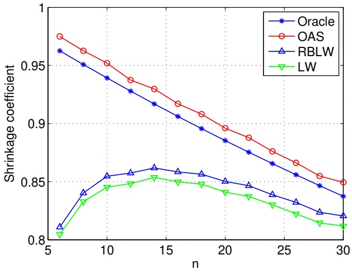

(b) Shrinkage coefficients

Fig. 2. AR(1) process: Comparison of covariance estimators when $p = 1 0 0 ,   r = 0 . 5 .$

assigned to $\widehat { \mathbf { S } } .$ Intuitively, as more observations are available, one acquires higher confidence in the sample covariance $\widehat { \mathbf { S } }$ and therefore $\rho _ { O }$ decreases. This characteristic is exhibited by $\hat { \rho } _ { O A S } ^ { * }$ but not by $\hat { \rho } _ { R B L W } ^ { * }$ and $\hat { \rho } _ { L W } ^ { * }$ . This may partially explain why **OAS** outperforms RBLW and LW for small samples. All the estimators perform better when the sphericity of Σ increases, which corresponds to small values of $r$ and H.

Our experience through numerous simulations with arbitrary parameters suggests that in practice the OAS is preferable to the RBLW. However, as the RBLW is provably better than the LW there exists counter examples. For the incremental FBM covariance Σ in (36), we set $H   =   0 . 9 , n   =   2 0 , p   =   1 0 0 .$ The simulation is repeated for 5000 times and the result is shown in Table 1, where $\mathrm { M S E } ( \widehat { \mathbf { \Sigma } } _ { R B L W } ) <$ $\mathrm { M S E } ( \widehat { \mathbf { \Sigma } } _ { O A S } ) < \mathrm { M S E } ( \widehat { \mathbf { \Sigma } } _ { L W } )$ . The differences are very small but establish that the OAS estimator does not always dominate the RBLW. However, we suspect that this will only occur when Σ has a very small sphericity, a case of less interest in practice as small sphericity of Σ would suggest a different shrinkage target than $\widehat { \mathbf { F } } .$

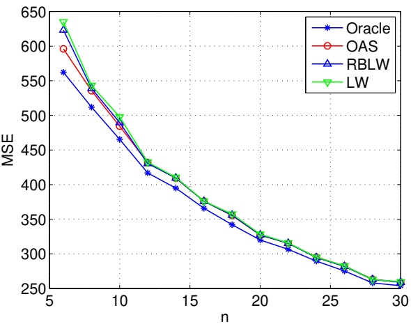

(a) MSE

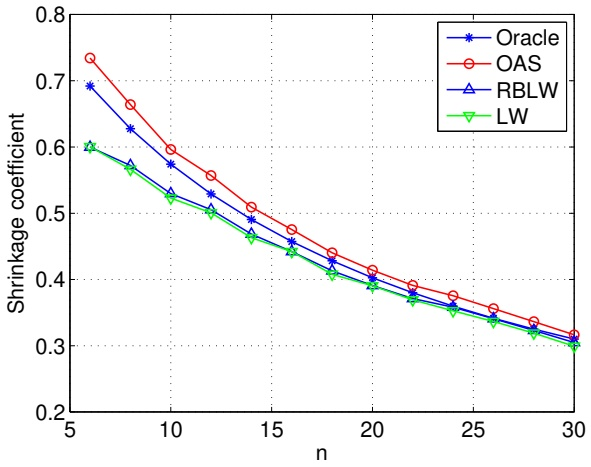

(b) Shrinkage coefficients

Fig. 3. AR(1) process: Comparison of covariance estimators when $p = 1 0 0 ,   r = 0 . 9 .$

## B. Application to the Capon beamformer

Next we applied the proposed shrinkage estimators to the signal processing problem of adaptive beamforming. Assume that a narrow-band signal of interest **s(t)** impinges on an unperturbed uniform linear array (ULA) [30] comprised of p sensors. The complex valued vector of n snapshots of the array

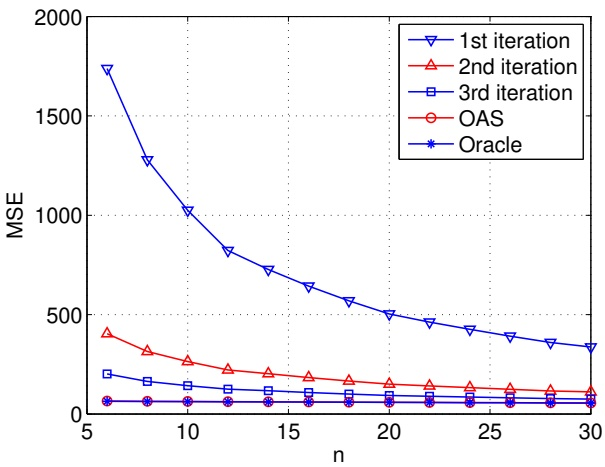

Fig. 4. AR(1) process: Comparison of MSE in different iterations, when $p = 1 0 0 ,   r = 0 . 5$

TABLE I

INCREMENTAL FRM PROCESS: COMPARISON OF MSE AND SHRINKAGE COEFFICIENTS WHEN $H = 0 . 9 , n = 2 0 , p = 1 0 0 .$

|  | MSE | Shrinkage coefficient |
| --- | --- | --- |
| Oracle | 428.9972 | 0.2675 |
| OAS | 475.2691 | 0.3043 |
| RBLW | 472.8206 | 0.2856 |
| LW | 475.5840 | 0.2867 |

output is

$$
\mathbf {x} (t) = \mathbf {a} (\theta_ {s}) s (t) + \mathbf {n} (t), \quad \text {for} \quad t = 1, \dots , n,\tag{37}
$$

where $\theta _ { s }$ is parameter vector determining the location of the signal source and $\mathbf { a } ( \theta )$ is the array response for a generic source location θ. Specifically,

$$
\mathbf {a} (\theta) = [ 1, e ^ {- j \omega}, e ^ {- j 2 \omega}, \dots , e ^ {- j (p - 1) \omega} ] ^ {T},\tag{38}
$$

where $\omega$ is the spatial frequency. The noise/interference vector $\mathbf { n } ( t )$ is assumed to be zero mean i.i.d. Gaussian distributed. We model the unknown $s ( t )$ as a zero mean i.i.d. Gaussian process.

In order to recover the unknown $s ( t )$ the Capon beamformer [30] linearly combines the array output $\mathbf { x } ( t )$ using a vector of weights w, calculated by

$$
\mathbf {w} = \frac {\boldsymbol {\Sigma} ^ {- 1} \mathbf {a} (\theta_ {s})}{\mathbf {a} (\theta_ {s}) ^ {H} \boldsymbol {\Sigma} ^ {- 1} \mathbf {a} (\theta_ {s})},\tag{39}
$$

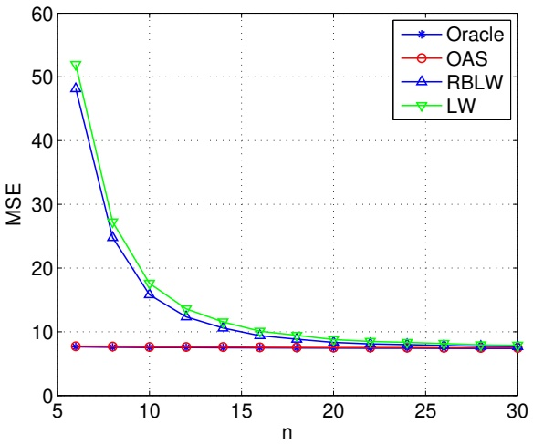

(a) MSE

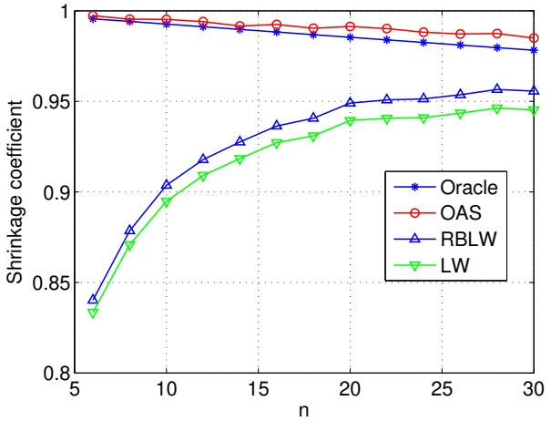

(b) Shrinkage coefficients

Fig. 5. Incremental FBM process: Comparison of covariance estimators when $p = 1 0 0 ,   H = 0 . 6 .$

where Σ is the covariance of $\mathbf { x } ( t )$ . The covariance Σ is unknown while the array response $\mathbf { a } ( \theta )$ and the source direction-of-arrival (DOA) $\theta _ { s }$ are known. After obtaining the weight vector w, the signal of interest $s ( t )$ is estimated by $\mathbf { w } ^ { H } \mathbf { x } ( t )$

To implement (39) the matrix Σ needs to be estimated. In [12] it was shown that using the LW estimator could substantially improve Capon beamformer performance over conventional methods. As we will see below, the OAS and the RBLW shrinkage estimators can yield even better results.

Note that the signal and the noise processes are complex valued and Σ is thus a complex (Hermitian symmetric) covariance matrix. To apply the OAS and RBLW estimators we use the same approach as used in [12] to extend the real LW covariance estimator to the complex case. Given a $p \times 1$ complex random vector x, we represent it as a $2 p \times 1$ vector of its real and imaginary parts

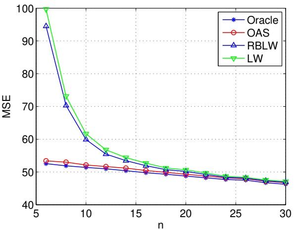

(a) MSE

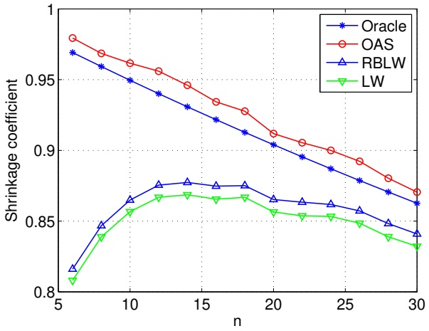

(b) Shrinkage coefficients

Fig. 6. Incremental FBM process: Comparison of covariance estimators when $p = 1 0 0 ,   H = 0 . 7 .$

$$
\mathbf {x} _ {s} = \binom{\operatorname{Re} (\mathbf {x})}{\operatorname{Im} (\mathbf {x})}.\tag{40}
$$

Then the estimate of the complex covariance can be represented as

$$
\widehat {\boldsymbol {\Sigma}} _ {s} = \left( \begin{array}{c c} \widehat {\boldsymbol {\Sigma}} _ {r r} & \widehat {\boldsymbol {\Sigma}} _ {r i} \\ \widehat {\boldsymbol {\Sigma}} _ {i r} & \widehat {\boldsymbol {\Sigma}} _ {i i} \end{array} \right)\tag{41}
$$

where $\widehat { \mathbf { \Sigma } } _ { r r } ,   \widehat { \mathbf { \Sigma } } _ { r i } ,   \widehat { \mathbf { \Sigma } } _ { i r }$ and $\widehat { \mathbf { \Sigma } } _ { i i }$ are $p \times p$ sub-matrices. The real representation (41) can be mapped to the

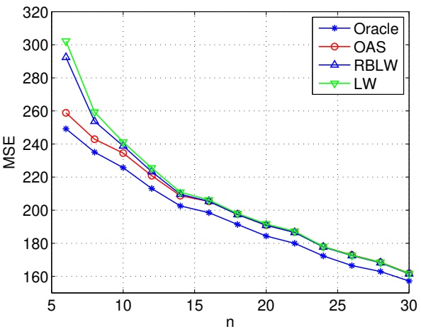

(a) MSE

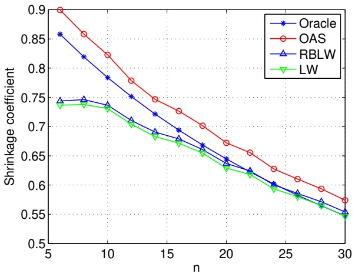

(b) Shrinkage coefficients

Fig. 7. Incremental FBM process: Comparison of covariance estimators when $p = 1 0 0 ,   H = 0 . 8 .$

full complex covariance matrix Σ as

$$
\widehat {\boldsymbol {\Sigma}} = \left(\widehat {\boldsymbol {\Sigma}} _ {r r} + \widehat {\boldsymbol {\Sigma}} _ {i i}\right) + j \left(\widehat {\boldsymbol {\Sigma}} _ {i r} - \widehat {\boldsymbol {\Sigma}} _ {r i}\right).\tag{42}
$$

Using this representation we can easily extend the real valued LW, RBLW and OAS estimators to complex scenarios.

We conduct the beamforming simulation as follows. A ULA of $p   =   1 0$ sensor elements with half wavelength spacing is assumed and three signals were simulated as impinging on the array. The signal of interest has a DOA $\theta _ { s } = 2 0 ^ { \circ }$ and a power $\sigma _ { s } ^ { 2 } = 1 0 \; \mathrm { d B }$ above the complex Gaussian sensor noise. The other two signals are mutually independent interferences. One is at DOA angle of $\theta _ { i 1 } = - 3 0 ^ { \circ }$ and the other one is close to the source of interest with its angular location corresponding to a spatial frequency of

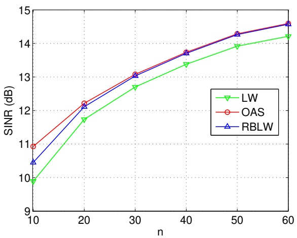

Fig. 8. Comparison between different covariance shrinkage estimators in the Capon beamformer. SINR is plotted versus number of snapshots n. OAS achieves as much as 1 dB improvement over the LW.

$$
\omega_ {i 2} = \pi \sin (\theta_ {s}) + 2 \pi \frac {\gamma}{p}
$$

where $\gamma$ is set to 0.9. Each signal has power 15 dB above the sensor noise.

We implemented the complex versions of the LW, the RBLW and the OAS covariance estimators, described above, and used them in place of Σ in the Capon beamformer expression (39). The beamforming performance gain is measured by the SINR defined as [12]

$$
\text {mean SINR} = \frac {1}{K} \sum_ {k = 1} ^ {K} \frac {\sigma_ {s} ^ {2} \left| \hat {\mathbf {w}} _ {k} ^ {H} \mathbf {a} (\theta_ {s}) \right| ^ {2}}{\hat {\mathbf {w}} _ {k} ^ {H} [ \boldsymbol {\Sigma} - \sigma_ {s} ^ {2} \mathbf {a} (\theta_ {s}) \mathbf {a} (\theta_ {s}) ^ {H} ] \hat {\mathbf {w}} _ {k}},\tag{43}
$$

where K is the number of Monte-Carlo simulations and $\hat { \mathbf { w } } _ { k }$ is the weight vector obtained by (39) in the kth simulation. Here **K = 5000** and n varies from 10 to 60 in step of 5 snap shots. The gain is shown in Fig. 8. In [12] it was reported that the LW estimator achieves the best SINR performances among several contemporary Capon-type beamformers. It can be seen in Fig. 8 that the RBLW and the OAS do even better, improving upon the LW estimator. Note also that the greatest improvement for OAS in the small n regime is observed.

## V. CONCLUSION

In this paper, we introduced two new shrinkage algorithms to estimate covariance matrices. The RBLW estimator was shown to improve upon the state-of-the-art LW method by virtue of the Rao-Blackwell theorem. The OAS estimator was developed by iterating on the optimal oracle estimate, where the limiting form was determined analytically. The RBLW provably dominates the LW, and the OAS empirically outperforms both the RBLW and the LW in most experiments we have conducted. The proposed OAS and RBLW estimators have simple explicit expressions and are easy to implement. Furthermore, they share similar structure differing only in the form of the shrinkage coefficients. We applied these estimators to the Capon beamformer and obtained significant gains in performance as compared to the LW Capon beamformer implementation.

Through out the paper we set the shrinkage target as the scaled identity matrix. The theory developed here can be extended to other non-identity shrinkage targets. An interesting question for future research is how to choose appropriate targets in specific applications.

## VI. APPENDIX

In this appendix we prove Theorem 2. Theorem 2 is non-trivial and requires careful treatment using results from the theory of Haar measure and singular Wishart distributions. The proof will require several intermediate results stated as lemmas. We begin with a definition.

**Definition 1.** Let $\{ \mathbf { x } _ { i } \} _ { i = 1 } ^ { n }$ be a sample of p-dimensional i.i.d. Gaussian vectors with mean zero and covariance Σ. Define a $p \times n$ matrix X as

$$
\mathbf {X} = \left(\mathbf {x} _ {1}, \mathbf {x} _ {2}, \dots , \mathbf {x} _ {n}\right).\tag{44}
$$

Denote $r = \operatorname* { m i n } ( p , n )$ and define the singular value decomposition on X as

$$
\mathrm{X} = \mathrm{H} \Lambda \mathrm{Q},\tag{45}
$$

where H is a $p \times r$ matrix such that $\mathbf { H } ^ { T } \mathbf { H } = \mathbf { I }$ , Λ is a $r \times r$ diagonal matrix in probability 1, comprised of the singular values of X, and $\mathbf { Q }$ is a $r \times n$ matrix such that $\mathbf { Q } \mathbf { Q } ^ { T } = \mathbf { I } .$

Next we state and prove three lemmas.

**Lemma 1.** Let $( \mathbf { H } , \mathbf { \Lambda } , \mathbf { Q } )$ be matrices defined in Definition 1. Then Q is independent of H and Λ.

Proof: For the case $n \leq p ,$ H is a $p \times n$ matrix, Λ is a $n \times n$ square diagonal matrix and Q is a $n \times n$ orthogonal matrix. The pdf of X is

$$
p \left(\mathbf {X}\right) = \frac {1}{(2 \pi) ^ {p n / 2} \det (\Sigma) ^ {n / 2}} e ^ {- \frac {1}{2} \mathrm{Tr} \left(\mathbf {X X} ^ {T} \Sigma^ {- 1}\right)}.\tag{46}
$$

Since $\mathbf { X } \mathbf { X } ^ { T } = \mathbf { H } \mathbf { \Lambda } \mathbf { \Lambda } ^ { T } \mathbf { H } ^ { T }$ , the joint pdf of **(H, Λ, Q)** is

$$
\begin{array}{l}p \left(\mathbf {H}, \boldsymbol {\Lambda}, \mathbf {Q}\right) =\\\frac {1}{(2 \pi) ^ {p n / 2} \det (\Sigma) ^ {n / 2}} e ^ {- \frac {1}{2} \mathrm{Tr} \left(\mathbf {H} \boldsymbol {\Lambda} \boldsymbol {\Lambda} ^ {T} \mathbf {H} ^ {T} \Sigma^ {- 1}\right)} J \left(\mathbf {X} \rightarrow \mathbf {H}, \boldsymbol {\Lambda}, \mathbf {Q}\right),\end{array}\tag{47}
$$

where $J \left( \mathbf { X } \rightarrow \mathbf { H } , \mathbf { \Lambda } , \mathbf { Q } \right)$ is the Jacobian converting from X to **(H, Λ, Q)**. According to Lemma 2.4 of [21],

$$
\begin{array}{c}J \left(\mathbf {X} \rightarrow \mathbf {H}, \boldsymbol {\Lambda}, \mathbf {Q}\right) =\\2 ^ {- n} \mathrm{det} (\boldsymbol {\Lambda}) ^ {p - n} \prod_ {j <   k} ^ {n} \left(\lambda_ {j} ^ {2} - \lambda_ {k} ^ {2}\right) g _ {n, p} \left(\mathbf {H}\right) g _ {n, n} \left(\mathbf {Q}\right),\end{array}\tag{48}
$$

where $\lambda _ { j }$ denotes the j-th diagonal element of Λ and $g _ { n , p } ( \mathbf { H } )$ and $g _ { n , n } ( \mathbf { Q } )$ are functions of H and $\mathbf { Q }$ defined in [21].

Substituting (48) into $( 4 7 ) ,   p \left( \mathbf { H } , \mathbf { \Lambda } , \mathbf { Q } \right)$ can be factorized into functions of $( \mathbf { H } , \mathbf { \Lambda } )$ and $\mathbf { Q } .$ Therefore, $\mathbf { Q }$ is independent of H and Λ.

Similarly, one can show that $\mathbf { Q }$ is independent of H and Λ when $n > p .$

**Lemma 2.** Let $\mathbf { Q }$ be a matrix defined in Definition 1. Denote q as an arbitrary column vector of $\mathbf { Q }$ and $q _ { j }$ as the j-th element of $\mathbf { q } .$ Then

$$
E \left\{q _ {j} ^ {4} \right\} = \frac {3}{n (n + 2)}\tag{49}
$$

and

$$
E \left\{q _ {k} ^ {2} q _ {j} ^ {2} \right\} = \frac {1}{n (n + 2)}, \quad k \neq j.\tag{50}
$$

Proof: The proof is different for the cases that $n \leq p$ and $n > p ,$ which are treated separately.

(1) Case $n \leq p \cdotp$

In this case, $\mathbf { Q }$ is a real Haar matrix and is isotropically distributed [22], [24], [25], i.e., for any unitary matrices Φ and Ψ which are independent with Q, **ΦQ** and **QΨ** have the same pdf of $\mathbf { Q }$

$$
p (\mathbf {\Phi} \mathbf {Q}) = p (\mathbf {Q} \mathbf {\Psi}) = p (\mathbf {Q}).\tag{51}
$$

Following [23] in the complex case, we now use (51) to calculate the fourth order moments of elements of Q. Since Q and

$$
\left[ \begin{array}{cccc} \cos \theta & \sin \theta &  &  &  \\ - \sin \theta & \cos \theta &  &  &  \\  &  & 1 &  &  \\  &  &  & \ddots &  \\  &  &  &  & 1 \end{array} \right] \mathbf {Q}
$$

DRAFT

are also identically distributed, we have

$$
\begin{array}{r l} & E \left\{\mathbf {Q} _ {1 1} ^ {4} \right\} \\ & = E \left\{\left(\mathbf {Q} _ {1 1} \cos \theta + \mathbf {Q} _ {2 1} \sin \theta\right) ^ {4} \right\} \\ & = \cos^ {4} \theta E \left\{\mathbf {Q} _ {1 1} ^ {4} \right\} + \sin^ {4} \theta E \left\{\mathbf {Q} _ {2 2} ^ {4} \right\} \\ & \quad + 6 \cos^ {2} \theta \sin^ {2} \theta E \left\{\mathbf {Q} _ {1 1} ^ {2} \mathbf {Q} _ {2 1} ^ {2} \right\} \\ & \quad + 2 \cos^ {3} \theta \sin \theta E \left\{\mathbf {Q} _ {1 1} ^ {3} \mathbf {Q} _ {2 1} \right\} + 2 \cos \theta \sin^ {3} \theta E \left\{\mathbf {Q} _ {1 1} \mathbf {Q} _ {2 1} ^ {3} \right\} \end{array}\tag{52}
$$

By taking $\theta = - \theta$ in (52), it is easy to see that

$$
2 \cos^ {3} \theta \sin \theta E \left\{\mathbf {Q} _ {1 1} ^ {3} \mathbf {Q} _ {2 1} \right\} + 2 \cos \theta \sin^ {3} \theta E \left\{\mathbf {Q} _ {1 1} \mathbf {Q} _ {2 1} ^ {3} \right\} = 0.
$$

The elements of $[ \mathbf { Q } _ { i i } ]$ are identically distributed. We thus have $E\left\{ \mathbf{Q}_{11}^{4} \right\} = E\left\{ \mathbf{Q}_{22}^{4} \right\}$ , and hence

$$
\begin{array}{l} E \left\{\mathbf {Q} _ {1 1} ^ {4} \right\} \\ = \left(\cos^ {4} \theta + \sin^ {4} \theta\right) E \left\{\mathbf {Q} _ {1 1} ^ {4} \right\} + 6 \cos^ {2} \theta \sin^ {2} \theta E \left\{\mathbf {Q} _ {1 1} ^ {2} \mathbf {Q} _ {2 1} ^ {2} \right\}. \end{array}\tag{53}
$$

By taking $\theta = \pi / 3 ,$

$$
E \left\{\mathbf {Q} _ {1 1} ^ {4} \right\} = 3 E \left\{\mathbf {Q} _ {1 1} ^ {2} \mathbf {Q} _ {2 1} ^ {2} \right\}.\tag{54}
$$

Now we consider $E\left\{ \left( \sum_{j = 1}^{n} \mathbf{Q}_{j1}^{2} \right)^{2} \right\}$ . Since $\mathbf { Q } ^ { T } \mathbf { Q } = \mathbf { Q } \mathbf { Q } ^ { T } = \mathbf { I } ,   \sum _ { j = 1 } ^ { n } \mathbf { Q } _ { j 1 } ^ { 2 } = 1 .$ **.** This implies

$$
\begin{array}{l} 1 = \sum_ {j = 1} ^ {n} E \left\{\mathbf {Q} _ {j 1} ^ {4} \right\} + \sum_ {j \neq k} E \left\{\mathbf {Q} _ {j 1} ^ {2} \mathbf {Q} _ {k 1} ^ {2} \right\} \\ = n E \left\{\mathbf {Q} _ {1 1} ^ {4} \right\} + n (n - 1) E \left\{\mathbf {Q} _ {1 1} ^ {2} \mathbf {Q} _ {2 1} ^ {2} \right\}. \end{array}\tag{55}
$$

Substituting (54) into (55), we obtain that

$$
E \left\{\mathbf {Q} _ {1 1} ^ {4} \right\} = \frac {3}{n (n + 2)},\tag{56}
$$

and

$$
E \left\{\mathbf {Q} _ {1 1} ^ {2} \mathbf {Q} _ {2 1} ^ {2} \right\} = \frac {1}{n (n + 2)}.\tag{57}
$$

It is easy to see that $E\left\{ q_{j}^{4} \right\} = E\left\{ \mathbf{Q}_{11}^{4} \right\}$ and $E\left\{ q_{j}^{2}q_{k}^{2} \right\} = E\left\{ \mathbf{Q}_{11}^{2}\mathbf{Q}_{21}^{2} \right\}$ . Therefore (49) and (50) are proved for the case of $n \leq p$

(2) Case $n > p { : }$

The pdf of $\mathbf { q }$ can be obtained by Lemma 2.2 of [21]

$$
p (\mathbf {q}) = C _ {1} \det \left(\mathbf {I} - \mathbf {q q} ^ {T}\right) ^ {(n - p - 2) / 2} I (\mathbf {q q} ^ {T} \prec \mathbf {I}),\tag{58}
$$

where

$$
C _ {1} = \frac {\pi^ {- p / 2} \Gamma \{n / 2 \}}{\Gamma \{(n - p) / 2 \}},\tag{59}
$$

and $I \left( \cdot \right)$ is the indicator function specifying the support of $\mathbf { q } .$ Eq. (58) indicates that the elements of $\mathbf { q }$ are identically distributed. Therefore, $E \left\{ q _ { j } ^ { 4 } \right\} = E \left[ q _ { 1 } ^ { 4 } \right\}$ and $E \left\{ q _ { j } ^ { 2 } q _ { k } ^ { 2 } \right\} = E \left\{ q _ { 1 } ^ { 2 } q _ { 2 } ^ { 2 } \right\}$ . By the definition of expectation,

$$
E \left\{q _ {1} ^ {4} \right\} = C _ {1} \int_ {\mathbf {q q} ^ {T} \prec \mathbf {I}} q _ {1} ^ {4} \mathrm{det} \left(\mathbf {I} - \mathbf {q q} ^ {T}\right) ^ {(n - p - 2) / 2} d \mathbf {q},\tag{60}
$$

and

$$
E \left\{q _ {1} ^ {2} q _ {2} ^ {2} \right\} = C _ {1} \int_ {\mathbf {q q} ^ {T} \prec \mathbf {I}} q _ {1} ^ {2} q _ {2} ^ {2} \mathrm{det} \left(\mathbf {I} - \mathbf {q q} ^ {T}\right) ^ {(n - p - 2) / 2} d \mathbf {q}.\tag{61}
$$

Noting that

$$
\mathbf {q q} ^ {T} \prec \mathbf {I} \Leftrightarrow \mathbf {q} ^ {T} \mathbf {q} <   1\tag{62}
$$

and

$$
\det \left(\mathbf {I} - \mathbf {q q} ^ {T}\right) = 1 - \mathbf {q} ^ {T} \mathbf {q},\tag{63}
$$

we have

$$
\begin{array}{l} E \left\{q _ {1} ^ {4} \right\} = C _ {1} \int_ {\mathbf {q} ^ {T} \mathbf {q} <   1} q _ {1} ^ {4} (1 - \mathbf {q} ^ {T} \mathbf {q}) ^ {\frac {1}{2} (n - p - 2)} d \mathbf {q} \\ \qquad = C _ {1} \int_ {\sum_ {j = 1} ^ {p} q _ {j} ^ {2} <   1} q _ {1} ^ {4} \left(1 - \sum_ {j = 1} ^ {p} q _ {j} ^ {2}\right) ^ {\frac {1}{2} (n - p - 2)} d q _ {1} \dots d q _ {p}. \end{array}\tag{64}
$$

By changing variable of integration $( q _ { 1 } , q _ { 2 } , \cdots , q _ { p } )$ to $( r , \theta _ { 1 } , \theta _ { 2 } , \cdots , \theta _ { p - 1 } )$ such that

$$
\left\{ \begin{array}{l l} q _ {1} & = r \cos \theta_ {1} \\ q _ {2} & = r \sin \theta_ {1} \cos \theta_ {2} \\ q _ {3} & = r \sin \theta_ {1} \sin \theta_ {2} \cos \theta_ {3} \\ \vdots & \vdots \\ q _ {p - 1} & = r \sin \theta_ {1} \sin \theta_ {2} \dots \sin \theta_ {p - 2} \cos \theta_ {p - 1} \\ q _ {p} & = r \sin \theta_ {1} \sin \theta_ {2} \dots \sin \theta_ {p - 2} \sin \theta_ {p - 1} \end{array} , \right.\tag{65}
$$

we obtain

$$
\begin{array}{c} E \left\{q _ {1} ^ {4} \right\} = C _ {1} \int_ {0} ^ {\pi} d \theta_ {1} \int_ {0} ^ {\pi} d \theta_ {2} \dots \int_ {0} ^ {\pi} d \theta_ {p - 2} \int_ {0} ^ {2 \pi} d \theta_ {p - 1} \\ \cdot \int_ {0} ^ {1} r ^ {4} \cos^ {4} \theta_ {1} (1 - r ^ {2}) ^ {\frac {1}{2} (n - p - 2)} \left| \frac {\partial (q _ {1} , \cdots , q _ {p})}{\partial (r , \theta_ {1} , \cdots , \theta_ {p - 1})} \right| d r, \end{array}\tag{66}
$$

where

$$
\left| \frac {\partial \left(q _ {1} , \cdots , q _ {p}\right)}{\partial \left(r , \theta_ {1} , \cdots , \theta_ {p - 1}\right)} \right| = r ^ {p - 1} \sin^ {p - 2} \theta_ {1} \sin^ {p - 3} \theta_ {2} \dots \sin \theta_ {p - 2}
$$

November 26, 2024

DRAFT

is the Jacobian associated with the change of variable.

Therefore,

$$
\begin{array}{r l} & E \left\{q _ {1} ^ {4} \right\} = C _ {1} \cdot \int_ {0} ^ {\pi} \cos^ {4} \theta_ {1} \sin^ {p - 2} \theta_ {1} d \theta_ {1} \cdot \int_ {0} ^ {\pi} \sin^ {p - 3} \theta_ {2} d \theta_ {2} \\ & \quad \cdot \int_ {0} ^ {\pi} \sin^ {p - 4} \theta_ {3} d \theta_ {3} \dots \int_ {0} ^ {\pi} \sin \theta_ {p - 2} d \theta_ {p - 2} \int_ {0} ^ {2 \pi} d \theta_ {p - 1} \\ & \quad \cdot \int_ {0} ^ {1} r ^ {p + 3} \left(1 - r ^ {2}\right) ^ {\frac {1}{2} (n - p - 2)} d r \\ & \quad = \frac {\pi^ {- p / 2} \Gamma \{n / 2 \}}{\Gamma \{(n - p) / 2 \}} \cdot \frac {3 \pi^ {\frac {1}{2}}}{4} \frac {\Gamma \{(p - 1) / 2 \}}{\Gamma \{(p + 4) / 2 \}} \cdot \pi^ {\frac {1}{2}} \frac {\Gamma \{(p - 2) / 2 \}}{\Gamma \{(p - 1) / 2 \}} \\ & \quad \cdot \pi^ {\frac {1}{2}} \frac {\Gamma \{(p - 3) / 2 \}}{\Gamma \{(p - 2) / 2 \}} \dots \pi^ {\frac {1}{2}} \frac {\Gamma \{3 / 2 \}}{\Gamma \{5 / 2 \}} \cdot \pi^ {\frac {1}{2}} \frac {\Gamma \{1 \}}{\Gamma \{3 / 2 \}} \cdot 2 \pi \\ & \quad \cdot \int_ {0} ^ {1} r ^ {p + 3} \left(1 - r ^ {2}\right) ^ {\frac {1}{2} (n - p - 2)} d r \\ & \quad = \frac {3}{2} \frac {\Gamma \{n / 2 \}}{\Gamma \{(n - p) / 2 \} \Gamma \{p / 2 + 2 \}} \int_ {0} ^ {1} r ^ {p + 3} \left(1 - r ^ {2}\right) ^ {\frac {1}{2} (n - p - 2)} d r \\ & \quad = \frac {3}{2} \frac {\Gamma \{n / 2 \}}{\Gamma \{(n - p) / 2 \} \Gamma \{p / 2 + 2 \}} \cdot \frac {1}{2} \frac {\Gamma \{(n - p) / 2 \} \Gamma \{p / 2 + 2 \}}{\Gamma \{n / 2 + 2 \}} \\ & \quad = \frac {3 \Gamma \{n / 2 \}}{4 \Gamma \{n / 2 + 2 \}} \\ & \quad = \frac {3}{n (n + 2)}. \end{array}\tag{67}
$$

Similarly,

$$
\begin{array}{r l} & E \left\{q _ {1} ^ {2} q _ {2} ^ {2} \right\} = C _ {1} \int_ {\sum_ {k = 1} ^ {p} q _ {k} ^ {2} <   1} q _ {1} ^ {2} q _ {2} ^ {2} \Bigg (1 - \sum_ {k = 1} ^ {p} q _ {k} ^ {2} \Bigg) ^ {\frac {1}{2} (n - p - 2)} d q _ {1} \dots d q _ {p} \\ & \quad = C _ {1} \int_ {0} ^ {\pi} d \theta_ {1} \int_ {0} ^ {\pi} d \theta_ {2} \dots \int_ {0} ^ {\pi} d \theta_ {p - 2} \int_ {0} ^ {2 \pi} d \theta_ {p - 1} \\ & \quad \cdot \int_ {0} ^ {1} r ^ {2} \cos^ {2} \theta_ {1} r ^ {2} \sin^ {2} \theta_ {1} \cos^ {2} \theta_ {2} (1 - r ^ {2}) ^ {\frac {1}{2} (n - p - 2)} \\ & \quad \cdot \left| \frac {\partial (q _ {1} , \cdots , q _ {p})}{\partial (r , \theta_ {1} , \cdots , \theta_ {p - 1})} \right| d r \\ & = C _ {1} \cdot \int_ {0} ^ {\pi} \cos^ {2} \theta_ {1} \sin^ {p} \theta_ {1} d \theta_ {1} \cdot \int_ {0} ^ {\pi} \cos^ {2} \theta_ {2} \sin^ {p - 3} \theta_ {2} d \theta_ {2} \\ & \quad \cdot \int_ {0} ^ {\pi} \sin^ {p - 4} \theta_ {3} d \theta_ {3} \cdot \int_ {0} ^ {\pi} \sin^ {p - 5} \theta_ {4} d \theta_ {4} \dots \int_ {0} ^ {\pi} \sin \theta_ {p - 2} d \theta_ {p - 2} \\ & \quad \cdot \int_ {0} ^ {2 \pi} d \theta_ {p - 1} \cdot \int_ {0} ^ {1} r ^ {p + 3} (1 - r ^ {2}) ^ {\frac {1}{2} (n - p - 2)} d r \\ & = \frac {\pi^ {- p / 2} \Gamma \{n / 2 \}}{\Gamma \{(n - p) / 2 \}} \cdot \frac {\pi^ {\frac {1}{2}}}{2} \frac {\Gamma \{(p + 1) / 2 \}}{\Gamma \{p / 2 + 2 \}} \cdot \frac {\pi^ {\frac {1}{2}}}{2} \frac {\Gamma \{(p - 2) / 2 \}}{\Gamma \{(p + 1) / 2 \}} \\ & \quad \cdot \pi^ {\frac {1}{2}} \frac {\Gamma \{(p - 3) / 2 \}}{\Gamma \{(p - 2) / 2 \}} \cdot \pi^ {\frac {1}{2}} \frac {\Gamma \{(p - 4) / 2 \}}{\Gamma \{(p - 3) / 2 \}} \dots \pi^ {\frac {1}{2}} \frac {\Gamma \{1 \}}{\Gamma \{3 / 2 \}} \\ & \quad \cdot 2 \pi \cdot \frac {1}{2} \frac {\Gamma \{(n - p) / 2 \} \Gamma \{p / 2 + 2 \}}{\Gamma \{n / 2 + 2 \}} \\ & = \frac {1}{n (n + 2)}. \end{array}\tag{68}
$$

Therefore, (49) and (50) are proved for the case when $n > p .$ . This completes the proof of Lemma 2.

**Lemma 3.** Let $\widehat { \mathbf { S } }$ be the sample covariance of a set of p-dimensional vectors $\{ \mathbf { x } _ { i } \} _ { i = 1 } ^ { n } . I f \{ \mathbf { x } _ { i } \} _ { i = 1 } ^ { n }$ are i.i.d. Gaussian vectors with covariance $\mathbf { \Sigma } ,$

$$
E \left\{\| \mathbf {x} _ {i} \| _ {2} ^ {4} \mid \widehat {\mathbf {S}} \right\} = \frac {n}{n + 2} \left[ 2 \operatorname{Tr} \left(\widehat {\mathbf {S}} ^ {2}\right) + \operatorname{Tr} ^ {2} (\widehat {\mathbf {S}}) \right].\tag{69}
$$

Proof: For simplicity, we work with the scaled covariance matrix M defined as

$$
\left| \mathbf {M} = \sum_ {i = 1} ^ {n} \mathbf {x} _ {i} \mathbf {x} _ {i} ^ {T} = n \widehat {\mathbf {S}}, \right.\tag{70}
$$

and calculate $E \left\{ \left. \left\| \mathbf { x } _ { i } \right\| _ { 2 } ^ { 4 } \right| \mathbf { M } \right\}$ instead of $E \left\{ \left. \left\| \mathbf { x } _ { i } \right\| _ { 2 } ^ { 4 } \right| \widehat { \mathbf { S } } \right\}$ . We are then going to prove that

$$
E \left\{\left\| \mathbf {x} _ {i} \right\| _ {2} ^ {4} \Big | \mathbf {M} \right\} = \frac {1}{n (n + 2)} \left(2 \operatorname{Tr} \left(\mathbf {M} ^ {2}\right) + \operatorname{Tr} ^ {2} (\mathbf {M})\right).\tag{71}
$$

We use Lemma 1 and Lemma 2 to establish (71).

Let X and **(H, Λ, Q)** be matrices defined in Definition 1. Let q be the i-th column of $\mathbf { Q }$ defined in Definition 1. Then

$$
\mathbf {x} _ {i} = \mathbf {H} \boldsymbol {\Lambda} \mathbf {q}.\tag{72}
$$

Let

$$
\mathbf {D} = \boldsymbol {\Lambda} ^ {2}.\tag{73}
$$

Then

$$
\mathbf {M} = \mathbf {X} \mathbf {X} ^ {T} = \mathbf {H} \boldsymbol {\Lambda} ^ {2} \mathbf {H} ^ {T} = \mathbf {H} \mathbf {D} \mathbf {H} ^ {T},\tag{74}
$$

and

$$
\mathbf {x} _ {i} ^ {T} \mathbf {x} _ {i} = \mathbf {q} ^ {T} \boldsymbol {\Lambda} ^ {T} \mathbf {H} ^ {T} \mathbf {H} \boldsymbol {\Lambda} \mathbf {q} = \mathbf {q} ^ {T} \mathbf {D} \mathbf {q}.\tag{75}
$$

Therefore we have

$$
E \left\{\left\| \mathbf {x} _ {i} \right\| _ {2} ^ {4} \mid \mathbf {M} \right\} = E \left\{\left(\mathbf {q} ^ {T} \mathbf {D q}\right) ^ {2} \mid \mathbf {M} \right\}.\tag{76}
$$

According to Lemma 1, Q is independent of H and Λ. Since $\mathbf { q }$ is a function of Q, M and D are functions of H and Λ, q is independent of M and D.

From the law of total expectation,

$$
E \left\{\left(\mathbf {q} ^ {T} \mathbf {D q}\right) ^ {2} \mid \mathbf {M} \right\} = E \left\{E \left\{\left(\mathbf {q} ^ {T} \mathbf {D q}\right) ^ {2} \mid \mathbf {M}, \mathbf {D} \right\} \mid \mathbf {M} \right\}.\tag{77}
$$

Expand $\mathbf { q } ^ { T } \mathbf { D } \mathbf { q }$ as

$$
\mathbf {q} ^ {T} \mathbf {D} \mathbf {q} = \sum_ {j = 1} ^ {n} d _ {j} q _ {j} ^ {2},\tag{78}
$$

where $d _ { j }$ is the $j _ { 1 }$ -th diagonal element of D. Since $\mathbf { q }$ is independent of M and D, according to Lemma 2,

$$
\left| \begin{array}{l} E \left\{\left(\mathbf {q} ^ {T} \mathbf {D q}\right) ^ {2} \Big | \mathbf {M}, \mathbf {D} \right\} \\ = E \left\{\sum_ {j = 1} ^ {n} d _ {j} ^ {2} q _ {j} ^ {4} + \sum_ {j \neq k} d _ {j} d _ {k} q _ {j} ^ {2} q _ {k} ^ {2} \Bigg | \mathbf {M}, \mathbf {D} \right\} \\ = \sum_ {j = 1} ^ {n} d _ {j} ^ {2} E \left\{q _ {j} ^ {4} \right\} + \sum_ {j \neq k} d _ {j} d _ {k} E \left\{q _ {j} ^ {2} q _ {k} ^ {2} \right\} \\ = \frac {1}{n (n + 2)} \left(3 \sum_ {j = 1} ^ {n} d _ {j} ^ {2} + \sum_ {j \neq k} d _ {j} d _ {k}\right) \\ = \frac {1}{n (n + 2)} \left(2 \operatorname{Tr} \left(\mathbf {D} ^ {2}\right) + \operatorname{Tr} ^ {2} (\mathbf {D})\right). \end{array} \right.\tag{79}
$$

Since $\mathrm { T r } \left( \mathbf { D } \right) = \mathrm { T r } \left( \mathbf { M } \right)$ and $\mathrm { T r } \left( \mathbf { D } ^ { 2 } \right) = \mathrm { T r } \left( \mathbf { M } ^ { 2 } \right)$ , substituting (79) into (77), we have

$$
\left| \begin{array}{l} E \left\{\left(\mathbf {q} ^ {T} \mathbf {D} \mathbf {q}\right) ^ {2} \Big | \mathbf {M} \right\} \\ = E \left\{\frac {1}{n (n + 2)} \left(2 \mathrm{Tr} \left(\mathbf {D} ^ {2}\right) + \mathrm{Tr} ^ {2} (\mathbf {D})\right) \Bigg | \mathbf {M} \right\} \\ = E \left\{\frac {1}{n (n + 2)} \left(2 \mathrm{Tr} \left(\mathbf {M} ^ {2}\right) + \mathrm{Tr} ^ {2} (\mathbf {M})\right) \Bigg | \mathbf {M} \right\} \\ = \frac {1}{n (n + 2)} \left(2 \mathrm{Tr} \left(\mathbf {M} ^ {2}\right) + \mathrm{Tr} ^ {2} (\mathbf {M})\right). \end{array} \right.\tag{80}
$$

Lemma 3 now allows us to prove Theorem 2.

## A. Proof of Theorem 2

Proof:

$$
\begin{array}{r l} & {\widehat {\mathbf {\Sigma}} _ {R B L W} = E \left\{\left. \widehat {\mathbf {\Sigma}} _ {L W} \right| \widehat {\mathbf {S}} \right\}} \\ & {\qquad = E \left\{\left(1 - \hat {\rho} _ {L W}\right) \widehat {\mathbf {S}} + \hat {\rho} _ {L W} \widehat {\mathbf {F}} \right| \widehat {\mathbf {S}} \Bigg \}} \\ & {\qquad = \left(1 - E \left\{\left. \hat {\rho} _ {L W} \right| \widehat {\mathbf {S}} \right\}\right) \widehat {\mathbf {S}} + E \left\{\left. \hat {\rho} _ {L W} \widehat {\mathbf {F}} \right| \widehat {\mathbf {S}} \right\}.} \end{array}\tag{81}
$$

Therefore we obtain the shrinkage coefficient of $\hat { \mathbf { \Sigma } } _ { R B L W }$

$$
\begin{array}{r l} & {\hat {\rho} _ {R B L W} = E \left\{\hat {\rho} _ {L W} | \widehat {\mathbf {S}} \right\}} \\ & {\qquad = \frac {\sum_ {i = 1} ^ {n} E \left\{\left\| \mathbf {x} _ {i} \mathbf {x} _ {i} ^ {T} - \widehat {\mathbf {S}} \right\| _ {F} ^ {2} \Big | \widehat {\mathbf {S}} \right\}}{n ^ {2} \left[ \mathrm{Tr} \left(\widehat {\mathbf {S}} ^ {2}\right) - \mathrm{Tr} ^ {2} \left(\widehat {\mathbf {S}}\right) / p \right]}.} \end{array}\tag{82}
$$

Note that

$$
\left| \begin{array}{l} \sum_ {i = 1} ^ {n} E \left\{\left\| \mathbf {x} _ {i} \mathbf {x} _ {i} ^ {T} - \widehat {\mathbf {S}} \right\| _ {F} ^ {2} \Bigg | \widehat {\mathbf {S}} \right\} \\ = \sum_ {i = 1} ^ {n} E \left\{\left\| \mathbf {x} _ {i} \right\| _ {2} ^ {4} \Bigg | \widehat {\mathbf {S}} \right\} - n \mathrm{Tr} (\widehat {\mathbf {S}} ^ {2}). \end{array} \right.\tag{83}
$$

From Lemma 3, we have

$$
\begin{array}{r l} & {\sum_ {i = 1} ^ {n} E \left\{\left\| \mathbf {x} _ {i} \mathbf {x} _ {i} ^ {T} - \widehat {\mathbf {S}} \right\| _ {F} ^ {2} \Bigg | \widehat {\mathbf {S}} \right\}} \\ & {\qquad = \frac {n (n - 2)}{n + 2} \mathrm{Tr} \left(\widehat {\mathbf {S}} ^ {2}\right) + \frac {n ^ {2}}{n + 2} \mathrm{Tr} ^ {2} \left(\widehat {\mathbf {S}}\right).} \end{array}\tag{84}
$$

Equation (17) is then obtained by substituting (84) into (82).

[1] C. Stein, “Inadmissibility of the usual estimator for the mean of a multivariate distribution,” Proc. Third Berkeley Symp. Math. Statist. Prob. 1, pp. 197-206, 1956.

[2] W. James and C. Stein, “Estimation with quadratic loss,” Proceedings of the 4th Berkeley Symposium on Mathematical Statistics and Probability, Berkeley, CA, vol. 1, page 361-379, University of California Press, 1961.

[3] C. Stein, “Estimation of a covariance matrix,” In Rietz Lecture, 39th Annual Meeting, IMS, Atlanta, GA, 1975.

[4] L. R. Haff, “Empirical Bayes Estimation of the Multivariate Normal Covariance Matrix,” Annals of Statistics, vol. 8, no. 3, pp. 586-597, 1980.

[5] D. K. Dey and C. Srinivasan, “Estimation of a covariance matrix under Stein’s loss,” Annals of Statistics, vol. 13, pp. 1581-1591, 1985.

[6] R. Yang, J. O. Berger, “Estimation of a covariance matrix using the reference prior,” Annals of Statistics, vol. 22, pp. 1195-1211, 1994.

[7] O. Ledoit, M. Wolf, “Improved estimation of the covariance matrix of stock returns with an application to portfolio selection,” Journal of Empirical Finance, vol. 10, no. 5, pp. 603-621, Dec. 2003.

[8] O. Ledoit and M. Wolf, “A well-conditioned estimator for large-dimensional covariance matrices,” Journal of Multivariate Analysis, vol. 88, no. 2, pp. 365-411, Feb. 2004.

[9] O. Ledoit, M. Wolf, “Honey, I Shrunk the Sample Covariance Matrix,” Journal of Portfolio Management, vol. 31, no. 1, 2004.

[10] P. Bickel, E. Levina, “Regularized estimation of large covariance matrices,” Annals of Statistics, vol. 36, pp. 199-227, 2008.

[11] Y. C. Eldar and J. Chernoi, “A Pre-Test Like Estimator Dominating the Least-Squares Method,” Journal of Statistical Planning and Inference, vol. 138, no. 10, pp. 3069-3085, 2008.

[12] R. Abrahamsson, Y. Selén and P. Stoica, “Enhanced covariance matrix estimators in adaptive beamforming,” IEEE Proc. of ICASSP, pp. 969-972, 2007.

[13] P. Stoica, J. Li, X. Zhu and J. Guerci, “On using a priori knowledge in space-time adaptive processing,” IEEE Trans. Signal Process., vol. 56, pp. 2598-2602, 2008.

[14] J. Li, L. Du and P. Stoica, “Fully automatic computation of diagonal loading levels for robust adaptive beamforming,” IEEE Proc. of ICASSP, pp. 2325-2328, 2008.

[15] P. Stoica, J. Li, T. Xing, “On Spatial Power Spectrum and Signal Estimation Using the Pisarenko Framework,” IEEE Trans. Signal Process., vol. 56, pp. 5109-5119, 2008.

[16] Y. I. Abramovich and B. A. Johnson, “GLRT-Based Detection-Estimation for Undersampled Training Conditions,” IEEE Trans. Signal Process., vol. 56, no. 8, pp. 3600-3612, Aug. 2008.

[17] J. Schäfer and K. Strimmer, “A Shrinkage approach to large-scale covariance matrix estimation and implications for functional genomics,” Statistical Applications in Genetics and Molecular Biology, vol. 4, no. 1, 2005.

[18] S. Johh, “Some optimal multivariate tests,” Biometrika, vol. 58, pp. 123-127, 1971.

[19] M. S. Srivastava and C. G. Khatri, An introduction to multivariate statistics, 1979.

[20] O. Ledoit and M. Wolf, “Some Hypothesis Tests for the Covariance Matrix When the Dimension Is Large Compared to the Sample Size,” Annals of Statistics, vol. 30, no. 4, pp. 1081-1102, Aug. 2002.

[21] M. S. Srivastava, “Singular Wishart and multivariate beta distributions,” Annals of Statistics, vol. 31, no. 5, pp. 1537-1560, 2003.

[22] B. Hassibi and T. L. Marzetta,“Multiple-antennas and isotropically random unitary inputs: the received signal density in closed form,” IEEE Trans. Inf. Theory, vol. 48, no. 6, pp. 1473-1484, Jun. 2002.

[23] F. Hiai and D. Petz, “Asymptotic freeness almost everywhere for random matrices,” Acta Sci. Math. Szeged, vol. 66, pp. 801C826, 2000.

[24] T. L. Marzetta and B. M. Hochwald, “Capacity of a mobile multipleantenna communication link in Rayleigh flat fading,” IEEE Trans. Inf. Theory, vol. 45, no. 1, pp. 139-157, 1999.

[25] Y. C. Eldar and S. Shamai, “A covariance shaping framework for linear multiuser detection,” IEEE Trans. Inf. Theory, vol. 51, no. 7, pp. 2426-2446, 2005.

[26] R. K. Mallik, “The pseudo-Wishart distribution and its application to MIMO systems,” IEEE Trans. Inf. Theory, vol. 49, pp. 2761-2769, Oct. 2003.

[27] G. Letac and H. Massam, “All invariant moments of the Wishart distribution,” Scand. J. Statist., vol. 31, no. 2, pp. 285-318, 2004.

[28] T. Bodnar and Y. Okhrin, “Properties of the singular, inverse and generalized inverse partitioned Wishart distributions,” Journal of Multivariate Analysis, vol. 99, no. 10, pp. 2389-2405, Nov. 2008.

[29] W. E. Leland, M.S. Taqqu, W. Willinger and D.V.,Wilson, “On the self-similar nature of Ethernet traffic,” IEEE Trans. Networking, vol. 2, pp. 1-15, 1994.

[30] P. Stoica and R. Moses, Spectral Analysis of Signals, Prentice Hall, Upper Saddle River, NJ, 2005.

[31] H. L. Van Trees, Detection, Estimation, and Modulation Theory, Part I, New York, NY: John Wiley & Sons, Inc., 1971.

[32] S. M. Pandit and S. Wu, Time Series and System Analysis with Applications, John Wiley & Sons, Inc., 1983.