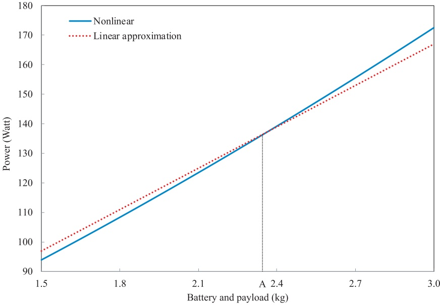
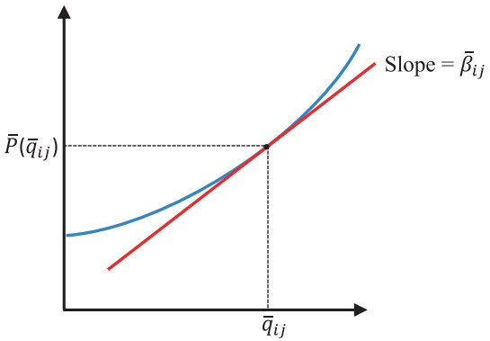

# Drone routing with energy function: Formulation and exact algorithm

Chun Cheng a,∗, Yossiri Adulyasak b, Louis-Martin Rousseau c

a Institute of Supply Chain Analytics, Dongbei University of Finance and Economics, Dalian, 116025, Liaoning, China b HEC Montréal and GERAD, Montréal, H3T 2A7, Canada

c Polytechnique Montréal and CIRRELT, Montréal, H3C 3A7, Canada

## a r t i c l e i n f o

Article history: Received 6 July 2019 Revised 19 June 2020 Accepted 30 June 2020

Keywords: Drone routing Nonlinear energy function Logical cut Subgradient cut Branch-and-cut

## a b s t r a c t

Drone delivery is known as a potential contributor in improving efficiency and alleviating last-mile delivery problems. For this reason, drone routing and scheduling has become a highly active area of research in recent years. Unlike the vehicle routing problem, however, designing drones’ routes is challenging due to multiple operational characteristics including multi-trip operations, recharge planning, and energy consumption calculation. To fill some important gaps in the literature, this paper solves a multi-trip drone routing problem, where drones’ energy consumption is modeled as a nonlinear function of payload and travel distance. We propose adding logical cuts and subgradient cuts in the solution process to tackle the more complex nonlinear (convex) energy function, instead of using the linear approximation method as in the literature, which can fail to detect infeasible routes due to excess energy consumption. We use a 2-index formulation to model the problem and develop a branch-and-cut algorithm for the formulation. Benchmark instances are first generated for this problem. Numerical tests indicate that even though the original model is nonlinear, the proposed approach can solve large problems to optimality. In addition, in multiple instances, the linear approximation model yields routes that under the non-linear energy model would be energy infeasible. Use of a linear approximation for drone energy leads to differences in energy consumption of about 9% on average compared to the nonlinear energy model.

© 2020 Elsevier Ltd. All rights reserved.

## 1. Introduction

In recent years, unmanned aerial vehicles (UAVs) or drones have attracted people’s attention, especially since 2013 when Amazon announced their Prime Air UAV (Rose, 2013). Other companies, like DHL, Google, and Alibaba also began developing their own drones, because they believe drones have the potential to reduce cost and waiting time for last-mile delivery. The development of technology has made this idea possible. For example, carbon fiber manufacturing costs have decreased dramatically during the past few years, which enable stronger and lighter air frames (Morgan, 2005); lithium polymer batteries with high energy density are also now available, which help extend drones’ flight range (Reddy, 2010). Different companies have designed different drone models, notably, the multirotor drones used by UPS and DHL, and the hybrid drones developed by Amazon and Alphabet. Being similar to the multirotor helicopters, multirotor drones are lifted and propelled by rotors. Hybrid drones can take off and land vertically (like helicopters), but use wing or wing-like surfaces to generate lift. Meanwhile they can also perform horizontal maneuvers like airplanes. On October 18, 2019, Alphabet’s drone unit Wing launched the first commercial drone delivery flight in the United States (Doherty, 2019).

<small>∗ Corresponding author.</small>

<small>E-mail address: [chun.cheng@polymtl.ca](mailto:chun.cheng@polymtl.ca) (C. Cheng).</small>

Compared to trucks, drones have some specific advantages: (i) They can save labor, because no drivers (or pilots) are needed. (ii) They can often travel faster than trucks. (iii) They are not restricted to road networks (Agatz et al., 2018). These merits enable logistics companies and on-line stores to use drones for rapid parcel delivery. Humanitarian organizations are also considering using drones in disaster scenarios. For example, in the immediate aftermath of a disaster, drones can provide support with risk assessment, mapping, and temporary communication network creation (Chowdhury et al., 2017). In situations where the transportation network is severely compromised by natural disasters, drones can deliver emergency supplies to affected regions. In addition, by taking traffic off the roads, drone might reduce negative implications on congestion, safety, and the environment (Heutger and Kückelhaus, 2014).

On the other hand, some unique characteristics of drones have presented new operational challenges. Limited battery capacity influences a drone’s flight duration, which can also be affected by payload, speed, and weather conditions (Dorling et al., 2017). Therefore, how should we represent the relationship between battery energy consumption and various factors which affect it? How to route drones so that they can safely return after visiting designated sites? Furthermore, drones’ payload is also limited, which means that a drone can only visit a small number of customers during a trip. Thus, how should we schedule drones to serve more demands to maximize their use?

In this paper, we use the term drone routing problem (DRP) to refer to the problem where a fleet of drones visit a set of customer locations and each drone can visit multiple customers in a trip. In this case, drones can only be dispatched once from the depot. When drones can perform multiple trips (each trip starts and ends at the depot), this problem is referred to as the multi-trip drone routing problem (MTDRP). Existing research on drone operations normally assumes that drone flight duration is limited by a fixed amount of distance or time. However, flight duration is actually influenced by several factors such as battery energy capacity, battery weight, and payload. In addition, no benchmark instances and efficient exact algorithms are available for the DRP, which poses a limitation on algorithm evaluation. To fill some gaps in this area, this paper solves a MTDRP with time windows, where a fleet of homogeneous multirotor drones are dispatched to deliver packages to customers within stipulated time slots. The main contribution of this paper is to incorporate a nonlinear model of drone energy consumption that depends on payload and travel distance. We use a 2-index formulation to model the problem and develop a branch-and-cut algorithm to solve it. We also generate several benchmark instance sets, which are available to the research community.

The rest of this paper is organized as follows. Section 2 reviews related literature and states the contributions of our work. Section 3 describes our problem, presents the mathematical model, and introduces valid inequalities to strengthen it. Section 4 presents techniques for the calculation of energy consumption and provides details of our exact algorithm. Numerical tests and analyses are presented in Section 5. This is followed by the conclusions in Section 6.

## 2. Literature review

This section reviews related literature on the drone delivery problem and the multi-trip vehicle routing problem. A summary of the papers on the drone delivery problem is given in Table 1. For more details about drones’ civil applications, see the review paper by Otto et al. (2018).

## 2.1. Drone delivery problem

We divide literature on drone delivery problems reviewed here into two categories: drone-only problems and truckdrone problems. For the former, only drones are used in the delivery system. For the latter, both trucks (one or multiple) and drones are used simultaneously. A truck can be used either as a tool to carry drones (i.e., the truck does not have delivery tasks) or for both delivery tasks and as a temporary hub to launch/retrieve drones. Trucks and drones can also work in parallel making deliveries.

**Drone-only problems.** Studies on drone-only delivery systems normally assume that there are multiple drones and that each drone can cover one or several customers per trip. Choi and Schonfeld (2017) study an automated drone delivery system, where all customers’ demands are the same. They use the relationship among battery capacity, payload, and flight range to optimize the drone fleet size. San et al. (2016) describe the implementation steps used to assign a fleet of heterogeneous UAVs to deliver items to target locations. Each order placed by a customer can include one or multiple items. Because of drones’ limited payload, one order may not be completely fulfilled in one trip; thus, multiple deliveries might be required. They use a genetic algorithm to solve the problem, where a multi-dimensional chromosome representation is introduced. Dorling et al. (2017) propose two vehicle routing problem (VRP) variants for drone delivery. The first one minimizes the total operating cost subject to a delivery time limit, and the second one optimizes delivery time subject to a budget constraint. The costs include drone fleet cost and energy cost. Instead of dealing directly with the original form of the power function, which is nonlinear, they use a linear approximation function to calculate the power consumption which varies linearly with payload and battery weight. To save cost, each drone can perform multiple trips and visit multiple customers per trip. They use a simulated annealing (SA) heuristic to solve the models. Troudi et al. (2018) study a drone delivery problem with time windows and a trip duration limit. They minimize three different objectives: travel distance, the number of drones used, and the number of batteries required. When imposing the linear energy constraints, the battery capacity is reserved at 20% to be a buffer for unusual conditions.

Summary of papers on drone delivery problem.

<table><tr><td rowspan="2">Authors</td><td colspan="5">Problem</td><td rowspan="2">Solution method</td></tr><tr><td># truck</td><td># drone</td><td># cust/trip</td><td>multi-trip</td><td>energy function</td></tr><tr><td>Choi and Schonfeld (2017)</td><td>N/A</td><td>multiple</td><td>multiple</td><td></td><td></td><td>Mathematical analysis</td></tr><tr><td>San et al. (2016)</td><td>N/A</td><td>multiple</td><td>1</td><td>✓</td><td></td><td>Genetic algorithm</td></tr><tr><td>Dorling et al. (2017)</td><td>N/A</td><td>multiple</td><td>multiple</td><td>✓</td><td>✓</td><td>Simulated annealing heuristic</td></tr><tr><td>Troudi et al. (2018)</td><td>N/A</td><td>multiple</td><td>multiple</td><td>✓</td><td>✓</td><td>Mixed-integer linear programming</td></tr><tr><td>Murray and</td><td>1</td><td>1</td><td>1</td><td>✓</td><td></td><td>TSP route and re-assign heuristic</td></tr><tr><td>Chu (2015)</td><td>1</td><td>multiple</td><td>1</td><td>✓</td><td></td><td>Partition and re-assign heuristic</td></tr><tr><td>Ponza (2016)</td><td>1</td><td>1</td><td>1</td><td>✓</td><td></td><td>Simulated annealing heuristic</td></tr><tr><td>Agatz et al. (2018)</td><td>1</td><td>1</td><td>1</td><td>✓</td><td></td><td>Route first-cluster second</td></tr><tr><td>Bouman et al. (2018)</td><td>1</td><td>1</td><td>1</td><td>✓</td><td></td><td>Dynamic programming</td></tr><tr><td>Poikonen et al. (2019)</td><td>1</td><td>1</td><td>1</td><td>✓</td><td></td><td>Branch-and-bound</td></tr><tr><td>Marinelli et al. (2017)</td><td>1</td><td>1</td><td>1</td><td>✓</td><td></td><td>Greedy randomized adaptive search procedure</td></tr><tr><td>Jeong et al. (2019)</td><td>1</td><td>1</td><td>1</td><td>✓</td><td>✓</td><td>Evolutionary-based heuristic</td></tr><tr><td>Moshref-Javadi and Lee (2017)</td><td>1</td><td>multiple</td><td>1</td><td>✓</td><td></td><td>Mixed-integer linear programming</td></tr><tr><td>Ham (2018)</td><td>multiple</td><td>multiple</td><td>multiple</td><td>✓</td><td></td><td>Constraint programming, variable ordering heuristics</td></tr><tr><td>Ulmer and Thomas (2018)</td><td>multiple</td><td>multiple</td><td>1</td><td>✓</td><td></td><td>Approximate dynamic programming</td></tr><tr><td>Wang et al. (2017)</td><td>multiple</td><td>multiple</td><td>1</td><td>✓</td><td></td><td>Worst-case analysis</td></tr><tr><td>Poikonen et al. (2017)</td><td>multiple</td><td>multiple</td><td>1</td><td>✓</td><td></td><td>Worst-case analysis</td></tr><tr><td>Pugliese and Guerriero (2017)</td><td>multiple</td><td>multiple</td><td>1</td><td>✓</td><td></td><td>Mixed-integer linear programming</td></tr><tr><td>Wang and Sheu (2019)</td><td>multiple</td><td>multiple</td><td>multiple</td><td>✓</td><td></td><td>Branch-and-price</td></tr><tr><td>Raj and Murray (2020)</td><td>1</td><td>multiple</td><td>1</td><td>✓</td><td>✓</td><td>Three-phased iterative heuristic</td></tr><tr><td>Mathew et al. (2015)</td><td>1</td><td>1</td><td>1</td><td>✓</td><td></td><td>Reduce to TSP, then use TSP solver</td></tr><tr><td>Luo et al. (2017)</td><td>1</td><td>1</td><td>multiple</td><td>✓</td><td></td><td>TSP route and split; route and re-assign</td></tr><tr><td>Carlsson and Song (2017)</td><td>1</td><td>1</td><td>1</td><td>✓</td><td></td><td>Continuous approximation model</td></tr><tr><td>Campbell et al. (2017)</td><td>1</td><td>1/multiple</td><td>1</td><td>✓</td><td></td><td>Continuous approximation model</td></tr><tr><td>This paper</td><td>N/A</td><td>multiple</td><td>multiple</td><td>✓</td><td>✓</td><td>Branch-and-cut</td></tr></table>

# cust/trip: number of customers per drone trip. N/A: trucks are not used in the system.

Some works study the impacts of drone delivery on costs and carbon dioxide $( \mathsf { C O } _ { 2 } )$ emissions. D’Andrea (2014) analyze the feasibility of using drones for package delivery in terms of energy requirement and economics. They approximate power consumption as a linear function of payload and velocity. Figliozzi (2017) assess the potential of drones in reducing $\mathsf { C O } _ { 2 }$ emissions generated by the electricity supply chain and provide a comparison of this system with delivery using diesel vehicles and electric trucks/tricycles. They also consider the emissions from the vehicle production and disposal phases. Stolaroff et al. (2018) use the same battery reservation policy as in Troudi et al. (2018) when studying the energy use and environmental impacts of drones for last-mile delivery in comparison with medium-duty trucks. Their power function for hovering takes a similar form as that in Dorling et al. (2017).

There are also studies focusing on drone energy models, where drones’ flying status are considered. Liu et al. (2017) derive a theoretical model to calculate the multirotor drone’s power consumption. They identify the model’s parameters by performing field tests. In their experiments, they consider different drone statuses in a flight path: ascend/descend, hover, and straight line fight. Kirschstein (2020) compare the energy demands of drone-based and ground-based (diesel trucks and electric trucks) parcel delivery services. Factors like drone weight, speed, head wind speed, and other drone parameters are taken into account for energy calculation. Zhang et al. (2020) review energy consumption models for drone delivery. They identify key factors that affect drone energy consumption and discuss similarities and differences among various models. For cruising flight, drone power consumption can be modeled as a convex function of a drone’s total weight (e.g., Liu et al. (2017); Stolaroff et al. (2018); Kirschstein (2020)), while for hovering it is proportional to the weight to the power 1.5 (Dorling et al., 2017).

**Truck-drone problems.** The truck-drone tandem system is the most intensively studied area in drone delivery problems. Most papers in this area assume that during each trip a drone can visit only one customer. Murray and Chu (2015) consider two types of truck-drone delivery problems. The first is the flying sidekick traveling salesman problem (FSTSP), where one truck carries one drone to deliver parcels to a set of customers. As the driver performs deliveries, the UAV is launched from the truck, delivering a parcel for an individual customer, then the truck and the drone rendezvous at a new customer location. The second problem in Murray and Chu (2015) is the parallel drone scheduling traveling salesman problem (PDSTSP), where multiple drones make single-stop delivery trips from the depot while a single truck serves other customers without carrying any drone. The objective of both problems is to minimize the time required to service all customers and return to the depot. Simple heuristics are used to solve both problems. Ponza (2016) uses a SA heuristic to solve the FSTSP. Agatz et al. (2018) use a route first-cluster second heuristic to solve a variant of the FSTSP where the truck can wait at the start node for the drone to return. Bouman et al. (2018) and Poikonen et al. (2019) use a dynamic programming (DP) approach and a branch-and-bound (B&B) algorithm for the same variant, respectively. Marinelli et al. (2017) extend the FSTSP by allowing the launch and rendezvous operations to be performed not only at a node, but also along a route arc. A greedy randomized adaptive search procedure is developed for the problem. Jeong et al. (2019) extend the FSTSP by considering energy consumption and no-fly zones. The authors use the power consumption linear approximation from Dorling et al. (2017) and propose an evolutionary-based heuristic solution algorithm that integrates constructive and search heuristics. Moshref-Javadi and Lee (2017) use a truck-drone tandem system to minimize latency in a customer-oriented distribution system. They compare the benefits of using drones for a single trip versus multiple trips. Ham (2018) extends the PDSTSP by assuming that drones can perform two types of tasks: drop-off and pickup. A constraint programming method is applied. Ulmer and Thomas (2018) study a same-day delivery problem with trucks and drones, where customer orders come dynamically during a shift. The authors present a Markov decision model and an approximate DP algorithm to solve the problem.

Some studies consider multiple trucks where each is equipped with one or multiple drones. Wang et al. (2017) and Poikonen et al. (2017) consider a fleet of homogeneous trucks with multiple drones per truck. Their objective is to minimize the maximum duration of the routes, and they focus on the worst-case analysis. Pugliese and Guerriero (2017) extend the problem by considering time window constraints. Wang and Sheu (2019) allow docking hubs where trucks can drop off, and drones can pick up, parcels for delivery maintain backup drones. They present an arc-based model and develop a branchand-price (B&P) algorithm. Raj and Murray (2020) study the multiple FSTSP with variable drone speeds. They assume that drone power consumption is a function of speed and payload, which affects flight endurance and range.

Sometimes the truck is only used for carrying drones and packages without making any deliveries itself (Mathew et al., 2015; Luo et al., 2017). Carlsson and Song (2017) use continuous approximation techniques to derive the improvement of service quality (i.e., the completion time of all deliveries) by using a truck-drone system. Unlike other studies, they do not restrict the drone launch/retrieval locations to be customer sites. Campbell et al. (2017) also use a continuous approximation approach to derive general insights from the aspect of cost.

In the aforementioned literature, we find that only a few papers explicitly consider energy constraints, and many use an approximation that is linear in the payload. In addition, to the best of our knowledge, no benchmark instance is available for algorithm evaluation, and no efficient exact algorithm has been developed for the DRP.

## 2.2. Multi-trip vehicle routing problem

The multi-trip vehicle routing problem (MTVRP) extends the classical VRP by allowing each truck to perform multiple trips. Fleischmann (1990) is the first to study this problem. The author develops a modification of the saving algorithm and uses a bin packing heuristic to assign routes to vehicles. Mingozzi et al. (2013) develop two set-partitioning-like formulations for the MTVRP. Azi (2011) develops a B&P algorithm for the MTVRP with time windows (MTVRPTW). Their numerical tests focus on the type 2 instance sets in Solomon (1987). Macedo et al. (2011) propose a network flow model based on generated trips for the same problem. Hernandez et al. (2014) develop an exact two-phase algorithm. In the first phase, they enumerate all feasible trips; in the second phase, they use a B&P algorithm to select the best set of schedules. Azi et al. (2014) and Wang et al. (2014) develop an adaptive large neighborhood search and a route pool-based metaheuristic for the same problem, respectively. Hernandez et al. (2016) develop two set covering formulations for the MTVRPTW without the trip duration constraint and use B&P algorithms. They compare the two models on instances with the first 25 customers of Solomon’s “C2”, “R2”, and “RC2” instances.

In the review paper by Cattaruzza et al. (2016), they suggest that there are four ways to formulate the MTVRP. The first one is the 4-index formulation, which uses both the vehicle index and the trip index. Specifically, a binary variable $x _ { i j } ^ { v r }$ is defined to denote whether trip r of vehicle v travels through arc (i, j). The second and the third ones are the 3- index formulations with either a trip index, or with a vehicle index, respectively. That is, a variable $x _ { i j } ^ { r } ( x _ { i j } ^ { v } )$ is used to denote whether trip r (vehicle v) travels through arc (i, j). And the last one is the 2-index formulation using a variable $x _ { i j } ,$ i.e., neither a vehicle nor a trip index is used. For the 3-index formulation with a trip index, since the number of trips performed by each vehicle is unknown, one has to set a sufficiently large cardinality for the trip set, resulting in a weak model with a large number of variables. Or, we can impose an upper bound on the maximal number of trips each vehicle can perform. For the 3-index formulation with a vehicle index, symmetries resulting from identical vehicles are introduced to the model, which make the formulation weak. Cattaruzza et al. (2016) indicate that the only compact formulation for the MTVRP is proposed by Karaoglan ˘ (2015), where a 2-index formulation is applied. Rivera et al. (2013) also use a 2- index formulation for a multi-trip cumulative capacitated VRP, where the objective is to minimize the sum of arrival times at required nodes. For our problem, as there is no limit on the number of trips that each drone can perform, we do not consider the formulation with a trip index. Further, our preliminary tests also indicate that the 3-index formulation with a drone index provides worse results than the 2-index formulation. Therefore, in Section 3.2, we present a 2-index formulation for our MTDRP.

## 2.3. Our contributions

The contributions of our study are fourfold. First, we explicitly represent drone’s energy consumption as a nonlinear function of payload and travel time, instead of assuming that flight range (maximum distance or time) is a fixed number.

To tackle the nonlinear energy function, instead of relying on a linear approximation (e.g., as in Dorling et al. (2017)), we propose adding two types of cuts in the solution process. Our results show that using a linear energy approximation can lead to routes that are energy infeasible under the nonlinear energy consumption model. Second, a 2-index formulation scheme is presented, which is solved by a branch-and-cut (B&C) algorithm. To the best of our knowledge, this paper is the first to formulate a MTDRP and use an exact algorithm for drone routing problems. Third, we generate several benchmark instance sets based on the realistic parameters and known instance sets in the literature, which will be available to the research community and allow for a better comparison of algorithms. Fourth, we provide extensive computational results of the formulation and the algorithm.

## 3. Formulation

This section presents the problem, constructs the mathematical model, and introduces valid inequalities to strengthen the model.

## 3.1. Problem definition

The problem is defined on a directed graph $G = ( N , A )$ , where $N = \{ 0 , \ldots , n + 1 \}$ is the set of nodes. Node 0 represents the starting depot, and node $n + 1$ is a copy of node 0 and it represents the returning depot. $N ^ { \prime } = \{ 1 , \ldots , n \}$ is the set of customers. For notational convenience, we denote $N ^ { + } = \{ 0 , \ldots , n \}$ and $N ^ { - } = \{ 1 , \ldots , n + 1 \} . A = \{ ( i , j ) : i \in \{ 0 \} , j \in N ^ { \prime }$ and i ∈ $N ^ { \prime } , j \in N ^ { - } , i \neq j \}$ is the set of arcs. Sets $\delta ^ { - } ( i )$ and $\delta ^ { + } ( i )$ represent node i’s predecessor and successor nodes, respectively.

Each customer is associated with a non-negative demand $d _ { i } ,$ and a hard time window $[ a _ { i } ,   b _ { i } ] .$ For the depots, $[ a _ { 0 } , b _ { 0 } ] =$ $[ a _ { n + 1 } , b _ { n + 1 } ]$ where $a _ { 0 }$ and $b _ { 0 }$ are the earliest possible departure time and the latest possible arrival time, respectively. A fleet of K homogeneous multirotor drones are based at the depot. Q is the maximum payload of a drone and we assume that $d _ { i }   \leq   Q , \; \forall i   \in   N ^ { \prime }$ . Each drone can perform several trips and during a trip it can visit several customers. Drone speed is assumed to be a constant number, and with each arc $( i , j )$ is associated a travel time $t _ { i j }$ and a travel cost $c _ { i j } .$ Further, it is assumed that the triangle inequality is satisfied for $t _ { i j } .$ Without loss of generality, here we assume the service time at each customer is 0, because we can set $t _ { i j }$ to be the sum of travel time on arc $( i , j )$ and the service time at node i. We consider multirotor drones in the study as these have been often used in drone delivery analyses and we use data from Dorling et al. (2017). Hybrid drones may have different performance characteristics and require a different energy model.

The problem consists in designing a set of drone routes, such that the objective function is optimized and the following constraints are satisfied: (1) Each route starts at depot 0 and ends at depot n + 1. (2) Every customer is visited exactly once. (3) The sum of duration of trips assigned to the same drone does not exceed $b _ { n + 1 } . ~ ( 4 )$ The drone weight capacity constraint, battery energy constraint, and customers’ time windows must be respected.

## 3.2. Mathematical model

**Decision variables.** There are two sets of binary variables: $x _ { i j } = 1$ if arc $( i , j )$ is traversed by a drone, 0 otherwise. $z _ { i j } = 1$ if a trip finishing with customer i is followed by another trip visiting j as the first customer (performed by the same drone), 0 otherwise. There are four sets of continuous variables: $q _ { i j }$ is the product weight carried through arc $( i ,   j ) ( k g ) . \tau _ { i }$ is the start of service time at node $i \in N ^ { - }$ (second). fi is the accumulated energy consumption of a drone upon arrival at node i (kWh). $e _ { i j }$ is the energy consumption on arc $( i , j ) \; ( k W h )$

**Constraints.** We organize the constraints into five groups:

(i) Route feasibility:

$$
\sum_ {j \in \delta^ {+} (i)} x _ {i j} = 1 \quad \forall i \in N ^ {\prime},\tag{1}
$$

$$
\sum_ {j \in \delta^ {-} (i)} x _ {j i} = 1 \quad \forall i \in N ^ {\prime},\tag{2}
$$

$$
\sum_ {j \in \delta^ {+} (0)} x _ {0 j} = \sum_ {j \in \delta^ {-} (n + 1)} x _ {j, n + 1}.\tag{3}
$$

Constraints (1) and (2) guarantee that each customer is visited exactly once. Constraints (3) indicate that the number of trips leaving the starting depot is equal to the number arriving at the ending depot.

(ii) Weight related constraints:

$$
\sum_ {i \in \delta^ {-} (j)} q _ {i j} - \sum_ {i \in \delta^ {+} (j)} q _ {j i} = d _ {j} \quad \forall j \in N ^ {\prime},\tag{4}
$$

$$
q _ {i j} \leq Q x _ {i j} \quad \forall (i, j) \in A,\tag{5}
$$

$$
q _ {i, n + 1} = 0 \quad \forall i \in N ^ {\prime}.\tag{6}
$$

Eq. (4) impose that each customer’s demand must be satisfied, and also eliminate subtours. Constraints (5) guarantee that drone weight capacity is respected. Eq. (6) indicate that drones cannot carry any product from a customer to the ending depot.

Fig. 1. Energy calculation from linear and nonlinear functions (Figure 1 in Dorling et al. (2017)).

(iii) Drone energy constraints:

We only consider drones’ energy consumption during level flight in this study. Dorling et al. (2017) suggest that the average power during hover is an upper bound on the average power during flight. Since there are not available field tests of small drones making multiple deliveries or of actual delivery drones in production mode, in this study, we use the theoretical power consumption during hovering to approximate the horizontal power consumption for a delivery drone making multiple-stop trips.

Leishman (2006) describes the energy consumption, $P ( q )$ , of a single rotor helicopter in hover as a convex function of payload q. Based on the assumption that each rotor shares the total weight of a drone equally, Dorling et al. (2017) derive the power consumption equation for a h-rotor drone as

$$
P (q _ {i j}) = (W + m + q _ {i j}) ^ {\frac {3}{2}} \sqrt {\frac {g ^ {3}}{2 \rho \varsigma h}},\tag{7}
$$

where W is the frame weight $( k g ) ,$ m is the battery weight (kg), $q _ { i j }$ is the payload $( k g ) ,   g$ is the force due to gravity (N), $\rho$ is the fluid density of air $( k g / m ^ { 3 } ) , \; \varsigma$ is the area of spinning blade disc $( m ^ { 2 } )$ , h is the number of rotors, and the unit of $P$ is Watt. In the experiments of Liu et al. (2017), the power consumption in hover also takes a similar form, i.e., $P ( q _ { i j } ) =$ $c _ { p } [ ( W + m + q _ { i j } ) g ] ^ { \frac { 3 } { 2 } }$ , where $c _ { p }$ is a parameter. We rewrite Eq. (7) as

$$
P (q _ {i j}) = k (W + m + q _ {i j}) ^ {\frac {3}{2}},\tag{8}
$$

where k depends on the details of the drone and the environmental parameters and it is a constant in our model. Based on field tests, Dorling et al. (2017) propose to approximate power consumption as

$$
P (q _ {i j}) = \alpha (m + q _ {i j}) + \beta ,\tag{9}
$$

where $\alpha ( k W / k g )$ and β(kW) are two constant numbers obtained by a linear approximation.

As shown in Fig. 1, when the sum of the battery weight and payload is smaller than A, the linear approximation function overestimates the energy consumption from the nonlinear model, and therefore drone routes calculated with the linear approximation will be “energy feasible” if the nonlinear model is used to calculate energy consumption. However, when the battery and payload weight is larger than A, then the linear approximation function underestimates the energy consumption from the nonlinear model. In this case, drone routes calculated with the linear approximation may be “energy infeasible” (i.e., exceed the battery’s energy capacity) if the nonlinear model is used to calculate energy consumption. We use Eq. (8) to compute power consumption in this study, and drones’ energy consumption constraints are written as

$$
f _ {0} = 0,\tag{10}
$$

$$
\begin{array}{l} f _ {i} + k ^ {\prime} (W + m + q _ {i j}) ^ {\frac {3}{2}} t _ {i j} \leq M _ {i j} (1 - x _ {i j}) + f _ {j} \quad \forall (i, j) \in A, \\ f _ {n + 1} \leq \sigma . \end{array}\tag{11}
$$

(12)

Eq. (10) indicate that at the beginning of each trip the accumulated energy consumption is 0, that is, every time a drone begins a new trip we swap it with a fully charged battery. This assumption is common in the literature (Murray and Chu, 2015; Chowdhury et al., 2017; Ham, 2018). Eq. (11) establish the energy relationship between node i and its immediate successor $j ,$ where $k ^ { \prime }$ is a constant that includes k from earlier and the conversion from Watt-second to kWh and $M _ { i j }$ is an arbitrary large constant. We can observe that, when $x _ { i j } = 0$ , according to $\mathbb { E } \mathrm { q . ~ ( 5 ) } ,   q _ { i j }$ also equals 0, then we can set $M _ { i j } = k ^ { \prime } ( W + m ) ^ { \frac { 3 } { 2 } } t _ { i j } + \sigma$ (σ is the battery energy available for a drone trip (kWh)). When $\dot { x _ { i j } } = 1$ , the second term of the left-hand side of Eq. (11) is the energy consumption on arc $( i , j )$ . Constraints (12) mean that battery’s energy capacity constraint must be respected. Since constraints (11) are nonlinear, the model cannot be solved directly by a mixed-integer linear programming (MILP) solver. In Section 4.1, we introduce different types of cuts to tackle this group of constraints implicitly.

We also give the linear approximation version of constraints (11):

$$
f _ {i} + \left[ \alpha (m + q _ {i j}) + \beta \right] t _ {i j} / 3 6 0 0 \leq M _ {i j} ^ {\prime} \left(1 - x _ {i j}\right) + f _ {j} \quad \forall (i, j) \in A,\tag{13}
$$

where $M _ { i j } ^ { \prime } = ( \alpha m + \beta ) t _ { i j } / 3 6 0 0 + \sigma$ . In numerical tests, we will compare the difference in solution construction when using these two versions of the energy expressions.

(iv) Time and trip related constraints:

$$
\tau_ {i} + t _ {i j} - M _ {i j} ^ {\prime \prime} (1 - x _ {i j}) \leq \tau_ {j} \quad \forall i \in N ^ {\prime}, j \in N ^ {-},\tag{14}
$$

$$
a _ {i} \leq \tau_ {i} \leq b _ {i} \quad \forall i \in N ^ {-},\tag{15}
$$

$$
\tau_ {i} + (t _ {i, n + 1} + t _ {0 j}) \leq \tau_ {j} + (1 - z _ {i j}) M _ {i j} ^ {\prime \prime} \quad \forall i, j \in N ^ {\prime}, i \neq j,\tag{16}
$$

$$
\sum_{\substack{i\in N^{\prime}\\ i\neq j}}z_{ij}\leq x_{0j}\qquad \forall j\in N^{\prime},\tag{17}
$$

$$
\sum_{\substack{j\in N^{\prime}\\ j\neq i}}z_{ij}\leq x_{i,n + 1}\qquad \forall i\in N^{\prime},\tag{18}
$$

$$
\sum_{j\in N^{\prime}}x_{0j} - \sum_{i\in N^{\prime}}\sum_{\substack{j\in N^{\prime}\\ j\neq i}}z_{ij}\leq K.\tag{19}
$$

Constraints (14) establish the time relationship between customer i and its immediate successor $j .$ We set the large constants $M_{ij}^{\prime\prime} = \max\{b_i + t_{ij} - a_j, 0\}$ (Desaulniers et al., 2014). Constraints (15) denote that the time window constraint must be respected. Here we impose the time window constraint instead of the deadline constraint, because the latter is a special case of the former with $a _ { i } = 0 , \forall i \in N .$ This model fits best when drones land at customer sites for delivery, as we assume that drones can wait at customer locations until the opening of the time window and the energy consumption during this period is negligible. Note that in the case where the energy consumption during that period must be taken into account (e.g., in case when drones are equipped with cameras and sensors on to actively detect dangerous situations such as package or drone theft, or for a hovering while waiting), we can also incorporate the energy consumption of performing these activities in our model and our solution scheme can still be directly used. The detailed description on the modifications is presented in Appendix A. Eq. (16) establish the time relationship between consecutive trips performed by the same drone, where $M _ { i j } ^ { { ' } ^ { \prime \prime } } = t _ { i , n + 1 } + t _ { 0 j } + b _ { i } .$ . These constraints take into account the time to return to the depot and replace the battery. Constraints $( 1 \dot { 7 } )  – ( 1 8 )$ connect variables x and z (Karaoglan, ˘ 2015). Constraints (19) limit the number of drones that can be used in the system.

(v) Variable domains:

$$
x _ {i j} \in \{0, 1 \}, q _ {i j}, e _ {i j} \geq 0 \quad \forall (i, j) \in A,\tag{20}
$$

$$
f _ {i} \geq 0 \quad \forall i \in N,\tag{21}
$$

$$
\tau_ {i} \geq 0 \quad \forall i \in N ^ {-},\tag{22}
$$

$$
z _ {i j} \in \{0, 1 \} \quad \forall i, j \in N ^ {\prime}.\tag{23}
$$

**Objective function.** We consider the applications of logistics companies who use drones for last-mile delivery, in order to reduce an overall transportation cost. Therefore, we consider a general form of the objective function which also incorporates the energy consumption

$$
\min \sum_ {(i, j) \in A} (c _ {i j} x _ {i j} + \delta e _ {i j}),\tag{24}
$$

where δ is the battery-related cost (\$/kWh) which includes the cost of electricity and the amortization of lithium-ion battery. We will show how variables $e _ { i j } ,   \forall ( i ,   j ) \in A$ are incorporated in the constraints and linked to variables $f _ { i }$ and $f _ { j }$ in following sections. Note that the energy cost could be negligible in realistic applications, and we add it here for two reasons: First, to keep consistent with some existing works, which also include the energy cost in the objective function to incorporate the depreciation and operating cost of battery as a function of energy usage (Mathew et al., 2015; Dorling et al., 2017); Second, to demonstrate that our objective function is quite flexible. The model and approach can be used to solve a traditional VRP objective which minimizes the travel cost by dropping the second term, or a green supply chain related objective that minimizes the energy consumption/cost by dropping the first term. We analyze the impact of different objectives on computational efficiency and solution configurations in Section 5.3. For notational convenience, in the following sections we use R, E, and $R + E$ to represent the model that minimizes travel cost $( \hat { \delta } = 0 )$ , energy cost $( c _ { i j } = 0 , \forall ( i , j ) \in A )$ , and both travel and energy costs (as in the objective function (24)), respectively. For the energy calculation, we use a subscript e if the nonlinear energy function is used, and a subscript a if the linear approximation method is used.

Fig. 2. The tangent line of the power function.

We note that constraints in group (i), (ii), (iv), and (v) are adopted from studies on VRP and MTVRP (Desaulniers et al., 2014; Karaoglan, ˘ 2015; Cattaruzza et al., 2016). However, the nonlinear energy constraints and the objective function are newly introduced. Moreover, the time-window constraints, which are not considered in Karaoglan ˘ (2015) and Dorling et al. (2017), are also considered in our study. Thus, our model generalizes the other models in the literature, such that it can capture important practical constraints. We further emphasize that our modeling and solution schemes (introduced in next section) simultaneously optimize multi-trip drone routing operations and energy consumption under time windows constraints. We also include a more complex nonlinear energy function.

## 3.3. Valid inequalities

We use constraints (25) to indicate the least number of trips needed to visit all the customers (Semet et al., 2014; Santos et al., 2014).

$$
\left| \sum_ {j \in N ^ {\prime}} x _ {0 j} \geq \left\lceil \frac {\sum_ {i \in N ^ {\prime}} d _ {i}}{Q} \right\rceil . \right|\tag{25}
$$

Constraints (26) are derived from Eq. (8) using the constant $d _ { j }$ to replace the variable $q _ { i j } ,$ which yields linear equations and a lower bound of $P ( q _ { i j } )$ since $q _ { i j } \geq d _ { j }$ when $x _ { i j } = 1$ . Constraints (26) mean that if arc $( i , j )$ is traversed by a drone, the energy consumption is at least equal to the value of the right-hand side.

$$
e _ {i j} \geq k ^ {\prime} (W + m + d _ {j}) ^ {\frac {3}{2}} t _ {i j} x _ {i j} \quad \forall (i, j) \in A.\tag{26}
$$

## 4. Solution method

In this section, we introduce the techniques to handle the nonlinear energy consumption, and develop a B&C algorithm for our model. We note that our solution method can also be applied to other applications with nonlinear energy functions.

## 4.1. Cuts for nonlinear energy function

**Logical cut (infeasibility cut)**. We first solve the model without constraints (10)–(12). When a feasible solution is generated, we check whether it satisfies the energy capacity constraint for each trip. For any violated trip $\{ 0 , i _ { 1 } , \ldots , i _ { l } , n + 1 \}$ , we add the logical cut

$$
x _ {i _ {1} i _ {2}} + x _ {i _ {2} i _ {3}} + \dots + x _ {i _ {l - 1} i _ {l}} \leq l - 2,\tag{27}
$$

where $i _ { l - 1 }$ is the $( l - 1 )$ )th customer in the trip, and there are l customers in total in the trip. Eq. (27) means that the customer sequence is not allowed to be performed.

**Subgradient cut**. In $\mathrm { E q . ~ ( 8 ) , } P ( q _ { i j } )$ is a convex function in $q _ { i j } .$ Thus, the tangent line at point $( \bar { q } _ { i j } , \bar { P } ( \bar { q } _ { i j } ) )$ (we use a bar $\cdot .$ to represent known values) is

$$
P (q _ {i j}) = \tilde {P} (\bar {q} _ {i j}) + \tilde {\beta} _ {i j} (q _ {i j} - \bar {q} _ {i j}),\tag{28}
$$

where $\begin{array} { r } { \bar { \beta } _ { i j } = \frac { 3 } { 2 } k ( W + m + \bar { q } _ { i j } ) ^ { \frac { 1 } { 2 } } } \end{array}$ and it is the derivative. Fig. 2 is an illustration of the tangent line. Therefore, the subgradient cut derived for constraints (11) can be added using a conditional form as follows:

$$
e _ {i j} \geq [ \bar {P} (\bar {q} _ {i j}) x _ {i j} + \bar {\beta} _ {i j} (q _ {i j} - \bar {q} _ {i j}) ] / 1 0 0 0 \times (t _ {i j} / 3 6 0 0) \quad \forall (i, j) \in A.\tag{29}
$$

When $x _ { i j } = 0$ , the right-hand side of Eq. (29) is a negative number $( q _ { i j } = 0$ because of constraints (5)) and the cut is inactive. When $\dot { x _ { i j } } = 1$ , the cut is added and the right-hand side of (29) underestimates the energy from Eq. (8).

**Remarks:** (i) Being different from the logical cuts, constraints (10) and (12) are necessary when applying the subgradient cuts, and constraints (11) become $f _ { i } + e _ { i j } \leq M _ { i j } ( 1 - x _ { i j } ) + f _ { j } , \forall ( i , j ) \in A .   ( \mathrm { i i } )$ For the models with energy costs in the objective, i.e., the E and $R + E$ models, we must apply the subgradient cuts to ensure the involvement of energy cost. However, logical cuts are optional because the subgradient cuts can also guarantee that the energy capacity constraints are respected. (iii) For the models without energy costs, i.e., the R model, we can implement the cuts in three ways: only add logical cuts, only add subgradient cuts, or add both together. If there is only one customer in a trip, we do not add either logical or subgradient cuts for the R model, because we can guarantee that each customer is eligible to be serviced by a drone when generating the instance sets. Moreover, when only the logical cuts are used for model R, we do not need valid inequalities (26).

Our techniques can be applied for any energy function that is convex or piecewise convex in payload. If it is not a convex function, then our logical cut can be used. In other words, our method generalizes the ones presented in the literature.

## 4.2. Branch-and-cut algorithm

The B&C algorithm has been extensively used to solve MILP problems, and it is a combination of a cutting plane method with a B&B algorithm (Mitchell, 2002). In our B&C scheme, we first add valid inequalities to the formulations at the root node of the search tree. We then solve the linear programming (LP) relaxation problem at each node of the tree. Each time a fractional solution is obtained, we detect and generate violated cuts in a cutting-plane fashion and the LP relaxation at the current B&B node is re-optimized. If all the cuts are respected and the solution still has fractional-valued integer variables, the branching process continues. If an integer solution is obtained and no cuts are generated, we consider updating the incumbent solution and pruning some nodes. This process continues until all nodes of the tree are evaluated.

## 4.2.1. Separation of subtour inequalities

Although constraints (4) can eliminate subtours, we introduce another group of subtour elimination constraints (SECs) which can help improve computational efficiency for the B&C scheme. The SECs are as follows (Laporte, 1986):

$$
\sum_ {i \in S} \sum_ {j \in S} x _ {i j} \leq | S | - q (S) \quad \forall S \subseteq N ^ {\prime}, | S | \geq 2,\tag{30}
$$

where $\begin{array} { r } { q ( S ) = \left\lceil \frac { \sum _ { i \in S } d _ { i } } { Q } \right\rceil } \end{array}$ is the minimum number of trips needed to visit customers in set S. The separation algorithm is performed by using the CVRPSEP package of Lysgaard et al. (2004).

## 4.2.2. Implementation of cuts and SECs

For the logical and subgradient cuts, they are applied when an integer solution is obtained. For the SECs, we only generate them at the root node since they are redundant for our models due to the fact that subtours are eliminated by constraints (4) and it is time consuming to solve the separation problems at all nodes of the B&B tree.

## 5. Numerical experiment

In this section, we present the instances and discuss our numerical tests for the MTDRP with the energy function pre-sented in this paper. The B&C algorithms are coded in Python on Pycharm 2.7 using Gurobi 7.5.1 as the solver. All the parameters are set to their default values in the solver. The experiments are performed on a cluster of Intel Xeon X5650 CPUs with 2.67 GHz and 24 GB RAM under Linux 6.3. Each experiment is conducted on a sing1e core of one node unless specified. The computing time limit is set to four hours.

## 5.1. Instance sets

We introduce two sets of benchmark instances. The first set, named Set A, is created based on the instance generation frameworks presented in Solomon (1987) and Dorling et al. (2017). The second set, named Set B, is an extension of Solomon’s instances, taking into account drones’ specific characteristics. For Set A instances, we further consider two types of instances and each has 10–50 customers. For type 1 instances, named Set $A _ { 1 } ,$ the depots are located at the lower left corner of the region. For type 2 instances, named Set $A _ { 2 } ,$ the depots are in the middle of the region. We use Set A instances for preliminary tests and performance comparisons. We conduct experiments on Set B instances. The detailed instance generation procedures are presented in Appendix B. All the instances and solutions are also available at the following URL: [https://sites.google.com/view/chengchun/instances.](https://sites.google.com/view/chengchun/instances)

Average results with different valid inequalities and SECs for Set A instances.

<table><tr><td rowspan="2"></td><td rowspan="2" colspan="2">Cust</td><td colspan="5">Only subgradient</td><td rowspan="2">Only logical(25)+SECs</td><td rowspan="2">Subgradient+logical(25)+(26)+SECs</td></tr><tr><td>None</td><td>(25)</td><td>(26)</td><td>(25)+(26)</td><td>(25)+(26)+SECs</td></tr><tr><td rowspan="8"> $R_e$ </td><td rowspan="6">30</td><td>Opt</td><td>7/10*</td><td>7/10</td><td>5/10</td><td>7/10</td><td>7/10</td><td>7/10</td><td>8/10</td></tr><tr><td>UB</td><td>11604.97</td><td>11608.23</td><td>11604.97</td><td>11616.74</td><td>11604.97</td><td>11604.97</td><td>11611.46</td></tr><tr><td>LB</td><td>11539.12</td><td>11544.82</td><td>11520.78</td><td>11541.28</td><td>11553.25</td><td>11558.07</td><td>11575.70</td></tr><tr><td>Gap</td><td>0.56</td><td>0.53</td><td>0.72</td><td>0.63</td><td>0.44</td><td>0.39</td><td>0.31</td></tr><tr><td>CPU</td><td>6810.79</td><td>6038.29</td><td>10041.20</td><td>7436.01</td><td>6501.20</td><td>6033.06</td><td>6643.34</td></tr><tr><td>RLB</td><td>11013.32</td><td>11041.65</td><td>11013.31</td><td>11033.22</td><td>11037.09</td><td>11055.78</td><td>11039.42</td></tr><tr><td rowspan="2">All</td><td>Opt</td><td>46/50*</td><td>45/50</td><td>43/50</td><td>45/50</td><td>46/50</td><td>46/50</td><td>47/50</td></tr><tr><td>Gap</td><td>0.14</td><td>0.16</td><td>0.22</td><td>0.19</td><td>0.13</td><td>0.11</td><td>0.10</td></tr><tr><td rowspan="8"> $E_e$ </td><td rowspan="6">30</td><td>Opt</td><td>0/10</td><td>0/10</td><td>3/10</td><td>3/10</td><td>4/10</td><td rowspan="8">NotApplicable</td><td>6/10</td></tr><tr><td>UB</td><td>833.62</td><td>836.92</td><td>828.35</td><td>828.63</td><td>828.25</td><td>828.63</td></tr><tr><td>LB</td><td>597.37</td><td>611.69</td><td>810.58</td><td>812.01</td><td>819.55</td><td>819.65</td></tr><tr><td>Gap</td><td>28.24</td><td>26.82</td><td>2.24</td><td>2.07</td><td>1.05</td><td>1.07</td></tr><tr><td>CPU</td><td>14400.00</td><td>14400.00</td><td>11515.46</td><td>12046.49</td><td>11437.83</td><td>9440.20</td></tr><tr><td>RLB</td><td>123.92</td><td>80.82</td><td>705.74</td><td>704.07</td><td>708.00</td><td>708.00</td></tr><tr><td rowspan="2">All</td><td>Opt</td><td>31/50</td><td>31/50</td><td>41/50</td><td>41/50</td><td>43/50</td><td>46/50</td></tr><tr><td>Gap</td><td>8.83</td><td>8.06</td><td>0.54</td><td>0.50</td><td>0.22</td><td>0.22</td></tr><tr><td rowspan="8"> $(R+E)_e$ </td><td rowspan="6">30</td><td>Opt</td><td>6/10</td><td>5/10</td><td>6/10</td><td>6/10</td><td>7/10</td><td rowspan="8">NotApplicable</td><td>7/10</td></tr><tr><td>UB</td><td>12451.89</td><td>12471.68</td><td>12437.36</td><td>12437.36</td><td>12437.36</td><td>12450.29</td></tr><tr><td>LB</td><td>12321.26</td><td>12293.59</td><td>12343.51</td><td>12365.55</td><td>12369.68</td><td>12374.19</td></tr><tr><td>Gap</td><td>1.03</td><td>1.40</td><td>0.75</td><td>0.57</td><td>0.54</td><td>0.60</td></tr><tr><td>CPU</td><td>11631.34</td><td>9808.45</td><td>8577.97</td><td>8623.99</td><td>8512.23</td><td>8270.53</td></tr><tr><td>RLB</td><td>11015.17</td><td>11181.01</td><td>11709.88</td><td>11742.26</td><td>11766.60</td><td>11766.70</td></tr><tr><td rowspan="2">All</td><td>Opt</td><td>44/50</td><td>43/50</td><td>45/50</td><td>45/50</td><td>46/50</td><td>46/50</td></tr><tr><td>Gap</td><td>0.30</td><td>0.38</td><td>0.19</td><td>0.18</td><td>0.16</td><td>0.18</td></tr></table>

indicates the number of instances (out of 10 and 50) that are solved to optimality.

We assume that 4-cell 14.8V lithium polymer batteries are used for drones. According to the field tests in Dorling et al. (2017), we set α = 0.217 kW/kg, β = 0.185 kW, m = 1.5 kg, W = 1.5 kg, Q = 1.5 kg, g = 9.81 N/kg, $\rho =$ 1.204 $k g / m ^ { 3 } , \; \varsigma = 0 . 0 0 6 4 \; m ^ { 2 }$ , h = 6, δ = 360 \$/kWh. For Set A instances, we set the battery energy capacity σ = 0.27 kWh; For Set B instances, we set $\sigma = 0 . 0 2 7 ~ k W h$

## 5.2. Enhancement strategy evaluation

This section analyzes the effect of valid inequalities and SECs. We conduct all the tests on instances with 10–30 customers in Set A. First, we only apply subgradient cuts to the model to evaluate the valid inequalities and SECs. After knowing the performances, we further compare different implementations of cuts. Results are provided in Table 2. For each model, we present detailed results of the largest instances (i.e., those with 30 customers) in the first six rows, and the results of all instances in the last two rows. The column None gives the results without any enhancement strategy. The remaining columns indicate that one (or all) valid inequalities or SECs are added to the model. Opt is the number of instances solved to optimality. UP, LB, and RLB are the best upper bound, the best lower bound, and the lower bound at the root node, respectively. Gap is the percentage difference between the best upper and lower bounds. CPU is the time in seconds consumed to solve the instance.

Table 2 shows that different implementations of cuts yield different performances. In general, the simultaneous application of logical cuts, subgradient cuts, valid inequalities (25)–(26), and the SECs, gives the best performance for the three models. Specifically, a few more instances can be solved to optimality for the $R _ { e }$ and $E _ { e }$ models. For the $( R + E ) _ { e }$ model, the number of optimally solved instances is the same when only using the subgradient cut or using both cuts together; however, the average optimality gap is relatively close. We can also observe that, for instances with 30 customers, the average RLB is improved from 123.92 to 705.74 for model $E _ { e }$ when the valid inequalities based on the energy function (i.e., constraints (26)) are used. In addition, the $E _ { e }$ model consumes the most computation time on average, because its average RLB is not as tight as those of the other two models. In particular, RLB/LB= 0.86 for the $E _ { e }$ model whereas RLB/LB= 0.95 for the other two models. In the following sections, we use the 2-index formulation constructed in Section 3.2, together with constraints (25)–(26), SECs, and both logical and subgradient cuts, to perform our tests for each model.

## 5.3. Details of solutions for set A instances with size 10–30

Tables 3–4 give a summary details of results. Cust is the number of customers. Log, Sub, and SECs are the number of generated logical cuts, subgradient cuts, and SECs, respectively. In Table 4, UAVs is the number of drones used, and Swap represents the average number of battery swaps. When calculating Swap, we do not count the first trip performed by a drone. For example, if a drone has conducted 3 trips, then the value of Swap would be 2. T/d indicates the average number of trips performed by each drone. The last column in Table 4 is the proportion of energy cost to total cost. More detailed results for each instance are presented in $\mathbb { A } _ { \mathbb { F } }$ pendix C.

Table 3

Average results on cuts for Set A instances with size 10–30.

<table><tr><td rowspan="2"></td><td rowspan="2">Cust</td><td colspan="6"> $R_e$ </td><td colspan="6"> $E_e$ </td><td colspan="6"> $(R+E)_e$ </td></tr><tr><td>Opt</td><td>Gap</td><td>CPU</td><td>Log</td><td>Sub</td><td>SECs</td><td>Opt</td><td>Gap</td><td>CPU</td><td>Log</td><td>Sub</td><td>SECs</td><td>Opt</td><td>Gap</td><td>CPU</td><td>Log</td><td>Sub</td><td>SECs</td></tr><tr><td rowspan="5">Set  $A_1$ </td><td>10</td><td>5/5</td><td>0.0</td><td>0.5</td><td>0.2</td><td>92.2</td><td>21.4</td><td>5/5</td><td>0.0</td><td>0.9</td><td>0.4</td><td>138.2</td><td>31.4</td><td>5/5</td><td>0.0</td><td>0.6</td><td>0.0</td><td>134.8</td><td>25.2</td></tr><tr><td>15</td><td>5/5</td><td>0.0</td><td>176.6</td><td>3.4</td><td>400.6</td><td>27.6</td><td>5/5</td><td>0.0</td><td>82.6</td><td>2.6</td><td>595.4</td><td>33.2</td><td>5/5</td><td>0.0</td><td>306.2</td><td>2.8</td><td>518.6</td><td>32.6</td></tr><tr><td>20</td><td>5/5</td><td>0.0</td><td>162.2</td><td>1.6</td><td>349.8</td><td>35.4</td><td>5/5</td><td>0.0</td><td>72.3</td><td>1.6</td><td>558.2</td><td>39.4</td><td>5/5</td><td>0.0</td><td>224.0</td><td>0.6</td><td>615.6</td><td>35.6</td></tr><tr><td>25</td><td>4/5</td><td>0.4</td><td>4666.1</td><td>3.0</td><td>552.4</td><td>34.2</td><td>5/5</td><td>0.0</td><td>4508.6</td><td>4.8</td><td>1282.0</td><td>39.8</td><td>4/5</td><td>0.6</td><td>4945.6</td><td>4.4</td><td>1512.0</td><td>38.2</td></tr><tr><td>30</td><td>3/5</td><td>0.6</td><td>6860.3</td><td>3.8</td><td>1172.8</td><td>42.4</td><td>3/5</td><td>1.0</td><td>8989.8</td><td>3.4</td><td>1884.6</td><td>47.8</td><td>3/5</td><td>0.7</td><td>8865.7</td><td>2.8</td><td>1759.0</td><td>47.0</td></tr><tr><td rowspan="5">Set  $A_2$ </td><td>10</td><td>5/5</td><td>0.0</td><td>0.4</td><td>0.0</td><td>40.8</td><td>16.6</td><td>5/5</td><td>0.0</td><td>0.5</td><td>0.4</td><td>142.6</td><td>13.8</td><td>5/5</td><td>0.0</td><td>0.3</td><td>0.0</td><td>71.4</td><td>9.8</td></tr><tr><td>15</td><td>5/5</td><td>0.0</td><td>5.0</td><td>2.4</td><td>152.2</td><td>34.0</td><td>5/5</td><td>0.0</td><td>4.1</td><td>1.4</td><td>274.4</td><td>27.6</td><td>5/5</td><td>0.0</td><td>5.7</td><td>1.8</td><td>297.8</td><td>29.4</td></tr><tr><td>20</td><td>5/5</td><td>0.0</td><td>27.0</td><td>2.0</td><td>259.0</td><td>34.6</td><td>5/5</td><td>0.0</td><td>37.3</td><td>1.6</td><td>487.6</td><td>40.0</td><td>5/5</td><td>0.0</td><td>33.1</td><td>1.4</td><td>500.8</td><td>36.4</td></tr><tr><td>25</td><td>5/5</td><td>0.0</td><td>202.3</td><td>2.2</td><td>469.4</td><td>36.6</td><td>5/5</td><td>0.0</td><td>301.0</td><td>4.0</td><td>921.0</td><td>37.2</td><td>5/5</td><td>0.0</td><td>313.1</td><td>2.4</td><td>853.0</td><td>39.4</td></tr><tr><td>30</td><td>5/5</td><td>0.0</td><td>6426.4</td><td>3.2</td><td>927.2</td><td>41.2</td><td>3/5</td><td>1.2</td><td>9890.6</td><td>5.0</td><td>1815.8</td><td>35.4</td><td>4/5</td><td>0.5</td><td>7675.3</td><td>4.0</td><td>1437.4</td><td>39.6</td></tr></table>

Table 4

Average results on drones for Set A instances with size 10–30.

|  | Re |  |  | Ee |  |  | (R + E)e |  |  |  |
| --- | --- | --- | --- | --- | --- | --- | --- | --- | --- | --- |
| Cust | UAVs | Swap | T/d | UAVs | Swap | T/d | UAVs | Swap | T/d | Coste (%) |
| Set A1 10 | 2.0 | 3.2 | 2.6 | 2.0 | 3.2 | 2.6 | 2.0 | 3.2 | 2.6 | 6.6 |
| 15 | 2.2 | 4.0 | 2.9 | 2.2 | 4.2 | 3.0 | 2.2 | 4.0 | 2.9 | 6.6 |
| 20 | 3.6 | 6.2 | 2.8 | 3.6 | 6.2 | 2.8 | 3.6 | 6.2 | 2.8 | 6.8 |
| 25 | 3.8 | 7.4 | 3.0 | 3.8 | 7.6 | 3.0 | 3.8 | 7.6 | 3.0 | 6.8 |
| 30 | 5.0 | 8.4 | 2.7 | 5.0 | 8.4 | 2.7 | 5.0 | 8.2 | 2.6 | 6.8 |
| Set A2 10 | 2.0 | 3.4 | 2.7 | 2.0 | 3.6 | 2.8 | 2.0 | 3.4 | 2.7 | 6.4 |
| 15 | 2.8 | 5.6 | 3.1 | 2.8 | 6.2 | 3.3 | 2.8 | 5.6 | 3.1 | 6.4 |
| 20 | 3.4 | 7.2 | 3.2 | 3.4 | 7.4 | 3.2 | 3.4 | 7.2 | 3.2 | 6.6 |
| 25 | 4.0 | 8.6 | 3.2 | 4.0 | 9.2 | 3.3 | 4.0 | 8.6 | 3.2 | 6.7 |
| 30 | 4.4 | 9.6 | 3.2 | 4.4 | 10.0 | 3.3 | 4.4 | 9.6 | 3.2 | 6.6 |
| Average | 3.3 | 6.4 | 2.9 | 3.3 | 6.6 | 3.0 | 3.3 | 6.4 | 2.9 | 6.6 |

Table 5

Schedules generated by different objectives for instance Set\_A2\_Cust\_15\_2.

| Re |  | Ee |  | (R + E)e |  |
| --- | --- | --- | --- | --- | --- |
| Trips | Energy (kWh) | Trips | Energy (kWh) | Trips | Energy (kWh) |
| [0, 3, 1, 16] | 0.1585 | [0, 3, 1, 16] | 0.1585 | [0, 3, 1, 16] | 0.1585 |
| [0, 4, 2, 16] | 0.2389 | [0, 4, 2, 16] | 0.2389 | [0, 2, 4, 16] | 0.2344 |
| [0, 5, 10, 15, 16] | 0.2099 | [0, 10, 5, 16] | 0.0937 | [0, 5, 10, 15, 16] | 0.2099 |
| [0, 6, 12, 16] | 0.2530 | [0, 12, 16] | 0.1645 | [0, 6, 12, 16] | 0.2530 |
| [0, 7, 8, 16] | 0.1733 | [0, 8, 7, 16] | 0.1637 | [0, 8, 7, 16] | 0.1637 |
| [0, 9, 11, 16] | 0.2418 | [0, 9, 16] | 0.1354 | [0, 11, 9, 16] | 0.1835 |
| [0, 13, 16] | 0.1690 | [0, 13, 16] | 0.1690 | [0, 13, 16] | 0.1690 |
| [0, 14, 16] | 0.1341 | [0, 14, 16][0, 11, 16][0, 15, 6, 16] | 0.13410.04620.1794 | [0, 14, 16] | 0.1341 |
| Total energy (kWh) | 1.5785 |  | 1.4834 |  | 1.5061 |
| Total travel distance | 7995.39 |  | 8153.26 |  | 7995.39 |

Table 3 shows that the number of subgradient cuts is much larger than that of the logical cuts. This is because the subgradient cuts are produced for edges while the logical cuts are generated for trips. For the largest problems (30 customers), the $R _ { e }$ model consumes the least computing time and the $E _ { e }$ model consumes the most computing time. Further, instances in Set $\mathrm { A } _ { 1 }$ require more time than those in Set $\mathbf { A } _ { 2 } ,$ because the locations of the depot and customers are more geographically dispersed in Set $\mathrm { A } _ { 1 }$

Table 4 indicates that more drones are used with an increasing number of customers and that, in most cases, each drone performs 2 or 3 trips. For the $( R + E ) _ { e }$ model, the energy cost only accounts for a small portion (around 6.6%) of the total cost. The average results seem similar for the three models; however, with different objectives, different schedules are indeed generated for some instances. An example is given in Table 5. It shows that two more trips are performed for the $E _ { e }$ model, leading to a greater travel distance and a lower energy consumption. Moreover, we find that for this instance the schedules generated by the $R _ { e }$ and $( R + E ) _ { e }$ models are quite similar, except that the travel direction of the second and fifth trips are opposite. Since we perform our tests on an undirected network, travel direction influences energy consumption because of different payloads on arcs. However, as the $( R + E ) _ { \epsilon }$ model includes the energy cost in the objective, it can always guarantee that drones travel in directions with minimal energy consumption. Thus, in realistic applications, for undirected networks, even though decision makers favor a VRP objective which minimizes the travel cost, they can still add energy cost in the objective and set a small value for energy price to save battery energy consumption and further reduce the recharging time.

Statistics of solutions generated by models R and $R + E$ with nonlinear and linear energy functions.

<table><tr><td rowspan="2">Energy function</td><td colspan="2">model R</td><td colspan="2">model R + E</td></tr><tr><td>Nonlinear</td><td>Linear</td><td>Nonlinear</td><td>Linear</td></tr><tr><td>Opt</td><td>47/50</td><td>49/50</td><td>46/50</td><td>50/50</td></tr><tr><td>Optimality gap</td><td>0.10</td><td>0.04</td><td>0.18</td><td>0.00</td></tr><tr><td>CPU</td><td>1852.69</td><td>911.59</td><td>2236.96</td><td>743.95</td></tr><tr><td>Travel distance</td><td>8276.33</td><td>8227.72</td><td>8278.71</td><td>8227.68</td></tr><tr><td>Infeasible</td><td>0/50</td><td>20/50</td><td>0/50</td><td>18/50</td></tr><tr><td>Energy gap (%)</td><td>0.00</td><td>9.45</td><td>0.00</td><td>9.32</td></tr></table>

Table 7

Detailed solutions of models with nonlinear and linear energy functions for instance Set\_A1\_Cust\_25\_2.

<table><tr><td rowspan="3"></td><td colspan="2">Nonlinear energy function</td><td colspan="4">Linear energy function</td></tr><tr><td rowspan="2">Trips</td><td rowspan="2">Energy</td><td rowspan="2">Trips</td><td colspan="3">Energy consumption</td></tr><tr><td>Linear</td><td>Nonlinear</td><td>Energy gap(%)</td></tr><tr><td rowspan="10">R</td><td>[0, 1, 14, 2, 6, 26]</td><td>0.2685</td><td>[0, 1, 14, 2, 6, 16, 26]</td><td>0.2656</td><td>0.2925</td><td>10.13</td></tr><tr><td>[0, 4, 7, 8, 26]</td><td>0.1348</td><td>[0, 7, 8, 26]</td><td>0.1147</td><td>0.1240</td><td>8.11</td></tr><tr><td>[0, 5, 20, 26]</td><td>0.2056</td><td>[0, 5, 20, 26]</td><td>0.1857</td><td>0.2056</td><td>10.72</td></tr><tr><td>[0, 13, 11, 26]</td><td>0.1501</td><td>[0, 13, 11, 26]</td><td>0.1378</td><td>0.1501</td><td>8.93</td></tr><tr><td>[0, 15, 3, 26]</td><td>0.1471</td><td>[0, 15, 3, 26]</td><td>0.1346</td><td>0.1471</td><td>9.29</td></tr><tr><td>[0, 17, 10, 24, 12, 25, 26]</td><td>0.2528</td><td>[0, 12, 24, 10, 17, 4, 26]</td><td>0.1965</td><td>0.2175</td><td>10.69</td></tr><tr><td>[0, 18, 9, 16, 26]</td><td>0.2138</td><td>[0, 25, 18, 9, 26]</td><td>0.1944</td><td>0.2146</td><td>10.39</td></tr><tr><td>[0, 19, 21, 26]</td><td>0.1551</td><td>[0, 21, 19, 26]</td><td>0.1320</td><td>0.1447</td><td>9.62</td></tr><tr><td>[0, 22, 26]</td><td>0.0134</td><td>[0, 22, 26]</td><td>0.0127</td><td>0.0134</td><td>5.51</td></tr><tr><td>[0, 23, 26]</td><td>0.0684</td><td>[0, 23, 26]</td><td>0.0622</td><td>0.0684</td><td>9.97</td></tr><tr><td rowspan="10">R+E</td><td>[0, 1, 14, 2, 6, 26]</td><td>0.2685</td><td>[0, 1, 14, 2, 6, 16, 26]</td><td>0.2656</td><td>0.2925</td><td>10.13</td></tr><tr><td>[0, 4, 7, 8, 26]</td><td>0.1348</td><td>[0, 8, 7, 26]</td><td>0.1099</td><td>0.1177</td><td>7.10</td></tr><tr><td>[0, 20, 5, 26]</td><td>0.2039</td><td>[0, 20, 5, 26]</td><td>0.1845</td><td>0.2039</td><td>10.51</td></tr><tr><td>[0, 13, 11, 26]</td><td>0.1501</td><td>[0, 13, 11, 26]</td><td>0.1378</td><td>0.1501</td><td>8.93</td></tr><tr><td>[0, 15, 3, 26]</td><td>0.1471</td><td>[0, 15, 3, 26]</td><td>0.1346</td><td>0.1471</td><td>9.29</td></tr><tr><td>[0, 17, 10, 24, 12, 25, 26]</td><td>0.2528</td><td>[0, 4, 17, 10, 24, 12, 26]</td><td>0.1903</td><td>0.2091</td><td>9.88</td></tr><tr><td>[0, 18, 9, 16, 26]</td><td>0.2138</td><td>[0, 25, 18, 9, 26]</td><td>0.1944</td><td>0.2146</td><td>10.39</td></tr><tr><td>[0, 21, 19, 26]</td><td>0.1447</td><td>[0, 21, 19, 26]</td><td>0.1320</td><td>0.1447</td><td>9.62</td></tr><tr><td>[0, 22, 26]</td><td>0.0134</td><td>[0, 22, 26]</td><td>0.0127</td><td>0.0134</td><td>5.51</td></tr><tr><td>[0, 23, 26]</td><td>0.0684</td><td>[0, 23, 26]</td><td>0.0622</td><td>0.0684</td><td>9.97</td></tr></table>

## 5.4. Performance comparison between models with nonlinear and linear energy functions

In this section, we compare the model performance with our nonlinear and linear energy models. Table 6 presents a summary of results, with some detailed results in Appendix C. For solutions generated by the linear approximation models, after obtaining the trips, we calculate the energy consumption using the nonlinear model (8) for each trip and report the average results in the last two rows of Table 6. Infeasible is the number of instances for which the linear approximation models yield trips that when energy is calculated with (8) exceed the energy capacity. Energy gap is the percentage difference in energy calculation, which is computed as (energy from (8)-energy from (9))/energy from (9).

From Table 6, we get two observations: (1) **Computational efficiency**. For both models, the computational efficiency with the linear approximation (Eq. (9)) is better than that of the nonlinear method (Eq. (8)). By using the approximation method, more instances can be solved in a shorter time frame. For the R and $R + E$ models with the nonlinear energy function, the average computation times are 1852.69 and 2236.96 seconds, respectively. Thus, we can conclude that, even though our original models are nonlinear, the use of logical and subgradient cuts can help solve large problems to optimality. (2) **Feasibility and solution quality**. In multiple instances, the approximation models yield “energy infeasible” trips when energy is calculated based on the nonlinear model (8). For the R and $R + E$ models, the approximation method produces infeasible trips for 20 and 18 instances respectively. In addition, the energy gap is around 9% on average between the two methods.

Table 8

Average results for models with tighter time windows and without time windows.

<table><tr><td rowspan="3" colspan="2"></td><td colspan="6">model  $R_e$ </td><td colspan="6">model  $E_e$ </td><td colspan="6">model  $(R+E)_e$ </td><td></td></tr><tr><td colspan="3">Tighter time windows</td><td colspan="3">Without time windows</td><td colspan="3">Tighter time windows</td><td colspan="3">Without time windows</td><td colspan="3">Tighter time windows</td><td colspan="3">Without time windows</td><td></td></tr><tr><td>Cust</td><td>Opt</td><td>Gap</td><td>CPU</td><td>Opt</td><td>Gap</td><td>CPU</td><td>Opt</td><td>Gap</td><td>CPU</td><td>Opt</td><td>Gap</td><td>CPU</td><td>Opt</td><td>Gap</td><td>CPU</td><td>Opt</td><td>Gap</td><td>CPU</td></tr><tr><td rowspan="5">Set  $A_1$ </td><td>10</td><td>5/5</td><td>0.0</td><td>0.2</td><td>5/5</td><td>0.0</td><td>0.5</td><td>5/5</td><td>0.0</td><td>0.3</td><td>5/5</td><td>0.0</td><td>1.0</td><td>5/5</td><td>0.0</td><td>0.3</td><td>5/5</td><td>0.0</td><td>0.4</td><td></td></tr><tr><td>15</td><td>5/5</td><td>0.0</td><td>32.2</td><td>5/5</td><td>0.0</td><td>527.4</td><td>5/5</td><td>0.0</td><td>47.8</td><td>5/5</td><td>0.0</td><td>44.6</td><td>5/5</td><td>0.0</td><td>41.7</td><td>5/5</td><td>0.0</td><td>129.5</td><td></td></tr><tr><td>20</td><td>5/5</td><td>0.0</td><td>82.1</td><td>5/5</td><td>0.0</td><td>387.1</td><td>5/5</td><td>0.0</td><td>106.8</td><td>5/5</td><td>0.0</td><td>200.7</td><td>5/5</td><td>0.0</td><td>87.8</td><td>5/5</td><td>0.0</td><td>287.5</td><td></td></tr><tr><td>25</td><td>5/5</td><td>0.0</td><td>2377.8</td><td>4/5</td><td>0.7</td><td>5948.0</td><td>3/5</td><td>1.6</td><td>6319.1</td><td>4/5</td><td>0.4</td><td>5641.6</td><td>5/5</td><td>0.0</td><td>3179.9</td><td>4/5</td><td>0.8</td><td>5061.6</td><td></td></tr><tr><td>30</td><td>3/5</td><td>0.6</td><td>6565.7</td><td>1/5</td><td>0.5</td><td>12339.4</td><td>3/5</td><td>1.1</td><td>8552.8</td><td>2/5</td><td>1.3</td><td>12211.0</td><td>3/5</td><td>0.7</td><td>6425.4</td><td>1/5</td><td>0.8</td><td>12468.2</td><td></td></tr><tr><td rowspan="5">Set  $A_2$ </td><td>10</td><td>5/5</td><td>0.0</td><td>0.1</td><td>5/5</td><td>0.0</td><td>1.5</td><td>5/5</td><td>0.0</td><td>0.2</td><td>5/5</td><td>0.0</td><td>0.9</td><td>5/5</td><td>0.0</td><td>0.2</td><td>5/5</td><td>0.0</td><td>1.0</td><td></td></tr><tr><td>15</td><td>5/5</td><td>0.0</td><td>1.0</td><td>5/5</td><td>0.0</td><td>8.8</td><td>5/5</td><td>0.0</td><td>1.3</td><td>5/5</td><td>0.0</td><td>4.4</td><td>5/5</td><td>0.0</td><td>1.2</td><td>5/5</td><td>0.0</td><td>9.6</td><td></td></tr><tr><td>20</td><td>5/5</td><td>0.0</td><td>10.1</td><td>5/5</td><td>0.0</td><td>97.4</td><td>5/5</td><td>0.0</td><td>19.3</td><td>5/5</td><td>0.0</td><td>47.2</td><td>5/5</td><td>0.0</td><td>13.4</td><td>5/5</td><td>0.0</td><td>73.4</td><td></td></tr><tr><td>25</td><td>5/5</td><td>0.0</td><td>140.2</td><td>5/5</td><td>0.0</td><td>1183.1</td><td>5/5</td><td>0.0</td><td>240.7</td><td>5/5</td><td>0.0</td><td>119.2</td><td>5/5</td><td>0.0</td><td>121.8</td><td>5/5</td><td>0.0</td><td>1006.6</td><td></td></tr><tr><td>30</td><td>5/5</td><td>0.0</td><td>646.5</td><td>3/5</td><td>0.9</td><td>8849.3</td><td>5/5</td><td>0.0</td><td>2458.6</td><td>3/5</td><td>0.5</td><td>7969.1</td><td>5/5</td><td>0.0</td><td>507.5</td><td>4/5</td><td>0.5</td><td>6988.8</td><td></td></tr></table>

Table 9

Algorithm performance on Solomon’s instances of type 2.

<table><tr><td rowspan="3">Inst</td><td colspan="6">25 customers</td><td colspan="6">40 customers</td></tr><tr><td colspan="2">model  $R_e$ </td><td colspan="2">model  $E_e$ </td><td colspan="2">model  $(R+E)_e$ </td><td colspan="2">model  $R_e$ </td><td colspan="2">model  $E_e$ </td><td colspan="2">model  $(R+E)_e$ </td></tr><tr><td>Gap</td><td>CPU</td><td>Gap</td><td>CPU</td><td>Gap</td><td>CPU</td><td>Gap</td><td>CPU</td><td>Gap</td><td>CPU</td><td>Gap</td><td>CPU</td></tr><tr><td>c201</td><td>0.00</td><td>1.4</td><td>0.00</td><td>11.5</td><td>0.00</td><td>2.5</td><td>0.00</td><td>48.3</td><td>0.00</td><td>229.9</td><td>0.00</td><td>43.8</td></tr><tr><td>c202</td><td>0.00</td><td>13.4</td><td>0.00</td><td>48.5</td><td>0.00</td><td>19.7</td><td>0.00</td><td>372.9</td><td>0.00</td><td>14073.8</td><td>0.00</td><td>955.4</td></tr><tr><td>c203</td><td>0.00</td><td>56.4</td><td>0.00</td><td>86.5</td><td>0.00</td><td>74.8</td><td>0.00</td><td>3881.6</td><td>0.95</td><td>43200.0</td><td>0.00</td><td>10685.1</td></tr><tr><td>c204</td><td>0.00</td><td>48.2</td><td>0.00</td><td>240.8</td><td>0.00</td><td>78.6</td><td>0.20</td><td>43200.0</td><td>1.55</td><td>43200.0</td><td>0.00</td><td>16940.6</td></tr><tr><td>c205</td><td>0.00</td><td>13.0</td><td>0.00</td><td>29.5</td><td>0.00</td><td>9.0</td><td>0.00</td><td>871.2</td><td>0.00</td><td>23630.3</td><td>0.00</td><td>881.7</td></tr><tr><td>c206</td><td>0.00</td><td>21.1</td><td>0.00</td><td>40.8</td><td>0.00</td><td>21.7</td><td>0.00</td><td>2011.9</td><td>1.83</td><td>43200.0</td><td>0.00</td><td>8368.8</td></tr><tr><td>c207</td><td>0.00</td><td>32.0</td><td>0.00</td><td>55.3</td><td>0.00</td><td>43.4</td><td>0.00</td><td>5757.3</td><td>0.00</td><td>5567.9</td><td>0.00</td><td>8358.9</td></tr><tr><td>c208</td><td>0.00</td><td>23.2</td><td>0.00</td><td>34.7</td><td>0.00</td><td>34.3</td><td>0.00</td><td>1936.7</td><td>0.63</td><td>43200.0</td><td>0.00</td><td>3547.3</td></tr><tr><td>r201</td><td>0.00</td><td>4.0</td><td>0.00</td><td>8.7</td><td>0.00</td><td>5.6</td><td>0.00</td><td>437.7</td><td>0.00</td><td>2730.5</td><td>0.00</td><td>348.1</td></tr><tr><td>r202</td><td>0.00</td><td>32.9</td><td>0.00</td><td>26.9</td><td>0.00</td><td>29.2</td><td>0.00</td><td>11666.6</td><td>1.22</td><td>43200.0</td><td>0.00</td><td>8183.1</td></tr><tr><td>r203</td><td>0.00</td><td>132.1</td><td>0.00</td><td>40.2</td><td>0.00</td><td>58.0</td><td>0.00</td><td>33302.4</td><td>0.00</td><td>17013.0</td><td>0.00</td><td>40920.9</td></tr><tr><td>r204</td><td>0.00</td><td>134.2</td><td>0.00</td><td>125.4</td><td>0.00</td><td>120.3</td><td>0.58</td><td>43200.0</td><td>0.00</td><td>37471.4</td><td>1.22</td><td>43200.0</td></tr><tr><td>r205</td><td>0.00</td><td>38.5</td><td>0.00</td><td>21.8</td><td>0.00</td><td>27.1</td><td>0.00</td><td>5921.7</td><td>0.00</td><td>7086.4</td><td>0.00</td><td>8098.5</td></tr><tr><td>r206</td><td>0.00</td><td>54.8</td><td>0.00</td><td>29.8</td><td>0.00</td><td>84.6</td><td>0.96</td><td>43200.0</td><td>0.00</td><td>5167.2</td><td>0.42</td><td>43200.0</td></tr><tr><td>r207</td><td>0.00</td><td>83.5</td><td>0.00</td><td>37.4</td><td>0.00</td><td>87.8</td><td>1.18</td><td>43200.0</td><td>0.00</td><td>22529.7</td><td>0.00</td><td>39388.0</td></tr><tr><td>r208</td><td>0.00</td><td>75.7</td><td>0.00</td><td>47.9</td><td>0.00</td><td>106.7</td><td>0.96</td><td>43200.0</td><td>0.36</td><td>43200.0</td><td>0.67</td><td>43200.0</td></tr><tr><td>r209</td><td>0.00</td><td>42.8</td><td>0.00</td><td>41.5</td><td>0.00</td><td>50.0</td><td>0.00</td><td>42044.0</td><td>5.91</td><td>43200.0</td><td>1.40</td><td>43200.0</td></tr><tr><td>r210</td><td>0.00</td><td>46.0</td><td>0.00</td><td>24.8</td><td>0.00</td><td>60.2</td><td>0.00</td><td>14821.3</td><td>0.00</td><td>2832.5</td><td>0.68</td><td>43200.0</td></tr><tr><td>r211</td><td>0.00</td><td>136.1</td><td>0.00</td><td>53.4</td><td>0.00</td><td>102.5</td><td>1.44</td><td>43200.0</td><td>0.62</td><td>43200.0</td><td>1.16</td><td>43200.0</td></tr><tr><td>rc201</td><td>0.00</td><td>28.0</td><td>0.00</td><td>31.7</td><td>0.00</td><td>60.0</td><td>0.00</td><td>959.5</td><td>7.42</td><td>43200.0</td><td>0.00</td><td>2540.3</td></tr><tr><td>rc202</td><td>0.00</td><td>366.9</td><td>0.00</td><td>315.0</td><td>0.00</td><td>125.1</td><td>0.79</td><td>43200.0</td><td>2.86</td><td>43200.0</td><td>0.62</td><td>43200.0</td></tr><tr><td>rc203</td><td>0.00</td><td>15.7</td><td>0.00</td><td>29.9</td><td>0.00</td><td>56.8</td><td>0.00</td><td>1542.6</td><td>0.00</td><td>509.2</td><td>0.00</td><td>5064.3</td></tr><tr><td>rc204</td><td>0.00</td><td>5.4</td><td>0.00</td><td>64.3</td><td>0.00</td><td>952.8</td><td>0.00</td><td>110.3</td><td>0.00</td><td>2663.9</td><td>0.00</td><td>9900.8</td></tr><tr><td>rc205</td><td>0.00</td><td>63.4</td><td>0.00</td><td>269.0</td><td>0.00</td><td>100.6</td><td>0.00</td><td>27642.5</td><td>13.59</td><td>43200.0</td><td>1.58</td><td>43200.0</td></tr><tr><td>rc206</td><td>0.00</td><td>65.4</td><td>0.00</td><td>59.5</td><td>0.00</td><td>755.0</td><td>0.00</td><td>4719.6</td><td>10.42</td><td>43200.0</td><td>0.00</td><td>39338.2</td></tr><tr><td>rc207</td><td>0.00</td><td>1253.2</td><td>0.00</td><td>58.3</td><td>0.00</td><td>7306.9</td><td>0.39</td><td>43200.0</td><td>1.10</td><td>43200.0</td><td>0.91</td><td>43200.0</td></tr><tr><td>rc208</td><td>0.00</td><td>207.4</td><td>0.00</td><td>23.0</td><td>0.00</td><td>157.5</td><td>0.00</td><td>1684.8</td><td>0.00</td><td>237.6</td><td>0.00</td><td>7961.0</td></tr><tr><td>Average</td><td> $0.00^{(0)}$ </td><td>110.9</td><td> $0.00^{(0)}$ </td><td>68.7</td><td> $0.00^{(0)}$ </td><td>390.0</td><td> $0.24^{(8)}$ </td><td>18716.0</td><td> $1.80^{(13)}$ </td><td>26049.8</td><td> $0.32^{(9)}$ </td><td>22234.3</td></tr></table>

(−) indicates the number of instances (out of 27) that are not solved to optimality.

To further display the importance of how energy is calculated, we give an example in Table 7 to show the different schedules generated by the two methods. It demonstrates that the first trip given by the two approximation models consumes 0.2925 kWh energy, which violates the battery’s energy capacity (0.27 kWh). However, if the linear approximation method is used, it will consider these trips as feasible ones. Therefore, care is needed when modeling energy consumption to ensure energy feasibility of routes.

## 5.5. Impact of time windows

Here, we first consider new instances with tighter time windows at customers. We generate the width of customers’ time windows according to a new normal distribution whose mean is $0 . 1 5 ( b _ { n + 1 } - t _ { j , n + 1 } - t _ { 0 j } )$ , and keep other data unchanged.

Table 10

Results using multicore processors for Set A instances with 35–50 customers.

<table><tr><td rowspan="2"></td><td rowspan="2">Cust</td><td rowspan="2">Inst</td><td colspan="2">model  $R_e$ </td><td colspan="2">model  $E_e$ </td><td colspan="2">model  $(R+E)_e$ </td></tr><tr><td>Gap</td><td>CPU</td><td>Gap</td><td>CPU</td><td>Gap</td><td>CPU</td></tr><tr><td rowspan="15">Set  $A_1$ </td><td rowspan="5">35</td><td>1</td><td>4.11</td><td>43200.0</td><td> $4.55^\square$ </td><td>43200.0</td><td> $3.24^\square$ </td><td>43200.0</td></tr><tr><td>2</td><td>1.80</td><td>43200.0</td><td> $3.58^\square$ </td><td>43200.0</td><td>2.78</td><td>43200.0</td></tr><tr><td>3</td><td>0.00</td><td>20642.0</td><td> $0.00^\square$ </td><td>21866.9</td><td>0.98</td><td>43200.0</td></tr><tr><td>4</td><td>0.00</td><td>30214.8</td><td> $0.00^\square$ </td><td>36895.7</td><td>0.21</td><td>43200.0</td></tr><tr><td>5</td><td>0.00</td><td>29126.0</td><td>0.00</td><td>15121.7</td><td>0.00</td><td>20446.6</td></tr><tr><td rowspan="5">40</td><td>1</td><td>3.38</td><td>43200.0</td><td>2.92</td><td>43200.0</td><td>3.95</td><td>43200.0</td></tr><tr><td>2</td><td>0.00</td><td>13947.5</td><td>0.90</td><td>43200.0</td><td>0.59</td><td>43200.0</td></tr><tr><td>3</td><td>3.74</td><td>43200.0</td><td>4.74</td><td>43200.0</td><td> $3.78^\square$ </td><td>43200.0</td></tr><tr><td>4</td><td>0.44</td><td>43200.0</td><td> $0.00^\square$ </td><td>23208.1</td><td>0.39</td><td>43200.0</td></tr><tr><td>5</td><td>0.73</td><td>43200.0</td><td> $1.30^\square$ </td><td>43200.0</td><td>2.32</td><td>43200.0</td></tr><tr><td rowspan="5">45</td><td>1</td><td>4.24</td><td>43200.0</td><td> $3.65^\square$ </td><td>43200.0</td><td>3.96</td><td>43200.0</td></tr><tr><td>2</td><td>2.15</td><td>43200.0</td><td> $2.66^\square$ </td><td>43200.0</td><td> $2.06^\square$ </td><td>43200.0</td></tr><tr><td>3</td><td>1.51</td><td>43200.0</td><td>3.76</td><td>43200.0</td><td> $2.46^\square$ </td><td>43200.0</td></tr><tr><td>4</td><td>3.05</td><td>43200.0</td><td> $4.42^\square$ </td><td>43200.0</td><td> $3.15^\square$ </td><td>43200.0</td></tr><tr><td>5</td><td>1.95</td><td>43200.0</td><td> $1.79^\square$ </td><td>43200.0</td><td>2.29</td><td>43200.0</td></tr><tr><td></td><td colspan="2">Average</td><td>1.81</td><td>37942.0</td><td>2.28</td><td>38152.8</td><td>2.14</td><td>41683.1</td></tr><tr><td rowspan="20">Set  $A_2$ </td><td rowspan="5">35</td><td>1</td><td>2.53</td><td>43200.0</td><td> $0.00^\square$ </td><td>31873.4</td><td>2.65</td><td>43200.0</td></tr><tr><td>2</td><td>0.00</td><td>1755.4</td><td>0.00</td><td>18306.0</td><td>0.00</td><td>3397.5</td></tr><tr><td>3</td><td>0.00</td><td>8732.7</td><td>2.83</td><td>43200.0</td><td>0.00</td><td>11645.0</td></tr><tr><td>4</td><td>0.00</td><td>9765.1</td><td>0.00</td><td>38648.4</td><td>0.00</td><td>25076.3</td></tr><tr><td>5</td><td>0.00</td><td>9491.5</td><td>0.00</td><td>42292.8</td><td>0.00</td><td>18041.8</td></tr><tr><td rowspan="5">40</td><td>1</td><td>0.00</td><td>32162.3</td><td>0.00</td><td>6219.5</td><td>0.00</td><td>21628.1</td></tr><tr><td>2</td><td>1.12</td><td>43200.0</td><td>1.44</td><td>43200.0</td><td>0.00</td><td>41897.4</td></tr><tr><td>3</td><td>0.00</td><td>3298.6</td><td>0.00</td><td>30554.3</td><td>0.00</td><td>5495.7</td></tr><tr><td>4</td><td>2.13</td><td>43200.0</td><td> $0.00^\square$ </td><td>7308.4</td><td>2.16</td><td>43200.0</td></tr><tr><td>5</td><td>5.05</td><td>43200.0</td><td> $6.39^\square$ </td><td>43200.0</td><td>4.81</td><td>43200.0</td></tr><tr><td rowspan="5">45</td><td>1</td><td>0.00</td><td>6142.2</td><td>0.00</td><td>1802.5</td><td>0.00</td><td>8093.6</td></tr><tr><td>2</td><td>0.00</td><td>41018.0</td><td>1.30</td><td>43200.0</td><td>1.32</td><td>43200.0</td></tr><tr><td>3</td><td>1.20</td><td>43200.0</td><td>2.15</td><td>43200.0</td><td>0.00</td><td>7452.0</td></tr><tr><td>4</td><td>2.02</td><td>43200.0</td><td> $1.85^\square$ </td><td>43200.0</td><td>2.68</td><td>43200.0</td></tr><tr><td>5</td><td>0.00</td><td>37956.5</td><td>2.11</td><td>43200.0</td><td>1.00</td><td>43200.0</td></tr><tr><td rowspan="5">50</td><td>1</td><td>1.80</td><td>43200.0</td><td> $0.74^\square$ </td><td>43200.0</td><td>2.36</td><td>43200.0</td></tr><tr><td>2</td><td>3.81</td><td>43200.0</td><td> $2.24^\square$ </td><td>43200.0</td><td>3.80</td><td>43200.0</td></tr><tr><td>3</td><td>2.92</td><td>43200.0</td><td> $4.20^\square$ </td><td>43200.0</td><td>2.72</td><td>43200.0</td></tr><tr><td>4</td><td>1.32</td><td>43200.0</td><td>3.29</td><td>43200.0</td><td> $0.72^\square$ </td><td>43200.0</td></tr><tr><td>5</td><td>1.80</td><td>43200.0</td><td> $1.55^\square$ </td><td>43200.0</td><td> $2.01^\square$ </td><td>43200.0</td></tr><tr><td></td><td colspan="2">Average</td><td>1.29</td><td>31276.1</td><td>1.50</td><td>34770.27</td><td>1.31</td><td>30896.4</td></tr></table>

- We use the first feasible solution of the R model as an initial solution for this model.

Next, we remove the time constraints (14)–(16) and solve a multi-trip drone routing problem. Summary results are reported in Table 8 and detailed results are presented in Appendix C.

From Tables 3 and 8, when the time windows are tighter, one more instance can be solved to optimality for the $R _ { e }$ model, and two more instances for the $( R + E ) _ { e }$ model. Moreover, for problems of the same size, the average computation time is generally reduced for the three models. However, when the time constraints are absent, instances become much more difficult to handle. Fewer instances can be solved to optimality within the time limit and the average computation time also increases. These observations are consistent with the results provided by Azi (2011), where a B&P algorithm is used for the MTVRPTW.

## 5.6. Algorithm performance on extended Solomon’s instances

In this section we test our algorithm on Set B instances based on the well-known Solomon’s instances. All the experiments are performed on 4 core processors with a 12-hour (43200 seconds) time limit. Summarized results are shown in Table 9 and detailed results on each instance are provided in Appendix C. In Table 9, column Inst is the instance label.

We can observe that all instances with 25 customers are solved to optimality within the time limit. When the number of customers increases to $4 0 ,$ 19 out of 27 instances are optimally solved for model $R _ { e } ,$ and this number decreases to 14 and 18 for model $E _ { e }$ and model $( R + E ) _ { e }$ , respectively. The CPU time also varies widely, ranging from a few minutes to many hours. In terms of computational performance as opposed to the MTVRPTW which is relatively similar to the MTDRP considered in this paper, our algorithms could generally solve larger instance sizes compared to those considered in exact algorithms for the MTVRPTW despite the fact that our original models are nonlinear and more complex.

## 5.7. Results for large instances of set A

Here, we report the results of Set A instances with 35–50 customers in Table 10. More detailed results are given in Appendix C. All the experiments are performed on 4 core processors with a 12-hour time limit. The instances with 10–30 customers that were not optimally solved in previous experiments are also solved again with the longer time limit. Our results show that all the previous instances, except Set\_A1\_Cust\_30\_5 for model $E _ { e } ,$ are solved to optimality under the new experiment setting. The optimality gap of this instance for model $E _ { e }$ is 1.77%. For some instances, when we directly solve the $E _ { e }$ model or the $( R + E ) _ { \epsilon }$ model, we find that the optimality gap is over 5% within the time limit, mainly resulting from the poor lower bound. Considering the $R _ { e }$ model is relatively easier than the other two models, for these specific instances, we first solve the $R _ { e }$ model to get a feasible solution and then use this solution as a start for the other two models. The results of these instances are marked by a square in Table 10.

Table 10 shows that the average gap ranges from 1.81% to 2.28% for instances in Set $\mathsf { A } _ { 1 }$ and from 1.29% to 1.50% for instances in Set $\mathsf { A } _ { 2 } ,$ which further confirms our previous observation that generally instances in Set $\mathsf { A } _ { 2 }$ are easier than those in Set $\mathsf { A } _ { 1 }$ . For the $R _ { e }$ model, 13 out of 35 instances are solved to optimality. For the $E _ { e }$ and $( R + E ) _ { e }$ models, the number of optimally solved instances are 12 and 10 respectively. We also note that it is effective to use the first solution of the $R _ { e }$ model as a start for the other two models. In particular, for the $E _ { e }$ model, 5 instances can be solved to optimality by using this method. We further use this idea to model $E _ { e }$ for Solomon’s r209, rc201, rc205, and rc206 instances with 40 customers (i.e., instances whose optimality gap is over 5% in Table 9). The results show that all these instances can be solved to optimality now.

## 6. Conclusions

This paper solves a MTDRP with time windows. A 2-index formulation is introduced and a B&C algorithm is developed. We propose two types of cuts to tackle the nonlinear energy function. We demonstrate the differences between using a complex nonlinear energy consumption function and a linear approximation, which can result in higher energy use and energy infeasible drone routes. We generate benchmark instances for the drone routing problem and conduct extensive numerical experiments to evaluate the effects of valid inequalities and user cuts. The effectiveness of our modeling scheme and the B&C algorithm is confirmed by solving generated instances and Solomon’s type 2 instances.

The limitations of the energy function used in our work include: (1) We did not consider the energy consumption of other flight status like taking off and landing. (2) Some other factors such as drone speed and wind speed were neglected in our power function. (3) The parameters associated with the drones considered in our paper are small drones with limited payloads and a low travel speed; however, the recently developed drone models by Amazon and UPS can carry payloads of up to five pounds and fly at speeds up to 50 mph. Thus, we consider future research which can extend this work in the following aspects: (1) More complex power models with additional influence factors can be used for drone energy calculation. In this case, the energy consumption of other flight status should also be explicitly incorporated into the mathematical model. (2) Numerical tests can be conducted by using the parameters collected from production level delivery drones to provide operational insights for decision-makers.

## CRediT authorship contribution statement

**Chun Cheng:** Methodology, Software, Investigation, Writing - original draft, Funding acquisition. **Yossiri Adulyasak:** Conceptualization, Methodology, Writing - review & editing. **Louis-Martin Rousseau:** Conceptualization, Writing - review & editing.

## Acknowlgedgments

The first author wishes to acknowledge the supporters of this study: the Institute for Data Valorization (IVADO) and the Interuniversity Research Center on Enterprise Networks, Logistics and Transportation (CIRRELT). We thank Calcul Québec for providing computing facilities for the experiments. We also thank the associate editor and two anonymous referees for their helpful comments.

## Appendix A. Drone Energy Consumption for Waiting Time at Customer Locations

We can incorporate a non-zero energy consumption for waiting time at customer locations in our model. Specifically, we introduce new variables $w _ { i } ,   \forall i \in N ^ { \prime }$ to represent the waiting time for the opening of the time window at customer $i \in N ^ { \prime } .$ Variables $\tau _ { i } , \forall i \in N ^ { - }$ now denote drones’ arrival time at node $i \in N ^ { - }$ . Correspondingly, constraints (14)–(16) are modified as follows to include $w _ { i }$ in the model

$$
\tau_ {i} + w _ {i} + t _ {i j} - M _ {i j} ^ {\prime \prime} (1 - x _ {i j}) \leq \tau_ {j} \quad \forall i \in N ^ {\prime}, j \in N ^ {-},\tag{A.1}
$$

$$
a _ {i} \leq \tau_ {i} + w _ {i} \leq b _ {i} \quad \forall i \in N ^ {\prime},\tag{A.2}
$$

$$
a _ {n + 1} \leq \tau_ {n + 1} \leq b _ {n + 1},\tag{A.3}
$$

$$
\tau_ {i} + w _ {i} + (t _ {i, n + 1} + t _ {0 j}) \leq \tau_ {j} + (1 - z _ {i j}) M _ {i j} ^ {\prime \prime \prime} \quad \forall i, j \in N ^ {\prime}, i \neq j,\tag{A.4}
$$

$$
w _ {i} \geq 0 \quad \forall i \in N ^ {\prime}.\tag{A.5}
$$

Now we set $M _ { i j } ^ { { ' } ^ { \prime } } = b _ { i } + t _ { i j }$ , and $M _ { i j } ^ { \prime \prime }$ take the same values as before. We assume the unit energy consumption for waiting (e.g., performing sensing activities, hovering, etc.) as $\gamma \left( k W h / s \right)$ . Then, constraints (11) are replaced by

$$
f _ {0} + k ^ {\prime} (W + m + q _ {0 j}) ^ {\frac {3}{2}} t _ {0 j} \leq M _ {0 j} (1 - x _ {0 j}) + f _ {j} \quad \forall j \in N ^ {\prime},\tag{A.6}
$$

$$
f _ {i} + \gamma w _ {i} + k ^ {\prime} (W + m + q _ {i j}) ^ {\frac {3}{2}} t _ {i j} \leq M _ {i j} (1 - x _ {i j}) + f _ {j} \quad \forall i \in N ^ {\prime}, j \in N ^ {-},\tag{A.7}
$$

where constraints (A.6) establish the energy relationship between the starting depot 0 and customer i, and constraints $(\mathrm { A . 7 ) }$ are the energy relationship between customer i and node j (which can be a customer node or the ending depot $n + 1 )$ $M _ { i j }$ take the same values as before. The objective function becomes

$$
\min \sum_ {(i, j) \in A} (c _ {i j} x _ {i j} + \delta e _ {i j}) + \sum_ {i \in I} \delta \gamma w _ {i}.\tag{A.8}
$$

Then, our solution schemes can be directly applied for this extension.

## Appendix B. Instance Generation Procedures

This section presents the detailed procedures for instance generation.

## B1. New benchmark instances (set A)

In this set, we consider two types of instances and each has 10–50 customers. For type 1 instances, named Set $A _ { 1 }$ the depots are located at the lower left corner of the region. For type 2 instances, named Set $A _ { 2 } ,$ the depots are in the middle of the region. For a fixed number of customers in each type, we generate 5 instances. Our instances are labeled as Set $\_ A _ { x \_ } C u s t \_ Y \_ Z ,$ which represents that this is the Zth instance of Y customers in Set $A _ { X } .$

Based on the size of drones, we consider the delivery of relatively lightweight items (including those like medicines). The demand of the first 40% of customers is drawn uniformly from [0.1, 0.7] and the demand of the remaining customers is drawn uniformly from [0.1, 1.5]. We set $\begin{array} { r } { K = \lceil \frac { \sum _ { i \in N ^ { \prime } } d _ { i } } { 3 Q } \rceil } \end{array}$ , that is, we expect that each drone can perform 3 or more trips on average. For Set $\mathsf { A } _ { 1 }$ , the coordinate of the depot is (0, 0). The x−coordinate and y−coordinate of each customer is drawn uniformly from [0,480]. Since we assume travel distance and travel time are the same, if a customer is located at (0, 480), then the travel time from the depot to this customer would be 480 seconds. Meanwhile, we let $c _ { i j } = t _ { i j } \forall ( i , j ) \in A .$ For the depots, we set $a _ { 0 } = a _ { n + 1 } = 0$ and generate the right-hand side of the time window as follows: We first compute the travel time between the depot and each customer, i.e., $t _ { 0 j } ,$ and rank them in a non-increasing order; we then sum up the first hth numbers in order, where $\begin{array} { r } { h = \lceil \frac { | N ^ { \prime } | } { K } \rceil } \end{array}$ and the sum is denoted as s. Finally, we set $b _ { 0 } = b _ { n + 1 } = \lceil 2 s \rceil$ . This generation scheme is based on the idea that, in an extreme situation, each drone trip only involves one customer and each drone performs at most h trips. And all the deliveries can be finished within 2s time limit. As travel time satisfies triangle inequality, the earliest time that a customer j can be serviced is $t _ { 0 j } ,$ and the latest time that a drone must leave j is $b _ { n + 1 } - t _ { j , n + 1 } .$ To create customers’ time windows, we refer to the method in Solomon (1987). We first randomly generate the center of the time window $o _ { j }$ from $[ t _ { 0 j } , b _ { n + 1 } - t _ { j , n + 1 } ]$ using uniform distribution, then we generate the time window’s width $w _ { j }$ as a normally distributed random number whose mean is $0 . 2 5 ( b _ { n + 1 } - t _ { j , n + 1 } - t _ { 0 j } )$ and standard deviation is $0 . 0 5 ( b _ { n + 1 } - \dot { t } _ { j , n + 1 } - t _ { 0 j } )$ . We set $a_{j} = \max([t_{0j}], [o_j - 0.5w_j]), \quad b_j = \min\{[b_{n+1} - t_{j,n+1}], [o_j + 0.5w_j]\}$ For Set $\mathsf { A } _ { 2 }$ , the coordinate of the depot is (480, 480). The x-coordinate and y-coordinate of each customer is drawn uniformly from [0,960]. The method of generating the time windows is the same as that of Set $\mathsf { A } _ { 1 }$

## B2. Instances extended from Solomon’s instances (set B)

We generate this set of instances based on the principle of minimal modifications to the original data. To fit Solomon’s instances, we need to add a service time $s _ { i } , \; \forall i   \in   N ^ { \prime }$ to constraints (14) and (16) when conducting our numerical tests. We also make some modifications to customers’ demands to fit the drone’s payload and to allow multi-trip operations. In particular, for type C2 and RC2 instances with the first 25 and 40 customers, demands are multiplied by 0.03, because the minimal and the maximal demands are 10 and 40, respectively. For type R2 instances, demands are multiplied by 0.05 for those with the first 25 customers, because the minimal and the maximal demand are 2 and 29, respectively; demands are multiplied by 0.045 for those with the first 40 customers, because the maximal demand now becomes 31. We determine the number of drones as described in the former section.

## Appendix C. Detailed Results

This section provides the detailed results of our numerical tests in Section 5, which are also available at [https://sites.google.com/view/chengchun/instances.](https://sites.google.com/view/chengchun/instances)

Re s ults fo r S et A i nstance s with 1 0 –3 0 custo me rs .

<table><tr><td colspan="29"> $R_e$ </td><td></td><td></td><td></td></tr><tr><td rowspan="2">Cust</td><td rowspan="2">Inst</td><td rowspan="2">UP</td><td rowspan="2">LB</td><td rowspan="2">Gap</td><td rowspan="2">CPU</td><td rowspan="2">RLB</td><td rowspan="2">Log</td><td rowspan="2">Sub</td><td rowspan="2">SECs</td><td rowspan="2">UAVs</td><td rowspan="2">Trip</td><td colspan="9"> $E_e$ </td><td colspan="9"> $(R+E)_e$ </td><td></td><td></td></tr><tr><td>UP</td><td>LB</td><td>Gap</td><td>CPU</td><td>RLB</td><td>Log</td><td>Sub</td><td>SECs</td><td>UAVs</td><td>Trip</td><td>UP</td><td>LB</td><td>Gap</td><td>CPU</td><td>RLB</td><td>Log</td><td>Sub</td><td>SECs</td><td>UAVs</td><td>Trip</td></tr><tr><td rowspan="5">Set  $A_1$ </td><td>10</td><td>2930.4</td><td>2930.4</td><td>0.0</td><td>0.7</td><td>2816.4</td><td>0</td><td>130</td><td>17</td><td>2</td><td>5</td><td>203.3</td><td>203.3</td><td>0.0</td><td>0.8</td><td>187.0</td><td>0</td><td>152</td><td>21</td><td>2</td><td>5</td><td>3133.6</td><td>3133.6</td><td>0.0</td><td>0.9</td><td>3011.8</td><td>0</td><td>200</td><td>21</td><td>2</td><td>5</td></tr><tr><td>2</td><td>4426.1</td><td>4426.1</td><td>0.0</td><td>0.1</td><td>4337.4</td><td>1</td><td>24</td><td>17</td><td>2</td><td>6</td><td>314.6</td><td>314.6</td><td>0.0</td><td>0.4</td><td>313.1</td><td>0</td><td>96</td><td>25</td><td>2</td><td>6</td><td>4740.7</td><td>4740.7</td><td>0.0</td><td>0.2</td><td>4695.6</td><td>0</td><td>80</td><td>16</td><td>2</td><td>6</td></tr><tr><td>3</td><td>4252.3</td><td>4252.3</td><td>0.0</td><td>0.2</td><td>4205.5</td><td>0</td><td>68</td><td>13</td><td>2</td><td>5</td><td>305.5</td><td>305.5</td><td>0.0</td><td>0.5</td><td>303.9</td><td>0</td><td>125</td><td>59</td><td>2</td><td>5</td><td>4557.8</td><td>4557.8</td><td>0.0</td><td>0.5</td><td>4555.4</td><td>0</td><td>77</td><td>43</td><td>2</td><td>5</td></tr><tr><td>4</td><td>4105.3</td><td>4105.3</td><td>0.0</td><td>1.2</td><td>3692.5</td><td>0</td><td>148</td><td>44</td><td>2</td><td>5</td><td>287.4</td><td>287.4</td><td>0.0</td><td>1.9</td><td>252.6</td><td>1</td><td>179</td><td>41</td><td>2</td><td>5</td><td>4392.7</td><td>4392.7</td><td>0.0</td><td>1.3</td><td>3886.2</td><td>0</td><td>180</td><td>22</td><td>2</td><td>5</td></tr><tr><td>5</td><td>4225.0</td><td>4225.0</td><td>0.0</td><td>0.2</td><td>4070.9</td><td>0</td><td>91</td><td>16</td><td>2</td><td>5</td><td>301.0</td><td>301.0</td><td>0.0</td><td>1.1</td><td>288.8</td><td>1</td><td>139</td><td>11</td><td>2</td><td>5</td><td>4526.0</td><td>4526.0</td><td>0.0</td><td>0.4</td><td>4349.3</td><td>0</td><td>137</td><td>24</td><td>2</td><td>5</td></tr><tr><td rowspan="5">15</td><td>1</td><td>6601.6</td><td>6601.6</td><td>0.0</td><td>14.7</td><td>6286.3</td><td>3</td><td>363</td><td>38</td><td>3</td><td>7</td><td>473.1</td><td>473.1</td><td>0.0</td><td>18.0</td><td>452.2</td><td>1</td><td>472</td><td>35</td><td>3</td><td>7</td><td>7074.7</td><td>7074.2</td><td>0.0</td><td>12.8</td><td>6742.0</td><td>0</td><td>316</td><td>38</td><td>3</td><td>7</td></tr><tr><td>2</td><td>4114.7</td><td>4114.7</td><td>0.0</td><td>6.2</td><td>3831.2</td><td>2</td><td>155</td><td>20</td><td>2</td><td>4</td><td>284.5</td><td>284.5</td><td>0.0</td><td>18.5</td><td>255.0</td><td>6</td><td>787</td><td>35</td><td>2</td><td>4</td><td>4399.8</td><td>4399.8</td><td>0.0</td><td>22.5</td><td>4051.3</td><td>7</td><td>550</td><td>33</td><td>2</td><td>4</td></tr><tr><td>3</td><td>5575.0</td><td>5574.7</td><td>0.0</td><td>761.0</td><td>4816.1</td><td>5</td><td>686</td><td>19</td><td>2</td><td>6</td><td>387.7</td><td>387.7</td><td>0.0</td><td>318.3</td><td>291.8</td><td>1</td><td>777</td><td>32</td><td>2</td><td>6</td><td>5970.1</td><td>5969.5</td><td>0.0</td><td>1391.5</td><td>5165.0</td><td>2</td><td>761</td><td>28</td><td>2</td><td>6</td></tr><tr><td>4</td><td>5125.9</td><td>5125.4</td><td>0.0</td><td>31.3</td><td>4811.3</td><td>0</td><td>202</td><td>29</td><td>2</td><td>7</td><td>363.6</td><td>363.6</td><td>0.0</td><td>22.9</td><td>319.2</td><td>0</td><td>333</td><td>39</td><td>2</td><td>7</td><td>5403.1</td><td>5492.8</td><td>0.0</td><td>40.4</td><td>5124.8</td><td>0</td><td>376</td><td>29</td><td>2</td><td>7</td></tr><tr><td>5</td><td>6900.0</td><td>6899.4</td><td>0.0</td><td>70.0</td><td>6210.1</td><td>7</td><td>597</td><td>32</td><td>2</td><td>7</td><td>484.3</td><td>484.3</td><td>0.0</td><td>35.6</td><td>402.7</td><td>5</td><td>608</td><td>25</td><td>2</td><td>8</td><td>7365.9</td><td>7365.5</td><td>0.0</td><td>63.8</td><td>6655.9</td><td>5</td><td>590</td><td>35</td><td>2</td><td>7</td></tr><tr><td rowspan="5">20</td><td>1</td><td>7720.1</td><td>7720.1</td><td>0.0</td><td>2.3</td><td>7638.3</td><td>0</td><td>118</td><td>38</td><td>4</td><td>11</td><td>566.0</td><td>566.0</td><td>0.0</td><td>6.2</td><td>552.7</td><td>0</td><td>289</td><td>44</td><td>4</td><td>11</td><td>8287.7</td><td>8287.7</td><td>0.0</td><td>2.5</td><td>8247.6</td><td>0</td><td>384</td><td>44</td><td>4</td><td>11</td></tr><tr><td>2</td><td>8912.6</td><td>8912.3</td><td>0.0</td><td>44.1</td><td>8574.7</td><td>2</td><td>404</td><td>33</td><td>4</td><td>10</td><td>638.3</td><td>638.2</td><td>0.0</td><td>35.4</td><td>554.8</td><td>1</td><td>678</td><td>36</td><td>4</td><td>10</td><td>9550.9</td><td>9550.8</td><td>0.0</td><td>75.7</td><td>9105.8</td><td>1</td><td>775</td><td>29</td><td>4</td><td>10</td></tr><tr><td>3</td><td>8219.7</td><td>8219.7</td><td>0.0</td><td>18.2</td><td>8112.8</td><td>0</td><td>162</td><td>45</td><td>4</td><td>10</td><td>597.0</td><td>596.9</td><td>0.0</td><td>93.6</td><td>525.3</td><td>1</td><td>540</td><td>34</td><td>4</td><td>10</td><td>8819.3</td><td>8819.3</td><td>0.0</td><td>24.7</td><td>8636.7</td><td>0</td><td>541</td><td>37</td><td>4</td><td>10</td></tr><tr><td>4</td><td>6229.5</td><td>6229.0</td><td>0.0</td><td>29.3</td><td>6073.8</td><td>0</td><td>454</td><td>34</td><td>3</td><td>9</td><td>459.2</td><td>459.2</td><td>0.0</td><td>141.4</td><td>379.5</td><td>2</td><td>479</td><td>35</td><td>3</td><td>9</td><td>6697.0</td><td>6696.5</td><td>0.0</td><td>34.0</td><td>6455.1</td><td>0</td><td>460</td><td>36</td><td>3</td><td>9</td></tr><tr><td>5</td><td>7269.4</td><td>7268.7</td><td>0.0</td><td>717.3</td><td>6796.6</td><td>6</td><td>611</td><td>27</td><td>3</td><td>9</td><td>505.5</td><td>505.4</td><td>0.0</td><td>84.9</td><td>481.9</td><td>4</td><td>805</td><td>48</td><td>3</td><td>9</td><td>7785.3</td><td>7784.5</td><td>0.0</td><td>983.3</td><td>7207.8</td><td>2</td><td>918</td><td>32</td><td>3</td><td>9</td></tr><tr><td rowspan="5">25</td><td>1</td><td>9962.5</td><td>9961.5</td><td>0.0</td><td>59.7</td><td>9814.6</td><td>0</td><td>136</td><td>37</td><td>4</td><td>12</td><td>712.3</td><td>712.2</td><td>0.0</td><td>76.9</td><td>636.3</td><td>1</td><td>891</td><td>33</td><td>4</td><td>12</td><td>10683.5</td><td>10682.5</td><td>0.0</td><td>217.0</td><td>10436.5</td><td>5</td><td>1454</td><td>31</td><td>4</td><td>12</td></tr><tr><td>2</td><td>8064.6</td><td>8063.8</td><td>0.0</td><td>7817.4</td><td>7611.9</td><td>10</td><td>1002</td><td>22</td><td>3</td><td>10</td><td>575.1</td><td>575.1</td><td>0.0</td><td>10468.2</td><td>496.1</td><td>14</td><td>1495</td><td>50</td><td>3</td><td>10</td><td>8639.7</td><td>8638.9</td><td>0.0</td><td>8600.1</td><td>8105.8</td><td>13</td><td>2458</td><td>33</td><td>3</td><td>10</td></tr><tr><td>3</td><td>9422.6</td><td>9421.7</td><td>0.0</td><td>609.4</td><td>9182.2</td><td>0</td><td>263</td><td>28</td><td>4</td><td>10</td><td>675.2</td><td>675.2</td><td>0.0</td><td>1244.2</td><td>562.4</td><td>5</td><td>1741</td><td>31</td><td>4</td><td>10</td><td>10097.8</td><td>10096.8</td><td>0.0</td><td>1186.0</td><td>9774.8</td><td>0</td><td>666</td><td>26</td><td>4</td><td>10</td></tr><tr><td>4</td><td>9460.6</td><td>9459.8</td><td>0.0</td><td>443.8</td><td>9135.6</td><td>3</td><td>509</td><td>45</td><td>4</td><td>13</td><td>689.2</td><td>689.2</td><td>0.0</td><td>736.1</td><td>581.5</td><td>3</td><td>854</td><td>38</td><td>4</td><td>13</td><td>10149.8</td><td>10148.8</td><td>0.0</td><td>324.8</td><td>9702.3</td><td>2</td><td>1199</td><td>58</td><td>4</td><td>13</td></tr><tr><td>5</td><td>10398.1</td><td>10213.6</td><td>1.8</td><td>14400.0</td><td>9786.8</td><td>2</td><td>852</td><td>39</td><td>4</td><td>11</td><td>747.8</td><td>747.7</td><td>0.0</td><td>10017.9</td><td>614.9</td><td>1</td><td>1429</td><td>47</td><td>4</td><td>12</td><td>11209.3</td><td>10899.6</td><td>2.8</td><td>14400.0</td><td>10428.0</td><td>2</td><td>1783</td><td>43</td><td>4</td><td>12</td></tr><tr><td rowspan="5">30</td><td>1</td><td>9165.8</td><td>9164.9</td><td>0.0</td><td>2440.8</td><td>8841.7</td><td>7</td><td>1922</td><td>42</td><td>5</td><td>13</td><td>667.9</td><td>667.8</td><td>0.0</td><td>3225.0</td><td>554.2</td><td>3</td><td>1804</td><td>48</td><td>5</td><td>13</td><td>9836.3</td><td>9835.3</td><td>0.0</td><td>8584.4</td><td>9419.8</td><td>3</td><td>1947</td><td>46</td><td>5</td><td>13</td></tr><tr><td>2</td><td>11811.4</td><td>11810.6</td><td>0.0</td><td>360.6</td><td>11564.9</td><td>1</td><td>484</td><td>40</td><td>5</td><td>14</td><td>858.0</td><td>857.9</td><td>0.0</td><td>942.4</td><td>734.0</td><td>2</td><td>1113</td><td>39</td><td>5</td><td>14</td><td>12669.3</td><td>12668.1</td><td>0.0</td><td>1732.8</td><td>12361.7</td><td>1</td><td>1476</td><td>45</td><td>5</td><td>14</td></tr><tr><td>3</td><td>11530.4</td><td>11289.6</td><td>2.1</td><td>14400.0</td><td>10932.4</td><td>2</td><td>1243</td><td>34</td><td>5</td><td>14</td><td>831.8</td><td>807.8</td><td>2.9</td><td>14400.0</td><td>706.7</td><td>2</td><td>2226</td><td>33</td><td>5</td><td>14</td><td>12435.7</td><td>12077.9</td><td>2.9</td><td>14400.0</td><td>11681.0</td><td>2</td><td>1984</td><td>35</td><td>5</td><td>13</td></tr><tr><td>4</td><td>11670.9</td><td>11669.7</td><td>0.0</td><td>2699.8</td><td>11281.7</td><td>0</td><td>949</td><td>45</td><td>5</td><td>13</td><td>845.5</td><td>845.4</td><td>0.0</td><td>11981.8</td><td>755.7</td><td>1</td><td>1829</td><td>55</td><td>5</td><td>13</td><td>12517.1</td><td>12515.9</td><td>0.0</td><td>5211.6</td><td>12073.9</td><td>0</td><td>1828</td><td>49</td><td>5</td><td>13</td></tr><tr><td>5</td><td>11330.9</td><td>11222.6</td><td>1.0</td><td>14400.0</td><td>10924.6</td><td>9</td><td>1266</td><td>51</td><td>5</td><td>13</td><td>814.7</td><td>798.3</td><td>2.0</td><td>14400.0</td><td>729.8</td><td>11</td><td>2451</td><td>64</td><td>5</td><td>13</td><td>12090.4</td><td>12020.0</td><td>0.6</td><td>14400.0</td><td>11644.5</td><td>8</td><td>1560</td><td>60</td><td>5</td><td>13</td></tr><tr><td rowspan="5">Set  $A_2$ </td><td>10</td><td>4668.6</td><td>4668.6</td><td>0.0</td><td>0.2</td><td>4475.2</td><td>0</td><td>62</td><td>9</td><td>2</td><td>5</td><td>334.2</td><td>324.2</td><td>0.0</td><td>0.5</td><td>334.2</td><td>2</td><td>174</td><td>15</td><td>2</td><td>6</td><td>5000.2</td><td>5000.2</td><td>0.0</td><td>0.2</td><td>4772.6</td><td>0</td><td>75</td><td>2</td><td>2</td><td>5</td></tr><tr><td>2</td><td>5447.2</td><td>5447.2</td><td>0.0</td><td>0.1</td><td>5385.9</td><td>0</td><td>44</td><td>2</td><td>2</td><td>6</td><td>379.9</td><td>379.9</td><td>0.0</td><td>0.1</td><td>378.7</td><td>0</td><td>128</td><td>8</td><td>2</td><td>6</td><td>5827.1</td><td>5827.1</td><td>0.0</td><td>0.1</td><td>5825.6</td><td>0</td><td>96</td><td>2</td><td>2</td><td>6</td></tr><tr><td>3</td><td>4946.7</td><td>4946.7</td><td>0.0</td><td>0.4</td><td>4910.0</td><td>0</td><td>48</td><td>30</td><td>2</td><td>5</td><td>324.9</td><td>324.9</td><td>0.0</td><td>0.2</td><td>323.6</td><td>0</td><td>77</td><td>12</td><td>2</td><td>5</td><td>5271.5</td><td>5271.5</td><td>0.0</td><td>0.2</td><td>5267.8</td><td>0</td><td>45</td><td>15</td><td>2</td><td>5</td></tr><tr><td>4</td><td>5775.2</td><td>5775.2</td><td>0.0</td><td>0.9</td><td>5046.2</td><td>0</td><td>26</td><td>18</td><td>2</td><td>5</td><td>382.9</td><td>382.9</td><td>0.0</td><td>1.3</td><td>311.9</td><td>0</td><td>222</td><td>20</td><td>2</td><td>5</td><td>6158.6</td><td>6158.6</td><td>0.0</td><td>0.8</td><td>5401.1</td><td>0</td><td>109</td><td>15</td><td>2</td><td>5</td></tr><tr><td>5</td><td>5178.5</td><td>5178.5</td><td>0.0</td><td>0.6</td><td>4785.7</td><td>0</td><td>24</td><td>24</td><td>2</td><td>6</td><td>356.9</td><td>356.9</td><td>0.0</td><td>0.4</td><td>309.0</td><td>0</td><td>112</td><td>14</td><td>2</td><td>6</td><td>5535.3</td><td>5535.3</td><td>0.0</td><td>0.3</td><td>5112.1</td><td>0</td><td>32</td><td>15</td><td>2</td><td>6</td></tr><tr><td rowspan="5">15</td><td>1</td><td>6427.6</td><td>6427.6</td><td>0.0</td><td>1.9</td><td>6295.3</td><td>0</td><td>88</td><td>44</td><td>3</td><td>8</td><td>444.2</td><td>444.2</td><td>0.0</td><td>1.2</td><td>428.6</td><td>0</td><td>140</td><td>25</td><td>3</td><td>8</td><td>6871.8</td><td>6871.8</td><td>0.0</td><td>1.0</td><td>6868.4</td><td>0</td><td>211</td><td>22</td><td>3</td><td>8</td></tr><tr><td>2</td><td>7995.4</td><td>7995.4</td><td>0.0</td><td>10.9</td><td>7072.5</td><td>3</td><td>337</td><td>41</td><td>3</td><td>8</td><td>534.0</td><td>534.0</td><td>0.0</td><td>7.6</td><td>446.4</td><td>1</td><td>295</td><td>33</td><td>3</td><td>10</td><td>8537.6</td><td>8537.6</td><td>0.0</td><td>10.1</td><td>7542.8</td><td>2</td><td>351</td><td>43</td><td>3</td><td>8</td></tr><tr><td>3</td><td>6173.9</td><td>6173.9</td><td>0.0</td><td>0.7</td><td>6165.3</td><td>2</td><td>40</td><td>33</td><td>3</td><td>9</td><td>436.3</td><td>436.3</td><td>0.0</td><td>3.1</td><td>398.6</td><td>0</td><td>246</td><td>29</td><td>3</td><td>9</td><td>6614.5</td><td>6614.5</td><td>0.0</td><td>1.5</td><td>6465.5</td><td>1</td><td>240</td><td>28</td><td>3</td><td>9</td></tr><tr><td>4</td><td>8238.9</td><td>8238.9</td><td>0.0</td><td>5.5</td><td>7249.5</td><td>6</td><td>180</td><td>14</td><td>2</td><td>8</td><td>541.3</td><td>541.3</td><td>0.0</td><td>6.5</td><td>463.7</td><td>4</td><td>345</td><td>19</td><td>2</td><td>8</td><td>8780.2</td><td>8780.0</td><td>0.0</td><td>10.0</td><td>7878.0</td><td>5</td><td>322</td><td>25</td><td>2</td><td>8</td></tr><tr><td>5</td><td>8114.1</td><td>8114.1</td><td>0.0</td><td>6.0</td><td>7565.1</td><td>1</td><td>116</td><td>38</td><td>3</td><td>9</td><td>544.0</td><td>544.0</td><td>0.0</td><td>2.1</td><td>508.1</td><td>2</td><td>346</td><td>32</td><td>3</td><td>10</td><td>8674.8</td><td>8674.5</td><td>0.0</td><td>5.8</td><td>7978.3</td><td>1</td><td>365</td><td>29</td><td>3</td><td>9</td></tr><tr><td rowspan="5">20</td><td>1</td><td>10684.6</td><td>10684.6</td><td>0.0</td><td>46.5</td><td>9677.3</td><td>5</td><td>243</td><td>28</td><td>4</td><td>13</td><td>741.3</td><td>741.3</td><td>0.0</td><td>57.1</td><td>643.6</td><td>1</td><td>666</td><td>31</td><td>4</td><td>13</td><td>11425.9</td><td>11425.0</td><td>0.0</td><td>43.0</td><td>10524.4</td><td>0</td><td>323</td><td>34</td><td>4</td><td>13</td></tr><tr><td>2</td><td>9093.2</td><td>9093.2</td><td>0.0</td><td>20.0</td><td>8408.8</td><td>1</td><td>181</td><td>26</td><td>3</td><td>10</td><td>631.2</td><td>631.2</td><td>0.0</td><td>36.4</td><td>540.8</td><td>2</td><td>428</td><td>42</td><td>3</td><td>10</td><td>9733.1</td><td>9733.1</td><td>0.0</td><td>27.1</td><td>9045.0</td><td>0</td><td>392</td><td>41</td><td>3</td><td>10</td></tr><tr><td>3</td><td>9444.0</td><td>9444.0</td><td>0.0</td><td>14.5</td><td>9046.6</td><td>2</td><td>240</td><td>43</td><td>3</td><td>11</td><td>652.9</td><td>652.9</td><td>0.0</td><td>21.1</td><td>577.3</td><td>2</td><td>342</td><td>41</td><td>3</td><td>11</td><td>10096.9</td><td>10096.9</td><td>0.0</td><td>15.4</td><td>9590.1</td><td>2</td><td>313</td><td>34</td><td>3</td><td>11</td></tr><tr><td>4</td><td>8858.5</td><td>8858.5</td><td>0.0</td><td>12.6</td><td>8573.3</td><td>0</td><td>244</td><td>42</td><td>4</td><td>10</td><td>619.5</td><td>619.5</td><td>0.0</td><td>4.6</td><td>595.0</td><td>1</td><td>438</td><td>44</td><td>4</td><td>11</td><td>9495.5</td><td>9495.5</td><td>0.0</td><td>22.0</td><td>9136.3</td><td>2</td><td>712</td><td>42</td><td>4</td><td>10</td></tr><tr><td>5</td><td>7750.7</td><td>7750.4</td><td>0.0</td><td>41.6</td><td>7341.9</td><td>2</td><td>387</td><td>34</td><td></td><td></td><td></td><td></td><td></td><td></td><td></td><td></td><td></td><td></td><td></td><td></td><td></td><td></td><td></td><td></td><td></td><td></td><td></td><td></td><td></td><td></td></tr></table>

Trip : the number of trips performed by UAVs .

<table><tr><td colspan="11"> $R_a$ </td><td colspan="10"> $(R+E)_a$ </td><td></td><td></td><td></td></tr><tr><td>Cust</td><td>Inst</td><td>UP</td><td>LB</td><td>Gap</td><td>CPU</td><td>RLB</td><td>SECs</td><td>UAVs</td><td>Trip</td><td>Viol▲</td><td>Linear energy</td><td>Nonlinear energy</td><td>UP</td><td>LB</td><td>Gap</td><td>CPU</td><td>RLB</td><td>SECs</td><td>UAVs</td><td>Trip</td><td>Viol</td><td>Linear energy</td><td>Nonlinear energy</td></tr><tr><td rowspan="5"> $Set\ A_1$ </td><td rowspan="5">10</td><td>1</td><td>2930.4</td><td>2930.4</td><td>0.0</td><td>0.8</td><td>2791.5</td><td>12</td><td>2</td><td>5</td><td>F▲</td><td>0.5204</td><td>3117.4</td><td>3117.4</td><td>0.0</td><td>1.0</td><td>2996.2</td><td>23</td><td>2</td><td>5</td><td>F</td><td>0.5196</td><td>0.5645</td></tr><tr><td>2</td><td>4426.1</td><td>4426.1</td><td>0.0</td><td>0.1</td><td>4385.3</td><td>10</td><td>2</td><td>6</td><td>F</td><td>0.7996</td><td>4713.9</td><td>4713.9</td><td>0.0</td><td>0.1</td><td>4675.2</td><td>9</td><td>2</td><td>6</td><td>F</td><td>0.7996</td><td>0.8740</td></tr><tr><td>3</td><td>4252.3</td><td>4252.3</td><td>0.0</td><td>0.2</td><td>4202.1</td><td>15</td><td>2</td><td>5</td><td>F</td><td>0.7789</td><td>4531.3</td><td>4531.3</td><td>0.0</td><td>0.4</td><td>4528.0</td><td>20</td><td>2</td><td>5</td><td>F</td><td>0.7751</td><td>0.8486</td></tr><tr><td>4</td><td>3948.8</td><td>3948.8</td><td>0.0</td><td>0.7</td><td>3655.7</td><td>16</td><td>2</td><td>4</td><td>T▲</td><td>0.7475</td><td>4218.0</td><td>4218.0</td><td>0.0</td><td>1.3</td><td>3891.4</td><td>34</td><td>2</td><td>4</td><td>T</td><td>0.7475</td><td>0.8268</td></tr><tr><td>5</td><td>4225.0</td><td>4225.0</td><td>0.0</td><td>0.3</td><td>4058.0</td><td>16</td><td>2</td><td>5</td><td>F</td><td>0.7638</td><td>4499.9</td><td>4499.9</td><td>0.0</td><td>0.4</td><td>4368.2</td><td>19</td><td>2</td><td>5</td><td>F</td><td>0.7638</td><td>0.8363</td></tr><tr><td rowspan="5">15</td><td rowspan="5">1</td><td>6529.0</td><td>6528.9</td><td>0.0</td><td>91</td><td>6276.7</td><td>22</td><td>3</td><td>7</td><td>T</td><td>12070</td><td>1.3284</td><td>6960.3</td><td>6960.3</td><td>0.0</td><td>10.4</td><td>6714.9</td><td>31</td><td>3</td><td>7</td><td>T</td><td>1.1981</td><td>1.3163</td></tr><tr><td>2</td><td>4100.2</td><td>4100.2</td><td>0.0</td><td>96</td><td>3791.5</td><td>34</td><td>2</td><td>4</td><td>T</td><td>0.7629</td><td>4373.4</td><td>4373.0</td><td>0.0</td><td>9.8</td><td>4018.0</td><td>22</td><td>2</td><td>4</td><td>T</td><td>0.7572</td><td>0.8313</td></tr><tr><td>3</td><td>5315.6</td><td>5315.6</td><td>0.0</td><td>191.7</td><td>4861.4</td><td>31</td><td>2</td><td>5</td><td>T</td><td>0.9765</td><td>5664.9</td><td>5664.4</td><td>0.0</td><td>196.8</td><td>5244.0</td><td>29</td><td>2</td><td>5</td><td>T</td><td>0.9705</td><td>1.0637</td></tr><tr><td>4</td><td>5125.9</td><td>5125.9</td><td>0.0</td><td>66.0</td><td>4837.1</td><td>38</td><td>2</td><td>7</td><td>F</td><td>0.9368</td><td>5461.2</td><td>5461.2</td><td>0.0</td><td>38.0</td><td>5145.9</td><td>30</td><td>2</td><td>7</td><td>F</td><td>0.9313</td><td>1.0199</td></tr><tr><td>5</td><td>6722.6</td><td>6722.6</td><td>0.0</td><td>12.4</td><td>6196.3</td><td>25</td><td>2</td><td>6</td><td>T</td><td>1.2568</td><td>7165.7</td><td>7165.5</td><td>0.0</td><td>17.1</td><td>6635.4</td><td>29</td><td>2</td><td>7</td><td>T</td><td>1.2131</td><td>1.3246</td></tr><tr><td rowspan="5">20</td><td rowspan="5">1</td><td>7720.1</td><td>7720.1</td><td>0.0</td><td>1.6</td><td>7675.0</td><td>42</td><td>4</td><td>11</td><td>F</td><td>1.4327</td><td>1.5766</td><td>8235.7</td><td>8235.7</td><td>0.0</td><td>1.7</td><td>8178.0</td><td>37</td><td>4</td><td>11</td><td>F</td><td>1.4327</td><td>1.5766</td></tr><tr><td>2</td><td>8773.9</td><td>8773.9</td><td>0.0</td><td>20.4</td><td>8546.9</td><td>29</td><td>4</td><td>10</td><td>T</td><td>1.8091</td><td>9357.1</td><td>9357.1</td><td>0.0</td><td>26.8</td><td>9140.0</td><td>30</td><td>4</td><td>10</td><td>T</td><td>1.6202</td><td>1.7824</td></tr><tr><td>3</td><td>8219.7</td><td>8219.7</td><td>0.0</td><td>24.6</td><td>8111.5</td><td>44</td><td>4</td><td>10</td><td>F</td><td>1.5268</td><td>8765.1</td><td>8765.1</td><td>0.0</td><td>9.9</td><td>8650.2</td><td>42</td><td>4</td><td>10</td><td>F</td><td>1.5148</td><td>1.6653</td></tr><tr><td>4</td><td>6229.5</td><td>6229.4</td><td>0.0</td><td>48.8</td><td>6075.1</td><td>33</td><td>3</td><td>9</td><td>F</td><td>1.1762</td><td>6652.9</td><td>6652.8</td><td>0.0</td><td>25.6</td><td>6495.1</td><td>40</td><td>3</td><td>9</td><td>F</td><td>1.1762</td><td>1.2989</td></tr><tr><td>5</td><td>7174.4</td><td>7173.7</td><td>0.0</td><td>159.8</td><td>6785.5</td><td>27</td><td>3</td><td>9</td><td>T</td><td>1.3128</td><td>7640.7</td><td>7640.3</td><td>0.0</td><td>240.6</td><td>7257.9</td><td>45</td><td>3</td><td>9</td><td>T</td><td>1.2953</td><td>1.4156</td></tr><tr><td rowspan="5">25</td><td rowspan="5">1</td><td>9962.5</td><td>9961.6</td><td>0.0</td><td>55.6</td><td>9799.6</td><td>31</td><td>4</td><td>12</td><td>F</td><td>1.8249</td><td>2.0027</td><td>10619.5</td><td>10619.5</td><td>0.0</td><td>63.3</td><td>10460.3</td><td>51</td><td>4</td><td>12</td><td>F</td><td>1.8249</td><td>2.0027</td></tr><tr><td>2</td><td>7818.1</td><td>7817.4</td><td>0.0</td><td>71.8</td><td>7648.2</td><td>26</td><td>3</td><td>10</td><td>T</td><td>1.4362</td><td>8330.7</td><td>8330.7</td><td>0.0</td><td>56.1</td><td>8165.8</td><td>35</td><td>3</td><td>10</td><td>T</td><td>1.4240</td><td>1.5615</td></tr><tr><td>3</td><td>9422.6</td><td>9421.7</td><td>0.0</td><td>581.3</td><td>9191.1</td><td>41</td><td>4</td><td>10</td><td>F</td><td>1.7205</td><td>10039.0</td><td>10039.0</td><td>0.0</td><td>522.4</td><td>9800.3</td><td>30</td><td>4</td><td>10</td><td>F</td><td>1.7123</td><td>1.8756</td></tr><tr><td>4</td><td>9460.6</td><td>9459.6</td><td>0.0</td><td>321.9</td><td>9120.1</td><td>42</td><td>4</td><td>13</td><td>F</td><td>1.7414</td><td>10087.5</td><td>10086.5</td><td>0.0</td><td>266.6</td><td>9738.7</td><td>42</td><td>4</td><td>13</td><td>F</td><td>1.7414</td><td>1.9145</td></tr><tr><td>5</td><td>10398.1</td><td>10397.1</td><td>0.0</td><td>14287.6</td><td>9814.1</td><td>50</td><td>4</td><td>11</td><td>T</td><td>1.9580</td><td>11097.5</td><td>11096.4</td><td>0.0</td><td>12119.9</td><td>10470.7</td><td>47</td><td>4</td><td>11</td><td>F</td><td>1.9427</td><td>2.1425</td></tr><tr><td rowspan="5">30</td><td rowspan="5">1</td><td>9091.6</td><td>9091.0</td><td>0.0</td><td>544.5</td><td>8845.7</td><td>38</td><td>5</td><td>13</td><td>T</td><td>1.6714</td><td>1.8374</td><td>9691.7</td><td>9691.3</td><td>0.0</td><td>330.1</td><td>9479.7</td><td>54</td><td>5</td><td>13</td><td>T</td><td>1.6668</td><td>1.8311</td></tr><tr><td>2</td><td>11811.4</td><td>11810.3</td><td>0.0</td><td>356.3</td><td>11601.2</td><td>40</td><td>5</td><td>14</td><td>F</td><td>2.1760</td><td>12592.0</td><td>12591.0</td><td>0.0</td><td>403.7</td><td>12360.8</td><td>31</td><td>5</td><td>14</td><td>F</td><td>2.1682</td><td>2.3834</td></tr><tr><td>3</td><td>11543.0</td><td>11358.3</td><td>1.6</td><td>14400.0</td><td>10938.3</td><td>45</td><td>5</td><td>14</td><td>T</td><td>2.1197</td><td>12289.7</td><td>12288.5</td><td>0.0</td><td>11300.9</td><td>11695.5</td><td>33</td><td>5</td><td>14</td><td>F</td><td>2.1094</td><td>2.3154</td></tr><tr><td>4</td><td>11670.9</td><td>11669.9</td><td>0.0</td><td>1537.7</td><td>11359.6</td><td>37</td><td>5</td><td>13</td><td>F</td><td>2.1578</td><td>12441.4</td><td>12440.3</td><td>0.0</td><td>1834.2</td><td>12029.1</td><td>38</td><td>5</td><td>13</td><td>F</td><td>2.1395</td><td>2.3498</td></tr><tr><td>5</td><td>11221.9</td><td>11220.7</td><td>0.0</td><td>2553.1</td><td>10897.0</td><td>39</td><td>5</td><td>13</td><td>T</td><td>2.0783</td><td>11968.4</td><td>11967.3</td><td>0.0</td><td>1573.8</td><td>11683.8</td><td>56</td><td>5</td><td>13</td><td>T</td><td>2.0724</td><td>2.2805</td></tr><tr><td rowspan="5"> $Set\ A_2$ </td><td rowspan="5">10</td><td>1</td><td>4668.6</td><td>4668.6</td><td>0.0</td><td>0.2</td><td>4475.2</td><td>4</td><td>2</td><td>5</td><td>F</td><td>0.8428</td><td>4972.0</td><td>4972.0</td><td>0.0</td><td>0.2</td><td>4770.1</td><td>7</td><td>2</td><td>5</td><td>F</td><td>0.8428</td><td>0.9212</td></tr><tr><td>2</td><td>5447.2</td><td>5447.2</td><td>0.0</td><td>0.1</td><td>5447.2</td><td>1</td><td>2</td><td>6</td><td>F</td><td>0.9694</td><td>5796.1</td><td>5796.1</td><td>0.0</td><td>0.1</td><td>5773.8</td><td>1</td><td>2</td><td>6</td><td>F</td><td>0.9694</td><td>1.0552</td></tr><tr><td>3</td><td>4946.7</td><td>4946.7</td><td>0.0</td><td>0.3</td><td>4842.9</td><td>18</td><td>2</td><td>5</td><td>F</td><td>0.8483</td><td>5249.1</td><td>5249.1</td><td>0.0</td><td>0.2</td><td>5155.9</td><td>7</td><td>2</td><td>5</td><td>F</td><td>0.8400</td><td>0.9024</td></tr><tr><td>4</td><td>5775.2</td><td>5775.2</td><td>0.0</td><td>1.3</td><td>5053.4</td><td>27</td><td>2</td><td>5</td><td>F</td><td>0.9934</td><td>6131.1</td><td>6131.1</td><td>0.0</td><td>0.8</td><td>5384.6</td><td>25</td><td>2</td><td>5</td><td>F</td><td>0.9888</td><td>1.0651</td></tr><tr><td>5</td><td>5178.5</td><td>5178.5</td><td>0.0</td><td>0.3</td><td>4711.4</td><td>17</td><td>2</td><td>6</td><td>F</td><td>0.9139</td><td>5507.5</td><td>5507.5</td><td>0.0</td><td>0.4</td><td>5073.5</td><td>31</td><td>2</td><td>6</td><td>F</td><td>0.9139</td><td>0.9913</td></tr><tr><td rowspan="5">15</td><td rowspan="5">1</td><td>6427.6</td><td>6427.6</td><td>0.0</td><td>1.1</td><td>6424.2</td><td>47</td><td>3</td><td>8</td><td>F</td><td>1.1361</td><td>1.2340</td><td>6836.6</td><td>6836.6</td><td>0.0</td><td>0.7</td><td>6836.6</td><td>35</td><td>3</td><td>8</td><td>F</td><td>1.1361</td><td>1.2340</td></tr><tr><td>2</td><td>7762.6</td><td>7762.6</td><td>0.0</td><td>7.4</td><td>7038.7</td><td>40</td><td>3</td><td>9</td><td>T</td><td>1.3402</td><td>8244.7</td><td>8244.7</td><td>0.0</td><td>4.5</td><td>7679.7</td><td>31</td><td>3</td><td>9</td><td>T</td><td>1.3390</td><td>1.4447</td></tr><tr><td>3</td><td>6173.9</td><td>6173.9</td><td>0.0</td><td>0.9</td><td>6132.3</td><td>61</td><td>3</td><td>9</td><td>F</td><td>1.1361</td><td>6577.1</td><td>6577.1</td><td>0.0</td><td>0.7</td><td>6415.8</td><td>28</td><td>3</td><td>9</td><td>F</td><td>1.1202</td><td>1.2239</td></tr><tr><td>4</td><td>8238.9</td><td>8238.9</td><td>0.0</td><td>8.0</td><td>7277.4</td><td>17</td><td>2</td><td>8</td><td>F</td><td>1.4012</td><td>8742.4</td><td>8742.4</td><td>0.0</td><td>5.0</td><td>7898.3</td><td>23</td><td>2</td><td>8</td><td>F</td><td>1.3987</td><td>1.5038</td></tr><tr><td>5</td><td>8114.1</td><td>8114.1</td><td>0.0</td><td>6.4</td><td>7525.2</td><td>36</td><td>3</td><td>9</td><td>F</td><td>1.4349</td><td>8630.6</td><td>8630.6</td><td>0.0</td><td>7.1</td><td>7957.6</td><td>26</td><td>3</td><td>9</td><td>F</td><td>1.4349</td><td>1.5575</td></tr><tr><td rowspan="5">20</td><td rowspan="5">1</td><td>10684.6</td><td>10683.7</td><td>0.0</td><td>34.4</td><td>9689.7</td><td>41</td><td>4</td><td>13</td><td>F</td><td>1.8992</td><td>2.0692</td><td>11365.6</td><td>11365.1</td><td>0.0</td><td>22.2</td><td>10454.5</td><td>50</td><td>4</td><td>13</td><td>F</td><td>1.8916</td><td>2.0590</td></tr><tr><td>2</td><td>9093.2</td><td>9092.7</td><td>0.0</td><td>33.7</td><td>8492.2</td><td>37</td><td>3</td><td>10</td><td>F</td><td>1.6296</td><td>9679.9</td><td>9679.0</td><td>0.0</td><td>31.7</td><td>8901.2</td><td>31</td><td>3</td><td>10</td><td>F</td><td>1.6296</td><td>1.7775</td></tr><tr><td>3</td><td>9444.0</td><td>9444.0</td><td>0.0</td><td>23.1</td><td>9167.5</td><td>35</td><td>3</td><td>11</td><td>F</td><td>1.6753</td><td>1.8212</td><td>10045.1</td><td>10045.1</td><td>0.0</td><td>17.4</td><td>9728.2</td><td>41</td><td>3</td><td>11</td><td>F</td><td>1.6696</td></tr><tr><td>4</td><td>8858.5</td><td>8858.5</td><td>0.0</td><td>14.5</td><td>8539.0</td><td>37</td><td>4</td><td>10</td><td>F</td><td>1.6307</td><td>9440.1</td><td>9440.1</td><td>0.0</td><td>8.1</td><td>9056.6</td><td>30</td><td>4</td><td>10</td><td>F</td><td>1.6154</td><td>1.7692</td></tr><tr><td>5</td><td>7708.5</td><td>7708.0</td><td>0.0</td><td>24.8</td><td>7323.1</td><td>25</td><td>3</td><td>9</td><td>T</td><td>1.4241</td><td>8216.4</td><td>8216.4</td><td>0.0</td><td>24.3</td><td>7832.3</td><td>32</td><td>3</td><td>9</td><td>T</td><td>1.4109</td><td>1.5466</td></tr><tr><td rowspan="5">25</td><td rowspan="5">1</td><td>10667.2</td><td>10666.4</td><td>0.0</td><td>289.0</td><td>10062.3</td><td>40</td><td>4</td><td>12</td><td>F</td><td>1.9581</td><td>2.1469</td><td>11366.1</td><td>11365.4</td><td>0.0</td><td>161.4</td><td>10735.0</td><td>32</td><td>4</td><td>12</td><td>T</td><td>1.9338</td><td>2.1138</td></tr><tr><td>2</td><td>11623.1</td><td>11623.1</td><td>0.0</td><td>136.7</td><td>11028.5</td><td>36</td><td>4</td><td>13</td><td>F</td><td>2.0624</td><td>12365.5</td><td>12365.5</td><td>0.0</td><td>76.5</td><td>11793.3</td><td>42</td><td>4</td><td>13</td><td>F</td><td>2.0624</td><td>2.2431</td></tr><tr><td>3</td><td>9984.1</td><td>9984.1</td><td>0.0</td><td>83.3</td><td>9571.5</td><td>37</td><td>4</td><td>12</td><td>T</td><td>1.8217</td><td>10634.6</td><td>10634.6</td><td>0.0</td><td>39.5</td><td>10242.6</td><td>41</td><td>4</td><td>12</td><td>T</td><td>1.8068</td><td>1.9737</td></tr><tr><td>4</td><td>11468.4</td><td>11468.4</td><td>0.0</td><td>58.2</td><td>10998.9</td><td>46</td><td>4</td><td>13</td><td>T</td><td>2.1005</td><td>12211.3</td><td>12211.3</td><td>0.0</td><td>72.0</td><td>11725.9</td><td>40</td><td>4</td><td>13</td><td>F</td><td>2.0637</td><td>2.2527</td></tr><tr><td>5</td><td>10854.2</td><td>10853.4</td><td>0.0</td><td>50.8</td><td>10465.3</td><td>28</td><td>4</td><td>14</td><td>T</td><td>2.0058</td><td>11571.2</td><td>11571.2</td><td>0.0</td><td>29.0</td><td>11106.6</td><td>34</td><td>4</td><td>14</td><td>T</td><td>1.9916</td><td>2.1836</td></tr><tr><td rowspan="4">30</td><td rowspan="4">1</td><td>13998.6</td><td>13997.3</td><td>0.0</td><td>1292.2</td><td>13068.9</td><td>42</td><td>5</td><td>16</td><td>T</td><td>2.5527</td><td>2.7955</td><td>14909.4</td><td>14908.0</td><td>0.0</td><td>1466.8</td><td>13960.3</td><td>39</td><td>5</td><td>16</td><td>T</td><td>2.5299</td><td>2.7653</td></tr><tr><td>2</td><td>11958.2</td><td>11957.2</td><td>0.0</td><td>2828.7</td><td>1183.9</td><td>43</td><td>4</td><td>14</td><td>F</td><td>2.1636</td><td>12728.9</td><td>12727.7</td><td>0.0</td><td>2617.0</td><td>11921.9</td><td>41</td><td>4</td><td>14</td><td>T</td><td>2.1410</td><td>2.3338</td></tr><tr><td>3</td><td>11144.0</td><td>11144.0</td><td>0.0</td><td>1012.5</td><td>10558.9</td><td>29</td><td>5</td><td>13</td><td>T</td><td>2.0439</td><td>11878.9</td><td>11878.2</td><td>0.0</td><td>1065.3</td><td>11232.4</td><td>32</td><td>5</td><td>13</td><td>T</td><td>2.0414</td><td>2.2380</td></tr><tr><td>4</td><td>10827.6</td><td>10826.6</td><td>0.0</td><td>291.7</td><td>10481.7</td><td>38</td><td>4</td><td>13</td><td>F</td><td>1.9436</td><td>11527.3</td><td>11526.5</td><td>0.0</td><td>179.7</td><td>11138.1</td><td>28</td><td></td><td></td><td></td><td></td><td></td></tr></table>

 : Whethe r the re exi st tri p s which vio late the e ne rgy capacity co nstrai nt. I f ye s , a ‘T’ i s us e d , ‘ F’ othe rwi s e .

Re s ults fo r S et A i nstance s with tighte r ti me wi ndows .

<table><tr><td colspan="5453"> $R_e$ </td></tr></table>

Re s ults fo r S et A i nstance s without ti me wi ndows .

<table><tr><td></td><td colspan="5452"> $R_e$ </td></tr></table>

<table><tr><td colspan="5327"> $R_e$ </td></tr></table>

Re s ults us i ng multico re p roce s s o rs fo r S et A i nstance s with 3 5 – 5 0 custo me rs .

<table><tr><td rowspan="2"></td><td colspan="8"> $R_e$ </td><td colspan="8"> $E_e$ </td><td colspan="8"> $(R+E)_e$ </td><td></td><td></td><td></td><td></td><td></td><td></td><td></td><td></td></tr><tr><td>Cust</td><td>Inst</td><td>UP</td><td>LB</td><td>Gap</td><td>CPU</td><td>RLB</td><td>Log</td><td>Sub</td><td>SECs</td><td>UAVs</td><td>Trip</td><td>UP</td><td>LB</td><td>Gap</td><td>CPU</td><td>RLB</td><td>Log</td><td>Sub</td><td>SECs</td><td>UAVs</td><td>Trip</td><td>UP</td><td>LB</td><td>Gap</td><td>CPU</td><td>RLB</td><td>Log</td><td>Sub</td><td>SECs</td><td>UAVs</td><td>Trip</td></tr><tr><td rowspan="5"> $Set\ A_1$ </td><td rowspan="5">35</td><td>1</td><td>11719.2</td><td>11237.2</td><td>4.1</td><td>43200.0</td><td>10962.9</td><td>12</td><td>5471</td><td>54</td><td>5</td><td>13</td><td>846.2</td><td>807.7</td><td>4.6</td><td>43200.0</td><td>691.9</td><td>4</td><td>2734</td><td>39</td><td>5</td><td>13</td><td>12510.2</td><td>12104.5</td><td>3.2</td><td>43200.0</td><td>11693.5</td><td>0</td><td>3485</td><td>47</td><td>5</td><td>13</td></tr><tr><td>2</td><td>12145.5</td><td>11927.6</td><td>1.8</td><td>43200.0</td><td>11495.5</td><td>9</td><td>3031</td><td>54</td><td>5</td><td>15</td><td>880.0</td><td>848.5</td><td>3.6</td><td>43200.0</td><td>735.6</td><td>4</td><td>3748</td><td>38</td><td>5</td><td>15</td><td>13025.5</td><td>12663.3</td><td>2.8</td><td>43200.0</td><td>12218.1</td><td>5</td><td>1695</td><td>50</td><td>5</td><td>15</td></tr><tr><td>3</td><td>12346.4</td><td>12345.2</td><td>0.0</td><td>20642.0</td><td>11955.2</td><td>11</td><td>2866</td><td>37</td><td>5</td><td>15</td><td>889.5</td><td>889.4</td><td>0.0</td><td>21866.9</td><td>762.9</td><td>19</td><td>3273</td><td>37</td><td>5</td><td>15</td><td>13236.1</td><td>13106.4</td><td>1.0</td><td>43200.0</td><td>12706.7</td><td>10</td><td>2637</td><td>44</td><td>5</td><td>15</td></tr><tr><td>4</td><td>12925.3</td><td>12924.1</td><td>0.0</td><td>30214.8</td><td>12528.6</td><td>3</td><td>3409</td><td>37</td><td>5</td><td>15</td><td>941.7</td><td>941.6</td><td>0.0</td><td>36895.7</td><td>808.6</td><td>20</td><td>4282</td><td>30</td><td>6</td><td>15</td><td>13868.2</td><td>13838.5</td><td>0.0</td><td>43200.0</td><td>13305.6</td><td>10</td><td>4865</td><td>40</td><td>6</td><td>15</td></tr><tr><td>5</td><td>12384.3</td><td>12383.3</td><td>0.0</td><td>29126.0</td><td>11900.5</td><td>0</td><td>1144</td><td>48</td><td>6</td><td>18</td><td>894.5</td><td>894.4</td><td>0.0</td><td>15121.7</td><td>752.6</td><td>1</td><td>2687</td><td>36</td><td>6</td><td>18</td><td>13286.7</td><td>13285.7</td><td>0.0</td><td>20446.6</td><td>17096.9</td><td>1</td><td>1495</td><td>43</td><td>6</td><td>18</td></tr><tr><td rowspan="5">40</td><td>1</td><td>14546.6</td><td>14055.3</td><td>3.4</td><td>43200.0</td><td>13792.5</td><td>4</td><td>1916</td><td>58</td><td>6</td><td>18</td><td>1050.1</td><td>1019.4</td><td>2.9</td><td>43200.0</td><td>899.9</td><td>6</td><td>5416</td><td>40</td><td>6</td><td>18</td><td>15546.0</td><td>14931.9</td><td>4.0</td><td>43200.0</td><td>14608.2</td><td>12</td><td>5103</td><td>53</td><td>6</td><td>18</td><td></td></tr><tr><td>2</td><td>15741.8</td><td>15740.9</td><td>0.0</td><td>13947.5</td><td>15181.1</td><td>1</td><td>1370</td><td>46</td><td>7</td><td>20</td><td>1144.1</td><td>1133.8</td><td>0.9</td><td>43200.0</td><td>1036.8</td><td>3</td><td>3824</td><td>42</td><td>7</td><td>20</td><td>16887.0</td><td>16787.9</td><td>0.6</td><td>43200.1</td><td>16156.1</td><td>0</td><td>3204</td><td>55</td><td>7</td><td>20</td><td></td></tr><tr><td>3</td><td>13230.2</td><td>12735.2</td><td>3.7</td><td>43200.1</td><td>12415.0</td><td>7</td><td>3905</td><td>52</td><td>6</td><td>17</td><td>960.9</td><td>915.4</td><td>4.7</td><td>43200.0</td><td>759.8</td><td>6</td><td>4500</td><td>63</td><td>6</td><td>18</td><td>14183.7</td><td>13648.1</td><td>3.8</td><td>43200.0</td><td>13238.9</td><td>3</td><td>4583</td><td>59</td><td>6</td><td>17</td><td></td></tr><tr><td>4</td><td>15189.5</td><td>15122.6</td><td>0.4</td><td>43200.0</td><td>14560.9</td><td>16</td><td>3179</td><td>47</td><td>7</td><td>20</td><td>1099.0</td><td>1098.9</td><td>0.0</td><td>23208.1</td><td>984.3</td><td>14</td><td>5721</td><td>43</td><td>7</td><td>20</td><td>16292.1</td><td>16229.3</td><td>0.4</td><td>43200.0</td><td>15363.0</td><td>2</td><td>4024</td><td>64</td><td>7</td><td>20</td><td></td></tr><tr><td>5</td><td>14554.9</td><td>14448.5</td><td>0.7</td><td>43200.0</td><td>14075.2</td><td>0</td><td>2293</td><td>46</td><td>6</td><td>19</td><td>1056.1</td><td>1042.4</td><td>1.3</td><td>43200.0</td><td>996.1</td><td>3</td><td>4015</td><td>59</td><td>6</td><td>19</td><td>15625.8</td><td>15264.1</td><td>2.3</td><td>43200.0</td><td>14965.9</td><td>3</td><td>4185</td><td>59</td><td>6</td><td>19</td><td></td></tr><tr><td rowspan="5">45</td><td>1</td><td>13832.5</td><td>13245.7</td><td>4.2</td><td>43200.1</td><td>12999.7</td><td>3</td><td>3065</td><td>64</td><td>6</td><td>18</td><td>991.7</td><td>955.6</td><td>3.6</td><td>43200.0</td><td>840.5</td><td>14</td><td>8605</td><td>37</td><td>6</td><td>19</td><td>14760.2</td><td>14175.2</td><td>4.0</td><td>43200.0</td><td>13817.3</td><td>4</td><td>5690</td><td>54</td><td>6</td><td>18</td><td></td></tr><tr><td>2</td><td>18423.5</td><td>18026.8</td><td>2.2</td><td>43200.0</td><td>17692.1</td><td>4</td><td>1753</td><td>67</td><td>7</td><td>22</td><td>1343.0</td><td>1307.2</td><td>2.7</td><td>43200.0</td><td>1203.8</td><td>8</td><td>7610</td><td>36</td><td>7</td><td>22</td><td>19747.2</td><td>19340.7</td><td>2.1</td><td>43200.0</td><td>18942.6</td><td>3</td><td>7054</td><td>67</td><td>7</td><td>22</td><td></td></tr><tr><td>3</td><td>17548.7</td><td>17283.6</td><td>1.5</td><td>43200.0</td><td>16806.4</td><td>1</td><td>1768</td><td>50</td><td>7</td><td>21</td><td>1284.5</td><td>1236.2</td><td>3.8</td><td>43200.0</td><td>1053.9</td><td>1</td><td>8810</td><td>50</td><td>7</td><td>22</td><td>18899.1</td><td>18434.2</td><td>2.5</td><td>43200.0</td><td>17974.2</td><td>1</td><td>4837</td><td>54</td><td>7</td><td>22</td><td></td></tr><tr><td>4</td><td>15231.5</td><td>14767.5</td><td>3.0</td><td>43200.0</td><td>14429.8</td><td>10</td><td>3801</td><td>64</td><td>7</td><td>21</td><td>1104.8</td><td>1055.9</td><td>4.4</td><td>43200.0</td><td>928.9</td><td>29</td><td>8422</td><td>52</td><td>7</td><td>21</td><td>16341.1</td><td>15826.7</td><td>3.1</td><td>43200.0</td><td>15398.8</td><td>8</td><td>5617</td><td>49</td><td>7</td><td>21</td><td></td></tr><tr><td>5</td><td>17467.0</td><td>17126.7</td><td>1.9</td><td>43200.0</td><td>16781.1</td><td>12</td><td>2274</td><td>65</td><td>8</td><td>23</td><td>1254.4</td><td>1232.0</td><td>1.8</td><td>43200.0</td><td>1116.2</td><td>31</td><td>6849</td><td>42</td><td>8</td><td>23</td><td>18736.6</td><td>18307.2</td><td>2.3</td><td>43200.0</td><td>17850.3</td><td>18</td><td>4315</td><td>56</td><td>8</td><td>23</td><td></td></tr><tr><td rowspan="5"> $Set\ A_2$ </td><td>1</td><td>13338.1</td><td>13009.9</td><td>2.5</td><td>43200.0</td><td>12340.2</td><td>11</td><td>1607</td><td>42</td><td>6</td><td>14</td><td>941.9</td><td>941.8</td><td>0.0</td><td>31873.4</td><td>804.1</td><td>29</td><td>4738</td><td>30</td><td>5</td><td>15</td><td>14287.9</td><td>13909.9</td><td>2.6</td><td>43200.0</td><td>13108.8</td><td>29</td><td>2912</td><td>38</td><td>5</td><td>14</td><td></td></tr><tr><td>2</td><td>16285.8</td><td>16285.7</td><td>0.0</td><td>1755.4</td><td>15114.2</td><td>5</td><td>759</td><td>42</td><td>6</td><td>20</td><td>1158.5</td><td>1158.4</td><td>0.0</td><td>18306.0</td><td>986.1</td><td>5</td><td>2471</td><td>47</td><td>6</td><td>20</td><td>17450.5</td><td>17449.3</td><td>0.0</td><td>3397.5</td><td>16138.0</td><td>15</td><td>3099</td><td>32</td><td>6</td><td>20</td><td></td></tr><tr><td>3</td><td>13709.3</td><td>13707.9</td><td>0.0</td><td>8732.7</td><td>13091.3</td><td>4</td><td>1814</td><td>45</td><td>5</td><td>14</td><td>982.4</td><td>954.6</td><td>2.8</td><td>43200.0</td><td>822.4</td><td>6</td><td>2328</td><td>33</td><td>5</td><td>14</td><td>14696.5</td><td>14695.1</td><td>0.0</td><td>11645.0</td><td>13828.6</td><td>9</td><td>3204</td><td>36</td><td>5</td><td>14</td><td></td></tr><tr><td>4</td><td>16511.4</td><td>16510.1</td><td>0.0</td><td>9765.1</td><td>15590.8</td><td>9</td><td>1233</td><td>45</td><td>6</td><td>17</td><td>1171.3</td><td>1171.3</td><td>0.0</td><td>38648.4</td><td>997.3</td><td>13</td><td>2774</td><td>47</td><td>6</td><td>18</td><td>17694.9</td><td>17693.2</td><td>0.0</td><td>25076.3</td><td>16599.0</td><td>6</td><td>1778</td><td>37</td><td>6</td><td>17</td><td></td></tr><tr><td>5</td><td>15706.0</td><td>15704.8</td><td>0.0</td><td>9491.5</td><td>14796.8</td><td>8</td><td>1676</td><td>48</td><td>5</td><td>16</td><td>1108.8</td><td>1108.7</td><td>0.0</td><td>42292.8</td><td>946.2</td><td>6</td><td>2742</td><td>34</td><td>5</td><td>16</td><td>16817.4</td><td>16815.8</td><td>0.0</td><td>18041.8</td><td>15740.4</td><td>9</td><td>2594</td><td>43</td><td>5</td><td>16</td><td></td></tr><tr><td rowspan="5">40</td><td>1</td><td>15866.1</td><td>15865.0</td><td>0.0</td><td>32162.3</td><td>15050.8</td><td>2</td><td>813</td><td>47</td><td>6</td><td>19</td><td>1131.8</td><td>1131.7</td><td>0.0</td><td>6219.5</td><td>982.1</td><td>7</td><td>1930</td><td>35</td><td>6</td><td>20</td><td>17008.8</td><td>17007.3</td><td>0.0</td><td>21628.1</td><td>16050.1</td><td>10</td><td>3197</td><td>49</td><td>6</td><td>19</td><td></td></tr><tr><td>2</td><td>16751.9</td><td>16563.7</td><td>1.1</td><td>43200.0</td><td>15858.9</td><td>4</td><td>1167</td><td>36</td><td>6</td><td>18</td><td>1189.6</td><td>1172.6</td><td>1.4</td><td>43200.0</td><td>1010.3</td><td>3</td><td>3376</td><td>37</td><td>6</td><td>18</td><td>17954.7</td><td>17952.9</td><td>0.0</td><td>41897.4</td><td>16900.3</td><td>12</td><td>2304</td><td>50</td><td>6</td><td>18</td><td></td></tr><tr><td>3</td><td>16967.9</td><td>16966.9</td><td>0.0</td><td>3298.6</td><td>16156.5</td><td>9</td><td>1854</td><td>50</td><td>7</td><td>20</td><td>1202.4</td><td>1202.3</td><td>0.0</td><td>30554.3</td><td>1023.7</td><td>2</td><td>1955</td><td>47</td><td>7</td><td>21</td><td>18085.0</td><td>18083.4</td><td>0.0</td><td>5495.7</td><td>17039.1</td><td>6</td><td>3058</td><td>50</td><td>7</td><td>20</td><td></td></tr><tr><td>4</td><td>17327.7</td><td>16959.0</td><td>2.1</td><td>43200.0</td><td>16506.2</td><td>14</td><td>1771</td><td>52</td><td>6</td><td>19</td><td>1233.5</td><td>1233.4</td><td>0.0</td><td>7308.4</td><td>1111.1</td><td>10</td><td>3392</td><td>25</td><td>6</td><td>20</td><td>18365.5</td><td>18164.3</td><td>2.2</td><td>43200.0</td><td>17526.7</td><td>6</td><td>5158</td><td>45</td><td>6</td><td>20</td><td></td></tr><tr><td>5</td><td>12989.9</td><td>12333.8</td><td>5.1</td><td>43200.0</td><td>11903.8</td><td>19</td><td>3308</td><td>41</td><td>5</td><td>15</td><td>920.0</td><td>861.2</td><td>6.4</td><td>43200.0</td><td>763.2</td><td>17</td><td>3425</td><td>42</td><td>5</td><td>17</td><td>13886.7</td><td>13218.2</td><td>4.8</td><td>43200.0</td><td>12651.4</td><td>24</td><td>4235</td><td>39</td><td>5</td><td>16</td><td></td></tr><tr><td rowspan="5">45</td><td>1</td><td>17395.5</td><td>17393.9</td><td>0.0</td><td>6142.2</td><td>16659.3</td><td>9</td><td>2285</td><td>50</td><td>8</td><td>23</td><td>1242.9</td><td>1242.9</td><td>0.0</td><td>1802.5</td><td>1076.3</td><td>1</td><td>2044</td><td>50</td><td>8</td><td>24</td><td>18662.0</td><td>18660.4</td><td>0.0</td><td>8093.6</td><td>17684.0</td><td>6</td><td>2824</td><td>41</td><td>8</td><td>23</td><td></td></tr><tr><td>2</td><td>18299.8</td><td>18298.0</td><td>0.0</td><td>41018.0</td><td>17418.5</td><td>17</td><td>1752</td><td>66</td><td>7</td><td>23</td><td>1288.6</td><td>1271.8</td><td>1.3</td><td>43200.0</td><td>1085.5</td><td>14</td><td>4237</td><td>36</td><td>7</td><td>23</td><td>19596.7</td><td>19337.3</td><td>1.3</td><td>42000.0</td><td>18204.9</td><td>14</td><td>2576</td><td>45</td><td>7</td><td>22</td><td></td></tr><tr><td>3</td><td>18854.9</td><td>18627.9</td><td>1.2</td><td>43200.0</td><td>18056.7</td><td>8</td><td>1878</td><td>44</td><td>8</td><td>23</td><td>1355.5</td><td>1326.3</td><td>2.2</td><td>43200.0</td><td>1169.6</td><td>5</td><td>3513</td><td>36</td><td>8</td><td>23</td><td>20214.0</td><td>20212.5</td><td>0.0</td><td>7452.0</td><td>19205.3</td><td>2</td><td>2111</td><td>38</td><td>8</td><td>23</td><td></td></tr><tr><td>4</td><td>16156.7</td><td>15830.2</td><td>2.0</td><td>43200.0</td><td>15187.7</td><td>7</td><td>3575</td><td>38</td><td>6</td><td>19</td><td>1142.6</td><td>1121.5</td><td>1.8</td><td>43200.0</td><td>979.6</td><td>6</td><td>4761</td><td>31</td><td>6</td><td>19</td><td>17322.9</td><td>16859.6</td><td>2.7</td><td>43200.0</td><td>16154.7</td><td>7</td><td>2342</td><td>38</td><td>6</td><td>19</td><td></td></tr><tr><td>5</td><td>22695.8</td><td>22693.7</td><td>0.0</td><td>37956.5</td><td>21613.5</td><td>5</td><td>1321</td><td>57</td><td>8</td><td>26</td><td>1617.5</td><td>1583.3</td><td>2.1</td><td>43200.0</td><td>1403.6</td><td>3</td><td>4321</td><td>50</td><td>8</td><td>26</td><td>24318.9</td><td>24075.2</td><td>1.0</td><td>43200.0</td><td>22998.6</td><td>3</td><td>3652</td><td>46</td><td>8</td><td>26</td><td></td></tr><tr><td rowspan="5">50</td><td>1</td><td>23045.5</td><td>22630.7</td><td>1.8</td><td>43200.0</td><td>22117.4</td><td>17</td><td>3932</td><td>43</td><td>8</td><td>26</td><td>1649.2</td><td>1637.1</td><td>0.7</td><td>43200.0</td><td>1513.3</td><td>6</td><td>5118</td><td>43</td><td>8</td><td>26</td><td>24723.8</td><td>24141.0</td><td>2.4</td><td>43200.0</td><td>23646.8</td><td>5</td><td>3907</td><td>51</td><td>8</td><td>26</td><td></td></tr><tr><td>2</td><td>20734.0</td><td>19945.0</td><td>3.8</td><td>43200.0</td><td>19248.1</td><td>16</td><td>3064</td><td>39</td><td>8</td><td>24</td><td>1461.9</td><td>1429.1</td><td>2.2</td><td>43200.0</td><td>1271.5</td><td>4</td><td>5673</td><td>30</td><td>8</td><td>25</td><td>21947.0</td><td>21112.5</td><td>3.8</td><td>43200.0</td><td>20476.4</td><td>14</td><td>4361</td><td>43</td><td>8</td><td>24</td><td></td></tr><tr><td>3</td><td>18482.6</td><td>17942.6</td><td>2.9</td><td>43200.0</td><td>17595.3</td><td>3</td><td>3278</td><td>47</td><td>7</td><td>20</td><td>1304.5</td><td>1249.7</td><td>4.2</td><td>43200.0</td><td>1149.9</td><td>6</td><td>4313</td><td>36</td><td>7</td><td>21</td><td>19707.0</td><td>19170.5</td><td>2.7</td><td>43200.0</td><td>18708.9</td><td>3</td><td>4128</td><td>40</td><td>7</td><td>21</td><td></td></tr><tr><td>4</td><td>18337.6</td><td>18293.1</td><td>1.3</td><td>43200.0</td><td>17778.5</td><td>5</td><td>1269</td><td>44</td><td>7</td><td>23</td><td>1309.1</td><td>1266.1</td><td>3.3</td><td>43200.1</td><td>1128.8</td><td>5</td><td>2372</td><td>52</td><td>7</td><td>24</td><td>19849.8</td><td>19707.0</td><td>0.7</td><td>43200.0</td><td>19078.5</td><td>2</td><td>4748</td><td>46</td><td>7</td><td>23</td><td></td></tr><tr><td>5</td><td>22160.8</td><td>21761.2</td><td>1.8</td><td>43200.0</td><td>20922.1</td><td>3</td><td>1607</td><td>43</td><td>8</td><td>25</td><td>1578.2</td><td>1553.6</td><td>1.6</td><td>43200.0</td><td>1454.6</td><td>8</td><td>3312</td><td>35</td><td>8</td><td>26</td><td>23729.1</td><td>23252.5</td><td>2.0</td><td>43200.0</td><td>22417.4</td><td>0</td><td>1800</td><td>46</td><td>8</td><td>25</td><td></td></tr></table>

## References

[Agatz, N., Bouman, P., Schmidt, M., 2018. Optimization approaches for the traveling salesman problem with drone. Transportation Science, 52 (4), 965–981.](http://refhub.elsevier.com/S0191-2615%2820%2930360-X/sbref0001)

[Azi, N., 2011. Méthodes exactes et heuristiques pour le problème de tournées de véhicules avec fenêtres de temps et réutilisation de véhicules. Université de Montréal.](http://refhub.elsevier.com/S0191-2615%2820%2930360-X/sbref0002)

[Azi, N., Gendreau, M., Potvin, J.-Y., 2014. An adaptive large neighborhood search for a vehicle routing problem with multiple routes. Computers & Operations Research 41, 167–173.](http://refhub.elsevier.com/S0191-2615%2820%2930360-X/sbref0003)

[Bouman, P., Agatz, N., Schmidt, M., 2018. Dynamic programming approaches for the traveling salesman problem with drone. Networks 72 (4), 528–542.](http://refhub.elsevier.com/S0191-2615%2820%2930360-X/sbref0004)

Campbell, J. F., Sweeney, D., II, Z. J., 2017. Strategic design for delivery with trucks and drones. Technical Report.

[Carlsson, J.G., Song, S., 2017. Coordinated logistics with a truck and a drone. Management Science, 64 (9), 4052–4069.](http://refhub.elsevier.com/S0191-2615%2820%2930360-X/sbref0005)

[Cattaruzza, D., Absi, N., Feillet, D., 2016. Vehicle routing problems with multiple trips. 4OR 14 (3), 223–259.](http://refhub.elsevier.com/S0191-2615%2820%2930360-X/sbref0006)

[Choi, Y., Schonfeld, P.M., 2017. Optimization of multi-package drone deliveries considering battery capacity. In: Proceedings of the 96th Annual Meeting of the Transportation Research Board, Washington, DC (Paper No. 17–05769).](http://refhub.elsevier.com/S0191-2615%2820%2930360-X/sbref0007)

[Chowdhury, S., Emelogu, A., Marufuzzaman, M., Nurre, S.G., Bian, L., 2017. Drones for disaster response and relief operations: acontinuous approximation model. Int. J. Prod. Econ. 188, 167–184.](http://refhub.elsevier.com/S0191-2615%2820%2930360-X/sbref0008)

[D’Andrea, R., 2014. Guest editorial can drones deliver? IEEE Trans. Autom. Sci. Eng. 11 (3), 647–648.](http://refhub.elsevier.com/S0191-2615%2820%2930360-X/sbref0009)

[Desaulniers, G., Madsen, O.B., Ropke, S., 2014. Chapter 5: The Vehicle Routing Problem with Time Windows. In: Vehicle Routing: Problems, Methods, and Applications, 2nd edition. SIAM, Philadelphia, pp. 119–159.](http://refhub.elsevier.com/S0191-2615%2820%2930360-X/sbref0010)

Doherty, J., 2019. Alphabet’s Wing begins first commercial drone delivery service in U.S., beating Amazon, Uber. Accessed December 6, 2019, [https://www.newsweek.com/wing-drone-first-commercial-delivery-1466471.](https://www.newsweek.com/wing-drone-first-commercial-delivery-1466471)

[Dorling, K., Heinrichs, J., Messier, G.G., Magierowski, S., 2017. Vehicle routing problems for drone delivery. IEEE Transactions on Systems, Man, and Cybernetics: Systems 47 (1), 70–85.](http://refhub.elsevier.com/S0191-2615%2820%2930360-X/sbref0011)

[Figliozzi, M.A., 2017. Lifecycle modeling and assessment of unmanned aerial vehicles (Drones)](http://refhub.elsevier.com/S0191-2615%2820%2930360-X/sbref0012) $\mathrm{CO_{2}e}$ [emissions. Transportation Research Part D: Transport and Environment 57, 251–261.](http://refhub.elsevier.com/S0191-2615%2820%2930360-X/sbref0012)

Fleischmann, B., 1990. The vehicle routing problem with multiple use of the vehicles. Working Paper, Facbereich Wirtschaftswissenschafte, Universität Hamburg.

[Ham, A.M., 2018. Integrated scheduling of m-truck, m-drone, and m-depot constrained by time-window, drop-pickup, and m-visit using constraint programming. Transportation Research Part C: Emerging Technologies 91, 1–14.](http://refhub.elsevier.com/S0191-2615%2820%2930360-X/sbref0013)

[Hernandez, F., Feillet, D., Giroudeau, R., Naud, O., 2014. A new exact algorithm to solve the multi-trip vehicle routing problem with time windows and limited duration. 4OR 12 (3), 235–259.](http://refhub.elsevier.com/S0191-2615%2820%2930360-X/sbref0014)

[Hernandez, F., Feillet, D., Giroudeau, R., Naud, O., 2016. Branch-and-price algorithms for the solution of the multi-trip vehicle routing problem with time windows. Eur J Oper Res 249 (2), 551–559.](http://refhub.elsevier.com/S0191-2615%2820%2930360-X/sbref0015)

Heutger, M., Kückelhaus, M., 2014. Unmanned aerial vehicle in logistics: a DHL perspective on implications and use cases for the logistics industry.Technical Report, DHL Trend Research, [http://www.dhl.com/content/dam/downloads/g0/about\_us/logistics\_insights/dhl\_trend\_report\_uav.pdf.](http://www.dhl.com/content/dam/downloads/g0/about_us/logistics_insights/dhl_trend_report_uav.pdf)

[Jeong, H.Y., Song, B.D., Lee, S., 2019. Truck-drone hybrid delivery routing: payload-energy dependency and no-fly zones. Int. J. Prod. Econ. 214, 220–233.](http://refhub.elsevier.com/S0191-2615%2820%2930360-X/sbref0016)

[Karaoglan, ˘ .I., 2015. A branch-and-cut algorithm for the vehicle routing problem with multiple use of vehicles. International Journal of Lean Thinking 6 (1), 21–46.](http://refhub.elsevier.com/S0191-2615%2820%2930360-X/sbref0017)

[Kirschstein, T., 2020. Comparison of energy demands of drone-based and ground-based parcel delivery services. Transportation Research Part D: Transport and Environment 78, 102209.](http://refhub.elsevier.com/S0191-2615%2820%2930360-X/sbref0018)

[Laporte, G., 1986. Generalized subtour elimination constraints and connectivity constraints. Journal of the Operational Research Society 37 (5), 509–514.](http://refhub.elsevier.com/S0191-2615%2820%2930360-X/sbref0019)

[Leishman, G.J., 2006. Principles of helicopter aerodynamics, 2nd edition. Cambridge university press, New York.](http://refhub.elsevier.com/S0191-2615%2820%2930360-X/sbref0020)

[Liu, Z., Sengupta, R., Kurzhanskiy, A., 2017. A power consumption model for multi-rotor small unmanned aircraft systems. In: Proceedings of the 2017 International Conference on Unmanned Aircraft Systems (ICUAS). IEEE, pp. 310–315.](http://refhub.elsevier.com/S0191-2615%2820%2930360-X/sbref0021)

[Luo, Z., Liu, Z., Shi, J., 2017. A two-echelon cooperated routing problem for a ground vehicle and its carried unmanned aerial vehicle. Sensors 17 (5), 1144.](http://refhub.elsevier.com/S0191-2615%2820%2930360-X/sbref0022)

[Lysgaard, J., Letchford, A.N., Eglese, R.W., 2004. A new branch-and-cut algorithm for the capacitated vehicle routing problem. Math Program 100 (2), 423–445.](http://refhub.elsevier.com/S0191-2615%2820%2930360-X/sbref0023)

[Macedo, R., Alves, C., de Carvalho, J.V., Clautiaux, F., Hanafi, S., 2011. Solving the vehicle routing problem with time windows and multiple routes exactly using a pseudo-polynomial model. Eur J Oper Res 214 (3), 536–545.](http://refhub.elsevier.com/S0191-2615%2820%2930360-X/sbref0024)

[Marinelli, M., Caggiani, L., Ottomanelli, M., Dell’Orco, M., 2017. En-route truck-drone parcel delivery for optimal vehicle routing strategies. IET Intel. Transport Syst. 12 (4), 253–261.](http://refhub.elsevier.com/S0191-2615%2820%2930360-X/sbref0025)

[Mathew, N., Smith, S.L., Waslander, S.L., 2015. Planning paths for package delivery in heterogeneous multirobot teams. IEEE Trans. Autom. Sci. Eng. 12 (4), 1298–1308.](http://refhub.elsevier.com/S0191-2615%2820%2930360-X/sbref0026)

[Mingozzi, A., Roberti, R., Toth, P., 2013. An exact algorithm for the multitrip vehicle routing problem. INFORMS J Comput 25 (2), 193–207.](http://refhub.elsevier.com/S0191-2615%2820%2930360-X/sbref0027)

[Mitchell, J.E., 2002. Branch-and-cut algorithms for combinatorial optimization problems. Handbook of applied optimization 65–77.](http://refhub.elsevier.com/S0191-2615%2820%2930360-X/sbref0028)

[Morgan, P., 2005. Carbon fibers and their composites. CRC press, Florida.](http://refhub.elsevier.com/S0191-2615%2820%2930360-X/sbref0029)

[Moshref-Javadi, M., Lee, S., 2017. Using drones to minimize latency in distribution systems. In: IIE Annual Conference. Proceedings. Institute of Industrial and Systems Engineers (IISE), pp. 235–240.](http://refhub.elsevier.com/S0191-2615%2820%2930360-X/sbref0030)

[Murray, C.C., Chu, A.G., 2015. The flying sidekick traveling salesman problem: optimization of drone-assisted parcel delivery. Transportation Research Part C: Emerging Technologies 54, 86–109.](http://refhub.elsevier.com/S0191-2615%2820%2930360-X/sbref0031)

[Otto, A., Agatz, N., Campbell, J., Golden, B., Pesch, E., 2018. Optimization approaches for civil applications of unmanned aerial vehicles (uavs) or aerial drones: a survey. Networks 0 (0), 1–48.](http://refhub.elsevier.com/S0191-2615%2820%2930360-X/sbref0032)

[Poikonen, S., Golden, B., Wasil, E.A., 2019. A branch-and-bound approach to the traveling salesman problem with a drone. INFORMS J Comput 31 (2), 335–346.](http://refhub.elsevier.com/S0191-2615%2820%2930360-X/sbref0033)

[Poikonen, S., Wang, X., Golden, B., 2017. The vehicle routing problem with drones: extended models and connections. Networks 70 (1), 34–43.](http://refhub.elsevier.com/S0191-2615%2820%2930360-X/sbref0034)

[Ponza, A., 2016. Optimization of drone-assisted parcel delivery. University of Padova, Italy.](http://refhub.elsevier.com/S0191-2615%2820%2930360-X/sbref0035)

[Pugliese, L.D.P., Guerriero, F., 2017. Last-mile deliveries by using drones and classical vehicles. In: International Conference on Optimization and Decision Science. Springer, pp. 557–565.](http://refhub.elsevier.com/S0191-2615%2820%2930360-X/sbref0036)

Raj, R., Murray, C.C., 2020. Fly slower, deliver faster: The multiple flying sidekicks traveling salesman problem with variable drone speeds. [https://ssrn.com/abstract=3549622.](https://ssrn.com/abstract=3549622)

[Reddy, T.B., 2010. Chapter 14: Lithium Primary Batteries. In: Linden’s Handbook of Batteries, 4th edition. McGraw-Hill Professional, New York, pp. 14.1–14.90.](http://refhub.elsevier.com/S0191-2615%2820%2930360-X/sbref0038)

[Rivera, J.C., Afsar, H.M., Prins, C., 2013. Multistart evolutionary local search for a disaster relief problem. In: International Conference on Artificial Evolution (Evolution Artificielle). Springer, pp. 129–141.](http://refhub.elsevier.com/S0191-2615%2820%2930360-X/sbref0039)

Rose, C., 2013. Amazon’s Jeff Bezos Looks to the Future. Accessed December 6, 2019, [https://www.cbsnews.com/news/amazons-jeff-bezos-looks-to-the-future/.](https://www.cbsnews.com/news/amazons-jeff-bezos-looks-to-the-future/)

[San, K.T., Lee, E.Y., Chang, Y.S., 2016. The delivery assignment solution for swarms of uavs dealing with multi-dimensional chromosome representation of genetic algorithm. In: Proceedings of the Ubiquitous Computing, Electronics & Mobile Communication Conference (UEMCON), IEEE Annual. IEEE, pp. 1–7.](http://refhub.elsevier.com/S0191-2615%2820%2930360-X/sbref0040)

[Santos, F.A., Mateus, G.R., da Cunha, A.S., 2014. A branch-and-cut-and-price algorithm for the two-echelon capacitated vehicle routing problem. Transportation Science 49 (2), 355–368.](http://refhub.elsevier.com/S0191-2615%2820%2930360-X/sbref0041)

[Semet, F., Toth, P., Vigo, D., 2014. Chapter 2: Classical exact agorithms for the capacitated vehicle routing problem. In: Vehicle Routing: Problems, Methods, and Applications, Second Edition. SIAM, Philadelphia, pp. 37–57.](http://refhub.elsevier.com/S0191-2615%2820%2930360-X/sbref0042)

[Solomon, M.M., 1987. Algorithms for the vehicle routing and scheduling problems with time window constraints. Oper Res 35 (2), 254–265.](http://refhub.elsevier.com/S0191-2615%2820%2930360-X/sbref0043)

[Stolaroff, J.K., Samaras, C., ONeill, E.R., Lubers, A., Mitchell, A.S., Ceperley, D., 2018. Energy use and life cycle greenhouse gas emissions of drones for commercial package delivery. Nat Commun 9 (1), 409.](http://refhub.elsevier.com/S0191-2615%2820%2930360-X/sbref0044)

[Troudi, A., Addouche, S.-A., Dellagi, S., Mhamedi, A., 2018. Sizing of the drone delivery fleet considering energy autonomy. Sustainability 10 (9), 3344.](http://refhub.elsevier.com/S0191-2615%2820%2930360-X/sbref0045)

[Ulmer, M.W., Thomas, B.W., 2018. Same-day delivery with a heterogeneous fleet of drones and vehicles. Networks 72 (4), 475–505.](http://refhub.elsevier.com/S0191-2615%2820%2930360-X/sbref0046)

[Wang, Z., Liang, W., Hu, X., 2014. A metaheuristic based on a pool of routes for the vehicle routing problem with multiple trips and time windows. Journal of the Operational Research Society 65 (1), 37–48.](http://refhub.elsevier.com/S0191-2615%2820%2930360-X/sbref0048)

[Wang, X., Poikonen, S., Golden, B., 2017. The vehicle routing problem with drones: several worst-case results. Optimization Letters 11 (4), 679–697.](http://refhub.elsevier.com/S0191-2615%2820%2930360-X/sbref0047)

[Wang, Z., Sheu, J.-B., 2019. Vehicle routing problem with drones. Transportation Research Part B: Methodological 122, 350–364.](http://refhub.elsevier.com/S0191-2615%2820%2930360-X/sbref0049)

[Zhang, J., Campbell, J.F., Sweeney, D.II, Hupman, A.C., 2020. Energy Consumption Models for Delivery Drones: A Comparison and Assessment.](http://refhub.elsevier.com/S0191-2615%2820%2930360-X/sbref0050)