Chapter 4

# Maritime Transportation

Marielle Christiansen

Department of Industrial Economics and Technology Management, Norwegian University of Science and Technology, Trondheim, Norway

Department of Applied Economics and Operations Research, SINTEF Technology and Society, Trondheim, Norway E-mail: [Marielle.Christiansen@iot.ntnu.no](mailto:Marielle.Christiansen@iot.ntnu.no)

Kjetil Fagerholt

Department of Industrial Economics and Technology Management, Norwegian University of Science and Technology, Trondheim, Norway

Department of Marine Technology, Norwegian University of Science and Technology, Trondheim, Norway

Norwegian Marine Technology Research Institute (MARINTEK), Trondheim, Norway E-mail: [Kjetil.Fagerholt@iot.ntnu.no](mailto:Kjetil.Fagerholt@iot.ntnu.no)

Bjørn Nygreen

Department of Industrial Economics and Technology Management, Norwegian University of Science and Technology, Trondheim, Norway E-mail: [Bjorn.Nygreen@iot.ntnu.no](mailto:Bjorn.Nygreen@iot.ntnu.no)

David Ronen

College of Business Administration, University of Missouri-St. Louis, St. Louis, MO, USA E-mail: [David.Ronen@umsl.edu](mailto:David.Ronen@umsl.edu)

## 1 Introduction

Maritime transportation is the major conduit of international trade, but the share of its weight borne by sea is hard to come by. The authors have surveyed the academic members of the International Association of Maritime Economists and their estimates of that elusive statistic range from 65% to 85%. Population growth, increasing standard of living, rapid industrialization, exhaustion of local resources, road congestion, and elimination of trade barriers, all of these contribute to the continuing growth in maritime transportation. In countries with long shorelines or navigable rivers, or in countries consisting of multiple islands, water transportation may play a significant role also in domestic trades, e.g., Greece, Indonesia, Japan, Norway, Philippines, and USA. Table 1 demonstrates the growth in international seaborne trade during the last couple of decades (compiled from UNCTAD, 2003, 2004).

Since 1980 the total international seaborne trade has increased by 67% in terms of weight. Tanker cargo has increased modestly, but dry bulk cargo has increased by 85%. The “Other” dry cargo, which consists of general cargo (including containerized cargo) and minor dry bulk commodities, has more than doubled.

Table 1.

Development of international seaborne trade (millions of tons)

<table><tr><td rowspan="2">Year</td><td rowspan="2">Tanker cargo</td><td colspan="2">Dry cargo</td><td rowspan="2">Total</td></tr><tr><td>Main bulk  $commodities^1$ </td><td>Other</td></tr><tr><td>1980</td><td>1871</td><td>796</td><td>1037</td><td>3704</td></tr><tr><td>1990</td><td>1755</td><td>968</td><td>1285</td><td>4008</td></tr><tr><td>2000</td><td>2163</td><td>1288</td><td>2421</td><td>5872</td></tr><tr><td>2001</td><td>2174</td><td>1331</td><td>2386</td><td>5891</td></tr><tr><td>2002</td><td>2129</td><td>1352</td><td>2467</td><td>5948</td></tr><tr><td> $2003^2$ </td><td>2203</td><td>1475</td><td>2490</td><td>6168</td></tr></table>

1Iron ore, grain, coal, bauxite/alumina, and phosphate.

2Estimates.

Table 2.

World fleet by vessel type (million dwt)

<table><tbody><tr><td rowspan="2">Year</td><td rowspan="2">Oil tankers</td><td rowspan="2">Bulk carriers</td><td rowspan="2">General cargo</td><td rowspan="2">Container ships</td><td rowspan="2">Other</td><td rowspan="2">Total</td></tr><tr></tr><tr><td>1980</td><td>339</td><td>186</td><td>116</td><td>11</td><td>31</td><td>683</td></tr><tr><td>1990</td><td>246</td><td>234</td><td>103</td><td>26</td><td>49</td><td>658</td></tr><tr><td>2000</td><td>286</td><td>281</td><td>103</td><td>69</td><td>69</td><td>808</td></tr><tr><td>2001</td><td>286</td><td>294</td><td>100</td><td>77</td><td>69</td><td>826</td></tr><tr><td>2002</td><td>304</td><td>300</td><td>97</td><td>83</td><td>60</td><td>844</td></tr><tr><td>2003</td><td>317</td><td>307</td><td>95</td><td>91</td><td>47</td><td>857</td></tr></tbody></table>

The world maritime fleet has grown in parallel with the seaborne trade. Table 2 provides data describing the growth of the world fleet during the same period (compiled from UNCTAD, 2003, 2004).

The cargo carrying capacity of the world fleet has reached 857 million tons at the end of 2003, an increase of 25% over 1980. It is worth pointing out the fast growth in the capacity of the container ships fleet with 727% increase during the same period. These replace general cargo ships in major liner trades. To a lesser extent we see also a significant growth in the bulk carriers fleet. The gap between the increase in total trade (67%) and in the world fleet (25%) is explained by two factors. First, the boom in construction of tankers during the 1970s that resulted in excess capacity in 1980, and second, the increasing productivity of the world fleet, as demonstrated in Table 3 (compiled from UNCTAD, 2003, 2004).

Table 3. Productivity of the world fleet

| Year | World fleet (million dwt) | Total cargo∗ (million tons) | Total ton-miles performed (thousands of millions of ton-miles) | Tons carried per dwt | Thousands of ton-miles performed per dwt |
| --- | --- | --- | --- | --- | --- |
| 1980 | 682-8 | 3704 | 16,777 | 5-4 | 25-5 |
| 1990 | 658-4 | 4008 | 17,121 | 6-1 | 26-0 |
| 2000 | 808-4 | 5871 | 23,016 | 7-3 | 28-5 |
| 2001 | 825-7 | 5840 | 23,241 | 7-1 | 28-1 |
| 2002 | 844-2 | 5888 | 23,251 | 7-0 | 27-5 |
| 2003 | 857-0 | 6168 | 24,589 | 7-2 | 28-7 |

∗Inconsistencies between these data and the Total in Table 1 are in the source. However, they do not affect the productivity statistics presented in this table.

The utilization of the world fleet has increased from 5.4 tons carried per deadweight ton in 1980 to 7.2 in 2003. At the same time the annual output per deadweight ton has increased from 25.5 thousand ton-miles to 28.7.

These statistics demonstrate the dependence of the world economy on seaborne trade. A ship involves a major capital investment (usually millions of US dollars, tens of millions for larger ships) and the daily operating cost of a ship may easily amount to thousands of dollars and tens of thousands for the larger ships. Proper planning of fleets and their operations has the potential of improving their economic performance and reducing shipping costs. This is often a key challenge faced by the industry actors in order to remain competitive.

The purpose of this chapter is to introduce the reader who is familiar with Operations Research (OR), and may be acquainted with other modes of transportation, to maritime transportation. The term maritime transportation refers to seaborne transportation, but we shall include in this chapter also other water-borne transportation, namely inland waterways. The chapter discusses various aspects of maritime transportation operations and presents associated decision making problems and models with an emphasis on ship routing and scheduling models. This chapter focuses on prescriptive OR models and associated methodologies, rather than on descriptive models that are usually of interest to economists and public policy makers. Therefore we do not discuss statistical analysis of trade and modal-split data, nor ship safety and casualty records and related topics. To explore these topics the interested reader may refer to journals dealing with maritime economics, such as Maritime Policy and Management and Maritime Economics and Logistics (formerly International Journal of Maritime Economics).

The ocean shipping industry has a monopoly on transportation of large volumes of cargo among continents. Pipeline is the only transportation mode that is cheaper than ships (per cargo ton-mile) for moving large volumes of cargo over long distances. However, pipelines are far from versatile because they can move only fluids in bulk over fixed routes, and they are feasible and economical only under very specific conditions. Other modes of transportation (rail, truck, air) have their advantages, but only aircraft can traverse large bodies of water, and they have limited capacity and much higher costs than ships, thus they attract high-value low-volume cargoes. Ships are probably the least regulated mode of transportation because they usually operate in international water, and very few international treaties cover their operations.

Table 4.

Comparison of operational characteristics of freight transportation modes

<table><tr><td rowspan="2">Operational characteristic</td><td colspan="5">Mode</td></tr><tr><td>Ship</td><td>Aircraft</td><td>Truck</td><td>Train</td><td>Pipeline</td></tr><tr><td>Barriers to entry</td><td>small</td><td>medium</td><td>small</td><td>large</td><td>large</td></tr><tr><td>Industry concentration</td><td>low</td><td>medium</td><td>low</td><td>high</td><td>high</td></tr><tr><td>Fleet variety (physical &amp; economic)</td><td>large</td><td>small</td><td>small</td><td>small</td><td>NA</td></tr><tr><td>Power unit is an integral part of the transportation unit</td><td>yes</td><td>yes</td><td>often</td><td>no</td><td>NA</td></tr><tr><td>Transportation unit size</td><td>fixed</td><td>fixed</td><td>usually fixed</td><td>variable</td><td>NA</td></tr><tr><td>Operating around the clock</td><td>usually</td><td>seldom</td><td>seldom</td><td>usually</td><td>usually</td></tr><tr><td>Trip (or voyage) length</td><td>days-weeks</td><td>hours-days</td><td>hours-days</td><td>hours-days</td><td>days-weeks</td></tr><tr><td>Operational uncertainty</td><td>larger</td><td>larger</td><td>smaller</td><td>smaller</td><td>smaller</td></tr><tr><td>Right of way</td><td>shared</td><td>shared</td><td>shared</td><td>dedicated</td><td>dedicated</td></tr><tr><td>Pays port fees</td><td>yes</td><td>yes</td><td>no</td><td>no</td><td>no</td></tr><tr><td>Route tolls</td><td>possible</td><td>none</td><td>possible</td><td>possible</td><td>possible</td></tr><tr><td>Destination change while underway</td><td>possible</td><td>no</td><td>no</td><td>no</td><td>possible</td></tr><tr><td>Port period spans multiple operational time windows</td><td>yes</td><td>no</td><td>no</td><td>yes</td><td>NA</td></tr><tr><td>Vessel-port compatibility depends on load weight</td><td>yes</td><td>seldom</td><td>no</td><td>no</td><td>NA</td></tr><tr><td>Multiple products shipped together</td><td>yes</td><td>no</td><td>yes</td><td>yes</td><td>NA</td></tr><tr><td>Returns to origin</td><td>no</td><td>no</td><td>yes</td><td>no</td><td>NA</td></tr></table>

NA – not applicable.

Ship fleet planning problems are different than those of other modes of transportation because ships operate under different conditions. Table 4 provides a comparison of the operational characteristics of the different freight transportation modes. We wish also to point out that ships operate mostly in international trades, which means that they are crossing multiple national jurisdictions. Actually, in many aspects aircraft are similar to ships. In both modes each unit represents a large capital investment that translates into high daily cost, both pay port fees and both operate in international routes. However, most aircraft carry mainly passengers whereas most ships haul freight. Even aircraft that transport freight carry only packaged goods whereas ships carry mostly liquid and dry bulk cargo, and often nonmixable products in separate compartments. Since passengers do not like to fly overnight most aircraft are not operated around the clock whereas ships are operated continually. In addition, aircraft come in a small number of sizes and models whereas among ships we find a large variety of designs that result in nonhomogeneous fleets. Both ships and aircraft have higher uncertainty in their operations due to their higher dependence on weather conditions and on technology, and because they usually straddle multiple jurisdictions. However, since ships operate around the clock their schedules usually do not have buffers of planned idleness that can absorb delays. As far as trains are concerned, they have their own dedicated right of way, they cannot pass each other except for at specific locations, and their size and composition are flexible (both number of cars and number of power units). Thus the operational environment of ships is different from other modes of freight transportation, and they have different fleet planning problems.

The maritime transportation industry is highly fragmented. The web site of Lloyd’s Register boasts of listing of “- - - over 140,000 ship and 170,000 ship owner and manager entries”. In order to take advantage of differences among national tax laws, financial incentives, and operating rules, the control structure of a single vessel may involve multiple companies registered in different countries.

Although ships are the least regulated mode of transportation, there are significant legal, political, regulatory, and economic aspects involved in maritime transportation. The control structure of a ship can be designed to hide the identity of the real owner in order to minimize liability and taxes. Liability for shipping accidents may be hard to pinpoint, and damages may be impossible to collect, because numerous legal entities from different countries are usually involved, such as: owner, operator, charterer, flag of registration, shipyards, classification society, surveyors, and contractors. That is in addition to the crew that may have multiple nationalities and multiple native languages.

Only a small share of the world fleet competes directly with other modes of transportation. However, in certain situations such competition may be important and encouraged by government agencies. In short haul operations, relieving road congestion by shifting cargo and passengers to ships is often desirable and even encouraged through incentives and subsidies. A central policy objective of the European Union for the upcoming years is to improve the quality and efficiency of the European transportation system by shifting traffic to maritime and inland waterways, revitalizing the railways and linking up the different modes of transport. For further information regarding the European transport policy see the European Commission’s white paper European Transport Policy for 2010: Time to Decide (European Commission, 2004). This source provides information about many of the European Union’s programs where maritime transportation plays a prominent role.

Transportation planning has been widely discussed in the literature but most of the attention has been devoted to aircraft and road transportation by trucks and buses. Other modes of transportation, i.e., pipeline, water, and rail, have attracted far less attention. One may wonder what the reason is for that lower attention, especially when considering the large capital investments and operating costs associated with these modes. Pipeline and rail operate over a dedicated right of way, have major barriers to entry, and relatively few operators in the market. These are some issues that may explain the lower level of attention. It is worth mentioning that research on rail planning problems has increased considerably during the last fifteen years. However, the issues mentioned for pipeline and rail do not hold for water transportation. Several explanations follow for the low attention drawn in the literature by maritime transportation planning problems:

Low visibility. In most regions people see trucks, aircraft, and trains, but not ships. Worldwide, ships are not the major transportation mode. Most cargo is moved by truck or rail. Moreover, research is often sponsored by large organizations. Numerous large organizations operate fleets of trucks, but few such organizations operate ships.

Maritime transportation planning problems are less structured. In maritime transportation planning there is a much larger variety in problem structures and operating environments. That requires customization of decision support systems, and makes them more expensive. In recent years we see more attention attracted by more complex problems in transportation planning, and this is manifested also in maritime transportation.

In maritime operations there is much more uncertainty. Ships may be delayed due to weather conditions, mechanical problems and strikes (both on board and on shore), and usually, due to their high costs, very little slack is built into their schedules. This results in a frequent need for replanning.

The ocean shipping industry has a long tradition and is fragmented. Ships have been around for thousands of years and therefore the industry may be conservative and not open to new ideas. In addition, due to the low barriers to entry there are many small, family owned, shipping companies. Most quantitative models originated in vertically integrated organizations where ocean shipping is just one component of the business.

In spite of the conditions discussed above we observe significant growth in research in maritime transportation. The first review of OR work in ship routing and scheduling appeared in 1983 (Ronen, 1983), and it traced papers back to the 1950s. A second review followed a decade later (Ronen, 1993), and recently a review of the developments over the last decade appeared (Christiansen et al., 2004). Although these reviews focused on ship routing and scheduling problems, they discussed also other related problems on all planning levels. A feature issue on OR in water transportation was published by the European Journal of Operational Research (Ronen, 1991), and a special issue on maritime transportation was published by Transportation Science (Psaraftis, 1999). A survey of decision problems that arise in container terminals is provided by Vis and de Koster (2003). The increasing research interest in OR-based maritime transportation is evidenced by the growing number of references in the review papers. The first review paper had almost forty references covering several decades. The second one had about the same number of references most of which were from a single decade, and the most recent one has almost double that number of references for the last decade. It is worth mentioning that a large share of the research in transportation planning does not seem to be based on real cases but rather on artificially generated data. The opposite is true for maritime transportation, where the majority of problems discussed are based on real applications.

We focus our attention on planning problems in maritime transportation, and some related problems. With the fast development of commercial aircraft during the second half of the 20th century, passenger transportation by ships has diminished to ferries and cruises. Important as they are, these are small and specialized segments of maritime transportation. Therefore we shall focus here on cargo shipping. Related topics that are discussed in other chapters of this volume are excluded from this chapter, namely maritime transportation of hazardous materials (Erkut and Verter, 2007) and operations of the landside of port terminals (Crainic and Kim, 2007). We try to confine ourselves to discussion of work that is relatively easily accessible to the reader. This chapter is intended to provide a comprehensive picture, but by no means an exhaustive one.

This chapter is organized around the traditional planning levels, strategic, tactical, and operational planning. Within these planning levels we discuss the three types of operations in maritime transportation (liner, tramp, industrial) and additional specialized topics. Although we try to differentiate among the planning levels, one should remember the interplay among them. On the one hand, the higher-level or longer-term decisions set the stage for the lower-level decisions. On the other hand, one usually needs significant amount of details regarding the shorter-term decisions in order to make good longer-term decisions. We focus here on OR problems in maritime transportation, the related models, and their solution methods. Due to the fast development of computing power and memory, information regarding the computing environment becomes obsolete very quickly, and such information will only occasionally be presented.

The rest of the chapter is organized as follows: Section 2 defines terms used in OR-applications in maritime transportation and describes characteristics of the industry. Sections 3–5 are dedicated to strategic, tactical, and operational problems in maritime transportation, respectively. In these sections we present problem descriptions, models and solution approaches for the three modes of operations in maritime transportation, namely liner, industrial, and tramp. We also address in these sections naval operations, maritime supply chains, ship design and management, ship loading, contract evaluation, booking orders, speed selection, and environmental routing. The issue of robustness in maritime transportation planning is addressed in Section 6. Important trends and perspectives for the use of optimization-based decision support systems in maritime transportation and suggestions for future research are presented in Section 7, and some concluding remarks follow in Section 8.

## 2 Characteristics and terminology of maritime transportation

Maritime transportation planning problems can be classified in the traditional manner according to the planning horizon into strategic, tactical and operational problems.

Among the strategic problems we find:

• market and trade selection,

• ship design,

• network and transportation system design (including the determination of transshipment points for intermodal services),

• fleet size and mix decisions (type, size, and number of vessels), and

• port/terminal location, size, and design.

## The tactical problems include:

• adjustments to fleet size and mix,

• fleet deployment (assignment of specific vessels to trade routes),

• ship routing and scheduling,

• inventory ship routing,

• berth scheduling,

• crane scheduling,

• container yard management,

• container stowage planning,

• ship management, and

• distribution of empty containers.

The operational problems involve:

• cruising speed selection,

• ship loading, and

• environmental routing.

Handling of hazardous materials poses additional challenges. However, this chapter concentrates on the water-side of maritime transportation. Land-side operations and hazardous materials are discussed in other chapters in this volume. Before diving into discussion of OR models in maritime transportation it is worthwhile to take a closer look at the operational characteristics of maritime transportation and to clarify various terms that are used in this area. Figure 1 relates the demand for maritime transportation to its supply, provides a comprehensive view of these characteristics and ties them together (adapted from Jansson and Shneerson, 1987). The following three sections describe these characteristics, starting on the supply side.

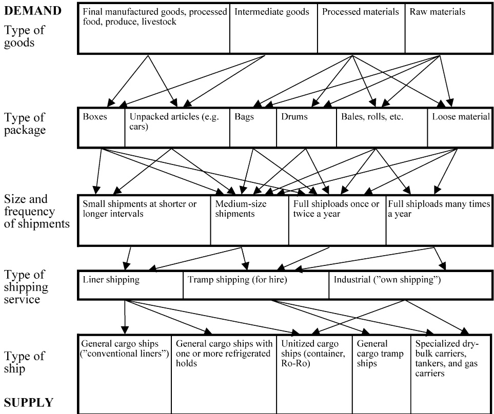

Fig. 1. Characteristic of maritime transportation demand and supply.

## 2.1 Ship and port characteristics

In this chapter we use the terms ship and vessel interchangeably. Although vessel may refer to other means of transportation, we shall use it in the traditional sense, referring to a ship.

Ships come in a variety of sizes. The size of a ship is measured by its weight carrying capacity and by its volume carrying capacity. Cargo with low weight per unit of volume fills the ship’s volume before it reaches its weight capacity. Deadweight (DWT) is the weight carrying capacity of a ship, in metric tons. That includes the weight of the cargo, as well as the weight of fuels, lube oils, supplies, and anything else on the ship. Gross Tons (GT) is the volume of the enclosed spaces of the ship in hundreds of cubic feet.

Ships come also in a variety of types. Tankers are designed to carry liquids in bulk. The larger ones carry crude oil while the smaller ones usually carry oil products, chemicals, and other liquids. Bulk carriers carry dry bulk commodities such as iron ore, coal, grain, bauxite, alumina, phosphate, and other minerals. Some of the bulk carriers are self-discharging. They carry their own unloading equipment, and are not dependent on port equipment for unloading their cargo. Liquefied Gas Carriers carry refrigerated gas under high pressure. Container Ships carry standardized metal containers in which packaged goods are stowed. General Cargo vessels carry in their holds and above deck all types of goods, usually packaged ones. These vessels often have multiple decks or floors. Since handling general cargo is labor intensive and time consuming, general cargo has been containerized during the last four decades, thus reducing the time that ships carrying such cargo spend in ports from days to hours. Refrigerated vessels or reefers are designed to carry cargo that requires refrigeration or temperature control, like fish, meat, and citrus, but can also carry general cargo. Roll-on–Roll-off (Ro–Ro) vessels have ramps for trucks and cars to drive on and off the vessel. Other types of vessels are ferries, passenger ships, fishing vessels, service/supply vessels, barges (self propelled or pushed/pulled by tugs), research ships, dredgers, naval vessels, and other, special purpose vessels. Some ships are designed as combination of the above types, e.g., ore-bulk-oil, general cargo with refrigerated compartments, passenger and Ro–Ro.

Ships operate between ports. Ports are used for loading and unloading cargo as well as for loading fuel, fresh water, and supplies, and discharging waste. Ports impose physical limitations on the dimensions of the ships that may call in them (ship draft, length and width), and usually charge fees for their services. Sometimes ports are used for transshipment of cargo among ships, especially when the cargo is containerized. Major container lines often operate large vessels between hub ports, and use smaller vessels to feed containers to/from spoke ports.

## 2.2 Types of shipping services

There are three basic modes of operation of commercial ships: liner, tramp, and industrial operations (Lawrence, 1972). Liners operate according to a published itinerary and schedule similar to a bus line, and the demand for their services depends among other things on their schedules. Liner operators usually control container and general cargo vessels. Tramp ships follow the available cargoes, similar to a taxicab. Often tramp ships engage in contracts of affreightment. These are contracts where specified quantities of cargo have to be carried between specified ports within a specific time frame for an agreed upon payment per unit of cargo. Tramp operators usually control tankers and dry bulk carriers. Both liner and tramp operators try to maximize their profits per time unit. Industrial operators usually own the cargoes shipped and control the vessels used to ship them. These vessels may be their own or on a time charter. Industrial operators strive to minimize the cost of shipping their cargoes. Such operations abound in high volume liquid and dry bulk trades of vertically integrated companies, such as: oil, chemicals, and ores. When any type of operator faces insufficient fleet capacity the operator may be able to charter in additional vessels. Whereas liners and tramp operators may give up the excess demand and related income, industrial operators must ship all their cargoes. In cases of excess fleet capacity, vessels may be chartered out (to other operators), laid-up or even scrapped. However, when liners reduce their fleet size they must reshuffle their itineraries and/or schedules, which may result in reduced service frequency or withdrawal from certain markets. In both cases revenues may drop. An interesting historical account of the development of liner services in the US is provided by Fleming (2002, 2003).

Industrial operators, who are usually more risk-averse and tend not to charter-out their vessels, size their fleet below their long-term needs, and complement it by short-term (time or voyage/spot) charters from the tramp segment. Seasonal variations in demand, and uncertainties regarding level of future demand, freight rates, and cost of vessels (both newbuildings and second-hand) affect the fleet size decision. However, when the trade is highly specialized (e.g., liquefied gas carriers) no tramp market exists and the industrial operator must assure sufficient shipping capacity through long-term commitments. The ease of entry into the maritime industry is manifested in the tramp market that is highly entrepreneurial. This results in long periods of oversupply of shipping capacity and the associated depressed freight rates and vessel prices. However, certain market segments, such as container lines, pose large economies of scale and are hard to enter.

Naval vessels are a different breed. Naval vessels alternate between deployment at sea and relatively lengthy port periods. The major objective in naval applications is to maximize a set of measures of effectiveness. Hughes (2002) provides an interesting personal perspective of naval OR.

## 2.3 Cargo characteristics

Ships carry a large variety of goods. The goods may be manufactured consumer goods, unprocessed fruits and vegetables, processed food, livestock, intermediate goods, industrial equipment, processed materials, and raw materials. These goods may come in a variety of packaging, such as: boxes, bags, drums, bales, and rolls, or may be unpackaged, or even in bulk. Sometimes cargoes are unitized into larger standardized units, such as: pallets, containers, or trailers. Generally, in order to facilitate more efficient cargo handling, goods that are shipped in larger quantities are shipped in larger handling units or in bulk. During the last several decades packaged goods that required multiple manual handlings, and were traditionally shipped by liners, have been containerized into standard containers. Containerization of such goods facilitates efficient mechanized handling of the cargo, and thus saves time and money, and also reduces pilferage. Shipping containers come in two lengths, 20 feet and 40 feet. $\mathbf { A }   2 0 ^ { \prime }$ container carries up to approximately 28 tons of cargo with a volume of up to 1000 cubic feet. Most containers are metal boxes with an $8 ^ { \prime }   \times   8 ^ { \prime }$ cross-section, but other varieties exist, such as: refrigerated containers, open top, open side, and half height. In addition there are containers of nonstandard sizes. Large containerships can carry thousands of Twenty feet Equivalent Units (TEUs), where a $4 0 ^ { \prime }$ container is counted as two TEUs.

In addition, goods that are shipped in larger quantities are usually shipped more often and in larger shipment sizes. Cargoes may require shoring on the ship in order to prevent them from shifting during the passage, and may require refrigeration, controlled temperature, or special handling while on board the ship. Different goods may have different weight density, thus a ship may be full either by weight or by volume, or by another measure of capacity.

## 2.4 Geographical characteristics

Shipping routes may be classified according to their geographical characteristics (and the corresponding type and size of vessel used): deep-sea, short-sea, coastal, and inland waterways. Due to economies of scale in shipping larger size vessels are employed in deep-sea trades between continents whereas smaller size vessels usually operate in short-sea and coastal routes, where voyage legs are relatively short. As mentioned above, smaller containerships are used on short-sea routes that feed cargo to larger vessels that operate on long deep-sea routes. A similar picture can sometimes be observed with tankers where large crude carriers used for long routes are lightered at an off shore terminal to smaller vessels (often barges). Due to draft restrictions inland waterways are used mainly by barges. Barges are used to move cargoes between the hinterland and coastal areas, often for transshipments to/from ocean-going vessels, or to move cargoes between inland ports.

## 2.5 Terms used in maritime transportation planning

• Shipping refers to moving cargoes by ships.

• The shipper is the owner of the transported cargo.

• A shipment is a specified amount of cargo that must be shipped together from a single origin to a single destination.

• Routing is the assignment of a sequence of ports to a vessel. Environmental routing or weather routing is the determination of the best path in a body of water that a vessel should follow.

• Scheduling is assigning times (or time windows) to the various events on a ship’s route.

• Deployment refers to the assignment of the vessels in the fleet to trade routes. The differentiation between deployment and scheduling is not always clear cut. Deployment is usually used when vessels are designated to perform multiple consecutive trips on the same route, and therefore is associated with liners and a longer planning horizon. Liners follow a published sailing schedule and face more stable demand. Scheduling does not imply allocation of vessels to specific trade routes, but rather to specific shipments, and is associated with tramp and industrial operations. Due to higher uncertainty regarding future demand in these operations, their schedules usually have a shorter planning horizon.

• A voyage consists of a sequence of port calls, starting with the port where the ship loads its first cargo and ending where the ship unloads its last cargo and becomes empty again. A voyage may include multiple loading ports and multiple unloading ports. Liners may not become empty between consecutive voyages, and in that case a voyage starts at the port specified by the ship operator (usually a primary loading port).

Throughout this chapter we use also the following definitions:

• A cargo is a set of goods shipped together from a single origin to a single destination. In the vehicle routing literature it is often referred to as an order. The terms shipment and cargo are used interchangeably.

• A load is the set of cargoes that is on the ship at any given point in time.

• A load is considered a full shipload when it consists of a single cargo that for practical and/or contractual reasons cannot be carried with other cargoes.

• A product is a set of goods that can be stowed together in the same compartment. In the vehicle routing literature it is sometimes referred to as a commodity.

• A loading port is a pickup location (corresponds to a pickup node).

• An unloading port is a delivery location (corresponds to a delivery node).

## 3 Strategic planning in maritime transportation

Strategic decisions are long-term decisions that set the stage for tactical and operational ones. In maritime transportation strategic decisions cover a wide spectrum, from the design of the transportation services to accepting long-term contracts. Most of the strategic decisions are on the supply side, and these are: market selection, fleet size and mix, transportation system/service network design, maritime supply chain/maritime logistic system design, and ship design. Due to characteristics discussed earlier maritime transportation markets are usually competitive and highly volatile over time, and that complicates strategic decisions.

In this section we address the various types of strategic decisions in maritime transportation and present models for making such decisions. Section 3.1 that discusses ship design is followed by Section 3.2 that deals with fleet size and mix decisions. Section 3.3 treats network design in liner shipping, and Section 3.4 handles transportation system design. Finally, Section 3.5 addresses evaluation of long-term contracts.

In order to be able to make strategic decisions one usually needs some tactical or even operational information. Thus there is a significant overlap between strategic and tactical/operational decisions. Models used for fleet size and mix decisions and network design decisions often require evaluation of ship routing strategies. Such routing models usually fall into one of two categories, arc flow models or path flow models. In arc flow models a binary variable is used to represent whether a specific vessel v travels directly from port (or customer) i to port (or customer) j. The model constructs the routes that will be used by the vessels, and the model has to keep track of both travel time and load on each vessel. In path flow models the routes are predefined, one way or another, and a binary variable represents whether vessel v performs route r. A route is usually a full schedule for the vessel that specifies expected arrival times and load on the vessel along the route. Such a model can focus on the set of ports or customers to serve, and only feasible routes are considered.

## 3.1 Ship design

A ship is basically a floating plant with housing for the crew. Therefore, ship design covers a large variety of topics that are addressed by naval architects and marine engineers, and they include structural and stability issues, materials, on-board mechanical and electrical systems, cargo handling equipment, and many others. Some of these issues have direct impact on the ship’s commercial viability, and we shall focus here on two such issues, ship size and speed.

The issue of the optimal size of a ship arises when one tries to determine what is the best ship for a specific trade. In this section we deal with the optimal size of a single ship regardless of other ships that may be included in the same fleet. The latter issue, the optimal size and composition of a fleet, is discussed in Section 3.2. The optimal ship size is the one that minimizes the ship operator’s cost per ton of cargo on a specific trade route with a specified cargo mix. However, one should realize that in certain situations factors beyond costs may dictate the ship size.

Ships are productive and generate income at sea. Port time is a “necessary evil” for loading and unloading cargo. Significant economies of scale exist at sea where the cost per cargo ton-mile decreases with increasing the ship size. These economies stem from the capital costs of the ship (design, construction, and financing costs), from fuel consumption, and from the operating costs (crew cost, supplies, insurance, and repairs). However, at port the picture is different. Loading and unloading rates are usually determined by the land-side cargo handling equipment and available storage space. Depending on the type of cargo and whether the cargo handling is done by the land-side equipment or by the equipment on the ship (e.g., pumps, derricks), the cargo handling rate may be constant (i.e., does not depend on the size of the ship), or, for dry cargo where multiple cranes can work in parallel, the cargo handling rate may be approximately proportional to the length of the ship. Since the size of the ship is determined by its length, width, and draft, and since the proportions among these three dimensions are practically almost constant, the size of the ship is approximately proportional to the third power of its length. Therefore, in the better case, cargo-handling rates will be proportional to the 1/3 power of the ship size. However, when the cargo is liquid bulk (e.g., oil) the cargo-handling rate may not be related to the size of the ship.

A ship represents a large capital investment that translates into a large cost per day. Port time is expensive and presents diseconomies of scale. Thus the time of port operations caps the optimal size of ship. Generally, the longer a trade route is, the larger the share of sea-days in a voyage, and the larger the optimal ship size will be. Other factors that affect the optimal ship size are the utilization of ship capacity at sea (the “trade balance”), loading and unloading rates at the ports, and the various costs associated with the ship. On certain routes there may be additional considerations that affect the size of the ship, such as required frequency of service and availability of cargo.

A ship is a long-term investment. The useful life of a ship spans 20–30 years. Thus, the optimal ship size is a long-term decision that must be based on expectations regarding future market conditions. During the life of a ship a lot of market volatility may be encountered. Freight rates may fluctuate over a wide range, and the same is true for the cost of a ship, whether it is a second hand one or a newbuilding. When freight rates are depressed they may not even cover the variable operating costs of the ship, and the owner has very few alternatives. In the short run the owner may either reduce the daily variable operating cost of the ship by slow steaming, that results in significant reduction in fuel consumption, or the owner may lay up the ship till the market improves. Laying up a ship involves a significant set-up cost to put the ship into lay up, and, eventually, to bring it back into service. However, laying up a ship significantly reduces its daily variable operating cost. When the market is depressed, owners scrap older ships. The value of a scrapped ship is determined by the weight of its steel (the “lightweight” of the ship), but when there is high supply of ships for scrap the price paid per ton of scrap drops. Occasionally, in a very depressed market, a newly built vessel may find itself in the scrapping yard without ever carrying any cargo.

In the shorter run ship size may be limited by parameters of the specific trade, such as availability of cargoes, required frequency of service, physical limitations of port facilities such as ship draft, length, or width, and available cargo handling equipment and cargo storage capacity in the ports. In the longer run many of these limitations can be relaxed if there is an economic justification to do so. In addition there are limitations of ship design and construction technology, as well as channel restrictions in canals in the selected trade routes.

The issue of long-run optimal ship size has been discussed mainly by economists. Jansson and Shneerson (1982) presented a comprehensive model for the determination of long-run optimal ship size. They separated the ship capacity into two components:

• the hauling capacity (the ship size times its speed), and

• the handling capacity (cargo loaded or unloaded per time unit).

This separation facilitated the division of the total shipping costs into cost per ton of cargo carried in the voyage that does not depend on the length of the voyage, and cost per time unit. These two cost components are combined into a cost model that conveys the cost of shipping a ton of cargo a given distance. The model requires estimation of output and cost elasticities. These elasticities, combined with the route characteristics and input prices, allow estimation of the optimal size of the ship. This model requires estimation of its parameters through regression analysis. However, high shipping market volatility over time results in low reliability of such estimates. They demonstrated the use of the model by calculating the optimal size of a coal bulk carrier for a specific trade. This work also inspects the sensitivity of the optimal ship size to four route characteristics: distance, port productivity, trade balance, and fuel costs. Most of the elasticities that are necessary for this model were estimated from several datasets in their earlier work (Jansson and Shneerson, 1978). However, that work calculated a single ship size elasticity of operating costs for each ship type. In a later study, Talley et al. (1986) analyzed short-run variable costs of tankers and concluded that the ship size elasticity of operating costs may vary according to the size of the ship of the specific type.

Modern cargo handling equipment that is customized for the specific cargo results in higher loading and unloading rates, and shorter port calls. Such equipment is justified where there is a high volume of cargo. That is usually the case in major bulk trades. Garrod and Miklius (1985) showed that under such circumstances the optimal ship size becomes very large, far beyond the capacity of existing port facilities. In addition, with such large ships the frequency of shipments drops to a point where inventory carrying costs incurred by the shipper start playing a significant role (the shipment size is the ship capacity). When one includes the inventory costs in the determination of the optimal ship size, that size is reduced significantly. The resulting ship sizes are still much larger than existing port facilities can accommodate, and thus the main limit on ship sizes is the draft limitation of ports. However, for a higher value cargo, or for less efficient port operations, smaller vessel sizes are optimal (see, for example, Ariel, 1991). In short-sea operations competition with other modes may play a significant role. In order to compete with other modes of transportation more frequent service may be necessary. In such cases frequency and speed of service combined with cargo availability may be a determining factor in selecting the ship size.

In liner trades, where there are numerous shippers, multiple ports, and a wide variety of products shipped, the inclusion of the shippers’ inventory costs in the determination of the optimal ship size is more complex. Jansson and Shneerson (1985) presented the initial model for this case. In addition to the costs incurred by the ship owner/operator they included the costs of inventory that are incurred by the shipper (including the cost of safety stocks). The size (and cost) of the safety stocks is a function of the frequency of sailings on the route, and that frequency is affected by the ship size and the volume of trade. Numerous assumptions regarding the trade and the costs were necessary, and the inclusion of the shippers’ costs reduced very much the optimal ship size. One could argue with the assumptions of the model, but the conclusions make sense.

Whereas Jansson and Shneerson (1985) considered a continuous review inventory control system by the shippers, Pope and Talley (1988) looked at the case of a periodic review system that is more appropriate when using a (scheduled) liner service. They found that “- - - optimal ship size is highly sensitive to the inventory management model selected, the treatment of stockouts and safety stocks, and the inventory management cost structure that prevails”, and concluded that “rather than computing optimal ship size, it may be more appropriate to compute the optimal load size”. As far as liner operations are concerned we agree with this conclusion. The optimal ship size is a long-term decision of the ship owner/operator who serves a large number of shippers. Each shipper may face different circumstances that may change over time, and therefore should be concerned with the optimal load (shipment) size. The optimal load size is a short-term decision that may change with the changing circumstances.

A historical perspective on the development of size, speed, and other characteristics of large container ships is provided by Gillman (1999). Cullinane and Khanna (1999) present a more recent detailed study of the economies of scale of large container ships. They take into account the considerable increase in port productivity, and take a closer look at the time in port. They find smaller diseconomies of scale (in port) than earlier studies, and show that the optimal size of a container ship continues to increase with improvements in port productivity. Taking advantage of these economies of scale to reduce shipping costs per unit while maintaining frequency of service, requires larger volumes on the trade route. This is one of the major catalysts for industry consolidation. However, McLellan (1997) injects a dose of reality to the discussion and points out that there are practical limits to the size of large containerships imposed by port draft, container handling technology, space availability, and required investments in port and transportation infrastructure.

Whereas cargo ships come in a large variety of sizes, from under 1000 DWT up to more than 500,000 DWT, their designed speed varies in a much narrower range. When one excludes outliers the ratio between the designed speed of a fast ship and a slow ship is about 2. The designed speed of a ship is a longterm decision that affects it’s hauling capacity and is part of optimal ship size considerations. As a general rule the design speed of a ship increases by the square root of its length. This implies that the design speed is proportional to the 1/6 power of the size of the ship. This relationship was confirmed statistically by Jansson and Shneerson (1978), and more recently by Cullinane and Khanna (1999).

## 3.2 Fleet size and mix

One of the main strategic issues for shipping companies is the design of an optimal fleet. This deals with both the type of ships to include in the fleet, their sizes, and the number of ships of each size.

In order to support decisions concerning the optimal fleet of ships for an operator, we have to consider the underlying structure of the operational planning problem. This means that fleet size and mix models very often include routing decisions. For the various fleet size and mix problem types discussed in this section we can develop models that are based on the tactical models described thoroughly in Section 4.1. The objective of the strategic fleet size and mix problem is usually to minimize the fixed (setup) costs of the ships used and the variable operating costs of these ships. In a tactical routing and scheduling problem one usually minimizes only the operating costs of the ships. However, the routing decisions made in a strategic model can be later changed during tactical planning.

In addition, the fleet size and mix decisions have to be based on an estimate of demand for the transportation services. The demand forecast is highly uncertain, and stochastic techniques for considering the uncertain information are relevant for solving such strategic planning problems. Issues of robust planning are discussed in Section 6. In the literature, various demand patterns are considered where either the size of the cargoes or the frequency of sailing is specified.

In tramp shipping, contract evaluation and fleet size issues are closely related. A shipping company has to find the best split between fixed long-term cargo contracts and spot cargoes. This split should be based on estimation of future prices and demand. When considering the fleet size and mix these issues should be included. This topic is further discussed in Section 3.5.

In Section 3.2.1 we describe the fleet planning problem for a homogeneous fleet where all the vessels are of the same type, size, and cost, while the fleet size and mix for a heterogeneous fleet is the topic of Section 3.2.2.

## 3.2.1 Homogeneous fleet size

In this section, we want to focus on a simple industrial fleet size problem for a fleet consisting of ships of the same type, size, and cost. In the end of the section some comments regarding other studies are given.

In the fleet size planning problem considered here, a homogeneous fleet of ships is engaged in transportation of full shipload cargoes from loading ports to unloading ports. This means that just one cargo is onboard a ship at a time, and each cargo is transported directly from its loading port to it’s corresponding unloading port.

All the required ship arrival times at the loading ports are fixed and known. Further, we also assume that the loading times and sailing times are known, such that the arrival times at the unloading ports can be easily calculated. The unloading times and the sailing time from each unloading port to all loading ports are also known.

The demand is such that all cargoes, given by specified loading and unloading ports, have to be serviced. The ships should be routed from the unloading ports to the loading ports in a way that minimizes the total cost of their ballast legs. Since the fleet is homogeneous and all cargoes must be transported, the cost of the loaded legs is constant and we can leave it out. In addition, we want to minimize the number of necessary ships, and we assume that the number of ships needed dominates the sailing costs.

In the mathematical description of the problem, let N be the set of cargoes indexed by i and j. Cargo i is represented by a node in the network, and this node includes one loading port and one unloading port for cargo i. Since we have full information about activity times, we can determine the feasible cargo pairs $( i , j )$ . If cargo i can be serviced just before cargo $j$ by the same ship, such an (i j)-pair is feasible and represents an arc in the network. However, if the time between the loads is too long, the arc may be eliminated since using such arcs would result in unacceptable high waiting times. Similarly, if the departing time at node i plus the sailing time to $j$ is greater than the given arrival time at j there will be no arc connecting the two cargoes. Let $\mathcal { N } _ { i } ^ { - }$ and $\mathcal { N } _ { i } ^ { + }$ be the set of all cargoes a ship can service immediately before and after servicing cargo i, respectively. Further, let V be the set of ships in the fleet indexed by $v _ { \ast }$ and this set includes an assumption on the upper bound on the number of ships necessary. For each possible ship, we define an artificial origin cargo o(v) and an artificial destination cargo d(v).

The operational cost of sailing from the unloading port for cargo i to the loading port of cargo j is denoted by $C _ { i j }$

In the mathematical formulation, we use the following types of variables: the binary flow variable $x _ { i j } , i \in \mathcal { N } , j \in \mathcal { N } _ { i } ^ { + }$ , equals 1, if a ship services cargo i just before cargo $j ,$ and 0 otherwise. In addition, we define flow variables for the artificial origin and artificial destination cargoes: $x _ { o ( v ) j } , v \in \mathcal { V } , j \in \mathcal { N } \cup \{ d ( v ) \}$ and $x _ { i d ( v ) } , v \in \mathcal { V } , i \in \mathcal { N } \cup \{ o ( v ) \}$ . If a ship v is not operating, then $x _ { o ( v ) d ( v ) } = 1$

The arc flow formulation of the industrial ship fleet size problem for one type of ships and full ship loads is as follows:

$$
\min \left[ \sum_ {i \in \mathcal {N}} \sum_ {j \in \mathcal {N} _ {i} ^ {+}} C _ {i j} x _ {i j} - \sum_ {v \in \mathcal {V}} x _ {o (v) d (v)} \right]\tag{3.1}
$$

subject to

$$
\sum_ {j \in \mathcal {N} \cup \{d (v) \}} x _ {o (v) j} = 1, \quad \forall v \in \mathcal {V},\tag{3.2}
$$

$$
\sum_ {i \in \mathcal {N} \cup \{o (v) \}} x _ {i d (v)} = 1, \quad \forall v \in \mathcal {V},\tag{3.3}
$$

$$
\sum_ {j \in \mathcal {N} _ {i} ^ {+}} x _ {i j} + \sum_ {v \in \mathcal {V}} x _ {i d (v)} = 1, \quad \forall i \in \mathcal {N},\tag{3.4}
$$

$$
\left| \sum_ {i \in \mathcal {N} _ {j} ^ {-}} x _ {i j} + \sum_ {v \in \mathcal {V}} x _ {o (v) j} = 1, \quad \forall j \in \mathcal {N}, \right.\tag{3.5}
$$

$$
x _ {i j} \in \{0, 1 \}, \quad \forall v \in \mathcal {V}, i \in \mathcal {N} \cup \big \{o (v) \big \}, j \in \mathcal {N} _ {i} ^ {+} \cup \big \{d (v) \big \}.\tag{3.6}
$$

In the first term of the objective function (3.1), we minimize the costs of the ballast legs of the ships. Since $x _ { o ( v ) d ( v ) } = 1$ if ship v is not operating, the second term in the objective function minimizes the number of ships in operation. The first term is scaled in a manner that its absolute value is less than one. This means that the objective (3.1) first minimizes the number of ships in use and then as a second goal minimizes the operating costs of the ships. The second term in the objective function could easily be incorporated in the first term. However, the present form of the objective function is chosen to highlight the twofold objective. Constraints (3.2) ensure that each ship leaves its artificial origin cargo and either services one of the real cargoes or sails directly to its artificial destination cargo. In constraints (3.3) each ship in the end of its route has to arrive at its artificial destination cargo from somewhere. Constraints (3.4) ensure that the ship that services cargo i has to either service another cargo afterward or sail to its artificial destination cargo, while constraints (3.5) say that the ship servicing cargo $j$ has to come from somewhere. Finally, the formulation involves binary requirements (3.6) on the flow variables.

We can easily see that the formulation (3.1)–(3.6) has the same structure as an assignment problem. Therefore the integrality constraints (3.6) are not a complicating factor. The problem is easily solved by any version of the simplex method or by a special algorithm for the assignment problem.

When applying a simplex method, it would be possible to have just one common artificial origin, $o ,$ and one common artificial destination, $d ,$ cargo. Then $x _ { o ( v ) j } , v \in \mathcal { V } , j \in \mathcal { N } \cup \{ d ( v ) \}$ , and $x _ { i d ( v ) } , v \in \mathcal { V } , i \in \mathcal { N } \cup \{ o ( v ) \}$ , can be transformed into $x _ { o j } ,   j   \in   \mathcal { N } \cup \{ d \}$ , and $x _ { i d } ,   i   \in   \mathcal { N } \cup \{ o \}$ . While the $x _ { o j }$ and $x _ { i d }$ variables remain binary the variable $x _ { o d }$ becomes integer.

For some problems, some of the cargoes may have a common loading port and/or a common unloading port. If the given starting times are such that several cargoes are loaded or unloaded in the same port at the same time, we assume that if this has any effect on the (un)loading times it is already accounted for in the specified data.

In a case with the same starting times in the same ports, we might change the formulation slightly. Constraints (3.4) can be considered as the constraints for leaving the unloading port for cargo i, and (3.5) as the constraints for arriving at the loading port for cargo $j .$ We can then aggregate constraints for cargoes with the same ports and starting times. This will give more variables at the left-hand side of the constraints and a right-hand side equal to the number of aggregated constraints. The corresponding flow variables from and to the artificial cargoes will become integers rather than binary.

If some of the cargoes have the same loading and unloading ports and the same starting times then we can switch from indexing the variables by cargo numbers to indexing them by loading port, unloading port, and both loading and unloading times. Then the variables can be integer rather than binary, and their number will be reduced. Dantzig and Fulkerson (1954) pioneered such a model using a different notation for a problem with naval fuel oil tankers.

They solved a problem with 20 cargoes by using the transportation model. The number of ships was minimized and 6 ships were needed.

Later Bellmore (1968) modified the problem. An insufficient number of tankers and a utility associated with each cargo were assumed. The problem was to determine the schedules for the fleet that maximized the sum of the utilities of the carried cargoes, and it was shown to be equivalent to a transshipment problem.

Another homogeneous fleet size problem is considered in Jaikumar and Solomon (1987). Their objective is to minimize the number of tugs required to transport a given number of barges between different ports in a river system. They take advantage of the fact that the service times are negligible compared with the transit times, and of the geographical structure of the port locations on the river, and develop a highly effective polynomial exact algorithm. This problem has a line (or tree) structure, and this fact is exploited in the model definition.

Recently Sambracos et al. (2004) addressed the fleet size issue for shortsea freight services. They investigate the introduction of small containers for coastal freight shipping in the Greek Aegean Sea from two different aspects. First, a strategic planning model is developed for determining the homogeneous fleet size under known supply and demand constraints where total fuel costs and port dues are minimized. Subsequently, the operational dimension of the problem is analyzed by introducing a vehicle routing problem formulation corresponding to the periodic needs for transportation using small containers. Many simplifying assumptions are made in this study. They conclude that a 5 % cost saving may be realized by redesigning the inter-island links.

## 3.2.2 Heterogeneous fleet size and mix

In this section we extend the planning problem discussed in Section 3.2.1 and include decisions about the mix of different ship sizes.

We study here one particular fleet size and mix problem, where a liner shipping company wants to serve several customers that have a demand for frequent service. The problem consists of determining the best mix of ships to serve known frequencies of demand between several origin–destination port pairs. Many feasible routes are predefined, and just some of them will be used in the optimal solution. The demand is given as a minimum required number of times each port pair has to be serviced. The underlying real problem is a pickup and delivery problem. However, with predefined routes in the model, the loading and unloading aspects are not visible but hidden in the routes. Since this is a pickup and delivery problem, the frequency demand applies to a pair of ports. The ships are heterogeneous so not all ships can sail all routes. The capacity of a ship determines, among other factors, which routes it can sail. A ship is allowed to split its time between several routes.

The planning problem consists of deciding: (1) which ships to operate and (2) which routes each ship should sail and the number of voyages along each route. The first part is a strategic fleet mix and size problem and the second part is a tactical fleet deployment problem. Fleet deployment problems are discussed in Section 4.4. The second part is used here only to find the best solution to the first part. If the demand pattern changes later, the second part can be resolved for the then available fleet.

In the mathematical description of the problem, let $\mathcal { V }$ be the set of ships indexed by v and $\mathcal { R } _ { v }$ the set of routes that can be sailed by ship v indexed by r. The set of origin–destination port pairs is called $\mathcal { N }$ indexed by $i ,$ and each such pair needs to be serviced at least $D _ { i }$ times during the planning horizon.

The cost consists of two parts. We define the cost of sailing one voyage with ship v on route r as $C _ { \mathrm { V } v r }$ . The fixed cost for ship v during the planning horizon is called $C _ { \mathrm { F } v }$ . Each voyage with ship v on route r takes $T _ { \mathrm { V } v r }$ time units, and $A _ { i r }$ is equal to 1 if origin–destination port pair i is serviced on route r. The length of the planning horizon is $T ,$ and we assume that the ships are available for the whole horizon. Let $U _ { v }$ be an upper bound on the number of voyages ship v can sail during the planning horizon.

Here we use the following types of decision variables: $u _ { v r } ,   v \in \mathcal { V } ,   r \in \mathcal { R } _ { v } ,$ represents the number of voyages along route r with ship v during the planning horizon, and $s _ { v } , v \in \mathcal { V }$ , is equal to 1 if ship v is used.

The model for the strategic fleet size and mix problem with predefined routes can then be written as

$$
\min \left[ \sum_ {v \in \mathcal {V}} \sum_ {r \in \mathcal {R} _ {v}} C _ {\mathrm{V} v r} u _ {v r} + \sum_ {v \in \mathcal {V}} C _ {\mathrm{F} v} s _ {v} \right]\tag{3.7}
$$

subject to

$$
\sum_ {r \in \mathcal {R} _ {v}} u _ {v r} - U _ {v} s _ {v} \leqslant 0, \quad \forall v \in \mathcal {V},\tag{3.8}
$$

$$
\sum_ {v \in \mathcal {V}} \sum_ {r \in \mathcal {R} _ {v}} A _ {i r} u _ {v r} \geqslant D _ {i}, \quad \forall i \in \mathcal {N},\tag{3.9}
$$

$$
\sum_ {r \in \mathcal {R} _ {v}} T _ {\nabla v r} u _ {v r} \leqslant T, \quad \forall v \in \mathcal {V},\tag{3.10}
$$

$$
u _ {v r} \geqslant 0 \text {and integer,} \quad \forall v \in \mathcal {V}, r \in \mathcal {R} _ {v},\tag{3.11}
$$

$$
s _ {v} \in \{0, 1 \}, \quad \forall v \in \mathcal {V}.\tag{3.12}
$$

Here (3.7) is the cost of sailing the used routes together with the fixed cost of the ships in operation. Constraints (3.8) ensure that the fixed costs for the ships in operation are taken into account. Constraints (3.9) say that each port pair is serviced at least the required number of times, and constraints (3.10) ensure that each ship finishes all its routes within the planning horizon. Finally, the formulation involves integer and binary requirements on the variables.

Fagerholt and Lindstad (2000) presented this model with different notation and gave an example where the model was used to plan deliveries to Norwegian petroleum installations in the North Sea. Their problem had one loading port and seven unloading installations. They managed to pre-calculate all the feasible routes and their integer program was solved by CPLEX. The model does not ensure that services for a given port pair are properly spaced during the planning horizon. This aspect was treated manually after the model solutions were generated. Fagerholt and Lindstad (2000) report that the model solution implemented gave annual savings of several million US dollars.

Another study regarding fleet size and mix for liner routes was done by Cho and Perakis (1996). The study was performed for a container shipping company. The type of model and solution method is similar to the one used by Fagerholt and Lindstad (2000). Xinlian et al. (2000) consider a similar problem. They present a long-term fleet planning model that aims at determining which ships should be added to the existing fleet, ship retirements, and the optimal fleet deployment plan. Another study regarding the design of an optimal fleet and the corresponding weekly routes for each ship for a liner shipping system along the Norwegian coast was presented by Fagerholt (1999). The solution method is similar to the one used by Fagerholt and Lindstad (2000). In Fagerholt (1999) the solution method handled only instances where the different ships that could be selected have the same speed. This is in contrast to the work in Fagerholt and Lindstad (2000), where the ships can have different speeds. Yet another contribution within fleet size and mix for liner shipping is given by Lane et al. (1987). They consider the problem of deciding a cost efficient fleet that meets a known demand for shipping services on a defined liner trade route. The solution method has some similarities to the approach used by Fagerholt and Lindstad (2000), but the method gives no proven optimal solution since only a subset of the feasible voyage options are selected and the user determines the combination of vessel and voyage. The method has been applied on the Australia/US West coast route. Finally, resource management for a container vessel fleet is studied by Pesenti (1995). This problem involves decisions on the purchase and use of ships in order to satisfy customers’ demand. A hierarchical model for the problem has been developed, and heuristic techniques, which solve problems at different decision levels, are described.

A rather special problem regarding the size of the US destroyer fleet is described in Crary et al. (2002), which illustrates the use of quantitative methods in conjunction with expert opinion. These ideas are applied to the planning scenario for the “2015 conflict on the Korean Peninsula”, one of two key scenarios the Department of Defense uses for planning.

## 3.3 Liner network design

On all three planning levels the challenges in liner shipping are quite different from those of tramp or industrial. Liner ships are employed on more or less fixed routes, calling regularly at many ports. In contrast to industrial or tramp ships a liner ship serves demand of many shippers simultaneously, and its published route and frequency of service attract demand. The major challenges for liners at the strategic level are the design of liner routes and the associated frequency of service, fleet size and mix decisions and contract evaluation for long-term contracts. The fleet size and mix decisions for the major market segments, including liner operations, are discussed in Section 3.2, while contract evaluation will be treated in Section 3.5. Here we focus on the design of liner routes. We split this section into three parts, where traditional liner operations are discussed in Section 3.3.1, and the more complex hub and spoke networks are considered in Section 3.3.2. Finally, we comment upon shuttle services in Section 3.3.3.

## 3.3.1 Traditional liner operations

Liner routes and schedules are usually set up in a manner similar to bus schedules. Before entering a particular market a liner shipping company has to thoroughly estimate the demand, revenue and cost of servicing that market. Based on this information, the company has to design its routes and to publish a sailing schedule.

Most liner companies are transporting containers, so we use here the term container(s) instead of cargo units or cargoes. We focus here on a problem where a liner container company is going to operate several different routes among a set of ports ordered more or less along a straight line. Meaning that even if a route skips a port in a contiguous sequence of ports the ship passes fairly close to the skipped port. This is usually the situation faced by longer container lines. The demands, as upper bounds on the number of transported containers, are given between all pairs of ports. The fleet of ships is heterogeneous and the planning problem consists of designing a route for each ship in a manner that maximizes the total net revenue of the fleet. One route is constructed for each ship and the ship sails as many voyages along that route as it can during the planning horizon.

The mathematical model is based on an arc flow formulation. The ports are numbered from 1 to $N ,$ and there are some strict constraints on how the routes can be constructed. Each route must have two end ports $i$ and $j ,$ where $1   \leqslant   i   <   j   \leqslant   N$ . A route then starts in i and travels outbound to ports with higher and higher number until the route reaches $j ,$ where it turns around and starts its inbound travel to ports with lower and lower number until the route ends in i. A ship with i and $j$ as end ports, does not necessarily call at all the ports between i and $j ,$ and it does not need to visit the same ports on the outbound and inbound legs of the route. See Figure 2 for an illustration of such routes.

When a ship arrives at one of its end ports it unloads all containers that are on board before it starts loading all the containers that it should load in that port. This means that each container is loaded in its loading port and stays on board the ship while the ship either sails a part of the outbound or inbound route before it is unloaded in its unloading port.

In the mathematical description of the problem, let $\mathcal { V }$ be the set of ships indexed by $v$ and $\mathcal { N }$ the set of linearly ordered ports indexed by $i ,   j ,   k ,   i ^ { \prime } ,$ or $j ^ { \prime }$ . In addition we need the subsets $\mathcal { N } _ { i } ^ { + }   =   \{ i   \bar { + }   1 , \ldots , N \}$ of ports in the line numbered after i and $\mathcal { N } _ { i } ^ { - } = \{ 1 , \dots , i - 1 \}$ of ports in the line numbered before i.

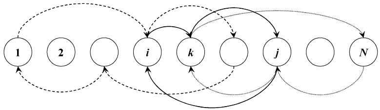

Fig. 2. Liner network design for traditional liner operations including some but not all routes.

The revenue for transporting one container from port i to port $j$ is $R _ { \mathrm { T } i j }$ and the cost of sailing directly from port i to port j with ship v is $C _ { \mathrm { T } i j v }$ . Ship v has a capacity that is measured in number of containers when it sails directly from port i to port $j ,$ and it is represented by $Q _ { \mathrm { T } i j v }$ . Most often it will be sufficient not to let capacity depend on the sailing leg $( i , j )$ , but in rare cases capacity may depend on weather conditions or other factors. The ship spends $T _ { \mathrm { T } i j v }$ time units on that trip including the time for unloading and loading in port i. It is meaningful to assume that this time does not vary with the number of containers loaded and unloaded only if the number of such containers does not vary from call to call or that the unloading and loading time is very short compared to the sailing time. The demand as an upper bound on the number of containers transported from port i to port $j$ during the planning horizon is denoted by $D _ { \mathrm { T } i j }$ . The constant $S _ { v }$ is the maximum time ship v is available during the planning period.

We use the following types of decision variables: $e _ { i j v } , v \in \mathcal { V } , i \in \mathcal { N } , j \in \mathcal { N } ,$ represents the number of containers transported from port i to port j by ship v on each voyage during the planning horizon. Ship v does not necessarily sail directly from port i to port $\bar { j } ,$ If ship v sails directly from port $i$ to port j on its route, then the binary variable $x _ { i j v } ,   v \in \mathcal { V } ,   i \in \mathcal { N } ,   j \in \mathcal { \hat { N } }$ , is equal to 1. The integer variable $w _ { v } , v \in \mathcal { V }$ , gives the number of whole voyages ship v manages to complete during the planning horizon. The binary variable $y _ { i j v } ,   \forall v   \in   \mathcal { V }$ $i \in \mathcal { N } \backslash \{ N \} , j \in \mathcal { N } _ { i } ^ { + }$ , is equal to 1 if ship v is allocated to a route that starts in port i and turns around in port $j .$ These two ports i and $j$ are called end ports for ship v.

A route design model for traditional liner operators can then be written as

$$
\max \sum_ {v \in \mathcal {V}} \sum_ {i \in \mathcal {N}} \sum_ {j \in \mathcal {N}} w _ {v} (R _ {\mathrm{Tij}} e _ {i j v} - C _ {\mathrm{Tij} v} x _ {i j v})\tag{3.13}
$$

subject to

$$
\begin{array}{c} x _ {i j v} \bigg (\sum_ {i ^ {\prime} \in \mathcal {N} _ {i + 1} ^ {-}} \sum_ {j ^ {\prime} \in \mathcal {N} _ {j - 1} ^ {+}} e _ {i ^ {\prime} j ^ {\prime} v} - Q _ {\mathrm{Tij} v} \bigg) \leqslant 0, \\ \forall v \in \mathcal {V}, i \in \mathcal {N} \backslash \{N \}, j \in \mathcal {N} _ {i} ^ {+}, \end{array}\tag{3.14}
$$

$$
x _ {i j v} \left(\sum_ {i ^ {\prime} \in \mathcal {N} _ {i - 1} ^ {+}} \sum_ {j ^ {\prime} \in \mathcal {N} _ {j + 1} ^ {-}} e _ {i ^ {\prime} j ^ {\prime} v} - Q _ {\mathrm{Tijv}}\right) \leqslant 0,
$$

$$
\forall v \in \mathcal {V}, i \in \mathcal {N} \backslash \{1 \}, j \in \mathcal {N} _ {i} ^ {-},\tag{3.15}
$$

$$
\left| w _ {v} e _ {i j v} \leqslant D _ {\mathrm{Tij}} \sum_ {j ^ {\prime} \in \mathcal {N} _ {i} ^ {+} \backslash \mathcal {N} _ {j} ^ {+}} x _ {i j ^ {\prime} v}, \right|
$$

$$
\forall v \in \mathcal {V}, i \in \mathcal {N} \backslash \{N \}, j \in \mathcal {N} _ {i} ^ {+},\tag{3.16}
$$

$$
\left| w _ {v} e _ {i j v} \leqslant D _ {\mathrm{Tij}} \sum_ {j ^ {\prime} \in \mathcal {N} _ {i} ^ {-} \setminus \mathcal {N} _ {j} ^ {-}} x _ {i j ^ {\prime} v}, \right|
$$

$$
\forall v \in \mathcal {V}, i \in \mathcal {N} \backslash \{1 \}, j \in \mathcal {N} _ {i} ^ {-},\tag{3.17}
$$

$$
w _ {v} e _ {i j v} \leqslant D _ {\mathrm{Tij}} \sum_ {i ^ {\prime} \in \mathcal {N} _ {j} ^ {-} \setminus \mathcal {N} _ {i} ^ {-}} x _ {i ^ {\prime} j v},
$$

$$
\forall v \in \mathcal {V}, i \in \mathcal {N} \backslash \{N \}, j \in \mathcal {N} _ {i} ^ {+},\tag{3.18}
$$

$$
\left| w _ {v} e _ {i j v} \leqslant D _ {\mathrm{Tij}} \sum_ {i ^ {\prime} \in \mathcal {N} _ {j} ^ {+} \backslash \mathcal {N} _ {i} ^ {+}} x _ {i ^ {\prime} j v}, \right|
$$

$$
\forall v \in \mathcal {V}, i \in \mathcal {N} \backslash \{1 \}, j \in \mathcal {N} _ {i} ^ {-},\tag{3.19}
$$

$$
\sum_ {v \in \mathcal {V}} w _ {v} e _ {i j v} \leqslant D _ {\mathrm{T} i j}, \quad \forall i \in \mathcal {N}, j \in \mathcal {N}, i \neq j,\tag{3.20}
$$

$$
w _ {v} \left(\sum_ {i \in \mathcal {N}} \sum_ {j \in \mathcal {N}} T _ {\mathrm{Tij} v} x _ {i j v}\right) \leqslant S _ {v}, \quad \forall v \in \mathcal {V},\tag{3.21}
$$

$$
\sum_ {i \in \mathcal {N} \backslash \{N \}} \sum_ {j \in \mathcal {N} _ {i} ^ {+}} y _ {i j v} \leqslant 1, \quad \forall v \in \mathcal {V},\tag{3.22}
$$

$$
\left| \begin{array}{c} y _ {i j v} \bigg (\sum_ {j ^ {\prime} \in \mathcal {N} _ {i} ^ {+} \setminus \mathcal {N} _ {j} ^ {+}} x _ {i j ^ {\prime} v} - 1 \bigg) = 0, \\ \forall v \in \mathcal {V}, i \in \mathcal {N} \backslash \{N \}, j \in \mathcal {N} _ {i} ^ {+}, \end{array} \right|\tag{3.23}
$$

$$
y _ {i j v} \bigg (\sum_ {j ^ {\prime} \in \mathcal {N} _ {i} ^ {+} \setminus \mathcal {N} _ {j} ^ {+}} x _ {j ^ {\prime} i v} - 1 \bigg) = 0,
$$

$$
\forall v \in \mathcal {V}, i \in \mathcal {N} \backslash \{N \}, j \in \mathcal {N} _ {i} ^ {+},\tag{3.24}
$$

$$
\begin{array}{r l} & y _ {i j v} \bigg (\sum_ {i ^ {\prime} \in \mathcal {N} _ {k} ^ {-} \setminus \mathcal {N} _ {i} ^ {-}} x _ {i ^ {\prime} k v} - \sum_ {j ^ {\prime} \in \mathcal {N} _ {k} ^ {+} \setminus \mathcal {N} _ {j} ^ {+}} x _ {k j ^ {\prime} v} \bigg) = 0, \\ & \quad \forall v \in \mathcal {V}, i \in \mathcal {N} \backslash \{N \}, j \in \mathcal {N} _ {i} ^ {+}, k \in \mathcal {N} _ {i} ^ {+} \backslash \mathcal {N} _ {j - 1} ^ {+}, \end{array}\tag{3.25}
$$

$$
y _ {i j v} \bigg (\sum_ {i ^ {\prime} \in \mathcal {N} _ {k} ^ {+} \setminus \mathcal {N} _ {j} ^ {+}} x _ {i ^ {\prime} k v} - \sum_ {j ^ {\prime} \in \mathcal {N} _ {k} ^ {-} \setminus \mathcal {N} _ {i} ^ {-}} x _ {k j ^ {\prime} v} \bigg) = 0,
$$

$$
\forall v \in \mathcal {V}, i \in \mathcal {N} \backslash \{N \}, j \in \mathcal {N} _ {i} ^ {+}, k \in \mathcal {N} _ {i} ^ {+} \backslash \mathcal {N} _ {j - 1} ^ {+},\tag{3.26}
$$

$$
x _ {i j v} \in \{0, 1 \}, \quad \forall v \in \mathcal {V}, i \in \mathcal {N}, j \in \mathcal {N}, i \neq j,\tag{3.27}
$$

$$
e _ {i j v} \geqslant 0, \quad \forall v \in \mathcal {V}, i \in \mathcal {N}, j \in \mathcal {N}, i \neq j,\tag{3.28}
$$

$$
w _ {v} \geqslant 0 \text {and integer,} \quad \forall v \in \mathcal {V},\tag{3.29}
$$

$$
y _ {i j v} \in \{0, 1 \}, \quad \forall v \in \mathcal {V}, i \in \mathcal {N} \backslash \{N \}, j \in \mathcal {N} _ {i} ^ {+}.\tag{3.30}
$$

The objective function (3.13) maximizes the difference between the revenue from transporting containers and the cost of operating the ships. The capacity of the ship might vary from leg to leg of the voyage, and (3.14) and (3.15) represent the capacity constraints for the possible outbound and inbound legs. To be able to transport containers from port $i$ to port $j$ on ship $v _ { \ast }$ the ship needs to depart from $i ,$ either directly to $j$ or to a port between them. In addition the ship needs to arrive in $j$ either directly from $i$ or from a port between them. The four constraints, (3.16)–(3.19), express these issues. The constraints for the outbound and inbound parts of the voyage had to be given separately. Each of these constraints ensures that if none of the binary flow variables, $x _ { i ^ { \prime } j v } \; \mathbf { o r } \; x _ { i j ^ { \prime } v } ,$ is equal to 1, the number of containers transported by ship $v$ from port $i$ to port $j$ during the planning horizon is zero. When the binary flow variables are equal to 1, the corresponding constraint is redundant. The demands as upper bounds on the number of transported containers are expressed in (3.20), and the upper bound on the number of voyages for each ship is expressed in (3.21). The connectivity of each route is expressed by (3.22)–(3.26). Constraints (3.22) ensure that each ship can have only one pair of end ports (one starting port $i$ and one turning port $j )$ . A ship that starts in port $i$ and turns around in port $j ,$ needs to leave $i$ for a port not farther away than $j$ and it needs to arrive in $i$ from $\mathbf { a }$ port not farther away than $j .$ This is expressed in (3.23) and (3.24). For each port, $k ,$ numbered between i and $j ,$ the same ship must arrive in $k$ the same number of times, 0 or 1, as the number of times it departs from $k ,$ , both on the outbound part and on the inbound part of the route. This is taken care of by (3.25) and (3.26). The turning around in port $j$ is taken care of by the fact that if port $\dot { k }$ is the last port ship $v$ visits before it reaches port $j ,$ then constraints (3.25) say that the ship has to travel directly from port $k$ to port $j .$ And if port $\dot { k } ^ { \prime }$ is the first port ship v visits on the inbound part of its voyage after leaving port $j ,$ then constraints (3.26) say that the ship has to travel directly from port $j$ to port $k ^ { \prime }$

Rana and Vickson (1988) presented a model for routing of one ship. Later (Rana and Vickson, 1991) they enhanced the model to a fleet of ships, and this latter model is the same as the one presented here with a different notation, and with constraints (3.14) and (3.15) written linearly. The solution method used by Rana and Vickson can be summarized as follows. They started with reducing the nonlinearities in the model. If we look carefully at constraints (3.14)–(3.26) we see that constraints (3.20) are the only type of constraints that is summed over v. All the other constraints are written separately for each ship. The authors exploited this fact to apply Lagrangian relaxation to constraints (3.20). Then the problem decomposes into one problem for each ship. However, they needed to iterate or optimize over the Lagrangian multipliers. In solving the problem for each ship they solved it for different fixed values for the number of voyages. In this way, they got mixed linear integer subproblems, which they solved to near optimality by using Bender’s decomposition. They give results for problems with 3 ships and between 5 and 20 ports. On average their solutions are about 2% from the upper bounds.

All the nonlinearities in (3.13)–(3.26) consist of products of two variables or one variable and a linear expression in other variables. Apart from the terms with $w _ { v } e _ { i j v }$ , all the nonlinear terms consist of products where at least one variable is binary. So by first expressing $w _ { v }$ by binary variables, we can remove the product terms by defining one new variable and three new constraints for each product term as described by Williams (1999) in Chapter 9.2. We might then, over a decade after the publication of that paper (Rana and Vickson, 1991), be able to solve small instances of the underlying problem by using standard commercial software for mixed integer programming.

A rather special liner shipping problem is described by Hersh and Ladany (1989). However, the structure of the problem has some similarities to the problem described here. A company leasing a luxury ocean liner for Christmas cruises from Southern Florida is confronted with the problem of deciding upon the type of cruises to offer. The decision variables in the problem include the routing of the ship, the duration of the cruises, the departure dates, and the fare schedules of the cruises.

## 3.3.2 Hub and spoke networks

Containers are usually both faster and cheaper to load and unload than the general cargo that is stuffed in them. This means that containers can efficiently be loaded and unloaded several times between their origin and their final destination. One type of maritime transportation systems for containers is the so-called hub and spoke network or a trunk line and feeder system. In such systems we have a trunk line operating between the major ports (hubs) and a system of feeder ships working in the geographical region around each hub port visited by the trunk line. The ports feeding containers to a hub are the spokes. Thus, a container is typically loaded and unloaded three times. First a feeder ship transports the container from its initial loading port to a trunk line hub port. Then a trunk line ship transports the container to another trunk line hub port, and finally another feeder ship takes the container to its final unloading port. Such networks are further described in the chapter by Crainic and Kim (2007) on intermodal transportation in this handbook.

Here we study a short-sea application of a feeder system around one trunk line hub port with a homogeneous fleet of feeder ships. We model the transportation of containers between one hub port and a set of feeder ports (spokes)

in one geographical region. Each container is either loaded or unloaded in the hub.

The demands both to and from a spoke port are assumed to increase with the number of visits in the port during the planning horizon. These demands are upper bounds on the number of containers available for transportation, but the shipping company is not obliged to satisfy the total demand.

The planning problem consists of choosing which of a possible huge set of predefined routes to use and how many voyages to sail along the chosen routes, while maximizing the net revenue. Figure 3 illustrates the problem with one hub and several spokes. The designed routes might be overlapping.

In the mathematical description of the problem, let $\mathcal { R }$ be the set of pre-defined routes indexed by r and $\mathcal { N }$ be the set of ports, excluding the hub, indexed by i. Further, let $\mathcal { N } _ { r }$ be the set of ports, excluding the hub, visited on route r. The routes that visit port i are given by the set $\mathcal { R } _ { i }$ . The ports called after port i on route r belong to the set $\mathcal { N } _ { i r } ^ { + }$ and the ports called before and including port i on route r belong to the set $\mathcal { N } _ { i r } ^ { - }$ . Let M be the set of possible calls at the same port during the planning horizon indexed by m.

We assume that there are fixed revenues, $R _ { \mathrm { L } i }$ and $R _ { \mathrm { U } i _ { 1 } }$ , for carrying one container to and from port i. The cost consists of three parts. We call the fixed cost of operating a ship during the planning horizon $C _ { \mathrm { F } }$ . The cost of sailing one voyage along route $r$ is $C _ { V r }$ and the cost of unloading (loading) one container in port i on route $r$ is $C _ { \mathrm { U } i r } \; ( C _ { \mathrm { L } i r } )$ . Since the fleet is homogeneous and the unit costs are specified before we know the loading pattern along the routes, we will normally have $C _ { \mathrm { U } i r }$ and $C _ { \mathrm { L } i r }$ independent of r. The time each ship is available during the planning horizon is called the shipping season S. The sailing time for one voyage along route $r$ is $T _ { \mathrm { V } r }$ and the capacity measured in number of containers of a ship is $Q .$ The demand is specified in the following way: $D _ { \mathrm { U } i m }$ $( D _ { \mathrm { L } i m } )$ is the incremental demand for unloading (loading) in port i when the number of calls at that port increases from $m - 1$ to m.

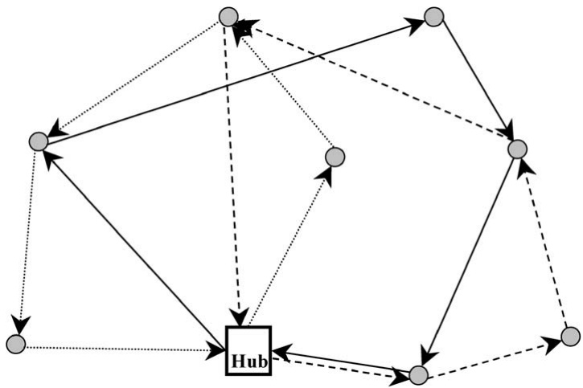

Fig. 3. Liner network design for a hub and spoke system. Example of three overlapping routes.

In the mathematical formulation, we use the following types of variables: the integer variable s represents the number of ships in operation and $u _ { r } ,   r \in \mathcal { R }$ represents the number of voyages along route r during the planning horizon. The number of containers unloaded and loaded in port i on route r during the planning horizon is given by $q _ { \mathrm { U } i r }$ and $q _ { \mathrm { L } i r } ,   r   \in   \mathcal { R } ,   i   \in   \mathcal { N } _ { r } ,$ , respectively. The integer number of calls at port i is $h _ { i } ,   i \in \mathcal { N }$ , and finally, the binary variable $g _ { i m } , i \in \mathcal { N } , m \in \mathcal { M }$ , is equal to 1 if port i is called at least m times during the planning horizon.

A liner network design model for a network with one hub and several spokes is as follows:

$$
\begin{array}{l} \hline \max \left[ \left(\sum_ {r \in \mathcal {R}} \sum_ {i \in \mathcal {N} _ {r}} (R _ {\mathrm{U} i} - C _ {\mathrm{U} i r}) q _ {\mathrm{U} i r}\right) \right. \\ \left. + \left(\sum_ {r \in \mathcal {R}} \sum_ {i \in \mathcal {N} _ {r}} (R _ {\mathrm{L} i} - C _ {\mathrm{L} i r}) q _ {\mathrm{L} i r}\right) - C _ {\mathrm{F}} s - \sum_ {r \in \mathcal {R}} C _ {\mathrm{V} r} u _ {r} \right] \end{array}\tag{3.31}
$$

subject to

$$
\sum_ {r \in \mathcal {R}} T _ {\mathrm{V} r} u _ {r} - S s \leqslant 0,\tag{3.32}
$$

$$
\sum_ {i \in \mathcal {N} _ {r}} q _ {\mathrm{U} i r} - Q u _ {r} \leqslant 0, \quad \forall r \in \mathcal {R},\tag{3.33}
$$

$$
\sum_ {j \in \mathcal {N} _ {i r} ^ {-}} q _ {\mathrm{L} j r} + \sum_ {j \in \mathcal {N} _ {i r} ^ {+}} q _ {\mathrm{U} j r} - Q u _ {r} \leqslant 0, \quad \forall r \in \mathcal {R}, i \in \mathcal {N} _ {r},\tag{3.34}
$$

$$
\sum_ {r \in \mathcal {R} _ {i}} u _ {r} - h _ {i} = 0, \quad \forall i \in \mathcal {N},\tag{3.35}
$$

$$
\sum_ {m \in \mathcal {M}} g _ {i m} - h _ {i} = 0, \quad \forall i \in \mathcal {N},\tag{3.36}
$$

$$
g _ {i (m - 1)} - g _ {i m} \geqslant 0, \quad \forall i \in \mathcal {N}, m \in \mathcal {M},\tag{3.37}
$$

$$
\sum_ {r \in \mathcal {R} _ {i}} q _ {\mathrm{Uir}} - \sum_ {m \in \mathcal {M}} D _ {\mathrm{Uimgim}} \leqslant 0, \quad \forall i \in \mathcal {N},\tag{3.38}
$$

$$
\sum_ {r \in \mathcal {R} _ {i}} q _ {\mathrm{Lir}} - \sum_ {m \in \mathcal {M}} D _ {\mathrm{Lim}} g _ {i m} \leqslant 0, \quad \forall i \in \mathcal {N},\tag{3.39}
$$

$$
q _ {\mathrm{Uir}}, q _ {\mathrm{Lir}} \geqslant 0, \quad \forall r \in \mathcal {R}, i \in \mathcal {N} _ {r},\tag{3.40}
$$

$$
h _ {i}, s, u _ {r} \geqslant 0 \text {and integer}, \quad \forall r \in \mathcal {R}, i \in \mathcal {N},\tag{3.41}
$$

$$
g _ {i m} \in \{0, 1 \}, \quad \forall i \in \mathcal {N}, m \in \mathcal {M}.\tag{3.42}
$$

The objective function (3.31) maximizes the net revenue over the planning horizon. We calculate the number of needed ships in (3.32) in a way that might be too simple. The constraints ensure that the total available sailing time for the total fleet of ships is larger than the sum of the voyages’ times. We have not verified that the available time of the ships can be split in such a manner that each ship can perform an integer number of voyages during the planning horizon. Constraints (3.33) and (3.34) take care of the capacity when the ships leave the hub and the spokes on the route. Constraints (3.35) and (3.36) use the number of voyages along the routes to calculate the number of calls at each port. The precedence constraints (3.37) for the $g _ { i m }$ variables are not needed if the incremental increase in the demand diminishes with increasing number of calls. The numbers of containers unloaded and loaded in the ports are bounded by the demand constraints (3.38) and (3.39). Finally, the formulation involves binary, integer and nonnegativity requirements on the variables in (3.40)–(3.42).

Bendall and Stent (2001) presented this model using a different notation and equal costs for loading and unloading containers. Their paper does not provide any information regarding how the model is solved. From the size of their practical example and the lack of information about the solution method, we conclude that they used some standard software for integer programming. After solving the stated model, they use heuristic methods to find a schedule for each ship. They report results for an application with Singapore as the hub and 6 spokes in East-Asia. The routes are different from the impression that the mathematical model gives, because they had 6 single spoke routes, one for each spoke and 2 routes with 2 spokes each. The demand data was for one week and it was assumed that the transportation pattern would be replicated for many weeks.

If we cannot guarantee that the incremental demand diminishes with increasing number of visits, then (3.35)–(3.39) can be reformulated in the following way. Some of the symbols will be redefined to avoid defining too many new ones. Now, let $D _ { \mathrm { U } i m } \left( D _ { \mathrm { L } i m } \right)$ be the unloading (loading) demand in port i when the number of calls in port i is m, and $g _ { i m }$ is equal to 1 if port i is called exactly m times during the planning horizon.

These changes result in the following new or revised constraints:

$$
\sum_ {m \in \mathcal {M}} m g _ {i m} - \sum_ {r \in \mathcal {R} _ {i}} u _ {r} = 0, \quad \forall i \in \mathcal {N},\tag{3.43}
$$

$$
\sum_ {m \in \mathcal {M}} g _ {i m} = 1, \quad \forall i \in \mathcal {N},\tag{3.44}
$$

$$
\sum_ {r \in \mathcal {R} _ {i}} q _ {\mathrm{Uir}} - \sum_ {m \in \mathcal {M}} D _ {\mathrm{Uimgim}} \leqslant 0, \quad \forall i \in \mathcal {N},\tag{3.45}
$$

$$
\sum_ {r \in \mathcal {R} _ {i}} q _ {\mathrm{Lir}} - \sum_ {m \in \mathcal {M}} D _ {\mathrm{Lim}} g _ {i m} \leqslant 0, \quad \forall i \in \mathcal {N}.\tag{3.46}
$$

Here (3.43) has replaced (3.35) and (3.36) and (3.44) is used instead of (3.37). After changing the meaning of the symbols, the last two constraints above, (3.45) and (3.46), are unchanged from the original formulation. This reformulation might be useful when branching on $g _ { i m }$ for one value of i and all values of m as one entity. Some solvers include this possibility, and this set of variables is then defined as a special ordered set of type one (SOS1 or S1). For a definition of such sets, see Chapter 9.3 in Williams (1999). For such sets some solvers will do binary branching by setting some of the variables equal to zero in one branch and setting the other variables equal to zero in the other branch. Such branching often results in a more evenly balanced branching tree. This in turn usually results in fewer branches to investigate.

## 3.3.3 Shuttle services

Ferries are often used to provide a shuttle service between a pair of ports. The ferries are often custom built to serve a particular route, fitting comfortably into available berths. Ferries may carry passengers, and usually can carry cars or trucks that are driven on and off board. Larger ferries that are designed to carry trucks or cars are called roll-on roll-off vessels. Very little research has been devoted to this area. A simulation model for ferry traffic among the Aegean Islands is described by Darzentas and Spyrou (1996). The model is used for decision support on a “what $\mathbf { i f } ^ { \flat \flat }$ basis for regional development. By using the simulation model, they were able to evaluate the appropriateness of existing ferry routes, as well as new transportation scenarios, including the use of new technology vessels and changes in port capacities.

## 3.4 Design of maritime transport systems

In a maritime transport system, sea transport constitutes at least one vital link. An important strategic planning issue is the design of such systems. In the literature such systems are also referred to as maritime logistics systems or maritime supply chains. Reported research in the literature on such systems is scarce. We shall briefly discuss here one optimization-based application and a couple of simulation studies.

A real strategic and tactical industrial ocean-cargo shipping problem was studied by Mehrez et al. (1995). The problem involves the shipping of dry bulk products from a source port to transshipment ports, and then distribution of the products from the transshipment ports to the customers over land. The decisions made include the number and size of ships to charter in each time period during the planning horizon, the number and location of transshipment ports to use, and transportation routes from the transshipment ports to the customers. The problem is modeled and solved using a MIP model. Recommendations from this study were implemented by the client company.

Richetta and Larson (1997) present a problem regarding the design of New York City’s refuse marine transport system. Waste trucks unload their cargo at land-based stations where refuse is placed into barges that are towed by tugboats to the Fresh Kills Landfill on Staten Island. They developed a discrete event simulation model incorporating a complex dispatching module for decision support in fleet sizing and operational planning. This work is an extension of an earlier study by Larson (1988).

Another simulation study regarding maritime supply chain design can be found in Fagerholt and Rygh (2002). There, the problem is to design a seaborne system for transporting freshwater from Turkey to Jordan. The fresh water was to be transported by sea from Turkey to discharging buoy(s) off the coast of Israel, then in pipeline(s) to a tank terminal ashore and finally through a pipeline from Israel to Jordan. The study aimed at answering questions regarding the required number, capacity and speed of vessels, capacity and number of discharging buoys and pipelines, and the necessary capacity of the tank terminal.

Sigurd et al. (2005) discuss a problem where a group of companies, that need transport between locations on the Norwegian coastline and between Norway and The European Union, is focusing on reducing costs and decreasing transport lead-time by combining their shipments on the same ships. The companies need to analyze if there is a realistic possibility to switch some of their demand for transportation from road to sea. New transport solutions would need faster ships in order to substantially decrease the existing travel time. The underlying planning problem consists of finding recurring liner routes. These routes need to fit both with the quantity and frequency demanded by the companies.

## 3.5 Contract evaluation

This section discusses another important strategic problem faced by most shipping companies, namely contract evaluation. This problem is to some extent related to the fleet size and composition issue, and it consists of deciding whether to accept a specified long-term contract or not. The characteristics of this problem differ between tramp and liner operations, and this problem is of little relevance in an industrial operation.

For a tramp shipping company the problem is to decide whether to accept a Contract of Affreightment (a contract to carry specified quantities of cargo between specified ports within a specific time frame for an agreed payment per ton). In this case, the shipping company has to evaluate whether it has sufficient fleet tonnage to fulfill the contract commitments together with its existing commitments, and if so, whether the contract is profitable. To check if a contract will be profitable one also has to make assumptions about how the future spot market will develop for the given contract period. Typically, if a shipping company anticipates low spot rates, it will prefer to have as large contract coverage as possible or ‘go short of tonnage’ and vice versa. The authors are not aware of any published work in this area.

In the liner shipping industry these problems look slightly different. It is common that shippers buy a certain capacity for a given trade route. For instance in container freight transportation, which constitutes most of the liner shipping trade, it is not unusual that some of the bigger ocean carriers do between 80% and 95% of their business under such contracts. Most contracts between ocean carriers and shippers are negotiated once a year, typically one or two months before the peak season of the major trade covered by the contract. A key parameter of a contract is the set of prices for the different cargoes between any pair of ports. The United States Ocean Shipping Reform Act of 1998 for the first time allows ocean carriers moving freight into and out of the US to enter into confidential contracts with shippers, and to charge different shippers different prices. This makes the problem of how to structure these prices relevant. This problem has many similarities with yield management in the airline industry. Kleywegt (2003) presents a model that can be used to support such decisions before and during contract negotiations. A somewhat similar problem can be found for cruise lines. Ladany and Arbel (1991) present four models for determining the optimal price differentiation strategy that a cruise liner should follow in order to maximize its profit for four different situations. A price differentiation strategy means that customers belonging to different market segments would pay different prices for identical cabins. Also this problem is similar to yield management in airlines.

## 4 Tactical planning in maritime transportation

At the tactical planning level we concentrate on medium-term decisions, and the focus of this level in maritime transportation is on routing and scheduling. Therefore, most of this section is devoted to these planning issues. We start this section by presenting some classical industrial and tramp ship scheduling problems and give arc flow formulations of these problems in Section 4.1. Then in Section 4.2 we discuss frequently used solution methods for solving ship routing and scheduling problems. Throughout the presentation of problems, formulations and solution approaches we refer to important research in industrial and tramp ship scheduling, as we deem appropriate. In Section 4.3 we present several tactical planning problems and applications in maritime supply chains, where sea transport constitutes at least one vital part of the supply chain. Fleet deployment in liner shipping is presented and discussed in Section 4.4, whereas barge scheduling on inland waterways is presented in Section 4.5. Section 4.6 is dedicated to naval vessel scheduling, while in Section 4.7 we briefly discuss ship management.

## 4.1 Scheduling problems for industrial and tramp shipping

As described in Section 2, in industrial shipping the cargo owner or shipper controls the ships. Industrial operators try to ship all their cargoes at minimum cost. Tramp ships follow the available cargoes like a taxi. A tramp shipping company may have a certain amount of contract cargoes that it is committed to carry, and tries to maximize the profit from optional cargoes. From an OR point of view the structure of the planning challenges for these two modes of operation is very similar regarding the underlying mathematical models and solution approaches. Therefore we treat these modes of operations together in this section. During the last decades there has been a shift from industrial to tramp shipping (see Christiansen et al., 2004 and Section 7). In Section 7 we discuss some reasons for the shift from industrial to tramp shipping. Perhaps the main reason is that many cargo owners are now focusing on their core business and have outsourced other activities like transportation to independent shipping companies. From the shipper’s perspective, this outsourcing has resulted in reduced risk. Most contributions in the OR literature are for industrial shipping, while only a few are in the tramp sector. The main reason for the minimal attention to tramp scheduling in the literature may be that historically the tramp market was operated by a large number of small operators, even though this is not the case anymore.

In this section we present classes of real ship routing and scheduling problems. We start with the simplest type of problems in Section 4.1.1 dealing with routing and scheduling of full shiploads. Here just one cargo is onboard the ship at a time. We extend this problem to multiple cargoes onboard at the same time, where each of the cargoes has a fixed size. This problem is addressed in Section 4.1.2. We continue in Section 4.1.3 with similar problems but where flexible cargo sizes are allowed. In Section 4.1.4 we present routing and scheduling problems where multiple nonmixable products can be carried simultaneously, and the ship capacity is split into separate compartments. Typical tramp shipping characteristics concerning contracted and optional cargoes are considered in Section 4.1.5. Finally, we discuss the use of spot charters in Section 4.1.6.

In practice, at the beginning of the planning horizon the ships in the fleet may be occupied with prior tasks. For all the classes of problems described in this section we find the first point in time where the ship is available for loading a new cargo during the planning horizon, and we assume that at that time the ship is empty.

## 4.1.1 Full shiploads

In some market segments, the ship is loaded to its capacity in a loading port and the cargo is transported directly to its unloading port. A typical example is the transportation of crude oil.

The objective of an industrial ship scheduling problem for full shipload cargoes is to minimize the sum of the costs for all the ships in the fleet while ensuring that all cargoes are lifted from their loading ports to their corresponding unloading ports. Time windows are usually imposed for both loading and unloading the cargoes.

In such an operation, an industrial shipping company usually operates a heterogeneous fleet of ships with specific ship characteristics including different cost structures and load capacities. In the short-term, it is impractical to change the fleet size. Therefore, we are concerned with the operations of a given number of ships within the planning horizon. The fixed cost of the fleet can be disregarded as it has no influence on the planning of optimal routes and schedules. We consider the case where the fleet has sufficient capacity to serve all committed cargoes during the planning horizon. The ships are charged port and channel tolls when visiting ports and passing channels, and these costs depend on the size of the ship. The remaining variable sailing costs consist mainly of fuel and oil costs, and depend usually on the ship size.

The quantity of a particular cargo is given and the corresponding loading and unloading port of that cargo are known, so the time from arrival at the loading port until the time of departure from the unloading port can be easily calculated.

In the case where a ship can carry only one cargo at a time but the ship is not necessary filled up each time, the underlying planning problem is identical to the problem of full shiploads.

**Example 4.1.** Consider the following simplified example of a route from a solution to a full shipload planning problem. In this planning problem several ships are going to service a set of cargoes. In the optimal solution, one ship is going to lift cargoes 1, 2, and 3. In Table 5, information about the loading and unloading ports is given for each of the cargoes. In addition, we specify the quantity of each of the cargoes. Notice that not all cargo sizes are equal to the capacity of the ship. Two of the cargoes have a quantity equal to half the capacity of the ship. In reality, the utilization of the ship is too low, but this case is a basis for another problem presented later on in this section. For the sake of simplicity, the time windows information is omitted in this example.

The geographical picture of the ports is given in Figure 4(a), while the physical planned route for the ship is shown in Figure 4(b). The physical planned route is the shortest route for this set of cargoes. Notice that the sequence of cargoes in the optimal solution might be different when we consider the time windows. Finally, in Figure 4(c), we see the load onboard the ship at departure from the respective ports for the planned route.

In the mathematical description of the problem, let N be the set of cargoes indexed by i. Cargo i is represented by a node in a network, and this node includes one loading port and one unloading port for cargo i. Further, let V be the set of ships in the fleet indexed by v. The set $( \mathcal { N } _ { v } , \mathcal { A } _ { v } )$ is the network associated with a specific ship v, where $\dot { \mathcal { N } } _ { v }$ and $\mathcal { A } _ { v }$ represent the sets of the nodes and arcs, respectively. Not all ships can visit all ports and take all cargoes, and $\mathcal { N } _ { v } =$ {feasible nodes for ship v} $\cdot \cup \{ o ( v ) , d ( v ) \}$ . Here, $o ( v )$ and $d ( v )$ are an artificial origin cargo and an artificial destination cargo for ship v, respectively. If the ship is not used, $d ( v )$ will be serviced just after $o ( v )$ . The set $\mathcal { A } _ { v }$ contains all feasible arcs for ship v, which is a subset of $\{ i \in \mathcal { N } _ { v } \} \times \{ i \in \mathcal { N } _ { v } \}$ . This set will be calculated based on time constraints and other restrictions. The arc $( i , j )$ connects cargo i and cargo $j ,$ where cargo i will be serviced just before cargo j if the arc is used.

Let us look again at Example 4.1. Figure 5 shows the route of this example (marked with bold lines) drawn over the underlying network. The ship leaves the artificial origin cargo node in the beginning of its route and lifts cargo 1 that is represented by node Cargo 1. The route is then followed by node Cargo 3, node Cargo 2, and finally the artificial destination cargo node. The other arcs are possible precedence combinations between the cargoes given in this example.

Table 5.

Cargo information for Examples 4.1 and 4.2

|  | Loading port | Unloading port | Quantity |
| --- | --- | --- | --- |
| Cargo 1 | A | C | 12 ship |
| Cargo 2 | D | E | full ship |
| Cargo 3 | B | D | 12 ship |

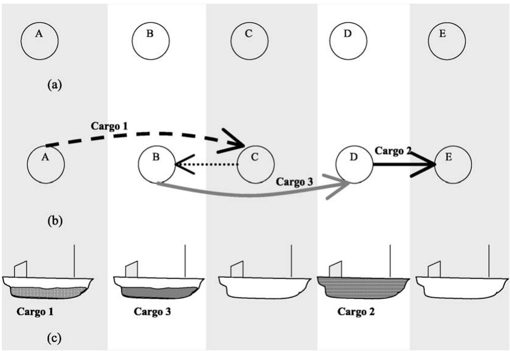

Fig. 4. (a) Geographical picture of the ports for Examples 4.1 and 4.2. (b) Physical route for the ship for Example 4.1. (c) Load onboard the ship at departure for Example 4.1.

For each arc, $T _ { S i j v }$ represents the calculated time for ship v from the arrival at the loading port for cargo i until the arrival at the loading port for cargo j. It includes the sum of the time for loading and unloading cargo i, the sailing time between ports related to cargo i and the sailing time from the unloading port for cargo i to the loading port for cargo j. Let $[ T _ { \mathrm { M N } i v } ,   T _ { \mathrm { M X } i v } ]$ denote the time window for ship v associated with the loading port for cargo i, where TMNiv is the earliest time for start of service, while $T _ { \mathrm { M X } i v }$ is the latest time. In the underlying real problem these data are seldom specified for each ship v but are appropriate in the mathematical model due to a preprocessing phase. The variable sailing and port costs are represented by $C _ { i j v }$

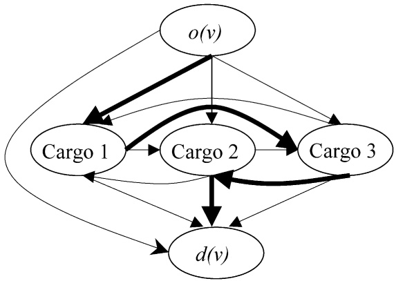

Fig. 5. The route of Example 4.1 drawn over the underlying network.

In the mathematical formulation, we use the following types of variables: the binary flow variable $x _ { i j v } , v \in \mathcal { V } , ( i , j ) \in \mathcal { A } _ { v }$ , equals 1, if ship v services cargo i just before cargo $j ,$ and 0 otherwise. This flow variable determines which ship takes a particular cargo. The time variable $t _ { i v } ,   v \in \mathcal { V } ,   i \in \mathcal { N } _ { v }$ , represents the time at which service begins at the loading port of cargo i with ship v.

The arc flow formulation of the industrial ship scheduling problem with full shiploads is as follows:

$$
\min \sum_ {v \in \mathcal {V}} \sum_ {(i, j) \in \mathcal {A} _ {v}} C _ {i j v} x _ {i j v}\tag{4.1}
$$

subject to

$$
\sum_ {v \in \mathcal {V}} \sum_ {j \in \mathcal {N} _ {v}} x _ {i j v} = 1, \quad \forall i \in \mathcal {N},\tag{4.2}
$$

$$
\sum_ {j \in \mathcal {N} _ {v}} x _ {o (v) j v} = 1, \quad \forall v \in \mathcal {V},\tag{4.3}
$$

$$
\sum_ {i \in \mathcal {N} _ {v}} x _ {i j v} - \sum_ {i \in \mathcal {N} _ {v}} x _ {j i v} = 0, \quad \forall v \in \mathcal {V}, j \in \mathcal {N} _ {v} \backslash \big \{o (v), d (v) \big \},\tag{4.4}
$$

$$
\sum_ {i \in \mathcal {N} _ {v}} x _ {i d (v) v} = 1, \quad \forall v \in \mathcal {V},\tag{4.5}
$$

$$
x _ {i j v} (t _ {i v} + T _ {\mathrm{Sijv}} - t _ {j v}) \leqslant 0, \quad \forall v \in \mathcal {V}, (i, j) \in \mathcal {A} _ {v},\tag{4.6}
$$

$$
T _ {\mathrm{MNiv}} \leqslant t _ {i v} \leqslant T _ {\mathrm{MXiv}}, \quad \forall v \in \mathcal {V}, i \in \mathcal {N} _ {v},\tag{4.7}
$$

$$
x _ {i j v} \in \{0, 1 \}, \quad \forall v \in \mathcal {V}, (i, j) \in \mathcal {A} _ {v}.\tag{4.8}
$$

The objective function (4.1) minimizes the costs of operating the fleet. Constraints (4.2) ensure that all cargoes that the shipping company has committed itself to carry are serviced. Constraints (4.3)–(4.5) describe the flow on the sailing route used by ship v. Constraints (4.3) and (4.5) ensure that ship v services the artificial origin cargo and the artificial destination cargo once, respectively. Constraints (4.6) describe the compatibility between routes and schedules. The time for start of service of cargo j cannot be less than the sum of the start time of cargo i and the service time for loading, transporting and unloading cargo i and the sailing time from the unloading port for cargo i to the loading port for cargo j with ship v, if ship v is really servicing cargo i just before cargo j. Constraints (4.6) contain an inequality sign because waiting time is permitted before the start of service in a port. The time window constraints are given by constraints (4.7). For the artificial origin cargo, this time window is collapsed to the value when ship v is available for new cargoe(s) during the planning horizon. If ship v is not servicing cargo i, we get an artificial starting time within the time windows for that (i v)-combination. This means that we get a starting time for each (i v)-combination. However, just the starting time associated with ship v actually lifting the particular cargo i is real. Finally, the formulation involves binary requirements (4.8) on the flow variables.

This industrial ship scheduling problem for full shipload cargoes corresponds to a multitraveling salesman problem with time windows (see Desrosiers et al., 1995).

The model (4.1)–(4.8) is still valid if the planning problem involves cargoes that are not equal to the capacity of the ship but a ship can carry only one cargo at a time. The set $\mathcal { N } _ { v }$ gives the cargoes that can be serviced by ship v. For this variant of the problem, the set $\mathcal { N } _ { v } ^ { \tilde { } }$ is calculated based on the capacity of the ship and the load quantity of cargo i.

The quantities of some cargoes might be given in an interval, and the cargo size is then determined by the ship capacity a priori for each cargo and ship combination. Relative revenues for loading larger cargo quantities for a cargo i due to larger ship capacity can be included in $C _ { i j v }$

The load of the ship might in some cases be first loaded in several loading ports in the same region and unloaded in one or several ports. The model (4.1)–(4.8) is also valid for such a situation. However, the calculated sailing times have to be adjusted such that times in all ports are included. Now, the time variable $t _ { i v }$ represents the time at which service begins at the first loading port for cargo i with ship v.

In the literature, we find several studies on the industrial ship scheduling problems with full shipload cargoes. Brown et al. (1987) describe such a problem where a major oil company is shipping crude oil from the Middle East to Europe and North America. Fisher and Rosenwein (1989) study a problem that is conceptually quite similar to the one in Brown et al. (1987). Here, a fleet of ships controlled by the Military Sealift Command of the US Navy is engaged in pickup and delivery of various bulk cargoes. Each cargo may have up to three loading points which are often the same port or nearby ports and up to three unloading points that are frequently close to each other. In contrast to Brown et al. (1987), each cargo may not be a full shipload. However, at most one cargo is on a vessel at any time. Therefore, the same model is still valid. Another similar problem of shipping crude oil is studied by Perakis and Bremer (1992).

## 4.1.2 Multiple cargoes with fixed cargo size

Here we present an industrial ship routing and scheduling problem where several cargoes are allowed to be onboard the ship at the same time. The objective of the scheduling problem is to minimize the sum of the costs for all the ships in the fleet while ensuring that all cargoes are lifted from their loading ports to their corresponding unloading ports. Each cargo consists of a designated number of units of a product or a commodity. Time windows are normally imposed for both the pickup and delivery of the cargoes. The ship capacities, the cargo type and quantities are such that the ships may carry several cargoes simultaneously. This means that another loading port can be visited with some cargoes still onboard. We assume that the cargoes are compatible with each other.

**Example 4.2.** This example is based on Example 4.1. We have the same cargo information as given in Table 5, and the geographical picture of the ports is shown in Figure 4(a). However, multiple cargoes can be carried simultaneously. Figure 6(a) shows the physical route for the ship.

Cargo 1 is lifted in port A and the ship sails to port B to load Cargo 3. On departure the ship is fully loaded with two cargoes. Figure 6(b) shows the load onboard the ship upon departure from each port.

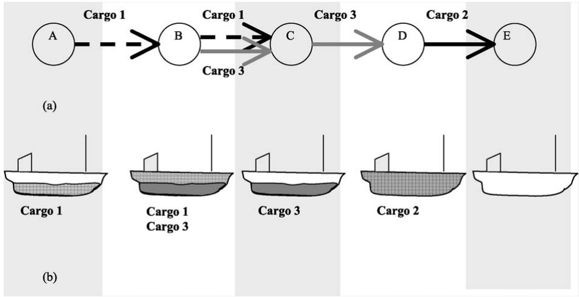

Fig. 6. (a) Physical route for a ship with multiple cargoes onboard for Example 4.2. (b) Load onboard the ship at departure for Example 4.2.

We have the same conditions for the fleet as for the problem described in Section 4.1.1, concerning a heterogeneous fixed fleet with various variable costs. In addition, we assume that the sailing costs do not depend on the load onboard the ship.

In the mathematical description of the problem also here each cargo is represented by an index i. However, associated with the loading port of cargo i, there is a node i, and with the corresponding unloading port a node $N + i ,$ where N is the number of cargoes that has to be serviced during the planning horizon. Note that different nodes may correspond to the same physical port. Let $\mathcal { N } _ { \mathrm { P } } = \{ 1 , \ldots , N \}$ be the set of loading (or pickup) nodes and $\mathcal { N } _ { \mathrm { D } } = \{ N   +   1 , \ldots ,   2 N \}$ be the set of unloading (or delivery) nodes, and define $\mathcal { N }   =   \mathcal { N } _ { \mathrm { P } } \cup \mathcal { N } _ { \mathrm { D } }$ . V is the set of ships in the fleet indexed by v. Then $( \mathcal { N } _ { v } , \mathcal { A } _ { v } )$ is the network associated with a specific ship v. Here, $\dot { \mathcal { N } _ { v } } =$ {feasible nodes for ship v} $\cup \left\{ o ( v ) , d ( v ) \right\}$ is the set of ports that can be visited by ship v and $o ( v )$ and $d ( v )$ are the artificial origin depot and artificial destination depot of ship v, respectively. Geographically, the artificial origin depot $o ( v )$ can be either a port or a point at sea, while the artificial destination depot $d ( v )$ is the last planned unloading port for ship v. If the ship is not used $d ( v )$ will represent the same location as $o ( v )$ . Here $\mathcal { A } _ { v }$ contains the set of all feasible arcs for ship $v _ { \ast }$ which is a subset of $\{ i   \in   \mathcal { N } _ { v } \}   \times   \{ i   \in   \mathcal { N } _ { v } \}$ . This set will be calculated based on capacity and time constraints, and other restrictions such as those based on precedence of loading and unloading nodes for the same cargo. From these calculations, we can extract the sets $\mathcal { N } _ { \mathrm { P } v } = \mathcal { N } _ { \mathrm { P } } \cap \mathcal { N } _ { v }$ and $\widetilde { \mathcal { N } _ { \mathrm { D } v } }   =   \mathcal { N } _ { \mathrm { D } } \cap \mathcal { N } _ { v }$ consisting of loading and unloading nodes that ship v may visit, respectively.

Let us refer back to Example 4.2. In the underlying network for the example, we introduce two nodes for each of the cargoes. This means that Cargo 1 is represented by the loading node 1 and the unloading node $N + 1$ . The loading port for Cargo 2 and the unloading port for Cargo 3 are the same physical port. That means that both node 2 and node $N + 3$ represent port D. Figure 7 shows the route of this example (marked with bold lines). The other arcs are left out of the figure for sake of clarity. In general, there will be arcs from $o ( v )$ to all loading ports and $d ( v )$ . In addition, we will have arcs into $d ( v )$ from $o ( v )$ and all unloading ports. The network for the real loading and unloading ports will be complete except for arcs from each of the unloading ports $N + i$ to the corresponding loading port i. The sequence of nodes for this example is as follows: $o ( v ) { - } 1 { - } 3 { - } ( N + 1 ) { - } ( N + 3 ) { - } 2 { - } ( N + 2 ) { - } d ( v )$

The fixed cargo quantity for cargo i is given by $Q _ { i } ,$ , while the capacity of ship v is given by $V _ { \mathrm { C A P } v }$ . For each $\mathtt { a r c } , T _ { \mathrm { S } i j v }$ represents the sum of the calculated sailing time from node i to node $j$ with ship v and the service time at node i. Let $[ T _ { \mathrm { M N } i v } ,   T _ { \mathrm { M X } i v } ]$ denote the time window associated with node i and ship v. The variable sailing and port costs are represented by $C _ { i j v }$

In the mathematical formulation, we use the following types of variables: the binary flow variable $x _ { i j v } ,   v   \in   \mathcal { V } ,   ( i ,   j )   \in   \mathcal { A } _ { v } ,$ , equals 1, if ship v sails from node i directly to node $j ,$ and 0 otherwise. The time variable $t _ { i v } , \bar { v } \in \mathcal { V } , i \in \mathcal { N } _ { v } ,$ represents the time at which service begins at node i, while variable $l _ { i v } ,   v \in \mathcal { V }$ $i \; \in \; \mathcal { N } _ { v } \backslash \{ d ( v ) \}$ , gives the total load onboard ship v just after the service is completed at node i.

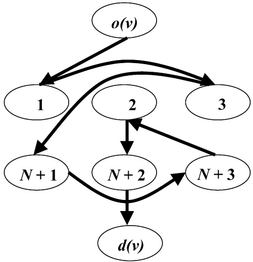

Fig. 7. The route of Example 4.2.

The arc flow formulation of the industrial ship scheduling problem with fixed cargo sizes is as follows:

$$
\min \sum_ {v \in \mathcal {V}} \sum_ {(i, j) \in \mathcal {A} _ {v}} C _ {i j v} x _ {i j v}\tag{4.9}
$$

subject to

$$
\sum_ {v \in \mathcal {V}} \sum_ {j \in \mathcal {N} _ {v}} x _ {i j v} = 1, \quad \forall i \in \mathcal {N} _ {\mathrm{P}},\tag{4.10}
$$

$$
\sum_ {j \in \mathcal {N} _ {\mathrm{P} v} \cup \{d (v) \}} x _ {o (v) j v} = 1, \quad \forall v \in \mathcal {V},\tag{4.11}
$$

$$
\sum_ {i \in \mathcal {N} _ {v}} x _ {i j v} - \sum_ {i \in \mathcal {N} _ {v}} x _ {j i v} = 0,
$$

$$
\forall v \in \mathcal {V}, j \in \mathcal {N} _ {v} \backslash \big \{o (v), d (v) \big \},\tag{4.12}
$$

$$
\sum_ {i \in \mathcal {N} _ {\mathrm{D} v} \cup \{o (v) \}} x _ {i d (v) v} = 1, \quad \forall v \in \mathcal {V},\tag{4.13}
$$

$$
x _ {i j v} (t _ {i v} + T _ {\mathrm{Sijv}} - t _ {j v}) \leqslant 0, \quad \forall v \in \mathcal {V}, (i, j) \in \mathcal {A} _ {v},\tag{4.14}
$$

$$
T _ {\mathrm{MNiv}} \leqslant t _ {i v} \leqslant T _ {\mathrm{MXiv}}, \quad \forall v \in \mathcal {V}, i \in \mathcal {N} _ {v},\tag{4.15}
$$

$$
x _ {i j v} (l _ {i v} + Q _ {j} - l _ {j v}) = 0, \quad \forall v \in \mathcal {V}, (i, j) \in \mathcal {A} _ {v} \mid j \in \mathcal {N} _ {\mathrm{P} v},\tag{4.16}
$$

$$
x _ {i, N + j, v} (l _ {i v} - Q _ {j} - l _ {N + j, v}) = 0,
$$

$$
\forall v \in \mathcal {V}, (i, N + j) \in \mathcal {A} _ {v} \mid j \in \mathcal {N} _ {P v},\tag{4.17}
$$

$$
l _ {o (v) v} = 0, \quad \forall v \in \mathcal {V},\tag{4.18}
$$

$$
\sum_ {j \in \mathcal {N} _ {v}} Q _ {i} x _ {i j v} \leqslant l _ {i v} \leqslant \sum_ {j \in \mathcal {N} _ {v}} V _ {\mathrm{CAP} v} x _ {i j v}, \quad \forall v \in \mathcal {V}, i \in \mathcal {N} _ {\mathrm{P} v},\tag{4.19}
$$

$$
0 \leqslant l _ {N + i, v} \leqslant \sum_ {j \in \mathcal {N} _ {v}} (V _ {\mathrm{CAP} v} - Q _ {i}) x _ {N + i, j v},
$$

$$
\forall v \in \mathcal {V}, i \in \mathcal {N} _ {\mathrm{P} v},\tag{4.20}
$$

$$
t _ {i v} + T _ {\mathrm{Si}, N + i, v} - t _ {N + i, v} \leqslant 0, \quad \forall v \in \mathcal {V}, i \in \mathcal {N} _ {\mathrm{P} v},\tag{4.21}
$$

$$
\sum_ {j \in \mathcal {N} _ {v}} x _ {i j v} - \sum_ {j \in \mathcal {N} _ {v}} x _ {j, N + i, v} = 0, \quad \forall v \in \mathcal {V}, i \in \mathcal {N} _ {\mathrm{P} v},\tag{4.22}
$$

$$
x _ {i j v} \in \{0, 1 \}, \quad \forall v \in \mathcal {V}, (i, j) \in \mathcal {A} _ {v}.\tag{4.23}
$$

The objective function (4.9) minimizes the costs of operating the fleet. Constraints (4.10) ensure that all cargoes that the shipping company has committed itself to carry are serviced. Constraints (4.11)–(4.13) describe the flow on the sailing route used by ship v. Constraints (4.14) describe the compatibility between routes and schedules. The starting time of the service at node j cannot be less than the sum of the starting time and the loading time at node i and the sailing time from i to $j$ with ship v, if ship v is really sailing between these two nodes. The time window constraints are given by (4.15). If ship v is not visiting node i, we will get an artificial starting time within the time windows for that $( i , v )$ -combination. Introduction of artificial starting times is practical, due to constraints (4.21). Constraints (4.16) and (4.17) give the relationship between the binary flow variables and the ship load at each loading and unloading port, respectively. The initial load condition for each ship is given by (4.18). The ship is empty at the beginning of the planning horizon as mentioned in the opening of Section 4.1. Constraints (4.19) and (4.20) represent the ship capacity intervals at loading and unloading nodes, respectively. Constraints (4.20) can be omitted from the model since the upper bound can never be exceeded due to constraints (4.19) and the precedence and coupling constraints (4.21) and (4.22). The precedence constraints forcing node i to be visited before node $N   +   i$ are given in (4.21). For both constraints (4.14) and (4.21), the constraints appear only if the beginning of the time window for nodes j and $N + i ,$ respectively, is less than the earliest calculated arrival time at the node. Along with the coupling constraints (4.22), constraints (4.21) ensure that the same ship v visits both node i and $N \dot { + } i , \dot { i } \in \mathcal { N } _ { \mathrm { P } v }$ . Finally, the formulation involves binary requirements (4.23) on the flow variables.

We find a few applications for this industrial shipping problem with fixed cargo quantities in the literature. Fagerholt and Christiansen (2000a) study a multiproduct scheduling problem. They extend the model presented here, and include allocation of cargoes to different flexible cargo holds. For more details, see Section 4.1.4. Further, Christiansen and Fagerholt (2002) present a real ship scheduling problem which is based on the model (4.9)–(4.23). In addition, they focus on two important issues in the shipping industry, namely ports closed at night and over weekends and long loading or unloading operations. This study is described in more detail in Section 6.

The multiple cargo with fixed cargo size ship scheduling problem is also studied by Psaraftis (1988) for the US Military Sealift Command. The objective is to allocate cargo ships to cargoes so as to ensure that all cargoes arrive at their destinations as planned. Constraints that have to be satisfied include loading and unloading time windows for the cargoes, ship capacity and cargo/ship/port compatibility. The problem is dynamic, because in a military mobilization situation anything can change in real time. The paper focuses on the dynamic aspects of the problem and the algorithm that is developed is based on the “rolling horizon” approach. Later, Thompson and Psaraftis (1993) applied a new class of neighborhood search algorithms to a variety of problems, including the problem of the US Military Sealift Command.

## 4.1.3 Multiple cargoes with flexible cargo size

For many real ship scheduling problems, the cargo quantity is given in an interval and the shipping company can choose the actual load quantity that best fits its fleet and schedule. For such problems, the minimum cost problem is transferred to a maximum profit problem. Apart from these issues, the problem is identical to the problem described in Section 4.1.2. We use the same mathematical notation and the same type of network representation as in Figure 7. However, we need the following additional notation:

The variable quantity interval is given by $[ Q _ { \mathrm { M N } i } , Q _ { \mathrm { M X } i } ] ,$ where $Q _ { \mathrm { M N } i }$ is the minimum quantity to be lifted, while $Q _ { \mathrm { M X } i }$ is the maximum quantity for cargo i. The time required to load or unload one unit of a cargo at node i is given by $T _ { \mathrm { Q } i }$ . The node can either be a loading or unloading node, which means that the time per unit might be different for loading and unloading. Here $T _ { S i j v }$ is just the sailing time between the two ports and does not include the service time in any of the ports.

We need an additional continuous variable $q _ { i v } ,   v   \in   \mathcal { V } ,   i   \in   \mathcal { N } _ { \mathrm { P } v }$ , that represents the quantity of cargo i, when cargo i is lifted by ship v and loaded at node i and unloaded at node $N   +   i .$ The revenue of carrying a cargo is normally the cargo quantity $q _ { i v }$ multiplied by a revenue per unit of cargo $P _ { i } .$ However, in some cases the revenue from a cargo may be a lump sum or another function of the cargo quantity, and then the objective function becomes nonlinear. In the following mathematical formulation of the objective function we use a linear term for the revenue from carrying the cargoes.

The ship scheduling problem with flexible cargo sizes is formulated as follows:

$$
\max \left[ \sum_ {v \in \mathcal {V}} \sum_ {i \in \mathcal {N} _ {\mathrm{P} v}} P _ {i} q _ {i v} - \sum_ {v \in \mathcal {V}} \sum_ {(i, j) \in \mathcal {A} _ {v}} C _ {i j v} x _ {i j v} \right]\tag{4.24}
$$

subject to

$$
\sum_ {v \in \mathcal {V}} \sum_ {j \in \mathcal {N} _ {v}} x _ {i j v} = 1, \quad \forall i \in \mathcal {N} _ {\mathrm{P}},\tag{4.25}
$$

$$
\sum_ {j \in \mathcal {N} _ {\mathrm{P} v} \cup \{d (v) \}} x _ {o (v) j v} = 1, \quad \forall v \in \mathcal {V},\tag{4.26}
$$

$$
\sum_ {i \in \mathcal {N} _ {v}} x _ {i j v} - \sum_ {i \in \mathcal {N} _ {v}} x _ {j i v} = 0,
$$

$$
\forall v \in \mathcal {V}, j \in \mathcal {N} _ {v} \backslash \big \{o (v), d (v) \big \},\tag{4.27}
$$

$$
\sum_ {i \in \mathcal {N} _ {\mathrm{D} v} \cup \{o (v) \}} x _ {i d (v) v} = 1, \quad \forall v \in \mathcal {V},\tag{4.28}
$$

$$
x _ {i j v} (t _ {i v} + T _ {\mathrm{Q} i} q _ {i v} + T _ {\mathrm{S} i j v} - t _ {j v}) \leqslant 0,
$$

$$
\forall v \in \mathcal {V}, (i, j) \in \mathcal {A} _ {v} \mid i \in \mathcal {N} _ {\mathrm{P} v} \cup o (v),\tag{4.29}
$$

$$
x _ {N + i, j v} (t _ {N + i, v} + T _ {\mathrm{QN} + i} q _ {i v} + T _ {\mathrm{SN} + i, j v} - t _ {j v}) \leqslant 0,
$$

$$
\forall v \in \mathcal {V}, (N + i, j) \in \mathcal {A} _ {v} \mid i \in \mathcal {N} _ {\mathrm{P} v},\tag{4.30}
$$

$$
T _ {\mathrm{MN} i v} \leqslant t _ {i v} \leqslant T _ {\mathrm{MX} i v}, \quad \forall v \in \mathcal {V}, i \in \mathcal {N} _ {v},\tag{4.31}
$$

$$
x _ {i j v} (l _ {i v} + q _ {j v} - l _ {j v}) = 0,
$$

$$
\forall v \in \mathcal {V}, (i, j) \in \mathcal {A} _ {v} \mid j \in \mathcal {N} _ {\mathrm{P} v},\tag{4.32}
$$

$$
x _ {i, N + j, v} (l _ {i v} - q _ {j v} - l _ {N + j, v}) = 0,
$$

$$
\forall v \in \mathcal {V}, (i, N + j) \in \mathcal {A} _ {v} \mid j \in \mathcal {N} _ {\mathrm{P} v},\tag{4.33}
$$

$$
\sum_ {j \in \mathcal {N} _ {v}} Q _ {\mathrm{MN} i} x _ {i j v} \leqslant q _ {i v} \leqslant \sum_ {j \in \mathcal {N} _ {v}} Q _ {\mathrm{MX} i} x _ {i j v},
$$

$$
\forall v \in \mathcal {V}, i \in \mathcal {N} _ {\mathrm{P} v},\tag{4.34}
$$

$$
l _ {o (v) v} = 0, \quad \forall v \in \mathcal {V},\tag{4.35}
$$

$$
q _ {i v} \leqslant l _ {i v} \leqslant \sum_ {j \in \mathcal {N} _ {v}} V _ {\mathrm{CAP} v} x _ {i j v}, \quad \forall v \in \mathcal {V}, i \in \mathcal {N} _ {\mathrm{P} v},\tag{4.36}
$$

$$
0 \leqslant l _ {N + i, v} \leqslant \sum_ {j \in \mathcal {N} _ {v}} V _ {\mathrm{CAP} v} x _ {N + i, j v} - q _ {i v},
$$

$$
\forall v \in \mathcal {V}, i \in \mathcal {N} _ {\mathrm{P} v},\tag{4.37}
$$

$$
t _ {i v} + T _ {\mathrm{Q} i} q _ {i v} + T _ {\mathrm{S} i, N + i, v} - t _ {N + i, v} \leqslant 0,
$$

$$
\forall v \in \mathcal {V}, i \in \mathcal {N} _ {\mathrm{P} v},\tag{4.38}
$$

$$
\sum_ {j \in \mathcal {N} _ {v}} x _ {i j v} - \sum_ {j \in \mathcal {N} _ {v}} x _ {j, N + i, v} = 0, \quad \forall v \in \mathcal {V}, i \in \mathcal {N} _ {\mathrm{P} v},\tag{4.39}
$$

$$
x _ {i j v} \in \{0, 1 \}, \quad \forall v \in \mathcal {V}, (i, j) \in \mathcal {A} _ {v}.\tag{4.40}
$$

The objective function (4.24) maximizes the profit gained by operating the fleet. The constraints (4.25)–(4.40) are equivalent to (4.10)–(4.23), apart from the following constraints. The constraints ensuring feasible time schedules are split into constrains for loading in port i, (4.29), and unloading in port $N + i ,$ (4.30). These constraints are adjusted for the variable loading time at port i. Variable $q _ { i v }$ is not defined for $i   =   o ( v )$ , so the term $T _ { \mathrm { Q } i } q _ { i v }$ does not exist for $i \; = \; o ( v )$ in constraints (4.29). Here, constraints (4.32) and (4.33) include a variable load quantity instead of the fixed quantity in constraints (4.16) and (4.17). In constraints (4.34) the load quantity interval is defined for each cargo i. The load variable $q _ { i v }$ is forced to 0 by (4.34) if cargo i is not lifted by ship v. Constraints $( 4 . 3 6 ) – ( 4 . 3 8 )$ are adjusted for the variable load quantity.

A ship scheduling problem with flexible cargo sizes is studied by Brønmo et al. (2007) for transportation of bulk cargoes by chemical tankers and has many similarities to the problem described here. The solution method is based on a set partitioning approach that gives optimal solutions to the problem. Korsvik et al. (2007) solve the same problem by using a multistart local search heuristic.

There are operations where a ship can carry only one cargo at a time, but the ship is not necessarily filled up each time and the cargo quantity is given in an interval. For this situation, we still have variable load quantities and arrival times as in the model of this section. However, we do not need nodes for both loading and unloading ports, but just a common node representing the cargo as we did in the model of Section 4.1.1.

## 4.1.4 Multiple products

In Sections 4.1.1–4.1.3 we assumed that the cargoes consist of mixable products that can be loaded onboard regardless of the type of product already onboard. In addition, different cargoes are compatible with each other. However, often multiple nonmixable products are carried onboard a ship simultaneously. In such cases the cargo carrying space of the vessel must be divided into separate tanks (compartments or holds) that are usually fixed. For example, a large chemical tanker may have from 20 to 50 tanks. We start with considering the case where the cargo tanks of the ship are of equal size. In reality, this is seldom the case. However, it may be possible to separate the tanks into sets that are of about equal size. If the ship has many tanks, this assumption is reasonable. In addition, we assume that the cargo consists of mixable products, but different cargoes have to be stored in different tanks.

In the mathematical description of the problem, we need the following notation: the number of tanks (or cargo holds) of ship v is given by $H _ { v }$ and the capacity of a tank (hold) of ship v is given by $H _ { \mathrm { C A P } v } = V _ { \mathrm { C A P } v } / H _ { v } .$ As the ship is assumed empty at the first time it is available for scheduling during the planning horizon, the number of tanks (holds) occupied is also 0. Variable $h _ { i v } ,$ $v \in \mathcal { V } , i \in \mathcal { N } _ { v } ,$ , represents the number of tanks (holds) occupied after servicing node i by ship v. We still use the continuous variable $q _ { i v } , v \in \mathcal { V } , i \in \mathcal { N } _ { \mathrm { P } v }$ , representing the quantity of cargo i, when cargo i is lifted by ship v and loaded at node i and unloaded at node $N + i .$

In order to allow several different nonmixable cargoes onboard simultaneously, we need the following constraints added to formulation (4.24)–(4.40):

$$
x _ {i j v} \left(h _ {i v} + \left\lceil \frac {q _ {j v}}{H _ {\mathrm{CAP} v}} \right\rceil - h _ {j v}\right) = 0,
$$

$$
\forall v \in \mathcal {V}, (i, j) \in \mathcal {A} _ {v} \mid j \in \mathcal {N} _ {\mathrm{P} v},\tag{4.41}
$$

$$
x _ {i, N + j, v} \left(h _ {i v} - \left\lceil \frac {q _ {j v}}{H _ {\mathrm{CAP} v}} \right\rceil - h _ {N + j, v}\right) = 0,
$$

$$
\forall v \in \mathcal {V}, (i, N + j) \in \mathcal {A} _ {v} \mid j \in \mathcal {N} _ {\mathrm{P} v},\tag{4.42}
$$

$$
\sum_ {j \in \mathcal {N} _ {v}} \left\lceil \frac {q _ {i v}}{H _ {\mathrm{CAP} v}} \right\rceil x _ {i j v} \leqslant h _ {i v} \leqslant \sum_ {j \in \mathcal {N} _ {v}} H _ {v} x _ {i j v}, \quad \forall v \in \mathcal {V}, i \in \mathcal {N} _ {\mathrm{P} v},\tag{4.43}
$$

$$
0 \leqslant h _ {N + i, v} \leqslant \sum_ {j \in \mathcal {N} _ {v}} H _ {v} x _ {N + i, j v} - \left\lceil \frac {q _ {i v}}{H _ {\mathrm{CAP} v}} \right\rceil , \quad \forall v \in \mathcal {V}, i \in \mathcal {N} _ {\mathrm{P} v},\tag{4.44}
$$

$$
h _ {o (v) v} = 0, \quad \forall v \in \mathcal {V},\tag{4.45}
$$

$$
h _ {i v} \in [ 0, H _ {v} ] \text {and integer}, \quad \forall v \in \mathcal {V}, i \in \mathcal {N} _ {v}.\tag{4.46}
$$

Constraints (4.41) and (4.42) describe the compatibility between routes and the number of occupied tanks when the arrival node is a loading port and an unloading port, respectively. The intervals of the number of occupied tanks after servicing the loading and unloading nodes are given in constraints (4.43) and (4.44), respectively. Next, constraints (4.45) impose the initial tank occupancy condition for each ship. Finally, the integer requirements for the tank number variables are given. The integer interval $[ 0 , H _ { v } ]$ in (4.46) can be reduced by information from (4.34) and (4.44).

For problems with multiple, nonmixable, products for a cargo, the allocation of products to the various tanks is normally needed. For transportation of liquid products, the quantity has to be flexible due to stability considerations and to prevent product sloshing in partially empty tanks.

In the literature, Scott (1995) presents a problem involving the shipping of refined oil products from a refinery to several depots. Several types of tankers/ships with fixed tanks enable different products to be carried on the same voyage (without mixing them). Another study with multiple products is given by Bausch et al. (1998). They present a decision support system for medium-term scheduling where a fleet of coastal tankers and barges are transporting liquid bulk products among plants, distribution centers, and industrial customers. A set of cargoes has to be conveyed by the available fleet of vessels and each cargo consists of an ordered volume of up to five products. The vessels may have up to seven fixed tanks, thus allowing a cargo consisting of several products to be lifted by the same ship. When multiple cargoes are carried simultaneously, different cargoes of the same product are stowed in different tanks. Such cargoes are not mixed in order to eliminate the need for measuring the unloaded quantity at the multiple unloading ports. A similar problem is studied by Sherali et al. (1999) describing a ship scheduling problem where crude oil and a number of refined oil-related products are to be shipped from ports in Kuwait to customers around the world. Here, each cargo is a full shipload of a compartmentalized group of products, and is characterized by its mix (oil, refined products, etc.), loading port, loading date, unloading port, and unloading date. The ships have multiple tanks of different sizes, so they introduce a flow variable that is 1 if a particular tank carries a particular product on a particular leg $( i , j )$ with ship v. The model is extended compared to the one presented here and includes the allocation of product quantities to tanks.

Recently, Jetlund and Karimi (2004) presented a similar problem for multi-compartment tankers engaged in shipping bulk liquid chemicals. They present a mixed-integer linear programming formulation using variable-length time slots. They solve real instances of the problem by a heuristic decomposition algorithm that obtains the fleet schedule by repeatedly solving the base formulation for a single ship.

Fagerholt and Christiansen (2000a, 2000b) extend the model formulated above and study a ship scheduling problem where each ship in the fleet is equipped with a flexible cargo hold that can be partitioned into several smaller compartments in a given number of ways. The scheduling of the ships constitutes a multiship pickup and delivery problem with time windows, while the partitioning of the ships’ flexible cargo holds and the allocation of cargoes to the smaller compartments is a multiallocation problem.

## 4.1.5 Contracted and optional cargoes

A ship scheduling problem for the tramp market boils down to pickup and delivery of cargoes at maximum profit. A tramp shipping company often engages in Contracts of Affreightment (COA). These are contracts to carry specified quantities of cargo between specified ports within a specific time frame for an agreed payment per ton. Mathematically, these cargoes can be handled in the same way as the cargoes for an industrial shipping problem. Tramp ships operate in a manner similar to a taxi and follow the available cargoes. They may also take optional cargoes. These optional cargoes will be picked up at a given loading port and delivered to a corresponding unloading port if the tramp shipping company finds it profitable. Thus in tramp shipping each cargo is either committed or optional and consists of a quantity given in an interval.

In the mathematical description of the problem we need to define two additional sets. For the tramp ship scheduling problem we need to partition the set of cargoes, $\mathcal { N } _ { \mathbf { P } }$ , into two subsets, $\mathcal { N } _ { \mathrm { P } } = \mathcal { N } _ { \mathrm { C } } \cup \mathcal { N } _ { \mathrm { O } }$ , where $\mathcal { N } _ { \mathrm { C } } ^ { - }$ is the set of cargoes the shipping company has committed itself to carry, while $\mathcal { N } _ { \mathrm { O } }$ represents the optional spot cargoes. The mathematical formulation is the same as (4.24)–(4.40), except for constraints (4.25). These constraints are split into two types of constraints as follows:

$$
\sum_ {v \in \mathcal {V}} \sum_ {j \in \mathcal {N} _ {v}} x _ {i j v} = 1, \quad \forall i \in \mathcal {N} _ {\mathrm{C}},\tag{4.47}
$$

$$
\sum_ {v \in \mathcal {V}} \sum_ {j \in \mathcal {N} _ {v}} x _ {i j v} \leqslant 1, \quad \forall i \in \mathcal {N} _ {\mathrm{O}}.\tag{4.48}
$$

Constraints (4.47) ensure that all the cargoes that the shipping company has committed itself to carry are serviced. The corresponding constraints for the optional cargoes are given in (4.48). Note that the equality sign in (4.47) is replaced by an inequality in (4.48) since these cargoes do not have to be carried. When one uses a branch-and-bound algorithm to solve this problem it may be useful to insert an explicit slack variable in constraints (4.48).

A typical tramp ship scheduling problem with both optional and contracted cargoes is described in the pioneer work of Appelgren (1969, 1971). The ships in the fleet are restricted to carry only one cargo at a time, and the cargo quantities are fixed. This type of problem is extended in Brønmo et al. (2006) where cargoes are of flexible sizes for a tramp ship scheduling application.

## 4.1.6 Use of spot charters

In some cases the controlled fleet may have insufficient capacity to serve all cargoes for an industrial ship scheduling problem or all committed cargoes for a tramp ship scheduling problem during the planning horizon. In such a case some of the cargoes can be serviced by spot charters, which are ships chartered for a single voyage.

We extend the formulation for the tramp ship scheduling problem and introduce a variable $s _ { i } ,   i \in \mathcal { N } _ { \mathrm { C } }$ , that is equal to 1 if cargo i is serviced by a spot charter and 0 otherwise. In addition, let $\pi _ { i }$ be the profit if cargo i is serviced by a spot charter. This profit can be either positive or negative. When we take the spot shipments into account, (4.24) and (4.25) (or (4.47)) become:

$$
\max \left[ \sum_ {v \in \mathcal {V}} \sum_ {i \in \mathcal {N} _ {\mathrm{P} v}} P _ {i} q _ {i v} - \sum_ {v \in \mathcal {V}} \sum_ {(i, j) \in \mathcal {A} _ {v}} C _ {i j v} x _ {i j v} + \sum_ {i \in \mathcal {N} _ {\mathrm{C}}} \pi_ {i} s _ {i} \right]\tag{4.49}
$$

subject to

$$
\left| \begin{array}{l l} \sum_ {v \in \mathcal {V}} \sum_ {j \in \mathcal {N} _ {v}} x _ {i j v} + s _ {i} = 1, & \forall i \in \mathcal {N} _ {\mathrm{C}}, \\ s _ {i} \in \{0, 1 \}, & \forall i \in \mathcal {N} _ {\mathrm{C}}. \end{array} \right|\tag{4.50}
$$

(4.51)

Now, the objective function (4.49) maximizes the profit (or actually the marginal contribution, since fixed costs are excluded from the formulation). The terms are divided into the profit gained by (a) operating the fleet and (b) servicing the cargoes by spot charters. Also here it is assumed that the fleet is fixed during the planning horizon, and it is not possible to charter out some of the ships during that horizon. Constraints (4.50) ensure that all committed cargoes are serviced either by a ship in the fleet or by a spot charter. Constraints (4.51) impose the binary requirements on the spot variables. According to (4.50), these variables do not need to be defined as binary since the flow variables are binary. However, doing so might give computational advantages in a branch-and-bound process.

We can find several applications described in the literature for both tramp and industrial shipping where some of the cargoes might be serviced by spot charters, see, for instance, Bausch et al. (1998), Christiansen and Fagerholt (2002), Sherali et al. (1999), and Fagerholt (2004).

## 4.2 Solution approaches for industrial and tramp scheduling models

Theoretically the models presented in Section 4.1 can be solved directly by use of standard commercial optimization software for mixed integer linear programming after linearization of some nonlinear functions.

For instance, constraints (4.32) are given as follows:

$$
x _ {i j v} (l _ {i v} + q _ {j v} - l _ {j v}) = 0, \quad \forall v \in \mathcal {V}, (i, j) \in \mathcal {A} _ {v} \mid j \in \mathcal {N} _ {\mathrm{P} v}.
$$

These constraints are linearized as

$$
\left| \begin{array}{c} l _ {i v} + q _ {j v} - l _ {j v} + V _ {\mathrm{CAP} v} x _ {i j v} \leqslant V _ {\mathrm{CAP} v}, \\ \forall v \in \mathcal {V}, (i, j) \in \mathcal {A} _ {v} \mid j \in \mathcal {N} _ {\mathrm{P} v}, \\ l _ {i v} + q _ {j v} - l _ {j v} - V _ {\mathrm{CAP} v} x _ {i j v} \geqslant - V _ {\mathrm{CAP} v}, \\ \forall v \in \mathcal {V}, (i, j) \in \mathcal {A} _ {v} \mid j \in \mathcal {N} _ {\mathrm{P} v}. \end{array} \right|\tag{4.52}
$$

(4.53)

The ship capacity $V _ { \mathrm { C A P } v }$ is the largest value that $( l _ { i v } + q _ { j v } - l _ { j v } )$ can take, so constraints (4.52) are redundant if $x _ { i j v }$ is equal to 0. Similarly, $( l _ { i v } + q _ { j v } - l _ { j v } )$ will never be less than $- V _ { \mathrm { C A P } v }$ . The schedule constraints (4.29) are linearized in the same way as constraints (4.32), but, because the original constraints have $\mathbf { a } \leqslant$ sign, just one type of constraints is necessary in the linearized version. This way of linearizing the nonlinear constraint is also presented by Desrosiers et al. (1995).

Due to the models’ complexity, only small sized data instances can be solved directly to optimality by using standard commercial optimization software. Therefore, these models usually require reformulation in order to solve them to optimality.

By studying the models presented, we see that for each cargo i we have exactly one constraint linking the ships. This corresponds to constraint types (4.2), (4.10), and (4.25) for the industrial shipping problems presented in Sections 4.1.1, 4.1.2, and 4.1.3, respectively, and constraint types (4.47) and (4.48) for the tramp shipping problems. These constraints ensure that each cargo i is served by a ship exactly once (or at most once). These constraints are called here common constraints. All other constraints refer to each ship v and will be called the ship routing constraints. For example, in the model (4.24)–(4.40), the constraints (4.26)–(4.40), constitute the routing problem for each ship where the time windows, load quantity interval and load on board the ship are considered. This observation is often exploited in the solution methods used for such type of problems. The exact solution methods are usually based on column generation approaches, where the ship routes constitute the columns. We will therefore concentrate on two such main solution approaches, the Dantzig– Wolfe decomposition approach in Section 4.2.1, and the set partitioning approach with columns generated a priori in Section 4.2.2. Finally, in Section 4.2.3 we will briefly discuss some other approaches.

## 4.2.1 The Dantzig–Wolfe decomposition approach

The common constraints constitute the master problem in the Dantzig– Wolfe (DW) decomposition approach. None of the ship routing constraints include interaction between ships, so these constraints can be split into one subproblem for each ship. For each ship’s subproblem, we need to find a feasible route with regard to the time windows, quantity intervals and the quantity on board the ship, so that this quantity does not exceed the capacity of the ship. Each of the feasible combinations of sailing legs $( i , j )$ to geographical routes for a ship, including the information about starting times and load quantities at each port, is called a ship schedule and is indexed by $r .$ That means a ship schedule $r$ for ship v includes information about the values of the flow from each node i directly to node $j$ in the geographical route, the quantity loaded or unloaded at each node $i ,$ and the starting times at each node i. The constant $X _ { i j v r }$ equals 1 if leg $( i , j )$ by vessel v in route r and 0 otherwise. Given a geographical route, it is possible to find the optimal load quantity and starting time at each port in the route.

Since the ship routing subproblems define path structures, their extreme points correspond to paths in the underlying networks. Set $\mathcal { R } _ { v }$ defines the extreme points for ship v. Any solution $x _ { i j v }$ satisfying the ship routing constraints can then be expressed as a nonnegative convex combination of these extreme points and must consist of binary $x _ { i j v }$ values, i.e.,

$$
x _ {i j v} = \sum_ {r \in \mathcal {R} _ {v}} X _ {i j v r} y _ {v r}, \quad \forall v \in \mathcal {V}, (i, j) \in \mathcal {A} _ {v},\tag{4.54}
$$

$$
\sum_ {r \in \mathcal {R} _ {v}} y _ {v r} = 1, \quad \forall v \in \mathcal {V},\tag{4.55}
$$

$$
y _ {v r} \in \{0, 1 \}, \quad \forall v \in \mathcal {V}, r \in \mathcal {R} _ {v}.\tag{4.56}
$$

The new variables $y _ { v r } , v \in \mathcal { V } , r \in \mathcal { R } _ { v } ,$ are called the schedule variables, and equal 1 if ship v chooses to sail schedule r. Let $\begin{array} { r } { \mathcal { A } _ { i v r } = \sum _ { j \in \mathcal { N } _ { v } } X _ { i j v r } } \end{array}$ be equal to 1 if schedule r for ship v services cargo i and 0 otherwise. The column vector in the master problem contains information about the actual cargoes in schedule r for ship v. In addition, the optimal geographical route, the arrival times and the size of the cargoes for the given set of cargoes for a schedule $( v , r )$ determine the profit coefficient in the objective function for the corresponding column.

The master problem in the DW decomposition approach. Substituting (4.54)– (4.56) in (4.24) and (4.25), the integer master problem for the industrial ship scheduling problem with flexible cargo sizes is transformed into:

$$
\max \sum_ {v \in \mathcal {V}} \sum_ {r \in \mathcal {R} _ {v}} P _ {v r} y _ {v r}\tag{4.57}
$$

subject to

$$
\sum_ {v \in \mathcal {V}} \sum_ {r \in \mathcal {R} _ {v}} A _ {i v r} y _ {v r} = 1, \quad \forall i \in \mathcal {N} _ {\mathrm{P}},\tag{4.58}
$$

$$
\sum_ {r \in \mathcal {R} _ {v}} y _ {v r} = 1, \quad \forall v \in \mathcal {V},\tag{4.59}
$$

$$
y _ {v r} \in \{0, 1 \}, \quad \forall v \in \mathcal {V}, r \in \mathcal {R} _ {v}.\tag{4.60}
$$

The objective function (4.57) maximizes the profit, where $P _ { v r }$ is the profit of carrying the cargoes on schedule r by ship $v _ { \flat }$ respectively. Constraints (4.58) ensure that all cargoes are serviced by a ship in the company’s fleet. Constraints (4.59) assure that each ship in the fleet is assigned exactly one schedule. Constraints (4.60) impose the binary requirements on the variables.

The corresponding master problem for the tramp ship routing and scheduling problem with spot charters can be formulated as follows:

$$
\max \left[ \sum_ {v \in \mathcal {V}} \sum_ {r \in \mathcal {R} _ {v}} P _ {v r} y _ {v r} + \sum_ {i \in \mathcal {N} _ {\mathrm{C}}} \pi_ {i} s _ {i} \right]\tag{4.61}
$$

subject to

$$
\sum_ {v \in \mathcal {V}} \sum_ {r \in \mathcal {R} _ {v}} A _ {i v r} y _ {v r} + s _ {i} = 1, \quad \forall i \in \mathcal {N} _ {\mathrm{C}},\tag{4.62}
$$

$$
\sum_ {v \in \mathcal {V}} \sum_ {r \in \mathcal {R} _ {v}} A _ {i v r} y _ {v r} \leqslant 1, \quad \forall i \in \mathcal {N} _ {\mathrm{O}},\tag{4.63}
$$

$$
\sum_ {r \in \mathcal {R} _ {v}} y _ {v r} = 1, \quad \forall v \in \mathcal {V},\tag{4.64}
$$

$$
y _ {v r} \in \{0, 1 \}, \quad \forall v \in \mathcal {V}, r \in \mathcal {R} _ {v},\tag{4.65}
$$

$$
s _ {i} \in \{0, 1 \}, \quad \forall i \in \mathcal {N} _ {\mathrm{C}}.\tag{4.66}
$$

Column generation and the subproblems within the DW decomposition approach. The models (4.57)–(4.60) and (4.61)–(4.66) are based on knowledge of all feasible ship schedules (columns). However, for some real ship scheduling problems it is time consuming to generate all these schedules, and the number of such schedules would result in too many columns when solving the models. Instead, we solve the LP-relaxation of the restricted master problem which only differs from the continuous original master problem by having fewer variables. First, an initial restricted master problem is solved. Then some new columns are added to the restricted master problem. These columns correspond to ship schedules with positive reduced costs in the solution of the (maximization)

master problem. This means that the dual values from the solution of the restricted master problem are transferred to the subproblems. The subproblems are solved and ship schedules are generated. The restricted master problem is reoptimized with the added new columns, resulting in new dual values. This procedure continues until no columns with positive reduced costs exist, and no improvements can be made. At that point all the feasible solutions in the original master problem have been implicitly evaluated. A continuous optimal solution is then attained for both the original and the restricted master problem. This LP-relaxed solution approach can be embedded in a branchand-bound search to find an optimal solution.

The subproblems can be formulated as shortest path problems and solved by specific dynamic programming algorithms on generated networks for each ship. The underlying network for each ship is specified by nodes, each of which includes information about the port and the corresponding cargo with time window for starting service and feasible cargo quantities. The recursive formulas in the dynamic programming algorithms include the expressions for the reduced costs. Algorithms for solving such problems are thoroughly described in Desrosiers et al. (1995) and, for a special ship scheduling problem, in Christiansen and Nygreen (1998b).

The DW decomposition approach has been used in numerous vehicle routing applications during the last twenty years. However, Appelgren (1969, 1971) was the first one to use this approach for a pickup and delivery problem with time windows, and that application was for the tramp shipping industry. Another ship routing application using the DW decomposition approach was studied by Christiansen (1999) (see also Christiansen and Nygreen, 1998a, 1998b) and is discussed in Section 4.3.1.

## 4.2.2 The set partitioning approach

Ship scheduling problems are often tightly constrained, and in such a case it is possible to generate schedules for all cargo combinations for all ships (i.e., all columns) a priori. The original arc flow models given in Section 4.1 can be transformed to path flow models, and these path flow models correspond to the master problems (4.57)–(4.60) and (4.61)–(4.66) in the Dantzig–Wolfe (DW) decomposition approach. Both models are set partitioning (SP) models or can easily be transformed into a SP model by introducing a slack variable to constraints (4.63). In this approach all column vectors for the set partitioning model are generated in advance, and a binary variable $y _ { v r }$ is defined for each column vector generated. We can find numerous ship scheduling applications where this approach is used, see for instance Brown et al. (1987), Fisher and Rosenwein (1989), Bausch et al. (1998), Fagerholt (2001), Fagerholt and Christiansen (2000a, 2000b), Christiansen and Fagerholt (2002), and Brønmo et al. (2006).

Here, we are generating columns for all feasible cargo combinations for a particular ship v. For each of the feasible cargo combinations, we have to find the geographical route, arrival time at the ports and the load quantities of the cargoes, such that the sum of the profits in the schedule is maximized. Further, each node has to be serviced within its specified load interval and time window. Finally, the loading node has to be visited before its corresponding unloading node. If the ships in the fleet are equipped with cargo holds or tanks of various capacities, the optimal allocation of products to tanks has to be determined as well. All constraints that are exclusive for a particular ship have to be considered in the column generation phase of this approach. The problem of finding the optimal route and schedule for a single ship can be solved by using dynamic programming or by enumerating all feasible combinations of routes for a given set of cargoes. Both approaches have been used. Fagerholt and Christiansen (2000b) describe a dynamic programming approach for a combined multiship pickup and delivery problem with time windows and a multiallocation problem, while Brønmo et al. (2006) describes an enumeration procedure for a tramp scheduling problem with flexible cargo sizes.

## 4.2.3 Other solution approaches

In general, many solution methods, both optimization-based and heuristic ones, were developed to solve routing and scheduling problems for other modes of transportation. These methods can often be used with some minor modifications for ship scheduling problems. Here we report several studies in the ship scheduling literature where solution approaches other than the ones discussed in Sections 4.2.1 and 4.2.2 were used.

Sherali et al. (1999) presented an aggregated mixed integer programming model retaining the principal features of the real ship scheduling problem with various cargo hold capacities and possible spot charters. A rolling horizon heuristic is developed to solve the problem.

The ship scheduling problem studied by Scott (1995) is solved by applying Lagrangian relaxation to the model to produce a set of potentially good schedules, containing the optimal cargo schedule. A novel refinement of Benders decomposition is then used to choose the optimum schedule from within the set, by avoiding solving an integer LP-problem at each iteration. The method manages to break a difficult integer programming (IP) problem into two relatively simple steps which parallel the steps typically taken by schedulers.

The tramp ship scheduling problem is studied by Brønmo et al. (2006, 2007), and two solution approaches are suggested and compared. In addition to a set partitioning approach, they describe a multistart heuristic consisting of two phases. First multiple initial solutions are constructed by a simple insertion method. Then a subset of the best initial solutions is improved by a quick local search. A few of the best resulting solutions from the quick local search are improved by an extended local search.

## 4.3 Maritime supply chains

A maritime supply chain is a supply chain where sea transport constitutes at least one vital link. Supply chains of companies with foreign sources of raw materials or with overseas customers very often include maritime transportation. Supply chain optimization is an active field of research, and we can see applications in almost all industries. However, the focus of such applications is usually not on maritime transportation. At the tactical planning level the supply chain perspective is missing in ship routing and scheduling studies reported in the literature.

Fleet scheduling is often performed under tight constraints. The shipper specifies the cargoes with little or no flexibility in cargo quatnities and the time widows are unnecessarily tight. The shipping company tries to find an optimal fleet schedule based on such requirements while trying to maximize the profit (or minimizing the costs). Realizing the potential of relaxing such constraints, Brønmo et al. (2006) and Fagerholt (2001) considered flexibility in shipment sizes and in time windows. The results of their studies show that there might be a great potential in collaboration and integration along the supply chain, for instance between the shippers and the shipping company.

Vendor managed inventory (VMI) takes advantage of the benefits of introducing flexibility in delivery time windows and cargo quantities, and transfers inventory management and ordering responsibilities completely to the vendor or the logistics provider. From recent literature and from our active contacts with the shipping industry we see that an increased number of shipping companies play the role of vendors in such logistics systems.

In this section we emphasize combined ship scheduling and inventory management problems in the industrial and tramp shipping sectors. Section 4.3.1 discusses such a problem for transportation of a single product, while Section 4.3.2 considers planning problems with multiple products. Finally, in Section 4.3.3 we will comment on some other research within supply chain optimization that focuses on ship scheduling.

## 4.3.1 Inventory routing for a single product

In industrial maritime transportation, the transporter has often a twofold responsibility. In this segment large quantities are transported, and normally considerable inventories exist at each end of a sailing leg. In some situations, the transporter has both the responsibility for the transportation and the inventories at the sources and at the destinations. We consider a planning problem where a single product is transported, and we call this problem the single product inventory ship routing problem (s-ISRP). The single product is produced at the sources, and we call the associated ports loading ports. Similarly, the product is consumed at certain destinations and the corresponding ports are called unloading ports. Inventory storage capacities are given in all ports, and the planners have information about the production and consumption rates of the transported product. We assume that these rates are constant during the planning horizon. In contrast to most ship scheduling problems, the number of calls at a given port during the planning horizon is not predetermined, neither is the quantity to be loaded or unloaded in each port call. The production or consumption rate and inventory information at each port, together with ship capacities and the location of the ports, determine the number of possible calls at each port, the time windows for start of service and the range of feasible load quantities for each port call.

If the product is loaded and unloaded in time at the sources and destinations, respectively, neither production nor consumption will be interrupted. The planning problem is therefore to find routes and schedules that minimize the transportation cost without interrupting production or consumption. The transporter owns both the producing sources and consuming destinations and controls the inventories at both ends, so the inventory costs do not come into play. The transporter operates a heterogeneous fleet of ships.

This s-ISRP has many similarities to the ship scheduling problem with flexible cargo sizes. In contrast to the problem described in Section 4.1.3, the number of cargoes is not given in advance, neither is the number of ship calls at a port. Further, we have no predetermined loading and unloading port for a particular cargo. In contrast to the problem described in Section 4.1.3, we assume that the ship is not necessarily empty in the beginning of the planning horizon but might have some load onboard. In addition, we have to keep track of the inventory levels. There must be sufficient product in consumption inventories, and their inventory in production ports cannot exceed the inventory storage capacity. In addition, storage capacity limits exist for all consumption inventories.

In the mathematical description of the problem each port is represented by an index i and the set of ports is given by $\mathcal { N } .$ Let V, indexed by v, be the set of available ships to be routed and scheduled. Not all ships can visit all ports, and $\mathcal { N } _ { v } = \bar { \mathrm { \{ f e a s i b l e } } }$ ports for ship v} $\cup \left\{ o ( v ) , d ( v ) \right\}$ is the set of ports that can be visited by ship v. The terms $o ( v )$ and $d ( v )$ represent the artificial origin port and artificial destination port of ship v, respectively. Each port can be visited several times during the planning horizon, and $\mathcal { M } _ { i }$ is the set of possible calls at port i, while $\mathcal { M } _ { i v }$ is the set of calls at i that can be made by ship v. The port call number is represented by an index $m ,$ and $M _ { i }$ is the last possible call at port i. The necessary calls to a port are given by the set $\mathcal { M } _ { C i }$ and these necessary calls have similarities to the contracted cargoes in the problems discussed in Section 4.1.5.

The set of nodes in the flow network represents the set of port calls, and each port call is specified by $( i , m ) ,   i \in \mathcal { N } ,   m \in \mathcal { M } _ { i }$ . In addition, we specify flow networks for each ship v with nodes $( i , m )$ , i ∈ Nv, m ∈ Miv. Finally, $\mathcal { A } _ { v }$ contains all feasible arcs for ship v, which is a subset of $\{ i   \in   \mathcal { N } _ { v } , m   \in$ $\mathcal { M } _ { i v } \} \times \{ i \in \mathcal { N } _ { v } , m \in \mathcal { M } _ { i v } \}$

Figure 8 shows an artificial, simplified case consisting of five ports and two ships. Each potential port call is indicated by a node. We see that port 1 can be called three times during the planning horizon. We have three loading ports and two unloading ports. The arrows indicate a solution to the planning problem where the routes and schedules satisfy the time windows and inventory constraints.

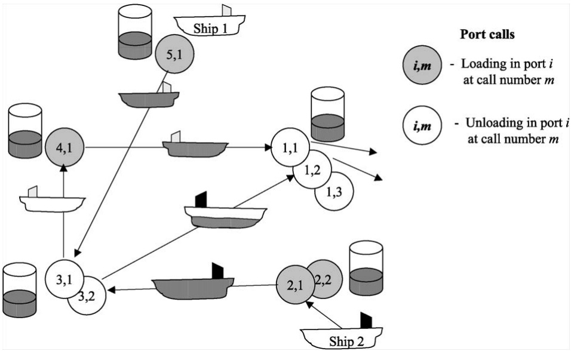

Fig. 8. A solution for a single product inventory routing problem with 5 ports and 2 ships.

Port 5 is the initial location for ship 1. The ship loads up to its capacity before sailing to port call (3 1) and unloading this quantity. The ship continues to port call (4 1) to load before ending up at port call (1 1). Ship 2 is empty at sea at the beginning of the planning horizon and starts service at port call (2 1) after some time. Here the ship loads to its capacity before sailing toward port call (3 2). At port call (3 2) the ship unloads half of its load before it continues to port call (1 2) and unloads the rest of the quantity on board. Here, two unloading ports are called in succession.

Port 3 is called several times during the planning horizon. The solid, gray line in Figure 9 shows the inventory level for port 3 during the planning horizon. Ship 2 unloads half of its load at port call (3 2) as soon as possible. Here it is important to ensure that the inventory level does not exceed the maximal one when the unloading ends. Regardless of the rest of the planning problem, the broken line in Figure 9 illustrates another extreme situation where ship 2 starts the service at port 3 as late as possible. Here, the inventory level is not allowed to be under the minimal stock level when the unloading starts. From these two extreme scenarios for the inventory levels, we can derive the feasible time window for port call (3 2) given that the rest of the planning problem remains unchanged.

The variable quantity interval is given by $[ Q _ { \mathrm { M N } i m } , Q _ { \mathrm { M X } i m v } ]$ , where $Q _ { \mathrm { M N } i m }$ is the minimum quantity to be (un)loaded at port call $( i , m )$ given that the port is called, while $Q _ { \mathrm { M X } i m v }$ is the maximum quantity to be (un)loaded at port call $( i , m )$ for ship v. The capacity of ship v is given by $V _ { \mathrm { C A P } v }$

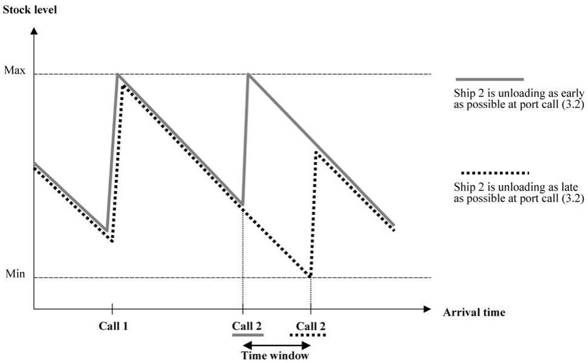

Fig. 9. The inventory level at port 3 during the planning horizon.

The time required to load or unload one unit of a cargo at port $i$ is given by $T _ { \mathrm { Q } i }$ . The term $T _ { S i j v }$ represents the sailing time from port i to port $j$ with ship v. Let $[ T _ { \mathrm { M N } i m } ,   \dot { T } _ { \mathrm { M X } i m } ]$ denote the arrival time window associated with port call $( i , m )$ . This time window can be calculated based on other data in the model, such as the inventory conditions. In addition, for some port calls the time windows are explicitly given. In a preprocessing phase, it is important to make efforts to reduce the time window widths. In some ports, there is a minimum required time, $T _ { \mathrm { B } i }$ , between a departure of one ship and the arrival of the next ship, due to small port area or narrow channels from the port to the pilot station. Let $T$ denote the planning horizon.

The levels of the inventory (or stock) have to be within a given interval at each port $[ S _ { \mathrm { M N } i } ,   S _ { \mathrm { M X } i } ]$ . The production rate $R _ { i }$ is positive if port i is producing the product, and negative if port i is consuming the product. Further, constant $I _ { i }$ is equal to 1, if i is a loading port, −1, if i is an unloading port, and $0 ,$ if i is $o ( v )$ or $d ( v )$ . The total variable cost $C _ { i j v }$ that includes port, channel, and fuel oil costs, corresponds to a sailing from port i to port $j$ with ship v.

In the mathematical formulation we use the following types of variables: the binary flow variable $x _ { i m j n v } , v \in \mathcal { V } , ( i , m , j , n ) \in \mathcal { A } _ { v } ,$ , equals 1, if ship v sails from node (i m) directly to node $( j , n )$ , and 0 otherwise, and the slack variables $w _ { i m } ,$ $i \in \mathcal{N}, m \in \mathcal{M}_i \backslash \mathcal{M}_{\mathrm{Ci}}$ , is equal to 1 if no ship takes port call $( i , m )$ , and 0 otherwise. The time variable $t _ { i m } , ( i \in \mathcal { N } , m \in \mathcal { M } _ { i } ) \cup ( i \in o ( v ) , \forall v , m = 1 )$ represents the time at which service begins at node $( i , m )$ . Variable $l _ { i m v } , v \in V$ $i \in \mathcal { N } _ { v } \backslash \{ d ( v ) \} ,   m   \in   \mathcal { M } _ { i v }$ , gives the total load onboard ship v just after the service is completed at node $( i , m )$ , while variable $q _ { i m v } , v \in V , i \in \mathcal { N } _ { v } \backslash \{ d ( v ) \}$ $m \in \mathcal { M } _ { i v } ,$ represents the quantity loaded or unloaded at port call $( i , m )$ , when ship v visits $( i , m )$ . Finally, $s _ { i m } ,   i \in \mathcal { N } ,   m \in \mathcal { M } _ { i } ,$ represents the inventory (or stock) level when service starts at port call $( i , m )$ . It is assumed that nothing is loaded or unloaded at the artificial origin $o ( v )$ and that the ship arrives at $o ( v )$ at a given fixed time; $t _ { o ( v ) 1 } = T _ { \mathrm { M N } o ( v ) 1 } = T _ { \mathrm { M X } o ( v ) 1 }$ The ships may have cargo onboard, $L _ { 0 v } ,$ , at the beginning of the planning horizon; $l _ { o ( v ) 1 v } = L _ { 0 v }$ . At the beginning of the planning horizon, the stock level at each port i is $S _ { 0 i }$

The arc flow formulation of the single product inventory ship routing problem (s-ISRP) is as follows:

$$
\min \sum_ {v \in \mathcal {V}} \sum_ {(i, m, j, n) \in \mathcal {A} _ {v}} C _ {i j v} x _ {i m j n v}\tag{4.67}
$$

subject to

$$
\sum_ {v \in \mathcal {V}} \sum_ {j \in \mathcal {N} _ {v}} \sum_ {n \in \mathcal {M} _ {j v}} x _ {i m j n v} + w _ {i m} = 1, \quad \forall i \in \mathcal {N}, m \in \mathcal {M} _ {i},\tag{4.68}
$$

$$
\sum_ {j \in \mathcal {N} _ {v}} \sum_ {n \in \mathcal {M} _ {j v}} x _ {o (v) 1 j n v} = 1, \quad \forall v \in \mathcal {V},\tag{4.69}
$$

$$
\sum_ {i \in \mathcal {N} _ {v}} \sum_ {m \in \mathcal {M} _ {i v}} x _ {i m j n v} - \sum_ {i \in \mathcal {N} _ {v}} \sum_ {m \in \mathcal {M} _ {i v}} x _ {j n i m v} = 0,
$$

$$
\forall v \in \mathcal {V}, j \in \mathcal {N} _ {v} \backslash \big \{o (v), d (v) \big \}, n \in \mathcal {M} _ {j v},\tag{4.70}
$$

$$
\sum_ {i \in \mathcal {N} _ {v}} \sum_ {m \in \mathcal {M} _ {i v}} x _ {i m d (v) 1 v} = 1, \quad \forall v \in \mathcal {V},\tag{4.71}
$$

$$
x _ {i m j n v} (t _ {i m} + T _ {\mathrm{Qi}} q _ {i m v} + T _ {\mathrm{Sijv}} - t _ {j n}) \leqslant 0,
$$

$$
\forall v \in \mathcal {V}, (i, m, j, n) \in \mathcal {A} _ {v} \mid j \neq d (v),\tag{4.72}
$$

$$
t _ {o (v) 1} = T _ {\mathrm{MN} o (v) 1} = T _ {\mathrm{MX} o (v) 1}, \quad \forall v \in \mathcal {V},\tag{4.73}
$$

$$
T _ {\mathrm{MNim}} \leqslant t _ {i m} \leqslant T _ {\mathrm{MXim}}, \quad \forall i \in \mathcal {N}, m \in \mathcal {M} _ {i},\tag{4.74}
$$

$$
x _ {i m j n v} (l _ {i m v} + I _ {j} q _ {j n v} - l _ {j n v}) = 0,
$$

$$
\forall v \in \mathcal {V}, (i, m, j, n) \in \mathcal {A} _ {v} \mid j \neq d (v),\tag{4.75}
$$

$$
q _ {o (v) 1 v} = 0, \quad \forall v \in \mathcal {V},\tag{4.76}
$$

$$
l _ {o (v) 1 v} = L _ {0 v}, \quad \forall v \in \mathcal {V},\tag{4.77}
$$

$$
q _ {i m v} \leqslant l _ {i m v} \leqslant \sum_ {j \in \mathcal {N} _ {v}} \sum_ {n \in \mathcal {M} _ {j v}} V _ {\mathrm{CAP} v} x _ {i m j n v},
$$

$$
\forall v \in \mathcal {V}, i \in \mathcal {N} _ {v}, m \in \mathcal {M} _ {i v} \mid I _ {i} = 1,\tag{4.78}
$$

$$
0 \leqslant l _ {i m v} \leqslant \sum_ {j \in \mathcal {N} _ {v}} \sum_ {n \in \mathcal {M} _ {j v}} V _ {\mathrm{CAP} v} x _ {i m j n v} - q _ {i m v},
$$

$$
\forall v \in \mathcal {V}, i \in \mathcal {N} _ {v}, m \in \mathcal {M} _ {i v} \mid I _ {i} = - 1,\tag{4.79}
$$

$$
q _ {i m v} \leqslant \sum_ {j \in \mathcal {N} _ {v}} \sum_ {n \in \mathcal {M} _ {j v}} Q _ {\mathrm{MX} i m v} x _ {i m j n v},
$$

$$
\forall v \in \mathcal {V}, i \in \mathcal {N} _ {v} \backslash \big \{o (v), d (v) \big \}, m \in \mathcal {M} _ {i v},\tag{4.80}
$$

$$
\sum_ {v \in \mathcal {V}} q _ {i m v} + Q _ {\mathrm{MNim}} w _ {i m} \geqslant Q _ {\mathrm{MNim}}, \quad \forall i \in \mathcal {N}, m \in \mathcal {M} _ {i},\tag{4.81}
$$

$$
s _ {i 1} - R _ {i} t _ {i 1} = S _ {0 i}, \quad \forall i \in \mathcal {N},\tag{4.82}
$$

$$
s _ {i (m - 1)} - \sum_ {v \in \mathcal {V}} I _ {i} q _ {i (m - 1) v} + R _ {i} (t _ {i m} - t _ {i (m - 1)}) - s _ {i m} = 0,
$$

$$
\forall i \in \mathcal {N}, m \in \mathcal {M} _ {i} \backslash \{1 \},\tag{4.83}
$$

$$
S _ {\mathrm{MN} i} \leqslant s _ {i m} \leqslant S _ {\mathrm{MX} i}, \quad \forall i \in \mathcal {N}, m \in \mathcal {M} _ {i},\tag{4.84}
$$

$$
S _ {\mathrm{MN} i} \leqslant s _ {i m} - \sum_ {v \in \mathcal {V}} I _ {i} q _ {i m v} + R _ {i} (T - t _ {i m}) \leqslant S _ {\mathrm{MX} i},
$$

$$
\forall i \in \mathcal {N}, m = M _ {i},\tag{4.85}
$$

$$
w _ {i m} - w _ {i (m - 1)} \geqslant 0, \quad \forall i \in \mathcal {N}, m \in \mathcal {M} _ {i} \backslash \mathcal {M} _ {C i},\tag{4.86}
$$

$$
t _ {i m} - t _ {i (m - 1)} - \sum_ {v \in \mathcal {V}} T _ {\mathrm{Q} i} q _ {i (m - 1) v} + T _ {\mathrm{B} i} w _ {i m} \geqslant T _ {\mathrm{B} i},
$$

$$
\forall i \in \mathcal {N}, m \in \mathcal {M} _ {i} \backslash \{1 \},\tag{4.87}
$$

$$
x _ {i m j n v} \in \{0, 1 \}, \quad \forall v \in \mathcal {V}, (i, m, j, n) \in \mathcal {A} _ {v},\tag{4.88}
$$

$$
w _ {i m} \in \{0, 1 \}, \quad \forall i \in \mathcal {N}, m \in \mathcal {M} _ {i} \backslash \mathcal {M} _ {\mathrm{Ci}}.\tag{4.89}
$$

The objective function (4.67) minimizes the total costs. Constraints (4.68) ensure that each port call is visited at most once. Constraints (4.69)–(4.71) describe the flow on the sailing route used by ship v. Constraints (4.72) take into account the timing on the route. Initial time conditions for each ship are defined by constraints (4.73). The time windows are given by constraints (4.74). If no ship is visiting port call $( i , m )$ , we will get an artificial start time within the time windows for a “dummy ship”. These artificial start times are used in the inventory balances. Constraints (4.75) give the relationship between the binary flow variables and the ship load at each port call. Initial conditions for the load quantity and the quantity on board are given in constraints (4.76) and (4.77), respectively. Constraints (4.78) and (4.79) give the ship capacity intervals at the port calls for loading and unloading ports, respectively. Constraints (4.80) and (4.81) are the load limit constraints. All constraints (4.68)–(4.81) so far are similar to constraints (4.25)–(4.37) for the industrial ship scheduling problem with flexible cargo sizes in Section 4.1.3. In addition, we have some inventory constraints for this problem. The inventory level at the first call in each port is calculated in constraints (4.82). From constraints (4.83), we find the inventory level at any port call $( i , m )$ from the inventory level upon arrival at the port in the previous call $( i , m - 1 )$ , adjusted for the loaded/unloaded quantity at the port call and the production/consumption between the two arrivals. The general inventory limit constraints at each port call are given in (4.84).

Constraints (4.85) ensure that the level of inventory at the end of the planning horizon is within its limits. It can be easily shown by substitution that constraints (4.85) ensure that the inventory at time T will be within the bounds even if ports are not visited at the last calls. One or several of the calls in a specified port can be made by a dummy ship, and the highest call numbers will be assigned to dummy ships in constraints (4.86). These constraints reduce the number of symmetrical solutions in the solution approach. For the calls made by a dummy ship, we get artificial starting times within the time windows and artificial stock levels within the inventory limits. Constraints (4.87) pre-vent service overlap in the ports and ensure the order of real calls in the same port. A ship must complete its service before the next ship starts its service in the same port. Finally, the formulation involves binary requirements (4.88) and (4.89) on the flow variables and port call slack variables, respectively.

This s-ISRP can be solved by the Dantzig–Wolfe (DW) decomposition approach described in Section 4.2.1, where we have a ship routing and scheduling problem for each ship and an inventory management problem for each port. However, if we try to decompose the model directly, it does not separate due to the starting time $t _ { i m }$ and the load quantity $q _ { i m v }$ variables. These variables are needed in both subproblems that we have here, the routing and the inventory subproblems. This issue is resolved by introducing new time and quantity variables, such that we get variables for each (i m v)-combination $( t _ { i m v }$ and $q _ { i m v } )$ and each port call $( t _ { i m }$ and $q _ { i m } )$ and introducing coupling constraints to the problem as follows:

$$
\left| (1 - w _ {i m}) \left[ t _ {i m} - \sum_ {v \in \mathcal {V}} t _ {i m v} \right] = 0, \quad \forall i \in \mathcal {N}, m \in \mathcal {M} _ {i}, \right.\tag{4.90}
$$

$$
q _ {i m} - \sum_ {v \in \mathcal {V}} q _ {i m v} = 0, \quad \forall i \in \mathcal {N}, m \in \mathcal {M} _ {i}.\tag{4.91}
$$

Now, the constraint set can be split into three independent groups. The first constraint group consists of ship constraints and constitutes the routing problem for each ship where the time windows and load on board the ship are considered. The ship routing constraints are based on constraints (4.69)–(4.81) with the starting time, $t _ { i m v } ,$ and load quantity, $q _ { i m v }$ , variables. The port inventory constraints describe the inventory management problem for each port, and here $t _ { i m }$ and $q _ { i m }$ are used in the problem and are based on constraints (4.74) and $( 4 . 8 0 ) – ( 4 . 8 7 )$ . The remaining constraints are the common constraints (4.68), (4.90), and (4.91).

As described in Section 4.2.1 we introduce a variable $y _ { v r }$ for each of the feasible combinations of sailing legs to geographical routes, starting times and load quantities at the port calls, and such a combination is called a ship schedule $r , r \in \mathcal { R } _ { v }$ . The schedule $r$ includes information about the sailed legs in the route $( X _ { i m j n v r }$ equals 0 or 1), number of visits at port call $( A _ { i m v r }$ equals 0 or 1), the load quantity of each port call $( Q _ { V i m v r } )$ , and the starting time of each port call $( T _ { V i m v r } )$ . No quantity and starting time information is given for “dummy calls”.

At the ports, it is important to determine the load quantity and starting time at each call in the port such that the inventory level is within its limits during the entire planning horizon. Each of the feasible combinations of load quantities, starting times and number of calls at a port i during the planning horizon is called a port call sequence $s , s \in \mathcal { S } _ { i }$ . The values of $Q _ { \mathrm { H } i m s }$ and $T _ { \mathrm { H } i m s }$ represent the load quantity and starting time for the port call $( i , m )$ in sequence $s ,$ respectively. The value of $W _ { i m s }$ is 1 if sequence s is not visiting port call $( i , m )$ and from this constant we can find the number of calls at port i. Let variable $z _ { i s } , i \in \mathcal { N } , s \in \mathcal { S } _ { i } ,$ be 1, if port i selects sequence s and 0 otherwise.

The resulting master problem becomes:

$$
\min \sum_ {v \in \mathcal {V}} \sum_ {r \in \mathcal {R} _ {v}} C _ {v r} y _ {v r}\tag{4.92}
$$

subject to

$$
\sum_ {v \in \mathcal {V}} \sum_ {r \in \mathcal {R} _ {v}} A _ {i m v r} y _ {v r} + \sum_ {s \in S _ {i}} W _ {i m s} z _ {i s} = 1,
$$

$$
\forall i \in \mathcal {N}, m \in \mathcal {M} _ {i},\tag{4.93}
$$

$$
\sum_ {v \in \mathcal {V}} \sum_ {r \in \mathcal {R} _ {v}} Q _ {\mathrm{Vimvr}} y _ {v r} - \sum_ {s \in S _ {i}} Q _ {\mathrm{Hims}} z _ {i s} = 0,
$$

$$
\forall i \in \mathcal {N}, m \in \mathcal {M} _ {i},\tag{4.94}
$$

$$
\sum_ {v \in \mathcal {V}} \sum_ {r \in \mathcal {R} _ {v}} T _ {\mathrm{Vimvr}} y _ {v r} - \sum_ {s \in S _ {i}} T _ {\mathrm{Hims}} z _ {i s} = 0,
$$

$$
\forall i \in \mathcal {N}, m \in \mathcal {M} _ {i},\tag{4.95}
$$

$$
\sum_ {r \in \mathcal {R} _ {v}} y _ {v r} = 1, \quad \forall v \in \mathcal {V},\tag{4.96}
$$

$$
\sum_ {s \in \mathcal {S} _ {i}} z _ {i s} = 1, \quad \forall i \in \mathcal {N},\tag{4.97}
$$

$$
y _ {v r} \geqslant 0, \quad \forall v \in \mathcal {V}, r \in \mathcal {R} _ {v},\tag{4.98}
$$

$$
z _ {i s} \geqslant 0, \quad \forall i \in \mathcal {N}, s \in \mathcal {S} _ {i},\tag{4.99}
$$

$$
\sum_ {r \in \mathcal {R} _ {v}} X _ {i m j n v r} y _ {v r} \in \{0, 1 \}, \quad \forall v \in \mathcal {V}, (i, m, j, n) \in \mathcal {A} _ {v}.\tag{4.100}
$$

The objective function (4.92) minimizes the transportation costs. No such costs exist for the inventory problem, so just the route variables with associated costs are present. Unlike usual vehicle routing problems solved by a DW decomposition approach, the master problem includes additional coupling constraints for the load quantities and starting times to synchronize the port inventory and ship route aspects. These are given in constraints (4.94) and (4.95), respectively. The convexity rows for the ships and ports are given in constraints (4.96) and (4.97). The integer requirements are defined by (4.100) and correspond to declaring the original flow variables $x _ { i m j n v }$ as binary variables.

In the DW decomposition approach, the port call sequences and ship schedules with least reduced costs in the (minimization) master problem are generated. This procedure is described in Section 4.2.1 for a maximization problem. We solve subproblems for each port and each ship, and both types of subproblems can be solved by dynamic programming algorithms. Christiansen (1999) studies a real ship scheduling and inventory management problem for transportation of ammonia. The overall solution approach is described in Christiansen and Nygreen (1998a), and the method for solving the subproblems is given in detail in Christiansen and Nygreen (1998b).

In the real problem described by Christiansen (1999), the shipper trades ammonia with other operators in order to better utilize the fleet and to ensure the ammonia balance at it’s own plants. These traded volumes are determined by negotiations. The transporter undertakes to load or unload ammonia within a determined quantity interval and to arrive at a particular external port within a given time window. For these external ports, no inventory management problem exists. This is an example of a shipper operating its fleet in both the industrial and tramp modes simultaneously.

Another solution approach to the same problem was developed by Flatberg et al. (2000). They have used an iterative improvement heuristic combined with an LP solver to solve this problem. The solution method presented consists of two parts. Their heuristic is used to solve the combinatorial problem of finding the ship routes, and an LP model is used to find the starting time of service at each call and the loading or unloading quantity. Computational results for real instances of the planning problem are reported. However, no comparisons in running time or solution quality of the results in Flatberg et al. (2000) and Christiansen and Nygreen (1998a) exist.

At the unloading ports ammonia is further processed into different fertilizer products, and these products are supplied to the agricultural market. Fox and Herden (1999) describe a MIP model to schedule ships from such ammonia processing plants to eight ports in Australia. The objective is to minimize freight, discharge and inventory holding costs while taking into account the inventory, minimum discharge tonnage and ship capacity constraints. Their multiperiod model is solved by a commercial optimization software package.

## 4.3.2 Inventory routing for multiple products

When there are multiple products, the inventory ship routing problem becomes much harder to solve. Until recently this problem was scarcely considered in the literature. However, Hwang (2005) studied this problem in his PhD thesis and assumed that the various products require dedicated compartments in the ship. The problem studied is to decide how much of each product should be carried by each ship from production ports to consuming ports, subject to the inventory level of each product in each port being maintained between certain levels. These levels are set by the production/consumption rates and the storage capacities of the various products in each port. The problem is formulated as a mixed-integer linear programming problem with a special structure. Small test problems are randomly generated and solved. Hwang uses a combined Lagrangian relaxation and heuristic approach to solve the test problems.

In this section, we consider a special case of the multiple inventory routing problem where several products are produced at several plants located adjacent to ports, and the same products are consumed at consuming plants in other ports. In contrast to the single inventory ship routing problem (s-ISRP) described in Section 4.3.1, we assume that in the problem considered here, the shipper does not control and operate the fleet of ships. The transportation is carried out by ships that are chartered for performing single voyages from a loading to an unloading port at known cost (spot charters). This means that the focus of the problem is to optimally determine the quantity and timing of shipments to be shipped, while the routing of the ships is not an important part of the problem.

As before, we call the production plants loading ports and the consuming plants unloading ports. Not all the products are produced or consumed at all the plants. The plants have limited storage capacity for the products that they produce or consume. Unlike the s-ISRP discussed in Section 4.3.1, the production and consumption rates may vary over time. However, total production and total consumption of each product are balanced over time. It is therefore possible to produce and consume continuously at all the plants while the inventories are between their lower and upper limits, given that the products are shipped from the loading ports to the unloading ports frequently enough. Pre-vention of interruption in production or consumption at all plants due to lack of materials or storage space is the main goal of our planning, same as for the s-ISRP.

Ship voyages have a single loading port and a single unloading port. We assume that the cost of a voyage between two ports consists of two components, a fixed set-up cost, and a variable cost per unit shipped that is based on the distance between the two ports. Further, we assume that there is a sufficient number of ships of different sizes. Figure 10 illustrates the situation modeled, where the bold arcs are in the model and the stippled ones are not.

There is uncertainty both in the sailing times and in the production and consumption rates. This is taken into account by the use of safety stocks in the inventory planning. If a ship arrives late at a loading port, production may stop at the plant due to shortage of storage space for the products. To reduce the possibility of such situations, the storage capacities modeled are less than the actual capacities. This has the same effect as the use of safety stocks. In our model we set an upper safety stock level that is below the storage capacity, and a lower safety stock level that is above a specified lower storage capacity. Any diversion of the inventory from this band of safety stock limits is penalized, as illustrated in Figure 11.

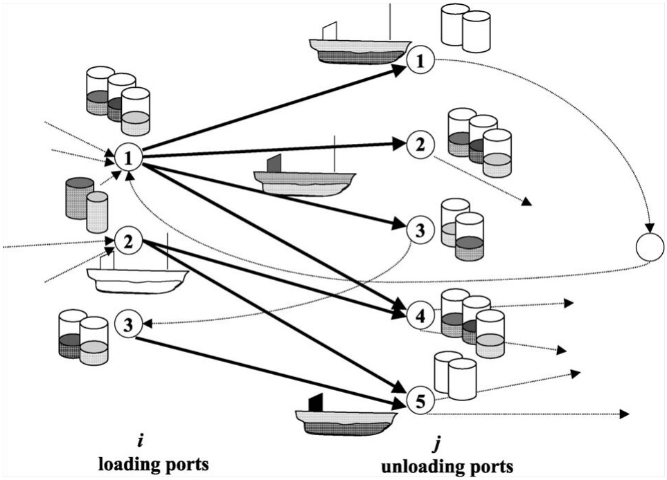

Fig. 10. A multiple product inventory routing problem. The bold arcs are in the model, the stippled ones are not.

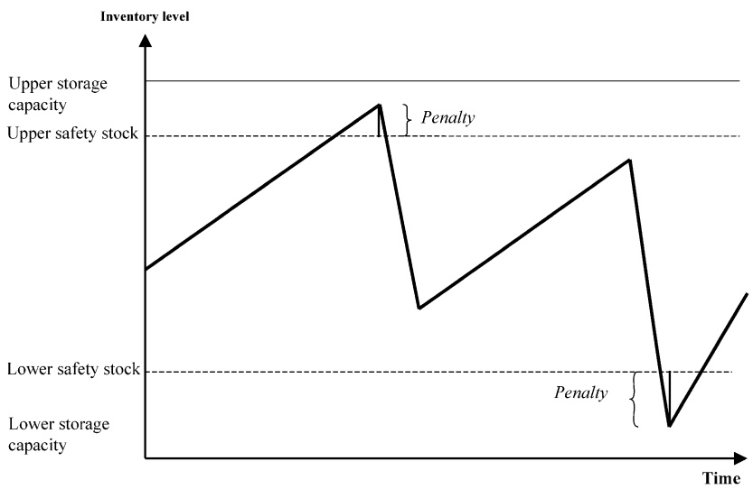

Fig. 11. The inventory level during the planning horizon for one port.

In Figure 11, we see the inventory level during the planning horizon for one of the products produced at a loading port. The port is visited twice during the planning horizon. The production rate is lower than the ship loading rate. Compared with the $\mathrm { s - } \mathrm { I S R P }$ where time was continuous, we revert here to using one day (24 hours) time increments. We measure the transportation time in days such that all products produced in one day can leave the loading port on the same day, and all products that arrive at an unloading port during a day can be consumed on the same day. However, introducing a one day lag between these operations requires only a minor change in the formulation. Further, we assume at most one ship sailing per day between any loading and unloading port pair.

The objective of the model is to find a transportation plan that minimizes the sum of the transportation cost and the inventory penalties.

In the mathematical description of the problem, let $\mathcal { N }$ be the set of ports indexed by i or j. Divide this set into the subset of loading ports $\mathcal { N } _ { \mathbf { P } }$ and the subset of unloading ports $\mathcal { N } _ { \mathbf { D } }$ . Let K be the set of products indexed by k, and let $\tau$ be the set of periods (days) indexed by t.

The time for sailing from loading port i to unloading port j including the loading and unloading time is $T _ { i j } .   R _ { i k t }$ is production or consumption of product $k$ in port i during day t. These rates are positive in loading ports and negative in unloading ports.

The inventory information is given by the storage capacities and the safety stock. The absolute lower and upper storage capacities for product k in port i are 0 and $S _ { \mathrm { M X } i k }$ , respectively. The lower and upper safety stocks for the same products in the same ports are $S _ { \mathrm { S L } i k }$ and $S _ { \mathrm { S U } i k }$ . The inventory in the beginning of the planning horizon for product k in port i is given by $S _ { \mathrm { S T } i k }$

$U _ { i j }$ represents the maximal capacity/size of a ship that can sail between the loading port i and unloading port j. Due to the setup cost involved with a voyage between two ports the transportation cost will be minimized by using the largest ship possible. By always using ships of maximal size, the model becomes simple.

The fixed cost for sailing a ship from loading port i to unloading port $j$ is represented by $C _ { \mathrm { F } i j }$ , while $C _ { \mathrm { V } i j }$ is the variable cost of shipping one ton of a product between i and j. The penalty cost per day for each ton of lower (upper) safety stock shortfall (excess) for product k in port i is $C _ { \mathrm { L } i k } \; ( C _ { \mathrm { U } i k } )$

In the mathematical formulation we use the following types of variables: the binary flow variable $x _ { i j t } ,   i \in \mathcal { N } _ { \mathrm { P } } ,   j \in \mathcal { N } _ { \mathrm { D } } ,   t \in \mathcal { T }$ , equals 1, if a ship sails from port i on day t to port $j ,$ and 0 otherwise. The quantity variable $q _ { i j k t } ,   i \in \mathcal { N } _ { \mathbf { P } } ,$ $j \in \mathcal { N } _ { \mathrm { D } } , k \in \mathcal { K } , t \in \mathcal { T }$ , represents the number of tons of product k that leaves port i on day t on a ship bounded for port j. The inventory of product k at the end of day t in port i is given by $s _ { i k t } ,   i \in \mathcal { N } ,   k \in \mathcal { K } ,   t \in \mathcal { T }$ , while the lower safety stock shortfall and the upper safety stock excess of product k at the end of day t in port i are $s _ { \mathrm { L } i k t } , i \in \mathcal { N } , k \in \mathcal { K } , t \in \mathcal { T }$ , and $s _ { \mathrm { U } i k t } , i \in \mathcal { N } , k \in \mathcal { K } , t \in \mathcal { T }$ respectively.

The mathematical formulation of the multiple product inventory ship routing problem considered here is as follows:

$$
\begin{array}{c} \min \Big [ \sum_ {i \in \mathcal {N} _ {\mathrm{P}}} \sum_ {j \in \mathcal {N} _ {\mathrm{D}}} \sum_ {t \in \mathcal {T}} C _ {\text {Fij}} x _ {i j t} + \sum_ {i \in \mathcal {N} _ {\mathrm{P}}} \sum_ {j \in \mathcal {N} _ {\mathrm{D}}} \sum_ {k \in \mathcal {K}} \sum_ {t \in \mathcal {T}} C _ {\text {Vijk}} q _ {i j k t} \\ + \sum_ {i \in \mathcal {N}} \sum_ {k \in \mathcal {K}} \sum_ {t \in \mathcal {T}} C _ {\text {Lik}} s _ {\text {Lik}} + \sum_ {i \in \mathcal {N}} \sum_ {k \in \mathcal {K}} \sum_ {t \in \mathcal {T}} C _ {\text {Uik}} s _ {\text {Uikt}} \Big ] \end{array}\tag{4.101}
$$

subject to

$$
\sum_ {k \in \mathcal {K}} q _ {i j k t} - U _ {i j} x _ {i j t} \leqslant 0, \quad \forall i \in \mathcal {N} _ {\mathrm{P}}, j \in \mathcal {N} _ {\mathrm{D}}, t \in \mathcal {T},\tag{4.102}
$$

$$
s _ {i k t} - s _ {i k (t - 1)} + \sum_ {j \in \mathcal {N} _ {\mathrm{D}}} q _ {i j k t} = R _ {i k t},
$$

$$
\forall i \in \mathcal {N} _ {\mathrm{P}}, k \in \mathcal {K}, t \in \mathcal {T},\tag{4.103}
$$

$$
s _ {j k t} - s _ {j k (t - 1)} - \sum_ {i \in \mathcal {N} _ {\mathrm{P}}} q _ {i j k (t - T _ {i j})} = R _ {i k t},
$$

$$
\forall j \in \mathcal {N} _ {\mathrm{D}}, k \in \mathcal {K}, t \in \mathcal {T},\tag{4.104}
$$

$$
s _ {i k t} + s _ {\text {Lik} t} \geqslant S _ {\text {LIK}}, \quad \forall i \in \mathcal {N}, k \in \mathcal {K}, t \in \mathcal {T},\tag{4.105}
$$

$$
s _ {i k t} - s _ {\mathrm{Uikt}} \leqslant S _ {\mathrm{SUik}}, \quad \forall i \in \mathcal {N}, k \in \mathcal {K}, t \in \mathcal {T},\tag{4.106}
$$

$$
s _ {i k t} \leqslant S _ {\mathrm{MXik}}, \quad \forall i \in \mathcal {N}, k \in \mathcal {K}, t \in \mathcal {T},\tag{4.107}
$$

$$
q _ {i j k t} \geqslant 0, \quad \forall i \in \mathcal {N} _ {\mathrm{P}}, j \in \mathcal {N} _ {\mathrm{D}}, k \in \mathcal {K}, t \in \mathcal {T},\tag{4.108}
$$

$$
x _ {i j t} \in \{0, 1 \}, \quad \forall i \in \mathcal {N} _ {\mathrm{P}}, j \in \mathcal {N} _ {\mathrm{D}}, t \in \mathcal {T},\tag{4.109}
$$

$$
s _ {i k t}, s _ {\text {Lik} t}, s _ {\text {Uik} t} \geqslant 0, \quad \forall i \in \mathcal {N}, k \in \mathcal {K}, t \in \mathcal {T}.\tag{4.110}
$$

The objective (4.101) minimizes the sum of the transportation and penalty costs. Constraints (4.102) together with the binary specifications in (4.109) force the ship usage variables to be equal to one for the ships in operation, so that we get the full setup cost for the ship voyages. Constraints (4.103) and (4.104) are the inventory balances at the loading and unloading ports, respectively, while constraints (4.105) and (4.106) calculate the safety stock shortfall and excess in the ports. The inventory starting level $S _ { \mathrm { S T } i k }$ is used for $s _ { i k 0 }$ in (4.103) and (4.104). The upper storage capacity constraints at the ports are given in (4.107). Finally, the formulation involves binary requirements (4.109) and nonnegativity requirements (4.108) and (4.110).

This model (4.101)–(4.110) is reasonably easy to understand, but it is hard to solve because the solution of the linear relaxation will often transport small quantities to avoid penalty costs and just take the “needed” portion of the fixed sailing costs. Normally we will have $C _ { \mathrm { L } i k }   >   C _ { \mathrm { U } i k }$ in unloading ports and the other way around in loading ports.

Ronen (2002) used a model very similar to (4.101)–(4.110) to plan distribution from refineries. He presented the model without any upper safety stock penalties but mentioned the use of such penalties in the discussion. Constraints (4.105) were given as equality constraints with explicit variables for lower safety stock excess. We get the same variables as surplus variables. Formulation (4.101)–(4.110) should make the LP marginally faster to solve. Ronen (2002) used CPLEX 6.5 to solve his model. For very small cases CPLEX managed to find the optimal solution with a user chosen relative tolerance of 1% for cutting off nodes in the branch-and-bound tree.

To be able to solve larger problems, we need to generate some cuts that restrict the number of $x _ { i j t }$ variables that can be 1, so that many $x _ { i j t }$ variables will be fixed to 0 after fixing some to 1.

Ronen (2002) added the following constraints to the model (4.101)–(4.110):

$$
\sum_ {k \in \mathcal {K}} q _ {i j k t} - x _ {i j t} \geqslant 0, \quad \forall i \in \mathcal {N} _ {\mathrm{P}}, j \in \mathcal {N} _ {\mathrm{D}}, t \in \mathcal {T}.\tag{4.111}
$$

If we look at this as a valid cut, it is usually far from sharp enough. But if the $q _ { i j k t }$ variables are scaled such that the ship capacities, $U _ { i j } ,$ , have values slightly greater than 1, then constraints (4.111) will force all ships branched to be used to be nearly full. If the cost structure is such that we know that it is optimal to have all ships nearly full, then we can use (4.111) with scaled $q _ { i j k t }$ variables or better with a constant slightly less than $U _ { i j }$ in front of the $x _ { i j t }$ variable. This might make the problem easier to solve.

In addition to solving the model by use of commercial optimization software for smaller sized problems, Ronen (2002) presented a cost-based heuristic algorithm to assure that acceptable solutions were obtained quickly.

## 4.3.3 Other maritime supply chain applications

Reported research of more complex maritime supply chains is scarce. However, we will briefly refer to some existing studies.

A tactical transshipment problem, where coal is transported at sea from several supply sources to a port with inventory constraints was studied by Shih (1997). The coal is then transported from the port to several coal fired power plants. The objective is to minimize the procurement costs, transportation costs, and holding costs. Constraints on the system include company procurement policy, power plant demand, port unloading capacity, blending requirements, and safety stocks. The study proposes a MIP model for a real problem faced by the Taiwan Power Company. Kao et al. (1993) present a similar problem for the same company. They applied inventory theory to determine an optimal shipping policy. The underlying inventory model is nonlinear where the procurement costs, holding costs, and shortage costs are minimized subject to inventory capacity constraints. Liu and Sherali (2000) extended the problem described by Shih (1997), and included the coal blending process at the power plants in the mathematical model. They present a MIP model for finding optimal shipping and blending decisions on an annual basis. The solution procedure employs heuristic rules in conjunction with a branch-and-bound algorithm.

In a supply chain for oil, several types of models dealing with logistics are necessary. Chajakis (1997) describes three such models:

(a) crude supply – models for generating optimal short-term marine-based crude supply schedules using MIP,

(b) tanker lightering – models of tanker lightering, which is necessary in ports where draft or environmental restrictions prevent some fully loaded vessels from approaching the refinery unloading docks. Both simulation and MIP based tools are used, and

(c) petroleum products distribution – a simulation model that was developed for analyzing products distribution by sea.

However, several legs of the supply chain are not included in these models. In Chajakis (2000) additional models for freight rate forecasting, fleet size and mix, and crew planning are discussed.

A planning model for shipments of petroleum products from refineries to depots and its solution method is described by Persson and Göthe-Lundgren (2005). In the oil refining industry, companies need to have a high utilization of production, storage and transportation resources to be competitive. Therefore, the underlying mathematical model integrates both the shipment planning and the production scheduling at the refineries. The solution method is based on column generation, valid inequalities and constraint branching.

## 4.4 Fleet deployment in liner shipping

Liner shipping differs significantly from the other two types of shipping operations, industrial and tramp shipping, discussed so far in Section 4. However, also liner shipping involves decisions at different planning levels. Strategic planning issues were discussed in Section 3.2 for liner fleet size and mix and in Section 3.3 for liner network design. The differences among the types of shipping operations are also manifested when it comes to routing and scheduling issues. One main issue for liners on the tactical planning level is the assignment of vessels to established routes or lines and is called fleet deployment.

As discussed in Section 1, during the last four decades general cargo has been containerized and we have evidenced a tremendous increase in container shipping. This increased number of containerships almost always falls in the realm of liner shipping. Despite this fast growth, studies on deployment in liner shipping are scarce.

In this section, we want to focus on a fleet deployment problem where we utilize the different cruising speeds of the ships in the fleet. The routes are predefined, and each route will be sailed by one or more ships several times during the planning horizon. Each route has a defined common starting and ending port. A round-trip along the route from the starting port is called a voyage.

The demand is given as a required number of voyages on each route without any explicit reference to the quantities shipped. The fleet of ships is heterogeneous, so we can reference quantities implicitly by saying that not all ships can sail all routes. Such a specification can incorporate needed ship capacity together with compatibilities between ships and ports. With information about the feasible ship-route combinations, we do not need to keep track of the loads on board the ships. Further, the routes do not need to share a common hub. Figure 12(a) presents a case with one hub, and Figure 12(b) presents one with several hubs.

The ships in the available fleet have different cruising speeds. Each ship is assigned to a single route and is not allowed to switch routes during the planning horizon. The fleet deployment problem consists of determining which route each ship is going to sail. The planning goal is to minimize the cost of the ships.

In the mathematical description of the problem each ship type is represented by an index v and the set of ship types is given by $\mathcal { V } ,$ . Let $\mathcal { R }$ be the set of routes and $\mathcal { R } _ { v }$ the set of routes that can be sailed by a ship of type v. The elements in both sets are indexed by $r .$

$V _ { v }$ is the number of ships available of type v. The number of voyages during the planning horizon along route $r$ for a ship of type v is represented by $N _ { \mathrm { V Y } v r }$ Normally this is not treated as an integer number of voyages. The demand is given by $D _ { \mathrm { V } r }$ which is the required minimal number of voyages along route r during the planning horizon. T is the length of the planning horizon in days, and is one year for the underlying real problem. $S _ { v r }$ represents the shipping season for a ship of type v operating on route $r .$ The shipping season $S _ { v r }$ is the total length of the service periods for ship type v during the planning horizon. This means that if a ship is allocated to a route, it is operating on that route during its whole shipping season.

Often, the demand requirement is such that we, for instance, are allowed to combine 3.7 voyages of one ship with 8.4 voyages of another ship to get a total of 12.1 voyages to meet a demand of 12 voyages. In such cases, it is not necessary for $N _ { \mathrm { V Y } v r }$ to be integer. This also gives $S _ { v r }$ equal to the time a ship of type v is available during a year independently of route $r ,$

However, if we want to be sure that each port on route $r$ is visited at least $D _ { \mathrm { V } r }$ times during the planning horizon, we need to calculate $N _ { \mathrm { V Y } v r }$ as an integer. Then $S _ { v r }$ is calculated as the number of whole voyages multiplied by the time of one voyage. This is the reason for defining the shipping season for a ship dependent on the route.

The cost consists of two parts. First, the cost of operating a ship of type v on route r during the planning horizon is given by $C _ { \mathrm { Y } v r }$ . Secondly, we have the lay-up cost. The days the ship is out of service for maintenance or other reasons are called lay-up days. The cost for each lay-up day for a ship of type v is denoted by $C _ { \mathrm { E } v }$

To make the model similar to the models in the literature, we use the following types of decision variables: the fleet deployment variables, $s _ { v r } ,   v   \in   \mathcal { V } ,$ $r \in \mathcal { R } _ { v }$ , represents the integer number of ships of type $v$ allocated to route $r ,$ and $d _ { v } , v \in \mathcal { V }$ , gives the total number of lay-up days for ships of type v.

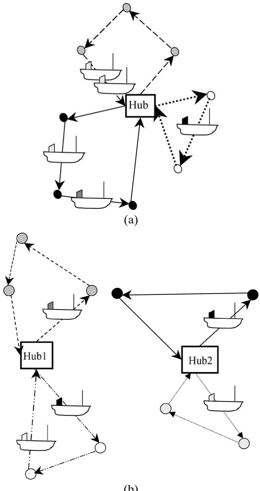

(b)

Fig. 12. (a) Fleet deployment with nonoverlapping routes and a common hub. (b) Fleet deployment with nonoverlapping routes and several hubs.

The mathematical formulation of this fleet deployment problem for ships with different operating speeds and capacities is as follows:

$$
\left| \min \left[ \sum_ {v \in \mathcal {V}} \sum_ {r \in \mathcal {R} _ {v}} C _ {\mathrm{Y} v r} s _ {v r} + \sum_ {v \in \mathcal {V}} C _ {\mathrm{E} v} d _ {v} \right] \right|\tag{4.112}
$$

subject to

$$
\sum_ {r \in \mathcal {R} _ {v}} s _ {v r} \leqslant V _ {v}, \quad \forall v \in \mathcal {V},\tag{4.113}
$$

$$
\sum_ {v \in \mathcal {V}} N _ {\mathrm{VY} v r} s _ {v r} \geqslant D _ {\mathrm{V} r}, \quad \forall r \in \mathcal {R},\tag{4.114}
$$

$$
d _ {v} + \sum_ {r \in \mathcal {R} _ {v}} S _ {v r} s _ {v r} = V _ {v} T, \quad \forall v \in \mathcal {V},\tag{4.115}
$$

$$
s _ {v r} \geqslant 0 \text {and integer,} \quad \forall v \in \mathcal {V}, r \in \mathcal {R} _ {v},\tag{4.116}
$$

$$
d _ {v} \geqslant 0, \quad \forall v \in \mathcal {V}.\tag{4.117}
$$

Here (4.112) is the total cost of sailing the routes with the selected ships and the cost of the lay-up days. Constraints (4.113) prevent the number of ships in operation from exceeding the number available, while constraints (4.114) ensure that each route is sailed at least the required number of voyages demanded. The lay-up days for each ship type are calculated in constraints (4.115). Finally, the formulation involves integer and nonnegativity requirements on the fleet deployment variables and lay-up variables, respectively.

Powell and Perakis (1997) presented this model using a different notation. The model was tested on a real liner shipping problem and substantial savings were reported compared to the actual deployment. Powell and Perakis (1997) used standard commercial software for the formulation (AMPL) and solution (OSL) of their model. The example they give has 11 types of ships and 7 routes with an average number of required voyages just below 20. All their data for the number of voyages for ships of a given type on a given route are noninteger.

We have assumed here that a ship allocated to a route is just operating on that route during its whole shipping season, even if that results in more voyages than required on that route. This means that the model does not allow for a choice between extra voyages or extra lay-up days.

Constraints (4.115) calculate the total number of lay-up days for each ship type. It is reasonably easy to remove these constraints from the model by a reformulation. Since each ship is used only on one route, we can pre-calculate the number of lay-up days for a ship of type v that is used on route r, before the optimization and add the corresponding lay-up cost to the annual cost of using the ship on that route. This also removes variable $d _ { v }$ . If we want an integer number of voyages for each ship, we need to divide the lay-up days calculated by (4.115) into two parts, one part for the real lay-up days for maintenance, and one part where the ship only waits for the next planning horizon. The cost per day for each of these parts may be different, and this difference is most easily taken care of in a pre-calculation phase.

The formulation (4.112)–(4.117) is a tactical planning model. If we want to use it in a pure strategic planning situation, we will normally assume that we can buy or build as many ships as we want of each type. Then constraints (4.113) will not be binding and the optimization problem decomposes into a problem with one constraint, (4.114), for each route after pre-calculating the lay-up cost and removing (4.115).

The work presented by Powell and Perakis (1997) is an extension and improvement of the work in Perakis and Jaramillo (1991) and Jaramillo and Perakis (1991). In the latter two papers, an LP approach is used to solve the fleet deployment problem. Manipulation of the results is needed to achieve integer solutions from the continuous ones, which may lead to a suboptimal solution and even violation of some constraints.

Section 3.2.2 discussed a strategic fleet size and mix model originally given by Fagerholt and Lindstad (2000). With a fixed fleet that model becomes a tactical fleet deployment model.

Earlier fleet deployment studies for assigning vessels to origin–destination port pairs can be found in Papadakis and Perakis (1989), Perakis and Papadakis (1987a, 1987b) and Perakis (1985). Various models were presented where both full and ballast speeds and several additional constraints were considered.

## 4.5 Barge scheduling

Barges usually operate in protected bodies of water, generally in inland waterways. Barges can be self-propelled or they may be towed by a tugboat, or pushed by a tugboat. Often multiple barges are combined into a single tow that is pushed or pulled by a single tug. On the Mississippi River system a barge can load up to 600 tons and a tow is composed of up to 15 barges. Since barges operate on inland waterways they must follow the navigable waterway and therefore their routes are linear like coastal routes or, if there are branches in the waterway, the routes may have a tree shape. Loaded and/or empty barges can be added to a tow or dropped off from a tow in ports that are passed-by along the route of the tow. Barges often have to pass through locks on their way up or down the river. This complicates their scheduling because they may have to wait for their turn to pass through a lock, and locks may have limited hours of operation. Research on barge transportation is scarce. Several papers discussing fleet design were discussed in Section 3.

Scheduling of barges in inland waterways is similar to scheduling ships with the additional complications that may be posed by locks. Such additional constraints may be very important in barge scheduling, but may be hard to incorporate in scheduling models similar to those described in Section 4.1.

Very few works are dedicated to barge scheduling. The initial work on scheduling barges was provided by O’Brien and Crane (1959) who used simulation to evaluate the impact of various scheduling policies on fleet size and mix requirements. Schwartz (1968) suggested a linear MIP model for scheduling a fleet of tugs and barges for the delivery of a given set of cargoes at minimal cost. The size of the model was far beyond the capabilities of solution algorithms at that time. A special barge scheduling problem that involves high uncertainty in timing of activities was discussed by Vukadinovic and Teodorovic (1994) and later by Vukadinovic et al. (1997). The barges are used to move gravel from a dredging site and are moved in tows by pushing tugs. The barge loading and discharging process is subject to significant uncertainty regarding its timing. The key decision is the assignment of loaded barges to tugs for a planning horizon of one day. There is a single loading location and multiple discharging ports, but a loaded barge is unloaded in a single port. The initial paper used fuzzy logic to suggest a schedule, and the second one proposed a neural network that learns from examples and can emulate the dispatcher’s decision making process.

## 4.6 Scheduling naval vessels

In contrast to commercial vessels that are usually used to transport one type of cargo or another, the main mission of naval and coast guard vessels is to perform assigned tasks at sea. Such tasks may include patrols, training, exercises, law enforcement, search and rescue, and others. In smaller navies, naval vessels usually stay close to home and return to base frequently. However, in larger navies, naval vessels may spend extended periods of time at sea, and have to be resupplied at sea. Naval vessels also spend lengthy periods of time at port or yards for maintenance, renovation, and training. Usually the major objective in scheduling naval and coast guard vessels is to assign the available fleet to a set of specified tasks in a manner that maximizes or minimizes a set of measures of effectiveness. First we discuss scheduling naval combatants, then we move to scheduling coast guard vessels, and we close with logistical support at sea.

## 4.6.1 Scheduling naval combat vessels

Scheduling an available naval fleet to perform a planned set of activities is a classical naval application. Such activities may include major operations, exercises, maintenance periods, and other events. Brown et al. (1990) considered the problem of determining the annual schedule of the US Navy’s Atlantic Fleet combatants. The goal is to assign ships to events in a manner that meets all the event requirements and minimizes deviations from ideal schedules for individual ships. Each event requires a given number of units of particular vessel types and weapon systems. A generalized set partitioning model is used to solve the problem optimally. Intricate realistic schedule constraints can be incorporated in the schedule generator.

The same problem is addressed by Nulty and Ratliff (1991), but in a somewhat different manner. An integer programming formulation is developed, but results in a model of prohibitive size. This fact combined with the qualitative nature of additional secondary objectives and constraints suggest an interactive optimization approach. The proposed approach allows the user to generate a good initial fleet schedule by using network algorithms, and improve the solution by interactively addressing the issues that are difficult to quantify. They also suggest that the method of Brown et al. (1990) could be used to find a starting solution for the interactive procedure.

## 4.6.2 Scheduling coast guard vessels

A problem that is essentially similar to scheduling naval combatants is faced by coast guards. However, coast guard vessels stay closer to their home base and generally do not have to be resupplied at sea. A typical problem is to schedule a fleet of coast guard cutters (vessels) to perform a set of assignments. Each assignment has a given duration, and a desired number of cutters. Such a problem was addressed by Darby-Dowman et al. (1995). In their model the requirements are treated as goals, and not meeting a goal is allowed but penalized. The problem is solved by using a set partitioning model. The objective is to select the set of schedules that provides a solution that is as close to meeting the requirements as possible. The system was originally intended for use in determining operational schedules. However, additional use to address strategic issues such as future operating policy and fleet mix arose during the project.

A system for solving similar scheduling problems for the US Coast Guard cutters was presented by Brown et al. (1996). They developed costs and penalties for the model to mimic the motives and rules of thumb of a good scheduler. The objective was to minimize the costs, and the elastic MIP model was solved on a personal computer within a few minutes.

Another type of vessel scheduling problem faced by a coast guard is routing and scheduling buoy tenders. These vessels are used to service and maintain navigational buoys. Cline et al. (1992) describe a heuristic algorithm for routing and scheduling US Coast Guard buoy tenders. Each buoy has a service time window dictated by the planned maintenance schedule. Since each tender has the sole responsibility for servicing its set of buoys, the problem is decomposed into a set of traveling salesman problems with time windows, one for each tender. They used a best-schedule heuristic to solve the problem.

## 4.6.3 Logistical support at sea

Supporting naval vessels at sea poses additional challenges. Schrady and Wadsworth (1991) described a logistic support system that was designed to track and predict the use of consumable logistic assets (fuel, ordnance) by a battle group. The system was tested during fleet exercises and was quite successful. Williams (1992) dealt with the replenishment of vessels at sea. He presented a heuristic algorithm to replenish a group of warships at sea while the ships carry out their assignments. The heuristic rules were derived from replenishment experts and are based on experimentation.

## 4.7 Ship management

Several topics fall into the category of ship management and we shall discuss briefly the following ones: crew scheduling, maintenance scheduling, positioning of spare parts, and bunkering. Deep-sea vessels spend extended periods of time at sea and the crew lives on board the ship. Short-sea vessels make frequent port calls and the crew may live on shore. This difference has significant impact on ship management issues. Crew scheduling for deep-sea vessels is not a major issue. Crew members spend months on the vessel and then get a long shore leave. For short-sea vessels the crew may change frequently, and crew scheduling may be an issue. A special type of such crew scheduling problem is presented by Wermus and Pope (1994).

Numerous mechanical and electrical systems are installed on board a ship and they require maintenance. A ship is usually scheduled once a year for maintenance in a port or a shipyard, and once every several years a ship is surveyed by its classification society in a shipyard. However, some maintenance is required between such planned maintenance periods, and this includes both routine/preventive maintenance, and repair of breakdowns, at least temporarily, till the ship reaches the next port. On-board maintenance is usually done by the crew, but the shrinking size of crews reduces the availability of the crew for maintenance work. A large ship may have less than two dozen seamen on board, and that includes the captain and the radio officer. This limited crew operates the ship around the clock. A specialized analysis of repair and replacement of marine diesel engines was presented by Perakis and Inozu (1991). In order to facilitate maintenance a ship must carry spare parts on board. The amount of spare parts is determined by the frequency of port calls and whether spares and equipment are available in these ports. Large and expensive spares that cannot be shipped by air, such as a propeller, may pose a special problem, and may have to be prepositioned at a port or carried on board the vessel.

A ship may consume tens of tons of bunker fuel per day at sea, and there may be significant differences in the cost of bunker fuel among bunkering ports. Thus one has to decide where to buy bunker fuel. Sometimes it may be worthwhile to divert the ship to enter a port just for loading bunker fuel. The additional cost of the ship’s time has to be traded off with the savings in the cost of the fuel.

## 5 Operational planning

When the uncertainty in the operational environment is high and the situation is dynamic, or when decisions have only short-term impact, one resorts to short-term operational planning. In this section we discuss operational scheduling where only a single voyage is assigned to a vessel, environmental routing where decisions are made concerning the next leg of the voyage, speed selection, ship loading, and booking of single orders.

## 5.1 Operational scheduling

The demarcation between tactical and operational scheduling in industrial and tramp shipping is fuzzy, and therefore Section 4.1 considered both planning levels. However, there are some situations that can be placed solely on the operational planning level and they are discussed here. In certain circumstances it is impractical to schedule ships beyond a single voyage. This happens when there is significant uncertainty in the supply of the product to be shipped, or in the demand for the product in the destination markets. The shipped product may be seasonal and its demand and supply may be affected by the weather. These factors contribute to the uncertainty in the shipping schedule. Citrus fruit is an example of such a product. This is a highly seasonal product that is shipped in large quantities over several months a year, and may require refrigerated vessels. The shipper has to assure sufficient shipping capacity in advance of the shipping season, but does not know in advance the exact timing, quantities, and destinations of the shipments. The shipper, who owns the cargo, does not have return cargoes for the ships, so the ships are hired under contracts of affreightment or spot charters, and generally do not return to load a second voyage. Thus every week the shipper has ships available for loading in the producing area and either a load is assigned to each ship or demurrage is paid for the ship. Based on product availability, demand projections, inventory at the markets, and transit times, the shipper builds a shipping plan for the upcoming week, and has to assign the planned shipments to the available fleet at minimal cost. Usually the contract of most vessels hired for a single voyage confines them to a range of unloading ports. In some operations a vessel may unload in more than one port, and the requirement of a destination port may exceed the size of the largest vessel and can be split among several vessels.

Ronen (1986) discussed such an operational scheduling problem, presented a model and a solution algorithm that provided optimal solutions to smaller size problems, and heuristics for solving larger problem instances. Later Cho and Perakis (2001) suggested a more efficient formulation to the same problem that is a generalized version of the capacitated facility location problem.

## 5.2 Environmental routing

Ships navigate in bodies of water and are exposed to a variety of environmental conditions, such as: currents, tides, waves, and winds. Recognizing these conditions is the first step toward selecting routes that mitigate their effects, or even take advantage of them. Generally, when a ship moves between two ports it has to select its route through the body of water. However, such a choice is very limited in coastal and inland waterway navigation. Proper selection of the route may assure on-time arrival at the destination port, or even shorten the time of the passage and reduce its cost. The terms environmental routing and weather routing are often used interchangeably although the second one is a subset of the first. Weather is part of the environment in which ships operate, and it affects the waves encountered by ships. We confine our short discussion to the impact of waves and ocean currents. Material concerning tides and winds can be found in the naval architecture, navigation, and meteorology literature.

## 5.2.1 Waves

Waves may have a significant impact on route selection. In order to take waves into account one has first to know their height and direction along the contemplated route as a function of location (x and y coordinates). Such knowledge may allow selection of the route and of power setting that minimize the transit time. However, the waves’ height and direction may change over time, and may not be known in advance. Papadakis and Perakis (1990) analyzed a minimal time vessel routing problem under stationary conditions that is appropriate for relatively short passages. Given wave height and wave direction as a function of location, select the route and power setting of the vessel that minimize the transit time. Local optimality considerations combined with global boundary conditions resulted in piecewise continuous optimal policies. They used variational calculus and optimal control theory in their analysis. Perakis and Papadakis (1989) extended their analysis of the minimal time vessel routing problem to a time-dependent environment, where the sea condition at any point changes over time. This allows analysis of longer passages. In addition they considered voyages consisting of multiple legs with port calls of known length between the legs. Although they provide a numerical example, no estimates of potential benefits (or savings) are available. However, they show that when the objective is to minimize transit time “wait for a storm to pass” policy is never optimal. Instead “one should go ahead under the maximum permissible power setting- - -”.

## 5.2.2 Ocean currents

In most oceans there are regular currents that ships may be able to exploit for faster passage. Lo et al. (1991) estimated that by exploiting ocean currents the world commercial fleet could reduce its annual fuel costs by at least \$70 million. They also provide anecdotal evidence that some operators try to take advantage of prevailing currents. However, this is easier said than done. Ocean currents are not constant but rather change over time. Thus getting reliable timely information regarding the ocean current at the location of a vessel poses a major obstacle. Satellite altimetry may provide timely reliable estimates of dynamic current patterns that are necessary for routing a vessel through such currents. McCord et al. (1999) took a closer look at potential benefits of such data. Their study uses dynamic programming to optimize ship routes through estimated current patterns in a dynamic area of the Gulf Stream. They conclude that elimination of data bias and present sampling limitations can produce about 11% fuel savings for a 16-knot vessel. They found that the contribution of such routing is much better on with-current voyages than on counter-current voyages. The major question is whether there is a sufficient market to justify development of a system for collection of the necessary data.

Environmental routing is complicated by the complexity of the continuous dynamic environment in which it takes place, and the lack of the necessary timely reliable data. Due to these reasons environmental routing seems to be in its infancy and is a fertile ground for further research.

## 5.3 Speed selection

A ship can operate at a speed slower than its design speed and thus significantly reduce its operating cost. However, a ship must maintain a minimal speed to assure proper steerage. For most cargo vessels the bunker fuel consumption per time unit is approximately proportional to the third power of the speed (the consumption per distance unit is proportional to the second power of the speed). Thus, reducing the speed by 20% reduces the fuel consumption (per time unit) by about 50% (or by about 36% for a given sailing distance). When bunker fuel prices are high the cost of bunker fuel may exceed all other operating costs of the ship. Thus there may be a strong incentive to steam at slower speed and reduce the operating costs. In the wake of the high fuel price during the 1970s, Ronen (1982) presented three models for the determination of short-run optimal speed for different types of legs:

• an income generating leg,

• a positioning (empty/ballast) leg, and

• a leg where the income depends on the speed.

When one widens the horizon beyond a single vessel, the perspective may change. A fleet operator that controls excess capacity can reduce the speed of the vessels and thus reduce the effective capacity of the fleet, instead of layingup, chartering-out or selling vessels.

Under various operational circumstances a scheduler has to assign an available fleet of vessels to carry a specified set of cargoes among various ports. Often cruising speed decisions may be an inherent part of such fleet scheduling decisions. Cruising speed decisions affect both the effective capacity of the fleet and its operating costs.

Under a contract of affreightment (COA) a ship operator commits to carry specified amounts of cargo between specified loading port(s) and unloading port(s) at a specific rate over a specific period of time for an agreed upon revenue per delivered unit of cargo. The term fleet deployment is usually used for ship scheduling problems associated with liners and with COAs, because the vessels are essentially assigned to routes that they follow repeatedly, and the deployment decisions cover longer terms. Perakis and Papadakis (1987a, 1987b) determined the fleet deployment and the associated optimal speed, both loaded and in ballast, for ships operating under a COA between a single loading port and a single unloading port. A more comprehensive version of this problem was later dealt with by Papadakis and Perakis (1989). They expanded the problem to address multiple loading ports and multiple unloading ports, but still assumed that each ship returns in ballast to its loading port after unloading its cargo. They used nonlinear programming to determine the vessel allocation to the routes and their cruising speed, both loaded and in ballast.

Tramp and industrial operators usually face shorter term ship scheduling problems. A set of cargoes has to be carried by the available fleet, and if the fleet has insufficient capacity some cargoes may be contracted out. The cruising speed of the vessels in the available fleet can be an inherent part of the scheduling decisions. Bausch et al. (1998) and Brown et al. (1987) addressed this situation, and in their work the cruising speed was determined simultaneously with the schedule. Whereas the last two papers had hard time windows for loading and unloading the cargoes, Fagerholt (2001) considered also soft time windows, a situation that allows more flexibility in determining the cruising speed of the vessels, and may result in a lower cost schedule.

In addition to cost and schedules, short-term cruising speed decisions should take into account also the impact of the destination port operating times. If the destination port is closed over the weekend (or at night) there is no point arriving there before the port opens. Thus reducing the cruising speed and saving fuel makes sense. In the case where cargo-handling operations of a vessel that started when the port was open continue until the vessel is finished, even after the port closes, it may be worthwhile to speed up and arrive at the destination port to start operations before it closes. A more detailed discussion of these tactics is provided in Section 6.2.

## 5.4 Ship loading

A ship must be loaded in a safe manner in order to prevent loss of the ship or damage to the cargo. Ships are designed with certain types of cargo in mind. A crude tanker is designed to carry crude oil, and a containership is designed to carry containers. A ship floats on water and its stability must be assured during passage as well as in port. Ballast tanks are built into the hull of a ship in order to help maintain its stability by filling them with seawater. When a ship is full with cargo of a uniform density for which it is designed, such as crude oil or iron ore, usually there are no stability problems. Stability problems arise when (a) a ship is partially loaded, then the weight distribution of the cargo must be properly planned and monitored, both while sailing at sea and during loading or unloading operations in port, or (b) the cargo is not properly secured and may shift during passage, for example, liquid bulk cargo may slosh in partially empty tanks, or (c) when the ship is fully loaded with nonuniform cargo, such as containers or general cargo. In such a case an improper weight distribution of the cargo may result in excessive rolling or pitching that may lead to loss of the ship. In extreme cases improper weight distribution may cause excessive structural stress that may lead to break up of the ship.

Ship stability has several dimensions. The Trim of a ship is the difference between the forward and aft draft, and must remain within a narrow range. There also should be balance between weight of the cargo on the port (left) side and the starboard (right) side of the ship so it will remain horizontal. The center of gravity of the ship should not be too high in order not to make the ship “top heavy” and easy to roll, and not too low so the ship will not snap back too fast from a roll which may cause on-deck cargo to break loose.

The more complex ship loading problems are encountered in loading containerships. Not only the stability of the vessel has to be assured but also the efficiency of cargo handling operations in the current and following ports must be taken into account. Containers have different weights and that may affect the vessel stability. Due to the design of containerships access to a specific container may be obstructed by other containers stowed on top of it. Thus container shifting may be necessary to unload a specific container. Therefore, in order to minimize future container shifting operations one has to take into account the destination port of the loaded containers when one decides where to load them onboard the vessel. Moreover, one also has to consider the destination ports of the containers that will be loaded in following ports of call, and some of these containers may not even be booked yet. There may also be containers stuffed with dangerous goods. Such containers impose additional constraints due to spatial separation requirements.

The focus of research on ship loading has been on loading container ships. A good description of the various considerations involved in containership loading is provided by Martin et al. (1988). They developed heuristics that emulate strategies used in manual load planning and showed some improvements in materials handling measures.

Avriel et al. (1998) focused on minimizing container shifting. They formulated a binary linear program for the container stowage planning problem that minimizes the number of container shifting operations. Since the problem is NP-complete they designed a “suspensory heuristic” to achieve a stowage plan. Their work is of limited applicability because it assumes away stability and strength requirements, accommodates only one size of containers, and ignores hatch covers.

A comprehensive approach for planning container stowage on board containerships is provided by Wilson and Roach (2000). Their objective is to find a stowage plan that assures that no ship stability or stress constraints are violated, and minimizes container shifts (re-handles). Additional considerations are reduction of the ballast required by the vessel and efficient use of cranes when loading and unloading. Wilson and Roach described a computerized methodology for generating commercially viable stowage plans. All characteristics of the problem are considered, but optimality is not necessarily sought. Their stowage planning process is broken down into two phases, (a) “strategic planning” where “generalized” containers are assigned to “blocks” of cargo space, and (b) “tactical planning” where specific containers are assigned to specific slots within the blocks determined earlier. This approach significantly reduces the combinatorial complexity of the problem. Their objective consists of a dozen different criteria that are assigned weights. The strategic planning phase uses a branch-and-bound search, and the tactical planning phase uses a tabu search. They tested their methodology on commercial data for a 688 TEU vessel with a mix of container sizes and types, and four destination ports. Commercially viable solutions were received in a couple of hours on a 166 MHz computer. These solutions were comparable with those generated by experienced human planners. However, it takes a human planner several days to get such solutions.

A similar two-stage approach is used by Kang and Kim (2002) to generate container stowage plans. In the first stage they assign containers to holds for each port separately by solving a problem similar to a fixed charge transportation problem using a heuristic based on the transportation method. In the second stage they assign containers to slots for each hold separately using a tree search procedure. Since the first stage is done for one port at a time the resulting stowage plan may be problematic. Therefore they iterate between the two stages to improve the plan. They tested their approach on randomly generated problems and compared their results to a couple of earlier suggested models. However, they admit the limited applicability of their approach because it considers only one size of containers (40), and does not consider refrigerated containers or ones with hazardous materials.

The container stowage planning problem is very complex and we are far from finding optimal solutions, or even agreeing on the components of the objective function. The related problem of stowage sequencing, which represents the port’s perspective, is discussed at length in the chapter by Crainic and Kim (2007).

## 5.5 Booking of single orders

An important operational problem in commercial shipping is booking of single orders. Since a shipper expects an acceptance/rejection decision on a single cargo request more or less immediately, for the shipping company the problem consists of deciding whether to accept a single cargo or not. This problem is somewhat different between liner and tramp/industrial shipping. In liner shipping, where a single cargo is usually a small fraction of the vessel’s capacity, it is usual to accept a cargo if there is space available on the given ship line, and to reject or suggest another time of departure if not. However, sometimes it may not be profitable to accept a cargo even if there is space available, as there may appear requests for better paying cargoes later on. This problem of stochastic optimization in liner shipping is rarely dealt with in the literature. The authors are aware of only a single reference on the subject, and it is a rather out-dated conference contribution (Almogy and Levin, 1970).

In tramp shipping it is also usual to accept a single cargo request if the planner is able to find space available. To see if there is space available, rescheduling the whole fleet with the existing cargo commitments together with the new optional cargo may be necessary because a single cargo may take a large share of a vessel’s capacity, or even be a full shipload. This is thoroughly discussed in Section 4.1.5. Industrial shipping is similar in this respect to tramp. However, also in tramp shipping, as for liner shipping, it may sometimes be advantageous not to accept a single cargo request as more profitable cargoes may appear later. The authors are not aware of any published work on this aspect.

## 6 Robustness in maritime transportation

As discussed in previous sections, there are many uncertain factors in the ocean shipping industry resulting in delays and lack of timely fulfillment of plans. Therefore, in order to encourage trust in the planning process, it may often be important to consider robustness in optimization models used for planning. Despite this, models that have been developed for the shipping industry only rarely deal with these aspects.

In this section we discuss a few problems from the shipping industry where uncertainty and robustness play important roles, as well as approaches for achieving more robust solutions. It should be emphasized that this section does not present a comprehensive overview but rather provides several examples. In Section 6.1 we concentrate on strategic planning problems, while tactical and operational planning problems are considered in Sections 6.2 and 6.3, respectively. Section 6.4 discusses optimization and persistence.

## 6.1 Strategic planning and uncertainty

The most important strategic planning problem for all shipping segments (industrial, tramp, and liner) is probably fleet sizing and composition. However, the quality of decisions regarding this aspect is strongly influenced by many uncertainties, probably much more than decisions for any shorter planning horizon. There are several major reasons for this uncertainty:

• The long time horizon that these decisions span, which can be several years. In some cases, when the decision involves building new ships, it may span up to 20–30 years.

• Demand for shipping is a derived demand. It depends on the level of economic activity, prices of commodities, and other factors.

• There is a significant time lag between changes in demand for maritime transportation and the corresponding adjustments in the capacity of such services.

During such a long time horizon one will experience major unpredictable fluctuations both in the demand for shipping services and on the supply side. These factors are highly interwoven. For instance, if demand for transport services within a given market segment increases, we would probably see an increase in both freight rates and ship prices, and the same is true in the opposite direction.

Another important strategic decision that is relevant to all shipping segments is whether a shipping company should accept a long-term contract or not. In such a long-term contract, the shipping company is typically committed to carry a specific quantity more or less evenly distributed over the contract period, and receives a given revenue per unit of cargo lifted. Also here, the decision should be made only after cautious consideration (or speculation) regarding the direction that the market will take in the future. If, for instance, the spot market experiences a boost and the actual freight rates increase it would be unfortunate to have most of the fleet tied up in contracts at lower rates. On the contrary, if the market dips, it would be advantageous to have a substantial contractual coverage, in order to ensure both income and engagement for the ships.

There are different approaches for handling uncertainty and robustness, such as:

• simulation,

• re-optimization for different scenarios or input parameters,

• adding slack to the input parameters (e.g., service speed),

• deterministic models that incorporate penalties, and

• stochastic optimization models.

Simulation is a simple approach that is used to consider stochastic conditions and uncertainty. There are some examples where simulation models have been used for strategic planning purposes in the shipping industry, see, for instance, Darzentas and Spyrou (1996), Richetta and Larson (1997), and Fagerholt and Rygh (2002).

Another simple approach for considering uncertainty is to make several runs with an optimization model for different scenarios. In this way, one can decide what is the optimal decision for a given scenario or for a given set of input parameters. The problem in using this method is that solutions are often not robust and are strongly affected by the specific set of values used for the input parameters. Since flexibility is not built into the plans, extreme solutions are often produced.

Stochastic conditions like the ones mentioned above and other ones can also be approached both by deterministic and stochastic optimization models. An example of using deterministic optimization models with penalties to achieve more robust solutions is discussed in the next section for a tactical ship scheduling problem. To the authors’ best knowledge there are no published papers where stochastic optimization models are used for strategic planning in the shipping industry. The only one discussing the issue is by Jaikumar and Solomon (1987), where a model for determining the minimum number of tugs needed to move barges between ports on a river is presented. They discuss how their model can be extended to incorporate stochastic demands.

## 6.2 Robust tactical planning

In Section 4 we presented tactical planning problems and models for the different shipping segments. However, the models presented there and the solutions that can be obtained from them do not handle the uncertainty and robustness aspects. Several unpredictable factors influence the fulfillment of plans and should often be considered in the planning process. The two most important are probably:

• weather conditions that can strongly influence the sailing time, and

• port conditions, such as strikes and mechanical problems that can affect the time in port.

A ship may often have to reduce its speed in bad weather. This may result in late arrival for the next planned cargo. In such cases the planner often has to reschedule the whole fleet. If the planner has built in enough slack in the schedule, the planned schedule may still be valid. However, since ships have high costs, very little slack is usually built into their schedules.

In some cases, ships may require high tide to get into the port fully loaded. In other cases empty barges may not be able to pass under bridges at high tide. In short-sea shipping applications where sailing times are short relatively to port times, and tides may have a significant impact on port access, a small delay may be amplified due to additional waiting for high tide. Many ports are also closed for cargo handling operations during nights and weekends. Cargo handling time that is longer than one working day of the port will span multiple days. This means that the ship will stay idle much of the time in port, and the total time in port will depend on the ship’s arrival time.

Consider the following example. A ship has to load a cargo at a specified port. The loading time window starts on Wednesday at 8:00 and ends on the next Monday at 24:00. The operating hours of the port are between 8:00 and 16:00 from Monday to Friday. It takes 12 operating hours to load the cargo. Figure 13 shows the necessary time in port as a function of the arrival time of the vessel. We see that the total time spent in port varies from 28 to 92 hours, depending on the arrival time. Twenty eight hours is the minimal time spent in port, while 92 hours is the maximal time and includes a lot of idle time during the weekend.

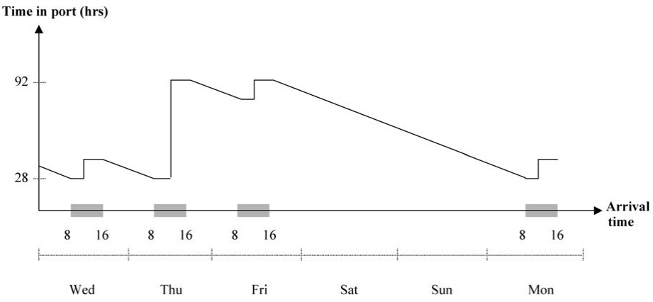

Fig. 13. Time spent in port as a function of arrival time.

A ship arriving on Wednesday morning at 8:00 will be loading for 8 hours on the first day and 4 hours on the next day. This gives a total of 28 hours in port. In the other extreme, take a ship arriving at 15:00 on Thursday. It loads for one hour on that day, stays idle for 16 hours during Thursday night and continues loading on Friday for 8 hours, but she does not finish loading before the port closes for the weekend. It has to continue loading on Monday morning at 8:00 and finishes at 11:00. This means that the ship stays idle in port for 64 hours during the weekend, giving a total of 92 hours in the port. It should be emphasized that in practice it may often be possible to negotiate a few hours extension to the loading/unloading operations, usually at a cost.

In these cases, a delay due to bad weather or port conditions may have even stronger effect than in other cases, as the delay may result in the ship staying idle in port during weekends. Christiansen and Fagerholt (2002) deal with such a problem. There, a deterministic solution method for making the schedules robust is presented. Their solution method is based on the set partitioning approach described in Section 4.2.2. However, to ensure schedules that are robust the concept of risky arrival is introduced. A risky arrival is defined as a planned arrival time in port that with only a moderate delay will result in the ship staying idle during a weekend. In order to reduce the number and magnitude of risky arrivals for a fleet schedule, Christiansen and Fagerholt (2002) calculate a penalty cost depending on how ‘risky’ the arrival time is. This penalty cost is calculated during the a priori schedule generation and is added to the other cost elements in the objective function in the set partitioning model. The computational results show that the planned fleet schedule’s robustness can be significantly increased at the sacrifice of only small increases in transportation costs.

We can also find a few other contributions within ship scheduling where penalty costs are used in connection with time windows. In Fagerholt (2001), hard time windows are extended to soft ones by allowing late or early service, though at a penalty cost. Christiansen (1999) studies a combined ship routing and inventory management problem described in Section 4.3.1. The transported product is produced in some port factories and consumed in others. At all factories there are hard inventory limits for the transported product. In order to reduce the possibility of violating the inventory limits at the port factories Christiansen and Nygreen (2005) introduce an additional pair of soft inventory limits within the hard ones. Thus the soft inventory limits can be violated at a penalty, but it is not possible to exceed the stock capacity or to drop below the lower inventory limit. They show that the soft inventory constraints can be transformed into soft time windows.

Another problem regarding uncertainty and robustness in ship routing and scheduling is that in some cases the planner knows the loading port but the unloading port is not known at the time of loading. Sometimes just a geographical region is given for unloading, and the particular unloading port is specified after the voyage has started. In these cases the planner has several practical options:

• the planner can, based on his or her experience, make a qualified guess regarding the unloading port and use it for planning,

• use a port that is more or less in the middle of the specified unloading area as an “average”,

• plan for worst-case, i.e., use the port that is farthest away in the area (e.g., farthest up in the river), and

• run different scenarios regarding the different optional unloading ports to see how the different alternatives affect the schedule.

## 6.3 Robust operational planning

Also operational problems in maritime transportation may pose robustness issues. Delays due to tides and restricted opening hours in ports, as discussed in the previous section, can often be regarded as operational ones. How to handle such delays when they occur is often referred to as “disruption management”. Typically for shipping, it is often possible to increase the ship’s speed to some extent when a delay occurs. However, this comes at the sacrifice of much higher fuel consumption, see Section 5.3 on speed selection. Sometimes, it may also be possible to increase the loading or unloading rate with a proper incentive.

The problem of whether to accept a single cargo request or not is also an operational problem since the potential customer often requires an answer immediately, see Section 5.5. In practice, a cargo is often accepted if there is available capacity. However, accepting a new cargo may restrict the possibilities for taking a more profitable cargo that becomes available in the market later. Therefore, it could be advantageous to introduce the concept of stochastic optimization to such problems. The authors are not aware of such contributions.

## 6.4 Persistence

Schedules have often to be changed due to unforeseen delays, changes in requirements or other events. In such circumstances it may be highly desirable to minimize changes to already published schedules. Thus, necessary changes in the schedule of one vessel should have a minimal effect on the schedule of other vessels. Optimization models have a well-deserved reputation for amplifying small input changes into drastically different solutions. A previously optimal solution may still be nearly optimal in a new scenario and managerially preferable to a dramatically different solution that is mathematically optimal. Optimization models can be stated so that they exhibit varying degrees of persistence with respect to previous values of variables, constraints, or even exogenous considerations. Brown et al. (1997a) discuss these aspects of optimization and persistence.

In another paper by Brown et al. (1997b), the persistence aspect is considered when optimizing submarine berthing plans. Once in port, submarines may be shifted to different berthing locations to allow them to better receive services that they require, or to clear space for other shifted vessels. Submarine berth shifting is expensive, labor intensive and may be potentially hazardous. Brown et al. (1997b) present a mixed-integer programming model for this berth planning problem with a planning horizon of 1–2 weeks. Once a berthing plan has been approved, changes are inevitable due to delays, changed requests for services, and early arrival of inbound submarines. An optimization model that only minimizes the costly berth shifts is not appropriate in this situation, because it can amplify minor modifications in service requests into wholesale revisions in the approved berthing plan. Revisions to the plan and the disruptions they bring must therefore be controlled to encourage trust in the planning process. Therefore Brown et al. (1997b) have incorporated a persistence incentive into the mixed-integer programming model that results in a decreased number of changes in previously published plans.

## 7 Perspectives and future research

As mentioned in the Introduction, demand for maritime transport services is increasing consistently, and there are no signs that the world economy will rely less heavily on maritime transport in the future. In this section we shortly discuss some trends in ocean shipping that will probably influence both the need for optimization-based decision support systems for maritime applications, and the shipping industry’s acceptance of and benefits from such systems. We also wish to point out trends that result in a need for researchers to pay attention to new problem areas in maritime transportation. The focus is on applications within ship routing and scheduling. Trends in the land-side of maritime transportation operations are discussed in the Perspectives section of Crainic and Kim (2007). There may be additional trends, but these are the ones that we deem to be the primary ones, and that may have significant impact on the various aspects discussed in this chapter. A more detailed discussion of current trends in ship routing and scheduling is provided in Christiansen et al. (2004).

## 7.1 Mergers, acquisitions, and collaborations

During the last couple of decades we have witnessed consolidation in the manufacturing sector resulting in bigger actors on the demand side for maritime transport services. This has given the shippers increased market power compared to the shipping companies, resulting in squeezed profit margins for the shipping companies. In order to reduce this imbalance, there have been many mergers among shipping companies in the last decade. Many shipping companies have entered into pooling and collaboration efforts in order to increase their market power and gain flexibility in the services that can be offered (see Sheppard and Seidman, 2001). In such collaboration, a number of shipping companies bring their fleets into a pool and operate them together. The income and costs are distributed among the different shipping companies according to certain rules that have been agreed upon. The split of income and costs is an intriguing topic for research.

Traditionally, scheduling in maritime transportation has been done manually by pencil and paper, based on the planners’ knowledge and experience. The above trends of mergers and pooling collaborations result in larger controlled fleets. This means that it becomes much harder to determine a fleet schedule only by manual planning methods. Therefore, the need for optimization-based decision support systems has increased and will probably continue to increase in the future.

## 7.2 New generation of planners

Decision-makers and planners in the shipping industry are traditionally experienced, often with a sea-going background. As the fleets become larger, the planning problems focused on in this chapter become much harder to handle by manual methods. Despite this, planners are often very skeptical of computers in general and of optimization-based decision support systems in particular. However, in recent years we have seen that shipping companies have started employing planners with less practical but more academic background. This new generation of planners is more used to computers and software, and therefore is often much more open to new ideas such as using optimization-based decision support systems for the different applications in maritime transportation. Even though there is still a gap to bridge between researchers and planners in the shipping industry, we expect more willingness and interest from the ocean shipping industry to introduce such systems in the future.

## 7.3 Developments in software and hardware

The fast technological development in computers and communications also weighs heavily for the introduction of optimization-based decision support systems in shipping companies. Many earlier attempts failed due to restricted computer power, making it hard to model all the important problem characteristics and to facilitate a good user interface. However, today’s computers enable an intuitive user interface to be implemented, something that is crucial for acceptance by the planners. In addition, there have been significant algorithmic developments. This, together with advances in computing power, has made it feasible to find good solutions to hard problems in a reasonable amount of time.

## 7.4 Shift from industrial to tramp shipping

Looking at the literature review on ship routing and scheduling presented by Christiansen et al. (2004), we observe that most contributions are in industrial shipping, while only a few are in the tramp market. In industrial shipping the shipper controls the cargo and the fleet of ships. The purpose of an industrial operation is usually to provide the required transportation services for the organization’s cargo requests at minimum cost. Industrial shipping is practiced by large extracting and manufacturing companies that have their own division that controls a number of ships for the transportation of their own cargoes. However, in recent years this has changed. Many such companies are now focusing on their core business and have outsourced other activities like transportation to independent shipping companies. Therefore, the emphasis has shifted somewhat from industrial to tramp shipping. Increasing global competition results in shifting industrial shipping operations from being considered “cost centers” into “profit centers” and compels them to become more involved in the spot market. This also brings new opportunities for optimization-based decision support systems for ship scheduling planners.

## 7.5 Focus on supply chains

In most ship scheduling studies reported in the literature, the supply chain perspective is missing. Recently we see an increasing competition between supply chains even more than between shipping companies. Shipping companies must consider themselves as total logistics providers, or at least as a part of a total logistics provider, instead of only a provider of sea transport services. This means that there must be some sort of collaboration and integration along the supply chain, for instance, between the shippers and the shipping company. Vendor managed inventory takes advantage of the benefits of introducing this integration and transfers inventory management and ordering responsibilities completely to the vendor or the logistics provider. The logistics provider determines both the quantity and timing of customer deliveries. The customer is guaranteed not to run out of product, and in return the logistics provider gains a dramatic increase in flexibility that leads to more efficient use of its resources.

We expect an increasing emphasis on integrating maritime transportation into the supply chain. This will also bring new interesting challenges to the research community in routing and scheduling, such as inventory routing, collaboration, and cost and/or profit sharing along the supply chain.

## 7.6 Strategic planning issues and market interaction

Vessel fleet sizing should be given more attention in the future. This strategic problem is extremely important as decisions concerning fleet size and composition set the stage for routing and scheduling. Even though there have been a few studies on this type of problem, the potential for improving fleet size decisions by using optimization-based decision support systems is probably significant. As already discussed, we have seen a trend from industrial to tramp shipping, with much more interaction with the market. This high degree of market interaction probably makes the fleet size issue even more important and complex, as one now has to make some assumptions on future market development in order to determine the optimal fleet.

Contract evaluation (discussed in Section 3.5) is yet another important strategic problem that has only scarcely been considered in the research literature. This is to a large extent related to the fleet size issue, since the shipping company has to evaluate whether it has sufficient fleet tonnage to fulfill potential contract commitments together with its existing commitments. If so, one has to check whether a contract is profitable or not. In order to do so, one also has to make some assumptions about how the spot market will develop for the given contract period. Since both fleet sizing and contract evaluation decisions are to a large extent dependent on the expectations of how a future market will develop, concepts of optimization under uncertainty must probably be considered.

## 8 Conclusion

Maritime transportation is the backbone of international trade. The volume of maritime transportation has been growing for many years, and is expected to continue growing in the foreseeable future. Maritime transportation is a unique transportation mode possessing characteristics that differ from other modes of transportation, and requires decision support models that fit the specific problem characteristics.

Maritime transportation poses a rich spectrum of decision making problems, from strategic ones through tactical to operational. We also find within maritime transportation a variety of modes and types of operations with their specific characteristics: industrial, tramp, liner, deep-sea, short-sea, coastal and inland waterways, port and container terminals, and their interface with vessels.

Research interest in maritime transportation problems has been increasing in recent years but still lags behind the more visible modes, namely truck, air, and rail. In this chapter we have presented a variety of decision making problems in maritime transportation. For some common problems we presented models as well as discussed solution approaches, whereas for other problems we confined ourselves to a general description of the problems and referred the reader to sources that deal with the problems more extensively. Although most of the research in maritime transportation stemmed from real-life problems only a fraction of it has matured into real decision support systems that are used in practice.

The fast containerization of general and break-bulk cargo combined with fast development of information technology and telecommunications, and with competitive pressures, have resulted in a shift of emphasis from ocean transportation to intermodal supply chains. The economies of scale that such supply chains pose result in industry consolidation and larger controlled fleets, pre-senting a fertile ground for applying quantitative decision support tools. At the same time shippers started to focus on their core operations and to outsource logistic functions to third party providers who also have significant economies of scale. Thus, also on the demand side we observe consolidation and higher potential for applying quantitative decision support tools.

Uncertainty plays a major role in maritime transportation and therefore robust and stochastic models should take center stage. However, in this respect the surface has only been scratched.

Maritime transportation poses a wide variety of challenging research problems, the solutions to which have high potential to improve economic performance and increase profitability in this highly competitive arena. The fast development of optimization algorithms and computing power facilitate solution of more realistic problems, and we are confident that more research will be directed to this crucial transportation mode.

## Acknowledgements

This work was carried out with financial support from the Research Council of Norway through the TOP project (Improved Optimisation Methods in Transportation Logistics), the INSUMAR project (Integrated supply chain and maritime transportation planning) and the OPTIMAR project (Optimization in Maritime transportation and logistics). We want to thank the Doctoral students Roar Grønhaug, Frank Hennig, and Yuriy Maxymovych for a careful reading of the chapter and for helpful suggestions.

## References

Almogy, Y., Levin, O. (1970). Parametric analysis of a multi-stage stochastic shipping problem. In: IFORS, OR 69: Proc. Fifth International Conference on OR. Tavistock, London, pp. 359–370.

Appelgren, L.H. (1969). A column generation algorithm for a ship scheduling problem. Transportation Science 3, 53–68.

Appelgren, L.H. (1971). Integer programming methods for a vessel scheduling problem. Transportation Science 5, 64–78.

Ariel, A. (1991). The effect of inventory holding costs on the optimal payload of bulk carriers. Maritime Policy & Management 18 (3), 217–224.

Avriel, M., Penn, M., Shipier, N., Witteboon, S. (1998). Stowage planning for container ships to reduce the number of shifts. Annals of Operations Research 76, 55–71.

Bausch, D.O., Brown, G.G., Ronen, D. (1998). Scheduling short-term marine transport of bulk products. Maritime Policy & Management 25 (4), 335–348.

Bellmore, M. (1968). A maximum utility solution to a vehicle constrained tanker scheduling problem. Naval Research Logistics Quarterly 15, 403–411.

Bendall, H.B., Stent, A.F. (2001). A scheduling model for a high speed containership service: A hub and spoke short-sea application. International Journal of Maritime Economics 3 (3), 262–277.

Brown, G.G., Graves, G.W., Ronen, D. (1987). Scheduling ocean transportation of crude oil. Management Science 33 (3), 335–346.

Brown, G.G., Goodman, C.E., Wood, R.K. (1990). Annual scheduling of Atlantic Fleet naval combatants. Operations Research 38 (2), 249–259.

Brown, G.G., Dell, R.F., Farmer, R.A. (1996). Scheduling coast guard district cutters. Interfaces 26 (2), 59–72.

Brown, G.G., Dell, R.F., Wood, R.K. (1997a). Optimization and persistence. Interfaces 27 (5), 15–37.

Brown, G.G., Cormican, K.J., Lawphongpanich, S., Widdis, D.B. (1997b). Optimizing submarine berthing with a persistence incentive. Naval Research Logistics 44, 301–318.

Brønmo, G., Christiansen, M., Nygreen, B. (2006). Ship routing and scheduling with flexible cargo sizes. Journal of the Operation Research Society, [doi:10.1057/palgrave.jors.2602263](http://dx.doi.org/10.1057/palgrave.jors.2602263). Advance online publication, 16 August 2006.

Brønmo, G., Christiansen, M., Fagerholt, K., Nygreen, B. (2007). A multi-start local search heuristic for ship scheduling – a computational study. Computers & Operations Research 34 (3), 900–917.

Chajakis, E.D. (1997). Sophisticated crude transportation. OR/MS Today 24 (6), 30–34.

Chajakis, E.D. (2000). Management science for marine petroleum logistics. In: Zanakis, S.H., Doukidis, G., Zopounidis, C. (Eds.), Decision Making: Recent Developments and Worldwide Applications. Kluwer Academic, pp. 169–185.

Cho, S.-C., Perakis, A.N. (1996). Optimal liner fleet routing strategies. Maritime Policy & Management 23 (3), 249–259.

Cho, S.-C., Perakis, A.N. (2001). An improved formulation for bulk cargo ship scheduling with a single loading port. Maritime Policy & Management 28 (4), 339–345.

Christiansen, M. (1999). Decomposition of a combined inventory and time constrained ship routing problem. Transportation Science 33 (1), 3–16.

Christiansen, M., Fagerholt, K. (2002). Robust ship scheduling with multiple time windows. Naval Research Logistics 49 (6), 611–625.

Christiansen, M., Nygreen, B. (1998a). A method for solving ship routing problems with inventory constraints. Annals of Operations Research 81, 357–378.

Christiansen, M., Nygreen, B. (1998b). Modeling path flows for a combined ship routing and inventory management problem. Annals of Operations Research 82, 391–412.

Christiansen, M., Nygreen, B. (2005). Robust inventory ship routing by column generation. In: Desaulniers, G., Desrosiers, J., Solomon, M.M. (Eds.), Column Generation. Springer-Verlag, New York, pp. 197–224.

Christiansen, M., Fagerholt, K., Ronen, D. (2004). Ship routing and scheduling: Status and perspectives. Transportation Science 38 (1), 1–18.

Cline, A.K., King, D.H., Meyering, J.M. (1992). Routing and scheduling of coast guard buoy tenders. Interfaces 22 (3), 56–72.

Crainic, T.G., Kim, K.H. (2007). Intermodal transportation. In: Barnhart, C., Laporte, G. (Eds.), Transportation. Handbooks in Operations Research and Management Science. North-Holland, Amsterdam, pp. 467–537. This volume.

Crary, M., Nozick, L.K., Whitaker, L.R. (2002). Sizing the US destroyer fleet. European Journal of Operational Research 136, 680–695.

Cullinane, K., Khanna, M. (1999). Economies of scale in large container ships. Journal of Transport Economics and Policy 33 (2), 185–208.

Dantzig, G.B., Fulkerson, D.R. (1954). Minimizing the number of tankers to meet a fixed schedule. Naval Research Logistics Quarterly 1, 217–222.

Darby-Dowman, K., Fink, R.K., Mitra, G., Smith, J.W. (1995). An intelligent system for US coast guard cutter scheduling. European Journal of Operational Research 87, 574–585.

Darzentas, J., Spyrou, T. (1996). Ferry traffic in the Aegean Islands: A simulation study. Journal of the Operational Research Society 47, 203–216.

Desrosiers, J., Dumas, Y., Solomon, M.M., Soumis, F. (1995). Time constrained routing and scheduling. In: Ball, M.O., Magnanti, T.L., Monma, C.L., Nemhauser, G.L. (Eds.), Network Routing. Handbooks in Operations Research and Management Science, vol. 8. North-Holland, Amsterdam, pp. 35–139.

Erkut, E., Verter, V. (2007). Hazardous materials transportation. In: Barnhart, C., Laporte, G. (Eds.), Transportation. Handbooks in Operations Research and Management Science. North-Holland, Amsterdam, pp. 539–621. This volume.

European Commission (2004). European Transport Policy for 2010: Time to Decide. White paper.

Fagerholt, K. (1999). Optimal fleet design in a ship routing problem. International Transactions in Operational Research 6 (5), 453–464.

Fagerholt, K. (2001). Ship scheduling with soft time windows – an optimization based approach. European Journal of Operational Research 131, 559–571.

Fagerholt, K. (2004). A computer-based decision support system for vessel fleet scheduling – experience and future research. Decision Support Systems 37 (1), 35–47.

Fagerholt, K., Christiansen, M. (2000a). A combined ship scheduling and allocation problem. Journal of the Operational Research Society 51 (7), 834–842.

Fagerholt, K., Christiansen, M. (2000b). A travelling salesman problem with allocation, time window and precedence constraints – an application to ship scheduling. International Transactions in Operational Research 7 (3), 231–244.

Fagerholt, K., Lindstad, H. (2000). Optimal policies for maintaining a supply service in the Norwegian Sea. OMEGA 28, 269–275.

Fagerholt, K., Rygh, B. (2002). Design of a sea-borne system for fresh water transport – A simulation study. Belgian Journal of Operations Research, Statistics and Computer Science 40 (3–4), 137–146.

Fisher, M.L., Rosenwein, M.B. (1989). An interactive optimization system for bulk-cargo ship scheduling. Naval Research Logistics 36, 27–42.

Flatberg, T., Haavardtun, H., Kloster, O., Løkketangen, A. (2000). Combining exact and heuristic methods for solving a vessel routing problem with inventory constraints and time windows. Ricerca Operativa 29 (91), 55–68.

Fleming, D.K. (2002). Reflections on the history of US cargo liner service (part I). International Journal of Maritime Economics 4 (4), 369–389.

Fleming, D.K. (2003). Reflections on the history of US cargo liner service (part II). Maritime Economics & Logistics 5 (1), 70–89.

Fox, M., Herden, D. (1999). Ship scheduling of fertilizer products. OR Insight 12 (2), 21–28.

Garrod, P., Miklius, M. (1985). The optimal ship size: A comment. Journal of Transport Economics and Policy 19 (1), 83–91.

Gillman, S. (1999). The size economies and network efficiencies of large containerships. International Journal of Maritime Economics 1 (1), 39–59.

Hersh, M., Ladany, S.P. (1989). Optimal scheduling of ocean cruises. INFOR 27 (1), 48–57.

Hughes, W.P. (2002). Navy operations research. Operations Research 50 (1), 103–111.

Hwang, S.-J. (2005). Inventory constrained maritime routing and scheduling for multi-commodity liquid bulk. Phd thesis, Georgia Institute of technology, Atlanta.

Jaikumar, R., Solomon, M.M. (1987). The tug fleet size problem for barge line operations: A polynomial algorithm. Transportation Science 21 (4), 264–272.

Jansson, J.O., Shneerson, D. (1978). Economies of scale of general cargo ships. The Review of Economics and Statistics 60 (2), 287–293.

Jansson, J.O., Shneerson, D. (1982). The optimal ship size. Journal of Transport Economics and Policy 16 (3), 217–238.

Jansson, J.O., Shneerson, D. (1985). A model of scheduled liner freight services: Balancing inventory cost against shipowners’ costs. The Logistics and Transportation Review 21 (3), 195–215.

Jansson, J.O., Shneerson, D. (1987). Liner Shipping Economics. Chapman & Hall, London.

Jaramillo, D.I., Perakis, A.N. (1991). Fleet deployment optimization for liner shipping. Part 2. Implementation and results. Maritime Policy & Management 18 (4), 235–262.

Jetlund, A.S., Karimi, I.A. (2004). Improving the logistics of multi-compartment chemical tankers. Computers & Chemical Engineering 28, 1267–1283.

Kang, J.-G., Kim, Y.-D. (2002). Stowage planning in maritime container transportation. Journal of the Operational Research Society 53, 415–426.

Kao, C., Chen, C.Y., Lyu, J. (1993). Determination of optimal shipping policy by inventory theory. International Journal of Systems Science 24 (7), 1265–1273.

Kleywegt, A. (2003). Contract planning models for ocean carriers. Working paper, Georgia Institute of Technology, Atlanta, GA.

Korsvik, J.E., Fagerholt, K., Brønmo, G. (2007). Ship scheduling with flexible cargo quantities: A heuristic solution approach. Working paper, Norwegian University of Science and Technology, Trondheim, Norway.

Ladany, S.P., Arbel, A. (1991). Optimal cruise-liner passenger cabin pricing policy. European Journal of Operational Research 55, 136–147.

Lane, D.E., Heaver, T.D., Uyeno, D. (1987). Planning and scheduling for efficiency in liner shipping. Maritime Policy & Management 14 (2), 109–125.

Larson, R.C. (1988). Transporting sludge to the 106-Mile site: An inventory/routing model for fleet sizing and logistics system design. Transportation Science 22 (3), 186–198.

Lawrence, S.A. (1972). International Sea Transport: The Years Ahead. Lexington Books, Lexington, MA.

Liu, C.-M., Sherali, H.D. (2000). A coal shipping and blending problem for an electric utility company. OMEGA 28, 433–444.

Lo, H.K., McCord, M.R., Wall, C.K. (1991). Value of ocean current information for strategic routing. European Journal of Operational Research 55, 124–135.

Martin, G.L., Randhawa, S.U., McDowell, E.D. (1988). Computerized container-ship loading: A methodology and evaluation. Computers & Industrial Engineering 14 (4), 429–440.

McCord, M.R., Lee, Y.-K., Lo, H.K. (1999). Ship routing through altimetry-derived ocean currents. Transportation Science 33 (1), 49–67.

McLellan, R.G. (1997). Bigger vessels: How big is too big? Maritime Policy & Management 24 (2), 193–211.

Mehrez, A., Hung, M.S., Ahn, B.H. (1995). An industrial ocean-cargo shipping problem. Decision Sciences 26 (3), 395–423.

Nulty, W.G., Ratliff, H.D. (1991). Interactive optimization methodology for fleet scheduling. Naval Research Logistics 38, 669–677.

O’Brien, G.G., Crane, R.R. (1959). The scheduling of a barge line. Operations Research 7, 561–570.

Papadakis, N.A., Perakis, A.N. (1989). A nonlinear approach to multiorigin, multidestination fleet deployment problem. Naval Research Logistics 36, 515–528.

Papadakis, N.A., Perakis, A.N. (1990). Deterministic minimal time vessel routing. Operations Research 38 (3), 426–438.

Perakis, A.N. (1985). A second look at fleet deployment. Maritime Policy & Management 12, 209–214.

Perakis, A.N., Bremer, W.M. (1992). An operational tanker scheduling optimization system. Background, current practice and model formulation. Maritime Policy & Management 19 (3), 177–187.

Perakis, A.N., Inozu, B. (1991). Optimal maintenance, repair, and replacement for Great Lakes marine diesels. European Journal of Operational Research 55, 165–182.

Perakis, A.N., Jaramillo, D.I. (1991). Fleet deployment optimization for liner shipping. Part 1. Background, problem formulation and solution approaches. Maritime Policy & Management 18 (3), 183–200.

Perakis, A.N., Papadakis, N.A. (1987a). Fleet deployment optimization models. Part 1. Maritime Policy & Management 14, 127–144.

Perakis, A.N., Papadakis, N.A. (1987b). Fleet deployment optimization models. Part 2. Maritime Policy & Management 14, 145–155.

Perakis, A.N., Papadakis, N.A. (1989). Minimal time vessel routing in a time-dependent environment. Transportation Science 23, 266–276.

Persson, J.A., Göthe-Lundgren, M. (2005). Shipment planning at oil refineries using column generation and valid inequalities. European Journal of Operational Research 163, 631–652.

Pesenti, R. (1995). Hierarchical resource planning for shipping companies. European Journal of Operational Research 86, 91–102.

Pope, J.A., Talley, W.K. (1988). Inventory costs and optimal ship size. Logistics and Transportation Review 24 (2), 107–120.

Powell, B.J., Perakis, A.N. (1997). Fleet deployment optimization for liner shipping: An integer programming model. Maritime Policy & Management 24 (2), 183–192.

Psaraftis, H.N. (1988). Dynamic vehicle routing problems. In: Golden, B.L., Assad, A.A. (Eds.), Vehicle Routing: Methods and Studies. North-Holland, Amsterdam, pp. 223–248.

Psaraftis, H.N. (1999). Foreword to the focused issue on maritime transportation. Transportation Science 33 (1), 1–2.

Rana, K., Vickson, R.G. (1988). A model and solution algorithm for optimal routing of a time-chartered containership. Transportation Science 22 (2), 83–95.

Rana, K., Vickson, R.G. (1991). Routing container ships using Lagrangean relaxation and decomposition. Transportation Science 25 (3), 201–214.

Richetta, O., Larson, R. (1997). Modeling the increased complexity of New York City’s refuse marine transport system. Transportation Science 31 (3), 272–293.

Ronen, D. (1982). The effect of oil price on the optimal speed of ships. Journal of the Operational Research Society 33, 1035–1040.

Ronen, D. (1983). Cargo ships routing and scheduling: Survey of models and problems. European Journal of Operational Research 12, 119–126.

Ronen, D. (1986). Short-term scheduling of vessels for shipping bulk or semi-bulk commodities originating in a single area. Operations Research 34 (1), 164–173.

Ronen, D. (1991). Editorial to the feature issue on water transportation. European Journal of Operational Research 55 (2), 123.

Ronen, D. (1993). Ship scheduling: The last decade. European Journal of Operational Research 71, 325–333.

Ronen, D. (2002). Marine inventory routing: Shipments planning. Journal of the Operational Research Society 53, 108–114.

Sambracos, E., Paravantis, J.A., Tarantilis, C.D., Kiranoudis, C.T. (2004). Dispatching of small containers via coastal freight liners: The case of the Aegean sea. European Journal of Operational Research 152, 365–381.

Schrady, D., Wadsworth, D. (1991). Naval combat logistics support system. Journal of the Operational Research Society 42 (11), 941–948.

Schwartz, N.L. (1968). Discrete programs for moving known cargos from origins to destinations on time at minimum bargeline fleet cost. Transportation Science 2, 134–145.

Scott, J.L. (1995). A transportation model, its development and application to a ship scheduling problem. Asia-Pacific Journal of Operational Research 12, 111–128.

Sheppard, E.J., Seidman, D. (2001). Ocean shipping alliances: The wave of the future? International Journal of Maritime Economics 3, 351–367.

Sherali, H.D., Al-Yakoob, S.M., Hassan, M.M. (1999). Fleet management models and algorithms for an oil tanker routing and scheduling problem. IIE Transactions 31, 395–406.

Shih, L.-H. (1997). Planning of fuel coal imports using a mixed integer programming method. International Journal of Production Economics 51, 243–249.

Sigurd, M.M., Ulstein, N.L., Nygreen, B., Ryan, D.M. (2005). Ship scheduling with recurring visits and visit separation requirements. In: Desaulniers, G., Desrosiers, J., Solomon, M.M. (Eds.), Column Generation. Springer-Verlag, New York, pp. 225–245.

Talley, W.K., Agarwal, V.B., Breakfield, J.W. (1986). Economics of density of ocean tanker ships. Journal of Transport Economics and Policy 20 (1), 91–99.

Thompson, P.M., Psaraftis, H.N. (1993). Cyclic transfer algorithms for multi-vehicle routing and scheduling problems. Operations Research 41 (5), 935–946.

UNCTAD (2003). Review of Maritime Transport, 2003. United Nations, New York and Geneva.

UNCTAD (2004). Review of Maritime Transport, 2004. United Nations, New York and Geneva.

Vis, I.F.A., de Koster, R. (2003). Transshipment of containers at a container terminal: An overview. European Journal of Operational Research 147, 1–16.

Vukadinovic, K., Teodorovic, D. (1994). A fuzzy approach to the vessel dispatching problem. European Journal of Operational Research 76 (1), 155–164.

Vukadinovic, K., Teodorovic, D., Pavkovic, G. (1997). A neural network approach to the vessel dispatching problem. European Journal of Operational Research 102 (3), 473–487.

Wermus, M., Pope, J.A. (1994). Scheduling harbor pilots. Interfaces 24 (2), 44–52.

Williams, H.P. (1999). Model Building in Mathematical Programming, 4th edition. Wiley, West Sussex, pp. 160–165.

Williams, T.M. (1992). Heuristic scheduling of ship replenishment at sea. Journal of the Operational Research Society 43 (1), 11–18.

Wilson, I.D., Roach, P.A. (2000). Container stowage planning: a methodology for generating computerized solutions. Journal of the Operational Research Society 51 (11), 1248–1255.

Xinlian, X., Tangfei, W., Daisong, C. (2000). A dynamic model and algorithm for fleet planning. Maritime Policy & Management 27 (1), 53–63.