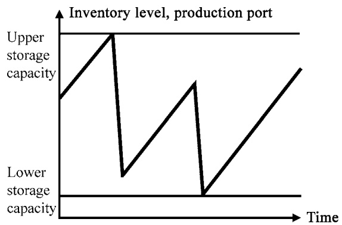
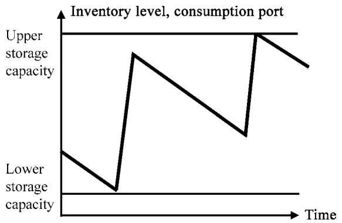
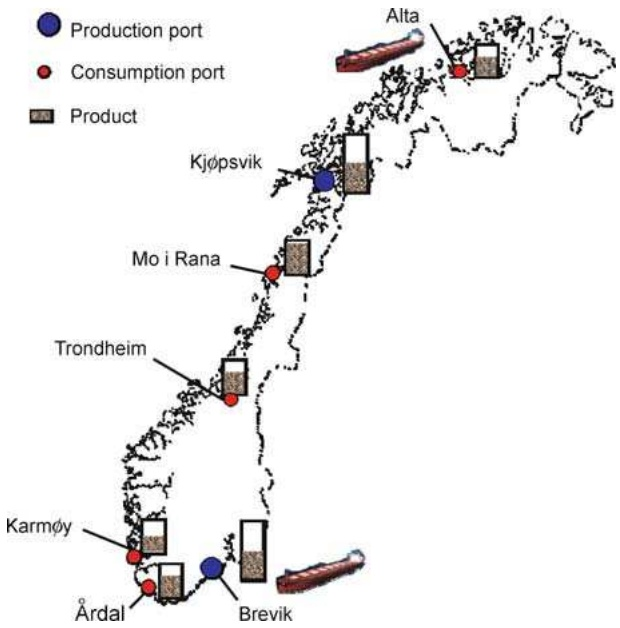

## Maritime Inventory Routing Problems

**MARIELLE CHRISTIANSEN**<strong>1</strong>**, KJETIL FAGERHOLT**<strong>1,2</strong> 1**Section of Managerial Economics, Finance and Operations Research, Norwegian University of Science and Technology, Trondheim, Norway 2 Norwegian Marine Technology Research Institute (MARINTEK), Trondheim, Norway**

## Article Outline

**Abstract Introduction The Basic ISRP Problem Description Mathematical Model Extensions of the ISRP One Central Supplier or Consumer Inventory Constraints in Either Production Ports or Consumption Ports Variable Production or Consumption Rate Multiple Products Use of Spot Charters Combined Inventory Routing and Cargo Routing Combining Inventory Routing with Other Planning Aspects Concluding Remarks Acknowledgements References**

## Abstract

**Maritime transportation is a heavily utilized mode when large quantities of bulk products need to be transported over long distances. Often, inventories exist at the loading and/or unloading ports of the sailing legs. When the ship operator has the responsibility for both** **the transportation of the fleet and the inventories at the ports, the underlying planning problem is a maritime inventory routing problem. Here we introduce the reader to various applications within maritime inventory routing and present some examples of research contributions. First we consider and present a mathematical model for the basic problem where a single product is transported and denote this problem the inventory ship routing problem. There exist a lot of extensions and variants of the problem. These include, among others, problems with inventories at only one end, variable production/consumption rates, multiple products, use of spot charters and problems that combine inventory routing with other planning aspects. Maritime inventory routing problems are very complex and to the authors’ knowledge there exist no commercial optimization-based systems for the shipping industry yet. However, it is probably just a question of time before they become available.**

## Introduction

**In order to survive in a tough global market, many companies have been forced to change their focus from competition between companies to competition between supply chains. Supply chains of companies with foreign sources of raw materials or with overseas customers most often include maritime transportation. Supply chain management and optimization are active fields of research, and we can see applications in almost all industries. So far the focus of such applications has usually not been much on maritime transportation, so there is a great potential and need for research in the area.**

**A maritime inventory routing problem is defined here as a combined ship routing and scheduling problem and an inventory management problem. The basic inventory ship routing problem (ISRP) concerns the transportation of a single product. The product is produced and stored in inventories at given loading ports and is transported by sea to inventories at unloading or consumption ports. Inventory capacities are defined in all ports. Further, we assume that information about production and consumption rates is given in all ports. To transport the product between the given production and consumption ports, the planners control a heterogeneous fleet of ships. The planning problem is to find routes and schedules for the fleet that minimize the transportation costs without interrupting production or consumption at the storages. Depending on the segment the fleet is operating in, the typical planning period spans from 1 to 2 weeks up to several months.**

**Most ship scheduling problems studied in the literature are so-called cargo routing problems [1]. In cargo routing problems, each cargo is specified by a given loading and unloading port. The quantity of the cargo is given and normally there exist time windows for loading and/or unloading. When planning routes and schedules, the shipping company either seeks to minimize the transportation costs for carrying all contracted cargoes or in addition to maximize profit for optional spot cargoes that may be available. We refer to [4] for a survey on maritime cargo routing problems. The cargo routing problems deviate from the ISPRs in a number of ways. The number of calls at a given port during the planning horizon is not predetermined in the ISRP, neither is the quantity to be loaded or unloaded at each port call. There is also no predefined pickup and delivery pair in the ISRP. The combination of the inventory management and the ship routing and scheduling makes the ISRP a very complex problem.**

**The inventory routing problem has been focused on in the literature for a couple of decades. Dror and Ball [8] defined the problem as a distribution problem in which each customer maintains a local inventory of a product such as heating oil and consumes a certain amount of that product each day. Given a central supplier (depot), the objective is to minimize the annual delivery costs while attempting to ensure that no customer runs out of the product at any time. The asymmetry between each type of inventory (production** **and consumption) with only one central supply node (depot) will often be found in road-based inventory routing problems, and more seldom in maritime transportation (ISRP). In the road-based inventory routing problem, the amount unloaded at each customer is often small compared to the total capacity of the vehicle. This is also in contrast with the ISRP, where the ship is often fully loaded and unloaded.**

**The objective of this article is to introduce the reader to various real planning problems within maritime inventory routing. The purpose is not to give a comprehensive overview of such problems, but rather to present examples of applications and research in the area.**

**The rest of the article is organized as follows: The first section defines the basic inventory ship routing problem and the underlying mathematical model. Extensions of the basic ISRP are addressed next. Finally, concluding remarks and future research follow.**

## The Basic ISRP

**In order to give an introduction to the various real planning problems within maritime inventory routing, we will start with a basic ISRP. First we describe the planning problem. Then we present an arc-flow formulation of the problem . The final section is devoted to real applications of the basic ISRP.**

## Problem Description

**The products transported in maritime inventory routing problems are usually bulk products, where large quantities are transported and there are inventories at both the loading and the unloading ports. In these problems, the ship operators have a twofold responsibility: transportation and inventory management at the production and consumption sites. In such planning situations, the routing and scheduling of the fleet have to be synchronized with the inventory management at both production and consumption sites.**

**In the basic ISRP a single (homogeneous) product is transported. The product is produced at the sources, called loading ports, and consumed at the destinations, called unloading ports. Inventory storage capacities are given in all ports in addition to the production or consumption rate of the product. Here, the rate is assumed constant during the planning horizon.**

Maritime Inventory Routing Problems, Figure 1

Inventory levels during a planning period for a production and a consumption port

**The number of calls at a given port during the planning period is not predetermined, nor is the quantity to be loaded or unloaded at each port call. Figure 1 shows an example of a production/consumption and loading/unloading pattern. For both port types, the port is called at twice. However, the quantities loaded or unloaded differ at each call. The reason for this might be that the ports are visited by ships with different capacities loading/unloading full loads, or due to partial loading/unloading. In loading ports, it is important to ensure that the inventory level is not above the maximum inventory level when loading starts and not under the minimum inventory level when the loading has finished. In unloading ports, the opposite has to be ensured. The inventory level at the beginning of the planning period can be at any level, as indicated in Fig. 1.**

**Therefore, the planning problem is to design routes and schedules that minimize the transportation cost without interrupting production or consumption. We assume no inventory costs because the shipper owns both the producing sources and the consuming destinations. The ship operator controls a heterogeneous fleet of ships. We assume that partial loading and unloading is allowed, such that two ports of the same type (loading or unloading) may be called at in succession. The ship is not necessarily empty at the beginning of the plan ning horizon, but might have some load onboard. The ship can be either at a port or at sea at the beginning of the planning horizon. Figure 2 shows a simplified illustration of the planning problem for a cement producer in Norway with two production factories and five consumption ports with inventories. The fleet consists of two ships. Each port can be called at several times during the planning period by the same ship or different ships.**

Maritime Inventory Routing Problems, Figure 2 A simplified planning situation with seven ports and two ships

## Mathematical Model

**The model of the ISRP will be presented in a compact and simplified way. In Sect. “Routing,” we describe the flow network and the objective function. Then, the conditions for the loading and unloading, the time aspects and the inventories are described in Sect. “Loading and Unloading”, “Scheduling” and “Inventory Management,” respectively. We base our notation and model on those of Christiansen et al. [3].**

**In the upcoming formulation, we have assumed that the ship may be partially loaded/unloaded, meaning that multiple cargoes may be onboard a ship simultaneously. The model could have been simplified if we had assumed full loads only or sailing between different port types (from loading to unloading and vice versa).**

**Routing In the mathematical description of the network each port is represented by an index i and the set of ports is given by N. Let** $\mathcal { V } ,$ **indexed by v, be the set of available ships to be routed and scheduled. Not all ships can visit all ports, and** $\mathcal { N } _ { \nu }   =   \{ \mathrm { f e a s i b l e }$ **ports for ship v}** $\cup \{ o ( \nu ) , d ( \nu ) \}$ **is the set of ports that can be visited by ship v. The terms** $o ( \nu )$ **and** $d ( \nu )$ **represent the artificial origin port and artificial destination port of ship v, respectively. Each port can be visited several times during the planning horizon, and** $\mathcal { M } _ { i }$ **i**s the set of possible calls at port i, while $\mathcal { M } _ { i v }$ **is the** set of **calls at port i that can be made by ship v. The port call number is represented by an index** $m ,$ **and** $M _ { i }$ **i**s the **last possible call at port i within the planning period. The set of nodes in the flow network represents the set** of port calls, and each port call is specified by $( i , m )$ $i \in \mathcal { N } , m \in \mathcal { M } _ { i }$ **. In addition, we specify flow networks for each ship v with nodes** $( i , m ) , i \in \mathcal { N } _ { \nu } , m \in \mathcal { M } _ { i \nu } .   \mathcal { A }$ <strong>v</strong> **contains all feasible arcs for ship** $\nu _ { \nu }$ **which is a subset of** $\{ i \in \mathcal { N } _ { \nu } , m \in \mathcal { M } _ { i \nu } \} \times \{ i \in \mathcal { N } _ { \nu } , m \in \mathcal { M } _ { i \nu } \}$ . Finally, $C _ { i j \nu }$ **represents the variable costs for sailing between port i and port j with ship v. This includes port, channel and fuel costs.**

**In the network flow part of the formulation we use the following types of variables: the binary flow variable** $x _ { i m j n \nu }   ,   \nu \in \mathcal { V } ,   ( i , m , j , n ) \in \mathcal { A } _ { \nu }$ **equals 1, if ship v sails from node (i, m) directly to node** $( j , n )$ **,** and 0 otherwise, **and the slack variable** $w _ { i m }   ,   i \in \mathcal { N } ,   m \in \mathcal { M } _ { i }$ **i**s equal to **1 if no ship takes port call (i, m), and 0 otherwise. The routing formulation including the objective function is as follows:**

$$
\min \sum_ {v \in \mathcal {V}} \sum_ {(i, m, j, n) \in \mathcal {A} _ {v}} C _ {i j v} x _ {i m j n v},\tag{1}
$$

**subject to**

$$
\sum_ {v \in \mathcal {V}} \sum_ {j \in \mathcal {N} _ {v}} \sum_ {n \in \mathcal {M} _ {j v}} x _ {i m j n v} + w _ {i m} = 1, \forall i \in \mathcal {N}, m \in \mathcal {M} _ {i},\tag{2}
$$

$$
\sum_ {j \in \mathcal {N} _ {\nu}} \sum_ {n \in \mathcal {M} _ {j \nu}} x _ {o (\nu) 1 j n \nu} = 1, \forall \nu \in \mathcal {V},\tag{3}
$$

$$
\sum_ {i \in \mathcal {N} _ {v}} \sum_ {m \in \mathcal {M} _ {i v}} x _ {i m j n v} - \sum_ {i \in \mathcal {N} _ {v}} \sum_ {m \in \mathcal {M} _ {i v}} x _ {j n i m v} = 0,\tag{4}
$$

$$
\forall v \in \mathcal {V}, j \in \mathcal {N} _ {v} \backslash \{o (v), d (v) \}, n \in \mathcal {M} _ {j v},
$$

$$
\sum_ {i \in \mathcal {N} _ {v}} \sum_ {m \in \mathcal {M} _ {i v}} x _ {i m d (v) 1 v} = 1, \forall v \in \mathcal {V},\tag{5}
$$

$$
w _ {i m} - w _ {i (m - 1)} \geq 0, \forall i \in \mathcal {N}, m \in \mathcal {M} _ {i},\tag{6}
$$

$$
x _ {i m j n v} \in \{0, 1 \}, \forall v \in \mathcal {V}, (i, m, j, n) \in \mathcal {A} _ {v},\tag{7}
$$

$$
w _ {i m} \in \{0, 1 \}, \forall i \in \mathcal {N}, m \in \mathcal {M} _ {i}.\tag{8}
$$

**The objective function (1) minimizes the total costs. Constraints (2) ensure that each port call is visited at most once. Constraints (3)–(5) describe the flow on the sailing route used by ship v. One or several of the calls in a specified port can be made by a dummy ship, and the highest call numbers will be assigned to dummy ships in constraints (6). These constraints reduce the number of symmetrical solutions in the solution approach. For the calls made by a dummy ship, we get artificial starting times and artificial inventory levels within the defined upper and lower limits. Finally, the formulation involves binary requirements (7) and (8) on the flow variables and port call slack variables, respectively.**

**Loading and Unloading The capacity of ship v is** given by $V _ { C A P \nu }$ . Variable $l _ { i m \nu } ,   \nu \in V ,   i \in \mathcal { N } _ { \nu } \backslash \{ d ( \nu ) \}$ $m   \in   \mathcal { M } _ { i \nu }$ gives the total load onboard ship v just after the service is completed at node $( i , m )$ , while variable $q _ { i m \nu }   ,   \nu \in V ,   i \in \mathcal { N } _ { \nu } \backslash \{ d ( \nu ) \} ,   m \in \mathcal { M } _ { i \nu }$ represents the quantity loaded or unloaded at port call (i, m), when ship v visits $( i , m )$ . It is assumed that nothing is loaded or unloaded at the artificial origin $o ( \nu ) ; q _ { o ( \nu ) 1 \nu } = 0$ However, the ships may have cargo onboard, $L _ { 0 \nu }$ , at the beginning of the planning horizon; $l _ { o ( \nu ) 1 \nu } = L _ { 0 \nu }$ . Further, constant $I _ { i }$ is equal to 1 if port i is a loading port, 1 if port i is an unloading port and 0 if port i is o(v) or **d(v)**. Constraints related to the quantity onboard a ship **can be formulated as follows:**

$$
x _ {i m j n v} (l _ {i m v} + I _ {j} q _ {j n v} - l _ {j n v}) = 0,
$$

$$
\forall v \in \mathcal {V}, (i, m, j, n) \in \mathcal {A} _ {v} | j \neq d (v),\tag{9}
$$

$$
q _ {i m v} \leq l _ {i m v} \leq \sum_ {j \in \mathcal {N} _ {v}} \sum_ {n \in \mathcal {M} _ {j v}} V _ {C A P v} x _ {i m j n v},\tag{10}
$$

$$
\forall v \in \mathcal {V}, i \in \mathcal {N} _ {v}, m \in \mathcal {M} _ {i v} | I _ {i} = 1,
$$

$$
0 \leq l _ {i m v} \leq \sum_ {j \in \mathcal {N} _ {v}} \sum_ {n \in \mathcal {M} _ {j v}} V _ {C A P v} x _ {i m j n v} - q _ {i m v},\tag{11}
$$

$$
\forall v \in \mathcal {V}, i \in \mathcal {N} _ {v}, m \in \mathcal {M} _ {i v} | I _ {i} = - 1.
$$

**Constraints (9) give the relationship between the binary flow variables and the ship load at each port call. Constraints (10) and (11) give the ship capacity intervals at the port calls for loading and unloading ports, respectively.**

**Scheduling The time required to load or unload the ship may constitute a major part of the total time in many maritime transportation applications. It is therefore usual to calculate this as a function of the quantity loaded/unloaded. The time spent loading/unloading one unit of a cargo at port i is given by** $T _ { Q i }$ **. The term** $T _ { S i j \nu }$ **represents the sailing time from port i to port j with ship v. In some ports, there is a minimum required** time, $T _ { B i s }$ between the departure of one ship and the ar**rival of the next ship, due to small port area or narrow channels from the port to the pilot station. The time** variable $t _ { i m } , ( i \in \mathcal { N } , m \in \mathcal { M } _ { i } ) \cup ( i \in o ( \nu ) , \forall \nu , m = 1 )$ **represents the time at which service begins at node (i, m). It is assumed that the ship arrives at** $o ( \nu )$ **at a given fixed time;** $t _ { o ( \nu ) 1 } = T _ { 0 \nu }$ **. Finally, let T denote the planning horizon. The scheduling constraints can now be written as follows:**

$$
\begin{array}{c} x _ {i m j n v} (t _ {i m} + T _ {Q i} q _ {i m v} + T _ {S i j v} - t _ {j n}) \leq 0, \\ \hline \forall v \in \mathcal {V}, (i, m, j, n) \in \mathcal {A} _ {v} | j \neq d (v), \end{array}\tag{12}
$$

$$
\begin{array}{c} t _ {i m} - t _ {i (m - 1)} - \sum_ {\nu \in \mathcal {V}} T _ {Q i} q _ {i (m - 1) \nu} + T _ {B i} w _ {i m} \geq T _ {B i}, \\ \forall i \in \mathcal {N}, m \in \mathcal {M} _ {i} \backslash \{1 \}. \end{array} \tag {1}\tag{13}
$$

**Constraints (12) take into account the timing or scheduling on the route. Note that waiting at a port is allowed. Constraints (13) prevent service overlap in the ports and ensure the order of real calls at the same port. A ship must complete its service before the next ship starts its service at the same port. If port i does not have** **constraints regarding the minimum time between departure of one ship and arrival of the next,** $T _ { B i } = 0 .$ **. If port i also allows the service of several ships simultane**ously, constraints (13) will simply be $t _ { i m } - t _ { i ( m - 1 ) } \geq 0$ **to ensure the order of calls at the port.**

**Inventory Management The levels of the inventory** have to be within a given interval at each port $[ S _ { M N i } ,$ $S _ { M X i } ]$ **. The production rate** $R _ { i }$ **i**s positive if port i is pro**ducing the product, and negative if port i is consuming the product. At the beginning of the planning horizon,** the inventory level at each port i is $S _ { 0 i }$ **. Finally,** <strong>s</strong>**im,** $i \in \mathcal { N } , m \in \mathcal { M } _ { i }$ **represents the inventory level when** service starts at port call $( i , m )$ . The inventory con**straints of the formulation become**

$$
s _ {i 1} - R _ {i} t _ {i 1} = S _ {0 i}, \forall i \in \mathcal {N},\tag{14}
$$

$$
\left| \begin{array}{c} s _ {i (m - 1)} - \sum_ {v \in \mathcal {V}} I _ {i} q _ {i (m - 1) v} + R _ {i} (t _ {i m} - t _ {i (m - 1)}) - s _ {i m} \\ = 0, \quad \forall i \in \mathcal {N}, m \in \mathcal {M} _ {i} \backslash \{1 \}, \end{array} \right. \tag {15}\tag{15}
$$

$$
S _ {M N i} \leq s _ {i m} \leq S _ {M X i}, \forall i \in \mathcal {N}, m \in \mathcal {M} _ {i},\tag{16}
$$

$$
\begin{array}{c} S _ {M N i} \leq s _ {i m} - \sum_ {\nu \in \mathcal {V}} I _ {i} q _ {i m \nu} + R _ {i} (T - t _ {i m}) \leq S _ {M X i}, \\ \forall i \in \mathcal {N}, m = M _ {i}. \end{array} \tag {1}\tag{17}
$$

**The inventory level at the first call at each port is calculated in constraints (14). From constraints (15), we find the inventory level at any port call (i, m) from the inventory level upon arrival at the port in the previous call** $( i , m - 1 )$ **, adjusted for the loaded/unloaded quantity at the port call and the production/consumption between the two arrivals. The general inventory limit constraints at each port call are given in (16). Constraints (17) ensure that the level of inventory at the end of the planning horizon is within its limits. It can easily be shown by substitution that constraints (17) ensure that the inventory at time T will be within the bounds even if ports are not visited at their last calls.**

**A Real Application An application that is close to the ISRP is a real ship planning problem for ammonia transportation. Norsk Hydro Agri (now named Yara) produces and consumes ammonia in its factories worldwide. The planners at the company are responsible for keeping the inventory levels within the predefined upper and lower limits at all Norsk Hydro Agri factories around the world where they produce and consume ammonia. This requires the planners to design routes and schedules for their fleet of heterogeneous ships transporting ammonia from production ports to consumption ports. The problem is described in detail in Christiansen [2]. The overall solution approach is based on a column generation approach with columns for both the ship routes and the inventory management sequences [5], where subproblems are solved by dynamic programming for each port and each ship [6]. Another solution approach to the same problem was developed by Flatberg et al. [9]. They used an iterative improvement heuristic combined with an linear program (LP) solver to solve this problem. The heuristic is used to solve the combinatorial problem of finding the ship routes, and an LP model is used to find the starting time of service at each call and the loading/unloading quantities.**

## Extensions of the ISRP

**Most of the real applications of maritime inventory routing problems have a more complex structure than the basic ISRP. We present here various extensions of the ISRP that are described in the literature or have been experienced in our research group. In many maritime applications, several of the extensions are combined.**

## One Central Supplier or Consumer

**As mentioned in the introduction, the road-based inventory routing problem often has a vehicle routing problem (VRP) structure, where a central supplier (or depot) serves a set of customers with a local inventory and a consumption rate. We can imagine a lot of real planning problems with such a structure, for instance, in the gasoline business, delivering gasoline to gas stations from a refinery or central storage. Milk collection at farms for transport to a dairy has the opposite structure, where the customers are producers and the depot consumes the milk.**

**In the maritime sector, we can also find this VRP structure for ship operators dealing with maritime inventory routing problems. The Norwegian oil company Statoil will start its production of natural gas from**

**Snøhvit, Melkøya, north of Norway in 2008. Most of the gas will be cooled down and transported as liquefied natural gas (LNG) by LNG tankers. At the moment the planning problem concerns one source producing the gas and several consumption ports. Frich and Horgen [10] presented a mixed integer program (MIP) model of the planning problem where this special VRP structure is exploited.**

**Similar maritime inventory routing problems can be found, for instance, with the Arabian Gulf as the source for the transportation of both LNG and heavier oil products.**

## Inventory Constraints in Either Production Ports or Consumption Ports

**For the ISRP, the inventory management is considered at both the loading and the unloading ports. However, many real planning problems concern the design of routes and schedules for a fleet of ships with inventory constraints at just one of the port types. There exist for instance ship operators engaged in vendor managed inventory (VMI) contracts. Here, the ship operator monitors its customers’ inventories and must ensure that these are kept within predefined limits. Often, the customers are concerned about inventories at only the unloading ports, while the ship operator has entered into a contract to supply the product with given quantities and time windows from the loading ports. The opposite might also be the case, where the customers have inventories at only loading ports. Then, the ship operator must also engage in contracts to deliver these volumes with given quantities and time windows.**

## Variable Production or Consumption Rate

**The production and consumption rates are assumed constant for all port inventories during the planning period in the ISRP. However, for many real planning problems this assumption is too coarse, and the production and consumption that may vary from day to day have to be taken into account in the modeling. Including this aspect into the basic ISRP model would result in a more complicated model and it would become harder to solve.**

**A maritime inventory routing problem for the LNG business was considered by Grønhaug et al. [11]. Here the production of LNG at the liquefaction plants and** **the consumption of LNG at the regasification terminals have to be regarded as variable. In order to overcome these complicating factors, a time discretized model was developed, and it was solved by a column generation approach.**

**Also Ronen [16] used a time discretized model with a variable production and consumption rate for an inventory routing problem for refinery products. The model focuses on the inventory and not the routing part of the problem, as the model solution suggests shipment sizes that are assumed to be an input for a cargo routing problem at a later stage.**

## Multiple Products

**Here we extend the ISRP to the multiproduct case. In the ISRP several cargoes may be transported simultaneously in one ship, but the product is assumed to be the same. This means that the product does not need to be transported in separated compartments onboard the ship or stored in separate stores at the ports.**

**The problem with multiple products is frequently encountered by chemical and oil product transport companies. Al-Khayyal and Hwang [1] gave a mathematical formulation for such a problem where the products are assumed to require dedicated compartments in the ship. For this problem there exist inventory limits and production/consumption rates for each product in each port. Hwang [13] used a combined Lagrangian relaxation and heuristic approach to solve test instances of the problem.**

**The problem described in Ronen [16] also includes multiple products. Sometimes the stowage onboard the ship must also be considered in the inventory routing problem; see, for instance, Haugen and Lund [12] for the transportation of cement products.**

## Use of Spot Charters

**In some cases the dedicated fleet of ships has insufficient transportation capacity to provide continuous production at all sources and consumption at all destinations. In such a case some of the loads can be serviced by spot charters, which are ships chartered for a single voyage.**

**The cement company described by Haugen and Lund [12] is faced with limited vessel capacity. In some periods the company makes use of spot charters, while** **in peak periods additional road-based transportation is necessary. In their solution approach, the consumption inventories are sorted according to their importance and their location regarding what the cost effects for additional trucks will be. It is ensured that the inventories with highest priority are served by the fleet of ships.**

## Combined Inventory Routing and Cargo Routing

**The cargo routing problem was introduced in the introduction. For this problem, there exist predefined car goes with specified quantities and time windows. The cargoes may be contracted or optional spot ones. Often the companies facing an ISRP trade cargoes with other operators in order to better utilize the fleet and to ensure there is product balance at their own plants.**

**In the real problem described by Christiansen [2], the shipper trades ammonia with other operators. These traded volumes are determined by negotiations. The ship operator undertakes to load or unload ammonia within a determined quantity interval and to arrive at a particular port within a given time window. For these external ports, no inventory management problem exists.**

**There also exist shipping companies that have VMI contracts with some customers, but apart from that are involved in ordinary cargo routing. This will give these shipping companies a combined inventory and cargo routing planning problem.**

## Combining Inventory Routing with Other Planning Aspects

**The ISRP concerns parts of a supply chain and focuses on sea transportation and the inventories at both ends of the sailing leg. In many real planning situations, it is sensible to consider larger parts of the supply chain. Persson and Göthe-Lundgren [15] studied a planning problem that integrates both the shipment planning of petroleum products from refineries to depots and the production scheduling at the refineries. Shih [17] and Liu and Sherali [14] presented two other maritime supply chain applications where coal is transported.**

**Rather than considering a larger part of the supply chain, the ISRP may be combined with other planning aspects. In Sect. “Multiple Products,” we referred to the combined ISRP and stowage of different cement products in various compartments onboard the ships. See Haugen and Lund [12] for more information about the case and solution approach.**

## Concluding Remarks

**We have described the maritime inventory routing problem, which is a combined inventory management and a ship routing and scheduling problem. The socalled basic ISRP and several extensions to the ISRP were presented. In practice, planners are more often faced with extensions of the ISRP and also the extensions described in combination with each other.**

**As far as we know, no generic commercial optimization-based decision support system exists for solving maritime inventory routing problems. However, the shipping industry is experiencing an increased need for such systems owing to extended planning responsibility and increased fleet sizes. We expect that such systems will be available on the market in the years to come.**

**The basic VRP is computationally very hard. The maritime inventory routing problem is even more demanding owing to the additional degrees of freedom. Many of the extensions discussed in this article are barely touched on in the operations research community. This means that there exist a lot of research challenges, in the development of both exact methods and heuristic solution methods.**

**Maritime transportation is faced with higher uncertainty in its operations compared with many other modes of transportation. This is due to greater dependence on weather conditions and technology. For the maritime inventory routing problem, we have also uncertainties in the production and consumption at the inventories. The consideration of these uncertainty aspects is another interesting topic of research.**

## Acknowledgements

**This work was carried out with financial support from the Research Council of Norway through the IN-SUMAR project (Integrated supply chain and maritime transportation planning), the OPTIMAR project (Opti mization in maritime transportation and logistics) and the DOMinant project (Discrete optimization methods in maritime and road-based transportation).**

## References

1. Al-Khayyal F, Hwang S-J (2007) Inventory constrained maritime routing and scheduling for multi-commodity liquid bulk, Part I: Applications and model. Eur J Oper Res 176:106–130

2. Christiansen M (1999) Decomposition of a combined inventory and time constrained ship routing problem. Transp Sci 33(1):3–16

3. Christiansen M, Fagerholt K, Nygreen B, Ronen D (2007) Maritime Transportation. In: Barnhart C, Laporte G (eds) Handbooks in Operations Research and Management Science: 14 Transportation. North-Holland, Amsterdam, pp 189–284

4. Christiansen M, Fagerholt K, Ronen D (2004) Ship routing and scheduling: Status and perspectives. Transp Sci 38(1):1–18

5. Christiansen M, Nygreen B (1998) A method for solving ship routing problems with inventory constraints. Ann Oper Res 81:357–378

6. Christiansen M, Nygreen B (1998) Modeling path flows for a combined ship routing and inventory management problem. Ann Oper Res 82:391–412

7. Christiansen M, Nygreen B (2005) Robust inventory ship routing by column generation. In: Desaulniers G, Desrosiers J, Solomon MM (eds) Chapter 7, Column generation. Springer, pp 197–224

8. Dror M, Ball M (1987) Inventory/Routing: Reduction from an Annual to a Short-Period Problem. Nav Res Logist 34: 891–905

9. Flatberg T, Haavardtun H, Kloster O, Løkketangen A (2000) Combining exact and heuristic methods for solving a vessel routing problem with inventory constraints and time windows. Ric Oper 29(91):55–68

10. Frich OT, Horgen R (2004) Supply chain optimization: Snøhvit LNG distribution. Master thesis, Norwegian University of Science and Technology, Trondheim, pp 144

11. Grønhaug R, Christiansen M, Desaulniers G, Desrosiers J (2008) A branch-and-price-and-cut method for a liquefied natural gas inventory routing problem. Working paper, Norwegian University of Science and Technology, Trondheim

12. Haugen Ø, Lund EH (2006) Optimization-based decision support for planning of cement distribution in maritime supply chains. Master thesis, Norwegian University of Science and Technology, Trondheim, pp 137

13. Hwang S-J (2005) Inventory constrained maritime routing and scheduling for multi-commodity liquid bulk. Ph.d. Thesis, Georgia Institute of Technology, Atlanta

14. Liu C-M, Sherali HD (2000) A coal shipping and blending problem for an electric utility company. OMEGA 28:433–444

15. Persson JA, Göthe-Lundgren M (2005) Shipment planning at oil refineries using column generation and valid inequalities. Eur J Oper Res 163:631–652

16. Ronen D (2002) Marine inventory routing: Shipments planning. J Oper Res Soc 53:108–114

17. Shih L-H (1997) Planning of fuel coal imports using a mixed integer programming method. Int J Prod Econ 51:243–249

## Mathematical Programming for Data Mining

**IOANNIS P. ANDROULAKIS**<strong>1</strong>,

**W. ART CHAOVALITWONGSE**<strong>2</strong>

**1 Department of Biomedical Engineering, Rutgers University, Piscataway, USA**

**2 Department of Industrial and Systems Engineering, Rutgers University, Piscataway, USA**

## Article Outline

**Keywords Introduction Basic Definitions Mathematical Programming Formulations Classification Clustering Support Vector Machines Multi-Class Support Vector Machines Data Mining in the Presence of Constraints Data Mining and Integer Optimization Research Challenges References**

## Keywords

**Mathematical programming; Data mining; Optimization; Clustering; Classification**

## Introduction

**Progress in digital data acquisition and storage technology has resulted in the growth of huge databases. This has occurred in a variety of scientific and engineering research applications [8] as well as medical domain [19,20]. Making sense out of these rapidly growing massive data sets gave birth to a “new” scientific discipline often referred to as Data Mining. Defining a discipline is, however, always a controversial task. The following working definition of the area was recently proposed [9]: Data mining is the analysis of (often large) observational data sets to find unsuspected** **relationships and to summarize the data in novel ways that are both understandable and useful to the data owner.**

**Clearly the term data mining if often used as a synonym for the process of extracting useful information from databases. However, the overall knowledge discovery from databases (KDD) process is far more complicated and convoluted and involves a number of additional pre and post-processing steps [6]. Therefore, in our definition data mining refers to the ensemble of new, and existing, specific algorithms for extracting structure from data [8]. The exact definition of the knowledge extraction process and the expected outcomes are very difficult to characterize. However, a number of specific tasks can be identified and, by and large, define the key subset of deliverables from a data mining activity. Two such critical activities are classifi cation and clustering.**

**A number of variants for these tasks can be identified and, furthermore, the specific structure of the data involved greatly impacts the methods and algorithms that are to be employed. Before we proceed with the exact definition of the tasks we need to provide working definitions of the nature and structure of the data.**

## Basic Definitions

**For the purposes of our analysis we will assume that the data are expressed in the form of n-dimensional fea**ture vectors $x \in X \subseteq { \mathfrak { R } } ^ { n }$ **. Appropriate pre-processing of the data may be required to transform the data into this form. Although in many cases this transformations can be trivial, in other cases transforming the data into a “workable” form is a highly non-trivial task. The goal of data mining is to estimate an explicit, or implicit, function that maps points of the feature vector from the** input space, $X \subseteq { \mathfrak { R } } ^ { n }$ **, to an output space, C, given a finite sample. The concept of the finite sample is important because, in general, what we are given is a finite representative subset of the original space (training set) and we wish to make predictions on new elements of the set (testing set). The data mining tasks can thus de defined based on the nature of the mapping C and the extent to which the train set is characterized.**

**If the predicted quantity is a categorical value and if we know the value that corresponds to each elements of the training set then the question becomes how to**