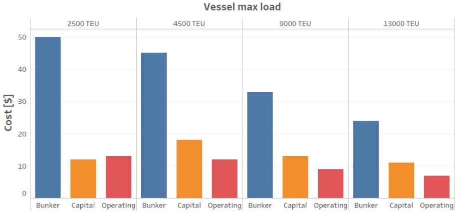
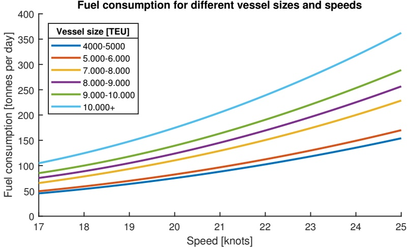
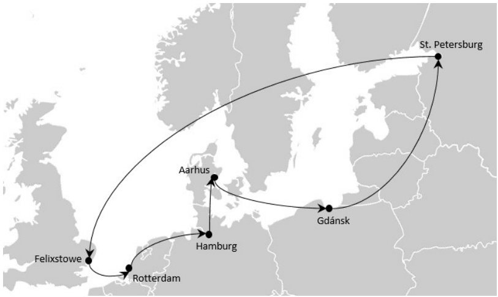
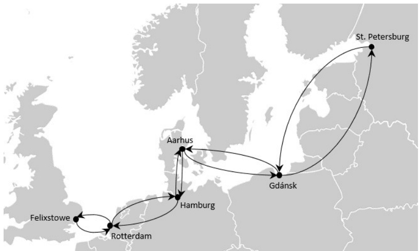
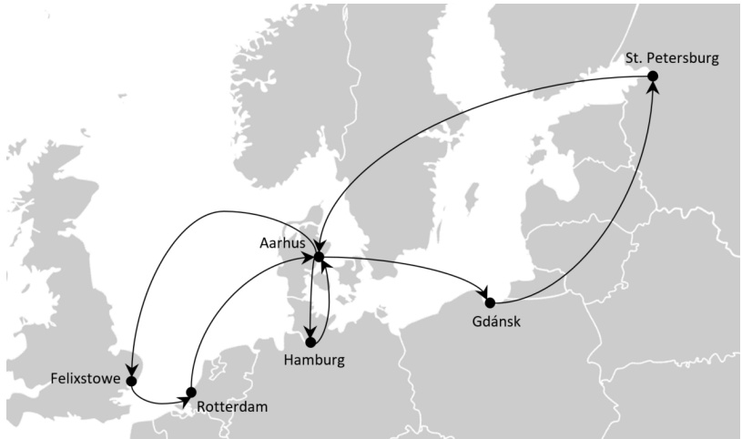
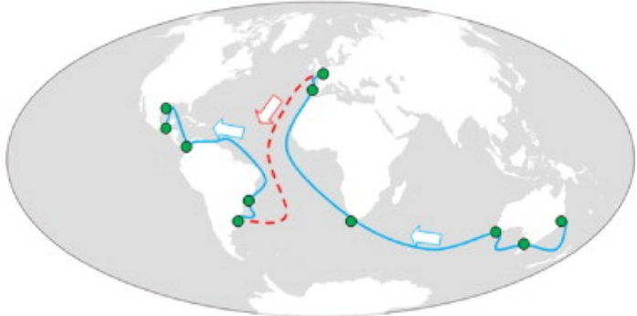
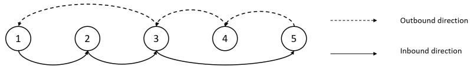
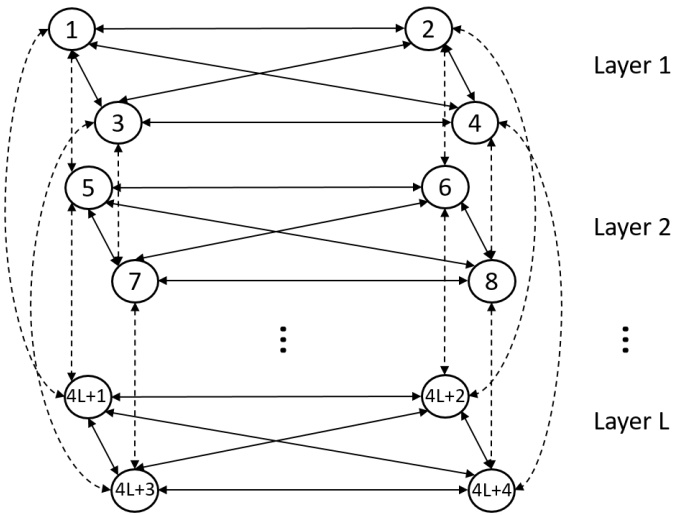
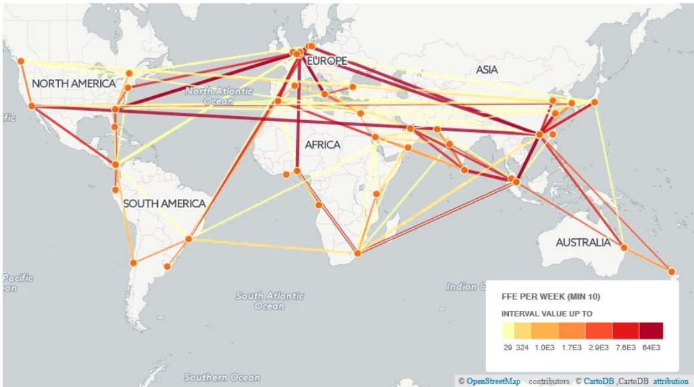

# Liner shipping network design

**Christiansen, Marielle; Hellsten, Erik Orm; Pisinger, David; Sacramento, David; Vilhelmsen, Charlotte**

Published in: European Journal of Operational Research

Link to article, DOI: [10.1016/j.ejor.2019.09.057](https://doi.org/10.1016/j.ejor.2019.09.057)

Publication date: 2020

Document Version Peer reviewed version

[Link back to DTU Orbit](https://orbit.dtu.dk/en/publications/79748932-594e-46bd-afa7-f17191779a73)

Citation (APA): Christiansen, M., Hellsten, E. O., Pisinger, D., Sacramento, D., & Vilhelmsen, C. (2020). Liner shipping network design. European Journal of Operational Research, 286. [https://doi.org/10.1016/j.ejor.2019.09.057](https://doi.org/10.1016/j.ejor.2019.09.057)

<small>Copyright and moral rights for the publications made accessible in the public portal are retained by the authors and/or other copyright owners and it is a condition of accessing publications that users recognise and abide by the legal requirements associated with these rights.</small>

<small> Users may download and print one copy of any publication from the public portal for the purpose of private study or research.</small>

<small> You may not further distribute the material or use it for any profit-making activity or commercial gain</small>

<small> You may freely distribute the URL identifying the publication in the public portal</small>

<small>If you believe that this document breaches copyright please contact us providing details, and we will remove access to the work immediately and investigate your claim.</small>

# Liner Shipping Network Design

Marielle Christiansen1, Erik Hellsten2, David Pisinger2,3, David Sacramento2, Charlotte Vilhelmsen2

1. Department of Industrial Economics and Technology Management, Norwegian University of Science and Technology, Trondheim, Norway

2. DTU Management, Technical University of Denmark, Akademivej 358, DK-2800 Kgs. Lyngby, Denmark 3. Corresponding author

**Abstract** The maritime industry is one of the greenest modes of transportation, taking care of almost 90 percent of the global trade. The maritime container business revolves around liner shipping, which consists of container vessels sailing on fixed itineraries. For the last 20 years, there has been an increasing number of publications regarding how to design such fixed routes (services), to ensure a high level of service while minimizing operational costs and environmental impact. The liner shipping network design problem can briefly be described as follows: Given a set of demands (defined by origin, destination, time limit) and a set of vessels with variable capacity, the task is to design a set of weekly services, assign vessels to the services, and flow the demand through the resulting network such that it arrives within the stated time constraints. The objective is to maximize revenue of transported demand subtracting the operational costs. We present an in-depth literature overview of existing models and solution methods for liner shipping network design, and discuss the four main families of solution methods: integrated mixed integer programming models; two-stage algorithms designing services in the first step and flowing containers in the second step; two-stage algorithms first flowing containers and then designing services; and finally algorithms for selecting a subset of proposed candidate services. We end the presentation by comparing the performance of leading algorithms using the public LINER-LIB instances. The paper is concluded by discussing future trends in liner shipping, indicating directions for future research.

**Keywords** OR in Maritime Industry; Network Design; Mixed-Integer-Programming; Heuristics; Multi-commodity Flow Problem

## 1 Introduction

Maritime transportation is fundamental to the world trade and globalisation, since it enables carrying large volumes at relatively low costs. It is estimated that around 90 percent of the world trade is carried by the international shipping industry. Maritime transportation is, furthermore, generally considered safe. Losses caused by incidents during transport by sea have dropped steadily, and are at the lowest values in decades. Additionally, efficient port structures make it possible to combine sea transportation with other land-based modes of transportation.

Roughly speaking, liner shipping can be split into ships designed for Lift-on/Lift-off (LoLo) operations, and Roll-on/Roll-off (RoRo) operations. In LoLo operations, quay cranes located on the docks are used to load and unload the ship’s containers, while RoRo operations are designed to carry cargo that can be rolled on and off the ship.

In this paper, we mainly focus on containerised liner shipping network design, i.e. networks using LoLo operations, though we also briefly describe RoRo liner shipping. Although we have tried to cover most of the relevant papers dealing with containerised liner shipping network design, we have chosen to focus on models and algorithms that seem to be applicable in practice. This means that the selected papers either have reported results on designing real-life networks, or later papers have used the framework to reach the same goal.

This paper is organized as follows: The rest of this section gives a brief introduction to containerised liner shipping, RoRo liner shipping, and network design. We also introduce the LINER-LIB test instances for network design in containerised liner shipping. The following sections are focused on containerised liner shipping. In Section 2 we discuss the challenges in designing a liner shipping network, and show that algorithms can roughly be split into four different families, which will be presented in the following sections. In Section 3 we give an overview of integrated Mixed Integer Programming (MIP) models, while Section 4 studies two-stage algorithms where the services are constructed in a first step, and containers are flowed through the resulting network in the second step. Section 5 considers algorithms for selecting a subset of proposed candidate services. In Section 6, we consider algorithms based on first flowing containers, and then designing services. Section 7 reports computational results for the LINER-LIB instances. The paper is concluded in Section 8 with a short discussion of future trends and challenges. Finally, an overview of the notation used throughout the paper is found in Appendix A. Parts of this paper are based on the survey by Hellsten et al. (2018) and the book chapter Christiansen et al. (2019).

## 1.1 Containerised Liner Shipping

The liner shipping industry is a vital part of the global economy, constituting one of the cheapest modes of cargo transport. During the last three decades, the volume of containerised cargo has grown by more than 8% per year, and more than 5,150 container vessels were in operation worldwide in 2017. Standard containers come in two different sizes, twenty and forty feet, which have given rise to the standard measures of containerised cargo, twenty foot equivalent units (TEU) and forty foot equivalent units (FFE). The largest vessels carry more than 20,000 TEU and during 2016, a container volume of around 140,000,000 TEU was estimated to pass through the vast liner shipping network (Unctad, 2017a,b). Clearly, any improvement in the network design in the liner shipping industry will correspond to enormous savings. This section will briefly introduce the liner shipping business and then the corresponding network design problem, along with its variants and various solution and modelling approaches presented in the literature.

The liner shipping industry is built up by so called services. A service is a fixed cyclic itinerary, sailed by a number of similar vessels. Services usually have weekly or biweekly departures to add consistency and regularity for the customers. The vessels are operated by shipping companies called carriers, where the largest carriers operate over 600 vessels. As larger vessels are more energy efficient, see Figure 1, the trend is to build ever larger vessels. To efficiently utilise those very large liner vessels, each region typically has a few larger ports, called hubs, where the liner vessels pick up and deliver containers. From the hubs, the containers are then transported to other ports by smaller, more flexible, so called feeder vessels. The act of transferring containers from one vessel to another in a port is called transshipping. Transshipments occur both between larger vessels and smaller vessels, but also between larger vessels when no suitable service connects the origin and destination hub. While transshipments add flexibility, they tend to be costly, as the cargo needs to be unloaded, stored until the arrival of the new vessel and then reloaded again. Finally, cabotage rules need to be taken into account. To protect the national trade business, many countries forbid foreign carriers to ship cargo between two ports within the country as well as other restrictions. See Brouer et al. (2014a) and Zheng et al. (2014) for examples of such rules.

The major costs for the carriers are vessel acquirement and bunker fuel. However, other costs, like canal fees, port costs and transshipment costs, are also highly significant. The fuel consumption is frequently estimated as a cubic function of the speed, as seen in Figure 2. As the speed has such an impact on the fuel consumption, slow steaming is often used to reduce the consumption. Especially after the financial crisis in 2008, maritime shipping companies implemented slow steaming policies for cost-cutting purposes. The obvious drawback of slow steaming is that more vessels are required to transport the same amount of cargo and also, that transit times become longer, yielding a lower level of service for the customers. In general, services have two directions, head- and back-haul, where most of the cargo is transported in the head haul direction. A good example of this is the trade between Asia and Europe, where most of the goods are delivered from Asia to Europe. In this case, vessels are slow steaming in the back-haul direction where less customers are affected by the transit time.

Cost per 1000 container miles

Fig. 1. Estimated cost per 1,000 container miles for different vessel sizes. The vessels are assumed to sail at 19 knots and the bunker fuel price is estimated as 750 \$/tonne. We see that bunker represents the largest cost and that transporting containers on larger vessels requires significantly less fuel. Source: Germanische Lloyd (2017).

Fig. 2. Estimated fuel consumption as a function of steaming speed and vessel size. Source: Notteboom and Vernimmen (2009).

## 1.2 Containerised Liner Shipping Network Design Problem

The Liner Shipping Network Design Problem (LSNDP) can be defined as follows: Given a collection of ports, a fleet of container vessels and a group of origin-destination demands, a set of services is constructed for the container vessels such that the overall operational expenses are minimised, while ensuring that all demands can be routed through the resulting network from their origin to their destination, respecting the capacity of the vessels.

In the following we present some notation of the LSNDP that will be used throughout the paper, introducing the necessary notation when required. A complete table of notation can be found in Table 5 in Appendix A. For a complete model, where the LSNDP is described in detail as well as a presentation of the liner-shipping business along with a description of its main assets and infrastructure, see Brouer et al. (2014a).

The set of ports is denoted by N and represents the set of physical ports in the problem. The set of arcs A represents all possible sailings between ports. The set of demands or commodities is denoted by K and for each commodity $k \in K .$ , there is an origin port $o _ { k } ,$ a destination port $d _ { k } ,$ as well as a quantity $q _ { k }$ measured in twenty-foot equivalent units (TEU). Furthermore, the corresponding unit-cost for transporting a unit of commodity k through arc $( i , j )   \in   A$ is defined as $c _ { i j } ^ { k }$ . Finally, the set V denotes the set of vessel classes. For each vessel class $\nu \in V$ there is a corresponding cargo capacity, $u _ { \nu } ,$ measured in number of $\operatorname { T E U s } ,$ an available fleet quantity, $m _ { \nu } ,$ , as well as additional speed limitations and fuel consumption parameters. Furthermore, for convenience, the demand of the commodities in each port $i \in N$ is defined as:

$$
\xi_ {i} ^ {k} = \left\{ \begin{array}{c l} q _ {k} & \text {if port i is the origin port of commodity k} \\ - q _ {k} & \text {if port i is the destination port of commodity k} \\ 0 & \text {otherwise.} \end{array} \right.\tag{1}
$$

There is a limited fleet of container vessels, but not all vessels need to be used. The deployment of a vessel $v \in V$ has an associated charter cost $c ^ { \nu } .$ . Additionally, there are other costs related to the resulting network, such as the sailing cost $c _ { i j } ^ { \nu }$ associated with each vessel and each arc, which is given as a combination of the port call cost and the fuel consumption for the corresponding leg. When containers of commodity $k \in K$ are transferred from one vessel to another in port $i \in N .$ , there is a transshipment cost $c _ { i k } ^ { \mathrm { T } }$ for each container. Furthermore, there is an associated sailing time $t _ { i j } ^ { v }$ for each container vessel v sailing between ports i and $j ,$ which is calculated from the vessel’s design speed and the distance between the ports. Moreover, each port $i \in N$ has an associated berthing time $b _ { i }$

One of the main traits of the liner shipping industry is the regular operation of services under a pre-established schedule. Sometimes it is possible to define the set of candidate services in advance. In these cases, let S be the set of feasible services in the model. Notice that $S$ can be exponentially large. Each service $s \in S$ has an associated operational cost $c _ { s } .$ . As the set of services is defined beforehand, the operational cost is given as a combination of the sailing cost of the arcs on the service route and the corresponding port-call costs. Moreover, it is demanded that all services should have weekly operations, meaning that if a round trip takes eight weeks to complete, then eight similar vessels need to be deployed to the service in order to ensure that each port is visited once a week. Therefore, the required number of vessels from vessel class $\nu _ { \ast }$ to maintain the weekly frequency, is defined as $m _ { \nu } ^ { s }$ . In addition, services must be cyclic, visiting a sequence of ports while respecting the weekly departures, but the structure of the services can be divided into several types according to the number of times a port is visited during the service. A simple service or a circular service visits each port in the service exactly once. However, a service is often allowed to be non-simple, meaning that a port can be visited several times, as this may improve transit times. Nodes (or ports in the sequence) that are visited several times in the service are denoted butterfly nodes. We can distinguish between different types of services; a service containing a single butterfly node defines a butterfly service, whereas a service visiting all ports twice in both directions, but in reverse order, is defined as a pendulum service. Furthermore, a service in which any node can be visited multiple times is defined as a complex service. Examples of the different type of services for some European ports are illustrated in Figures 3, 4, 5 and 6.

Fig. 3. Example of a simple service, where each port is visited exactly once.

Fig. 4. Example of a butterfly service, where Aarhus is the butterfly node.

The variants of the LSNDP, which have been studied in the literature, vary mainly in the following four respects:

Transit time constraints. As described above, the transit time of each demand has an associated time limit that must be respected. If the transit time is not respected, perishable goods may become spoiled.

• Transshipment costs. The costs of transshipments are a significant part of the operational costs (Karsten (2015)), so it is generally important to represent these costs properly in the model.

• Rejected demands. Although the standard formulation of LSNDP states that all demands must be flowed through the network, many models allow rejection of demands by imposing a penalty.

Speed optimisation. There are three main approaches to model regarding speed optimisation: Models which have constant speed for all services, models which choose a speed for each service, and models which choose a speed on each individual leg in each service. As the fuel consumption depends non-linearly on the speed, it is common to choose between a number of discrete speed alternatives, each with a corresponding cost.

Fig. 5. Example of a pendulum service, where each port can be visited both on the head-haul and back-haul trip.

Fig. 6. Example of a complex service, where Aarhus is a butterfly node that is visited three times.

Most models for LSNDP design the network without a specific schedule. Hence the service for each vessel is defined, but not the exact day of arrival/departure. This is typically done in a later step, where port availabilities are negotiated and transshipment times at ports are adjusted.

For a detailed review of the research on liner shipping optimisation problems, see the survey papers Ronen (1983, 1993), Christiansen et al. (2004, 2013), Kjeldsen (2011), Meng et al. (2014), Tran and Haasis (2015), Brouer et al. (2016, 2017), and Lee and Song (2017).

## 1.3 RoRo Network Design Problem

Roll-on Roll-off (RoRo) shipping is an important segment within liner shipping. The RoRo ships are vessels designed to carry wheeled cargo, such as cars, trucks, semi-trailer trucks, and railroad cars, that can be driven on and off the ship on their own wheels. In addition, RoRo ships may carry complex cargo that is placed on trolleys and rolled on and off the ships, such as boats, helicopters, and heavy plant equipment. RoRo shipping is often the only viable method of ocean freight transportation for these oversized vehicles, as they may not fit in standard containers. There exist various types of RoRo ships, such as ferries, cruise ferries, cargo ships, and barges. In this subsection, we consider the RoRo ships used for transporting cars, trucks and complex general cargo across oceans known as Pure Car Carriers (PCC), Pure Truck & Car Carriers (PCTC) and general RoRo ships, respectively. A typical PCTC has a carrying capacity in the range of 5,500 to 8,000 RT43. Here, RT43 is a capacity measure in the RoRo business and corresponds to the size of a 1966 Toyota Corona. The world fleet of RoRo ships consists of around 5,000 ships with a total capacity of more than 24 million deadweight tons (ISL, 2016).

The trades to be serviced in RoRo shipping are usually designed based on a large number of contracts for transportation of cargo between the different port pairs along a trade. Hence, trade routes are defined as transportation arrangements from one geographical region to another, where the world is divided into a number of geographical regions. Each trade route has a number of loading ports in one region and a number of discharging ports in the other. In Figure 7, two trade routes are illustrated by solid lines and the ports are shown as filled circles. After a ship has sailed one voyage on a trade route it often needs to reposition to start on the next one due to trade imbalances. This repositioning means ballast sailing, i.e. sailing without cargo, which of course should be reduced as much as possible. The ballast sailing between the two trade routes in Figure 7 is illustrated by a dashed line. Differences in contractual requirements and a variety in the types of cargo transported on the various trade routes may restrict which vessels that can be assigned to a particular trade route, regarding both capacity and vessel type.

Fig. 7. Illustration of two trade routes sailed in sequence, Oceania to Europe via South Africa, and South America to North America, with associated ballast sailing from Europe to South America. Source: (Andersson et al., 2015).

Each trade route is sailed regularly, for example weekly, fortnightly, 3 times per months, depending on demand and contractual obligations. Each sailing on a trade route is called a voyage, and normally there is a time window for start sailing a voyage. Due to contractual obligations, these voyages are mandatory and must be covered either by a ship in the RoRo shipping companys own fleet or by a chartered ship. A RoRo shipping company owns and operates a heterogeneous fleet of ships having different cargo capacities, sailing speed ranges, and bunker consumption profiles, and serve a given set of trade routes.

Planning problems within RoRo shipping are far less studied in the OR literature compared to container shipping. However, this segment has received increased attention the last decade. Pantuso et al. (2015) consider strategic planning issues involving decisions regarding fleet size and mix. On the tactical planning level, the fleet deployment problem consists of assigning ships in the fleet to voyages that must be performed repeatedly on given trade routes. In addition to the ship-voyage assignment, the results from fleet deployment are sailing routes for the ships in the fleet, i.e. each ship is assigned a sequence of voyages to perform, possibly with ballast (empty) sailing between the last port call of one voyage and the first on the next. Fagerholt et al. (2009) present a mixed integer programming model for the fleet deployment problem in RoRo shipping, and Andersson et al. (2015) extend this model for a real fleet deployment problem by including speed as a decision variable.

Large RoRo shipping companies are well placed to offer end-to-end integrated logistics services to car manufacturers engaged in international trade of vehicles. The fleet deployment planning in RoRo shipping can achieve better results by integrating inventory management of cargs at ports where the cargo is produced and/or demanded. A few studies including fleet deployment and inventory management in RoRo shipping exist to show the potential of combining these planning tasks even though most RoRo shipping companies perform separate planning today; Chandra et al. (2015, 2016), Dong et al. (2017).

The operations within RoRo shipping deviates from container shipping in several ways as well as the cargo and ships. In container shipping each ship is normally assigned to a single route, while in RoRo shipping a ship may sail several trade routes during a planning horizon. Ship types instead of individual ships are often considered in container shipping, while in RoRo shipping a route for each ship is determined. This also means that in RoRo shipping each trade route may be serviced by different ship types. Furthermore, there is a great variation in when to start each voyage, as well as when and how often to visit each port along the trade. Therefore, existing studies within fleet deployment in RoRo shipping have used time windows for when each voyage along each trade should start. This flexibility is in contrast to container shipping, as each service is usually served on a strict weekly basis, and each voyage along the trade visits all ports in the same order. Finally, transshipment rarely exist in RoRo shipping in contrast to container shipping, and none of the relevant RoRo studies includes this aspect.

## 1.4 The LINER-LIB test instances

In order to make it easier to compare algorithms for liner shipping network design, Brouer et al. (2014a) introduced the LINER-LIB benchmark suite. The test instances in LINER-LIB are based on real-life data from leading shipping companies along with several other industry and public stakeholders. The benchmark suite contains data on ports including port call cost, cargo handling cost and draft restrictions, distances between ports considering draft and canal traversal, vessel related data for capacity, cost, speed interval and bunker consumption, and finally a commodity set with quantities, revenue, and maximal transit time. The commodity data is intended to reflect the differentiated revenue associated with the current imbalance of world trade.

The LINER-LIB benchmark suite consists of seven instances described in Brouer et al. (2014a) and is available at http://www.linerlib.org. The instances range from smaller networks suitable for being solved by exact solution methods to large scale instances spanning the globe. Table 1 gives an overview of these instances.

| Instance | Category | \|N\| | \|K\| | \|V\| | min v | max v |
| --- | --- | --- | --- | --- | --- | --- |
| Baltic | Single-hub | 12 | 22 | 2 | 5 | 7 |
| WestAfrica | Single-hub | 19 | 38 | 2 | 33 | 51 |
| Mediterranean | Multi-hub | 39 | 369 | 3 | 15 | 25 |
| Pacific | Trade-Lane | 45 | 722 | 4 | 81 | 119 |
| AsiaEurope | Trade-Lane | 111 | 4,000 | 6 | 140 | 212 |
| WorldSmall | Multi-hub | 47 | 1,764 | 6 | 209 | 317 |
| WorldLarge | Multi-hub | 197 | 9,630 | 6 | 401 | 601 |

Table 1. The seven test instances included in LINER-LIB with indication of the number of ports $( | N | )$ , the number of origin-destination pairs (|K|), the number of vessel classes (|V|), the minimum (min v) and maximum number of vessels (max v) in each class.

Each of the instances can be used in a low, base, and high capacity case depending on the fleet of the instance. For the low capacity case the fleet quantity and the weekly vessel costs are adjusted to fewer vessels with a higher vessel cost, while for the high capacity case the adjustments are reversed.

Currently, most papers only report results for the base capacity case. Furthermore, most often only the six first instances are considered, with Krogsgaard et al. (2018) being the only to report results for the WorldLarge instance.

## 2 Overview of models and algorithms

Designing a liner shipping network is a difficult task, embracing several decisions: Not only do we need to construct the individual services, but we should also deploy vessels of the right size to each service and ensure that there is sufficient capacity in the network to transport all containers from their origin to their destinations. Designing the individual services is an NP-hard problem, as proved in Brouer et al. (2014a). Furthermore, routing the containers through a given network subject to time constraints for each container, can be recognised as a time-constrained multi-commodity flow problem, which is also NP-hard (Karsten et al., 2015).

The problem is further complicated by the fact that ports are often visited several times in the same service. This is obviously the case for pendulum services where a vessel is sailing back and forth along the same service, but multiple visits to a port (typically a hub) often takes place to ensure that containers quickly can be transshipped to other services. However, formulating the problem with multiple visits to a port as a MIP model becomes more difficult.

Finally, one should notice that transshipment costs represent the majority of the cost of routing the containers through the network according to Psaraftis and Kontovas (2015). It is therefore important to carefully model which containers might be transshipped and at which costs. This adds further complexity to the problem, and makes a graph or MIP formulation huge and difficult to solve.

Algorithms for liner shipping network design can roughly be divided into the following four groups:

MIP-based algorithms. These algorithms are based on a unified MIP model that designs services and flows containers through the resulting network. In order to handle this task, two sets of variables are needed: Variables to select arcs in a service, and variables to denote the flow on each arc. If multiple visits to a node are allowed (butterfly nodes) then an additional index is needed to indicate the visit number at each node. Several MIP-based models have been presented in the literature, including Alvarez (2009), Reinhardt and Pisinger (2012), Plum et al. (2014a,b), and Wang and Meng (2014). ´

Two-stage algorithms. As the name suggests, these algorithms solve the problem in two steps: Designing the services, and flowing containers through the resulting network. Frequently, these algorithms contain a feed-back mechanism, where output from the second-stage flow model is used as input to improve the services in the first stage. Successful applications of this approach include Agarwal and Ergun (2008), Alvarez (2009), Brouer et al. (2014a,b), Mulder and Dekker (2014), Karsten ´ et al. (2017b), Thun et al. (2017), and Neamatian Monemi and Gelareh (2017).

Subset of routes. Both Meng and Wang (2011b) and Balakrishnan and Karsten (2017) suggest a heuristic method for generating a network by having a list of candidate services as input. The idea behind these algorithms is to use the experience from existing planners to design a large number of promising candidate services. The algorithm then selects a subset of the candidate services to form a network. Many shipping companies and customers do not want the network to be completely restructured, in which case proposing small variations to each service may be a sensible method.

Backbone flow. It can be difficult to design the individual services without knowing how the containers will flow through the network. Hence, another approach is to reverse the order of the subproblems in the two-stage algorithms, and start by finding an initial flow (a so-called backbone network) where cargo is flowed through a complete network with all connections between ports available. The connections are priced such that they are expensive at low loads and cheap at high loads, in order to make the cargo gather at few connections. The initial flow can be seen as an accomplishment of the physical internet (Montreuil, 2011) where point-to-point transport has been replaced by multi-segment intermodal transport. A successful application of the backbone network idea was presented in Krogsgaard et al. (2018).

Many of the MIP-based algorithms can in principle solve the LSNDP to optimality. However, due to the intrinsic complexity, only small instances can be solved to proven optimality within a reasonable time frame. The subset-of-services based algorithms also solve the problem to optimality given that only the proposed candidate services are valid. In practice, however, there may be an exponential number of valid services, and we cannot expect to get all services as input. The two-stage algorithms and backbonenetwork algorithms are both heuristics, since they first solve one stage, and then optimise the second stage with the first-stage decisions fixed.

Table 2 gives an overview of the most important papers that have presented algorithms for the LSNDP. The papers are ordered according to year of publication. For each paper we indicate which variant of LSNDP is considered (transit time constraints, transshipment costs, rejected demand, and speed optimisation). Moreover it is indicated which solution method is used, and whether services are simple, butterfly, or general.

It is generally seen that there is a large variation in which variant of the problem authors consider, and a large spectrum of solution methods are being developed. This somehow indicates that the LSNDP is still a quite young research area under development. Moreover, most work on the LSNDP is tightly linked to industrial applications, meaning that constraints and assumptions need to be adjusted according to the setup of the the industrial collaboration partners.

| (0.oaetaKzl2 ggosaadetKrr (0.uetaThnl2 (.asteetaKrnl (.asteetaKrnl aasaaBlkrihnn NeaataominM (.oueetaBrrl2 udeadeMlrnD gWaadennMn (.oueetaBrrl2 (.oueetaBrrl2 (0.uetaPlml2 (0.uetaPlml2 eadtadRinhrn gWeadaMnnn gWeadaMnnn (G.eaeetalrhl ()9v00aeAlrz2´ gwaaadArlnE)91 (0.al21 )71 )0b721 )0a721 danKr eanmi )051 (ekkr2 g(021 )0b14 )0a14 )b14 )a14 gsePiin g(021 g(021 )0021 g(urn2)8 ste dn 01 )4 (r )b1 )a1 00 n G )4 02 )8 ( e 1 2 l 0 a 2 r ) 1 e)7 h(2017) | paePr |
| --- | --- |
| esY No No esY esY No No esY No esY No No No esY No No esY esY No No4 4 2 | c T o ar n n star sti i ti tsn m e |
| esY esY esY esY esY esY esY esY esY No esY esY esY No esY esY esY esY esY esY3 | m Tr e a tcn ssn os hi t p s - |
| esY esY No esY esY esY esY esY esY esY esY esY esY esY No No No esY esY esY1 | d e R am jee n ct d |
| S S S S S S S e D e D e e D e e D D D D D e L r e r L e L r r e r r e e e e L e r L e v s v e s e v v s v v s s s s e s v e gs ci gi ci gs gi gs ci ci gi ci ci gi gi gi gi gs gi ci gs e n e n e e n e e n n n n n e s s s s s s s | o p t i S m p i e sa e ti d o n |
| Geeanrl Geeanrl Geeanrl yutteBrfl yutteBrfl Geeanrl Geeanrl yutteBrfl Geeanrl Geeanrl yutteBrfl yutteBrfl Geeanrl Ccuairlr yutteBrfl Geeanrl Geeanrl Ccuairlr yutteBrfl Geeanrl | vseceri ypeoTf |
| ateustcmhrii gg,SNteatedadsceducouInrLDPnhlinl ggaeeustcrnhrii g,wVNacboeoaabeeboooBknFlrilihrh ,acadceMILPBrnhnPri-- p,woaseateustcThMhrii- p,woaseateustcThMhrii- ,Svubsetoseceseustcsoutofrihriilin p,woaseedesThBnr- p,woaseateustcThMhrii- quesni ggp,,wGoaseeetcotssaThniAlrihmDi- ,CGoueeatoeustcetMILPlmnnrinhriim p,woaseateustcThMhrii- gp,,woaseeustccoueeatoThhriilmnnrin- ,eactsoutoMILPxlin p,bacadcutadceMILPrnhnnri---- ,,eactsoutobacadcutMILPxlinrnhn-- ,eactsoutoMILPxlin gpotaaotimllrihm (),NoeaacadbouMILPnLinrBrnhn--- ggp,aaadecoostoetoMILPLrninmiinmh gp,wCoaseoueeatoeustcThlmnnrinhrii- p,wCGoaseoueeatoadeThlmnnrinnBn-mn d ar oh ta dn d de S g d b r ge ea ati us b s enr crh on ear ase at , t c d i e h o L c n a h ε, - - - | Soutoetodlinmh |

**Table 2.** Overview of selected papers, presenting algorithms for LSNDP, sorted according to year of publication. **Transit time constraints** indicate whether each commodity has an upper limit on the transit time. **Transshipment costs** states whether these costs are taken into account. **Reject demand** indicates whether demands may be rej ected by paying a penalty. **Speed optimisation** is either: Design (all vessels are sailing at design speed) , services (variable speed on services but all legs in a service have the same speed) , legs (different speed can be used on any leg) . **Type of services** can be : Circular (every port is visited once in a rotation) , butterfly (only one butterfly node in each service) , general (several butterfly nodes are allowed) . **Solution Method** first states which of the four main categories the algorithm belongs to (MILP model, two-phase, subset of services, backbone flow) , and then briefly elaborates the methods used.

## Additional comments :

1 Attraction function defined in the obj ective function aiming to maximise the customer attractiveness of the services .

2 Maximum tolerable average transit time between port-calls .

3 Container handling cost at the port-calls .

4 Limited number of trans shipments .

## 3 Mixed Integer Programming Models

Numerous decisions must be taken when designing a service network, among which the routing of containers, the fleet deployment and the service design stand out. Defining a problem that correctly accounts for all these details in real life is beyond the limited capacity of human planners. Therefore, the use of complex decision support tools to design liner networks can be of great use. In this section we present MIP and graph-based models to define the LSNDP. Different formulations are briefly introduced to model the network design problem in liner shipping and a summary of the main mathematical formulations proposed in the literature are presented under different assumptions.

## 3.1 Service formulation for LSNDP

In this section, a service flow formulation for the LSNDP is introduced, where the set of all feasible services is defined in advance for the model. This reduces the network design problem to the selection of feasible services.

Let us begin with introducing a basic service formulation. We use the terminology presented in Section 1.2 with the addition of the following definitions: Let $G   =   (   N   ,   A   )$ be a directed graph. Define for each service s and for each arc $( i , j )$ , the associated capacity $u _ { i j } ^ { s }$ . Finally, let $x _ { i j } ^ { k s }$ be a continuous variable denoting the amount of commodity k transported by service s on arc $( i , j )$ , and $y _ { s }$ a binary variable for the selection of service s in the network. Now, the service formulation of the LSNDP can be expressed as:

$$
\min \sum_ {s \in S} c _ {s} y _ {s} + \sum_ {k \in K} \sum_ {(i, j) \in A} c _ {i j} ^ {k} \sum_ {s \in S} x _ {i j} ^ {k s}\tag{2a}
$$

$$
\text {s.t.} \sum_ {s \in S} \sum_ {j: (i, j) \in A} x _ {i j} ^ {k s} - \sum_ {s \in S} \sum_ {j: (j, i) \in A} x _ {j i} ^ {k s} = \xi_ {i} ^ {k}
$$

$$
i \in N, k \in K\tag{2b}
$$

$$
\sum_ {k \in K} x _ {i j} ^ {k s} \leq u _ {i j} ^ {s} y _ {s}
$$

$$
s \in S, (i, j) \in A\tag{2c}
$$

$$
\sum_ {s \in \mathcal {S}} m _ {v} ^ {s} y _ {s} \leq m _ {v}
$$

$$
v \in V\tag{2d}
$$

$$
x _ {i j} ^ {k s} \geq 0
$$

$$
(i, j) \in A, k \in K, s \in S\tag{2e}
$$

$$
y _ {s} \in \{0, 1 \}
$$

$$
s \in S.\tag{2f}
$$

The objective function (2a) minimises the total operational cost of the network. The first term accounts for the fixed cost of the selected services, whereas the second term constitutes the sailing cost of shipping the demand. Constraints (2b) are the flow conservation constraints, and the flow of commodities on the legs has to respect the capacity of the vessel deployed in the selected service s as formulated in constraints $( 2 c )$ . For each vessel class $\nu \in V$ , constraints (2d) ensure that the number of deployed vessels on the selected services using vessel class v does not exceed the maximum availability $m _ { \nu }$ . Finally, the domain of the variables is defined in constraints (2e) and (2f).

The formulation allows to design networks considering only a subset of promising candidate services. Examples of papers using this formulation are Alvarez (2009), Meng and Wang (2011b) and ´ Balakrishnan and Karsten (2017).

For a better utilisation of the capacity of the vessels, the model can handle the cargo rejection by defining extra continuous variables that account for the demand that is rejected by the liner company, and incurring a large penalty in the objective function. Moreover, if we only consider simple services, additional continuous variables $f _ { i } ^ { k s }$ could be added to account for transshipments, denoting the amount of commodity k that is transshipped at port i from service s. The following constraints (3) could be added to model transshipments.

$$
f_{i}^{ks}\geq \sum_{\substack{j\in N\\ j\neq i}}x_{ji}^{ks} - x_{ij}^{ks}\quad i\in P\setminus \{o_{k},d_{k}\} ,k\in K,s\in S.\tag{3}
$$

Some of these approaches have been considered by Alvarez (2009), who studies an LSNDP at the tac- ´ tical level, considering the joint routing and deployment of container vessels. The model includes many relevant parameters in the objective function to correctly represent the operational cost of the selected services over a tactical planning horizon, and it is one of the first formulation to consider transshipment when designing the shipping network.

The formulation presented in this paper is based on the set of all feasible services, which are given as a combination of a vessel class, an operating speed and a route structure. Therefore, it is possible to accommodate services that are proposed externally by the planners as well as services generated internally by a solution algorithm, meaning that any type of non-simple services, i.e. services that visit one or more ports several times during a service round, can be considered in the service set S. However, the model is unable to accurately calculate the transshipment cost of non-simple services. Finally, the model considers the fleet deployment of the available fleet, defining integer variables that control the amount of vessels deployed for a chosen service.

As the size of the problem increases, the number of feasible services in the problem grows exponentially, making the model intractable to solve. Alvarez (2009) proposes a tabu search algorithm combined ´ with a column generation procedure to solve a case study with up to 120 ports.

## 3.2 Arc formulation for LSNDP

The main problem with a service-based formulation is that generating all services S is non-trivial, due to the high number of combinatorial possibilities. Therefore, an alternative compact formulation is introduced in this section, which is based on an arc formulation. We are no longer considering a set $S$ of predefined services, but instead let $S ^ { \nu }$ be an index set for the services of vessel class $\nu _ { \ast }$ indexed by $s .$

We first present a basic mathematical model based on arc formulation. We again use the notation presented in Section 1.2, with small extensions. Let $G = ( N ,   A )$ be a directed graph. Let $x _ { i j } ^ { k s }$ be a continuous variable denoting the flow of commodity k on arc $( i , j )$ by service s, which is operated by vessel class $\nu _ { \ast }$ and $y _ { i j } ^ { s }$ a binary variable for the selection of arc $( i , j )$ in service s. The binary variable $\gamma _ { i } ^ { s }$ is equal to 1 if port i is the hub port in service s. Moreover, we define $\tau _ { i } ^ { s }$ as a continuous variable representing the time of departure of service s, for vessel class v, from port i, and $w _ { s }$ as an integer variable indicating the number of vessels from class v needed to maintain the weekly frequency of service s. Then, the arc formulation of the LSNDP can be expressed as follows:

$$
\min \sum_ {v \in V} \sum_ {s \in S ^ {v}} c ^ {v} w _ {s} + \sum_ {v \in V} \sum_ {s \in S ^ {v}} \sum_ {(i, j) \in A} c _ {i j} ^ {v} y _ {i j} ^ {s} + \sum_ {k \in K} \sum_ {(i, j) \in A} c _ {i j} ^ {k} \sum_ {v \in V} \sum_ {s \in S ^ {v}} x _ {i j} ^ {k s}\tag{4a}
$$

$$
\text {s.t.} \sum_ {v \in V} \sum_ {s \in S ^ {v}} \sum_ {j: (i, j) \in A} x _ {i j} ^ {k s} - \sum_ {v \in V} \sum_ {s \in S ^ {v}} \sum_ {j: (j, i) \in A} x _ {j i} ^ {k s} = \xi_ {i} ^ {k}
$$

$$
i \in N, k \in K\tag{4b}
$$

$$
\sum_ {j: (i, j) \in A} y _ {i j} ^ {s} - \sum_ {j: (j, i) \in A} y _ {j i} ^ {s} = 0
$$

$$
i \in N, v \in V, s \in S ^ {v}\tag{4c}
$$

$$
\left. \sum_ {i \in N} \gamma_ {i} ^ {s} = 1 \right|
$$

$$
v \in V, s \in S ^ {v}\tag{4d}
$$

$$
\sum_ {k \in K} x _ {i j} ^ {k s} \leq u _ {v} y _ {i j} ^ {s}
$$

$$
(i, j) \in A, v \in V, s \in S ^ {v}\tag{4e}
$$

$$
\tau_ {j} ^ {s} \geq (\tau_ {i} ^ {s} + t _ {i j} ^ {v} + b _ {j}) (1 - \gamma_ {j} ^ {s}) y _ {i j} ^ {s}
$$

$$
\sum \left(t _ {i j} ^ {s} + b _ {j}\right) y _ {i j} ^ {s} \leq 2 4 \cdot 7 \cdot w _ {s}
$$

$$
i, j \in N, v \in V, s \in S ^ {v}\tag{4f}
$$

$$
v \in V, s \in S ^ {v}
$$

$$
(i, j) \in A\tag{4g}
$$

$$
\sum_ {s \in S ^ {v}} w _ {s} \leq m _ {v}
$$

$$
v \in V\tag{4h}
$$

$$
x _ {i j} ^ {k s} \geq 0
$$

$$
(i, j) \in A, k \in K, \nu \in V, s \in S ^ {\nu}\tag{4i}
$$

$$
y _ {i j} ^ {s} \in \{0, 1 \}
$$

$$
(i, j) \in A, v \in V, s \in S ^ {v}\tag{4j}
$$

$$
w _ {s} \in \mathbb {Z} ^ {+}
$$

$$
v \in V, s \in S ^ {v}\tag{4k}
$$

$$
\left| \tau_ {i} ^ {s} \geq 0 \right|
$$

$$
i \in N, v \in V, s \in S ^ {v}\tag{41}
$$

The objective function (4a) minimises the cost of deploying the vessels and designing the services and the cost of transporting the containers through the network. The flow conservation constraints for the cargo variables are given in constraints (4b), whereas the flow conservation constraints for the routing variables are given in constraints (4c). Constraints (4d) ensure that there is only a single hub port for each service. The flow of cargo on an edge $( i , j )$ cannot exceed the capacity $u _ { \nu }$ of a vessel class, as expressed in (4e). If the service does not use a given edge in the graph, i.e. $y _ { i j } ^ { s } = 0$ , then the capacity is zero. The time schedule constraints for the routing variables are given by the time variables in constraints (4f). Note that it is necessary to linearise these constraints, as they are non-linear. Moreover, these constraints also ensure the elimination of sub-tours when designing the liner network. The weekly frequency of the services and the deployment of the fleet are expressed by constraints (4g). The availability of the fleet is limited by constraints (4h). Finally, the domain of the variables is defined by constraints (4i)-(4l).

This model is a simple representation of the arc formulation for the LSNDP, and it is a fairly easy adaptation of a variant of the Vehicle Routing Problem (VRP) (Toth and Vigo, 2015). However, this model can be extended to incorporate the various constraints and considerations encountered in liner shipping.

## An arc formulation with butterfly services

As argued by Agarwal and Ergun (2008), transshipment is the core of liner shipping. Hence, these operations should not be ignored when designing the shipping network. Reinhardt and Pisinger (2012) extend the literature by proposing a MIP model based on an arc-flow formulation, where the network design and fleet assignment are combined. The model can handle butterfly services as well as account for the transshipment cost in the butterfly nodes.

Next follows a description of this model, adapted to the notation presented in the Section 1.2, with small extensions. Let $G = ( N ,   A )$ be a directed graph. Due to the heterogeneous fleet considered by the authors, the set V defines the set of vessels, instead of the set of vessel classes. Therefore, we consider each vessel v to belong to its own vessel class.

The design of the network is modelled with the binary variables $y _ { i j } ^ { \nu }$ for the utilisation of an arc $( i , j )$ in the service for vessel v. Similarly, as proposed by Miller et al. (1960), positive integer variables $e _ { i j } ^ { \nu }$ are defined for enumerating the arcs used in the vessel service and avoid subtours in services. The binary variables $\gamma _ { i } ^ { v }$ and $z _ { i j } ^ { \nu }$ identify, respectively, the unique center-point, i.e. the butterfly node in the vessel service, and allow the possibility of identifying the first and last arc visiting the butterfly node. These variables are used for modelling the transshipment of cargo in butterfly nodes.

The routing of containers through the network is modelled with continuous variables $x _ { i j } ^ { k \nu }$ , and extra continuous variables are defined to count the amount of the transshipped containers in intermediate ports within the same service. Let the continuous variables $f _ { j } ^ { k \nu }$ define the amount of commodity k transshipped by vessel v at port j, while the continuous variables $f _ { j i h } ^ { k \nu }$ denote the amount of commodity $k ,$ arriving at port i through arc $( j , i )$ , in vessel v, not leaving in arc (i, h).

Let $t _ { m a x }$ be the length of the time horizon. The deployment of a vessel is controlled by the binary variable $\lambda ^ { \nu }$ , whereas the continuous variables $\tau _ { \nu }$ limit the service length of the vessels. Then, the arcflow model can be defined as:

$$
\min \sum_ {k \in K} \sum_ {(i, j) \in A} c _ {i j} ^ {k} \sum_ {v \in V} x _ {i j} ^ {k v} + \sum_ {k \in k} \sum_ {i \in N} c _ {i k} ^ {\mathrm{T}} \sum_ {v \in V} f _ {i} ^ {k v} + \sum_ {v \in V} c ^ {v} \lambda^ {v}\tag{5a}
$$

$$
\text {s.t.} \sum_ {v \in V} \sum_ {j: (i, j) \in A} x _ {i j} ^ {k v} - \sum_ {v \in V} \sum_ {j: (j, i) \in A} x _ {j i} ^ {k v} = \xi_ {i} ^ {k}
$$

$$
i \in N, k \in K\tag{5b}
$$

$$
f _ {i} ^ {k v} \geq \sum_ {j: (i, j) \in A} x _ {i j} ^ {k} - \sum_ {j: (j, i) \in A} x _ {j i} ^ {k}
$$

$$
k \in K, i \in N, v \in V\tag{5c}
$$

$$
\left| f _ {i} ^ {k v} \geq \sum_ {j \in N} \sum_ {h \in N} \sum_ {v \in V} f _ {j i h} ^ {k v} - M _ {1} \left(1 - \gamma_ {i} ^ {v}\right) \right|
$$

$$
k \in K, i \in N, v \in V\tag{5d}
$$

$$
f _ {j i h} \geq x _ {j i} ^ {k v} - x _ {i h} ^ {k v} - M _ {2} (2 - y _ {j i} ^ {v} - y _ {i h} ^ {v} + z _ {j i} ^ {v} + z _ {i h} ^ {v})
$$

$$
k \in K, j, i, h \in N, v \in V\tag{5e}
$$

$$
f _ {j i h} \geq x _ {j i} ^ {k v} - x _ {i h} ^ {k v} - M _ {3} (4 - z _ {j i} ^ {v} - z _ {i h} ^ {v} - y _ {j i} ^ {v} - y _ {i h} ^ {v})
$$

$$
k \in K, j, i, h \in N, v \in V\tag{5f}
$$

$$
\left| \sum_ {i \in N} \gamma_ {i} ^ {\nu} = 1 \right|
$$

$$
v \in V\tag{5g}
$$

$$
\left| \sum_ {(i, j) \in A} z _ {i j} ^ {\nu} = 2 \right|
$$

$$
\left| v \in V \right|\tag{5h}
$$

$$
\gamma_ {i} ^ {v} - \sum_ {j: (i, j) \in A} z _ {i j} ^ {v} \leq 0
$$

$$
i \in N, v \in V\tag{5i}
$$

$$
\gamma_ {i} ^ {\nu} - \sum_ {j: (j, i) \in A} z _ {j i} ^ {\nu} \leq 0
$$

$$
i \in N, v \in V\tag{5j}
$$

$$
\sum_ {j: (i, j) \in A} y _ {i j} ^ {\nu} - \sum_ {j: (j, i) \in A} y _ {j i} ^ {\nu} = 0
$$

$$
i \in N, v \in V\tag{5k}
$$

$$
\sum_ {j: (i, j) \in A} y _ {i j} ^ {v} - \gamma_ {i} ^ {v} \leq 1
$$

$$
i \in N, v \in V\tag{51}
$$

$$
e _ {j i} ^ {v} - e _ {i h} ^ {v} + M _ {4} (y _ {i h} ^ {v} + y _ {j i} ^ {v} - 2 - z _ {j i} ^ {v} - z _ {i h} ^ {v}) \leq - 1
$$

$$
i, j, h \in N, v \in V\tag{5m}
$$

$$
y _ {i j} ^ {\nu} - \lambda^ {\nu} \leq 0
$$

$$
(i, j) \in A, v \in V\tag{5n}
$$

$$
\tau_ {v} \leq t _ {\max}
$$

$$
\left| v \in V \right|\tag{50}
$$

$$
\tau_ {v} = \sum_ {(i, j) \in A} y _ {i j} ^ {v} (t _ {i j} ^ {v} + b _ {j})
$$

$$
v \in V\tag{5p}
$$

$$
\frac {t _ {m a x}}{\tau_ {v}} u _ {v} y _ {i j} ^ {v} \geq \sum_ {k \in K} x _ {i j} ^ {k v}
$$

$$
(i, j) \in A, v \in V\tag{5q}
$$

$$
z _ {i j} ^ {v}, y _ {i j} ^ {v} \in \{0, 1 \}
$$

$$
(i, j) \in A, v \in V\tag{5r}
$$

$$
f _ {j i h} ^ {k v} \geq 0
$$

$$
k \in K, j, i, h \in N, v \in V\tag{5s}
$$

$$
f _ {j} ^ {k v} \geq 0
$$

$$
k \in K, j \in N, v \in V\tag{5t}
$$

$$
e _ {i j} ^ {v} \in \mathbb {Z} ^ {+}
$$

$$
i, j \in N, v \in V\tag{5u}
$$

$$
x _ {i j} ^ {k v} \geq 0
$$

$$
(i, j) \in A, k \in K, v \in V\tag{5v}
$$

$$
\gamma_ {i} ^ {y} \in \{0, 1 \}
$$

$$
i \in N, v \in V\tag{5w}
$$

$$
\lambda^ {v} \in \{0, 1 \}
$$

$$
v \in V\tag{5x}
$$

$$
\tau_ {v} \geq 0
$$

$$
v \in V\tag{5y}
$$

The objective function (5a) minimises the total cost of transporting the cargo through the network, the transshipment costs of the demand in butterfly nodes, and the associated cost for deploying the vessels. Furthermore, the flow conservation constraints (5b) ensure that all demand is satisfied. Constraints (5c) account for the amount of containers transshipped in intermediate ports; however, if the corresponding service is non-simple, the model requires constraints (5d)-(5f) for updating the commodities transshipped by the same vessel in butterfly services. Constraints $(5g)-(5j)$ are used to handle butterfly services. Constraints $( 5 \mathtt { g } )$ identify the unique butterfly node for the vessel service and constraints $(5h)-(5j)$ find the adjacent arcs corresponding to the first or last visit to the butterfly node of the vessel service. Moreover, constraints (5k) are the flow conservation constraints for the network design of the vessel service, and constraints (5l) control the number of times a vessel visits the butterfly node in a service. In addition, constraints (5m) use the previous information for correctly enumerating the order in which the vessel traverses the arcs in the vessel service. Additionally, the fleet deployment is controlled by constraints (5n), and the corresponding service length is computed in constraints (5o) and (5p). As first introduced in Agarwal and Ergun (2008), the service length is included in the capacity constraints (5q). However, the model does not require weekly departures for all ports. The inclusion of time for the service in the calculation of the capacity, results in a non-linear model. Therefore, it is necessary to linearise the corresponding constraints $( 5 \mathbf { q } )$ together with $(50)-(5p)$ in order to obtain a MIP formulation. Finally, constraints $(5\mathbf{r}) - (5\mathbf{y})$ define the domains of the decision variables.

The high number of details in the previous model allows the representation of a fairly realistic prob lem, making it possible to design efficient services, to reduce the overall operational costs. Nonetheless, it can easily be seen that the compact model is computationally hard to solve. The model presents several $\mathrm{log-M^{\prime\prime}}$ constraints, which produce a very weak relaxation. Techniques such as Branch-and-Bound provide large integrality gaps and poor bounds. The authors propose a Branch-and-Cut algorithm to solve this problem, as the method has presented good results for the VRP and other transportation network design problems. The idea is to solve the previous relaxed problem without the transshipment constraints, $(5d)-(5f)$ , and the connectivity constraints $(5h)-(5j)$ and (5m) in butterfly nodes and then, gradually add cuts to the formulation when those constraints are violated. Hence, the authors distinguish between two types of cuts; the connectivity cuts and the transshipment cuts.

The connectivity cuts are inspired by Fischetti et al. (1997) and have been modified to handle butterfly services. Let $\mathcal { S }$ be a subset of ports. Then, the connectivity cuts are defined for each vessel $\nu _ { \ast }$ for any non-empty subset $\mathcal { S }$ of ports, and for any pair of ports such as $k \in \mathcal { S }$ and $l \not \in \mathcal { S }$ as follows:

$$
\sum_ {i, j \in \mathscr {S}} y _ {i j} ^ {\nu} \leq \sum_ {h \in N} \sum_ {g \in \mathscr {S} \backslash \{k \}} y _ {h g} ^ {\nu} + \gamma_ {k} ^ {\nu} - \sum_ {e \in N} y _ {e l} ^ {\nu} + \gamma_ {l} ^ {\nu} + 1 \quad \quad \nu \in V, \emptyset \subset \mathscr {S} \subset N, k \in \mathscr {S}, l \in N \backslash \mathscr {S}\tag{6}
$$

These cuts prevent the service of a given vessel v to be disconnected. Otherwise, if the service is connected, the previous constraints (6) must hold. The cuts ensure that the number of arcs contained in the subset $\mathcal { S }$ has to be smaller or equal to the difference between the sum of the arcs for the vessel service with an end-point in the subset ${ \mathcal { S } } \backslash \left\{ k \right\}$ and the sum of the arcs in the vessel service with an endpoint in the port l, and plus one. Moreover, for butterfly services, the right-hand side of the constraints need to be extended to identify if either port k or l is the butterfly node for the service of vessel v. If a subset $\mathcal { S }$ is identified such as the previous constraint is violated, it means that the service operated by vessel v is not connected and the corresponding cuts are added to the model.

Next, we present the transshipment cuts. As transshipments of containers can only occur in the port identified as the butterfly node of the service, the transshipment cuts are only defined for butterfly services. Given a vessel v, we first identify if the corresponding service is a butterfly service or not. Then, we define $B ( A )$ as the set of butterfly services on the set of arcs A, $\mathcal { A }$ as a subset of arcs for a butterfly service in $B ( A )$ , and $y ^ { \nu } ( \mathcal { A } )$ as the number of arcs sailed by the corresponding vessel v in the set $\mathcal { A }$ . Moreover, let $T ( ( j , i ) , \mathcal { A } )$ be the simple tour of $\mathcal { A }$ in which the arc $( j , i )$ is located. Hence, the transshipment cut can be constructed as:

$$
z _ {j i} ^ {v} + z _ {i h} ^ {v} + 2 \left(\left| \mathscr {A} \right| - y ^ {v} (\mathscr {A})\right) \geq 2 \quad v \in V, (j, i), (i, h) \in \mathscr {A} \in B (A), T ((j, i), \mathscr {A}) \neq T ((i, h), \mathscr {A})\tag{7}
$$

The transshipment cuts $( 7 )$ are defined for each vessel v and pair of arcs in the subset $\mathcal { A }$ not belonging to the same simple tour of $\mathcal { A } ,$ as represented by $T ( ( j , i ) , \mathcal { A } )   \neq   T ( ( i , h ) , \mathcal { A } )$ . The previous cuts make sure that if all arcs in the set $\mathcal { A }$ are sailed in the service operated by vessel $\nu _ { \ast }$ then the arcs $( j , i )$ and (i, h) belong to different loops. When a set of arcs $\mathcal { A }$ representing a butterfly service is identified violating the previous constraints, the previous transshipment cut is added to the model together with the following constraints:

$$
f _ {i} ^ {k v} \geq \sum_ {j, h \in N} \sum_ {v \in V} f _ {j i h} ^ {k v} - M _ {1} \left(1 - \gamma_ {i} ^ {v}\right)
$$

$$
k \in K, i \in N, v \in V\tag{8}
$$

$$
f _ {j i h} \geq x _ {j i} ^ {k v} - x _ {i h} ^ {k v} - M _ {2} (2 - y _ {j i} ^ {v} - y _ {i h} ^ {v} + z _ {j i} ^ {v} + z _ {i h} ^ {v}) \quad k \in K, j, i, h \in N, v \in V\tag{9}
$$

$$
f _ {j i h} \geq x _ {j i} ^ {k v} - x _ {i h} ^ {k v} - M _ {3} (4 - z _ {j i} ^ {v} - z _ {i h} ^ {v} - y _ {j i} ^ {v} - y _ {i h} ^ {v}) \quad k \in K, j, i, h \in N, v \in V\tag{10}
$$

The cuts are found through a separation algorithm based on depth-first search, and the first found violated cut is added to the formulation. The paper presented by Reinhardt and Pisinger (2012) is the first paper studying exact methods for liner shipping with transshipment operations and butterfly services. However, it cannot solve real-life problems from LINER-LIB. Despite this, it gives promising results for small liner shipping network design problems such as feeder services, and computational results are provided for randomly generated instances of up to 15 ports.

## 3.3 Modelling complex-structures for services

The majority of models for LSNDP are defined using an arc formulation. However, this formulation can be problematic when formulating non-simple services, as it requires the inclusion of many extra variables in the model as seen in Reinhardt and Pisinger (2012). In this section, we briefly present some modelling approaches for modelling non-simple structures for the services.

## Port-call formulation for LSNDP

The general idea of this formulation is to define services as a sequence of port-calls. This is done in order to handle non-simple services, because it better reflects how services are designed in practice. By defining these sequences, it is possible to distinguish between multiple calls to the same port during the same service.

Plum et al. (2014b) propose a new mathematical formulation based on a service formulation, where the set of all services S is defined a-priori. This formulation defines service flow variables to model how containers are transported within and between services. The model makes use of a number of continuous flow variables that represent the amount of cargo that is transported on a given leg of a service. Similarly, extra continuous flow variables are defined for accounting for the amount of cargo from and to a port in a given leg of a service. In this way, the service flow can be used to model the transshipment of cargo, and correctly accounting for the transshipment costs. Furthermore, this formulation allows cargo rejection by imposing a penalty in the objective function. The model moreover imposes the services to have weekly frequency, while limiting the fleet deployment according to the available fleet. Finally, the authors define the objective function to maximize the profit of the transported cargo, while minimising the operational cost of the services and handling costs of cargo.

The problem is proved to be NP-hard by reduction from the TSP, and the authors report promising solutions for the two smallest LINER-LIB instances using CPLEX. However, due to the large number of constraints and decision variables, the optimal solutions are not achieved.

## 3.4 Outbound-inbound principle

The geographical distribution of the ports and the coastal lands may limit the structure of the services. In the case where the ports follow a natural sequence, it may be convenient to define services following a so-called “outbound-inbound principle”, i.e. each service goes back and forth along this natural sequence of the ports. These services are similar to pendulum services; however, they may be asymmetric, as some ports can be omitted in each direction, as illustrated in Figure 8.

Fig. 8. Example of a asymmetric service with five ports with the outbound-inbound principle.

Wang and Meng (2014) study the LSNDP with services following this structure and incorporate transit time constraints. However, transshipments between services are excluded in this approach, as they are less significant when working with this kind of services. The proposed model is mixed-integer, non-linear and non-convex and it both designs the service network, as well as determines the cargo flow through the network, while considering a limited fleet.

The demand is allowed to be split between different services, and the model uses continuous variables, representing the amount of containers flowing through the arcs. Moreover, the model enforces maximum transit times, between each pair of nodes, and containers cannot be served by a service which uses more than this maximum time, to get from the containers origin to their destination. Finally, the model defines the port times as a functions of the number of containers handled at the ports and the services ire enforced to have weekly frequencies.

The problem is proved to be strongly NP-hard by reduction from the Bin Packing Problem, and to handle the non-linearities as well as making the problem more tractable, Wang and Meng (2014) describe a column generation based algorithmic scheme to solve it. The approach efficiently finds high-quality solutions that can help planners to design better liner shipping networks. The algorithm is tested on instances consisting of 12 ports and 3 vessels classes. However, the comparison with exact solutions is studied with instances having 7 ports, as CPLEX is able to find the optimal solution in these cases.

## 3.5 Layer-network for complex services structures

Thun et al. (2017) propose a new mathematical formulation for the LSNDP where all kinds of servicestructures are allowed, i.e. each port in the service can be visited several times. The authors present an approach where the generation of services is separated from the fleet deployment and the coordination of services, which is carried out following a Column Generation approach. The innovative feature about this modeling is given by the way in which the network is defined for creating the services.

The master problem is responsible for coordinating the services, which are known, and a service is given as a sequence of ports, a vessel type and a number of assigned vessels. Additionally, the set of possible delivery patterns for each service is defined, where information about the amount of cargo loaded and unloaded in the ports is provided. However, this set can be very large, and the model allows any convex combination of generated delivery patterns, as long as they add up to an integer number of delivery patterns for each service. The master problem is defined with decision variables for the selection of a service with a demand pattern, subject to the constraints that all demand must be transported, respecting the availability of the fleet, while minimising the cost associated to the selected services.

As mentioned above, the generation of the entire set of services can be quite time-consuming. Therefore, Thun et al. (2017) propose a sub-problem for each vessel type for finding new services and delivery patterns.

To allow complex route structures, the services are modelled using a multi-layer graph, where each layer is a complete sub-graph containing exactly one copy of each port. The layers are then connected with edges between the nodes representing the same port. This way, a port can be visited multiple times, but in different layers, while keeping the benefits from working with simple routes in the extended network. A similar approach, to use a multi-layered graph to model complex services, was also earlier used by Guericke and Tierney (2015). A graphical representation of the network can be seen in Figure 9. Using this network, the sub-problem is then to create the services with minimum reduced cost, satisfying constraints on speed and sailing time. An arc formulation is used to model these sub-problems, where the flow of the cargo is controlled with continuous variables, taking into account the amount of transshipped cargo from other services.

Fig. 9. Visual representation of the layer-network with four ports and L layers.

It can easily be observed that the complexity of the sub-problem increases with the number of layers. Thun et al. (2017) impose a limitation of two layers in the defined graph. This is a realistic limitation, as a service seldom visit a port more than twice. Hence, the sub-problem allows the creation of both simple, butterfly and pendulum services. The problem is solved to integer optimality using Branch-and-Price.

In each node of the tree, the feasibility of the solution is verified with respect to the integrality restriction of the convex combination of the delivery patterns. If integrality does not hold, the tree is branched by stages. In the first stage of the branching, an integer number of assigned vessels is searched for. Once it is obtained, the second stage similarly branches in the number of visits to each port for each of the vessel classes. Finally, in the third stage, the branching is applied on the total number of time the vessels of a certain type sails between two ports. Although this branching is usually sufficient, fractional solutions can still be obtained with respect to the number of vessels deployed on a service. Consequently, a second stage arc-branching can be applied, branching on the total number of times vessels of a certain class sails between ports on two consecutive voyages.

The algorithm is tested in small instances of between 5 and 7 ports, presenting between 7 and 14 demands, and is compared with cases where the structure of the services is limited. The authors present results showing that when considering more complex service structures, solutions with better cost-effective networks can be obtained.

## 4 Two-stage algorithms

The LSNDP consists of two tightly interrelated problems — the vessel service network design and the container flow problem. One of the most successful approaches so far for finding good solutions to the LSNDP, has been to use heuristics exploiting this two-tier structure.

The idea, in general, is to first generate a set of services for the vessels and then to solve the container flow problem, given the set of services. It is then common to use information from the container flow to update the services. This way a feedback loop is created, iteratively improving the services and solving the container flow. The different frameworks, in which this has been used, range from column generation and Bender’s decomposition (Agarwal and Ergun (2008)) to various matheuristics (Alvarez ´ (2009), Brouer et al. (2014b)). This section will discuss some of those methods. Various versions of the LSNDP will be featured, both with and without transshipment costs, transit time constraints and rejection of demand.

## 4.1 The container flow problem

Before going into the full two-stage algorithms, let us briefly discuss the container flow problem, which is the lower tier problem in the LSNDP two-tier structure. In general, for a given set of services, the container flow problem reduces to a multi-commodity flow problem (MCFP) with fractional flows allowed.

In addition to the notation defined in Section 1.2, we need an additional parameter: to each arc $( i , j ) \in A$ define its corresponding flow capacity, $u _ { i j }$ . The arc set A and its corresponding costs $c _ { i j } ^ { k }$ and capacities $u _ { i j }$ are defined by the vessel services, designed in the upper-tier problem. Also, let $x _ { i j } ^ { k }$ be a continuous variable denoting the flow of commodity k through arc $( i , j )$ . The MCFP can then be expressed as:

$$
\min \sum_ {(i, j) \in A} \sum_ {k \in K} c _ {i j} ^ {k} x _ {i j} ^ {k}\tag{11a}
$$

$$
\text {s.t.} \sum_ {j \in N: (i, j) \in A} x _ {i j} ^ {k} - \sum_ {j \in N: (j, i) \in A} x _ {j i} ^ {k} = \xi_ {i} ^ {k}
$$

$$
i \in N, k \in K\tag{11b}
$$

$$
\sum_ {k \in K} x _ {i j} ^ {k} \leq u _ {i j}
$$

$$
(i, j) \in A\tag{11c}
$$

$$
x _ {i j} ^ {k} \geq 0
$$

$$
(i, j) \in A, k \in K.\tag{11d}
$$

Here, the objective, (11a), is to minimise the total cost. Constraints (11b) are the flow conservation constraints, constraints (11c) are the capacity constraints, and constraints (11d) define the domain of the variables $x _ { i j } ^ { k }$

When fractional flows are allowed, the MCFP is solvable in polynomial time. For larger instances, it $\dot { \mathbf { 1 } } \mathbf { S } ,$ however, still computationally demanding. As the model generally has to be solved a multitude of times in the presented two-tier solutions to the LSNDP, efficient solution methods to the MCFP are essential.

One of the most common solution approaches is to exploit its block-angular constraints matrix and apply Dantzig-Wolfe Decomposition (Ahuja et al. (1993); Karsten et al. (2015)). The problem should first be reformulated as a path-flow formulation, where the goal is to allocate the commodities to a number of flow paths from the commodities’ origins to their destinations, while respecting the capacity constraints on the arcs. Let $P ^ { k }$ be the set of all paths for commodity $k \in K$ , from $o _ { k }$ to $d _ { k }$ , and let $P _ { a } ^ { k }$ be the set of paths for commodity k, which uses arc a. Then we define

$$
P _ {a} = \bigcup_ {k \in K} P _ {a} ^ {k},
$$

to be the set of all paths going through arc $a \in A .$ . For each path, $p ,$ for commodity $k \in K$ , define its cost $\begin{array} { r } { c _ { p } ^ { k } = \sum _ { a \in A : p \in P _ { a } ^ { k } } c _ { a } ^ { k } , } \end{array}$ and a corresponding decision variable $f _ { p } ^ { k } ,$ deciding the flow through path $p .$ The path-flow formulation can then be expressed as:

$$
\min \sum_ {k \in K} \sum_ {p \in P ^ {k}} c _ {p} ^ {k} f _ {P} ^ {k}\tag{12a}
$$

$$
\text {s.t.} \quad \sum_ {p \in P ^ {k}} f _ {p} ^ {k} = \xi_ {o _ {k}} ^ {k}
$$

$$
k \in K\tag{12b}
$$

$$
\sum_ {p \in P _ {a}} f _ {p} ^ {k} \leq u _ {a}
$$

$$
a \in A\tag{12c}
$$

$$
f _ {p} ^ {k} \geq 0
$$

$$
k \in K, p \in P ^ {k}.\tag{12d}
$$

The objective function, (12a), minimises the cost. Constraints (12b) ensure that all commodities are delivered and constraints (12c) assert that the arc capacity cannot be exceeded. Lastly, constraints (12d) define the domain for the variables.

The path formulation has a very large number of variables, but generally, only a few of them are needed for the optimal solution. Using column generation, the problem can be restricted to only consider a limited amount of paths for each commodity and new paths can then be generated dynamically. In this way, the path formulation can generally be solved faster than the arc formulation, described earlier. The path formulation makes it relatively easy to implement transit time constraints as they can be handled in the pricing problem.

## 4.2 Matheuristics methods for the LSNDP

While the lower-tier container flow problem is solvable in polynomial time (when no transit time constraints are imposed), the upper-tier service selection problem is NP-hard, and just calculating the objective value of a given solution, demands solving the container flow problem. This makes the service selection problem difficult to solve to optimality and instead several matheuristics have been developed to find good solutions to larger instances. A matheuristic is a method that employs heuristics together with methods from linear and integer programming. In the case of the LSNDP, the most common procedure is to use linear programming tools to solve the MCFP and then various heuristics to update the vessel services.

The first two-stage algorithms for liner shipping network design were presented by Agarwal and Ergun (2008), that solved the simultaneous ship scheduling and cargo routing problem (SSSCRP) with a column generation and a Bender’s decomposition heuristic. As the name implies, they also took the ship scheduling into account which has been more or less neglected since. They did not, however, account for transshipment costs. The column generation heuristic was designed such that the cargo routing was solved in the master problem, and the dual variables were then utilised to generate and choose new services for the vessels. Once no more services with negative reduced cost could be found, they used the generated columns to find an integer solution using branch-and-bound. In the Bender’s decomposition heuristic, the container flow problem was solved in the subproblem to add optimality cuts for the service generation in the master problem. In both cases they found it most efficient to generate new services using a labelling algorithm. They reported good results for instances of up to 20 ports and 100 vessels.

Another prominent approach was presented by Alvarez (2009), that used a matheuristic which per- ´ turbed the services with a tabu-search scheme, solved the container flow problem using an interior point method and generated new services from the dual variables from the container flow solutions. Alvarez’s ´ model included the cost of transshipments and also allowed for butterfly services. The moves considered in the tabu-search for the services are deletion, change in vessel speed and change in number of vessels assigned. To guide the search, from the solution of the commodity flow, he checked which services are under/over utilised and added/removed vessels and increased/decreased speed, where necessary. The paper presents computational results for up to 100 available vessels and 120 ports.

Another tabu-search approach was presented by Brouer et al. (2015) and was later improved upon by Karsten et al. (2017b), by adding time-constraints for the commodities. As it is computationally costly to solve the full cargo flow problem, both papers instead developed a method to estimate the impact of a change in the service structure. Their solution method is then based on an improvement heuristic, first presented by Archetti and Speranza (2014), where an integer program is solved to update the current services, in each iteration.

Here follows a brief description of the algorithm from Brouer et al. (2015). The algorithm is initialised by using a greedy knapsack heuristic to generate an initial set of services. The change in revenue and time by including or excluding ports from the current services is estimated by solving a set of shortest path problems. In addition to the notation from the Section 1.2, let $\tau _ { s }$ be the time length of a service s, let $\dot { \varDelta } _ { i s } ^ { \mathsf { R } + } \dot { ( } \varDelta _ { i s } ^ { \mathsf { R } - } )$ be the estimated revenue change and $\varDelta _ { i s } ^ { \mathrm { T + } }   ( \varDelta _ { i s } ^ { \mathrm { T - } } )$ be the estimated duration change from including (excluding) port $i \in N$ in (from) service $s \in S .$ Also, let $\eta _ { s } ^ { + }   ( \eta _ { s } ^ { - } )$ be the maximum number of inclusions (removals) allowed and let $\bar { N } _ { s }$ denote the set of ports which can be included. Let $\hat { m } _ { \nu }$ denote the number of free vessels of class $\nu _ { \ast }$ such that

$$
\hat {m} _ {v} = m _ {v} - \sum_ {s \in S} m _ {v} ^ {s}.
$$

Lastly, let us define the binary variables $x _ { i s } ^ { + }$ and $x _ { i s } ^ { - }$ , which control the inclusion and removal, respectively, of port i from service s, and the integer variables $\zeta _ { s }$ , which denote the number of vessels to add to/subtract from service s. For each service $s \in S ,$ , with corresponding vessel class v, we can then define the following integer program:

$$
\max \sum_ {i \in N _ {s}} \Delta_ {i s} ^ {\mathrm{R} +} x _ {i s} ^ {+} + \sum_ {i \in \bar {N} _ {s}} \Delta_ {i s} ^ {\mathrm{R} -} x _ {i s} ^ {-} - c _ {v} \zeta_ {s}\tag{13a}
$$

$$
\text {s.t.} \tau_ {s} + \sum_ {i \in N ^ {s}} \Delta_ {i s} ^ {\mathrm{T+}} x _ {i s} ^ {+} + \sum_ {i \in \bar {N} _ {s}} \Delta_ {i s} ^ {\mathrm{T-}} x _ {i s} ^ {-} \leq 2 4 \cdot 7 \cdot (m _ {v} ^ {s} + \zeta_ {s})\tag{13b}
$$

$$
\zeta_ {s} \leq \hat {m} _ {v}\tag{13c}
$$

$$
\sum_ {i \in \bar {N} _ {s}} x _ {i s} ^ {+} \leq \eta_ {s} ^ {+}\tag{13d}
$$

$$
\sum_ {i \in N _ {s}} x _ {i s} ^ {-} \leq \eta_ {s} ^ {-}\tag{13e}
$$

$$
\sum_ {j \in L _ {i}} x _ {j s} ^ {-} \leq | L _ {i} | (1 - x _ {i s} ^ {+})
$$

$$
i \in \bar {N} _ {s}\tag{13f}
$$

$$
\sum_ {j \in L _ {i}} x _ {j s} ^ {-} \leq | L _ {i} | (1 - x _ {i s} ^ {-})
$$

$$
| i \in N _ {s} |\tag{13g}
$$

$$
x _ {i s} ^ {+} \in \{0, 1 \}, i \in \bar {N} _ {s} \quad x _ {i s} ^ {-} \in \{0, 1 \}, i \in N _ {s} \quad \zeta_ {s} \in \mathbb {Z},\tag{13h}
$$

Here, the objective (13a) is to maximise the increase in revenue. Constraint (13b) ensures that there is enough vessels assigned to keep the weekly frequency, and constraint (13c) says that no more than the number of free vessels can be added to the service. Constraints (13d) and (13e) set a limit on the number of insertions and removals, while (13f) and $( 1 3 \mathbf { g } )$ prevent certain combinations of insertions and removals. The sets $L _ { i } ^ { + }$ are defined such that if a port i is to be inserted, then no port in $L _ { i } ^ { + }$ is allowed to be removed. If instead a port i is removed, then every port in $L _ { i } ^ { - }$ must remain. If a new port call is inserted in between two ports, then neither of those are allowed to be removed, and if inserting a new port means that a new commodity is transported, then the origin and destination nodes, of this commodity, are not allowed to be removed. Constraints (13d)– $( 1 3 \mathrm { g } )$ are defined to limit the amount of changes which can be applied, as the revenue and time change estimates are made for one or a few changes and deteriorates rapidly when multiple changes are applied. $L _ { i }$ are defined such that if a port i is to be inserted in between two ports, then neither of those are allowed to be removed, and if inserting a new port means that a new commodity is transported, then the origin and destination nodes, of this commodity, are not allowed to be removed. Lastly, (13h) define the domain of the variables.

The algorithm works such that each service, one by one, is updated according to the solution of the above defined mixed integer problem. Then the MCFP is solved to update the total revenue, and the effect of new changes is once again estimated with the shortest path procedure. To diversify the solutions, in every tenth iteration the services with lowest utilisation are removed and new services are created using the greedy creation heuristic.

Brouer et al. (2015) report satisfactory solutions for 6 out of 7 instances from the LINER-LIB benchmark set where the largest solved instance, the world small, contains $4 7$ ports and 317 available vessels.

## 5 Subset of Routes

Balakrishnan and Karsten (2017) suggest a method for generating a network by selecting a subset of sailing services from an initial pool of candidate services given by expert planners in advance. The problem is therefore reduced from service design to service selection. Limits on the number of transshipments for each container are included in the model and rejection of demand is allowed. This profit maximising problem is denoted the Liner Service Planning (LSP) problem.

We extend the basic notation from Section 1.2 to include $A _ { s }$ as the set of sailing arcs associated with each candidate service $s \in S .$ Each arc $a \in A _ { s }$ represents the part of a ship’s itinerary between two successive ports on the service route. Associated with each service $s \in S$ is also a cost $c _ { s }$ and for each arc $a \in A _ { s }$ a capacity $u _ { a }$ . It is allowed to split the flow of each commodity and a penalty cost $c _ { R } ^ { k }$ per container is used to penalise rejected demand of commodity $k .$

Given a commodity’s route, a sub-path is defined as the part of the route in which the containers travel on a single service. If this part is from port i to port $j$ on service s, the sub-path is denoted $\langle i , j , s \rangle$ The set $H _ { s }$ denotes the full set of sub-paths for service $s , \mathbf { i . e }$ . the set contains one sub-path $\langle i , j , s \rangle$ for each combination of ports i and $j$ included in service s. These sub-paths are used to introduce an augmented multi-commodity flow network in order to incorporate the limits on the number of transshipments and their associated costs. This modelling approach falls somewhere between the two more traditional modelling approaches of either using arc-flow, i.e. flow over sailing edges, or path-flows, i.e. flow over origin-to-destination paths.

The augmented network contains one node for each port and one link for each sub-path of each service. The sub-path structure also extends to more complex routes, $\mathbf { e . g . }$ , butterfly routes. $A _ { i j } ^ { s }$ denote the set of sailing arcs of service s included in sub-path $\langle i , j , s \rangle$ . The cost of routing one container of commodity $k$ on sub-path $\langle i , j , s \rangle$ is denoted $c _ { i j s } ^ { k }$ . Finally, $r _ { k }$ denote the maximum allowed number of sub-paths on which commodity k can travel. Note that $r _ { k }$ must be one larger than the maximum permitted number of transshipments to enforce this constraint.

Balakrishnan and Karsten (2017) present a multi-commodity model based on flows along sub-paths in the augmented network. The binary variable $y _ { s }$ is equal to 1 if service $s \in S$ is selected, and 0 otherwise. The flow of commodity k using sub-path $\langle i , j , s \rangle$ as the $h ^ { \mathrm { t h } }$ stage is defined by the variable $x _ { i j s } ^ { h k }$ for $s \in S$ $\langle i , j , s \rangle \in A _ { s } ,$ and $h = 1 , 2 , \ldots , r _ { k }$ . Finally, $z _ { k }$ is equal to the unmet demand (number of containers) for commodity $k \in K$

The LSP problem can then be described by the following mixed-integer program:

$$
\min \sum_ {s \in S} c _ {s} y _ {s} + \sum_ {k \in K} \sum_ {s \in S} \sum_ {\langle i, j, s \rangle \in A _ {s}} \sum_ {h = 1} ^ {r _ {k}} c _ {i j s} ^ {k} x _ {i j s} ^ {h k} + \sum_ {k \in K} c _ {k} ^ {R} z _ {k}\tag{14a}
$$

s.t.

$$
\sum_ {s \in S} \sum_ {\langle o _ {k}, j, s \rangle \in H _ {s}} x _ {o _ {k} j s} ^ {1 k} + z _ {k} = q _ {k}
$$

$$
\forall k \in K,\tag{14b}
$$

$$
\sum_ {h = 1} ^ {r _ {k}} \sum_ {s \in S} \sum_ {\langle j, d _ {k}, s \rangle \in H _ {s}} x _ {j d _ {k} s} ^ {h k} + z _ {k} = q _ {k} \quad \forall k \in K,\tag{14c}
$$

$$
\sum_ {s \in S} \sum_ {i: \langle i, j, s \rangle \in H _ {s}} x _ {i j s} ^ {h k} - \sum_ {s \in S} \sum_ {l: \langle j, l, s \rangle \in H _ {s}} x _ {j l s} ^ {h + 1, k} = 0 \quad \forall k \in K, j \in N \setminus \{o _ {k}, d _ {k} \}, h = 1, \dots , r _ {k} - 1,\tag{14d}
$$

$$
\sum_ {k \in K} \sum_ {h = 1} ^ {r _ {k}} \sum_ {\langle i, j, s \rangle \in H _ {s}: a \in A _ {i j} ^ {s}} x _ {i j s} ^ {h k} \leq u _ {a} y _ {s}
$$

$$
\forall s \in S, a \in A _ {s}\tag{14e}
$$

$$
\sum_ {s \in S} m _ {v} ^ {s} y _ {s} \leq m _ {v}
$$

$$
\forall v \in V,\tag{14f}
$$

$$
x _ {i j s} ^ {h k} \geq 0
$$

$$
\forall k \in K, s \in S, \langle i, j, s \rangle \in H _ {s}, h = 1, \dots , r _ {k},\tag{14g}
$$

$$
z _ {k} \geq 0
$$

$$
\forall k \in K,\tag{14h}
$$

$$
y _ {s} \in \{0, 1 \}
$$

$$
\forall s \in S.\tag{14i}
$$

The objective function (14a) minimises total cost comprised of fixed costs for the selected services, the cost of transporting commodities along each sub-path, and finally the penalties incurred for rejected demand. By including penalties the problem is formulated as a cost minimisation problem as opposed to a profit maximisation problem where $c _ { R } ^ { k }$ would instead represent the revenue for transporting one unit of commodity k.

Constraints (14b) and (14c) ensure that the flow of each commodity k is assigned to sub-paths incident to the corresponding origin port $o _ { k }$ and the destination port $d _ { k }$ . They also ensure that the flow out of the origin port in combination with the unmet demand for commodity k adds up to the total demand for commodity k. Constraints (14d) are flow-balancing constraints for intermediate ports. Together with constraints (14b) and (14c), these constraints ensure that for each commodity $k ,$ the demand, minus any unmet demand, will arrive at the destination port using at most $r _ { k }$ sub-paths, i.e. fulfilling the constraint on a maximum number of transshipments.

Constraints (14e) impose capacity constraints on the sailing arcs and ensure that only sub-paths from the selected services are used. Constraints (14f) ensure that no more than the available vessels are used. Finally, constraints (14g)-(14i) impose non-negativity and binary restrictions on the respective decision variables.

The LSP model formulation is flexible enough to allow incorporation of several practical container routing issues such as cabotage rules, regional policies and embargoes. The incorporation of many of these constraints can be handled during preprocessing simply by removing sub-paths that are no longer permitted.

Balakrishnan and Karsten (2017) show that the LSP problem is NP-hard. A problem reduction procedure to eliminate or combine variables is outlined and valid inequalities for increasing the lower bounds of its linear programming (LP) relaxation are described.

## 5.1 Optimisation-based Heuristic Procedure

Balakrishnan and Karsten (2017) propose an optimisation-based heuristic algorithm to generate good initial solutions. The heuristic iteratively solves the LP-relaxation of the problem and fixes service selection variables, $y _ { s } ,$ that are integer in the corresponding solution, and rounds service selection variables, $y _ { s }$ , that are fractional. The highest or lowest fractional variable is selected in each iteration and rounded up or down correspondingly. The heuristic procedure first rounds down low y-values before rounding up high y-values. Thereby, unattractive services are eliminated early in the process. If rounding a variable up causes a violation of the fleet availability constraints, the variable is instead set to zero. The LP-relaxation is then re-solved. When all $y _ { s }$ variables assume binary values the procedure stops.

Balakrishnan and Karsten (2017) test their solution method on four data sets from the LINER-LIB benchmark suite with at most two transshipments per container. The initial pool of candidate services is generated using the matheuristic from Brouer et al. (2014b). The LP-based heuristic yields solutions that are close to optimality in relatively short time. This method can therefore be used as a stand-alone tool or to warm-start an exact solution procedure.

## 6 Backbone flow

The main idea in the backbone flow algorithm, as presented by Krogsgaard et al. (2018), is to reverse the order of two-phase algorithms by first flowing the containers, and then constructing services that cover the flow.

The backbone flow algorithm uses a complete and directed graph $G   =   (   N   ,   A   )$ . There are no capacities associated with the edges, but the cost of using an edge $( i , j )$ depends on how many containers in total are flowing on that edge. This can be expressed as a concave function $c ( x )$ of the flow x reflecting the economy of scale for flowing more containers: There is a large cost associated with opening an arc (i.e. deploying a vessel), while the cost per container decreases as the flow (and hence vessel size) is increased. See Figure 1 for an illustration of the costs. The cost function implicitly aims at aggregating the flow on fewer arcs. Sun and Zheng (2016) also use a concave function to optimise the container flow.

Let $x _ { i j } ^ { k }$ denote the flow of commodity k on edge $( i , j )$ . Then the backbone flow problem becomes a non-linear MCFP as given by

$$
\min \quad \sum_ {(i, j) \in A} c (\sum_ {k \in K} x _ {i j} ^ {k})\tag{15a}
$$

$$
\text {s.t.} \quad \sum_ {(i, j) \in A} x _ {i j} ^ {k} - \sum_ {(j, i) \in A} x _ {j i} ^ {k} = \xi_ {i} ^ {k}
$$

$$
i \in N, k \in K\tag{15b}
$$

$$
x _ {i j} ^ {k} \geq 0
$$

$$
(i, j) \in A, k \in K.\tag{15c}
$$

As before, the objective, (15a), is to minimise the total cost, and constraints (15b) are the flow conservation constraints. Constraints (15c) define the domain of the variables.

Since the model is non-linear, Krogsgaard et al. (2018) solve the problem heuristically through a randomised greedy algorithm. As the arc costs depend on previously flowed containers, the result of the flow will be very dependent on the order in which containers are flowed. Generally, the first containers are more decisive for the arcs used heavily in the final solution than the last containers flowed. It is thus necessary to run several iterations of the problem, with a random order of the containers, to achieve a reasonable average picture of the backbone flow. Running ten iterations for the demand matrix of the WorldSmall instance gives the average arc loads shown in Figure 10. The figure clearly shows that only a fraction of the possible arcs is used in the solution.

## 6.1 From backbone flow to network design

Having found a backbone flow, Krogsgaard et al. (2018) present a greedy heuristic for generating services. The idea is to add one arc at a time to a service until all services have reached their maximum duration.

To generate a service, the unserved arc with the largest flow is selected as the first arc in the service, and a return arc is added to close the service. While the service is at or below the desired duration, a new arc is added to the service to expand it, and this arc replaces the return arc. The new arc is the unserved arc with the largest demand that either starts at the same port as the return arc, which is to be replaced, or ends at the same port as the return arc. A new return arc is added to close the service. The selection process continues until it is not possible to add a new arc without exceeding the maximum duration of the service. After this, the creation of the next service starts.

Fig. 10. Typical backbone flow for the WorldSmall instance. Source: Krogsgaard et al. (2018).

To obtain a number of different start solutions to select from, the algorithm is repeated a number of times with random settings on the maximum service length for every service. The length is selected in a predefined interval depending on the size of the vessel, such that larger vessels, typically travelling between continents, get longer services than smaller vessels doing feeder service. For every service generated, a duration is selected in the interval at random, and the service is constructed. This is repeated until all available resources have been exhausted.

In the computational study by Krogsgaard et al. (2018) it is shown that usable solutions can be found in relatively short time. Using the WorldSmall instance, the authors generate 20 different sets of services by running the above algorithm where the containers are flown in random order. This can be done in about 80 seconds, and results in profitable network, although the resulting network is far from optimal.

In order to improve the initial services found by the greedy heuristic, Krogsgaard et al. (2018) use a Variable Neighbourhood Search (VNS) algorithm to reach a high quality network. The general idea in VNS, as presented by Hansen and Mladenovic (2014), is to apply different neighbourhood structures throughout the search to exploit the benefits from neighbourhood changes. Promising computational results using the LINER-LIB instances are reported as will be described in Section 7. Perhaps the most important result is that the number of transshipments in general is very low, being around 1.14 on average per commodity. For the smaller instances, the number of transshipments is around 0.5 per commodity. Fewer transshipments means shorter port stays, and hence vessels can sail at slower speed between the ports.

## 7 Computational results for LINER-LIB instances

In this section we compare computational results for most of the presented models, using the LINER-LIB instances introduced in Section 1.4. Table 3 reports solution values and computational times for

LINER-LIB instances without transit time limits, while Table 4 reports the same values for instances with transit time limits. Objective values are reported in k\$, while CPU-time is reported in seconds.

The objective function minimises the operational costs, hence negative values indicate a profitable network. Also, we indicate whether the authors operate with weekly or bi-weekly frequency, and whether constant speed or variable speed is used. For the instances without time constraints, constant speed is always used.

Balakrishnan and Karsten (2017) only report relative improvements in their paper, hence the objective values have been obtained from the authors. Krogsgaard et al. (2018) maximize profit instead of minimising operational costs, hence the objective values have been converted to the minimisation form. Krogsgaard et al. (2018) report two different objective values. The first value, obj.h, is the objective value obtained by solving the container flow problem from Section 4.1 heuristically. The second value, obj.c, is the objective value obtained by solving the flow problem to optimality with CPLEX, using the same network. The flow problem of WorldLarge could not be solved by CPLEX. Koza et al. (2019) consider an integrated LSND and scheduling problem, hence transshipment times depend on the exact schedule. In order to compare the results to other algorithms, we report the results from Koza et al. (2019) where the same (48 hours) transshipment times are used as in all the other algorithms in this section.

Looking at the results in Table 3 for instances without transit time limits, it is seen that Brouer et al. (2014a) generally obtains good results for the small and medium-sized instances, but the algorithm is using bi-weekly frequency at some services, making it possible to utilise the vessels in a better way than the other algorithms. If weekly operation is requested, then Brouer et al. (2014b) and Krogsgaard et al. (2018) generally have the best performance. Brouer et al. (2014b) reports the best results for Baltic and AsiaEurope while Krogsgaard et al. (2018) reports the best results for WestAfrica, Pacific, WorldSmall and WorldLarge. The CPU times are also very fast, with only 1 hour for solving even the biggest instances.

For instances with transit time limits, reported in Table 4, it is seen that Koza et al. (2019) obtain some very impressive results for the small instances, but solution times are very large. For larger instances Karsten et al. (2017a) show good results with reasonable CPU times.

Looking at the flow values, generally all algorithms are able to service 85–98% of the containers. It is generally more difficult to flow all containers for the large-sized instances, in particular if time constraints are imposed. Since the demands in LINER-LIB have been constructed by merging networks and demands from several companies it is not necessarily possible to fulfill all demands, nor to make a profitable network.

<table><tbody><tr><td></td><td colspan="3">Brouer et al. (2014a)</td><td colspan="3">Brouer et al. (2014b)</td><td colspan="3">Balakrishnan and Karsten (2017)</td><td colspan="3">Krogsgaard et al. (2018)</td></tr><tr><td></td><td>weekly/bi-weekly freq. obj. flow time</td><td>weekly freq. obj. flow time</td><td>weekly freq. obj. flow time</td><td>weekly freq obj.h flow time</td><td colspan="8">.obj.c</td></tr><tr><td>Baltic WestAfrica Mediterranean Pacific AsiaEurope WorldSmall WorldLarge</td><td>-8,365 95.0 300-143,110 95.3 90012,209 98.8 1 200-54,087 96.9 3,600-657,972 89.6 14,400-1,152,761 88.2 10,800- - -</td><td>-6,160 92.1 105-140,000 97.0 9332,200 93.8 31969,800 95.7 3,603-817,000 93.8 14,517-1,400,000 94.2 10,885- - -</td><td>98 87.9 0-5,039 96.9 21,837 90.5 2373,031 98.1 22,633- - -- - -- - -</td><td>-2,314 92 30-144,514 91 9051,943 83 120-47,057 88 360-668,314 85 1,440-1,304,229 83 1,080-653,400 82 3,600</td><td colspan="8">-2,314-144,51450,140-55,030-729,260-1,495,030-</td></tr><tr><td></td><td colspan="3">(best of 10)</td><td colspan="3">(best of 10)</td><td colspan="3"></td><td colspan="3">(best of 10, 20, 5)</td></tr><tr><td></td><td colspan="3">Brouer et al. (2015)</td><td colspan="3">Karsten et al. (2017b)</td><td colspan="3">Karsten et al. (2017a)</td><td colspan="3">Koza et al. (2019)</td></tr><tr><td rowspan="2"></td><td colspan="3">Constant speed</td><td colspan="3">Constant speed</td><td colspan="3">Variable speed</td><td colspan="3">Variable speed</td></tr><tr><td>obj.</td><td>flow</td><td>time</td><td>obj.</td><td>flow</td><td>time</td><td>obj.</td><td>flow</td><td>time</td><td>obj.</td><td>flow</td><td>time</td></tr><tr><td>Baltic</td><td>-14</td><td>87.4</td><td>101</td><td>-14</td><td>87.4</td><td>101</td><td>-5</td><td>87.9</td><td>144</td><td>-284</td><td>92.1</td><td>900</td></tr><tr><td>WestAfrica</td><td>-5,590</td><td>97.0</td><td>255</td><td>-5,590</td><td>97.0</td><td>255</td><td>-5,480</td><td>97.6</td><td>362</td><td>-6,000</td><td>96.7</td><td>3,600</td></tr><tr><td>Mediterranean</td><td>2,420</td><td>86.9</td><td>710</td><td>2,420</td><td>86.9</td><td>710</td><td>2,190</td><td>83.8</td><td>1,200</td><td>2,080</td><td>81.8</td><td>14,400</td></tr><tr><td>Pacific</td><td>3,050</td><td>93.3</td><td>3,600</td><td>3,810</td><td>94.7</td><td>3,600</td><td>1,130</td><td>90.3</td><td>3,600</td><td>-940</td><td>91.1</td><td>28,800</td></tr><tr><td>AsiaEurope</td><td>-16,700</td><td>88.8</td><td>14,400</td><td>-17,600</td><td>90.7</td><td>14,400</td><td>-18,800</td><td>85.6</td><td>14,400</td><td>-20,700</td><td>81.4</td><td>129,600</td></tr><tr><td>WorldSmall</td><td>-35,400</td><td>91.1</td><td>10,800</td><td>-31,800</td><td>90.7</td><td>10,800</td><td>-40,500</td><td>89.1</td><td>10,800</td><td>-53,200</td><td>88.5</td><td>43,200</td></tr><tr><td>WorldLarge</td><td>-</td><td>-</td><td>-</td><td>-</td><td>-</td><td>-</td><td>-</td><td>-</td><td>-</td><td>-</td><td>-</td><td>-</td></tr><tr><td></td><td colspan="3">(best of 10)</td><td colspan="3">(best of 10)</td><td colspan="3">(best of 10)</td><td colspan="3">(best of 12)</td></tr></tbody></table>

Table 3. Results for LINER-LIB instances without transit time limits. Krogsgaard et al. report their best result out of 10 for Baltic, WestAfrica and AsiaEurope, out of 20 for Mediterranean, Pacific, WorldSmall and out of 5 for WorldLarge.

## 8 Concluding remarks and future challenges

Liner shipping is the backbone of international trade, and hence it is important to develop decision support tools that can help design more cost-efficient services, and balance several objectives. This includes finding the right trade-off between speed, transportation times, number of transshipments, and operational costs.

Although liner shipping generally is one of the most energy-efficient modes of transportation per kilometer, the shipping industry emits large quantities of $\mathrm { S O _ { x } }$ and $\mathrm { N O _ { x } }$ . The International Maritime Organization (IMO) has stated the goal that the $\mathrm { C O } _ { 2 }$ emission from maritime operations should be reduced by 50% until 2050. The stricter limits on the amount of emitted pollutants by container vessels mean that speed optimisation will play a more important role while designing the shipping network, as reducing the vessel speed goes hand in hand with reducing $\mathrm { C O } _ { 2 }$ emissions. However, this restriction does not only affect the operational speed of the services, but also the overall liner shipping network design. Some port connections may be unreachable by some vessel classes when imposing emission control regulations in certain areas, forcing the vessels to take alternative routes. This also affects the cargo routes, as the transit time constraints for the cargo must still be respected. Hence, better liner shipping network design and optimisation of the affiliated activities may be an important tool in reaching the goal, though this will involve both industrial developments and algorithmic newthinking.

## 8.1 Industrial development and future research areas

Slow steaming together with larger vessels has proven to be an efficient tool for reducing the energy consumption. However, slow steaming decreases the capacity of vessels, since they cannot transport as much cargo per time unit as before. Hence, more vessels are needed in order to maintain the same capacity, straining the environment. Furthermore, for perishable goods or high-value cargo, longer transportation times might not be an option. We may therefore see in the future that we will have a high-speed network for perishable and high-value cargo, and a low-speed network for the remaining cargo. The two networks need to collaborate since they share the feeder network, and perishable goods may use the low-speed network for shorter distances while the non-perishable goods may use the high-speed network if the price is competitive. So network design of the high- and low-speed network should be addressed together to ensure a good utilization.

Larger vessels tend to be more energy efficient per container, but the increased capacity results in longer port stays, making it necessary to speed up between ports. It is therefore necessary to design services such that fewer port calls are needed, while still ensuring a good utilisation of the mega vessels.

By having fewer port calls, we save the pilot and mooring time in the ports, and hence can sail slower at the long distances. This corresponds to the development in the airline industry, where the biggest airplanes only operate direct flights between the biggest hubs.

Moreover, in the future, we will see container vessels operating with new, greener, propulsion methods. Electric vessels may operate shorter services, while liquid natural gas (LNG) may be used for operating longer services. The new propulsion types will most likely radically change how service networks should be designed, since refueling/recharging will be more complicated, and vessels will have a more limited range of operations.

The introduction of autonomous vessels in the container shipping industry may also significantly change the way a network is designed and operated. In particular for feeder-lines we may see more smaller vessels sailing on-demand, depending on the cargo. This would turn the network design process into a dynamic routing problem. It would also be interesting to investigate whether fuel savings are achievable if autonomous vessels are sailing in convoys close to each other. If this is the case, the network design should take these convoys into account.

Nearly every vessel will be delayed in one or more ports during a round trip. Instead of just speeding up (and hence using more energy) advanced disruption management tools need to be developed that can ensure timely arrival to the end customer with the lowest possible energy consumption. Some studies along this path include Brouer et al. (2013), who proposed a MIP model for handling disruptions in liner shipping; and Wang and Meng (2012), who included uncertain wait and handling times at ports for designing a more robust shipping network. However, much more work needs to be done in this area.

Vessel sharing agreements are an important tool for making it possible to operate larger and more energy-efficient vessels. In a vessel sharing agreement, two or more companies share the capacity of a vessel throughout the full rotation or on certain legs. Vessel sharing agreements, however, substantially increase the complexity of designing a network, since some legs and capacities are locked according to the agreement.

## 8.2 Industrial and academic synergy

Shipping companies currently use the experience of decision makers and planners to carry out most of the logistic and planning decisions. To aid this decision process with high-level analytical support-tools would have a massive impact, both from an economical, as well as an environmental, point-of-view. However, optimisation in liner shipping is still in early research stages, and the implementation of the current designed models and for algorithms to be used in real-life applications is one of the main future challenges.

During recent years, there has been an increase in the literature on optimisation in liner shipping. Nonetheless, the majority of the assumptions may be unrealistic and most approaches so far are rather abstract and do not capture all of the practical constraints and restrictions faced by the liner shipping industry. Therefore, a strong collaboration between industry and academia is necessary, in order to develop more realistic decision-support tools which can be used by liner shipping companies in real-life applications. However, this is a challenging task, as it requires the detailed implementation of many complex business rules and considerations, some of which are most likely not yet completely understood or considered in the literature.

Finally, there is also a significant challenge from the perspective of change management – to reach out to the industry and earn their trust, so that they will adopt those new methodologies, once they are ready. It is key that the developed tools should be made understandable for planners, in order to encourage and foster their use by the shipping companies.

## 8.3 Algorithmic challenges and directions

It should be clear from the survey that current exact methods cannot solve network design problem involving more than a dozen ports, and we do not expect any major break-through on exact methods in the near future. Hence, large-scale liner shipping network design will have to rely on heuristics. The current approach of splitting heuristics into a service design step, and a flow step seems promising and more research should be put into exploiting such algorithms. Whether it should be route-first-flow-next or flow-first-route-next algorithms may depend on how well the two problems interact.

Since liner shipping network design problems are highly complex, due to the large number of reallife constraints, it can be difficult to achieve useful theoretical results. It is therefore a good idea to study simplified problems that are easier to analyse. Once we understand how to solve these problems, we can add more real-life constraints. It is also the case, that many of the real-life constraints can be considered without significantly changing the problem structure, by modifying the underlying graph. Some of the basic problems could be various network flow models with setup costs on edges, and/or time constraints for the demands.

The time-space models studied in e.g. Koza et al. (2019) are showing promising results for small-/medium-scale problems, and should be investigated further in future research. In particular, the models allow various time-dependant constraints to be handled.

Finally, in the airline industry, we see a tendency that carriers operating complex networks are slowly being replaced by carriers operating only point-to-point flights. It could be interesting to study network design where services are restricted to simple routes involving only a few ports. Having fewer intermediate port calls on a service also means that the vessels can sail at lower speed, and hence reduce fuel costs and emission.

## References

Germanische Lloyd. http://www.balkanlloyd.com/news/96-germanischer-lloyd-has-conducted-research-showing-that-new-and-efficient-4-500-teu-panamax, 2017. [Online; accessed February 20, 2017].

R. Agarwal and O. Ergun. Ship scheduling and network design for cargo routing in liner shipping. ¨ Transportation Science, 42(2):175–196, 2008.

R. K. Ahuja, T. L. Magnanti, and J. B. Orlin. Network Flows: Theory, Algorithms, and Applications. Prentice Hall, 1993.

J. F. Alvarez. Joint routing and deployment of a fleet of container vessels. ´ Maritime Economics & Logistics, 11(2):186–208, 2009.

H. Andersson, K. Fagerholt, and K. Hobbesland. Integrated maritime fleet deployment and speed optimization: Case study from roro shipping. Computers & Operations Research, 55:233–240, 2015.

C. Archetti and M. G. Speranza. A survey on matheuristics for routing problems. EURO Journal on Computational Optimization, 2(4):223–246, 2014.

A. Balakrishnan and C. V. Karsten. Container shipping service selection and cargo routing with transshipment limits. European Journal of Operational Research, 263(2):652–663, 2017.

B. D. Brouer, J. Dirksen, D. Pisinger, C. E. M. Plum, and B. Vaaben. The vessel schedule recovery problem (VSRP) a MIP model for handling disruptions in liner shipping. European Journal of Operational Research, 224:362–374, 2013.

B. D. Brouer, J. F. Alvarez, C. E. M. Plum, D. Pisinger, and M. M. Sigurd. A base integer programming ´ model and benchmark suite for liner-shipping network design. Transportation Science, 48(2):281–312, 2014a.

B. D. Brouer, G. Desaulniers, and D. Pisinger. A matheuristic for the liner shipping network design problem. Transportation Research Part E: Logistics and Transportation Review, 72:42–59, 2014b.

B. D. Brouer, G. Desaulniers, C.V. Karsten, and D. Pisinger. A matheuristic for the liner shipping network design problem with transit time restrictions. In F. Corman, S. Voß, and R. R. Negenborn, editors, Computational Logistics, pages 195–208. Springer, 2015.

B. D. Brouer, C.V. Karsten, and D. Pisinger. Big data optimization in maritime logistics. In A Emrouznejad, editor, Big Data Optimization: Recent Developments and Challenges, volume 18 of Studies in Big Data, pages 319–344. Springer International Publishing, 2016.

B. D. Brouer, C. V. Karsten, and D. Pisinger. Optimization in liner shipping. 4OR, 15(1):1–35, 2017.

S. Chandra, K. Fagerholt, and M. Christiansen. Maritime fleet deployment in ro-ro shipping under inventory constraints. Procedia-Social and Behavioral Sciences, 189:362–375, 2015.

S. Chandra, M. Christiansen, and K. Fagerholt. Combined fleet deployment and inventory management in roll-on/roll-off shipping. Transportation Research Part E: Logistics and Transportation Review, 92:43–55, 2016.

M. Christiansen, K. Fagerholt, and D. Ronen. Ship routing and scheduling: Status and perspectives. Transportation science, 38(1):1–18, 2004.

M. Christiansen, K. Fagerholt, B. Nygreen, and D. Ronen. Ship routing and scheduling in the new millennium. European Journal of Operational Research, 228(3):467–483, 2013.

M. Christiansen, E. Hellsten, D. Pisinger, D. Sacramento, and C. Vilhelmsen. Liner shipping network design. In T. Crainic, B. Gendron, and M. Gendreau, editors, Network Design. 2019.

B. Dong, T. Bektaş, S. Chandra, M. Christiansen, and K. Fagerholt. A new formulation for the combined maritime fleet deployment and inventory management problem. In International Conference on Computational Logistics, pages 321–335. Springer, 2017.

K. Fagerholt, T. A. V. Johnsen, and H. Lindstad. Fleet deployment in liner shipping: a case study. Maritime Policy & Management, 36(5):397–409, 2009.

M. Fischetti, J. J. Salazar Gonzalez, and P. Toth. A branch-and-cut algorithm for the symmetric general- ´ ized traveling salesman problem. Operations Research, 45(3):378–394, 1997.

S. Gelareh, S. Nickel, and D. Pisinger. Liner shipping hub network design in a competitive environment. Transportation Research Part E: Logistics and Transportation Review, 46(6):991–1004, 2010.

S. Guericke and K. Tierney. Liner shipping cargo allocation with service levels and speed optimization. Transportation Research Part E: Logistics and Transportation Review, 84:40–60, 2015.

P. Hansen and N. Mladenovic. Variable neighborhood search. In E. K. Burke and G. Kendall, editors, Search Methodologies - Introductory Tutorials in Optimization and Decision Support Techniques, pages 313–337. Springer, 2014.

E. Hellsten, D. Pisinger, D. Sacramento, and C. Vilhelmsen. Green liner shipping network design. In H. Psaraftis, editor, Sustainable shipping: a cross disciplinary view, page to appear. Springer, 2018.

ISL. Shipping statistics and market review. Technical report, Institute of Shipping Economics and Logistics, 2016.

C. V. Karsten. Competitive liner shipping network design. Ph. D. Thesis, DTU Management Engineering, 2015.

C. V. Karsten, D. Pisinger, S. Røpke, and B. D. Brouer. The time constrained multi-commodity network flow problem and its application to liner shipping network design. Transportation Research Part E: Logistics and Transportation Review, 76:122–138, 2015.

C. V. Karsten, B. D. Brouer, and D. Pisinger. Competitive liner shipping network design. Computers & Operations Research, 87:125 – 136, 2017a.

C. V. Karsten, B.D. Brouer, G. Desaulniers, and D. Pisinger. Time constrained liner shipping network design. Transportation Research. Part E: Logistics and Transportation Review, 105:152–162, 2017b.

K. H. Kjeldsen. Classification of ship routing and scheduling problems in liner shipping. INFOR: Information Systems and Operational Research, 49(2):139–152, 2011.

D.F. Koza, G. Desaulniers, and S. Røpke. Integrated liner shipping network design and scheduling. Transportation Science, Accepted:1–22, 2019.

A. Krogsgaard, D. Pisinger, and J. Thorsen. A flow-first route-next heuristic for liner shipping network design. Networks, 2018. In press.

C-Y. Lee and D-P. Song. Ocean container transport in global supply chains: Overview and research opportunities. Transportation Research Part B: Methodological, 95:442–474, 2017.

Q. Meng and S. Wang. Optimal operating strategy for a long-haul liner service route. European Journal of Operational Research, 215(1):105–114, 2011a.

Q. Meng and S. Wang. Liner shipping service network design with empty container repositioning. Transportation Research Part E: Logistics and Transportation Review, 47(5):695–708, 9 2011b.

Q. Meng, S. Wang, H. Andersson, and K. Thun. Containership routing and scheduling in liner shipping: overview and future research directions. Transportation Science, 48:265–280, 2014.

C. E. Miller, A. W. Tucker, and R. A. Zemlin. Integer programming formulation of traveling salesman problems. Journal of the ACM (JACM), 7(4):326–329, 1960.

B. Montreuil. Towards a physical internet: meeting the global logisitcs sustainability grand challenge. Logistics Research, 3:71–87, 2011.

J. Mulder and R. Dekker. Methods for strategic liner shipping network design. European Journal of Operational Research, 235(2):367–377, 2014.

R. Neamatian Monemi and S. Gelareh. Network design, fleet deployment and empty repositioning in liner shipping. Transportation Research Part E, 108:60–79, 2017.

T. E. Notteboom and B. Vernimmen. The effect of high fuel costs on liner service configuration in container shipping. Journal of Transport Geography, 17(5):325–337, 2009.

G. Pantuso, K. Fagerholt, and S. W. Wallace. Uncertainty in fleet renewal: a case from maritime transportation. Transportation Science, 50(2):390–407, 2015.

C. E. M. Plum, D. Pisinger, J. J. Salazar-Gonzalez, and M. M. Sigurd. Single liner shipping service ´ design. Computers & Operations Research, 45:1–6, 2014a.

C. E. M. Plum, D. Pisinger, and M. M. Sigurd. A service flow model for the liner shipping network design problem. European Journal of Operational Research, 235(2):378–386, 2014b.

H. N. Psaraftis and C. A. Kontovas. Slow steaming in maritime transportation: Fundamentals, trade-offs, and decision models. In C-Y. Lee and Q. Meng, editors, Handbook of Ocean Container Transport Logistics: Making Global Supply Chains Effective, pages 315–358. Springer International Publishing, 2015.

L. B. Reinhardt and D. Pisinger. A branch and cut algorithm for the container shipping network design problem. Flexible Services and Manufacturing Journal, 24(3):349–374, 2012.

D. Ronen. Cargo ships routing and scheduling: Survey of models and problems. European Journal of Operational Research, 12(2):119–126, 1983.

D. Ronen. Ship scheduling: The last decade. European Journal of Operational Research, 71(3):325–333, 1993.

Z. Sun and J. Zheng. Finding potential hub locations for liner shipping. Transportation Research Part B: Methodological, 93:750–761, 2016.

K. Thun, H. Andersson, and M. Christiansen. Analyzing complex service structures in liner shipping network design. Flexible Services and Manufacturing Journal, 29(3-4):535–552, 2017.

P. Toth and D. Vigo. Vehicle routing: problems, methods and applications, volume 18. SIAM, 2015.

N.K. Tran and H-D. Haasis. Literature survey of network optimization in container liner shipping. Flexible Services and Manufacturing Journal, 27:139–179, 2015.

Unctad. Review of maritime transport. Technical report, United Nations Conference on Trade and Development, 2017a.

Unctad. UnctadSTAT. http://unctadstat.unctad.org/wds/TableViewer/tableView.aspx, 2017b. [Online; accessed February 9, 2017].

S. Wang and Q. Meng. Robust schedule design for liner shipping services. Transportation Research Part E: Logistics and Transportation Review, 48(6):1093–1106, 2012.

S. Wang and Q. Meng. Liner shipping network design with deadlines. Computers & Operations Research, 41:140–149, 2014.

J. Zheng, Q. Meng, and Z. Sun. Impact analysis of maritime cabotage legislations on liner hub-and-spoke shipping network design. European journal of operational research, 234(3):874–884, 2014.

## A Appendix: Notation used in this chapter

We have tried to use an uniform mathematical notation throughout the chapter, although each section needs some additional symbols. The notation has been gathered and presented in the following tables. First, the general notation presented in the introduction that will be commonly used in the mathematical models of the chapter will be compiled. Next, the extra notation needed to define the models of each specific section is presented.

Table 5. General Notation from the Introduction

Sets
$N := \text{Set of Ports}$
$A := \text{Set of Sailing Arcs}$
$K := \text{Set of Commodities}$
$V := \text{Set of Vessel Classes}$
$S := \text{Set of Services}$

Parameters

$o_k := \text{Origin port for commodity } k \in K$
$d_k := \text{Destination port for commodity } k \in K$
$q_k := \text{Quantity of commodity } k \in K$
$u_v := \text{Cargo capacity for vessel class } v \in V$
$m_v := \text{Available fleet quantity of vessel class } v \in V$

$\xi_i^k := \begin{cases} q_k &amp; \text{if port } i \in N \text{ is the origin port of demand } k \in K \\ -q_k &amp; \text{if port } i \in N \text{ is the destination port of demand } k \in K \\ 0 &amp; \text{otherwise.} \end{cases}$

$c_{ij}^k := \text{Unit-cost for transporting a unit of commodity } k \in K \text{ through arc } (i, j) \in A$
$c^v := \text{Cost for deployment of a vessel from vessel class } v \in V$
$c_{ij}^v := \text{Sailing cost for vessel class } v \in V \text{ traversing arc } (i, j) \in A$
$c_{ik}^T := \text{Cost per unit of commodity } k \in K \text{ transshipped in port } i \in N$
$t_{ij}^v := \text{Sailing time for vessel class } v \in V \text{ traversing arc } (i, j) \in A$
$b_i := \text{Berthing time for the port call } i \in N$
$c_s := \text{Cost for operation service } s \in S$.
$m_v^s := \text{Required number of vessels from vessel class } v \in V \text{ to maintain the weekly frequency in service } s \in S$

Table 6. Additional notation for Section 3.1

$\begin{array}{c}\underline{\textbf{Parameters}}\\ u_{ij}^{s}:= \text{Capacity for service } s\in S\text{ along arc }(i,j)\in A\\ \underline{\textbf{Decision variables}}\\ \\ x_{ij}^{ks}\in \mathbb{R}^{+}:= \text{Amount of commodity } k\in K\text{ transported in service } s\in S\text{ along arc }(i,j)\in A\\ y_{s}\in \{0,1\} := \text{Equal to 1 if service } s\in S\text{ is selected in the network, and 0 otherwise}\end{array}$

Table 7. Additional notation for Section 3.2

$\underline{\text{Sets}}$
$S^v := \text{Set of maximum number of services for vessel class } v \in V$

$\underline{\text{Decision variables}}$

$x_{ij}^{ks} \in \mathbb{R}^+ := \text{Amount of commodity } k \in K \text{ transported in service } s \in S^v \text{ along arc } (i, j) \in A$
$\tau_i^s \in \mathbb{R}^+ := \text{Departure time from port } i \in N \text{ of the vessel operating service } s \in S^v$
$w^s \in \mathbb{Z}^+ := \text{Number of deployed vessels to maintain a weekly frequency in service } s \in S^v$
$y_{ij}^s \in \{0, 1\} := \text{Equal to 1 if arc } (i, j) \in A \text{ is selected on the service } s \in S^v, \text{ and 0 otherwise}$

## Table 8. Additional notation for Section 3.2 (Reinhardt and Pisinger (2012))

$\underline{\text{Parameters}}$
$t_{max} := \text{Length of the time horizon}$

$\underline{\text{Decision variables}}$

$x_{ij}^{kv} \in \mathbb{R}^+ := \text{Amount of commodity } k \in K \text{ transported by vessel } v \in V \text{ along arc } (i, j) \in A$
$f_j^{kv} \in \mathbb{R}^+ := \text{Amount of commodity } k \in K \text{ transshipped at port } j \in N \text{ by vessel } v \in V$
$f_{jih}^{kv} \in \mathbb{R}^+ := \text{Amount of commodity } k \in K \text{ arriving at port } i \in N \text{ through arc } (j, i) \in A \text{ and not leaving in arc } (i, h) \in A \text{ by vessel } v \in V$
$e_{ij}^v \in \mathbb{Z}^+ := \text{Position of arc } (i, j) \in A \text{ in the service of vessel } v \in V$
$\tau_v \in \mathbb{R}^+ := \text{Route length of the service operated by vessel } v \in V$
$y_{ij}^v \in \{0, 1\} := \text{Equal to 1 if arc } (i, j) \in A \text{ is selected in the service for vessel } v \in V, \text{ and 0 otherwise}$
$z_{ij}^v \in \{0, 1\} := \text{Equal to 1 if arc } (i, j) \in A \text{ is either the first or the last arc in the service for vessel } v \in V, \text{ and 0 otherwise}$
$\gamma_i^v \in \{0, 1\} := \text{Equal to 1 if port } i \in N \text{ is the hub-port in the service for vessel } v \in V, \text{ and 0 otherwise}$
$\lambda^v \in \{0, 1\} := \text{Equal to 1 if vessel } v \in V \text{ is deployed for operating a service, and 0 otherwise}$

Table 9. Additional notation for Section 4.1

$\begin{array}{c}\underline{\mathsf{Sets}}\\P^{k}:= \text{Set of paths for commodity } k\in K\\P_{a}:= \text{Set of paths using arc } a\in A \\\underline{\mathsf{Parameters}}\\u_{ij}/u_{a}:= \text{Flow capacity through arch } a=(i,j)\in A\\c_{p}^{k}:= \text{Unit flow cost of commodity } k\in K\text{ through path } p\in P_{k} \\\underline{\mathsf{Decision variables}}\\x_{ij}^{k}\in\mathbb{R}^{+}:= \text{Flow of commodity } k\in K\text{ through arc }(i,j)\in A\\f_{p}^{k}\in\mathbb{R}^{+}:= \text{Flow of commodity } k\in K\text{ through path } p\in P_{k} \\\end{array}$

Sets
$N_s := \text{Set of ports in service } s \in S$
$\bar{N}_s := \text{Set of ports available for inclusion into service } s \in S$
$L_i := \text{Lockset containing the ports which are forbidden to remove, if port } i \in N_s \cup \bar{N}_s$ is included (removed)

Parameters
$\Delta_{is}^{\mathrm{R+}} := \text{Estimated revenue change from including port } i \in \bar{N}_s \text{ into service } s \in S$
$\Delta_{is}^{\mathrm{R-}} := \text{Estimated revenue change from removing port } i \in N_s \text{ from service } s \in S$
$\Delta_{is}^{\mathrm{T+}} := \text{Estimated duration change from including port } i \in \bar{N}_s \text{ into service } s \in S$
$\Delta_{is}^{\mathrm{T-}} := \text{Estimated duration change from removing port } i \in N_s \text{ from service } s \in S$
$\hat{m}_v := \text{Number of free vessels of vessel class } v \in V$
$\tau_s := \text{Round trip time for service } s \in S$
$\eta_s^+ := \text{Maximum number of inclusions into service } s \in S$
$\eta_s^- := \text{Maximum number of removals into service } s \in S$

Decision variables
$x_{is}^+ \in \{0,1\} := \text{Equal to 1 if port } i \in \bar{N}_s \text{ is included into service } s \in S, \text{ and 0 otherwise}$
$x_{is}^- \in \{0,1\} := \text{Equal to 1 if port } i \in N_s \text{ is removed from service } s \in S, \text{ and 0 otherwise}$
$\zeta_s \in \mathbb{Z} := \text{Change in number of vessels in service } s \in S$

Table 11. Additional notation for Section 5
$\underline{\text{Sets}}$
$A_s := \text{Set of sailing arcs for service } s \in S$
$H_s := \text{Full set of sub-paths for service } s \in S$ (a sub-path is a part of a route in which the container travels on a single service and is denoted $\langle i, j, s \rangle$)
$A_{ij}^s := \text{Set of sailing arcs of service } s \in S$ included in sub-path $\langle i, j, s \rangle$

$\underline{\text{Parameters}}$
$u_a := \text{Capacity for arc } a \in A_s$
$c_k^R := \text{Penalty cost per container for rejected demand of commodity } k \in K$
$c_{ijs}^k := \text{Cost of routing one container of commodity } k \in K$ on sub-path $\langle i, j, s \rangle$
$h_k := \text{Maximum allowed number of sub-paths on which commodity } k \in K$ can travel

$\underline{\text{Decision variables}}$
$y_s \in \{0, 1\} := \text{Equal to 1 if service } s \in S$ is selected, and 0 otherwise
$x_{ijs}^{hk} \in \mathbb{R}^+ := \text{Flow of commodity } k \in K$ using sub-path $\langle i, j, s \rangle$ as the $h^\text{th}$ stage for $s \in S$, $\langle i, j, s \rangle \in A_s$, and $h = 1, 2, \ldots, h_k$
$z_k \in \mathbb{R}^+ := \text{Unmet demand (number of containers) for commodity } k \in K$

Table 12. Additional notation for Section 6

| Parameters$c(x) := \text{Concave cost function of using an edge } (i, j) \in A \text{ for the flow } x$ |
| --- |
| Decision variables$x_{ij}^{k} \in \mathbb{R}^{+} := \text{Flow of commodity } k \in K \text{ on edge } (i, j) \in A$ |