# Combining dynamic programming with filtering to solve a four-stage two-dimensional guillotine-cut bounded knapsack problem

François Clautiaux\*, Ruslan Sadykov, François Vanderbeck, Quentin Viaud

IMB, Université de Bordeaux, 351 cours de la Libération, 33405 Talence, France INRIA Bordeaux - Sud-Ouest, 200 avenue de la Vieil le Tour, 33405 Talence, France

## a r t i c l e i n f o

Article history: Received 5 July 2017 Received in revised form 1 December 2017 Accepted 13 February 2018 Available online 7 March 2018

Keywords: Cutting and packing Dynamic programming Lagrangian filtering Reduced-cost fixing

## a b s t r a c t

The two-dimensional knapsack problem consists in packing a set of small rectangular items into a given large rectangle while maximizing the total reward associated with selected items. We restrict our attention to packings that emanate from a k-stage guillotine-cut process. We introduce a generic model where a knapsack solution is represented by a flow in a directed acyclic hypergraph. This hypergraph model derives from a forward labelling dynamic programming recursion that enumerates all non-dominated feasible cutting patterns. To reduce the hypergraph size, we make use of further dominance rules and a filtering procedure based on Lagrangian reduced costs fixing of hyperarcs. Our hypergraph model is (incrementally) extended to account for explicit bounds on the number of copies of each item. Our exact forward labelling algorithm is used to solve the max-cost flow model in the base hyper-graph with side constraints to model production bounds. Results of numerical comparison against existing approaches are reported on instances from the literature and on datasets derived from a real-world application.

© 2018 Elsevier B.V. All rights reserved.

## 1. Introduction

The two-dimensional rectangular knapsack problem (2KP) consists in packing or cutting a set of small rectangles, each with a given profit, into a given rectangular sheet in order to maximize the total profit associated with cut pieces. Industrial applications arise when paper, glass, steel, or any other material has to be cut from large pieces of raw material. More formally, we assume a set of small rectangular items I and a rectangular piece of stock material (stock sheet/plate) of width W and height H. Each item $i \in \mathcal { I }$ has a profit $p _ { i }$ , a width $w _ { i } .$ , a height $h _ { i }$ and has a maximum production demand $d _ { i }$ . The problem is to cut items orthogonally from the initial stock sheet in such a way that items do not overlap and the total profit of the cut items is maximum. This problem is called Single Large Object Placement Problem (SLOPP) according to the typology of Wäscher et al. [1].

<small>E-mail addresses: [francois.clautiaux@u-bordeaux.fr](mailto:francois.clautiaux@u-bordeaux.fr) (F. Clautiaux), [ruslan.sadykov@inria.fr](mailto:ruslan.sadykov@inria.fr) (R. Sadykov), [francois.vanderbeck@u-bordeaux.fr](mailto:francois.vanderbeck@u-bordeaux.fr) (F. Vanderbeck), [quentin.viaud@u-bordeaux.fr](mailto:quentin.viaud@u-bordeaux.fr) (Q. Viaud).</small>

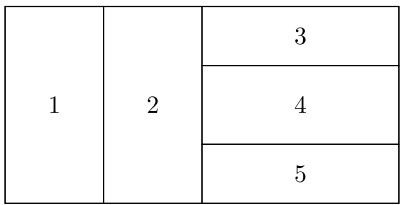

(a)

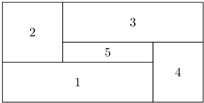

(b)

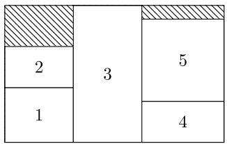

(c)

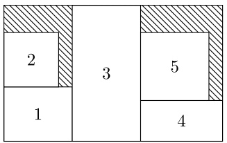

(d)

Fig. 1. Guillotine (a) and non guillotine (b) cutting patterns. Exact (c) and non-exact (d) 2-stage guillotine cutting patterns. In configuration (d), an extra cut (trimming) has to be performed to obtain items 2 and 5.

The literature reports on several 2KP variants emanating from glass, paper and steel industries as outlined by Gilmore and Gomory [2] and Vanderbeck [3]. The most common of these variants is to perform “guillotine cuts“ on the stock sheet: cuts go from one edge of the stock sheet to the opposite edge and have to be parallel to an edge of the stock piece (see Fig. 1 for an illustration). Such cut divides an initial plate into two sub-plates or strips. Another typical constraint is to limit the number of cuts needed to produce an item. A problem is called “k-stage” when an item has to be cut using at most k successive guillotine cuts. If there are no stage restrictions, the problem is said to be “any-stage”. At the last cutting stage of a “k-stage” problem variant, if an additional cut is allowed only to separate an item from a waste area, the problem is said to be “with trimming” or “non-exact” (see Fig. 1). If such extra cut is not allowed, the problem is “exact“. To extract items, cuts of different length are performed on the initial sheet. Possible values for cut lengths are in the range $\{ 1 , \ldots , W \}$ and $\{ 1 , \ldots , H \}$ . An additional constraint is to restrict the set of possible lengths for a cut. A cut is “restricted” if its length is equal to the height $h _ { i }$ or the width $w _ { i }$ of some item $i \in { \mathcal { I } } ,$ and item i is immediately cut to initialize one of the two obtained sub-plates. Finally, when there are no upper bounds on the number of times the items can be cut $( \mathit { i . e . } ~ d _ { i } = + \infty , \forall i \in \mathcal { I } )$ , the 2KP is “unbounded”, otherwise it is “bounded”. Item “rotation” can be permitted, by which we mean permuting the value of height and width. For more clarity the following notations are used to characterize the versions of the problem considered:

• C (resp. U) indicates that the demand of each item is bounded (resp. unbounded)

• NR means that cut lengths are non-restricted and non-exact, NRE that cuts are non-restricted and exact, R that cuts are restricted non-exact and RE means restricted exact

• k is an integer which corresponds to the maximum number of stage, while ∞ is associated to the any-stage variant

• f (resp. r) does not permit item rotation (resp. permit item rotation).

For example, using notation C-2KP-RE-4,f (resp. U-2KP-R-∞,r) refers to the bounded restricted exact 4-stage problem variant without item rotation (resp. the unbounded restricted non-exact any-stage problem with item rotation).

The two dimensional knapsack problem is the subject of a large number of scientific papers. Pioneering work goes back to Gilmore and Gomory [2], where a dynamic program for C-2KP-NR-2,f is proposed.

Although this program is efficient for the two-stage version, the enumeration growth is too large when the number of stages increases. In order to keep a manageable state space size for the C-2KP-NR-∞,f, Christofides and Whitlock [4] introduced dominance rules to remove duplicated patterns using symmetry breaking and cut ordering. Beasley [5] investigated U-2KP-NR-k,f and U-2KP-NR-∞,f designing generic recurrence relations to enumerate all possible cutting patterns. Nowadays using dynamic programming with reduction rules for the U-2KP-NR-∞,f provides good quality solutions, as outlined by Russo et al. [6] and Russo et al. [7].

Dynamic programming is a natural choice for the unbounded case but it does not extend easily to the bounded case. To our knowledge, the best performance on C-2KP-NR-∞,f were obtained by Dolatabadi et al. [8], using a dynamic program combined with an implicit enumeration of patterns. The method proceeds by trial-and-error on the objective value estimate, assuming a threshold value to be a valid lower bound. Feasible cutting patterns are enumerated by a recursive method, using the threshold value to fathom branches of the tree. The threshold value is then decreased until a feasible solution is found.

When the number of stages is limited to two or three, Integer Linear Programming (ILP) is a powerful tool. Lodi and Monaci [9] proposed ILP models for C-2KP-R-2,f. Since a guillotine cut divides a plate in two subplates, the initial stock sheet is cut with successive vertical cuts, which produce vertical strips. When only two cutting stages are considered, items are then cut in vertical strips by means of horizontal cuts. Decision variables of the proposed ILP models correspond to assigning items to strips and strips to the plate. The authors strengthen their models with linear inequalities that remove symmetries. They handled several problem variants, tuning their approach to those cases. In the context of a column generation approach to two-dimensional cutting-stock problems, Puchinger and Raidl [10] extend ILP formulations proposed by Lodi and Monaci [9] to handle three-stage problem. A stronger model for the three-stage problem was proposed in Vanderbeck [3] based on Dantzig–Wolfe reformulation; it is solved by column generation.

Problem C-2KP-NR-k,f was also handled through a graph model in Morabito and Arenales [11]: an AND–OR graph representation is used, where an OR vertex represents a sub-plate, while an AND vertex represents a cutting decision producing several sub-plates; it gave rise to two procedures, a branch-and-bound and a depth-first search heuristic with hill-climbing. AND–OR graphs are equivalent to so-called decision hypergraphs, which provide a simple and understandable representation for a recursive two-dimensional cutting process. Using hypergraph-based ILP models for 2KP problems can be seen as an instantiation of the generic procedure of Martin et al. [12] to the dynamic program of Beasley [5]. In Martin et al. [12], a simple procedure is described to formulate specific dynamic programs as max-cost flow problems in a hypergraph, which can be modelled as ILPs. Then, it is straightforward to add bound constraints to such formulations. However, adding those side-constraints makes the problem harder to solve, since integrality of the LP relaxation is lost in general. This technique is also used implicitly by Valério de Carvalho [13] and Macedo et al. [14] for the one-dimensional and two-dimensional cutting-stock problems respectively.

In Kenyon and Rémila [15] and Seiden and Woeginger [16], approximation algorithms are considered for the problem C-2KP-RE-∞,r. It was shown that it suffices to consider the variant with 4 stages to achieve the best approximation ratio.

In this paper, this general methodology is applied to solve two-dimensional guillotine cutting problems, and we consider several methods to solve the resulting max-cost flow problem with side-constraints in an hypergraph. Our main contribution is to extend to hypergraphs, some acceleration techniques used in the literature for solving (constrained) shortest path problems.

When directed acyclic graphs are considered, an efficient way to handle side-constraints in max-cost flow problems is to add them incrementally in the problem, only if they are violated in the current solution. Such method is called Decremental State Space Relaxation (see for example Martinelli et al. [17]). It boils down to solving incrementally a dynamic program by label setting. An enhancement consists in using a variable fixing procedure (or filtering procedure) to speed up solution time (see Irnich et al. [18] and Detienne et al. [19]). Although these methods proved their strength on graphs, applying them to large hypergraphs is not straightforward. In this paper, we show how they can be adapted to this case.

The rest of the paper is organized as follows. First, we present a formal dynamic programming based approach for unbounded 2KPs. The hypergraph representation that emanates from this dynamic program is then detailed along with the related flow formulation. This flow formulation is inspired from the max-cost flow problem obtained by the generic procedure of Martin et al. [12]. We pursue by explaining how to filter hyperarcs to accelerate the solving method. Finally we provide a global description of two exact methods based on label-setting algorithms to solve bounded 2KPs. To validate our approaches, we run numerical experiments on problem instances from the literature and real-life instances. We also perform comparisons with best known methods from the literature as well. We shall use the $C-2KP-RE-4,r$ as a support to our explanations, which corresponds to a real-world setting. Nevertheless, all our approaches are generic and easily applicable to other 2KP variants. More details on problem variants are given in Beasley [5].

## 2. A dynamic program for the unbounded 2KP

We present here a dynamic program to enumerate implicitly the set of all cutting patterns that are feasible for a given stock sheet. The production of an item is unbounded. Our dynamic program is an adaptation to C-2KP-RE-4,f of the recursion of Beasley [5]. Furthermore, we develop preprocessing techniques to reduce the number of states of the dynamic program.

## 2.1. A dynamic program for the U-2KP-RE-4,r

In a k-stage orthogonal cutting problem, a cut of level $j , 1   <   j   <   k$ has to be parallel to an edge and orthogonal to cuts of levels j − 1 and $j + 1$ . We assume that the first cut is along the height H of the stock piece. Note also that because cuts are restricted, each cut length has to be equal to the height or the width of an item in I.

Given a plate of size $( w , h )$ and a stage $j \in \{ 1 , \ldots , 4 \}$ , let $( w , h ) ^ { j }$ be the state related to cutting the plate from stage j. While we denote by $( \widehat { w } , \widehat { h ) ^ { j } }$ a related situation, where it is mandatory to cut an item with the next cut. For a given state s, let $U ( s )$ be the maximum profit/utility that can be obtained from this state. Our goal is to compute $U ( ( W , H ) ^ { 1 } )$ , which defines the optimal value that can be obtained when a plate of size $( W , H )$ is considered from stage 1. The set of all possible cutting patterns considering four stages of cuts is generated by the following recurrence relations:

$$
U ((w, h) ^ {1}) = \max \{0, \max _ {i \in \mathcal {I}: h _ {i} \leqslant h, w _ {i} \leqslant w} \{U (\widehat {(w , h _ {i}) ^ {2}}) + U ((w, h - h _ {i}) ^ {1}) \} \}\tag{1}
$$

$$
U ((w, h) ^ {2}) = \max \{0, \max _ {i \in \mathcal {I}: h _ {i} \leqslant h, w _ {i} \leqslant w} \{U (\widehat {(w _ {i} , h) ^ {3}}) + U ((w - w _ {i}, h) ^ {2}) \} \}\tag{2}
$$

$$
U ((w, h) ^ {3}) = \max \{0, \max _ {i \in \mathcal {I}: h _ {i} \leqslant h, w _ {i} \leqslant w} \{U (\widehat {(w , h _ {i}) ^ {4}}) + U ((w, h - h _ {i}) ^ {3}) \} \}\tag{3}
$$

$$
U (\widehat {(w , h) ^ {2}}) = \max _ {i \in \mathcal {I}: h _ {i} = h, w _ {i} \leqslant w} \{p _ {i} + U ((w - w _ {i}, h) ^ {2}) \}\tag{4}
$$

$$
U (\widehat {((w , h) ^ {3}}) = \max _ {i \in \mathcal {I}: w _ {i} = w, h _ {i} \leqslant h} \{p _ {i} + U ((w, h - h _ {i}) ^ {3}) \}\tag{5}
$$

$$
U (\widehat {((w , h) ^ {4}}) = \max \{0, \max _ {i \in \mathcal {I}: h _ {i} = h, w _ {i} \leqslant w} \{p _ {i} + U ((\widehat {w - w _ {i}}), h) ^ {4}) \} \}.\tag{6}
$$

Note that in a state $( w , h ) ^ { j }$ , it is always possible to transform a plate into waste (as it is modelled by max $\{ 0 , . \} )$ ; while in a state $\widehat { ( w , h ) ^ { j } }$ , it is mandatory to cut an item first. At stage 4, either an item is cut, or a waste is produced. The above equations are defined for the initial item set I. When rotation is allowed, one can replace I with $\bar { \mathcal { I } } = \mathcal { I } \cup \{ i ^ { \prime } : h _ { i ^ { \prime } } = w _ { i } , w _ { i ^ { \prime } } = h _ { i } , \forall i \in \mathcal { I } \}$ . When several copies of an item are used to initialize a strip at stage 2 or 3, only one of them is cut at this stage by the dynamic problem. Other copies are cut at stage $j + 1$ , leaving a 0-length residual plate.

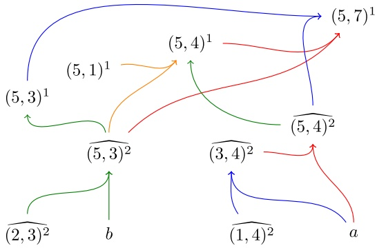

Fig. 2. The hypergraph related to a plate of size (5, 7) and two items: a of size $( 2 , 4 )$ and b of size (3, 3). Rotations are not permitted and only two cutting stages are allowed, therefore states of level 2 are only $\widehat { ( w , h ) }$ states. The waste vertex and related hyperarcs are not represented.

## 2.2. Hypergraph representation of the dynamic program

The dynamic program (1)–(6) allows one to represent the set of all cutting patterns, when the demand of each item is unbounded. According to the paradigm of Martin et al. [12], the search of a maximum profit cutting pattern using this dynamic program is equivalent to the search for a max-cost flow in the corresponding directed acyclic hypergraph with a single sink. This formalism is equivalent to the AND–OR representation of Morabito and Arenales [11]. The hypergraph formalism is preferred in this paper, since it allows to use classical network-flow models.

This directed acyclic hypergraph is denoted by $G ^ { 0 } = ( \mathcal { V } ^ { 0 } , \mathcal { A } ^ { 0 } )$ . The vertex set $\nu ^ { 0 }$ is composed of all states from the previous dynamic program but also of so-called boundary states that are used for initialization of the recursion and which correspond to single item $i \in \mathcal { I }$ or waste $\varnothing$ . These boundary states are the sources of the hypergraph. Its sink, denoted by $t ,$ corresponds to state $( W , H ) ^ { 1 }$ , i.e. it stands for the stock sheet. Each hyperarc a has a head set ${ \mathcal { H } } ( a )$ , which contains a unique vertex, and a multiset ${ \mathcal { T } } ( a )$ , which contains one or more vertices. In the hypergraph corresponding to dynamic program $(1) - (6)$ , every hyperarc tail is a simple set. However, below we introduce simplification rules which define an equivalent hypergraph where some hyperarc tails are indeed multisets, in which a vertex can occur more than once. The notation $n _ { a } ( v )$ is used to denote the number of times a vertex $v \in \mathcal { V } ^ { 0 }$ is contained in ${ \mathcal { T } } ( a )$ . Formally, a hyperarc a represents a cutting decision that turns state (i.e. plate) $v \in { \mathcal { H } } ( a )$ into states (i.e. sub-plates) in $v \in { \mathcal { T } } ( a )$ . The hyperarc set $\mathcal { A } ^ { 0 }$ contains the set of all those cutting decisions. An example of a hypergraph is given in Fig. 2.

The dynamic program $(1) - (6)$ can be easily solved to optimality by recursion using Bellman’s method. Equivalently, using our hypergraph representation, the optimal solution can be obtained by a forward traversal of the hypergraph vertices (i.e. crossing the hypergraph vertices in topological order from its sources to its sink). More explicitly, considering each vertex $v   \in   \mathcal { V } ^ { 0 }$ in topological order, we compute its maximum cost flow value $U ( v )$ using:

$$
U (v) = \max _ {a \in \Gamma^ {-} (v)} \{\sum_ {v ^ {\prime} \in \mathcal {T} (a)} n _ {a} (v ^ {\prime}) U (v ^ {\prime}) \}\tag{7}
$$

where $T ^ { - } ( v )$ represent the incoming hyperarc set of vertex v. While $U ( v ) = 0$ for boundary states representing waste, and $U ( v ) = p _ { i }$ for boundary states representing an item i. This forward dynamic program provides the problem optimal solution $U ( ( W , H ) ^ { 1 } )$ ).

## 2.3. Hypergraph preprocessing

The hypergraph size determines the number of operations needed to solve the corresponding dynamic program. Therefore, reducing the hypergraph size decreases the dynamic program solution time. The following simplification rules help us to reduce the hypergraph size.

The first rule is valid for the restricted exact case only. It is based on a reformulation of recurrence relation (6). This equation models the one-dimensional integer knapsack problem. The latter admits many symmetric solutions associated to different permutations of the position of the items in the strips. To avoid such symmetries we explicitly enumerate all possible solutions of the one-dimensional knapsack problem and we create directly a hyperarc for each of these solutions. An advantage of this enumeration is that it can account for upper bounds on the item production when the bounded case is considered. Let $\mathcal { K P } ( \widehat { ( w , h ) ^ { 4 } } )$ b e the set of all one-dimensional knapsack solutions related to a plate $\widehat { ( w , h ) ^ { 4 } }$ . Each solution is denoted by a set $\hat { \mathcal { I } } \in \mathcal { K P } ( \widehat { ( w , h ) ^ { 4 } } )$ , where $\hat { \mathcal { Z } }$ represents the multiset of items that are used in the solution. Hence, recurrence relation (6) can be rewritten as:

$$
U (\widehat {(w , h) ^ {4}}) = \max _ {\widehat {\mathcal {I}} \in \mathcal {K P} (\widehat {(w , h) ^ {4}})} \{\sum_ {i \in \widehat {\mathcal {I}}} p _ {i} \}.\tag{8}
$$

When applying enumeration at the last cutting stage, the associated hyper-arc a with each cutting decision has a special structure, depending on its tail multiset ${ \mathcal { T } } ( a )$ . In $(1) - (6)$ , the tail set ${ \mathcal { T } } ( a )$ contains at most two vertices. Using an enumerated one-dimensional knapsack solution, the number of vertices can be greater than two since the associated solution can involve cutting more than one boundary vertex representing item $i \in \mathcal { I }$ . For instance one can cut from state $\widehat { ( w , h ) ^ { 4 } }$ an item set composed of w items of size $( 1 , h )$ . In this case the tail set ${ \mathcal { T } } ( a )$ becomes a multiset as a given vertex v can occur more than once as mentioned previously. Remark that it is not mandatory to enumerate solutions for all possible states $\widehat { ( w , h ) ^ { 4 } }$ . Since our problem is restricted and exact, the maximum width of states $\widehat { ( w , h ) ^ { 4 } }$ is bounded by $w _ { m a x } = \operatorname { m a x } _ { i \in \mathcal { I } } \{ w _ { i } \}$ . In the same way, only positions $h = h _ { i }$ for some $i \in \mathcal { I }$ are relevant. This extends instantaneously from I to $\bar { \mathcal { I } } ,$

The second simplification is an adaptation of the rule of Valério de Carvalho [13], which aimed at removing symmetries in the one-dimensional cutting-stock problem. During the enumeration of the set of all cutting patterns, some of them can be equivalent. Two cutting patterns c and $c ^ { \prime }$ are symmetric if c is obtained from $c ^ { \prime }$ by a sequence of swapping of same stage strips. This type of symmetry can be partially removed in the hypergraph representation. Practically speaking for each vertex v related to state $( w , h ) ^ { j }$ , a value $l _ { v } \in \mathbb { N } ^ { + }$ is stored, which represents the largest cut length that produced this state starting from an equivalent stage vertex. Then we can remove hyperarcs $T ^ { - } ( v )$ related to a cut of length greater than $l _ { v }$ . Although this technique does not exclude all possible symmetries, it reduces significantly the size of the hypergraph.

Another simple rule, proposed by Christofides and Whitlock [4], is to merge states/vertices that are associated with the same set of solutions. This is called the plate size reduction technique. This also decreases the number of vertices as well as the number of hyperarcs in the hypergraph.

Our last hypergraph preprocessing feature is more general. We developed a smoothing reduction that is inspired from the vertex and edge contraction that are used in graphs. Indeed, one vertex which has only one incoming hyperarc can be removed from the hypergraph without any loss of information, as illustrated in Fig. 3. Let v be a vertex in $\mathcal { V } ^ { 0 }$ . If v has only one incoming hyperarc a, v and a are deleted from $\nu ^ { 0 }$ and $\mathcal { A } ^ { 0 }$ . Then, the tail set ${ \mathcal { T } } ( a )$ is added to the tail set ${ \mathcal { T } } ( a ^ { \prime } )$ for all outgoing hyperarcs $a ^ { \prime } \in \varGamma ^ { + } ( v )$ , where $T ^ { + } ( v )$ represents the outgoing hyperarc set of vertex v.

## 3. A direct ILP formulation for the bounded 2KP

As proposed by Martin et al. [12], the hypergraph representation underlying the dynamic programming recursion can give rise to an ILP flow-model. This ILP model can be augmented with side-constraints which allow us to enforce bounds in production if needed. A solution to the dynamic program is a selection of hyperarcs that gave rise to the maximum value in Bellman’s recursive formula (7). This selection of hyperarcs forms a directed acyclic hypergraph. Equivalently this combinatorial structure can be identified as the set of hyperarcs carrying a flow of max-cost value into the sink node. Therefore solving the dynamic program is equivalent to solve a max-cost flow problem in this hypergraph. One can derive an ILP formulation for this flow problem. However the formulation has pseudo-polynomial size as is the size of the hypergraph.

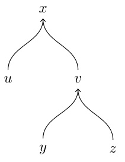

(a)

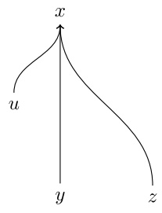

(b)

Fig. 3. Hypergraph before and after vertex contraction. Vertex x has only one incoming hyperarc and then is deleted.

The formulation is in terms of integer variables $x _ { a }$ representing the flow value going through hyperarc $a \in \mathcal { A } ^ { 0 }$ . Let $\mathcal { A } ^ { 0 } ( i )$ be the set of hyperarcs whose tail sets include a boundary vertex representing item $i \in \mathcal { I }$ Here, $n _ { a } ( i )$ stands for the number of times the vertex related to item i occurs in hyperarc a. The vector of variables $x _ { a } ,   a \in \mathcal { A } ^ { 0 }$ is denoted by x. The ILP formulation takes the form:

$$
\max \sum_ {i \in \mathcal {I}} p _ {i} \sum_ {a \in \mathcal {A} ^ {0} (i)} n _ {a} (i) x _ {a}\tag{9}
$$

$$
\text {s.t.} \sum_ {a \in \Gamma^ {-} (v)} x _ {a} - \sum_ {a ^ {\prime} \in \Gamma^ {+} (v)} n _ {a ^ {\prime}} (v) x _ {a ^ {\prime}} = 0, \quad \forall v \in \mathcal {V} ^ {0} \setminus \{t \cup \mathcal {I} \cup \varnothing \}\tag{10}
$$

$$
\sum x _ {a} = 1\tag{11}
$$

$$
a \in \Gamma^ {-} (t)
$$

$$
x _ {a} \in \mathbb {N}, \quad \forall a \in \mathcal {A} ^ {0}.\tag{12}
$$

Objective function (9) aims to maximize the total profit of the selected items. Constraints (10) are classical flow conservation constraints. They ensure that a valid pattern is built. Constraint (11) ensures that the total flow coming to the sink vertex t is one and thus that only one plate is used. Based on the results of Martin et al. [12], if x variables are unbounded, all extreme points of (9)–(12) are integers. This implies that integrality restriction of x variables can be relaxed. Note that the flow value going through hyperarcs although integer can be larger than 1 as illustrated in Fig. 4.

The ILP above can be adapted for the C-2KP-RE-4,r by enforcing item production upper bounds, adding the following constraints:

$$
\sum_ {a \in \mathcal {A} ^ {0} (i)} n _ {a} (i) x _ {a} \leqslant d _ {i}, \quad \forall i \in \mathcal {I}.\tag{13}
$$

Constraint set (13) limits the number of items that is possible to cut $( i . e .$ the sum of flow values going through each hyperarc set $\mathcal { A } ^ { 0 } ( i )$ that cover item i should not exceed the item upper bound $d _ { i } )$ . Such bound enforcement constraints were also used in Valério de Carvalho [13] and Macedo et al. [14] for the cutting stock problem. Note that when variables x are unbounded by adding side-constraints to the model, the integrality of the LP model relaxation optimal solution is not guaranteed anymore, and therefore one needs to tackle the integer problem which is much harder to solve. A similar formulation has also been proposed by

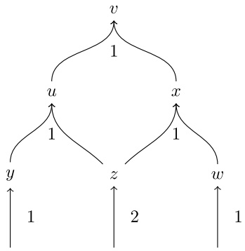

Fig. 4. Representation of flow values going through hyperarcs.

Furini et al. [20]. In their model, variables represent the cut of a plate into two subplates. In our formulation, variables x have the same meaning.

## 4. Lagrangian filtering

The size of the ILP model (9)–(13) grows too large to be solved directly by commercial solver as soon as one gets on realistic instances. Hence, in addition to the above preprocessing techniques, we implement socalled Lagrangian cost filtering (or simply filtering). The procedure aims to fix a large number of variables to zero by proving that they cannot be part of an optimal solution. The technique has proved to be a key asset in solving routing or scheduling problems, when using (constrained shortest) path problems as Lagrangian subproblems (see Irnich et al. [18]). In our hypergraph approach, this allows us to remove a large number of hyperarcs. To introduce the technique, we present a simple case of a directed acyclic graph. Our original contribution consists in extending the methodology to hypergraphs. As filtering relies on Lagrangian multipliers, we developed several techniques to obtain those multipliers.

## 4.1. Standard resource constrained longest path problem

The Resource Constrained Longest Path Problem (RCLPP) entails finding a path from a source s to a sink t in a directed acyclic graph $G = ( \mathcal { V } , \mathcal { A } )$ with maximum cost, while obeying a threshold constraint on the cumulative resource consumption. Considering R resources, such cumulative consumption to not exceed is given by a vector $\mathcal { W }   =   ( \mathcal { W } ^ { 1 } , \ldots , \mathcal { W } ^ { R } )$ . Let $w _ { a }   =   ( w _ { a } ^ { 1 } , \ldots , w _ { a } ^ { R } )$ be the resource consumption vector of arc $a \in \mathcal { A }$ (where $w _ { a } ^ { r }$ represents the amount of resource r consumed by arc a), while $c _ { a }$ is its cost. Using variables $x _ { a } = 1$ if the arc $a \in \mathcal { A }$ is in the solution, 0 otherwise, an ILP formulation to the RCLPP is given by:

$$
\max \sum_ {a \in \mathcal {A}} c _ {a} x _ {a}\tag{14}
$$

$$
\text {s.t.} \sum_ {a \in \Gamma^ {-} (j)} x _ {a} - \sum_ {a \in \Gamma^ {+} (j)} x _ {a} = 0, \forall j \in \mathcal {V} \setminus \{s \cup t \}\tag{15}
$$

$$
\sum_ {a \in \Gamma^ {-} (t)} x _ {a} = 1\tag{16}
$$

$$
\sum_ {a \in \mathcal {A}} w _ {a} ^ {r} x _ {a} \leqslant \mathcal {W} ^ {r}, \quad \forall r \in \{1, 2, \dots , R \}\tag{17}
$$

$$
x _ {a} \in \{0, 1 \}, \quad \forall a \in \mathcal {A}.\tag{18}
$$

Observe the similarity of the above RCLPP formulation and our formulation given in (9)–(13).

Filtering for the RCLPP is performed as follows. One applies a Lagrangian relaxation of the resource constraints (17) with Lagrangian multipliers π and one derives the associated Lagrangian bound $L ( \pi )$ by solving the resulting longest path problem:

$$
\tilde {L} (\pi) = \max \left\{\sum_ {a \in \mathcal {A}} (c _ {a} - \sum_ {r \in \{1, 2, \dots , R \}} \pi_ {r} w _ {a} ^ {r}) x _ {a} + \sum_ {r \in \{1, 2, \dots , R \}} \pi_ {r} \mathcal {W} ^ {r} \text {s.t. (15) - (16) and (18)} \right\}.
$$

The Lagrangian dual problem consists in adjusting the Lagrangian multipliers π to get the tightest Lagrangian bound $L ( \pi )$ : solving $\operatorname* { m i n } _ { \pi } L ( \pi )$ . This can be done approximatively using for instance a subgradient approach. At each iteration of such subgradient algorithm, one can perform filtering to remove arcs from the network. Observe that the longest path solution that yields $L ( \pi )$ defines a unit flow from origin s to destination t in our directed acyclic graph $G = ( \mathcal { V } , \mathcal { A } )$ : the flow value going through an arc is simply 0 or 1.

The above longest path problem can be solved by a label setting algorithm using Bellman’s equations. For each vertex v, we define:

$$
\tilde {U} ^ {\pi} (v) = \max _ {a \in \Gamma^ {-} (v)} \left\{\tilde {U} ^ {\pi} (\mathcal {T} (a)) + (c _ {a} - \sum_ {r \in \{1, 2, \dots , R \}} \pi_ {r} w _ {a} ^ {r}) \right\}.
$$

The $\tilde { U } ^ { \pi } ( t )$ values are the so-called forward labels. Note that in the case of directed acyclic graph, sets ${ \mathcal { T } } ( a )$ and ${ \mathcal { H } } ( a )$ contain only one vertex. Symmetrically, one can implement a backward labelling algorithm to compute ${ \tilde { C } } ^ { \pi } ( v )$ that denotes the reverse longest path from t to v:

$$
\tilde {C} ^ {\pi} (v) = \max _ {a \in \Gamma^ {+} (v)} \left\{\tilde {C} ^ {\pi} (\mathcal {H} (a)) + (c _ {a} - \sum_ {r \in \{1, 2, \dots , R \}} \pi_ {r} w _ {a} ^ {r}) \right\}.
$$

Then, using the above longest path values, one can evaluate the cost of the best path which contains arc a for any given arc $a \in { \mathcal { A } } { \mathrm { : } }$

$$
\frac {\tilde {F} ^ {\pi} (a) = \tilde {U} ^ {\pi} (\mathcal {T} (a)) + (c _ {a} - \sum_ {r \in \{1 , 2 , \dots , R \}} \pi_ {r} w _ {a} ^ {r}) + \tilde {C} ^ {\pi} (\mathcal {H} (a)) + \sum_ {r \in \{1, 2, \dots , R \}} \pi_ {r} \mathcal {W} ^ {r} .}
$$

Now assume a given lower bound value $L B _ { R C L P P }$ on the RCLPP problem. Then for each arc $a \in \mathcal { A }$ which does not take part in any optimal solution, one can try to filter it out: if $\tilde { F } ^ { \pi } ( a )   \leqslant   L B _ { R C L P P } ,$ arc a can be removed from the network, or equivalently, its associated variable $x _ { a }$ can be set to 0 and this no matter the value of multipliers $\pi .$ Indeed, if this condition holds, this implies that the best value of a longest path which contains a is worst than a known incumbent solution associated to our lower bound. An illustration is provided in Fig. 5. Thus, at a given iteration of some procedure to obtain valid Lagrangian multiplier vector $\pi ,$ one executes both the forward labelling procedure in order to compute the longest path from the source s to any vertex v and its value $\tilde { U } ^ { \pi } ( v ) , \forall v \in \mathcal { V } ,$ and the forward labelling procedure to compute $\tilde { C } ^ { \pi } ( v ) , \forall v \in \mathcal { V } .$ Then for each arc $a   \in   { \mathcal { A } } ,$ one computes ${ \tilde { F } } ^ { \pi } ( a )$ and compares this value $L B _ { R C L P P }$ , removing the arc if $\tilde { F } ^ { \pi } ( a ) \leqslant L B _ { R C L P P }$

## 4.2. Extension to the case of a hypergraph

In directed acyclic graph, the generic network flow problem formulation can be expressed in terms of binary variables. In a hypergraph however, the flow variables are integers. Moreover, one must consider the way flows are recombined in a hyperarc, which leads to a different mode of computation of the C values.

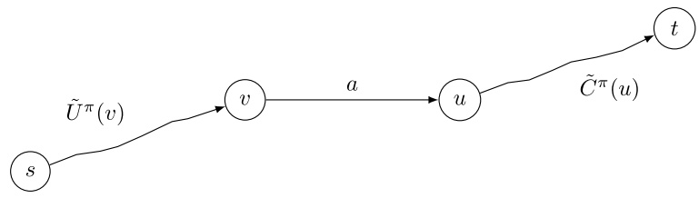

Fig. 5. Filtering representation on graph for a given Lagrangian multiplier vector π. If the best value of a path which contains a, $\tilde { U } ^ { \pi } ( v ) + ( c _ { a } - { \sum } _ { r \in \{ 1 , 2 , \ldots , R \} } \pi _ { r } w _ { a } ^ { r } ) + \tilde { C } ^ { \pi } ( u ) + { \sum } _ { r \in \{ 1 , 2 , \ldots , R \} } \pi _ { r } \mathcal { W } ^ { r }$ , is lower than a best known lower bound $L B _ { R C L P P }$ , arc a can be removed from the graph.

Consider the hypergraph flow model $(9) - (13)$ . Applying a Lagrangian relaxation on constraints (13) with multipliers π leads to the Lagrangian subproblem:

$$
L (\pi) = \max \left\{\sum_ {i \in \mathcal {I}} \left(p _ {i} - \pi_ {i}\right) \sum_ {a \in \mathcal {A} ^ {0} (i)} n _ {a} (i) x _ {a} + \sum_ {i \in \mathcal {I}} \pi_ {i} d _ {i} \text {s.t.} (1 0) - (1 2) \right\}.
$$

Just as in the case of the longest path in a graph, the computation of the Lagrangian bound on hypergraphs can be performed by a forward dynamic program starting from the sources to the unique sink. For a given $v \in \mathcal { V } ^ { 0 }$ , we have:

$$
U ^ {\pi} (v) = \max _ {a \in \Gamma^ {-} (v)} \left\{\sum_ {v ^ {\prime} \in \mathcal {T} (a)} n _ {a} (v ^ {\prime}) U ^ {\pi} (v ^ {\prime}) \right\}.
$$

Note that there is no cost on the hyperarc in our case as the cost carries only on the boundary states that are the tail vertices of hyperarcs in $\mathcal { A } ^ { 0 } ( i )$ . Hence, costs are modelled by a proper initialization of the U values: value of states $U ^ { \pi } ( i ) , i \in \mathcal { I }$ are set to $p _ { i } - \pi _ { i }$

Deriving $C ^ { \pi }$ values is more complex in the hypergraph case. Let $C ^ { \pi } ( v )$ be the maximum cost of a flow when $v \in \mathcal { V } ^ { 0 }$ is a hypergraph source. $C ^ { \pi } ( v )$ is an evaluation of the remaining cost to the sink t. It is defined as follows:

$$
C ^ {\pi} (v) = \max _ {a \in \Gamma^ {+} (v)} \Bigg \{C ^ {\pi} (\mathcal {H} (a)) + \sum_ {v ^ {\prime} \in \mathcal {T} (a)} n _ {a} (v ^ {\prime}) U ^ {\pi} (v ^ {\prime}) - U ^ {\pi} (v) \Bigg \}.
$$

As ${ \mathcal { T } } ( a )$ is a multiset, it is mandatory to sum up all $U ^ { \pi } ( v ^ { \prime } ) , v ^ { \prime } \in \mathcal { T } ( a )$ and then to subtract $U ^ { \pi } ( v )$ . This is implied by the fact that v can occur more than once in ${ \mathcal { T } } ( a )$ . The standard computation of $C ^ { \pi } ( v )$ values is performed by a backward dynamic program once the forward recursion on $U ^ { \pi }$ has been performed.

Once $U ^ { \pi }$ and $C ^ { \pi }$ values are obtained, filtering is implemented as follows. Contrary to directed acyclic graphs, we evaluate the cost of a solution which includes a hyperarc with a flow value of at least 1. This difference comes from the fact that in our hypergraph flow, variables are integer and not binary as in the longest path problem in a simple graph. Let $F ^ { \pi } ( a )$ be the maximum cost of a flow solution containing hyperarc $a \in \mathcal { A } ^ { 0 }$ carrying a flow of value at least one:

$$
F ^ {\pi} (a) = \sum_ {v \in \mathcal {T} (a)} n _ {a} (v) U ^ {\pi} (v) + C ^ {\pi} (\mathcal {H} (a)) + \sum_ {i \in \mathcal {I}} \pi_ {i} d _ {i}.
$$

Assume a valid lower bound value LB. If $F ^ { \pi } ( a )   <   L B$ then hyperarc a cannot take part in any solution of the problem that is better than the incumbent associated to $\begin{array} { r } { L B , ~ x _ { a } } \end{array}$ variable can be fixed to 0 or equivalently hyperarc a can be removed from the hypergraph. An illustration is given in Fig. 6. Note that the impact of filtering depends on the quality of the lower bound value LB, and the quality of the Lagrangian multipliers.

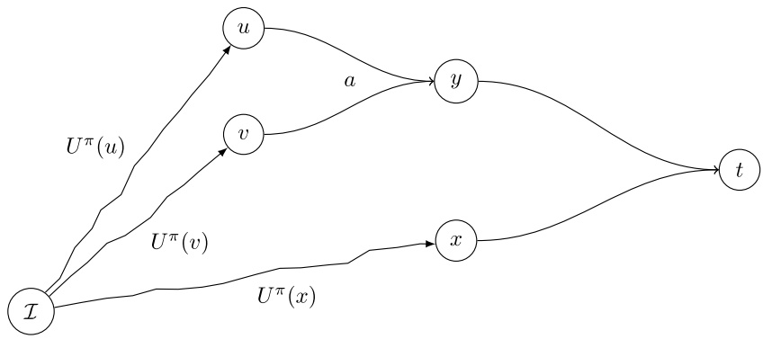

Fig. 6. Filtering representation on hypergraph. If the best value of a flow which contains at least one time a, $U ^ { \pi } ( u ) + U ^ { \pi } ( v ) +$ $C ^ { \pi } ( y ) + { \sum } _ { i \in \mathcal { I } } \pi _ { i } d _ { i }$ , is lower than a best known lower bound $L B$ , hyperarc a can be removed from the hypergraph.

## 4.3. Optimizing Lagrangian multipliers

To adjust Lagrangian multiplier vector $\pi ,$ we use a subgradient algorithm, a column generation or a column-and-row generation.

## 4.3.1. Using a subgradient algorithm

Our subgradient algorithm is standard (see Held et al. [21]). At each iteration $j ,$ for a given multiplier vector $\pi ^ { j }$ , the Lagrangian bound $L ( \pi ^ { j } )$ is computed by solving the forward dynamic program in which each item profit value $p _ { i }$ is replaced with $p _ { i } - \pi _ { i } ^ { j }$ . Then, vector π is updated using

$$
\pi^ {j + 1} = \max \left\{\pi^ {j} + \alpha \frac {(L (\pi^ {j}) - L B)}{\| g ^ {j} \| ^ {2}} g ^ {j}, 0 \right\}
$$

where $\alpha$ is a fixed parameter in ]0, 2], LB is an incumbent solution value, while $g ^ { j }$ is a subgradient. Specifically, $g _ { i } ^ { j }$ represents the violation of (13) constraint for $i \in \{ 1 , \ldots , | \mathcal { I } | \}$

$$
g _ {i} ^ {j} = \sum_ {a \in \mathcal {A} ^ {0} (i)} n _ {a} (i) x _ {a} ^ {j} - d _ {i}.
$$

The subgradient procedure is stopped either after a finite number of iterations or when the best problem dual bound $( \mathit { i . e . } ~ \mathrm { m i n } _ { j } L ( \pi ^ { j } ) )$ has not been improved for a parametrized number of iterations. Before each $\pi$ update, filtering occurs on $G ^ { 0 }$

## 4.3.2. Using column generation

A second way to optimize Lagrangian multipliers $\pi$ is to apply column generation to the Dantzig–Wolfe reformulation of our ILP model given by (10)–(13). The master program assumes a set $\mathcal { T }$ of cutting patterns which can be applied on the initial stock sheet. Each cutting pattern $j \in \mathcal { T }$ is defined by its cost $c _ { j }$ and the number $a _ { i j }$ of items $i \in \mathcal { I }$ cut into it. The cost of pattern $j$ is simply the sum of the profits of the items that are cut: $\begin{array} { r } { c _ { j } = \sum _ { i \in \mathcal { I } } p _ { i } a _ { i j } } \end{array}$ . We define $y _ { j } = 1$ if pattern $j$ is used, 0 otherwise. Using these definitions, our problem is rewritten as:

$$
\max \sum_ {j \in \mathcal {J}} c _ {j} y _ {j}\tag{19}
$$

$$
\text {s.t.} \sum_ {j \in \mathcal {J}} y _ {j} = 1\tag{20}
$$

$$
\sum_ {j \in \mathcal {J}} a _ {i j} y _ {j} \leqslant d _ {i}, \quad \forall i \in \mathcal {I}\tag{21}
$$

$$
y _ {j} \in \{0, 1 \}, \forall j \in \mathcal {J}.\tag{22}
$$

Our objective (19) is to find the combination of patterns of highest cost. Constraint (20) ensures that only one pattern is selected and constraint set (21) requires that the selected pattern does not imply item overproduction. Note that our definition of patterns allows for an overproduction.

As the size of $\mathcal { T }$ is exponential, it is not practical to enumerate all patterns $j \in \mathcal { T }$ . Therefore, a delayed column generation is used to solve the linear relaxation of model (19)–(22) which, in this approach, defines the master program (denoted $M P _ { c g } )$ . A restricted master problem, denoted $R M P _ { c g }$ , is defined by a subset of patterns ${ \mathcal { I } } \subset { \mathcal { I } }$ . To identify if a new pattern $j$ should be added into $\bar { \mathcal { T } }$ in the hope of improving the objective value, one solves a so-called pricing subproblem. Its objective is the so-called reduced cost of a pattern: $\begin{array} { r } { r _ { j } = c _ { j } - { \sum _ { i \in \mathcal { I } } } a _ { i j } \pi _ { i } } \end{array}$ where $\pi _ { i }$ are duals associated to constraints (21) in the solution to $R M P _ { c g } .$ This pricing problem is solved using our forward dynamic program in which each item profit value $p _ { i }$ is replaced with $p _ { i } - \pi _ { i }$ . The method stops when $R M P _ { c g }$ is solved to optimality.

## 4.3.3. Using row-and-column generation

The column generation procedure can show slow convergence, a drawback which we address by using row-and-column instead. The latter approach can accelerate convergence thanks to better recombination of previously generated pricing subproblem solutions (see Sadykov and Vanderbeck [22]).

The method is applied to the LP relaxation of our ILP model given by (9)–(13), where (12) are replaced by setting $x _ { a }   \in   \mathbb { R } , \forall a   \in   \mathcal { A } ^ { 0 }$ . Let $L P _ { c g }$ be this linear program. At each iteration, we solve $L P _ { c g }$ with a restricted number of variables and constraints. The optimal dual values associated with constraints (13) are then used to obtain a positive reduced cost pattern (using our forward dynamic programming) as in the standard column generation approach of the previous section. Then, the flow associated to the pattern is decomposed into its hyperarcs, and the latter are added to the restricted formulation, if absent. Missing flow conservation constraints (10), in which the added variables participate, are also added to the restricted formulation. The validity of this algorithm follows from the fact that there exists a positive reduced cost variable $x _ { a }$ if and only if there is a positive reduced cost solution to the pricing problem (as proved in Sadykov and Vanderbeck [22]). Filtering is then executed using dual values $\pi$ associated with constraints (13). The method stops when no more variables and constraints can be added to $L P _ { c g }$

## 5. A label setting algorithm for the bounded 2KP

Even after filtering, the size of our ILP-model is typically too large to be solved efficiently by a general purpose MIP solver. The alternative approach considered here is to adapt our dynamic programming solver to account for bounds on item production. This is done by extending the state space by including the current production of each item. It results in an exponential growth of the state space, which makes impractical a direct Bellman’s algorithm. However, specific techniques have emerged in the last decade to tackle such large size dynamic programs, specifically in the literature on the Elementary Resource Constrained Shortest Path Problem (ERCSPP): so-called label setting algorithms and Decremental State Space Relaxation (DSSR) (see e.g. Righini and Salani [23] and Martinelli et al. [17]). These methods iteratively consider a sequence of dynamic programs related to relaxations of some resource constraints. The state space is then enriched by adding a currently violated resource constraint in the state space until a feasible solution is found.

Below, we show how such approach can be adapted to our hypergraph flow problem. We first describe the extension of our dynamic program to take into account the item upper bounds. We highlight the definition of an extended label as well as the new form of dominance relations. Finally, we explain how to use the labelling algorithm with DSSR strategy together with Lagrangian cost filtering to solve the C-2KP-RE-4,r problem to optimality.

## 5.1. Extending our dynamic program

We extend dynamic program (1)–(6) as follows. Given $n   =   | \mathcal { I } |$ , each state is enriched with a vector $\mathbf { Q } \in \mathbb { N } ^ { n }$ , that corresponds to the number of item copies already cut. Thus, $U ( ( w , h , \mathbf { Q } ) ^ { j } )$ is the maximum value that can be obtained by cutting a plate of width w and height h at guillotine stage number $j ,$ and producing exactly $Q _ { i }$ times each item i. The initial bound vector $\mathbf { D } = ( d _ { 1 } , \ldots , d _ { | \mathcal { I } | } )$ is used for the initial state $( W , H , \mathbf { D } ) ^ { 1 }$ . To ease the presentation, we use the notation $\mathbf { Q } ^ { \prime } - \mathbf { Q } ^ { \prime \prime }$ and $\mathbf { Q } ^ { \prime } + \mathbf { Q } ^ { \prime \prime }$ to indicate the component-wise difference and sum, and $\mathbf { Q } ^ { \prime } \leqslant \mathbf { Q } ^ { \prime \prime }$ to indicate that $Q _ { i } ^ { \prime } \leqslant { Q ^ { \prime \prime } } _ { i } , \forall i \in \mathcal { I }$ . We also use bold-face notation i to indicate the vector $\in   \{ 0 , 1 \} ^ { n }$ with component i equal to 1 and the others to 0. Notation 0 refers to the vector with all components equal to 0. The extended backward recursion takes the form:

$$
U((w,h,\mathbf{Q})^{1}) = \max \Big\{0,\max_{\substack{i\in \mathcal{I}:h_{i}\leqslant h,w_{i}\leqslant w,\\ Q^{\prime}_{i}\geqslant 1,\mathbf{Q}^{\prime}\leqslant \mathbf{Q}}}\{U((w,h_{i},\mathbf{Q}^{\prime})^{2}) + U((w,h - h_{i},\mathbf{Q} - \mathbf{Q}^{\prime})^{1})\} \Big\}\tag{23}
$$

$$
U((w,h,\mathbf{Q})^{2}) = \max \Big\{0,\max_{\substack{i\in \mathcal{I}:h_{i}\leqslant h,w_{i}\leqslant w,\\ Q^{\prime}_{i}\geqslant 1,\mathbf{Q}^{\prime}\leqslant \mathbf{Q}}}\{U((\widehat{w_{i},h,\mathbf{Q}^{\prime}})^{3}) + U((w - w_{i},h,\mathbf{Q} - \mathbf{Q}^{\prime})^{2})\} \Big\}\tag{24}
$$

$$
U((w,h,\mathbf{Q})^{3}) = \max \Big\{0,\max_{\substack{i\in \mathcal{I}:h_{i}\leqslant h,w_{i}\leqslant w,\\ Q^{\prime}_{i}\geqslant 1,\mathbf{Q}^{\prime}\leqslant \mathbf{Q}}}\{U((w,h_{i},\mathbf{Q}^{\prime})^{4}) + U((w,h - h_{i},\mathbf{Q} - \mathbf{Q}^{\prime})^{3})\} \Big\}\tag{25}
$$

$$
U((\widehat{w,h,\mathbf{Q}})^{2}) = \max_{\substack{i\in \mathcal{I}:h_{i} = h,w_{i}\leqslant w,\\ Q_{i}\geqslant 1}}\{p_{i} + U((w - w_{i},h,\mathbf{Q} - \mathbf{i})^{2})\}\tag{26}
$$

$$
U((\widehat{w,h,\mathbf{Q}})^{3}) = \max_{\substack{i\in \mathcal{I}:w_{i} = w,h_{i}\leqslant h,\\ Q_{i}\geqslant 1}}\{p_{i} + U((w,h - h_{i},\mathbf{Q} - \mathbf{i})^{3})\}\tag{27}
$$

$$
U((\widehat{w,h,\mathbf{Q}})^{4}) = \max \Big\{0,\max_{\substack{i\in \mathcal{I}:h_{i} = h,w_{i}\leqslant w,\\ Q_{i}\geqslant 1}}\{p_{i} + U((w - \widehat{w_{i},h,\mathbf{Q}} - \mathbf{i})^{4})\} \Big\} .\tag{28}
$$

The optimal solution is given by max $\mathbf { r } _ { \mathbf { Q } \leqslant \mathbf { D } } U ( ( W , H , \mathbf { Q } ) ^ { 1 } )$ . In (23)–(25), all possible $\mathbf { Q } ^ { \prime } \leqslant \mathbf { Q }$ have to be considered, which means a doubly exponential complexity for this dynamic program. As previously, rotation can be taken into account by replacing I with Ī.

Using the paradigm of Martin et al. [12] and as shown in Section 2.2, the hypergraph representation of this extended dynamic program entails an extended hypergraph, which we denote $G ^ { n }   =   ( \mathcal { V } ^ { n } , \mathcal { A } ^ { n } )$ , where superscript n represents the dimension of production vector $\mathbf { Q } .$ Note that hypergraph $G ^ { 0 } \; = \; ( { \mathcal V } ^ { 0 } , { \mathcal A } ^ { 0 } )$ representing the unbounded dynamic program is a projection of hypergraph $G ^ { n }$ : each vertex $v ^ { n } \in \mathcal { V } ^ { n }$ corresponds to a state $( w , h , \mathbf { Q } ) ^ { j }$ or to a state $( \widehat { w , h , \mathbf { Q } } ) ^ { j }$ which can be projected to vertex $v ^ { 0 } \in \mathcal { V } ^ { 0 }$ corresponding to state $( w , h ) ^ { j } { \mathrm { ~ o r ~ } } ( { \widehat { w , h } } ) ^ { j }$ respectively. Thus every vertex $v ^ { n } \in \mathcal { V } ^ { n }$ can be denoted as $( v ^ { 0 } , \mathbf { Q } )$ where $v ^ { 0 }$ is its projection into the state space of $(1) - (6)$ . In the same way, hyperarc $a ^ { 0 } \in \mathcal { A } ^ { 0 }$ is the projection of hyperarc $a ^ { n } \in { \mathcal { A } } ^ { n } { \mathrm { ~ i f ~ } } { \mathcal { H } } ( a ^ { 0 } )$ is the projection of vertex $\mathcal { H } ( a ^ { n } )$ , while each vertex in ${ \mathcal { T } } ( a ^ { n } )$ has its respective projection on a vertex in $\mathcal { T } ( a ^ { 0 } )$ . More explicitly, if ${ \mathcal { T } } ( a ^ { n } )$ and $\mathcal { T } ( a ^ { 0 } )$ take respectively the explicit forms $\{ v _ { 0 } ^ { n } , v _ { 1 } ^ { n } , \ldots , v _ { k } ^ { n } \}$ , and $\{ v _ { 0 } ^ { 0 } , v _ { 1 } ^ { 0 } , \ldots , v _ { k } ^ { 0 } \}$ , where the same element can appear several times, then there must be a bijection between $\{ v _ { 0 } ^ { n } , v _ { 1 } ^ { n } , \ldots , v _ { k } ^ { n } \}$ and $\{ v _ { 0 } ^ { 0 } , v _ { 1 } ^ { 0 } , \ldots , v _ { k } ^ { 0 } \}$ . In the remainder, we refer to vertex or state interchangeably.

## 5.2. Forward labelling in the extended space

A forward labelling algorithm is a dynamic program implementation in which states are created recursively as so-called labels starting from an empty solution. The motivation is to consider only states that correspond to feasible partial solutions (i.e. reachable vertices of the state space). A feasible partial solution is defined by a label L that takes the form of a tuple $( p _ { L } , v _ { L } ^ { 0 } , \mathbf { Q } _ { L } )$ , where $p _ { L }$ denotes the accumulated profit, $v _ { L } ^ { 0 } \in \mathcal { V } ^ { 0 }$ is the plate-size status, and $\mathbf { Q } _ { L }$ is the item production quantity status. For a given vertex $v ^ { 0 } \in \mathcal { V } ^ { 0 }$ , let $\mathcal { L } ( v ^ { 0 } )$ be the set of labels $L$ such that $v _ { L } ^ { 0 } = v ^ { 0 }$ . This set is called a bucket. To a given label $L ,$ we can associate a vertex in the extended hypergraph: $\begin{array} { r } { v ( L ) : = v _ { L } ^ { n } = ( v _ { L } ^ { 0 } , \mathbf { Q } _ { L } ) \in \mathcal { V } ^ { n } } \end{array}$ . The reverse is also true because of the application of a dominance principle as we explain next.

Some partial solutions (as defined by their label L) can be abandoned by application of a dominance principle. A label $L$ dominates another label $L ^ { \prime }$ (denoted as $L \succeq L ^ { \prime } )$ if one can guarantee that any extension of $L ^ { \prime }$ cannot be strictly better than the best extension of L. One can easily derive sufficient conditions to guarantee this. In the sequel we consider two such dominance rules. The weak dominance check, denoted as $L { \succeq _ { { w e a k } } } L ^ { \prime }$ , consists in checking that $p _ { L }   \geqslant   p _ { L ^ { \prime } } , v _ { L } ^ { 0 }   =   v _ { L ^ { \prime } } ^ { 0 } , \mathbf { Q } _ { L }   =   \mathbf { Q } _ { L ^ { \prime } }$ and the strong dominance check, denoted as $L \succeq L ^ { \prime } ,$ consists in checking that $p _ { L } \geqslant p _ { L ^ { \prime } } , v _ { L } ^ { 0 } = v _ { L ^ { \prime } } ^ { 0 } , \mathbf { Q } _ { L } \leqslant \mathbf { Q } _ { L ^ { \prime } }$ . I.e., the weak dominance check is a special case of the stronger check. Observe that both rules are to be applied within a label bucket for a fixed vertex $v ^ { 0 } \mathrm { { : } i . e . }$ , a label may dominate another one only if both labels are in the same bucket. While strong dominance is applied only in some algorithms, we maintain weak dominance at all time: for a given hypergraph vertex $v ^ { n } = ( v ^ { 0 } , \mathbf { Q } )$ we can associate a unique label $L = L ( v ^ { n } )$ , which is that with the largest profit $p _ { L }$ amongst all those with $( v _ { L } ^ { 0 } , \mathbf { Q } _ { L } ) = ( v ^ { 0 } , \mathbf { Q } )$

Note that, as $\textstyle p _ { L } = { \sum _ { i \in \mathcal { I } } } p _ { i } Q _ { L , i }$ , weak and strong dominance reduce to $p _ { L }   =   p _ { L ^ { \prime } } , v _ { L } ^ { 0 }   =   v _ { L ^ { \prime } } ^ { 0 } , \mathbf { Q } _ { L }   =   \mathbf { Q } _ { L ^ { \prime } }$ The reason why we distinguish them here is that below we introduce the state-space relaxation method, in which vector $\mathbf { Q } _ { L }$ has a dimension lower than $n .$ In that case, $p _ { L } \neq { \textstyle \sum _ { i \in \mathcal { I } } } p _ { i } Q _ { L , i } ,$ , and the strong dominance may hold between a pair of labels when the weak dominance does not.

Instead of explicitly generating $G ^ { n }$ , our forward recursion is implemented in the projected hypergraph $G ^ { 0 }$ as follows. We initialize the recursion by defining the sources of the extended hypergraph: item labels $( p _ { i } , v ^ { 0 } , \mathbf { i } )$ and waste label $( 0 , v ^ { 0 } , \mathbf { 0 } )$ are put in the bucket associated to their original vertex $v ^ { 0 } \in \mathcal { V } ^ { 0 }$ . Then, we recurse on vertices $v ^ { 0 } \in \mathcal { V } ^ { 0 }$ in topological order. For each vertex $v ^ { 0 } \in \mathcal { V } ^ { 0 }$ , we create only labels which are extensions from existing labels in the buckets associated to predecessor vertices, using all hyperarcs $a ^ { 0 } \in \varGamma ^ { - } ( v ^ { 0 } )$ to pursue the construction of these partial solutions in all possible ways. Observe, indeed, that selecting $a ^ { 0 }$ induces a recombination with partial solutions associated with each of the tail vertices of $a ^ { 0 }$ This is formalized below.

Given hyperarc $a ^ { 0 } \in \varGamma ^ { - } ( v ^ { 0 } )$ , assume that $\mathcal { T } ( a ^ { 0 } )$ takes the explicit form $\{ v _ { 1 } ^ { 0 } , v _ { 2 } ^ { 0 } , \ldots , v _ { k } ^ { 0 } \}$ where the same vertex may occur several times. Let

$$
\mathcal {E} ^ {n} (a ^ {0}) = \mathcal {L} (v _ {1} ^ {0}) \times \mathcal {L} (v _ {2} ^ {0}) \times \dots \times \mathcal {L} (v _ {k} ^ {0})\tag{29}
$$

be the set of possible recombinations of partial solutions that are induced by $a ^ { 0 }$ . An element $E ^ { n } ( a ^ { 0 } )$ of $\mathcal { E } ^ { n } ( a ^ { 0 } )$ is called an elementary collection. It consists in selecting a label for each tail vertex in $\{ v _ { 1 } ^ { 0 } , v _ { 2 } ^ { 0 } , \ldots , v _ { k } ^ { 0 } \}$ Observe that one may select a different label for each copy of a vertex that is repeated in the sequence: $\mathrm { i . e . } ,$ if $\overline { { E ^ { n } ( a ^ { 0 } ) } } = ( \ldots , L ( v _ { u } ^ { 0 } ) , \ldots , L ( v _ { v } ^ { 0 } ) , \ldots ) \in \mathcal { E } ^ { n } ( a ^ { 0 } )$ with $v _ { u } ^ { 0 } = v _ { v } ^ { 0 }$ , then $L ( v _ { u } ^ { 0 } )$ needs not be equal to $L ( v _ { v } ^ { 0 } )$ as each label is associated with its own way of cutting a piece of size $v _ { u } ^ { 0 }$

An elementary collection $E ^ { n } ( a ^ { 0 } ) \in \mathcal { E } ^ { n } ( a ^ { 0 } )$ (or using simpler notations $E \in { \mathcal { E } } ^ { n } ( a ^ { 0 } ) )$ defines an extension to another label $L$ of the form

$$
(p _ {L}, v _ {L} ^ {0}, \mathbf {Q} _ {L}) = \left(\sum_ {L ^ {\prime} \in E} p _ {L ^ {\prime}}, \mathcal {H} (a ^ {0}), \sum_ {L ^ {\prime} \in E} \mathbf {Q} _ {L ^ {\prime}}\right).\tag{30}
$$

It is feasible if $\mathbf { Q } _ { L } \leqslant \mathbf { D }$ . Such feasible transition $E ,$ building partial solution $L ,$ implicitly defines a hyperarc $a ^ { n } \in { \mathcal { A } } ^ { n }$ in the extended graph $G ^ { n }$ with

$$
\mathcal {T} (a ^ {n}) = \{(v _ {L ^ {\prime}} ^ {0}, \mathbf {Q} _ {L ^ {\prime}}) \} _ {L ^ {\prime} \in E} \text {and} \mathcal {H} (a ^ {n}) = \{(v _ {L} ^ {0}, \mathbf {Q} _ {L}) \}.\tag{31}
$$

We denote by $a ( L )$ , the above defined hyperarc $a ^ { n }$ that records the predecessors to partial solution $L ,$ while $E ( a ^ { n } )$ is the elementary collection of partial solutions that define the tail vertices of $a ^ { n }$ . Observe that vertex $v ^ { n }$ is in a bijective relation with a label $L ;$ as we are applying weak dominance, one only conserves the best profit partial solution among those defined by state $( v _ { L } ^ { 0 } , \mathbf { Q } _ { L } )$ . For further reference, we define the hyperarc-mapping $\mathcal { M } ^ { n } ( a ^ { 0 } ) \subset A ^ { n }$ to be the set of hyperarcs $a ^ { n }$ that project onto $a ^ { 0 } ;$ i.e.,

$$
\mathcal {M} ^ {n} (a ^ {0}) = \{a ^ {n} \in A ^ {n}: \{v _ {L ^ {\prime}} ^ {0} \} _ {L ^ {\prime} \in E (a ^ {n})} = \mathcal {T} (a ^ {0}) \text {and} \{v _ {L} ^ {0} \} = \mathcal {H} (a ^ {0}) \text {for} L = L (\mathcal {H} (a ^ {n})) \}.\tag{32}
$$

Using these notations, the pseudo-code of our labelling algorithm is given in Algorithm 1 .

Algorithm 1: Forward Labelling Algorithm for Hypergraph $G^n$
for $v^0 \in \mathcal{V}^0$ in topological order do
    if $\Gamma^- (v^0) = \varnothing$ then
        if $v^0$ corresponds to an item $i \in \mathcal{I}$ then $\mathcal{L}(v^0) \leftarrow \{(p_i, v^0, \mathbf{i})\}$
        else $\mathcal{L}(v^0) \leftarrow \{(0, v^0, \mathbf{0})\}$
    else
        for $a^0 \in \Gamma^- (v^0)$ do
            compute $\mathcal{E}^n(a^0)$
            for $E \in \mathcal{E}^n(a^0)$ do
                $L \leftarrow (\sum_{L' \in E} p_{L'}, v^0, \sum_{L' \in E} \mathbf{Q}_{L'})$
                if $\mathbf{Q}_L^n \leqslant \mathbf{D}$ then
                    $\mathcal{L}(v^0) \leftarrow \mathcal{L}(v^0) \cup \{L\}$
    Strong dominance check: $\mathcal{L}(v^0) \leftarrow \mathcal{L}(v^0) \setminus \{L' : \exists L \in \mathcal{L}(v^0), L \neq L', L \succeq L'\}$
return $\max_{L \in \mathcal{L}(t)} p_L$ for $t$ being the sink of $G^0$ and associated optimal solution $S^*$.

## 5.3. Decremental state space relaxation

Running the above forward labelling algorithm becomes quickly impractical even on medium size instances, given the huge size of the extended state space. The strongly exponential growth in the state space is induced by the production quantity status Q that is used to keep track of the number of items that have been cut. In a valid solution, some items are attractive to the point that the optimizer tends to saturate the threshold on the item maximum production. Hence, an active set strategy can be used that consists in trying to identify item production bounds that are binding and keep track of those only in the production status: i.e., using a production quantity vector $\mathbf { Q ^ { m } } \in \mathbb { N } ^ { m }$ with $m < n ,$ considering only a subset $\mathcal { I } ^ { m }$ of items from I. The generic strategy that underlies this state-space reduction method is known as Decremental State Space Relaxation (DSSR). Such approach has proved to be efficient on C-2KP-NR-k,f (see Christofides and Hadjiconstantinou [24]) and on Vehicle Routing Problems (see Righini and Salani [23] and Martinelli et al. [17]) among others.

The technique works as follows. In the extended state space $\mathcal { S } ^ { n }$ the state associated to a label is a pair $( v , \mathbf { Q } ^ { n } )$ of dimension $n + 1$ (n for the production vector and 1 for the vertex identification). In the projected state space $\mathcal { S } ^ { m }$ , with $m < n$ , a state is defined by a pair $( v , \mathbf { Q } ^ { m } )$ of dimension $m + 1$ (m for the production vector). Then, the number of states to explore is reduced: the size of state space $\mathcal { S } ^ { n }$ , defined by Eqs. (23)–(28), is $O \left( | \mathcal { V } ^ { 0 } | \cdot \varPi _ { i = 1 } ^ { n } ( d _ { i } + 1 ) \right)$ ; while for its projection in dimension $m + 1$ , the size of the state space becomes $O \left( | \mathcal { V } ^ { 0 } | \cdot \varPi _ { i \in \mathcal { I } ^ { m } } ( d _ { i } + 1 ) \right)$ with $| \mathcal { I } ^ { m } | = m$

Working in the projected state space $\mathcal { S } ^ { m }$ amounts to considering a relaxation of our problem, as one cannot guarantee the feasibility of the solution regarding demand constraints (13): some partial solutions associated to a projected state $( v , \mathbf { Q } ^ { m } )$ of $\mathcal { S } ^ { m }$ can yield an item production higher than the demand for items $i \in \mathcal { I } \setminus \mathcal { I } ^ { m }$ . Although the optimal solution of the relaxation on $\mathcal { S } ^ { m }$ may not be feasible, it provides a valid dual bound. But, interestingly, if the optimal solution in state space $\mathcal { S } ^ { m }$ is feasible in state space $\mathcal { S } ^ { n }$ , then it is also optimal in $\mathcal { S } ^ { n }$ . This is a direct consequence of the fact that the problem to solve in $\mathcal { S } ^ { m }$ $m < n ,$ is a relaxation of the problem in $\mathcal { S } ^ { n }$ , where $n - m$ item constraints are removed. Fig. 7 pictures a mapping of states $s ^ { n } \in \mathcal { S } ^ { n }$ into states $s ^ { m } \in \mathcal { S } ^ { m }$ , some are feasible, others are infeasible: the relation is $\left( v , \mathbf { Q } ^ { n } \right) \rightarrow \left( v , \mathbf { Q } ^ { m } \right)$ . Observe that our definitions of extensions (30), extended hyperarcs (31), and mappings (32) can easily be recast for any m with $0 \leqslant m \leqslant n$ , so are the associated definitions of $\mathcal { E } ^ { m } ( a ^ { 0 } )$ . Hence, Algorithm 1 can be used to solve the relaxed problem for a given state space relaxation $\mathcal { S } ^ { m }$ , simply by replacing n by m.

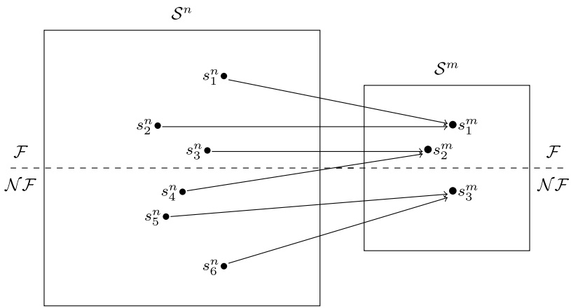

Fig. 7. Example of the projection of feasible (F) and non feasible (N F) states in $S ^ { n }$ to $S ^ { m }$ . In this example, non feasible state $s _ { 4 } ^ { n }$ becomes a feasible state in $S ^ { m }$

A natural dynamic strategy to update the state space derives from the above discussion. If solving the problem on a smaller state space $\mathcal { S } ^ { m }$ allows us to find a feasible solution to the original problem, this solution is also optimum and we stop. Otherwise, when the best solution in $\mathcal { S } ^ { m }$ is not feasible in $\mathcal { S } ^ { n }$ , the state-space $\mathcal { S } ^ { m }$ is expanded. The state space expansion is dictated by a violated demand constraint (13) for a given item i: an extra dimension is added to $\mathcal { S } ^ { m }$ by considering $\mathcal { I } ^ { m + 1 } = \mathcal { I } ^ { m } \cup \{ i \}$ . Such dynamic state space expansion is a well-known technique used on scheduling problem for instance (see Ibaraki and Nakamura [25]).

Our approach starts with $\mathcal { I } ^ { m } = \varnothing$ for $m = 0 .$ . The associated mapping function projects extended state space into state space of the unbounded dynamic program. At iteration $m ,$ a new set $\mathcal { I } ^ { m + 1 }$ is obtained by adding one overproduced item to $\mathbb { Z } ^ { m }$ . The process is repeated until the solution produced at iteration m admits a feasible expansion in $\mathcal { S } ^ { n }$ . Obviously, the method converges toward the optimal value after at most $n + 1$ iterations. The dynamic program used at iteration m can be represented by a hyperflow in an extended hypergraph $G ^ { m } = ( \mathcal { V } ^ { m } , \mathcal { A } ^ { m } )$ in which every vertex is of the form $v ^ { m }   =   \left( v ^ { 0 } , \mathbf { Q } ^ { m } \right)   \in   \mathcal { V } ^ { m }$ . In our implementation, vector $\mathbf { Q } ^ { m }$ has dimension $n ,$ but we set $Q _ { i } ^ { m }   =   0$ for all $i \not \in \mathcal { I } ^ { m }$ , while keeping track of an index set $\mathbb { Z } ^ { m }$ associated to the current iteration m. Although such procedure could rely on applying Algorithm 1 (with n replaced by $m )$ at each state m, one can do better than restart from scratch at each iteration. Moreover, one can take advantage of filtering methods to reduce the hypergraph size at each iteration.

## 5.4. Iterative labelling, combining state space relaxation and filtering

To implement decremental state space relaxation intelligently we need to warm-start iteration m with the inputs from iteration $( m - 1 )$ . Note that the projection relation between hypergraphs $G ^ { m - 1 }$ and $G ^ { m }$ is simply defined by associating a vertex $v ^ { m }   =   ( v ^ { 0 } , \mathbf { Q } ^ { m } )$ to its projection $v ^ { m - 1 }   =   \left( v ^ { 0 } , \mathbf { Q } ^ { m - 1 } \right)$ by setting $Q _ { i } ^ { m - 1 } = Q _ { i } ^ { m }$ for all $i \in \mathcal { I } ^ { m - 1 }$ and $Q _ { i } ^ { m - 1 } = 0$ otherwise. Similarly, a hyperarc $a ^ { m }$ can be projected on the hyperarc $a ^ { m - 1 }$ that is defined by its projected tails and head. Moreover, let us recall that each vertex $v ^ { m }$ $( \mathrm { r e s p . } v ^ { m - 1 } )$ is associated to a unique label $L ^ { m } { \mathrm { ~ ( r e s p . ~ } } L ^ { m - 1 } { \mathrm { ) } }$ given that we maintain weak dominance at all time, recording only the partial solution with best profit value.

The main motivation for warm-starting is to take advantage of filtering done up to iteration $( m - 1 )$ to limit the hypergraph building effort at iteration $m .$ . However, there are two important remarks to be aware of in such incremental scheme.

1. The dominance rule is valid only within the current iteration: i.e. labels that are dominated at iteration $( m - 1 )$ can become non-dominated at iteration $m ,$ once a new item is recorded in the production vector. Hence, we must keep dominated labels L from iteration $( m   -   1 )$ to build extensions at iteration $m .$ . In practice, in our implementation, instead of keeping track of a dominated label $L$ from iteration $( m   -   1 )$ , we record all hyperarcs $a ( L )$ from iteration $( m   -   1 )$ , having both dominated and non-dominated labels as heads, but only non-dominated labels as tails. These hyperarcs are recorded in containers $\mathcal { M } ^ { m - 1 } ( a ^ { 0 } )$ if they projected to $a ^ { 0 } \in A ^ { 0 }$ . We consider all of them in building extensions.

2. Elimination of labels by the strong dominance check is not compatible with Lagrangian filtering when Lagrangian multipliers are used, i.e., when $\pi \neq 0$ . Indeed, dominance is evaluated based on the true profit value with $\pi = 0$ . While in Lagrangian filtering of hyperarcs, we use reduced cost for Lagrangian multipliers $\pi$ up to the tails and beyond the head node; this evaluation is not correct if intermediate vertices have been eliminated through dominance using the true cost measure. Remember that the strong dominance check allows us to avoid extension of dominated labels based on the true profit value. When filtering occurs with Lagrangian multipliers $\pi \neq 0$ , we are not able to compute the maximum possible value $C _ { \pi }$ as dominated labels are not extended: a label $L$ may dominate another label $L ^ { \prime } ,$ but Lagrangian cost of $L ^ { \prime }$ may be larger than that of $L .$ Hence, when the strong dominance check is used (i.e.. when parameter EnforceStrongDominance is true), one can only apply plain filtering for $\pi = 0$ to ensure compatibility between cost measures. Thus, we shall consider two implementation strategies whether parameter EnforceStrongDominance is true or not.

This being said observe that filtering done in iteration $( m - 1 )$ , for a fixed set of Lagrangian multipliers $\pi ,$ remains valid in iteration m and further iterations for the same π. Consider that Lagrangian cost filtering is applied to $G ^ { m } , m   >   0$ in the same way as for $G ^ { 0 }$ . If a hyperarc $a ^ { m - 1 }   \in   \mathcal { A } ^ { m - 1 }$ is filtered out, then any hyperarc $a ^ { r } \in \mathcal { A } ^ { r }$ for $r \geqslant m$ , that projects onto $a ^ { m - 1 }$ can be filtered out too. First, observe that if $v ^ { m - 1 }   \in   \mathcal { V } ^ { m - 1 }$ is the projection at iteration $( m - 1 )$ of $v ^ { r }   \in   \mathcal { V } ^ { r }$ , for any iteration $r   :   m   \leqslant   r   \leqslant   n .$ , then $U ^ { \pi } ( v ^ { m - 1 } )   \geqslant   U ^ { \pi } ( v ^ { r } )$ because iteration $( m - 1 )$ defines a relaxation of iteration $r .$ The equation defining $C ^ { \pi } ( v ^ { m - 1 } )$ can be rewritten as:

$$
C ^ {\pi} (v ^ {m - 1}) = \max _ {a ^ {m - 1} \in \Gamma^ {+} (v ^ {m - 1})} \left\{C ^ {\pi} (\mathcal {H} (a ^ {m - 1})) + \sum_ {v ^ {\prime} \in \mathcal {T} (a ^ {m - 1})} n _ {a ^ {m - 1}} (v ^ {\prime}) U ^ {\pi} (v ^ {\prime}) - U ^ {\pi} (v) \right\}.
$$

Hence, in the same way as $U ^ { \pi } ( v ^ { m - 1 } ) \geqslant U ^ { \pi } ( v ^ { r } )$ , it follows that $C ^ { \pi } ( v ^ { m - 1 } ) \geqslant C ^ { \pi } ( v ^ { r } )$ , and $F ^ { \pi } ( a ^ { m - 1 } ) \geqslant F ^ { \pi } ( a ^ { r } )$ which explains why any filtering at iteration $m - 1$ remains valid for any further iteration $r : \; m \leqslant r \leqslant n$

Hence, when building hypergraph $G ^ { m }$ from hypergraph $G ^ { m - 1 }$ , we take advantage of all preprocessing and filtering done up to iteration $( m - 1 )$ . Our dynamic programming algorithm (23)–(28) is implemented as follows. First, we apply our forward labelling algorithm of Section 5.2 to build the hypergraph $G ^ { 0 }$ . Then, at each iteration $m ,$ for $m = 1 , \ldots , n$ , we start by checking if the solution on $G ^ { m - 1 }$ obey demand constraints (13). If so, we stop. Else, we perform filtering; we increase the iteration counter from $( m - 1 )$ to m; and we start building hypergraph $G ^ { m }$ . The expansions that yield $G ^ { m }$ are derived from the collection of label recombinations. We start by considering a restrictive set of combinations of existing labels which project to non-dominated labels in $G ^ { m - 1 }$ . We define

$$
\mathcal {E} ^ {m} (a ^ {m - 1}) = \hat {\mathcal {L}} ^ {m} (v _ {1} ^ {m - 1}) \times \hat {\mathcal {L}} ^ {m} (v _ {2} ^ {m - 1}) \times \dots \times \hat {\mathcal {L}} ^ {m} (v _ {k ^ {\prime}} ^ {m - 1})\tag{33}
$$

as the set of elementary collections of non-dominated labels at iteration $m .$ Each non-dominated label $\hat { \mathcal { L } } ^ { m } ( v _ { k } ^ { m - 1 } )$ projects on a non-dominated label associated to a vertex $v _ { k } ^ { m - 1 }$ that is a kth t ail of hyperarc $a ^ { m - 1 }$ with $k ^ { \prime }$ tails that was not filtered out. Set $\hat { \mathcal { L } } ^ { m } ( v _ { k } ^ { m - 1 } )$ is a subset of $\mathcal { L } ^ { m } ( v _ { k } ^ { 0 } )$ such that $v _ { k } ^ { m - 1 }$ projects to $v _ { k } ^ { 0 }$ , and $v _ { k } ^ { 0 }$ is the kth tail of arc $a ^ { 0 } ,   a ^ { 0 } \in \mathcal { M } ^ { m - 1 } ( a ^ { 0 } )$ . Indeed when computing the set $\mathcal { E } ^ { m } ( a ^ { m - 1 } )$ , the set of non-dominated labels $\hat { \mathcal { L } } ^ { m } ( v _ { k } ^ { m - 1 } )$ for each tail of $a ^ { m - 1 }$ is known because we proceed in topological order.

Now, if we use the strong dominance rule, recall that we also have to extend non-dominated labels which are associated to (i.e., project onto) dominated labels in $G ^ { m - 1 }$ . Let $\bar { \mathcal { L } } ^ { m } ( v ^ { 0 } )$ be the subset of labels in $\mathcal { L } ^ { m } ( v ^ { 0 } )$ associated to non-dominated labels in $G ^ { m - 1 }$ . We define

$$
\bar {\mathcal {E}} ^ {m} (a ^ {0}) = \left\{\mathcal {L} ^ {m} (v _ {1} ^ {0}) \times \dots \times \mathcal {L} ^ {m} (v _ {k ^ {\prime}} ^ {0}) \right\} \setminus \left\{\bar {\mathcal {L}} ^ {m} (v _ {1} ^ {0}) \times \dots \times \bar {\mathcal {L}} ^ {m} (v _ {k ^ {\prime}} ^ {0}) \right\}\tag{34}
$$

as the set of elementary collections of labels at iteration $m ,$ each of which projects on a label of vertex $v _ { k } ^ { 0 }$ that is a kth tail of hyperarc $a ^ { 0 }$ such that at least one of these labels projects on a label dominated at iteration $( m - 1 )$

The pseudo-code of our algorithm is given in Algorithm 2 . We start by running the unbounded dynamic program, record the associated optimal solution $S ^ { * }$ and initialize $\mathcal { L } ^ { 0 }$ (see lines 1–4). At each iteration m ⩾ 1, we find a feasible solution $S$ with a heuristic (described in Sections 6.2 and 6.3), then perform (Lagrangian) filtering on graph $G ^ { m }$ and finally update the item set $\mathcal { I } ^ { m }$ (lines 6–11). Then we consider vertices $v ^ { 0 } \in \mathcal { V } ^ { 0 }$ in topological order. For a given $v ^ { 0 }$ , we first check if $v ^ { 0 }$ corresponds to an item $i \in \mathcal { I } ^ { m }$ or an item $i \not \in \mathbb { T } ^ { m }$ or to the waste vertex. We create the associated vertex $v ^ { m }$ and update $\mathcal { V } ^ { m }$ with previously defined vertices (lines 13–16). In the case of vertex $v ^ { 0 }$ is not an item or the waste vertex, we are going to create new vertices based on previous iterate transitions. For a given vertex $v ^ { 0 }$ and $a ^ { 0 }   \in   \varGamma ^ { - } ( a ^ { 0 } )$ , we consider each $a ^ { m - 1 } \in \mathcal { M } ^ { m - 1 } ( a ^ { 0 } )$ , and we create set $\mathcal { E } ^ { m } ( a ^ { m - 1 } )$ of elementary collections as explained in (33). For each such collection, we create associated hyperarc $a ^ { m }$ and update mapping M (lines 22–26). Secondly, we create set $\bar { \mathcal { E } } ^ { m } ( a ^ { 0 } )$ of elementary collections as explained in (34). Again, for each such collection, we create associated hyperarc $a ^ { m }$ and update mapping $\mathcal { M }$ (lines 30–34). We proceed by applying the dominance check (lines 35 and 37). Finally, once all vertices are created, we look for the best solution $S ^ { * }$ at current iteration $m$ . This best solution $S ^ { * }$ is the optimal max-cost flow solution containing some hyperarcs $a ^ { m }$ . To check the feasibility of $S ^ { * }$ , we project each of its hyperarcs $a ^ { m }$ in the corresponding hyperarc $a ^ { 0 } \in \mathcal { A } ^ { 0 }$ . Then we simply check if all demand constraints (13) are valid. If this solution is feasible (all item bounds are satisfied), we stop the algorithm. Otherwise we iterate, starting with filtering hyperarcs $a ^ { m } \in \mathcal { A } ^ { m }$ to remove some of them from $\mathcal { M } ^ { m } ( a ^ { 0 } )$

The two algorithmic strategies of whether parameter EnforceStrongDominance is true or not are numerically evaluated below. When the strong dominance rule is disabled, the algorithm keeps more vertices and hence creates more hyperarcs during the vertex expansion. On the other hand, if strong dominance is used, the number of vertices is reduced but Lagrangian cost filtering is valid only for $\pi \; = \; 0$ , thus less hyperarcs are filtered. Note that an initial valid solution S has to be found first to use any kind of filtering.

## 6. Computational results

To measure the efficiency of our methodology to solve the C-2KP-RE-4,r problem, we performed computational experiments on instances from the literature and instances from industrial applications.

The first set of test problems are two-dimensional packing instances from the literature that are available on Beasley [5] ([http://people.brunel.ac.uk/∼mastjjb/jeb/orlib/cgcutinfo.html](http://people.brunel.ac.uk/%7Emastjjb/jeb/orlib/cgcutinfo.html)) and Hifi and Roucairol [26] (ftp://cermsem.univ-paris1.fr/pub/CERMSEM/hifi/2Dcutting/2Dcutting.html). We partition these instances into two datasets, named CU and CW. In CU dataset the profit of each item is unweighted, i.e. equal to its area. In CW dataset the profit of each item is weighted, i.e. not equal to its area. The

Algorithm 2: Iterative Forward Labelling Algorithm
$m \leftarrow 0; \mathcal{I}^m \leftarrow \varnothing, \mathcal{V}^0 = \mathcal{V}, \mathcal{A}^0 = \mathcal{A}, \mathcal{M}^0(a^0) = \{a^0\} \quad \forall a^0 \in \mathcal{A}^0$
run Algorithm 1 for $m = 0$, i.e., on hypergraph $G^0 = G(\mathcal{V}^0, \mathcal{A}^0)$ associated to unbounded problem
record the obtained optimal solution $S^*$
record the singleton label bucket $\mathcal{L}^0(v^0) = \{(p^0, v^0, 0)\}$ associated with each vertex $v^0 \in G^0$
while $S^*$ is not feasible do
    start a heuristic to find a feasible solution $S$
    if $m = 0$ then perform Lagrangian filtering on $G^m$ using $S$
    else perform filtering on $G^m$ using $S$
    remove filtered-out hyperarcs $a^m$ from $\mathcal{M}^m(a^0)$, for all $a^0 \in A^0$
    $m \leftarrow m + 1$
    add to $\mathcal{I}^m$ an item which bound is violated in $S^*$
    for $v^0 \in \mathcal{V}^0$ in topological order do
        if $\Gamma^- (v^0) = \varnothing$ then
            if $v^0$ corresponds to an item $i \in \mathcal{I}^m$ then $\mathcal{L}^m(v^0) \leftarrow \{(p_i, v^0, \mathbf{i})\}$
            else if $v^0$ corresponds to an item $i \notin \mathcal{I}^m$ then $\mathcal{L}^m(v^0) \leftarrow \{(p_i, v^0, \mathbf{0})\}$
            else if $v^0$ corresponds to waste then $\mathcal{L}^m(v^0) \leftarrow \{(0, v^0, \mathbf{0})\}$
        else
            for $a^0 \in \Gamma^- (v^0)$ do
                $\mathcal{M}^m(a^0) \leftarrow \varnothing$
                for $a^{m-1} \in \mathcal{M}^{m-1}(a^0)$ do
                    compute $\mathcal{E}^m(a^{m-1})$
                    for $E \in \mathcal{E}^m(a^{m-1})$ do
                        $L \leftarrow (\sum_{L' \in E} p_{L'}, v^0, \sum_{L' \in E} \mathbf{Q}_{L'})$
                        if $\mathbf{Q}_L^m \leqslant \mathbf{D}$ then
                            $\mathcal{L}^m(v^0) \leftarrow \mathcal{L}^m(v^0) \cup \{L\}$
                            $\mathcal{M}^m(a^0) \leftarrow \mathcal{M}^m(a^0) \cup \{a(L)\}$
        if EnforceStrongDominance then
            for $a^0 \in \Gamma^- (v^0)$ do
                compute $\bar{\mathcal{E}}^m(a^0)$
                for $E \in \bar{\mathcal{E}}^m(a^0)$ do
                    $L \leftarrow (\sum_{L' \in E} p_{L'}, v^0, \sum_{L' \in E} \mathbf{Q}_{L'})$
                    if $\mathbf{Q}_L^m \leqslant \mathbf{D}$ then
                        $\mathcal{L}^m(v^0) \leftarrow \mathcal{L}^m(v^0) \cup \{L\}$
                        $\mathcal{M}^m(a^0) \leftarrow \mathcal{M}^m(a^0) \cup \{a(L)\}$
        use strong dominance to remove dominated labels from $\mathcal{L}^m(v^0)$
    else
        use weak dominance to remove dominated labels from $\mathcal{L}^m(v^0)$.
    $S^*\leftarrow$ best solution of iteration $m$

CU dataset includes 43 instances: 2s, 3s, A1s, A2s, A3-5, STS2s, STS4s, OF1-2, W, CHL1s-4s, CHL5-7, ATP30-39, CU1-11, Hchl3s-8s. The CW dataset includes 40 instances: HH, cgcut1-3, A1-2, STS2, STS4, CHL1-4, CW1-11, ATP40-49, Hchl1-2, Hchl9, okp1-5.

The second set of instances are extracted from industrial cutting problems. We use problems with stock sheets of size (500, 1000) and (1000, 2000). The number of items in an instance can be 50, 100 and 150. We built two sets of instances called A and P. In the A set, the profit of each item is unweighted; while in the P datasets the profit of each item is weighted and sets to $\lceil \beta _ { i } \times w _ { i } \times h _ { i } \rceil$ where $\beta _ { i }$ is the product of two random real numbers in interval ]0, 2]. An instance named A1000I50-X corresponds to solving a C-2KP-RE-4,r problem on a bin of size (W, H) = (500, 1000) with 50 different items such that the sum of all item upper demands is equal to X. Each instance type is instantiated 25 times. This gives us a total of 150 instances in the P and in the A dataset respectively. These new instances are available on ESICUP website1(glass cutting instances).

Hypergraph creation results for all datasets.

| Dataset | V 0 |  |  | A0 |  |  | t |  |  |
| --- | --- | --- | --- | --- | --- | --- | --- | --- | --- |
|  | SB | P R | V S | SB | P R | V S | SB | P R | V S |
| CU (43) | 5 409 | 60% | 65% | 26 543 | 30% | 31% | 0.1 | 0.1 | 0.1 |
| CW (40) | 6 524 | 61% | 66% | 33 678 | 29% | 31% | 0.1 | 0.1 | 0.1 |
| A1000I50 (25) | 33 355 | 58% | 62% | 310 530 | 23% | 23% | 0.2 | 0.2 | 0.2 |
| A1000I100 (25) | 75 903 | 50% | 55% | 1 175 576 | 12% | 13% | 0.6 | 0.7 | 0.8 |
| A1000I150 (25) | 121 832 | 45% | 51% | 2 550 405 | 8% | 8% | 1.3 | 1.5 | 1.6 |
| A2000I50 (25) | 60 809 | 60% | 63% | 658 663 | 26% | 26% | 0.4 | 0.4 | 0.4 |
| A2000I100 (25) | 145 785 | 53% | 57% | 2 583 929 | 16% | 16% | 1.4 | 1.5 | 1.6 |
| A2000I150 (25) | 235 397 | 49% | 54% | 5 598 561 | 11% | 11% | 2.8 | 3.2 | 3.4 |
| P1000I50 (25) | 27 027 | 60% | 64% | 230 196 | 25% | 25% | 0.2 | 0.2 | 0.2 |
| P1000I100 (25) | 64 345 | 52% | 56% | 894 146 | 15% | 15% | 0.5 | 0.6 | 0.6 |
| P1000I150 (25) | 99 343 | 47% | 52% | 1 912 211 | 9% | 10% | 1.0 | 1.2 | 1.2 |
| P2000I50 (25) | 50 191 | 65% | 67% | 454 644 | 31% | 31% | 0.3 | 0.3 | 0.3 |
| P2000I100 (25) | 120 522 | 56% | 59% | 1 916 607 | 19% | 19% | 1.0 | 1.1 | 1.2 |
| P2000I150 (25) | 193 173 | 51% | 55% | 4 147 829 | 13% | 13% | 2.1 | 2.4 | 2.6 |

All experiments were run using a 2.5 Ghz Haswell Intel Xeon E5-2680 with 128Go of RAM. To solve linear programs, we use solver CPLEX 12.6. The running time limit for each instance is one hour. The goal of our experiments is fourfold: (i) to evaluate the impact of the hypergraph preprocessing rules; (ii) to see how Lagrangian filtering performs; (iii) to compare the different exact methods that we proposed; and (iv) to compare our methodologies with best known approaches from the literature.

## 6.1. Hypergraph simplifications

Here we analyse the impact of the hypergraph size reduction techniques of Sections 2.2 and 2.3, for the hypergraph associated to the dynamic program for the unbounded case. In Table 1, column (SB) indicates the size of the initial hypergraph associated with dynamic recursion (1)–(5) and (8) when using symmetry breaking techniques. Column (P R) indicates the reduction in the size reported in (SB) when building the hypergraph as (SB) and using plate size reduction. Finally column (V S) indicates the reduction obtained using a hypergraph build with (P R) configuration and vertex smoothing technique. For each dataset, we provide the geometric mean of the number of vertices $\nu ^ { 0 }$ and hyperarcs $\mathcal { A } ^ { 0 }$ using symmetry breaking (SB) techniques. Then for (P R) and (V S) configurations, we report the ratio of the number of removed vertices and hyperarcs to their number in the (SB) reference. The time t (in seconds) required to build the hypergraph is given in the right-hand part of the table.

Observe that the hypergraph size is huge even when using symmetry breaking (SB) techniques. Hence we do not consider building the hypergraph without symmetry breaking. When plate size reduction (P R) is applied, the hypergraph building time increases a little whereas its size is reduced by half in terms of vertices. Finally, the vertex smoothing rule (V S) does not contribute to reduce the hypergraph size. Indeed the number of vertices decreases but the number of hyperarcs is nearly the same as when the hypergraph is built with the plate reduction technique (P R). Nevertheless hypergraph building is a one time operation and it is worthwhile to work at obtaining the most compact one as hypergraph traversals are performed many times during Lagrangian cost filtering or labelling algorithms. In the light of those results, all further experiments are realized with hypergraphs with all possible simplifications.

<small>1 [https://paginas.fe.up.pt/∼esicup/](https://paginas.fe.up.pt/%7Eesicup/).</small>

Table 2

Percentage of filtered hyperarcs for each filtering procedure.

<table><tr><td rowspan="3">Dataset</td><td rowspan="2"></td><td colspan="5">% filtered hyperarcs</td><td colspan="6">t</td></tr><tr><td></td><td colspan="2">CG</td><td colspan="2">CRG</td><td></td><td></td><td colspan="2">CG</td><td colspan="2">CRG</td></tr><tr><td>gap</td><td> $\pi^0$ </td><td> $\pi^*$ </td><td> $\forall\pi$ </td><td> $\pi^*$ </td><td> $\forall\pi$ </td><td> $t_{pp}$ </td><td> $\pi^0$ </td><td> $\pi^*$ </td><td> $\forall\pi$ </td><td> $\pi^*$ </td><td> $\forall\pi$ </td></tr><tr><td>CU (43)</td><td>1.0%</td><td>69</td><td>71</td><td>72</td><td>72</td><td>73</td><td>0.3</td><td>0.1</td><td>0.1</td><td>0.2</td><td>0.2</td><td>0.3</td></tr><tr><td>CW (40)</td><td>2.5%</td><td>65</td><td>77</td><td>79</td><td>77</td><td>78</td><td>0.3</td><td>0.1</td><td>0.1</td><td>0.1</td><td>0.1</td><td>0.2</td></tr><tr><td>A1000I50 (25)</td><td>1.6%</td><td>42</td><td>45</td><td>44</td><td>45</td><td>44</td><td>0.8</td><td>0.1</td><td>0.4</td><td>0.7</td><td>0.4</td><td>0.8</td></tr><tr><td>A1000I100 (25)</td><td>1.0%</td><td>51</td><td>52</td><td>52</td><td>52</td><td>52</td><td>2.3</td><td>0.4</td><td>1.0</td><td>1.9</td><td>1.1</td><td>2.2</td></tr><tr><td>A1000I50 (25)</td><td>0.9%</td><td>51</td><td>51</td><td>51</td><td>51</td><td>51</td><td>4.4</td><td>0.9</td><td>2.1</td><td>3.9</td><td>2.2</td><td>4.5</td></tr><tr><td>A2000I50 (25)</td><td>1.7%</td><td>37</td><td>39</td><td>39</td><td>39</td><td>39</td><td>1.1</td><td>0.2</td><td>0.7</td><td>1.6</td><td>0.7</td><td>1.7</td></tr><tr><td>A2000I100 (25)</td><td>1.2%</td><td>48</td><td>48</td><td>48</td><td>48</td><td>48</td><td>3.4</td><td>0.8</td><td>2.4</td><td>4.9</td><td>2.4</td><td>5.2</td></tr><tr><td>A2000I150 (25)</td><td>0.9%</td><td>49</td><td>49</td><td>49</td><td>49</td><td>49</td><td>6.8</td><td>1.8</td><td>4.8</td><td>9.8</td><td>5.0</td><td>11.1</td></tr><tr><td>P1000I50 (25)</td><td>3.3%</td><td>31</td><td>65</td><td>67</td><td>65</td><td>66</td><td>0.8</td><td>0.1</td><td>0.6</td><td>0.9</td><td>0.5</td><td>0.9</td></tr><tr><td>P1000I100 (25)</td><td>2.9%</td><td>41</td><td>88</td><td>89</td><td>88</td><td>89</td><td>2.3</td><td>0.3</td><td>1.3</td><td>1.8</td><td>1.1</td><td>2.1</td></tr><tr><td>P1000I150 (25)</td><td>3.4%</td><td>39</td><td>80</td><td>81</td><td>80</td><td>81</td><td>4.7</td><td>0.6</td><td>2.7</td><td>4.7</td><td>2.3</td><td>4.9</td></tr><tr><td>P2000I50 (25)</td><td>3.8%</td><td>25</td><td>64</td><td>66</td><td>64</td><td>65</td><td>1.1</td><td>0.1</td><td>0.9</td><td>1.6</td><td>0.7</td><td>1.6</td></tr><tr><td>P2000I100 (25)</td><td>4.9%</td><td>21</td><td>66</td><td>67</td><td>66</td><td>66</td><td>3.5</td><td>0.5</td><td>3.7</td><td>8.6</td><td>3.0</td><td>7.9</td></tr><tr><td>P2000I150 (25)</td><td>3.7%</td><td>37</td><td>76</td><td>77</td><td>76</td><td>77</td><td>6.6</td><td>1.2</td><td>6.5</td><td>13.5</td><td>5.3</td><td>13.0</td></tr><tr><td>GM(A)</td><td>1.2%</td><td>46</td><td>47</td><td>47</td><td>47</td><td>47</td><td>2.4</td><td>0.4</td><td>1.4</td><td>2.7</td><td>1.4</td><td>3.0</td></tr><tr><td>GM(P)</td><td>3.6%</td><td>31</td><td>73</td><td>74</td><td>73</td><td>74</td><td>2.5</td><td>0.3</td><td>1.8</td><td>3.3</td><td>1.5</td><td>3.4</td></tr></table>

## 6.2. Lagrangian cost filtering procedures

Here, we compare the Lagrangian filtering methods presented in Section 4.3 on the initial hypergraph $G ^ { 0 }$ We refer to column generation (CG) and column-and-row generation (CRG) to denote the way in which we compute Lagrangian multipliers. We tried to measure the efficiency of the subgradient but we failed to produce an implementation with a good performance. Our results are given in Table 2. For each dataset, we report the average gap (gap) between the dual bound and our primal bound. The latter is computed with a genetic algorithm inspired from Hadjiconstantinou and Iori [27]. This heuristic is a classical genetic algorithm in which each individual in the population is represented by the order in which items I have to be cut. The decoding of an individual is performed by the classical First-Fit heuristic using items in the order induced by the individual. To diversify the search for good quality solutions, mutation and crossover operators are also used. In the left-hand part of the table, for each filtering procedure, we detail the average percentage of filtered out hyperarcs when filtering is performed only in preprocessing with zero multipliers $( \pi ^ { 0 } = 0 )$ , when filtering occurs in preprocessing and with optimal multipliers $\left( \pi ^ { * } \right)$ and thirdly (∀π) when filtering is applied for each multipliers obtained at each iteration of the (CG) or (CRG) methods. In the right-hand part of the table, we report the average total time required to filter the hypergraph depending on (CG) and (CRG) methods. Notation $( t _ { p p } )$ denotes the average time required to build the hypergraph and to run our genetic algorithm. At the bottom of the table, we indicate the geometric mean (GM) on A and P datasets. All reported times are rounded-up. In column generation and row-and-column generation, linear programs are solved by CPLEX 12.6 running on a single core.

From the results of Table 2, we observe that it is enough to perform only one filtering pass $\left( \pi ^ { 0 } \right)$ on unweighted instances (CU and A datasets). On the other hand, when the profit of each item is not related to its area (CW and P datasets), it is relevant to perform filtering with optimal multipliers value or with different multiplier values $\left( \pi ^ { * } , \forall \pi \right)$ . The algorithm to obtain multiplier values $\left( \pi ^ { * } , \forall \pi \right)$ does not seem to have an impact on the number of filtered hyperarcs. But, performing filtering for all valid multipliers (∀π) does not improve considerably the number of filtered hyperarcs, while it increases the computation time.

For CU and A datasets, column generation (CG) is the fastest method to filter the hypergraph. However, because of slow convergence on other datasets, row-and-column generation (CRG) is to be preferred. In summary, using all multipliers $\left( \forall \pi \right)$ to filter the initial hypergraph $G ^ { 0 }$ is rarely useful; filtering with null multipliers $\left( \pi ^ { 0 } \right)$ is enough to get a reduced hypergraph for CU and A datasets; while when working on CW and P datasets, it is best to use $\left( \pi ^ { * } \right)$ and compute it with row-and-column generation (CRG). In the sequel, we preprocess hypergraph $G ^ { 0 }$ according to these conclusions.

## 6.3. Exact methods

We now compare the performances of the different exact methods described in the paper. In Table 3, MIP refers to solving the problem directly by feeding the ILP formulation given in Section 3 to the MIP solver of CPLEX 12.6. Notation RLS (resp. DLS) refers to solving the problem with the iterative labelling algorithm of Section 5.4 without strong dominance check (resp. with strong dominance check), i.e., with parameter EnforceStrongDominance set to false (resp. true). Table 3 contains geometric means of the total time required to solve the problem with respectively the MIP, RLS and the DLS methods (notations $t t _ { M I P } .$ $t t _ { R L S }$ and $t t _ { D L S } )$ without and with filtering. Recall that when filtering is used along with dominance, then Lagrangian multipliers are not optimized, i.e., we then use $\pi = 0$ . The algorithms are tested in three modes: using a single core without performing filtering, using a single core with filtering and using all the eight cores on our machine. The parallel implementation divides vertex set $V ^ { 0 }$ of initial hypergraph $G ^ { 0 }$ into $k ^ { \prime }$ groups. Each group contains a subset of $V ^ { 0 }$ such that all vertices in a group can be processed at the same time. Group k contains all vertices in $V ^ { 0 }$ at distance k from hypergraph sink t. Here, the distance between two vertices is the maximum number of hyperarcs in a path connecting them. The distance from the sink to all vertices is computed during hypergraph creation. The right side of Table 3 reports results using filtering together with the eight-core parallel machine. Time $t _ { p p }$ denotes the geometric mean time required to build the hypergraph, to find an incumbent solution, and to perform filtering. All reported times are rounded up.

When using iterative labelling, we enable a basic heuristic that looks for an improving incumbent solution among generated labels. At the end of every iteration m, this heuristic retrieves the solutions corresponding to all labels $L \in \mathcal { L } ^ { m } ( t ^ { 0 } )$ $t ^ { 0 }$ being the sink of $G ^ { 0 }$ , such that $p _ { L }$ is greater than the current primal (lower) bound. If a solution from this set is feasible, the primal bound is updated. Note that if the solution is associated to an optimal label (i.e. the one of maximum profit in $\mathcal { L } ^ { m } ( t ^ { 0 } ) )$ is feasible, then this solution is optimal for the initial problem. Note also that initial hypergraph $G ^ { 0 }$ was preprocessed with Lagrangian filtering with $$\pi ^ { 0 }$ (resp. $\pi ^ { * } )$$ for CU and A datasets (resp. CW and P datasets). During iterations of DLS and RLS, only filtering with $\pi = 0$ was used.

For all datasets, Lagrangian filtering greatly improves the computation time. Although extra computation time is required to obtain an incumbent solution and to perform filtering, the number of filtered hyperarcs leads to an advantage for the exact method. RLS and $D L S$ methods are competitive when solving CU, CW and A datasets. On the P datasets, the RLS method is the fastest. The MIP approach gives the worst results. Parallelism allows to obtain a slight time saving for the RLS and the DLS methods, while a major time reduction occurs when using the MIP approach. However, the parallel MIP method is slower than the single-core RLS and DLS methods.

Beyond computation time comparison, it is interesting to count the number of solved instances by each method. Such results are reported in Table 4. Notations $n b _ { s } ,   n b _ { f }$ and $n b _ { n s }$ are the number of solved instances for a given method, the number of cases where the method is the fastest and the number of instances that are not solved by any of the methods. We observe that, when no filtering is used, the DLS method solves most of the problem instances for A dataset. Results are not very conclusive on P datasets because one third of the instances are not solved. Nevertheless, when filtering is used, all but one instance are solved in the A dataset; while 20 are unsolved in P dataset. We conclude that our labelling algorithms are efficient to solve our problem contrary to the MIP approach.

Table 3

Solving time for each exact method for all datasets.

<table><tr><td rowspan="2">Dataset</td><td colspan="4">No filtering</td><td colspan="4">Filtering</td><td colspan="4">Filtering and parallelism</td></tr><tr><td> $t_{pp}$ </td><td> $tt_{MIP}$ </td><td> $tt_{RLS}$ </td><td> $tt_{DLS}$ </td><td> $t_{pp}$ </td><td> $tt_{MIP}$ </td><td> $tt_{RLS}$ </td><td> $tt_{DLS}$ </td><td> $t_{pp}$ </td><td> $tt_{MIP}$ </td><td> $tt_{RLS}$ </td><td> $tt_{DLS}$ </td></tr><tr><td>CU (43)</td><td>0.1</td><td>7.3</td><td>1.1</td><td>0.3</td><td>0.2</td><td>0.6</td><td>0.2</td><td>0.2</td><td>0.2</td><td>0.5</td><td>0.2</td><td>0.2</td></tr><tr><td>CW (40)</td><td>0.1</td><td>11.3</td><td>0.6</td><td>0.3</td><td>0.3</td><td>0.3</td><td>0.3</td><td>0.3</td><td>0.3</td><td>0.3</td><td>0.3</td><td>0.3</td></tr><tr><td>A1000I50 (25)</td><td>0.2</td><td>340.8</td><td>961.3</td><td>31.7</td><td>0.8</td><td>177.1</td><td>5.4</td><td>3.6</td><td>0.8</td><td>60.1</td><td>4.6</td><td>2.7</td></tr><tr><td>A1000I100 (25)</td><td>0.8</td><td>2066.9</td><td>2051.9</td><td>50.9</td><td>2.5</td><td>914.5</td><td>12.5</td><td>10.9</td><td>2.6</td><td>356.7</td><td>10</td><td>7.6</td></tr><tr><td>A1000I50 (25)</td><td>1.6</td><td>3482.9</td><td>2974.2</td><td>171</td><td>5.2</td><td>2470.2</td><td>17.2</td><td>23.8</td><td>5.3</td><td>996.9</td><td>14.1</td><td>16.1</td></tr><tr><td>A2000I50 (25)</td><td>0.4</td><td>1321.8</td><td>2409</td><td>417.8</td><td>1.2</td><td>861.6</td><td>24.6</td><td>17.6</td><td>1.2</td><td>325</td><td>20.8</td><td>12.1</td></tr><tr><td>A2000I100 (25)</td><td>1.6</td><td>3188.6</td><td>3600</td><td>153.5</td><td>4</td><td>1896</td><td>25.2</td><td>26.8</td><td>4.2</td><td>1047.2</td><td>20.1</td><td>18.1</td></tr><tr><td>A2000I150 (25)</td><td>3.4</td><td>3600</td><td>2944.8</td><td>157</td><td>8.4</td><td>2825.7</td><td>33.8</td><td>42.5</td><td>8.7</td><td>2295.7</td><td>26.9</td><td>28.7</td></tr><tr><td>P1000I50 (25)</td><td>0.2</td><td>484.3</td><td>102.7</td><td>88.8</td><td>1</td><td>24.1</td><td>2.6</td><td>3.8</td><td>1</td><td>11.1</td><td>2.3</td><td>3.2</td></tr><tr><td>P1000I100 (25)</td><td>0.6</td><td>1583.9</td><td>119.3</td><td>51.2</td><td>2.9</td><td>7.1</td><td>3.2</td><td>3.2</td><td>3</td><td>5.1</td><td>3.2</td><td>3.3</td></tr><tr><td>P1000I150 (25)</td><td>1.2</td><td>2998.2</td><td>441.5</td><td>279</td><td>6.5</td><td>118.6</td><td>14</td><td>15.9</td><td>6.4</td><td>71.9</td><td>12.1</td><td>12.6</td></tr><tr><td>P2000I50 (25)</td><td>0.3</td><td>1029.1</td><td>273</td><td>258.1</td><td>1.6</td><td>103.4</td><td>11.6</td><td>19.1</td><td>1.5</td><td>52.3</td><td>9.3</td><td>14.3</td></tr><tr><td>P2000I100 (25)</td><td>1.2</td><td>2870.2</td><td>1434.2</td><td>714.8</td><td>5.7</td><td>725.4</td><td>95.6</td><td>117.5</td><td>4.9</td><td>362.7</td><td>82.9</td><td>97.4</td></tr><tr><td>P2000I150 (25)</td><td>2.6</td><td>3422.7</td><td>445.9</td><td>287.5</td><td>10.8</td><td>74.2</td><td>16.2</td><td>16.9</td><td>10</td><td>59.8</td><td>14</td><td>14.3</td></tr><tr><td>GM(A)</td><td>0.9</td><td>1827.3</td><td>2304.6</td><td>118.6</td><td>2.7</td><td>1107.6</td><td>17.0</td><td>16.3</td><td>2.8</td><td>505.6</td><td>13.9</td><td>11.3</td></tr><tr><td>GM(P)</td><td>0.7</td><td>1689.4</td><td>313.2</td><td>201.7</td><td>3.5</td><td>69.5</td><td>11.3</td><td>13.9</td><td>3.3</td><td>40.8</td><td>9.9</td><td>11.8</td></tr></table>

Table 4

Number of solved instances for all methods with and without filtering on a single core.

<table><tr><td rowspan="3">Dataset</td><td colspan="7">No filtering</td><td colspan="7">With filtering</td></tr><tr><td colspan="2">MIP</td><td colspan="2">RLS</td><td colspan="2">DLS</td><td></td><td colspan="2">MIP</td><td colspan="2">RLS</td><td colspan="2">DLS</td><td></td></tr><tr><td> $nb_s$ </td><td> $nb_f$ </td><td> $nb_s$ </td><td> $nb_f$ </td><td> $nb_s$ </td><td> $nb_f$ </td><td> $nb_{ns}$ </td><td> $nb_s$ </td><td> $nb_f$ </td><td> $nb_s$ </td><td> $nb_f$ </td><td> $nb_s$ </td><td> $nb_f$ </td><td> $nb_{ns}$ </td></tr><tr><td>CU (43)</td><td>42</td><td>5</td><td>32</td><td>9</td><td>39</td><td>28</td><td>1</td><td>42</td><td>2</td><td>41</td><td>22</td><td>41</td><td>19</td><td>0</td></tr><tr><td>CW (40)</td><td>39</td><td>2</td><td>36</td><td>11</td><td>38</td><td>27</td><td>0</td><td>40</td><td>6</td><td>40</td><td>28</td><td>40</td><td>6</td><td>0</td></tr><tr><td>A1000I50 (25)</td><td>25</td><td>4</td><td>6</td><td>0</td><td>23</td><td>21</td><td>0</td><td>25</td><td>0</td><td>25</td><td>7</td><td>25</td><td>18</td><td>0</td></tr><tr><td>A1000I100 (25)</td><td>12</td><td>0</td><td>3</td><td>0</td><td>23</td><td>23</td><td>2</td><td>18</td><td>0</td><td>25</td><td>10</td><td>25</td><td>15</td><td>0</td></tr><tr><td>A1000I50 (25)</td><td>3</td><td>0</td><td>2</td><td>0</td><td>24</td><td>24</td><td>1</td><td>6</td><td>0</td><td>25</td><td>17</td><td>25</td><td>8</td><td>0</td></tr><tr><td>A2000I50 (25)</td><td>16</td><td>5</td><td>2</td><td>0</td><td>15</td><td>13</td><td>7</td><td>17</td><td>0</td><td>22</td><td>5</td><td>24</td><td>19</td><td>1</td></tr><tr><td>A2000I100 (25)</td><td>3</td><td>0</td><td>0</td><td>0</td><td>22</td><td>22</td><td>3</td><td>8</td><td>0</td><td>25</td><td>18</td><td>25</td><td>7</td><td>0</td></tr><tr><td>A2000I150 (25)</td><td>0</td><td>0</td><td>2</td><td>0</td><td>25</td><td>25</td><td>0</td><td>3</td><td>0</td><td>25</td><td>13</td><td>25</td><td>12</td><td>0</td></tr><tr><td>P1000I50 (25)</td><td>17</td><td>2</td><td>15</td><td>4</td><td>17</td><td>12</td><td>7</td><td>19</td><td>1</td><td>23</td><td>19</td><td>21</td><td>3</td><td>2</td></tr><tr><td>P1000I100 (25)</td><td>13</td><td>0</td><td>14</td><td>3</td><td>22</td><td>19</td><td>3</td><td>22</td><td>3</td><td>22</td><td>14</td><td>22</td><td>5</td><td>3</td></tr><tr><td>P1000I150 (25)</td><td>4</td><td>0</td><td>10</td><td>4</td><td>15</td><td>11</td><td>10</td><td>14</td><td>0</td><td>24</td><td>16</td><td>25</td><td>9</td><td>0</td></tr><tr><td>P2000I50 (25)</td><td>14</td><td>2</td><td>13</td><td>8</td><td>13</td><td>5</td><td>10</td><td>15</td><td>0</td><td>21</td><td>19</td><td>18</td><td>2</td><td>4</td></tr><tr><td>P2000I100 (25)</td><td>4</td><td>0</td><td>6</td><td>0</td><td>12</td><td>12</td><td>13</td><td>10</td><td>0</td><td>17</td><td>11</td><td>17</td><td>6</td><td>8</td></tr><tr><td>P2000I150 (25)</td><td>1</td><td>0</td><td>10</td><td>6</td><td>14</td><td>8</td><td>11</td><td>11</td><td>2</td><td>22</td><td>11</td><td>21</td><td>9</td><td>3</td></tr><tr><td> $Total_A(150)$ </td><td>59</td><td>9</td><td>15</td><td>0</td><td>132</td><td>128</td><td>13</td><td>77</td><td>0</td><td>147</td><td>70</td><td>149</td><td>79</td><td>1</td></tr><tr><td> $Total_P(150)$ </td><td>53</td><td>4</td><td>68</td><td>25</td><td>93</td><td>67</td><td>54</td><td>91</td><td>6</td><td>129</td><td>90</td><td>124</td><td>34</td><td>20</td></tr></table>

To further analyse the performance of dynamic programming, we measure the number of labels created during the solution process. To clarify the comparison between algorithms, we disable our heuristic that looks for an improving incumbent solution among labels at the sink node. Results are reported in Table 5. For each dataset, we outline the number of instances $( n b _ { s } )$ solved by both labelling algorithms. Note that this number is smaller than in Table 4, as the heuristic was disabled. The comparison of Table 5 carries on those solved instances. We report the geometric mean of the number of iterations $( n b _ { i t } )$ (i.e., number of phases m), the number of labels $( n b _ { l } )$ , and the number of hyperarcs $\left( n b _ { h } \right)$ . All values are rounded-up. We observe that the number of labels and hyperarcs created by the DLS method is smaller than those for the RLS method on CU, CW and A datasets. However the RLS method performs better on P datasets. This is somehow counter-intuitive that the strong dominance produces more labels and hyperarcs than the weak dominance. The explanation is to be found in the combination with filtering. Having more labels and thus more hyperarcs in first iterations allows one to filter more hyperarcs. Then, every additional filtered hyperarc in a “smaller dimension” iteration, filters implicitly many hyperarcs in a “larger dimension” iterations which project on the former. Thus, filtering combined with the weak dominance may be more efficient in comparison with the strong dominance, even if the same incumbent and the same vector π are used.

Table 5

Number of labels and hyperarcs for both label setting algorithms.

| Dataset |  | RLS |  |  | DLS |  |  |
| --- | --- | --- | --- | --- | --- | --- | --- |
|  | nbs | nbit | nbl(/104 ) | nbh(/105 ) | nbit | nbl(/104 ) | nbh(/105 ) |
| CU (43) | 29 | 4.2 | 1.24 | 0.32 | 4.5 | 1.48 | 0.26 |
| CW (40) | 31 | 3.8 | 0.57 | 0.16 | 3.8 | 0.52 | 0.11 |
| A1000I50 (25) | 9 | 9.1 | 122.12 | 115.18 | 9.1 | 29.33 | 9.28 |
| A1000I100 (25) | 6 | 5.9 | 125.79 | 259.59 | 5.9 | 24.58 | 11.55 |
| A1000I150 (25) | 2 | 5.5 | 132.75 | 661.65 | 11.3 | 151.96 | 67.50 |
| A2000I50 (25) | 5 | 8.8 | 127.28 | 125.04 | 8.8 | 51.08 | 19.28 |
| A2000I100 (25) | 6 | 11.6 | 1819.03 | 3481.48 | 11.6 | 137.59 | 59.99 |
| A2000I150 (25) | 4 | 6.8 | 296.69 | 1380.32 | 6.8 | 75.34 | 57.12 |
| P1000I50 (25) | 18 | 5.9 | 3.41 | 1.64 | 5.9 | 5.78 | 2.29 |
| P1000I100 (25) | 17 | 7.1 | 8.92 | 6.08 | 7.1 | 15.47 | 7.17 |
| P1000I150 (25) | 20 | 6.4 | 7.82 | 4.81 | 6.4 | 14.42 | 5.49 |
| P2000I50 (25) | 16 | 5.9 | 4.25 | 2.30 | 5.9 | 6.12 | 2.78 |
| P2000I100 (25) | 13 | 6.4 | 32.03 | 35.99 | 6.4 | 55.94 | 35.36 |
| P2000I150 (25) | 12 | 5.6 | 6.54 | 3.74 | 5.6 | 9.55 | 4.01 |

The difference between the number of iterations in DLS and RLS for instances A1000I150 can also be explained by a larger number of labels when the weak dominance is applied. At the sink node, we have a larger number of labels with the best cost. Thus, probability of choosing a label which corresponds to a feasible solution is different. If the feasible label is chosen in RLS and unfeasible one is chosen in DLS, the later needs more iterations to converge.

## 6.4. Classical literature problem experiments

We proceed to compare our exact approaches with the best results of the literature for the C-2KP-NR-∞,f and the C-2KP-R-2,f problems in the following two subsections.

## 6.4.1. The any-stage problem

For the C-2KP-NR-∞,f problem, we compare here our hypergraph approaches to the best to our knowledge method of the literature which is the Recursive Procedure developed by Dolatabadi et al. [8]. For our comparison, these authors kindly provided their code. We ran it on all previous tested datasets. We also compare our methodologies on the UU dataset that contains the gcut1-13 instances of the literature.

The comparative results of Table 6 carry first on CU, CW and UU datasets. Time (tt) denotes the geometric average of total time spent to solve all instances in a dataset. This includes the time required to build the hypergraph, to filter it and to solve the problem with our labelling algorithms for RLS and DLS methods. Notation $( n b _ { s } )$ refers to the number of instances solved within the time limit of one hour in a dataset. The initial solution used to set up algorithms is the best one among solutions from Dolatabadi et al. [8] and the associated C-2KP-RE-4,f problem.

It is difficult to compare approaches using CU, CW, and UU datasets as the solving time is very small. We therefore perform the comparison on our datasets. When focusing on the A dataset, our exact methods performance is worse than for the RP method. On the opposite, our approach is better on P dataset. From those results, we conclude that our approach, that was designed for the C-2KP-RE-4,r problem, does not work well on the A dataset like problems of class C-2KP-NR-∞,f. As a possible future research direction, one may try to improve our labelling algorithms for the any-stage case of the problem.

Table 6

Computational time for each exact methods for the any-stage problem.

| Dataset | RLS nbs | tt | DLS nbs | tt | RP nbs | tt |
| --- | --- | --- | --- | --- | --- | --- |
| CU (43) | 43 | 0.4 | 43 | 0.4 | 43 | 0.2 |
| CW (40) | 38 | 0.9 | 38 | 0.9 | 39 | 0.9 |
| UU (13) | 12 | 0.1 | 12 | 0.1 | 12 | 1.3 |
| A1000I50 (25) | 20 | 238.5 | 22 | 245.9 | 25 | 10.8 |
| A1000I100 (25) | 19 | 261 | 21 | 320 | 25 | 9.5 |
| A1000I150 (25) | 24 | 260.7 | 22 | 400.2 | 25 | 7 |
| A2000I50 (25) | 11 | 1103.8 | 13 | 1351.8 | 25 | 87.8 |
| A2000I100 (25) | 13 | 1236.4 | 11 | 1535.7 | 25 | 90.9 |
| A2000I150 (25) | 14 | 1679.2 | 12 | 2068.2 | 25 | 76 |
| P1000I50 (25) | 12 | 478.3 | 12 | 479.4 | 4 | 1767.6 |
| P1000I100 (25) | 12 | 592.3 | 14 | 575.2 | 7 | 1259.4 |
| P1000I150 (25) | 7 | 1305.7 | 7 | 1291.7 | 4 | 2346.9 |
| P2000I50 (25) | 6 | 1400.9 | 6 | 1407.2 | 2 | 3140.2 |
| P2000I100 (25) | 3 | 2898.5 | 5 | 2816.5 | 1 | 3576.5 |
| P2000I150 (25) | 6 | 2075.1 | 8 | 2012.5 | 5 | 2156.7 |

Table 7

Solving time for each exact methods for the two-stage problem.

| Dataset | ttRLS | ttDLS | ttM1 | ttM2 |
| --- | --- | --- | --- | --- |
| CU (43) | 0.1 | 0.1 | 0.1 | 0.1 |
| CW (40) | 0.1 | 0.1 | 0.1 | 0.1 |
| A1000I50 (25) | 0.1 | 0.1 | 0.1 | 0.1 |
| A1000I100 (25) | 0.2 | 0.2 | 0.4 | 0.2 |
| A1000I150 (25) | 0.3 | 0.3 | 0.8 | 0.3 |
| A2000I50 (25) | 0.1 | 0.1 | 0.1 | 0.1 |
| A2000I100 (25) | 0.3 | 0.3 | 0.2 | 0.1 |
| A2000I150 (25) | 0.5 | 0.5 | 0.5 | 0.2 |
| P1000I50 (25) | 0.1 | 0.1 | 0.1 | 0.1 |
| P1000I100 (25) | 0.2 | 0.2 | 0.2 | 0.1 |
| P1000I150 (25) | 0.3 | 0.3 | 0.4 | 0.2 |
| P2000I50 (25) | 0.2 | 0.2 | 0.1 | 0.1 |
| P2000I100 (25) | 0.4 | 0.3 | 0.2 | 0.1 |
| P2000I150 (25) | 0.6 | 0.5 | 0.3 | 0.2 |
| GM(A) | 0.2 | 0.2 | 0.3 | 0.2 |
| GM(P) | 0.3 | 0.2 | 0.2 | 0.1 |

## 6.4.2. The two-stage problem

For the C-2KP-RE-2,f problem, we compare our results to the approaches based on ILP formulations (called M1 and M2) described in Lodi and Monaci [9], which are the best approaches of the literature to our knowledge. For each dataset, we run our labelling algorithms and compare the results to using models M1 and M2. The results are reported in Table 7. We refer to $t t _ { M 1 }$ and $t t _ { M 2 }$ as the geometric mean time required to solve models M1 and M2 respectively. Time measured for each model includes preprocessing rules to reduce the number of variables and CPLEX solving time. All reported times are rounded-up.

Computation times presented in Table 7 outline that our methodology is competitive with best literature approaches. However, running times are small for all the methods tested, so the two-stage variant of the problem is easy to solve.

## 7. Conclusion

We have developed a mixed integer programming and a dynamic programming based exact solution method for the two-dimensional knapsack problem, considering the exact guillotine-cut variant with bounded production and four cutting stages. Our labelling algorithm for the unbounded case is shown to admit a network flow representation in a hypergraph. To handle the huge size of the hypergraph, we develop preprocessing techniques and a filtering procedure, fixing hyperarcs by reduced cost after a Lagrangian relaxation of the production bounds. From there, we derive three algorithms: (i) solving a max-cost flow formulation in the reduced size hypergraph with side constraint to enforce production bounds; (ii) adapting our dynamic programming recursion to the bounded case, by extending the state space dynamically and applying filtering; (iii) a variant of the latter where a strong dominance rule is applied at the expense of using a weaker filtering procedure (based on the true arc costs instead of using reduced costs). We have numerically demonstrated the positive impact of preprocessing, filtering and dominance procedures. Our dynamic programs are shown to provide exact solution to relatively large size industrial instances in most cases. The comparison of our methods to existing results of the literature on different problem variants (any-stage and two-stage) shows that our method does reasonably well there too.

## Acknowledgements

Experiments presented in this paper were carried out using the PLAFRIM experimental testbed, being developed under the Inria PlaFRIM development action with support from Bordeaux INP, LABRI and IMB and other entities: Conseil Régional d’Aquitaine, Université de Bordeaux, CNRS and ANR in accordance to the programme d’investissements d’Avenir (see [https://www.plafrim.fr/](https://www.plafrim.fr/)). We express our gratitude to M. Dolatabadi, A. Lodi, and M. Monaci who have shared their code with us.

## References

[1] G. Wäscher, H. Haußner, H. Schumann, An improved typology of cutting and packing problems, European J. Oper. Res. 183 (3) (2007) 1109–1130. URL [http://dx.doi.org/10.1016/j.ejor.2005.12.047](http://dx.doi.org/10.1016/j.ejor.2005.12.047).

[2] P.C. Gilmore, R.E. Gomory, Multistage cutting stock problems of two and more dimensions, Oper. Res. 13 (1) (1965) 94–120. URL [http://dx.doi.org/10.1287/opre.13.1.94](http://dx.doi.org/10.1287/opre.13.1.94).

[3] F. Vanderbeck, A nested decomposition approach to a three-stage, two-dimensional cutting-stock problem, Manage. Sci. 47 (6) (2001) 864–879. URL [http://dx.doi.org/10.1287/mnsc.47.6.864.9809](http://dx.doi.org/10.1287/mnsc.47.6.864.9809).

[4] N. Christofides, C. Whitlock, An algorithm for two-dimensional cutting problems, Oper. Res. 25 (1) (1977) 30–44. URL [http://dx.doi.org/10.1287/opre.25.1.30](http://dx.doi.org/10.1287/opre.25.1.30).

[5] J.E. Beasley, Algorithms for unconstrained two-dimensional guillotine cutting, J. Oper. Res. Soc. 36 (4) (1985) 297–306. URL [http://dx.doi.org/10.1057/jors.1985.51](http://dx.doi.org/10.1057/jors.1985.51).

[6] M. Russo, A. Sforza, C. Sterle, An improvement of the knapsack function based algorithm of Gilmore and Gomory for the unconstrained two-dimensional guillotine cutting problem, Int. J. Prod. Econ. 145 (2) (2013) 451–462. URL [https://doi.org/10.1016/j.ijpe.2013.04.031](https://doi.org/10.1016/j.ijpe.2013.04.031).

[7] M. Russo, A. Sforza, C. Sterle, An exact dynamic programming algorithm for large-scale unconstrained two-dimensional guillotine cutting problems, Comput. Oper. Res. 50 (2014) 97–114. URL [http://dx.doi.org/10.1016/j.cor.2014.04.001.](http://dx.doi.org/10.1016/j.cor.2014.04.001)

[8] M. Dolatabadi, A. Lodi, M. Monaci, Exact algorithms for the two-dimensional guillotine knapsack, Comput. Oper. Res. 39 (1) (2012) 48–53. URL [http://dx.doi.org/10.1016/j.cor.2010.12.018](http://dx.doi.org/10.1016/j.cor.2010.12.018).

[9] A. Lodi, M. Monaci, Integer linear programming models for 2-staged two-dimensional knapsack problems, Math. Program. 94 (2–3) (2003) 257–278. URL [http://dx.doi.org/10.1007/s10107-002-0319-9](http://dx.doi.org/10.1007/s10107-002-0319-9).

[10] J. Puchinger, G.R. Raidl, Models and algorithms for three-stage two-dimensional bin packing, European J. Oper. Res. 183 (3) (2007) 1304–1327. URL [http://dx.doi.org/10.1016/0377-2217(95)00128-X](http://dx.doi.org/10.1016/0377-2217%2895%2900128-X).

[11] R. Morabito, M.N. Arenales, Staged and constrained two-dimensional guillotine cutting problems: An AND/OR-graph approach, European J. Oper. Res. 94 (3) (1996) 548–560. URL [http://dx.doi.org/10.1016/0377-2217(95)00128-X.](http://dx.doi.org/10.1016/0377-2217%2895%2900128-X)

[12] R.K. Martin, R.L. Rardin, B.A. Campbell, Polyhedral characterization of discrete dynamic programming, Oper. Res. 38 (1) (1990) 127–138. URL [http://dx.doi.org/10.1287/opre.38.1.127](http://dx.doi.org/10.1287/opre.38.1.127).

[13] J.M. Valério de Carvalho, Exact solution of bin-packing problems using column generation and branch-and-bound, Ann. Oper. Res. 86 (1999) 629–659. URL [http://dx.doi.org/10.1023/A:1018952112615](http://dx.doi.org/10.1023/A:1018952112615).

[14] R. Macedo, C. Alves, J.M. Valério de Carvalho, Arc-flow model for the two-dimensional guillotine cutting stock problem, Comput. Oper. Res. 37 (6) (2010) 991–1001. URL [http://dx.doi.org/10.1016/j.cor.2009.08.005](http://dx.doi.org/10.1016/j.cor.2009.08.005).

[15] C. Kenyon, E. Rémila, A near-optimal solution to a two-dimensional cutting stock problem, Math. Oper. Res. 25 (4) [(2000) 645–656.](http://refhub.elsevier.com/S1572-5286%2817%2930140-8/sb15)

[16] S.S. Seiden, G.J. Woeginger, The two-dimensional cutting stock problem revisited, Math. Program. 102 (3) (2005) 519–530. URL [https://doi.org/10.1007/s10107-004-0548-1](https://doi.org/10.1007/s10107-004-0548-1).

[17] R. Martinelli, D. Pecin, M. Poggi, Efficient elementary and restricted non-elementary route pricing, European J. Oper. Res. 239 (1) (2014) 102–111. URL [http://dx.doi.org/10.1016/j.ejor.2014.05.005](http://dx.doi.org/10.1016/j.ejor.2014.05.005).

[18] S. Irnich, G. Desaulniers, J. Desrosiers, A. Hadjar, Path-reduced costs for eliminating arcs in routing and scheduling, INFORMS J. Comput. 22 (2) (2010) 297–313. URL [http://dx.doi.org/10.1287/ijoc.1090.0341.](http://dx.doi.org/10.1287/ijoc.1090.0341)

[19] B. Detienne, R. Sadykov, S. Tanaka, The two-machine flowshop total completion time problem: Branch-and-bound algorithms based on network-flow formulation, European J. Oper. Res. 252 (3) (2016) 750–760. URL [http://dx.doi.org/10.1016/j.ejor.2016.02.003](http://dx.doi.org/10.1016/j.ejor.2016.02.003).

[20] [F. Furini, E. Malaguti, D. Thomopulos, Modeling two-dimensional guillotine cutting problems via integer programming, INFORMS J. Comput. 28 (4) (2016) 736–751.](http://refhub.elsevier.com/S1572-5286%2817%2930140-8/sb20)

[21] M. Held, P. Wolfe, H.P. Crowder, Validation of subgradient optimization, Math. Program. 6 (1) (1974) 62–88. URL [http://dx.doi.org/10.1007/BF01580223](http://dx.doi.org/10.1007/BF01580223).

[22] R. Sadykov, F. Vanderbeck, Column generation for extended formulations, EURO J. Comput. Optim. 1 (1–2) (2013) 81–115. URL [http://dx.doi.org/10.1007/s13675-013-0009-9](http://dx.doi.org/10.1007/s13675-013-0009-9).

[23] G. Righini, M. Salani, New dynamic programming algorithms for the resource constrained elementary shortest path problem, Networks 51 (3) (2008) 155–170. URL [http://dx.doi.org/10.1002/net.v51:3](http://dx.doi.org/10.1002/net.v51:3).

[24] N. Christofides, E. Hadjiconstantinou, An exact algorithm for orthogonal 2-D cutting problems using guillotine cuts, European J. Oper. Res. 83 (1) (1995) 21–38. URL [http://dx.doi.org/10.1016/0377-2217(93)E0277-5.](http://dx.doi.org/10.1016/0377-2217%2893%29E0277-5)

[25] T. Ibaraki, Y. Nakamura, A dynamic programming method for single machine scheduling, European J. Oper. Res. 76 (1) (1994) 72–82. URL [http://dx.doi.org/10.1016/0377-2217(94)90007-8](http://dx.doi.org/10.1016/0377-2217%2894%2990007-8).

[26] M. Hifi, C. Roucairol, Approximate and exact algorithms for constrained (un) weighted two-dimensional two-staged cutting stock problems, J. Comb. Optim. 5 (4) (2001) 465–494. URL [http://dx.doi.org/10.1023/A:1011628809603.](http://dx.doi.org/10.1023/A:1011628809603)

[27] E. Hadjiconstantinou, M. Iori, A hybrid genetic algorithm for the two-dimensional single large object placement problem, European J. Oper. Res. 183 (3) (2007) 1150–1166. URL [http://dx.doi.org/10.1016/j.ejor.2005.11.061.](http://dx.doi.org/10.1016/j.ejor.2005.11.061)