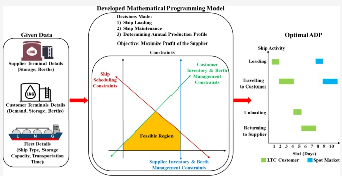
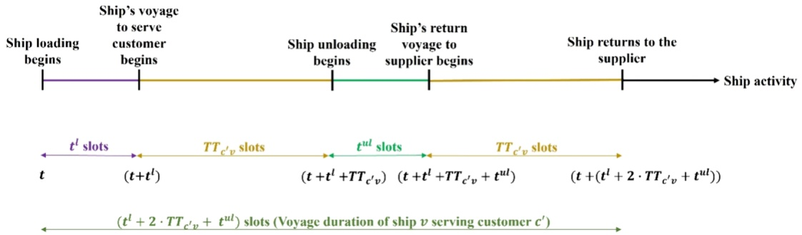
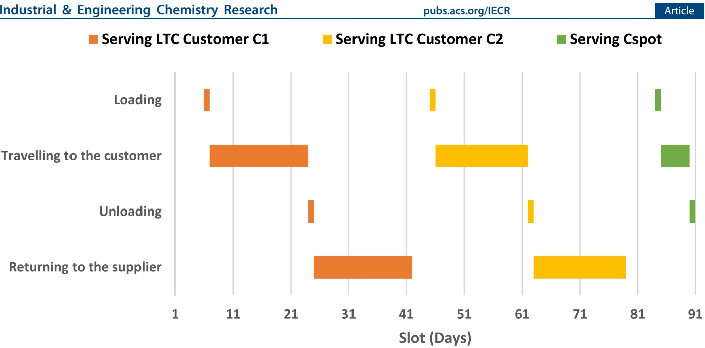
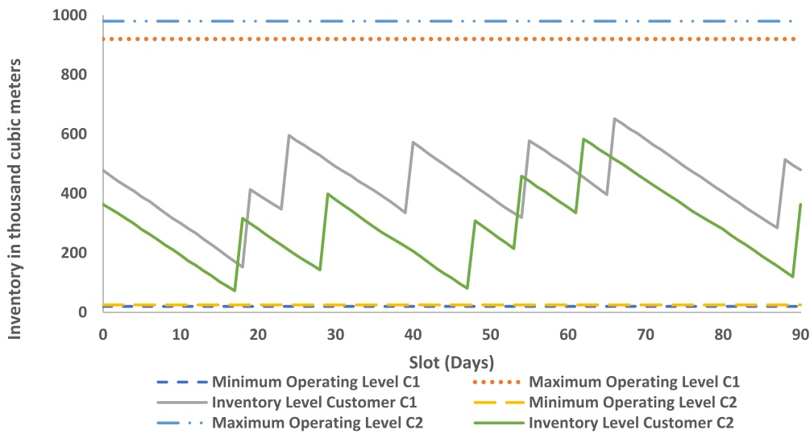
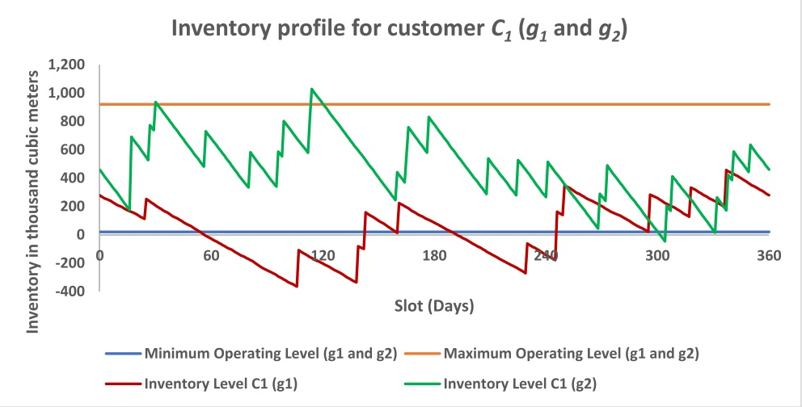
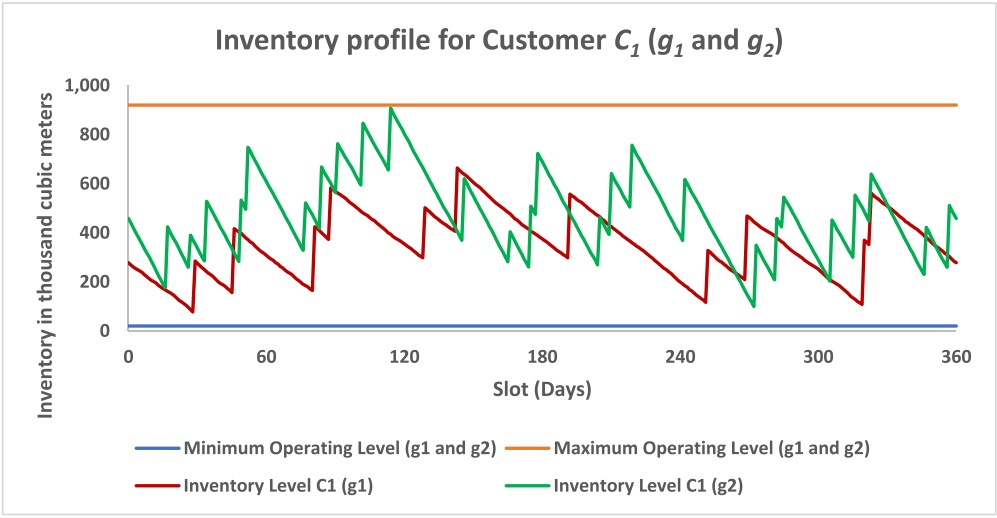
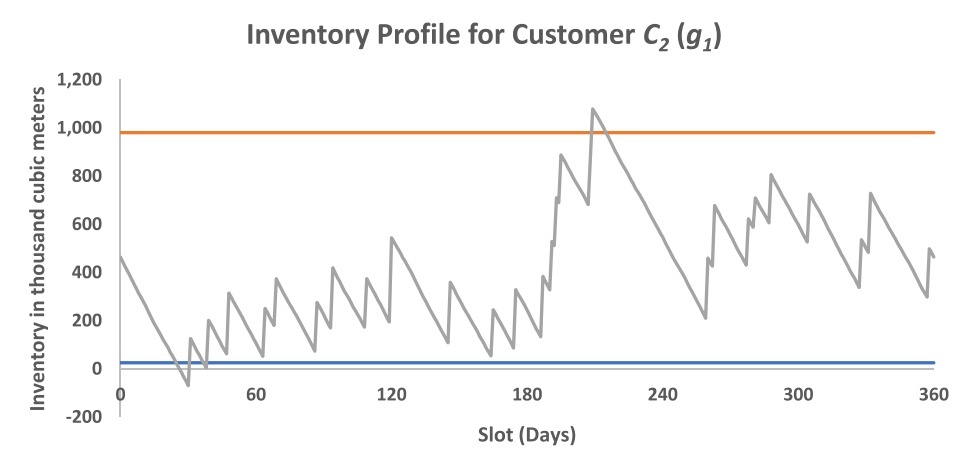
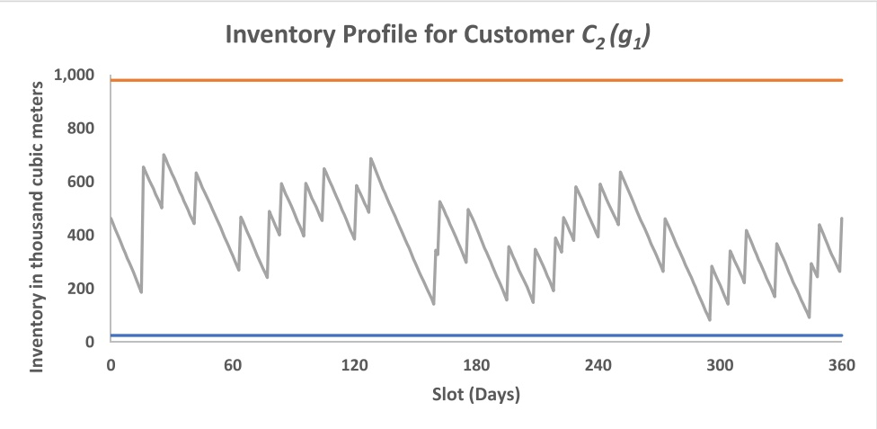

pubs.acs.org/IECR

# Optimal Annual Delivery Program for Liquefied Natural Gas Suppliers: A Mathematical Programming Model Considering Customer Inventory and Berth Management

[Dnyanesh Deshpande,](https://pubs.acs.org/action/doSearch?field1=Contrib&text1="Dnyanesh+Deshpande"&field2=AllField&text2=&publication=&accessType=allContent&Earliest=&ref=pdf) [Mohd Shahrukh,](https://pubs.acs.org/action/doSearch?field1=Contrib&text1="Mohd+Shahrukh"&field2=AllField&text2=&publication=&accessType=allContent&Earliest=&ref=pdf) [Rajagopalan Srinivasan,](https://pubs.acs.org/action/doSearch?field1=Contrib&text1="Rajagopalan+Srinivasan"&field2=AllField&text2=&publication=&accessType=allContent&Earliest=&ref=pdf)\* [and Iftekhar A. Karimi](https://pubs.acs.org/action/doSearch?field1=Contrib&text1="Iftekhar+A.+Karimi"&field2=AllField&text2=&publication=&accessType=allContent&Earliest=&ref=pdf)

**Cite This:** [Ind. Eng. Chem. Res. 2023, 62, 15986−15999](https://pubs.acs.org/action/showCitFormats?doi=10.1021/acs.iecr.3c01769&ref=pdf)

[**Read Online**](https://pubs.acs.org/doi/10.1021/acs.iecr.3c01769?ref=pdf)

## ACCESS

[Metrics & More](https://pubs.acs.org/doi/10.1021/acs.iecr.3c01769?goto=articleMetrics&ref=pdf)

**ABSTRACT:** Natural gas (NG) is liquefied, stored, and transported in the form of liquefied natural gas (LNG) to economies worldwide. Conventionally, a supplier delivers LNG to customers via long-term contracts. However, the share of spot trading in the total LNG trade has also increased in recent years. Therefore, delivering LNG cargos to customers has become even more challenging for suppliers. Each supplier develops an annual delivery program (ADP) to plan deliveries for the upcoming year. The ADP planning problems reported in the literature neglect customer inventory and berth management, customer demand satisfaction, and the delivery of multiple LNG grades. In this paper, we incorporate these features into the ADP planning problem. A

[Article Recommendations](https://pubs.acs.org/doi/10.1021/acs.iecr.3c01769?goto=recommendations&?ref=pdf)

mathematical programming model is presented that determines the ADP that maximizes the supplier’s profit. The proposed formulation is demonstrated by using an illustrative example and two case studies. The developed mathematical programming model generates a near-optimal ADP in each case that satisfies each customer’s demand with an oversupply of less than 1%. These results clearly highlight the need to consider customer inventory and berth management to prevent practically infeasible solutions.

## 1. INTRODUCTION

Natural gas (NG), considered to be one of the cleanest fossils, has been satisfying the energy needs of economies worldwide.1−5 In 2021, global NG consumption increased by 4.8% due to its surging demand in Asia.6 NG is liquefied and transported to customers globally as liquefied natural gas (LNG).7−9 In 2021, global LNG production capacity increased by 7.4 million tons per annum (MTPA) compared to 2020,10 reaching 462 MTPA. LNG trade between suppliers and customers generally occurs through long-term contracts (LTCs),11−13 which guarantees supply security to the customers13,14 since the supplier must deliver the contracted quantity of LNG to customers during the contract timeline. However, LNG trade via LTC lacks flexibility due to strict clauses, such as the take or pay (TOP) clause, which mandates payment for contracted LNG quantity despite the nonreceipt of cargo by the customer.15,16 Other examples of clauses in LTC are destination clauses that restrict the customer from reselling the cargo and clauses that set bounds on cargo volume traded, requiring the supplier to deliver within these bounds.11,13 In addition to LTC trade, spot market-based trade of LNG has also emerged due to an increase in suppliers and customers globally as well as due to the liberalization of the local NG market.11 One of the major factors of the rise in the spot market share in the LNG trade is that it offers flexibility to customers.11 On the other hand, the spot market does not guarantee supply security; also, cargo prices are uncertain. In 2021, LNG volume traded via the spot market reached 136.3 million tons (MT), representing 36.6% of the total trade, compared with 40% in 2020.10 The increasing number of LNG customers globally, dynamics due to LTC commitments, and the possibility of trading in the spot market make the supplier’s decision-making challenging.

An LNG supplier makes important decisions such as determining the annual production profile, scheduling cargo deliveries, and allotting ships for maintenance. The supplier is in obligation to fulfill its LTC commitments at a minimum cost. The supplier also looks for opportunities to sell excess production to the spot market to generate revenue. Therefore, it becomes essential for the supplier to devise a plan for delivering LNG cargos at the accepted delivery dates for the upcoming year. This plan is known as the annual delivery program (ADP). Information such as the ships nominated to serve the customer, the customer nominated to receive the cargo delivery, the date of ship loading, the date of ship unloading, the date of the ship returning to the supplier terminal, and the grade (quality) of LNG transported by the ship is present in an ADP. The primary utility of developing an ADP is that it assists the supplier in satisfying the customer’s demand at minimum cost, increasing the customer’s reliability on the supplier.

<small>Received: May 26, 2023</small>

<small>Revised: September 4, 2023</small>

<small>Accepted: September 8, 2023</small>

<small>Published: September 26, 2023</small>

In this paper, we present an ADP planning problem for an LNG supplier considering customer inventory and berth management. The problem’s aim is to maximize the revenue generated by delivering LNG cargos to the spot market while minimizing the total cost of delivering LNG to the spot market and LTC customers. The remainder of the paper is structured as follows. In Section 2, we review the existing literature on the ADP planning problem and identify the research gaps. In Section 3, we propose the ADP planning problem considering customer inventory and berth management. In Section 4, we formulate a mathematical programming model to solve the ADP planning problem proposed in Section 3. In Section 5, we explain the results obtained by solving the mathematical programming model through an illustrative example and two case studies. We also qualitatively compare the mathematical programming model developed in this work with the mixed integer linear programming (MILP) model developed by Stalhane ̊ et al.17 Finally, in Section 6, we give the concluding remarks and future research directions.

## 2. LITERATURE REVIEW

ADP planning problems reported in the literature have been studied from the viewpoint of LNG suppliers. The ADP planning problem was first introduced by Andersson et al.,18 wherein they developed an ADP at minimum cost for an LNG supplier. An MILP model was developed incorporating supplier inventory and berth management, deviations from the contractual demand (undersupply and oversupply), and restriction of the total quantity delivered within the bounds specified in the LTC. However, the proposed MILP model was able to solve only small instances. Andersson et al.19 presented a mixed-integer programming (MIP) model for ADP planning, aiming to satisfy LTC agreements at minimum cost while maximizing revenue by delivering LNG to the spot market.

Halvorsen-Weare and Fagerholt20 presented a ship routing and scheduling problem for an LNG supplier. The problem’s objective was to develop an ADP at minimum cost, satisfying inventory and berth constraints at the supplier terminal and contractual obligations. The supplier delivered spot cargos, but the revenue from these spot cargos was not considered. Therefore, spot cargos were only considered to control the inventory levels at the supplier terminal. Their MIP model did not incorporate inventory and berth management at the customer terminals. It is pertinent to state here that customer inventory and berth management must be incorporated into the ADP planning problem as it prevents the violation of the inventory and berth limitations at the customer terminals. Song et al.21 proposed a general modeling framework for inventory routing problems (IRPs). The aim was to minimize the difference between the transportation cost and the revenue generated by transporting the product over the planning horizon. The problem was solved using branch-and-cut, local neighborhood search, and optimization-based heuristic strategies. However, these models could not give an optimal solution in a reasonable time; hence, along with optimization models, several heuristic strategies have been developed in the existing literature for solving the ADP planning problem.

Rakke et al.22 developed a rolling horizon heuristic (RHH) and an MIP model to create an ADP. The RHH divided the entire planning horizon into time periods and iteratively solved subproblems over these time periods. The objective of the MIP formulation was to create an ADP, minimizing the supplier’s cost and maximizing the revenue generated by LNG spot market sales. The MIP model considered aspects such as inventory and berth management at the supplier, production of multiple LNG grades, under- and oversupply, maintenance of ships, and spot market sales. Their computational results show that RHH generates good ADPs in a reasonable time. The construction and improvement heuristic (CIH) was developed by Stalhane ̊ et al.17 for creating ADPs for the same problem. However, the MIP models proposed by Rakke et al.22 and Stalhane ̊ et al.17 did not consider customer inventory and berth management.

Goel et al.23 solved an LNG-IRP for a vertically integrated oil and gas company. A typical LNG-IRP involves the recurring delivery of LNG from a supplier terminal having an unlimited supply to a set of customer terminals using a heterogeneous fleet of ships. The proposed LNG-IRP maximizes the profit for the supplier by determining an optimal schedule of ships and production levels of LNG and maintaining feasible inventory levels at the supplier and customer terminals. Their problem aimed to determine an optimal ship schedule for delivering LNG from a set of supplier terminals to customer terminals satisfying inventory and berth constraints at those terminals and contractual obligations at a minimum cost. The supplier incurred the cost, which was the sum of penalty costs related to lost production, stock-outs, and unmet contractual demand. They presented an MIP model, which could not give optimal solutions for real-world instances in 10 h of run time. So, they proposed a construction heuristic (CH), time window improvement heuristic (TWIH), and two-ship improvement heuristic (2SIH) for obtaining solutions faster than the exact solution method (ESM). Their model did not consider the production and delivery of multiple grades of LNG, maintenance of ships, and spot sales of LNG.

The approaches mentioned above considered developing ADP allowing regular or shipload delivery, i.e., a ship can deliver LNG to a single customer terminal in a given voyage. Mutlu et al.24 incorporated split deliveries for delivering LNG cargos, i.e., allowing a ship to travel and unload partially at multiple customer terminals in a given voyage before traveling back to the supplier’s terminal. An MIP formulation for generating an ADP at a minimum cost was presented. The supplier incurred the cost, which was the sum of penalty cost, transportation cost, and operational cost for scheduling spot ships. Their model does not consider revenue generated by delivering spot cargos. Commercial optimizers could not provide a feasible solution to their MIP formulation in a 24 h run time. So, they proposed a vehicle routing heuristic (VRH), which gave solutions in a reasonable computational time. Their computational results showed that the VRH outperforms the commercial optimizers. However, their model could not satisfy the customer’s demand as it allowed under-supply. Sheikhtajian et al.25 solved an LNG-IRP for an LNG supplier in Iran. They considered the model developed by Mutlu et al.24 and extended it by considering uncertainty in transportation time. A metaheuristic was developed to solve the problem. Their computational results revealed that split delivery is economical in deterministic scenarios. However, their model did not consider producing and delivering multiple LNG grades and the revenue associated with delivering spot cargos.

Al-Haidous et al.26 developed an optimal annual ship schedule for delivering LNG cargos. They aimed to develop an optimal schedule of ships by minimizing the number of ships in the fleet. Aspects such as the supplier’s inventory and berth management, maintenance of ships, bunkering, etc., were considered. The scheduling of spot ships is considered only to maintain inventory levels. However, revenue associated with scheduling spot cargos was not considered. Also, their MIP model did not consider customer inventory and berth management, producing multiple LNG grades and LNG spot sales. To summarize, the ADP planning problems reported in the existing literature neglect customer inventory and berth management. Incorporating customer inventory and berth management into ADP planning is essential to maintain inventory levels at the customer terminals within terminal operating levels. On the other hand, some problems did not consider producing and delivering multiple grades of LNG.27 In contrast, others could not give optimal solutions within a 24 h run time. Hence, we seek to address these gaps through our proposed model.

## 3. PROBLEM STATEMENT

Consider an LNG supplier owning a liquefaction and storage terminal. The supplier produces multiple LNG grades. The rate of production of every grade fluctuates between operational limits, and the supplier terminal has dedicated storage tanks for different grades. The supplier has to maintain a storage inventory of every grade between the minimum and maximum operating levels. The entire planning horizon is divided into multiple time periods of equal duration; each time period is known as a slot. The supplier schedules a fleet of heterogeneous ships, categorized into conventional, Q-Flex, and Q-Max ships based on their storage capacities. Scheduling ships involves making decisions regarding loading ships and ship maintenance. Ship loading involves the allotment of a ship for loading a specific grade to serve a particular customer in a given slot. Ship loading occurs at the berths available at the supplier terminal. Ship maintenance involves allotting a ship to a maintenance terminal (known as a dry dock) in a given slot. These maintenance terminals are located close to the supplier terminal. After the maintenance, the ship undergoes a purge and cool-down operation at the supplier terminal’s berth. Performing the purge and cool-down operation is necessary to prepare the ship for loading again. The duration of the purge and cool-down operation is considered fixed.

The supplier serves two types of customers: (i) LTC customers and (ii) a regional spot market. Every LTC customer has a slotwise demand for one or multiple LNG grades. When the supplier delivers more than the LTC customer’s demand, the LTC customer is considered oversupplied. The supplier has to pay a penalty cost for oversupplying an LTC customer. In contrast, there is no obligation to deliver LNG via the spot market; there is also no maximum limit on the amount that can be delivered through the spot market. The one-way transportation time taken by ships to travel from the supplier’s terminal to the customer terminals and the average transportation cost of ships per slot is known. The customer terminals have two different types of berths for unloading ships. One type of berth is compatible with conventional and Q-Flex ships and the other with Q-Max ships.28 Every customer terminal also has dedicated storage tanks for different grades. The customer terminals must maintain a storage inventory of every grade within the minimum and maximum operating levels. The supplier aims to maximize its profit, i.e., to maximize the revenue generated by delivering LNG through the spot market while minimizing the penalty and transportation costs incurred by delivering LNG cargos.

Based on the above description, the ADP planning problem considering customer inventory and berth management can be formulated as follows:

Given:

1) Set of LTC customers and regional spot market.

2) Details of the heterogeneous fleet:

a) Type of ship: conventional, Q-Flex, or Q-Max.

b) The storage capacity of every ship (m3).

3) Planning horizon (H).

4) Details of supplier terminal:

a) Initial inventory of every grade (m3).

b) Minimum and maximum operating levels of every grade (m3).

c) Minimum and maximum production rate in a slot (m3/slot).

d) Number of berths.

5) Details of customer terminals:

a) Initial inventory of every grade (m3).

b) Minimum and maximum operating levels of every grade (m3).

c) Slot-wise demand of every grade at all LTC customer terminals.

d) Penalty cost per unit volume of oversupply to an LTC customer (\$/m3).

e) Number of berths and berth compatibility with ships.

6) One-way transportation time taken by ships to travel from the supplier terminal to the customer terminals and average transportation cost of ships per slot (\$/slot).

7) Details regarding ship maintenance:

a) Set of ships undergoing maintenance.

b) Time window when the ship maintenance may start.

c) Duration of ship maintenance.

8) The price for selling LNG in the spot market (\$/m3). Decisions:

1) Determining the schedule for every ship present in the heterogeneous fleet.

2) Determining the maintenance schedule of ships.

3) The production profile of every grade.

## Assumptions:

1) All ships are available for serving customers throughout the planning horizon.

2) The duration of loading and unloading of ships at the supplier and customer terminals, respectively, is fixed.

Figure 1. Timeline representation of ship v's voyage serving customer $c ^ { \prime } .$

3) No underutilization of ships.17

4) Split delivery of an LNG cargo is not considered.

5) A ship can transport only one grade in a given voyage.

## 4. MATHEMATICAL PROGRAMMING MODEL

Consider that the LNG supplier owns a liquefaction and storage terminal denoted by $p .$ The supplier produces N grades of LNG $\left( G = g _ { 1 } ,   g _ { 2 } . . . ,   g _ { N } \right)$ . The production rate in slot t of grade $g$ at the supplier terminal is defined as $P _ { t g ^ { * } }$ The operational limits for producing grade $g$ at the supplier terminal are $P _ { g } ^ { \operatorname* { m i n } }$ and $P _ { g } ^ { \bar { \mathrm { m a x } } } .$ . The maximum operating level at the supplier terminal for grade $g$ is $I _ { \mathtt { P S } } ^ { \mathtt { m a x } }$ . The supplier terminal maintains a minimum operating level of $I _ { p g } ^ { \operatorname* { m i n } }$ for grade $g . ~ B _ { p }$ number of berths are available at the supplier terminal for loading ships. Every ship takes $\textbf { a } t$ number of slots for loading at the supplier terminal. The numbers of conventional, Q-Flex, and Q-Max ships in the heterogeneous fleet operated by the supplier are $\alpha , \beta ,$ and $\gamma _ { r }$ respectively. Let QC $\left( \mathrm { Q C } = v _ { 1 \mathrm { Q C } } , v _ { 2 \mathrm { Q C } } , \ldots , v _ { \alpha \mathrm { Q C } } \right) , \mathrm { Q F } \left( \mathrm { Q F } = v _ { 1 \mathrm { Q F } } , v _ { 2 \mathrm { Q F } } , \ldots , v _ { \beta \mathrm { Q F } } \right) ,$ and QM (QM = v1QM, v2QM,..., $\nu _ { \gamma \mathrm { Q M } } )$ be the sets of conventional, Q-Flex, and Q-Max ships, respectively. Let $V =$ QC ∪ QF ∪ QM be the set of all ships operated by the supplier $\left( \left| V \right| = \alpha + \beta + \gamma \right)$ . Each ship v has a storage capacity $\mathrm { S C } _ { v }$ and takes one-way transportation time of $\tilde { \mathrm { T } \tilde { \mathrm { T } } } _ { c \nu }$ slots to travel from the supplier terminal to the customer terminal $c .$ As all of the ships differ only in their storage capacities, the average transportation cost per slot of every ship is fixed and is denoted by TC.

The supplier owns a set of M maintenance terminals denoted by $P_{m} \left( P_{m} =  PM _{1},  PM _{2}, \ldots,  PM _{M} \right). V_{m}$ is the set of ships that undergo maintenance during the planning horizon. $T _ { m \nu }$ is the set of slots when the ship maintenance may start. The number of slots required for performing maintenance of every ship is fixed and denoted by $T _ { m ^ { \bullet } }$ Let $C = C _ { \mathrm { L T C } } \cup C _ { \mathrm { S p o t } }$ be the set of all customers served by the supplier, where ${ C _ { \mathrm { L T C } } } ^ { * }$ denotes the set of L LTC customers that the supplier serves $\left( C _ { \mathrm { L T C } } = C _ { 1 } , C _ { 2 } , C _ { 3 } , \ldots , C _ { L } \right)$ and $C _ { \mathrm { S p o t } }$ is the regional spot market. The demand in slot t for grade $g$ at customer terminal $c$ is denoted by $D _ { t g c ^ { \bullet } }$ The penalty cost per unit volume of oversupply to an LTC customer is denoted by $P .$ The maximum operating level at customer terminal $c$ for grade $g$ is $I _ { c g } ^ { \tt m a x }$ . Similarly, the customer terminal c maintains a minimum operating level of $I _ { c g } ^ { \operatorname* { m i n } }$ for the grade $\underset { = } { g . }$ For unloading conventional and $\mathrm { Q } { \cdot } \mathrm { \tilde { F l e x } }$ ships, the number of berths available at customer terminal $c \; \mathrm { ~ i s ~ } \; \mathrm { B F } _ { c }$ whereas for unloading $\mathbf { Q } _ { - }$ Max ships, the number of berths available at customer terminal c is $\mathrm { B M } _ { c ^ { * } }$ Every ship takes a $t ^ { \mathrm { u l } }$ number of slots for unloading at the customer terminals. Every storage tank, ship, and berth is modeled as an independent resource.

For every resource, the planning horizon [0, H] is divided into T equal and uniform slots $\tilde { ( H = 1 , 2 , 3 , \ldots , T ) }$ . Based on the above description, the mathematical programming model is proposed as follows:

**4.1. Ship Scheduling.** To model the loading of ships at the supplier terminal, the following binary decision variable is defined as

$$
x _ {c g v t} = \left\{ \begin{array}{l} 1, \text {if ship v loads grade g at the start of slot t} \\ \text {to serve customer c} \\ 0, \text {otherwise} \end{array} \right.
$$

If ship v loads to serve a customer c′in slot $t ,$ then the ship cannot serve another customer until its voyage is finished. This is modeled by writing the following constraint:

$$
\left| \begin{array}{c} \sum_ {c \in C} \sum_ {g \in G} \sum_ {k = t, k \in H} ^ {\min [ (t + (t ^ {1} + 2 \cdot \mathrm{TT} _ {c _ {v} ^ {\prime}} + t ^ {\mathrm{ul}}) - 1), T ]} x _ {c _ {g v k}} \\ \leq 1 \forall c ^ {\prime} \in C, v \in V, t \in H \end{array} \right|\tag{1}
$$

where $\mathrm { T T } _ { c ^ { \prime } v }$ is the one-way transportation time taken by ship v to travel from the supplier terminal to the customer terminal $c ^ { \prime }$ and k represents a slot during the voyage of ship v serving customer $c ^ { \prime }$ starting in slot t and ending in slot $( t +$ $\big ( t ^ { \mathrm { l } } + \stackrel { \leftrightarrow } { 2 } \cdot \mathrm { T T } _ { c ^ { \prime } \nu } + t ^ { \mathrm { u l } } \big ) - \stackrel { \leftrightarrow } { 1 } \big )$ . Figure 1 gives the timeline representation of ship v's voyage serving customer $c ^ { \prime } .$ Constraint 1 restricts a ship from serving another customer before its voyage ends.

Maintenance terminals perform maintenance on ships. They are modeled as dummy terminals with a negligible distance from the supplier terminal. Hence, to model ship maintenance, the following binary decision variable is defined:

$$
y _ {m v t} = \left\{ \begin{array}{l} 1, \text {if ship v is at maintenance terminal m} \\ \text {at the start of slot t} \\ 0, \text {otherwise} \end{array} \right.
$$

The ship maintenance is modeled by writing the following constraint:

$$
\sum_ {m \in P _ {m}} \sum_ {t \in T _ {m v}} y _ {m v t} = 1 \forall \mathrm{v} \in V _ {m}\tag{2}
$$

If ship v begins maintenance in slot $t ,$ then it can serve a customer only after its maintenance. In other words, during maintenance, ship v cannot serve a customer. Therefore, the following constraint is written:

$$
\left| \begin{array}{c} \sum_ {m \in P _ {m}} y _ {m v t} + \sum_ {c \in C} \sum_ {g \in G} \sum_ {k = (t - (t ^ {1} + 2 \cdot \mathrm{TT} _ {c v} + t ^ {\mathrm{ul}}) + 1), k \in H} ^ {t + T _ {m}} x _ {c g v k} \\ \leq 1 \forall v \in V _ {m}, t \in T _ {m v} \end{array} \right|\tag{3}
$$

Ship v may serve customer c before it is allotted for maintenance in slot t. If ship v loads to serve customer c in slot $\big ( t \; - \; \big ( t ^ { \mathrm { l } } \; + \; 2 \; \cdot \; \mathrm { T T } _ { c \nu } \; + \; \dot { t } ^ { \mathrm { u l } } \big ) \; + \; 1 \big )$ , then it returns to the supplier terminal in slot t. Hence, an overlap of one slot occurs between ship v's voyage and maintenance. Therefore, to avoid this overlap, we restrict the ship’s loading from the slot $\left( t \; - \; \left( t ^ { \mathrm { l } } \; + \; 2 \; \cdot \; \mathrm { \hat { T T } } _ { c \nu } \; + \; t ^ { \mathrm { u l } } \right) \; + \; 1 \right)$ to slot t. It should be noted that the overlap between ship $\nu ^ { \prime } s$ voyage and maintenance will increase if the ship loads after slot $( t \mathrm { ~ - ~ }$ $( t ^ { \mathrm { l } } + 2 \cdot \mathrm { T T } _ { c \nu } + t ^ { \mathrm { u l } } ) + 1 )$ . As the maintenance of ship v begins in slot $t ,$ it will undergo maintenance until slot $( t + \tilde { T _ { m } - 1 } )$ After its maintenance, ship v would undergo purge and cooldown operation at the supplier terminal’s berth in the slot (t $+ \; T _ { m } )$ . Therefore, eq 3 restricts ship v from loading at the supplier terminal from the slot $\big ( t - \dot { \big ( } t ^ { l } + 2 \cdot \mathrm { T T } _ { c \nu } + \stackrel { \sigma } { t ^ { \mathrm { u l } } } \big ) + 1 \big )$ to the slot $\left( t   +   T _ { \mathrm { m } } \right)$

**4.2. Supplier Terminal’s Inventory and Berth Management.** To monitor the inventory levels at the supplier terminal, the decision variable $I _ { p t g }$ is defined that represents the inventory of grade $g$ at the end of slot t at the supplier terminal $p .$ The inventory balance equation for the supplier terminal is written as follows:

$$
I _ {p 0 g} = I _ {p g} ^ {\text {initial}} \forall g \in G\tag{4}
$$

where $I _ { p g } ^ { \mathrm { ~ \scriptsize ~ i n i t i a l } }$ is the **initial** inventory of grade g at the supplier terminal

$$
I _ {p t g} = I _ {p (t - 1) g} + P _ {t g} - \sum_ {c \in C} \sum_ {v \in V} \left(\mathrm{SC} _ {v} \cdot x _ {c g v t}\right) \forall g \in G, t \in H\tag{5}
$$

where $\mathrm { S C } _ { v }$ is the storage capacity of ship v in $\mathbf { m } ^ { 3 } .$

The inventory at the supplier terminal must be within its minimum and maximum operating levels. Therefore, the following constraint is written:

$$
I _ {p g} ^ {\min} \leq I _ {p t g} \leq I _ {p g} ^ {\max} \quad \forall g \in G, t \in H\tag{6}
$$

The production rate of grade $g$ in slot t should be within the operational limits. Therefore, the following constraint is written:

$$
P _ {g} ^ {\min} \leq P _ {t g} \leq P _ {g} ^ {\max} \quad \forall g \in G, t \in H\tag{7}
$$

Ship loading and the purge and cool-down operations are performed at the supplier terminal’s berth. The number of ships loading and undergoing purge and cool-down operation in a slot t cannot exceed the number of berths available at the supplier terminal. It is modeled as follows:

$$
\sum_ {c \in C} \sum_ {g \in G} \sum_ {v \in V} x _ {c g v t} + \sum_ {m \in P _ {\mathrm{m}}} \sum_ {v \in V _ {\mathrm{m}}} y _ {m v (t - T _ {\mathrm{m}})} \leq B _ {p} \forall t \in H\tag{8}
$$

where $B _ { p }$ is the number of berths available at the supplier terminal $p .$

**4.3. Customer Terminal’s Inventory and Berth Management.** The supplier delivers LNG cargos to the customers throughout the planning horizon. To monitor the inventory levels at the customer terminals, the decision variable $I _ { c g t }$ is defined that represents the inventory of grade g at customer terminal c at the end of slot t. The inventory balance equation for the customer terminals is written as follows:

$$
I _ {c g 0} = I _ {c g} ^ {\text {initial}} \forall c \in C, g \in G\tag{9}
$$

where $I _ { c g } ^ { \mathrm { ~ \scriptsize ~ i n i t i a l } }$ is the **initial** inventory of grade g at the customer terminal c

$$
\begin{array}{c} I _ {c g t} = I _ {c g (t - 1)} - D _ {t g c} + \sum_ {v \in V} \left(\mathrm{SC} _ {v} \cdot x _ {c g v (t - \mathrm{TT} _ {c v} - t ^ {1})}\right) \\ \forall c \in C, g \in G, t \in H \end{array}\tag{10}
$$

The inventory at the customer terminals must be within its minimum and maximum operating levels. Therefore, the following constraint is written:

$$
I _ {c g} ^ {\min} \leq I _ {c g t} \leq I _ {c g} ^ {\max} \forall c \in C, g \in G, t \in H\tag{11}
$$

The number of conventional and Q-Flex ships that can unload in a slot t at the customer terminal c cannot exceed BF . It is modeled as follows:

$$
\sum_ {g \in G} \sum_ {\mathrm{v} \in (\mathrm{QC} \cup \mathrm{QF})} x _ {c g v (t - \mathrm{TT}_{c v} - t ^{1})} \leq \mathrm{BF}_{c} \forall c\in C, t\in H\tag{12}
$$

The number of Q-Max ships that can unload in a slot t at the customer terminal c cannot exceed BM . It is modeled as follows:

$$
\sum_ {g \in G} \sum_ {v \in Q \mathrm{M}} x _ {c g v (t - \mathrm{TT}_{c v} - t^{1})} \leq \mathrm{BM}_{c} \forall c\in C, t\in H\tag{13}
$$

The supplier seeks to minimize the penalty cost incurred by delivering LNG cargos to LTC customers throughout the planning horizon. To minimize the penalty costs, the supplier must ensure a minimum oversupply to every LTC customer throughout the planning horizon. Oversupply is the difference between the total amount delivered and the total demand over the planning horizon. The decision variable $\mathbf { o } s _ { c g }$ represents oversupply of grade g to LTC customer c. The constraint below calculates oversupply as follows:

$$
\begin{array}{c} \mathrm{os} _ {c g} = \sum_ {v \in V} \sum_ {t \in H} \left(\mathrm{SC} _ {v} \cdot x _ {c g v (t - \mathrm{TT} _ {c v} - t ^ {1})}\right) - \sum_ {t \in H} D _ {t g c} \\ \forall c \in C _ {\mathrm{LTC}}, g \in G \end{array}\tag{14}
$$

Any oversupply to an LTC customer should be non-negative. The following constraint ensures this:

$$
\mathrm{os} _ {c g} \geq 0 \forall c \in C _ {\mathrm{LTC}}, g \in G\tag{15}
$$

If ship v loads to serve a customer c in the slot $\left( t \mathrm { ~ - ~ } \mathrm { T T } _ { c v } \right.$ $- \; t )$ , then it will unload at customer terminal c in slot t. Therefore, ship v cannot load if the slot $\left( t   -   \mathrm { T T } _ { c \nu }   -   t ^ { \mathrm { l } } \right)$ is negative. Hence, the following constraint is written:

$$
\begin{array}{l} (t - \mathrm{TT}_{c\nu} - t^{1})\leq 0\\ \Rightarrow x_{cg\nu (t - \mathrm{TT}_{c\nu} - t^{1})} = 0\forall c\in C,g\in G,\nu \in V,t\in H \end{array}\tag{16}
$$

If ship v undergoes maintenance starting in the slot $( t -$ $T _ { m } )$ at maintenance terminal $m ,$ then it will undergo purge and cool-down operation at the supplier terminal’s berth in slot t. Therefore, ship v cannot undergo maintenance if the slot $\left( t   -   T _ { m } \right)$ is negative. Hence, the following constraint is written:

$$
\begin{array}{l} (t - T _ {m}) \leq 0 \\ \Rightarrow y _ {m v (t - T _ {m})} = 0 \forall m \in P _ {m}, v \in V _ {m}, t \in H \end{array}\tag{17}
$$

**4.4. Objective Function.** The aim is to maximize profit for the supplier throughout the planning horizon. The supplier’s profit is the difference between the total revenue generated by delivering LNG cargos to the customers (LTC customers and the spot market) and the transportation and penalty costs incurred by delivering those cargos. As the ADP planning problem primarily focuses on delivering LNG cargos to the customers, the operating cost of NG liquefaction or LNG production is not considered. Therefore, the objective function is written as follows:

$$
\left| \begin{array}{l} \max \text {Profit} = \sum_ {c \in C _ {\mathrm{LTC}}} \sum_ {g \in G} \sum_ {v \in V} \sum_ {t \in H} \left(\mathrm{LP} \cdot \mathrm{SC} _ {v} \cdot x _ {c g v \left(t - \mathrm{TT} _ {c v} - t ^ {1}\right)}\right) \\ + \sum_ {c \in C _ {\text {Spot}}} \sum_ {g \in G} \sum_ {v \in V} \sum_ {t \in H} \left(\mathrm{SP} \cdot \mathrm{SC} _ {v} \cdot x _ {c g v \left(t - \mathrm{TT} _ {c v} - t ^ {1}\right)}\right) \\ - \sum_ {c \in C _ {\mathrm{LTC}}} \sum_ {g \in G} \left(P \cdot \mathrm{os} _ {c g}\right) \\ - \sum_ {c \in C} \sum_ {g \in G} \sum_ {v \in V} \sum_ {t \in H} \left(\mathrm{TC} \cdot \left(t ^ {1} + 2 \cdot \mathrm{TT} _ {c v} + t ^ {\mathrm{ul}}\right) \cdot x _ {c g v t}\right) \end{array} \right| \tag {18}
$$

where LP and SP are the prices of LNG delivered to the LTC customers and the spot market, respectively $( \mathfrak { H } / \mathfrak { m } ^ { 3 } ) ,$ and $\mathrm { S C } _ { v }$ is the storage capacity of ship $\bar { \nu } \mathrm { ~ ( } \mathbf { m } ^ { 3 } \mathrm { ) ~ }$ . P is the penalty cost per unit volume of oversupply to an LTC customer $( \boldsymbol { \xi } / \dot { \mathbf { m } } ^ { 3 } )$ . TC is the average transportation cost of a ship per slot $( \S / \mathrm { s l o t } )$ , and $( t ^ { \mathrm { l } }   +   2   \stackrel { \leftrightarrow } { \cdot }   \mathrm { T T } _ { \omega }   +   t ^ { \mathrm { u l } } )$ is the voyage duration of ship v serving customer c. As we are minimizing the oversupply for all of the LTC customers over the planning horizon, the amount delivered to every LTC customer will be incrementally higher than its demand. Therefore, there is significantly less scope for optimizing the amount delivered to LTC customers. Thus, the revenue generated by delivering LNG cargos to LTC customers can be removed from the objective function. Hence, the objective function is simplified as follows:

$$
\begin{array}{l} \text {max Profit} ^ {\prime} = \sum_ {c \in C _ {\mathrm{Spot}}} \sum_ {g \in G} \sum_ {v \in V} \sum_ {t \in H} \left(\mathrm{SP} \cdot \mathrm{SC} _ {v} \cdot x _ {c g v (t - T T _ {c v} - t ^ {1})}\right) \\ \quad - \sum_ {c \in C _ {\mathrm{LTC}}} \sum_ {g \in G} \left(P \cdot \mathrm{os} _ {c g}\right) \\ \quad - \sum_ {c \in C} \sum_ {g \in G} \sum_ {v \in V} \sum_ {t \in H} \left(\mathrm{TC} \cdot (t ^ {1} + 2 \cdot \mathrm{TT} _ {c v} + t ^ {\mathrm{ul}}) \cdot x _ {c g v t}\right) \end{array} \tag {19}
$$

Equations 1−19 complete our mathematical programming model for developing an ADP considering customer inventory and berth management.

## 5. ILLUSTRATIVE EXAMPLE AND CASE STUDIES

The mathematical programming model proposed in the previous section is used to solve an illustrative example and two case studies. The illustrative example considers the delivery of a single LNG grade. It explains the model results for a planning horizon of 3 months. Case study 1 also considers delivering a single grade of LNG and presents the model results for a planning horizon of 1 year. On the other hand, case study 2 establishes the importance of customer inventory and berth management in the ADP planning problem. Case study 2 considers the delivery of multiple grades of LNG. Also, a qualitative comparison is established between the MILP model developed by Stalhane ̊ et al.17 and our mathematical programming model. Finally, the computational results of the illustrative example and case studies are presented.

**5.1. Illustrative Example.** This example involves an LNG supplier serving two ongoing LTC customers $\left( L   =   2 \right)$ located globally and a regional spot market $( C _ { \mathrm { S p o t } } )$ . The supplier produces a single grade of LNG $\left( N = 1 \right)$ , namely, g1. The supplier operates a heterogeneous fleet consisting of 16 ships $( \widehat { | \boldsymbol { V } | }   =   1 \bar { 6 } )$ . The average transportation cost of a ship per slot (TC) is considered as $\S 8 \dot { 0 , } 0 0 0 , ^ { 2 9 }$ and the penalty cost per $\mathbf { m } ^ { 3 }$ of oversupply (P) is considered as $\S 2 5 . ^ { \stackrel { \star } { 2 2 } }$ Also, we have considered the spot price for selling excess LNG in the spot market as \$150 per $\mathbf { m } ^ { 3 }$ (\$6.24 per $\mathrm { { \bf { M M B t u } } ) . ^ { 2 2 } }$ The supplier terminal has five berths for loading ships $\left( B _ { p }   =   5 \right)$ On the other hand, both the LTC customer terminals (C1 and C2) have two berths for unloading Q-Flex ships $\left( \mathrm{BF}_{C_1} = \right.$ $\mathrm { B F } _ { C _ { 2 } } = 2 )$ and one berth for unloading Q-Max ships $\left( \mathrm{BM}_{C_1} = \right.$ $\mathrm { B M } _ { C _ { 2 } } = 1 )$ . The planning horizon of 3 months is divided into 90 equal-ordered slots, each of 1 day duration $\left( T = 9 0 \right)$ . One slot is required for loading and unloading of ships at the supplier and customer terminals, respectively $( t ^ { \mathrm { l } } = t ^ { \mathrm { u l } } = 1 )$ . Table 1 gives the details of the supplier and the customer

Table 1. Details of Supplier and Customer Terminals for the Illustrative Example

<table><tr><td>parameter</td><td>grade  $g_1$ </td></tr><tr><td colspan="2">Supplier terminal</td></tr><tr><td>initial inventory ( $m^3$ )</td><td>548,000</td></tr><tr><td>minimum operating level ( $m^3$ )</td><td>22,200</td></tr><tr><td>maximum operating level ( $m^3$ )</td><td>750,000</td></tr><tr><td>minimum production rate ( $m^3/day$ )</td><td>35,000</td></tr><tr><td>maximum production rate ( $m^3/day$ )</td><td>55,000</td></tr><tr><td colspan="2">Customer terminals</td></tr><tr><td>initial inventory  $C_1$  ( $m^3$ )</td><td>478,000</td></tr><tr><td>initial inventory  $C_2$  ( $m^3$ )</td><td>363,000</td></tr><tr><td>initial inventory  $C_{Spot}$  ( $m^3$ )</td><td>0</td></tr><tr><td>minimum operating level  $C_1$  ( $m^3$ )</td><td>20,000</td></tr><tr><td>minimum operating level  $C_2$  ( $m^3$ )</td><td>25,000</td></tr><tr><td>minimum operating level  $C_{Spot}$  ( $m^3$ )</td><td>0</td></tr><tr><td>maximum operating level  $C_1$  ( $m^3$ )</td><td>920,000</td></tr><tr><td>maximum operating level  $C_2$  ( $m^3$ )</td><td>980,000</td></tr><tr><td>maximum operating level  $C_{Spot}$  ( $m^3$ )</td><td>8,000,000</td></tr></table>

terminals considered while solving the illustrative example. Based on the above description, the results of the illustrative example are explained below.

A total of 21 cargos are delivered by the supplier throughout the planning horizon, of which 12 are delivered to LTC customers and nine to the spot market. LTC customer $C _ { 1 }$ receives six cargos, and customer $C _ { 2 }$ receives six cargos. The supplier earns a net profit of \$266.4 million, generating a revenue of \$307.73 million by selling excess LNG in the spot market. In contrast, the supplier incurs transportation and penalty costs of \$41.28 and \$0.05 million, respectively. Figure 2 shows the Gantt chart for ship $\nu _ { 6 \mathrm { Q M } ^ { \bullet } }$ It is evident that the ship loads to serve customer $C _ { 1 }$ in slot $^ { 6 , }$ travels to customer terminal $C _ { 1 }$ from slot 7 to slot 23, unloads in slot $2 4 ,$ starts its return journey in slot $2 5 ,$ and returns back to the supplier terminal at slot 41. After that voyage, the ship loads to serve $C _ { 2 }$ in slot $4 5 ,$ travels to $C _ { 2 } ,$ unloads at the customer terminal $C _ { 2 } ,$ starts its return journey in slot $6 3 ,$ and returns back to the supplier terminal. Following this voyage, the ship serves the regional spot market $C _ { \mathsf { S p o t } }$ from slot 84 to slot 90. It should be noted that the return journey of the ship from $C _ { \mathsf { S p o t } }$ to the supplier terminal is not shown in the Gantt chart as it would return back to the supplier terminal outside the planning horizon.

Figure 2. Gantt chart showing the voyages of ship $v _ { 6 \mathrm { Q M } }$ to customers over the planning horizon.

Figure 3. Inventory profiles for customers $C _ { 1 }$ and $C _ { 2 }$ for the illustrative example.

The supplier operates at the maximum operational limit of the production rate almost throughout the planning horizon. In slot 1, the inventory at the supplier terminal drops near its minimum operating level as two cargos load during slot 1. From slot 23, the inventory at the supplier terminal increases and reaches near its maximum operating level in slot 32. This is because no ships load at the supplier terminal from slot 23 to slot 32, leading to a rise in inventory levels. The supplier’s inventory reaches its minimum operating level in slot 85 as two ships load in slot 84 and one ship in slot 85 at the supplier terminal.

The inventory at the customer terminal $C _ { 1 }$ decreases gradually from slot 1 to slot 18 as the first cargo is delivered to the customer $C _ { 1 }$ in slot 19. The inventory at the customer terminal $C _ { 1 }$ starts decreasing from slot $6 7$ to slot 87 as no cargo is delivered from slot $6 7$ to slot $8 7 .$ The inventory at the customer terminal $C _ { 2 }$ decreases from slot 1 to slot 17 as the first cargo arrives at customer terminal $C _ { 2 }$ in slot 18. Five out of the total six cargos are delivered to $C _ { 2 }$ from slot 18 to slot $6 2 .$ Figure 3 shows the inventory profiles of $C _ { 1 }$ and $C _ { 2 } .$ From the inventory profile of $C _ { 2 } ,$ it is evident that the inventory level reaches near the minimum operating level in slots 17, 47, and 89. In response to this, the supplier delivers cargos to customer $C _ { 2 }$ in slots 18, 48, and $^ { 9 0 , }$ respectively. Therefore, having the customer inventory and berth management constraints prevents the inventory levels from dropping further. The supplier satisfies the customer $C _ { 1 } { } ^ { \prime } s$ and $C _ { 2 } { } ^ { \prime } s$ demand with an oversupply of 0.102 and $0 . 0 2 \% ,$ respectively.

Table 2 gives the details of the number of cargos delivered, the amounts delivered to customers, and the percentage of oversupply for every LTC customer.

Table 2. Results for the Illustrative Example

| customer | number of cargos delivered | demand (million m3) | quantity delivered (million m3) | oversupply (%) |
| --- | --- | --- | --- | --- |
| $C_1$ | 6 | 1.587 | 1.588 | 0.102% |
| $C_2$ | 6 | 1.560 | 1.561 | 0.020% |
| $C_{Spot}$ | 9 | - | 2.052 | - |

A maintenance terminal $\left( M = 1 \right)$ situated close to the supplier terminal is owned by the supplier, where ship maintenance is carried out. We have considered that only ship $\nu _ { 3 \mathrm { Q C } }$ from the fleet requires maintenance during the planning horizon. We have considered nine slots when the maintenance of ships may start, i.e., from slot 16 to slot 20 and from slot 37 to slot 40. According to the results of the illustrative example, ship $\nu _ { 3 \mathrm { Q C } } \mathrm { { ' s } }$ maintenance starts in slot 39. The duration of ship maintenance is considered as 10 slots. Therefore, ship $\nu _ { 3 \mathrm { Q C } }$ undergoes maintenance until slot 48. Then, ship $\nu _ { 3 \mathrm { Q C } }$ undergoes a purge and cool-down operation at the berth of the supplier terminal in slot 49.

**5.2. Case Study 1: Delivering a Single LNG Grade.** This section presents a case study, which is an extension of the illustrative example. This case study considers an LNG supplier serving four ongoing LTC customers $\left( L \quad = \quad 4 \right)$ globally and a regional spot market $( C _ { \mathrm { S p o t } } )$ . The supplier produces a single grade of LNG $\left( N   =   1 \right) _ { \circ } ^ { \mathrm { r } }$ , namely, $g _ { 1 } .$ The supplier operates a heterogeneous fleet consisting of 24 ships $( | \widehat { \boldsymbol { V } } | = 2 4 ) ^ { \intercal }$ . The fleet has two conventional $( \alpha = \bar { 2 } )$ , fifteen $\bar { \mathbf { Q } } _ { - }$ Flex $( \beta { = } 1 5 )$ , and seven Q-Max $( \gamma   =   7 )$ ships. The storage capacities of conventional, Q-Flex, and Q-Max ships lie between 135,000 and 152,000, 210,000 and 217,000, and 260,000 and 266,000 $\mathbf { m } ^ { 3 } ,$ respectively.30,31 The planning horizon of 1 year is divided into 360 equal-ordered slots, each of 1 day duration $\left( T \; = \; 360 \right)$ . Other parameters are considered the same as those considered in the illustrative example. Table 3 gives the details of the supplier and the customer terminals considered in this case study. Next, we explain the results.

The supplier delivers a total of 111 cargos, out of which 76 are delivered to the LTC customers and 35 are delivered to the spot market $C _ { \mathrm { S p o t ^ { * } } }$ Customer terminal $C _ { 1 }$ receives 25 cargos, whereas customer terminals $C _ { 2 } ,   C _ { 3 } ,$ and $C _ { 4 }$ receive 17, $2 0 ,$ and 14 cargos over the planning horizon, respectively. Customer terminal $C _ { 1 }$ receives maximum cargos as it has the highest demand for $\mathbf { L N G } ,$ while $C _ { 4 }$ receives minimum cargos as it has the lowest demand for LNG. The supplier generates a revenue of \$1261.1 million by selling excess LNG in the spot market. In contrast, the supplier incurs transportation and penalty costs of \$207.36 and \$0.06 million, respectively. Therefore, the supplier earns a net profit of \$1053.71 million over the planning horizon. The production rate of LNG remains almost constant over the planning horizon. The supplier terminal operates at the maximum operational limit of the production rate almost throughout the planning horizon. As the planning horizon ends, the production rate drops to the minimum operational limit. This is because there is no ship loading during the last five slots of the planning horizon to serve an LTC customer or spot market.

Table 3. Details of Supplier and Customer Terminals for Case Study 1

<table><tr><td>parameter</td><td>grade  $g_1$ </td></tr><tr><td colspan="2">Supplier terminal</td></tr><tr><td>initial inventory ( $m^3$ )</td><td>548,000</td></tr><tr><td>minimum operating level ( $m^3$ )</td><td>22,200</td></tr><tr><td>maximum operating level ( $m^3$ )</td><td>750,000</td></tr><tr><td>minimum production rate ( $m^3/day$ )</td><td>55,000</td></tr><tr><td>maximum production rate ( $m^3/day$ )</td><td>75,000</td></tr><tr><td colspan="2">Customer terminals</td></tr><tr><td>initial inventory  $C_1$  ( $m^3$ )</td><td>478,000</td></tr><tr><td>initial inventory  $C_2$  ( $m^3$ )</td><td>363,000</td></tr><tr><td>initial inventory  $C_3$  ( $m^3$ )</td><td>408,000</td></tr><tr><td>initial inventory  $C_4$  ( $m^3$ )</td><td>415,000</td></tr><tr><td>initial inventory  $C_{Spot}$  ( $m^3$ )</td><td>0</td></tr><tr><td>minimum operating level  $C_1$  ( $m^3$ )</td><td>20,000</td></tr><tr><td>minimum operating level  $C_2$  ( $m^3$ )</td><td>25,000</td></tr><tr><td>minimum operating level  $C_3$  ( $m^3$ )</td><td>25,000</td></tr><tr><td>minimum operating level  $C_4$  ( $m^3$ )</td><td>20,000</td></tr><tr><td>minimum operating level  $C_{Spot}$  ( $m^3$ )</td><td>0</td></tr><tr><td>minimum operating level  $C_1$  ( $m^3$ )</td><td>920,000</td></tr><tr><td>minimum operating level  $C_2$  ( $m^3$ )</td><td>980,000</td></tr><tr><td>minimum operating level  $C_3$  ( $m^3$ )</td><td>900,000</td></tr><tr><td>minimum operating level  $C_4$  ( $m^3$ )</td><td>900,000</td></tr><tr><td>minimum operating level  $C_{Spot}$  ( $m^3$ )</td><td>27,000,000</td></tr></table>

Therefore, the supplier produces only a minimum volume of LNG to maintain the inventory within its minimum and maximum operating levels. Table 4 gives the total annual production and the percentage of the total annual production delivered to LTC customers and the spot market.

Table 4. Case Study 1 Results: Supplier Terminal

|  | grade$g_1$ |
| --- | --- |
| total annual production (million $m^3$) | 27.15 |
| percentage of total annual production delivered to LTC customers | 69.03 |
| percentage of total annual production delivered to the spot market | 30.97 |

Fluctuations are observed in inventory levels at the supplier terminal. When a few ships load at the supplier terminal, the supplier has a large inventory of LNG. When more ships load at the supplier terminal, the inventory level at the supplier terminal is low. In slot 355, the inventory at the supplier terminal drops near its minimum operating level. This is because two ships load in slot 354, and one loads in slot 355. The supplier satisfies the LTC customer’s demand with an oversupply within 1% of their demand. The oversupplies to $C _ { 1 } , \quad C _ { 2 } , \quad C _ { 3 } ,$ and $C _ { 4 }$ are 0.005, 0.009, 0.029, and 0.01%, respectively. Table 5 summarizes the number of cargos delivered, the amount delivered by the supplier, and the percentage of oversupply for the customers. The first cargo is delivered to the customer $C _ { 1 }$ in slot 17, while the supplier delivers the first cargo to $C _ { 2 } , \; C _ { 3 } ,$ and $C _ { 4 }$ in slots 18, 21, and 43, respectively. The supplier schedules the LNG cargo deliveries in such a way that the inventory levels at all the customer terminals are maintained within the terminal operating levels.

Table 5. Case Study 1 Results: Customer Terminals

| customer | number of cargos delivered | demand (million m3) | quantity delivered (million m3) | oversupply (%) |
| --- | --- | --- | --- | --- |
| $C_1$ | 25 | 6.3479 | 6.3482 | 0.005% |
| $C_2$ | 17 | 4.0626 | 4.063 | 0.009% |
| $C_3$ | 20 | 5.0783 | 5.0798 | 0.029% |
| $C_4$ | 14 | 3.2501 | 3.2504 | 0.010% |
| $C_{Spot}$ | 35 |  | 8.4076 |  |

In this case study, we have considered that only ship $\nu _ { \mathrm { 1 Q P } }$ from the fleet requires maintenance during the planning horizon. The number of maintenance terminals owned by the supplier, time window for ship maintenance, and duration of ship maintenance are considered the same as in the illustrative example. Accordingly, ship $\nu _ { \mathrm { 1 Q P } }$ undergoes maintenance starting in slot 19 until slot 28. Then, ship $\nu _ { \mathrm { 1 Q F } }$ will undergo a purge and cool-down operation at the berth of the supplier terminal in slot 29.

**5.3. Case Study 2: Delivering Multiple LNG Grades.** This section presents a multiple-grade case study in which we seek to establish the importance of customer inventory and berth management. Towards this, we solve the proposed mathematical programming model with the customer inventory and berth management constraints (eqs 11−13) and without those constraints and compare the results in the two cases. This case study considers an LNG supplier serving four ongoing LTC customers $\left( L = 4 \right)$ globally and a regional spot market $( C _ { \mathrm { S p o t } } )$ . A heterogeneous fleet consisting of 36 ships $\left( | \boldsymbol { V } | = 3 6 \right)$ is operated by the supplier. The fleet has 11 conventional $\left( \alpha   =   1 1 \right)$ , 18 Q-Flex $( \beta { = } 1 8 )$ , and 7 Q-Max (γ $= 7 )$ ships. The planning horizon considered is 1 year, which is divided into 360 equal-ordered slots, each of 1 day duration $\left( T   =   360 \right)$ . Two LNG grades $\left( N \: = \: 2 \right)$ , namely, g1 and $g _ { 2 }$ are produced by the supplier. Table 6 gives the details of the supplier and the customer terminals considered while solving this case study. Other parameters, such as the average transportation cost of ships per slot, the penalty cost per $\mathbf { m } ^ { 3 }$ of oversupply, and the spot price for selling excess LNG in the spot market, are the same as in case study 1. We now explain the results of this case study.

Table 6. Details of Supplier and Customer Terminals for Case Study 2

<table><tr><td>parameter</td><td>grade  $g_1$ </td><td>grade  $g_2$ </td></tr><tr><td colspan="3">Supplier terminal</td></tr><tr><td>initial inventory ( $m^3$ )</td><td>548,000</td><td>548,000</td></tr><tr><td>minimum operating level ( $m^3$ )</td><td>22,200</td><td>22,200</td></tr><tr><td>maximum operating level ( $m^3$ )</td><td>750,000</td><td>750,000</td></tr><tr><td>minimum production rate ( $m^3/day$ )</td><td>25,000</td><td>38,000</td></tr><tr><td>maximum production rate ( $m^3/day$ )</td><td>45,000</td><td>58,000</td></tr><tr><td colspan="3">Customer terminals</td></tr><tr><td>initial inventory  $C_1$  ( $m^3$ )</td><td>278,000</td><td>458,000</td></tr><tr><td>initial inventory  $C_2$  ( $m^3$ )</td><td>463,000</td><td>0</td></tr><tr><td>initial inventory  $C_3$  ( $m^3$ )</td><td>0</td><td>408,000</td></tr><tr><td>initial inventory  $C_4$  ( $m^3$ )</td><td>0</td><td>215,000</td></tr><tr><td>initial inventory  $C_{Spot}$  ( $m^3$ )</td><td>0</td><td>0</td></tr><tr><td>minimum operating level  $C_1$  ( $m^3$ )</td><td>20,000</td><td>20,000</td></tr><tr><td>minimum operating level  $C_2$  ( $m^3$ )</td><td>25,000</td><td>0</td></tr><tr><td>minimum operating level  $C_3$  ( $m^3$ )</td><td>0</td><td>25,000</td></tr><tr><td>minimum operating level  $C_4$  ( $m^3$ )</td><td>0</td><td>20,000</td></tr><tr><td>minimum operating level  $C_{Spot}$  ( $m^3$ )</td><td>0</td><td>0</td></tr><tr><td>maximum operating level  $C_1$  ( $m^3$ )</td><td>920,000</td><td>920,000</td></tr><tr><td>maximum operating level  $C_2$  ( $m^3$ )</td><td>980,000</td><td>0</td></tr><tr><td>maximum operating level  $C_3$  ( $m^3$ )</td><td>0</td><td>900,000</td></tr><tr><td>maximum operating level  $C_4$  ( $m^3$ )</td><td>0</td><td>900,000</td></tr><tr><td>maximum operating level  $C_{Spot}$  ( $m^3$ )</td><td>16,200,000</td><td>20,880,000</td></tr></table>

The supplier terminal operates at the maximum operational limit of the production rate almost throughout the planning horizon. Table 7 gives the total annual production and the

Table 7. Case Study 2 Results: Supplier Terminal

|  | grade $g_1$ | grade $g_2$ |
| --- | --- | --- |
| total annual production (million $m^3$) | 16.5 | 21.12 |
| percentage of total annual production delivered to LTC customers | 54.32% | 63.81% |
| percentage of total annual production delivered to the spot market | 45.68% | 36.19% |

percentage of the total annual production delivered to the LTC customers and the spot market for grades $g _ { 1 }$ and $g _ { 2 } .$ Without the customer inventory and berth management constraints, the inventory levels at the customer terminals either drop below the minimum operating level or rise above the maximum operating level of the terminals. When the inventory level at a customer terminal in a given slot is near the minimum operating level and no cargo(s) is delivered just after that slot, the inventory level at that customer terminal drops below its minimum operating level. Inventory at the customer terminal rises above the maximum operating level because of one or multiple cargos being delivered in a slot when the inventory is already near the maximum operating level. All the violations in the customer inventory limitations occurring due to the absence of customer inventory and berth management constraints are mentioned below.

For customer $C _ { \nu }$ inventory violations are observed for grade $g _ { 1 }$ for 191 days, whereas for grade $g _ { 2 } ,$ the inventory levels at customer terminal $C _ { 1 }$ are violated for 14 days over a planning horizon of 360 days. Similarly, for customers $C _ { 2 } ,   C _ { 3 } ,$ and $C _ { 4 } ,$ inventory violations occur for 14, 194, and 257 days, respectively. Figure 4 shows the inventory profile for grades $g _ { 1 }$ and $g _ { 2 }$ for customer $C _ { 1 }$ (a) without and (b) with the customer inventory and berth management constraints. It is evident from Figure 4a that the first cargo of grade $g _ { 1 }$ is delivered to customer $C _ { 1 }$ in slot 25, while the second cargo is delivered in slot 107. Therefore, there is a gap of 83 slots between the two consecutive cargo deliveries. Due to this large gap, the inventory levels fall below the minimum operating level even after the cargo is delivered in slot 107. A similar phenomenon is observed for $C _ { 1 }$ from slot 161 to slot 229. Here, the gap between two consecutive cargo deliveries is 69 slots. Owing to this large gap, the average inventory level is $4 8 { , } 6 0 5  {   \mathrm { ~ m } } ^ { 5 } .$ On the other hand, it is evident from Figure 4b that the inventory profile for grade $g _ { 1 }$ for $C _ { 1 }$ remains between its minimum and maximum operating levels. This is because, on average, one cargo is delivered to customer $C _ { 1 }$ every month in this case. Therefore, the average inventory level at $C _ { 1 }$ in Figure 4b is $3 4 9 { , } 0 7 1 \quad \mathrm { m } ^ { 3 } ,$ which is much higher than that in Figure 4a.

It is evident from Figure 4a that two cargos of grade $g _ { 2 }$ are delivered to customer ${ \overline { { C } } } _ { 1 }$ in slot 17. In slot $2 6 ,$ the inventory level of grade $g _ { 2 }$ at customer $C _ { 1 }$ is between its minimum and maximum operating levels, but it rises above its maximum operating level in slot 30. This is because two cargos are delivered to customer $C _ { 1 }$ in just a span $\mathbf { o f }$ four slots (one cargo is delivered in slot $2 7 ,$ while another is delivered in slot

(a)

(b)

Figure 4. Inventory profile for customer $C _ { 1 }$ of grades $g _ { 1 }$ and $g _ { 2 }$ in case study 2. (a) Without and (b) with customer inventory and berth management constraints.

30). A similar phenomenon is observed for the grade $g _ { 2 }$ inventory at customer $C _ { 1 }$ from slot 112 to slot 114. Here, two cargos of grade $g _ { 2 }$ are delivered to customer $C _ { 1 }$ in a short period of three slots (one cargo is delivered in slot 113, while another is delivered in slot 114). Owing to this small gap of one slot between consecutive cargo deliveries, the rise in the inventory levels above its maximum operating level is higher as well as the inventory levels remain above its maximum operating level for a longer duration (seven slots), i.e., from slot 114 to slot 120. In contrast, the inventory level of grade $g _ { 2 }$ at customer $C _ { 1 }$ drops below its minimum operating level from slot 301 to slot 304. This is because the last cargo of grade $g _ { 2 }$ is delivered to customer $C _ { 1 }$ in slot 273, whereas the next cargo of grade $g _ { 2 }$ is delivered after a gap of 33 slots, i.e., in slot 305. On the other hand, it is evident from Figure 4b that the inventory level of grade $g _ { 2 }$ for customer $C _ { 1 }$ remains between its minimum and maximum operating levels over the entire planning horizon.

Figure 5 shows the inventory profile for grade $g _ { 1 }$ for customer $C_{2}  尨  ( a )$ without and (b) with the customer inventory and berth management constraints. It is evident from Figure 5a that in slot 186, the inventory level at $C _ { 2 }$ is near the minimum operating level, but in slot 209, it rises above the maximum operating level of $C _ { 2 } .$ This is because six cargos are delivered to $C _ { 2 }$ in a short period of 24 slots. It is also evident from Figure 5b that the cargo deliveries to $C _ { 2 }$ are fairly evenly distributed over the planning horizon. Therefore, the inventory levels never rise above the maximum operating level of the customer terminal $C _ { 2 }$ and are maintained between the minimum and maximum operating levels of the customer terminal $C _ { 2 }$ over the entire planning horizon.

Therefore, from this case study, we can conclude that excluding customer inventory and berth management constraints from the ADP planning problem could lead to violations of inventory limitations at the customer terminals. When the customer inventory and berth management constraints are included in the mathematical programming model, the LNG cargos are delivered such that the inventory levels at all customer terminals $\left( C _ { 1 } { - } C _ { 4 } \right.$ and $C _ { \mathrm { S p o t } } )$ are maintained within the minimum and maximum operating levels of the terminals. Therefore, customer inventory and berth management are essential features of the ADP planning problem, along with supplier inventory and berth management.

(a)

(b)

Figure 5. Inventory profile for customer $C _ { 2 }$ of grade $g _ { 1 }$ in case study 2. (a) Without and (b) with customer inventory and berth management constraints.

**5.4. Comparison with Existing Literature.** In this section, we compare our mathematical programming model with the MILP model developed by Stalhane ̊ et al.17 We have chosen the model developed by Stålhane et al $\cdot ^ { 1 7 }$ for comparison because it has most of the features of the ADP planning problem that we have considered. The objective of their model was to create an ADP to fulfill the supplier’s ongoing LTCs at minimum costs while maximizing the revenue by selling LNG in the spot market. Their model considered supplier inventory and berth management, producing multiple LNG grades, under-supply to LTC customers, LNG sales in the spot market, and maintenance of ships. Their model considers monthly demand, while our model considers LNG demand on a daily basis. Their model did not consider customer inventory and berth management. This leads to violations of the inventory storage and berth resources at the customer terminal, $\mathbf { i } . \mathbf { e } . ,$ the inventory at the customer terminal may drop below the minimum operating level or rise above the terminal’s maximum operating level. This can further lead to a change in the ADP during the planning horizon. Therefore, we have considered customer inventory and berth management in our model, which maintain the inventory levels within the minimum and maximum operating levels of the customer terminals.

The model developed by Stalhane ̊ et al.17 allowed undersupply of LNG, which means that their model cannot satisfy customer demand. On the other hand, we do not consider under-supply. Our model guarantees 100% customer demand satisfaction with an oversupply of less than 1% of the LTC customer’s demand. The model developed by Stalhane ̊ et $\mathrm { { a l . } ^ { 1 7 } }$ considered that every customer has a demand for a single grade of LNG, which means that the supplier can supply only a particular grade of LNG to that customer. Our model allows every grade of LNG produced by the supplier to be delivered to every customer. The production rate of every grade is considered a parameter in the model developed by Stalhane ̊ et $\mathbf { a l . } ^ { 1 7 }$ In contrast, our model considers the production rate of every grade as a decision variable. The model developed by Stalhane ̊ et al.17 considers the preassignment of ships, $\mathbf { i } . \mathbf { e } . ,$ it assigns a set of ships to serve a customer before even solving the problem. The nomination of ships to serve customers is a crucial decision of the ADP planning problem. Therefore, preassigning ships to customers before solving the problem should be avoided. So, to eliminate the preassignment of ships, we consider that every ship in the heterogeneous fleet can serve every LTC customer and spot market.

**5.5. Computational Performance.** This section presents the computational results of the illustrative example, case studies 1 and 2. The illustrative example and both case studies were implemented in IBM ILOG CPLEX Optimization Studio 12.10.0 on a workstation with Intel(R) Core i9-10980XE CPU @ 3 GHz with 64 GB RAM. A global time limit of $86,400\  s \ (24\  h )$ , a relative gap tolerance of 0.5%, and a node selection strategy as depth first search (DFS) are considered while solving the illustrative example and both case studies. To make the illustrative example and both case studies converge faster to an optimal solution, solution polishing is enabled. When the optimizer gets stuck at a relative gap percentage for a long duration, enabling solution polishing assists in reducing the relative gap rapidly. In the case of the illustrative example, the optimizer was stuck at a relative gap of around 15%; hence, solution polishing was enabled after a relative gap of 16%. However, for the case studies, the optimizer was stuck at a relative gap of around 44%; hence, solution polishing was enabled after a relative gap of 45%. The illustrative example was optimally solved in 86,400 s (24 h) with a relative gap of 0.52%. The illustrative example consists of 5,008 binary variables, 456 continuous variables, and 6,474 constraints. Case study 1 was solved optimally in 6,822 s (1 h 53 min 42 s) with a relative gap of 0.42%. Case study 1 consists of 45,001 binary variables, 2,530 continuous variables, and 54,391 constraints. Case study 2 was solved optimally in 86,400 s (24 h) with a relative gap of 0.65%. Case study 2 consists of 134,238 binary variables, 5,060 continuous variables, and 86,038 constraints.

## 6. CONCLUSIONS AND FUTURE WORK

Decision-making by LNG suppliers is becoming highly complex due to the increasing number of customers and their associated demands, fleet limitations, and the dynamics due to spot market trading. Therefore, the supplier must develop a plan for delivering LNG cargos to customers during the planning horizon. The supplier develops an ADP to optimally deliver cargos in the upcoming year. An ADP contains information regarding the ships nominated to serve the customer, the customer who would receive each cargo, the dates of ship loading and unloading, and the grade of LNG. This paper presents a comprehensive ADP planning problem for an LNG supplier. Its crucial features include considering inventory storage and berth capacity at the supplier and customer terminals, contractual demand satisfaction with minimum oversupply, LNG spot market sales, and consideration of ships’ maintenance needs. The supplier makes decisions such as determining the annual production profile and allotting ships for loading and maintenance. The supplier generates revenue by delivering LNG to the spot market. The total cost the supplier incurs in delivering LNG cargos is the sum of transportation costs and any penalties. The problem aims to develop an ADP to maximize the supplier’s profit.

A mathematical programming model with the objective and features mentioned above is developed for creating an ADP. The results obtained from the mathematical programming model are explained by solving an illustrative example and two case studies. The illustrative example and case study 1 consider delivering a single LNG grade, while case study 2 considers the delivery of multiple grades of LNG. The results of the illustrative example and case study 1 show that the supplier terminal operates at an almost constant production rate and delivers LNG cargos to the customers, satisfying their demand with a reasonable oversupply of less than 1% of the contractual demand. The delivery of LNG cargos to customers is evenly spread throughout the planning horizon, maintaining the inventory levels of the customer within its operating levels. In contrast, the results of case study 2 show that neglecting customer inventory and berth management during ADP planning leads to violations of customer inventory limitations multiple times during the planning horizon. In the case of customer $C _ { \nu }$ the inventory violations for grades $g _ { 1 }$ and $g _ { 2 }$ occur for 191 and 14 days, respectively. On the other hand, inventory violations for customers $C _ { 2 } ,   C _ { 3 } ,$ and $C _ { 4 }$ occur for 14, 194, and 257 days, respectively, over a planning horizon of 360 days. Hence, customer inventory and berth management must be incorporated into the ADP planning problem to prevent violations in the inventory and berth limitations at the customer terminals. Therefore, the supplier will not have to reschedule the cargo deliveries in the developed ADP during the planning horizon. Finally, it is evident from the computational results of the illustrative example and case studies that our mathematical programming model gives a near-optimal solution within a 24 h run time.

The mathematical programming model developed here does not consider split delivery, i.e., a ship cannot serve multiple customers in a single voyage. Split deliveries can lead to significant cost reductions for the LNG suppliers.24,32 In the future, the developed mathematical programming model can be extended by incorporating split delivery. In the current model, parameters such as transportation time, average transportation cost of a ship per slot, and spot price per unit volume of LNG are considered to be fixed. Uncertainties in these parameters can be considered in the future to make ADP robust. Also, the occurrence of unplanned events or disruptions in supply chain operations is not considered. Therefore, developing a strategy for rescheduling deliveries as a way to handle disruptions would be an important future research direction. We believe that this paper’s results would help generate critical insights for developing an ADP for LNG suppliers.

## ■ AUTHOR INFORMATION

## Corresponding Author

**Rajagopalan Srinivasan** − Department of Chemical Engineering and American Express Lab for Data Analytics, Risk & Technology (DART), Indian Institute of Technology Madras, Chennai 600036, India; [orcid.org/0000-0002-8790-4349](https://orcid.org/0000-0002-8790-4349); Email: [raj@iitm.ac.in](mailto:raj@iitm.ac.in)

## Authors

Dnyanesh Deshpande − Department of Chemical Engineering, Indian Institute of Technology Madras, Chennai 600036, India

Mohd Shahrukh − Department of Chemical Engineering, Indian Institute of Technology Madras, Chennai 600036, India

Iftekhar A. Karimi − Department of Chemical & Biomolecular Engineering, National University of Singapore, Singapore 117585, Singapore; [orcid.org/0000-0001-7122-0578](https://orcid.org/0000-0001-7122-0578)

Complete contact information is available at:

## Notes

The authors declare no competing financial interest.

## ■ ACKNOWLEDGMENTS

The authors gratefully acknowledge the financial support from the Indian Institute of Technology Madras and the Ministry of Human Resource Development, Government of India, under the Scheme for Promotion of Academic and Research Collaboration (SPARC).

## ■ NOTATION:

## Indices

c customer g LNG grade m maintenance terminal $p$ supplier $t ,$ k slot $\nu$ ship

C set of all customers served by the supplier $\left( C = C _ { \mathrm { L T C } } \cup \right.$ $C _ { \mathsf { S p o t } } )$

$C _ { \mathrm { L T C } }$ set of LTC customers served by the supplier

$C _ { \mathsf { S p o t } }$ regional spot market served by the supplier

$G$ set of LNG grades produced by the supplier $H$ set of all slots in the planning horizon

$P _ { m }$ set of maintenance terminals owned by the supplier

$\mathrm { Q C }$ set of conventional ships operated by the supplier

$\mathbf { Q } \mathbf { F }$ set of Q-Flex ships operated by the supplier

$\mathbf { Q M }$ set of Q-Max ships operated by the supplier

$T _ { m \nu }$ set of slots in which maintenance of ship v can start $V$ set of all ships operated by the supplier $V = \underbrace{QC}_{ } \cup$ QF ∪ QM)

$V _ { m }$ set of ships undergoing maintenance

## Parameters

BFc number of berths at customer terminal c for unloading conventional and Q-Flex ships

$\mathrm { B M } _ { c }$ number of berths at customer terminal c for unloading Q-Max ships

$B _ { p }$ number of berths at the supplier terminal

$\dot { D _ { t g c } }$ the demand in slot t for grade g at customer terminal $c ( \mathbf { m } ^ { 3 } )$

$I _ { c g } ^ { \mathrm { ~ \scriptsize ~ i n i t i a l } }$ initial inventory of grade g at customer terminal c (m3)

$I _ { c g } ^ { \mathtt { m a x } }$ maximum operating level at customer terminal c for grade $g ( \mathbf { m } ^ { 3 } )$

$I _ { c g } ^ { \operatorname* { m i n } }$ minimum operating level at customer terminal c for grade $g ( \mathbf { m } ^ { 3 } )$

$I _ { p g } ^ { \mathrm { ~ \scriptsize ~ i n i t i a l } }$ initial inventory of grade g at the supplier terminal $( \mathbf { m } ^ { 3 } )$

$I _ { p g } ^ { \mathrm { m a x } }$ maximum operating level at the supplier terminal for grade g (m3)

$I _ { p g } ^ { \operatorname* { m i n } }$ minimum operating level at the supplier terminal for grade $g ( \mathbf { m } ^ { \hat { 3 } } )$

$L$ number of LTC customers served by the supplier $\mathrm { L P }$ price of LNG delivered to the LTC customers

$M$ number of maintenance terminals owned by the supplier

N number of LNG grades produced by the supplier

$P$ penalty cost per unit volume of oversupply (\$/m3)

$P _ { g } ^ { \mathrm { m a x } }$ maximum production rate of grade g in a slot (m / 3 slot)

$P _ { g } ^ { \operatorname* { m i n } }$ minimum production rate of grade g in a slot $( \mathbf { m } ^ { 3 } /$ slot)

$\mathrm { S C } _ { v }$ storage capacity of ship $\nu ( \mathbf { m } ^ { 3 } )$

$\mathrm { S P }$ price of LNG delivered to the spot market $( \boldsymbol { \xi } / \boldsymbol { \mupn�  } ^ { 3 } )$ $T$ number of slots in the planning horizon

$t ^ { \mathrm { l } }$ number of slots taken by a ship for loading at the supplier terminal

$t ^ { \mathrm { u l } }$ number of slots taken by a ship for unloading at customer terminals

$\mathrm { T C }$ average transportation cost of a ship per slot $( \S / \mathrm { s l o t } )$ $\mathrm { T T } _ { c \nu }$ one-way transportation time taken by ship v to reach customer terminal c (slots)

$T _ { m }$ duration of ship maintenance (slots)

## Greek Symbols

α number of conventional ships operated by the supplier β number of Q-Flex ships operated by the supplier γ number of Q-Max ships operated by the supplier

## Decision Variables

$I _ { c g t }$ inventory of grade g at customer terminal c at the end of slot t (m3)

$I _ { p t g }$ inventory of grade g at the supplier terminal at the end of slot $\stackrel { \triangledown } { t } ( \mathbf { m } ^ { 3 } ) ^ { \triangledown }$

$\mathbf { o } s _ { c g }$ oversupply of grade g to LTC customer $c ( \mathbf { m } ^ { 3 } )$

$P _ { t g }$ production rate in slot t of grade $g ( \mathbf { m } ^ { 3 } )$

$x _ { c g v t }$ binary variable, 1 when ship v loads grade g at the start of slot t to serve customer c

$y _ { m v t }$ binary variable, 1 when ship v is at maintenance terminal m at the start of slot t

## ■ REFERENCES

(1) Economides, M. J.; Wood, D. A. [The State of Natural Gas.](https://doi.org/10.1016/j.jngse.2009.03.005) J. Nat. Gas Sci. Eng. 2009, 1 (1−2), 1−13.

(2) Kumar, S.; Kwon, H.-T.; Choi, K.-H.; Lim, W.; Cho, J. H.; Tak, K.; Moon, I. [LNG: An Eco-Friendly Cryogenic Fuel for Sustainable Development.](https://doi.org/10.1016/j.apenergy.2011.06.035) Appl. Energy 2011, 88 (12), 4264−4273.

(3) Arteconi, A.; Brandoni, C.; Evangelista, D.; Polonara, F. [Life-Cycle Greenhouse Gas Analysis of LNG as a Heavy Vehicle Fuel in Europe.](https://doi.org/10.1016/j.apenergy.2009.11.012) Appl. Energy 2010, 87 (6), 2005−2013.

(4) Bittante, A.; Jokinen, R.; Pettersson, F.; Saxén, H. [Optimization of LNG Supply Chain.](https://doi.org/10.1016/B978-0-444-63578-5.50125-0) Comput.-Aided Chem. Eng. 2015, 37, 779− 784, [DOI: 10.1016/B978-0-444-63578-5.50125-0](https://doi.org/10.1016/B978-0-444-63578-5.50125-0?urlappend=%3Fref%3DPDF&jav=VoR&rel=cite-as).

(5) Schach, M.; Madlener, R. [Impacts of an Ice-Free Northeast Passage on LNG Markets and Geopolitics.](https://doi.org/10.1016/j.enpol.2018.07.009) Energy Policy 2018, 122, 438−448.

(6) Natural Gas Consumption Statistics | Natural Gas Data | Enerdata. [https://yearbook.enerdata.net/natural-gas/gas-consumption-data.html](https://yearbook.enerdata.net/natural-gas/gas-consumption-data.html) (accessed 2023-07−09).

(7) He, T.; Chong, Z. R.; Zheng, J.; Ju, Y.; Linga, P. [LNG Cold Energy Utilization: Prospects and Challenges.](https://doi.org/10.1016/j.energy.2018.12.170) Energy 2019, 170, 557−568.

(8) Kumar, $S _ { \cdot } ;$ Kwon, H.-T.; Choi, K.-H.; Hyun Cho, J.; Lim, W.; Moon, I. [Current Status and Future Projections of LNG Demand and Supplies: A Global Prospective.](https://doi.org/10.1016/j.enpol.2011.03.067) Energy Policy 2011, 39 (7), 4097−4104.

(9) Shirazi, $\mathrm { L } _ { : } ;$ Sarmad, M.; Rostami, R. M.; Moein, P.; Zare, M.; Mohammadbeigy, K. [Feasibility Study of the Small Scale LNG Plant Infrastructure for Gas Supply in North of Iran (Case Study).](https://doi.org/10.1016/j.seta.2019.07.010) Sustainable Energy Technol. Assess. 2019, 35, 220−229.

(10) GIIGNL 2022 Annual Report -. [https://giignl.org/document/giignl-2022-annual-report/](https://giignl.org/document/giignl-2022-annual-report/) (accessed 2023-07−09).

(11) Shahrukh, M.; Srinivasan, R.; Karimi, I. A. [Optimal Procurement of Liquefied Natural Gas Cargos from Long-Term](https://doi.org/10.1021/acs.iecr.0c05757?urlappend=%3Fref%3DPDF&jav=VoR&rel=cite-as) [Contracts and Spot Market through Mathematical Programming.](https://doi.org/10.1021/acs.iecr.0c05757?urlappend=%3Fref%3DPDF&jav=VoR&rel=cite-as) Ind. Eng. Chem. Res. 2021, 60 (9), 3658−3669.

(12) Karbassi Yazdi, A.; Rashidi Komijan, A.; Raissi, S.; Modiri, M. [A Robust Model for Supplying LNG from Different Contracts Considering Overall and Incremental Discount Options.](https://doi.org/10.1080/15567036.2019.1663310) Energy Sources, Part A 2021, 43 (15), 1805−1824.

(13) Khalilpour, R.; Karimi, I. A. [Selection of Liquefied Natural Gas (LNG) Contracts for Minimizing Procurement Cost.](https://doi.org/10.1021/ie200275m?urlappend=%3Fref%3DPDF&jav=VoR&rel=cite-as) Ind. Eng. Chem. Res. 2011, 50 (17), 10298−10312.

(14) Shi, X.; Padinjare Variam, H. M. [Gas and LNG Trading Hubs, Hub Indexation and Destination Flexibility in East Asia.](https://doi.org/10.1016/j.enpol.2016.06.032) Energy Policy 2016, 96, 587−596.

(15) Efe Biresselioglu, M.; Hakan Demir, M.; Kandemir, C. [Modeling Turkey’s Future LNG Supply Security Strategy.](https://doi.org/10.1016/j.enpol.2012.03.045) Energy Policy 2012, 46, 144−152.

(16) Morita, K. LNG: Falling Price and Increasing Flexibility of Supply − Risk Redistribution Creates Contract Diversity. IEEJ, 2003.

(17) Stalhane, ̊ M.; Rakke, J. G.; Moe, C. R.; Andersson, H.; Christiansen, M.; Fagerholt, K. [A Construction and Improvement Heuristic for a Liquefied Natural Gas Inventory Routing Problem.](https://doi.org/10.1016/j.cie.2011.09.011) Comput. Ind. Eng. 2012, 62 (1), 245−255.

(18) Andersson, H.; Christiansen, M.; Fagerholt, K. [Transportation Planning and Inventory Management in the LNG Supply Chain](https://doi.org/10.1007/978-3-642-12067-1_24). In Energy, Natural Resources and Environmental Economics; Bjørndal, E., Bjørndal, M., Pardalos, P., Rönnqvist, M., Eds.; Energy Systems; Springer Berlin Heidelberg: Berlin, Heidelberg, 2010; pp 427−439, [DOI: 10.1007/978-3-642-12067-1\_24](https://doi.org/10.1007/978-3-642-12067-1_24?urlappend=%3Fref%3DPDF&jav=VoR&rel=cite-as).

(19) Andersson, H.; Christiansen, M.; Desaulniers, G.; Rakke, J. G. [Creating Annual Delivery Programs of Liquefied Natural Gas.](https://doi.org/10.1007/s11081-015-9305-y) Optim. Eng. 2017, 18 (1), 299−316.

(20) Halvorsen-Weare, E. E.; Fagerholt, K. [Routing and Scheduling in a Liquefied Natural Gas Shipping Problem with Inventory and Berth Constraints.](https://doi.org/10.1007/s10479-010-0794-y) Ann. Oper. Res. 2013, 203 (1), 167−186.

(21) Song, J.-H.; Furman, K. C. [A Maritime Inventory Routing Problem: Practical Approach.](https://doi.org/10.1016/j.cor.2010.10.031) Comput. Oper. Res. 2013, 40 (3), 657−665.

(22) Rakke, J. G.; Stalhane, ̊ M.; Moe, C. R.; Christiansen, M.; Andersson, H.; Fagerholt, K.; Norstad, I. [A Rolling Horizon Heuristic for Creating a Liquefied Natural Gas Annual Delivery Program.](https://doi.org/10.1016/j.trc.2010.09.006) Transp. Res. Part C Emerg. Technol. 2011, 19 (5), 896− 911.

(23) Goel, V.; Furman, K. C.; Song, J.-H.; El-Bakry, A. S. [Large Neighborhood Search for LNG Inventory Routing.](https://doi.org/10.1007/s10732-012-9206-6) J. Heuristics 2012, 18 (6), 821−848.

(24) Mutlu, F.; Msakni, M. K.; Yildiz, H.; Sönmez, E.; Pokharel, S. [A Comprehensive Annual Delivery Program for Upstream Liquefied Natural Gas Supply Chain.](https://doi.org/10.1016/j.ejor.2015.10.031) Eur. J. Oper. Res. 2016, 250 (1), 120− 130.

(25) Sheikhtajian, S.; Nazemi, A.; Feshari, M. [Marine Inventory-Routing Problem for Liquefied Natural Gas under Travel Time Uncertainty.](https://doi.org/10.22034/ijsom.2020.1.6) Int. J. Supply Oper. Manage. 2020, 7 (1), 93−111.

(26) Al-Haidous, S.; Msakni, M. K.; Haouari, M. [Optimal Planning of Liquefied Natural Gas Deliveries.](https://doi.org/10.1016/j.trc.2016.05.017) Transp. Res. Part C: Emerg. Technol. 2016, 69, 79−90.

(27) Deshpande, D.; Shahrukh, M.; Srinivasan, R.; Karimi, I. A. [Optimal Liquefied Natural Gas (LNG) Annual Delivery Program Reflecting Both Supplier and Customer Perspectives](https://doi.org/10.1016/B978-0-323-85159-6.50101-9). In Comput.- Aided Chem. Eng.; Yamashita, Y., Kano, M., Eds.; 14 International Symposium on Process Systems Engineering; Elsevier, 2022; Vol. 49, pp 607−612. [DOI: 10.1016/B978-0-323-85159-6.50101-9](https://doi.org/10.1016/B978-0-323-85159-6.50101-9?urlappend=%3Fref%3DPDF&jav=VoR&rel=cite-as).

(28) Petronet LNG Limited: Dahej LNG Terminal. [https://petronetlng.in/Dahej\_LNG\_Terminal.php](https://petronetlng.in/Dahej_LNG_Terminal.php) (accessed 2023-07−09).

(29) Ripple, R. D. U.S. Natural Gas (LNG) Exports: Opportunities and Challenges. IAEE 2016.

(30) The Pioneer Issue #161 (EN Version) by QATARGAS - Issuu. [https://issuu.com/qatargas/docs/the\_pioneer\_161\_en](https://issuu.com/qatargas/docs/the_pioneer_161_en) (accessed 2023-07−09).

(31) Qatargas - Operations. [https://www.qatargas.com/english/operations/qatargas-chartered-fleet](https://www.qatargas.com/english/operations/qatargas-chartered-fleet) (accessed 2023-07−09).

(32) Ravula, P.; Shahrukh, M.; Srinivasan, R.; Karimi, I. A. [Mathematical Program for Optimal Procurement of Liquefied Natural Gas Cargos with Split Deliveries.](https://doi.org/10.1021/acs.iecr.2c01626?urlappend=%3Fref%3DPDF&jav=VoR&rel=cite-as) Ind. Eng. Chem. Res. 2022, 61 (46), 17102−17113.

CAS BIOFINDER DISCOVERY PLATFORMTM

# CAS BIOFINDER HELPS YOU FIND YOUR NEXT BREAKTHROUGH FASTER

Navigate pathways, targets, and diseases with precision

Explore CAS BioFinder