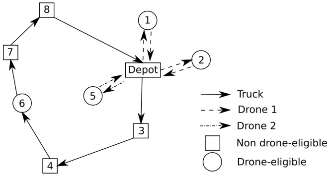

# Ants can solve the parallel drone scheduling traveling salesman problem

Quoc Trung Dinh∗ ORLab, Faculty of Computer Science, Phenikaa University Ha Dong, Hanoi, Vietnam

Duc Dong Do† Faculty of Information Technology, VNU University of Engineering and Technlology Cau Giay, Hanoi, Vietnam dongdoduc@vnu.edu.vn

Minh Hoàng Hà‡ ORLab, Faculty of Computer Science, Phenikaa University Ha Dong, Hanoi, Vietnam hoang.haminh@phenikaa-uni.edu.vn

## ABSTRACT

In this work, we are interested in studying the parallel drone scheduling traveling salesman problem (PDSTSP), where deliveries are split between a truck and a fleet of drones. The truck performs a common delivery tour, while the drones are forced to perform back and forth trips between customers and a depot. The objective is to minimize the completion time coming back to the depot of all the vehicles. We present a hybrid ant colony optimization (HACO) metaheuristic to solve the problem. Our algorithm is based on an idea from the literature that represents a PDSTSP solution as a permutation of all customers. And then a dynamic programming is used to decompose the customer sequence into a tour for the truck and trips for the drones. We propose a new dynamic programming combined with other problem-tailored components to efficiently solve the problem. When being tested on benchmark instances from the literature, the HACO algorithm outperforms state-of-the-art algorithms in terms of both running time and solution quality. More remarkably, we find 23 new best known solutions out of 90 instances considered.

## KEYWORDS

Parallel drone scheduling, traveling salesman problem, ant colony optimization, dynamic programming.

## ACM Reference Format:

Quoc Trung Dinh, Duc Dong Do, and Minh Hoàng Hà. 2021. Ants can solve the parallel drone scheduling traveling salesman problem. In Proceedings of the Genetic and Evolutionary Computation Conference 2021 (GECCO ’21). ACM, New York, NY, USA, 8 pages. [https://doi.org/10.1145/3449639.3459342](https://doi.org/10.1145/3449639.3459342)

## 1 INTRODUCTION

Nowadays, as technology for aerial mobility evolves, delivery means are naturally destined to make use of unmanned aerial vehicles (UAVs or drones), and multiple companies such as Amazon [1], UPS

∗The first author †The first corresponding author. ‡The second corresponding author.

[5], DHL [2], 7-Eleven [4] and Alibaba [3] have already had plans for this transition in the near future. Using drones for delivery provides four advantages: (1) they can be operated automatically without a human driver, (2) they fly over common road networks and as a result can service truck-unreachable customers, (3) their speed is faster than trucks’ speed, and (4) they are much cheaper. Yet, drones also have several disadvantages, due to their narrow operation range, small capacity, and possible need of visiting stations for charging or swapping batteries. To offset the drawbacks of both vehicles, they are coupled together to make delivery, leading to novel routing problems that attract much attention of the research community. Two leading notable problems are introduced in [20]. The first problem called the Flying Sidekick Traveling Salesman Problem (FSTSP) arises in scenarios in which the depot is relatively far from the customers and a single drone can operate in synchronization with a delivery truck. More precisely, the drone can be launched from the truck at a customer location and returns to the truck at another customer location. The second problem is motivated in the event that a large proportion of customers are located within a drone’s flight range from the depot and can be serviced by a fleet of drones. A truck is also mobilized to service droneunreachable customers which are far from the depot or require heavy parcels. In this paper, we consider the latter problem, the Parallel Drone Scheduling Traveling Salesman Problem (PDSTSP), which can be formally defined as follows.

We are given a complete undirected graph $G   =   \left( V , E \right)$ , where the node set $V = \left\{ 0 , 1 , \ldots , n \right\}$ represents the depot (node 0) and the set of customers ${ \overline { { V } } } = \{ 1 , \ldots , n \}$ . The set 𝐸 represents edges linking every pair of nodes in 𝑉 . A truck and a set 𝑀 of 𝑚 identical drones are located at the depot to deliver parcels to the customers. The truck starts from the depot, services a subset of the customers, then returns back to the depot. The remaining customers are serviced by the drones on back and forth trips from the depot to a single customer. Not every customer can be serviced by the drones due to practical constraints like the weight of the parcel or an excessive distance of the customer location from the depot. Let $V ^ { * } \subseteq { \overline { { V } } }$ denotes the set of customers that can be serviced by the drones (also called drone-eligible customers). The travel time from node 𝑖 to node 𝑗 of the truck is denoted as $c _ { i j } ^ { t }$ . The time required by a drone to service a customer 𝑖 is denoted as $c _ { i } ^ { d } ,$ which is calculated by doubling the time of flying from the depot to customer 𝑖. Without loss of generality, we suppose that the truck and the drones start from the depot at time 0. The objective of the PDSTSP is to minimize the maximal time required to come back to the depot of the truck and all the drones after servicing all the customers.

The PDSTSP includes two decision layers. In the first layer, the customers are assigned to the truck and the fleet of drones. The second layer relates to the routing optimization which consist in solving two NP-hard problems: a TSP for the truck and a Parallel Machine Scheduling (PMS) problem for the drones. Figure 1 shows a feasible solution for the PDSTSP with 8 customers and two drones.

Figure 1: An example of a solution for the PDSTSP

## 2 RELATED WORKS

While the FSTSP and its variants are intensively studied in the literature (see, for example, [7, 9, 11, 16, 17, 21]), there are very few papers considering the PDSTSP. The problem is first introduced in [20] where the authors propose a Mixed Integer Linear Programming (MILP) formulation and a heuristic. The MILP can provide exact solutions but is time-consuming and not applicable for instances of practical size. The main principle of the heuristic is to partition the set of customers into two subsets (a vehicle set and a drone set). Then, a TSP tour is computed for the customers assigned to the truck and a parallel machine scheduling (PMS) problem is solved to assign customer requests (jobs) to drones (machines). At the end, an improvement step is performed to reassign customers either to the drone set or to the vehicle set in order to better balance vehicle and drones activities. Their method can be classified into low-level heuristics which include a solution construction followed by local search. Due to the simplicity, this deterministic algorithm provides only one solution during the search and is not expected to provide high-quality solutions as metaheuristics.

Mbiadou Saleu et al. [22] propose the first metaheuristic composed of two steps. The first step (or coding step) transforms a feasible PDSTSP solution into a customer sequence 𝑇 , also called giant tour or TSP tour. The second step (or decoding step) decomposes the customer sequence into a tour $T _ { t }$ for the truck and a set of trips $T _ { d }$ for the drones. This decomposition must satisfy the requirements that the customers in the truck tour follows the same order as in sequence $T$ and the customers that are not on the tour $T _ { t }$ will be serviced by the drones. The decoding procedure is expressed as a bicriteria shortest path problem on a acyclic graph $\dot { G ^ { T } = ( V ^ { T } , A ^ { T } ) }$ constructed as follows. $V ^ { T } = \overline { { V } } \cup \{ 0 , n + 1 \}$ represents the set of customers added by two copies of the depot: the original depot 0 and its copy $n + 1 .$ . Given two nodes 𝑖 and 𝑗 in $V ^ { T }$ such that 𝑖 is before 𝑗 in the sequence $T ,$ arc $i , j$ exists in $A ^ { T }$ if and only if all the customers between 𝑖 and 𝑗 can be serviced by the drones. Each arc $( i , j ) \in A ^ { T }$ is associated with a cost vector $( \dot { c } _ { i j } ^ { 1 } , c _ { i j } ^ { 2 } )$ , where $c _ { i j } ^ { 1 }$ and $c _ { i j } ^ { 2 }$ represent the costs incurred for the truck and the drones, respectively, if the truck travels directly from 𝑖 to $j$ and all the customers between 𝑖 and 𝑗 are serviced by the drones: $c _ { i j } ^ { 1 } = c _ { i j } ^ { t }$ and $\begin{array} { r } { c _ { i j } ^ { 2 } = \mathbb { 1 } / m \sum _ { k \in V ^ { T } : i < _ { T } k < _ { T } j } c _ { k } ^ { d } . } \end{array}$

After the acyclic graph is created, the shortest path from the original depot 0 to its copy 𝑛 + 1 is found by dynamic programming. The principle is to progressively associate a list of labels $\mathcal { L } ( i )$ with each node $i \in V ^ { T }$ . A procedure goes through the graph from the origin depot node 0 to the destination depot node $n   +   1$ by following the order defined in sequence 𝑇 . For a given node 𝑖, list $\mathcal { L } ( i )$ is constructed by adding a new label for every label in $\mathcal { L } ( j )$ , where 𝑗 is a predecessor node of 𝑖 and $\mathcal { L } ( j )$ is the list of labels at node $j .$ The new label is simply defined by adding the arc cost. To limit the number of possibly generated labels, several bounding mechanisms and a dominance rule are used. However, the procedure still can be very slow and memory-consuming because these techniques cannot help completely avoid creating uncontrollable quantities of labels on large-scale instances.

More recently, Dell’Amico et al. [10] propose a matheuristic in which the authors use the same idea of coding and decoding steps as in [22]. However, instead of dynamic programming, a MILP approach is used to handle the decoding phase. For a given TSP tour $T ,$ the authors add constraints that enforce binary variables $x _ { i ^ { \prime } j ^ { \prime } }$ equal to zero to a pure MILP formulation of the problem. Here, $i ^ { \prime }$ and $j ^ { \prime }$ are two customers such that $i ^ { \prime }$ lies after $j ^ { \prime }$ in the TSP tour 𝑇 and variables 𝑥𝑖′𝑗′ represent the appearance of arc $( i ^ { \prime } , j ^ { \prime } )$ in the solution. Solving this modified formulation provides optimal solutions (w.r.t the order of the customers in𝑇 ) for the splitting approach and allows the procedure to exploit a wider search space than the dynamic programming-based approach. However, the computational time required to solve MILP models might be very expensive. For this reason, when attacking large instances, the authors add further constraints to the MILP model. In this way the time required to solve the MILP is reduced, making it possible to carry out more iterations of the heuristic in a given time limit. The drawback is that the constraints reduce the search space region explored by the MILP, potentially increasing the number of iterations required to converge.

In this research, we aim at developing a new metaheuristic for the problem. Our algorithm is mainly based on Ant Colony Optimization (ACO) algorithm, a metaheuristic technique that uses artificial ants to solve combinatorial optimization problems which can be reduced to finding good paths through graphs. ACO is a class of optimization algorithms based on the actions of an ant colony. The interested readers are referred to [12] for the detailed descriptions of ant behavior relating to ACO.

The use of ant colonies is first applied to the Traveling Salesman Problem (TSP) in [13] and several variants of the Vehicle Routing Problem (VRP) in [6, 8]. To the best of our knowledge, the ACO algorithm has never been applied to solve the PDSTSP.

The main contribution of our research is to design a hybrid ant colony optimization (HACO) algorithm integrated with several components adapted from other metaheuristics. We follow the idea of representing a PDSTSP solution as a giant tour of the previous researches. We propose an easy-to-implement and more efficient split procedure from which we can better control the trade-off be tween quality and speed, a deconstruction phase borrowed from the idea of the large neighborhood search, and fast local searches. The experiments on PDSTSP benchmark instances show a dominance of our algorithm over the two algorithms in terms of solution quality and speed. The rest of the paper is organized as follows. Section 3 describes our metaheuristic. Section 4 analyzes the performance of the HACO on the PDSTSP benchmark data sets. Finally, our conclusions are given in the Section 5.

## 3 HYBRID ANT COLONY OPTIMIZATION ALGORITHM FOR THE PDSTSP

One of the most important factors to consider when designing ACO algorithms is to define pheromone trails. As mentioned earlier, the PDSTSP involves two main decision layers: the assignment of customers to the truck or the drone and the sequence of customers in the truck tour. Therefore, we manage two corresponding pheromone trails to handle these decisions: $\mu _ { i } ^ { a }$ to decide if customer 𝑖 is assigned to truck or drone and $\mu _ { i j } ^ { s }$ to find the next customer 𝑗 to service from the customer 𝑖 in the truck tour. Our algorithm includes three main components: solution construction, local search, and pheromone trail update. The overview of our method is presented in Algorithm 1. We now discuss these procedures in detail.

Algorithm 1 An overview of the HACO algorithm
$f(S_{best}) \leftarrow +\infty$
Initialize pheromone values
while the stopping condition is not met do
    $f(S_{local}) \leftarrow +\infty$
    for $k = 1$ to $nb_{ant}$ do
        $S \leftarrow$ SolutionConstruction()
        $S \leftarrow$ LocalSearch($S$)
        if $f(S) &lt; f(S_{local})$ then
            $S_{local} \leftarrow S$
        end if
    end for
    Update pheromone values using $S_{local}$
    if $f(S_{local}) &lt; f(S_{best})$ then
        $S_{best} \leftarrow S_{local}$
    end if
end while

## 3.1 Ants construct PDSTSP solutions

We now explain SolutionConstruction(), the first procedure called in Algorithm 1, which constructs initial solutions. The pseudo-code of the procedure is given in Algorithm 2. Its main components are described as followed:

SelectDroneNode: the goal is to partially select a subset of customers serviced by the drones. We iterate over all the drone-eligible customers; each is selected with the probability of $r _ { d } .$ Suppose after this step we have a set of $n _ { p }$ selected customers. Among those we then select min $( n _ { p } , \lfloor r _ { d } ^ { \prime }   \times   \bar { n _ { d } } \rfloor )$ customers 𝑖 with highest pheromone values $\mu _ { i } ^ { a } .$ Here, $n _ { d }$ is the number of customers serviced by the drones in the current best found solution. It is set to null in the first iteration where a best solution has not existed. The parameter $r _ { d } ^ { \prime }$ is the ratio of customers to be retained to be serviced by the drones in the current iteration. Preliminary tests show that the impact of $\boldsymbol { ! } r _ { d } ^ { \prime }$ on the performance of the algorithm is not really clear. Therefore, to keep the parameter tuning simple, we decide to set $r _ { d } ^ { \prime }$ to 0.5. These customers are recorded in set $N _ { d } .$ They are combined with the customers visited by the drones found in the split procedure below to create the final set of customers serviced by the drones in the solution of the current iteration. These customers are then assigned to the drones by a greedy heuristic presented in the split procedure. This drone node selection brings us two advantages. First, it can be considered as a removal operator in the classical Large Neighborhood Search (LNS) metaheuristic [23] and allows the algorithm to flexibly control the balance between the intensification and diversification. Second, it helps to reduce the number of customers considered in the next procedures which are more expensive in terms of computation time, thus speeding up our algorithm in overall.

Algorithm 2 Solution construction procedure

procedure SolutionConstruction
    $N_d \leftarrow \text{SelectDroneNode}(n_d) \triangleright \text{Select a set of customers to be serviced by the drones}$
    $T \leftarrow \text{AntTSPTour}(N_t) \quad \triangleright N_t = V \setminus N_d$
    $T \leftarrow \text{ImproveTSP}(T)$
    $S \leftarrow \text{Split}(T)$
    return $S$
end procedure

AntTSPTour: this procedure is to build a giant TSP tour 𝑇 visiting the depot and all the remaining customers other than those in $N _ { d } .$ For that matter, we apply a randomized nearest-neighbor construction procedure using the roulette wheel selection with the probability of selecting the next customer 𝑗 to visit from the customer 𝑖 proportional with $\frac { \mu _ { i j } ^ { s } } { c _ { i j } ^ { t } { + } 1 }$ . Note that, $\mu _ { i j } ^ { s }$ and $\frac { 1 } { c _ { i j } ^ { t } { + } 1 }$ represent the pheromone trail and heuristic information, respectively. This means that if the pheromone trail on edge $( i , j )$ is more concentrated and 𝑗 is closer to 𝑖, customer 𝑗 has more chance to be the next location visited after customer 𝑖.

ImproveTSP: in this procedure, the truck route 𝑇 obtained from the AntTSPTour procedure is then improved using the well-known 3-opt local search move [18]. We note that this local search is widely used in ACO algorithms to successfully solve the TSP [19, 24].

Split: this procedure is the backbone of our algorithm. It computes the best partition of the customer set between the truck and the unique drone with the constraint that the customers in the vehicle tour follows the same order as in TSP tour 𝑇 . Similarly to [22], this problem is modeled as a shortest path problem in an acyclic directed graph $G ^ { T }$ and is solved by dynamic programming.

Our split procedure is described in Algorithm 3. Node 𝑖 ∈ 𝐻 is associated with 𝑛𝑏𝑙 +1 labels; each has the form $\mathcal { L } ( i , p )$ representing the cost incurred by the truck given that the cost incurred by the drones is approximately less than or equal to $\frac { p } { n b _ { l } }$ of the objective value of the current best solution, where 𝑝 is an integer ranging from

0 to $n b _ { l } .$ . At the initialization, $\mathcal { L } ( i , p )$ is set to +∞ for every node 𝑖 and every value of $\bar { p }$ (Line 4). The procedure starts by assigning label $\mathcal { L } ( 0 , 0 )$ to 0 (Line 7). It then goes through the graph from the origin depot node 0 to the destination depot node $n + 1$ and all the values of 𝑝 from 0 to 𝑛𝑏𝑙. From a given node 𝑖 and for a given value $p ,$ the labels at 𝑗 are updated by formulas in lines 12-14. Here, $c _ { i j } ^ { 1 }$ and $c _ { i j } ^ { 2 }$ have the same meanings as in the split algorithm of [22] described above, and $f ( S _ { b e s t } )$ is the objective value of the current best solution.

In Line 20, we have a set of $n b _ { l } + 1$ labels; from each of them we derive a truck path $\tau _ { t }$ and a set of customers serviced by the drones $\overline { { N _ { d } } } .$ The well-known longest processing time heuristic [22] is applied on the $\overline { { N _ { d } } }$ to provide a feasible PMS solution (procedure GreedyHeuristic in Line 26). As such, the customers are sorted in the decreasing order of their processing time. Then, they are successively assigned to the drone with the least flying time.

It is worth mentioning that when 𝑛𝑏𝑙 is set to infinity, our split is similar to the procedure proposed in [22]. The value of $n b _ { l }$ has an important impact on the performance of our algorithm. If 𝑛𝑏𝑙 is too large, the dynamic programming could explore more labels, leading to high running time but we would have higher chance to find better solutions. On the other hand, when $n b _ { l }$ is small, the performance of the split could decrease, but its computation time would be faster and we could perform more iterations of the algorithm. Therefore, to have the best performance of the overall algorithm, the value of $n b _ { l }$ should be selected such that it gives a good trade-off between the speed and the quality of the split procedure. A preliminary experiment shows that $n b _ { l }$ equal to 100 satisfies our objective. This value is selected in our work.

## 3.2 Local search operators

Previous researches show that the integration of local search in ACO algorithms improves their performance in overall when applied to solve vehicle routing problems (see, for example, [6, 8]). Moreover, in the solution construction above, a customer is assigned to each drone in the greedy fashion. So far, our algorithm has not had any mechanism to repair bad drone-customer assignments created by the simple greedy heuristic. Therefore, we decide to use two local search operators to improve the quality of the algorithm, as well as to handle the decision related to the assignment of the customers to each drone as follows:

• SwapTruck-Drone: This operator tries to swap a customer serviced by the truck and a customer serviced by the drone to search for a better solution.

• SwapDrone-Drone: This operator swaps two customers serviced by two different drones to find an improved solution.

Our local search operators are performed in the best improvement fashion. Verifying if a move creates a saving in the objective function can be done in $O ( m )$ , where 𝑚 is the number of drones. This procedure is fast and its running time can be negligible if the amount of drones is small. However, when the number of drones is large enough, computing the change in the objective function value in $O ( 1 )$ is necessary to reduce the running time of the overall algorithm. For this purpose, it is sufficient to use an additional data structure that records three drones with the longest, second longest, and third longest flying time. Note that we must record three drones, instead of one, to handle the cases where there are more than two drones with the equal longest flying times.

Algorithm 3 Split procedure
procedure Split
    for $i = 0$ to $n$ do
        for $p = 0$ to $nb_l$ do
            $\mathcal{L}(i, p) \leftarrow +\infty$
        end for
    end for
    $\mathcal{L}(0, 0) \leftarrow 0$
    for $i = 0$ to $|T| - 1$ do
        for $p = 0$ to $nb_l$ do
            for $j = i + 1$ to $|T|$ do
                if arc $(i, j) \in G^T$ then
                    $p' = p + \lfloor 0.5 + \frac{nb_l \times c_{ij}^2}{f(S_{best})} \rfloor$
                    if $\mathcal{L}(j, p') &gt; \mathcal{L}(i, p) + c_{ij}^1$ then
                        $\mathcal{L}(j, p') = \mathcal{L}(i, p) + c_{ij}^1$
                    end if
                end if
            end for
        end for
    end for
    $\mathcal{L}* \leftarrow \text{labels } \mathcal{L}(|T|, p) \forall p = 0, .., nb_l$
    $f(S) \leftarrow +\infty$
    for each label $l$ in $\mathcal{L}*$ do
        $\tau_t \leftarrow \text{truck path that led to label } l$
        $time_t \leftarrow \text{length of } \tau_t$
        $\overline{N_d} \leftarrow \text{all nodes that are not in the path}$
        $\tau_d \leftarrow \text{GreedyHeuristic}(\overline{N_d})$
        $time_d \leftarrow \text{time coming back to the depot of the latest drone in } \tau_d$
        if $f(S) &gt; \max(time_t, time_d)$ then
            $S \leftarrow \text{solution corresponds with } \tau_t \text{ and } \tau_d$
            $f(S) \leftarrow \max(time_t, time_d)$
        end if
    end for
    return $S$ and $f(S)$
end procedure

## 3.3 Pheromone trail update

Pheromone trail update (line 12 of Algorithm 1) is a crucial step in ant colony optimization as it guides ants to find good solutions. We use the Smooth Max-Min Ant System method proposed in [14, 15], a refined version of the well-known pheromone boundary rule [25], to update the pheromone trails as follows:

$$
\mu_ {i} ^ {a} = \left\{ \begin{array}{l} \rho^ {a} \mu_ {i} ^ {a} + (1 - \rho^ {a}) \mu_ {\text {min}} \text {if customer i is serviced by the truck} \\ \rho^ {a} \mu_ {i} ^ {a} + (1 - \rho^ {a}) \mu_ {\text {max}} \text {if customer i is serviced by the drones} \end{array} \right.
$$

$$
\mu_ {i j} ^ {s} = \left\{ \begin{array}{l} \rho^ {s} \mu_ {i j} ^ {s} + (1 - \rho^ {s}) \mu_ {m a x} \text {if truck travels from i to j} \\ \rho^ {s} \mu_ {i j} ^ {s} + (1 - \rho^ {s}) \mu_ {m i n} \text {otherwise} \end{array} \right.
$$

where $\rho ^ { l }   \in   ( 0 , 1 ] ( l \in \{ a , s \} )$ is the evaporation parameter; $\mu _ { m i n }$ and $\mu _ { m a x }$ are the lower and upper bounds of the pheromone trails, respectively. The value of these parameters is set as in Table 1. As can be derived from these formula, the greater the trail $\mu _ { i } ^ { a }$ of a customer 𝑖 is, the higher probability it is serviced by the drones with. And if the trail $\mu _ { i j } ^ { s }$ of an arc from customer 𝑖 to customer 𝑗 is larger, this arc has more chance to appear in the next solution.

## 4 EXPERIMENTS

Our algorithm is implemented in C++. All experiments are carried out on a 2.10GHz Intel E5-2683 v4. In this section, we mainly investigate the performance of our HACO by comparing with reference algorithms proposed in [10, 22], which are run on an Intel core(TM) i5-6200U CPU at 2.30Ghz and an Intel(R) Xeon(R) E5-2620 v4 at 2.10GHz processors. These machines have single-thread rating performance approximately similar to our processor according to Passmark Software ( [https://www.cpubenchmark.net/](https://www.cpubenchmark.net/)). Since different CPU speed conversion techniques can provide very different results, we decided to present the raw running times, letting the readers choose their preferred approach.

The PDSTSP instances considered in our experiment have been generated from classic TSPLIB instances by [22]. The number in each instance name corresponds to the number of customers, varying from 48 to 229. Euclidean distances are used for the drones while Manhattan distances are used for the truck. For each original TSP instance, several PDSTSP were generated by modifying the following settings: (i) the depot location, which is either in the center of the customers or in one corner of the customers’ region; (ii) the percentage of drone-eligible customers, ranging from 0% to 100%; (iii) the speed of the drones, which is expressed as a factor of the truck speed, with values ranging from 1 to 5; (iv) the number of drones, that is from 1 to 5.

The six parameters required to be tuned in our HACO algorithm are: the lower bound $\mu _ { m i n }$ and the upper bound 𝜇𝑚𝑎𝑥 of the pheromone trails, the evaporation parameters $\rho ^ { a }$ and $\rho ^ { s }$ , the number of ants $n b _ { a n t } ,$ and the ratio of customers being kept to be serviced by the drones at the beginning of the solution construction phase $r _ { d } .$ The upper bound 𝜇𝑚𝑎𝑥 is always set to 1.0 and the lower bound $\mu _ { m i n }$ is set to $\frac { \mu _ { m a x } } { r _ { p } { \times } n }$ , where $r _ { p }$ is a given ratio taking the values in $\{ 0 . 1 , 0 . 5 , 1 . 0 , 2 . \dot { 0 } , 3 . 0 , 5 . 0 \}$ . The parameters $\rho ^ { a }$ and $\rho ^ { s }$ are set to one of five values {0.70, 0.80, 0.85, 0.90, 0.95}. The number of ants $n b _ { a n t }$ depends on the number of nodes 𝑛 in the graph and is computed as $n \boldsymbol { b } _ { a n t } = \boldsymbol { r } _ { a } \times \boldsymbol { n }$ . There are three values for the ratio $r _ { a } ; 0 . 5 ,$ 1.0, and 2.0. And finally, the ratio of selecting the customers to be serviced by the drones $r _ { d }$ is set to one of three values {0.3, 0.5, 0.7}. Table 1 summarizes the possible values for our parameters:

This results 900 combinations of parameters $\{ r _ { p } , \rho ^ { a } , \rho ^ { s } , r _ { a } , r _ { d } \}$ for the test. The training set is picked from 15 largest instances of the benchmark with 229 nodes. For each combination of the settings, the algorithm is run 10 times per instance. As shown in the following experiments, our algorithm in general provides good results in the running time of less than 200 seconds on each instance. However, because each PDSTSP instance is solved in a time limit of 300 seconds (by the algorithm of [22]) and 1,200 seconds (by the best algorithm version of [10] in term of solution quality), we decide to limit our algorithm in 300 seconds for each execution for a fair comparison. Thus, we have totally solved 900 × $1 5 \times 1 0 \; = \; 1 3 5 , 0 0 0$ problems in the experiment. Two following quantitative measures are used to compare the combinations: the average relative gap to the best solutions found and the number of times that a setting generates the best solution. The obtained results show that the average gaps among settings are not significantly different. Therefore, we select the best setting based on the number of times it provides the best solutions. Using this technique, we adopt the following parameter settings: $\{ r _ { \bar { p } } = 2 . 0 , \rho ^ { a } = 0 . 9 5 , \rho ^ { s } =$ $0 . 8 0 , r _ { a } = 1 . 0 , r _ { d } = 0 . 5 \}$

| Parameter | Value | Note |
| --- | --- | --- |
| 𝜇𝑚𝑎𝑥 | 1.0 | the upper bound ofthe pheromone trails |
| 𝑟𝑝 | 0.1, 0.5, 1.0, 2.0, 3.0, 5.0 | the ratio to compute the lower bound of the pheromone trails 𝜇𝑚𝑖𝑛 |
| 𝑎𝜌 | 0.70, 0.80, 0.85, 0.90, 0.95 | the evaporation parameter to handle the decision related to the drone-truck assignment |
| 𝑠𝜌 | 0.70, 0.80, 0.85, 0.90, 0.95 | the evaporation parameter to handle the sequence decision in the truck tour |
| 𝑟𝑎 | 0.5, 1.0, 2.0 | the ratio to define the number ofants 𝑛𝑏𝑎𝑛𝑡 |
| 𝑟𝑑 | 0.3, 0.5, 0.7 | the probability to select a part ofcustomers serviced by the drones at the beginning ofthe construction solution phase |

Table 1: Values used for the parameter tuning

Using the parameter setting above, we compare our algorithm with two state-of-the-art metaheuristics recently proposed in [10, 22]. In the following, we call these two algorithms as SDFGQ18 and DMN20 using the initial letters of authors’ last names, respectively. We note that these algorithms were run once and only one solution was reported for each instance. To better observe the behavior of the HACO, we run our algorithm 10 times; each in 300 seconds for a fair comparison with the two reference algorithms. For each instance, four solutions of HACO are recorded for the comparison: the solution of the first run (corresponding to the single run of the algorithm), the best solution, the worst solution, and the average solution over 10 runs. The results are summarized in Table 2 and the detailed results can be found in the Appendix.

<table><tbody><tr><td rowspan="2">Data</td><td rowspan="2">SDFGQ18</td><td rowspan="2">DMN20</td><td colspan="6">HACO</td></tr><tr><td>𝑧1</td><td>𝑧𝑏𝑒𝑠𝑡</td><td>𝑧𝑤𝑜𝑟𝑠𝑡</td><td>𝑧</td><td>𝑡</td><td>#𝐵𝐾𝑆</td></tr><tr><td>att48</td><td>0.00</td><td>0.00</td><td>0.00</td><td>0.00</td><td>0.00</td><td>0.00</td><td>0.06</td><td>0</td></tr><tr><td>berlin52</td><td>0.17</td><td>0.00</td><td>0.00</td><td>0.00</td><td>0.00</td><td>0.00</td><td>2.35</td><td>0</td></tr><tr><td>eil101</td><td>1.44</td><td>0.05</td><td>0.01</td><td>0.00</td><td>0.28</td><td>0.19</td><td>27.51</td><td>1</td></tr><tr><td>gr120</td><td>1.67</td><td>3.85</td><td>1.58</td><td>0.00</td><td>2.45</td><td>0.88</td><td>61.75</td><td>7</td></tr><tr><td>pr152</td><td>2.41</td><td>0.87</td><td>0.40</td><td>0.00</td><td>2.19</td><td>0.87</td><td>40.48</td><td>4</td></tr><tr><td>gr229</td><td>8.89</td><td>3.56</td><td>0.99</td><td>0.05</td><td>1.65</td><td>0.97</td><td>168.63</td><td>11</td></tr></tbody></table>

Table 2: Comparison of HACO with existing algorithms on the benchmark instances

In the table above, the first column shows the name of the instance class. The next two columns represent the total gaps of the solutions provided by SDFGQ18 and DMN20 to the best found solutions (including ones found in this paper) on each class of instances. For the HACO algorithm, we report the gaps for the first, best, worst, and average solutions over 10 executions in Columns 𝑧1, 𝑧𝑏𝑒𝑠𝑡, 𝑧𝑤𝑜𝑟𝑠𝑡, and 𝑧 respectively. The column 𝑡 presents the average running time to reach the best solutions of the algorithm. And finally, the column $\# _ { B K S }$ reports the number of new best known solutions found by the HACO.

As can be seen in the table, the results clearly show a competitive performance of our method. The total gaps provided by our first and best solutions are at least as good as those of the other methods on all instance classes. Remarkably, we improve 23 best known solutions in total. The values in the column 𝑧 are quite small (never exceeding 1%), leading to small fluctuations of the solutions over 10 executions from the best solutions. This is an indicator showing the stability of our algorithm. The worst solutions even outperform the best solutions of the other methods in many cases. In particular, they provide better total gaps than both methods SDFGQ18 and DMN20 on the largest instances with 229 customers. The running time of the algorithm is fixed to 300 seconds but it spends only 168.63 seconds on average to reach the best solutions on the largest instances. An interesting observation is that the running time to reach the best solutions on the instances pr152 is shorter than that on the instances gr120, which have smaller size. And in addition, we can improve more best known solutions on gr120 instances than on pr152 instances (7 vs 4). A further analysis is performed and it turns out that the customers in the pr152 instances distribute in clusters, possibly making the instances easier to solve.

Since the comparisons mostly conducted on average values of aggregated gaps of solutions may not be quite comprehensive, it may not clear which algorithm has the best performance. We now carry out the Kruskal–Wallis one-way analysis of variance by ranks as a non-parametric method over the obtained outcomes in terms of gaps to the best known solutions of the algorithms. The objective is to check whether the differences observed between our employed algorithm and those in the literature are statistically significant. The null hypothesis of the Kruskal–Wallis test is that the mean ranks of the groups are the same or the population medians are equal, while the alternative hypothesis is that the population medians are not all equal. In such ranking system, the smallest value is assigned to the first rank, the next smallest possesses the second rank, etc.

| Data | SDFGQ18 | DMN20 | 𝑧1-HACO | Chi-Square | df | Asymp. Sig. |
| --- | --- | --- | --- | --- | --- | --- |
| att48 | 23 | 23 | 23 | 0 | 2 | 1.000 |
| berlin52 | 24 | 22.5 | 22.5 | 0.130 | 2 | 0.937 |
| eil101 | 27.97 | 21.23 | 19.80 | 3.307 | 2 | 0.191 |
| gr120 | 22.13 | 27.40 | 19.47 | 2.834 | 2 | 0.242 |
| pr152 | 28.53 | 21.73 | 18.73 | 4.385 | 2 | 0.112 |
| gr229 | 32.93 | 22.23 | 13.83 | 15.938 | 2 | 0.000 |

Table 3: The mean ranks of groups and test statistics in Kruskal–Wallis test

For the fair comparison, the solutions obtained from the first run of HACO are selected in this experiment. In Table 3, columns SDFGQ18, DMN20, and $z_{1} -HACCO$ represent the mean ranks of the three methods. Three last columns report the test statistics: Chi-Square, degree of freedom (df), and p-value (labeled Asymp. Sig.). As illustrated in Table 3, our proposed HACO outperforms the others. It possesses the first rank and shows a better performance on four instance classes: eil101, gr120, pr152, and gr229. In this calculation, DMN20 has the second best outcome except on instance class gr120 where SDFGQ18 performs better. However, only on the instance class gr229 with the largest size, the p-value is less than the significance level (0.000 < 0.05) leading to the rejection of the null hypothesis. This consequence implies that there is statistically significant difference between performances of considered algorithms in this test. This can be explained by the fact that on the smaller-size instances, which are in general easier, the algorithms provide good solutions of almost the same quality. And as a result, the performance difference of our algorithm is observed more clearly on larger instances.

## 5 CONCLUSION

In this paper, we propose a hybrid ant colony optimization algorithm to solve the Parallel Drone Scheduling Traveling Salesman Problem, which recently receives the attention of the research community. Our algorithm combines the ideas of ant colony optimization, large neighborhood search, and local search-based metaheuristics. A new dynamic programming is proposed to split the TSP tour into a feasible PDSTSP solution in a fast and efficient way. The experiments on the benchmark instances show that our algorithm outperforms existing approaches in terms of both computation time and solution quality to become the state-of-the-art method proposed for the problem. In particular, 23 improved best known solutions have been found by our algorithm.

Our future work consists in embedding our new split procedure in the framework of other nature-inspired metaheuristics (e.g., genetic algorithm) to develop more complex algorithms and compare them with the proposed HACO. Further research effort will be devoted to adapt our HACO algorithm to solve other routing variants with drones such as the FSTSP.

## APPENDIX

In the following tables, we report the detailed results for the benchmark data from [22]. In each table, the first block shows the instance settings with the information: the percentage of drone-eligible customers over the total (el), the drone speed (sp), the number of drones (#), and the depot location (dp). The second block reports the best solutions found by the two existing metaheuristics. The last block presents the objective values of solutions provided by the HACO: the solutions in the single run mode (column $z _ { 1 } ) ,$ the best solutions (column $\begin{array} { r } { z _ { b e s t } ) , } \end{array}$ the worst solutions (column $z _ { w o r s t } ) ,$ , the average solutions (column 𝑧), the average time (𝑡) and the average iterations (𝑖𝑡𝑒𝑟) over 10 runs when the best solutions are found. The last row computes, for each instance class, the total gaps in percentage of the solutions generated by different methods to the best found solutions. The numbers in bold represent our improved best known solutions.

<table><tr><td colspan="4">Instance settings</td><td rowspan="2">SDFGQ18</td><td rowspan="2">DMN20</td><td colspan="6">HACO</td></tr><tr><td>el</td><td>sp</td><td>#</td><td>dp</td><td> $z_1$ </td><td> $z_{best}$ </td><td> $z_{worst}$ </td><td> $\overline{z}$ </td><td> $\overline{t}$ </td><td>iter</td></tr><tr><td>80</td><td>2</td><td>1</td><td>1</td><td>29954</td><td>29954</td><td>29954</td><td>29954</td><td>29954</td><td>29954</td><td>0.07</td><td>2.5</td></tr><tr><td>80</td><td>2</td><td>1</td><td>2</td><td>33798</td><td>33798</td><td>33798</td><td>33798</td><td>33798</td><td>33798</td><td>0.14</td><td>4.5</td></tr><tr><td>0</td><td>2</td><td>1</td><td>1</td><td>42136</td><td>42136</td><td>42136</td><td>42136</td><td>42136</td><td>42136</td><td>0.02</td><td>1</td></tr><tr><td>20</td><td>2</td><td>1</td><td>1</td><td>38662</td><td>38662</td><td>38662</td><td>38662</td><td>38662</td><td>38662</td><td>0.04</td><td>2.4</td></tr><tr><td>40</td><td>2</td><td>1</td><td>1</td><td>31592</td><td>31592</td><td>31592</td><td>31592</td><td>31592</td><td>31592</td><td>0.03</td><td>1.8</td></tr><tr><td>60</td><td>2</td><td>1</td><td>1</td><td>30788.8</td><td>30788.8</td><td>30788.8</td><td>30788.8</td><td>30788.8</td><td>30788.8</td><td>0.05</td><td>2.2</td></tr><tr><td>100</td><td>2</td><td>1</td><td>1</td><td>27784</td><td>27784</td><td>27784</td><td>27784</td><td>27784</td><td>27784</td><td>0.18</td><td>3.8</td></tr><tr><td>80</td><td>1</td><td>1</td><td>1</td><td>33234</td><td>33234</td><td>33234</td><td>33234</td><td>33234</td><td>33234</td><td>0.07</td><td>2.6</td></tr><tr><td>80</td><td>3</td><td>1</td><td>1</td><td>29142</td><td>29142</td><td>29142</td><td>29142</td><td>29142</td><td>29142</td><td>0.07</td><td>2.7</td></tr><tr><td>80</td><td>4</td><td>1</td><td>1</td><td>28686</td><td>28686</td><td>28686</td><td>28686</td><td>28686</td><td>28686</td><td>0.08</td><td>3</td></tr><tr><td>80</td><td>5</td><td>1</td><td>1</td><td>28610</td><td>28610</td><td>28610</td><td>28610</td><td>28610</td><td>28610</td><td>0.04</td><td>1.8</td></tr><tr><td>80</td><td>2</td><td>2</td><td>1</td><td>28686</td><td>28686</td><td>28686</td><td>28686</td><td>28686</td><td>28686</td><td>0.07</td><td>2.5</td></tr><tr><td>80</td><td>2</td><td>3</td><td>1</td><td>28610</td><td>28610</td><td>28610</td><td>28610</td><td>28610</td><td>28610</td><td>0.05</td><td>1.8</td></tr><tr><td>80</td><td>2</td><td>4</td><td>1</td><td>28610</td><td>28610</td><td>28610</td><td>28610</td><td>28610</td><td>28610</td><td>0.02</td><td>1</td></tr><tr><td>80</td><td>2</td><td>5</td><td>1</td><td>28610</td><td>28610</td><td>28610</td><td>28610</td><td>28610</td><td>28610</td><td>0.02</td><td>1</td></tr><tr><td colspan="4">Gap</td><td>0.0</td><td>0.0</td><td>0.0</td><td>0.0</td><td>0.0</td><td>0.0</td><td></td><td></td></tr></table>

Table 4: Results of the algorithms on the instance att48 from [22]

<table><tr><td colspan="4">Instance settings</td><td rowspan="2">SDFGQ18</td><td rowspan="2">DMN20</td><td colspan="6">HACO</td></tr><tr><td>el</td><td>sp</td><td>#</td><td>dp</td><td> $z_1$ </td><td> $z_{best}$ </td><td> $z_{worst}$ </td><td> $\overline{z}$ </td><td> $\overline{t}$ </td><td>iter</td></tr><tr><td>80</td><td>2</td><td>1</td><td>1</td><td>6386.48</td><td>6386.48</td><td>6386.48</td><td>6386.48</td><td>6386.48</td><td>6386.48</td><td>10.71</td><td>260.5</td></tr><tr><td>80</td><td>2</td><td>1</td><td>2</td><td>7830</td><td>7830</td><td>7830</td><td>7830</td><td>7830</td><td>7830</td><td>0.09</td><td>2.4</td></tr><tr><td>0</td><td>2</td><td>1</td><td>1</td><td>9675</td><td>9675</td><td>9675</td><td>9675</td><td>9675</td><td>9675</td><td>0.02</td><td>1.1</td></tr><tr><td>20</td><td>2</td><td>1</td><td>1</td><td>9350</td><td>9350</td><td>9350</td><td>9350</td><td>9350</td><td>9350</td><td>0.02</td><td>1</td></tr><tr><td>40</td><td>2</td><td>1</td><td>1</td><td>8300</td><td>8300</td><td>8300</td><td>8300</td><td>8300</td><td>8300</td><td>0.02</td><td>1</td></tr><tr><td>60</td><td>2</td><td>1</td><td>1</td><td>7410</td><td>7410</td><td>7410</td><td>7410</td><td>7410</td><td>7410</td><td>0.05</td><td>2.3</td></tr><tr><td>100</td><td>2</td><td>1</td><td>1</td><td>6192</td><td>6192</td><td>6192</td><td>6192</td><td>6192</td><td>6192</td><td>23.23</td><td>327.6</td></tr><tr><td>80</td><td>1</td><td>1</td><td>1</td><td>7450</td><td>7450</td><td>7450</td><td>7450</td><td>7450</td><td>7450</td><td>0.09</td><td>2.6</td></tr><tr><td>80</td><td>3</td><td>1</td><td>1</td><td>5656.56</td><td>5656.56</td><td>5656.56</td><td>5656.56</td><td>5656.56</td><td>5656.56</td><td>0.59</td><td>16</td></tr><tr><td>80</td><td>4</td><td>1</td><td>1</td><td>5290.65</td><td>5290.65</td><td>5290.65</td><td>5290.65</td><td>5290.65</td><td>5290.65</td><td>0.1</td><td>3.6</td></tr><tr><td>80</td><td>5</td><td>1</td><td>1</td><td>5190</td><td>5190</td><td>5190</td><td>5190</td><td>5190</td><td>5190</td><td>0.04</td><td>2</td></tr><tr><td>80</td><td>2</td><td>2</td><td>1</td><td>5299.81</td><td>5290.65</td><td>5290.68</td><td>5290.68</td><td>5290.68</td><td>5290.68</td><td>0.15</td><td>4.5</td></tr><tr><td>80</td><td>2</td><td>3</td><td>1</td><td>5190</td><td>5190</td><td>5190</td><td>5190</td><td>5190</td><td>5190</td><td>0.02</td><td>1</td></tr><tr><td>80</td><td>2</td><td>4</td><td>1</td><td>5190</td><td>5190</td><td>5190</td><td>5190</td><td>5190</td><td>5190</td><td>0.02</td><td>1</td></tr><tr><td>80</td><td>2</td><td>5</td><td>1</td><td>5190</td><td>5190</td><td>5190</td><td>5190</td><td>5190</td><td>5190</td><td>0.03</td><td>1</td></tr><tr><td colspan="4">Gap</td><td>0.17</td><td>0.0</td><td>0.0</td><td>0.0</td><td>0.0</td><td>0.0</td><td></td><td></td></tr></table>

Table 5: Results of the algorithms on the instance berlin52 from [22]

<table><tr><td colspan="4">Instance settings</td><td rowspan="2">SDFGQ18</td><td rowspan="2">DMN20</td><td colspan="6">HACO</td></tr><tr><td>el</td><td>sp</td><td>#</td><td>dp</td><td> $z_1$ </td><td> $z_{best}$ </td><td> $z_{worst}$ </td><td> $\overline{z}$ </td><td> $\overline{t}$ </td><td>iter</td></tr><tr><td>80</td><td>2</td><td>1</td><td>1</td><td>564</td><td>564</td><td>564</td><td>564</td><td>564</td><td>564</td><td>30.38</td><td>140</td></tr><tr><td>80</td><td>2</td><td>1</td><td>2</td><td>650</td><td>648.98</td><td>648.98</td><td>648.98</td><td>648.98</td><td>648.98</td><td>42.08</td><td>182.4</td></tr><tr><td>0</td><td>2</td><td>1</td><td>1</td><td>819</td><td>819</td><td>819</td><td>819</td><td>819</td><td>819</td><td>1.89</td><td>12.9</td></tr><tr><td>20</td><td>2</td><td>1</td><td>1</td><td>738</td><td>736</td><td>736</td><td>736</td><td>736</td><td>736</td><td>14.77</td><td>114.6</td></tr><tr><td>40</td><td>2</td><td>1</td><td>1</td><td>646</td><td>646</td><td>646</td><td>646</td><td>646</td><td>646</td><td>1.75</td><td>12.5</td></tr><tr><td>60</td><td>2</td><td>1</td><td>1</td><td>578</td><td>578</td><td>578</td><td>578</td><td>578</td><td>578</td><td>5.28</td><td>30.1</td></tr><tr><td>100</td><td>2</td><td>1</td><td>1</td><td>561.41</td><td>560</td><td>560</td><td>560</td><td>560</td><td>560</td><td>71.6</td><td>150.8</td></tr><tr><td>80</td><td>1</td><td>1</td><td>1</td><td>650</td><td>650</td><td>650</td><td>650</td><td>650</td><td>650</td><td>6.18</td><td>26.2</td></tr><tr><td>80</td><td>3</td><td>1</td><td>1</td><td>504</td><td>504</td><td>504</td><td>503.944</td><td>504.088</td><td>504.003</td><td>78.66</td><td>381.5</td></tr><tr><td>80</td><td>4</td><td>1</td><td>1</td><td>456</td><td>456</td><td>456</td><td>456</td><td>456</td><td>456</td><td>4.95</td><td>25.9</td></tr><tr><td>80</td><td>5</td><td>1</td><td>1</td><td>420.83</td><td>421</td><td>420.833</td><td>420.833</td><td>420.833</td><td>420.833</td><td>86</td><td>468.8</td></tr><tr><td>80</td><td>2</td><td>2</td><td>1</td><td>456</td><td>456</td><td>456</td><td>456</td><td>456</td><td>456</td><td>46.06</td><td>217.4</td></tr><tr><td>80</td><td>2</td><td>3</td><td>1</td><td>395</td><td>395</td><td>395</td><td>395</td><td>396</td><td>395.7</td><td>13.73</td><td>62</td></tr><tr><td>80</td><td>2</td><td>4</td><td>1</td><td>346.68</td><td>346</td><td>346</td><td>346</td><td>346</td><td>346</td><td>5.38</td><td>23.7</td></tr><tr><td>80</td><td>2</td><td>5</td><td>1</td><td>319.74</td><td>318</td><td>318</td><td>318</td><td>318</td><td>318</td><td>3.95</td><td>17.2</td></tr><tr><td></td><td colspan="3">Gap</td><td>1.44</td><td>0.05</td><td>0.01</td><td>0.0</td><td>0.28</td><td>0.19</td><td></td><td></td></tr></table>

Table 6: Results of the algorithms on the instance eil101 from [22]

<table><tr><td colspan="4">Instance settings</td><td rowspan="2">SDFGQ18</td><td rowspan="2">DMN20</td><td colspan="6">HACO</td></tr><tr><td>el</td><td>sp</td><td>#</td><td>dp</td><td> $z_1$ </td><td> $z_{best}$ </td><td> $z_{worst}$ </td><td> $\overline{z}$ </td><td> $\overline{t}$ </td><td> $iter$ </td></tr><tr><td>80</td><td>2</td><td>1</td><td>1</td><td>1414</td><td>1420.76</td><td>1414</td><td>1414</td><td>1414</td><td>1414</td><td>11.06</td><td>34.4</td></tr><tr><td>80</td><td>2</td><td>1</td><td>2</td><td>1730</td><td>1726</td><td>1736</td><td>1726</td><td>1740</td><td>1729.6</td><td>111.66</td><td>318.1</td></tr><tr><td>0</td><td>2</td><td>1</td><td>1</td><td>2006</td><td>2006</td><td>2006</td><td>2006</td><td>2006</td><td>2006</td><td>5.45</td><td>24.5</td></tr><tr><td>20</td><td>2</td><td>1</td><td>1</td><td>1736</td><td>1736</td><td>1736</td><td>1736</td><td>1736</td><td>1736</td><td>19.38</td><td>88</td></tr><tr><td>40</td><td>2</td><td>1</td><td>1</td><td>1624</td><td>1624</td><td>1624</td><td>1624</td><td>1624</td><td>1624</td><td>22.22</td><td>90.7</td></tr><tr><td>60</td><td>2</td><td>1</td><td>1</td><td>1494</td><td>1494</td><td>1494</td><td>1494</td><td>1494</td><td>1494</td><td>11.04</td><td>41.8</td></tr><tr><td>100</td><td>2</td><td>1</td><td>1</td><td>1414.8</td><td>1416</td><td>1414</td><td>1414</td><td>1414</td><td>1414</td><td>25.33</td><td>32.7</td></tr><tr><td>80</td><td>1</td><td>1</td><td>1</td><td>1592</td><td>1592</td><td>1592</td><td>1592</td><td>1597</td><td>1593.4</td><td>79.94</td><td>233.2</td></tr><tr><td>80</td><td>3</td><td>1</td><td>1</td><td>1289.27</td><td>1291</td><td>1286.16</td><td>1284.74</td><td>1288</td><td>1287.49</td><td>44.6</td><td>146.3</td></tr><tr><td>80</td><td>4</td><td>1</td><td>1</td><td>1189.71</td><td>1192</td><td>1186</td><td>1186</td><td>1186</td><td>1186</td><td>36.22</td><td>126</td></tr><tr><td>80</td><td>5</td><td>1</td><td>1</td><td>1112</td><td>1114</td><td>1113.23</td><td>1112</td><td>1113.23</td><td>1112.25</td><td>120.01</td><td>431.6</td></tr><tr><td>80</td><td>2</td><td>2</td><td>1</td><td>1188.51</td><td>1197</td><td>1186</td><td>1186</td><td>1186.13</td><td>1186.01</td><td>71.25</td><td>228.5</td></tr><tr><td>80</td><td>2</td><td>3</td><td>1</td><td>1044.65</td><td>1050</td><td>1044</td><td>1044</td><td>1045.7</td><td>1044.17</td><td>76.37</td><td>231.2</td></tr><tr><td>80</td><td>2</td><td>4</td><td>1</td><td>946.04</td><td>946.04</td><td>946</td><td>943</td><td>946</td><td>944.177</td><td>153.55</td><td>434.2</td></tr><tr><td>80</td><td>2</td><td>5</td><td>1</td><td>880</td><td>881</td><td>883</td><td>878.91</td><td>883</td><td>880.749</td><td>138.12</td><td>330.3</td></tr><tr><td colspan="4">Gap</td><td>1.67</td><td>3.85</td><td>1.58</td><td>0.0</td><td>2.45</td><td>0.88</td><td></td><td></td></tr></table>

Table 7: Results of the algorithms on the instance gr120 from [22]

<table><tr><td colspan="4">Instance settings</td><td rowspan="2">SDFGQ18</td><td rowspan="2">DMN20</td><td colspan="6">HACO</td></tr><tr><td>el</td><td>sp</td><td>#</td><td>dp</td><td> $z_1$ </td><td> $z_{best}$ </td><td> $z_{worst}$ </td><td> $\overline{z}$ </td><td> $\bar{t}$ </td><td>iter</td></tr><tr><td>80</td><td>2</td><td>1</td><td>1</td><td>76008</td><td>76008</td><td>76008</td><td>76008</td><td>76008</td><td>76008</td><td>53.01</td><td>88.7</td></tr><tr><td>80</td><td>2</td><td>1</td><td>2</td><td>76556</td><td>76556</td><td>76556</td><td>76556</td><td>76556</td><td>76556</td><td>2.1</td><td>3.7</td></tr><tr><td>0</td><td>2</td><td>1</td><td>1</td><td>86596</td><td>86596</td><td>86596</td><td>86596</td><td>86596</td><td>86596</td><td>1.69</td><td>4.2</td></tr><tr><td>20</td><td>2</td><td>1</td><td>1</td><td>82504</td><td>82504</td><td>82504</td><td>82504</td><td>82504</td><td>82504</td><td>1.83</td><td>4.6</td></tr><tr><td>40</td><td>2</td><td>1</td><td>1</td><td>77372</td><td>77316</td><td>77236</td><td>77236</td><td>77316</td><td>77252</td><td>73.83</td><td>169.1</td></tr><tr><td>60</td><td>2</td><td>1</td><td>1</td><td>76786</td><td>76786</td><td>76786</td><td>76786</td><td>76786</td><td>76786</td><td>12.56</td><td>25.1</td></tr><tr><td>100</td><td>2</td><td>1</td><td>1</td><td>74468</td><td>74302</td><td>74560</td><td>74302</td><td>74560</td><td>74385.3</td><td>81.88</td><td>49</td></tr><tr><td>80</td><td>1</td><td>1</td><td>1</td><td>80164</td><td>79952</td><td>79992</td><td>79952</td><td>79992</td><td>79980</td><td>47.67</td><td>77.7</td></tr><tr><td>80</td><td>3</td><td>1</td><td>1</td><td>72936</td><td>72936</td><td>72936</td><td>72936</td><td>72936</td><td>72936</td><td>68.1</td><td>118.2</td></tr><tr><td>80</td><td>4</td><td>1</td><td>1</td><td>70412</td><td>70328</td><td>70148</td><td>70148</td><td>70148</td><td>70148</td><td>20.59</td><td>36.8</td></tr><tr><td>80</td><td>5</td><td>1</td><td>1</td><td>67798</td><td>67798</td><td>67798</td><td>67798</td><td>67858</td><td>67846</td><td>18.55</td><td>34.2</td></tr><tr><td>80</td><td>2</td><td>2</td><td>1</td><td>70244</td><td>70405.45</td><td>70148</td><td>70148</td><td>70160</td><td>70149.2</td><td>54.53</td><td>93</td></tr><tr><td>80</td><td>2</td><td>3</td><td>1</td><td>65062.1</td><td>64720.3</td><td>64626</td><td>64626</td><td>65648</td><td>65034.8</td><td>79.16</td><td>131.8</td></tr><tr><td>80</td><td>2</td><td>4</td><td>1</td><td>60027.4</td><td>59772</td><td>59772</td><td>59772</td><td>59772</td><td>59772</td><td>56.8</td><td>90.8</td></tr><tr><td>80</td><td>2</td><td>5</td><td>1</td><td>56336.1</td><td>56262</td><td>56262</td><td>56262</td><td>56262</td><td>56262</td><td>34.9</td><td>48.2</td></tr><tr><td colspan="4">Gap</td><td>2.41</td><td>0.87</td><td>0.40</td><td>0.0</td><td>2.19</td><td>0.87</td><td></td><td></td></tr></table>

Table 8: Results of the algorithms on the instance pr152 from [22]

<table><tr><td colspan="4">Instance settings</td><td rowspan="2">SDFGQ18</td><td rowspan="2">DMN20</td><td colspan="6">HACO</td></tr><tr><td>el</td><td>sp</td><td>#</td><td>dp</td><td> $z_1$ </td><td> $z_{best}$ </td><td> $z_{worst}$ </td><td> $\overline{z}$ </td><td> $\overline{t}$ </td><td> $iter$ </td></tr><tr><td>80</td><td>2</td><td>1</td><td>1</td><td>1794.84</td><td>1785.86</td><td>1785.24</td><td>1781.16</td><td>1785.94</td><td>1784.36</td><td>172.87</td><td>99.8</td></tr><tr><td>80</td><td>2</td><td>1</td><td>2</td><td>1913.74</td><td>1911.58</td><td>1911.58</td><td>1911.58</td><td>1911.58</td><td>1911.58</td><td>144.34</td><td>78.6</td></tr><tr><td>0</td><td>2</td><td>1</td><td>1</td><td>2020.16</td><td>2017.24</td><td>2017.24</td><td>2017.24</td><td>2017.24</td><td>2017.24</td><td>38.37</td><td>29</td></tr><tr><td>20</td><td>2</td><td>1</td><td>1</td><td>1862.76</td><td>1860.14</td><td>1860.14</td><td>1860.14</td><td>1860.14</td><td>1860.14</td><td>73.67</td><td>55.9</td></tr><tr><td>40</td><td>2</td><td>1</td><td>1</td><td>1828.02</td><td>1827.02</td><td>1824.8</td><td>1824.8</td><td>1825.92</td><td>1825.37</td><td>172.57</td><td>128.5</td></tr><tr><td>60</td><td>2</td><td>1</td><td>1</td><td>1807.5</td><td>1797.37</td><td>1798.12</td><td>1796.9</td><td>1798.12</td><td>1797.5</td><td>141.84</td><td>92.3</td></tr><tr><td>100</td><td>2</td><td>1</td><td>1</td><td>1498.05</td><td>1496.29</td><td>1496.97</td><td>1496.97</td><td>1497.45</td><td>1497.03</td><td>225.9</td><td>35.7</td></tr><tr><td>80</td><td>1</td><td>1</td><td>1</td><td>1865</td><td>1863.12</td><td>1861.98</td><td>1861.98</td><td>1863.16</td><td>1862.87</td><td>184.17</td><td>102</td></tr><tr><td>80</td><td>3</td><td>1</td><td>1</td><td>1735.16</td><td>1725.45</td><td>1720.16</td><td>1717.92</td><td>1721.88</td><td>1720.23</td><td>194.74</td><td>115.3</td></tr><tr><td>80</td><td>4</td><td>1</td><td>1</td><td>1679.33</td><td>1675.82</td><td>1669.5</td><td>1668.08</td><td>1669.5</td><td>1668.66</td><td>214.61</td><td>132.7</td></tr><tr><td>80</td><td>5</td><td>1</td><td>1</td><td>1642.04</td><td>1629.38</td><td>1623.76</td><td>1623.06</td><td>1623.84</td><td>1623.59</td><td>196.6</td><td>125.4</td></tr><tr><td>80</td><td>2</td><td>2</td><td>1</td><td>1686.75</td><td>1673.72</td><td>1669.12</td><td>1668.34</td><td>1670.3</td><td>1669.28</td><td>209.51</td><td>124.2</td></tr><tr><td>80</td><td>2</td><td>3</td><td>1</td><td>1603.9</td><td>1592.52</td><td>1584.84</td><td>1582.92</td><td>1585.64</td><td>1584.22</td><td>198.95</td><td>116.7</td></tr><tr><td>80</td><td>2</td><td>4</td><td>1</td><td>1518.62</td><td>1526.92</td><td>1517.84</td><td>1516.72</td><td>1519.92</td><td>1518.72</td><td>191.87</td><td>102.9</td></tr><tr><td>80</td><td>2</td><td>5</td><td>1</td><td>1483.68</td><td>1467.76</td><td>1467.12</td><td>1464.98</td><td>1468.62</td><td>1467.22</td><td>169.46</td><td>74.9</td></tr><tr><td colspan="4">Gap</td><td>8.89</td><td>3.56</td><td>0.99</td><td>0.05</td><td>1.65</td><td>0.97</td><td></td><td></td></tr></table>

Table 9: Results of the algorithms on the instance gr229 from [22]

## REFERENCES

[1] 2013. Amazon.com, Inc. Amazon prime air. [http://www.amazon.com/primeair.](http://www.amazon.com/primeair)

[2] 2014. DHL International GmbH. DHL parcelcopter launches initial operations for research purposes. [http://www.dhl.com/en/press/releases/releases\_2014/group/dhl\_parcelcopter\_launches\_initial\_operations\_for\_research\_purposes.html.](http://www.dhl.com/en/press/releases/%20releases_2014/group/dhl_parcelcopter_launches_initial_operations_for_research%20_purposes.html)

[3] 2015. Leo Kelion. Alibaba begins drone delivery trials in China. [http://www.bbc.com/news/technology-31129804.](http://www.bbc.com/news/technology-31129804)

[4] 2016. Andrew Liptak. 7-Eleven just made the first commercial delivery by drone. [http://www.theverge.com/2016/7/23/12262468/7-11-first-retailer-deliver-food-drone..](http://www.theverge.com/2016/7/23/12262468/7-11-first-retailer-deliver-food-drone.)

[5] 2016. Rodrique Ngowi. UPS testing drones for use in its package delivery system. [http://phys.org/news/2016-09-ups-drones-package-delivery.html.](http://phys.org/news/2016-09-ups-drones-package-delivery.html)

[6] John E. Bell and Patrick R. McMullen. 2004. Ant colony optimization techniques for the vehicle routing problem. Advanced Engineering Informatics 18, 1 (2004), 41–48.

[7] Maurizio Boccia, Adriano Masone, Antonio Sforza, and Claudio Sterle. 2021. A column-and-row generation approach for the flying sidekick travelling salesman problem. Transportation Research Part C: Emerging Technologies 124, 102913 (2021).

[8] Bernd Bullnheimer, Richard F. Hartl, and Christine Strauss. 1999. Applying the ANT System to the Vehicle Routing Problem. Springer US, Boston, MA, 285–296.

[9] Júlia Cária de Freitas and Puca Huachi Vaz Penna. 2020. A variable neighborhood search for flying sidekick traveling salesman problem. International Transactions in Operational Research 27, 1 (2020), 267–290.

[10] Mauro Dell’Amico, Roberto Montemanni, and Stefano Novellani. 2020. Matheuristic algorithms for the parallel drone scheduling traveling salesman problem. Annals of Operations Research 289, 2 (2020), 211–226.

[11] Mauro Dell’Amico, Roberto Montemanni, and Stefano Novellani. 2021. Modeling the flying sidekick traveling salesman problem with multiple drones. Networks forthcoming (2021).

[12] Marco Dorigo, Gianni Di Caro, and Luca Maria Gambardella. 1999. Ant Algorithms for Discrete Optimization. Artificial Life 5, 2 (1999), 137–172.

[13] Marco Dorigo and Luca Maria Gambardella. 1997. Ant colony system: a co-operative learning approach to the traveling salesman problem. IEEE Trans. Evolutionary Computation 1, 1 (1997), 53–66.

[14] Dong Do Duc, Huy Q. Dinh, and Huan Hoang Xuan. 2008. On the Pheromone Update Rules of Ant Colony Optimization Approaches for the Job Shop Scheduling Problem. In Intelligent Agents and Multi-Agent Systems, 11th Pacific Rim International Conference on Multi-Agents, PRIMA 2008, Hanoi, Vietnam, December 15-16, 2008. Proceedings (Lecture Notes in Computer Science), The Duy Bui, Tuong Vinh Ho, and Quang-Thuy Ha (Eds.), Vol. 5357. Springer, 153–160.

[15] Dong Do Duc, Sy Vinh Le, and Huan Hoang Xuan. 2013. ACOHAP: an efficient ant colony optimization for the haplotype inference by pure parsimony problem. Swarm Intelligence 7, 1 (2013), 63–77.

[16] Quang Minh Ha, Yves Deville, Pham Quang Dung, and Minh Hoàng Hà. 2020. A hybrid genetic algorithm for the traveling salesman problem with drone. Journal of Heuristics 26, 2 (2020), 219–247.

[17] Quang Minh Ha, Yves Deville, Quang Dung Pham, and Minh Hoàng Hà. 2018. On the min-cost traveling salesman problem with drone. Transportation Research Part C: Emerging Technologies 86 (2018), 597–621.

[18] S. Lin. 1965. Computer solutions of the traveling salesman problem. The Bell System Technical Journal 44, 10 (1965), 2245–2269.

[19] Max Manfrin, Mauro Birattari, Thomas Stützle, and Marco Dorigo. 2006. Parallel Ant Colony Optimization for the Traveling Salesman Problem. In Ant Colony Optimization and Swarm Intelligence, Marco Dorigo, Luca Maria Gambardella, Mauro Birattari, Alcherio Martinoli, Riccardo Poli, and Thomas Stützle (Eds.). Springer Berlin Heidelberg, Berlin, Heidelberg, 224–234.

[20] Chase C Murray and Amanda G Chu. 2015. The flying sidekick traveling salesman problem: Optimization of drone-assisted parcel delivery. Transportation Research Part C: Emerging Technologies 54 (2015), 86–109.

[21] Chase C. Murray and Ritwik Raj. 2020. The multiple flying sidekicks traveling salesman problem: Parcel delivery with multiple drones. Transportation Research Part C: Emerging Technologies 110 (2020), 368–398.

[22] Raïssa G. Mbiadou Saleu, Laurent Deroussi, Dominique Feillet, Nathalie Grangeon, and Alain Quilliot. 2018. An iterative two-step heuristic for the parallel drone scheduling traveling salesman problem. Networks 72, 4 (2018), 459–474.

[23] Paul Shaw. 1998. Using Constraint Programming and Local Search Methods to Solve Vehicle Routing Problems. In Principles and Practice of Constraint Programming - CP98, 4th International Conference, Pisa, Italy, October 26-30, 1998, Proceedings (Lecture Notes in Computer Science), Michael J. Maher and Jean-Francois Puget (Eds.), Vol. 1520. Springer, 417–431.

[24] Thomas Stützle and Marco Dorigo. 1999. ACO algorithms for the Traveling Salesman Problem. In Evolutionary Algorithms in Engineering and Computer Science: Recent Advances in Genetic Algorithms, Evolution Strategies, Evolutionary Programming, Genetic Programming and Industrial Applications, M. M. Mkel Jacques Périaux K. Miettinen, Pekka Neittaanmki (Ed.). John Wiley & Sons, 163–183.

[25] Thomas Stützle and Holger H. Hoos. 2000. MAX-MIN Ant System. Future Generation Computer Systems 16, 8 (2000), 889–914.