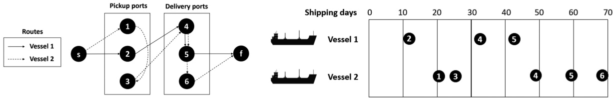
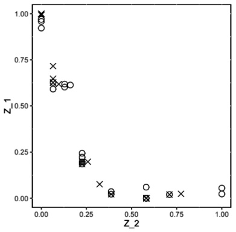
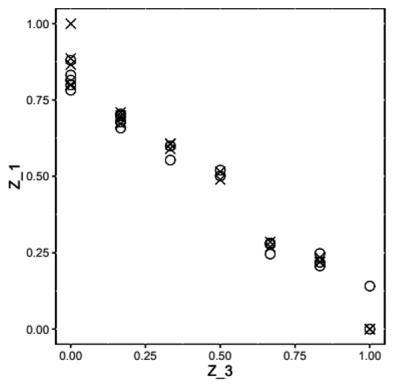
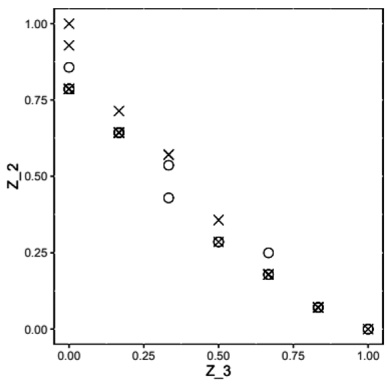

# Multi-objective optimization of the maritime cargo routing and scheduling problem

Pietro Tiaraju Giavarina dos Santos and Denis Borenstein∗

Management School, Federal University of Rio Grande do Sul, Rua Washington Luiz 855, Porto Alegre, RS 90010-460, Brazil

E-mail: pietro.tiaraju@gmail.com [dos Santos]; denis.borenstein@ufrgs.br [Borenstein]

Received 9 December 2020; received in revised form 12 March 2022; accepted 5 April 2022

## Abstract

This paper addresses the multi-objective maritime cargo routing and scheduling problem, in which the delivery of bulk products from pickup to delivery ports is served by a heterogeneous fleet of vessels. A mixed integer linear programming (MILP) model is formulated to simultaneously minimize total operation costs, the scheduling makespan, and delays in selected deliveries. The model accounts for several real features, such as time windows, capacity of the vessel’s compartments, and ports requirements. A fuzzy weighted max–min method was applied to solve the problem. Two heuristics were developed to effectively handle the complex generated MILP models during the solution process. Experiments were conducted to evaluate the optimization approach using real-life instances provided by a fertilizer company. Finally, a case study shows that the developed model and algorithmic framework are flexible and effective in coping with real problems, incorporating specific business rules from different companies.

Keywords: ship routing and scheduling; pickup and delivery problem with time windows; bulk carrier; multi-objective; mixed-integer programming

## 1. Introduction

We introduce a new problem class in the context of maritime transportation, the multi-objective, multi-commodity heterogeneous fleet cargo routing and scheduling problem with time windows, draft limits, and split loads (MO-m-CRSPTW-DL-SL) that generalizes the CRSP characterized by Christiansen et al. (2013). In the MO-m-CRSTW-DL-SL setting, a heterogeneous fleet of vessels operates highly constrained routes to load multiple bulk products from a set of pickup ports and unload them in a set of delivery ports, fulfilling a deterministic demand from a set of customers. All cargo should first be collected and only then delivered within specified time windows in each port in a route. Early or late arrivals/departures of a vessel in a port are very costly, and therefore the synchronization of vehicle scheduling and port operating time windows is an important characteristic of the problem. Also, delays in deliveries may cause disruptions in the companies’ manufacturing process, jeopardizing the productivity of customers. The nature of the products pre-vents them from being mixed, they must be transported in dedicated compartments of the vessels. Further, the routes are constrained by several operational requirements such as draft limits and berth utilization of the ports. The solution of the problem specifies (i) the sequence of ports to be visited by each vessel; (ii) the amount of each product to be loaded/unloaded in each port by a vessel; and (iii) the arrivals and departures schedule of the vessels in/from ports. However, as the vessel master is solely responsible for allocating the products in the compartments (Christiansen et al., 2011; Stanzani et al., 2018), due to the stability and structural strength of each vessel, and sea conditions on the route, this task is partially addressed in the route planning, only guaranteeing that the transported diversity and amounts of products respect the number and nominal capacity of the ships’ compartments, respectively. Furthermore, cargo allocation is a very difficult sub-problem to solve in the context of the CRSP (Hvattum et al., 2009). The overall plan should simultaneously minimize total transportation costs, scheduling makespan, and delays in some deliveries.

<small>∗Corresponding author.</small>

<small>© 2022 The Authors. International Transactions in Operational Research © 2022 International Federation of Operational Research Societies Published by John Wiley & Sons Ltd, 9600 Garsington Road, Oxford OX4 2DQ, UK and 350 Main St, Malden, MA02148, USA.</small>

This study is motivated by the problem faced by fertilizer companies in Brazil that manage their raw material logistics planning. The companies use charter vessels to execute the transportation of the required raw materials from European ports to fulfill the demand for mixing units in Brazil. The planning is executed by experienced managers using spreadsheets, without the help of any optimizing tool. The planning process starts well ahead of its execution due to the difficulty of finding an acceptable, feasible solution by the logistics team. The increasing introduction of customized products to specific clients led the companies to optimize their raw material logistics toward simultaneously offering better service levels and obtaining higher profit margins, decreasing the operational costs. The new market environment has fomented the use of multi-objective optimization approaches.

The MO-m-CRSPTW-DL-SL is a maritime variant of the multi-objective pickup and delivery problem with time windows (MO-PDPTW) (Dumas et al., 1991), a vehicle routing problem (VRP). Although the single objective of minimizing the cost is still dominant in the VRP literature (Braekers et al., 2016), the problem is multi-objective in nature (Jozefowiez et al., 2008). In real life, decision makers (DMs) consider additional objectives beyond costs, such as the optimization of the number of customer visits, the minimization of total lengths, and optimization of the makespan. There is crescent literature in the MO-VRP, and also in the MO-m-PDPTW. In a succinct analysis, the multi-objective approach is formulated by introducing extensions or adaptations to the single-objective modeling. The MO-VRP has been solved using (Jozefowiez et al., 2008): (i) scalar methods, mainly weighted aggregation using local search algorithms (Paquete and Stützle, 2003), specific heuristics (Zografos and Androutsopoulos, 2004), and genetic algorithms (Ombuki et al., 2006); (ii) Pareto dominance methods, mainly using multi-objective evolutionary (Wang et al., 2016; Bravo et al., 2019), and hybrid algorithms (Zhang et al., 2020); and (iii) nonscalar and non-Pareto algorithms, which includes ant colony systems (Zhang et al., 2019), and particle swarm (Zou et al., 2013) optimization.

However, peculiar characteristics of the CRSP setting it apart from the m-PDPTW (dos Santos et al., 2020), such as: (i) ports and vessels have rigorous capacities and draft limits that must be regarded; (ii) there is no central depot; and (ii) partial loading/unloading of products in the same vessel. So, it is unclear whether the approaches specifically developed for the the more generic MO-PDPTW/MO-VRPTW can be directly applied to the MO-m-CRSPTW-DL-SL.

In the domain of shipping routing and scheduling, the CRSP is a very important research topic, being a typical problem of bulk products transported by tramp or industrial shipping (Christiansen et al., 2013). The CRSP is focused on the cargo to be load/unload in pickup/delivery ports, respectively, to fulfill the fixed demand of customers, respecting the time windows imposed by contractual deadlines (Al-Khayyal and Hwang, 2007). Given the diversity of real-world applications and case studies described in the literature, the CRSP has been applied to several contexts. The problem was considered an m-PDPTW (Fagerholt, 2001) or a traveling salesman problem with time windows (Fagerholt and Christiansen, 2000b) and draft limits (Arnesen et al., 2017), incorporating real features such as split loads (Korsvik et al., 2011), flexible cargos (Korsvik and Fagerholt, 2010), and dedicated compartments (Fagerholt and Christiansen, 2000a). The problem was modeled as a single-objective multi-commodity arc-flow and solved using column generation (Brønmo et al., 2010), branch-and-cut (Malaguti et al., 2018), tabu search (Trottier and Cordeau, 2019), and neighborhood search (Korsvik et al., 2011). More recently, dos Santos et al. (2020) modeled and solved the CRSP, simultaneously considering the following real features: heterogeneous fleet, multi-ple products, time windows, draft limitation, flexible cargoes, and split loads. A matheuristic, based on a modified relax-and-fix algorithm, was developed to find good solutions toward minimizing the total transportation costs with efficiency.

Studies in using multi-objective in the maritime routing and scheduling problem are still scarce. In a review by Mansouri et al. (2015) about the consideration of multi-objective decisions in sustainable maritime shipping, no explicit multi-objective optimization (MOO) approach was cited. Multiple objectives were mainly considered as constraints. Chan et al. (2014) developed a dynamic scheduling of oil tankers with the splitting of cargo at pickup and delivery ports, using a multi-objective ant colony-based approach. The developed algorithm proved very efficient in comparison with a non-dominated sorting genetic algorithm II (NSGA II) toward finding good solutions for instances with dozens of pickup and delivery ports with a heterogeneous fleet of oil tankers. Although containing interesting ideas, the problem considered by Chan et al. (2014) is much less restrained than the problem tackled in this paper, neglecting time windows, port drafts, and dedicated compartments. The problem only considers a single product. Recently, MOO approach for planning liner shipping service considering uncertain port times were introduced by Song et al. (2015). The problem was formulated as a stochastic nonlinear programming model, considering three objectives, as follows: (i) annual total vessel operating costs; (ii) average schedule unreliability; and (iii) $\mathrm { C O } _ { 2 }$ emissions. The model was solved using an NSGA II algorithm and applied to a container shipping service route. De et al. (2017) developed a bi-objective model addressing the sustainable ship routing and scheduling with time windows and draft restrictions, maximizing the overall profit incurred of providing shipping operations within a planning horizon, and minimizing the total carbon emission incurred by the ship fleet. The model was solved by combining NSGA-II and multi-objective particle swarm optimization (MOPSO). However, both problems are directed to container ships, which are large ocean vessels that operate, in general, as line service, transporting goods using regular transit routes on fixed schedules. Further, cargos are aggregated in containers, without considering the products individually. To the best of our knowledge, no previous research work uses MOO for handling the maritime CRSP.

In this paper, we develop a multi-objective optimization approach for the m-MO-CRSPTW-DL-SL, considering three objectives, extending the single-objective formulation presented by dos Santos et al. (2020). The main objective of the optimization approach is to find good solutions, as close as possible to the Pareto front, toward supporting the decision-making process of human planners. These objectives include: total costs, makespan, and delays in selected deliveries. A fuzzy weighted max–min multi-objective method has been developed to solve the problem. Toward finding solutions for the complex mixed integer linear program (MILP) models involved in the weighted max–min, two methods were introduced, using mathematical programming technologies offered by contemporary commercial MILP solvers. The proposed algorithms were compared using real-world planning instances kindly provided by a fertilizer company. Further, the MOO approach was applied to a case study, illustrating the effectiveness and the ability of the modeling approach to incorporate several additional requirements. The major contribution of this paper is to introduce an MOO approach for the maritime CRSP, not only capable of incorporating the several aspects of the problem, but also to integrate operational peculiarities and business rules of different companies and chartering modalities.

This paper is organized as follows. The problem is described and formulated in Section 2. Section 3 introduces the solution method, detailing the algorithms developed to solve the several MILP models generated during the solution process. In Section 4, computational experiments to evaluate the performance of the algorithms are presented. Section 5 describes a real-case study carried out using data from a multinational fertilizer company’s Brazilian branch. In the concluding Section 6, an overview of the results is presented and future research are elaborated.

## 2. Problem description and formulation

We consider in this study a multi-objective short-term deep-sea CRS planning. The plan is mainly used by chemical companies for the chartering process to transport raw materials from Europe to Brazil. Cargos are transported by dry bulk tramp shipping, using contracts of affreightment (COA), in which a charterer agrees to pay freight, daily, for a shipowner to carry goods in the vessel for a specified time. The COA specifies a period, known as laytime, for loading and unloading the cargo. If laytime is exceeded, the charterer must pay a daily charge, known as demurrage. The contract also specifies the laydays, the period within which the shipowner has to make the vessel fully operative to the charterer at the place and time agreed in the charter party. The shipowner pays the fuel costs and crew costs during the term of the COA. The vessel may be delivered at an agreed port following a ballast voyage, which costs are paid by the charterer to the shipowner as a “ballast bonus.” Laycan and ballast voyages are not addressed in our cargo route and schedule planning. The plan is used for internal consumption, mainly to negotiate product deliveries to end customers. Vessels’ locations are unknown during this planning phase. Both aspects become relevant in the next contracting phase of the chartering. In general, handymax or handysize bulk carriers are used, presenting a capacity of approximately 35,000–60,000 deadweight tonnage (DWT). Each vessel contains multiple compartments that can be used to transport different products. Because the supplies and the demands of products in some ports are lower than the vessel capacity, a route may include the pickup and delivery of products in several ports. Each pickup port may have a high supply for one or more products, whereas one or more delivery ports may have a high demand for the same product in different or equal quantities. Furthermore, most origin and destination ports have severe draft restrictions, limiting vessel usage based on its load condition. We assume that the Port Authority has defined the draft limits for each terminal in a port, which are expressed in terms of the maximum weight a vessel can safely carry on board.

There are restrictions on the minimum load per vessel and the minimum amount per product transported by a vessel to avoid underutilization. We assume that all vessels, regardless of size, travel at a cruise speed of 15 knots. As a consequence, the sailing times between ports are solely determined by the distance within them. The speed in each port is also constant and regulated by the Port Authority. The vessel draft after each load and unload operation depends highly on its physical dimensions, cargo weighting, hydrostatic curves, and sea conditions. For the sake of simplicity, we assume that the vessel draft is determined by its current cargo, following Arnesen et al. (2017).

Feasible vessel routes must meet a number of requirements and constraints. All cargo must be collected before any delivery can occur, without the possibility of transshipment in any port. A vessel route in the CRSP has a rigid structure $P , P , \ldots , P , D , D , \ldots , D ,$ , where a delivery port (denoted by D) cannot appear before any pickup port (denoted by P) in the sequence. Furthermore, as presented in Fagerholt and Ronen (2013), our problem involves flexible cargo sizes and split loads. Another critical requirement in a route is the delivery of a product close to the date specified by each mixing plant in order to fulfill its production schedule. As a result, time windows are imposed for cargo loading and unloading at each port in order to comply with negotiated delivery dates of final products to clients by the commercial department. When designing a route, the following times should be considered: loading/unloading time for each cargo, compartment washing time after delivering a cargo, waiting time for the product to be released for land transport in accordance with customs legislation, and waiting time for a vessel to dock at a terminal. The load/unload times at each port are dependent on the amount and type of cargo handled and the capacity and speeds of available equipment (ship-loaders and conveyor belts). As a consequence, the same quantities of raw materials present a reasonable variability of load/unload times in different ports, the fertilizer companies define average values, based on historical data, for each port, regardless of the quantities moved. Since it is a pre-contract planning of the real transportation, we used these values for simplification, reducing the number of required parameters to run the model.

Our problem consists of defining: (i) each vessel’s route and schedule; and (ii) which product, and the respective amount, is to load/unload into which vessel at which port. The overall plan should simultaneously minimize three objectives. The first objective is related to the completion time of the last delivery by a vessel in the planning horizon, known as makespan. As deep-sea transportation is prone to various disruptions caused by weather conditions and port problems, the main objective of minimizing makespan in the CRSP is to better integrate the supply of raw materials and the production master plan in the mixing units. Furthermore, by reducing the variability of deliveries of the same raw material by different vessels, possible delays can be reduced to all demands involved in the planning. The second objective refers to the total costs faced by the deep-sea operations. Although costs and makespan are rarely considered as separated objectives in the general MO-VRP literature (Jozefowiez et al., 2008), since they are some way related (minimizing the makespan also reduces the freight costs), this is not the case in the specific context of the maritime CRSP. The minimization of costs often implies in vessels visiting more ports, frequently increasing the makespan of a plan. The reduction in costs can significantly increase the makespan in the CRSP for some

P.T.G. dos Santos and D. Borenstein / Intl. Trans. in Op. Res. 31 (2024) 221–245

Fig. 1. Illustration of two vessel routes.

instances, as demonstrated in our experiments. They are considered independent in the preference by all contacted managers/schedulers. They always prefer minimum cost, independent on the value of the makespan, and vice-versa. In summary, managers of the fertilizer companies approach costs and makespan as a classic trade-off in the real world, justifying their choice in the multi-objective formulation of the CRSP. To minimize the delay of some deliveries is the third objective. This objective has become highly relevant since Brazilian fertilizer companies are focusing on producing premium products rather than commodities to increase profit from operations. These products are customized according to the specific customers’ needs. Possible delays in the delivery of final products can have a very negative effect on the long-term relationship with these customers. Nowadays, to minimize delay is a very important strategic objective, strictly linked to the sustainability of the fertilizer companies.

The MO-m-CRSPTW-DL-SL is modeled using the network and formulation by dos Santos et al. (2020) as a starting point, but considering modifications to account for multi-objective, delays in deliveries, and multi-vessel utilization with overlapping docking times. Table 1 presents the mathematical notation following dos Santos et al. (2020). Sets and parameters are expressed as upper case letters, while variables and indexes use lower case letters.

The problem is defined on a directed graph $G = ( N , A )$ , where set $N = N ^ { V } \cup \{ s \} \cup \{ f \}$ is the set of nodes and $A = \{ (i,j) | (i \in N^P, j \in N^V) \land (i \in N^D, j \in N^D) \land (i \in \{s\}, j \in N^P) \land (i \in N^D, j \in N^D) \}$ $\{ f \} ) \}$ is the set of arcs, where $N ^ { V }$ is the set of pickup and delivery ports, $N ^ { P }$ is the set of pickup ports, and $N ^ { D }$ is the set of delivery ports. Dummy nodes s and $f$ represent artificial start and end depots, respectively. All out-going arcs from s and in-going arcs to $f$ are travelled without costs and with null time, since laycan and ballast voyages are unconsidered. There are no arcs in graph $G ,$ connecting delivery to pickup ports. Each elementary path in the graph from s to $f ,$ in which the constraints related to TWs, draft, and capacity are respected, corresponds to a feasible vessel route. Figure 1 illustrates feasible routes of two vessels associated with three pickup and two delivery ports. In the MO-m-CRSPTW-DL-SL,

• pickup ports $i \in N ^ { P }$ has a supply $( Q _ { i p } )$ of product $p ,$ and a demand $( - Q _ { i p } )$ in the delivery ports $\bar { i } \in N ^ { \bar { D } }$

• pickups and deliveries are performed by a heterogeneous fleet of charter vessels that differ on dimensions, capacity, and number of compartments;

• products cannot be mixed in the vessels’ compartments, but feasible bulkheads can be used to divide the nominal cargo compartments;

• vessel v must transport cargo within the interval $\begin{array} { r } { [ R _ { \nu } ^ { V } , \sum _ { c \in C ( \nu ) } Y ^ { V } c \nu ] ; } \end{array}$

International Transactions in Operational Research © 2022 International Federation of Operational Research Societies • the number of vessels being simultaneously loading/unloading cargo in port $j$ is limited by parameter $U _ { j } ^ { N }$ . If $U _ { j } ^ { N }$ is set to zero, only a vessel can be served anytime in port $j ;$

<small>© 2022 The Authors.</small>

P.T.G. dos Santos and D. Borenstein / Intl. Trans. in Op. $O p .$ Res. 31 (2024) 221–245

<table><tr><td colspan="2">Sets</td></tr><tr><td> $N^V$ </td><td>set of pickup and delivery ports</td></tr><tr><td> $N^P$ </td><td>set of pickup ports</td></tr><tr><td> $N^D$ </td><td>set of delivery ports</td></tr><tr><td>N</td><td>set of all ports, including the dummy start (s) and finish (f) ports</td></tr><tr><td>P</td><td>set of products</td></tr><tr><td>V</td><td>set of vessels</td></tr><tr><td>C(v)</td><td>set of compartments of vessel v</td></tr><tr><td colspan="2">Parameters</td></tr><tr><td> $Q_{ip}$ </td><td>stock level of product p in port i</td></tr><tr><td> $D_{jp}^T$ </td><td>expected date of arrival of product p in port j</td></tr><tr><td> $A_j^T$ </td><td>earliest starting time for the delivery of products in port j</td></tr><tr><td> $L_j^T$ </td><td>latest starting time in days for the delivery of products in port j</td></tr><tr><td> $O_j^T$ </td><td>loading and unloading time in port j</td></tr><tr><td> $E_j^T$ </td><td>estimated queuing and clearance times in port j</td></tr><tr><td> $S_j^T$ </td><td>estimated earliest starting time for the pickup of a cargo in port j</td></tr><tr><td> $F_j^T$ </td><td>estimated latest starting time for the pickup of a cargo in port j</td></tr><tr><td> $L_{ij}^T$ </td><td>sailing time of vessel v between ports i and j</td></tr><tr><td> $P_j^N$ </td><td>draft limit in ton of port j</td></tr><tr><td> $B_j^N$ </td><td>maximum number of berths in port j ∈  $N^D$ </td></tr><tr><td> $U_j^N$ </td><td>maximum number of vessels being simultaneously served in of port j</td></tr><tr><td> $K_v^P$ </td><td>minimum amount of product p to be loaded in vessel v</td></tr><tr><td> $R_v^V$ </td><td>minimum amount of cargo in compartments of vessel v</td></tr><tr><td> $W_v^C$ </td><td>demurrage cost of vessel v</td></tr><tr><td> $P_j^C$ </td><td>cost of using port j facilities</td></tr><tr><td> $C_v^V$ </td><td>freight price of vessel v</td></tr><tr><td> $H^C$ </td><td>daily cost for disrespecting the time window of a pickup/delivery</td></tr><tr><td> $Y_{cv}^V$ </td><td>nominal capacity of compartment c of vessel v</td></tr><tr><td colspan="2">Decision variables</td></tr><tr><td> $l_{ijpcv}$ </td><td>amount of product p transported using arc (i, j) by vessel v at compartment c</td></tr><tr><td> $t_{ijv}^A$ </td><td>arrival time of vessel v using arc (i, j)</td></tr><tr><td> $t_{ijv}^D$ </td><td>departure time of vessel v using arc (i, j)</td></tr><tr><td> $t_{ijpv}^E$ </td><td>early arrival or delay of vessel v carrying product p using arc (i, j)</td></tr><tr><td> $t_{ijpv}^L$ </td><td>arrival delay of vessel v at port j carrying product p using arc (i, j)</td></tr><tr><td> $x_{ijv}$ </td><td>binary variable that indicates if arc (i, j) is used by vessel v</td></tr><tr><td> $y_{ijpv}$ </td><td>binary variable that indicates if arc (i, j) is used by vessel v</td></tr><tr><td></td><td>to transport product p</td></tr><tr><td> $y_{ijpv}^D$ </td><td>binary variable that indicates if product p is unloaded off vessel v in port j, using arc (i, j)</td></tr><tr><td> $z_{vwj}$ </td><td>binary variable that indicates if vessel v starts to be served in port j while vessel w has already been served in the same port</td></tr></table>

• although transshipment is strictly forbidden, partial loading/unloading of a vessel compartment by the same product is allowed;

• products can be loaded in pickup ports $j \in N ^ { P }$ in the TW interval $[ S _ { j } ^ { T } , F _ { j } ^ { T } ]$ , and unloaded in delivery ports $j \in N ^ { D }$ in the interval $[ A _ { j } ^ { T } , L _ { j } ^ { T } ]$ ;

• products $p \in P$ are expected to be delivered in port $j \in N ^ { D }$ in time $D _ { j p } ^ { T }$

Based on the network and notation presented, the MO-m-CRSPTW-DL-SL can be formulated as an MILP, as follows:

min $Z _ { 1 } = \alpha$

(1)

$$
\begin{array}{l} \hline \min Z _ {2} = \sum_ {v \in V} C _ {v} ^ {V} \left(\sum_ {i \in N ^ {D}} t _ {i f v} ^ {A} + \sum_ {j \in N ^ {P}} t _ {s j v} ^ {A}\right) + \sum_ {i \in N} \sum_ {j \in N ^ {V}} \sum_ {v \in V} P _ {j} ^ {C} x _ {i j v} \\ \qquad + \sum_ {i \in N ^ {V}} \sum_ {j \in N ^ {D}} \sum_ {p \in P} \sum_ {v \in V} H ^ {C} t _ {i j p v} ^ {E} + \sum_ {i \in N} \sum_ {j \in N ^ {V}} \sum_ {v \in V} W _ {v} ^ {C} E _ {j} ^ {T} x _ {i j v} \\ \hline \end{array}\tag{2}
$$

$$
\min Z _ {3} = \sum_ {i \in N ^ {V}} \sum_ {j \in N ^ {\prime}} \sum_ {p \in P ^ {\prime}} \sum_ {v \in V} t _ {i j p v} ^ {L}\tag{3}
$$

The objective function $Z _ { 1 }$ minimizes the scheduling makespan $( \alpha )$ , computed by constraints (4). Objective function $Z _ { 2 }$ minimizes the total transportation costs. Objective function $Z _ { 3 }$ minimizes the delay of the delivery of a set of products $P^{'} \subseteq P$ for a set of ports $N ^ { ' } \subseteq N ^ { D }$ connected to special clients.

Subject to:

$$
\alpha \geq t _ {i f v} ^ {A} \quad \forall i \in N ^ {D}, \forall v \in V.\tag{4}
$$

Supply–demand constraints

$$
Q _ {i p} - \sum_ {j \in N ^ {V}} \sum_ {v \in V} \sum_ {c \in C (v)} l _ {i j p c v} + \sum_ {h \in N ^ {V}} \sum_ {v \in V} \sum_ {c \in C (v)} l _ {h i p c v} \geq 0 \quad \forall i \in N ^ {V}, \forall p \in P\tag{5}
$$

Constraints (5) ensure that the supply and demand of each product are respected in the pickup and delivery ports.

Ship load constraints

$$
Q _ {i p} - \sum_ {j \in N ^ {V}} l _ {i j p c v} + \sum_ {h \in N ^ {V}} l _ {h i p c v} \geq 0 \quad \forall i \in N ^ {V}, \forall p \in P, \forall v \in V, \forall c \in C (v)\tag{6}
$$

$$
\sum_ {h \in N ^ {P}} l _ {h i p c v} - \sum_ {j \in N ^ {V}} l _ {i j p c v} \geq 0 \quad \forall i \in N ^ {P}, \forall p \in P, \forall v \in V, \forall c \in C (v)\tag{7}
$$

$$
\sum_ {i \in N ^ {P} \cup \{s \}} l _ {i j p c v} - \sum_ {k \in N ^ {V}} l _ {j k p c v} \leq 0 \quad \forall j \in N ^ {P}, \forall p \in P, \forall v \in V, \forall c \in C (v)\tag{8}
$$

$$
\left| \sum_ {i \in N ^ {P}} \sum_ {j \in N ^ {D}} \sum_ {p \in P} \sum_ {c \in C (v)} l _ {i j p c v} \leq \sum_ {c \in C (v)} Y _ {c v} ^ {V} \quad \forall v \in V \right|\tag{9}
$$

<small>© 2022 The Authors.</small>

<small>International Transactions in Operational Research © 2022 International Federation of Operational Research Societies</small>

$$
\left| \sum_ {i \in N ^ {P}} \sum_ {j \in N ^ {D}} \sum_ {p \in P} \sum_ {c \in C (v)} l _ {i j p c v} \geq \sum_ {j \in N ^ {V}} R _ {v} ^ {V} x _ {s j v} \quad \forall v \in V \right|\tag{10}
$$

$$
\sum_ {c \in C (v)} l _ {i j p c v} \geq K _ {v} ^ {P} y _ {i j p v} \quad \forall i \in N ^ {P}, \forall j \in N ^ {V}, \forall p \in P, \forall v \in V\tag{11}
$$

$$
l _ {i j p c v} \leq Y _ {c v} ^ {V} y _ {i j p v} \quad \forall i, j \in N ^ {V}, \forall p \in P, \forall v \in V, \forall c \in C (v)\tag{12}
$$

$$
\sum_ {i \in N ^ {P}} \sum_ {j \in N ^ {V}} \sum_ {p \in P} y _ {i j p v} \leq | C (v) | \quad \forall v \in V.\tag{13}
$$

Constraints (6) assure that only stocked products in a pickup port can be loaded in a vessel. Constraints (7) satisfy the demand of any product at each delivery port. Constraints (8) prohibit that a vessel discharge cargo in a pickup port. Constraints (9) respect the vessel capacity. Constraints (10) avoid the under utilization of vessels. Constraints (11) limit the minimum amount of a product being transported by a vessel. Constraints (12) guarantee that the capacity of each compartment of a vessel is respected. Constraints (13) limit the number of products transported by a vessel to the number of its compartments.

Flow constraints

$$
\sum_ {j \in N} x _ {i j v} \leq 1 \quad \forall i \in N, \forall v \in V\tag{14}
$$

$$
\sum_ {i \in N} x _ {i j v} \leq 1 \quad \forall j \in N, \forall v \in V\tag{15}
$$

$$
\sum_ {j \in N} x _ {i j v} - \sum_ {h \in N} x _ {h i v} = 0 \quad \forall i \in N, \forall v \in V\tag{16}
$$

$$
\sum_ {i \in N ^ {P}} \sum_ {j \in N ^ {D}} x _ {i j v} \leq 1 \quad \forall v \in V\tag{17}
$$

$$
x _ {i j v} = 0 \quad \forall i \in N ^ {D}, \forall j \in N ^ {P}, \forall v \in V\tag{18}
$$

$$
x _ {f s v} = 0 \quad \forall v \in V\tag{19}
$$

$$
x _ {f j v} = 0 \quad \forall j \in N ^ {V}, \forall v \in V\tag{20}
$$

$$
x _ {i s y} = 0 \quad \forall j \in N ^ {V}, \forall v \in V\tag{21}
$$

$$
\sum_ {p \in P} l _ {i j p c v} - Y _ {c v} ^ {V} x _ {i j v} \leq 0 \quad \forall i, j \in N, \forall v \in V, \forall c \in C (v).\tag{22}
$$

Constraints (14) and (15) impose that a vessel cannot re-use any arc in the network. Constraints (16) are conservative flow constraints. Constraints (17) and (18) guarantee that no delivery can occur before all collects have been carries out. Constraints (19)–(21) delimit that nodes s and f are super source and super sink nodes, respectively. Constraints (22) guarantee that a cargo can only be transported by an effectively used vessel and respecting the capacity of each vessel compartment, logically connecting continuous flow and binary variables concerning the vessel utilization.

© 2022 The Authors. International Transactions in Operational Research © 2022 International Federation of Operational Research Societies

Time Constraints

$$
t _ {i j v} ^ {A} \geq S _ {j} ^ {T} x _ {i j v} \quad \forall i \in N, \forall j \in N ^ {P}, \forall v \in V\tag{23}
$$

$$
t _ {i j v} ^ {D} \leq F _ {j} ^ {T} x _ {i j v} \quad \forall i \in N,   \forall j \in N ^ {P},   \forall v \in V\tag{24}
$$

$$
t _ {i j v} ^ {D} \geq t _ {i j v} ^ {A} + E _ {j} ^ {T} + O _ {j} ^ {T} + M (x _ {i j v} - 1) \quad \forall i \in N, \forall j \in N ^ {V}, \forall v \in V\tag{25}
$$

$$
t _ {i j v} ^ {A} \geq t _ {h i v} ^ {D} + L _ {i j} ^ {T} + M (x _ {i j v} - 1) \quad \forall h \in N, \forall i \in N ^ {V}, \forall j \in N ^ {V}, \forall v \in V\tag{26}
$$

$$
t _ {i j p v} ^ {E} \geq | D _ {j p} ^ {T} - E _ {j} ^ {T} - t _ {i j v} ^ {D} | + M (y _ {i j p v} ^ {D} - 1) \quad \forall i \in N ^ {V}, \forall j \in N ^ {D}, \forall p \in P, \forall v \in V\tag{27}
$$

$$
t _ {i f v} ^ {A} \geq t _ {h i v} ^ {D} + M (x _ {i f v} - 1) \quad \forall i, h \in N ^ {V}, \forall v \in V\tag{28}
$$

$$
t _ {s i v} ^ {A} \leq t _ {i j v} ^ {A} - S _ {j} ^ {T} - O _ {i} ^ {T} - E _ {i} ^ {T} - M (x _ {i j v} - 1) \quad \forall i, j \in N ^ {V}, \forall p \in P, \forall v \in V\tag{29}
$$

$$
t _ {i j v} ^ {A} + E _ {j} ^ {T} - M (x _ {i j v} - 1) + M z _ {v w j} \geq t _ {k j w} ^ {D} + M (x _ {k j w} - 1) \quad \forall i, k \in N,
$$

$$
\forall j \in N ^ {V}, \forall v, w \in V, v \neq w\tag{30}
$$

$$
t _ {i j v} ^ {D} \leq D _ {j p} ^ {T} + L _ {j} ^ {T} - E _ {j} ^ {T} + M (- y _ {i j p v} ^ {D} + 1) \quad \forall i \in N ^ {V}, \forall j \in N ^ {D}, \forall p \in P, \forall v \in V\tag{31}
$$

$$
t _ {i j v} ^ {D} \geq D _ {j p} ^ {T} - A _ {j} ^ {T} - E _ {j} ^ {T} - M (y _ {i j p v} ^ {D} - 1) \quad \forall i \in N ^ {V}, \forall j \in N ^ {D}, \forall p \in P, \forall v \in V\tag{32}
$$

$$
t _ {i j p v} ^ {L} \geq t _ {i j v} ^ {A} + E _ {j} ^ {T} - D _ {j p} ^ {T} + M (y _ {i j p v} ^ {D} - 1) \quad \forall i \in N ^ {V}, \forall j \in N ^ {\prime}, \forall p \in P ^ {\prime}, \forall v \in V,\tag{33}
$$

where M represents a very large number.

Constraints (23) and (24) link the TW to the arrival and departure times of each vessel in/from each port, respectively. Constraints (25) specify when each vessel departs from a port. Constraints (26) determine the arrival time of each vessel from port i in port $j .$ Constraints (27) account for a vessel’s early arrival or late departure in each port. The starting and ending route times of each vessel are defined by constraints (28) and (29). The arrival time of each vessel in a port is determined by constraints 30. The departure time of each vessel from a port is determined by constraints (31) and (32). Constraints (33) are used to compute the delivery delay of product $p$ in port j of vessel v using arc (i, j).

Port related constraints

$$
\sum_ {v \in V} \sum_ {w \in V | w \neq v} z _ {v w j} \leq B _ {j} ^ {N} \quad \forall j \in N ^ {V}\tag{34}
$$

$$
\sum \sum z _ {v w j} \leq U _ {j} ^ {N} \quad \forall j \in N ^ {V}\tag{35}
$$

v∈Vw∈V |w=v

$$
\sum \sum \sum l _ {i j p c v} \leq P _ {i} ^ {N} \quad \forall i \in N ^ {V}, \forall v \in V\tag{36}
$$

$$
j \in N p \in P c \in C (v)
$$

$$
\sum_ {i \in N} \sum_ {p \in P} \sum_ {c \in C (v)} l _ {i j p c v} \leq P _ {j} ^ {N} \quad \forall j \in N ^ {V}, \forall v \in V\tag{37}
$$

<small>© 2022 The Authors.</small>

<small>International Transactions in Operational Research © 2022 International Federation of Operational Research Societies</small>

Constraints (34) guarantee that the berth capacity of port j is respected. Constraints (35) restrain the number of vessels being simultaneously served in port j to parameter $U _ { j } ^ { N }$ . Constraints (36) and (37) assure that the port draft is respected when both entering or leaving a port, respectively.

Routing Constraints

$$
y _ {i j p v} - x _ {i j v} \leq 0 \quad \forall i, j \in N, \forall p \in P, \forall v \in V\tag{38}
$$

$$
t _ {i j v} ^ {D} - M x _ {i j v} \leq 0 \quad \forall i, j \in N, \forall v \in V\tag{39}
$$

$$
t _ {i j v} ^ {A} - M x _ {i j v} \leq 0 \quad \forall i, j \in N, \forall v \in V\tag{40}
$$

$$
y _ {i j p v} - D _ {j p} ^ {T} y _ {i j p v} ^ {D} \leq 0 \quad \forall i \in N ^ {V}, \forall j \in N ^ {D}, \forall p \in P, \forall v \in V.\tag{41}
$$

Constraints (38) state that each vessel can only transport a product using arc $( i , j )$ if: (i) the vessel follows the path of arc $( i , j )$ , and (ii) the vessel is transporting the product in one of its compartments. Constraints (39) and (40) assure that arrival/departure times and vessel routes are compatible. Finally, constraints (41) ensure that a product is only unloaded from a vessel in a port if the product is being transported by the vessel on its route.

Domain of the variables

$$
t _ {i j v} ^ {D}, t _ {i j v} ^ {A}, l _ {i j p c v}, t _ {i j p v} ^ {E} \geq 0 \quad \forall i, j \in N, \forall p \in P, \forall v \in V, \forall c \in C (v)\tag{42}
$$

$$
x _ {i j v}, y _ {i j p v}, y _ {i j p v} ^ {D} \in \{0, 1 \} \quad \forall i, j \in N, \forall p \in P, \forall v \in V\tag{43}
$$

$$
z _ {v w j} \in \{0, 1 \} \quad \forall v, w _ {v \neq w} \in V, \forall j \in N ^ {V}\tag{44}
$$

As a VRP variant, the MO-m-CRSPTW-DL-SL is also an NP-hard problem. As a planning problem, our goal is to find nondominant solutions, with acceptable values for the three objectives, for model (1)–(44). Further, the decision-making process should be capable of interacting with planners, since the importance of each objective is highly context dependent.

## 3. Solution method

The general multi-objective model can be formulated, as follows:

$$
\max Z _ {1}, Z _ {2}, \dots , Z _ {k}\tag{45}
$$

$$
\min Z _ {k + 1}, Z _ {k + 2}, \dots , Z _ {l}\tag{46}
$$

st

$$
x \in X,\tag{47}
$$

where $Z _ { 1 } , Z _ { 2 } , \ldots , Z _ { k }$ are the positive objectives for maximization, $Z _ { k + 1 } , Z _ { k + 2 } , \ldots , Z _ { l }$ are the negative objectives for minimization, and X is the set of feasible solutions.

The main objective in MOO is to choose non-dominant solutions, based on different levels of trade-off among the different objectives, from the Pareto front. In the planning of dry bulk cargoes, the main objective is to support the logistics team in finding the most preferred Pareto optimal solution according to the company’s preferences and needs. The underlying assumption is that a good solution to the problem must be identified as implementable in practice and in accordance with each planning context. For instance, if some special order of a customer is involved, the level of service becomes more important. Otherwise, the cost is the most important objective. The human DMs play an important role in the planning process.

Scalar techniques and Pareto methods are very popular in handling the MO-VRP (Jozefowiez et al., 2008). The former is a set of a priori methods, in which decisions are made (based on DM) before searching a solution, while the latter is a posteriori method, in which a search is performed before making decisions by the DM. Both methods have well-known strengths and weaknesses (Ehrgott, 2008). Although Pareto methods, especially evolutionary algorithms, are becoming very popular to solve MOO (Zitzler et al., 2000), they are not well suited to our specific problem, since they generate excessive “unnecessary” solutions, making the decision process for the planners a little bit confusing. Scalar methods can find solutions of interest to DMs. A scalar technique is more suited to solve the real MO-m-CRSPTW-DL-SL. There are several ways of converting the MOO to a single-objective program described in the literature (Ehrgott, 2008), being the weighted sum the simplest and most used. However, literature in MOO addresses several drawbacks of this method in depicting the Pareto optimal set, and the proper scaling or normalization of the objectives (Das and Dennis, 1997; Marler and Arora, 2010). Based on these deficiencies, we choose another scalar technique, the fuzzy weighted max–min method, as introduced by Lin (2004). The key advantage of the weighted max–min method is that it can provide almost all the Pareto optimal points, even for a nonconvex Pareto front. It is relatively well suited for generating, with variation in the weights, a Pareto front. However, this method requires the minimization of individual single-objective optimization problems to determine the utopia point, which can be computationally expensive (Chang, 2014), particularly for mixed integer multi-objective problems. Considering this drawback, special algorithms were customized/developed to overcome this difficulty.

In several real problems, a fuzzy perspective is assumed by the DMs. Membership functions $\mu _ { Z _ { j } } ( x )$ are defined for each objective, and the solution achieves all objectives given a certain tolerance limit under the constraints. The problem consists of finding a solution for the reformulated formulation (Amid et al., 2011):

$$
\tilde {Z} _ {i} \geq \sim Z _ {i} ^ {o} \quad i = 1, \dots , k\tag{48}
$$

$$
\tilde {Z} _ {j} \leq \sim Z _ {j} ^ {o} \quad j = k + 1, \dots , l\tag{49}
$$

st

$$
g _ {s} (x) = \sum_ {i = 1} ^ {n} a _ {s i} x _ {i} \leq b _ {s} \quad \forall s\tag{50}
$$

$$
x _ {i} \geq 0 \quad \forall i,\tag{51}
$$

where $Z _ { k } ^ { o }$ and $Z _ { l } ^ { o }$ are the levels that the decision maker wants to reach, $a _ { s i }$ and $b _ { s }$ are crisp values, and symbol ∼ indicates the fuzzy environment.

To solve this problem, Lin (2004) expanded the max–min operator approach (Zimmermann, 1978), by proposing a weighted max–min model, in which the decision maker provides relative weights $( \theta _ { k } , k = 1 , 2 , \ldots , l )$ for the l fuzzy objectives with corresponding membership functions. This model finds an optimal feasible solution such that the ratio of the levels achieved is as close to the ratio of the weights as possible. This model can be stated as follows (Amid et al., 2011):

<small>© 2022 The Authors.</small>

<small>International Transactions in Operational Research © 2022 International Federation of Operational Research Societies</small>

max λ

(52)

st

$$
\theta_ {k} \lambda \leq f _ {\mu_ {Z _ {k}}} (x) \quad k = 1, 2, \dots , l\tag{53}
$$

$$
\sum_ {k = 1} ^ {l} \theta_ {k} = 1\tag{54}
$$

$$
\theta_ {k} \geq 0 \quad k = 1, 2, \dots , l\tag{55}
$$

$$
g _ {s} (x) \leq b _ {s} \quad \forall s\tag{56}
$$

$$
\left| \begin{array}{l l} x _ {i} \geq 0 & i = 1, 2, \dots , m, \end{array} \right.\tag{57}
$$

where the fuzzy membership function for maximization objectives $( \mu _ { Z _ { k } } ( x ) )$ and for minimization ones $( \mu _ { Z _ { l } } ( x ) )$ are as follows, respectively:

$$
\mu_ {Z _ {l}} (x) = \left\{ \begin{array}{l l} 1, & Z _ {l} \leq Z _ {l} ^ {-} \\ 0, & Z _ {l} \geq Z _ {l} ^ {+} \\ f _ {\mu_ {Z _ {l}}} = \frac {Z _ {l} (x) - Z _ {l} ^ {-}}{Z _ {l} ^ {+} - Z _ {l} ^ {-}}, & Z _ {l} ^ {-} \leq Z _ {l} (x) \leq Z _ {l} ^ {+} \end{array} \right.\tag{58}
$$

$$
\mu_ {Z _ {k}} (x) = \left\{ \begin{array}{l l} 0, & Z _ {k} \leq Z _ {k} ^ {-} \\ 1, & Z _ {k} \geq Z _ {k} ^ {+} \\ f _ {\mu_ {Z _ {k}}} = \frac {Z _ {k} ^ {+} - Z _ {k} (x)}{Z _ {k} ^ {+} - Z _ {k} ^ {-}}, & Z _ {k} ^ {-} \leq Z _ {k} (x) \leq Z _ {k} ^ {+}, \end{array} \right.\tag{59}
$$

where $Z _ { k } ^ { + }$ and $Z _ { l } ^ { - }$ are the optimal single objective functions (individual maximum and minimum solutions) of positive objective $Z _ { k }$ and negative objective $Z _ { l } ,$ , respectively, and $Z _ { k } ^ { - }$ and $Z _ { l } ^ { + }$ are the minimum and maximum values (worst solutions) of objectives $Z _ { k }$ and $Z _ { l }$ , respectively (Amid et al., 2011).

Algorithm 1 presents the customized version of the algorithm by Amid et al. (2011) to solve the fuzzy weighted max–min model for the MO-m-CRSPTW-DL-SL. The single-objective formulations to find the best solution and nadir points for each objective can be solved using the very efficient matheuristic by dos Santos et al. (2020). The algorithm solves several complex MILP formulations, mainly in Step 6. Model (52)–(55), (4)–(44) is a very difficult MILP to solve. Unfortunately, this model is solved several times, considering several weight combinations during a real decision-making process. Using the traditional branch and bound algorithm implemented in powerful MILP solvers when applied to the maritime CRSP leads to low quality solutions and requires excessive computational time for instances with more than six products and nine ports, that is incompatible with the solution of real-world problems as demonstrated in dos Santos et al. (2020). Another possibility, considering the limited number of ports, is to use a path flow based solution method, such as column generation or a previous enumeration of all possible feasible routes. However, both methods have difficult problems to overcome in practice. On one hand, the use of column generation involves the solution of a very complex NP-hard resource constrained shortest path as the dual problem (Feillet et al., 2004), considering the number of the different constraints of the CRSP. On the other hand, to elicit several feasible routes for the path model requires the development of an effective and efficient algorithm, considering simultaneously the voyage sequences, use of the compartments, and the hard constraints. These issues and the tight due deadline to solve real cases have motivated the development of the two algorithms described next.

Algorithm 1. Fuzzy MOO solution method for the MO-m-CRSPTW-DL-SL, based on Amid et al. (2011)

Step 1: Define model (1)-(44) as the MOLP to be solved.
Step 2: Solve the MOLP as a single objective problem for each objective $i$, $i = 1, \dots, k$, using the matheuristic developed by dos Santos et al. (2020). As this is the best value for each objective, set $Z_i^+$ as the upper bound of the $i$th objective.
Step 3: Solve the MOLP as a single objective, changing the optimization direction of each objective $j = k + 1, \dots, l$, using the matheuristic developed by dos Santos et al. (2020). As this is the nadir point for each objective, set $Z_j^-$ as the lower bound of the $j$th objective.
Step 4: For each objective $i = 1, \dots, k$, find the membership function by using (59).
Step 5: For each objective $j = k, \dots, l$, find the membership function by using (58).
Step 6: For each weight combination ($\theta_1, \theta_2, \dots, \theta_l$) do:
    Step 6.1: Formulate the problem as a multi-objective weighted max-min model (52)-(55), (4)-(44).
    Step 6.2: Solve the model of Step 6.1, using Algorithms 2 or 3, so as to find a nondominant solution for the weight combination in analysis.

## 3.1. CPLEX-based algorithm

The developed algorithm has a major objective to improve and accelerate solutions obtained by the well-known CPLEX solver. Using the traditional branch-and-bound was inefficient in dealing with the weighted max–min model for real-case instances during initial experimentation. The branchand-bound got stuck in a node of the search tree, avoiding finding Pareto front solutions. Instead of developing a heuristic method, we used the contemporary validated resources offered by CPLEX to improve the solution search process.

The algorithm uses several inherent capabilities of the well-known IBM ILOG CPLEX 12.9, such as nontraditional tree-of-trees search, multiple default heuristics, solution improvement, symmetry detection, and cutting planes. Further, we used the same cutting planes routines as in dos Santos et al. (2020), given the success of branch-and-cut algorithms when applied to the VRP and its variants (Braekers et al., 2016). We call P-CPLEX the solver with implemented cutting planes routines by CPLEX. It should be noted that several powerful commercial MILP solvers have analogous routines to perform the same cutting planes.

Algorithm 2 outlines the developed algorithm. In the first step, the main objective is to obtain a good feasible integer solution to the problem, by applying P-CPLEX. Step 2 entails polishing the solution obtained in Step 1 using the algorithm proposed by Rothberg (2007), an evolutionary approach in which crossover and mutation operations are built within an MILP branch-and-bound.

| Algorithm 2. CPLEX based algorithm (PC++) |
| --- |
| Step 1: Solve the current MILP model, using P-CPLEX until time limit $ts_{1}$. Create set SP with all feasible solutions found by the solver.Step 2: Solve the MILP using the polish routine by Rothberg (2007) with SP as initial solutions within time limit $t_{2}$. Set SP as the solution pool.Step 3: If $\|SP\| \geq 2$, then solve the MILP using the repair algorithm by Fischetti and Lodi (2008) with initial solutions in SP within time limit $t_{2}$. Keep SP as the solution pool.Step 4: Return the best feasible solution in SP. If no feasible solution is obtained, the problem cannot be solved considering parameters $ts_{1}$ and $ts_{2}$. |

The solutions of the evolutionary approach are incorporated into the MILP search tree, and the solutions obtained by the MILP solver are utilized in the evolutionary algorithms, indicating a beneficial integration of information during the search solution process. In Step 3, the repairing algorithm developed by Fischetti and Lodi (2008) is employed, a hybrid algorithm that employs the feasibility pump approach to solve local branching at the beginning. The current MILP that is being solved is extended with artificial variables. This augmented model is then solved iteratively to reduce the number of infeasible solutions equaling by zero the values of the artificial variables. The goal is not to repair solutions only, but also infeasible MILP models. Although these two routines are time consuming and therefore should be used with parsimony, they effectively enhance the solution quality.

Step 2 of Algorithm 2 is implemented using the CPLEX parameter PolishAfterIntSol, while Step 3 is implemented using Repair.Tries. Time parameters $t _ { 1 }$ and $t _ { 2 }$ depend on the problem dimensions in terms of the number of products and ports.

## 3.2. Matheuristic

A second algorithm was developed to solve the weighted max–min model of Step 6 in Algorithm 1 as a possible alternative to generate the Pareto front. The developed algorithm is a slightly modified version of the matheuristic presented in dos Santos et al. (2020). The algorithm has two interconnected phases. The first phase is inspired by a fix-and-relax solution strategy, and called relax-and-define step. In our algorithm, each set of integer variables are reduced into nondivisible blocks. Each block is defined by a strategy set vector (SB), which is a permutation of the set of integer variables. Only the variables in the first block are treated as integers in the first iteration, while the others are relaxed in the model. Due to the difficulty in finding a feasible solution to the current MILP, the repairing algorithm proposed by Fischetti and Lodi (2008) is used. For the entire horizon planning, the current sub-model is solved within the time limit $t _ { s } .$ The following variables in vector SB are defined as integers (but not fixed) and incorporated into the current sub-model at the next iteration of the algorithm, satisfying the position of the variable in vector SB. The solutions obtained in previous iterations are used as the starting point for the current sub-model. In the previous iteration, all variables are treated as integer in the current sub-model. The sub-model is solved to find the best solution. The number of iterations equals the cardinality of the set of integer variables. It should be noticed that the values of integer variables are not fixed in the interactions, and are instead included in an MILP solution pool.

Algorithm 3. Matheuristic algorithm

Phase 1 (Relax and define): Let $SP$ be a solution pool and $IV$ the current set of integer variables. Set $SP \leftarrow \emptyset$ and $IV_s \leftarrow \emptyset$. For each $s = 1, \ldots, |SB|$ do
    Step 1.1: Define a variable in position $s$ in vector $SB$ as an integer. Insert the variable in set $IV$.
    Step 1.2: Consider the weighted max-min model (52)-(55), (4)-(41) with only the variables in set $IV$ constrained as an integer. Relax the remaining integer variables.
    Step 1.3: Solve the MILP model in Step 1.2 using the repair algorithm by Fischetti and Lodi (2008) with initial solutions in $SP$ within time limit $t_s$. Insert all feasible solutions in solution pool $SP$.
Phase 2 (Improvement): Apply Steps 2 and 3 of Algorithm 2 within a time limit $t_s$ for each step. Return the best feasible solution.

After the first phase is finalized, an improvement phase is applied in the best solution obtained so far. The improvement phase uses Steps 2–4 of Algorithm 2, but with a time limit of $t _ { S } ,$ following the limit used in each iteration step of the previous phase. Algorithm 3 outlines the developed routine.

## 4. Computational experiments

There are some measures that compare the performance of a designed algorithm with the true Pareto front. They are based on the distance between the obtained Pareto front by the algorithm and the true Pareto front. Unfortunately, these metrics can be applied only to test suite functions (Van Veldhuizen and Lamont, 1998). These functions present special mathematical properties that allow the computational generation of the true Pareto front. Van Veldhuizen and Lamont (1998) presents several examples of these functions. Unfortunately, the true Pareto front of the MO-CRSP is unknown, and therefore there is no way of defining how far the Pareto solutions obtained by the developed algorithms from the true Pareto front. For this situation, we can only evaluate the performance of the two developed algorithms, comparing their performance using well-known convergence and diversity measures defined in Zitzler et al. (2000).

The objective of the computational experiments is to compare the effectiveness of the different developed algorithms to obtain the Pareto front. The algorithms were tested using 16 real planning cases provided by a fertilizer company. The tested instances present different dimensions, in terms of the number of products to be transported, and pickup and delivery ports. The time windows of the deliveries and pickups were also included in the instance definition. Further, the company has made available vessel’s options to transport the goods, based on its chartering database. The transportation costs were computed following the logistics department of the company. All computations were performed on an AMD Ryzen 5 2600 six-core computer, with 3.4 GHz and 16 GB RAM. Based on analysis and experimentation, big-M values were constrained to 1000, strengthening the formulation. The trade-off frontiers were compared using the following performance metrics:

Set Coverage Metric (C-metric): Introduced by Zitzler et al. (2000), it is a very common metric to compare two sets of non-dominated solutions (denoted as X and Y ). The function C maps the ordered pair (X, Y ) to the interval [0,1], as follows:

$$
\mathcal {C} (X, Y) := \frac {| \{\mathbf {y} \in Y ; \exists \mathbf {x} \in X : \mathbf {x} \succeq \mathbf {y} \} |}{| Y |}
$$

<small>© 2022 The Authors.</small>

<small>International Transactions in Operational Research © 2022 International Federation of Operational Research Societies</small>

Table 2

Values of the performance metrics found by PC++ and Mat

|  |  | C-metric |  | HV |  |  |
| --- | --- | --- | --- | --- | --- | --- |
| Instance | OP-DP-P | C-metric(PC++,Mat) | C-metric(Mat,PC++) | PC++ | Mat | CPU |
| 1 | 2-4-7 | 0.4286 | 0.524 | 2.500 | 2.4621 | 300 |
| 2 | 2-5-5 | 0.5238 | 0.4762 | 0.3974 | 0.3974 | 300 |
| 3 | 2-5-6 | 0.5238 | 0.5238 | 0.8532 | 0.7709 | 300 |
| 4 | 3-3-8 | 0.5714 | 0.2857 | 1.1980 | 1.1958 | 300 |
| 5 | 3-5-6 | 0.6190 | 0.5238 | 1.9790 | 1.9225 | 300 |
| 6 | 3-5-7 | 0.2857 | 0.3333 | 2.3583 | 2.3857 | 300 |
| 7 | 4-5-6 | 0.1905 | 0.3810 | 4.2101 | 4.6261 | 900 |
| 8 | 5-7-6 | 0.3333 | 0.1905 | 3.0501 | 2.8091 | 900 |
| 9 | 4-4-6 | 0.1429 | 0.1905 | 4.9758 | 4.4073 | 900 |
| 10 | 3-6-8 | 0.3333 | 0.4762 | 3.8189 | 2.8545 | 900 |
| 11 | 5-5-7 | 0.5714 | 0.5238 | 2.3504 | 1.5543 | 900 |
| 12 | 5-5-8 | 0.2857 | 0.1905 | 4.5490 | 4.6044 | 900 |
| 13 | 5-5-7 | 0.2857 | 0.0952 | 2.7310 | 2.7030 | 1800 |
| 14 | 5-7-5 | 0.1905 | 0.0952 | 3.7730 | 2.8060 | 1800 |
| 15 | 5-5-7 | 0.2381 | 0.2381 | 5.3109 | 5.3422 | 1800 |
| 16 | 5-7-5 | 0.1905 | 0.1905 | 4.3121 | 4.2367 | 1800 |
| Average | - | 0.3571 | 0.3273 | 2.9917 | 2.8173 | - |

The value $\mathcal { C } ( X , Y ) = 1$ means that all solutions in Y are dominated by or equal to solutions in X . If C(X, $Y ) = 0$ , none of the solutions in Y are covered by the set X . Both C(X, Y ) and C(Y, X ) have to be considered since solutions in X and Y might not Pareto dominate each other.

Hypervolume (HV): It measures the size of the objective space covered by an approximation set (Zitzler and Thiele, 1999), using a reference point to calculate the covered space. The reference point, in general, is defined from the given set having the values of its coordinates higher than the largest ones seen in the set. If an approximation set dominates another set, the HV of the former will be greater than the HV of the latter. This measure is widely accepted since it simultaneously considers accuracy, diversity, and cardinality.

Table 2 presents the values of the performance metrics found by PC++ and Mat to 16 real-life instances. Each instance is defined in terms of the number of used origin ports (OP)-delivery ports (DP)-products to be transported (P). OP refers to the historical records of product offerings in the ports actually used by the plan. The companies did not have records of the offers of unused ports, reducing the complexity of the route planning. In the table, we compare the C-metric and HV measures for each method using 21 solutions generated by different combinations of $\theta _ { 1 } ~ \theta _ { 2 }$ and $\theta _ { 3 } ,$ varying between 0 and 1 by 0.05. We also present the CPU time per weight combination required for each instance in seconds (CPU), following the experiments carried out in dos Santos et al. (2020). Both algorithms were run with the same total CPU time for all instances. For $\mathbf { P C } { + } { + }$ $t _ { 1 } = 2 t _ { 2 }$ , while for the matheuristic, $t _ { s }   { = }   \mathrm { C P U } / 6 .$ . Also, vector $S B = [ x _ { i j \nu } , y _ { i j p \nu } , y _ { i j p \nu } ^ { D } ]$ was used to solve the matheuristic.

The results obtained in Table 2 show that the algorithms present a similar behavior regarding the two performance metrics. It seems both algorithms obtained similar Pareto fronts. Regarding

(a)

(b)

(c)

Fig. 2. Solutions obtained by PC++ (denoted as ◦) and the matheuristic (denoted as ×) on the selected instance 7 for (a) $Z _ { 1 } - Z _ { 2 } ,$ (b) $Z _ { 1 } - Z _ { 3 }$ , and (c) $Z _ { 2 } - Z _ { 3 }$ planes, respectively.

C-metric, the algorithms tied in terms of the number of instances in which one exceeded (with a higher value of C) the other. For two instances, they presented the same values of C. Algorithm PC++ obtained better or equal HV values for 10 instances, evidencing a slightly general better coverage of the solutions in the Pareto front than algorithm Mat. A justification for the behavior of both algorithms is the highly constrained nature of the problem, leading to a few feasible solutions. But, it is possible to note that PC++ presented, in general, slightly better values of both metrics for larger instances, with over five origin and destinations ports.

Figure 2 illustrates the convergence and diversity of the projected solutions obtained by PC++ (denoted as ◦) and Mat (denoted as ×) for Instance 7, a medium-sized one, at $Z _ { 1 } - Z _ { 2 } , Z _ { 1 } - Z _ { 3 }$ and $Z _ { 2 } - Z _ { 3 }$ planes, considering 21 weight combinations. Given the number of constraints and the integrality of some variables, the number of different solutions was small. The same solution was shared by different weight combinations. Both methods could not find nondominated solutions for all weight combinations, given both the complexity of the MILP and the CPU time used to solve the instances. The methods obtained very similar distribution and diversity of solutions, ratifying the results in Table 2. In summary, both algorithms are very competitive toward finding solution for Step 6 of Algorithm 1. However, considering the somewhat superior performance of the PC++ algorithm for the largest instances, we adopted this algorithm as the solution method to be used in the additional experiments of this study.

## 5. Real application

We consider the short-term planning of the cargo routing and scheduling problem from a large fertilizer company, involving the deep-sea transportation of up to 12 fertilizers stored in warehouses in North Africa and Europe to a maximum of 24 mixing units closely located to Brazilian destination ports. The plan is carried out by the logistics department. The company applies EXCEL to define the plan, using data from its enterprise resource planning (ERP). Due to the complexity of the plan, the process starts 90 days before its actual implementation. The units are responsible for estimating the monthly consumption of each raw material. Based on this information and the experience of the logistics department, the plan is elaborated and provided in the company’s ERP for the raw material acquisition process and vessel chartering by the central administration located outside Brazil. This case study was dealt with in dos Santos et al. (2020), but considering a singleobjective approach, the minimization of costs. However, during this research project, we realize this is only one of the several objectives used to elaborate a plan by the logistics department, motivating the development of this MOO.

In the real case study, some additional operational requirements arise to the more generic model introduced earlier. These requirements are specific to the analyzed company. They are described and formulated as follows. Due to coordination issues, up to six origin ports can be visited per plan, while the mix plants in Brazil can use up to 13 delivery ports per plan to receive their demanded raw materials. Although some destinations’ ports may have several berths, only one berth can be used by the chartered vessels at any time, avoiding competition in using the port’s resources by vessels serving the same route plan. To avoid a low usage of the vessels, there are restrictions on the minimum load of 20 kt per vessel, and the value of 4 kt per product transported by a vessel.

Further, feasible routes should comply with additional requisites and constraints. A vessel should visit, at most, two pickup ports and three delivery ports. Due to the large amounts transported by the company per year, the chartering is often negotiated with only two or three shipowners. These shipowners offer considerable discounts in the freight rates to secure the client. However, the COA with these shipowners includes an additional cost if there is a change in the geographical orientation in the delivery sequence of a vessel route. By adopting an orientation in the contract (in general, north to south), the company must pay a high fee each time the next port in a route sequence is located further north to the previous port. The fee is computed based on the vessel load when departing the latter port.

To model the problem, considering the operational peculiarities of this real case, it is necessary to define additional parameters as follows. Let $W _ { y } ^ { V }$ be the maximum number of pickup visits of vessel $v ,   Y _ { v } ^ { V }$ be the maximum number of delivery visits of vessel v, $\gamma _ { \gamma } ^ { C }$ be the fee for geographical orientation change of loaded vessel $\nu _ { \mathrm { z } }$ and $\beta _ { i j } ^ { V }$ be a binary matrix that indicates a geographical orientation between ports $i , j \in N ^ { D }$ . Further, binary decision variable $a _ { v w }$ replaces variable $z _ { v w j } ,$ indicating if vessels v and w are simultaneously using the same port. The real case can be formulated as follows:

$$
\min Z _ {2} ^ {\prime} = Z _ {2} + \sum_ {i \in N ^ {V}} \sum_ {j \in N ^ {V}} \sum_ {v \in V} \beta_ {i j} ^ {V} \gamma_ {v} ^ {C} M _ {v} ^ {V} x _ {i j v}\tag{1), (3}
$$

st

$$
(1) - (2 9), (3 1) - (3 3), (3 6) - (4 4)
$$

$$
\begin{array}{l l} t _ {i j v} ^ {A} + E _ {j} ^ {T} - M (x _ {i j v} - 1) + M a _ {v w} \geq t _ {k j w} ^ {D} + M (x _ {k j w} - 1) & \forall i, k \in N, \forall j \in N ^ {V}, \\ & \forall v, w \in V, v \neq w \end{array}\tag{60}
$$

$$
t _ {k j w} ^ {A} + E _ {j} ^ {T} - M \left(x _ {k j w} - 1\right) + M \left(1 - a _ {v w}\right) \geq t _ {i j v} ^ {D} + M \left(x _ {i j v} - 1\right) \quad \forall i, k \in N, \forall j \in N ^ {V},
$$

$$
\forall v, w \in V, v \neq w\tag{61}
$$

© 2022 The Authors.

International Transactions in Operational Research © 2022 International Federation of Operational Research Societies

$$
\left| \sum_ {i \in N ^ {P}} \sum_ {j \in N ^ {P}} x _ {i j v} \leq W _ {v} ^ {V} - 1 \quad \forall v \in V \right|\tag{62}
$$

$$
\sum_ {i \in N ^ {D}} \sum_ {j \in N ^ {D}} x _ {i j v} \leq Y _ {v} ^ {V} - 1 \quad \forall v \in V\tag{63}
$$

$$
a _ {v w} \in \{0, 1 \} \quad \forall v, w | v \neq w \in V\tag{64}
$$

Objective function $Z _ { 2 } ^ { ' }$ refers to the minimization of total costs, adding the penalty for a change of orientation of vessel routes, as computed by the company. Constraints (61) and (62) ensure that two or more vessels cannot be at the same port simultaneously. Constraints (63) and (64) limit the number of pickup and delivery ports, respectively, that each vessel can visit in its route. The domain of the additional decision variable is defined by constraints (65).

The model was applied to a medium-sized instance involving deliveries of eight raw-materials to fulfill the demand of mixing units located close to five delivery ports in Brazil. Due to the seasonality of the crops, the demand for a plan can be concentrated in only a few ports. Delivery port 3 is closely located to a very important customer. The pre-programmed delivery of demanded products in this port is an important strategic issue for the company, being represented in objective $Z _ { 3 }$ . The demands and supplies of products and the TWs at the corresponding ports were informed by the fertilizer company. A list of possible vessels, with information in dimensions, compartments and drafts, were also kindly provided. We briefly report the decision-making process, using the optimization approach.

Table 3 presents the weight combinations (characterized as runs) and the corresponding values of the three objective functions. The runs were numbered in the same order as the weight combinations were interactively defined by the DMs. The optimization approach found nondominant solutions for all combinations of weights, proving the robustness of the developed solution process. The first three runs aimed to find the best solutions of each objective function, separately. They are assumed as the best individual solutions and used as the minimum values for each objective. In the next six runs, the DMs wanted to better understand the trade-off magnitude between two of the three objectives. The solutions in Runs 1, 4, and 7 show that the trade-off between costs and makespan is manageable. The introduction of the change of direction cost seems to reduce the trade-off between costs and makespan, by significantly reducing the number of possible sequences in a vessel route, mainly ones with excessive makespan and low cost. However, considering the objective delay increased the complexity of the decision process, since the trade-offs between costs and delay, and makespan and delay are difficult to compromise (see Runs 3, 5, 6, 7, 8, and 10). The perception of the trade-off issue among the three objectives was consolidated with the results of Run 11, in which all objectives have the same weights. If we carefully analyze the solutions until Run 11, we can raise two important observations: (i) good solutions for the makespan can be obtained with high weights of objective cost (see Runs 1, 4, and 7); and (ii) the decrease by one in the objective delay results in a considerable increase in costs, but without considerable change in the makespan, as demonstrated comparing solutions of Runs 2–4, and Runs 8–11. So far, the DMs found solutions of Runs 6 and 8 as good ones, capable of obtaining reasonable costs and acceptable delays in the selected deliveries. The first one prioritizes delay, while the second prioritizes costs.

Table 3 Results of the case study

<table><tr><td rowspan="2">Run</td><td colspan="3">Weight</td><td colspan="3">Solution</td></tr><tr><td> $\theta_1$ </td><td> $\theta_2$ </td><td> $\theta_3$ </td><td> $Z_1$ </td><td> $Z'_2$ </td><td> $Z_3$ </td></tr><tr><td>1</td><td>1</td><td>0</td><td>0</td><td>67</td><td>1,702,760</td><td>8</td></tr><tr><td>2</td><td>0</td><td>1</td><td>0</td><td>66</td><td>2,301,260</td><td>10</td></tr><tr><td>3</td><td>0</td><td>0</td><td>1</td><td>95</td><td>2,968,620</td><td>0</td></tr><tr><td>4</td><td>0.5</td><td>0.5</td><td>0</td><td>66</td><td>1,882,890</td><td>9</td></tr><tr><td>5</td><td>0</td><td>0.5</td><td>0.5</td><td>76</td><td>2,795,860</td><td>3</td></tr><tr><td>6</td><td>0.5</td><td>0</td><td>0.5</td><td>87</td><td>2,769,750</td><td>1</td></tr><tr><td>7</td><td>0.75</td><td>0.25</td><td>0</td><td>67</td><td>1,702,760</td><td>8</td></tr><tr><td>8</td><td>0.75</td><td>0</td><td>0.25</td><td>75</td><td>2,336,380</td><td>5</td></tr><tr><td>9</td><td>0.25</td><td>0.75</td><td>0</td><td>66</td><td>2,301,260</td><td>10</td></tr><tr><td>10</td><td>0.25</td><td>0</td><td>0.75</td><td>98</td><td>2,838,590</td><td>0</td></tr><tr><td>11</td><td>0.33</td><td>0.33</td><td>0.33</td><td>75</td><td>2,764,170</td><td>4</td></tr><tr><td>12</td><td>0.6</td><td>0.2</td><td>0.2</td><td>78</td><td>2,719,640</td><td>4</td></tr><tr><td>13</td><td>0.2</td><td>0.2</td><td>0.6</td><td>85</td><td>2,944,100</td><td>1</td></tr><tr><td>14</td><td>0.4</td><td>0.2</td><td>0.4</td><td>79</td><td>2,588,470</td><td>3</td></tr><tr><td>15</td><td>0.7</td><td>0.1</td><td>0.2</td><td>75</td><td>2,336,380</td><td>5</td></tr><tr><td>16</td><td>0.2</td><td>0.1</td><td>0.7</td><td>85</td><td>2,944,100</td><td>1</td></tr><tr><td>17</td><td>0.6</td><td>0.1</td><td>0.3</td><td>80</td><td>2,534,750</td><td>3</td></tr><tr><td>18</td><td>0.45</td><td>0.1</td><td>0.45</td><td>87</td><td>2,769,750</td><td>1</td></tr></table>

Based on the two previous conclusions, the DMs decided to find solutions considering all three objectives, but always assigning to objective makespan the smallest weights. Given the high number of constraints of the problem and the integrality of several variables, some solutions (see Runs 15, 16 and 18) were equal to previously obtained ones with similar combination of weights, limiting the range of possible adopted solutions. There was a consensus that could be counter-productive to consider additional weight combinations. From Runs 12–18, the solution of Run 17 stands out. Although similar to the solution of Run 14, Run 17 presents a better cost values, with the same delay value. The unitary worsening in the makespan was considered acceptable, given the decrease in the total costs. The solution of Run 17 has joined solutions from Runs 6 and 8 as the set of preferable solutions by the DMs. The solution of Run 17 offers a mid-term solution between the best cost solution of Run 8 and the best delay of Run 6, making it a good solution alternative.

We also compared the optimization approach with the logistics department solving process. Solutions of Run 6 and Run 17 reduced the total logistics costs, makespan, and delay by about 34%, 17%, and 90%, and 40%, 13%, and 70%, respectively, in comparison with the company’s solution. On one hand, the improvement in the cost by the optimization approach was direct consequence of obtaining routes without any changes in the direction north–south by loaded vessels, while 75% of the routes presented a change of direction in the company’s solution. On the other hand, the improvements in makespan and delays were consequence of more homogeneous vessel’s routes in terms of the number of visited ports. The company’s solving process is based on obtaining a viable solution in terms of all hard constraints. After a solution is obtained, an improvement step is applied where minimization of delays comes first, next costs, and finally makespan. In both stages, the staff faces difficulties in finding/improving the initial solution due to the complexity of simultaneously dealing with the operations requirement and the trade-off of the objectives. In general, the plans generated by the company disrespect soft constraints, such as the change of direction, in order to both respect the hard constraints, and to obtain reasonable values for the objectives. Due to confidentiality issues, solutions cannot be detailed in this paper.

Table 4

Results considering reduction on penalties of changing geographic orientation

<table><tr><td rowspan="2">Penalty Discount</td><td rowspan="2">Run</td><td colspan="3">Weight</td><td colspan="3">Solution</td></tr><tr><td> $\theta_1$ </td><td> $\theta_2$ </td><td> $\theta_3$ </td><td> $Z_1$ </td><td> $Z_2$ </td><td> $Z_3$ </td></tr><tr><td rowspan="4">10%</td><td>6</td><td>0.5</td><td>0</td><td>0.5</td><td>87</td><td>2,694,120</td><td>1</td></tr><tr><td>8</td><td>0.75</td><td>0</td><td>0.25</td><td>75</td><td>2,253,630</td><td>5</td></tr><tr><td>17</td><td>0.6</td><td>0.1</td><td>0.3</td><td>76</td><td>2,322,230</td><td>3</td></tr><tr><td>6</td><td>0.5</td><td>0</td><td>0.5</td><td>87</td><td>2,587,160</td><td>1</td></tr><tr><td rowspan="3">15%</td><td>8</td><td>0.75</td><td>0</td><td>0.25</td><td>75</td><td>2,200,900</td><td>5</td></tr><tr><td>17</td><td>0.6</td><td>0.1</td><td>0.3</td><td>75</td><td>2,217,520</td><td>3</td></tr><tr><td>6</td><td>0.5</td><td>0</td><td>0.5</td><td>90</td><td>2,520,290</td><td>0</td></tr><tr><td rowspan="2">20%</td><td>8</td><td>0.75</td><td>0</td><td>0.25</td><td>75</td><td>2,176,520</td><td>5</td></tr><tr><td>17</td><td>0.6</td><td>0.1</td><td>0.3</td><td>75</td><td>2,190,530</td><td>3</td></tr></table>

A sensitivity analysis is performed on the best indicated solutions—Runs 6, 8, and 17, by decreasing the cost of inverting the direction of a loaded vessel during its route. dos Santos et al. (2020) experimentally determined this is a very influential term in defining different cost solutions. The majority of the remaining cost parameters are fixed by port and regulatory authorities. The DMs believe that a discount can be obtained in the applied penalty through a negotiation process with the more frequently used charter companies. Table 4 presents the new solutions, considering discounts of 10%, 15%, and 20% in the current value.

As we can note from Table 4, the total costs have decreased for all discounts considered, showing the relevance of this cost term. For a 10% discount, Runs 6, 8, and 17 reduced, on average, the total cost by 2.73%, 3.54%, and 8.38%, respectively. In terms of makespan, Runs 6 and 8 obtained the same number of days, while Run 17 was able to find a makespan with a reduction of 5% (around 4 days). Concerning delay, all solutions found the same values obtained in Table 3. The 15% discount presented a similar pattern, with the total cost being reduced by 6.59%, 5.80%, and 12.51% for Runs 6, 8, and 17, respectively, while the makespan and delay remained the same as obtained in the 10% category. Finally, the 20% discount also presented reductions in total cost by 9.01%, 6.84%, and 13.58%, respectively. Solution of Run 17 was the most impacted in terms of cost reduction while maintaining acceptable values for makespan and delay. If a 20% discount is obtained, the solution of Run 6 obtains zero delays with an acceptable value of cost, being recommendable in the case delay is the number one priority. Solution of Run 8 was discarded, given its similar cost results with Run 17, but with worse delay values. Solutions of Runs 6 and 17 were used by the DMs during the chartering process.

Overall, the company managers become very satisfied with the optimization method, being a scientific alternative to the current trial and error method based on Excel. There was a consensus among the managers that the developed optimization approach can capture the conflicting nature of decreasing costs and improving the service level to customers. The flexibility of the optimization approach, allowing the incorporation of specific peculiarities of different operations, and the efficiency and efficacy of the optimization approach of dealing with difficult strategic trade-offs were highly praised by the managers.

## 6. Conclusion

This paper introduces a multi-objective approach for the maritime CRSP, a variant of the multi-product, heterogeneous fleet pickup and delivery problem with time windows and draft limits. The problem is formulated as an MILP model in which the constraints represent the several real-life requirements of sea transportation. The solution of the problem specifies an operational plan, consisting of (i) the sequence of ports to be visited by each vessel; (ii) the amount of each product to be loaded/unloaded in a port by a vessel; and (iii) the arrivals and departures schedule of the vessels in/from ports. The overall plan should simultaneously minimize total transportation costs, scheduling makespan, and delays in some deliveries.

A weighted max–min fuzzy solution approach was developed to solve the multi-objective formulation. Considering the complexity of the MILP models generated during the solution process, two heuristics were developed based on several in-built cutting plan heuristics within contemporary MILP solvers. The first one uses developed polishing and repairing algorithms to improve and accelerate the solution search of the CPLEX solver. The second algorithm is a matheuristic that integrates the first developed algorithm with a modified relax-and-fix strategy. The former heuristic presented a slightly better behavior toward obtaining the Pareto front in experiments using realworld instances from a Brazilian company. Finally, our approach was applied to a real case. Given the peculiarities of the real case, new constraints were added to the more generic formulation. From the findings of this real application, it is clear the flexibility and effectiveness of the optimization approach in handling diverse real-life problems.

Future research can be directed in two main directions. First, the proposed model can be improved by expanding its capabilities. Some of the deterministic assumptions could be relaxed, introducing stochastic travel times, loading/unloading times, and demand. Pollution objectives, such as $\mathrm { C O } _ { 2 }$ emissions, could be considered to reflect environmental costs. Second, evolutionary multi-objective optimization-based algorithms should be studied to improve the efficiency of the solution process.

## Acknowledgments

This work was partially supported by CNPq, Brazil (grant 302075/2018-6). The authors are grateful to the anonymous reviewers for their insightful comments and suggestions.

## References

Al-Khayyal, F., Hwang, S.J., 2007. Inventory constrained maritime routing and scheduling for multi-commodity liquid bulk, part I: applications and model. European Journal of Operational Research 176, 1, 106–130.

© 2022 The Authors.

Amid, A., Ghodsypour, S., O’Brien, C., 2011. A weighted max–min model for fuzzy multi-objective supplier selection in a supply chain. International Journal of Production Economics 131, 1, 139–145.

Arnesen, M.J., Gjestvang, M., Wang, X., Fagerholt, K., Thun, K., Rakke, J.G., 2017. A traveling salesman problem with pickups and deliveries, time windows and draft limits: case study from chemical shipping. Computers & Operations Research 77, 20–31.

Braekers, K., Ramaekers, K., Van Nieuwenhuyse, I., 2016. The vehicle routing problem: state of the art classification and review. Computers & Industrial Engineering 99, 300–313.

Bravo, M., Rojas, L.P., Parada, V., 2019. An evolutionary algorithm for the multi-objective pick-up and delivery pollution-routing problem. International Transactions in Operational Research 26, 1, 302–317.

Brønmo, G., Nygreen, B., Lysgaard, J., 2010. Column generation approaches to ship scheduling with flexible cargo sizes. European Journal of Operational Research 200, 1, 139–150.

Chan, F.T., Shekhar, P., Tiwari, M., 2014. Dynamic scheduling of oil tankers with splitting of cargo at pickup and delivery locations: a multi-objective ant colony-based approach. International Journal of Production Research 52, 24, 7436–7453.

Chang, K.H., 2014. Design Theory and Methods Using CAD/CAE: The Computer Aided Engineering Design Series. Academic Press, Waltham, MA.

Christiansen, M., Fagerholt, K., Flatberg, T., Haugen, Ø., Kloster, O., Lund, E.H., 2011. Maritime inventory routing with multiple products: a case study from the cement industry. European Journal of Operational Research 208, 1, 86–94.

Christiansen, M., Fagerholt, K., Nygreen, B., Ronen, D., 2013. Ship routing and scheduling in the new millennium. European Journal of Operational Research 228, 3, 467–483.

Das, I., Dennis, J.E., 1997. A closer look at drawbacks of minimizing weighted sums of objectives for pareto set generation in multicriteria optimization problems. Structural Optimization 14, 1, 63–69.

De, A., Choudhary, A., Tiwari, M.K., 2017. Multiobjective approach for sustainable ship routing and scheduling with draft restrictions. IEEE Transactions on Engineering Management 66, 1, 35–51.

Dumas, Y., Desrosiers, J., Soumis, F., 1991. The pickup and delivery problem with time windows. European Journal of Operational Research 54, 1, 7–22.

Ehrgott, M., 2008. Multiobjective optimization. AI Magazine 29, 4, 47–47.

Fagerholt, K., 2001. Ship scheduling with soft time windows: zn optimisation based approach. European Journal of Operational Research 131, 3, 559–571.

Fagerholt, K., Christiansen, M., 2000a. A combined ship scheduling and allocation problem. Journal of the Operational Research Society 51, 7, 834–842.

Fagerholt, K., Christiansen, M., 2000b. A travelling salesman problem with allocation, time window and precedence constraints - an application to ship scheduling. International Transactions in Operational Research 7, 3, 231–244.

Fagerholt, K., Ronen, D., 2013. Bulk ship routing and scheduling: solving practical problems may provide better results. Maritime Policy & Management 40, 1, 48–64.

Feillet, D., Dejax, P., Gendreau, M., Gueguen, C., 2004. An exact algorithm for the elementary shortest path problem with resource constraints: application to some vehicle routing problems. Networks: An International Journal 44, 3, 216–229.

Fischetti, M., Lodi, A., 2008. Repairing MIP infeasibility through local branching. Computers & Operations Research 35, 5, 1436–1445.

Hvattum, L.M., Fagerholt, K., Armentano, V.A., 2009. Tank allocation problems in maritime bulk shipping. Computers & Operations Research 36, 11, 3051–3060.

Jozefowiez, N., Semet, F., Talbi, E.G., 2008. Multi-objective vehicle routing problems. European Journal of Operational Research 189, 2, 293–309.

Korsvik, J.E., Fagerholt, K., 2010. A tabu search heuristic for ship routing and scheduling with flexible cargo quantities. Journal of Heuristics 16, 2, 117–137.

Korsvik, J.E., Fagerholt, K., Laporte, G., 2011. A large neighbourhood search heuristic for ship routing and scheduling with split loads. Computers & Operations Research 38, 2, 474–483.

Lin, C.C., 2004. A weighted max-min model for fuzzy goal programming. Fuzzy Sets and Systems 142, 3, 407–420.

Malaguti, E., Martello, S., Santini, A., 2018. The traveling salesman problem with pickups, deliveries, and draft limits. Omega 74, 50–58.

Mansouri, S.A., Lee, H., Aluko, O., 2015. Multi-objective decision support to enhance environmental sustainability in maritime shipping: a review and future directions. Transportation Research Part E: Logistics and Transportation Review 78, 3–18.

Marler, R.T., Arora, J.S., 2010. The weighted sum method for multi-objective optimization: new insights. Structural and Multidisciplinary Optimization 41, 6, 853–862.

Ombuki, B., Ross, B.J., Hanshar, F., 2006. Multi-objective genetic algorithms for vehicle routing problem with time windows. Applied Intelligence 24, 1, 17–30.

Paquete, L., Stützle, T., 2003. A two-phase local search for the biobjective traveling salesman problem. In Fonseca, C.M., Fleming, P.J., Zitzler, E., Thiele, L., Deb, K. (eds) Evolutionary Multi-Criterion Optimization. Springer, Berlin, pp. 479–493.

Rothberg, E., 2007. An evolutionary algorithm for polishing mixed integer programming solutions. INFORMS Journal on Computing 19, 4, 534–541.

dos Santos, P.T.G., Kretschmann, E., Borenstein, D., Guedes, P.C., 2020. Cargo routing and scheduling problem in deepsea transportation: case study from a fertilizer company. Computers & Operations Research 119, 104934.

Song, D.P., Li, D., Drake, P., 2015. Multi-objective optimization for planning liner shipping service with uncertain port times. Transportation Research Part E: Logistics and Transportation Review 84, 1–22.

Stanzani, A.d.L., Pureza, V., Morabito, R., Silva, B.J.V.d., Yamashita, D., Ribas, P.C., 2018. Optimizing multiship routing and scheduling with constraints on inventory levels in a Brazilian oil company. International Transactions in Operational Research 25, 4, 1163–1198.

Trottier, L.P., Cordeau, J.F., 2019. Solving the vessel routing and scheduling problem at a Canadian maritime transportation company. INFOR: Information Systems and Operational Research 57, 2, 260–285.

Van Veldhuizen, D.A., Lamont, G.B., 1998. Multiobjective evolutionary algorithm research: A history and analysis. Technical Report TR-98-03, Department of Electrical and Computer Engineering, Graduate School of Engineering, Air Force Institute of Technology, Wright-Patterson AFB, OH.

Wang, J., Zhou, Y., Wang, Y., Zhang, J., Chen, C.P., Zheng, Z., 2016. Multiobjective vehicle routing problems with simultaneous delivery and pickup and time windows: formulation, instances, and algorithms. IEEE Transactions on Cybernetics 46, 3, 582–594.

Zhang, H., Zhang, Q., Ma, L., Zhang, Z., Liu, Y., 2019. A hybrid ant colony optimization algorithm for a multi-objective vehicle routing problem with flexible time windows. Information Sciences 490, 166–190.

Zhang, W., Yang, D., Zhang, G., Gen, M., 2020. Hybrid multiobjective evolutionary algorithm with fast sampling strategy-based global search and route sequence difference-based local search for VRPTW. Expert Systems with Applications 145, 113151.

Zimmermann, H.J., 1978. Fuzzy programming and linear programming with several objective functions. Fuzzy Sets and Systems 1, 1, 45–55.

Zitzler, E., Deb, K., Thiele, L., 2000. Comparison of multiobjective evolutionary algorithms: empirical results. Evolutionary Computation 8, 2, 173–195.

Zitzler, E., Thiele, L., 1999. Multiobjective evolutionary algorithms: a comparative case study and the strength Pareto approach. IEEE Transactions on Evolutionary Computation 3, 4, 257–271.

Zografos, K.G., Androutsopoulos, K.N., 2004. A heuristic algorithm for solving hazardous materials distribution problems. European Journal of Operational Research 152, 2, 507–519.

Zou, S., Li, J., Li, X., 2013. A hybrid particle swarm optimization algorithm for multi-objective pickup and delivery problem with time windows. Journal of Computers 8, 10, 2583–2589.