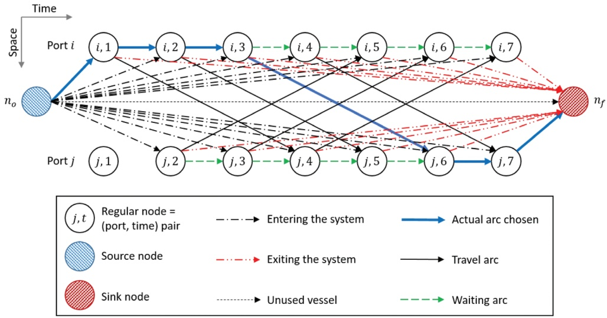
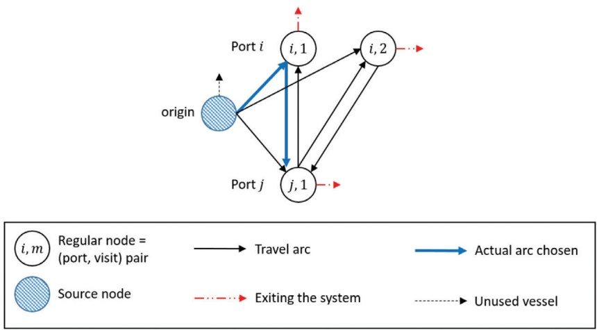
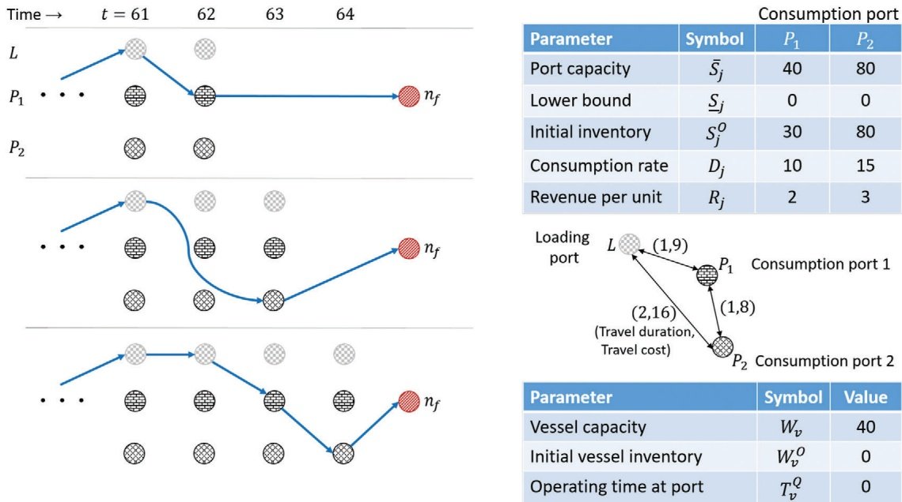

Intl. Trans. in Op. Res. 30 (2023) 3013–3056 DOI: 10.1111/itor.13313

# Maritime inventory routing: recent trends and future directions

Kjetil Fagerholta, Lars Magnus Hvattumb, Dimitri J. Papageorgiouc and Sebastián Urrutiab,∗

aDepartment of Industrial Economics and Technology Management, Norwegian University of Science and Technology (NTNU), Alfred Getz vei 3, Trondheim 7491, Norway

bFaculty of Logistics, Molde University College, Britvegen 2, Molde 6410, Norway cExxonMobil Technology and Engineering Company, 1545 Route 22 East, Annandale, NJ 08801, USA E-mail: kjetil.fagerholt@ntnu.no [Fagerholt]; lars.m.hvattum@himolde.no [Hvattum]; dimitri.j.papageorgiou@exxonmobil.com [Papageorgiou]; sebastian.a.urrutia@himolde.no [Urrutia]

Received 31 March 2023; received in revised form 26 April 2023; accepted 26 April 2023

## Abstract

We review recent literature pertaining to the maritime inventory routing problem (MIRP), a stimulating, albeit niche, subclass of vendor-managed inventory problems. MIRPs deal with optimally distributing products with a (typically heterogeneous) vessel fleet between production and consumption ports with inventory tracking and inventory limits. We present two mixed-integer linear programming models for the MIRP—one based on discrete time, the other based on continuous time—and we discuss the advantages and disadvantages of each of the two modeling approaches. In surveying more than 50 papers spanning the decade 2013–2023, we investigate MIRP variants from many different applications and discuss how these have been modeled and solved. Our purpose is to provide a comprehensive overview of state-of-the-art MIRP research published in this period, collated along multiple dimensions. In addition to providing information about available test instances, we highlight recent trends and interesting avenues for future research. As such, we believe this survey will be useful to students, researchers, and practitioners in this domain.

Keywords: maritime inventory routing problem; transportation; combinatorial optimization

## 1. Introduction

Inventory management and transportation planning have traditionally been managed separately. However, ever more organizations and supply chains now take advantage of the possibility to synchronize these tasks by integrating the planning of inventory management and routing of the vehicles. The inventory routing problem (IRP), first studied by Bell et al. (1983), involves the integration and coordination of these two important supply chain components. In most versions of the IRP, a given fleet of vehicles is used to deliver products from a single depot to a set of customers, so that each customer can meet its demand over a set of discrete-time periods (e.g., over a week) and maintain its inventory within given upper and lower limits. The decisions to be made are (1) when to visit each customer (i.e., in which time period(s)), (2) how much to deliver at each visit, and (3) how to route the vehicles to minimize the sum of the transportation and inventory holding costs.

<small>∗Corresponding author.</small>

<small>International Transactions in Operational Research published by John Wiley & Sons Ltd on behalf of International Federation of Operational Research Societies</small>

<small>This is an open access article under the terms of the [Creative Commons Attribution-NonCommercial-NoDerivs](http://creativecommons.org/licenses/by-nc-nd/4.0/) License, which permits use and distribution in any medium, provided the original work is properly cited, the use is non-commercial and no modifications or adaptations are made.</small>

In this paper, we survey the literature on the maritime inventory routing problem (MIRP), which is the maritime version of the IRP. In the MIRP, the customers are consumption ports with given demands. These consumption ports are serviced by a heterogeneous fleet of vessels from a set of production ports with given production rates. Both the consumption and production ports have given inventory limits. A more formal definition of the MIRP is provided in Section 3.

Despite being a variant of the IRP, there are also a number of important differences between the MIRP and the land-based IRP. First, the MIRP usually has multiple production ports from which the consumption ports (or customers) are serviced instead of the single depot. Second, in contrast to the IRP, where the vehicle trips start and end in a single depot, MIRPs are usually open-ended and do not have a depot, so that the vessels can start and end at any location. Third, in the IRP, each trip typically lasts for one day and a solution will consist of the planned trips for a given set of days (e.g., a week), whereas MIRPs most often have more time-consuming voyages or trips over longer distances and therefore longer planning horizons. Furthermore, IRPs usually have homogeneous fleets of vehicles, while MIRPs have heterogeneous vessel fleets. Even in the case of similar or identical vessels, the fleet must be considered heterogeneous in the MIRP due to the vessels having different starting locations and possibly also times for when they become available for use (because the problem is open-ended). Yet another special characteristic of some MIRPs arising in the distribution of liquid commodities like liquefied natural gas (LNG) and ammonia, is that the transported commodity evaporates and may be used as fuel, which may impose additional complexity. Finally, the objective in a MIRP usually only includes the minimization of transportation cost and not the inventory holding cost. The reason for this is that most MIRPs are for vertically integrated companies so that it does not matter in which ports the products are stored. Thus, with given production and consumption rates, the inventory holding cost will in any case be given and can be considered as sunk.

While the MIRP has attracted practitioners and researchers from myriad disciplines thanks to its inherent mathematical complexity and computational challenges, the ever-growing seascape of real-world applications deserves particular credit for sustaining the field and propelling it into new realms. In fact, Coelho et al. (2014) reported that MIRPs are a primary source of real-world IRP applications. As highlighted in Table 1, summarizing our literature survey on the MIRP, numerous commodities and their associated idiosyncrasies have influenced the field. One can easily observe that energy-related commodities like refinery feedstocks (e.g., crude oil and vacuum gas oil), refined products (e.g., diesel and fuel oil), and LNG constitute the lion’s share of MIRP applications. Maritime supply chain and logistics associated with ammonia, automobiles, calcium carbonate for the paper and pulp industry, cement, and fish feed have also garnered noteworthy attention. Those papers listed as “general” do not have a specific application but are meant to influence modeling and methodological approaches pursued in other work.

| Table 1 Surveyed works |  |  |  |  |  |  |  |  |  |  |  |
| --- | --- | --- | --- | --- | --- | --- | --- | --- | --- | --- | --- |
| Reference | App | PL | D/S | Time | Model(s) | V | P | PH | U | Pr | Method |
| Agra et al. (20 1 4) | Ref prods | T | D | C | Arc | 4 | 7 | 1 80 | d | 4 | Valid inequalities, RHH, local branching, feasibility pump |
| Agra et al. (20 1 5) | Ref prods | O | S | C | Arc | 2 | 7 | 8 | d | 4 | L-shaped algorithm (Benders-like), sample average approximation |
| Agra et al. (20 1 6) | General | T | S | C | Arc | 5 | 6 | 30 | d | 1 | Matheuristic |
| Agra et al. (20 1 7a) | Ref prods | T | D | C/D | Arc | 2 | 7 | 1 5 | d | 4 | Default solver |
| Agra et al. (20 1 7b) | Fish feed | O | D | C | Arc | 2 | 60 | 1 0 | d | 1 | Reformulation, valid inequalities, matheuristic |
| Agra et al. (20 1 8) | General | T | S | C | Arc | 5 | 6 | 30 | d | 1 | Benders-like, matheuristics |
| Agra et al. (2022) | General | T | D | C | Arc | 1 | 6 | 240 | d | 1 | Default solver, valid inequalities, branching schemes |
| Al-Haidous et al. (20 1 6) | LNG | T | D | D | Arc | 1 6 | c | 373 | d | 1 | Default solver |
| Al-Haidous et al. (2022) | LNG | S/T | D | D | Arc | 1 0 | c | 2 1 | d | 1 | PSO |
| Algendi et al. (2023) | General | T | D | C | Arc | 3 | 5 | 60 | d | 1 | Default solver |
| Andersson et al. (20 1 6) | LNG | T | D | D | Path | 5 | 6 | 75 | d | 1 | Branch-and-cut, valid inequalities |
| Andersson et al. (20 1 7) | LNG | S/T | D | D | Assign | 46 | c | 365 | d | 2 | Branch-and-cut, valid inequalities |
| Bredström et al. (20 1 5) | CaCO3 | O | D | D | Path | 1 2 | 6 | 28 | d | 20 | Default solver |
| Chandra et al. (20 1 3) | Auto | T | D | C | Arc | 5 | 6/c | 1 0 | d | 5 | Matheuristic |
| Cho et al. (20 1 8) | LNG | O | S | D | Arc | 1 5 | c | 200 | d | 1 | Default solver, preprocessing heuristic |
| De et al. (20 1 6) | General | O | D | C/D | Arc | 6 | 1 0 | 1 0 | d | 6 | PSO |
| De et al. (20 1 7) | Containers | O | D | D | Arc | 6 | 1 0 | 22 | h | 1 | PSO |
| Diz et al. (20 1 7) | Crude oil | O | D | D | Arc | 1 1 | 1 1 | 1 5 | d | 1 | Default solver |
| Diz et al. (20 1 9) | Crude oil | T/O | S | D | Arc | 5 | 6 | 1 5 | d | 1 | Matheuristics |
| Dong et al. (20 1 8) | General | O | S | D | Arc | 7 | 3/c | 60 | d | 1 | Default solver, RHH |
| Dong et al. (2020) | Auto | T | D | C | Arc | 29 | 36 | 1 80 | d | 1 | Default solver |
| Eide et al. (2020) | General | T | D | C | Arc | 3 | 5 | 60 | d | 1 | Default solver |
| Foss et al. (20 1 6) | General | O | D | D | Arc | 4 | 8 | NA | NA | 4 | Default solver, valid inequalities |
| Friske et al. (2022) | General | T | D | D | Arc | 1 7 | 1 3 | 60 | d | 1 | Matheuristics |
| Goel et al. (20 1 5) | LNG | S/T | D | D | Arc | 1 00 | 1 9/c | 365 | d | 1 | Constraint Programming, search heuristic |
| Hemmati et al. (20 1 5) | General | T | D | C | - | 8 | 8/c | 30 | d | 1 | Iterative heuristic |
| Hemmati et al. (20 1 6) | General | T | D | C | Arc | 7 | 24 | 1 440 | h | 4 | Matheuristic |
| Jiang and Grossmann (20 1 5) | General | T | D | C/D | Arc | 6 | 1 0 | 80 | d | 1 | Default solver Continued |

| Reference | App | PL | D/S | Time | Model(s) | V | P | PH | U | Pr | Method |
| --- | --- | --- | --- | --- | --- | --- | --- | --- | --- | --- | --- |
| Li and Schütz (2020) | LNG | S | D | C | Arc | 40 | c | 1 4 | m | 1 | RHH |
| Li et al. (2023) | LNG | S | D | D | Arc | 40 | c | 1 4 | m | 1 | RHH |
| Liu et al. (202 1) | Ref prods | T | S | C | Arc | 1 2 | 2 1 | 720 | h | 1 | Benders decomposition |
| Misra et al. (2020a) | Ref prods | O | D | C/D | Arc | 6 | 1 0 | 9 | d | 3 | Default solver |
| Misra et al. (2020b) | Ref prods | O | D | D | Arc | 4 | 7 | 1 08 | 2h | 3 | Default solver |
| Msakni and Haouari (20 1 8) | LNG | T | D | D | Arc | 62 | 1 60/c | 98 | d | 1 | VNS, column generation for dual bounds |
| Munguía et al. (20 1 9) | General | S/T | D | D | Arc | 70 | 1 2 | 360 | d | 1 | Parallel alternating criteria search |
| Mutlu et al. (20 1 6) | LNG | S/T | D | D | Arc | 40 | 1 7/c | 365 | d | 1 | Matheuristic, valid inequalities |
| Nikhalat-Jahromi et al. (20 1 6) | LNG | O | D | D | Arc | 1 0 | 5/c | 90 | d | 1 | Default solver |
| Papageorgiou et al. (20 1 8) | General | S | D | D | Arc | 70 | 1 2 | 360 | d | 1 | Matheuristics |
| Radan et al. (2022) | Containers | T/O | D | D | Arc | 6 | 1 0 | 20 | h | 1 | GA |
| Rakke et al. (20 1 5) | LNG | T | D | D | Path | 25 | 1 5/c | 3 | m | 2 | Branch-price-and-cut, valid inequalities |
| Rodrigues et al. (20 1 9) | General | T | S | C | Arc | 5 | 6 | 30 | d | 1 | Default solver, Benders-like |
| Rusdianto and Siswanto (2020) | Cement | O | D | C | Arc | 4 | 4 | 1 5 | d | 2 | Default solver |
| Sanghikian et al. (202 1) | Ref prods | T | D | C | NA | 1 5 | 1 8 | 60 | d | 9 | VNS combined with default solver |
| Shaabani et al. (2023) | General | T | D | C | Arc | 5 | 24 | 60 | d | 6 | Matheuristic |
| Shao et al. (20 1 5) | LNG | S/T | D | D | Arc | 69 | 1 1 | 365 | d | 1 | GRASP, RHH |
| Sheikhtajian et al. (2020) | LNG | S/T | S | D | Arc | 40 | 9/c | 365 | d | 1 | GA, fuzzy model for sensitivity |
| Siswanto et al. (20 1 9) | Ref prods | O | D | C | Arc | 2 | 3 | 1 5 | d | 2 | GA |
| Soroush and Al-Yakoob (20 1 8) | Crude oil | T | S | D | Arc | 1 2 | 2 | 1 20 | d | 1 | Default solver |
| Stanzani et al. (20 1 8) | Crude oil | O | D | C | Arc | 25 | 1 8 | 355 | h | NA | Matheuristic |
| Stålhane et al. (20 1 4) | General | T | D | C | Arc,Path | 4 | 6/c | 30 | d | 1 | Branch-and-Price, path generation heuristic |
| Xin et al. (202 1) | Crude oil | T | D | C | VRPTW | 4 | 1 6 | NA | NA | 1 | Branch-and-Price |
| Zhang et al. (20 1 8) | LNG | T | S | D | Arc | 4 | 5 | 60 | d | 1 | Lagrangean heuristic |
| Zojaji et al. (2022) | General | T | D | C | Arc | 5 | 6 | 60 | d | 1 | Default solver |

GRASP=greedyrandomizedadaptivesearchprocedures;Validinequalities=problem-specificusercutswereincluded. C=continuous-timemodel;D=discrete-timemodel;Model(s):Arc=arc-flow,Path=path-flow,Assign=hascharacteristicsofanassignmentproblem, Note:App(Application):Auto=automobiles;LNG=liquefiednaturalgas;CaCO3=calciumcarbonateslurry;General=Nospecificproductlisted;Ref

International Transactions in Operational Research published by John Wiley & Sons Ltd on behalf of International Federation of Operational Research Societies

## 1.1. Scope and definitions

In this paper, we provide an update to the original MIRP survey by Papageorgiou et al. (2014) (covering material up to mid-2013) and the more general survey on IRPs (both land-based and maritime) from 2010 by Andersson et al. (2010). Since these surveys, more than 50 new peer-reviewed MIRP studies have been published. Hence, we focus on the literature published during the last decade, even though we include a few older ones that were omitted in these previous surveys. Our purpose is to provide a comprehensive source for research on the MIRP published in this period. Furthermore, we discuss recent trends and interesting avenues for future research in this domain.

As with any survey, one must agree on the criteria used to decide which works should be included. We have attempted to include papers that adhere to the standard MIRP definition as “a planning problem where an actor has the responsibility for both the inventory management at one or both ends of the maritime transportation legs, and for the ships’ routing and scheduling” (Christiansen et al., 2013). Since this definition still leaves room for interpretation, we have chosen to focus on works that, in our judgement, possess a strong maritime inventory and routing component. Thus, a handful of papers that treat a substantial land component, despite possessing some maritime attributes, have been excluded. We only include peer-reviewed journal publications, which means that some conference papers, nonpeer-reviewed works, as well as master’s and Ph.D. theses, are not surveyed.

It is instructive to contrast our current approach and focus with that of Papageorgiou et al. (2014). First, a primary goal of Papageorgiou et al. (2014) was to introduce MIRPLIB, a library of single product, deep-sea MIRPs with inventory tracking at every port. In contrast, the present work does not attempt to offer any new instances, although we do discuss recent instances that are available. Second, as a consequence of focusing on deep-sea MIRPs, Papageorgiou et al. (2014) presented a versatile “core” discrete-time model but did not present a continuous-time model, as the latter typically requires steady-state (time-independent) parameters and is thus more commonly found in short-term, operational settings. The present work offers a basic continuous-time model, which is then compared with the discrete-time model. Third, Papageorgiou et al. (2014) were partially motivated by the “need to direct the research on maritime transportation towards more basic research” (Christiansen and Fagerholt, 2011). Although the present work shares this ambition, it strives to summarize recent trends and provide new directions in maritime inventory routing that are worthy of investigation for future generations.

## 1.2. Contributions and outline

The contributions of this paper can be summarized as follows:

1. We present a comprehensive survey of the literature from the last decade and discuss different MIRP variants as well as its solution methods.

2. We present both a discrete- and continuous-time formulation of the MIRP and discuss the advantages and disadvantages of each of these two formulations, as well as some other modeling approaches.

3. We provide information about available MIRP test instances.

4. We discuss recent trends and interesting avenues for future research in this domain.

Based on the above contributions, we believe this survey will be a useful source of information for everyone that is studying a (variant of the) MIRP, including researchers and students, as well as practitioners.

The remainder of this paper is organized as follows. Section 2 provides a summary of the MIRP studies in the last decade. In Section 3, we present both a discrete- and continuous-time formulation of the MIRP. Here, we also discuss the advantages and disadvantages of each of these two formulations as well as some other modeling approaches for the MIRP. Section 4 presents a number of important variants of the MIRP and reviews papers within each of these. Section 5 discusses the different solution techniques, both exact and heuristic, which have been used for the MIRP, while Section 6 presents information about relevant test instances. In Section 7, we discuss recent trends and interesting directions for future research, before we conclude in Section 8.

## 2. Summary and classification of recent works

Table 1 describes the main characteristics of the 53 MIRP applications surveyed in this work. The first column displays the reference for the work. The next column (Application) specifies the type of product being transported in the application. The next two columns (PL and D/S) list the planning level and the consideration or not of stochastic elements in the problem. It should be emphasized that there is often no clear distinction between the different planning levels. Furthermore, different authors often categorize similar planning problems to be at different planning levels, especially between the tactical and operational levels. In general, strategic planning problems involve decisions that will have an impact for a very long time (at least more than a year), for example, decisions about the renewal of a vessel fleet based on actual and (uncertain) future operations. Tactical planning normally involves a time horizon of months and up to one year, while operational planning concerns planning of some weeks (and sometimes even only days) up to a few months. Tactical and operational planning problems tend to have more hard constraints relative to strategic problems. The next two columns (Time and Model(s)) describe the mathematical model in terms of how time is treated (discretized or continuous) and what is the main modeling element. The next four columns (V–U) describe the largest instance tackled in terms of the number of vessels, number of ports, length of the planning horizon, and the unit of measurement of the planning horizon length, respectively. The next column (Pr) displays the number of different products transported in the application. The last column (Method) shows in a condensed manner the method used for solving the problem. Subsequent tables presented and discussed in Section 4 include even more characteristics of the different MIRP variants, such as partial versus full discharges.

## 3. Models

In this section, we describe two basic mixed-integer linear programming (MILP) models for maritime inventory routing: a discrete-time formulation in Section 3.1 and a continuous-time formulation in Section 3.2. We then offer a qualitative comparison of the two formulations in Section 3.3 with the aim of providing guidance on when one might prefer one model over the other. Section 3.4 outlines alternative formulations that have been employed.

<small>© 2023 The Authors © 2023 The Authors.</small>

<small>International Transactions in Operational Research published by John Wiley & Sons Ltd on behalf of International Federation of Operational Research Societies</small>

Before delving into the two formulations that constitute the bulk of this section, a few introductory remarks may be helpful to novices in the field. Table 1 reveals that 30 of the last decade’s 53 MIRP papers relied on the discrete-time formulations and 27 utilized a continuous-time representation, including four papers that applied both. Discrete-time models have antecedents in lot-sizing formulations, which are extremely popular in production planning and scheduling applications throughout the fields of operations management and operations research. These models assume that forecasts are generated for production and consumption rates, costs, and bounds in each “time period.” Where does a time period come from? In virtually all real-world industrial applications, stakeholders define a time period if it is not already defined for them. In many cases, a forecasting team takes advantage of historical time series data (e.g., with daily time resolution) and other information (e.g., expert judgement) to build time series projections of future parameters with the same time resolution. Consequently, the models are well-suited at handling time-varying parameters, but approximate inventory constraints by only enforcing inventory bounds at the beginning and end of every time period. On the other hand, in continuous-time models, the entire planning horizon is seen as a continuum. Decisions, such as vessel departure times, can apply for any point in time from zero to the end of the planning horizon, and constraints, such as inventory bounds, are enforced at every instantaneous point in time. Meanwhile, parameters cannot vary over time.

While the above description would suggest that the two models are quite different, it is instructive to describe their similarities. First, both models take place on an underlying network of nodes and arcs. In the discrete-time model, a node is a port-time pair denoting a port at a particular point in (discretized) time. In the continuous-time model, a node is a port-visit number pair denoting the mth visit to a particular port by any vessel.

Finally, it is important to state our key assumptions for both the discrete- and continuous-time models presented below:

• Only one type of product is transported.

• Each port is either a production or consumption port.

• Production and consumption rates are parameters (for each time period in the discrete-time model and for the entire planning horizon in the continuous-time model).

• No minimum time duration between consecutive visits to the same port is enforced.

• There are no inventory holding costs.

• There is a finite planning horizon.

• No spot markets are available in the event that inventory hits upper or lower bounds at a port.

## 3.1. Discrete-time model

<table><tr><td colspan="2">Definition</td></tr><tr><td colspan="2">Indices and sets</td></tr><tr><td> $t \in \mathcal{T}$ </td><td>set of time periods:  $\mathcal{T} = \{1, \dots, T\}$ </td></tr><tr><td> $v \in \mathcal{V}$ </td><td>set of vessels</td></tr><tr><td> $i, j \in \mathcal{P}$ </td><td>set of ports</td></tr><tr><td> $n \in \mathcal{N}$ </td><td>set of regular nodes or port-time pairs:  $\mathcal{N} = \{n = (j, t) : j \in \mathcal{P}, t \in \mathcal{T}\}$ </td></tr><tr><td> $n \in \mathcal{N}_{o,f}$ </td><td>set of all nodes (including a source node  $n_o$  and a sink node  $n_f$ ):  $\mathcal{N}_{o,f} = \mathcal{N} \cup \{n_o, n_f\}$ </td></tr></table>

$$
O p.
$$

$$
a \in \mathcal {A} _ {n, v} ^ {\mathrm{IN}}
$$

$$
a \in \mathcal {A} _ {n, v} ^ {\mathrm{OUT}}
$$

$$
\in \mathcal {N} _ {o, f}
$$

$$
\mathcal {A} _ {n, v} ^ {\mathrm{IN}} = \{a \in \mathcal {A} _ {v}: \exists n ^ {\prime} \in \mathcal {N} _ {\alpha , f}: (n ^ {\prime}, n) \in \mathcal {A} _ {v} \}
$$

$$
v \in \mathcal {V}:
$$

$$
n \in \mathcal {N} _ {o, f}
$$

$$
\mathcal {A} _ {n, v} ^ {\mathrm{OUT}} = \{a \in \mathcal {A} _ {v}: \exists n ^ {\prime} \in \mathcal {N} _ {o, f}: (n, n ^ {\prime}) \in \mathcal {A} _ {v} \}
$$

$$
v \in \mathcal {V}
$$

$$
a \in \mathcal {A} _ {v}
$$

$$
v \in \mathcal {V}:
$$

$$
\mathcal {A} _ {v} \subseteq \left\{\left(n _ {o}, n\right): n \in \mathcal {N} \right\} \cup \left\{\left(n, n _ {f}\right): n \in \mathcal {N} \right\} \cup \left\{\left(n, n ^ {\prime}\right): n, n ^ {\prime} \in \mathcal {N} \right\} \cup \left\{\left(n _ {o}, n _ {f}\right) \right\}
$$

$$
B _ {i}
$$

$$
C _ {a}
$$

$$
\left| D _ {i t} \right|
$$

$$
a \in \mathcal {A} _ {\nu}
$$

$$
i \in \mathcal {P}
$$

$$
J _ {i}
$$

$$
Q _ {v}
$$

$$
+ 1
$$

$$
i \in \mathcal {P}
$$

$$
i \in \mathcal {P}
$$

$$
t \in \mathcal {T}
$$

$$
\left| \overline {{S _ {i}}} \left(S _ {i}\right) \right|
$$

$$
\left| S _ {i} ^ {O} \right|
$$

$$
v \in \mathcal {V}
$$

$$
i \in \mathcal {P}
$$

$$
\dot {W} _ {v}
$$

$$
i \in \mathcal {P}
$$

$$
W _ {v} ^ {O}
$$

$$
v \in \mathcal {V}
$$

$$
v \in \mathcal {V}
$$

$$
q _ {i t v}
$$

$$
S _ {i t}
$$

$$
w _ {t v}
$$

$$
i \in \mathcal {P}
$$

$$
i \in \mathcal {P}
$$

$$
v \in \mathcal {V}
$$

$$
v \in \mathcal {V}
$$

$$
t \in \mathcal {T} \cup \{0 \}
$$

$$
t \in \mathcal {T}
$$

$$
t \in \mathcal {T} \cup \{0 \}
$$

$$
o _ {i t v}
$$

$$
x _ {a}
$$

$$
v \in \mathcal {V}
$$

$$
\mathcal {A} _ {v}
$$

$$
i \in \mathcal {P}
$$

$$
t \in \mathcal {T};
$$

Discrete-time models unfold on a time-expanded network (or time-space network), where geographical locations are replicated in time, typically with equal durations between time periods. While the concept of using a time-expanded network dates back to Ford and Fulkerson (1958), if not earlier, Savelsbergh and Song (2008) were among the first to employ the construct for an IRP, after which the idea was adopted by Song and Furman (2013) and now by dozens of others in a MIRP setting. The network consists of a set $\mathcal { N } _ { o , f }$ of nodes and a set $\mathcal { A } _ { \nu }$ of directed arcs for each vessel $v \in \mathcal { V } .$ . The node set $\mathcal { N } _ { o , f }$ comprises a set $\mathring { \mathcal { N } } = \{ ( j , t ) : j \in \mathcal { P } , t \in \mathcal { T } \}$ of “regular” nodes, or port-time pairs, as well as a source node $n _ { o }$ and a sink node $n _ { f }$ . The set of incoming and outgoing arcs associated with vessel $v \in \mathcal { V }$ at node $n \in \mathcal { N } _ { o , f }$ is denoted by $\mathcal { A } _ { n , v } ^ { \mathrm { { I N } } }$ and $\mathcal { A } _ { n , \nu } ^ { \mathrm { { o U T } } }$ , respectively.

There are several ways to depict a time-expanded network. Figure 1 illustrates an example of a time-expanded network from a particular vessel’s point of view. In this interpretation, it is helpful from both a conceptual and implementation vantage point to partition each vessel’s arc set $\mathcal { A } _ { \gamma }$ into source, sink, waiting, and travel arcs. A source arc $a = ( n _ { o } , ( j , t ) )$ from the source node to a regular node represents a vessel’s arrival to its initial destination. In many tactical and operational problems, there is a single source arc per vessel, that is, $\mathcal { A } _ { n _ { o } , \nu } ^ { \mathrm { { O U T } } }$ is a singleton, since the initial boundary conditions are already prescribed. In certain strategic planning problems, however, it is common to find multiple source arcs per vessel to allow for optimizing the initial vessel positions. A sink arc $\boldsymbol { a } = ( ( j , t ) , n _ { f } )$ from a regular node to the sink node captures when a vessel departs the system and is no longer in use. A waiting arc $a = ( ( j , t ) , ( j , t + 1 ) )$ from a port $j$ in time period t to the same port in time period $t + 1$ represents a vessel remaining at that port in two consecutive time periods. A travel arc $a = ( ( j _ { 1 } , t _ { 1 } ) , ( j _ { 2 } , t _ { 2 } ) )$ with $j _ { 1 } \neq j _ { 2 }$ and $t _ { 1 } < t _ { 2 }$ represents travel between two distinct ports, where the travel time $( t _ { 2 } - t _ { 1 } )$ between ports is given. Finally, one may also include a source-sink arc $a = ( n _ { o } , n _ { f } )$ for each vessel to allow for the possibility that a vessel is never used. Such arcs are more common in strategic planning models where the fleet size may be in question.

<small>International Transactions in Operational Research published by John Wiley & Sons Ltd on behalf of International Federation of Operational Research Societies</small>

Fig. 1. Time-expanded (or time-space) network for an individual vessel first available at port i in time period 1 and at port j in time period 2.

Figure 1 shows available arcs for a given vessel that first becomes available at port i in time period 1 and at port j in time period 2. It chooses to visit port 1, then wait there for two consecutive time periods before traveling to port j. As mentioned above, the travel arcs encode the duration of a voyage, which in this case is three time periods. The vessel arrives at port j in time period 6, then waits one time period before ultimately exiting the system (since the end of the planning horizon has been reached) in time period 7. The network does not depict actual operations at a port; these are handled via constraints.

It is also possible to depict the time-expanded network from the entire vessel fleet’s point of view. Such a representation is nearly identical to what is depicted in Fig. 1 except that one shows all potential arcs in the network for all vessels and, in doing so, one emphasizes the fact that all vessels “share” the same nodes, but can have different arc sets. Since this approach was used in several earlier works, we have opted to depict the network from an individual vessel’s vantage point instead.

Since we have deliberately adopted a more compact notation to describe our discrete-time formulation than what appears in other papers, we provide a short explanation as to why we have chosen this style. A more verbose representation of our $x _ { a }$ decision variables, at least when two port-time pairs are involved, would be $x _ { ( j _ { 1 } , t _ { 1 } ) , ( j _ { 2 } , t _ { 2 } ) , \nu } ,$ to denote whether vessel v voyages from port $j _ { 1 }$ departing in time period $t _ { 1 }$ to port $j _ { 2 }$ arriving in time period $t _ { 2 }$ (with $t _ { 2 } > t _ { 1 } )$ . This notation permits a vessel to remain at a port for consecutive time periods, that is, $j _ { 1 } = j _ { 2 }$ . If there is a single travel duration for vessel v voyaging from $j _ { 1 }$ to $j _ { 2 } ,$ then one could forgo the second time index and simply write $x _ { ( j _ { 1 } , t _ { 1 } ) , j _ { 2 } , \nu } .$ . Having both time indices, however, allows for a vessel’s voyage to have different durations (we refer the interested reader to Section 4.3 on “Speed optimization”). In our experience, we have found that those implementing models in an algebraic modeling language (e.g., AIMMS, AMPL,

GAMS, JuMP, or Pyomo) tend to prefer this more verbose notation. On the other hand, those implementing codes for large-scale instances have found our compact notation more conducive to project and model management. In particular, not only does it allow one to conceptually frame a model in terms of nodes and arcs, but one can then implement data structures and objects (when working in an object-oriented design) to easily organize, store, and retrieve information related to nodes and arcs. Since many large-scale problems are intractable for commercial solvers, powerful heuristics can then be devised to operate on this network of nodes and arcs, possibly exploiting more advanced parallel architectures. Our basic discrete-time model has the following form:

$$
\min \sum_ {v \in \mathcal {V}} \sum_ {a \in \mathcal {A} _ {v}} C _ {a} x _ {a},\tag{1}
$$

$$
\text {s.t.} \sum_ {a \in \mathcal {A} _ {n _ {o}, v} ^ {\mathrm{OUT}}} x _ {a} = 1 \quad v \in \mathcal {V},\tag{2}
$$

$$
\left| \sum_ {a \in \mathcal {A} _ {n _ {f}, v} ^ {\mathrm{IN}}} x _ {a} = 1 \quad v \in \mathcal {V}, \right|\tag{3}
$$

$$
\sum_ {a \in \mathcal {A} _ {n, v} ^ {\mathrm{IN}}} x _ {a} - \sum_ {a \in \mathcal {A} _ {n, v} ^ {\mathrm{OUT}}} x _ {a} = 0 \quad n \in \mathcal {N}, v \in \mathcal {V},\tag{4}
$$

$$
s _ {i 0} = S _ {i} ^ {O} \quad i \in \mathcal {P},\tag{5}
$$

$$
s _ {i t} = s _ {i t - 1} + J _ {i} D _ {i t} - \sum_ {v \in \mathcal {V}} J _ {i} q _ {i t v} \quad (i, t) \in \mathcal {N},\tag{6}
$$

$$
w _ {0 v} = W _ {v} ^ {O} \quad v \in \mathcal {V},\tag{7}
$$

$$
w _ {t v} = w _ {t - 1, v} + \sum_ {(i, t) \in \mathcal {N}} J _ {i} q _ {i t v} \quad v \in \mathcal {V}, t \in \mathcal {T},\tag{8}
$$

$$
\sum_ {v \in \mathcal {V}} o _ {i t v} \leq B _ {i} \quad (i, t) \in \mathcal {N},\tag{9}
$$

$$
o _ {i t v} \leq \sum_ {a \in \mathcal {A} _ {(i, t), v} ^ {\mathrm{IN}}} x _ {a} \quad (i, t) \in \mathcal {N}, v \in \mathcal {V},\tag{10}
$$

$$
0 \leq q _ {i t v} \leq Q _ {v} o _ {i t v} \quad (i, t) \in \mathcal {N}, v \in \mathcal {V},\tag{11}
$$

$$
S _ {i} \leq s _ {i t} \leq \overline {{S _ {i}}} \quad (i, t) \in \mathcal {N},\tag{12}
$$

$$
0 \leq w _ {t v} \leq W _ {v} \quad v \in \mathcal {V}, t \in \mathcal {T},\tag{13}
$$

$$
o _ {i t v} \in \{0, 1 \} \quad (i, t) \in \mathcal {N}, v \in \mathcal {V},\tag{14}
$$

$$
x _ {a} \in \{0, 1 \} \quad v \in \mathcal {V}, a \in \mathcal {A} _ {v},\tag{15}
$$

<small>© 2023 The Authors. International Transactions in Operational Research published by John Wiley & Sons Ltd on behalf of International Federation of Operational Research Societies</small>

Constraints (2)–(4) maintain flow balance for every vessel $v \in \mathcal { V }$ in the time-expanded network. Specifically, constraints (2) and (3) ensure that every vessel enters and exits the system, respectively, while constraints (4) enforce that if a vessel enters node $n \in \mathcal { N } ,$ , it must also exit that node. Constraints (5) and (6) are inventory balance constraints at all ports. Constraints (7) and (8) maintain inventory balance on each vessel. Berth limit constraints (9) limit the number of vessels that can attempt to operate (load or unload) at a port in each time period. Constraints (10) ensure that a vessel does not attempt to load/unload at a node unless the vessel is actually at that node. Constraints (11) require that, if a vessel attempts to load/unload at node $n ,$ then the actual amount loaded/unloaded does not exceed $Q _ { v }$ . Variable bounds (12) and (13) require ending inventory (i.e., at the end of time period t) at ports and on vessels, respectively, to be within prespecified bounds. Binary restrictions apply to operating decisions and arc-flow decisions in (14) and (15), respectively.

It is important to highlight that a discrete-time formulation only enforces inventory bounds at ports and on vessels at the end of each time period. Since this could lead to ambiguities, we assume that, in a given time period, production occurs before loading takes place and consumption occurs after discharging takes place. This means that it may be possible for a vessel to load or unload more product than a port’s capacity in a given time period. For example, if production port i produces 30 units of product per period and has a constant capacity of 240 units, then a sufficiently large vessel could load 270 units in a single period. This could occur if port i has 240 inventory at the end of time period t and a vessel with capacity $\geq 2 7 0$ units arrives in time period $t + 1$ , and loads 270 units, 30 of which are produced in time period $t + 1$ , while the remaining 240 units are taken from the port’s inventory.

The discrete-time model above also handles loading and unloading operations differently than a continuous-time model, which explicitly accounts for the time needed to load/unload one unit of product for vessel $v \in \mathcal { V }$ . First, it is common to bundle the operations time at a port into the travel time between two distinct ports. The rationale for this assumption, at least in the applications where it is made, is that voyages are quite costly, and a vessel would never travel to a port without carrying out extensive operations. Thus, planners and schedulers approximate the time needed to load/unload at a port and factor this into the travel duration. Second, the discrete-time model introduces the parameter $Q _ { v }$ to limit the maximum amount of product that can be loaded onto/unloaded from vessel $v \in \mathcal { V }$ in any time period. This parameter prevents a vessel from fully loading/unloading in a given time period if the time resolution is relatively small.

## 3.2. Continuous-time model

The continuous-time model presented here is related to early model variants first presented by Christiansen (1999) and Al-Khayyal and Hwang (2007). It is based on defining a set of visits, that is, a set of pairs of ports and visit numbers. Vessels then must perform some of those visits in order to transport the product from the producers to the consumers. The enhanced solution space coming from considering the planning horizon as a continuous space comes with the onus of having to consider the production and consumption rates as constants for the full planning horizon. Furthermore, the maximum number of visits to a port is limited by a parameter. Setting this parameter without a careful analysis may yield an infeasible model. It is also assumed that each port has only one berth, that is, there are no simultaneous visits to ports.

Fig. 2. An instance and solution for a continuous-time model for MIRP.

After the set of possible visits is defined as nodes, the problem may be seen as a routing problem on a network formed by the port-visit nodes and the set of arcs representing the possible trips of a vessel from a given visit of a port to a visit of another port. Defining a different network for each vessel, one can impose that a certain visit can only be performed by a certain subset of vessels or certain vessels may be not allowed to perform certain trips. Figure 2 shows the network when modeling the example in Fig. 1 using a continuous-time model. Port i can be visited twice, whereas port j can only be visited once during the time horizon.

Definition
Indices and sets
$i, j \in \mathcal{P}$
$v \in \mathcal{V}$
$(i, m) \in \mathcal{S}^A$
$\mathcal{S}_v^X$
set of possible port visits in which $i \in \mathcal{P}$ and $m$ is the visit number
set of possible voyages in which vessel $v \in \mathcal{V}$ departs from port $i$ and arrives at port $j$
with corresponding visit numbers $m$ and $n$: $((i, m), (j, n)) \in \mathcal{S}_v^X$
Parameters
$T$ the time horizon (usually in days)
$M_i$ maximum number of visits to port $i \in \mathcal{P}$
$J_i$ indicator taking value +1 if port $i \in \mathcal{P}$ is a producer and -1 if $i$ is a consumer
$D_i$ demand or production at port $i \in \mathcal{P}$ per time unit
$\overline{S_i(S_i)}$ maximum (minimum) inventory limit at port $i \in \mathcal{P}$
$S_i^O$ initial inventory at port $i \in \mathcal{P}$
$W_v$ maximum inventory on vessel $v \in \mathcal{V}$
$W_v^O$ initial inventory on vessel $v \in \mathcal{V}$
$T_v^Q$ time needed to load/unload one unit of product for vessel $v \in \mathcal{V}$
$T_{iv}^O$ time needed for vessel $v \in \mathcal{V}$ to travel from its origin to port $i \in \mathcal{P}$
$T_{ijv}^{PP}$ time needed to travel from port $i \in \mathcal{P}$ to port $j \in \mathcal{P}$ for vessel $v \in \mathcal{V}$
$C_{ijv}$ cost associated with the travel of vessel $v \in \mathcal{V}$ from port $i \in \mathcal{P}$ to port $j \in \mathcal{P}$
$C_{iv}^O$ cost associated with the travel of vessel $v \in \mathcal{V}$ from its origin to port $i \in \mathcal{P}$
© 2023 The Authors.
International Transactions in Operational Research published by John Wiley &amp; Sons Ltd on behalf of International Federation of Operational Research Societies

## Continuous decision variables

qimv amount of product loaded/unloaded in port $i \in \mathcal { P }$ at visit m, $( i , m ) \in \mathcal { S } ^ { A }$ , by vessel $v \in \mathcal { V }$ $s _ { i m }$ amount of product in port $i \in \mathcal { P }$ at the end of visit m, $( i , m ) \in \mathcal { S } ^ { A }$ $t _ { i m }$ time of visit m to port $i \in \mathcal { P } , ( i , m ) \in \mathcal { S } _ { v } ^ { A }$ $f _ { i m v } ^ { \sigma }$ $\mathcal { F } ^ { O }$ amount of product transported by vessel $v \in \mathcal { V }$ from its origin to visit $( i , m ) \in \mathcal { S } _ { \nu } ^ { A }$ $f _ { i m j n v }$ amount of product transported by vessel $v \in \mathcal { V }$ from visit $( i , m ) \in \mathcal { S } _ { \nu } ^ { A }$ to visit $\dot { ( j , n ) } \in \mathcal { S } _ { \nu } ^ { A }$ $f _ { i m v } ^ { D }$ amount of product on vessel $v \in \mathcal { V }$ when finishing its route after visit $( i , m ) \in \mathcal { S } _ { \nu } ^ { A }$

## Binary decision variables

$x _ { i m j n v }$ 1 if vessel $v \in \mathcal { V }$ sails directly from visit $( i , m ) \in \mathcal { S } _ { \nu } ^ { A }$ to visit $( j , n ) \in \mathcal { S } _ { \nu } ^ { \mathcal { A } } ; 0$ otherwise

$x _ { i m v } ^ { O }$ 1 if vessel $v \in \mathcal { V }$ sails directly from its origin to visit $( i , m ) \in \mathcal { S } _ { v } ^ { A } ;$ 0 otherwise

$z _ { i m v }$ 1 if vessel $v \in \mathcal { V }$ finishes its route in port $i \in \mathcal { P }$ after visit m, $(i,m) \in \mathcal{S}_v^A; 0$ otherwise

$z _ { y } ^ { \mathcal { O } }$ 1 if vessel $v \in \mathcal { V }$ is not used during the planning horizon; 0 otherwise

$\rho _ { i m v }$ 1 if vessel $v \in \mathcal { V }$ loads/unloads in port $i \in \mathcal { P }$ at visit $m ; 0$ otherwise

$y _ { i m }$ 1 if there are at least m visits to port $i \in \mathcal { P } ; 0$ otherwise

Our basic continuous-time model has the following form:

$$
\min \sum_ {v \in \mathcal {V}} \sum_ {((i, m), (j, n)) \in \mathcal {S} _ {v} ^ {X}} C _ {i j v} x _ {i m j n v} + \sum_ {v \in \mathcal {V}} \sum_ {(i, m) \in \mathcal {S} _ {v} ^ {A}} C _ {i v} ^ {O} x _ {i m v} ^ {O},
$$

$$
\text {s.t.} \quad \sum x _ {i m v} ^ {O} + z _ {v} ^ {O} = 1 \quad v \in \mathcal {V},\tag{16}
$$

$$
(i, m) \in \mathcal {S} ^ {A}\tag{17}
$$

$$
o _ {i m v} - \sum_ {((j, n), (i, m)) \in \mathcal {S} _ {v} ^ {X}} x _ {j n i m v} - x _ {i m v} ^ {O} = 0 \quad v \in \mathcal {V}, (i, m) \in \mathcal {S} _ {v} ^ {A},\tag{18}
$$

$$
\frac {o _ {i m v} - \sum_ {((i , m) , (j , n)) \in \mathcal {S} _ {v} ^ {X}} x _ {i m j n v} - z _ {i m v} = 0 \quad v \in \mathcal {V} , (i , m) \in \mathcal {S} _ {v} ^ {A} ,}\tag{19}
$$

$$
\sum_ {v \in \mathcal {V}} o _ {i m v} = y _ {i m} \quad (i, m) \in \mathcal {S} ^ {A},\tag{20}
$$

$$
y _ {i (m - 1)} - y _ {i m} \geq 0 \quad (i, m) \in \mathcal {S} ^ {A}, m \geq 2,\tag{21}
$$

$$
\underline {{q _ {i m v}}} \leq \min \{W _ {v}, \overline {{S _ {i}}} - \underline {{S _ {i}}} \} o _ {i m v} \quad v \in \mathcal {V}, (i, m) \in \mathcal {S} _ {v} ^ {A},\tag{22}
$$

$$
f _ {i m v} ^ {O} = W _ {v} ^ {O} x _ {i m v} ^ {O} \quad v \in \mathcal {V}, (i, m) \in \mathcal {S} _ {v} ^ {A},\tag{23}
$$

$$
f _ {i m v} ^ {O} + \quad \sum \quad f _ {j n i m v} + J _ {i} q _ {i m v} = \quad \sum \quad f _ {i m j n v} + f _ {i m v} ^ {D} \quad v \in \mathcal {V}, (i, m) \in \mathcal {S} _ {v} ^ {A},\tag{24}
$$

$$
((j, n), (i, m)) \in \mathcal {S} _ {v} ^ {\mathcal {X}} \quad ((i, m), (j, n)) \in \mathcal {S} _ {v} ^ {\mathcal {X}}
$$

$$
0 \leq f _ {i m j n v} \leq W _ {v} x _ {i m j n v} \quad v \in \mathcal {V}, ((i, m), (j, n)) \in \mathcal {S} _ {v} ^ {X},\tag{25}
$$

$$
0 \leq f _ {i m v} ^ {D} \leq W _ {v} z _ {i m v} \quad v \in \mathcal {V}, (i, m) \in \mathcal {S} _ {v} ^ {A},\tag{26}
$$

$$
t _ {i m} - t _ {i (m - 1)} - \sum_ {v \in \mathcal {V}} T _ {v} ^ {Q} q _ {i (m - 1) v} \geq 0 \quad (i, m) \in \mathcal {S} ^ {A}, m \geq 2,\tag{27}
$$

$$
\overline {{t _ {i m} + \sum_ {v \in \mathcal {V}} T _ {v} ^ {Q} q _ {i m v} + \sum_ {v \in \mathcal {V}} T _ {i j v} ^ {P P} x _ {i m j n v} \leq t _ {j n} + T (1 - x _ {i m j n v}) \quad ((i , m) , (j , n)) \in \mathcal {S} _ {v} ^ {X} ,}}\tag{28}
$$

© 2023 The Authors. International Transactions in Operational Research published by John Wiley & Sons Ltd on behalf of International Federation of Operational Research Societies

$$
\sum_ {v \in \mathcal {V}} T _ {i v} ^ {O} x _ {i m v} ^ {O} \leq t _ {i m} \quad (i, m) \in \mathcal {S} ^ {A},\tag{29}
$$

$$
0 \leq t _ {i m} \leq T \quad (i, m) \in \mathcal {S} ^ {A},\tag{30}
$$

$$
s _ {i 1} = S _ {i} ^ {O} + J _ {i} D _ {i} t _ {i 1} \quad i \in \mathcal {P},\tag{31}
$$

$$
s _ {i m} = s _ {i, m - 1} - J _ {i} \sum_ {v \in \mathcal {V}} q _ {i, m - 1, v} + J _ {i} D _ {i} (t _ {i m} - t _ {i, m - 1}) \quad (i, m) \in \mathcal {S} ^ {A}, m \geq 2,\tag{32}
$$

$$
s _ {i m} \geq \underline {{S _ {i}}} \quad (i, m) \in \mathcal {S} ^ {A}, J _ {i} = - 1,\tag{33}
$$

$$
s _ {i m} \leq \overline {{S _ {i}}} \quad (i, m) \in \mathcal {S} ^ {A}, J _ {i} = 1,\tag{34}
$$

$$
s _ {i m} - \sum_ {v \in \mathcal {V}} q _ {i m v} + D _ {i} \sum_ {v \in \mathcal {V}} T _ {v} ^ {Q} q _ {i m v} \geq \underline {{S _ {i}}} \quad (i, m) \in \mathcal {S} ^ {A}, J _ {i} = 1,\tag{35}
$$

$$
s _ {i m} + \sum_ {v \in \mathcal {V}} q _ {i m v} - D _ {i} \sum_ {v \in \mathcal {V}} T _ {v} ^ {Q} q _ {i m v} \leq \overline {{S _ {i}}} \quad (i, m) \in \mathcal {S} ^ {A}, J _ {i} = - 1,\tag{36}
$$

$$
s _ {i M _ {i}} + \sum_ {v \in \mathcal {V}} q _ {i M _ {i} v} - D _ {i} (T - t _ {i M _ {i}}) \geq \underline {{S _ {i}}} \quad i \in \mathcal {P}, J _ {i} = - 1,\tag{37}
$$

$$
s _ {i M _ {i}} - \sum_ {v \in \mathcal {V}} q _ {i M _ {i} v} + D _ {i} (T - t _ {i M _ {i}}) \leq \overline {{S _ {i}}} \quad i \in \mathcal {P}, J _ {i} = 1,\tag{38}
$$

$$
x _ {i m j n v} \in \{0, 1 \} \quad ((i, m), (j, n)) \in \mathcal {S} _ {v} ^ {A}, v \in \mathcal {V},\tag{39}
$$

$$
x _ {i m v} ^ {O} \in \{0, 1 \} \quad (i, m) \in \mathcal {S} _ {v} ^ {A}, v \in \mathcal {V},\tag{40}
$$

$$
z _ {i m v} \in \{0, 1 \} \quad (i, m) \in \mathcal {S} _ {v} ^ {A}, v \in \mathcal {V},\tag{41}
$$

$$
z _ {v} ^ {O} \in \{0, 1 \} \quad v \in \mathcal {V},\tag{42}
$$

$$
o _ {i m v} \in \{0, 1 \} \quad (i, m) \in \mathcal {S} _ {v} ^ {A}, v \in \mathcal {V},\tag{43}
$$

$$
y _ {i m} \in \{0, 1 \} \quad (i, m) \in \mathcal {S} ^ {A}.\tag{44}
$$

The objective function (16) to be minimized is the sum of the cost of all vessel trips during the planning horizon. Constraints (17) force each vessel to start a route or not be used at all during the planning horizon. Constraints (18) and (19) establish that in order to operate on a certain visit to a port a vessel must travel to the port (constraints (18)) and leave the port or finish its route there (constraints (19)). Constraints (20) link variables $y$ and $O _ { z }$ imposing that vessels can operate in a visit to a port only if that visit exists, and constraints (21) make sure that visit number m to a port can only be made if visit number $m - 1$ to the same port is also made.

Constraints (22) enforce that a vessel must operate in a visit to a port to be able to load or unload product and also limit the amount of product that can be loaded or unloaded by enforcing the inventory capacities of the vessel and of the port. Constraints (23) and (24) set the load on vessels based on the initial load and the loading and unloading operations at ports. Constraints (25) and (26) limit the amount of load onboard the vessels.

<small>© 2023 The Authors.</small>

<small>International Transactions in Operational Research published by John Wiley & Sons Ltd on behalf of International Federation of Operational Research Societies</small>

Constraints (27) make sure that consecutive visits to a port do not overlap: the loading or unloading operation of a visit must be completed before the next visit can start. Constraints (28) enforce a minimum time difference between two consecutive visits performed by the same vessel taking into account the time for loading/unloading operations of the first visit and the time to travel from the first port to the second. These constraints are big-M constraints that may lead to poor linear relaxations. Continuous-time models have been found to provide worse linear relaxation bounds than discrete-time models, while still having better overall running times (Agra et al., 2017a). Constraints (29) limit the time of the first visit of a vessel, while constraints (30) state that all visits must be made within the planning horizon.

Constraints (31) set the inventory level of each port at the beginning of the first visit to that port. Constraints (32) compute the inventory level of each port before each visit after the first taking into account the inventory level at the previous visit and the time elapsed since. Constraints (33) and (34) limit the inventory levels in ports at the start of each visit to their bounds. Constraints (35) and (36) do the same, but considering now the end of each visit. Constraints (37) and (38) take care of the inventory levels at the end of the planning horizon.

## 3.3. Comparing continuous- and discrete-time models

In a variety of fields that involve scheduling applications, there is an on-going debate concerning the question: Which are better—continuous-time or discrete-time models? While we make no attempt to resolve this debate, in this subsection, we offer some guidance on when a particular time representation may be superior to another. Table 2 summarizes the main advantages and disadvantages of the two modeling approaches.

Continuous-time models excel when tackling a steady-state problem, that is, an application’s parameters (e.g., production/consumption rates, berth limits, inventory limits, loading/unloading rates, travel costs, and travel durations) do not vary over the planning horizon of interest. While these conditions are seldom met in real-world strategic and tactical problems with planning horizons on the order of months, they can occur in two main settings: (1) the initial scoping phase of a strategic or tactical project when detailed forecasts of the aforementioned parameters are not yet available and (2) real-world operational problems with a short-term planning horizon on the order of days. When these conditions are met, a continuous-time model often results in smaller MILP instances than those generated from a discrete-time counterpart. This smaller size may offer commercial solvers a better chance of solving these instances to optimality.

Despite the fact that continuous-time models are employed in nearly half of the papers in Table 1, they are often challenging to use in practical applications for the following reasons. First, many realworld applications possess time-dependent parameters, which immediately complicate continuoustime models. Second, while a problem may initially be posed using steady-state information during the scoping phase of a project, it can still be beneficial to pursue and implement a discrete-time model in anticipation of time-varying parameters that may arise. The first and third authors of this paper have encountered real-world situations in which, during the initial phase of a case study, the industrial partner desired to investigate a MIRP assuming steady-state parameters, but then expanded their ambitions in the second phase to understand the impact of time-dependent parameters. The initial continuous-time model was no longer suitable, and a discrete-time model had to be implemented effectively from scratch. In short, project goals may change and those in a decision support role must be flexible. Discrete-time models are generally more flexible. Third, certain popular heuristics (e.g., rolling horizon heuristics) cannot be easily employed in a continuous-time setting when time-dependent parameters are considered within a long planning horizon (Li et al., 2023). Fourth, discrete-time formulations are often easier to generalize for multiple applications. This reason is important as the academic literature has primarily focused on bespoke optimization tools for a specific problem (Floudas and Lin, 2004). While identifying the best approach for a specific application is certainly valuable, it does not address the possibility that one may like to maintain a single general-purpose software platform for multiple MIRP applications. For example, suppose two MIRP applications have similar planning horizons and other common characteristics, but one has multiple berths at production ports and time-dependent parameters, whereas the other has steady-state parameters. If one were to maintain a single formulation along with a library of algorithms to solve the corresponding instances, then a discrete-time formulation would likely be preferred.

Table 2

Pros and cons of continuous- and discrete-time MIRP formulations

| Model Continuous | Advantages 1. No time approximation necessary 2. For steady-state models, resulting MILP | Disadvantages 1. Can be difficult to accommodate time-dependent parameters |
| --- | --- | --- |
|  | instances are often smaller than those based on DT formulations | 2. Not trivial to modify model ifsteady-state parameters become time-dependent (e.g., time-dependent sensitivities are desired) 3. Difficult to accommodate within a rolling horizon heuristic when parameters are time-dependent 4. Multiple berths at a port require special handling |
| Discrete | 1. Parameters may be time-dependent 2. Trivial to modify model ifsteady-state parameters become time-dependent 3. Speed optimization: A finite number of speed options can be trivially included via arcs 4. Reference grid may simplify constraints 5. Easy to accommodate within a rolling horizon heuristic | 1. Approximates time 2. In theory, it may be difficult to determine the number ofperiods necessary to balance accuracy and solution quality 3. Inventory bounds can only be enforced at the beginning or end ofa time period 4. For steady-state models, resulting MILP instances are often larger than those based on CT formulations |

Discrete-time formulations have their own shortcomings. Discrete-time intervals can lead to large MILP instances, which necessitate specialized algorithms. Furthermore, discrete-time models are, at the end of the day, an approximation of continuous time. In theory, selecting a suitable time discretization to balance solution quality and approximation quality could be challenging (Floudas and Lin, 2004). In practice, however, this difficulty is often not much of a concern in a MIRP context. Many strategic and tactical MIRPs have a natural time discretization (e.g., a day), whereas some operational problems can have time units of hours. By “natural,” we mean that the stakeholders and decision-makers who are most interested in MIRP results are already expecting to see output with a particular time resolution, which they make known at the outset of a project. More granular resolution is at best superfluous and at worst distracting.

<small>© 2023 The Authors. International Transactions in Operational Research published by John Wiley & Sons Ltd on behalf of International Federation of Operational Research Societies</small>

With this background information, we offer the following general guidance to MIRP newcomers. If the problem of interest (1) contains steady-state parameters, (2) is expected to only ever involve steady-state parameters, (3) there is one berth per port, and (4) a bespoke model and algorithm are desired for this problem alone, then a continuous-time model is a suitable choice. If any of these conditions may not be satisfied at any time for the project’s duration, and there is a natural, or at least acceptable, minimum time unit in which time can be discretized, then a discrete-time model typically affords greater ease of implementation and long-term flexibility.

## 3.4. Alternative formulations

While the discrete- and continuous-time models presented above capture the most common MIRP features and therefore provide a solid foundation for newcomers, they are not the only approaches that have been explored. Indeed, alternative formulations have been adopted, many of which we attempt to describe below.

## 3.4.1. Alternative continuous-time formulations

Agra et al. (2022) considered an alternative formulation for a continuous-time single-vessel MIRP: the basic model in Section 3.2 is referred to as a location-event model, as the nodes in the underlying network correspond to visits at specific locations. The alternative formulation is a vessel-event model, as the nodes correspond to visits made by the vessel in a layered graph. To accommodate multiple berths at a port, Jiang and Grossmann (2015) developed an “event point based model,” which may introduce a large number of binary variables to represent simultaneous vessel operations at a port.

## 3.4.2. Hybrid discrete- and continuous-time formulations

Agra et al. (2013b) presented a model with a combined continuous and discrete-time horizon. This allows time-variable production and consumption rates and multiple time windows for port visits, at the cost of introducing many variables in the model, as routing variables are indexed by the time periods in which a vessel departs from one port and arrives at another.

Three related models have been presented by De et al. (2016, 2017) and Radan et al. (2022), in which the same type of routing variables have been used. However, these models are nonlinear, while taking into account aspects such as speed optimization, fuel consumption, and the effect of tides on draft limits. As the models are nonlinear, the authors provide heuristic solution methods, although Radan et al. (2022) also used commercial software to solve the nonlinear model directly.

## 3.4.3. Path-flow formulations

In contrast to arc-flow models, path-flow (also known as path-based or route-based) MIRP models incorporate decision variables that represent possible geographical routes for vessels to take over the planning horizon. They give rise to set partitioning constraints as commonly found in vehicle routing problems and introduced in the seminal paper by Desrochers et al. (1992). A path or route typically contains vessel $v ^ { \flat } \mathbf { S }$ schedule, that is, sequence $\{ ( j _ { 1 } , t _ { 1 } ) , \ldots , ( j _ { \rho ( \nu ) } , t _ { \rho ( \nu ) } ) \}$ of arrival and departure times at each port, where $\rho ( \nu )$ is the final port-time pair visited by vessel v. A path may or may not include the quantity loaded and unloaded at each port call.

<small>International Transactions in Operational Research published by John Wiley & Sons Ltd on behalf of International Federation of Operational Research Societies</small>

Path-flow models have several potential advantages. First, just as in the vehicle routing with time windows literature, when a MIRP is tightly constrained, the number of high-quality routes to enumerate may be tractable. Second, some MIRPs may have complicated cost structures that depend on a vessel’s sequence of port visits and operations, all of which can easily be computed a priori with a route-based approach. Third, in some situations, it can be more convenient to communicate paths with actual decision-makers who have a vessel-centric view and are used to thinking about each vessel’s operations over the planning horizon. The main disadvantage of path-flow models is the typical exponential number of paths that need to be generated during the course of a solve. These models are often solved either exactly using a MILP solver, branch-and-price, or branchprice-and-cut, or heuristically by pregenerating a sufficiently “good” pool of candidate paths and then using a MILP solver.

In the past decade, only four papers pursue a path-flow formulation. Working with an industrial partner on barge transport planning for calcium carbonate slurry, Bredström et al. (2015) developed a multiproduct path-flow MIRP model, which is solved after enumerating a set of candidate paths. Distinct variables are used for assigning vessels to routes and for determining loading and unloading quantities at each port. The formulation is also notable for its route-dependent barge capacities due to draft limits. In addition to an arc-flow model for a novel tramp shipping problem with a vendor-managed inventory, Stålhane et al. (2014) offered a path-flow model, which they solve via two methods: a hybrid algorithm combining branch-and-price with pregenerated paths, and a heuristic path generation method. For an LNG application, Andersson et al. (2016) employed a path-flow model in which a set of “duties,” that is, subpaths consisting of a visit to a single production port followed by at most two consecutive visits to consumption ports, are generated before invoking a branch-and-bound solver. Finally, after describing a path-flow model for another LNG application, Rakke et al. (2015) introduced the concept of a “delivery pattern,” that is, the number of deliveries to a consumption port in a given time interval and the quantity delivered in each delivery, and a pattern-based formulation, which they solved via branch-price-and-cut.

## 3.4.4. Fixed-charge network flow formulations

Agra et al. (2013a) astutely recognized that a single-commodity MIRP can be viewed as a singlecommodity fixed-charge network flow (FCNF) problem in which the commodity is first supplied at production ports, then flows along the arcs corresponding to the chosen vessel routes, and is finally unloaded at the consumption ports to satisfy demand. Such formulations have been used recently by Diz et al. (2017, 2019), Friske et al. (2022), and Jiang and Grossmann (2015). An FCNF formulation has two main advantages over the core model (1)–(15). First, unlike traditional MIRP formulations that were more heavily influenced by prior routing literature, this formulation leverages results from the lot-sizing literature where inventory concerns and discrete production decisions (equivalent to discrete decisions to load or unload in a MIRP setting) have garnered considerable attention. As a consequence, the second advantage is that valid inequalities from the lot-sizing literature can then be brought to bear on FCNF formulations, ultimately leading to tighter (better) linear relaxations.

<small>© 2023 The Authors. International Transactions in Operational Research published by John Wiley & Sons Ltd on behalf of International Federation of Operational Research Societies</small>

Since the FCNF formulation is described nicely in the aforementioned papers, we only highlight the main idea behind the approach here. As depicted in Agra et al. (2013a, Fig. 3) and Friske et al. (2022, Fig. 3), each port-time pair (j, t) is divided into three conceptual subnodes or levels. We say “conceptual” because no new nodes are actually created; rather, one represents flow through these various levels to arrive at a tighter formulation. The top level represents a vessel’s arrival at port j, while the middle level represents a vessel’s port operations and departures. The bottom layer is employed for tracking inventory at port j. With this multilevel structure in place, one can introduce a number of additional decision variables and constraints to capture the load on board vessel v as it flows through these levels. This higher resolution of load on board each vessel can help prevent the linear relaxation from exhibiting highly undesirable behavior, for example, simultaneously loading and unloading from the same vessel at two different ports (Agra et al., 2013a, Example 2.1).

The FCNF formulation typically requires additional assumptions, which are not overly restrictive in most practical settings. The first assumption states that a vessel cannot visit a port without carrying out a loading/unloading operation at this port, which is quite reasonable since vessel voyages incur a nontrivial cost in real-world applications. A more expansive definition of “carrying out an operation” may be necessary if one also wishes to model maintenance, transshipment, and out-chartering at a port. The second assumption is perhaps more restrictive and states that when a vessel ends its operation at a port, it must depart for another port or end its route (i.e., exit the system). In other words, vessel waiting always takes place on arrival at a port before any port operations start. For most strategic and tactical planning problems, this second assumption should have little impact. However, for operational models with high temporal resolution, it may be overly restrictive.

As a final note, while an FCNF formulation yields tighter linear relaxations (dual bounds), it has not yet been established that this formulation provides superior primal solutions relative to model (1)–(15) in the same amount of time. This lack of evidence is important since many MIRPs are computationally challenging for default solvers and thus solved heuristically. An FCNF formulation typically requires more decision variables, which could degrade heuristic performance. Whether or not this formulation is superior on large-scale instances is an open question for further research.

## 3.4.5. Constraint programming formulations

Goel et al. (2015) were the first, and thus far only, researchers to investigate constraint programming (CP) formulations and solution techniques for a class of MIRPs. CP formulations afford practitioners the opportunity to create a mathematical abstraction that is arguably more expressive than traditional MILP formulations. For example, applying disjunctive resource scheduling concepts to the MIRP, Goel et al. (2015) employ objects not available in the MILP modeling community such as interval variables, sequence variables, and cumul functions, as well as various CP operators that act on these objects. Given their success at finding high-quality solutions 4–10 times faster on average than existing MILP approaches, we call attention to this paradigm for future researchers.

Table 3

Categorization of relevant MIRPs with multiple products

| Author(s) | MIRP type | Demand | Split loads | Split deliveries | #Pr | Product types | Separation | Objective |
| --- | --- | --- | --- | --- | --- | --- | --- | --- |
| Agra et al. (2014) | Short term | Tracking | Yes | Yes | 4 | Fuel oils | Dedicated | Min cost |
| Agra et al. (2017a) | Short term | Tracking | Yes | Yes | 4 | Fuel oils | Dedicated | Min cost |
| Andersson et al. (2017) | ADP | Ratable | No | No | 2 | LNG | No | Min neg profit |
| Chandra et al. (2013) | Short term | Tracking | NA | Yes | 4 | Auto | No | Min neg profit |
| Foss et al. (2016) | Short term | Tracking | Yes | Yes | 4 | General | Stowage | Min cost |
| Hemmati et al. (2016) | Short term | Tracking | Yes | Yes | 4 | General | No | Min cost |
| Misra et al. (2020b) | Short term | Tracking | No | Yes | 3 | Oil products | Stowage | Min cost |
| Rakke et al. (2015) | ADP | Ratable | No | No | 2 | LNG | No | Min neg profit |
| Rusdianto and Siswanto (2020) | Short term | Tracking | No | No | 2 | Cement | Stowage | Min cost |
| Sanghikian et al. (2021) | Short term | Tracking | NA | NA | 9 | Oil products | No | Min cost |
| Shaabani et al. (2023) | Short term | Tracking | Yes | Yes | 6 | General | Dedicated | Min cost |
| Siswanto et al. (2019) | Short term | Tracking | Yes | Yes | 2 | Oil products | Stowage | Min cost |
| Stanzani et al. (2018) | Short term | Demand | Yes | Yes | NA | Oil products | No | Min cost |

Note: MIRP type: ADP = long-term annual delivery program scheduling problem in the LNG industry; demand: manner in which demand/consumption is monitored (“ratable” = must be delivered fairly evenly throughout the year; “demand” = given demand over the planning horizon; “tracking” = inventory tracking whereby the consumption rate is known as in our core MIRP model); split loads: vessels may visit and load at two or more consecutive production ports; split deliveries: a vessel may unload at two or more consecutive ports; #Pr: number of products; separation: manner in which the different products are separated on board the vessels; “dedicated” = dedicated compartments; $\mathrm{``no''} = \mathrm{No}$ separation; “stowage”= nondedicated compartments where stowage decisions are included. $\mathrm { { `` N A  = n o t a p p l i c a b l e } }$

## 4. Variants and extensions

In this section, we discuss and review the literature for several important variants and extensions of the basic MIRP presented in the previous section. Sections 4.1–4.6 consider multiple products, end-of-horizon effects, speed optimization, LNG applications, handling of uncertainty, as well as combined cargo and inventory routing in the MIRP, respectively.

## 4.1. Multiple products

Most studies on and models for the MIRP, including our discrete-time and continuous-time models presented in Section 3, assume that there is only one type of product. However, in many real applications, there can be multiple products that have separate inventories and must also be stored in separate compartments on board the vessels during transportation. Table 3 categorizes relevant studies on MIRPs with multiple products published in the last decade. All of these have a heterogeneous fleet and all, except for Andersson et al. (2017), have a many-to-many structure (i.e., with several production and consumption ports). In the following, we use the terms “split loads” and “split deliveries” to further characterize the different MIRPs, where “split loads” refers to the situation where a vessel may visit and load at more than one consecutive production port, while “split deliveries” refers to the same for consumption ports. It should be noted that several papers are not fully clear about the detailed underlying network structures of their studied problems, for example, whether they allow for split loads and/or split deliveries. Often, the presented models allow for the most general case with split loads and split deliveries (as our models in Section 3), but it is not clear whether this actually takes place in the solutions of their test instances.

Agra et al. (2014) studied a MIRP with multiple products for a real application of short sea distribution of different types of fuel oils in the archipelago of Cape Verde. Here, inventory management is only handled at the consumption ports. They considered separation of productions on board the vessels through dedicated compartments, meaning that it is predetermined which product should go in each compartment. This work proposed and combined hybrid heuristics consisting of rolling horizon heuristics, local branching, and feasibility pump and solved instances with up to four vessels, four products, seven ports, and a planning horizon of six months. Later, Agra et al. (2017a) compared discrete and continuous-time formulations for the same problem as studied by Agra et al. (2014).

Chandra et al. (2013) studied a short sea multiproduct MIRP in the context of roll-on roll-off (RoRo) shipping with the transportation of different types (makes) of automobiles. Their problem had the perspective of a shipping company operating a fleet of RoRo vessels that offers integrated maritime logistics services to some automanufacturers. They formulated their planning problem as a continuous-time arc-flow MILP model and proposed an iterative ant-colony and Linear Programming (LP)-based heuristic. Since different types of automobiles can be stored or placed in the same area in a port or on the same decks on the RoRo vessels, there was no need to consider separation of product types. Hence, the problem could, for modeling and solving purposes, be handled as a single product MIRP. Chandra et al. (2013) solved instances with five types of automobiles, up to five vessels and six ports, for a planning horizon of 10 days.

Hemmati et al. (2016) studied a more general variant of the MIRP with multiple products, but where they only separate the different products in distinct/dedicated inventory tanks at the ports (and not on board the vessels). They presented a continuous-time arc-flow MILP model, which they solved by an iterative two-phase hybrid matheuristic. In the first phase, the MIRP is converted into a cargo routing problem by generating cargoes (with time windows) subject to inventory limits. In the second phase, an adaptive large neighborhood search is used to solve the resulting cargo routing. The heuristic iteratively modifies the generated cargoes based on information obtained during the process. The proposed heuristic is tested on short sea instances with up to five products, 10 vessels, 20 ports (with a total of up to 48 inventories), and a planning horizon of 60 days.

Stanzani et al. (2018) considered a case study from Brazil on the transportation of different oil products from offshore oil platforms to meet demands at coastal terminals. Each platform produces a single type of oil product, but these may vary among different platforms. Due to the large demands at the coastal terminals, each vessel voyage has at most two pickups at platforms, which motivated them not to consider the separation of different products on board the vessels (similar to, e.g., Hemmati et al., 2016). Furthermore, the ocean terminals demand specific quantities of the different types of oil products and are not subject to inventory control, that is, inventory management is only considered at the platforms. Stanzani et al. (2018) presented a continuous-time arc-flow MILP model and proposed a matheuristic which was used to solve instances with up to 13 platforms, five terminals, and 25 ships for a planning horizon of 355 hours (the number of products is not reported in the paper).

Sanghikian et al. (2021) also considered the transportation of different oil products from offshore oil platforms in Brazil. Interestingly, this MIRP included the possibility of substitution between different products, meaning that some demands could be met by different product types with similar qualities. Sanghikian et al. (2021) proposed a variable neighborhood search (VNS) for the routing part, which repeatedly calls an LP-solver for determining the optimal values for the continuous variables for a given routing solution. The heuristic was tested on 10 instances with 18 ports, nine product types, and up to 15 vessels, for a planning horizon of about 60 days.

Shaabani et al. (2023) presented a matheuristic for a multiproduct MIRP, based on a formulation originally provided by Agra et al. (2015). Part of the computational study solves instances directly using a commercial solver. Here, one experiment compares instances that differ only in the number of products. Results show that it is harder to solve instances when the number of products is higher. Another experiment considers a fixed number of inventories but which can be distributed either among many ports with few products in each port or among fewer ports with more products in each port. The cases with more ports and fewer inventories per port appear to be harder to solve.

The above studies all assume either dedicated compartments or they do not consider separation of the different products on board the vessels at all. Foss et al. (2016) studied a multiproduct MIRP, but, in contrast to the previous studies, they considered nondedicated compartments, meaning that the stowage of the different products on board the vessels becomes a decision. Foss et al. (2016) pre-sented a discrete-time arc-flow MILP model for their problem and proposed some valid inequalities to strengthen the formulation. They used a commercial MILP solver to solve instances with up to four products, four vessels with two to three compartments each, and eight ports (the length of the planning horizon was not given).

Misra et al. (2020b) also studied a multiproduct MIRP with nondedicated compartments. The application was the distribution of different oil products from a single refinery to different storage depots or consumption ports. Misra et al. (2020b) also proposed a discrete-time arc-flow MILP model and used a commercial MILP solver to solve instances with up to three products, four vessels, seven ports, and a planning horizon of 108 two-hour time periods (with reasonably small optimality gaps). Another study on the transportation of oil products is presented by Siswanto et al. (2019), which considered a real-world problem faced by a national oil company in Southeast Asia. Here, several ports are only open for loading and unloading during daytime, resulting in multiple time windows. Similar to Misra et al. (2020b) and Foss et al. (2016), Siswanto et al. (2019) explicitly handled the stowage on board the vessels. They presented a continuous-time arc-flow model for their MIRP, while a multiheuristic genetic algorithm was used for solving test instances with two products, two vessels, and four ports (two of each type) for a planning horizon of up to 25 days. Yet another case study regarding the short-term distribution of cement was presented by Rusdianto and Siswanto (2020). They used a commercial MILP solver to solve a continuous-time arc-flow model for a MIRP with two products, four vessels (with at most two compartments), and four ports (one production and three consumption ports) for a planning horizon of 15 days.

Finally, Rakke et al. (2015) and Andersson et al. (2017) studied an application of creating annual delivery programs (ADPs) for a producer of LNG managing the inventory and maritime distribution of two types of LNG, that is, rich and lean LNG, from a single production port to a set of customers. This ADP planning problem becomes a version of the MIRP in which the inventories are only considered at the production port. Since the shipments in the LNG business usually consist of full shiploads, there is no need to explicitly handle the separation of the products on board the vessels. The ADP planning problem, along with other applications from the LNG industry, is discussed more thoroughly in Section 4.4.

<small>International Transactions in Operational Research published by John Wiley & Sons Ltd on behalf of International Federation of Operational Research Societies</small>

Fig. 3. A profit-maximization, discrete-time MIRP illustrating that a vessel’s optimal voyages at the end of the planning horizon are dependent on the planning horizon length T. Modelers must take care in explicitly stating their end-of-horizon assumptions.

## 4.2. End-of-horizon considerations

The MIRP is in reality, like many other (maritime) routing problems, usually an open-ended problem with an infinite planning horizon. However, in most studies, like in our models in Section 3, the MIRP is modeled with a finite planning horizon which is supposed to be solved repeatedly in a rolling horizon framework. Solutions generated in this way may suffer from end-of-horizon effects due to being overoptimistic and making myopic decisions in accordance with an objective of minimizing costs, especially if the planning horizon is too short. For the MIRP, this will typically result in ending up with low (high) inventory levels in the consumption (production) ports at the end of the planning horizon. When the MIRP is repeatedly solved in a rolling horizon framework, this means that one might end up in a worse situation when the problem is to be solved further ahead in time.

Figure 3 illustrates the end-of-horizon effect in action, specifically by showing how an optimal solution is a function of the planning horizon parameter T. The figure is based on the following example. There are three ports serviced by a single vessel with a capacity of 40 units, destined to arrive at the single production port L in time period $t = 6 1$ . For simplicity, we assume that the production port has ample inventory and unlimited capacity. The parameters governing the consumption ports are shown in the figure. The objective is to maximize profit; hence, a revenue parameter per unit delivered is specified. A discrete-time representation is used. The travel durations and travel costs, which for simplicity are assumed to be symmetric, satisfy the triangle inequality and are shown in the figure. Note that it takes one time period to travel between ports $L$ and $P _ { 1 }$ as well as $P _ { 1 }$ and $P _ { 2 } ,$ , but two time periods to travel between ports $L$ and $P _ { 2 }$ . We also assume that the optimal solution up to time period $t = 6 1$ is unaffected by the planning horizon parameter $T$

Three cases are considered based on the planning horizon parameter $T .$ . In all three cases, the vessel has an incentive to “top off” each consumption port before exiting the system. When $T = 6 2$ (top left of Fig. 3), the vessel has only one choice for a delivery because the travel time from $L$ to $P _ { 2 }$ is 2. Thus, its optimal choice is to load 30 units in period $t = 6 1$ and unload the same quantity at consumption port 1 in time period $t = 6 2$ for a profit of 51 over the last two time periods. When $T = 6 3$ (middle of Fig. 3), the vessel can only make one voyage but has two choices. Its optimal choice is to load 40 units in period $t = 6 1$ and unload the same quantity at consumption port 2 in time period $t = 6 3$ for a profit of 104 over the last three time periods. When $T = 6 4$ (bottom left of Fig. 3), the vessel must visit consumption port 1 at least once so that it does not run out of inventory. This results in three main choices: (1) a single visit to $P _ { 1 } , ( 2 )$ two visits to $P _ { 1 }$ , or (3) a split delivery to $P _ { 1 }$ and $P _ { 2 }$ . One can verify that option (3) is the most profitable, with 10 units unloaded at $P _ { 1 }$ and 30 units unloaded at $P _ { 2 }$ , and that there are multiple optimal solutions. The bottom left of Fig. 3 shows one optimal solution. Finally, one can verify that if this were a cost minimization example (i.e., the revenue terms were ignored), then a single full shipload would be delivered to $P _ { 1 }$ by time $t = 6 4$ , demonstrating another end state.

Figure 3 is instructive for several reasons. First, it clearly shows that if one looks only at time period $t = 6 2$ , then the vessel can be at consumption port $P _ { 1 }$ (top left), en route to consumption port $P _ { 2 }$ (middle), and still at the production port $L$ (bottom left) depending on the planning horizon $T$ chosen. Second, it may give the (false?) impression that split deliveries are beneficial when, in fact, they could be an artifact of the planning horizon selected. Of course, split deliveries may very well bring uplift, but this should be verified in earlier time periods in the planning horizon. Third, and most importantly, it highlights that one must take care in making assumptions about how to handle the end of a finite planning horizon.

There are different ways of handling such end-of-horizon effects. One could, for example, include hard or soft constraints for the inventory levels at the end of the planning horizon. Very few of the studies surveyed in this paper do explicitly discuss and handle these end-of-horizon effects. One exception is the work by Agra et al. (2022), where the inventory at each port at the end of the horizon is restricted by a convex combination of the initial inventory and the inventory capacity. Another approach following similar ideas for handling end effects in the MIRP is to reward (penalize) inventories at the consumption (production) ports at the end of the planning horizon.

Zojaji et al. (2022) also explicitly handled end effects, though by enforcing cyclic solutions that can be repeated over time. Such solutions are usually more costly in the short run but might perform better over time. One limitation with having cyclic solutions is that it does not work well in the case the production/consumption rates (or other input parameters) vary over time.

If one were to assume steady-state parameters (i.e., constant production/consumption rates, travel durations, inventory bounds, etc.), then one could pose the MIRP as an infinite-horizon, continuous- or discrete-time Markov decision process (or stochastic dynamic program). Such formulations require a discount factor to account for the time value of money but have no end-of-horizon since the horizon is infinite. One could then compute the value function of being in a particular state (i.e., a snapshot of port and vessel inventories, vessel locations, etc.) and use this function, or an approximation thereof, within a finite-horizon MIRP. We are not aware of any attempts to carry out this approach.

<small>© 2023 The Authors.</small>

<small>International Transactions in Operational Research published by John Wiley & Sons Ltd on behalf of International Federation of Operational Research Societies</small>

## 4.3. Speed optimization

In most MIRPs, the operating speeds of vessels are fixed in advance. Thus, a vessel may arrive at a port early and wait until it starts loading or unloading, instead of slowing down to arrive later while reducing fuel costs. In other circumstances, a given route may be considered infeasible due to the vessel arriving too late to avoid violating inventory constraints, even if speeding up the vessel to arrive on time would have been a realistic option.

Eide et al. (2020) were the first to consider vessel speed as a decision variable in a continuoustime model for the MIRP. They modeled the cost of a sailing leg as a function of the speed and the load of the vessel. This leads to a nonlinear objective function, and the authors used an inner approximation to linearize the model by introducing new continuous and binary variables.

On standard benchmark instances for continuous-time MIRP models (Rodrigues et al., 2019), the simultaneous optimization of speeds, loads, and routes may reduce overall costs by 56% compared to only optimizing routes while assuming a maximum speed to be followed. If speed is optimized in a postprocessing step, a cost savings of 44% is reported, thus indicating a cost reduction gap of 12% that can only be obtained by explicitly modeling speed decisions when solving the MIRP.

Later, Algendi et al. (2023) extended the model of Eide et al. (2020) by allowing production rates to be adjusted at the beginning of the planning horizon at a cost. This allows production to be distributed differently among production ports and is shown to potentially reduce overall costs. Zojaji et al. (2022) considered sailing costs as a function of speed, but not load, which leads to a simpler model.

In discrete-time models, speed optimization can be performed by introducing alternative arcs that represent travel between the same ports but with different durations. Msakni and Haouari (2018) constructed such a time-space network to capture routing, scheduling, and speed decisions, applied to short-term distribution planning for an LNG producer.

De et al. (2016) considered slow steaming as a strategy to address carbon emissions and took into account different types of fuel oils used during a voyage. A nonlinear model describes the problem studied, where travel takes place from one period to another, but variables describing the start and end of operations in ports are continuous. Travel speeds do not influence the objective function values. A similar problem was studied by De et al. (2017), who presented a different nonlinear model. The authors concluded that the formulation is complex in nature and proposed to use a purely heuristic solution method. Radan et al. (2022) also created a complex nonlinear model with a similar use of periods to define the time horizon. Their aim was to test whether tides and wind forces influenced the transportation costs.

## 4.4. Liquefied natural gas applications

Arguably the most studied real-world MIRP application in the past decade is the LNG IRP. Constituting roughly 20–25% of the world’s total primary energy consumption in 2022, natural gas plays an integral role in today’s energy system and is expected to do so for decades to come (BP, 2022; ExxonMobil, 2022). While most internationally traded natural gas is transported via pipelines, LNG, that is, a methane-rich gas that is cooled into a liquid state at −162◦C and volumetrically reduced 600 times, has proven to be a vital commodity in the global energy market. (See Molnar, 2022, for a broad overview of the economics of natural gas transportation.)

Just as there are many variants of MIRPs, so too are there many flavors of LNG-IRPs. We distinguish between three main types based on their planning level (column PL in Table 1): strategic LNG supply chain design, annual delivery program planning, and short-term scheduling. The most prevalent variant is the problem of generating an annual delivery plan or program (ADP) for an LNG producer, more commonly referred to as the LNG-ADP problem. The producer is obligated to fulfill a set of long-term contracts that either stipulate a monthly demand for a given regasification terminal (i.e., a consumption port) or require that a certain quantity of LNG must be delivered fairly evenly spread throughout the year (Andersson et al., 2017). The purpose of such a detailed long-term schedule is to provide consumers a predictable forecast of their LNG imports. In addition to long-term contracts, LNG-ADPs often include the option to sell LNG in the spot market to increase revenues. Once an ADP has been constructed and the delivery dates are locked, a producer must honor the agreed upon schedule, while also potentially selling uncommitted LNG volumes on the spot market. This gives rise to a short-term LNG-IRP with the objective of maximizing profit, typically subject to hard time window constraints for cargo deliveries. Finally, there are a number of strategic LNG-IRPs whose aim is “to analyze LNG supply chain design decisions such as LNG fleet size and composition, and terminal infrastructure during the concept and detailed design phases for new LNG projects” (Goel et al., 2015). These strategic models typically have long time horizons, timevarying consumption rates or profiles, and fewer constraints than their tactical and operational counterparts.

LNG-IRPs possess other attributes that give rise to certain complexities less common in other MIRPs. Most notably, LNG planners and schedulers must contend with “boil off gas,” natural gas that evaporates (not necessarily at a constant rate) in vessel tanks and is often used as fuel during voyages. Since LNG is more valuable as a commodity than as a fuel, judicious routing decisions are crucial. Second, LNG carriers (vessels) typically consist of multiple isolated tanks, rendering split deliveries technically feasible so long as deliveries are full tank-loads (Mutlu et al., 2016). Traditionally, however, vessels fully discharge at a single consumption port. Third, applications may involve two types of LNG—rich and lean—giving rise to multiproduct LNG-IRPs, although only one LNG type is often transported on a single voyage. Fourth, many LNG-IRPs involve inor out-charters, or both. Charters are typically classified as “one-way” or “term” depending on if a vessel is used for a single pickup followed by a single delivery or is available for a fixed duration in the planning horizon.

It is helpful to classify inventory management for LNG-IRPs (and MIRPs in general). “Inventory tracking” at a port implies that, throughout the entire planning horizon, inventory levels at that port must stay within prespecified bounds at the end of every time period in a discrete-time model and at every instantaneous point in time in a continuous-time model. Notice that, for a continuous-time model, if an inventory limit is satisfied when a vessel leaves a port and also when the next vessel arrives, then it is also satisfied at any point in between since the production/consumption rates are constant and positive. “Time windows” at a port mean that the MIRP planner does not track that port’s production/consumption rate, but instead incorporates hard time windows in the formulation to account for pickups/deliveries. Each time window is defined by two tuples: (1) a first and last time that a pickup/delivery can be made and (2) a minimum and maximum amount of product that can be picked up/delivered. The qualifier “hard” emphasizes that the time window constraints must be met in order for a solution to be deemed feasible. “Ratability” at a port refers to “soft” time window constraints that are defined by the same two tuples above as well as penalties for over- and underdeliveries. These penalties can be governed by scalar values that penalize over- and underdeliveries equally or more complex (typically piecewise linear convex) functions that penalize over- and underdeliveries more aggressively as the time bounds or delivery bounds are violated. Ratability constraints are often encountered in LNG-ADPs. As one would expect, narrow time windows, particularly hard ones, can render a “small” instance with few vessels and ports quite difficult.

<small>International Transactions in Operational Research published by John Wiley & Sons Ltd on behalf of International Federation of Operational Research Societies</small>

Table 4 categorizes peer-reviewed LNG-IRP applications published in the last decade. All of these LNG-IRPs have inventory tracking at the production ports but not necessarily at consumption ports. All but one paper (Li and Schütz, 2020) use a discrete-time representation. All but two papers (Al-Haidous et al., 2016, 2022) assume a heterogeneous fleet. All but two papers (Rakke et al., 2015; Andersson et al., 2016) employ an arc flow formulation. All but two papers (Andersson et al., 2016; Zhang et al., 2018) assume a one-to-many or a many-to-one network structure. Six papers assume that the production and/or consumption rate is a (bounded) decision variable to be optimized. A majority of the papers assume shipload deliveries, nonsplit deliveries, spot sales, and no maintenance requirements. Meanwhile, they differ along many other dimensions as we describe below.

## 4.4.1. LNG supply chain design

Before an annual delivery plan is devised and LNG is transported by vessel, a detailed concept design must take place. With a focus on strategic planning, Goel et al. (2015) and Shao et al. (2015) investigated a discrete-time MIRP to analyze LNG supply chain design decisions, the most unique of which, at least from a modeling perspective, are consumption rates. Specifically, they assume that each consumption port’s per-period consumption (or regasification) rate is bounded from above and below, reflecting, among other things, demand seasonality. As such, in contrast to the better known production routing problem, their problem could be classified as a “consumption routing problem” where consumption, inventory, and routing decisions are made simultaneously. Their objective function does not include travel costs, only penalties for lost production, stockouts, and unmet demand. Goel et al. (2015) were the first and only researchers to pursue a CP approach for a MIRP. They found that their approach could find better solution than traditional MILP-based approaches while being 4–10 times faster on average. Shao et al. (2015) developed a twophased heuristic involving a construction phase, based on a rolling horizon heuristic and greedy randomized adaptive search procedures (GRASP), and an improvement phase based on MILP-based neighborhood search techniques.

CategorizationofrelevantLNG-IRPpapers Table4

| Reference | MIRP Type | Demand | Full Load | Split Deliv | Fleet Comp | Objective | Spot Sales | Char-ters | Main- tenance | Network Struct | Var Rate |
| --- | --- | --- | --- | --- | --- | --- | --- | --- | --- | --- | --- |
| Al-Haidous et al. (2016) | ADP | TWs | ✓ | - | Hom | Min fleet size | ✓ | In | ✓ | 1-M | - |
| Al-Haidous et al. (2022) | Short | TWs | ✓ | ✓ | Hom | Bi-objective | - | - | - | 1-M | - |
| Andersson et al. (2016) | Short | Tracking | ✓ | ✓ | Het | Max profit | - | - | ✓ | M-M | P, C |
| Andersson et al. (2017) | ADP | Ratable | ✓ | - | Het | Min neg profit | ✓ | In | ✓ | 1-M | - |
| Cho et al. (2018) | Short | TWs | - | ✓ | Het | Max profit | ✓ | - | - | 1-M | P |
| Goel et al. (2015) | Design | Tracking | ✓ | - | Het | Min penalty | - | - | - | 1-M,M-1 | C |
| Li and Schütz (2020) | ADP | Ratable | ✓ | - | Het | Min neg profit | ✓ | In | - | 1-M | - |
| Li et al. (2023) | ADP | Ratable | ✓ | - | Het | Min neg profit | ✓ | In | - | 1-M | - |
| Msakni and Haouari (2018) | Short | TWs | - | - | Het | Max profit | ✓ | In | ✓ | 1-M | - |
| Munguía et al. (2019) | Design | Tracking | ✓ | - | Het | Min neg profit | - | - | - | 1-M | - |
| Mutlu et al. (2016) | ADP | Ratable | - | ✓ | Het | Min cost | ✓ | - | ✓ | 1-M | P |
| Nikhalat-Jahromi et al. (2016) | Short | TWs | ✓ | - | Het | Max EBITDA | ✓ | In,Out | - | 1-M | - |
| Papageorgiou et al. (2018) | Design | Tracking | ✓ | - | Het | Min cost | - | - | - | 1-M | - |
| Rakke et al. (2015) | ADP | Ratable | ✓ | - | Het | Min neg profit | ✓ | In | ✓ | 1-M | - |
| Shao et al. (2015) | Design | Tracking | ✓ | - | Het | Min penalty | - | - | - | 1-M,M-1 | C |
| Sheikhtajian et al. (2020) | Short | TWs | - | ✓ | Het | Min cost | ✓ | In | ✓ | 1-M | P |
| Zhang et al. (2018) | ADP | TWs | - | - | Het | Min cost | - | - | - | M-M | - |

Papageorgiou et al. (2018) and Munguía et al. (2019) investigated solution methods for the Group 2 MIRPLIB instances, which were inspired by long-horizon strategic LNG-IRPs with few constraints relative to most operational MIRPs. The characteristics of the Group 2 MIRPLIB instances closely resemble those of Goel et al. (2015) and Shao et al. (2015) with several key differences. The Group 2 instances (1) include vessel travel costs in the objective, (2) assume consumption rates are not a decision variable, and (3) assume vessels belong to vessel classes. Papageorgiou et al. (2018) explored over a dozen simple, but well-known matheuristics (including several variants of rolling horizon heuristics, K-opt heuristics, local branching, solution polishing, and hybrids thereof) to find high-quality solutions for these instances. After an extensive computational study, they found new best known incumbents for 26 out of 70 yet-to-be-proved-optimal instances and new best known bounds on 56 instances. In addition to studying non-LNG MIRP instances, Munguía et al. (2019) demonstrated the potential of parallel alternating criteria search (PACS), a general-purpose parallel primal heuristic based on large neighborhood search. Despite being a general-purpose method, PACS and its fit-for-purpose MIRPpacs implementation were able to achieve high-quality results relative to top performing heuristics. All of the PACS computations were performed on an eight-node computing cluster, each with two six-core processors (96 cores in total).

## 4.4.2. LNG-ADP planning

Building on previous ADP work in Rakke et al. (2011) and Stålhane et al. (2012), Rakke et al. (2015) studied an LNG-ADP assuming full shiploads with the goal of minimizing travel costs and delivery penalties while allowing some LNG to be sold via short-term contracts in the spot market. After presenting a more traditional path-flow formulation, they introduced the notion of a “customer delivery pattern,” defined as the number of deliveries to a customer in an interval and the quantity delivered in each delivery and introduced a delivery pattern formulation. They proposed a branch-price-and-cut algorithm, which involved several families of valid inequalities. Despite being a method for annual scheduling, their testing was limited to instances with at most a three-month planning horizon. Andersson et al. (2017) presented an LNG-ADP based neither on an arc-flow nor a path-flow model. Instead, they formulated a MILP in which vessels are assigned to contracts and maintenance with explicit constraints precluding vessels from serving more than one contract per time period. They presented four families of valid inequalities, the most effective of which was a “delivery inequality,” which reduces fractional deliveries that eschew penalty costs.

In an effort to debunk the traditional view that shipload deliveries are the most cost-effective type of LNG delivery, Mutlu et al. (2016) presented an LNG-ADP in which split deliveries are allowed. They concluded that shipload deliveries may lead to excessive over- or underdeliveries. They modeled the production rate at the single production port as a decision variable that can be changed on a monthly basis. Furthermore, they did not allow for in- or out-chartering, instead relied on the existing fleet for all deliveries. They ultimately claimed that their model was “the most comprehensive of all [models to date] in terms of modeling spot sales and vessel maintenance.” A vessel routing heuristic was devised to generate multiple solutions that were used to warmstart a commercial MILP solver. To learn if there are any cost advantages due to split LNG deliveries, Sheikhtajian et al. (2020) further investigated the model of Mutlu et al. (2016) under travel duration uncertainty. Interestingly, they found that split deliveries only appear to be cost-effective in a deterministic setting and are thus not recommended in the presence of travel duration uncertainty.

Using a restricted variant of the MIRP model in Rakke et al. (2011) and Stålhane et al. (2012), Al-Haidous et al. (2016) minimized the number of vessels in a homogeneous fleet to construct an ADP for rich LNG deliveries. Associated with each LNG delivery (cargo) is a predefined hard time window. Although their model includes a novel bunkering constraint, their proposed formulation gives rise to large-scale instances that are computationally tractable by a commercial solver (CPLEX 12.6). Since we are unaware of any other large-scale LNG-IRP instances that can be solved by commercial solvers, it is likely that their assumptions on having a homogeneous fleet and nonsplit deliveries are partially responsible for this tractability. In contrast, Al-Haidous et al. (2022) pursued a short-term (one-month) LNG scheduling problem aimed at understanding the trade-off between transportation costs and total emissions. Using a Qatar case study, they formulated a bi-objective MILP where the first objective seeks to minimize while the second seeks to minimize emissions $( \mathrm { e . g . ,   C O _ { 2 } ,   S O _ { 2 } }$ , PM, and NOx) from fuel consumption and $\mathrm { C O } _ { 2 }$ equivalent from methane emissions due to boil-off gas. They investigated various fleet compositions (Conventional, Q-Flex, Q-Max, and mixed fleet), split and nonsplit deliveries, and different bunker fuels (Heavy Fuel Oil, LNG, and dual-fuel). They found that using LNG as a bunker fuel yields the largest reduction in total emissions and that split deliveries may also be beneficial from both a cost and emissions perspective.

Li and Schütz (2020) were the first to introduce the possibility of transshipment in the LNG-ADP problem. Specifically, ice-going LNG carriers (vessels) needed to ensure year-round deliveries could deliver directly to consumers or unload LNG at a transshipment port where the LNG inventory could then be loaded onto an open-water LNG carrier serving various customers. Using Yamal LNG, the northernmost producer of LNG in the world, as a case study, they adopted a continuous-time formulation, which they solved via a rolling horizon heuristic. Inventory tracking is performed at the single production port and the single transshipment port. Building upon this case study, Li et al. (2023) investigated a discrete-time formulation to handle seasonal LNG demand.

Motivated by the LNG-ADP problem under uncertainty, Zhang et al. (2018) investigated a MIRP with time window constraints for contract deliveries. In contrast to a traditional static (non-adjustable) robust optimization approach, which yields solutions that are feasible (without adjustment) to a set of disruptions, their aim was to generate flexible routing solutions that could be easily repaired in the event of an unplanned disruption. To this end, they developed a Lagrangian heuristic involving “m-day soft constraints for each time window” whereby penalty terms in the last m days of each time window are included to encourage vessels to fulfill deliveries early in each time window. Their computational study indicated that their strategy could significantly reduce unplanned disruption costs for a negligible increase in upfront planning costs.

## 4.4.3. Short-term LNG-IRPs

Operational papers with short-term planning horizons are considered in Andersson et al. (2016), Nikhalat-Jahromi et al. (2016), Cho et al. (2018), and Msakni and Haouari (2018). As discussed in Section 3.4.3, the main novelty of Andersson et al. (2016) was to propose a path-flow model based on “duties,” that is, subpaths consisting of a visit to a single production port followed by at most two consecutive visits to consumption ports. Andersson et al. (2016) pregenerated a set of vessel paths since the number of duties was manageable and also introduced problem-specific valid inequalities. Production and consumption rates were treated as bounded decision variables. While they used a standard branch-and-bound algorithm to solve their model, they found that their duty-based model provided tighter bounds than a schedule-based formulation.

<small>© 2023 The Authors. International Transactions in Operational Research published by John Wiley & Sons Ltd on behalf of International Federation of Operational Research Societies</small>

Taking a corporate finance perspective, Nikhalat-Jahromi et al. (2016) studied an operational LNG-IRP to determine which is the more lucrative spot market—Japan or the United Kingdom, two prominent spot LNG importers—for uncommitted LNG spot sales from the Middle East. Their model assumes that long-term contract agreements specify the precise day that each cargo must be delivered as well as the minimum and maximum volume that must be delivered. The producer must then decide how to fulfill each contract via a spot or owned vessel as well as how much volume to deliver to that contract. If an arbitrage opportunity is available, the producer may choose to satisfy the minimum volume requirement with a spot vessel and divert a larger cargo to increase its profit margins.

Faced with a set of mandatory and optional spot cargoes, Msakni and Haouari (2018) investigated a short-term LNG-IRP for a major LNG producer. With an objective to maximize the net profit, their model included time windows, berth limits, bunkering restrictions, inventory limits, maximum vessel waiting times, and planned maintenance restrictions. Time window widths typically spanned two to seven days, but could be just one single day for a mandatory contract. They also considered vessel speed optimization. Using a VNS procedure, they tackled the largest (in terms of the number of vessels (62) and the number of cargoes (160)) of any of the LNG-ADP and short-term LNG-IRP instances addressed in this section.

Cho et al. (2018) formulated a two-stage stochastic MILP for an LNG-IRP under uncertain weather conditions, which affect the load schedule and duration at the single production facility in their application; voyage and consumption port disruptions were not addressed. Technically, they consider a production-inventory routing problem as the production facility’s per-period production rate was a decision variable. Although they used an arc-flow model, they did not follow a standard time-expanded network representation. Their stochastic model revealed an important problem in many applications—access to reliable historical data and future forecasts. Notably, despite their analysis of “ten years worth of [weather] data from 1990 to 1999 provided by Doha International Airport in Qatar,” the authors admitted that decision-makers ultimately needed to be able to provide their subjective judgment on weather disruption scenario generation.

## 4.5. Uncertainty

Papageorgiou et al. (2014) highlighted both stochastic programming and robust optimization as promising methods to use in future research on MIRPs. At the time, there were very few contributions in the MIRP literature that directly addressed uncertainty. More recently, Ksciuk et al. (2023) presented a general survey on uncertainty in maritime routing and scheduling and included a separate discussion of the literature on MIRPs, showing that there has been an increasing focus on dealing with uncertainty in the most recent MIRP literature.

Table 5 summarizes the contributions related to uncertainty in MIRPs, illustrating the wide range of modeling paradigms that have been explored. While it is most common to consider uncertainty in sailing times or port times, some research has also looked at uncertainty in consumption rates. Only one study has considered uncertainty in production rates and vessel availability.

Table 5

Categorization of contributions to MIRPs with uncertainty

| Reference | Time | Uncertain parameters | Distributions | Modeling paradigm |
| --- | --- | --- | --- | --- |
| Agra et al. (2015) | C | PT, ST | Bernoulli, Exponential | Two-stage SP |
| Agra et al. (2016) | C | ST | Log-logistic | Two-stage SP |
| Agra et al. (2018) | C | ST | Budget polytope | Adjustable RO |
| Cheng and Duran (2004) | D | CR, ST | Discrete, General | MDP |
| Diz et al. (2019) | D | PT | Budget polytope | RO |
| Dong et al. (2018) | D | CR, PR, ST, VA | Miscellaneous | Reoptimization |
| Liu et al. (2021) | C | PT, ST | Ambiguity set | Adjustable DRO |
| Rodrigues et al. (2019) | C | ST | Log-logistic, Budget polytope | CVaR, RO, SP |
| Soroush and Al-Yakoob (2018) | D | CR | Normal | CCP |
| Zhang et al. (2018) | D | ST | Miscellaneous | Soft constraints |

Note: Time: “C” = continuous; $\text{" D " } =$ discrete; uncertain parameters: “CR” = Consumption rate; “ST” = sailing time; $\mathrm{PR} = \mathrm{p}$ roduction rate; $\mathrm { { `` P T  = p o r t } }$ time; “VA” = vessel availability; modeling paradigm: $\text{" } CCP  \text{" } = \text{《 }$ hance-constrained programming $\text{" }; \text{" } CVaR  \text{" }$ = conditional value-at-risk; “DRO” = distributionally robust optimization; “MDP” = Markov decision process; “RO” = robust optimization; “SP” = stochastic programming.

Some literature on MIRP proposes deterministic models that consider uncertainty implicitly. In an early contribution, Christiansen and Nygreen (2005) used soft inventory constraints motivated by uncertainty in sailing times. Sherali and Al-Yakoob (2005a, 2005b) introduced a penalty for deviations from storage limits, which in part can be interpreted as a hedge against uncertainty akin to a safety stock as later considered by Rodrigues et al. (2019).

In what is perhaps the first MIRP explicitly dealing with uncertainty, Cheng and Duran (2004) considered the transportation of crude oil. They defined a Markov decision process that included uncertainties in both travel times and demands and then determined near-optimal policies using approximate methods based on dynamic programming. Insights into the behavior of the dynamic and stochastic system were provided based on a simulation framework.

More than a decade later, Agra et al. (2015) introduced a multiproduct MIRP with stochastic sailing and port times. A two-stage stochastic programming model with recourse was presented. The first stage consisted of determining routes as well as loading and unloading quantities. In the second stage, scheduling and inventory decisions are finalized as a result of the first-stage decisions and the realized time spent in ports and on the sea. The model is solved using a decomposition method within a sample average approximation scheme. They find that the expected cost of the stochastic solutions is on average 58% lower than the expected cost of the expected value solutions.

Agra et al. (2016) considered a similar problem, although with a single product and considering uncertainty only in sailing times. Their main contribution was in terms of developing a solution method based on the idea of local branching (Fischetti and Lodi, 2003). Instead of penalizing violations of inventory limits resulting from uncertain travel times, as done when using stochastic programming, Agra et al. (2018) proposed to use robust optimization to avoid violations altogether. In particular, sailing times are assumed to belong to a budget polytope uncertainty set, and the solutions found to guarantee that no inventory violations occur as long as the realized sailing times belong to this uncertainty set.

Rodrigues et al. (2019) compared the solutions obtained by the stochastic programming model of Agra et al. (2016) and the robust optimization model of Agra et al. (2018), as well as solutions based on a deterministic expected-value model, a deterministic model with safety stocks and two new models based on conditional value-at-risk measures. It was shown that substantial gains can be obtained by explicitly taking into account uncertainty in sailing times, with trade-offs between routing costs and the probability of violating inventory constraints.

<small>© 2023 The Authors.</small>

<small>International Transactions in Operational Research published by John Wiley & Sons Ltd on behalf of International Federation of Operational Research Societies</small>

Liu et al. (2021) extended this line of research by applying two-stage distributionally robust optimization to the MIRP. Uncertainty in both sailing times and waiting times at ports was considered, based on an industrial case of transporting diesel. The resulting solutions showed improved out-of-sample performance compared to a traditional stochastic programming approach. An interesting difference to the previous two-stage models by Rodrigues et al. (2019) is that the quantities to load or unload are considered as second-stage decisions. In some real-world applications, such adjustments of loaded volumes may be prohibited for contractual reasons.

Diz et al. (2019) took into account uncertainty in the time spent at ports, which was a significant part of the total time used by vessels in the real-world case investigated. As costs of violating inventory constraints were large, robust optimization was proposed to reduce the probability of inventory violations. A simulation was used to check whether the resulting solutions were likely to become infeasible, and this was done by solving a deterministic model for the resulting scenario where the vessel availability was fixed based on the solution from the robust optimization.

With the exception of Cheng and Duran (2004), the above literature considered static MIRPs, evaluating the effect of uncertainty in the short-term when all uncertain parameters are assumed to be revealed at a single point in time. Dong et al. (2018) explicitly addressed the need for reoptimization when new information is obtained. Hence, they presented a rolling-horizon reoptimization framework to study different decision policies. Zhang et al. (2018) also created a simulator for dis ruptions and used this to evaluate the cost of obtaining flexible solutions to a MIRP with delivery time windows. Only a single disruption was considered in each simulation run.

Soroush and Al-Yakoob (2018) considered a MIRP where a single product is transported from a single source to a single destination using full loads. The daily demand at the destination is assumed to be a normally distributed random variable, and chance-constraints are used to limit the probability of an inventory violation for each day in the planning horizon.

Much of the work on uncertainty in MIRPs has been done in settings assuming a two-stage process, with the first stage consisting of determining routes and the second stage adjusting inventory levels and quantities transported in response to observing the outcome of uncertain parameters, typically consisting of sailing times or waiting times at ports. However, in maritime transportation, it is clearly reasonable to expect operations to continue over a long time horizon. Thus, more research seems needed to verify that conclusions obtained when studying short-term effects of uncertainty will lead to corresponding long-term effects. Simulation studies over a rolling-horizon may be relevant in this respect.

## 4.6. Combined cargo and inventory routing

The MIRP is usually faced by vertically integrated companies which control both the inventories (usually in both production and consumption ports) and the vessel fleet. However, inventory considerations might in some cases also be relevant for pure ship operators transporting cargoes for many different customers or shippers. Stålhane et al. (2014) studied a combined tramp ship routing problem in bulk shipping where, for some customers, the standard contract of affreightment (COA) is replaced by a vendor-managed inventory (VMI) between given pairs of ports. This means that the ship operator has a combination of traditional COA cargoes provided by its customers and a set of VMI contracts where the ship operator can freely decide how much to transport and when to do so as long as the inventories at the customers’ production and consumption ports are kept within given limits. Stålhane et al. (2014) formulated the problem as a continuous-time arc-flow MILP model. They also proposed a reformulation of the problem as a path-flow model, which is solved both by a hybrid approach combining branch-and-price with a priori path-generation and a heuristic path-generation algorithm. The computational results indicated that replacing traditional COA contracts with VMI contracts can have a significant impact on the supply chain profit. Later, Hemmati et al. (2015) proposed a more effective heuristic to efficiently solve larger instances of the same problem. Their heuristic first converts inventories into cargoes, and then uses adaptive large neighborhood search to solve the resulting cargo routing and scheduling problem. The heuristic iteratively changes the cargoes generated to handle the customer’s inventories based on the information obtained from previous solutions.

<small>© 2023 The Authors. International Transactions in Operational Research published by John Wiley & Sons Ltd on behalf of International Federation of Operational Research Societies</small>

Chandra et al. (2013) studied a similar combined cargo and inventory routing problem, though in the context of RoRo shipping and transportation of automobiles. They referred to the VMI contracts as internally managed cargoes, which had to be handled together with externally handled cargoes (corresponding to the COA cargoes in Stålhane et al., 2014). Yet another example of the combination of cargo and inventory routing is provided by Dong et al. (2018), who considered a variant of the problem where the transportation was done by vessels chartered on a voyage basis. They proposed a discrete-time MILP model. They also presented a simulation model where different versions of the MILP model are repeatedly solved within a rolling horizon framework, which allowed the testing of different planning policies in an uncertain environment.

## 5. Solution techniques

In this section, we provide a brief overview of the solution methods that have been used in the papers summarized in Table 1. Sections 5.1 and 5.2 deal with exact and heuristic algorithms, respectively. We report on the number of studies having applied each solution method, but note that some studies have used several solution methods and are thus counted several times.

## 5.1. Exact algorithms

We group the exact solution methods into five different approaches and report on the number of studies that have used each of these (out of the 53 summarized in Table 1).

Default solver (19/53): Most of the MILP models developed for MIRP applications are of polynomial size both in terms of the number of variables and the number of constraints. This allows one, in principle, to just write the model and solve it via a default solver. Some of these approaches are improved with the use of preprocessing algorithms, valid inequalities, or primal heuristics.

Branch-and-cut (2/53): From the surveyed works, only Andersson et al. (2016, 2017) propose a custom-made branch-and-cut algorithm that interacts with a default solver adding user cuts obtained via a separation algorithm.

Branch-and-price (3/53): From the five models in Table 1 that consider path-flow models (based on vessel routes, including a Vehicle Routing Problem formulation), two of them, that is, Stålhane et al. (2014) and Xin et al. (2021), proposed a branch-and-price algorithm. Rakke et al. (2015) employed a branch-price-and-cut algorithm. In Bredström et al. (2015) and Andersson et al. (2016), the small number of routes enabled the authors to enumerate all of them a priori.

CP solver (1/53): In Goel et al. (2015), two CP models were proposed, solved with a CP solver, and compared with integer programming approaches.

Benders-like decomposition schemes (4/53): Some studies proposed decomposition schemes similar to the classic Benders decomposition. This technique is used both in exact and heuristic approaches.

## 5.2. Heuristic algorithms

We group the heuristic solution methods into three different approaches.

Rolling horizon heuristic (5/53): Some authors proposed the use of a rolling horizon heuristics, which are most common for problems with long planning horizons, for example, the ADP planning problem in the LNG industry (see Section 4.4).

Other matheuristics (heuristics based on models) (14/53): In most cases, solving the model with default solvers is not feasible due to running time restrictions. Many authors therefore proposed the use of matheuristics, heuristic methods exploiting the interoperation of metaheuristics and mathematical programming techniques.

Heuristics and metaheuristics (9/53): Yet another possible approach is to produce heuristic algorithms not based on the model. In these cases, the model is just used as a reference for the version of the problem that is been tackled but otherwise is not related to the solution approach. In this category, we find in the literature the use of metaheuristics based on neighborhood search such as VNS and GRASP as well as evolutionary methods based on particle swarm optimization and genetic algorithms.

## 6. Benchmark instances

Benchmarking plays a critical role across scientific and computing disciplines to compare models, algorithms, and key performance metrics. The test instances used in this endeavor play an important part (Silberholz and Golden, 2010). Inspired by the success of the highly regarded Mixed-Integer Programming Library (MIPLIB; [miplib.zib.de](https://miplib.zib.de)) (Gleixner et al., 2021), a website called MIRPLIB ([mirplib.scl.gatech.edu](https://mirplib.scl.gatech.edu/)) was created in 2012 to collect several classes of MIRP instances based on real-world applications (Papageorgiou et al., 2014). Five MIRPLIB instances now appear in the MIPLIB benchmark suite (The Collection Set; [miplib.zib.de/tag\_collection.html](https://miplib.zib.de/tag_collection.html)). As further testament to their value and increasing exposure, in 2021, a subset of MIRPLIB instances featured in the pre-eminent machine learning conference NeurIPS in the competition track entitled “Machine Learning for Combinatorial Optimization Competition (ML4CO)” (Gasse et al., 2022). The goal of the ML4CO competition was to improve state-of-the-art solvers for combinatorial optimization problems by replacing important components of heuristics.

The majority of the MIRPLIB instances assume a discrete-time representation as many possess time-varying parameters. Other instances have been used in the literature focusing on continuoustime models, but these have in general not been made publicly available. Hemmati et al. (2016) created test instances for a multiproduct short-sea MIRP, based on realistic vessel characteristics and geographical ports (Hemmati et al., 2014). Later, Rodrigues et al. (2019) worked on variants of the MIRP with uncertainty. The deterministic version of the problem is represented by only seven basic instances, although each is considered with three different initial inventory levels and can be considered for planning horizons of different lengths. Both of these sets of instances are, at the time of writing, available online at [https://home.himolde.no/hvattum/benchmarks/](https://home.himolde.no/hvattum/benchmarks/).

## 7. Future directions

Having surveyed MIRP research over the past decade, in this section, we propose an array of future research directions. We believe that there are a number of promising opportunities from novel applications to high-performance computing. We also recommend a MIRP taxonomy for authors to adhere to when publishing future research.

Future energy applications. To date, MIRPs arising from energy sector-related supply chain applications have dominated the MIRP seascape. This is largely a consequence of having to transport massive volumes of energy from resource-endowed countries to resource-poor countries. As many countries pursue more aggressive decarbonization goals, new (or varied) MIRP applications may arise in the energy sector. We offer several examples below.

Hydrogen is widely viewed as an energy carrier with considerable potential to help reduce emissions as it can play a role in multiple sectors including transportation (as a fuel), residential and commercial (as a source of low-carbon heat), industry (as a feedstock and source of heat), and power (for large-scale long-duration storage) (Ruth et al., 2020). While most experts believe that transporting liquefied hydrogen via ship would be uneconomical due to hydrogen’s low volumetric energy density (Wijayanta et al., 2019), transporting ammonia via ship is already common practice as it is a globally traded commodity with a valuable end use as a fertilizer. It is also possible to transport ammonia $( \mathrm { N H } _ { 3 } )$ and subsequently crack it to release H2 at its destination. In short, even though MIRPs applied to ammonia supply chains already appear in the literature (e.g., Christiansen et al., 2011), if the hydrogen economy flourishes, many more MIRP applications in ammonia transportation could emerge. Moreover, it may be possible to integrate both ammonia and LNG within the same MIRP in order to model blue hydrogen supply chains given that methane is the feedstock for blue hydrogen production.

Maritime transportation of liquefied $\mathrm { C O } _ { 2 }$ is another possible application. For countries/regions with rapid decarbonization ambitions and meager to modest $\mathrm { C O } _ { 2 }$ sequestration options, opportunities for transporting liquefied $\mathrm { C O } _ { 2 }$ via large maritime vessels from an emissions source to a sequestration site are being conceptualized (Al Baroudi et al., 2021). There is even discussion of hauling LNG, hydrogen, or ammonia to a country and then loading $\mathrm { C O } _ { 2 }$ on the backhaul (Brownsort, 2015; Datta et al., 2020). While there are a number of economic and technical challenges to enabling such an option, the prospects of increasing vessel utilization with “dual-use” vessels are provocative in their own right.

Holistic supply chain applications. Given the maritime inventory routing’s nearest kin— nonmaritime vehicle routing, inventory routing, and production routing—it is likely that applications with both maritime and nonmaritime components will continue to surface. The past decade has witnessed several noteworthy examples in which a MIRP featured as a critical subproblem or subcomponent within a larger supply chain application. For example, Ghiami et al. (2019) studied an IRP for inland LNG distribution involving both trucks and barges (i.e., a nonmaritime and maritime mode of transportation). In a similar vein, Malinowski et al. (2018) presented a discretetime, path-based model for the global supply chain of liquid helium, a problem which shares some similarities with the LNG-IRP but is also unique in several dimensions (e.g., it has both a maritime and continental component).

Machine learning enhanced methods. With the rapid growth and remarkable success of machine learning algorithms on supervised learning tasks like image and speech recognition as well as on reinforcement learning applications like board and computer games, the optimization community has witnessed a swell of excitement in applying these techniques to optimization problems. While the optimization community has historically focused primarily on solving generic classes of problems from scratch, the past decade has witnessed a recent uptick in papers seeking to exploit machine learning techniques to accelerate the solution of recurring business problems. In a MIRP setting, this means that if one is interested, for example, in solving a particular MIRP with slightly changing parameters on a recurring basis, for example, every day or every week, then it may be possible to use ML techniques in an off-line manner to learn about problem characteristics that can be used to quickly identify promising solutions. This ambition partly inspired the NeurIPS competition described by Gasse et al. (2022), which featured a subset of the MIRPLIB instances. This off-line learning is also different from the online learning framework employed by Papageorgiou et al. (2015) where approximate dynamic programming, often rebranded today as reinforcement learning, was used for the first time in a MIRP setting to learn optimal, or at least high-quality routing decisions to the Group 2 MIRPLIB instances. Of course, it is also possible to couple onand off-line methods to get the best of both worlds, but no such attempt has been made in the MIRP literature.

Future trends in computing. Given the difficulty in finding optimal or even high-quality solutions to many industrial-scale MIRP instances, parallel computing, both with CPUs and GPUs, offers a promising avenue to accelerate computation time. Relatively few MIRP-related works (e.g., Munguía et al., 2019) have made parallelism a focal point, but we believe that parallel architectures will eventually make waves. There has even been an attempt to investigate MIRPs using quantum computing. Motivated by MIRP applications, Harwood et al. (2021) assessed, from a quantum computing perspective, the pros and cons of several mathematical formulations for IRPs after recasting them as vehicle routing problems with time windows. While quantum computing capabilities remain limited for real-world problems, the continued growth of quantum machines offers an interesting avenue of research in the years to come.

Speed optimization. Sailing speeds heavily affect fuel consumption and hence sailing costs. Moreover, it has been shown, for example, by Norstad et al. (2011), that optimizing speeds can have a huge effect on profits/costs in tramp ship routing and scheduling problems. As discussed in Section 4.3, most MIRP studies have assumed fixed vessel sailing speeds, possibly due to the complexity of the MIRP, even without speed optimization. However, the study by Eide et al. (2020) indicate that the benefits of including speed decisions are no less for MIRPs than for the tramp ship routing and scheduling problem. In light of this, together with the recent advances in methods and computing power, we believe that future research studies should integrate speed optimization within the MIRP.

CO2 emissions. Beginning January 2023, the International Maritime Organization implemented IMO 2023, a global shipping regulation aimed at reducing the carbon intensity of ocean freight vessels by at least 40% by 2030 and 70% by 2050 compared to 2008 levels (International Maritime Organization, 2022). These mandates are expected to have profound impacts on shipowners and operators as they will likely have to limit voyage speed as well as upgrade older, less efficient vessels or restrict their usage in order to comply. Out-chartering margins and in-chartering costs may increase for fleets with lower carbon intensity vessels. Moreover, it is not yet clear if credits will emerge that one can purchase or sell to offset emissions. All of these factors could give rise to interesting MIRP variants and extensions.

Standardized comparison of solution methods. Related to the above issue on the classification of MIRPs is the need for a more standardized comparison of solution methods. The MIRPLIB instances (Papageorgiou et al., 2014) were an important step in this direction. However, we believe more standardized test instances are needed, for example, for time-continuous models and for MIRPs with varying characteristics (ref. our discussion on classification scheme). As maritime inventory routing applications continue to evolve, it will be important for the field to retain a more diverse set of benchmark instances, just as others have done with benchmark libraries in other fields.

Furthermore, as discussed in Section 4.2, the MIRP is in reality an open-ended dynamic and stochastic problem, even though the research community most often models it as a static and (usually) deterministic problem with a finite planning horizon to be solved within a rolling horizon framework. In order to test and compare the long-run performance of different solution methods (or planning policies) for MIRPs in a realistic environment, it will be highly beneficial for a standardized open-source simulation framework which can capture the different types of MIRPs.

Uncertainty. Handling uncertainty in MIRPs was also pointed out as relevant future research directions in the previous surveys by Andersson et al. (2010) and Papageorgiou et al. (2014), and some research in this respect has been done over the last decade (see our discussion in Section 4.5). However, this research topic is still in its infancy and more research is needed in the future. As part of this, it will be interesting to see new and other modeling approaches for the MIRP, where one actually models and solves the problem as an open-ended dynamic and stochastic problem, for example, following the ideas from approximate dynamic programming (Powell, 2007).

Taxonomy. In this survey, we have to some extent tried to classify MIRPs based on their applications, planning levels, number of products, etc., and partly also based on their underlying network structures, for example, whether the problems have (1) a one-to-many or many-to-many structure, (2) split pickups or not, and (3) split deliveries or not. However, there are also several other attributes that can be important for characterizing a MIRP and that impact its complexity. As an example, the underlying geography in several MIRPs gives rise to vessel routes that naturally follow a structure where a vessel first performs loading (possibly at multiple production ports) and then performs unloading of the whole shipload (possibly at multiple consumption ports), before then returning empty to a new production port for a new voyage. In this case, the MIRP becomes easier to solve compared to the case where the vessel route does not follow any such patterns, even though both can be defined as possessing a many-to-many structure, (possibly) split pickups and (possibly) split deliveries. Furthermore, the length of the vessel routes, based on the number of port calls along the routes, is an important aspect affecting the complexity of the MIRP.

<small>© 2023 The Authors. International Transactions in Operational Research published by John Wiley & Sons Ltd on behalf of International Federation of Operational Research Societies</small>

In several papers surveyed herein, there is little or no information about the detailed structure of the studied problems. Hence, we believe it will be useful to propose a more exact and improved taxonomy which can be used in the future to classify and compare MIRPs in a more meaningful way. Andersson et al. (2010) proposed a number of criteria that can be a good starting point for such a taxonomy. However, those criteria were proposed for general IRP (i.e., both land-based and maritime), and we believe it will be useful to provide more detailed attributes that are even more relevant to classify MIRPs. In addition to characteristics of the underlying route structure, as discussed in the previous paragraph, this could include several additional criteria. Some examples could be as follows: (1) In the case of multiple products, how is the separation of the products handled (ref. Section 4.1)? (2) Is speed fixed or optimized (ref. Section 4.3)? (3) Is uncertainty explicitly handled, and if so, how (ref. Section 4.5)? (4) Does the MIRP have time-varying parameters (e.g., consumption rates)? (5) Are the inventory constraints hard or soft? (6) Is the vessel fleet homogeneous or heterogeneous, and is it fixed or can it be adjusted through chartering in and/or out? (7) Short-sea versus deep-sea.

## 8. Conclusions

In addition to surveying more than 50 MIRP-related papers from the last decade, we have discussed different modeling and solution approaches, as well as recent trends and interesting directions for future maritime inventory routing research. One important observation from our survey is that, in contrast to much of the research on land-based IRPs, most MIRP studies are practically oriented with the aim of solving real-world problems. While having a healthy body of applications is beneficial, we believe that more theoretical MIRP studies could stimulate the development of new and improved modeling and solution techniques. As part of this, it is important to augment the existing benchmark suites discussed in Section 6 with a wide variety of new benchmark instances, including those related to the most important variants of and applications within maritime inventory routing. Such datasets should facilitate the comparison of diverse modeling and solution approaches and could entice more researchers to explore maritime inventory routing.

Another important observation, perhaps due to the aim of tackling real-world problems, is that many papers provide little detailed information about the underlying structures of their MIRPs. This makes it hard to compare the different studies with each other, for example, in terms of problem complexity. This also means that one should be careful only looking at, for example, the number of vessels and ports to evaluate how hard a MIRP is to solve, as its complexity can be affected significantly more by other aspects. Therefore, we have suggested as future research to develop an improved MIRP taxonomy. This will, along with new and extended MIRP datasets, make it easier to classify the different MIRPs and compare them with each other.

Finally, we have offered a number of promising research directions for future generations, highlighting our belief that there are “plenty more fish in the sea.” From large-scale applications involving new commodities to algorithmic enhancements, we see multiple opportunities that can propel the MIRP field forward while also benefiting the larger logistics and optimization communities. We hope that these ideas spur excitement for future researchers and preserve maritime inventory routing’s role as an important domain within supply chain and transportation planning.

## References

Agra, A., Andersson, H., Christiansen, M., Wolsey, L., 2013a. A maritime inventory routing problem: Discrete time formulations and valid inequalities. Networks 62, 4, 297–314.

Agra, A., Christiansen, M., Delgado, A., 2013b. Mixed integer formulations for a short sea fuel oil distribution problem. Transportation Science 47, 1, 108–124.

Agra, A., Christiansen, M., Delgado, A., 2017a. Discrete time and continuous time formulations for a short sea inventory routing problem. Optimization and Engineering 18, 1, 269–297.

Agra, A., Christiansen, M., Delgado, A., Hvattum, L.M., 2015. A maritime inventory routing problem with stochastic sailing and port times. Computers & Operations Research 61, 18–30.

Agra, A., Christiansen, M., Delgado, A., Simonetti, L., 2014. Hybrid heuristics for a short sea inventory routing problem. European Journal of Operational Research 236, 3, 924–935.

Agra, A., Christiansen, M., Hvattum, L.M., Rodrigues, F., 2016. A MIP based local search heuristic for a stochastic maritime inventory routing problem. In International Conference on Computational Logistics, Springer, Cham, pp. 18–34.

Agra, A., Christiansen, M., Hvattum, L.M., Rodrigues, F., 2018. Robust optimization for a maritime inventory routing problem. Transportation Science 52, 3, 509–525.

Agra, A., Christiansen, M., Ivarsøy, K.S., Solhaug, I.E., Tomasgard, A., 2017b. Combined ship routing and inventory management in the salmon farming industry. Annals of Operations Research 253, 2, 799–823.

Agra, A., Christiansen, M., Wolsey, L., 2022. Improved models for a single vehicle continuous-time inventory routing problem with pickups and deliveries. European Journal of Operational Research 297, 1, 164–179.

Al Baroudi, H., Awoyomi, A., Patchigolla, K., Jonnalagadda, K., Anthony, E.J., 2021. A review of large-scale CO2 shipping and marine emissions management for carbon capture, utilisation and storage. Applied Energy 287, 116510.

Al-Haidous, S., Govindan, R., Elomri, A., Al-Ansari, T., 2022. An optimization approach to increasing sustainability and enhancing resilience against environmental constraints in LNG supply chains: a Qatar case study. Energy Reports 8, 9742–9756.

Al-Haidous, S., Msakni, M.K., Haouari, M., 2016. Optimal planning of liquefied natural gas deliveries. Transportation Research Part C: Emerging Technologies 69, 79–90.

Al-Khayyal, F., Hwang, S.J., 2007. Inventory constrained maritime routing and scheduling for multi-commodity liquid bulk, part I: applications and model. European Journal of Operational Research 176, 1, 106–130.

Algendi, A., Urrutia, S., Hvattum, L.M., 2023. Optimizing production levels in maritime inventory routing with loaddependent speed optimization. Flexible Services and Manufacturing Journal 35, 11–114.

Andersson, H., Christiansen, M., Desaulniers, G., 2016. A new decomposition algorithm for a liquefied natural gas inventory routing problem. International Journal of Production Research 54, 2, 564–578.

Andersson, H., Christiansen, M., Desaulniers, G., Rakke, J.G., 2017. Creating annual delivery programs of liquefied natural gas. Optimization and Engineering 18, 1, 299–316.

Andersson, H., Hoff, A., Christiansen, M., Hasle, G., Løkketangen, A., 2010. Industrial aspects and literature survey: combined inventory management and routing. Computers & Operations Research 37, 9, 1515–1536.

Bell, W.J., Dalberto, L.M., Fisher, M.L., Greenfield, A.J., Jaikumar, R., Kedia, P., Mack, R.G., Prutzman, P.J., 1983. Improving the distribution of industrial gases with an on-line computerized routing and scheduling optimizer. Interfaces 13, 6, 4–23.

BP, 2022. BP statistical review of world energy. BP Statistical Review, London, UK. [https://www.bp.com/content/dam/bp/business-sites/en/global/corporate/pdfs/energy-economics/statistical-review/bp-stats-review-2022-full-report.pdf](https://www.bp.com/content/dam/bp/business-sites/en/global/corporate/pdfs/energy-economics/statistical-review/bp-stats-review-2022-full-report.pdf) (accessed 8 May 2023).

Bredström, D., Haugen, K., Olstad, A., Novotny, J., 2015. A mixed integer linear programming model applied in barge \` planning for Omya. Operations Research Perspectives 2, 150–155.

Brownsort, P., 2015. Ship transport of CO2 for enhanced oil recovery—literature survey. Technical report, Scottish Carbon Capture and Storage (SCCS).

Chandra, S., Srivastava, R.K., Agarwal, Y., 2013. Multi-product maritime inventory routing with optional cargoes: an application to outbound automotive logistics. Journal of Advances in Management Research 10, 2, 206–229.

Cheng, L., Duran, M.A., 2004. Logistics for world-wide crude oil transportation using discrete event simulation and optimal control. Computers & Chemical Engineering 28, 6-7, 897–911.

Cho, J., Lim, G.J., Kim, S.J., Biobaku, T., 2018. Liquefied natural gas inventory routing problem under uncertain weather conditions. International Journal of Production Economics 204, 18–29.

Christiansen, M., 1999. Decomposition of a combined inventory and time constrained ship routing problem. Transportation Science 33, 1, 3–16.

Christiansen, M., Fagerholt, K., 2011. Some thoughts on research directions for the future: introduction to the special issue in maritime transportation. INFOR: Information Systems and Operational Research 49, 2, 75–77.

Christiansen, M., Fagerholt, K., Flatberg, T., Haugen, Ø., Kloster, O., Lund, E.H., 2011. Maritime inventory routing with multiple products: a case study from the cement industry. European Journal of Operational Research 208, 1, 86–94.

Christiansen, M., Fagerholt, K., Nygreen, B., Ronen, D., 2013. Ship routing and scheduling in the new millennium. European Journal of Operational Research 228, 3, 467–483.

Christiansen, M., Nygreen, B., 2005. Robust inventory ship routing by column generation. In Column Generation. Springer, Cham, pp. 197–224.

Coelho, L.C., Cordeau, J.F., Laporte, G., 2014. Thirty years of inventory routing. Transportation Science 48, 1, 1–19.

Datta, A., Leon, R.D., Krishnamoorti, R., 2020. Advancing carbon management through the global commoditization of CO2: the case for dual-use LNG-CO2 shipping. Carbon Management 11, 6, 611–630.

De, A., Kumar, S.K., Gunasekaran, A., Tiwari, M.K., 2017. Sustainable maritime inventory routing problem with time window constraints. Engineering Applications of Artificial Intelligence 61, 77–95.

De, A., Mamanduru, V.K.R., Gunasekaran, A., Subramanian, N., Tiwari, M.K., 2016. Composite particle algorithm for sustainable integrated dynamic ship routing and scheduling optimization. Computers & Industrial Engineering 96, 201–215.

Desrochers, M., Desrosiers, J., Solomon, M., 1992. A new optimization algorithm for the vehicle routing problem with time windows. Operations Research 40, 2, 342–354.

Diz, G.S.d.S., Hamacher, S., Oliveira, F., 2019. A robust optimization model for the maritime inventory routing problem. Flexible Services and Manufacturing Journal 31, 3, 675–701.

Diz, G.S.d.S., Oliveira, F., Hamacher, S., 2017. Improving maritime inventory routing: application to a Brazilian petroleum case. Maritime Policy & Management 44, 1, 42–61.

Dong, B., Christiansen, M., Fagerholt, K., Bektaş, T., 2020. Combined maritime fleet deployment and inventory management with port visit flexibility in roll-on roll-off shipping. Transportation Research Part E: Logistics and Transportation Review 140, 101988.

Dong, Y., Maravelias, C.T., Jerome, N.F., 2018. Reoptimization framework and policy analysis for maritime inventory routing under uncertainty. Optimization and Engineering 19, 4, 937–976.

Eide, L., Årdal, G.C.H., Evsikova, N., Hvattum, L.M., Urrutia, S., 2020. Load-dependent speed optimization in maritime inventory routing. Computers & Operations Research 123, 105051.

ExxonMobil, 2022. 2022 Outlook for energy. [https://corporate.exxonmobil.com/Energy-and-innovation/Outlook-for-Energy](https://corporate.exxonmobil.com/Energy-and-innovation/Outlook-for-Energy). (accessed 9 March 2023).

Fischetti, M., Lodi, A., 2003. Local branching. Mathematical Programming 98, 1, 23–47.

Floudas, C.A., Lin, X., 2004. Continuous-time versus discrete-time approaches for scheduling of chemical processes: a review. Computers & Chemical Engineering 28, 11, 2109–2129.

Ford, L.R., Jr, Fulkerson, D.R., 1958. Constructing maximal dynamic flows from static flows. Operations Research 6, 3, 419–433.

Foss, E., Myklebust, T.N., Andersson, H., Christiansen, M., 2016. A multi-product maritime inventory routing problem with undedicated compartments. In Computational Logistics: Proceedings of the 7th International Conference, ICCL 2016, Lisbon, Portugal, September 7-9, 2016, Springer, Cham, pp. 3–17.

Friske, M.W., Buriol, L.S., Camponogara, E., 2022. A relax-and-fix and fix-and-optimize algorithm for a maritime inventory routing problem. Computers & Operations Research 137, 105520.

Gasse, M., Bowly, S., Cappart, Q., Charfreitag, J., Charlin, L., Chételat, D., Chmiela, A., Dumouchelle, J., Gleixner, A., Kazachkov, A.M., et al.2022. The machine learning for combinatorial optimization competition (ML4CO): results and insights. In NeurIPS 2021 Competitions and Demonstrations Track. PMLR, MIT Press, Cambridge, MA, pp. 220–231.

Ghiami, Y., Demir, E., Van Woensel, T., Christiansen, M., Laporte, G., 2019. A deteriorating inventory routing problem for an inland liquefied natural gas distribution network. Transportation Research Part B: Methodological 126, 45–67.

Gleixner, A., Hendel, G., Gamrath, G., Achterberg, T., Bastubbe, M., Berthold, T., Christophel, P., Jarck, K., Koch, T., Linderoth, J., et al.2021. Miplib 2017: data-driven compilation of the 6th mixed-integer programming library. Mathematical Programming Computation 13, 3, 443–490.

Goel, V., Slusky, M., van Hoeve, W.J., Furman, K.C., Shao, Y., 2015. Constraint programming for LNG ship scheduling and inventory management. European Journal of Operational Research 241, 3, 662–673.

Harwood, S., Gambella, C., Trenev, D., Simonetto, A., Bernal, D., Greenberg, D., 2021. Formulating and solving routing problems on quantum computers. IEEE Transactions on Quantum Engineering 2, 1–17.

Hemmati, A., Hvattum, L.M., Christiansen, M., Laporte, G., 2016. An iterative two-phase hybrid matheuristic for a multi-product short sea inventory-routing problem. European Journal of Operational Research 252, 3, 775–788.

Hemmati, A., Hvattum, L.M., Fagerholt, K., Norstad, I., 2014. Benchmark suite for industrial and tramp ship routing and scheduling problems. INFOR: Information Systems and Operational Research 52, 1, 28–38.

Hemmati, A., Stålhane, M., Hvattum, L.M., Andersson, H., 2015. An effective heuristic for solving a combined cargo and inventory routing problem in tramp shipping. Computers & Operations Research 64, 274–282.

International Maritime Organization, 2022. Rules on ship carbon intensity and rating system enter into force. [https://www.imo.org/en/MediaCentre/PressBriefings/pages/CII-and-EEXI-entry-into-force.aspx](https://www.imo.org/en/MediaCentre/PressBriefings/pages/CII-and-EEXI-entry-into-force.aspx). (accessed 24 April 2023).

Jiang, Y., Grossmann, I.E., 2015. Alternative mixed-integer linear programming models of a maritime inventory routing problem. Computers & Chemical Engineering 77, 147–161.

Ksciuk, J., Kuhlemann, S., Tierney, K., Koberstein, A., 2023. Uncertainty in maritime ship routing and scheduling: a literature review. European Journal of Operational Research 308, 2, 499–524.

Li, M., Fagerholt, K., Schütz, P., 2023. Maritime inventory routing with transshipment: the case of Yamal LNG. Flexible Services and Manufacturing Journal 35, 269–294.

Li, M., Schütz, P., 2020. Planning annual LNG deliveries with transshipment. Energies 13, 6, 1490.

Liu, B., Zhang, Q., Yuan, Z., 2021. Two-stage distributionally robust optimization for maritime inventory routing. Computers & Chemical Engineering 149, 107307.

Malinowski, E., Karwan, M.H., Pinto, J.M., Sun, L., 2018. A mixed-integer programming strategy for liquid helium global supply chain planning. Transportation Research Part E: Logistics and Transportation Review 110, 168–188.

Misra, S., Kapadi, M., Gudi, R.D., 2020a. Hybrid time-based framework for maritime inventory routing problem. Industrial & Engineering Chemistry Research 59, 46, 20394–20409.

Misra, S., Kapadi, M., Gudi, R.D., 2020b. A multi grid discrete time based framework for maritime distribution logistics & inventory planning for refinery products. Computers & Industrial Engineering 146, 106568.

Molnar, G., 2022. Economics of gas transportation by pipeline and LNG. In The Palgrave Handbook of International Energy Economics. Springer, Cham, pp. 23–57.

Msakni, M.K., Haouari, M., 2018. Short-term planning of liquefied natural gas deliveries. Transportation Research Part C: Emerging Technologies 90, 393–410.

Munguía, L.M., Ahmed, S., Bader, D.A., Nemhauser, G.L., Shao, Y., Papageorgiou, D.J., 2019. Tailoring parallel alternating criteria search for domain specific MIPs: application to maritime inventory routing. Computers & Operations Research 111, 21–34.

Mutlu, F., Msakni, M.K., Yildiz, H., Sönmez, E., Pokharel, S., 2016. A comprehensive annual delivery program for upstream liquefied natural gas supply chain. European Journal of Operational Research 250, 1, 120–130.

Nikhalat-Jahromi, H., Bell, M.G., Fontes, D.B., Cochrane, R.A., Angeloudis, P., 2016. Spot sale of uncommitted LNG from Middle East: Japan or the UK? Energy Policy 96, 717–725.

Norstad, I., Fagerholt, K., Laporte, G., 2011. Tramp ship routing and scheduling with speed optimization. Transportation Research Part C: Emerging Technologies 19, 5, 853–865.

Papageorgiou, D.J., Cheon, M.S., Harwood, S., Trespalacios, F., Nemhauser, G.L., 2018. Recent progress using matheuristics for strategic maritime inventory routing. In Modeling, Computing and Data Handling Methodologies for Maritime Transportation. Springer, Berlin, pp. 59–94.

Papageorgiou, D.J., Cheon, M.S., Nemhauser, G., Sokol, J., 2015. Approximate dynamic programming for a class of long-horizon maritime inventory routing problems. Transportation Science 49, 4, 870–885.

Papageorgiou, D.J., Nemhauser, G.L., Sokol, J., Cheon, M.S., Keha, A.B., 2014. MIRPLib–a library of maritime inventory routing problem instances: Survey, core model, and benchmark results. European Journal of Operational Research 235, 2, 350–366.

Powell, W.B., 2007. Approximate Dynamic Programming: Solving the curses of dimensionality, Vol. 703. John Wiley & Sons, Hoboken, NJ.

Radan, F., Fatemi Ghomi, S., Mirzapour Al-e Hashem, S., Sammak Jalali, M., 2022. Maritime inventory routing problem considering weather conditions and tide at ports. Transportation Research Record [https://doi.org/10.1177/0361198122113856](https://doi.org/10.1177/0361198122113856).

Rakke, J.G., Andersson, H., Christiansen, M., Desaulniers, G., 2015. A new formulation based on customer delivery patterns for a maritime inventory routing problem. Transportation Science 49, 2, 384–401.

Rakke, J.G., Stålhane, M., Moe, C.R., Christiansen, M., Andersson, H., Fagerholt, K., Norstad, I., 2011. A rolling horizon heuristic for creating a liquefied natural gas annual delivery program. Transportation Research Part C: Emerging Technologies 19, 5, 896–911.

Rodrigues, F., Agra, A., Christiansen, M., Hvattum, L.M., Requejo, C., 2019. Comparing techniques for modelling uncertainty in a maritime inventory routing problem. European Journal of Operational Research 277, 3, 831–845.

Rusdianto, M., Siswanto, N., 2020. Maritime inventory routing problem with undedicated compartments: a case study from the cement industry. In IOP Conference Series: Materials Science and Engineering, 1003, 012095.

Ruth, M.F., Jadun, P., Gilroy, N., Connelly, E., Boardman, R., Simon, A., Elgowainy, A., Zuboy, J., 2020. The technical and economic potential of the H2@Scale hydrogen concept within the United States. Technical report, National Renewable Energy Lab. (NREL), Golden, CO.

Sanghikian, N., Martinelli, R., Abu-Marrul, V., 2021. A hybrid VNS for the multi-product maritime inventory routing problem. In Variable Neighborhood Search: Proceedings of the 8th International Conference, ICVNS 2021, Abu Dhabi, United Arab Emirates, March 21–25, 2021, Springer, pp. 111–122.

Savelsbergh, M., Song, J.H., 2008. An optimization algorithm for the inventory routing problem with continuous moves. Computers & Operations Research 35, 7, 2266–2282.

Shaabani, H., Hoff, A., Hvattum, L.M., Laporte, G., 2023. A matheuristic for the multi-product maritime inventory routing problem. Computers & Operations Research 154, 106214.

Shao, Y., Furman, K.C., Goel, V., Hoda, S., 2015. A hybrid heuristic strategy for liquefied natural gas inventory routing. Transportation Research Part C: Emerging Technologies 53, 151–171.

Sheikhtajian, S., Nazemi, A., Feshari, M., 2020. Marine inventory-routing problem for liquefied natural gas under travel time uncertainty. International Journal of Supply and Operations Management 7, 1, 93–111.

Sherali, H.D., Al-Yakoob, S.M., 2005a. Determining an optimal fleet mix and schedules: Part II—multiple sources and destinations, and the option of leasing transshipment depots. In Integer Programming. CRC Press, Boca Raton, FL, pp. 183–210.

Sherali, H.D., Al-Yakoob, S.M., 2005b. Determining an optimal fleet mix and schedules: Part I—single source and destination. In Integer Programming. CRC Press, Boca Raton, FL, pp. 153–182.

Silberholz, J., Golden, B., 2010. Comparison of metaheuristics. In Handbook of Metaheuristics. Springer, Berlin, pp. 625–640.

Siswanto, N., Wiratno, S.E., Rusdiansyah, A., Sarker, R., 2019. Maritime inventory routing problem with multiple time windows. Journal of Industrial & Management Optimization 15, 3, 1185.

Song, J.H., Furman, K.C., 2013. A maritime inventory routing problem: Practical approach. Computers & Operations Research 40, 3, 657–665.

Soroush, H., Al-Yakoob, S., 2018. A maritime scheduling transportation-inventory problem with normally distributed demands and fully loaded/unloaded vessels. Applied Mathematical Modelling 53, 540–566.

Stålhane, M., Andersson, H., Christiansen, M., Fagerholt, K., 2014. Vendor managed inventory in tramp shipping. Omega 47, 60–72.

Stålhane, M., Rakke, J.G., Moe, C.R., Andersson, H., Christiansen, M., Fagerholt, K., 2012. A construction and improvement heuristic for a liquefied natural gas inventory routing problem. Computers & Industrial Engineering 62, 1, 245–255.

Stanzani, A.d.L., Pureza, V., Morabito, R., Silva, B.J.V.d., Yamashita, D., Ribas, P.C., 2018. Optimizing multiship routing and scheduling with constraints on inventory levels in a Brazilian oil company. International Transactions in Operational Research 25, 4, 1163–1198.

Wijayanta, A.T., Oda, T., Purnomo, C.W., Kashiwagi, T., Aziz, M., 2019. Liquid hydrogen, methylcyclohexane, and ammonia as potential hydrogen storage: comparison review. International Journal of Hydrogen Energy 44, 29, 15026–15044.

Xin, X., Wang, X., Chen, Z., Chen, K., 2021. Coastal shuttle tanker inventory routing model with a discrete loaded quantity. Applied Economics 53, 53, 6120–6137.

Zhang, C., Nemhauser, G., Sokol, J., Cheon, M.S., Keha, A., 2018. Flexible solutions to maritime inventory routing problems with delivery time windows. Computers & Operations Research 89, 153–162.

Zojaji, A., Soltaniani, K., Hvattum, L.M., Urrutia, S., 2022. Cyclic solutions to a maritime inventory routing problem. Maritime Transport Research 3, 100074.