# Solving routing problems for multiple cooperative Unmanned Aerial Vehicles using Transformer networks

**Daniel Fuertes a,**∗**, Carlos R. del-Blanco a, Fernando Jaureguizar a, Juan José Navarro b**, **Narciso García a**

**a Grupo de Tratamiento de Imágenes (GTI), Information Processing and Telecommunications Center, ETSI Telecomunicación, Universidad Politécnica de Madrid, 28040 Madrid, Spain**

**b Airbus Defence and Space, 28906 Madrid, Spain**

## A R T I C L E I N F O

**Keywords: Unmanned Aerial Vehicle Orienteering problem Deep reinforcement learning Attention model Shared regions**

## A B S T R A C T

**Missions involving Unmanned Aerial Vehicle usually consist of reaching a set of regions, performing some actions in each region, and returning to a determined depot after all the regions have been successfully visited or before the fuel/battery is totally consumed. Hence, planning a route becomes an important task for many applications, especially if a team of Unmanned Aerial Vehicles is considered. From this team, coordination and cooperation are expected to optimize results of the mission. In this paper, a system for managing multiple cooperative Unmanned Aerial Vehicles is presented. This system divides the routing problem into two stages: initial planning and routing solving. Initial planning is a first step where the regions to be visited are grouped in multiple clusters according to a distance criterion, with each cluster being assigned to each of the Unmanned Aerial Vehicles. Routing solving computes the best route for every agent considering the clusters of the initial planning and a variant of the Orienteering Problem. This variant introduces the concept of shared regions, allowing an Unmanned Aerial Vehicle to visit regions from other clusters and compensating for the suboptimal region clustering of the previous stage. The Orienteering Problem with shared regions is solved using the deep learning architecture Transformer along with a deep reinforcement learning framework. This architecture is able to obtain high-quality solutions much faster than conventional optimization approaches. Extensive results and comparison with other Combinatorial Optimization algorithms, including cooperative and non-cooperative scenarios, have been performed to show the benefits of the proposed solution.**

## 1. Introduction

**In recent years, Unmanned Aerial Vehicles (UAVs), like drones, have been the center of attention for researchers due to their great potential and versatility in many different applications, such as package delivery, film-making, surveillance, search-and-rescue, etc. Traditionally, UAVs are remotely controlled by a human operator, which implies establishing communication with the UAV in order to send the human operator’s orders in real-time and also transmit the environment acquired by the UAV. This problem becomes more complex when more than one UAV is considered. So, automating the control of UAVs is a more reasonable option, although still complex because it involves managing tasks like route planning, path planning, dynamic obstacle avoidance, battery/fuel checking, etc. Works such as Ruano et al. (2017) still assume that a human operator is either controlling or supervising the flight, but simplify the task with an Augmented Reality tool that indicates the location of the upcoming waypoints. Other works (Loquercio et al.,**

**2018) proposed a system that takes control of the UAV to generate a path that avoids obstacles and arrives at the destination, but it requires that destination as input. Therefore, regardless of whether the control of the UAV is automated or not, automating the route planning step is necessary for many applications, especially in the case of multiple UAVs working cooperatively.**

**The route planning problem can be addressed as a Combinatorial Optimization Problem (Festa, 2014; Vesselinova et al., 2020). Specifically, UAV missions are very similar to the Orienteering Problem (OP) (Vansteenwegen et al., 2011; Gunawan et al., 2016), where an agent, an UAV in this case, is expected to maximize the rewards received after visiting as many regions as possible within a time constraint. In many cases, the time constraint is a very limiting factor because it is restrictive enough to prevent the UAV from reaching all the nodes. Thus, a fleet of UAVs is required for applications where all the regions should be visited. A multi-agent variant of the OP, called Team**

<small>∗ Corresponding author.</small>

<small>E-mail addresses: [d.fcoiras@upm.es](mailto:d.fcoiras@upm.es) (D. Fuertes), [carlosrob.delblanco@upm.es](mailto:carlosrob.delblanco@upm.es) (C.R. del-Blanco), [fernando.jaureguizar@upm.es](mailto:fernando.jaureguizar@upm.es) (F. Jaureguizar), [juan.j.navarro@airbus.com](mailto:juan.j.navarro@airbus.com) (J.J. Navarro), [narciso.garcia@upm.es](mailto:narciso.garcia@upm.es) (N. García).</small>

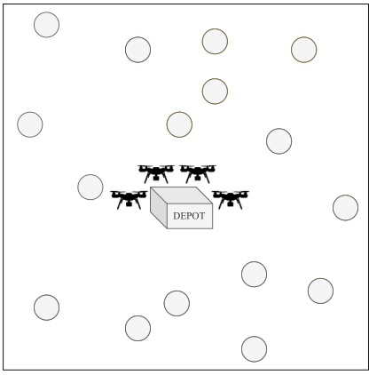

(a) Scenario

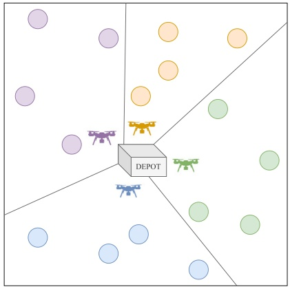

(b) Initial planning

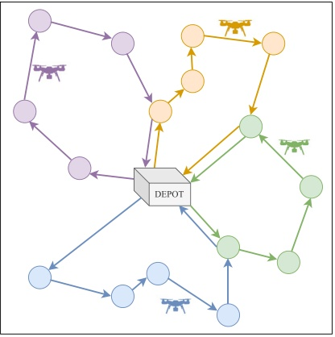

(c) Routing solving

Fig. 1. Representation of an example of a mission completed by a swarm of 4 UAVs: (a) A scenario consisting of a depot (square box) containing four UAVs and a collection of regions (circles). (b) Initial planning is performed by clustering the regions. (c) Routing problem solving entails visiting as many regions as possible within a given time limit in order to maximize the total reward received.

**Orienteering Problem (TOP) (Vansteenwegen et al., 2011; Gunawan et al., 2016), is required to create routes for every agent that maximize the total accumulated reward.**

**The TOP represents a good model for the routing problems of swarms of UAVs. However, there are some constraints on this problem formulation that do not match well with more realistic applications, e.g., the limitation that each node can only be visited by one UAV. In some applications, like surveillance or search-and-rescue, visiting a region only once may not be sufficient because the appearance of a target could be stochastic. Sung and Nielsen (2020) describes a different solution, which consists of decomposing the scenario into multiple zones prior to the routing solving step to ensure that no route intersects another. This solution simplifies the TOP and makes it more tractable, but it is still far from optimal, since regions can only be visited by one UAV. Therefore, allowing UAVs to cooperate by visiting regions already visited by others can be very beneficial for the purpose of maximizing the results of the mission.**

**Another latent problem in most of the existing route planning solutions is the computation time. Solving CO problems is a hard task that usually implies a high computational cost. Works such as Ntakolia and Iakovidis (2021), which is based on a linear programming solution; Yan et al. (2021), which offers approximate solutions to the routing problem with a combination of two heuristic algorithms; or Liu et al. (2021), which designs a modified Sparrow Search Algorithm, are good examples of accurate but slow methods. Note that many UAV applications require real-time solutions that cannot be provided by most of the current route planning algorithms.**

**In order to promote cooperation between UAVs of the same swarm and to offer faster and more efficient solutions than other existing methods, a cooperative routing solver algorithm for multiple UAVs that performs in two different stages is proposed in this paper. The first stage, called initial planning, consists of applying a clustering algorithm to create an early assignment of regions to each of the UAVs. The purpose of this stage is to decompose the cooperative routing problem into two phases to make the problem more tractable. The second stage, named as routing solving, does not only estimate the route for every UAV inside its own cluster but also encourages UAVs to visit other clusters. This strategy offers two main advantages. First, the traditional TOP constraint that states that a region can only be visited once by any agent is removed, resulting in better routing solutions in terms of accumulated reward. And second, the suboptimal initial region assignment of the first stage is compensated by allowing several UAVs to visit a region, hence collecting more reward for those regions. The new simplified multi-UAV routing problem with clustered regions, i.e., the problem solved during the second mentioned stage, is a variant of the OP and is called Orienteering Problem with Multiple Prizes and Types** **of Nodes (OP-MP-TN). Similar to the TOP, the OP-MP-TN considers multiple agents that need to follow a route in a given scenario, but with fewer constraints and with regions clustered during the initial planning. The motivation of this paper is to present a new multi-UAV problem (the OP-MP-TN) that has no previous solution and that favors cooperation among UAVs through a region-sharing strategy, which could be useful for applications such as search-and-rescue or military combat. Furthermore, the combination of a Transformer network for route solving and a Reinforcement Learning strategy for training is flexible enough to address other CO problems with minimum effort, which is very important for the literature considering the scarcity of works dedicated to fast solutions for UAVs.**

**Fig. 1 shows an example of initial planning and routing solving. Fuzzy C-Means (FCM) is used for initial planning to group all regions into multiple clusters, each of which is assigned to an UAV. For the routing solving, an Attention-based deep learning model (a Transformer) inspired by Kool et al. (2019) is proposed to offer a solution that is much faster than most of the classical optimizationbased methods. This paper makes three major contributions. First, the proposed system allows to obtain quality routing solutions in real time for a very complex problem that has no known analytical solution. Solutions based on other strategies and mathematical frameworks are significantly more time-consuming, preventing their use for real-time applications. This is very important in some applications involving autonomous drones where the computational capacity is limited. The presented system achieves such a goal by dividing the problem into an initial planning and the posterior routing solving stage, making it much more tractable. Moreover, the potential performance loss of this strategy is compensated by the designed cooperation methodology among UAVs, which encourages UAVs to visit more regions and consequently increase the total accumulated reward. Second, the proposed system has been designed to solve the OP-MP-TN problem, but the combination of the initial and planning stages, via FCM and the Transformer network, along with the reinforcement learning strategy, is flexible enough to deal with other related problems without requiring reformulating from the beginning of the problem. Third, a formal definition of the specific OP-MP-TN is provided in order to solve missions of UAV fleets in a more cooperative and efficient manner.**

**This paper is organized as follows. In Section 2, the most relevant works of the state of the art are described. In Section 3, the cooperative multi-UAV routing problem (OP-MP-TN) is posed, and the proposed system to solve it is explained in Section 4. Section 5 details the experiments made and shows the results obtained. Finally, the conclusions are exposed in Section 6.**

Table 1

| Discussion of related works. |  |  |  |  |  |
| --- | --- | --- | --- | --- | --- |
| Literature | Speed | Accuracy | Training? | Solves OP? | Solves others? |
| Heuristic methods |  |  |  |  |  |
| Tsiligirides (Tsiligirides, 1984) | + + + | + | X | ✓ | X |
| VNS (Liang et al., 2013) | -- | + | X | ✓ | ✓ |
| PSO (Sevkli and Sevilgen, 2010; Jie et al., 2022) | -- | ++ | X | ✓ | ✓ |
| GRASP (Marinakis et al., 2015; Campos et al., 2014) | -- | ++ | X | ✓ | ✓ |
| GA (Lambora et al., 2019) | -- | + | X | ✓ | ✓ |
| Compass (Kobeaga et al., 2018) | -- | + + + | X | ✓ | X |
| Linear programming methods |  |  |  |  |  |
| OR-Tools (Perron and Furnon, 2019) | - | ++ | X | ✓ | ✓ |
| Gurobi (Gurobi Optimization, LLC, 2021) | - - - | + + + | X | ✓ | ✓ |
| Machine/deep learning methods |  |  |  |  |  |
| MC (Montemanni et al., 2018; Wang et al., 2021) | + | + | ✓ | ✓ | ✓ |
| PN (Vinyals et al., 2015; Bello et al., 2016; Gama and Fernandes, 2020) | + | ++ | ✓ | ✓ | ✓ |
| GPN (Ma et al., 2020) | + | ++ | ✓ | ✓ | ✓ |
| GNN (Hu et al., 2021) | ++ | + | ✓ | ✓ | ✓ |
| Transformer (Kool et al., 2019) | + + + | + + + | ✓ | ✓ | ✓ |

## 2. Related work

**TOP solvers (Sundar et al., 2022; Reyes-Rubiano et al., 2018) are typically used to address routing problems under time/fuel/battery restrictions involving several agents, in this case UAVs. However, they have several disadvantages. First, they impose several restrictions/rules on the problem (e.g., every region can be visited only once) that cannot be adapted to the real application. Second, TOP solvers have an important computational cost that usually prevents their use for real-time routing applications. And third, they do not favor cooperation between UAVs to improve the performance during the mission.**

**Due to the high complexity involved in its design and performance, there is a scant number of works proposing TOP solvers compared to the abundance of works addressing the OP or, in general, oneagent Combinatorial Optimization problems (see Table 1). For this reason, Sung and Nielsen (2020) decomposes TOP in two stages. In the first stage, the scenario is divided into zones, assigning only an UAV to every one of them. Thus, the second stage can be addressed using existing routing solvers for OP or one agent.**

**Although the previous approach is very convenient for reducing the complexity of cooperative routing problems, obtaining the best route for just a single agent is still challenging. The OP is NP-hard (Non-deterministic Polynomial-time hard), meaning that an exact solution cannot be found in polynomial time. Thus, heuristic algorithms have been the most popular type of solution to the OP, as they can find approximate solutions in a relatively short time. Some examples are Tsiligirides (Tsiligirides, 1984), which combines a route improvement step with the heuristic search; Variable Neighborhood Search (VNS) (Liang et al., 2013), which iteratively applies local search until improvement for updating the solution; Particle Swarm Optimization (PSO) (Sevkli and Sevilgen, 2010; Jie et al., 2022), which improves exhaustive search methods by using multiple particles; Greedy Randomized Adaptive Search Procedure (GRASP) (Marinakis et al., 2015; Campos et al., 2014), which uses local search for optimizing greedy randomized solutions; and Genetic Algorithms (GA) (Lambora et al., 2019), inspired by biological natural selection to encourage a population of solutions to evolve into better ones. One of the most relevant GA for the OP is Compass (Kobeaga et al., 2018), which proposes specific solutions for different routing problems.**

**Another classic alternative to heuristic algorithms is constrained linear programming, which is based on conventional solvers. Linear programming solutions take more time to calculate but are generally closer to the optimal value, although constraints may difficult it. Examples of constraint linear programming solutions include OR-Tools (Perron and Furnon, 2019), which is a vehicle routing problem solver designed by Google; and Gurobi Optimization, LLC (2021),** **which reports very accurate results but is intractable for a large number of nodes.**

**The selection of a constrained linear programming solver or a heuristic method represents a trade-off between accuracy and computation time. However, although heuristic algorithms are faster than conventional ones, they still cannot perform well in real-time applications, where a solution must be found in a very short time.**

**More recent solutions are related to the Artificial Intelligence field. In Montemanni et al. (2018), Monte Carlo sampling (MC) is combined with an artificial neural network to solve the OP. A similar approach is combined with a Graph Attention Network (GAT) and a Gated Recurrent Unit (GRU) in Wang et al. (2021) to solve other related Combinatorial Optimization problems, called the Travelling Salesman Problem (TSP) (Bellmore and Nemhauser, 1968) and the Vehicle Routing Problem (VRP) (Dantzig and Ramser, 1959). However, Monte Carlo sampling is still computationally inefficient due to the high amount of time required to find a good approximate solution. Another set of solutions are based on deep reinforcement learning. Here, artificial neural networks are trained by reinforcement learning to maximize the prize collection of the OP, hence, creating a model capable of finding approximate solutions in very small computation time. In Vinyals et al. (2015), a deep learning solution named as Pointer Network (PN) is presented, which is in turn essentially based on a Recurrent Neural Network (RNN) (Sherstinsky, 2020). This approach was based on supervised learning instead of deep reinforcement learning. However, deep reinforcement learning was later used by Bello et al. (2016) to train the PN and achieve better results. The use of PNs was expanded in Gama and Fernandes (2020) to solve the OP, and in Ma et al. (2020) to solve the TSP by combining the PN with a Graph Neural Network (GNN) (Wu et al., 2021). GNNs can also be applied without PNs to solve Combinatorial Optimization problems, like in Hu et al. (2021), where a Bidirectional GNN is specifically designed to solve the TSP. However, this network is trained using imitation learning, which in fact limits its performance.**

**In the previously mentioned PN-based works, RNNs are used to efficiently encode the graph structure of the involved problems using Attention models (Bahdanau et al., 2016). However, these algorithms are still affected by an important disadvantage of the constituent RNNs: they tend to ‘‘forget’’ past information from long sequences of input data, losing performance in the obtained solutions. To alleviate the problem of RNNs, a new neural network architecture called Transformers was proposed in Vaswani et al. (2017) for other problem domains, achieving better performance. Soon later, Transformers were applied to several Combinatorial Optimization problems in Kool et al. (2019) to address routing problems. Transformers are similar to RNN-based approaches in the sense that every node is related to all the other nodes** **in the graph, but Transformers are able to do parallel processing using multiple heads (Multi-head Attention), boosting the computation speed.**

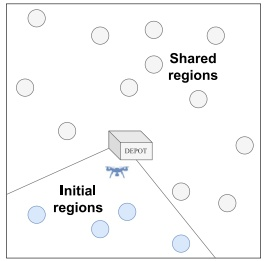

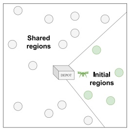

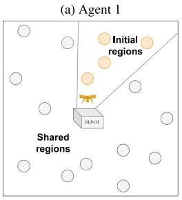

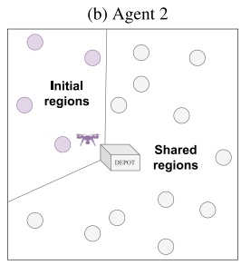

(c) Agent 3

(d) Agent 4

Fig. 2. Example of the clustering performed during the initial planning stage for 4 agents. Note that the initial regions of an agent are assigned as shared regions of the rest of the agents.

**This paper also proposes to use the Transformer architecture to obtain high-quality solutions (UAV routes) in very little time, but adapted to a custom and real application that does not fit into pre-defined problems such as OP or TSP. More specifically, a cooperative routing algorithm for multiple UAVs is proposed. To obtain the routing, the problem is decomposed into two stages. The first one, the initial planning, clusters the regions and assigns each cluster to an UAV in order to make the multi-agent problem more tractable. The second one, the routing solving, predicts routes for the UAVs that are not restricted to the initial cluster, since a region-sharing strategy is allowed to achieve higher accumulated rewards. A transformer-based architecture is proposed for this purpose, which not only allows for faster inference time but also yields high-quality solutions for custom Combinatorial Optimization problems that cannot be formulated as an OP, TSP, or any of their variants. Even more, a real cooperation strategy is learned allowing to visit a region by more than one UAV, improving the global system performance. Lastly, the proposed approach is scalable to large scenarios just by transferring the models trained for low-scale scenarios to a much larger one with only a slight reduction in performance.**

## 3. Problem formulation

**The addressed problem is a variant of the OP called Orienteering Problem with Multiple Prizes and Types of Node (OP-MP-TN), that has different prizes (rewards) depending on the type of visited node (initial or shared one). Consider a set of nodes** $\{ 0 , \ldots , n + 1 \}$ **representing the regions to be visited, where the nodes** 0 **and** 𝑛 + 1 **represent the start and end depots; and a set of** 𝑚 **agents, for example UAVs, that are expected to visit those nodes and that have to satisfy the condition** $m ~ \leq ~ n .$ **Consider also that the nodes** $\{ 1 , \ldots , n \}$ **are clustered into** 𝑚 **subsets** $\{ C _ { a } \mid a = 1 , \ldots , m \}$ **. Each cluster is assigned to an UAV in such a way that the regions belonging to the cluster (called initial regions) are the target for the assigned UAV. But, an UAV can also visit other regions (called shared) not assigned to it (i.e., belonging to other clusters) to collect more rewards. An example of initial and shared regions can be observed in Fig. 2. As a result, each time an agent** $a \; = \; 1 , \ldots , m$ **visits a region belonging to its assigned cluster** $C _ { a } ,$ **it is rewarded with** $r _ { i } ^ { a } = r _ { i n i t } , i = 0 , \ldots , n   +   1$ **. And it is rewarded with** $r _ { i } ^ { a } = r _ { s h a r e d }$ **each time it** **visits a region that belongs to another agent’s cluster. Note that visiting the initial regions is not mandatory, but the rewards should be fixed so that** $r _ { i n i t }   >   r _ { s h a r e d }$ **to encourage each agent to visit their own regions. Considering the rewards of each region for each agent, the goal is to maximize the following objective function:**

$$
\max \sum_ {a = 1} ^ {m} \sum_ {i = 1} ^ {n} \sum_ {j = 1} ^ {n + 1} r _ {i} ^ {a} x _ {i j} ^ {a}, \quad \forall i \neq j,\tag{1}
$$

**where** $x _ { i j } ^ { a } \; = \; 1$ **if the node** 𝑗 **is visited by the agent** 𝑎 **right after the node** $i ,$ **and 0 otherwise. Eq. (1) should be subjected to some restrictions to ensure that there is a feasible solution to the problem. Specifically, each agent should start its own path from node** 0**, visit a combination of nodes (mostly from its own cluster, but not exclusively) that maximizes the collected reward, and arrive at node** 𝑛 + 1 **within a time or distance budget (mission time). These restrictions are exposed next:**

$$
\sum_ {j = 1} ^ {n + 1} x _ {0 j} ^ {a} = 1; \quad \quad \quad \quad \quad \quad \quad \quad a = 1, \dots , m\tag{2}
$$

$$
\sum_ {i = 0} ^ {n} x _ {i (n + 1)} ^ {a} = 1; \qquad \qquad a = 1, \dots , m\tag{3}
$$

$$
\sum_ {i = 0} ^ {n} x _ {i k} ^ {a} \in [ 0, 1 ]; \quad \quad \quad \quad \quad \quad a = 1, \dots , m; \quad k = 1, \dots , n\tag{4}
$$

$$
\sum_ {j = 1} ^ {n + 1} x _ {k j} ^ {a} \in [ 0, 1 ]; \quad \quad \quad \quad \quad a = 1, \dots , m; \quad k = 1, \dots , n\tag{5}
$$

$$
\sum_ {i = 0} ^ {n} \sum_ {j = 1} ^ {n + 1} t _ {i j} ^ {a} x _ {i j} ^ {a} \leq t _ {\max}; \quad a = 1, \dots , m\tag{6}
$$

$$
\max \left\{t _ {0 (n + 1)} ^ {a}: a = 1, \dots , m \right\} \leq t _ {\max}\tag{7}
$$

$$
u _ {i} ^ {a} - u _ {j} ^ {a} + n x _ {i j} ^ {a} \leq n - 1; \quad a = 1, \dots , m; \quad i, j = 1, \dots , n\tag{8}
$$

**Constraints of Eqs. (2) and (3) ensure that the tour does not begin or end in a non-depot region. Constraints of Eqs. (4) and (5) prevent that a node is visited more than once by the same agent (regions can be visited by multiple agents, but an agent cannot visit twice the same region), and ensure that the path is continuous. Constraint of** $\mathbf { E } \mathbf { q } .$ **(6) imposes a maximum tour length** $t _ { m a x : }$ , where $t _ { i j } ^ { a }$ **is the time or distance consumed by agent** 𝑎 **traveling from node** 𝑖 **to node** $j .$ **Although any distance measure can be considered, Euclidean distances are used for simplicity. Regarding the constraint of** $\mathbf { E } \mathbf { q } .$ **(7), it provides the agents with enough time to reach the end depot. In this paper, it is assumed that all the UAVs fly at the same speed, but different speeds can be contemplated. Finally, constraint of Eq. (8) avoids that the final tour could be a combination of subtours (Miller et al., 1960), where** $u _ { i } ^ { a } , u _ { j } ^ { a }   =   1 , \ldots , n$ are the positional order of the nodes 𝑖 and 𝑗 **in the path of the agent** 𝑎.

## 4. Proposed system

**The proposed system for cooperative routing of multiple UAVs is split into two stages: initial planning and routing solving. The initial planning proposes a clustering strategy to assign initial regions to each UAV through a FCM algorithm. This stage is prior to the routing solving, and therefore is not subject to strong computational restrictions.**

**The routing solving considers the initial and shared regions assigned during the initial planning and provides fast solutions for the OP-MP-TN. These fast solutions are obtained by using a Transformer network with a trained model shared by all the UAVs. Section 4.1 shows the architecture of this Transformer network, while Section 4.2 explains the reinforcement learning algorithm utilized to train the Transformer. The global performance of the proposed system is summarized in Algorithm 1.**

Algorithm 1 FCM clustering and route planning with Transformers
▷ INITIALIZATION
Let {0, ..., n + 1} be the set of nodes, where nodes 0 and n + 1 are the start and end depots, respectively
Let {0, ..., m} be the set of agents
Let $t_{max}$ be the mission time
Let $r_{init}$ be the prize for initial regions and $r_{shared}$ be the prize for shared regions
▷ INITIAL PLANNING
$C_1, ..., C_m = FCM(\{0, ..., n+1\})$
▷ MULTI-UAV ROUTING
for $a = 1 \rightarrow m$ do
    Route = [ ]
    NodeEmbeddings = Encoder([$C_a, r_{init}$], [C ∩ $C_a, r_{shared}$])
    CurrentNode = 0
    RemainingTime = $t_{max}$
    for $i = 1 \rightarrow n$ do
        NextNode = Decoder(NodeEmbeddings, CurrentNode, RemainingTime)
        Route.append(NextNode)
        RemainingTime = RemainingTime - CalculateTime(CurrentNode, NextNode)
        CurrentNode = NextNode
    end for
end for

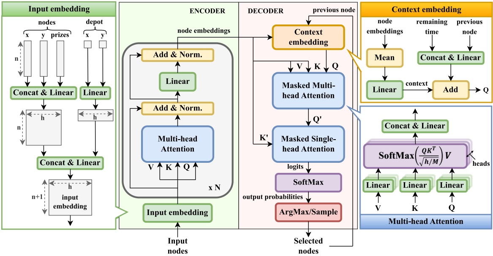

Fig. 3. Structure of the Transformer.

## 4.1. Attention model

**The Transformer architecture is shown in Fig. 3. The input (input nodes in Fig. 3) is the full set of** 𝑛 **nodes that the agent can visit. Specifically, the coordinates and reward/prize values of each node are concatenated to represent the graph of nodes. And the output (selected nodes in Fig. 3) is the sequence of nodes that the agent visits in a given time or distance budget, following the restrictions defined in Section 3. Similar to Autoencoders (Girin et al., 2021), the proposed architecture is composed of two main modules: an encoder and a decoder.**

**The encoder module consists of an input embedding and** 𝑁 **attention based embeddings. The input embedding is a combination of linear embeddings (feed forward fully-connected layers) that yields an initial encoding of the input nodes. Unlike the original Transformers (Vaswani et** $\mathrm { a l . , ~ } 2 0 1 7 ) ,$ **n**o positional encoding is used to represent the position **of the input nodes. Encoding the order of the nodes is important for applications like Natural Language Processing Otter et al. (2021), where changing the position of one or more tokens can completely change the meaning of a sentence. Generally, that is not the case for**

**Combinatorial Optimization problems, where the concept of positional order is not directly applicable to a graph of nodes.**

**Next,** 𝑁 **attention-based embeddings are consecutively stacked to obtain an encoded representation of the input node graph. The output of the last stack is delivered to the decoder, where the encoded graph is used to predict the best future step based on the current state of the UAV. Each encoding stack is a combination of a Multi-head Attention layer and a linear embedding, each of them surrounded by a skip connection and a batch normalization layer. The input of the Multi-head Attention layer is replicated and encoded by three parallel feed forward fully-connected layers, resulting in three different embeddings named as Query (**𝑄**), Key (**𝐾**), and Value (**𝑉 **). Notice that in Fig. 3, the same notation is used for** 𝑄, 𝐾**, and** 𝑉 **before and after applying the linear embeddings for simplicity. These three embeddings are used to compute the Attention Scores using the following expression:**

$$
\text {Attention} (Q, K, V) = \text {SoftMax} \left(\frac {Q K ^ {T}}{\sqrt {h / M}}\right) V,\tag{9}
$$

**where** $\frac { 1 } { \sqrt { h / M } }$ **is a scaling factor determined by the number of heads** 𝑀 **and the hidden dimension size** ℎ **of the incoming linear embeddings** 𝑄, 𝐾 **and** 𝑉 **. The multiple heads provide richer and more varied interpretations of the input data while also ensuring faster convergence even when the random initialization of the weights is far from the optimal value, as explained in Vaswani et al. (2017). Finally, the skip connections (He et al., 2015) and the batch normalization layers (Ioffe and Szegedy, 2015) accelerate the model convergence and prevent the exploding and vanishing gradient problems of deep neural networks.**

**Focusing on the Attention Scores in** $\mathbf { E } \mathbf { q } .$ **(9) and ignoring for a moment the scaling factor and the SoftMax function, the Attention Scores for each node can be computed as** $Z _ { i } = Q _ { i } ( K _ { 0 } V _ { 0 } + K _ { 1 } V _ { 1 } + \cdots +$ $K _ { n + 1 } V _ { n + 1 } ) , \forall i   =   0 , \ldots , n + 1$ **. This is, the product of Q and K computes the degree of compatibility/relevance among all the nodes in the graph (every query node with the rest). And** 𝑉 **weights the nodes according to their importance for each query node. Considering this information, it is evident that the linear embedding of** 𝑄, 𝐾**, and** 𝑉 **should be trained to set higher Attention Scores for those nodes that are more compatible and valuable for every node, i.e., computing for every node in the graph which are the other nodes that minimize the distance traveled and maximize the reward obtained. Notice the importance of calculating the relationship of all the nodes with every query in order to facilitate the maximization of future rewards.**

**The decoder takes the encoded node embeddings, representing the full graph information, to sequentially compute the best possible tour that maximizes Eq. (1). This is, given the current agent position (UAV position) and the encoded node embeddings, the decoder estimates the best next node to visit, building a complete tour after several iterations. The decoder is composed of four modules: the Context Embedding, the Masked Multi-head Attention, the Masked Single-head Attention, and a SoftMax operation. The Masked Multi-head Attention module is similar to the Multi-head Attention of the encoder but adds a mask to mark the nodes that were already visited and the nodes that cannot be visited according to the constraints identified in Section 3. This module receives its input from two sources: the last encoder stack (containing the encoded node embeddings), which is fed as the Key and the Value; and the context embedding module, acting as the Query and containing important information about the current state situation (previously visited node and remaining time). This combination of inputs is crucial to understand the current situation and to predict the best candidate node for the next step. The Masked Single-head Attention layer is similar to the Masked Multi-head Attention layer but it only uses one head to output the final output logits (non-normalized probabilities), which are computed as follows:**

$$
\mathrm{logits} = f _ {m a s k} \left(C \cdot \tanh \left(\frac {Q ^ {\prime} K ^ {\prime T}}{\sqrt {h}}\right)\right),\tag{10}
$$

**where** 𝐶 **is a hyperparameter that controls the range of the logits along with the tanh clipping function and** $f _ { m a s k }$ **is the masking procedure that ensures that each UAV can only visit the nodes allowed by the constraints of the OP-MP-TN. The output logits are then transformed into probabilities by the SoftMax module. These probabilities report the best next node candidate to be included in the ongoing tour.**

**Finally, the next nodes to be part of the tour are chosen by sampling from the output probabilities during the training, according to an exploration vs. exploitation policy. During the inference phase, a greedy selection strategy is chosen.**

## 4.2. Reinforcement learning based training

**A single Transformer network is trained for all the agents. This is, the same weights are then used during inference for every agent. Considering that supervised learning would require the complex task of manually labeling a huge dataset with the solutions of each scenario, reinforcement learning is selected as the strategy to teach the proposed neural network. Additionally, the solutions for each scenario are simply** **unknown, since there is no existing method capable of providing the optimal path in any OP-MP-TN scenario.**

**Therefore, considering reinforcement learning to train the network, the training algorithm employed is REINFORCE (Williams, 1992), whose cost function to be minimized is the negative objective function of the OP-MP-TN defined in Eq. (1), i.e., the objective is to maximize the prizes received after visiting every node. Thus, the cost function can be defined as:**

$$
L (\nu) = - \sum_ {a = 1} ^ {m} \sum_ {i = 1} ^ {n} \sum_ {j = 1} ^ {n + 1} r _ {i} ^ {a} x _ {i j} ^ {a},\tag{11}
$$

**where** 𝜈 **is a tour** $( \mathbf { i . e . } ,$ **a sequence of nodes) that solves an instance** 𝛼 **of the OP-MP-TN. An instance contains a particular OP-MP-TN scenario composed by a given time or distance limit and a determined number of nodes, defined by their locations and their prizes.**

**Given the cost function for a tour, the loss function of the whole multi-agent routing system can be defined as:**

$$
\mathcal {L} (\theta | \alpha) = E _ {p _ {\theta} (v | \alpha)} [ L (v) ]\tag{12}
$$

**Eq. (12) represents the expectation of the cost function given the probability distribution of routing** 𝑝𝜃(𝜈|𝛼) **output by the Transformer, where** 𝜃 **refers to the weights of the layers of the whole neural network (encoder and decoder). By using the expectation of the loss function, models that can compute good solutions (routes) on average are promoted in exchange of those that can compute better solutions but only for a few cases. The loss function is minimized using gradient descent, where the gradient is defined, according to the REINFORCE algorithm, as:**

$$
\begin{array}{l} \nabla \mathcal {L} (\theta | \alpha) = E _ {p _ {\theta} (\nu | \alpha)} [ (L (\nu) - b (\alpha)) \nabla \log p _ {\theta} (\nu | \alpha) ], \\ b (\alpha) = \underset {\nu} {\operatorname{argmax}} p _ {\theta} (\nu | \alpha) \end{array}\tag{13}
$$

**where** $b ( \alpha )$ **is a baseline similar to that used in Kool et al. (2019) and it represents the greedy tour predicted for every instance** 𝛼**. The motivation to include the baseline is to reduce the high variance of the estimated gradient since it is estimated by sampling a single trajectory of the instance** 𝛼 **and, therefore, varies significantly from trajectory to trajectory.**

## 5. Results

**This Section describes the different experiments performed to validate the proposed system. First, the proposed Transformer-based routing solver has been compared with other state-of-the-art algorithms for measuring the performance considering an individual agent. For this purpose, a dataset of OP-MP-TN instances has been automatically generated. Later, the whole multi-agent routing system has been evaluated using cooperative and non-cooperative scenarios, where the first implies positive prizes for agents visiting shared regions and the latter does not reward visits to shared regions.**

## 5.1. Dataset

**Multiple OP-MP-TN datasets have been randomly generated to perform different experiments. Each of the datasets contains different environmental conditions. Specifically, different combinations of num**ber of nodes $( n \in [ 2 0 , 5 0 , 1 0 0 , 2 0 0 ] )$ and number of agents $( m \in [ 2 , 4 ] )$ are considered to generate 8 datasets of cooperative scenarios $( r _ { s h a r e d } =$ 0.5). For non-cooperative scenarios $( r _ { s h a r e d } = 0 )$ **, the same combinations are used to generate datasets. It is worth noting that the initial region** reward is the same for cooperative and non-cooperative datasets $( r _ { i n i t } =$ 1**). The reward value of the initial regions is higher than that for shared regions to promote visiting the regions included in the cluster assigned to one UAV. This behavior, extended to the complete fleet of UAVs, favors the exploration of all the regions.**

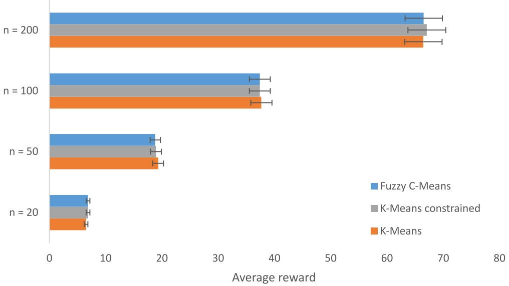

Fig. 4. Comparison of reward collection with Transformer applying different initial planning methods: FCM, K-Means, and size-constrained K-Means.

**For each instance of each dataset, the coordinates of the regions and depots are randomly sampled from the uniform distribution** 𝑈[0, 1]. **Other distributions may be used to sample coordinates, but it is recommended to normalize them in the range** [0, 1] **to facilitate network comprehension. Therefore, the problem area, i.e., the area where the agents are allowed to move, corresponds to the unit square. Each region of the problem area should have a specific size that may influence the time spent by the agent performing one or multiple tasks. However, the time spent in a region is fixed at 0, and the size of the region is not considered to simplify the problem. Regions are treated as nodes or points that must be visited and immediately left.**

**The time limit** 𝑡 **is expressed as a normalized distance value,** $t _ { m a x }$ **with a fixed value that allows each agent to reach roughly half of the nodes. The reason is that these cases are more challenging than those where** $t _ { m a x }$ **allows to visit almost all or very few nodes, as explained in Vansteenwegen et al. (2009). More concretely, the values of** $t _ { m a x }$ used are: $t _ { m a x } ( n   =   2 0 )   =   2 , \; t _ { m a x } ( n   =   5 0 )   =   3 , \; t _ { m a x } ( n   =   1 0 0 )   =   4 ,$ **and** $t _ { m a x } ( n = 2 0 0 ) = 5$

**Every dataset is composed of three sets (the training set, the validation set, and the test set) containing different samples. The test and validation sets have a total of 10,000 problem instances. For training, more than 1,000,000 samples are used. Note that the same test sets are used to calculate the results of each algorithm in Section 5.3. The methods that require training (the proposed Transformer, the PN, and the GPN) are trained and validated with the same training and validation sets too.**

## 5.2. Experimental setup

**Several experiments were performed to obtain the best values for the hyperparameters of the Transformer network. At the encoder, three** encoding stacks have been used with a hidden dimension of $h = 1 2 8 .$ The number of heads in the Multi-head Attention model is $M \; = \; 8 .$ The tanh clipping function defined in Eq. (10) is controlled by the typical value of $C = 1 0 .$ . The data is processed in batches of size 512, except for the case of $n ~ = ~ 2 0 0$ **,** where it is reduced to 256 due to **memory limitations. The learning rate is set to** $1 0 ^ { - 4 }$ **and is adjusted at each training epoch using the Adam optimizer (Kingma and Ba, 2017). Additionally, the Python code used for this paper is publicly available.**<strong>1</strong>

**The two basic metrics used to measure the performance of the network are the total reward collected and the inference time. The** **reward is calculated as the average reward obtained across all the test samples and agents. The inference time includes the number of seconds required to predict a solution for each of the 10,000 samples. Also, two additional metrics are calculated based on the previous ones: the optimality gap** $( G a p ^ { r e w } )$ **and the temporal gap** $( G a p ^ { t i m e } )$ **. The optimality gap of a given method** 𝑥 **measures the proximity between the performance of the method** 𝑥 **and the performance of the best algorithm** 𝑦**. It is calculated as follows:**

$$
G a p _ {x} ^ {r e w} = \frac {| \bar {r} _ {y} - \bar {r} _ {x} |}{| \bar {r} _ {y} |},\tag{14}
$$

**where** $\bar { r } _ { x }$ **denotes the average reward obtained by the method** 𝑥 **and** $\bar { r } _ { y }$ represents the average reward obtained by the reference method $y ,$ **t**hat **is, the method collecting the highest reward value. Thus, the optimality gap of the algorithm** 𝑦 **should always be 0. The temporal gap is the same concept applied to inference time. It can be computed as follows:**

$$
G a p _ {x} ^ {\text {time}} = \frac {\log_ {1 0} \left(t _ {x} + 1\right) - \log_ {1 0} \left(t _ {y} + 1\right)}{\log_ {1 0} \left(t _ {z} + 1\right)},\tag{15}
$$

**where** $t _ { x }$ **is the time taken by the method** 𝑥 **to make the predictions,** $t _ { y }$ **refers to the time taken by the fastest method** $y ,$ and $t _ { z }$ **is the time taken by the slowest method** 𝑧**. As before, the temporal gap value for the reference algorithm (i.e., the fastest algorithm) is 0.**

## 5.3. Results and discussions

**Considering the dataset presented in Section 5.1 and the experimental setup of Section 5.2, this Section first provides a comparison between multiple clustering methods for the initial planning phase and a comparison between different OP solvers per agent routing in every scenario cluster. Later, an evaluation of the whole multi-agent system using cooperative and non-cooperative scenarios is also exposed.**

**Regarding the comparison of clustering methods, the corresponding results using FCM, K-Means, and size-constrained K-Means (Bennett et al., 2000) (the constraint ensures a balanced number of regions per cluster) are shown in Fig. 4. It should be noted that no algorithm clearly outperforms the others. Therefore, although there are no computational requirements for the initial planning phase, FCM is chosen due to its smaller computational cost, which may at least simplify the initial planning.**

**Three categories of algorithms have been taken into consideration for the comparison with various OP solvers. First, because they are already focused on solving the OP, heuristic algorithms like Compass (Kobeaga et al., 2018) and Tsiligirides (Tsiligirides, 1984) have** **been chosen. Second, the constraint linear programming solver OR-Tools (Perron and Furnon, 2019) has been modified for the OP-MP-TN in a manner similar to that of Kool et al. (2019). More specifically, OR-Tools is set up so that a heuristic initial solution is first discovered, and then this initial solution is improved using Guided Local Search (Voudouris and Tsang, 1999). Finally, two deep reinforcement learning networks are chosen as examples: the Pointer Network (PN) (Vinyals et al., 2015) and the Graph Pointer Network (GPN) (Ma et al., 2020). Both of them have already been used to solve the TSP in their respective original papers. Here, they were adapted to solve the OP-MP-TN following a similar approach as in Kool et al. (2019), but additionally concatenating, prior to the node embedding calculation, the prize and the remaining length information of each node along with their coordinates on each time step.**

<small>1 [http://gti.ssr.upm.es/data](http://gti.ssr.upm.es/data).</small>

Comparison of routing performance per agent and cluster (the routing solving stage of the proposed solution) in terms of average reward (Reward) for 𝑛 ∈ [20, 50, 100, 200] using the proposed Transformer approach and other relevant algorithms from the state-of-the-art. The red, green, and blue colors represent the best, the second best, and the third best values for each column, respectively.

<table><tbody><tr><td rowspan="2">Nodes (n)</td><td colspan="4">Reward</td></tr><tr><td>20</td><td>50</td><td>100</td><td>200</td></tr><tr><td>Transformer</td><td>6.862 ± 0.027</td><td>18.809 ± 0.039</td><td>37.385 ± 0.056</td><td>66.523 ± 0.092</td></tr><tr><td>Compass (Kobeaga et al., 2018)</td><td>7.070 ± 0.027</td><td>19.844 ± 0.039</td><td>40.083 ± 0.054</td><td>74.907 ± 0.079</td></tr><tr><td>Tsiligirides (Tsiligirides, 1984)</td><td>5.782 ± 0.029</td><td>15.310 ± 0.051</td><td>30.516 ± 0.081</td><td>56.058 ± 0.144</td></tr><tr><td>OR-Tools (Perron and Furnon, 2019)</td><td>5.587 ± 0.029</td><td>13.091 ± 0.049</td><td>22.055 ± 0.080</td><td>33.073 ± 0.121</td></tr><tr><td>PN (Vinyals et al., 2015)</td><td>6.234 ± 0.029</td><td>17.374 ± 0.043</td><td>34.254 ± 0.065</td><td>62.234 ± 0.100</td></tr><tr><td>GPN (Ma et al., 2020)</td><td>6.224 ± 0.029</td><td>17.228 ± 0.044</td><td>34.325 ± 0.065</td><td>62.681 ± 0.100</td></tr></tbody></table>

Comparison of routing performance per agent and cluster (the routing solving stage of the proposed solution) in terms of average inference time (Time) in milliseconds for 𝑛 ∈ [20, 50, 100, 200] using the proposed Transformer approach and other relevant algorithms from the state-of-the-art. The red, green, and blue colors represent the best, the second best, and the third best values for each column, respectively.

<table><tbody><tr><td rowspan="2">Nodes (n)</td><td colspan="4">Time (ms)</td></tr><tr><td>20</td><td>50</td><td>100</td><td>200</td></tr><tr><td>Transformer</td><td>0.054 ± 0.001</td><td>0.128 ± 0.001</td><td>0.188 ± 0.001</td><td>0.476 ± 0.001</td></tr><tr><td>Compass (Kobeaga et al., 2018)</td><td>3.364 ± 0.022</td><td>11.046 ± 0.080</td><td>32.897 ± 0.198</td><td>108.794 ± 0.535</td></tr><tr><td>Tsiligirides (Tsiligirides, 1984)</td><td>0.149 ± 0.008</td><td>0.171 ± 0.008</td><td>0.201 ± 0.008</td><td>0.258 ± 0.008</td></tr><tr><td>OR-Tools (Perron and Furnon, 2019)</td><td>50.123 ± 0.002</td><td>50.351 ± 0.003</td><td>51.078 ± 0.005</td><td>53.771 ± 0.012</td></tr><tr><td>PN (Vinyals et al., 2015)</td><td>0.082 ± 0.001</td><td>0.345 ± 0.001</td><td>0.819 ± 0.002</td><td>2.605 ± 0.004</td></tr><tr><td>GPN (Ma et al., 2020)</td><td>0.126 ± 0.001</td><td>0.335 ± 0.001</td><td>1.096 ± 0.002</td><td>3.624 ± 0.006</td></tr></tbody></table>

**The results of the comparison are exposed in Tables 2 and 3, where the average collected reward over the 10,000 test instances and the average time required to obtain solutions to those samples are presented. Similar to Koch et al. (2019), the 95% confidence intervals are also provided. An Alexander-Govern (Alexander and Govern, 1994) test has been performed to prove the significance of the comparison, achieving a** 𝑝**-value** $p \approx 0 .$ **Observe that Compass reaches the highest average reward value, closely followed by the proposed Transformer. But the computational cost of Compass is much higher than that of Transformers, limiting its use for cooperative missions that require fast decision estimations. Compass shares this problem with OR-Tools, which is not only less accurate than the Transformer network, but it is also two orders of magnitude greater in terms of inference time.**

**Regarding the other algorithms (PN, GPN, and Tsiligirides), they achieve computation times comparable to the performance of Transformer for small graph sizes (**𝑛 = 20 **and** 𝑛 = 50**). For large graph sizes (**𝑛 = 100 **and** 𝑛 = 200**), Transformer is considerably faster than the PN and the GPN, but a bit slower than Tsiligirides. Therefore, it can be deduced that the computation time of Tsiligirides scales better for large number of nodes. In fact, Tsiligirides and Compass achieve such good results because they are algorithms specifically designed to solve the OP; their main drawback is that they cannot be used to solve many other Combinatorial Optimization problems, unlike neural network-based methods such as Transformer, PN or GPN, which are more versatile. In any case, for algorithms that already perform very fast, the comparison should be focused on the accuracy of their results.**

**Among the fastest algorithms, Transformer has the highest average reward. Thus, it can be confirmed that Transformer is the solution that offers the best trade-off between accuracy and computation time.**

**The results of Tables 2 and 3 are summarized in Fig. 5, which is composed of two subfigures. The first one, Fig. 5(a), depicts the inverse of the optimality gap** $( 1 - G a p ^ { r e w } )$ **, with Compass fixed to 1 because it is the reference method. The second one, Fig. 5(b), represents the inverse of the temporal gap** $( 1   -   G a p ^ { t i m e } )$ **, where the reference method is Transformer for small graph sizes and Tsiligirides for large graph sizes. Note that the effects of scalability are appreciable in both Figures, but especially in Fig. 5(a). Scalability can be defined as the growth of complexity as the number of nodes in the graph is increased, and it represents a classic issue for algorithms solving Combinatorial Optimization problems. The implications of scalability directly affect both the computational cost and the accuracy. Considering more nodes implies that Combinatorial Optimization solvers must take decisions contemplating a greater number of options, which directly affects the difficulty of finding the optimal solution and the time needed to calculate that solution. Hence, the decrease in the inverse of the optimality gap and the temporal gap exposed in Fig. 5(a) are expected due to the scalability problem. Even so, the difference in optimality gaps between Transformer and Compass is only around 0.1, which proves that Transformer scales relatively well. Regarding the temporal gap of Fig. 5(b), Transformer diminish its computation speed with respect to Tsiligirides as** 𝑛 **is increases, but it is still faster than other methods.**

**Finally, Table 4 provides the performance of the whole multi-UAV system, in terms of reward and number of regions visited by the swarm of UAVs, showing the benefits of cooperation between UAVs. Cases with 2 and 4 agents are considered in scenarios of** $n   =   1 0 0$ **n**odes in **order to study the impact of mission plans with different number of clusters at the routing solving stage. The cooperative approach offers positive rewards to both initial and shared regions, unlike the non-cooperative strategy, which only rewards initial regions. As a result, the cooperative strategy obtains both a higher reward value and a higher number of visited nodes, since UAVs not only visit their initial assigned nodes but also nodes from other clusters. Moreover, the time constraint is better exploited with the cooperative strategies because any remaining time can be used to enhance the final reward. Notice that without cooperation, the benefits of deploying 4 UAVs instead of 2 are relatively small, since 2 UAVs are enough to visit almost all** **the regions. However, with cooperation, the region-sharing strategy encourages a great increment in the number of nodes visited as the number of agents used is increased, which is also reflected in the final reward value. An additional benefit of the cooperation strategy is in situations in which one or more UAVs are missing (destroyed, without enough battery/fuel, etc.). Thanks to cooperation, this issue is alleviated with partners visiting the shared regions corresponding to the missing UAV.**

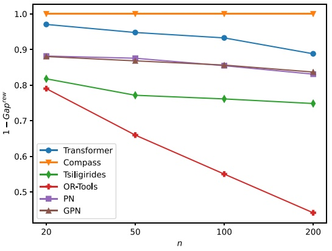

(a) Optimality gap

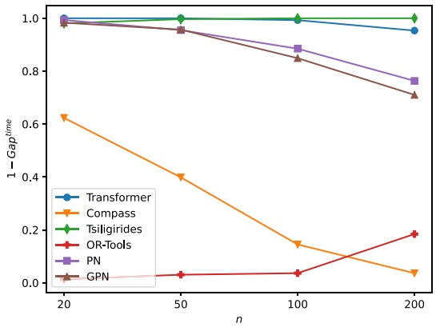

(b) Temporal gap

Fig. 5. Performance of the Transformed network compared to the state-of-the-art methods in terms of: (a) the optimality gap $( G a p ^ { r e w } )$ and (b) the temporal gap $( G a p ^ { t i m e } )$ . For better comprehension, the optimality gap and the temporal gap are represented as $1 - G a p ^ { r e w }$ and $1 - G a p ^ { t i m e }$ . This implies that the value of the reference methods is 1 instead of 0.

Performance of the proposed Transformer network trained with 𝑛 = 100 nodes for 2 and 4 agents in cooperative and non-cooperative scenarios. For each type of scenario, the average reward (Reward) and the average number of nodes visited (Nodes) by the fleet of UAVs are exposed.

<table><tr><td rowspan="2">Agents</td><td colspan="2">Cooperative</td><td colspan="2">Non cooperative</td></tr><tr><td>Reward</td><td>Nodes</td><td>Reward</td><td>Nodes</td></tr><tr><td>2</td><td>92.932 ± 0.134</td><td>99.034 ± 0.135</td><td>89.703 ± 0.170</td><td>91.028 ± 0.159</td></tr><tr><td>4</td><td>149.538 ± 0.226</td><td>204.566 ± 0.269</td><td>99.897 ± 0.346</td><td>108.561 ± 0.459</td></tr></table>

## 6. Conclusion

**In this work, a deep learning approach to manage several cooperative UAVs has been proposed and evaluated. The solution entails splitting the issue into two steps: initial planning, in which each agent is given a cluster of areas, and route solving, where a variant of the OP (named OP-MP-TN) is solved. More specifically, a FCM algorithm, which solves the initial planning step, and a neural network based on the emerging Transformers, which solves the routing solving step, are combined to perform as a route planner for multiple UAVs. The UAVs cooperate because of a region-sharing technique that enhances the system’s performance throughout the mission. It has been demonstrated that the implemented Transformer network outperforms other state-of-the-art techniques since it provides the best balance between accuracy and computation time and scales reasonably well as the number of nodes in the problem increases. The global system can also operate very fast, which is essential for many UAV-based applications where the computational capacity is limited, including surveillance, package delivery, search-and-rescue, film-making, etc.**

**The proposed system assumes that distances are Euclidean and that obstacles are never present. Therefore, future work should address the combination of path planning and route planning to estimate distances between nodes that consider both static and dynamic obstacles. Another promising research direction is to derive a new neural network architecture that can directly and holistically deal with the multi-UAV routing without the simplification of the initial clustering, keeping the requirement of real-time operation. Lastly, the proposed system could be applied to other relevant multi-agent-based problems that have no current solution or that are just not very accurate and/or computationally efficient.**

**CRediT authorship contribution statement**

**Daniel Fuertes: Conceptualization, Methodology, Software, Validation, Investigation, Resources, Data curation, Writing – original draft,** Writing – review & editing, Project administration, Funding acquisi**tion. Carlos R. del-Blanco: Conceptualization, Methodology, Software, Validation, Investigation, Resources, Data curation, Writing – original draft, Writing – review & editing, Project administration, Funding acquisition. Fernando Jaureguizar: Conceptualization, Methodology, Software, Validation, Investigation, Resources, Data curation, Writing –** original draft, Writing – review & editing, Project administration, Fund**ing acquisition. Juan José Navarro: Conceptualization, Methodology, Software, Validation, Investigation, Resources, Data curation, Writing – original draft, Writing – review & editing, Project administration, Funding acquisition. Narciso García: Conceptualization, Methodology, Software, Validation, Investigation, Resources, Data curation, Writing – original draft, Writing – review & editing, Project administration, Funding acquisition.**

## Declaration of competing interest

**The authors declare the following financial interests/personal relationships which may be considered as potential competing interests: Juan José Navarro reports a relationship with Airbus Defence and Space SA that includes: employment.**

## Data availability

**We have shared the link to the code at the paper.**

## Acknowledgments

**This work has been partially supported by project PID2020-115132RB (SARAOS) funded by MCIN/AEI/10.1303501100011033 of the Spanish Government, and by the R&D Mariott Project of Airbus Defence and Space, Spain.**

## References

Alexander, R.A., Govern, D.M., 1994. A new and simpler approximation for ANOVA under variance heterogeneity. J. Educ. Stat. 19 (2), 91–101. [http://dx.doi.org/10.2307/1165140](http://dx.doi.org/10.2307/1165140).

Bahdanau, D., Cho, K., Bengio, Y., 2016. Neural machine translation by jointly learning to align and translate. [arXiv:1409.0473](http://arxiv.org/abs/1409.0473).

Bellmore, M., Nemhauser, G.L., 1968. The traveling salesman problem: A survey. Oper. Res. 16 (3), 538–558. [http://dx.doi.org/10.1287/opre.16.3.538](http://dx.doi.org/10.1287/opre.16.3.538).

Bello, I., Pham, H., Le, Q.V., Norouzi, M., Bengio, S., 2016. Neural combinatorial optimization with reinforcement learning. CoRR [abs/1611.09940](http://arxiv.org/abs/1611.09940). [arXiv:1611. 09940](http://arxiv.org/abs/1611.09940).

[Bennett, K., Bradley, P., Demiriz, A., 2000. Constrained K-Means Clustering. Tech. Rep. MSR-TR-2000-65, p. 8.](http://refhub.elsevier.com/S0952-1976%2823%2900269-5/sb5)

Campos, V., Martí, R., Sánchez-Oro, J., Duarte, A., 2014. GRASP with path relinking for the orienteering problem. J. Oper. Res. Soc. 65 (12), 1800–1813. [http://dx.doi.org/10.1057/jors.2013.156](http://dx.doi.org/10.1057/jors.2013.156).

Dantzig, G.B., Ramser, J.H., 1959. The truck dispatching problem. Manage. Sci. 6 (1), 80–91. [http://dx.doi.org/10.1287/mnsc.6.1.80](http://dx.doi.org/10.1287/mnsc.6.1.80).

Festa, P., 2014. A brief introduction to exact, approximation, and heuristic algorithms for solving hard combinatorial optimization problems. In: 2014 16th International Conference on Transparent Optical Networks. ICTON, pp. 1–20. [http://dx.doi.org/10.1109/ICTON.2014.6876285](http://dx.doi.org/10.1109/ICTON.2014.6876285).

Gama, R., Fernandes, H.L., 2020. A reinforcement learning approach to the orienteering problem with time windows. CoRR [abs/2011.03647](http://arxiv.org/abs/2011.03647). [arXiv:2011.03647](http://arxiv.org/abs/2011.03647).

Girin, L., Leglaive, S., Bie, X., Diard, J., Hueber, T., Alameda-Pineda, X., 2021. Dynamical variational autoencoders: A comprehensive review. Found. Trends Mach. Learn. 15 (1–2), 1–175. [http://dx.doi.org/10.1561/2200000089](http://dx.doi.org/10.1561/2200000089).

Gunawan, A., Lau, H.C., Vansteenwegen, P., 2016. Orienteering problem: A survey of recent variants, solution approaches and applications. European J. Oper. Res. 255 (2), 315–332. [http://dx.doi.org/10.1016/j.ejor.2016.04.059](http://dx.doi.org/10.1016/j.ejor.2016.04.059).

[Gurobi Optimization, LLC, 2021. Gurobi Optimizer Reference Manual.](http://refhub.elsevier.com/S0952-1976%2823%2900269-5/sb12)

He, K., Zhang, X., Ren, S., Sun, J., 2015. Deep residual learning for image recognition. CoRR [abs/1512.03385](http://arxiv.org/abs/1512.03385). [arXiv:1512.03385](http://arxiv.org/abs/1512.03385).

Hu, Y., Zhang, Z., Yao, Y., Huyan, X., Zhou, X., Lee, W.S., 2021. A bidirectional graph neural network for traveling salesman problems on arbitrary symmetric graphs. Eng. Appl. Artif. Intell. 97, 104061. [http://dx.doi.org/10.1016/j.engappai.2020.104061](http://dx.doi.org/10.1016/j.engappai.2020.104061).

Ioffe, S., Szegedy, C., 2015. Batch normalization: Accelerating deep network training by reducing internal covariate shift. CoRR [abs/1502.03167](http://arxiv.org/abs/1502.03167). [arXiv:1502.03167](http://arxiv.org/abs/1502.03167).

Jie, K.-W., Liu, S.-Y., Sun, X.-J., 2022. A hybrid algorithm for time-dependent vehicle routing problem with soft time windows and stochastic factors. Eng. Appl. Artif. Intell. 109, 104606. [http://dx.doi.org/10.1016/j.engappai.2021.104606](http://dx.doi.org/10.1016/j.engappai.2021.104606).

Kingma, D.P., Ba, J., 2017. Adam: A method for stochastic optimization. [arXiv:1412. 6980](http://arxiv.org/abs/1412.6980).

Kobeaga, G., Merino, M., Lozano, J.A., 2018. An efficient evolutionary algorithm for the orienteering problem. Comput. Oper. Res. 90, 42–59. [http://dx.doi.org/10.1016/j.cor.2017.09.003](http://dx.doi.org/10.1016/j.cor.2017.09.003).

Koch, W., Mancuso, R., West, R., Bestavros, A., 2019. Reinforcement learning for UAV attitude control. ACM Trans. Cyber-Phys. Syst. 3 (2), [http://dx.doi.org/10.1145/3301273](http://dx.doi.org/10.1145/3301273).

[Kool, W., van Hoof, H., Welling, M., 2019. Attention, learn to solve routing problems!. In: International Conference on Learning Representations.](http://refhub.elsevier.com/S0952-1976%2823%2900269-5/sb20)

Lambora, A., Gupta, K., Chopra, K., 2019. Genetic algorithm- A literature review. In: 2019 International Conference on Machine Learning, Big Data, Cloud and Parallel Computing (COMITCon). pp. 380–384. [http://dx.doi.org/10.1109/COMITCon.2019.8862255](http://dx.doi.org/10.1109/COMITCon.2019.8862255).

Liang, Y.-C., Kulturel-Konak, S., Lo, M.-H., 2013. A multiple-level variable neighborhood search approach to the orienteering problem. J. Ind. Prod. Eng. 30 (4), 238–247. [http://dx.doi.org/10.1080/21681015.2013.818069](http://dx.doi.org/10.1080/21681015.2013.818069).

Liu, G., Shu, C., Liang, Z., Peng, B., Cheng, L., 2021. A modified sparrow search algorithm with application in 3d route planning for UAV. Sensors 21 (4), [http://dx.doi.org/10.3390/s21041224](http://dx.doi.org/10.3390/s21041224).

Loquercio, A., Maqueda, A.I., del Blanco, C.R., Scaramuzza, D., 2018. DroNet: Learning to fly by driving. IEEE Robot. Autom. Lett. 3 (2), 1088–1095. [http://dx.doi.org/10.1109/LRA.2018.2795643](http://dx.doi.org/10.1109/LRA.2018.2795643).

Ma, Q., Ge, S., He, D., Thaker, D., Drori, I., 2020. Combinatorial optimization by graph pointer networks and hierarchical reinforcement learning. In: AAAI Workshop on Deep Learning on Graphs: Methodologies and Applications. [http://dx.doi.org/10.48550/ARXIV.1911.04936](http://dx.doi.org/10.48550/ARXIV.1911.04936).

Marinakis, Y., Politis, M., Marinaki, M., Matsatsinis, N., 2015. A memetic-GRASP algorithm for the solution of the orienteering problem. In: Le Thi, H.A., Pham Dinh, T., Nguyen, N.T. (Eds.), Modelling, Computation and Optimization in Information Systems and Management Sciences. Springer International Publishing, Cham, [http://dx.doi.org/10.1007/978-3-319-18167-7\_10](http://dx.doi.org/10.1007/978-3-319-18167-7_10).

Miller, C.E., Tucker, A.W., Zemlin, R.A., 1960. Integer programming formulation of traveling salesman problems. J. ACM 7 (4), 326–329. [http://dx.doi.org/10.1145/321043.321046](http://dx.doi.org/10.1145/321043.321046).

Montemanni, R., D’ignazio, F., Chou, X., Gambardella, L.M., 2018. Machine learning and Monte Carlo sampling for the probabilistic orienteering problem. In: 2018 Joint 10th International Conference on Soft Computing and Intelligent Systems (SCIS) and 19th International Symposium on Advanced Intelligent Systems. ISIS, pp. 14–18. [http://dx.doi.org/10.1109/SCIS-ISIS.2018.00014](http://dx.doi.org/10.1109/SCIS-ISIS.2018.00014).

Ntakolia, C., Iakovidis, D.K., 2021. A swarm intelligence graph-based pathfinding algorithm (SIGPA) for multi-objective route planning. Comput. Oper. Res. 133, 105358. [http://dx.doi.org/10.1016/j.cor.2021.105358](http://dx.doi.org/10.1016/j.cor.2021.105358).

Otter, D.W., Medina, J.R., Kalita, J.K., 2021. A survey of the usages of deep learning for natural language processing. IEEE Trans. Neural Netw. Learn. Syst. 32 (2), 604–624. [http://dx.doi.org/10.1109/TNNLS.2020.2979670](http://dx.doi.org/10.1109/TNNLS.2020.2979670).

[Perron, L., Furnon, V., 2019. OR-tools.](http://refhub.elsevier.com/S0952-1976%2823%2900269-5/sb31)

Reyes-Rubiano, L.S., Ospina-Trujillo, C.F., Faulin, J., Mozos, J.M., Panadero, J., Juan, A.A., 2018. The team orienteering problem with stochastic service times and driving-range limitations: A simheuristic approach. In: 2018 Winter Simulation Conference. WSC, pp. 3025–3035. [http://dx.doi.org/10.1109/WSC.2018.8632400](http://dx.doi.org/10.1109/WSC.2018.8632400).

Ruano, S., Cuevas, C., Gallego, G., García, N., 2017. Augmented reality tool for the situational awareness improvement of UAV operators. Sensors 17 (2), [http://dx.doi.org/10.3390/s17020297](http://dx.doi.org/10.3390/s17020297).

Sevkli, Z., Sevilgen, F.E., 2010. Discrete particle swarm optimization for the orienteering problem. In: IEEE Congress on Evolutionary Computation. pp. 1–8. [http://dx.doi.org/10.1109/CEC.2010.5586532](http://dx.doi.org/10.1109/CEC.2010.5586532).

Sherstinsky, A., 2020. Fundamentals of recurrent neural network (RNN) and long shortterm memory (LSTM) network. Physica D 404, 132306. [http://dx.doi.org/10.1016/j.physd.2019.132306](http://dx.doi.org/10.1016/j.physd.2019.132306).

Sundar, K., Sanjeevi, S., Montez, C., 2022. A branch-and-price algorithm for a team orienteering problem with fixed-wing drones. EURO J. Transp. Logist. 11, 100070. [http://dx.doi.org/10.1016/j.ejtl.2021.100070](http://dx.doi.org/10.1016/j.ejtl.2021.100070).

Sung, I., Nielsen, P., 2020. Zoning a service area of unmanned aerial vehicles for package delivery services. J. Intell. Robot. Syst. 97 (3), 719–731. [http://dx.doi.org/10.1007/s10846-019-01045-7](http://dx.doi.org/10.1007/s10846-019-01045-7).

Tsiligirides, T., 1984. Heuristic methods applied to orienteering. J. Oper. Res. Soc. 35 (9), 797–809. [http://dx.doi.org/10.1057/jors.1984.162](http://dx.doi.org/10.1057/jors.1984.162).

Vansteenwegen, P., Souffriau, W., Berghe, G.V., Oudheusden, D.V., 2009. A guided local search metaheuristic for the team orienteering problem. European J. Oper. Res. 196 (1), 118–127. [http://dx.doi.org/10.1016/j.ejor.2008.02.037](http://dx.doi.org/10.1016/j.ejor.2008.02.037).

Vansteenwegen, P., Souffriau, W., Oudheusden, D.V., 2011. The orienteering problem: A survey. European J. Oper. Res. 209 (1), 1–10. [http://dx.doi.org/10.1016/j.ejor.2010.03.045](http://dx.doi.org/10.1016/j.ejor.2010.03.045).

[Vaswani, A., Shazeer, N., Parmar, N., Uszkoreit, J., Jones, L., Gomez, A.N., Kaiser, L., Polosukhin, I., 2017. Attention is all you need. In: Proceedings of the 31st International Conference on Neural Information Processing Systems. NIPS ’17, Curran Associates Inc., Red Hook, NY, USA, pp. 6000–6010.](http://refhub.elsevier.com/S0952-1976%2823%2900269-5/sb41)

Vesselinova, N., Steinert, R., Perez-Ramirez, D.F., Boman, M., 2020. Learning combinatorial optimization on graphs: A survey with applications to networking. IEEE Access 8, 120388–120416. [http://dx.doi.org/10.1109/ACCESS.2020.3004964](http://dx.doi.org/10.1109/ACCESS.2020.3004964).

[Vinyals, O., Fortunato, M., Jaitly, N., 2015. Pointer networks. In: Cortes, C., Lawrence, N., Lee, D., Sugiyama, M., Garnett, R. (Eds.), Advances in Neural Information Processing Systems, Vol. 28. Curran Associates, Inc..](http://refhub.elsevier.com/S0952-1976%2823%2900269-5/sb43)

Voudouris, C., Tsang, E., 1999. Guided local search and its application to the traveling salesman problem. European J. Oper. Res. 113 (2), 469–499. [http://dx.doi.org/10.1016/S0377-2217(98)00099-X](http://dx.doi.org/10.1016/S0377-2217%2898%2900099-X).

Wang, Q., Hao, Y., Cao, J., 2021. Learning to traverse over graphs with a Monte Carlo tree search-based self-play framework. Eng. Appl. Artif. Intell. 105, 104422. [http://dx.doi.org/10.1016/j.engappai.2021.104422](http://dx.doi.org/10.1016/j.engappai.2021.104422).

Williams, R.J., 1992. Simple statistical gradient-following algorithms for connectionist reinforcement learning. Mach. Learn. 8 (3), 229–256. [http://dx.doi.org/10.1023/A:1022672621406](http://dx.doi.org/10.1023/A:1022672621406).

Wu, Z., Pan, S., Chen, F., Long, G., Zhang, C., Yu, P.S., 2021. A comprehensive survey on graph neural networks. IEEE Trans. Neural Netw. Learn. Syst. 32 (1), 4–24. [http://dx.doi.org/10.1109/TNNLS.2020.2978386](http://dx.doi.org/10.1109/TNNLS.2020.2978386).

Yan, M., Yuan, H., Xu, J., Yu, Y., Jin, L., 2021. Task allocation and route planning of multiple UAVs in a marine environment based on an improved particle swarm optimization algorithm. EURASIP J. Adv. Signal Process. 2021 (1), 94. [http://dx.doi.org/10.1186/s13634-021-00804-9](http://dx.doi.org/10.1186/s13634-021-00804-9).