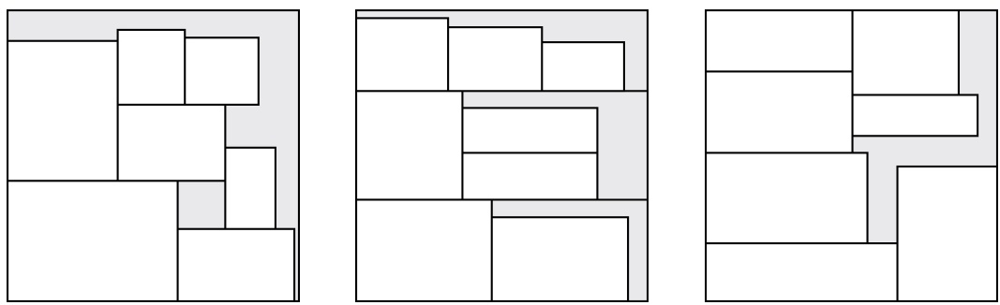
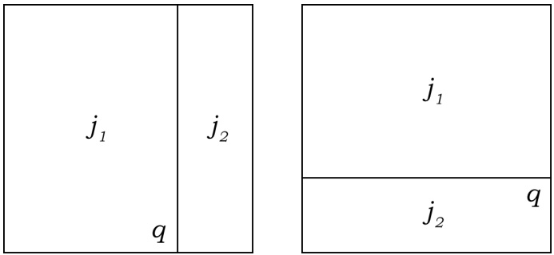
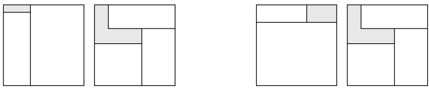
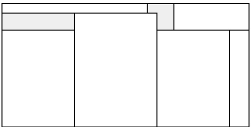
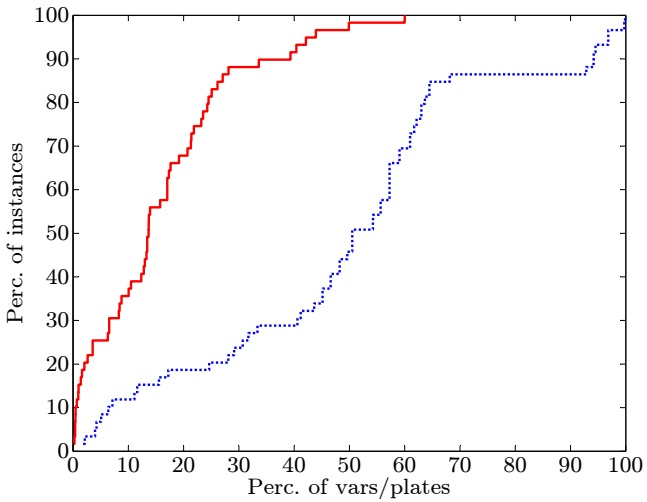
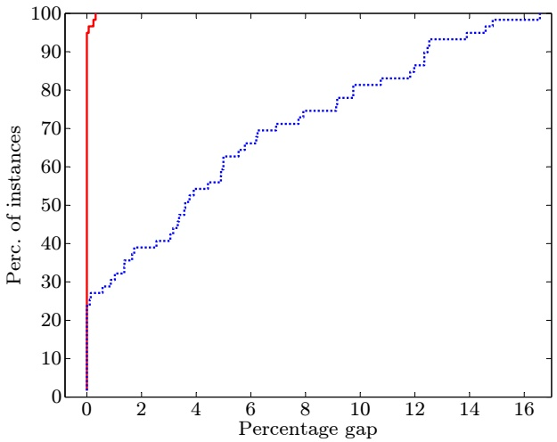
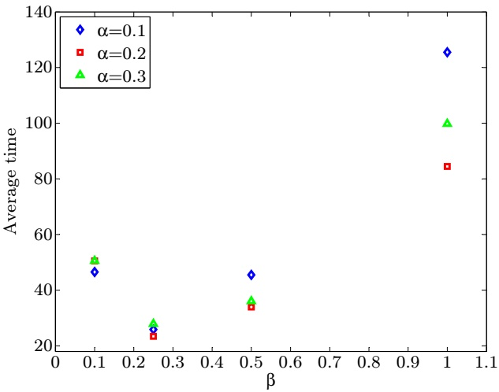
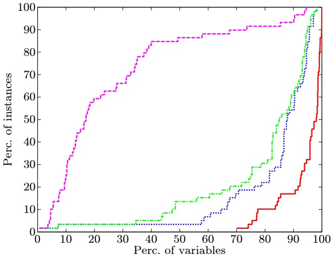
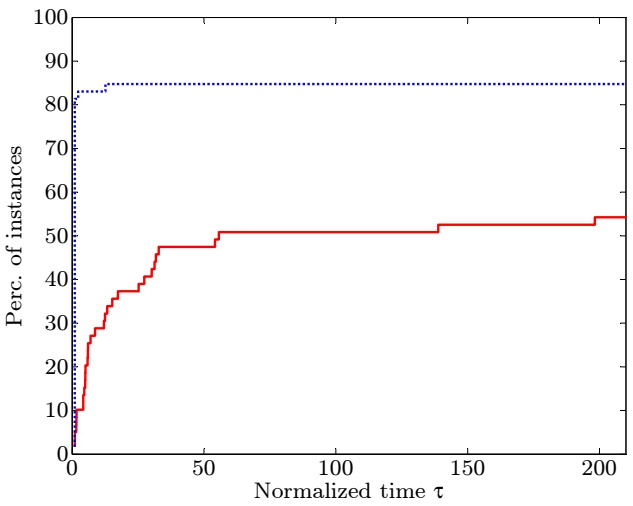

# Modeling Two-Dimensional Guillotine Cutting Problems via Integer Programming

Fabio Furini∗, Enrico Malaguti◦, Dimitri Thomopulos◦

∗LAMSADE, Universite Paris-Dauphine, Place du Mar ´ echal de Lattre de Tassigny, ´

75775 Paris, France

fabio.furini@dauphine.fr

◦DEI, University of Bologna, Viale Risorgimento 2, 40136 Bologna, Italy enrico.malaguti@unibo.it, dimitri.thomopulos@unibo.it

## Abstract

We propose a framework to model general guillotine restrictions in two-dimensional cutting problems formulated as Mixed Integer Linear Programs (MIP). The modeling framework requires a pseudo-polynomial number of variables and constraints, which can be effectively enumerated for medium-size instances. Our modeling of general guillotine cuts is the first one that, once it is implemented within a state-of-the-art MIP solver, can tackle instances of challenging size. We mainly concentrate our analysis on the Guillotine Two Dimensional Knapsack Problem (G2KP), for which a model, and an exact procedure able to significantly improve the computational performance, are given. We also show how the modeling of general guillotine cuts can be extended to other relevant problems such as the Guillotine Two Dimensional Cutting Stock Problem (G2CSP) and the Guillotine Strip Packing Problem (GSPP). Finally, we conclude the paper discussing an extensive set of computational experiments on G2KP and GSPP benchmark instances from the literature.

**Keywords:** Integer Programming, Guillotine Cuts, Mathematical Model.

## 1 Introduction

Two dimensional cutting problems are about obtaining a set of small (rectangular) items from one or more (rectangular) larger panels. Cutting problems are of great relevance in metal, wood, paper or glass industries, but also in loading, transportation, telecommunications and resource allocation in general (see, e.g., [37, 6, 24, 25, 3, 29]). Depending on the industry, special features for the cuts may be required; a very common one which applies to glass and wood cutting is to have guillotine cuts.

(i) In guillotine cutting, items are obtained from panels through cuts that are parallel to the sides of the panel and cross the panel from one side to the other;

(ii) Cuts are performed in stages, where each stage consists of a set of parallel guillotine cuts on the shapes obtained in the previous stages;

(iii) Each cut removes a so-called strip from a panel. If during the cut sequence, the width of each cut strip equals the width of the widest item obtained from the strip, then the cut is denoted as restricted.

Our objective is to propose a way of modeling general guillotine cuts via Mixed Integer Linear Programs (MIPs), i.e., we do not limit the number of stages (restriction (ii)), nor impose the cuts to be restricted (restriction (iii)). We only ask the cuts to be guillotine ones (restriction (i)). In the following, we call these kind of cuts general guillotine cuts or simply guillotine cuts.

Figure 1: Examples of patterns which can be obtained through: non-guillotine cuts (left), three-stage restricted guillotine cuts (center), guillotine cuts (right).

In Figure 1 we report, on the left, a pattern (cutting scheme) that cannot be obtained through guillotine cuts, in the center, a pattern that can be obtained through three-stage restricted guillotine cuts, and in the right a pattern that needs unrestricted guillotine cuts to be obtained, which are the ones we are interested in. General guillotine cuts allow a better use of the panels and can significantly reduce the waste of row material in practice (see also the Conclusions of this paper for a comparison of the solutions obtained by imposing different kinds of restrictions).

**Families of cutting problems.** In the following, we will mainly concentrate our analysis on the Two Dimensional Knapsack Problem, and briefly discuss extensions of the modeling ideas to the Two Dimensional Cutting Stock Problem and the Strip Packing Problem. For convenience, we remind the definition of these problems.

• Two-Dimensional Knapsack Problem (2KP): we are given one rectangular panel of length L and width $W ,$ , and a list of n rectangular items; each item i $( i = 1 , \ldots , n )$ is characterized by a length $l _ { i } ,$ a width $w _ { i }$ , a profit $p _ { i }$ , and is available in $u _ { i }$ copies. The 2KP requires to cut the subset of items of largest profit which can fit in the rectangular panel (without overlapping).

• Two-Dimensional Cutting Stock Problem (2CSP): we are given infinitely many identical rectangular panels, each one having length L and width W and a list of n rectangular items; each item i $( i = 1 , \ldots , n )$ is characterized by a length $l _ { i } ,$ a width $w _ { i }$ , and must be cut in $d _ { i }$ copies. The 2CSP requires to cut all the items by minimizing the number of used panels. The special case where the demand of each items is equal to 1 is denoted as Two-Dimensional Bin Packing Problem (2BPP).

• Strip Packing Problem (SPP): we are given a strip having length L and infinite width and a list of n rectangular items; each item $i \: ( i = 1 , \ldots , n )$ is characterized by a length $l _ { i } ,$ a width $w _ { i } ,$ , and must be cut in $d _ { i }$ copies. The SPP requires to cut all the items from the strip by minimizing the used strip width.

In this paper, we consider the guillotine versions of these problems (restriction (i)), i.e. the Guillotine 2KP (G2KP), Guillotine 2CSP (G2CSP) and the Guillotine SPP (GSPP). All these problems are NP-Hard.

**Literature review.** Cutting problems were introduced by [20], who considered the G2CSP and proposed the k − stage version of the problem. The authors introduced the well-known exponential-size model which is usually solved via column generation, where the pricing problem is a one dimensional Knapsack Problem. Since the seminal work of [20], a relevant body of literature on two-dimensional cutting has been developed, thus, we mainly concentrate this review on 2KPs, and on guillotine cutting. For a more comprehensive survey on two-dimensional cutting and packing the reader is referred to [27] and [38].

Concerning the 2KP (with no specific restrictions on the cut features), [5] proposed a branch-and-bound algorithm base on a MIP formulation. [7] and [17] proposed exact algorithms. The first one is based on a relaxation given by the KP instance with item weights coincident with the rectangle areas; for this relaxation a worst case performance ratio of 3 is proved. The latter is based on bounding procedures exploiting dual feasible functions.

Restricting the attention to guillotine cutting, the majority of contributions in the recent literature considered the case where the number of stages is limited to two or three. Unless explicitly stated, three stage approaches are for the restricted case. [31] consider the G2CSP and solve the pricing problem as a constraint satisfaction problem, by considering among others the case of guillotine cutting (with limited and unlimited number of stages). [32] propose compact models and a branch-and-price algorithm for the three stage G2BPP. They consider the unrestricted case as well. A more application-oriented study is presented in [37], where a real-world G2CSP with multiple panel size and additional features is solved via column generation in an approximate fashion. A similar real-world problem, with the additional feature that identical cutting patterns can be processed in parallel, was recently considered by [29].

In terms of optimization models not based on the Gilmore and Gomory (exponential size) formulation, [26] presented a compact model for the Guillotine Two Stage 2KP. [28] solved the Guillotine Two Stage 2CSP by extending a MIP formulation proposed by [36] for the one dimensional CSP. The extension of the model to two dimensions asks to define a set of flow problems to determine a set of horizontal strips, and a flow problem to determine how the strips fit into the rectangular panel. [34] presented a pseudo-polynomial size model for the Guillotine Two and Three Stage 2CSP based on the concepts of item to-be-cut and residual plates, obtained after the cut. Recently, [19] extended this idea to model the Guillotine Two Stage 2KP. Finally, a computational comparison of compact, pseudo-polynomial and exponential size (based on the Gilmore and Gomory formulation) models for the Guillotine Two Stage 2CSP with multiple panel size is presented in [18].

Few contributions are available in the literature for guillotine cutting problems with an unlimited number of stages. This is probably due to the intrinsic difficulty of modeling guillotine restrictions. In addition to the mentioned paper by [31], where guillotine restrictions are tackled through constraint satisfaction techniques, exact approaches for G2KP have been proposed by [10], [9], [14]. [11] proposed a recursive exact algorithm for the unconstrained case of G2KP, i.e., the case where no upper bound on the number of items of each type exists. An dynamic programming algorithm able to solve large-size instances of the latter problem was recently proposed by [33]. The most recent exact approach to G2KP is due to [15], where a recursive procedure is presented that, given a set of items and a rectangular panel, constructs the set of associated guillotine packings. This procedure is then embedded into two exact algorithms, and computationally tested on a set of instances from the literature. In addition to the reported exact methods, [21] proposed two upper bounding procedures; concerning heuristic algorithms, we mention the hybrid algorithm by [22] and the recursive algorithm by [8]. Finally, the related problem of determining if a given set of items can be obtained from a given large rectangle by means of guillotine cuts, was modeled through oriented graphs by [12].

Despite the relevance of general guillotine cutting problems, the only MIP model in the literature we are aware of was proposed by [4], and solves the guillotine GSPP. The model is polynomial in the input size, but in practice it has a very large number of variables and constraints and, as observed in [4], its linear programming relaxation produces “very loose lower bound”. For these reasons the authors report computational experiments where instances with 5 items are solved in non-negligible computing time.

**Paper Contribution.** The main contribution of this paper is to propose a way of modeling general guillotine cuts via MIPs. The modeling framework requires a pseudo-polynomial number of variables and constraints, which can be all explicitly enumerated for medium-size instances. To the best of our knowledge, this is the first attempt to model guillotine restrictions via MIPs that works in practice, i.e., once it is implemented within a state-of-the-art solver, can tackle instances of challenging size. In this paper, we mainly concentrate on the G2KP. We model the problem as a MIP and propose an effective exact method for selecting a subset of the variables containing an optimal solution. Then, the resulting model can be solved by a general purpose MIP solver by only considering the subset of selected variables. This exact procedure is able to significantly increase the number of instances solved to proven optimality. In addition, we propose a number of procedures to further reduce the number of variables and constraints, and discuss conditions under which these reductions preserve the optimality of the solutions. We show how the modeling of guillotine cuts can be extended to other relevant problems such as the G2CSP and the GSPP. Finally, we conclude the paper by an extensive set of computational experiments on benchmark G2KP and GSPP instances from the literature.

## 2 MIP modeling of guillotine cuts

[16] proposed a pseudo-polynomial size model for the (one dimensional) Cutting Stock problem, based on the concepts of cut and residual element. The idea is the following: each time a stock of length L is cut in order to produce an item i of length $l _ { i } ,$ a residual element of size $L - l _ { i }$ is obtained, which can be further used to produce additional items. The model associates a decision variable to each item and each (stock or residual) element, and feasible solutions are obtained by imposing balance constraints on the number of residual elements, while the cost of a solution is given by the number of used stock elements.

We extend the approach of [16] to the two dimensions by using the concepts of cut and plate, where a plate can be either the original rectangular panel or a smaller rectangular residual plate obtained from the panel as result of a sequence of guillotine cuts. We concentrate on the G2KP; the main idea of the model we propose is the following: starting from the initial rectangular panel, we obtain two smaller plates through a horizontal or vertical guillotine cut; for each obtained plate, we need to decide where to perform further cuts, or eventually to keep the plate as it is when its dimensions equal the dimensions of one of the items to obtain. The process is iterated until the plates are large enough to fit some item.

In the model we propose, each cut decision is represented by a triple $( q , j , o )$ , where position q denotes the distance from the bottom left corner of a plate j, where a cut with orientation o is performed. In the left of Figure 2 we depict a vertical cut performed at position q on a generic plate $j ,$ producing two smaller plates $j _ { 1 }$ and $j _ { 2 }$ . We depict a horizontal cut in the right of the figure.

Figure 2: Vertical (left) and horizontal (right) cut at position position $q$ producing two plates $j _ { 1 }$ and $j _ { 2 }$ .

Let us denote by J the set of plates where the rectangular panel (indexed by $j = 0 )$ has dimensions $L , W$ , each plate $j   \in   J$ has dimensions $( l _ { j } , w _ { j } ) \: \in \: \{ 1 , \ldots , W \} \times \{ 1 , \ldots , L \}$ (possible reductions of this set are discussed in the following of this section). We denote by $O   =   \{ h , v \}$ the set of possible orientations for a cut (horizontal and vertical, respectively). We denote by ${ \bar { J } } \subset J$ the subset of plates having dimensions equal to one of the items, thus, with a slight abuse of notation, J¯ also denotes the set of items. Without loss of generality, we assume $0 \in \bar { J }$ (in case the rectangular panel does not correspond to an item to obtain, we set $u _ { 0 } = 0 )$ . For a plate $j$ we define by $Q ( j , o )$ the set of positions where we can cut $j$ with orientation o. We have $Q ( j , o ) \subseteq \{ 1 , \ldots , w _ { j } - 1 \}$ and $Q ( j , v ) \subseteq \{ 1 , \ldots , l _ { j } - 1 )$ .

The model has integer variables $x _ { q j } ^ { o }$ denoting the number of times a plate of type j is cut at position $q$ through a guillotine cut with orientation $O .$ Let $a _ { q k j } ^ { o }$ be a coefficient taking value 1 when a plate of type k is obtained by cutting at position $q \mathrm { ~ a ~ }$ plate of type $j$ by a cut with orientation o, and 0 otherwise. In addition, we use the integer variables $y _ { j } , \; j \in \bar { J } ,$ denoting the number of plates of type j that are kept as final items or, equivalently, the number of items of type j that are obtained.

The G2KP can be modeled as follows

$$
P P - G 2 K P: \max \sum_ {j \in \bar {J}} p _ {j} y _ {j}\tag{1}
$$

$$
\sum_ {k \in J} \sum_ {o \in O} \sum_ {q \in Q (k, o)} a _ {q k j} ^ {o} x _ {q k} ^ {o} - \sum_ {o \in O} \sum_ {q \in Q (j, o)} x _ {q j} ^ {o} - y _ {j} \geq 0
$$

$$
j \in \bar {J}, j \neq 0\tag{2}
$$

$$
\sum_ {k \in J} \sum_ {o \in O} \sum_ {q \in Q (k, o)} a _ {q k j} ^ {o} x _ {q k} ^ {o} - \sum_ {o \in O} \sum_ {q \in Q (j, o)} x _ {q j} ^ {o} \geq 0
$$

$$
j \in \bar {J} \setminus \bar {J}\tag{3}
$$

$$
\left| \sum_ {o \in O} \sum_ {q \in Q (0, o)} x _ {q 0} ^ {o} + y _ {0} \leq 1 \right|\tag{4}
$$

$$
y _ {j} \leq u _ {j}
$$

$$
j \in \bar {J}\tag{5}
$$

$$
x _ {q j} ^ {o} \geq 0 \text {integer}
$$

$$
j \in J, o \in O, q \in Q (j, o)\tag{6}
$$

$$
y _ {j} \geq 0 \text {integer}\tag{7}
$$

$$
j \in \bar {J},
$$

where the objective function (1) maximizes the profit of cut items; constraints (2) impose that the number of plates $j$ that are cut or kept as items does not exceed the number of plates $j$ obtained through the cut of some other plates; constraints (3) are equivalent to the previous constraints for plates $j \notin \bar { J }$ (hence, the corresponding $y _ { j }$ variables are not defined); constraint (4) impose that the original rectangular panel is not used more than once; constraints (5) impose not to exceed the maximum number of items which can be obtained. Finally, (6) and (7) force the variables to be non-negative integers.

The model has a pseudo-polynomial size, indeed, in the worst case the number of plates is $W L ,$ and each plate can be horizontally cut in $O ( W )$ positions and vertically cut in $O ( L )$ positions. The overall number of x variables is thus $O ( W L ( W   +   L ) )$ , in addition to the $y$ variables which are $n .$ In the following, we denote this pseudo-polynomial size model as PP-G2KP Model. Indeed, not all the plates (accordingly, the variables and the constraints of the PP-G2KP Model) are necessary to preserve the optimality of the solutions. In the following, we discuss different ways of safely reducing the number of variables and constrains for the PP-G2KP Model.

The plates and, accordingly, the model variables can be enumerated by processing the item set $\bar { J }$ and the rectangular panel (plate 0) as described in Algorithm 1. Starting from plate 0, new plates are obtained through vertical and horizontal cuts (line 7), and stored in set J when their size is such that they can fit some item (lines 9-12); otherwise the new plate is discarded. The definition of the set of positions $Q ( j , o )$ where plate j is cut with orientation o (line 5) is discussed in the next section.

A related extension of the model in [16] was proposed by [34] to model two and three stage restricted guillotine 2CSPs. In [34], a decision variable defines the cut of an item from a plate through two orthogonal guillotine cuts, which in addition to the item produce (up to) two residual plates. This idea cannot be extended to the unrestricted case, where the position of a cut may not correspond to the size of an item. In the following section we provide a lower bound on the largest profit loss which is incurred by considering the restricted case instead of the unrestricted one. An extension of the model of [34] to two stage guillotine knapsack problems is discussed in [19].

Procedure 1 Plate-and-variable enumeration
Input: plate 0, items set $\bar{J}$
Output: plates set $J$, variables $x$
initialize $J = \{0\}$, mark 0 as non-processed;
while $J$ contains non-processed plates do
    select a non-processed $j \in J$;
    for all $o \in \{h, v\}$ do
        compute the set of cut positions $Q(j, o)$;
        for all position $q \in Q(j, o)$ do
            cut $j$ at $q$ with orientation $o$, generate plates $j_1, j_2$;
            if $j_1 \notin J$ and $j_1$ can fit some item then
                set $J = J \cup \{j_1\}$;
            end if
            if $j_2 \notin J$ and $j_2$ can fit some item then
                set $J = J \cup \{j_2\}$;
            end if
            create $x_{qj}^o$;
        end for
    end for
    mark $j$ as processed;
end while
return $J, x$.

Finally, we mention [2], where a further extension of the model in [16] is presented. The authors consider a one dimensional Cutting Stock problem where the residual elements can be re-used and, in the specific application case, combined, so as to obtain the requested items.

## 2.1 Definition of the cut position set

Model (1)–(7) can have very large size, depending on the cardinality of sets J and $Q ( j , o ) , j \in J , o \in O$ The number of plates that we consider and the number of cuts performed on each plate (eventually producing new plates) determine, in practice, the size of the model. Thus, a crucial question to be answered is the following:

Given a plate j of length $l _ { j }$ and width $w _ { j } ,$ , how should $Q ( j , o ) , \; o \in O ,$ , be defined in order to minimize the number of variables and plates of the model, while preserving the optimality of the solution? Let $I _ { j }$ be the set of items that can fit into plate $j ,$ i.e., $I _ { j } \: = \: \{ i \: \in \: \bar { J } \: : \: \: l _ { i } \: \leq \: l _ { j } , w _ { i } \: \leq \: w _ { j } \}$ . The complete position set $( Q )$ where a cut can be performed includes the dimensions of items $i \in I _ { j }$ , and all combinations of the items $i \in I _ { j }$ dimensions, and is defined as follows:

$$
Q (j, h) = \left\{q: 0 <   q <   w _ {j}; \forall i \in I _ {j}, \exists n _ {i} \in \mathbb {N}, n _ {i} \leq u _ {i}, q = \sum_ {i \in I _ {j}} n _ {i} w _ {i} \right\},\tag{8}
$$

and

$$
Q (j, v) = \left\{q: 0 <   q <   l _ {j}; \forall i \in I _ {j}, \exists n _ {i} \in \mathbb {N}, n _ {i} \leq u _ {i}, q = \sum_ {i \in I _ {j}} n _ {i} l _ {i} \right\}.\tag{9}
$$

All the combinations of items defining the complete position set can be effectively obtained by a Dynamic Programming (DP) algorithm. The DP algorithm we used is an extension to the case of items available in several copies of the one described in [35] (which only considers single items).

Let us also define the restricted position set $( Q _ { R } ) ,$ , including only the dimensions of items $i   \in   I _ { j }$ as:

$$
Q _ {R} (j, h) = \{q: \exists i \in I _ {j}, q = w _ {i} \}, \quad Q _ {R} (j, v) = \{q: \exists i \in I _ {j}, q = l _ {i} \}.\tag{10}
$$

Note that one can remove symmetric cut positions for a plate j from set $Q ( j , o )$ , $o \in O$ (resp. $Q _ { R } ( j , o ) )$ ), i.e.:

$$
\begin{array}{l} (w _ {j} - q) \notin Q (j, h), \forall q \in Q (j, h), q <   w _ {j} / 2 \\ (l _ {j} - q) \notin Q (j, v), \forall q \in Q (j, v), q <   l _ {j} / 2. \end{array}
$$

These positions are automatically discarded by the DP algorithm.

Considering the PP-G2KP Model with the restricted position set only, does not guarantee in general the optimality of the corresponding solution. The following theorem states a condition under which the optimality is preserved.

**Theorem 1.** If a plate j can fit at most five items by guillotine cuts, then an optimal solution to the PP-G2KP Model exists by considering the positions q for plate j restricted to $Q _ { R } ( j , h )$ and $Q _ { R } ( j , v )$

Proof. Proof of Theorem 1. We need to show that, when cutting five items from a plate, any packing can be obtained by considering restricted cut positions only. Without loss of generality, consider the first cut to be vertical. When performing the first guillotine cut, either we obtain two new plates which contain two and three items, respectively; or we obtain two new plates which contain one and four items, respectively. In the latter case the first cut can be performed at a position corresponding to the length of the item which is alone in the new plate. Assume instead the first case holds, and consider the new plate containing two items. If they are placed one on the side of the other (as in the left of Figure 3), it was possible to separate one of them with the first cut. When the two items are placed one on top of the other (as in the right of Figure 3), the first cut could be performed at a position equal to the length of the longest of the two. Similar considerations apply when cutting four items from a plate. □ □

Figure 3: Possible configurations after separating five items with a vertical guillotine cut.

## Consider the following

**Example 1.** Consider an instance of the G2KP of six items with dimensions $l = [ 4 7 , 4 0 , 4 0 , 4 0 , 1 1 , 4 ]$ and $w = [ 3 4 , 3 0 , 3 0 , 8 , 3 1 , 6 0 ]$ and a rectangular panel of dimensions $L = 1 0 2 ,$ $W = 5 1$ (see Figure 4). All items can be obtained from the rectangular panel through guillotine cuts (in Figure 4, the first cut is vertical and separates the panel in two new plates containing three items each), but no feasible solution to the PP-G2KP Model with q restricted to $Q _ { R } ( j , o ) , \; o \in O$ allows to obtain the six items.

From Example 1 it follows that

**Remark.** The value of five items in Theorem 1 is tight.

Given the result of Theorem 1, a reduction in the number of variables of the PP-G2KP Model can be obtained by considering positions in set $Q _ { R }$ for plates with the property that they can fit at most five items. Since exactly checking this condition can be computationally expensive, we considered the following relaxation. A sufficient condition for this property to hold is that the cumulate area of the six smallest items exceeds the plate area. In the following we denote the reduction obtained by checking the previous sufficient condition as Cut-Position reduction.

Figure 4: A six items packing that cannot be obtained by considering restricted positions $Q _ { R }$ only.

Restricting the positions to $Q _ { R } ( j , h )$ and $Q _ { R } ( j , v )$ for all plates has a large impact on the number of variables and plates of the PP-G2KP Model (see Section 4.1) but potentially leads to sub-optimal solutions. Thus it is natural to wonder what is the loss of profit in the worst case. In the following we denote the PP-G2KP Model with variables restricted to the the position sets $Q _ { R }$ as Restricted PP-G2KP model. Let $z _ { R }$ be the optimal solution of the Restricted PP-G2KP model, and $z _ { U }$ the optimal solution of the $PP - G2KP$ Model(with complete position and $Q )$ . The following proposition provides an upper bound on the profit in the worst case.

**Remark.** In the worst case, $\begin{array} { r } { \frac { z _ { R } } { z _ { U } } \leq \frac { 5 } { 6 } } \end{array}$

Proof. Proof of Remark 2.1. The result follows from Example 1 when the profit is the same for all the six items. □ □

Another reduction of the model size can be obtained by removing redundant cuts (denoted as Redundant-Cut reduction in the following). Note that, while the Cut-Position reduction can reduce the number of plates in the model, the Redundant-Cut reduction do not affect the number of plates, but only the number of cut positions (and thus the variables of the model).

We say that q is a trim cut on plate j when cutting plate j at position q produces a single useful plate $j _ { 1 }$ (the second produced plate $j _ { 2 }$ is waste).

**Remark.** Given a plate j, one can remove a trim cut at position q with orientation o from $Q ( j , o )$ , while preserving the optimality of the solution of the PP-G2KP Model, in the following cases:

1. Plate j can only be obtained through a sequence of two orthogonal trim cuts on a larger plate.

2. Plate j can be obtained from one or more larger plates, but always through trim cuts, and at least one of these trim cuts has orientation o.

Proof. Proof of Remark 2.1. In both cases, plate j is obtained anyway through an alternative cut sequence, and thus the corresponding variable can be removed from the model preserving optimality. □ □

The computational effect on the number of variables and plates of the reductions discussed in this section are highlighted in Section 4.

## 2.2 Model extensions: Cutting Stock problem and Strip Packing problem

The modeling ideas of Section 2 can be extended to model other two-dimensional guillotine cutting problems. We present in this section two MIP models for the G2CSP and the GSPP.

By using the same variables defined for the PP-G2KP Model, a MIP formulation for the G2CSP reads as follows

$$
\begin{array}{l} P P - G 2 C S P: \min \quad \sum_ {o \in O} \sum_ {q \in Q (0, o)} x _ {q 0} ^ {o} + y _ {0} \end{array}\tag{11}
$$

$$
(2), (3)
$$

$$
y _ {j} \geq d _ {j}
$$

$$
j \in \bar {J},\tag{12}
$$

$$
x _ {q j} ^ {o} \geq 0 \text {integer}
$$

$$
j \in J, o \in O, q \in Q (j, o)\tag{13}
$$

$$
y _ {j} \geq 0 \text {integer}
$$

$$
j \in \bar {J}\tag{14}
$$

where the objective function (11) minimizes the number of rectangular panels that are used; and constraints (12) impose to satisfy the demand associated with the items. The remaining constraints have the same meaning as in the PP-G2KP Model.

The PP-G2CSP model can be extended to the case of panels available in p different sizes, by defining $p$ initial panels $0 ^ { t }$ and a coefficient $c _ { t } ,   t = 1 , \ldots , p ,$ specifying the corresponding cost. The objective function is promptly modified to:

$$
\left| \min \sum_ {t = 1, \dots , p} c _ {t} (\sum_ {o \in O} \sum_ {q \in Q (0 ^ {t}, o)} x _ {q 0 ^ {t}} ^ {o} + y _ {0 ^ {t}}) \right|.\tag{15}
$$

To model the GSPP, we first need an upper bound $W$ on the optimal solution value. We consider the first cut performed on the strip $( j   =   0 )$ to be horizontal (h), with $Q ( 0 , h )   =   \{ 1 , \ldots , W \}$ and do not define vertical cuts for the strip $( \mathrm { i . e . } , Q ( 0 , v ) = \{ \emptyset \} )$ ; in addition, out of the two parts obtained from the first cut, only the bottom one is a finite rectangle that can be used, while the top part is the residual of the infinite strip. The width of the obtained initial rectangle is in $Q ( 0 , h )$ and equals the solution value. We use a variable z denoting the solution value, in addition to the variables defined for the PP-G2KP Model. A MIP formulation for the GSPP is then

$$
P P - G S P P: \min \quad z\tag{16}
$$

$$
z \geq q x _ {q 0} ^ {h}
$$

$$
\underline {{q \in Q (0 , h)}}\tag{17}
$$

$$
\sum x _ {q 0} ^ {h} = 1\tag{18}
$$

$$
q \in Q (0, h)
$$

$$
(2), (3)
$$

$$
y _ {j} \geq d _ {j}
$$

$$
j \in \bar {J}\tag{19}
$$

$$
x _ {q j} ^ {o} \geq 0 \text {integer}
$$

$$
j \in J, o \in O, q \in Q (j, o)\tag{20}
$$

$$
y _ {j} \geq 0 \text {integer}
$$

$$
j \in \bar {J}\tag{21}
$$

where the objective function (16) and constraints (17) minimize the (vertical) distance of the first cut from the bottom of the strip, constraint (18) impose to have one horizontal first cut (where $q$ is the width of the cut, with $q \in Q ( 0 , h ) )$ . The remaining constraints have the same meaning as in the previous models.

## 3 An effective solution procedure for the PP-G2KP Model

Tackling directly the PP-G2KP Model through a general-purpose MIP solver can be out of reach for medium-size instances due to the large number of variables and constraints, thus in this section we describe an effective exact solution procedure based on variable pricing, aiming at reducing the number of variables and quicken the computational convergence.

The procedure starts by enumerating all the PP-G2KP Model variables by means of Algorithm 1, considering the complete position set Q (see Section 2). Symmetric cut positions are not generated (Section 2.1). Variables are then stored in a variable pool. We denote the PP-G2KP Model with all these variables as Complete PP-G2KP Model. The variable pool of the Complete PP-G2KP Model can be preprocessed by means of the Cut-Position and Redundant-Cut reductions, so as to reduce its size.

We perform two subsequent variable pricing procedures executed in cascade. The first one concerns the solution of the linear relaxation of the PP-G2KP Model, where variables having positive reduced profit are iteratively selected from the variable pool. The value of the linear programming relaxation of the PP-G2KP Model, denoted as $L P$ in the following, gives an upper bound on the optimal integer solution value. By exploiting the dual information from the linear programming relaxation, and by computing a feasible solution of value LB, a second pricing of the variables can be performed. This second variable pricing allows us to select from the variable pool all the variables that, by entering in the optimal base with an integer value (e.g., after a branching decision), could potentially improve on the incumbent solution of value LB. We denote the PP-G2KP Model after the second variables pricing as Priced PP-G2KP Model.

The details on the two variable pricing procedures are given in the next section.

## 3.1 Variable pricing procedures

The linear programming relaxation of the PP-G2KP Model can be solved by variable pricing, where we iteratively solve the model with a subset of variables and exploit dual information to add variables with positive reduced profit. Initially, we relax the integrality requirements for the variables (constraints (6) and (7)) to:

$$
x _ {q j} ^ {o} \geq 0 \quad j \in J, o \in O, q \in Q (j, o),\tag{22}
$$

$$
y _ {j} \geq 0 \quad j \in \bar {J},\tag{23}
$$

and we initialize the resulting linear program (1)–(5) and (22), (23) with all the $y _ { j } , \; j \in \bar { J }$ variables and the $x _ { q j } ^ { o } , \; j   \in   J , \; o   \in   O , \; q   \in   Q _ { R } ( j , o )$ variables, i.e., variables corresponding to cuts in the restricted positions set $Q _ { R }$ (see Section 2). The solution of the resulting linear programming relaxation provides optimal dual variables $\pi _ { j }$ associated with constraints (2) and (3).

The reduced profit of a variable $x _ { q j } ^ { o } ,$ , associated with a cut of plate $j$ producing (up to) two new plates $j _ { 1 }$ and $j _ { 2 } ,$ , is readily computed as:

$$
\tilde {p} (x _ {q j} ^ {o}) = \pi_ {j _ {1}} + \pi_ {j _ {2}} - \pi_ {j},\tag{24}
$$

and can be evaluated for all the variables of the Complete PP-G2KP Model, stored in the pool, in linear time in the size of the pool. The reduced profit $\tilde { p } ( x _ { q j } ^ { o } )$ represents the change in the objective function for an unitary increase in the value of the corresponding variable $x _ { q j } ^ { o }$ 1

We optimally solve the linear relaxation of the PP-G2KP Model by iteratively adding variables with positive reduced profit, i.e., a subset of

$$
\left\{x _ {q j} ^ {o}, j \in J, o \in O, q \in Q (j, o): \tilde {p} (x _ {q j} ^ {o}) > 0 \right\},
$$

and then re-optimizing the corresponding linear program. When all variables in the variable pool have a non-positive reduced profit, then the linear programming relaxation of the Complete PP-G2KP Model is optimally solved, providing us an upper bound of value $L P$

Given a feasible solution of value $L B ,$ the optimal value $L P$ of the linear programming relaxation, and the optimal value of the dual variables $\pi _ { j } ^ { * } , \; j \in J ,$ we perform a last round of pricing. The Priced PP-G2KP Model is defined by including the $y$ variables and the subset of the x variables

$$
\left\{x _ {q j} ^ {o}, j \in J, o \in O, q \in Q (j, o): \lfloor \tilde {p} (x _ {q j} ^ {o}) + L P \rfloor > L B \right\}.
$$

This includes all the variables in base plus the variables that, by entering in the current basic solution with value 1 (i.e., at the minimal non-zero integer value), would produce a solution of value $z > L B$

The effectiveness of the last round of variable pricing in reducing the number of variables of the Priced PP-G2KP Model largely depends on the gap between the upper bound value $L P$ and the value of a feasible solution LB. Heuristic feasible solutions of excellent quality can be computed by solving the Restricted PP-G2KP model, defined by the variables from the restricted position set $Q _ { r }$ (see Section 4.1 in the following).

The exact solution procedure is summarized in Algorithm 2.

Procedure 2 Solution procedure for the PP-G2KP Model
Set LB to the value of a feasible solution to the PP-G2KP Model;
Generate the variable pool through Algorithm 1;
Apply the Cut-Position and Redundant-Cut reductions to the pool variables;
Initialize the model with the variables of the restricted position set $Q_R$;
repeat
    Solve the linear programming relaxation, compute reduced profits, add the variables with positive reduced profit from the pool,
until variables with positive reduced profit exist;
Let LP be the optimal solution value of the linear relaxation of the PP-G2KP Model;
Final Pricing: define the Priced PP-G2KP Model by including the $x$ variables with reduced profit $\tilde{p}(x)$ such that $\lfloor \tilde{p}(x) + LP \rfloor &gt; LB$, and all the $y$ variables;
Solve the Priced PP-G2KP Model with a MIP solver.

## 4 Computational Experiments

To the best of our knowledge, the modeling framework of guillotine restrictions that we propose in this paper is the first approach based on Mixed-Integer Linear Programming that is able to solve benchmark instances to optimality. Thus, the scope of the reported computational experiments is broader than simply comparing the obtained results against previous approaches. Namely, with these experiments we wish to evaluate:

• the size and practical solvability of the Complete PP-G2KP Model for a set of G2KP benchmark instances by means of a general purpose MIP solver;

• the effectiveness of the proposed Cut-Position and Redundant-Cut reductions in removing variables and constraints from the Complete PP-G2KP Model .

• the capability to solve the PP-G2KP Model by means of the pricing procedure described in Section 3 (Priced PP-G2KP Model);

• the quality of the solutions that are obtained by optimally solving the PP-G2KP Model by considering the restricted position set $Q _ { R }$ only;

• finally, we wish to discuss the computational performance of our framework with respect to a state-of-the-art combinatorial algorithm for the G2KP ([15]), and with the only alternative MIP formulation of guillotine restrictions we are aware of, which is described for the GSPP ([4]).

We performed all the computational experiments on one core of a Core2 Quad Q9300 2.50GHz computer with 8 GB RAM, under Linux operating system. As linear programming and MIP solver we used IBM ILOG CPLEX 12.5.

In the computational experiments, we considered two sets of classical two-dimensional instances, listed in Table 1. The first set of 21 instances, for which [15] reports computational results as well, is from the OR library ([30]); the second set of 38 instances is from [23]. Both sets include weighted and unweighted instances, where the profit of each item is given, or equals the item area, respectively.

|  | unweighted | weighted |
| --- | --- | --- |
| [30] | gcut1 - gcut12, wang20, | cgcut1 - cgcut3, okp1 - okp5, |
| [23] | 2s, 3s, A1s , A2s, STS2s, STS4s,OF1,OF2,W,CHL1s,CHL2s, A3, A4, A5,CHL5, CHL6, CHL7, CU1, CU2, Hchl3s,Hchl4s, Hchl6s, Hchl7s, Hchl8s. | HH, 2, 3, A1, A2, STS2, STS4, CHL1,CHL2, CW1, CW2, CW3, Hchl2, Hchl9. |

Table 1: List of the considered G2KP instances.

In order to classify the instances according to the size, we generated the Complete PP-G2KP Model, and we grouped the instances into three sets, according to the corresponding number of variables. Tables 2, 3 and 4 report the features of small (less than 100,000 variables), medium (between 100,000 and 500,000 variables), and large-size instances (more than 500,000 variables), respectively.

For each instance, the tables report the name (name), the best solution value (best) we could compute in our experiments, in bold if optimal, the number of different items n, the total number of items n¯, the largest ratio between an item length or width and the length or width of the rectangular panel (ρ). Then the tables report the number of variables of the Complete PP-G2KP Model (vars) and the corresponding number of plates (plates). We solved the model with the CPLEX MIP solver by allowing 1 hour of computing time. The tables report the effective computing time (t) and the corresponding percentage optimality gap (gap), computed as 100 $\frac { \hat { ( U B _ { M I P } { - } L B _ { M I P } ) } } { U B _ { M I P } }$ (where $U B _ { M I P }$ and $L B _ { M I P }$ are the lower and upper bound achieved by the MIP solver at the end of the computation). For the following instances, that we could not solve to optimality, the optimal solution value is known and it is reported by [15]: gcut11 = 955, 389, okp2 = 22, 502, okp3 = 24, 019.

The size of the Complete PP-G2KP Model can be very large, in particular for the gcut instances, the largest model (gcut12) has more than 66 million variables and almost 0.5 million constraints. In addition to a very large size, since no reductions are applied to the Complete PP-G2KP Model, it may contain equivalent solutions. The CPLEX MIP solver can solve to optimality 19 out of 20 small-size instances, 12 out of 18 medium-size instances, and none of the 21 large-size instances. For instance A5 and all instances in the latter set, gaps at time limit are 100%, meaning that no feasible solution is found by the solver.

## 4.1 Lower bound (feasible solution) computation

Computing a feasible solution is the first step of the solution procedure for the PP-G2KP Model, sum marized in Algorithm 2. A possible fast way of computing a feasible solution is by the iterated greedy algorithm proposed by [15]: given a random order of the items, the algorithm selects the first k items in the ordering whose cumulate profit would improve on the incumbent solution. The algorithm then tries to pack the selected items into the rectangular panel, according to a First Fit Decreasing strategy (see [13]); in case of success, the incumbent solution is updated (the attempt is not performed if the sum of the areas of the selected items is larger than the area of the panel). In our implementation, we allow 1 million of iterations after the last update of the incumbent solution.

|  | instanc | efeatures |  |  | C | omplete PP-G | 2KP Model |  |
| --- | --- | --- | --- | --- | --- | --- | --- | --- |
| name | best | n | n¯ | ρ | vars | plates | t | gap |
| cgcut1 | 244 | 7 | 16 | 10.0 | 801 | 140 | 0.1 | 0.0 |
| CHL5 | 390 | 10 | 18 | 20.0 | 2,858 | 345 | 0.6 | 0.0 |
| Hchl8s | 911 | 10 | 18 | 49.0 | 13,997 | 896 | tl | 1.8 |
| OF2 | 2,690 | 10 | 24 | 10.0 | 37,261 | 2,110 | 66.0 | 0.0 |
| cgcut3 | 1,860 | 19 | 62 | 6.4 | 38,485 | 1,860 | 58.6 | 0.0 |
| wang20 | 2,721 | 19 | 42 | 6.4 | 38,485 | 1,860 | 60.7 | 0.0 |
| 3 | 1,860 | 20 | 62 | 6.4 | 38,485 | 1,860 | 81.6 | 0.0 |
| 3s | 2,721 | 20 | 62 | 6.4 | 38,485 | 1,860 | 60.7 | 0.0 |
| W | 2,721 | 20 | 62 | 6.4 | 38,485 | 1,860 | 56.5 | 0.0 |
| OF1 | 2,737 | 10 | 23 | 10.0 | 38,608 | 2,098 | 53.9 | 0.0 |
| gcut1 | 48,368 | 10 | 10 | 3.8 | 39,896 | 4,429 | 8.8 | 0.0 |
| A1 | 2,020 | 20 | 62 | 5.6 | 45,333 | 2,040 | 85.4 | 0.0 |
| A1s | 2,950 | 20 | 62 | 5.6 | 45,333 | 2,040 | 82.3 | 0.0 |
| cgcut2 | 2,892 | 10 | 23 | 10.0 | 52,590 | 2,017 | 58.4 | 0.0 |
| 2 | 2,892 | 10 | 23 | 10.0 | 52,590 | 2,017 | 55.2 | 0.0 |
| 2s | 2,778 | 10 | 23 | 10.0 | 52,590 | 2,017 | 57.2 | 0.0 |
| CHL2 | 2,326 | 10 | 19 | 6.1 | 57,567 | 2,348 | 104.1 | 0.0 |
| CHL2s | 3,279 | 10 | 19 | 6.1 | 57,567 | 2,348 | 110.4 | 0.0 |
| A2 | 2,505 | 20 | 53 | 5.0 | 61,047 | 2,276 | 236.6 | 0.0 |
| A2s | 3,535 | 20 | 53 | 5.0 | 61,047 | 2,276 | 131.0 | 0.0 |

Table 2: Small-size instances.

|  | instan | cefeatures |  |  |  | Complete PP- | G2KP Model |  |
| --- | --- | --- | --- | --- | --- | --- | --- | --- |
| name | best | n | n¯ | ρ | vars | plates | t | gap |
| STS2 | 4,620 | 30 | 78 | 8.5 | 118,036 | 3,383 | 289.8 | 0.0 |
| STS2s | 4,653 | 30 | 78 | 8.5 | 118,036 | 3,383 | 385.7 | 0.0 |
| Hchl9 | 5,240 | 35 | 76 | 7.6 | 130,738 | 3,666 | 612.5 | 0.0 |
| A3 | 5,451 | 20 | 46 | 5.7 | 134,164 | 3,752 | 435.5 | 0.0 |
| HH | 11,586 | 5 | 18 | 7.5 | 141,167 | 5,486 | tl | 4.5 |
| A4 | 6,179 | 20 | 35 | 10.0 | 179,759 | 4,860 | 1,259.0 | 0.0 |
| gcut5 | 195,582 | 10 | 10 | 3.8 | 250,327 | 25,336 | tl | 1.4 |
| okp1 | 27,589 | 15 | 50 | 100.0 | 255,497 | 7,947 | 490.5 | 0.0 |
| okp3 | 24,019 | 30 | 30 | 33.3 | 261,074 | 8,356 | tl | 8.8 |
| okp4 | 32,893 | 33 | 61 | 100.0 | 287,773 | 9,049 | 684.4 | 0.0 |
| okp2 | 20,606 | 30 | 30 | 100.0 | 289,825 | 9,506 | tl | 30.0 |
| CU1 | 12,330 | 25 | 82 | 5.0 | 335,415 | 7,700 | 1,460.8 | 0.0 |
| STS4 | 9,700 | 20 | 50 | 7.1 | 352,590 | 7,224 | 2,476.6 | 0.0 |
| STS4s | 9,770 | 20 | 50 | 7.1 | 352,590 | 7,224 | 2,452.4 | 0.0 |
| okp5 | 27,923 | 29 | 97 | 100.0 | 368,529 | 9,506 | 2,118.6 | 0.0 |
| CW1 | 6,402 | 25 | 67 | 5.0 | 410,004 | 8,407 | tl | 70.7 |
| gcut9 | 919,476 | 10 | 10 | 3.4 | 474,360 | 38,936 | 2,847.9 | 0.0 |
| A5 | 12,985 | 20 | 45 | 10.2 | 494,455 | 10,402 | tl | 100.0 |

Table 3: Medium-size instances.

Improved feasible solutions can be obtained by considering the optimal solution of the PP-G2KP Model with cut positions in the restricted position set QR, i.e., the Restricted PP-G2KP model. Example 1 tells us that the Restricted PP-G2KP model might not contain the optimal solution. However, this occurrence is rare in practice and, in any case, the optimal solution value of the Restricted PP-G2KP model is a valid lower bound LB on the optimal solution value.

In order to show the relative size of the Restricted PP-G2KP model, in Figure 5 we use performance profiles to depict the percentage of variables and plates of the Restricted PP-G2KP model with respect to variables and plates of the Complete PP-G2KP Model. In the horizontal axis the figure reports the percentage of variables (resp., plates), and in the vertical axis the percentage of instances for which the Restricted PP-G2KP model has no more than the corresponding percentage of variables (resp., plates). The continuous line is for the variables, the dashed line for the plates. We see that for 80% of the instances, the Restricted PP-G2KP model has at most 25% of the variables and 65% of the plates of the Complete PP-G2KP Model.

|  | instanc | efeatures |  |  | Co | mplete PP-G2KP | Model |  |
| --- | --- | --- | --- | --- | --- | --- | --- | --- |
| name | best | n | n¯ | ρ | vars | plates | t | gap |
| Hchl4s | 12,002 | 10 | 32 | 8.5 | 525,902 | 9,670 | tl | 100.0 |
| Hchl3s | 12,215 | 10 | 51 | 8.5 | 526,403 | 9,670 | tl | 100.0 |
| CHL1 | 8,699 | 30 | 63 | 10.2 | 549,019 | 10,402 | tl | 100.0 |
| CHL1s | 13,099 | 30 | 63 | 10.2 | 549,019 | 10,402 | tl | 100.0 |
| CHL6 | 16,869 | 30 | 65 | 10.8 | 817,604 | 13,170 | tl | 100.0 |
| Hchl2 | 9,954 | 35 | 75 | 7.2 | 828,561 | 12,594 | tl | 100.0 |
| CHL7 | 16,881 | 35 | 75 | 7.2 | 831,884 | 12,594 | tl | 100.0 |
| CW2 | 5,354 | 35 | 63 | 4.9 | 884,289 | 14,664 | tl | 100.0 |
| CU2 | 26,100 | 35 | 90 | 5.0 | 951,889 | 16,068 | tl | 100.0 |
| gcut2 | 59,307 | 20 | 20 | 3.8 | 1,105,140 | 28,793 | tl | 100.0 |
| gcut6 | 236,305 | 20 | 20 | 3.8 | 1,717,110 | 74,797 | tl | 100.0 |
| gcut3 | 60,241 | 30 | 30 | 4.0 | 1,969,390 | 32,681 | tl | 100.0 |
| gcut10 | 903,435 | 20 | 20 | 3.8 | 2,625,443 | 138,062 | tl | 100.0 |
| CW3 | 5,689 | 40 | 96 | 4.6 | 2,837,862 | 33,224 | tl | 100.0 |
| gcut4 | 60,942 | 50 | 50 | 4.0 | 2,963,221 | 35,176 | tl | 100.0 |
| Hchl6s | 58,818 | 22 | 60 | 7.2 | 4,730,229 | 44,593 | tl | 100.0 |
| gcut7 | 238,974 | 30 | 30 | 3.0 | 4,908,322 | 100,800 | tl | 100.0 |
| Hchl7s | 60,759 | 40 | 90 | 8.0 | 5,722,617 | 46,491 | tl | 100.0 |
| gcut8 | 245,758 | 50 | 50 | 3.9 | 16,329,925 | 136,524 | tl | 100.0 |
| gcut11 | 955,389 | 30 | 30 | 3.8 | 32,997,962 | 400,070 | tl | 100.0 |
| gcut12 | 970,744 | 50 | 50 | 3.9 | 66,415,467 | 489,428 | tl | 100.0 |

Table 4: Large-size instances.

Figure 5: Variables and plates of the Restricted PP-G2KP model with respect to the Complete PP-G2KP Model.

Despite the large reduction in the number of variables and plates, solving the Restricted PP-G2KP model by using a MIP solver can be very time consuming, hence, we adapted the pricing procedure of Algorithm 2 to this case. We compute an initial feasible solution by means of the iterated greedy algorithm, we solve the linear programming relaxation of the Restricted PP-G2KP model, and we price the model variables, thus defining a Restricted Priced PP-G2KP Model containing only the variables that, by entering in base with value 1 or larger, could improve on the incumbent solution. Then, we solve the resulting Restricted Priced PP-G2KP Model by means of the CPLEX MIP solver.

In Figure 6 we use performance profiles to represent the gaps between the values of the greedy heuristic solution $( L B _ { g } )$ and of the Restricted PP-G2KP model $( L B _ { R } )$ optimal solution, and the value of the best overall solution (reported in column best of Tables 2, 3 and 4). In the horizontal axis of the figure we report the percentage gap, computed as $1 0 0 ( b e s t - L B ) / b e s t$ , and in the vertical axis the percentage of instances for which the corresponding or a smaller gap is obtained. The dashed line denotes the greedy heuristic solution and the continuous line the Restricted PP-G2KP model, solved through the pricing procedure.

Figure 6: Value of the greedy heuristic solution (dashed line) and value of the Restricted PP-G2KP model optimal solution (continuous line), percentage gap between with respect to the best overall solution.

The quality of the solutions obtained by solving the Restricted PP-G2KP model is excellent: for all but three cases it coincides with the best solution we could compute, and in these three cases the gap is very small. Concerning the greedy heuristic, the largest gap does not exceed 17%.

Concerning the computational effort, the greedy heuristic takes few seconds, while solving the Restricted PP-G2KP model can be time consuming, even if the pricing procedure is used. More details on the computing times are reported next in Tables 5, 6, 7.

We conclude this section by briefly discussing the relation between the Restricted PP-G2KP model and the extension of the model by [34] that one would obtain by removing the limitation on the number of stages. The former performs cuts on plates at positions which equal the size of some item, while the latter is limited to cutting items from plates. Hence, the Restricted PP-G2KP model would allow for solutions that are infeasible for the extension of the model in [34]. As an example, if there are three items with lengths 2, 3, 5, the Restricted PP-G2KP model would allow to cut at position $q   =   5 ,$ , and then to perform a further cut at position $q   =   2$ on the obtained plate. The extension of the model in [34] would allow to cut at 5 only for obtaining an item, and no further cut would be permitted on the obtained plate.

## 4.2 Iterative Variable Pricing

Solving the linear programming relaxation of the PP-G2KP Model through the variable pricing procedure asks to iteratively add variables with positive reduced profit, and then re-optimize the linear program, as explained in Algorithm 2. The actual way variables are added has practical relevance, because it heavily impacts on the computing time and number of iterations of the procedure. On the one hand, one could add at each iteration all the variables having positive reduced profit, solving the linear programming relaxation in less iterations (but eventually solving large LPs). On the other hand, one could add a single variable to the linear program at each time, eventually performing more iterations.

We designed an optimized procedure for iteratively adding variables with positive reduced profit to the linear programming relaxation of the PP-G2KP Model. The procedure uses two parameters, namely, the maximum number $n _ { m a x }$ of variables added at each iteration, and a threshold $\bar { p }$ for the reduced profit of the variables to be added. At each iteration, the first $n _ { m a x }$ variables in the pool, having reduced profit larger than $\bar { p } ,$ are added to the linear programming relaxation of the PP-G2KP Model. If no variable with reduced profit larger than $\bar { p }$ exists, the first $n _ { m a x }$ variables with positive reduced profit are added. Variable number $n _ { m a x }$ is defined as the number of variables that have positive reduced profit at the first iteration, times a parameter $\alpha .$ Threshold p¯ is defined as the sum of the profits of all the available items, times a parameter $\beta .$ The values of parameters $\alpha$ and $\beta$ were experimentally tuned, so as to minimize the cumulate computing time of the variable pricing procedure for the whole instance set. In Figure 7 we report three lines, one per value of $\alpha ;$ each line depicts the average variable pricing time for different values of $\beta .$ As result of these experiments, we choose the following values of the parameters: $\alpha = 0 . 2 0$ and $\beta = 0 . 2 5$

Figure 7: Linear programming relaxation solution time for different values of the $\alpha$ and $\beta$ parameters.

## 4.3 Models size and reductions

In this section we discuss the size of the various models we work with, namely, the Complete PP-G2KP Model, the Complete PP-G2KP Model after applying the Cut-Position and Redundant-Cut reductions, and the Priced PP-G2KP Model.

We use performance profiles to represent the percentage of variables of each considered model with respect to the number of variables of the Complete PP-G2KP Model (reported in Tables 2, 3 and 4). Figure 8 reports on the horizontal axis the percentage of residual variables, and on the vertical axis the percentage of instances having no more than the specified percentage of variables. From right to left, the lines in the figure correspond to the application of the Redundant-Cut reduction, the Cut-Position reduction, and the two reductions together. The reduction strategies appear to be very effective for the gcut instances, where in several cases the number of variables is halved, while for the rest of the instance set the percentage of residual variables ranges between 72% and 96%. The leftmost line of Figure 8 depicts the percentage of residual variables of the Priced PP-G2KP Model (i.e., after the variable pricing procedures are applied). For approximately 80% of the instances, the percentage of residual variables in the Priced PP-G2KP Model is smaller than 40%. The benefit of such a reduction in the model size is discussed in the next section.

Figure 8: Percentage of residual variables of the PP-G2KP Model after the reductions. From right to left: variables after the Redundant-Cut reduction, the Cut-Position reduction, the two reductions together. Leftmost line: percentage of variables of the Priced PP-G2KP Model.

Concerning the number of plates, as anticipated only the Cut-Position reductions can affect it. In practice this happens for a small fraction of the instance set, where there is a large reduction: for 3% of the instances, the percentage of residual plates is no larger than 10%; for 90% of the instances, the number of plates is unchanged.

## 4.4 Overall solution procedure

Finally, Tables 5, 6 and 7 report the results obtained by applying the proposed solution procedure to the small, medium and large-size instances, respectively. The tables follow the steps of the solution procedure:

• After the instance name, the tables report the overall computing time in seconds spent for the corresponding instance $( t _ { t o t } )$ . The procedure has three time limits of 1 hour, for solving the Restricted PP-G2KP model, for the variable pricing and for solving the Priced PP-G2KP Model, respectively. If a time limit is incurred, the corresponding value is marked with a ∗ in the tables.

• The first step of the solution procedure is to enumerate the problem variables (and plates) to be stored in the variable pool, and to apply the reductions (Cut-Position and Redundant-Cut). The percentage of computing time (with respect to the total $t _ { t o t } )$ is reported in column three $( \% t _ { g e n } )$

• The solution procedure first asks for a feasible solution, that we compute by solving the Restricted PP-G2KP model. As anticipated, the Restricted PP-G2KP model is tackled by solving the corresponding MIP through CPLEX, after a pricing of the variables has been performed. The pricing asks for a feasible solution, which is obtained through the greedy heuristic. The percentage computing time $\% t _ { L B }$ in column four accounts for all these computations. Note that the aim of this step is producing a good quality feasible solution, thus, even if the step reaches the time limit, the correctness of the procedure is maintained.

• The next step of the procedure is to solve the linear programming relaxation of the PP-G2KP Model through iterative pricing of the pool variables. The tables report, in columns five, the percentage of the overall computing time devoted to this task. No useful upper bound is available if this step reaches the time limit. Column six $( g a p _ { L P } )$ reports the percentage optimality gap at this step of the procedure, computed as $\begin{array} { r } { 1 0 0 \frac { \widehat { U B _ { L P } - L B } } { \widehat { U B _ { L P } } } } \end{array}$ , where $L B$ is the value of the feasible solution computed in the previous step, and $U B _ { L P }$ is the upper bound obtained by rounding down the value of the linear programming relaxation.

• After applying a final round of pricing, the procedure defines the Priced PP-G2KP Model. The Priced PP-G2KP Model is then tackled by the CPLEX MIP solver with a time limit of 1 hour. In column seven we report the percentage computing time, and in column height the final percentage optimality gap, i.e., $1 0 0 \frac { \mathbf { \hat { \mathit { U } } } B _ { b e s t } - \mathbf { \hat { \mathit { L } } } B _ { b e s t } } { \mathbf { \mathit { U } } B _ { b e s t } }$ , where $L B _ { b e s t }$ and $U B _ { b e s t }$ are the values of the best feasible solution and upper bound computed during the overall procedure, respectively.

|  |  |  |  | linear re | laxation | Priced PP-G | 2KP Model |
| --- | --- | --- | --- | --- | --- | --- | --- |
| name | ttot | tgen(%) | tLB(%) | tLP(%) | gapLP | t(%) | gap |
| cgcut1 | 0.6 | 0.0 | 96.8 | 1.6 | 0.2 | 1.6 | 0.0 |
| CHL5 | 1.4 | 0.7 | 86.2 | 5.1 | 8.3 | 8.0 | 0.0 |
| Hchl8s | 3,638.2 | 0.0 | 1.1 | 0.0 | 22.0 | 98.9∗ | 0.8 |
| OF2 | 4.3 | 0.7 | 69.7 | 27.7 | 7.8 | 1.8 | 0.0 |
| cgcut3 | 13.9 | 0.3 | 53.8 | 7.6 | 13.5 | 38.3 | 0.0 |
| wang20 | 1.9 | 2.7 | 58.9 | 37.3 | 5.0 | 1.1 | 0.0 |
| 3 | 16.3 | 0.2 | 63.2 | 7.0 | 14.5 | 29.6 | 0.0 |
| 3s | 1.9 | 2.6 | 58.1 | 38.7 | 5.0 | 0.5 | 0.0 |
| W | 1.8 | 2.2 | 43.1 | 53.6 | 3.6 | 1.1 | 0.0 |
| OF1 | 2.1 | 2.3 | 34.6 | 58.9 | 1.5 | 4.2 | 0.0 |
| gcut1 | 0.3 | 3.1 | 78.1 | 9.4 | 4.7 | 9.4 | 0.0 |
| A1 | 9.8 | 0.4 | 84.8 | 14.5 | 15.1 | 0.3 | 0.0 |
| A1s | 1.5 | 3.4 | 33.1 | 62.8 | 0.0 | 0.7 | 0.0 |
| cgcut2 | 10.0 | 0.5 | 78.6 | 20.7 | 12.5 | 0.2 | 0.0 |
| 2 | 9.2 | 0.4 | 84.4 | 14.9 | 12.5 | 0.3 | 0.0 |
| 2s | 9.6 | 0.5 | 79.2 | 19.2 | 13.0 | 1.0 | 0.0 |
| CHL2 | 65.7 | 0.1 | 10.0 | 3.1 | 6.8 | 86.8 | 0.0 |
| CHL2s | 23.9 | 0.2 | 23.7 | 6.3 | 6.6 | 69.8 | 0.0 |
| A2 | 47.9 | 0.1 | 19.8 | 3.2 | 15.7 | 76.9 | 0.0 |
| A2s | 2.4 | 2.9 | 45.0 | 50.4 | 3.4 | 1.7 | 0.0 |

Table 5: Solution of the small-size instances.

We compare the results obtained by applying the proposed solution procedure with the performance of the CPLEX MIP solver in solving the Complete PP-G2KP Model. Concerning small-size instances, one instance remains unsolved (Hchl8s), but the final optimality gap is reduced from 1.8% to 0.8%. The computing times are reduced for almost all other instances, in several cases of one order of magnitude. Concerning medium-size instances, tree additional instance are solved to optimality. For the tree instances which remain unsolved, the final optimality gaps are reduced. The computing times are reduced for almost all solved instances, in several cases of one or two orders of magnitude. Concerning the 21 large-size instances, they are all unsolved when the Complete PP-G2KP Model is tackled directly by the CPLEX MIP solver, and no feasible solution is produced by the solver, hence the optimality gap is 100%. By applying the solution procedure based on pricing, we could solve to optimality 16 of them, and for three out of five unsolved instances, the final optimality gap is at most 9%. For only two instances, namely, Hchl6s and Hchl7s, the time limit is reached during the solution of the linear programming relaxation, and a valid upper bound is not provided.

In order to give a graphical representation of the performance of the two methods, namely, solving the Complete PP-G2KP Model directly by the CPLEX MIP solver and applying the proposed solution procedure, we report a performance profile in Figure 9. For each instance we compute a normalized time τ as the ratio of the computing time of the considered solution method over the minimum computing time for solving the instance to optimality. For each value of $\tau$ in the horizontal axis, the vertical axis reports the percentage of the instances for which the corresponding method spent at most τ times the computing time of the fastest method. The proposed solution procedure based on pricing (dashed line) has a much better performance than solving the Complete PP-G2KP Model directly with the CPLEX MIP solver (continuous line). The performance profile of both methods reaches an horizontal line denoting the percentage of instances that could be solved within time limit.

|  |  |  |  | linear re | laxation | Priced PP-G | 2KP Model |
| --- | --- | --- | --- | --- | --- | --- | --- |
| name | ttot | tgen(%) | tLB(%) | tLP(%) | gapLP | t(%) | gap |
| STS2 | 41.7 | 0.9 | 47.7 | 31.2 | 3.0 | 20.3 | 0.0 |
| STS2s | 29.1 | 1.2 | 52.1 | 45.7 | 1.8 | 1.0 | 0.0 |
| Hchl9 | 121.6 | 0.4 | 75.4 | 21.4 | 9.9 | 2.7 | 0.0 |
| A3 | 25.1 | 0.8 | 28.1 | 22.4 | 2.4 | 48.7 | 0.0 |
| HH | 3,654.0 | 0.0 | 1.5 | 0.1 | 12.1 | 98.5∗ | 4.4 |
| A4 | 297.9 | 0.2 | 43.2 | 9.0 | 5.8 | 47.6 | 0.0 |
| gcut5 | 558.3 | 0.1 | 0.5 | 1.4 | 11.7 | 98.0 | 0.0 |
| okp1 | 319.4 | 0.5 | 64.2 | 31.8 | 11.2 | 3.5 | 0.0 |
| okp3 | 7,429.2 | 0.0 | 48.4∗ | 3.1 | 11.4 | 48.4∗ | 8.4 |
| okp4 | 685.5 | 0.4 | 32.5 | 66.6 | 5.6 | 0.4 | 0.0 |
| okp2 | 7,667.2 | 0.0 | 46.9∗ | 6.1 | 15.9 | 46.9∗ | 15.9 |
| CU1 | 7.4 | 3.7 | 11.7 | 83.9 | 0.1 | 0.8 | 0.0 |
| STS4 | 205.5 | 0.4 | 66.8 | 31.3 | 5.4 | 1.6 | 0.0 |
| STS4s | 197.2 | 0.4 | 69.1 | 30.5 | 5.9 | 0.1 | 0.0 |
| okp5 | 1,276.2 | 0.3 | 29.9 | 69.8 | 12.6 | 0.0 | 0.0 |
| CW1 | 318.9 | 0.2 | 25.2 | 6.2 | 17.2 | 68.4 | 0.0 |
| gcut9 | 20.5 | 4.2 | 2.3 | 76.1 | 1.9 | 17.4 | 0.0 |
| A5 | 700.2 | 0.2 | 37.1 | 17.2 | 4.1 | 45.5 | 0.0 |

Table 6: Solution of the medium-size instances

|  |  |  |  | linear rel | axation | Priced PP-G | 2KP Model |
| --- | --- | --- | --- | --- | --- | --- | --- |
| name | ttot | tgen(%) | tLB(%) | tLP(%) | gapLP | t(%) | gap |
| Hchl4s | 7,602.5 | 0.0 | 47.3∗ | 5.3 | 9.0 | 47.3∗ | 9.0 |
| Hchl3s | 2,518.0 | 0.0 | 15.7 | 12.7 | 4.4 | 71.6 | 0.0 |
| CHL1 | 4,577.6 | 0.1 | 33.3 | 7.5 | 11.9 | 59.2 | 0.0 |
| CHL1s | 1,520.0 | 0.2 | 59.9 | 22.8 | 4.1 | 17.1 | 0.0 |
| CHL6 | 2,576.8 | 0.2 | 67.5 | 32.2 | 3.9 | 0.1 | 0.0 |
| Hchl2 | 4,346.3 | 0.1 | 38.6 | 34.2 | 10.0 | 27.0 | 0.0 |
| CHL7 | 3,801.3 | 0.1 | 51.5 | 43.3 | 5.0 | 5.1 | 0.0 |
| CW2 | 3,932.4 | 0.0 | 7.6 | 0.9 | 11.9 | 91.5∗ | 5.5 |
| CU2 | 51.8 | 2.5 | 3.8 | 93.4 | 1.7 | 0.3 | 0.0 |
| gcut2 | 17.6 | 4.7 | 2.6 | 78.9 | 1.5 | 13.9 | 0.0 |
| gcut6 | 46.5 | 8.9 | 0.9 | 87.2 | 0.6 | 3.1 | 0.0 |
| gcut3 | 34.9 | 4.0 | 2.0 | 89.9 | 1.2 | 4.1 | 0.0 |
| gcut10 | 4.9 | 2.4 | 46.4 | 9.9 | 6.1 | 41.3 | 0.0 |
| CW3 | 1,264.8 | 0.3 | 70.7 | 22.3 | 15.4 | 6.6 | 0.0 |
| gcut4 | 181.7 | 2.1 | 5.9 | 71.8 | 1.1 | 20.2 | 0.0 |
| Hchl6s | 7,234.1 | 0.3 | 49.8∗ | 50.0∗ | - | - | - |
| gcut7 | 117.1 | 7.3 | 0.5 | 72.5 | 1.3 | 19.7 | 0.0 |
| Hchl7s | 7,270.4 | 0.6 | 49.8∗ | 49.5∗ | - | - | - |
| gcut8 | 666.4 | 3.6 | 0.1 | 95.1 | 0.2 | 1.2 | 0.0 |
| gcut11 | 4,522.0 | 2.8 | 0.2 | 17.2 | 2.1 | 79.7∗ | 2.1 |
| gcut12 | 2,454.6 | 8.0 | 0.1 | 89.8 | 0.8 | 2.1 | 0.0 |

Table 7: Solution of the large-size instances

We conclude this section by commenting on the quality of the solutions obtained by solving the Restricted PP-G2KP model to optimality: quite often this is the optimal solution; among 51 instances solved to optimality, the solution of the Restricted PP-G2KP model is optimal in 48 cases. For three instances only, the incumbent is improved, namely: A5, CHL1 and CHL7. For the remaining instances, the value of the lower bound LB is not improved when solving the Priced PP-G2KP Model. In other words, solving the Priced PP-G2KP Model is quite often only needed to certify the optimality of the incumbent solution.

Figure 9: Percentage of solved instances with respect to the normalized computing time. Complete PP-G2KP Model (continuous line) and Priced PP-G2KP Model (dashed line).

## 4.5 Comparison with state-of-the-art approaches

The most recent and effective combinatorial algorithm for the 2GKP is the A1 algorithm by [15], which embeds a recursive procedure to enumerate all possible packings of the items within a given rectangular panel. Algorithm A1 needs as input an upper bound UB on the maximum profit which can be obtained from the original rectangular panel, which is set to $U B   =   \operatorname* { m i n } \{ U _ { k p } , U _ { u n c } \}$ , where $U _ { k p }$ is the optimal solution of the associated non-guillotine problem, and $U _ { u n c }$ is the optimal solution value of the associated unconstrained two-dimensional problem. Apparently, the algorithm performance is largely dependent from this information, and hence it is not possible to clearly compare the computing times of the procedure we propose for solving the PP-G2KP Model with the computing times of A1. According to the experiments reported in [15], A1 can solve all the instances from the OR-library we consider (namely, gcut1 − gcut12, cgcut1 − cgcut3, wang20 and okp1 − opk5). The experiments were conducted on a computer similar to the one we used; A1 initially computes a $L B$ on the optimal solution value by running the iterated greedy algorithm for 60 seconds, then the computing times of the algorithm do not exceed 46 seconds. A1 can also solve many of the APT problems from [1]. Because of their structure, where very small items need to be packed into large rectangular panels, these instances are intractable for the PP-G2KP Model, whose number of variables would be too large in that case.

Concerning the modeling of guillotine restrictions through MIPs, the only alternative framework we are aware of was proposed by [4], and applied to the GSPP. The model was tested on instances having 5 items, to be packed into strips of length $L = 3 0 0$ . Items lengths l were randomly generated with uniform distribution in $[ \alpha L , \beta L ]$ , with $( \alpha , \beta ) \in \{ ( 0 . 1 , 0 . 5 ) , ( 0 . 3 , 0 . 7 ) \}$ . Three shape classes were considered for the items: wide items, long items and almost square items. Wide items, with $w \in [ 1 . 2 l , 5 l ]$ , were generated with probability $A ;$ almost square items, with $w \in [ 0 . 8 l , 1 . 2 l ]$ , where generated with probability $B ;$ and long items, with $w \in [ 0 . 1 l ,   0 . 8 l ]$ , were generated with residual probability. [4] considered the following set of values for A and B: $( A , B ) \in \{ ( 1 / 2 , 1 / 4 ) , ( 1 / 4 , 1 / 2 ) , ( 1 / 4 , 1 / 4 ) , ( 1 / 3 , 1 / 3 ) \}$

In Table 8, we report on some experiments we performed by generating instances with these features. We implemented the PPS-GSPP Model (16)–(21) and computed the upper bound W on the optimal solution by using a greedy first-fit algorithm for the two-stage version of the problem. For each combination of the $A , B , \alpha$ and $\beta$ parameters, in the table we report the average computing time for solving a set of 10 homogeneous instances: $t _ { F M T }$ is the time need by our approach for solving the instances we generated, while $t _ { B C E }$ is the time reported in [4] for solving instances generated with the same features. Our approach is 2 orders of magnitude faster in solving 6 of the 8 problem classes, and still faster on the remaining 2 classes. This testifies the better performance of our approach, although [4] used an older version of the CPLEX MIP solver and a slightly slower computer. We are confident that our results could still be improved by refining the value of the initial upper bound W.

| A,B | [α,β] |  |  |  |
| --- | --- | --- | --- | --- |
|  | [0.1,0.5] |  | [0.3,0.7] |  |
|  | t FMT | t BCE | t FMT | t BCE |
| 1/2,1/4 | 37.0 | 5,174 | 13.9 | 6,218 |
| 1/4,1/2 | 74.0 | 5,511 | 10.4 | 3,299 |
| 1/4,1/4 | 50.1 | 688 | 22.5 | 5,993 |
| 1/3,1/3 | 58.8 | 80 | 18.6 | 5,169 |

Table 8: Average computing times for solving homogeneous classes of five items Strip Packing instances.

## 5 Conclusions

In this paper we proposed a way of modeling (general) guillotine cuts in Mixed Integer Linear Programs (MIPs), without limiting the number of stages, nor imposing the cuts to be restricted. We concentrated on the Guillotine Two-Dimensional Knapsack Problem (G2KP), and we discussed extensions of the approach to Guillotine Two-Dimensional Cutting Stock and Guillotine Strip Packing problems. As our framework, based on the concepts of cuts and residual plates, can lead to a very large (pseudopolynomial) number of variables, we proposed effective procedures for generating, managing and solving the obtained models.

Specifically, we devised a solution procedure based on the computation of a feasible solution of very good quality, which is obtained by restricting the modeling to consider only cuts that coincide with the size of some item. By exploiting dual information, we then perform a pricing of the variables which allows us to define smaller-size models while preserving the optimality of the solutions.

We reported extensive computational experiments, showing that the approach we proposed can solve to optimality several benchmark instances from the literature, and compares favorably with a state-of-the-art combinatorial approach, while outperforming the only alternative framework based on mixedinteger programming we are aware of.

We conclude this work by considering an example that shows the differences among the optimal solutions of three different problems discussed in the paper, and motivates the interest for general guillotine cutting with respect to restricted versions of guillotine cutting. We consider the unweighted instance **CHL7** (item profits equal their areas). Figure 10 reports three solutions, where items are numbered as they appear in the instance. In the the left of the figure, we report the optimal solution of the Guillotine two-stage 2KP, where the rectangular panel is first divided into horizontal strips, and then items are obtained from the strips by vertical cuts. Further horizontal cuts (trimming) may be necessary to obtain the final items. In the center of the figure, we represent the optimal solution of the Guillotine 2KP when we consider guillotine cuts with an unlimited number of stages, but cuts are restricted, i.e., they define strips whose width (resp., length) equals the width (resp., length) of some item. The profit of this solution is 0.67% larger than the profit of the two-stage solution. Finally, in the right of the figure we report the optimal solution of the G2KP studied in this paper: the only restriction imposed to the cuts is to be guillotine ones; they are not restricted nor limited in the number of stages. The profit of this solution is 0.91% larger than the profit of the two-stage solution. The example shows a case where the tree problems have different optimal solutions of strictly increasing profit.

<table><tr><td colspan="2">13</td><td colspan="2">13</td><td colspan="2">4</td><td>18</td></tr><tr><td>4</td><td colspan="2">9</td><td colspan="2">4</td><td colspan="2">6</td></tr><tr><td colspan="2">3</td><td colspan="2">22</td><td colspan="2">22</td><td>16</td></tr><tr><td>14</td><td colspan="3">5</td><td colspan="3">5</td></tr></table>

<table><tr><td>13</td><td>31</td><td rowspan="2" colspan="2">22</td><td rowspan="2">3</td></tr><tr><td rowspan="2">13</td><td rowspan="2">31</td></tr><tr><td colspan="2">29</td><td>29</td></tr><tr><td>25</td><td colspan="2">27</td><td colspan="2">12</td></tr><tr><td>4</td><td colspan="2">20</td><td>4</td><td>9</td></tr></table>

<table><tr><td colspan="2">1</td><td>1</td><td>17</td><td>17</td></tr><tr><td colspan="2">24</td><td>24</td><td>17</td><td>17</td></tr><tr><td colspan="2">4</td><td>9</td><td>29</td><td>7</td></tr><tr><td>33</td><td colspan="2">10</td><td>29</td><td>7</td></tr></table>

Figure 10: Optimal solutions for the CHL7 instance (unweighted): two-stage 2KP (left), restricted guillotine 2KP (center), guillotine 2KP (right).

## References

[1] R. Alvarez-Valdes, A. Parajon, and J.M. Tamarit. A tabu search algorithm for large-scale guillotine (un)constrained two-dimensional cutting problems. Computers & Operations Research, 29:925–947, 2002.

[2] C. Arbib, F. Marinelli, F. Rossi and F. di Iorio. Cutting and reuse: an application from automobile component manufacturing. Operations Research, 50:923–934, 2002.

[3] J.A. Bennell, J.F. Oliveira and G. Wascher. Cutting and packing. ¨ International Journal of Production Economics, 145:449 – 450, 2013.

[4] S. Ben Messaoud, C. Chu, and M. Espinouse. Characterization and modelling of guillotine constraints. European Journal of Operational Research, 191:112 – 126, 2008.

[5] M. Boschetti, E. Hadjiconstantinou, and A. Mingozzi. New upper bounds for the two-dimensional orthogonal non guillotine cutting stock problem. IMA Journal of Management Mathematics, 13:95 – 119, 2002.

[6] E. Burke, R. Hellier, G. Kendall, G. Whitwell. A new bottom-left-fill heuristic algorithm for the two-dimensional irregular packing problem. Operations Research, 54:587 – 601, 2006.

[7] A. Caprara and M. Monaci. On the two-dimensional knapsack problem. Operations Research Letters, 32:5 – 14, 2004.

[8] Y. Chen. A recursive algorithm for constrained two-dimensional cutting problems. Computational Optimization and Applications, 41:337–347, 2008.

[9] N. Christofides and E. Hadjiconstantinou. An exact algorithm for orthogonal 2-d cutting problems using guillotine cuts. European Journal of Operational Research, 83:21 – 38, 1995.

[10] Whitlock C. Christofides N. An algorithm for two-dimensional cutting problems. Operations Research, 25:30–44, 1977.

[11] G. Cintra and Y. Wakabayashi. Dynamic programming and column generation based approaches for two-dimensional guillotine cutting problems. In Experimental and Efficient Algorithms, volume 3059 of Lecture Notes in Computer Science, pages 175–190. 2004.

[12] F. Clautiaux, A. Jouglet, and A. Moukrim. A new graph-theoretical model for the guillotine-cutting problem. INFORMS Journal on Computing, 25:72–86, 2013.

[13] E.G. Coffman, M.R. Garey, D.S. Johnson, and R.E. Tarjan. Performance bounds for level- oriented two-dimensional packing algorithms. SIAM Journal on Computing, 9:801 – 26, 1980.

[14] V-D. Cung, M. Hifi, and B. Le Cun. Constrained two-dimensional cutting stock problems a bestfirst branch-and-bound algorithm. International Transactions in Operational Research, 7:185–210, 2000.

[15] M. Dolatabadi, A. Lodi, and M. Monaci. Exact algorithms for the two-dimensional guillotine knapsack. Computers & Operations Research, (39):48–53, 2012.

[16] H. Dyckhoff. A new linear programming approach to the cutting stock problem. Operations Research, 29:1092–1104, 1981.

[17] S. P. Fekete, J. Schepers, and J. van der Veen. An exact algorithm for higher-dimensional orthogonal packing. Operations Research, 55:569–587, 2007.

[18] F. Furini and E. Malaguti. Models for the two-dimensional two-stage cutting stock problem with multiple stock size. Computers & Operations Research, (40):1953–1962, 2013.

[19] F. Furini and E. Malaguti. A pseudo-polynomial size formulation for 2-stage 2-dimensional knapsack problems. 2013. http://www.optimization-online.org/DB HTML/2013/09/4048.html.

[20] P.C. Gilmore and R.E. Gomory. Multistage cutting stock problems of two and more dimensions. Operations Research, 13:94–120, 1965.

[21] M. Hifi. An improvement of Viswanathan and Bagchi’s exact algorithm for constrained twodimensional cutting stock. Computers & Operations Research, 24:727 – 736, 1997.

[22] M. Hifi. Dynamic programming and hill-climbing techniques for constrained two-dimensional cutting stock problems. Journal of Combinatorial Optimization, 8:65–84, 2004.

[23] M. Hifi and C. Roucairol. Approximate and exact algorithm for constrained (un)weighted twodimen- sional two-staged cutting stock problems. Journal of Combinatorial Optimization, 5:465–494, 2001.

[24] M. Iori, J.J. Salazar Gonzalez and D. Vigo. An exact approach for the vehicle routing problem ´ with two-dimensional loading constraints. Transportation Science 41:253–264, 2007.

[25] A. Lodi, S. Martello, M. Monaci, C. Cicconetti, L. Lenzini, E. Mingozzi, C. Eklund and J. Moilanen. Efficient two-dimensional packing algorithms for mobile WiMAX. Management Science, 57: 2130 – 2144, 2011.

[26] A. Lodi and M. Monaci. Integer linear programming models for 2-staged two-dimensional knapsack problems. Mathematical Programming, 94:257–178, 2003.

[27] A. Lodi, S. Martello, and M. Monaci. Two-dimensional packing problems: a survey. European Journal of Operational Research, 141:241–252, 2002.

[28] R. Macedo, C. Alves, and J.M. Valerio de Carvalho. Arc-flow model for the two-dimensional ´ guillotine cutting stock problem. Computers & Operations Research, 37:991 – 1001, 2010.

[29] E. Malaguti, R. Medina Duran, and P. Toth. Approaches to real world two-dimensional cutting ´ problems. Omega, 47:99 – 115, 2014.

[30] OR-Library. http://people.brunel.ac.uk/ mastjjb/jeb/info.html.

[31] D. Pisinger and M. Sigurd. Using decomposition techniques and constraint programming for solving the two-dimensional bin-packing problem. INFORMS Journal on Computing, 19:36 – 51, 2007.

[32] J. Puchinger and G. R. Raidl. Models and algorithms for three-stage two-dimensional bin packing. European Journal of Operational Research, 183:1304 – 1327, 2007.

[33] M. Russo, A. Sforza, and C. Sterle. An exact dynamic programming algorithm for large-scale unconstrained two-dimensional guillotine cutting problems. Computers & Operations Research, 50: 97 – 114, 2014.

[34] E. Silva, F. Alvelos, and J.M. Valerio de Carvalho. An integer programming model for two- and ´ three-stage two-dimensional cutting stock problems. European Journal of Operational Research, 205:699 – 708, 2010.

[35] M. Trick. A dynamic programming approach for consistency and propagation for knapsack constraints. Annals of Operations Research, 118:73 – 84, 2003.

[36] J.M. Valerio de Carvalho. LP models for bin packing and cutting stock problems. ´ European Journal of Operational Research, 141:253 – 273, 2002.

[37] F. Vanderbeck. A nested decomposition approach to a three-stage, two-dimensional cutting-stock problem. Management Science, 47:864–879, 2001.

[38] G. Wascher, H. Haussner, and H. Schumann. An improved typology of cutting and packing ¨ problems. European Journal of Operational Research, 183:1109–1130, 2007.