**ORIGINAL PAPER**

# Multi-objective integrated sustainable supply chain scheduling with environmentally friendly and time windows freight transportation

**Maliheh Ganjia**<strong>1</strong> **· Rahmat Rabet**<strong>2</strong> · Seyed Mojtaba Sajadi[3](http://orcid.org/0000-0002-2139-2053) **Mohammad Daneshvar Kakhki**<strong>4</strong>

Received: 1 June 2025 / Revised: 4 December 2025 / Accepted: 8 December 2025 © The Author(s) 2026

## Abstract

Integrated sustainable supply chain scheduling (ISSCS) is essential for minimizing distribution costs, reducing environmental impacts, and improving customer service. This study develops a bi-objective mixed-integer nonlinear programming (MINLP) model that simultaneously optimizes single-machine production scheduling, due-date assignment, batch delivery decisions, and heterogeneous-fleet vehicle routing with customer-specific time windows. The objectives are to reduce freight transportation and emission costs while minimizing delivery tardiness. Numerical experiments based on real operational data validate the model using the ε-constraint method, which produces Pareto-optimal solutions with relative gaps below 0.8%. For large-scale instances, two multi-objective metaheuristics, Non-Dominated Sorting Genetic Algorithm II (NSGA-II) and Multi-objective Particle Swarm Optimization (MOPSO), are designed, tuned using Taguchi analysis, and evaluated using generational distance, mean ideal distance, spacing, diversity, and computational time. Experimental results show that NSGA-II delivers superior convergence and solution quality: within 50 iterations, it reduces average distribution cost from 126.2 to 69.3 million LCU (a 45% reduction) and decreases tardiness from 23,950 to 858 h (a 96% reduction). MOPSO achieves 32% cost reduction (108.4–68.1 million LCU) and 96% tardiness reduction (29,595–1047 h), but with less diversity and slower convergence. Pareto-front and convergence analyses confirm that NSGA-II consistently provides better-distributed and more stable non-dominated solutions. Overall, the proposed integrated model effectively reduces transportation, emission, and customer-dissatisfaction costs; the batch-delivery formulation ensures timely service across multiple time windows; and the metaheuristic frameworks especially NSGA-II demonstrate strong capability for solving large-scale sustainable supplychain scheduling and environmentally friendly freight transportation problems.

<small>Extended author information available on the last page of the article</small>

**Keywords** Sustainable supply chain · Freight transportation · Carbon emission Scheduling · Batch delivery · Time-windows · Multi-objective · Metaheuristic algorithm

## 1 Introduction

In recent decades, supply chain (SC) scheduling and the flow of goods have attracted significant attention due to increasing market competitiveness (Yagmur and Kesen 2023, 2024; Chagas et al. 2023). In traditional settings, SC members plan their operations to maximize their own profit without considering the interests of other members (Sladkowski 2022). However, coordinating multiple constituents within an integrated system is crucial for efficiency. An effective integrated SC schedule can reduce operational costs and improve customer satisfaction through timely deliveries (Juman et al. 2023; Huynh et al. 2019). Failure to meet due dates may result in loss of customers or additional costs from tardiness penalties. In other words, integration improves performance and avoids extra costs (Ganji et al. 2022; Zarei and Rasti-Barzoki 2019; Rabet et al. 2024). Organizations therefore plan their SCs to maximize customer satisfaction through on-time delivery and high service quality (Gharaei and Jolai 2018).

Improving the time efficiency of customer service enhances goods movement (Kreutzberger 2008), while reducing round-trip times for vehicles and drivers decreases costs and increases the competitiveness of road transport (Ricci and Black 2005). One important extension of the vehicle routing problem (VRP) is considering time windows, where each customer must be served within a specified time frame. This constraint increases problem complexity but reflects real-world conditions (Du et al. 2022).

In make-to-order approaches, batch delivery is common, aiming to minimize transportation and distribution costs (Bachtenkirch and Bock 2022). Its main drawback is potential delay, as all orders in a batch must be completed before delivery. Decision-makers must balance freight transportation costs and delivery tardiness when selecting an appropriate strategy (Noroozi et al. 2018; Rostami 2021).

Freight transportation (FT) plays a major role in supply chain sustainability. Effective FT planning can reduce expenses and improve profitability (Mei et al. 2021; Kumar and Kumar 2022). Factors such as sender, vehicle type, batching, distances, rising fuel costs, emissions, and customer locations influence strategy selection (Demir et al. 2019). Logistics planning is therefore essential for achieving environmental, social, and economic sustainability (Aloui et al. 2021; Sladkowski 2022). However, improving service quality by adding more vehicles can increase environmental impacts such as higher carbon emissions (Hrušovskỳ et al. 2021). Growing use of delivery vehicles contributes to fossil fuel consumption and greenhouse gas emissions (Aloui et al. 2021). A key SC management task is thus to reduce the number of operating vehicles and find the shortest possible delivery routes (Dondo and Cerd 2015).

Sustainable supply chain management (SSCM) incorporates environmental concerns into all SC processes (Yagmur and Kesen 2023). The goal is to integrate social equity, environmental conservation, and economic performance. Sustainable freight transportation makes logistics more environmentally friendly, cost-effective, and socially responsible (Mei et al. 2021).

This study addresses the lack of integrated models that combine sustainable SC scheduling with environmentally friendly freight transportation under realistic operational constraints. Specifically, deadlines are determined, orders are batched, and deliveries are made using a heterogeneous vehicle fleet in a vehicle routing problem (HVRP) context, with a single production unit (manufacturer) distributing to customers. The objectives are to minimize delivery tardiness (maximizing customer satisfaction) and reduce transportation and fuel costs (minimizing greenhouse gas emissions). To achieve these goals, a mixed-integer non-linear programming (MINLP) model is developed and ε − constraint method, Non-dominated Sorting Genetic Algorithm (NSGA-II), and Multi-objective Particle Swarm Optimization (MOPSO) are applied. The research gaps identified are as follows:

1. No integrated sustainable supply chain scheduling (ISSCS) model exists that incorporates an environmentally friendly freight transportation system (EFFTS).

2. Limited consideration has been given to integrating multi-customer, batch delivery, and time window constraints with SC scheduling and freight transportation.

3. Delivery problems involving heterogeneous vehicles and multiple time windows that simultaneously minimize fuel costs, emissions, and improve customer satisfaction remain underexplored.

## The main contributions of this article are:

1. Proposing a mathematical model for ISSCS and EFFTS to reduce (i) freight transportation costs, (ii) fuel and carbon emission costs, and (iii) customer dissatisfaction.

2. Formulating batch delivery to multi-customers across different time windows.

3. Integrating VRP decisions by determining multiple delivery routes while considering vehicle load, speed, road condition, and actual distance traveled.

4. Applying MOPSO and NSGA-II algorithms to large-scale real-world problems for integrated SC and transportation planning.

The rest of this paper is organized as follows: Sect. 2 reviews literature on integrated sustainable SC scheduling, freight transportation scheduling, batch delivery, and carbon emissions in SCs. Section 3 defines the problem and presents the mathematical model. Section 4 describes the solution methods, including two metaheuristic algorithms. Section 5 provides a numerical example and analytical results. Section 6 compares computational performance. Finally, Sect. 7 summarizes findings, conclusions, and future research directions.

## 2 Literature review

The literature review covers four relevant topics in this study: integrated sustainable supply chain scheduling (ISSCS), freight transportation, batch delivery and time windows, and carbon emissions.

## 2.1 Integrated sustainable supply chain scheduling (ISSCS)

Using an integrated, optimized manufacturing and distribution schedule, in comparison with separate decision-making, leads to considerably higher profit. Integrated sustainable supply chain (ISSC) has attracted increasing attention (Sajjad et al. 2020; Hou et al. 2024), as evidence suggests that sustainability improvements can be more fully realized by addressing issues beyond a business’s boundaries (Fahimnia et al. 2019; Omidzadeh et al. 2024). Zhao and Dou (2019) presented a model for multi-objective ISSC network with transportation mode selection for a single product, distribution centers, and customer regions. Kumar et al. (2019) studied ISSC approaches with operational performance to understand and improve the green practices adopted by Small and Medium Enterprises (SMEs) in the packaging sector. Marchi et al. (2019) developed a vendor and buyer sustainable supply chain model considering environmental and quality issues in manufacturing and reworking operations, with the goal of finding decision variable values that minimize total supply chain costs. Yakavenka et al. (2020) proposed a comprehensive approach for designing and planning a perishable food supply chain (SC) using a multimodal allocation approach that balances distribution time with financial and environmental impacts across different locations. Udokporo et al. (2020) studied the impact of lean and sustainable agile approaches on achieving operational excellence in SC in terms of cost, delivery time, and environmental degradation recycling. Their research analyzed relationships in the fast-moving consumer goods industry and found that outcomes varied with adoption in different locations. Dutta and Shrivastava (2020) designed an optimal supply chain network and developed a suitable delivery plan under uncertainty for perishable products. Rezakhanlou and Mirzapour Al-e-Hashem (2025) developed a multi-objective fuzzy optimization model for dual-channel supply chain configuration under uncertainty. The proposed methodology integrates pricing, allocation, and transportation decisions while minimizing environmental impacts. A linearization approach is proposed to enable efficient solution of the sustainable supply chain problem. Ganji et al. (2022) considered integrated supply chain planning with delivery time allocation and fuel cost considerations. Wang (2021) addressed an integrated scheduling problem in an e-commerce supply chain involving consumer goods producers and retailers. Zhu et al. (2022) investigated a deterministic financial record in a manufacturing supply chain problem involving hierarchical industrial levels of small- and medium-sized businesses, core industries, and commercial banks under uncertain production yields. Fu et al. (2022) proposed a coordinated manufacturing and distribution optimization problem where goods are produced in a multi-product manufacturing system and delivered to customers in different locations. Hashemi-Amiri et al. (2023) presented an integrated supplier selection, routing problem, and scheduling model in the supply chain under demand uncertainty to develop a robust model for purchasing, manufacturing, and distribution issues. Chagas et al. (2023) proposed three models for a waste valorization production and distribution scheduling problem faced by an industrial partner. These models included a discrete integer linear program and two mixed integer linear programs with continuous scheduling variables to determine trailer loading and farm delivery schedules. Jia et al. (2025) tackled integrated scheduling across design, production, and distribution in distributed mixed shops that combine batch-oriented distributed flow shops with flexible distributed job shops. They formulates a MILP to jointly minimize makespan, total cost, and total tardiness, then solved it with a learning- and knowledge-assisted multi-population evolutionary algorithm. Karimi and Alinia (2025) formulated an MILP to minimize energy consumption in multi-factory supply chain scheduling (accounting for processing times, idle periods, batch deliveries, and vehicle capacities) and optimized the model via a genetic algorithm and an iterated greedy learning-based metaheuristic.

## 2.2 Freight transportation

In recent decades, logistics networks have emerged as a new trend. In 2016, Bornd rfer et al. (2016) presented an MINLP model for planning cargo train and passenger routes to minimize total tardiness costs and travel duration. Zhu et al. (2017) considered pickup and delivery in a shipment problem using a multiple neighborhoodguided local search algorithm. The Sebnem Yilmaz Balaman et al. (2018) developed practical optimization techniques for determining the considerably profitable supply chain structure and vehicle network design to specify a cost-effective supply chain with a small environmental influence. This approach is incorporated into all activities of the supply chain, from the supply of raw materials to the distribution and consumption of products. An incorporating sustainable distribution network proposed with VRP and a three-level SC network (manufacturers, distribution centers, and retailers) aiming to find the best network design based on the three pillars of sustainability in Govindan et al. (2019). Bogachev et al. (2019) analyzed a large amount of statistical data when investigating various indicators in regional transportation systems. Kozachenko et al. (2019) presented a mathematical distribution model of export freight based on graph theory and game theory. Chislov et al. (2019) proposed optimizing export FT by considering infrastructure characteristics, technical system, and transportation design. Sadeghi et al. (2021) used simulation to evaluate different strategies for identifying bottlenecks in a port-rail container transportation process. An incorporated optimization approach was introduced to solve the green transportation and inventory problem with the capacitated multi-depot (distribution and collection) with simultaneous HVRP and pickup delivery in a two-level green SC network in Sherif et al. (2021). Li et al. (2022) proposed a MILP model that introduced the capacity matching concept to manage metropolitan freight service networks by minimizing total freight transportation time at station hubs without affecting passenger transportation. Bj rgen and Ryghaug (2022) identified obstacles to integrating metropolitan freight transportation into city planning. Chi and He (2023) address the pickup capacitated VRP with three-dimensional loading constraints (3 L-PCVRP), that integrated the container loading problem (CLP) and the capacitated VRP (CVRP). Zhang et al. (2023) presented a zero-carbon measurement prioritization decision-making approach for sustainable FT, using interval 2-tuple variables (I2TLVs) to express uncertainty evaluation information for zero carbon measurements and developing a decision model. Wang et al. (2024) developed an integer program for partial delivery in integrated production and transportation scheduling problem. They proposed a heuristic algorithm to minimize transportation and inventory costs and approved their approaches on a randomly generated set of instances. Zhang et al. (2024) put forth a mixed integer programming model to minimize maximum completion time in a production and distribution problem and supported their approach by presenting a cooperative evolutionary algorithm with simulated annealing method comparing its result with several other approaches on a set of instances.

## 2.3 Batch delivery and time windows

It is essential to establish a coordinated scheduling system for production with batch delivery and heterogeneous vehicle routing and time windows in the ISSC. In 1993, Cheng and Kahlbacher (1993) published the first study that considered the transportation cost of each batch. Yin et al. (2013) addressed a problem involving controllable processing times, joint assignable delivery times, a single machine, and batch delivery scheduling. Gong et al. (2015) tackled a scheduling problem involving batch delivery and parallel machines with the goal of reducing delivery cost and overall job completion time. Gharaei and Jolai (2018) considered an SC problem involving multiple factories and batch delivery. Nogueira et al. (2020) investigated planning jobs in general dimensions and processing time on similar and parallel batching machines to maximize profits. Yang and Xu (2021) proposed a new distributed assembly flowshop scheduling problem with batch delivery and flexible assembly to coordinate manufacturing and transport scheduling. Juman et al. (2023) studied a synchronized multiple customer-integrated manufacturing and inventory approach with production flow and batch delivery to minimize total costs incurred by sellers and customers in selecting the optimal production freight approach. Bettinelli et al. (2011) advocated a branch-and-cut-and-price heuristic for the accurate resolution of a variety of VRP with time windows in which the fleet of transportation constructed by heterogeneous vehicles, specified costs and several warehousing. Li et al. (2021) developed a product and service delivery model that considered simultaneous vehicle routing and time windows with shipment dates. Chen et al. (2022) introduced a mixed-integer model for monitoring incorporated planning of pickup areas and VRP with time windows in the real-world agents like the implementation deadline, the transfer duration between the pickup zones, the variable driving speed and setup time. A coordinated multi-ple warehouse VRP with dynamic client orders and time windows was investigated regarding source distribution (Wang et al. 2023) and three-dimensional loading constraints Wang et al. (2022). Lin et al. (2025) formulated a mixed-integer programming model for a heterogeneous-fleet vehicle routing problem with time windows, integrating a temperature-dependent product-quality decay constraint for precooling logistics, and solved it via an adaptive large neighborhood search to demonstrate cost efficiency and quality preservation in perishable goods transport. Liu et al. (2023) presented a distribution system regarding the restrictions of three-dimensional pallet loading with a time window. A solution model was proposed to solve the available express distribution problem with the lowest whole distribution expense and the higher average vehicle shipment rate, considering the route optimization of the time window and freight shipment. Yagmur and Kesen (2024) developed two metaheuristics namely, Memetic Algorithm and Iterated Local Search to address integrated production and distribution problem with batch delivery and time windows, minimizing early and tardy deliveries costs and production and distribution costs. Huang et al. (2024) investigated an integrated production scheduling and vehicle routing problem with soft time windows and fuzzy travel times, considering delivering orders in batches by a limited number of multi-trip heterogeneous vehicles. They put forward a bi-objective mixed integer nonlinear programming model and a knowledge-driven co-evolutionary algorithm with total cost and total early and tardy weighted penalty time as optimization objectives.

## 2.4 Carbon emissions

Carbon emissions play a significant role in the sustainable development of supply chains. In this regard, Li et al. (2018) addressed the VRP by modeling a split-based adaptive tabu search (SATS) algorithm to reduce fuel consumption, vehicle fixed costs, and carbon emissions. Jensen et al. (2019) evaluated a discrete FT chain selection model for Europe, describing nine different multi- and single-mode chain selections for non-containerized and containerized freight. Das and Jharkharia (2019) found no significant relationship between low-carbon SC practices and a company’s economic performance in addressing environmental sustainability (ES) problems in the SC. Hong et al. (2019) introduced a mathematical model to reduce particulate contamination emissions to the environment by decreasing social costs and the number of vehicles. Daryanto et al. (2019) proposed an integrated model of a threeechelon supply chain that considered the disposal of deteriorated items and carbon emissions. Waheed et al. (2019) studied the relationship between fuel consumption, carbon emissions, and economic development. Liu et al. (2020) investigated a coordinated distribution of green VRP to minimize total costs while considering carbon emissions. Mogale et al. (2023) designed a sustainable FT network involving capacitated cross-docks to reduce overall SC and carbon emission costs. El Yaagoubi et al. (2022) examined challenges associated with expanding small multimodal terminals to ensure more environmentally friendly freight transport and service to urban areas. Kumari et al. (2023) presented a mathematical model for optimizing inventory, storage, and VRP for a sustainable SC using a novel hybrid algorithm to reduce carbon emissions. Hou et al. (2024) propounded a mixed-integer model for integrated production and distribution problem to reduce total tardiness and total carbon emission. They adopted the Q-learning-based multi-objective evolutionary algorithm to tackle this problem, comparing its performance over several approaches. The more relevant research findings are which summarized in Table 1.

Table 1Literature review summary

<table><tbody><tr><td colspan="6">Ta ble 1 Literature review summary</td></tr><tr><td>Article</td><td>Obj ective functions (minimizi Time of Time of delivery tardiness</td><td>ng) Inven- Distribu-tory cost tion cost</td><td>FT cost Fuel &amp; emission</td><td>Problem features HVRP Time windows</td><td>Batch delivery Sus-tain-able IS SC</td></tr><tr><td>Li et al. (20 1 8)</td><td>*</td><td>*</td><td>*</td><td>*</td><td></td></tr><tr><td>Gharaei and Jolai (20 1 8)</td><td></td><td>*</td><td></td><td>*</td><td>*</td></tr><tr><td>Zhao and Dou (20 1 9)</td><td>*</td><td>*</td><td></td><td>*</td><td></td></tr><tr><td>Das and Jharkharia (20 1 9)</td><td></td><td></td><td>*</td><td></td><td>*</td></tr><tr><td>Hong et al. (20 1 9)</td><td></td><td>* *</td><td>*</td><td></td><td></td></tr><tr><td>Dutta and Shrivastava (2020)</td><td>* *</td><td></td><td></td><td>*</td><td></td></tr><tr><td>Liu et al. (2020)</td><td></td><td>*</td><td>*</td><td></td><td></td></tr><tr><td>Chislov et al. (20 1 9)</td><td></td><td>*</td><td>*</td><td></td><td></td></tr><tr><td>RezaHoseini et al. (202 1 )</td><td>*</td><td>*</td><td>*</td><td></td><td>*</td></tr><tr><td>Ganj i et al. (2020)</td><td>*</td><td>*</td><td>* *</td><td>* *</td><td>* *</td></tr><tr><td>Sadeghi et al. (202 1 )</td><td></td><td>*</td><td>*</td><td>*</td><td></td></tr><tr><td>Wang (202 1 )</td><td></td><td>*</td><td>*</td><td></td><td>*</td></tr><tr><td>Li et al. (2022)</td><td></td><td>*</td><td>*</td><td>*</td><td></td></tr><tr><td>Mogale et al. (2023 )</td><td></td><td>* *</td><td>*</td><td>*</td><td></td></tr><tr><td>El Yaagoubi et al. (2022)</td><td></td><td>* *</td><td>*</td><td></td><td></td></tr><tr><td>Zhang et al. (2023 )</td><td></td><td>* *</td><td>*</td><td>*</td><td></td></tr><tr><td>Kumari et al. (2023 )</td><td></td><td>* *</td><td>*</td><td></td><td>* *</td></tr><tr><td>Yagmur and Kesen (2024)</td><td>*</td><td>*</td><td>*</td><td>*</td><td>*</td></tr><tr><td>Wang et al. (2024)</td><td></td><td>* *</td><td></td><td></td><td>*</td></tr><tr><td>Hou et al. (2024)</td><td>*</td><td></td><td>*</td><td>*</td><td>*</td></tr><tr><td>Zhang et al. (2024)</td><td>*</td><td></td><td></td><td></td><td></td></tr><tr><td>Huang et al. (2024)</td><td>* *</td><td></td><td>*</td><td>*</td><td>*</td></tr><tr><td>Rabet et al. (2024)</td><td></td><td>*</td><td>* *</td><td>*</td><td></td></tr><tr><td>Jia et al. (2025)</td><td>* *</td><td>*</td><td></td><td></td><td>*</td></tr></tbody></table>

Table 1(continued)

<table><tr><td rowspan="2">Article</td><td colspan="6">Objective functions (minimizing)</td><td colspan="4">Problem features</td></tr><tr><td>Time of delivery</td><td>Time of tardiness</td><td>Inven-tory cost</td><td>Distribu-tion cost</td><td>FT cost</td><td>Fuel &amp; emission</td><td>HVRP</td><td>Time windows</td><td>Batch delivery</td><td>Sus-tain-able ISSC</td></tr><tr><td>Karimi and Alinia (2025)</td><td></td><td></td><td></td><td></td><td></td><td>*</td><td></td><td></td><td>*</td><td>*</td></tr><tr><td>Lin et al. (2025)</td><td></td><td>*</td><td></td><td></td><td></td><td></td><td>*</td><td>*</td><td></td><td></td></tr><tr><td>Current study</td><td>*</td><td>*</td><td></td><td>*</td><td>*</td><td>*</td><td>*</td><td>*</td><td>*</td><td>*</td></tr><tr><td colspan="11">Asterisks (*) indicate that the corresponding objective or feature was addressed in the study</td></tr></table>

## 3 Problem definition and model formulation

The system under consideration is composed of a single production facility (Ying et al. 2024) tasked with producing and distributing a homogeneous product to a set of multiple customers $( i \; \& \; j \in \mathbb { N } )$ . Each customer places multiple distinct orders, each specified by its required quantity $( Q J _ { i } )$ , mandated time windows $( w \in \mathbb { N } )$ for delivery, and a due date $( D D _ { i } )$ reflecting the latest acceptable delivery time for that order (Abdolazimi and Ma 2024). All products are assumed to be physically identical, eliminating the need to distinguish between product types in downstream operations.

At the production node, a single machine operates under finite capacity and must be scheduled to manufacture all product units demanded over one planning horizon (No setup time is considered before manufacturing process). Orders must be grouped into batches, each batch comprising a set of one or more customer orders, with batching decisions impacting not only machine scheduling but also downstream distribution efficiency (Castellano et al. 2024). Upon completion of production $( P r o c _ { i } ;$ time it takes to process jth order), each batch is transferred to the outbound logistics process, where it awaits assignment to a suitable vehicle for delivery (Rabet et al. 2024). The time required for loading and unloading is included in the transportation time (Ganji et al. 2020).

The fleet is heterogeneous and consists of vehicles $( v \in \mathbb { N } )$ , where diversity of their types $( k \in \mathbb { N } )$ arises from differences in weight $( W e i _ { v } )$ , capacity $( C a p _ { v } )$ , and energy efficiency $( \beta _ { v } )$ . It is supposed that each customer is served by one vehicle and the delivery is not prone to external factors such as unexpected weather changes, human interference, or other unforeseen events. After loading operations, each vehicle is dedicated to a route with a fixed cost $( F C$ in local currency). The vehicle detaches from production unit to the first assigned customer $( t f a _ { i } \& C f a c _ { i }$ : time and cost of traveling between ith customer and the factory), and then the rest of assigned customers $( t c u _ { i , j } \mathrel { \& } C c u _ { i , j } ;$ time and cost of traveling between ith and jth customers) (Ganji et al. 2022). Additionally, each route has unique conditions that affects the model such as distance $( D i s _ { i , j } )$ , average speed $( V a v r _ { i , j } )$ , and constant coefficient defining route slope and acceleration $( \alpha _ { i , j } )$ . Accordingly, costs of fuel $( C _ { f u } )$ and greenhouse gas emission $( C _ { e m } )$ per liter are considered in local currency (Sabbaghnia et al. 2024).

Finally, orders are delivered to customers within predefined time windows and decision-making is constrained by order time windows $( L _ { w } j \; \& \; U _ { w } j ;$ the lower and upper limits of the jth customer time windows) to minimize distribution costs and delivery tardiness (Li et al. 2025). A graphical diagram of the problem is shown in Fig. 1.

The integrated nature of the problem mandates simultaneous optimization across all these layers to avoid myopic decision-making and leverage potential synergies in production-distribution coordination.

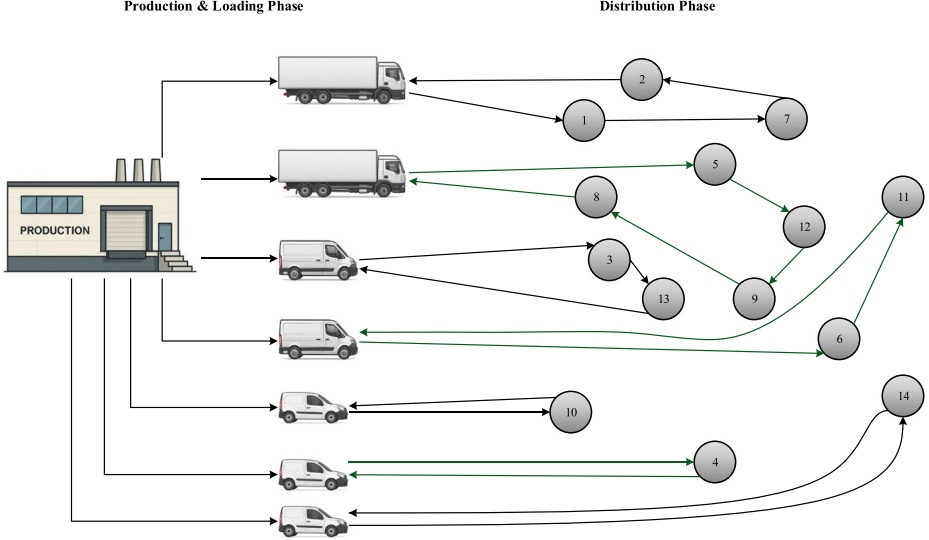

Fig. 1 An overview of the problem

## 3.1 Mathematical model

The MINLP model presented in this study extends the formulations of Ganji et al. (2022) and Li et al. (2018) and incorporates the following parameters and variables into account:

## Parameters and constants

● M - large positive constant.

Nodes (0) and $( n + 1 )$ - artificial start and end customers representing, respectively, the production facility and the return to the facility; neither has processing time nor a delivery window.

## Decision variables

$X _ { i , j } = 1$ if the jth order is completed immediately after the ith order (job), and 0 otherwise.

$Y _ { j , k } ^ { v } = 1$ if the jth order is allocated to the kth vehicle of type v, and 0 otherwise.

$\vec { Z _ { i , j , k } ^ { v } } = 1$ if the jth order is delivered immediately after the ith order by the kth vehicle of type v, and 0 otherwise.

$H _ { w , j } = 1$ if delivery window w is assigned to customer $j ,$ and 0 otherwise.

$C o m _ { j } \cdot$ completion time of the jth order.

$C P _ { k , v }$ - completion time of all orders delivered by the kth vehicle of type v.

$T t r a _ { j }$ - transfer time of the jth order.

$T d e l _ { j }$ - delivery delay of the jth order.

$W L _ { i , j }$ - loading amount for the ith order at location $j .$

Equations 1 and 2 contain the problem’s objective functions. The first equation includes constant delivery tour costs, transportation costs between customer locations, costs of transporting goods to the first customer from the production facility, costs of returning to the production facility from the last customer, fuel costs, and emission amounts. The second objective function represents the tardiness in delivering orders to customers.

$$
\begin{array}{l} \hline M i n \sum_ {v = 1} ^ {V} \sum_ {k = 1} ^ {K} \sum_ {i = 1} ^ {n} \sum_ {j = 1} ^ {n} C c u _ {i, j} Z _ {i, j, k} ^ {v} + \sum_ {v = 1} ^ {V} \sum_ {k = 1} ^ {K} \sum_ {j = 1} ^ {n} C f a c _ {j} Z _ {0, j, k} ^ {v} + \sum_ {v = 1} ^ {V} \sum_ {k = 1} ^ {K} \sum_ {i = 1} ^ {n} C f a c _ {i} Z _ {i, n + 1, k} ^ {v} \\ \quad + F C \sum_ {v = 1} ^ {V} \sum_ {k = 1} ^ {K} \sum_ {j = 1} ^ {n} Z _ {j, k} ^ {v} + \sum_ {v = 1} ^ {V} \sum_ {k = 1} ^ {K} \sum_ {i = 1} ^ {n} \sum_ {j = 1} ^ {n} \left(C _ {e m} + C _ {f u}\right) \left[ \left(\alpha_ {i, j} \left(\operatorname{Wei} _ {v} + W L _ {i, j}\right) + \right. \right. \\ \quad \left. \beta_ {v} V a v r _ {i, j} ^ {2}\right) D i s _ {i, j} \Big ] Z _ {i, n + 1, k} ^ {v} \end{array}\tag{1}
$$

$$
M i n \sum_ {j = 1} ^ {n} T d e l _ {j}\tag{2}
$$

Constraints 3, 4, 5, 6, and 7 ensure that all orders (jobs) have one predecessor job and one successor job to process; if not, a pair of predecessor and successor jobs must already be available.

$$
\left| \sum_ {i = 0} ^ {n} X _ {i, j} = 1 \forall j = 1, \dots , n + 1 \right|\tag{3}
$$

$$
\left| \sum_ {j = 1} ^ {n + 1} X _ {i, j} = 1 \forall i = 0, \dots , n \right|\tag{4}
$$

$$
X _ {i, j} = 0 \forall i = j\tag{5}
$$

$$
X _ {0, n + 1} = 0\tag{6}
$$

$$
X _ {i, j} + X _ {j, i} \leq 1 \forall i, j\tag{7}
$$

Constraint $8$ ensures that every job is allocated to a predefined batch or a vehicle with a unique capacity:

$$
\left| \sum_ {v = 1} ^ {V} \sum_ {k = 1} ^ {K} Y _ {j, k} ^ {v} = 1 \forall j \right|\tag{8}
$$

If an order (job) is assigned to one of the vehicles, constraints 9 through 13 ensure that every job is either the last job delivered to a customer or the first one with a vehicle of unique capacity. If not, it is ensured that a pair of predecessor and successor jobs are already available.

$$
\left| \sum_ {i = 0} ^ {n} Z _ {i, j, k} ^ {v} = Y _ {j, k} ^ {v} \forall j = 1, \dots , n + 1, \forall k, v \right|\tag{9}
$$

$$
\sum_ {j = 1} ^ {n + 1} Z _ {i, j, k} ^ {v} = Y _ {i, k} ^ {v} \forall i = 0, \dots , n, \forall k, v\tag{10}
$$

$$
Z _ {i, j, k} ^ {v} = 0 \forall i = j, \forall k, v\tag{11}
$$

$$
Z _ {0, n + 1, k} ^ {v} = 0 \forall k, v\tag{12}
$$

$$
Z _ {i, j, k} ^ {v} + Z _ {j, i, k} ^ {v} \leq 1 \forall i, j, k, v\tag{13}
$$

Entry and exit permissions into the VRP’s customer nodes are determined by 14, while constraint 15 defines each heterogeneous vehicle’s capacity.

$$
\sum_ {i = 0} ^ {n} Z _ {i, j, k} ^ {v} - \sum_ {j = 1} ^ {n + 1} Z _ {i, j, k} ^ {v} = 0 \forall i, j, k, v\tag{14}
$$

$$
\sum_ {j = 0} ^ {n} Q J _ {j} Y _ {j, k} ^ {v} \leq \operatorname{Cap} _ {v} \sum_ {i = 1} ^ {n} Z _ {0, i, k} ^ {v} \forall k, v\tag{15}
$$

The processing time of the first job and the other jobs assigned to that vehicle are considered by constraints 16 and 17, respectively.

$$
\mathrm{Com} _ {j} \geq \mathrm{Proc} _ {j} - M (1 - X _ {0, j}) \quad \forall j\tag{16}
$$

$$
\mathrm{Com} _ {j} \geq \mathrm{Com} _ {i} + \mathrm{Proc} _ {j} - M (1 - X _ {i, j}) \forall i \neq j\tag{17}
$$

Constraints 18 determines the time at which the vehicles’ transportation tours start, which is at the same time as the last order assigned to the vehicles is processed.

$$
\mathrm{CP} _ {v, k} \geq \mathrm{Com} _ {j} - M (1 - Y _ {j, k} ^ {v}) \forall k, v, j\tag{18}
$$

The delivery times of the orders are calculated by constraints 19 and 20, while their tardiness is stated by Eqs. 21 and 22.

$$
\mathrm{Ttra} _ {j} \geq \mathrm{CP} _ {k, v} + \mathrm{tcu} _ {0, j} - M (1 - Z _ {0, j, k} ^ {v}) \quad \forall k, v, j = 0, \dots , n\tag{19}
$$

$$
\mathrm{Ttra} _ {j} \geq \mathrm{Ttra} _ {i} + \mathrm{tcu} _ {i, j} - M (1 - Z _ {i, j, k} ^ {v}) \quad \forall k, v, i \neq j\tag{20}
$$

$$
\mathrm{Tdel} _ {j} \geq \mathrm{Ttra} _ {j} - \mathrm{DD} _ {j} \quad \forall j\tag{21}
$$

$$
\mathrm{Tdel} _ {j} \geq 0 \quad \forall j\tag{22}
$$

Constraints 23 and 24 ensure that no vehicle’s load exceeds its capacity.

$$
\mathrm{WL} _ {i, j} \leq \mathrm{Cap} _ {v} \quad \forall v, i, j\tag{23}
$$

$$
\sum_ {i = 1} ^ {n} \sum_ {j = 1} ^ {n} \mathrm{WL} _ {i, j} \leq \sum_ {k = 1} ^ {K} \sum_ {v = 1} ^ {V} \mathrm{QJ} _ {j} \mathrm{Y} _ {j, k} ^ {v} \quad \forall k, v, i \neq j\tag{24}
$$

Constraints 25 states that all customer orders must be delivered within a single time window, as indicated by constraints 26 and 27.

$$
\left| \sum_ {w = 1} ^ {W} H _ {w, j} = 1 \quad \forall j \right|\tag{25}
$$

$$
\mathrm{Ttra} _ {j} \geq \sum_ {w = 1} ^ {W} L _ {w, j} H _ {w, j} \quad \forall j\tag{26}
$$

$$
\mathrm{Ttra} _ {j} \leq \sum_ {w = 1} ^ {W} U _ {w, j} H _ {w, j} \quad \forall j\tag{27}
$$

Finally, constraints 28 and 29 ensure that all variables are non-negative and state their integer constraints. The mixed-integer nonlinear programming model described above includes continuous variables $C _ { j } , \operatorname { C P } _ { k , v } , \operatorname { T t r a } _ { j } , \operatorname { T d e l } _ { j } , \operatorname { W L } _ { i , j }$ as well as Binary variables, $X _ { i , j } \in \{ 0 , 1 \} , Y _ { j , k } ^ { v } \in \{ 0 , 1 \} , Z _ { i , j , k } ^ { v } \in \{ 0 , 1 \} , H _ { w , j } \in \{ 0 , 1 \}$

$$
X _ {i, j},   Y _ {j, k} ^ {v},   Z _ {i, j, k},   H _ {w, j} \in \{0, 1 \} \quad \forall   k,   v,   i,   j\tag{28}
$$

$$
\mathrm{Com} _ {j}, \mathrm{CP} _ {k, v}, \mathrm{Ttra} _ {j}, \mathrm{Tdel} _ {j}, \mathrm{WL} _ {i, j} \geq 0 \quad \forall k, v, i, j\tag{29}
$$

## 4 Solution methods

Production system problems where the goal is to minimize tardiness may be considered NP-Hard (Wang and Cheng 2000; Mazdeh et al. 2010). Additionally, the VRP is considered strongly NP-Hard (Demir et al. 2019). Given that our model integrates production scheduling, and delivery routing, in addition to the main goal of reducing total distribution cost and tardiness, this research can be classified as NP-Hard. On this basis, it is logical to solve the problem by applying heuristics and metaheuristics.

Dealing with mathematical optimization problems involves many challenges. For instance, as the number of objectives increases, the number of non-dominated solutions in the target region also rises. This means that the majority of solutions produced in the target region are non-dominated, which can slow down the search in the solution space. In brief, when solving multi-objective problems, solutions with appropriate dispersion and variety in the Pareto front are sought. In his regard, describing the distance among non-dominated solutions is usually significantly complicated. Consequently, it is crucial to devise multi-objective evolutionary optimization methods to deal with these challenges.

Moreover, the selection of NSGA-II and MOPSO in this study is grounded in their well-documented success across a broad range of multi-objective optimization problems, including numerous applications in supply chain management and logistics (Dou et al. 2021). NSGA-II is one of the most frequently adopted algorithms in the literature, valued for its broad applicability, computational efficiency, and robustness in diverse problem settings, without the need for extensive parameter tuning (Verma et al. 2021; Shami et al. 2022; Sharma and Kumar 2022). In parallel, MOPSO has proven to be highly competitive in navigating complex supply chain problems, offering strong exploration capabilities and adaptability (Amin-Tahmasbi et al. 2023). Applying both algorithms independently, together with the ε-constraint for small-size problems, facilitates a rigorous comparative analysis, with results that can serve as reliable benchmarks for future research on integrated supply chain scheduling.

## 4.1 NSGA-II

Given the complexity and combinatorial nature of the model, the NSGA-II is adopted to approximate the Pareto front (Kabiri et al. 2022). A key design element of this approach is the chromosome encoding, illustrated in Fig. 2, which consolidates into a single solution representation, the sequence of customers whose orders will be produced first and the sequence of vehicles which deliver the product.

In dealing with the problem, the main components are crowding distance, binary tournament selection operator, and storing the non-dominated solutions resulting from the prior segments. The crowding distance of a given point with r ranking on the Pareto front is equal to the mean length of the sides of the rectangle formed by the preceding and succeeding members in the objective function’s 2D space.

In this study, Simulated Binary Crossover (SBX) operator (Chacon and Segura 2018) were used to combine two chromosomes (parent chromosomes) to generate two new chromosomes (offspring chromosomes). The SBX simulates the basic effects of a single-point crossover operator in binary strings. The probability distribution function of this method is demonstrated in Eqs. 30 and 31.

<table><tr><td>Sequence of Customers</td><td>C9</td><td>C4</td><td>C10</td><td>C2</td><td>C1</td><td>C3</td><td>C5</td><td>C7</td><td>C6</td><td>C8</td></tr><tr><td>Sequence of Vehicles</td><td>K3</td><td>K1</td><td>K5</td><td>K4</td><td>K2</td><td colspan="3"></td><td>F1</td><td>F2</td></tr></table>

Fig. 2 Encoding of chromosomes in NSGA-II

$$
p (\beta_ {i}) = \left\{ \begin{array}{l l} \frac {1}{2} (\eta_ {c} + 1)   \beta_ {i} ^ {\eta_ {c}}, & \text {if} 0 \leq \beta_ {i} \leq 1 \\ \frac {1}{2} (\eta_ {c} + 1)   \beta_ {i} ^ {- (\eta_ {c} + 2)}, & \text {if} \beta_ {i} > 1 \end{array} \right.\tag{30}
$$

$$
\beta_ {i} = \left\{ \begin{array}{l l} (2 u _ {i}) ^ {\frac {1}{\eta_ {c} + 1}}, & \text {if} u _ {i} \leq 0. 5 \\ \left(\frac {1}{2 (1 - u _ {i})}\right) ^ {\frac {1}{\eta_ {c} + 1}}, & \text {if} u _ {i} > 0. 5 \end{array} \right.\tag{31}
$$

where $p ( \beta _ { i } )$ is the probability of crossover, $\beta _ { i }$ is the difference between parent and child objective functions, $\eta _ { c }$ is a fixed integer indicating the difference between parent and child objective functions (higher values of $\eta _ { c }$ indicate a higher probability of generating solutions closer to the parents), and $u _ { i }$ is a random integer between [0 and 1]. The $\beta _ { i }$ is calculated through Eq. 32 and the children’s values through Eq. 33.

$$
\beta_ {i} = \left| \frac {x _ {1} ^ {\text {child}} - x _ {2} ^ {\text {child}}}{x _ {1} ^ {\text {parent}} - x _ {2} ^ {\text {parent}}} \right|\tag{32}
$$

$$
\begin{array}{l} x _ {1} ^ {\text {child}} = \frac {1}{2} \left[ (1 + \beta_ {i}) x _ {1} ^ {\text {parent}} + (1 - \beta_ {i}) x _ {2} ^ {\text {parent}} \right] \\ x _ {2} ^ {\text {child}} = \frac {1}{2} \left[ (1 - \beta_ {i}) x _ {1} ^ {\text {parent}} + (1 + \beta_ {i}) x _ {2} ^ {\text {parent}} \right] \end{array}\tag{33}
$$

where $x _ { 1 } ^ { c h i l d }$ and $x _ { 2 } ^ { c h i l d }$ describe the string values of the first and second child, and $x _ { 1 } ^ { p a r e n t }$ and $x _ { 2 } ^ { p a r e n t }$ represent the string values of the first and second parent individually. Given the large size of the search space and in order to escape from local optima, a polynomial mutation operator was used in this study as displayed by Eq. 34. Where $\delta _ { i }$ is the value of mutation, $r _ { i }$ is a random integer between [0, 1] and $\eta _ { m }$ is the mutation distribution constant and parameter $\delta$ is added to the value of parent genes in the form of Eq. 34.

$$
\delta_ {i} = \left\{ \begin{array}{l l} (2 r _ {i}) ^ {\frac {1}{\eta_ {m} + 1}} - 1, & \text {if} r _ {i} <   0. 5 \\ 1 - [ 2 (1 - r _ {i}) ] ^ {\frac {1}{\eta_ {m} + 1}}, & \text {if} r _ {i} \geq 0. 5 \end{array} \right.\tag{34}
$$

$$
x ^ {\mathrm{child}} = x ^ {\mathrm{parent}} + \delta_ {i}\tag{35}
$$

## 4.2 MOPSO

The Particle Swarm Optimization (PSO) algorithm, introduced by Eberhart and Kennedy (1995), is inspired by the collective behavior of biological systems. For the specific problem addressed in this study, each particle is encoded incorporating both the customer and vehicle sequences. The customer segment of the particles includes a list of customer positions that defines the sequence of order production based on the descending values and a list of customer velocities that defines the movement of the particles. The other segment of the solution encoding is dedicated to positions and velocities of the vehicles scheduled to delivery. This unified representation is illustrated in Fig. 3.

<table><tr><td>Customer Positions</td><td>0.17</td><td>0.89</td><td>0.04</td><td>0.62</td><td>0.30</td><td>0.76</td><td>0.51</td><td>0.01</td><td>0.99</td><td>0.25</td></tr><tr><td>Customer Velocities</td><td>0.38</td><td>0.95</td><td>0.11</td><td>0.77</td><td>0.23</td><td>0.66</td><td>0.02</td><td>0.50</td><td>0.85</td><td>0.39</td></tr><tr><td>Vehicle Positions</td><td>0.41</td><td>0.87</td><td>0.09</td><td>0.63</td><td>0.28</td><td>0.74</td><td rowspan="2" colspan="4"></td></tr><tr><td>Vehicle Velocities</td><td>0.12</td><td>0.68</td><td>0.45</td><td>0.03</td><td>0.89</td><td>0.57</td></tr></table>

Fig. 3 Encoding of particles in MOPSO

The development of the MOPSO in this study was inspired by Ai and Kachitvichyanukul (2009) and Goksal et al. (2013). In MOPSO, the position of the ith particle $x _ { i }$ is represented by a D-dimensional vector, as defined in Eq. 36. The number of decision variables is represented by D and the magnitude of the group is expressed by N. In addition, the best particle with the smallest distance from an optimal point is called $g _ { b e s t }$ and the best position of a particle discovered to find an optimal point is named $p _ { b e s t }$ . In the first step of the PSO algorithms, the random answers of $x _ { i }$ with a normal distribution function help generate the decision-making variables. For the second step, the value of the objective function of each particle is calculated and remains in the algorithm’s memory. In the next step, according to the best position found, the $p _ { b e s t }$ and $g _ { b e s t }$ are assigned for the particles of the group. Next, the speed of each particle is computed through Eqs. 37 and 38.

$$
x _ {i} = \left[ x _ {i, 1}, x _ {i, 2}, \dots , x _ {i, D} \right] \quad \forall i = 1, \dots , N\tag{36}
$$

$$
v _ {i, d} ^ {t + 1} = \alpha \Big (\omega^ {t} \cdot v _ {i, d} ^ {t} + c _ {1} r _ {1} ^ {t} \left(p _ {\text {best} j} - x _ {i, d} ^ {t}\right) + c _ {2} r _ {2} ^ {t} \left(g _ {\text {best}} (t) - x _ {i, d} ^ {t}\right) \Big)\tag{37}
$$

$$
\text {for} i = 1, \dots , N \text {and} d = 1, \dots , D
$$

$$
\omega^ {t} = \omega_ {\max} - \frac {(\omega_ {\max} - \omega_ {\min}) t}{\operatorname{iter} _ {\max}}\tag{38}
$$

where $v _ { i , d } ^ { ( t + 1 ) }$ is the ith particle speed for dth dimension at (t + 1)th repetition, α the contraction factor and a pre-determined coefficient that controls the particles’ velocity, and $\omega ^ { t }$ the inertia weight parameter at tth repetition. This parameter begins from the highest value $( \omega _ { \mathrm { m a x } } )$ at the initial repetition and goes forward with the lowest value at the last repetition $i t e r _ { \mathrm { m a x } }$ . In fact, at the beginning of this process, the impact of velocity is more than that of the next repetitions $c _ { 1 }$ is the individual parameter and $c _ { 2 }$ the collective parameter that determines the share of $p _ { b e s t }$ and $g _ { b e s t }$ , while $\boldsymbol { r } _ { 1 } ^ { t }$ and $\boldsymbol { r } _ { 2 } ^ { t }$ are random integers between [0 and 1] at the jth repetition. Therefore, every particle moves along the speed vector when located in the decision space. In the next step, the velocities obtained by the lower limit $( v _ { \mathrm { m i n } } )$ and upper limit $( v _ { \mathrm { m a x } } )$ of velocity are controlled. At the end, each particle’s position is calculated through Eq. 39.

$$
v _ {\min} \leq v _ {i, d} ^ {t + 1} \leq v _ {\max}\tag{39}
$$

$$
x _ {i, d} ^ {t + 1} = x _ {i, d} ^ {t} + v _ {i, d} ^ {t + 1}\tag{40}
$$

The particle’s new position is utilized as new input for simulation model at second repetition and objective function is calculated similarly. The process is repeated until reaching maximum number of repetitions.

Every particle in PSO algorithm follows its objective function, while in MOPSO algorithm, particles must adapt to the objective functions. Therefore, each particle in each group has distinct $p _ { b e s t }$ and $g _ { b e s t }$ in each group is the next groups’ $g _ { b e s t }$ . By doing so, a dynamic archive of particle exchange is generated with each iteration. In the following, the obtained particles are compared with each other, and finally, the non-dominant solutions are saved. Then, at the end of each iteration, the algorithm eliminates the other solutions. With this mechanism in place, the members of the External Archive (EA) may be accessed at every iteration, while the size of the EA changes dynamically.

$$
\text {fit} (i, k) = \frac {H (i , k)}{\text {density} (i , k)}\tag{41}
$$

After the kth iteration, the value of the ith particle’s fitness function will be obtained by Eq. 41. Where H(i and k) represents the number of particles that the ith particle dominates at the kth iteration, and density(i and $k )$ indicates the number of particles similar the ith particle at the kth iteration. Usually, higher values of the fitness function are indicative of the better position of the particle. Initially, each particle’s original position is set as $p _ { b e s t }$ . At the next iterations, if $p _ { b e s t }$ is dominated by the current position of the ith particle, then particle i remains unchanged. However, if the dominance relationship does not exist, the values of the fitness function are calculated for them and the position that has the largest value gets chosen as $p _ { b e s t }$ . In the end, should the fitness values be equal, and one of them is randomly chosen as $p _ { b e s t }$

## 5 Computational examples

## 5.1 Numerical instance design

A structured set of numerical instances was developed to evaluate the performance of the proposed mathematical model and solution algorithms under conditions that closely mirror real operational settings. The design process was guided by the methodological principles of Gharaei and Jolai (2018); Li et al. (2018) and informed by operational practices observed in a local corporate catering company. This industry relies on centralized batch production and tightly constrained delivery schedules, making it an appropriate analogue for the integrated production-distribution framework studied here. The development of these instances, detailed in the following tables, was based on a systematic examination of the company’s operations. This process involved extracting data from operational databases, conducting statistical estimation for key distribution function, and validating assumptions through structured interviews with domain experts.

Eight instances of increasing complexity were generated, as summarized in Table 2. The smaller instances capture low-demand scenarios typical of off-peak or holiday periods and remain tractable for exact approaches such as the ε-constraint method. The larger instances emulate peak-demand conditions with expanded customer networks and heterogeneous fleets, thereby serving as challenging benchmarks for the proposed metaheuristics.

Table 2 Summary of the scenarios

<table><tr><td rowspan="2">Problems</td><td rowspan="2">Vehicle type</td><td colspan="6">Number of vehicles</td><td rowspan="2">Number of customers</td><td rowspan="2">Number of time windows</td></tr><tr><td>A</td><td>B</td><td>C</td><td>D</td><td>E</td><td>F</td></tr><tr><td colspan="10">Small size</td></tr><tr><td>1</td><td>A-B</td><td>3</td><td>3</td><td>-</td><td>-</td><td>-</td><td>-</td><td>150</td><td>4</td></tr><tr><td>2</td><td>A-B-C</td><td>4</td><td>3</td><td>3</td><td>-</td><td>-</td><td>-</td><td>150</td><td>4</td></tr><tr><td>3</td><td>A-B-C-D</td><td>2</td><td>4</td><td>3</td><td>2</td><td>-</td><td>-</td><td>200</td><td>3</td></tr><tr><td>4</td><td>A-B-C-D</td><td>3</td><td>3</td><td>3</td><td>2</td><td>-</td><td>-</td><td>200</td><td>5</td></tr><tr><td colspan="10">Large size</td></tr><tr><td>5</td><td>A-B-C-D-E</td><td>5</td><td>3</td><td>3</td><td>3</td><td>2</td><td>-</td><td>250</td><td>4</td></tr><tr><td>6</td><td>A-B-C-D-E-F</td><td>4</td><td>4</td><td>3</td><td>3</td><td>1</td><td>1</td><td>250</td><td>2</td></tr><tr><td>7</td><td>A-B-C-D-E-F</td><td>6</td><td>4</td><td>2</td><td>3</td><td>2</td><td>2</td><td>300</td><td>3</td></tr><tr><td>8</td><td>A-B-C-D-E-F</td><td>5</td><td>5</td><td>4</td><td>4</td><td>1</td><td>3</td><td>300</td><td>5</td></tr></table>

Table 3 Production and distribution parameters

| Parameter | Uniform distribution [a, b] |
| --- | --- |
| Proci | [100, 200] |
| QJi | [10, 40] |
| Ccui,j | [30, 150] |
| Cfai | [40, 250] |
| tcui,j | [30, 100] |
| tfai | [100, 200] |
| αi,j | [0.09, 0.15] |
| Disi,j | [30, 200] |
| Vavri,j | [85, 120] |
| Ltw,j | [2, 7] |
| Utw,j | [7, 15] |
| M | 10000 |

The parameter ranges used to build these instances were selected to reflect realistic operational patterns. Production-related parameters in Table 3, such as processing times $( \mathrm { P r o c } _ { i } )$ and batch preparation quantities $( \mathrm { Q J } _ { i } )$ , correspond to the order-dependent cycles common in institutional meal preparation. $( \mathrm { t c u } _ { i , j } , \mathrm { D i s } _ { i , j } , V a v r _ { i , j }$ $\alpha _ { i , j } )$ were calibrated to emulate the travel-time variability and mixed urban-suburban routes typical of the industry. Furthermore, customer time windows $( L _ { t w , j } ,   U _ { t w , j } )$ were set to align with realistic meal service periods. The heterogeneous fleet specifications in Table 4 (including capacity, weight, and energy efficiency coefficient) mirror the light and medium-duty vehicles used in regional distribution. All financial parameters are expressed in a generic Local Currency Unit (LCU) to ensure generalizability. Accordingly, the specified values for FC, $C _ { f u }$ , and $C _ { e m }$ are 200, 0.64, and 7.3 LCU, respectively.

Table 4 Vehicle type parameters

| Parameters | Vehicle type |  |  |  |  |  |
| --- | --- | --- | --- | --- | --- | --- |
|  | A | B | C | D | E | F |
| W eiv | 1000 | 1000 | 1500 | 1500 | 3000 | 3500 |
| Capv | 150 | 200 | 300 | 400 | 450 | 480 |
| βv | 3.13 | 3.75 | 2.67 | 3.05 | 4.14 | 3.37 |

Table 5 Parameters of algorithms and their levels

| Algorithm Symbo | l Parameter | Low | Medium | High |
| --- | --- | --- | --- | --- |
| NSGA-II Npop | Generations population | 50 | 75 | 100 |
| Cr | Crossovers rate | 0.5 | 0.6 | 0.7 |
| Mr | Mutations rate | 0.2 | 0.4 | 0.6 |
| It1 | Maximum iteration | 100 | 120 | 150 |
| MOPSO Npop | Particles population | 50 | 75 | 100 |
| ωt | Inertia weight | 0.6 | 0.7 | 0.8 |
| C1 | Individual best impact | 0.5 | 0.75 | 1 |
| C2 | Collective best impact | 0.75 | 1 | 1.25 |
| α | Contraction factor | 0.1 | 0.2 | 0.3 |
| It2 | Maximum iteration | 100 | 120 | 150 |

Overall, the instance design yields a coherent, industry-relevant test environment that aligns with established modeling practices and enables a rigorous assessment of the proposed optimization framework.

## 5.2 Parameter setting

It is commonly assumed that the choice of parameters significantly influences an algorithm’s performance. Taguchi’s approach is one of the most efficient methods for setting algorithm parameters. This method aims to minimize the difference between variables and identify controllable and uncontrollable factors (Taguchi and Konishi 1987). The S/N ratio is the quality index shown in Eq. 42.

$$
\mathrm{S/N} _ {\text {ratio}} = - \log \left(\frac {1}{n} \sum_ {i = 1} ^ {n} y _ {i} ^ {2}\right)\tag{42}
$$

Three levels of NSGA-II and MOPSO, where maximum iterations define the number of generations evolved and swarm updates respectively, categorized as Low, Medium, and High for comparative analysis, are shown in Table 5, with both algorithms implemented in Python v3.7 and executed on a 2.4 GHz Intel processor.

A Taguchi design L27 test was carried out and implemented using the WM. According to the S/N index, the optimal values for the MOPSO and NSGA-II algorithms are presented in Fig. 4 and Table 6.

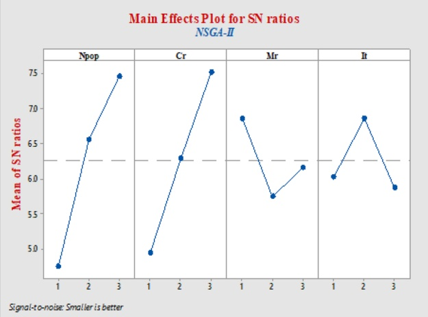

(a) NSGA-II

Main Effects Plot for SN ratios MOPSO

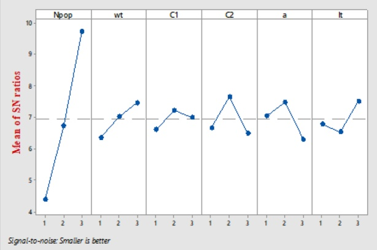

(b) MOPSO

Fig. 4 The S/N Index values for parameters of NSGA-II and MOPSO, generated using Minitab® statistical software

Table 6 Tuned parameters for NSGA-II and MOPSO

| MOPSO |  | NSGA-II |  |
| --- | --- | --- | --- |
| Parameter | Value | Parameter | Value |
| Npop | 50 | Npop | 50 |
| ωt | 0.6 | Cr | 0.5 |
| C1 | 0.5 | Mr | 0.4 |
| C2 | 1.25 | It | 150 |
| α | 0.3 | - | - |
| It | 120 | - | - |

## 5.3 Performance measurement

Zitzler et al. (2000) introduced several carefully assessed variables to evaluate the performance of algorithms. Six performance indicators were used: Spacing Metric (SP) (Rahman et al. 2025), Ratio of Nondominated Individuals (RNI) (Jain and Dhodiya 2025), Generational Distance (GD) (Lei et al. 2025), Mean Ideal Distance (MID) (Miraba et al. 2025), Maximum Diversity (MD) (Lei et al. 2025), and Average Computational Time (ACT). The formulas and explanations for these indicators can be found in Ganji et al. (2022). Also, the weight metric (WM) is used, which is a combination of five metrics normalized as illustrated in Eq. 43.

$$
\mathrm{WM} = \frac {\mathrm{RNI} + 2 \cdot \mathrm{GD} + 2 \cdot \mathrm{MID} + 2 \cdot \mathrm{SP} + 2 \cdot \mathrm{MD} + 2 \cdot \mathrm{ACT}}{1 1}\tag{43}
$$

Considering importance of results being consistently distributed, the latter six possess larger weights.

## 6 Results

## 6.1 ε-constraint method results

To perform validation tests, the high-precision ε-constraint technique is applied. In this approach, one objective is considered as the objective function while the others are treated as constraints. Mavrotas and Florios (2013) presented an enhanced version of this approach that guarantees the acquisition of the Pareto-optimal solution. A relative gap is introduced to compare the resulting answers satisfactorily. This gap shows the relative deviation of the objective function’s value between the MOPSO and NSGA-II approaches. The objectives for two characteristics, the number of demands and customers, were obtained using the ε-constraint method. This distance can be calculated using Eq. 44. Where $Z _ { a l g }$ and $Z _ { \varepsilon }$ are optimal values for the objective functions.

$$
\text {Relative Gap (\%)} = \frac{Z_{\mathrm{alg}} - Z_{\varepsilon}}{Z_{\varepsilon}} \times 100\tag{44}
$$

The results obtained from each method for two characteristics, the number of vehicles and customers, are presented in Tables 7 and 8. The units of measurement for cost and time are LCU and hours, respectively. It is worth noting that the ε-constraint method could not solve the last two examples within a determined time due to increased problem complexity. Based on the results obtained, it can be seen that the solutions generated by both meta-heuristic methods are remarkably close to those provided by the ε-constraint approach. Therefore, it can be concluded that the MOPSO and NSGA-II algorithms generate reliable solutions.

To validate the proposed mathematical model, we evaluated Numerical Example 4 (ten customers, five heterogeneous vehicles) under the specified routing conditions.

Table 7 Results of small-sized instances for the NSGA-II and ε-constraint methods

<table><tr><td rowspan="2">Exp</td><td rowspan="2">V</td><td rowspan="2">C</td><td colspan="3">NSGA-II</td><td colspan="3">ε-constraint</td><td colspan="2">Relative GAP</td></tr><tr><td> $f_1^min$ </td><td> $f_2^{min}$ </td><td>Time (min)</td><td> $f_1^{min}$ </td><td> $f_2^{min}$ </td><td>Time (min)</td><td> $f_1^{min}$ </td><td> $f_2^{min}$ </td></tr><tr><td>1</td><td>2</td><td>3</td><td>93.05</td><td>3.43</td><td>0.37</td><td>93.05</td><td>3.43</td><td>10</td><td>0.000</td><td>0.000</td></tr><tr><td>2</td><td>3</td><td>5</td><td>95.98</td><td>3.81</td><td>0.37</td><td>95.98</td><td>3.81</td><td>13</td><td>0.000</td><td>0.000</td></tr><tr><td>3</td><td>3</td><td>7</td><td>98.34</td><td>4.21</td><td>0.38</td><td>98.21</td><td>4.14</td><td>14</td><td>0.001</td><td>0.017</td></tr><tr><td>4</td><td>5</td><td>10</td><td>113.36</td><td>5.32</td><td>0.41</td><td>112.98</td><td>5.29</td><td>17</td><td>0.003</td><td>0.006</td></tr><tr><td>5</td><td>5</td><td>13</td><td>124.42</td><td>6.11</td><td>0.36</td><td>124.39</td><td>6.08</td><td>25</td><td>0.000</td><td>0.005</td></tr><tr><td>6</td><td>6</td><td>15</td><td>131.12</td><td>6.73</td><td>0.39</td><td>131.01</td><td>6.65</td><td>28</td><td>0.001</td><td>0.012</td></tr><tr><td>7</td><td>8</td><td>18</td><td>148.32</td><td>7.32</td><td>0.43</td><td>147.12</td><td>7.18</td><td>32</td><td>0.008</td><td>0.019</td></tr><tr><td>8</td><td>8</td><td>20</td><td>160.11</td><td>7.56</td><td>0.43</td><td>159.98</td><td>7.51</td><td>38</td><td>0.001</td><td>0.007</td></tr><tr><td>9</td><td>10</td><td>23</td><td>168.09</td><td>7.78</td><td>0.35</td><td>-</td><td>-</td><td>-</td><td>-</td><td>-</td></tr><tr><td>10</td><td>12</td><td>25</td><td>173.50</td><td>8.48</td><td>0.45</td><td>-</td><td>-</td><td>-</td><td>-</td><td>-</td></tr><tr><td colspan="3">Average</td><td>130.63</td><td>6.08</td><td>0.39</td><td>120.34</td><td>5.51</td><td>22.13</td><td>0.002</td><td>0.008</td></tr></table>

Table 8 Results of small-sized instances for the MOPSO and ε-constraint methods

<table><tr><td rowspan="2">Exp</td><td rowspan="2">V</td><td rowspan="2">C</td><td colspan="3">MOPSO</td><td colspan="3">ε-constraint</td><td colspan="2">Relative GAP</td></tr><tr><td> $f_1^{\min}$ </td><td> $f_2^{\min}$ </td><td>Time(min)</td><td> $f_1^{\min}$ </td><td> $f_2^{\min}$ </td><td>Time(min)</td><td> $f_1^{\min}$ </td><td> $f_2^{\min}$ </td></tr><tr><td>1</td><td>2</td><td>3</td><td>96.13</td><td>3.51</td><td>0.29</td><td>93.05</td><td>3.43</td><td>10</td><td>0.033</td><td>0.023</td></tr><tr><td>2</td><td>3</td><td>5</td><td>98.02</td><td>3.90</td><td>0.32</td><td>95.98</td><td>3.81</td><td>13</td><td>0.021</td><td>0.024</td></tr><tr><td>3</td><td>3</td><td>7</td><td>100.87</td><td>4.36</td><td>0.32</td><td>98.21</td><td>4.14</td><td>14</td><td>0.027</td><td>0.053</td></tr><tr><td>4</td><td>5</td><td>10</td><td>114.61</td><td>5.59</td><td>0.44</td><td>112.98</td><td>5.29</td><td>17</td><td>0.014</td><td>0.057</td></tr><tr><td>5</td><td>5</td><td>13</td><td>128.59</td><td>6.25</td><td>0.47</td><td>124.39</td><td>6.08</td><td>25</td><td>0.034</td><td>0.028</td></tr><tr><td>6</td><td>6</td><td>15</td><td>132.43</td><td>6.86</td><td>0.47</td><td>131.01</td><td>6.65</td><td>28</td><td>0.011</td><td>0.032</td></tr><tr><td>7</td><td>8</td><td>18</td><td>148.89</td><td>7.98</td><td>0.45</td><td>147.12</td><td>7.18</td><td>32</td><td>0.012</td><td>0.111</td></tr><tr><td>8</td><td>8</td><td>20</td><td>161.22</td><td>8.34</td><td>0.47</td><td>159.98</td><td>7.51</td><td>38</td><td>0.008</td><td>0.111</td></tr><tr><td>9</td><td>10</td><td>23</td><td>169.91</td><td>8.93</td><td>0.45</td><td>-</td><td>-</td><td>-</td><td>-</td><td>-</td></tr><tr><td>10</td><td>12</td><td>25</td><td>173.18</td><td>9.39</td><td>0.47</td><td>-</td><td>-</td><td>-</td><td>-</td><td>-</td></tr><tr><td colspan="3">Average</td><td>132.39</td><td>6.51</td><td>0.42</td><td>120.34</td><td>5.51</td><td>22.13</td><td>0.020</td><td>0.055</td></tr></table>

Optimizing only the economic objective (minimizing transportation and emission costs) produces the lowest total cost by using the fewest vehicles and the shortest routes, but some deliveries miss their time windows, increasing customer dissatisfaction. Optimizing only the customer-orientation objective (minimizing production and delivery times) meets time-window requirements and shortens service times, but requires more vehicles and markedly increases transportation costs and carbon emissions. Table 9 reports the objective-function values for these single-objective scenarios, demonstrating the inherent conflict and the need for a trade-off. We therefore solve the integrated bi-objective model to balance economy and service quality; the resulting compromise solutions are summarized in Table 10.

## 6.2 Pareto front results

The Pareto front technique was applied to keep deviations from targets within a normal range. The Pareto front consists of solutions that do not dominate the others. These non-dominated solutions in each iteration make up the first Pareto front. Some solutions produced on each Pareto front have similar properties and are eliminated to make space for other solutions.

Table 9 Results of the economic and customer-oriented situations

<table><tr><td rowspan="2">Objectives</td><td colspan="3">Cost</td><td colspan="3">Time</td><td rowspan="2">Vehicle routing</td></tr><tr><td>NSGA-II</td><td>MOPSO</td><td> $\varepsilon$ -constraint</td><td>NS-GA-II</td><td>MOPSO</td><td> $\varepsilon$ -constraint</td></tr><tr><td>Economic orientation</td><td>74.52</td><td>75.96</td><td>74.52</td><td>9.43</td><td>10.64</td><td>9.21</td><td> $V_1: C_{10} \rightarrow C_9 \rightarrow C_8$  $V_4: C_6 \rightarrow C_5 \rightarrow C_4 \rightarrow C_1$  $V_2: C_2 \rightarrow C_3 \rightarrow C_7$ </td></tr><tr><td>Customer orientation</td><td>245.11</td><td>247.87</td><td>244.94</td><td>2.17</td><td>2.53</td><td>2.02</td><td> $V_3: C_6 \rightarrow C_7 V_1: C_5 \rightarrow C_4 \rightarrow C_1 V_4: C_8 \rightarrow C_3 V_2: C_2 V_5: C_{10} \rightarrow C_9$ </td></tr></table>

Table 10 Best solution of the economic and customer-oriented situations

<table><tr><td rowspan="2">Objectives</td><td colspan="3">Cost</td><td colspan="3">Time</td><td rowspan="2">Vehicle routing</td></tr><tr><td>NSGA-II</td><td>MOPSO</td><td> $\varepsilon$ -constraint</td><td>NSGA-II</td><td>MOPSO</td><td> $\varepsilon$ -constraint</td></tr><tr><td>Economic and customer orientations</td><td>113.36</td><td>114.61</td><td>112.98</td><td>5.32</td><td>5.59</td><td>5.29</td><td> $V_1:$  $C_8 \rightarrow C_9 \rightarrow C_{10}$  $V_4: C_6 V_3:$  $C_1 \rightarrow C_5 \rightarrow C_4$  $V_2:$  $C_2 \rightarrow C_3 \rightarrow C_7$ </td></tr></table>

In this study, the Crowding Distance technique (Yacoubi et al. 2023) is used to implement this purging process in NSGA-II. For this purpose, the distances of all solutions in the front are calculated individually, and the closest solutions are removed from the set. “Gridding” is another technique applied in the proposed version of MOPSO, with a concept similar to crowding distance (Khodadadi et al. 2022). In this method, the solution space is symmetrically divided into grids by horizontal and vertical lines. In the next step, one solution in the most crowded grid is eliminated until the constraints of the first Pareto front are satisfied. Table 11 and Fig. 5 illustrate first Pareto front of both algorithms from last iterations. They cannot present precise comparison between performances of algorithms since they are results of one-time running of each algorithm.

Declining trends of results of NSGA-II and MOPSO in some intervals are displayed in Fig. 6a and b. These figures show wide ranges of explored solutions. The resultsare listed in Table 12. Based on these figures MOPSO and NSGA-II could successfullyoptimize delivery tardiness, distribution costs and emission cost in just 50 loops.

## 6.3 Convergence results

One of the main capabilities of iterative algorithms is convergence. The results of an algorithm must show that the generated solutions in iterations converge or taper to a

Table 11 Final results of the Pareto fronts

<table><tbody><tr><td rowspan="2">Solution</td><td>NSGA-II</td><td colspan="3">MOPSO</td></tr><tr><td>F1 (Million LCU)</td><td>F2(Hours)</td><td>F1 (Million LCU)</td><td>F2(Hours)</td></tr><tr><td>1</td><td>84.972348</td><td>858</td><td>86.71690667</td><td>1047</td></tr><tr><td>2</td><td>84.826064</td><td>2622</td><td>86.46583367</td><td>2493</td></tr><tr><td>3</td><td>82.452326</td><td>2989</td><td>85.14718833</td><td>2869</td></tr><tr><td>4</td><td>80.235645</td><td>3083</td><td>85.15792123</td><td>3003</td></tr><tr><td>5</td><td>80.120474</td><td>3595</td><td>84.44012342</td><td>4147</td></tr><tr><td>6</td><td>79.372215</td><td>5709</td><td>81.86644433</td><td>5024</td></tr><tr><td>7</td><td>77.855294</td><td>5772</td><td>77.52228412</td><td>6177</td></tr><tr><td>8</td><td>75.114848</td><td>6875</td><td>77.40896867</td><td>7284</td></tr><tr><td>9</td><td>73.900521</td><td>7408</td><td>68.08706233</td><td>10682</td></tr><tr><td>10</td><td>73.529732</td><td>8008</td><td>-</td><td>-</td></tr><tr><td>11</td><td>73.155235</td><td>8553</td><td>-</td><td>-</td></tr><tr><td>12</td><td>69.301772</td><td>9830</td><td>-</td><td>-</td></tr></tbody></table>

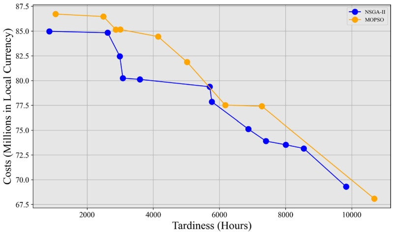

Fig. 5 The first Pareto fronts of the algorithms

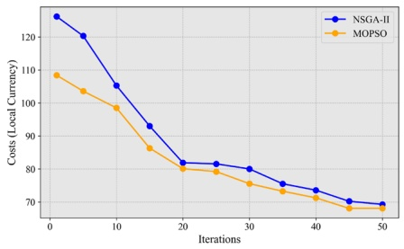

(a) Delivery costs

Fig. 6 Optimization in MOPSO and NSGA-II

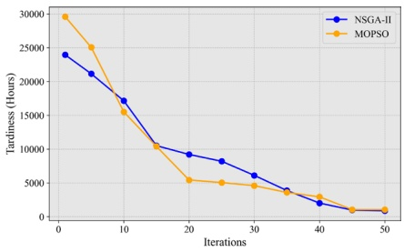

(b) Tardiness

Table 12 Optimization results across iterations

<table><tbody><tr><td rowspan="2">Iteration</td><td>NSGA-II</td><td colspan="3">MOPSO</td></tr><tr><td>F1* (Million LCU)</td><td>F2*(Hours)</td><td>F1* (Million LCU)</td><td>F2*(Hours)</td></tr><tr><td>1</td><td>126.1965</td><td>23950</td><td>108.3851</td><td>29595</td></tr><tr><td>5</td><td>120.2897</td><td>21143</td><td>103.5755</td><td>25054</td></tr><tr><td>10</td><td>105.2598</td><td>17142</td><td>98.50768</td><td>15501</td></tr><tr><td>15</td><td>92.99844</td><td>10504</td><td>86.32136</td><td>10398</td></tr><tr><td>20</td><td>81.88794</td><td>9206</td><td>80.1001</td><td>5430</td></tr><tr><td>25</td><td>81.55972</td><td>8197</td><td>79.22434</td><td>5044</td></tr><tr><td>30</td><td>80.034</td><td>6112</td><td>75.5614</td><td>4587</td></tr><tr><td>35</td><td>75.53228</td><td>3869</td><td>73.27788</td><td>3585</td></tr><tr><td>40</td><td>73.59716</td><td>2014</td><td>71.26951</td><td>2935</td></tr><tr><td>45</td><td>70.22696</td><td>981</td><td>68.08706</td><td>1053</td></tr><tr><td>50</td><td>69.30177</td><td>858</td><td>68.08706</td><td>1047</td></tr></tbody></table>

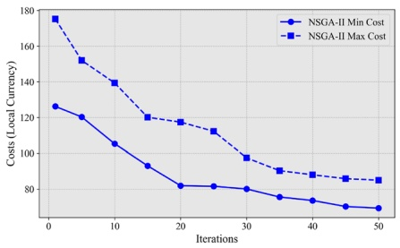

(a) Delivery Costs

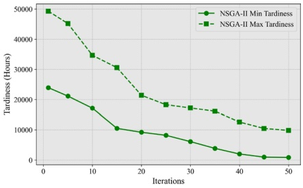

(b) Tardiness

Fig. 7 Convergence of NSGA-II over iterations

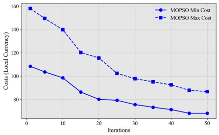

(a) Delivery Costs

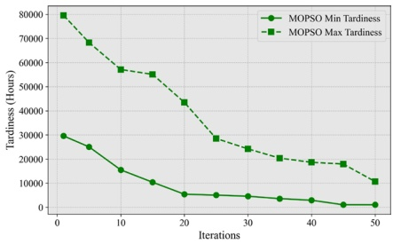

(b) Tardiness

Fig. 8 Convergence of MOPSO over iterations

range or a determined value. Researchers have proposed a multitude of methods to evaluate the convergence of algorithms. These methods are categorized as diagrammatic depiction, statistic method, or mathematic approach.

Figures 7 and 8 show the gaps in the Pareto front between the maximum and minimum values of delivery costs and tardiness. As the number of iterations increases, these gaps decrease, indicating that MOPSO and NSGA-II produce convergent sets of solutions.

## 6.4 Performance measurement results

The performance of NSGA-II and MOPSO was evaluated across multiple dimensions using established metrics, with results summarized in Table 13 and Fig. 9. The analysis reveals consistent performance differences between the algorithms across most evaluation criteria.

**Comparative analysis by metric:**

**Ratio of non-dominated Individuals (RNI):** NSGA-II demonstrated superior performance with an average RNI of 0.004 compared to MOPSO’s 0.002, indicating its enhanced capability to generate Pareto-optimal solutions across problem instances.

**Mean ideal distance (MID):** NSGA-II achieved significantly lower MID values (average: 42) than MOPSO (average: 142), reflecting better convergence toward the ideal point and superior solution quality.

**Spacing (SP):** The substantially lower SP values for NSGA-II (average: 217) versus MOPSO (average: 555) indicate a more uniform distribution of solutions along the Pareto front, providing decision-makers with better-represented tradeoff options.

**Maximum diversity (MD):** NSGA-II consistently achieved higher MD values (average: 13) compared to MOPSO (average: 3), demonstrating superior cover-

Table 13 Comparison of MOPSO and NSGA-II across performance metrics

| Problem | RNI | MID | SP | MD | GD | ACT (s) |
| --- | --- | --- | --- | --- | --- | --- |
| MOPSO |  |  |  |  |  |  |
| 1 | 0.002 | 150 | 619 | 2 | 88 | 56 |
| 2 | 0.002 | 109 | 490 | 3 | 52 | 16 |
| 3 | 0.003 | 112 | 503 | 4 | 87 | 78 |
| 4 | 0.004 | 142 | 530 | 4 | 75 | 67 |
| 5 | 0.002 | 164 | 556 | 3 | 103 | 32 |
| 6 | 0.002 | 121 | 713 | 3 | 64 | 34 |
| 7 | 0.002 | 110 | 520 | 4 | 189 | 43 |
| 8 | 0.001 | 230 | 506 | 2 | 96 | 151 |
| Average | 0.002 | 142 | 555 | 3 | 94 | 60 |
| NSGA-II |  |  |  |  |  |  |
| 1 | 0.004 | 41 | 404 | 11 | 57 | 46 |
| 2 | 0.004 | 43 | 151 | 8 | 26 | 34 |
| 3 | 0.004 | 50 | 175 | 11 | 96 | 21 |
| 4 | 0.004 | 37 | 156 | 12 | 60 | 17 |
| 5 | 0.004 | 30 | 160 | 16 | 96 | 55 |
| 6 | 0.002 | 33 | 177 | 19 | 63 | 127 |
| 7 | 0.003 | 48 | 246 | 12 | 102 | 56 |
| 8 | 0.004 | 55 | 266 | 16 | 81 | 29 |
| Average | 0.004 | 42 | 217 | 13 | 72 | 48 |

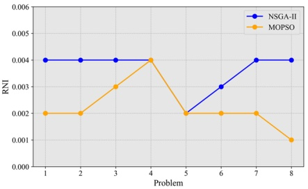

(a) Ratio of Non-Dominated Individuals

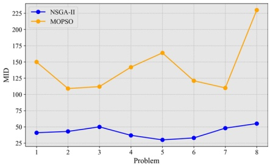

(b) Mean Ideal Distance

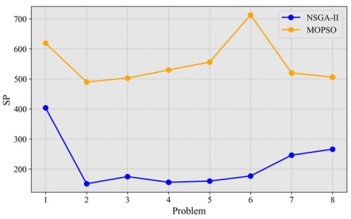

(c) Spacing Metric

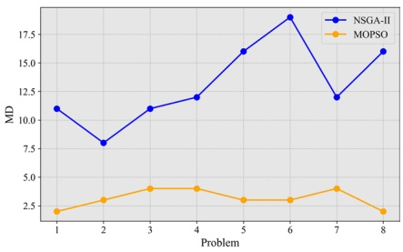

(d) Maximum Diversity

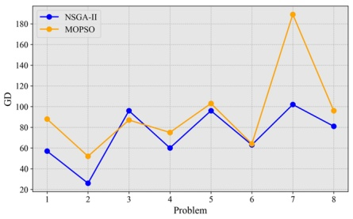

(e) Generational Distance

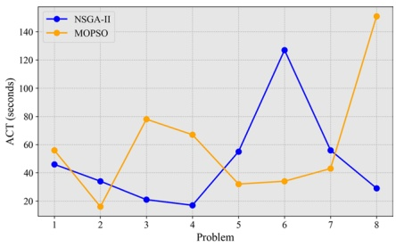

(f) Average Computation Time (seconds)

Fig. 9 Comparative performance metrics of NSGA-II and MOPSO across eight problems

age and diversity in the objective space.

**Generational distance (GD):** With lower GD values (average: 72 versus 94), NSGA-II showed better convergence characteristics relative to the reference Pareto front approximation.

● **Average computation time (ACT):** NSGA-II proved more computationally efficient, with an average ACT of 48 s compared to MOPSO’s 60 s.

The composite Weighted Metric (WM) analysis in Table 14 and Fig. 10 further corroborates these findings, with NSGA-II achieving a superior average WM score (0.57) compared to MOPSO (0.61), confirming its overall performance advantage across the problem instances.

The numerical examples presented in this study show that integrating characteristics of sustainable supply chain scheduling with environmentally friendly freight transportation can have positive effects. Simultaneous scheduling of production, order batching, and distribution of products while considering various time windows and heterogeneous vehicle routing can improve service quality and reduce customer dissatisfaction. Optimization of the objectives also demonstrated the trade-off between economic (transportation and emission cost) and customer orientation (production and delivery time) aspects and their impact on freight transportation.

Table 14 Weighted metric comparison between NSGA-II and MOPSO

| Problem | NSGA-II | MOPSO | Weighted metric |
| --- | --- | --- | --- |
| 1 | 0.52 | 0.62 | 1 |
| 2 | 0.87 | 0.86 | 2 |
| 3 | 0.53 | 0.66 | 3 |
| 4 | 0.76 | 0.64 | 4 |
| 5 | 0.51 | 0.54 | 5 |
| 6 | 0.56 | 0.50 | 6 |
| 7 | 0.45 | 0.44 | 7 |
| 8 | 0.35 | 0.58 | 8 |
| Average | 0.57 | 0.61 |  |

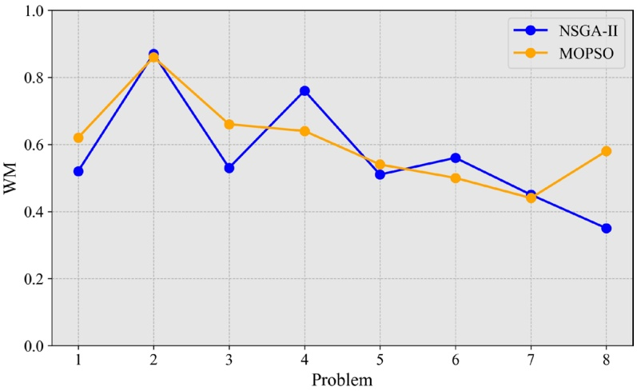

Fig. 10 WM values for NSGA-II and MOPSO over eight problems

## 7 Conclusion and future research

## 7.1 Summary of findings

This study addressed a sustainable supply chain scheduling problem with environmentally friendly freight transportation (FT) features, incorporating single-machine production, due-date assignment, batch deliveries, a heterogeneous fleet, and timewindow constraints. The proposed mixed-integer non-linear model aimed to minimize distribution and emissions costs, and delivery tardiness. Also, convergence test revealed that the algorithms generate a stable trend of solutions within 50 iterations.

Numerical experiments show that NSGA-II slashes average distribution cost from 126.2 to 69.3 MLCU (45% reduction) and cuts tardiness from 23950 to 858 h (96% reduction) within 50 iterations, while MOPSO achieves 32% and 96% reductions (108.4 to 68.1 MLCU; 29595 to 1047 h). Across several performance indicators, NSGA-II outperforms MOPSO. This demonstrates that NSGA-II delivers more diverse, better-converged Pareto fronts in less time, making it the preferred choice for large-scale, multi-objective supply-chain scheduling.

These results highlight the study’s key contributions: the model effectively reduces transportation, emission, and customer dissatisfaction costs; batch delivery formulation ensures timely service to multiple customers across time windows; integrated vehicle routing optimizes load, speed, road conditions, and distances; and NSGA-II and MOPSO demonstrate the capability to solve large-scale, real-world supply chain and transportation problems efficiently.

## 7.2 Limitations and future research

While the proposed framework provides actionable insights for sustainable supply chain scheduling, several assumptions restrict its generalization. Addressing these limitations offers clear avenues for further research:

**Deterministic parameters**: Processing times, demands, travel times, and emission factors were modeled as fixed. Future studies could incorporate uncertainty through stochastic programming, robust optimization, or fuzzy approaches (Ala et al. 2024; Taheri and Taft 2024).

**Simplified production setting**: The production stage was represented by a single machine, omitting parallel, multi-stage, or distributed systems. Extending to more complex shop configurations would increase industrial relevance (Wang et al. 2025; Rabet et al. 2024).

**Lack of rescheduling**: The model generated one-off schedules without mid-horizon adjustments. Rolling-horizon and event-driven rescheduling could capture dynamic disruptions and reveal stability-optimality trade-offs (Zhu et al. 2025; Herding and M nch 2024).

**Service-level**: Customer satisfaction was represented only through tardiness. Broader metrics?such as delivery reliability or adherence to time windows?would provide a more comprehensive view of service quality (Huo et al. 2024; Ganji et al. 2022).

**Algorithmic scope**: The experiments focused on NSGA-II and MOPSO. Benchmarking against advanced adaptive and hybrid metaheuristics (such as self-adaptive algorithms, island models, polyploid evolutionary algorithms, memetic search, surrogate-assisted evolution, and hyper-heuristics) could yield deeper insights into comparative scalability, convergence behavior, and robustness (Li et al. 2025; Drake et al. 2020; Dulebenets 2021).

Collectively, these directions target greater realism (uncertainty, dynamics), broader applicability (multi-machine, new domains), and enhanced computational performance (advanced, hybrid, and adaptive optimizers). Beyond the current scope, the proposed framework can be adapted to other scheduling contexts, including job shop scheduling with limited transportation resources and project scheduling with resource movement constraints, as demonstrated in recent studies (Wang et al. 2025; Chen et al. 2024; Rabet et al. 2024, 2025). It is worth noting that advanced optimization approaches have been successfully applied across many different domains, including online learning, scheduling, multi-objective optimization, medicine, data classification, and others, highlighting their broad applicability beyond the specific decision problem addressed in this study.

## 7.3 Managerial implications

In today’s complex supply-chain environment, managers face the ongoing challenge of balancing cost efficiency, service quality, and environmental responsibility. Multi-objective metaheuristic models, such as NSGA-II and MOPSO, provide powerful tools to address these competing objectives simultaneously. By integrating order allocation, fleet scheduling, and routing decisions, these models enable managers to explore a wide range of operational scenarios and make informed choices about fleet deployment, route planning, and order-to-vehicle matching across industries such as manufacturing, perishable food delivery, and construction logistics.

In addition, balancing transportation cost and service performance remains a critical managerial concern. As illustrated in Sect. 6.1, minimizing costs can reduce responsiveness and negatively affect customer satisfaction, while focusing solely on service can increase operational expenses. Metaheuristic approaches help managers identify optimal trade-offs using Pareto fronts and adjust shipment modes and frequencies. Empirical studies also highlight the trade-off between tardiness and fuel consumption, showing that modest delivery delays can lead to significant resource savings, helping managers make data-driven decisions about service priorities.

Furthermore, environmental considerations have become central to supply-chain planning. Modern scheduling models allow emissions, fuel consumption, and pollutant levels to be incorporated directly into decision-making. Although advanced technologies such as telematics and IoT devices can provide real-time emissions monitoring, these solutions can be costly. In contrast, managers can often achieve meaningful reductions in environmental impact through relatively low-cost actions, such as adjusting delivery schedules or optimizing fleet utilization, without substantially affecting service quality or operational efficiency.

In conclusion, as discussed in Sect. 7.1, the proposed metaheuristic-based biobjective scheduling approaches provide managers with scientifically validated frameworks to harmonize cost and environmental performance. When combined with scenario planning, these tools enable fleet and service strategies that meet corporate sustainability goals, regulatory requirements, and customer expectations, while maintaining operational efficiency and adaptability in complex supply-chain networks.

**Acknowledgements** The authors thank the anonymous reviewers whose comments helped us improve the manuscript.

**Funding** This research received no specific grant from any funding agency in the public, commercial, or not-for-profit sectors.

## Declarations

**Conflict of interest** No potential conflict of interest was reported by the authors.

**Open Access** This article is licensed under a Creative Commons Attribution 4.0 International License, which permits use, sharing, adaptation, distribution and reproduction in any medium or format, as long as you give appropriate credit to the original author(s) and the source, provide a link to the Creative Commons licence, and indicate if changes were made. The images or other third party material in this article are included in the article’s Creative Commons licence, unless indicated otherwise in a credit line to the material. If material is not included in the article’s Creative Commons licence and your intended use is not permitted by statutory regulation or exceeds the permitted use, you will need to obtain permission directly from the copyright holder. To view a copy of this licence, visit [http://creativecommons.org/licenses/by/4.0/](http://creativecommons.org/licenses/by/4.0/).

## References

Ala A, Goli A, Mirjalili S, Simic V (2024) A fuzzy multi-objective optimization model for sustainable healthcare supply chain network design. Appl Soft Comput 150:111012. [https://doi.org/10.1016/j.asoc.2023.111012](https://doi.org/10.1016/j.asoc.2023.111012)

Aloui A, Hamani N, Derrouiche R, Delahoche L (2021) Systematic literature review on collaborative sustainable transportation: overview, analysis and perspectives. Transp Res Interdiscip Perspect 9:100291. [https://doi.org/10.1016/j.trip.2020.100291](https://doi.org/10.1016/j.trip.2020.100291)

Ai TJ, Kachitvichyanukul V (2009) A particle swarm optimization for the vehicle routing problem with simultaneous pickup and delivery. In: Computers & operations research. Selected papers presented at the 10th international symposium on locational decisions (ISOLDE X), vol 36, no 5, pp 1693–1702. [https://doi.org/10.1016/j.cor.2008.04.003](https://doi.org/10.1016/j.cor.2008.04.003)

Abdolazimi O, Ma J (2024) An integrative production-delivery system with mobile additive manufacturing and truck-drone delivery considering optimal printing sequence and preferred delivery time window. Int J Prod Res. [https://doi.org/10.1080/00207543.2024.2354827](https://doi.org/10.1080/00207543.2024.2354827)

Amin-Tahmasbi H, Sadafi S, Ekren BY, Kumar V (2023) A multi-objective integrated optimisation model for facility location and order allocation problem in a two-level supply chain network. Ann Oper Res 324(1):993–1022. [https://doi.org/10.1007/s10479-022-04635-1](https://doi.org/10.1007/s10479-022-04635-1)

Bogachev T, Alekseychik T, Bogachev V (2019) Comparative assessment of the transport systems of the regions using fuzzy modeling. In: Aliev RA, Kacprzyk J, Pedrycz W, Jamshidi M, Sadikoglu FM (eds) 13th international conference on theory and application of fuzzy systems and soft computing— ICAFS-2018. Springer, Cham, pp 651–658. [https://doi.org/10.1007/978-3-030-04164-9\_85](https://doi.org/10.1007/978-3-030-04164-9_85)

Bachtenkirch D, Bock S (2022) Finding efficient make-to-order production and batch delivery schedules. Eur J Oper Res 297(1):133–152. [https://doi.org/10.1016/j.ejor.2021.04.020](https://doi.org/10.1016/j.ejor.2021.04.020)

Bettinelli A, Ceselli A, Righini G (2011) A branch-and-cut-and-price algorithm for the multi-depot heterogeneous vehicle routing problem with time windows. In: Transportation research part C: emerging technologies. Freight transportation and logistics (selected papers from ODYSSEUS 2009–the 4th international workshop on freight transportation and logistics), vol 19, no 5, pp 723–740. [https://doi.org/10.1016/j.trc.2010.07.008](https://doi.org/10.1016/j.trc.2010.07.008)

Borndörfer R, Klug T, Schlechte T, Fügenschuh A, Schang T, Schülldorf H (2016) The freight train routing problem for congested railway networks with mixed traffic. Transp Sci 50(2):408–423. [https://doi.org/10.1287/trsc.2015.0656](https://doi.org/10.1287/trsc.2015.0656)

Björgen A, Ryghaug M (2022) Integration of urban freight transport in city planning: lesson learned. Transp Res Part D Transp Environ 107:103310. [https://doi.org/10.1016/j.trd.2022.103310](https://doi.org/10.1016/j.trd.2022.103310)

Balaman Y, Matopoulos A, Wright DG, Scott J (2018) Integrated optimization of sustainable supply chains and transportation networks for multi technology bio-based production: a decision support system based on fuzzy ε-constraint method. J Clean Prod 172:2594–2617. [https://doi.org/10.1016/j.jclepro.2017.11.150](https://doi.org/10.1016/j.jclepro.2017.11.150)

Chislov O, Bogachev T, Kravets A, Bogachev V, Zadorozhniy V, Egorova I (2019) Time parameters optimization of the export grain traffic in the port railway transport technology system. In: Smart and green solutions for transport systems: 16th scientific and technical conference “transport systems. Theory and practice 2019” selected papers. Advances in intelligent systems and computing, conference held in Katowice, Poland, September 16–18, 2019, vol. 1091. Springer, Cham, pp 126–137. [https://doi.org/10.1007/978-3-030-35543-2](https://doi.org/10.1007/978-3-030-35543-2)

Chagas GO, Coelho LC, Darvish M, Renaud J (2023) Modeling and solving the waste valorization production and distribution scheduling problem. Eur J Oper Res 306(1):400–417. [https://doi.org/10.1016/j.ejor.2022.06.036](https://doi.org/10.1016/j.ejor.2022.06.036)

Castellano D, Gallo M, Glock CH (2024) A single-vendor, multiple-buyer coordinated supply chain model with unequal-sized batch shipments and cycle-dependent safety stocks. Int J Prod Res 62(1–2):223–244. [https://doi.org/10.1080/00207543.2023.2240440](https://doi.org/10.1080/00207543.2023.2240440)

Chi J, He S (2023) Pickup capacitated vehicle routing problem with three-dimensional loading constraints: model and algorithms. Transp Res Part E Logist Transp Rev 176:103208. [https://doi.org/10.1016/j.tre.2023.103208](https://doi.org/10.1016/j.tre.2023.103208)

Cheng TCE, Kahlbacher HG (1993) Scheduling with delivery and earliness penalties. Asia-Pac J Oper Res 10(2):145–152

Chacon J, Segura C (2018) Analysis and enhancement of simulated binary crossover. In: 2018 IEEE congress on evolutionary computation (CEC), pp 1–8. [https://doi.org/10.1109/CEC.2018.8477746](https://doi.org/10.1109/CEC.2018.8477746)

Chen R, Wu B, Wang H, Tong H, Yan F (2024) A q-learning based NSGA-II for dynamic flexible job shop scheduling with limited transportation resources. Swarm Evol Comput 90:101658. [https://doi.org/10.1016/j.swevo.2024.101658](https://doi.org/10.1016/j.swevo.2024.101658)

Chen W, Zhang Y, Zhou Y (2022) Integrated scheduling of zone picking and vehicle routing problem with time windows in the front house mode. Comput Ind Eng 163:107823. [https://doi.org/10.1016/j.cie.2021.107823](https://doi.org/10.1016/j.cie.2021.107823)

Dondo R, Cerd J (2015) The heterogeneous vehicle routing and truck scheduling problem in a multi-door cross-dock system. Comput Chem Eng 76:42–62. [https://doi.org/10.1016/j.compchemeng.2015.02.003](https://doi.org/10.1016/j.compchemeng.2015.02.003)

Demir E, Hrušovský M, Jammernegg W, Woensel TV (2019) Green intermodal freight transportation: bi-objective modelling and analysis. Int J Prod Res 57(19):6162–6180. [https://doi.org/10.1080/00207543.2019.1620363](https://doi.org/10.1080/00207543.2019.1620363)

Das C, Jharkharia S (2019) Effects of low carbon supply chain practices on environmental sustainability: an empirical study on Indian manufacturing firms. South Asian J Bus Stud 8(1):2–25. [https://doi.org/10.1108/SAJBS-04-2018-0037](https://doi.org/10.1108/SAJBS-04-2018-0037)

Drake JH, Kheiri A, Özcan E, Burke EK (2020) Recent advances in selection hyper-heuristics. Eur J Oper Res 285(2):405–428. [https://doi.org/10.1016/j.ejor.2019.07.073](https://doi.org/10.1016/j.ejor.2019.07.073)

Dou J, Li J, Xia D, Zhao X (2021) A multi-objective particle swarm optimisation for integrated configuration design and scheduling in reconfigurable manufacturing system. Int J Prod Res 59(13):3975–3995. [https://doi.org/10.1080/00207543.2020.1756507](https://doi.org/10.1080/00207543.2020.1756507)

Dutta P, Shrivastava H (2020) The design and planning of an integrated supply chain for perishable products under uncertainties: a case study in milk industry. J Model Manag 15(4):1301–1337. [https://doi.org/10.1108/JM2-03-2019-0071](https://doi.org/10.1108/JM2-03-2019-0071)

Du G, Tian Y, Ouyang X (2022) Multi-resources co-scheduling optimization for home healthcare services under the constraints of service time windows and green transportation. Appl Soft Comput 131:109746. [https://doi.org/10.1016/j.asoc.2022.109746](https://doi.org/10.1016/j.asoc.2022.109746)

Dulebenets MA (2021) An adaptive polyploid memetic algorithm for scheduling trucks at a cross-docking terminal. Inf Sci 565:390–421. [https://doi.org/10.1016/j.ins.2021.02.039](https://doi.org/10.1016/j.ins.2021.02.039)

Daryanto Y, Wee HM, Astanti RD (2019) Three-echelon supply chain model considering carbon emission and item deterioration. Transp Res Part E Logist Transp Rev 122:368–383. [https://doi.org/10.1016/j.tre.2018.12.014](https://doi.org/10.1016/j.tre.2018.12.014)

Eberhart R, Kennedy J (1995) Particle swarm optimization. In: Proceedings of the IEEE international conference on neural networks, vol 4. Perth, Australia, pp 1942–1948

El Yaagoubi A, Ferjani A, Essaghir Y, Sheikhahmadi F, Abourraja MN, Boukachour J, Baron M-L, Duvallet C, Khodadad-Saryazdi A (2022) A logistic model for a French intermodal rail/road freight transportation system. Transp Res Part E Logist Transp Rev 164:102819. [https://doi.org/10.1016/j.tre.2022.102819](https://doi.org/10.1016/j.tre.2022.102819)

Fu Y, Hou Y, Chen Z, Pu X, Gao K, Sadollah A (2022) Modelling and scheduling integration of distributed production and distribution problems via black widow optimization. Swarm Evol Comput 68:101015. [https://doi.org/10.1016/j.swevo.2021.101015](https://doi.org/10.1016/j.swevo.2021.101015)

Fahimnia B, Sarkis J, Talluri S (2019) Design and management of sustainable and resilient supply chains. IEEE Trans Eng Manag 66(1):2–7. [https://doi.org/10.1016/j.tre.2022.102819](https://doi.org/10.1016/j.tre.2022.102819)

Gharaei A, Jolai F (2018) A multi-agent approach to the integrated production scheduling and distribution problem in multi-factory supply chain. Appl Soft Comput 65:577–589. [https://doi.org/10.1016/j.asoc.2018.02.002](https://doi.org/10.1016/j.asoc.2018.02.002)

Govindan K, Jafarian A, Nourbakhsh V (2019) Designing a sustainable supply chain network integrated with vehicle routing: a comparison of hybrid swarm intelligence metaheuristics. Comput Oper Res 110:220–235. [https://doi.org/10.1016/j.cor.2018.11.013](https://doi.org/10.1016/j.cor.2018.11.013)

Goksal FP, Karaoglan I, Altiparmak F (2013) A hybrid discrete particle swarm optimization for vehicle routing problem with simultaneous pickup and delivery. Comput Ind Eng 65(1):39–53. [https://doi.org/10.1016/j.cie.2012.01.005](https://doi.org/10.1016/j.cie.2012.01.005)

Ganji M, Kazemipoor H, Molana SMH, Sajadi SM (2020) A green multi-objective integrated scheduling of production and distribution with heterogeneous fleet vehicle routing and time windows. J Clean Prod 259:120824. [https://doi.org/10.1016/j.jclepro.2020.120824](https://doi.org/10.1016/j.jclepro.2020.120824)

Ganji M, Rabet R, Sajadi SM (2022) A new coordinating model for green supply chain and batch delivery scheduling with satisfaction customers. Environ Dev Sustain 24(4):4566–4601. [https://doi.org/10.1007/s10668-021-01620-9](https://doi.org/10.1007/s10668-021-01620-9)

Gong H, Zhang B, Peng W (2015) Scheduling and common due date assignment on a single parallelbatching machine with batch delivery. Discret Dyn Nat Soc 2015(1):464390. [https://doi.org/10.1155/2015/464390](https://doi.org/10.1155/2015/464390)

Hong J, Alzaman C, Diabat A, Bulgak A (2019) Sustainability dimensions and PM2.5 in supply chain logistics. Ann Oper Res 275(2):339–366. [https://doi.org/10.1007/s10479-018-3077-7](https://doi.org/10.1007/s10479-018-3077-7)

Hashemi-Amiri O, Ghorbani F, Ji R (2023) Integrated supplier selection, scheduling, and routing problem for perishable product supply chain: a distributionally robust approach. Comput Ind Eng 175:108845. [https://doi.org/10.1016/j.cie.2022.108845](https://doi.org/10.1016/j.cie.2022.108845)

Hrušovskỳ M, Demir E, Jammernegg W, Van Woensel T (2021) Real-time disruption management approach for intermodal freight transportation. J Clean Prod 280:124826. [https://doi.org/10.1016/j.jclepro.2020.124826](https://doi.org/10.1016/j.jclepro.2020.124826)

Huang M, Huang S, Du B, Guo J, Li Y (2024) Fuzzy superposition operation and knowledge-driven co-evolutionary algorithm for integrated production scheduling and vehicle routing problem with soft time windows and fuzzy travel times. IEEE Trans Fuzzy Syst 33:1–14. [https://doi.org/10.1109/TFUZZ.2024.3388003](https://doi.org/10.1109/TFUZZ.2024.3388003)

Huo B, Li D, Gu M (2024) The impact of supply chain resilience on customer satisfaction and financial performance: a combination of contingency and configuration approaches. J Manag Sci Eng 9(1):38–52. [https://doi.org/10.1016/j.jmse.2023.10.002](https://doi.org/10.1016/j.jmse.2023.10.002)

Herding R, Mönch L (2024) A rolling horizon planning approach for short-term demand supply matching. CEJOR 32(3):865–896. [https://doi.org/10.1007/s10100-023-00891-z](https://doi.org/10.1007/s10100-023-00891-z)

Huynh N, Smith D, Dulebenets M, Sun Y, Schonfeld P, Duin R, Hutson N, Sauri S, Dau-Ngo T, Harder F et al (2019) Challenges and the road ahead for intermodal freight terminals. In: Transportation research board centennial papers

Hou Y, Wang H, Huang X (2024) A q-learning-based multi-objective evolutionary algorithm for integrated green production and distribution scheduling problems. Eng Appl Artif Intell 127:107434. [https://doi.org/10.1016/j.engappai.2023.107434](https://doi.org/10.1016/j.engappai.2023.107434)

Jain E, Dhodiya JM (2025) Fuzzy multi-objective multi-item five dimensional transportation problem: a case study of milk transportation problem. Appl Soft Comput 178:113237. [https://doi.org/10.1016/j.asoc.2025.113237](https://doi.org/10.1016/j.asoc.2025.113237)

Juman ZAMS, M’Hallah R, Lokuhetti R, Battaïa O (2023) A multi-vendor multi-buyer integrated production-inventory model with synchronised unequal-sized batch delivery. Int J Prod Res 61(2):462–484. [https://doi.org/10.1080/00207543.2021.2009586](https://doi.org/10.1080/00207543.2021.2009586)

Jensen AF, Thorhauge M, Jong G, Rich J, Dekker T, Johnson D, Cabral MO, Bates J, Nielsen OA (2019) A disaggregate freight transport chain choice model for Europe. Transp Res Part E Logist Transp Rev 121:43–62. [https://doi.org/10.1016/j.tre.2018.10.004](https://doi.org/10.1016/j.tre.2018.10.004)

Jia Y, Wang W, Zhang J (2025) A learning-and-knowledge-assisted multi-population collaborative evolutionary algorithm for integrated design-production-distribution scheduling problems in mass personalized customization. Swarm Evol Comput 99:102158. [https://doi.org/10.1016/j.swevo.2025.102158](https://doi.org/10.1016/j.swevo.2025.102158)

Karimi N, Alinia S (2025) Towards a sustainable future: integrating energy efficiency in multi-factory supply chain scheduling. Process Integr Optim Sustain 9(4):1425–1443. [https://doi.org/10.1007/s41660-025-00518-7](https://doi.org/10.1007/s41660-025-00518-7)

Kumar N, Brint A, Shi E, Upadhyay A, Ruan X (2019) Integrating sustainable supply chain practices with operational performance: an exploratory study of Chinese SMES. Prod Plan Control 30(5–6):464–478. [https://doi.org/10.1080/09537287.2018.1501816](https://doi.org/10.1080/09537287.2018.1501816)

Kumari M, De PK, Narang P, Shah NH (2023) Integrated optimization of inventory, replenishment, and vehicle routing for a sustainable supply chain utilizing a novel hybrid algorithm with carbon emission regulation. Expert Syst Appl 220:119667. [https://doi.org/10.1016/j.eswa.2023.119667](https://doi.org/10.1016/j.eswa.2023.119667)

Kabiri NN, Emami S, Safaei AS (2022) Simulation optimization approach for the multi-objective production and distribution planning problem in the supply chain: Using nsga-ii and monte carlo simulation. Soft Comput 26(17):8661–8687. [https://doi.org/10.1007/s00500-022-07152-2](https://doi.org/10.1007/s00500-022-07152-2)

Kumar G, Kumar A (2022) An internet of things-enabled decision support system for freight transportation: a case study of Indian special freight transport operator. Comput Ind Eng 172:108549. [https://doi.org/10.1016/j.cie.2022.108549](https://doi.org/10.1016/j.cie.2022.108549)

Kreutzberger ED (2008) Distance and time in intermodal goods transport networks in Europe: a generic approach. Transp Res Part A Policy Pract 42(7):973–993. [https://doi.org/10.1016/j.tra.2008.01.012](https://doi.org/10.1016/j.tra.2008.01.012)

Kozachenko D, Skalozub V, Gera B, Hermaniuk Y, Korobiova R, Gorbova A (2019) A model of transit freight distribution on a railway network. Transp Prob 14:17. [https://doi.org/10.20858/tp.2019.14.3.2](https://doi.org/10.20858/tp.2019.14.3.2)

Khodadadi N, Soleimanian Gharehchopogh F, Mirjalili S (2022) Moavoa: a new multi-objective artificial vultures optimization algorithm. Neural Comput Appl 34(23):20791–20829. [https://doi.org/10.1007/s00521-022-07557-y](https://doi.org/10.1007/s00521-022-07557-y)

Li B, Afkhami P, Khayamim R, Borowska-Stefanska M, Wisniewski S, Fathollahi-Fard AM, Ozkul S, Dulebenets MA (2025) An intelligent hyperheuristic algorithm for the berth allocation and scheduling problem at marine container terminals. Transp Res Part E Logist Transp Rev 198:104104. [https://doi.org/10.1016/j.tre.2025.104104](https://doi.org/10.1016/j.tre.2025.104104)

Li F, Guo X, Zhou L, Wu J, Li T (2022) A capacity matching model in a collaborative urban public transport system: integrating passenger and freight transportation. Int J Prod Res 60(20):6303–6328. [https://doi.org/10.1080/00207543.2021.1991021](https://doi.org/10.1080/00207543.2021.1991021)

Liu G, Hu J, Yang Y, Xia S, Lim MK (2020) Vehicle routing problem in cold chain logistics: a joint distribution model with carbon trading mechanisms. Resour Conserv Recycl 156:104715. [https://doi.org/10.1016/j.resconrec.2020.104715](https://doi.org/10.1016/j.resconrec.2020.104715)

Lin N, Kanellopoulos A, Akkerman R, Zhang J, Ruan J (2025) Vehicle routing in precooling logistics with dynamic temperature-dependent product quality decay. Eur J Oper Res 321(2):407–427. [https://doi.org/10.1016/j.ejor.2024.09.041](https://doi.org/10.1016/j.ejor.2024.09.041)

Li W, Li K, Kumar PR, Tian Q (2021) Simultaneous product and service delivery vehicle routing problem with time windows and order release dates. Appl Math Model 89:669–687. [https://doi.org/10.1016/j.apm.2020.07.045](https://doi.org/10.1016/j.apm.2020.07.045)

Li J, Wang D, Zhang J (2018) Heterogeneous fixed fleet vehicle routing problem based on fuel and carbon emissions. J Clean Prod 201:896–908. [https://doi.org/10.1016/j.jclepro.2018.08.075](https://doi.org/10.1016/j.jclepro.2018.08.075)

Liu Y, Yue Z, Wang Y, Wang H (2023) Logistics distribution vehicle routing problem with time window under pallet 3D loading constraint. Sustainability 15(4):3594. [https://doi.org/10.3390/su15043594](https://doi.org/10.3390/su15043594)

Lei W, You Z, Zhu J, Yan P, Zhou Z, Chen J (2025) Novel Minlp model and Lamarckian learning-enhanced multi-objective optimization algorithm for smart household appliance scheduling. Swarm Evol Comput 94:101886. [https://doi.org/10.1016/j.swevo.2025.101886](https://doi.org/10.1016/j.swevo.2025.101886)

Li Z, Zhang C, Wu T, Zhou S, Li Y (2025) Optimizing plastic product manufacturing scheduling: an integrated approach to minimize setup costs and tardiness with preventive maintenance considerations. Int Trans Oper Res 33:984. [https://doi.org/10.1111/itor.70085](https://doi.org/10.1111/itor.70085)

Mogale D, De A, Ghadge A, Tiwari MK (2023) Designing a sustainable freight transportation network with cross-docks. Int J Prod Res 61(5):1455–1478. [https://doi.org/10.1080/00207543.2022.2037777](https://doi.org/10.1080/00207543.2022.2037777)Mavrotas G, Florios K (2013) An improved version of the augmented ε-constraint method (augmecon2) for finding the exact pareto set in multi-objective integer programming problems. Appl Math Comput 219(18):9652–9669. [https://doi.org/10.1016/j.amc.2013.03.002](https://doi.org/10.1016/j.amc.2013.03.002)

Mei Q, Li J, Ursavas E, Zhu SX, Luo X (2021) Freight transportation planning in platform service supply chain considering carbon emissions. Int J Prod Econ 240:108241. [https://doi.org/10.1016/j.ijpe.2021.108241](https://doi.org/10.1016/j.ijpe.2021.108241)

Miraba S, Salehi A, Rostamzadeh-Renani M, Ehteshami R, Shahbazi A, Rostamzadeh-Renani R, Dehkordi SAHH, Baghoolizadeh M (2025) Adaptive BIPV shading optimization for electricity generation and building electricity management, sDA, and DGP using multi-objective algorithms. Appl Energy 402:126860. [https://doi.org/10.1016/j.apenergy.2025.126860](https://doi.org/10.1016/j.apenergy.2025.126860)

Mazdeh MM, Zaerpour F, Zareei A, Hajinezhad A (2010) Parallel machines scheduling to minimize job tardiness and machine deteriorating cost with deteriorating jobs. Appl Math Model 34(6):1498–1510. [https://doi.org/10.1016/j.apm.2009.08.023](https://doi.org/10.1016/j.apm.2009.08.023)

Marchi B, Zanoni S, Zavanella LE, Jaber M (2019) Supply chain models with greenhouse gases emissions, energy usage, imperfect process under different coordination decisions. Int J Prod Econ 211:145–153. [https://doi.org/10.1016/j.ijpe.2019.01.017](https://doi.org/10.1016/j.ijpe.2019.01.017)

Nogueira TH, Bettoni AB, Oliveira Mendes GT, Santos AG, Ravetti MG (2020) Problem on the integration between production and delivery with parallel batching machines of generic job sizes and processing times. Comput Ind Eng 146:106573. [https://doi.org/10.1016/j.cie.2020.106573](https://doi.org/10.1016/j.cie.2020.106573)

Noroozi A, Mazdeh MM, Heydari M, Rasti-Barzoki M (2018) Coordinating order acceptance and integrated production-distribution scheduling with batch delivery considering third party logistics distribution. J Manuf Syst 46:29–45. [https://doi.org/10.1016/j.jmsy.2017.11.001](https://doi.org/10.1016/j.jmsy.2017.11.001)

Omidzadeh D, Sajadi SM, Bozorgi-Amiri A, Daneshvar Kakhki M (2024) Enhancing sustainability attributes in new product design: insights from automotive industry. Sustainability 16(15):6385. [https://doi.org/10.3390/su16156385](https://doi.org/10.3390/su16156385)

Ricci A, Black I (2005) The social costs of intermodal freight transport. Res Transp Econ 14:245–285. [https://doi.org/10.1016/S0739-8859(05)14009-8](https://doi.org/10.1016/S0739-8859%2805%2914009-8)

Rabet R, Ganji M, Fathi M (2024) A simheuristic approach towards supply chain scheduling: integrating production, maintenance and distribution. Appl Soft Comput 153:111264. [https://doi.org/10.1016/j.asoc.2024.111264](https://doi.org/10.1016/j.asoc.2024.111264)

Rahman M, Kalam MA, Sankar MM (2025) MCDM guided a posteriori multi-objective techno-economic allocation of RDGs and EVCS in distribution network. J Energy Storage 132:117733. [https://doi.org/10.1016/j.est.2025.117733](https://doi.org/10.1016/j.est.2025.117733)

Rezakhanlou M, Mirzapour Al-e-Hashem SMJ (2025) A dual-channel multi-objective green supply chain network design considering pricing and transportation mode choice under fuzzy uncertainty. Environ Dev Sustain 27(5):10341–10372. [https://doi.org/10.1007/s10668-023-04312-8](https://doi.org/10.1007/s10668-023-04312-8)

RezaHoseini A, Noori S, Ghannadpour SF (2021) Integrated scheduling of suppliers and multi-project activities for green construction supply chains under uncertainty. Autom Constr 122:103485. [https://doi.org/10.1016/j.autcon.2020.103485](https://doi.org/10.1016/j.autcon.2020.103485)

Rostami M (2021) Minimizing maximum tardiness subject to collect the EOL products in a single machine scheduling problem with capacitated batch delivery and pickup systems. Comput Ind Eng 161:107634. [https://doi.org/10.1016/j.cie.2021.107634](https://doi.org/10.1016/j.cie.2021.107634)

Rabet R, Sajadi SM, Tootoonchy M (2024) A hybrid metaheuristic and simulation approach towards green project scheduling. Ann Oper Res. [https://doi.org/10.1007/s10479-024-06291-z](https://doi.org/10.1007/s10479-024-06291-z)

Rabet R, Sajjadi SM, Tootoonchy M (2025) Simheuristic optimization for sustainable multi-site project scheduling: minimizing emissions, costs, and duration. In: Proceedings of the European academy of management (EURAM), Florence, Italy

Sherif SU, Asokan P, Sasikumar P, Mathiyazhagan K, Jerald J (2021) Integrated optimization of transportation, inventory and vehicle routing with simultaneous pickup and delivery in two-echelon green supply chain network. J Clean Prod 287:125434. [https://doi.org/10.1016/j.jclepro.2020.125434](https://doi.org/10.1016/j.jclepro.2020.125434)

Sadeghi M, Bagheri M, Pishvaee MS (2021) Evaluation of rail terminals in container ports using simulation: a case study. Simulation 97(12):809–820. [https://doi.org/10.1177/00375497211024731](https://doi.org/10.1177/00375497211024731)

Shami TM, El-Saleh AA, Alswaitti M, Al-Tashi Q, Summakieh MA, Mirjalili S (2022) Particle swarm optimization: a comprehensive survey. IEEE Access 10:10031–10061

Sajjad A, Eweje G, Tappin D (2020) Managerial perspectives on drivers for and barriers to sustainable supply chain management implementation: evidence from new Zealand. Bus Strateg Environ 29(2):592–604. [https://doi.org/10.1002/bse.2389](https://doi.org/10.1002/bse.2389)

Sabbaghnia A, Heydari J, Ulku MA, Zolfaghari S (2024) Sustainable supply chain coordination: extant literature, trends, and future research directions. Ann Oper Res. [https://doi.org/10.1007/s10479-024-05852-6](https://doi.org/10.1007/s10479-024-05852-6)

Sharma S, Kumar V (2022) A comprehensive review on multi-objective optimization techniques: past, present and future. Arch Comput Methods Eng 29(7):5605–5633. [https://doi.org/10.1007/s11831-022-09778-9](https://doi.org/10.1007/s11831-022-09778-9)

Sladkowski A (ed) (2022) Modern trends and research in intermodal transportation, 1st edn. Studies in systems, decision and control. Springer, Cham. [https://doi.org/10.1007/978-3-030-87120-8](https://doi.org/10.1007/978-3-030-87120-8)

Taguchi G, Konishi S (1987) Taguchi methods orthogonal arrays and linear graphs: tools for quality. American Supplier Institute, Dearborn, MI, pp 8–35

Taheri F, Taft AF (2024) Reliable scheduling and routing in robust multiple cross-docking networks design. Eng Appl Artif Intell 128:107466. [https://doi.org/10.1016/j.engappai.2023.107466](https://doi.org/10.1016/j.engappai.2023.107466)

Udokporo CK, Anosike A, Lim M, Nadeem SP, Garza-Reyes JA, Ogbuka CP (2020) Impact of lean, agile and green (lag) on business competitiveness: an empirical study of fast moving consumer goods businesses. Resour Conserv Recycl 156:104714. [https://doi.org/10.1016/j.resconrec.2020.104714](https://doi.org/10.1016/j.resconrec.2020.104714)

Verma S, Pant M, Snasel V (2021) A comprehensive review on NSGA-II for multi-objective combinatorial optimization problems. IEEE Access 9:57757–57791

Wang G (2021) Integrated supply chain scheduling of procurement, production, and distribution under spillover effects. Comput Oper Res 126:105105. [https://doi.org/10.1016/j.cor.2020.105105](https://doi.org/10.1016/j.cor.2020.105105)

Wang G, Cheng TCE (2000) Parallel machine scheduling with batch delivery costs. Int J Prod Econ 68(2):177–183. [https://doi.org/10.1016/S0925-5273(99)00105-X](https://doi.org/10.1016/S0925-5273%2899%2900105-X)

Wang J, Liu Z, Li F (2024) Integrated production and transportation scheduling problem under nonlinear cost structures. Eur J Oper Res 313(3):883–904. [https://doi.org/10.1016/j.ejor.2023.08.030](https://doi.org/10.1016/j.ejor.2023.08.030)

Wang H, Peng T, Li X, He J, Liu W, Tang R (2025) An integrated simulation optimization method for flexible assembly job shop scheduling with lot streaming and finite transport resources. Comput Ind Eng 200:110790. [https://doi.org/10.1016/j.cie.2024.110790](https://doi.org/10.1016/j.cie.2024.110790)

Waheed R, Sarwar S, Wei C (2019) The survey of economic growth, energy consumption and carbon emission. Energy Rep 5:1103–1115. [https://doi.org/10.1016/j.egyr.2019.07.006](https://doi.org/10.1016/j.egyr.2019.07.006)

Wang Y, Wei Y, Wang X, Wang Z, Wang H (2023) A clustering-based extended genetic algorithm for the multidepot vehicle routing problem with time windows and three-dimensional loading constraints. Appl Soft Comput 133:109922. [https://doi.org/10.1016/j.asoc.2022.109922](https://doi.org/10.1016/j.asoc.2022.109922)

Wang Z, Zhang F, Ma S, Wang H, Zhang S, Gao X (2025) Research on collaborative scheduling strategies of multi-agent agricultural machinery groups. Sci Rep 15(1):9045. [https://doi.org/10.1038/s41598-025-93848-y](https://doi.org/10.1038/s41598-025-93848-y)

Wang Y, Zhe J, Wang X, Sun Y, Wang H (2022) Collaborative multidepot vehicle routing problem with dynamic customer demands and time windows. Sustainability 14(11):6709. [https://doi.org/10.3390/su14116709](https://doi.org/10.3390/su14116709)

Yin Y, Cheng TCE, Cheng S-R, Wu C-C (2013) Single-machine batch delivery scheduling with an assignable common due date and controllable processing times. Comput Ind Eng 65(4):652–662. [https://doi.org/10.1016/j.cie.2013.05.003](https://doi.org/10.1016/j.cie.2013.05.003)

Yagmur E, Kesen SE (2023) Bi-objective coordinated production and transportation scheduling problem with sustainability: formulation and solution approaches. Int J Prod Res 61(3):774–795. [https://doi.org/10.1080/00207543.2021.2017054](https://doi.org/10.1080/00207543.2021.2017054)

Yagmur E, Kesen SE (2024) Integrated production scheduling and vehicle routing problem with energy efficient strategies: mathematical formulation and metaheuristic algorithms. Expert Syst Appl 237:121586. [https://doi.org/10.1016/j.eswa.2023.121586](https://doi.org/10.1016/j.eswa.2023.121586)

Yacoubi S, Manita G, Chhabra A, Korbaa O, Mirjalili S (2023) A multi-objective chaos game optimization algorithm based on decomposition and random learning mechanisms for numerical optimization. Appl Soft Comput 144:110525. [https://doi.org/10.1016/j.asoc.2023.110525](https://doi.org/10.1016/j.asoc.2023.110525)

Yakavenka V, Mallidis I, Vlachos D, Iakovou E, Zafeiriou E (2020) Development of a multi-objective model for the design of sustainable supply chains: the case of perishable food products. Ann Oper Res 294(1):593–621. [https://doi.org/10.1007/s10479-019-03434-5](https://doi.org/10.1007/s10479-019-03434-5)

Ying K-C, Pourhejazy P, Huang T-C (2024) Exploring the development trajectory of single-machine production scheduling. Ann Oper Res. [https://doi.org/10.1007/s10479-024-06395-6](https://doi.org/10.1007/s10479-024-06395-6)

Yang S, Xu Z (2021) The distributed assembly permutation flowshop scheduling problem with flexible assembly and batch delivery. Int J Prod Res 59(13):4053–4071. [https://doi.org/10.1080/00207543.2020.1757174](https://doi.org/10.1080/00207543.2020.1757174)

Zhu X, Cao Y, Wu J, Liu H, Bei X (2022) Optimum operational schedule and accounts receivable financing in a production supply chain considering hierarchical industrial status and uncertain yield. Eur J Oper Res 302(3):1142–1154. [https://doi.org/10.1016/j.ejor.2022.02.008](https://doi.org/10.1016/j.ejor.2022.02.008)

Zhao X, Dou J (2019) Bi-objective integrated supply chain design with transportation choices: a multi-objective particle swarm optimization. J Ind Manag Optim 15(3):1263–1288. [https://doi.org/10.3934/jimo.2018095](https://doi.org/10.3934/jimo.2018095)

Zitzler E, Deb K, Thiele L (2000) Comparison of multiobjective evolutionary algorithms: empirical results. Evol Comput 8(2):173–195. [https://doi.org/10.1162/106365600568202](https://doi.org/10.1162/106365600568202)

Zhang Z, Fu Y, Gao K, Zhang H, Wang L (2024) A cooperative evolutionary algorithm with simulated annealing for integrated scheduling of distributed flexible job shops and distribution. Swarm Evol Comput 85:101467. [https://doi.org/10.1016/j.swevo.2023.101467](https://doi.org/10.1016/j.swevo.2023.101467)

Zhu H, Feng J, Li H (2017) Mn\_gls for vrp with simultaneous delivery and pickup. Computer Journal 28(6):001–012. [https://doi.org/10.3966/199115992017122806001](https://doi.org/10.3966/199115992017122806001)

Zhu X, Liao B, Shen Y, Kong M (2025) Towards industry 5.0: digital twin-enhanced approach for dynamic supply chain rescheduling with real-time order arrival and acceptance. Int J Prod Res. [https://doi.org/10.1080/00207543.2025.2481184](https://doi.org/10.1080/00207543.2025.2481184)

Zarei H, Rasti-Barzoki M (2019) Mathematical programming and three metaheuristic algorithms for a bi-objective supply chain scheduling problem. Neural Comput Appl 31(12):9073–9093. [https://doi.org/10.1007/s00521-018-3898-y](https://doi.org/10.1007/s00521-018-3898-y)

Zhang Z, Zhang H, Zhou L (2023) Zero-carbon measure prioritization for sustainable freight transport using interval 2 tuple linguistic decision approaches. Appl Soft Comput 132:109864. [https://doi.org/10.1016/j.asoc.2022.109864](https://doi.org/10.1016/j.asoc.2022.109864)

**Publisher's Note** Springer Nature remains neutral with regard to jurisdictional claims in published maps and institutional affiliations.

## Authors and Affiliations

**Maliheh Ganjia**<strong>1</strong> **· Rahmat Rabet**<strong>2</strong> · Seyed Mojtaba Sajadi[3](http://orcid.org/0000-0002-2139-2053) **Mohammad Daneshvar Kakhki**<strong>4</strong>

Seyed Mojtaba Sajadi s.sajadi@aston.ac.uk

Maliheh Ganjia maliheh.ganji@yahoo.com

Rahmat Rabet r.rabet@srbiau.ac.ir

Mohammad Daneshvar Kakhki Mohammad.daneshvarkakhki@csulb.edu

1 New Business Department, Faculty of Entrepreneurship, University of Tehran, Tehran, Iran

2 Department of Industrial Engineering, Faculty of Engineering, Islamic Azad University Science and Research Branch, Tehran, Iran

3 Operations and Service Management Department, Aston Business School, Aston University, Birmingham B4 7ET, UK

4 Department of Information Systems, California State University, Long Beach, 1250 Bellflower Blvd, Long Beach, CA 90840, USA