Michel Gendreau · Jean-Yves Potvin Editors

Handbook of Metaheuristics

Third Edition

# International Series in Operations Research & Management Science

Volume 272

**Series Editor**

Camille C. Price

Stephen F. Austin State University, TX, USA

**Associate Series Editor**

Joe Zhu

Worcester Polytechnic Institute, MA, USA

**Founding Series Editor**

Frederick S. Hillier

Stanford University, CA, USA

# Handbook of Metaheuristics

Third Edition

Editors Michel Gendreau Department of Mathematics and Industrial Engineering Polytechnique Montréal Montreal, QC, Canada

Jean-Yves Potvin Département d’informatique et de recherche opérationnelle Université de Montréal Montreal, QC, Canada

ISSN 0884-8289 ISSN 2214-7934 (electronic) International Series in Operations Research & Management Science ISBN 978-3-319-91085-7 ISBN 978-3-319-91086-4 (eBook) [https://doi.org/10.1007/978-3-319-91086-4](https://doi.org/10.1007/978-3-319-91086-4)

Library of Congress Control Number: 2018953159

2nd edition: © Springer Science+Business Media LLC 2010

3rd edition: © Springer International Publishing AG, part of Springer Nature 2019

This work is subject to copyright. All rights are reserved by the Publisher, whether the whole or part of the material is concerned, specifically the rights of translation, reprinting, reuse of illustrations, recitation, broadcasting, reproduction on microfilms or in any other physical way, and transmission or information storage and retrieval, electronic adaptation, computer software, or by similar or dissimilar methodology now known or hereafter developed.

The use of general descriptive names, registered names, trademarks, service marks, etc. in this publication does not imply, even in the absence of a specific statement, that such names are exempt from the relevant protective laws and regulations and therefore free for general use.

The publisher, the authors, and the editors are safe to assume that the advice and information in this book are believed to be true and accurate at the date of publication. Neither the publisher nor the authors or the editors give a warranty, express or implied, with respect to the material contained herein or for any errors or omissions that may have been made. The publisher remains neutral with regard to jurisdictional claims in published maps and institutional affiliations.

This Springer imprint is published by the registered company Springer Nature Switzerland AG The registered company address is: Gewerbestrasse 11, 6330 Cham, Switzerland

À nos épouses Johanne et Lynne et à nos enfants Catherine, Laurent, Gabrielle, Stéphanie et Simon.

# Preface to the Third Edition

The first edition of the Handbook of Metaheuristics was published in 2003 under the editorship of Fred Glover and Gary A. Kochenberger. In 2010, given numerous developments observed in the field of metaheuristics since 2003, it was felt that the time was ripe for a second edition of the Handbook. At that time, Fred and Gary were unable to accept Springer’s invitation to prepare this second edition and they suggested that we should take over the editorship responsibility of the Handbook. We still feel deeply honored and grateful for their trust.

The field of metaheuristics has continued to evolve since the publication of the second edition of the Handbook. It is thus time to take a fresh look at the most important topics in the area.

As stated in the first edition, metaheuristics are “solution methods that orchestrate an interaction between local improvement procedures and higher level strategies to create a process capable of escaping from local optima and performing a robust search of a solution space”. Although this broad characterization still holds today, many new and exciting developments and extensions have been observed in the last 15 years. We think in particular to hybrids, which take advantage of the strengths of each of their individual metaheuristic components to better explore the solution space. Hybrids of metaheuristics with other optimization techniques, like branch and bound or mathematical programming have also proved quite successful. On the front of applications, metaheuristics are now used to find high-quality solutions to an ever-growing number of complex, ill-defined real-world problems, in particular combinatorial ones.

This third edition of the Handbook of Metaheuristics, through its 18 chapters, is designed to provide a broad coverage of the concepts, implementations and applications in this important field of optimization. We were glad to get a positive response from renowned experts for each chapter. They either accepted to revise and update their chapter from the second edition or to write brand new ones. The Handbook now includes updated chapters on the best known metaheuristics, including simulated annealing, tabu search, variable neighborhood search, large neighborhood search, iterated local search, greedy randomized adaptive search procedure, multi-start methods, genetic algorithms, memetic algorithms, ant colony optimization, hy brid metaheuristics, parallel metaheuristics and hyper-heuristics. It also contains a new chapter on swarm intelligence methods. The last four chapters are devoted to more general issues related to the field of metaheuristics, namely reactive search, stochastic search, automated design of metaheuristics and computational comparison of metaheuristics. A few chapters from the second edition were discarded, as they appear to be less relevant.

We think that this Handbook will be a great reference for researchers and graduate students, as well as practitioners. Each presentation, although exhibiting inevitable stylistic differences, adheres to some common principles which results in stand-alone chapters that can be read individually.

We are grateful to all authors for taking the time to write the chapters that appear in this Handbook. We are also very grateful to Matthew Amboy and Faith Su of Springer for their encouragements, support and patience at the different stages of production of this book.

Montreal, QC, Canada Montreal, QC, Canada March 2018

Michel Gendreau Jean-Yves Potvin

# Preface to the Second Edition

The first edition of the Handbook of Metaheuristics was published in 2003 under the editorship of Fred Glover and Gary A. Kochenberger. Given the numerous developments observed in the field of metaheuristics in recent years, it appeared that the time was ripe for a second edition of the Handbook. For different reasons, Fred and Gary were unable to accept Springer’s invitation to prepare this second edition, and they suggested that we should take over the editorship responsibility of the Handbook. We are deeply honored and grateful for their trust.

As stated in the first edition, metaheuristics are “solution methods that orchestrate an interaction between local improvement procedures and higher level strategies to create a process capable of escaping from local optima and performing a robust search of a solution space.” Although this broad characterization still holds today, many new and exciting developments and extensions have been observed in the last few years. We think in particular to hybrids, which take advantage of the strengths of each of their individual metaheuristic components to better explore the solution space. Hybrids of metaheuristics with other optimization techniques, like branch and bound, mathematical programming, or constraint programming, are also increasingly popular. On the front of applications, metaheuristics are now used to find high-quality solutions to an ever-growing number of complex, ill-defined realworld problems, in particular combinatorial ones.

This second edition of the Handbook of Metaheuristics, through its 21 chapters, is designed to provide a broad coverage of the concepts, implementations, and applications in this important field of optimization. We were glad to get a positive response from renowned experts for each chapter. They either accepted to revise and update their chapter from the first edition or to write brand new ones. The Handbook now includes updated chapters on the best known metaheuristics, including simulated annealing, tabu search, variable neighborhood search, scatter search and path relinking, genetic algorithms, memetic algorithms, genetic programming, ant colony optimization, multi-start methods, greedy randomized adaptive search proce dure, guided local search, hyper-heuristics, and parallel metaheuristics. It also contains three new chapters on large neighborhood search, artificial immune systems, and hybrid metaheuristics. The last four chapters are devoted to more general issues related to the field of metaheuristics, namely, reactive search, stochastic search, fitness landscape analysis, and performance comparison. A few chapters from the first edition were discarded, as they appear to be less relevant.

We think that this Handbook will be a great reference for researchers and graduate students, as well as practitioners. Each presentation, although exhibiting inevitable stylistic differences, adheres to some common principles which results in stand-alone chapters that can be read individually.

We are grateful to all authors for taking the time to write the chapters that appear in this Handbook. We are also very grateful to Fred Hillier, Neil Levine, and Matthew Amboy of Springer for their encouragements, support, and patience at the different stages of production of this book.

Montreal, QC, Canada Montreal, QC, Canada March 2010

Michel Gendreau

Jean-Yves Potvin

# Preface to the First Edition

Metaheuristics, in their original definition, are solution methods that orchestrate an interaction between local improvement procedures and higher level strategies to create a process capable of escaping from local optima and performing a robust search of a solution space. Over time, these methods have also come to include any procedures that employ strategies for overcoming the trap of local optimality in complex solution spaces, especially those procedures that utilize one or more neighborhood structures as a means of defining admissible moves to transition from one solution to another, or to build or destroy solutions in constructive and destructive processes.

The degree to which neighborhoods are exploited varies according to the type of procedure. In the case of certain population-based procedures, such as genetic algorithms, neighborhoods are implicitly (and somewhat restrictively) defined by reference to replacing components of one solution with those of another, by variously chosen rules of exchange popularly given the name of “crossover.” In other population-based methods, based on the notion of path relinking, neighborhood structures are used in their full generality, including constructive and destructive neighborhoods as well as those for transitioning between (complete) solutions. Certain hybrids of classical evolutionary approaches, which link them with local search, also use neighborhood structures more fully, though apart from the combination process itself. Meanwhile, “single thread” solution approaches, which do not undertake to manipulate multiple solutions simultaneously, run a wide gamut that not only manipulate diverse neighborhoods but incorporate numerous forms of strategies ranging from thoroughly randomized to thoroughly deterministic, depending on the elements such as the phase of search or (in the case of memory-based methods) the history of the solution process.<sup>1</sup>

<small><span class="docvortex-page-footnote" data-block-type="page_footnote" style="color:#6b7280">1 Methods based on incorporating collections of memory-based strategies, invoking forms of memory more flexible and varied than those used in approaches such as tree search and branch and bound, are sometimes grouped under the name adaptive memory programming. This term, which originated in the tabu search literature where such adaptive memory strategies were first introduced and continue to be the primary focus, is also sometimes used to encompass other methods that have more recently adopted memory-based elements.</span></small>

A number of the tools and mechanisms that have emerged from the creation of metaheuristic methods have proved to be remarkably effective, so much so that metaheuristics have moved into the spotlight in recent years as the preferred line of attack for solving many types of complex problems, particularly those of a combinatorial nature. While metaheuristics are not able to certify the optimality of the solutions they find, exact procedures (which theoretically can provide such a certification, if allowed to run long enough)<sup>2</sup> have often proved incapable of finding solutions whose quality is close to that obtained by the leading metaheuristics— particularly for real-world problems, which often attain notably high levels of complexity. In addition, some of the more successful applications of exact methods have come about by incorporating metaheuristic strategies within them. These outcomes have motivated additional research and application of new and improved metaheuristic methodologies.

This handbook is designed to provide the reader with a broad coverage of the concepts, themes, and instrumentalities of this important and evolving area of optimization. In doing so, we hope to encourage an even wider adoption of metaheuristic methods for assisting in problem-solving and to stimulate research that may lead to additional innovations in metaheuristic procedures.

This handbook consists of 19 chapters. Topics covered include scatter search, tabu search, genetic algorithms, genetic programming, memetic algorithms, variable neighborhood search, guided local search, GRASP, ant colony optimization, simulated annealing, iterated local search, multi-start methods, constraint programming, constraint satisfaction, neural network methods for optimization, hyper-heuristics, parallel strategies for metaheuristics, metaheuristic class libraries, and A-teams. This family of metaheuristic chapters, while not exhaustive of the many approaches that have sprung into existence in recent years, encompasses the critical strategic elements and their underlying ideas that represent the state of the art of modern metaheuristics.

This book is intended to provide the communities of both researchers and practitioners with a broadly applicable, up-to-date coverage of metaheuristic methodologies that have proven to be successful in a wide variety of problem settings and that hold particular promise for success in the future. The various chapters serve as stand-alone presentations giving both the necessary underpinnings as well as practical guides for implementation. The nature of metaheuristics invites an analyst to modify basic methods in response to problem characteristics, past experiences, and personal preferences, and the chapters in this handbook are designed to facilitate this process as well.

<small><span class="docvortex-page-footnote" data-block-type="page_footnote" style="color:#6b7280">2 Some types of problems seem quite amenable to exact methods, particularly to some of the methods embodied in the leading commercial software packages for mixed integer programming. Yet even by these approaches, the “length of time” required to solve many problems exactly appears to exceed all reasonable measure, including in some cases measures of astronomical scale. It has been conjectured that metaheuristics succeed where exact methods fail because of their ability to use strategies of greater flexibility than permitted to assure that convergence will inevitably be obtained.</span></small>

The authors who have contributed to this volume represent leading figures from the metaheuristic community and are responsible for pioneering contributions to the fields they write about. Their collective work has significantly enriched the field of optimization in general and combinatorial optimization in particular. We are especially grateful to them for agreeing to provide the first-rate chapters that appear in this handbook. We would also like to thank our graduate students, Gyung Yung and Rahul Patil, for their assistance. Finally, we would like to thank Gary Folven and Carolyn Ford of the Kluwer Academic Publishers for their unwavering support and patience throughout this project.

Boulder, CO, U.S.A.

Denver, CO, U.S.A.

Fred Glover

Gary A. Kochenberger

## Contents

- 1 **Simulated Annealing: From Basics to Applications** 1
- Daniel Delahaye, Supatcha Chaimatanan, and Marcel Mongeau
- 2 **Tabu Search** 37
- Michel Gendreau and Jean-Yves Potvin
- 3 **Variable Neighborhood Search** 57
- Pierre Hansen, Nenad Mladenović, Jack Brimberg, and José A. Moreno Pérez
- 4 **Large Neighborhood Search** 99
- David Pisinger and Stefan Ropke
- 5 **Iterated Local Search: Framework and Applications** 129
- Helena Ramalhinho Lourenço, Olivier C. Martin, and Thomas Stützle
- 6 **Greedy Randomized Adaptive Search Procedures: Advances and Extensions** 169
- Mauricio G. C. Resende and Celso C. Ribeiro
- 7 **Intelligent Multi-Start Methods** 221
- Rafael Martí, Ricardo Aceves, Maria Teresa León, Jose M. Moreno-Vega, and Abraham Duarte
- 8 Next Generation Genetic Algorithms: A User's **Guide and Tutorial** 245
- Darrell Whitley
- 9 **An Accelerated Introduction to Memetic Algorithms** 275
- Pablo Moscato and Carlos Cotta
- **10 Ant Colony Optimization: Overview and Recent Advances** 311
- Marco Dorigo and Thomas Stützle

- xvi
- Contents
- **11 Swarm Intelligence** .... 353
- Xiaodong Li and Maurice Clerc
- **12 Metaheuristic Hybrids** .... 385
- Günther R. Raidl, Jakob Puchinger, and Christian Blum
- **13 Parallel Metaheuristics and Cooperative Search** .... 419
- Teodor Gabriel Crainic
- **14 A Classification of Hyper-Heuristic Approaches: Revisited** .... 453
- Edmund K. Burke, Matthew R. Hyde, Graham Kendall, Gabriela Ochoa, Ender Özcan, and John R. Woodward
- **15 Reactive Search Optimization: Learning While Optimizing** .... 479
- Roberto Battiti, Mauro Brunato, and Andrea Mariello
- **16 Stochastic Search in Metaheuristics** .... 513
- Walter J. Gutjahr and Roberto Montemanni
- **17 Automated Design of Metaheuristic Algorithms** .... 541
- Thomas Stützle and Manuel López-Ibáñez
- **18 Computational Comparison of Metaheuristics** .... 581
- John Silberholz, Bruce Golden, Swati Gupta, and Xingyin Wang

Ricardo Aceves Universidad Nacional Autónoma de México, Mexico City, Mexico

Roberto Battiti University of Trento, Trento, Italy

Christian Blum Artificial Intelligence Research Institute, Bellaterra, Spain

Jack Brimberg Royal Military College of Canada, Kingston, ON, Canada

Mauro Brunato University of Trento, Trento, Italy

Edmund K. Burke University of Leicester, Leicester, UK

Supatcha Chaimatanan Geo-Informatics and Space Technology Development Agency, Siracha, Thailand

Maurice Clerc Independent Consultant, Groisy, France

Carlos Cotta Universidad de Málaga, Málaga, Spain

Teodor Gabriel Crainic École des Sciences de la Gestion, Université du Québec à Montréal, Montréal, QC, Canada CIRRELT, Montréal, QC, Canada

xviii Daniel Delahaye École Nationale de l’Aviation Civile, Toulouse, France Marco Dorigo Université Libre de Bruxelles, Brussels, Belgium Abraham Duarte Universidad Rey Juan Carlos, Madrid, Spain Michel Gendreau Polytechnique Montréal, Montréal, QC, Canada CIRRELT, Montréal, QC, Canada Bruce Golden R.H. Smith School of Business, University of Maryland, College Park, MD, USA Swati Gupta Simons Institute for the Theory of Computing, University of California, Berkeley, CA, USA Walter J. Gutjahr University of Vienna, Vienna, Austria Pierre Hansen École des Hautes Études Commerciales, Montréal, QC, Canada GERAD, Montréal, QC, Canada Matthew R. Hyde University of Nottingham, Nottingham, UK Graham Kendall University of Nottingham Malaysia Campus, Semenyih, Malaysia Maria Teresa León Universidad de Valencia, Valencia, Spain Xiaodong Li RMIT University, Melbourne, VIC, Australia Manuel López-Ibáñez Alliance Manchester Business School, University of Manchester, Manchester, UK Helena Ramalhinho Lourenço Universitat Pompeu Fabra, Barcelona, Spain Andrea Mariello University of Trento, Trento, Italy Rafael Martí Universidad de Valencia, Valencia, Spain Olivier C. Martin Université Paris-Sud, Orsay, France

## Contributors

Nenad Mladenović Mathematical Institute, SANU, Belgrade, Serbia Marcel Mongeau École Nationale de l’Aviation Civile, Toulouse, France Roberto Montemanni Dalle Molle Institute for Artificial Intelligence, University of Applied Sciences of Southern Switzerland, Manno, Switzerland Jose M. Moreno-Vega Universidad de La Laguna, San Cristóbal de La Laguna, Spain Pablo Moscato The University of Newcastle, Newcastle, NSW, Australia Gabriela Ochoa University of Stirling, Stirling, UK Ender Özcan University of Nottingham, Nottingham, UK José A. Moreno Pérez Universidad de La Laguna, San Cristóbal de La Laguna, Spain David Pisinger Technical University of Denmark, Lyngby, Denmark Jean-Yves Potvin Université de Montréal, Montréal, QC, Canada CIRRELT, Montréal, QC, Canada Jakob Puchinger CentraleSupélec, Gif-sur-Yvette, France Günther R. Raidl Institute of Logic and Computation, TU Wien, Vienna, Austria Mauricio G. C. Resende Amazon.com, Seattle, WA, USA University of Washington, Seattle, WA, USA Celso C. Ribeiro Universidade Federal Fluminense, Niterói, Brazil Stefan Ropke Technical University of Denmark, Lyngby, Denmark John Silberholz Ross School of Business, University of Michigan, Ann Arbor, MI, USA Thomas Stützle Université Libre de Bruxelles, Brussels, Belgium

Xingyin Wang

Singapore University of Technology and Design, Singapore, Singapore

Darrell Whitley

Colorado State University, Fort Collins, CO, USA

John R. Woodward

Queen Mary University of London, London, UK

# Chapter 1 Simulated Annealing: From Basics to Applications

Daniel Delahaye, Supatcha Chaimatanan, and Marcel Mongeau

**Abstract** Simulated Annealing (SA) is one of the simplest and best-known metaheuristic method for addressing difficult black box global optimization problems whose objective function is not explicitly given and can only be evaluated via some costly computer simulation. It is massively used in real-life applications. The main advantage of SA is its simplicity. SA is based on an analogy with the physical annealing of materials that avoids the drawback of the Monte-Carlo approach (which can be trapped in local minima), thanks to an efficient Metropolis acceptance criterion. When the evaluation of the objective-function results from complex simulation processes that manipulate a large-dimension state space involving much memory, population-based algorithms are not applicable and SA is the right answer to address such issues. This chapter is an introduction to the subject. It presents the principles of local search optimization algorithms, of which simulated annealing is an extension, and the Metropolis algorithm, a basic component of SA. The basic SA algorithm for optimization is described together with two theoretical properties that are fundamental to SA: statistical equilibrium (inspired from elementary statistical physics) and asymptotic convergence (based on Markov chain theory). The chapter surveys the following practical issues of interest to the user who wishes to implement the SA algorithm for its particular application: finite-time approximation of the theoretical SA, polynomial-time cooling, Markov-chain length, stopping criteria, and simulation-based evaluations. To illustrate these concepts, this chapter presents the straightforward application of SA to two classical and simple classical NP-hard combinatorial optimization problems: the knapsack problem and the traveling salesman problem. The overall SA methodology is then deployed in detail on a real-life application: a large-scale aircraft trajectory planning problem involving nearly 30,000 flights at the European continental scale. This exemplifies how to tackle nowadays complex problems using the simple scheme of SA by exploiting particular features of the problem, by integrating astute computer implementation within the algorithm, and by setting user-defined parameters empirically, inspired by the SA basic theory presented in this chapter.

<small><span class="docvortex-page-footnote" data-block-type="page_footnote" style="color:#6b7280">D. Delahaye (-) · M. Mongeau École Nationale de l’Aviation Civile, Toulouse, France e-mail: [daniel.delahaye@enac.fr](mailto:daniel.delahaye@enac.fr); [marcel.mongeau@enac.fr](mailto:marcel.mongeau@enac.fr)</span></small>

<small><span class="docvortex-page-footnote" data-block-type="page_footnote" style="color:#6b7280">S. Chaimatanan Geo-Informatics and Space Technology Development Agency, Siracha, Thailand e-mail: [supatcha@gistda.or.th](mailto:supatcha@gistda.or.th)</span></small>

## 1.1 Introduction

Simulated Annealing (SA) is one of the simplest and best-known metaheuristic methods for addressing difficult black box global optimization problems, whose objective function is not explicitly given and can only be evaluated via some costly computer simulation. It is massively used in real-life applications. The expression “simulated annealing” yields over one million hits when searching through the Google Scholar web search engine dedicated to the scholarly literature.

This chapter is an introduction to the subject. It is organized as follows. The first section introduces the reader to the basics of the simulated annealing algorithm. Section 1.2 deals with two theoretical properties of SA : statistical equilibrium and asymptotic convergence. Practical issues of interest when implementing SA are discussed in Sect. 1.3: finite-time approximation, polynomial-time cooling, Markovchain length, stopping criteria and simulation-based evaluations. Section 1.4 illustrates the application of SA to two classical NP-hard combinatorial optimization problems : the knapsack problem and the traveling salesman problem. A real-life application, large-scale aircraft trajectory planning problem, is finally tackled in Sect. 1.5 in order to illustrate how the particular knowledge of an application and astute computer implementation must be integrated within SA in order to tackle nowadays complex problems using the simple scheme of SA.

## 1.2 Basics

In the early 1980s three IBM researchers, Kirkpatrick et al. [11], introduced the concepts of annealing in combinatorial optimization. These concepts are based on a strong analogy with the physical annealing of materials. This process involves bringing a solid to a low energy state after raising its temperature. It can be summarized by the following two steps (see Fig. 1.1) :

• Bring the solid to a very high temperature until “melting” of the structure;

• Cool the solid according to a very particular temperature decreasing scheme in order to reach a solid state of minimum energy.

In the liquid phase, the particles are distributed randomly. It is shown that the minimum-energy state is reached provided that the initial temperature is sufficiently high and the cooling time is sufficiently long. If this is not the case, the solid will be found in a metastable state with non-minimal energy; this is referred to as hardening, which consists in the sudden cooling of a solid.

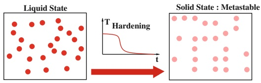

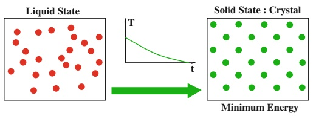

Fig. 1.1 When the temperature is high, the material is in a liquid state (left). For a hardening process, the material reaches a solid state with non-minimal energy (metastable state; top right). In this case, the structure of the atoms has no symmetry. During a slow annealing process, the material reaches also a solid state but for which atoms are organized with symmetry (crystal; bottom right)

Before describing the simulated annealing algorithm for optimization, we need to introduce the principles of local search optimization algorithms, of which simulated annealing is an extension.

## 1.2.1 Local Search (or Monte Carlo) Algorithms

These algorithms optimize the cost function by exploring the neighborhood of the current point in the solution space.

In the next definitions, we consider $( S , f )$ an instantiation of a combinatorial optimization problem (S: set of feasible solutions, $f ;$ objective function to be minimized).

**Definition 1** Let $\mathcal { N }$ be an application that defines for each solution $i \in S$ a subset $S _ { i } \subset S$ of solutions “close” (to be defined by the user according to the problem of interest) to the solution i. The subset $S _ { i }$ is called the neighborhood of solution i.

In the next definitions, we consider that $\mathcal { N }$ is a neighborhood structure associated with $( S , f )$

**Definition 2** A generating mechanism is a mean for selecting a solution j in any neighborhood $S _ { i }$ of a given solution i.

A local search algorithm is an iterative algorithm that begins its search from a fea sible point, randomly drawn in the state space. A generation mechanism is then successively applied in order to find a better solution (in terms of the objective function value), by exploring the neighborhood of the current solution. If such a solution is found, it becomes the current solution. The algorithm ends when no improvement can be found, and the current solution is considered as the approximate solution of the optimization problem. One can summarize the algorithm by the following pseudo-code for a minimization problem:

## Local Search

**1. Draw an initial solution** $i ;$

**2. Generate a solution** j **from the neighborhood** $S _ { i }$ **of the current solution** $i ;$

**3. If** $f ( j ) < f ( i )$ **then** $j$ **becomes the current solution;**

**4. If** $f ( j ) \geq f ( i )$ **for all** $j \in S _ { i }$ **then END;**

**5. Go to step 2;**

**Definition 3** A solution $i ^ { * } \in S$ is called a local optimum with respect to $\mathcal { N } \mathit { f o r } \left( S , f \right)$ $\mathit { i f } f ( i ^ { * } ) \leq f ( j )$ for all $j \in S _ { i ^ { * } }$

**Definition 4** The neighborhood structure $\mathcal { N }$ is said to be exact if, for every local optimum with respect to $\mathcal { N } ,   i ^ { * } \in S ,   i ^ { * }$ is also a global optimum of $( S , f )$

Thus, by definition, local search algorithms converge to local optima unless one has an exact neighborhood structure. This notion of exact neighborhood is theoretical because it generally leads, in practice, to resort to a complete enumeration of the search space.

Intuitively, if the current solution “falls” in a subdomain over which the objective function is convex, the algorithm remains trapped in this subdomain, unless the neighborhood structure associated with the generation mechanism can reach points outside this subdomain.

In order to avoid being trapped in local minima, it is then necessary to define a process likely to accept current state transitions that momentarily reduce the performance (in terms of objective) of the current solution: this is the main principle of simulated annealing.

Before describing this algorithm, it is necessary to introduce the Metropolis algorithm [15] which is a basic component of SA.

## 1.2.2 Metropolis Algorithm

In 1953, three American researchers [15] developed an algorithm to simulate the physical annealing process, as described in Sect. 1.2. Their aim was to reproduce faithfully the evolution of the physical structure of a material undergoing annealing.

This algorithm is based on Monte Carlo techniques which consist in generating a sequence of states of the solid in the following way.

Starting from an initial state i of energy $E _ { i }$ , a new state j of energy $E _ { j }$ is generated by modifying the position of one particle.

If the energy difference, $E _ { i } - E _ { j }$ , is positive (the new state features lower energy), the state j becomes the new current state. If the energy difference is less than or equal to zero, then the probability that the state j becomes the current state is given by:

$$
\text {Pr} \{\text {Current state} = j \} = e ^ {\left(\frac {E _ {i} - E _ {j}}{k _ {b} \cdot T}\right)},
$$

where T represents the temperature of the solid and $k _ { B }$ is the Boltzmann constant $( k _ { B } = 1 . 3 8 \times 1 0 ^ { - 2 3 }   \mathrm { J / K } )$

The acceptance criterion of the new state is called the Metropolis criterion. If the cooling is carried out sufficiently slowly, the solid reaches a state of equilibrium at each given temperature T. In the Metropolis algorithm, this equilibrium is achieved by generating a large number of transitions at each temperature. The thermal equilibrium is characterized by the Boltzmann statistical distribution. This distribution gives the probability that the solid is in the state i of energy $E _ { i }$ at the temperature $T$

$$
P r \{X = i \} = \frac {1}{Z (T)} e ^ {- \left(\frac {E _ {i}}{k _ {b} T}\right)},
$$

where X is a random variable associated with the current state of the solid and $Z ( T )$ is a normalization coefficient, defined as:

$$
Z (T) = \sum_ {j \in S} e ^ {- \left(\frac {E _ {j}}{k _ {b} T}\right)}.
$$

## 1.2.3 Simulated Annealing (SA) Algorithm

In the SA algorithm, the Metropolis algorithm is applied to generate a sequence of solutions in the state space S. To do this, an analogy is made between a multi-particle system and our optimization problem by using the following equivalences:

• The state-space points (solutions) represent the possible states of the solid;

• The function to be minimized represents the energy of the solid.

A control parameter c, acting as a temperature, is then introduced. This parameter is expressed with the same units as the objective that is optimized.

It is also assumed that the user provides for each point of the state space, a neighborhood and a mechanism for generating a solution in this neighborhood. We then define the acceptance principle:

**Definition 5** Let $( S , f )$ be an instantiation of a combinatorial minimization problem, and i, j two points of the state space. The acceptance criterion for accepting solution j from the current solution i is given by the following probability :

$$
\Pr \{a c c e p t j \} = \left\{ \begin{array}{l l} 1 & \text {if} f (j) <   f (i) \\ e ^ {\left(\frac {f (i) - f (j)}{c}\right)} & \text {else.} \end{array} \right.
$$

By analogy, the principle of generation of a neighbor corresponds to the perturbation mechanism of the Metropolis algorithm, and the principle of acceptance represents the Metropolis criterion.

**Definition 6** A transition represents the replacement of the current solution $b y$ a neighboring solution. This operation is carried out in two stages: generation and acceptance.

In the sequel, let $c _ { k }$ be the value of the temperature parameter, and $L _ { k }$ be the number of transitions generated at some iteration k. The principle of $\mathbf { S A }$ can be summarized as follows:

## Simulated Annealing

**1. Initialization** $( i : = i _ { s t a r t } , k : = 0 , c _ { k } = c _ { 0 } , L _ { k } : = L _ { 0 } )$ **;**

**2. Repeat**

**3. For** $l = 0$ **to** $L _ { k }$ **do**

• **Generate a solution** j **from the neighborhood** $S _ { i }$ **of the current solution** $i ;$

$\mathbf { I f } \; f ( j ) < f ( i )$ **then** $i : = j \left( j \right.$ **becomes the current solution);**

$\mathbf { E l s e } , j$ **becomes the current solution with probability** $e ^ { \left( { \frac { f ( i ) - f ( j ) } { c _ { k } } } \right) }$ ;

**4.** $k : = k + 1$ ;

5. $\mathbf{C o m p u t e}(L_k, c_k);$

**6. Until** $c _ { k } \simeq 0 .$

One of the main features of simulated annealing is its ability to accept transitions that degrade the objective function.

At the beginning of the process, the value of the temperature $c _ { k }$ is high, which makes it possible to accept transitions with high objective degradation, and thereby to explore the state space thoroughly. $\operatorname { A s } c _ { k }$ decreases, only the transitions improving the objective, or with a low objective deterioration, are accepted. Finally, when $c _ { k }$ tends to zero, no deterioration of the objective is accepted, and the SA algorithm behaves like a Monte Carlo algorithm.

## 1.3 Theory

This section addresses two theoretical properties that are fundamental to $\mathbf { S A }$ : statistical equilibrium and asymptotic convergence. More details and proofs of the theorems cited in this section can be found in the books [1, 13].

## 1.3.1 Statistical Equilibrium

Based on the ergodicity hypothesis that a particle system can be considered as a set having observable statistical properties, a number of useful quantities can be deduced from the equilibrium statistical system: mean energy, energy distribution, entropy. Moreover, if this particle set is stationary, which is the case when the statistical equilibrium is reached, the probability density associated with the states in the equilibrium phase depends on the energy of the system. Indeed, in the equilibrium phase, the probability that the system is in a given state i with an energy $E _ { i }$ is given by the Boltzmann law:

**Theorem 1** After a sufficient number of transitions with a fixed control parameter c and using the following probability of acceptance:

$$
P _ {c} \{a c c e p t j | S _ {i} \} = \left\{ \begin{array}{c c} 1 & \text {if} f (j) <   f (i) \\ e ^ {\left(\frac {f (i) - f (j)}{c}\right)} & \text {else}, \end{array} \right.
$$

the simulated annealing algorithm will find a given solution $i \in S$ with the probability:

$$
P _ {c} \{X = i \} = q _ {i} (c) = \frac {1}{N _ {0} (c)} e ^ {\left(- \frac {f (i)}{c}\right)},
$$

where X is the random variable representing the current state of the annealing algorithm, and $N _ { 0 } ( c )$ is the normalization coefficient:

$$
\left| N _ {0} (c) = \sum_ {j \in S} e ^ {\left(- \frac {f (j)}{c}\right)} \right|.
$$

**Definition 7** Let A and B be two sets such that $B \subset A .$ We define the characteristic function of B, noted $\kappa _ { ( B ) }$ , to be the function such that:

$$
\kappa_ {(B)} (a) = \left\{ \begin{array}{l l} 1 & \text {if} a \in B \\ 0 & \text {else}. \end{array} \right.
$$

**Corollary 1** For any given solution i, we have:

$$
\varliminf_ {c \to 0 ^ {+}} P _ {c} \{X = i \} = \lim _ {c \to 0 ^ {+}} q _ {i} (c) = q _ {i} ^ {*} = \frac {1}{| S _ {o p t} |} \kappa_ {(S _ {o p t})} (i),
$$

where $S _ { o p t }$ represents the set of global optima.

This result guarantees the asymptotic convergence of the simulated annealing algorithm towards an element of the set of global optima, provided that the stationary distribution $q _ { i } ( c ) , i \in S ,$ , is reached at each value of $c ,$ For a discrete state space, such distributions are discrete and one can compute the probability to reach one particular point $x _ { i }$ in the state space with an objective value $y _ { i } ;$

$$
q _ {i} (c) = \frac {e ^ {\left(- \frac {y _ {i} ^ {c}}{c}\right)}}{\sum_ {j \in S} e ^ {\left(- \frac {y _ {j} ^ {c}}{c}\right)}}.
$$

The expected value of the function $f$ to optimize at equilibrium for any positive value of $c$ is denoted $\langle f \rangle _ { c }$ and the variance is denoted $\langle \dot { f ^ { 2 } } \rangle _ { c }$

At a very high temperature $c ,$ the SA algorithm moves randomly in the state space. With each point $x _ { i }$ generated by this process, is associated an objective value $y _ { i }$ by the mapping $y _ { i } ^ { c } = f ( x _ { i } )$ . If we consider this process for a long period, it is possible to build the distribution of the objective function values $y _ { i } ^ { c } , ( i   =   1 , 2 , \ldots ,   N )$ generated by the SA process. This distribution depends on the temperature $c$ and will be denoted $q ( c )$ . For large values of $c ,$ this distribution is equal to the objective distribution. Figure 1.2 gives an example of such a distribution. The figure shows a one-dimensional objective function for which the circles represent the samples of the SA algorithm at some high temperature $c _ { 1 }$ . The dashed horizontal line shows the mean of this distribution $( < f ( c _ { 1 } ) > )$ , and on the left-hand side the associated distribution is represented by the dashed graph $( q ( c _ { 1 } ) )$ . For a lower temperature $c _ { 2 }$ some transitions in the SA process are not accepted, meaning that the associated distribution $q ( c _ { 2 } )$ is shifted to the lower levels (squares in the objective function on the right and solid graph on the left) with a lower expected value.

**Definition 8** The entropy at equilibrium is

$$
H _ {c} = \sum_ {i \in S} q _ {i} (c) l n (q _ {i} (c)).
$$

**Corollary 2** One has:

$$
\frac {\partial \langle f \rangle_ {c}}{\partial c} = \frac {\sigma_ {c} ^ {2}}{c ^ {2}} \\ \frac {\partial H _ {c}}{\partial c} = \frac {\sigma_ {c} ^ {2}}{c ^ {3}}.
$$

These last two expressions play an important role in statistical mechanics. We also deduce the following expressions:

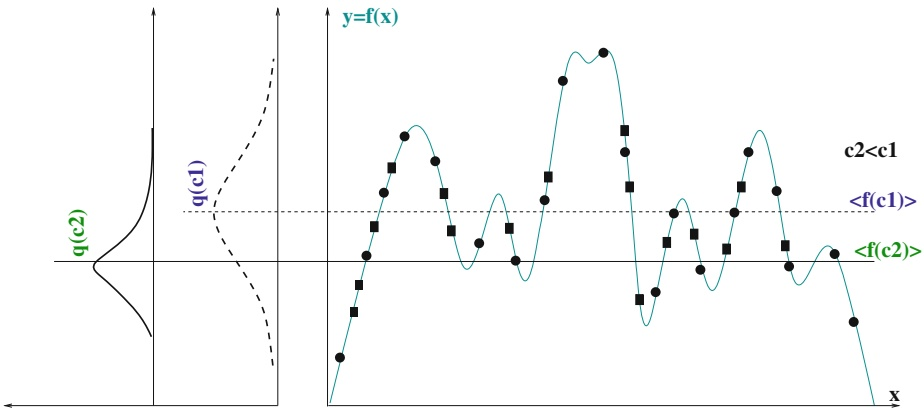

Fig. 1.2 Distribution of the objective function values at some high temperature $c _ { 1 }$ and at a lower temperature $c _ { 2 }$

**Corollary 3**

$$
\lim _ {c \to \infty} \langle f \rangle_ {c} = \langle f \rangle_ {\infty} = \frac {1}{| S |} \sum_ {i \in S} f (i) \quad \lim _ {c \to 0} \langle f \rangle_ {c} = \langle f \rangle_ {0} = f _ {O p t},
$$

$$
\lim _ {c \to \infty} \sigma_ {c} ^ {2} = \sigma_ {\infty} ^ {2} = \frac {1}{| S |} \sum_ {i \in S} (f (i) - \langle f \rangle_ {\infty}) ^ {2} \quad \lim _ {c \to 0} \sigma_ {c} ^ {2} = \sigma_ {0} ^ {2} = 0,
$$

$$
\lim _ {c \to \infty} H _ {c} = H _ {\infty} = \ln (| S |) \quad \lim _ {c \to 0} H _ {c} = H _ {0} = \ln (| S _ {O p t} |),
$$

where $f _ { O p t }$ denotes the optimal value of $f .$ This last formula represents the third law in thermodynamics (assuming that there is only one state of minimum energy, we then obtain: $S _ { 0 } = l n ( 1 ) = 0 )$

In physics, the entropy measures the level of disorder associated with the system: a high entropy value indicates a chaotic structure, while a low value reflects organization.

In the context of optimization, the entropy is related to a measure of the degree of optimality achieved. During the successive SA iterations, the mathematical expectation of the objective function value and of the entropy only decrease and converge respectively towards $f _ { O p t }$ and $l n ( | S _ { O p t } | )$

The derivative of the distribution $q _ { i } ( c )$ with the temperature $c$ is given by the following expression:

$$
\frac {\partial q _ {i} (c)}{\partial c} = \frac {q _ {i} (c)}{c ^ {2}} \left[ \langle f \rangle_ {c} - f (i) \right].
$$

Since $\langle f \rangle _ { c } \leq \langle f \rangle _ { \infty } ,$ one can exhibit three regimes in the simulated annealing process. More precisely, one can show the following:

**Corollary 4** Let $( S , f )$ be an instantiation of a combinatorial optimization problem with $S _ { O p t } \neq S$ , and let $q _ { i } ( c )$ be the stationary distribution associated with the annealing process. We then have:

$$
(i) \forall i \in S _ {O p t} \frac {\partial q _ {i} (c)}{\partial c} <   0;
$$

(ii) $\forall i \not \in S _ { O p t }$ such that $\begin{array} { r } { f ( i ) \geq \; \langle f \rangle _ { \infty } : \frac { \partial q _ { i } ( c ) } { \partial c } > 0 ; } \end{array}$

(iii) $\forall i \not \in S _ { O p t }$ such that $f ( i ) < \; \langle f \rangle _ { \infty } , \exists \tilde { c } _ { i } > 0$ satisfying:

$$
\boxed {\left\{ \begin{array}{l} \frac {\partial q _ {i} (c)}{\partial c} > 0 \text {if} c <   \tilde {c} _ {i} \\ \frac {\partial q _ {i} (c)}{\partial c} = 0 \text {if} c = \tilde {c} _ {i} \\ \frac {\partial q _ {i} (c)}{\partial c} <   0 \text {if} c > \tilde {c} _ {i}. \end{array} \right.}
$$

This corollary indicates that the probability of finding an optimal solution increases monotonically when $c$ decreases. Moreover, for any non-optimal solution, there exists a positive value $\tilde { c } _ { i }$ such that for $c < \tilde { c } _ { i }$ , the probability of finding this solution decreases as $c$ decreases.

**Definition 9** The acceptance rate associated with the simulated annealing algorithm is defined by:

$$
\chi (c) = \frac {\text {Number of accepted transitions}}{\text {Number of proposed transitions}}.
$$

As a general rule, when $c$ has a high value, all transitions are accepted and $\chi ( c )$ is close to 1. Then, when $c$ decreases, $\chi ( c )$ χ(c) decreases slowly until reaching 0, indicating that no transitions are accepted.

By observing the evolution of $\langle f \rangle _ { c }$ and $\sigma _ { c } ^ { 2 }$ as a function of $c ,$ we note that there exists a critical value called the transition threshold (denoted $c _ { t } )$ , that delimits two distinct regions of the distribution at equilibrium. This threshold is the value $c _ { t }$ such that

$$
\langle f \rangle_ {c _ {t}} \approx \frac {1}{2} \left(<   f _ {\infty} > + f _ {O p t}\right),
$$

and

$$
\begin{array}{c} \sigma_ {c} ^ {2} \approx \sigma_ {\infty} ^ {2} \text {if} c \geq c _ {t}, \\ <   \sigma_ {\infty} ^ {2} \text {if} c <   c _ {t}. \end{array}
$$

For any given value of $c ,$ the search space $S$ can therefore be partitioned into two regions:

1. Region $R _ { 1 }$ : where $\sigma _ { c } ^ { 2 }$ remains roughly constant (close to $\sigma _ { \infty } ^ { 2 } )$ when $c$ decreases.

2. Region $R _ { 2 } ;$ where $\sigma _ { c } ^ { 2 }$ decreases when $c$ decreases.

When c approaches the value of $c _ { t }$ , the acceptance rate is about $0 . 5   ( \mathrm { i . e . ,   } \chi ( c _ { t } ) \approx$ 0.5). Furthermore, one can show:

• In $R _ { 1 }$ , for large values of $c , \langle f \rangle _ { c }$ is linear in $c ^ { - 1 }$ , and $\sigma _ { c } ^ { 2 }$ is roughly constant.

• In $R _ { 2 }$ , for small values of $c , \langle f \rangle _ { c }$ is proportional to $c ,$ and $\sigma _ { c } ^ { 2 }$ is proportional to $c ^ { 2 }$

One can then propose the following approximation models for $\langle f \rangle _ { c }$ and $\sigma _ { c } ^ { 2 }$ :

$$
\frac {\left\{ \begin{array}{c} \langle f \rangle_ {c} \cong f _ {<  } = f _ {O p t} + N _ {t} \left(\langle f \rangle_ {\infty} - f _ {O p t} - \frac {\sigma_ {\infty} ^ {2}}{c}\right) \frac {c}{1 - \gamma c} \text {if} c \leq c _ {t} \\ \langle f \rangle_ {c} \cong f _ {>} = \langle f \rangle_ {\infty} - \frac {\sigma_ {\infty} ^ {2}}{c} \text {if} c > c _ {t} \end{array} \right.}{\left\{ \begin{array}{c} \langle f \rangle_ {c} \cong f _ {>} = \langle f \rangle_ {\infty} - \frac {\sigma_ {\infty} ^ {2}}{c} \text {if} c > c _ {t} \end{array} \right.}
$$

$$
\left\{ \begin{array}{c} \sigma_ {c} ^ {2} = \sigma_ {<  } ^ {2} = N _ {t} ^ {2} \sigma_ {\infty} ^ {2} \left(\frac {c}{1 - \gamma c}\right) \text {if} c \leq c _ {t} \\ \sigma_ {c} ^ {2} = \sigma_ {>} ^ {2} = \sigma_ {\infty} ^ {2} \text {if} c > c _ {t} \\ \text {with} \\ c _ {t} = \frac {2 \sigma_ {\infty} ^ {2}}{\langle f \rangle_ {\infty} - f _ {O p t}} \text {and} N _ {t} = \frac {1 - \gamma c _ {t}}{c _ {t}}, \end{array} \right.
$$

where, roughly speaking, $\gamma$ is the first-order approximation of $\langle f \rangle _ { c }$ . Finally, let us introduce the specific heat, noted $H ( c )$ which is given by the following formula:

$$
H (c) = \frac {d \langle f \rangle_ {c}}{d c} = \frac {\langle f \rangle_ {c} ^ {2} - \langle f \rangle_ {c} ^ {2}}{k _ {b} c ^ {2}}
$$

A large value of $H ( c )$ indicates that the material starts to become solid: in this case, the decreasing rate of the temperature has to be reduced.

## 1.3.2 Asymptotic Convergence

The simulated annealing algorithm possesses the property of stochastic convergence towards a global optimum as long as it provides an infinitely-long temperature decay diagram with infinitely-small decay steps. This decay scheme is purely theoretical and one will try in practice to get closer to this ideal while remaining within reasonable times of execution.

**Definition 10** A Markov chain is a sequence of states, where the probability of reaching a given state depends only on the previous state. Let $X ( k )$ be the state reached at the kth iteration. Then, the probability of transition at the kth iteration for each state pair i, j is given by $P _ { i j } ( k ) = P r \{ X ( k ) = j | X ( k - 1 ) = i \}$ . The associated matrix $[ P _ { i j } ( k ) ]$ is called the transition matrix.

In the simulated annealing context, a Markov-chain transition corresponds to a move in the state space (generation plus acceptance).

**Definition 11** The transition probabilities of the SA algorithm are given by:

$$
\forall i, j \in S P _ {i j} (k) = P _ {i j} (c _ {k}) = \left\{ \begin{array}{l l} G _ {i j} (c _ {k}) A _ {i j} (c _ {k}) & \text {if} i \neq j \\ 1 - \sum_ {l \neq i} P _ {i l} (c _ {k}) & \text {if} i = j, \end{array} \right.\tag{1.1}
$$

where $G _ { i j } ( c _ { k } )$ denotes the probability of generating state $j$ from state $i ;$ and $A _ { i j } ( c _ { k } )$ is the probability of accepting the state j generated from the state i. For all $i , j \in S$ $A _ { i j } ( c _ { k } )$ is given by:

$$
A _ {i j} (c _ {k}) = e ^ {\left(- \frac {(f (j) - f (i)) ^ {+}}{c _ {k}}\right)}
$$

$$
\text {with} a ^ {+} = \left\{ \begin{array}{l} a \text {if} a > 0 \\ 0 \text {else}. \end{array} \right.
$$

**Theorem 2** Let the transition probability associated with the SA algorithm be defined by (1). Suppose that the following condition is satisfied:

$$
\forall i, j \in S \exists p \geq 1, \exists l _ {0}, l _ {1}, \dots , l _ {p} \in S,
$$

with $l _ { 0 } = i , l _ { p } = j ,$ j, and $G _ { l _ { k } , l _ { k + 1 } } > 0 , k = 0 , 1 , \ldots , p - 1 .$

Then, the Markov chain has a stationary distribution, denoted $q ( c )$ which is the distribution of the solutions visited by the SA algorithm at temperature $c ,$ whose components are given by:

$$
q _ {i} (c) = \frac {1}{N _ {0} (c)} e ^ {\left(- \frac {f (i)}{c}\right)}, \forall i \in S
$$

where $N _ { 0 } ( c )$ is the normalization coefficient.

Furthermore,

$$
\varliminf_ {c \to 0} q (c) = q ^ {*},
$$

with $\begin{array} { r } { q ^ { \mathrm { \tiny ~ * ~ } } = \frac { 1 } { | S _ { o p t } | } \kappa _ { ( S _ { o p t } ) } ( i ) \; , i \in S . } \end{array}$

Finally,

$$
\lim _ {c \to 0} \lim _ {k \to \infty} P r \{X _ {k} ^ {c} = i \} q (c) = q ^ {*},
$$

and

$$
\varliminf_ {c \to 0} \varliminf_ {k \to \infty} P r \{X _ {k} ^ {c} \in S _ {o p t} \} = 1,
$$

where $X _ { k } ^ { c }$ denotes the kth iterate obtained at temperature $c .$ This result indicates the convergence of the simulated annealing algorithm to one of the optimal solutions.

Generalization:

**Theorem 3** Assume that the probabilities of generation and acceptance satisfy the following assumptions:

$$
(G _ {1}) \forall c _ {k} > 0, \forall i, j \in S \exists p \geq 1, \exists l _ {0}, l _ {1}, \dots , l _ {p} \in S:
$$

$$
l _ {0} = i l _ {p} = j \text {and} G _ {l _ {k} l _ {k + 1}} (c _ {k}) > 0 k = 0, 1,.., p - 1;
$$

$$
(G _ {2}) \forall c _ {k} > 0, \forall i, j \in S: G _ {i j} (c _ {k}) = G _ {j i} (c _ {k});
$$

$$
(A _ {1}) \forall c _ {k} > 0, \forall i, j, k \in S: \left\{ \begin{array}{l} A _ {i j} (c _ {k}) = 1, \text {if} f (i) \geq f (j) \\ A _ {i j} (c _ {k}) \in ] 0, 1 [, \text {if} f (i) <   f (j) \end{array} \right.
$$

$$
(A _ {2}) \forall c _ {k} > 0, \forall i, j, k \in S \text {with} f (i) \leq f (j) \leq f (k), A _ {i k} (c _ {k}) = A _ {i j} (c _ {k}) A _ {j k} (c _ {k})
$$

$$
(A 3) \forall i, j \in S w i t h f (i) <   f (j), \lim _ {c _ {k} \to 0 ^ {+}} A _ {i j} (c _ {k}) = 0
$$

Then, at any iteration k there exists a stationary distribution $q ( c _ { k } )$ whose components are given by:

$$
q _ {i} (c _ {k}) = \frac {A _ {i _ {O p t} i} (c _ {k})}{\sum_ {j \in S} A _ {i _ {O p t} j} (c _ {k})} \forall i \in S \text {and} i _ {O p t} \in S _ {O p t}.
$$

Moreover, for any $i _ { O p t } \in S _ { O p t }$ , we have:

$$
\varliminf_ {c _ {k} \to 0 ^ {+}} q _ {i} (c _ {k}) = \frac {1}{| S _ {O p t} |} \kappa_ {(S _ {O p t})} (i).
$$

In practice, it is very hard to find acceptance distributions, other than exponential distributions, that satisfy $A _ { 1 } { , } A _ { 2 } { , } A _ { 3 }$

The theoretical results presented above are not directly applicable to a practical SA algorithm since they assume an infinite number of iterations for each value of $c _ { k }$ , which moreover decreases continuously towards zero.

In the case where the number of iterations at each temperature step is finite, the simulated annealing can be modeled using a Markovian inhomogeneous model for which similar results can be established.

The simulated annealing algorithm converges towards an optimal solution of the optimization problem but it reaches this optimum only for an infinite number of transitions. The approximation of the asymptotic behavior requires a number of iterations whose order of magnitude is equal to the cardinality of the state space, which is unrealistic in the context of NP-hard problems. It is therefore necessary to see the annealing as a mechanism for approaching the global solution of a combinatorial optimization problem, to which it will be necessary to add a local search method allowing an optimum to be reached exactly. In other words, the simulated annealing makes it possible to move in the right attraction basin, and a local method completes the optimization process by determining a local optimum within this basin of attraction corresponding to a global optimum of the problem.

## 1.4 Practical Issues

This section surveys the following practical issues of interest to the user who wishes to implement the SA algorithm for its particular application: finite-time approximation, polynomial-time cooling, Markov-chain length, stopping criteria, and simulatation-based evaluations.

## 1.4.1 Finite-Time Approximation

In practice, the convergence conditions will be approximated by choosing, at every iteration k, relatively small steps of decay of the parameter $c _ { k }$ and a sufficiently large number, $L _ { k }$ , of transitions at this temperature. Intuitively, the greater the decrement, the greater the length of the stabilization steps to achieve a quasi-equilibrium (defined below). There is therefore a trade-off to find between “large decrement” and “length” $L _ { k }$

A finite-time implementation of a simulated annealing algorithm can be achieved by generating homogeneous Markov chains of finite length for a finite decreasing sequence of values of the control parameter $c .$

**Definition 12** A cooling process is defined by:

1. A finite sequence of values of the control parameter c, that is to say:

• An initial value $c _ { 0 } ;$

• A decay function of parameter $c ;$

• A final value for c.

2. A finite number of transitions for each value of the control parameter, i.e. a finite length of the associated Markov chain.

**Definition 13** Let ε be a sufficiently small positive value, k a given iteration number, $L _ { k }$ the length of the kth Markov chain and $c _ { k }$ the value of the control parameter. We say that we have a quasi-equilibrium if the probability distribution of the solutions after $L _ { k }$ iterations of the Markov chain (distribution denoted by $a ( L _ { k } , c _ { k } ) )$ is sufficiently close to the stationary distribution $q ( c _ { k } )$

$$
q _ {i} (c _ {k}) = \frac {1}{N _ {0} (c _ {k})} e ^ {- \frac {f (i)}{c _ {k}}} \forall i \in S,
$$

$$
N _ {0} (c _ {k}) = \sum_ {j \in S} e ^ {- \frac {f (j)}{c _ {k}}}.
$$

That is:

$$
| | a (L _ {k}, c _ {k}) - q (c _ {k}) | | <   \varepsilon .
$$

The cooling process using the quasi-equilibrium principle is based on the following observation. When the parameter $c _ { k }$ tends to ∞, the stationary distribution is given by a uniform law on the set of possible solutions S:

$$
\varliminf_ {c _ {k} \to \infty} q (c _ {k}) = \frac {1}{| S |} \mathbf {1},
$$

where 1 is the vector of dimension $| S |$ whose components are all one.

Thus, for $c _ { k }$ sufficiently large, each point of the search space is visited with the same probability and a state of quasi-equilibrium is directly reached whatever the value of $L _ { k }$ . Then, the cooling process consists in determining the value $( L _ { k } , c _ { k } )$ that will lead to a quasi-equilibrium at the end of each Markov chain.

There are many possible cooling processes but the two most common ones are the geometric process proposed by Kirkpatrick [11, 12] and the polynomial-time cooling proposed by Aarts and Van Laarhoven [2, 3].

## 1.4.2 Geometric Cooling

• **Initial temperature** c<sub>0</sub>: A prior heating is performed so that we can find a value of $c _ { 0 }$ large enough so that nearly all transitions are accepted at the first iterations. In order to find such a value, one starts with a small value $c _ { 0 }$ . Then, this value is progressively multiplied by a number greater than 1 until the acceptance rate $\chi ( c _ { 0 } )$ is close to 1.

• **Decay of the control parameter**: $c _ { k + 1 } : = \alpha c _ { k }$ where typically $0 . 8 < \alpha < 0 . 9 9$

• **Stopping criterion**: One decides that the algorithm is terminated when the current solution does not change any longer from one iteration to the next during a sufficiently large number of iterations.

**Length of the chain**: In theory, it is necessary to allow each chain to reach a state of quasi-equilibrium. To this end, a sufficient number of acceptable transitions must be performed, which generally depends on the problem. Since the number of accepted transitions decrease over time with respect to the number of proposed transitions $L _ { k }$ , the latter must be lower bounded.

## 1.4.3 Cooling in Polynomial Time

Let us explain how the initial value of the temperature parameter can be set and how it should then be iteratively decreased.

## 1.4.3.1 Initial Temperature $c _ { 0 }$

Let $m _ { 1 }$ be the total number of transitions proposed that improves strictly the value of objective function, and let $m _ { 2 }$ be the number of other (increasing) proposed transitions. Moreover, let $\bar { \varLambda _ { f } } ^ { ( + ) }$ be the average of the cost differences over all the increasing transitions. Then, the acceptance rate can be approximated by:

$$
\chi (c) \simeq \frac {m _ {1} + m _ {2} e ^ {- \left(\frac {\bar {\Delta_ {f}} ^ {(+)}}{c}\right)}}{m _ {1} + m _ {2}},
$$

which yields

$$
c \simeq \frac {\bar {\Delta} _ {f} ^ {(+)}}{\ln \left(\frac {m _ {2}}{m _ {2} . \chi (c) - m _ {1} . (1 - \chi (c))}\right)}.\tag{1.2}
$$

The proposed initial value of $c _ { 0 }$ is then defined as follows:

Initially $c _ { 0 }$ is set to zero. Thereafter, a sequence of $m _ { 0 }$ transitions is generated for which the values of $m _ { 1 }$ and $m _ { 2 }$ are computed. The initial value of $c _ { 0 }$ is then calculated from Eq. (1.2), where the value of the acceptance rate, $\chi ( c )$ , is defined by the user. The final value of $c _ { 0 }$ is then taken as the initial value in the cooling process.

## 1.4.3.2 Decay of the Control Parameter

The quasi-equilibrium condition is replaced by:

$$
\forall k \geq 0 \left| | q (k) - q (k + 1) \right| <   \varepsilon ,
$$

Thus, for two successive values $c _ { k }$ and $c _ { k + 1 }$ of the control parameter, it is desired for the stationary distributions to be close. This can be quantified by the following formula:

$$
\forall i \in S \frac {1}{1 + \delta} <   \frac {q _ {i} (c _ {k})}{q _ {i} (c _ {k + 1})} <   1 + \delta ,\tag{1.3}
$$

where $\delta$ is some small positive number a priori given. The following theorem provides a necessary condition for satisfying Eq. (1.3).

**Theorem 4** Let $q ( c _ { k } )$ be the stationary distribution of the Markov chain associated with the simulated annealing process at iteration $k ,$ and let $c _ { k }$ and $c _ { k + 1 }$ be two successive values of the control parameter with $c _ { k + 1 } < c _ { k } ,$ , then (1.3) is satisfied $i f ;$

$$
\forall i \in S e ^ {\Delta_ {i} \left(\frac {1}{c _ {k + 1}} - \frac {1}{c _ {k}}\right)} <   1 + \delta ,\tag{1.4}
$$

where $\varDelta _ { i } = f ( i ) - f _ { O p t }$

The necessary condition (1.4) can be rewritten as:

$$
\forall i \in S \quad c _ {k + 1} > \frac {c _ {k}}{1 + \frac {c _ {k} . l n (1 + \delta)}{f (i) - f _ {O p t}}}.\tag{1.5}
$$

One can show that the latter condition (1.5) can be approximated by:

$$
\forall i \in S \quad c _ {k + 1} > \frac {c _ {k}}{1 + \frac {c _ {k} \ln (1 + \delta)}{3 \sigma_ {c _ {k}}}},\tag{1.6}
$$

where $\sigma _ { c _ { k } }$ is the standard deviation of $q ( c _ { k } )$ at temperature $c _ { k }$

The decrement of the temperature parameter $c$ is then determined by the userdefined parameter δ. A large value of $\delta$ induces large decrements of $c ,$ and small value of $\delta$ produces small decrements.

## 1.4.3.3 Length of Markov Chains

In the SA cooling process, the length of the Markov chains must allow a significant percentage of the neighborhood $S _ { i }$ of a given solution $i \in S$ to be visited. The following theorem is used to quantify this percentage:

**Theorem 5** Let S be a set of cardinality |S|. Then, the average number of elements $o f S$ visited during a random walk with N iterations is given by:

$$
\left| S \right|. \left[ 1 - e ^ {- \frac {N}{| S |}} \right]
$$

for large N and large |S|.

Thus, if no transition is accepted and if $N = | S _ { i } |$ , the percentage of solutions visited in the neighborhood $S _ { i }$ of a solution i is $: 1 - e ^ { - 1 } \simeq 2 / 3$

A good choice for the number of iterations of the inner loop (at temperature $c _ { k } )$ at iteration k is given by $L _ { k } = | S _ { i } |$ where, obviously, $| S _ { i } |$ is problem dependent and has to be designed by the user.

## 1.4.3.4 Stopping Criterion

Let $\varDelta \langle f \rangle _ { c _ { k } } = \langle f \rangle _ { c _ { k } } - f _ { O p t }$ . Then, the execution of the algorithm should terminate when $\varDelta \left\langle f \right\rangle _ { c _ { k } }$ is “sufficiently” small with respect to $\langle f \rangle _ { c _ { 0 } }$ . For sufficiently high values of $c _ { 0 }$ , we have $< f _ { c _ { 0 } } > \simeq \langle f \rangle .$ ∞

Moreover, for $c _ { k } < < 1$

$$
\Delta \langle f \rangle_ {c _ {k}} \simeq c _ {k} \frac {\partial \langle f \rangle_ {c _ {k}}}{\partial c _ {k}}.
$$

The end of the algorithm is then fixed by the following condition:

$$
\frac {c _ {k}}{\langle f \rangle_ {\infty}} \frac {\partial \langle f \rangle_ {c _ {k}}}{\partial c _ {k}} <   \varepsilon_ {s} \text {for} c _ {k} <   <   1
$$

with some small tolerance $\varepsilon _ { s }$ to be set by the user.

## 1.4.3.5 Summary

The cooling process in polynomial time is thus parameterized by:

• The initial rate of acceptance: $\chi ( c _ { 0 } )$

• The distance between successive stationary distributions controlled by the parameter $\delta$

• The stopping criterion, controlled by the parameter $\varepsilon _ { s }$

The number of iterations of this cooling process is bounded and can be characterized by the following theorem:

**Theorem 6** Let the decrement function be given by:

$$
c _ {k + 1} = \frac {c _ {k}}{1 + \alpha_ {k} c _ {k}},
$$

where

$$
\alpha_ {k} = \frac {\ln (1 + \delta)}{3 \sigma_ {c _ {k}}},
$$

and let K be the first integer for which the stopping criterion is satisfied. Then, we have $K = O ( l n ( | S | ) )$

Consequently, if $l n ( | S | )$ is polynomial on the size of the problem (which is the case for many combinatorial optimization problems), then this type of cooling induces a polynomial execution of the algorithm.

There is an optimal annealing scheme for each problem and it is up to the user to define which one is the most suitable for his application. When one has no prior information about the optimal annealing scheme, which is generally the case, one should rely on a standard geometrical scheme for which the parameter $c _ { k }$ evolves as follows: $c _ { k + 1 } : = \alpha _ { k } c _ { k }$ , and tune empirically the parameters $\alpha _ { k }$ and $L _ { k }$ on some representative instances of the class of problem of interest.

This geometric approach is not optimal for all problems but has the advantage of being robust and ensures convergence towards an approximate solution, even though it requires more time to converge than it would do with an optimal annealing scheme.

## 1.4.4 Simulation-Based Evaluation

In many optimization applications, the objective function is evaluated thanks to a computer simulation process which requires a simulation environment. In such a case, the optimization algorithm controls the vector of decision variables, X, which are used by the simulation process in order to compute the performance (quality), y, of such decisions, as shown in Fig. 1.3.

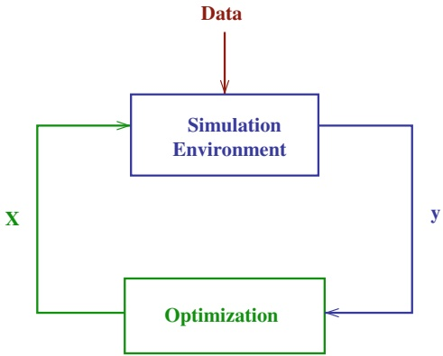

Fig. 1.3 Objective function evaluation based on a simulation process

In this situation, population-based algorithms may not be adapted to address such problems, mainly when the simulation environment requires huge amount of memory space as is often the case in nowadays real-life complex systems. As a matter of fact, in the case of a population-based approach, the simulation environment has to be duplicated for each individual of the population of solutions, which may require an excessive amount of memory. In order to avoid this drawback, one may think about having only one simulation environment which could be used each time a point in the population has to be evaluated. One first consider the first individual for which the simulation environment is initiated and the simulation associated with this first individual is run. The associated performance is then transferred to the optimization algorithm. After that, the second individual is evaluated, but the simulation environment must first be cleared from the events of the first simulation. The simulation is then run for the second individual, and so on until the last individual of the population is evaluated. In this case the memory space is not an issue anymore, but the evaluation time may be excessive and the overall process too slow, due to the fact that the simulation environment is reset at each evaluation.

In the standard simulated annealing algorithm, a copy of a state space point is requested for each proposed transition. In fact, a point $\mathbf { X } _ { j }$ is generated from the current point $\mathbf { X } _ { i }$ through a copy in the memory of the computer. In the case of state spaces of large dimension, the simple process of implementing such a copy may be inefficient and may reduce drastically the performance of simulated annealing.

In such a case, it is much more efficient to consider a come back operator, which cancels the effect of a generation. Let G be the generation operator which transforms a point from $\mathbf { X } _ { i }$ to $\mathbf { X } _ { j }$ :

$$
\left|\begin{array}{c}G\\\mathbf {X} _ {i} \rightarrow \mathbf {X} _ {j}\end{array}\right|
$$

The comeback operator is the inverse $G ^ { - 1 }$ of the generation operator.

Usually, such a generation modifies only one component of the current solution. In this case, the vector $\mathbf { X } _ { i }$ can be modified without being duplicated. Depending on the value obtained when evaluating this new point, two options may be considered:

1. the new solution is accepted and, in this case, only the current objective function value is updated.

2. else, the come back operator $G ^ { - 1 }$ is applied to the new position in order to come back to the previous solution, again without any duplication in the memory.

This process is summarized in Fig. 1.4.

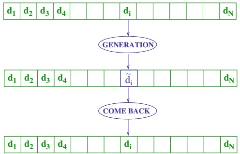

Fig. 1.4 Optimization of the generation process. In this figure, the state space is built with a decision vector for which the generation process consist of changing only one decision $( d _ { i } )$ in the current solution. If this modification is not accepted, this component of the solution recovers its former value. The only information to be stored is the integer i and the real number $d _ { i } .$

The come back operator has to be used carefully because it can easily generate undesired distortions in the way the algorithm searches the state space. For example, if some secondary evaluation variables are used and modified for computing the overall evaluation, such variables must also recover their initial value, and the come back operator must therefore ensure the coherence of the state space.

## 1.5 Illustrative Applications

In this section, we will see how simulated annealing can be applied to two classical NP-hard combinatorial optimization problems: the knapsack problem and the traveling salesman problem.

## 1.5.1 Knapsack Problem

The knapsack problem can be defined as follows. Given a set of n item types, each with a weight and a value, and given a weight limit, determine the number of each item to include in a collection so that the associated total weight is less than or equal to the weight limit, and so that the total value is as large as possible. The knapsack problem derives its name from the problem faced by someone who is constrained by a fixed-size knapsack and must fill it with the most valuable items.

This problem often arises as a subproblem in resource allocation applications where there are financial constraints, such as:

• Cargo loading (truck, boat, cargo aircraft)

• Satellite channel assignment

• Portfolio optimization

In the following, we will consider the binary version of the problem, where there is only one item of each type. Thus, we have n items, each with value $\nu _ { i }$ and weight $w _ { i } \mathrm { ~ , ~ } i = 1 \mathrm { , \ldots , } n$ . We must decide whether each item should be put (or not) in a knapsack of weight limit $P ,$ so as to maximize its total value. Before presenting the application of simulated annealing to such a problem, we first present a mathematical model for this optimization problem.

## 1.5.1.1 Mathematical Modeling

As for any real optimization problem to be solved, the modeling step is critical and has to be done carefully. It models the state space by defining the decision variables, and it expresses the objective function and the constraint functions in terms of the decision variables and the given data.

In the binary knapsack problem, we have a vector of binary decision variables $\boldsymbol { x } = ( x _ { 1 } , x _ { 2 } , \ldots , x _ { n } ) ^ { T }$ , where $x _ { i } = 0$ if item i is left out of the knapsack and $x _ { i } = 1$ if item i is put in the knapsack. For a given vector x, the objective function value, which represents the total value of the items in the knapsack, is:

$$
f (x) = \sum_ {i = 1} ^ {n} v _ {i} x _ {i}.
$$

We want this value to be maximized. If there was no weight limit, there would be no optimization problem in the sense that all items would fit in the knapsack (i.e., the optimal decision vector would be $x = ( 1 , 1 , \ldots 1 ) ^ { T } )$ . Thus, the weight limit makes the problem combinatorial. This weight limit is the main constraint of this problem and is modeled by the following inequality:

$$
\sum_ {i = 1} ^ {n} w _ {i}. x _ {i}. \leq P.
$$

Then, one must add the binary constraints:

$$
x _ {i} \in \{0, 1 \}, \text {for} i = 1, 2, \dots , n.
$$

The overall model is then

$$
\begin{array}{c} \max f (x) = \sum_ {i = 1} ^ {n} v _ {i} x _ {i} \\ \text {s.t.} \end{array}
$$

$$
\begin{array}{c} \hline \sum_ {i = 1} ^ {n} p _ {i} x _ {i} \leq P \\ x _ {i} \in \{0, 1 \}, i = 1, 2, \dots , n. \end{array}
$$

This problem is easy to formulate but hard to solve due to the associated combinatorics. For n items, the number of potential solutions to consider is $2 ^ { n }$ which grows very rapidly with n:

| n | $2^n$ |
| --- | --- |
| 10 | $1.024\times 10^3$ |
| 20 | $1.048\times 10^6$ |
| 30 | $1.073\times 10^9$ |
| 40 | $1.099\times 10^{12}$ |
| 50 | $1.125\times 10^{15}$ |
| 60 | $1.152\times 10^{18}$ |
| 70 | $1.180\times 10^{21}$ |
| 80 | $1.208\times 10^{24}$ |
| 90 | $1.237\times 10^{27}$ |
| 100 | $1.267\times 10^{30}$ |

For large instances of the knapsack problem, one can consider applying metaheuristics like simulated annealing.

## 1.5.1.2 Simulated Annealing Implementation

For the knapsack problem, each solution is encoded as a binary vector X. From a point $X _ { i } ,$ , we generate a neighbor $X _ { j }$ by randomly flipping one component of $X _ { i }$ , as shown in Fig. 1.5 where the kth component is chosen.

In the unconstrained optimization context of SA, a classical relaxation can be considered to take into account the weight limit constraint. Basically, a term is added in the objective function to penalize the violation of this constraint. Here, we compute the weight excess $\Delta$ when the weight of the items in the knapsack exceeds its weight limit:

$$
\Delta = \min (0, (\sum_ {i = 1} ^ {n} w _ {i} x _ {i}) - P).
$$

and the objective function value is then penalized by subtracting from it $\mu { \frac { \Delta } { P } }$ , where $\mu$ is a penalty parameter to be set by the user.

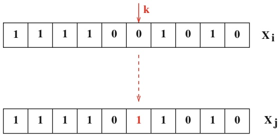

Fig. 1.5 In this example, with $n = 1 0 ,$ the sixth position has been randomly selected in order to include the sixth object in the bag

In order to test the simulated annealing algorithm on this problem, we first build an instance of the problem by randomly generating 100 items for which the weights have also been selected randomly between 1 and 100 with a uniform probability density function. For this instance, the weight limit of the bag is set to $P = 2 0 0 0$ We choose $\mu = 1$ for the penalty parameter and we apply the basic SA algorithm with the initial temperature set to a value of $c _ { 0 }$ such that $\chi ( c ) = 0 . 8$ , a geometric cooling schedule with $\alpha   =   0 . 9 9 5$ , and $L _ { k }   =   1 0 0 0$ for every iteration k. The algorithm is stopped when the temperature reaches $\frac { c _ { o } } { 1 0 0 0 }$

We propose as initial solution a uniformly-distributed random binary vector. The evolution of the penalized objective function with the number of iterations is shown in Fig. 1.6, and the associated evolution of the total weight and the value of the knapsack is shown in Fig. 1.7. At the beginning of the optimization process, the SA explores the solution space by accepting solutions that yield low value of the penalized objective function. This leads to high excess weight and high total value. The value of the penalized objective function increases as the algorithm converges to the optimal solution. Since the excess weight is high at the beginning, the solution is improved mainly by removing weight from the knapsack, therefore the total weight and total value decrease. As the excess weight reaches zero (feasible solution) the solution must be improved by increasing the value (while keeping the weight under the weight limit). Therefore, the total value increases until it reaches the maximum value.

## 1.5.2 Traveling Salesman Problem

The traveling salesman problem (TSP) asks the following question: “Given a list of n cities, among which an origin city, and the distances between each pair of cities, what is the shortest possible route that visits each city exactly once and returns to the origin city $r _ { \cdot } ^ { \bullet } { } ^ { \flat } { } ^ { \flat } { } ^ { \flat }$ This is again an important NP-hard combinatorial optimization problem, particularly in the fields of operations research and theoretical computer science. The problem was first formulated in 1930 and is one of the most intensivelystudied problems in discrete optimization.

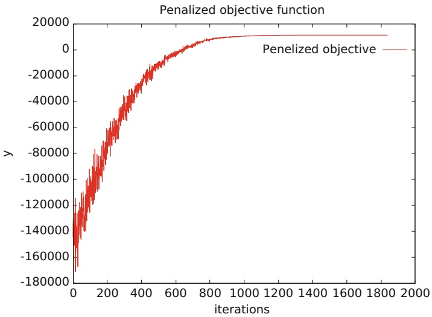

Fig. 1.6 Evolution of the penalized objective function with iterations

Weight and Value Evolution

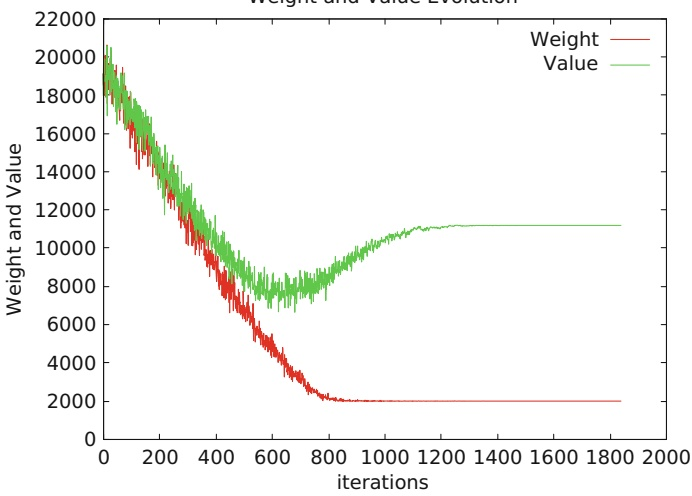

Fig. 1.7 Evolution of the total weight and value with iterations

As for the knapsack problem, we first present the mathematical modeling.

## 1.5.2.1 Mathematical Modeling

Let us consider a set of n cities where each city i has coordinates $( x _ { i } , y _ { i } ) , i =$ $1 , 2 , \ldots , n .$ . In this case, each point X of the state space, has to represent a potential permutation in the order we visit the n cities. For simplicity, we consider the following initial solution using the lexicographic order:

$$
X _ {0} = \boxed {1 \boxed {2} \boxed {3} \boxed {4} \dots n}
$$

The objective function evaluation consists in computing the length $f$ of the tour corresponding to any vector X:

$$
f (X) = \sum_ {i = 1} ^ {n - 1} d (X _ {i}, X _ {i + 1}) + d (X _ {N}, X _ {1}),
$$

where, $X _ { i }$ is the ith element of X. If $X _ { i } = k$ and $X _ { i + 1 } = l ,$ , the inter-city distance is:

$$
d (X _ {i}, X _ {i + 1}) = \sqrt {(x _ {l} - x _ {k}) ^ {2} + (y _ {l} - y _ {k}) ^ {2}}.
$$

Note that the last term, $d ( X _ { N } , X _ { 1 } )$ , in the above definition of f represents the last segment of the tour to come back to the origin city.

The complexity associated with the traveling salesman problem is known to be much higher than that of the knapsack problem. For a problem with n cities, the number of potential tours to be considered is $n !$ , which grows with n much faster than $2 ^ { n }$ :

| n | 2<sup>n</sup> | n! |
| --- | --- | --- |
| 102030405060708090100 | 1111111111..........011122200092580362479520877483××××××××××1111111111000000000011122233692581470 | 1719228383.........1143.46103695833554227652229108××××××××××1111111111000000000011111346801356827410887 |

Just to give an idea of the complexity of the problem, if one evaluation of the objective function requests $1 0 ^ { - 9 }$ s, then a naive enumeration algorithm evaluating every possible solution would require the following CPU time:

<table><tbody><tr><td rowspan="2">n</td><td rowspan="2">2<sup>n</sup></td><td rowspan="2">n!</td><td rowspan="2">ratio2nn!</td></tr><tr></tr><tr><td>102030405060708090100</td><td>43330789×3×××1161311118101y000dmmμ1e369sa2sasiyyyynrysseeeeaaaarrrrssss</td><td>24283292........27948566××××××××73711111111.000600000y11113448em02451773a211sryyyyyyyyseeeeeeeeaaaaaaaarrrrrrrrssssssss</td><td>217727523...14.....23.47293×67×××××××××11111111011000000070011913469123225934173</td></tr></tbody></table>

Even if the computer power is likely to double in the next 18 months, no need to say that it would not make such a naive algorithm practical.

## 1.5.2.2 Simulated Annealing Implementation

One of the simplest neighborhood operator for this problem consists of randomly exchanging two positions in the current solution vector X (see Fig. 1.8). This way of manipulating points of the state space ensures that the produced neighbor remains a permutation i.e. a tour of the n cities. Implementing such an operator within the $\mathrm { S A }$ algorithm yields acceptable results, but the performance of the SA can really be improved by using a neighborhood operator that exchanges all the positions between two randomly chosen indices (m, n), as shown in Fig. 1.9.

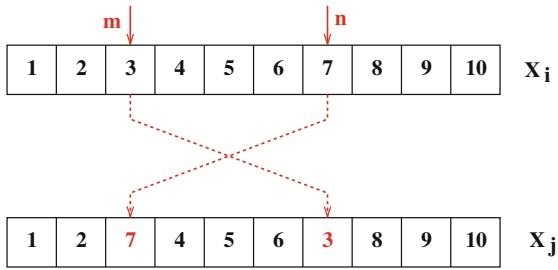

Fig. 1.8 A first neighborhood operator: randomly swapping two positions

Let us consider an instance with $n = 1 0 0 0$ cities randomly generated in a square subset of the plane. The straightforward SA algorithm is implemented, again, with initial temperature $c _ { 0 }$ such that $\chi ( X ) = 0 . 8 ,$ , a geometric cooling schedule with $\alpha = 0 . 9 9 5$ , and $L _ { k } = 1 0 0 0$ for every iteration. The algorithm is stopped when the temperature reaches $\frac { c _ { o } } { 1 0 0 0 }$ , and based on the second neighborhood operator (Fig. 1.9). The initial solution considered is the tour of total distance $1 . 1 6 8 5 7 1 6 4 \times 1 0 ^ { 8 }$ shown in Fig. 1.10.

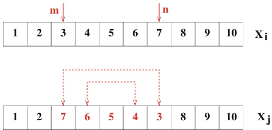

Fig. 1.9 A second neighborhood operator: swapping all positions between two randomly chosen positions (m, n)

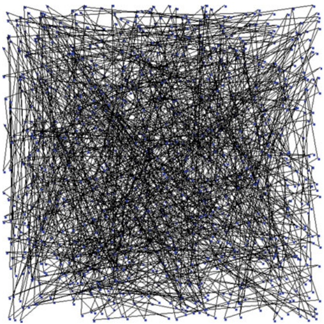

Fig. 1.10 Initial tour of the TSP with n = 1000 cities

After application of the simulated annealing algorithm on this problem, one obtains the tour displayed in Fig. 1.11. One minute of computation on a Unix platform with a 2.4 GHz processor and 8 GB of RAM was needed to get the final tour of total distance 360,482.

This is clearly not an optimal solution for this instance (there are some suboptimal crossings) but this solution is very easily obtained via a direct application of SA.

Simulated annealing has also been applied to many combinatorial problems coming from the industry and real-world operations. To mention just a few:

• Airline Crew Scheduling [8]

• Railway Crew Scheduling [9]

• Traveling Salesman Problem [4]

• Vehicle Routing Problem [14]

• Layout-Routing of Electronic Circuits [17]

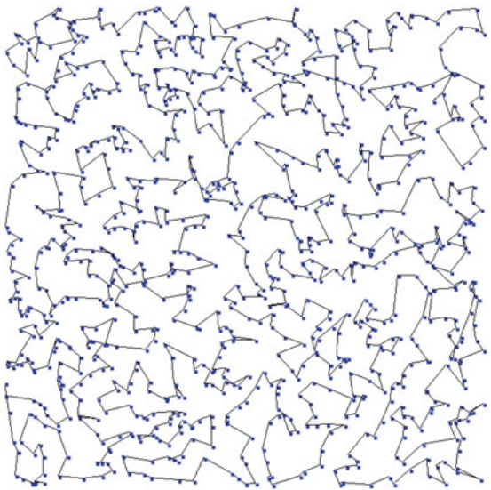

Fig. 1.11 Final tour of the TSP with n = 1000 cities

• Large Scale Aircraft Trajectory Planning [5, 10]

• Complex portfolio problem [7]

• Graph coloring problem [6]

• High-dimensionality minimization problems [16]

## 1.6 Large-Scale Aircraft Trajectory Planning

In this section, we present a methodology using SA to address a strategic planning of aircraft trajectories at the European continental scale, which involves nearly 30,000 flights per day. The goal is to separate the given set of 4D aircraft trajectories (threedimension space plus time) by allocating an alternative route in the three-dimension space and an alternative departure time to each flight.

## 1.6.1 Mathematical Modeling

Our strategic trajectory planning problem considers a set of flight plans (origin, destination, departure time) for a given day. We rely on route or departure-time allocation to separate aircraft trajectories. In other words, for each flight, we can delay departure and/or impose an alternative route instead of the initially-planned direct route between the origin and the destination. This can be formulated as an optimization problem aimed at minimizing the number of interactions between trajectories, where we count one interaction whenever two flights are in conflict i.e., separated at some point by less than 5 NM (nautical miles) horizontally or 1000 feet vertically.

**Given Data.** A problem instance is given by:

• A set of N initial (nominal) discretized 4D (direct-route) trajectories;

• For each flight i, for $i   =   1 , 2 , \ldots ,   N ;$

– The initial planned departure time: $t _ { i , 0 }$ ;

– The maximum allowed advance departure time shift: $\delta _ { a } ^ { i } < 0 ;$

– The maximum allowed delay departure time shift: $\delta _ { d } ^ { i } > 0 ;$

– The maximum allowed route length extension coefficient: $0 \leq d _ { i } \leq 1$

– M: the number of allowed virtual waypoints to modify the route.

Decision Variables. In the time domain, one can use a departure-time shift, $\delta _ { i } ,$ associated with each flight $i   ( i   =   1 , 2 , \ldots , N )$ . Therefore, the resulting departure time of flight i is given by $t _ { i } = t _ { i , 0 } + \delta _ { i }$ , In the 3D space, one can rely on a vector, $w _ { i }$ , of virtual waypoint locations through which flight i must go (using straight-line segments), $w _ { i } : = \left( w _ { i } ^ { 1 } , w _ { i } ^ { 2 } , \ldots , w _ { i } ^ { M } \right) , i = 1 , \ldots , N$ . Let us set the compact vector notation: $\delta : = ( \delta _ { 1 } , \delta _ { 2 } , \ldots , \delta _ { N } )$ , and $\mathbf { w } : = ( w _ { 1 } , w _ { 2 } , \ldots , w _ { N } )$ . Therefore, the decision variables of our route / departure-time allocation problem can be represented by the vector: $u : = ( \delta , \mathbf { w } )$

**Constraints.** The above optimization variables must satisfy the following constraints:

**Allowed departure time shift**. Since it is not reasonable to delay or to advance departure times for too long, the departure time shift, $\delta _ { i } .$ , is limited to lie in the interval $[ \delta _ { a } ^ { i } , \delta _ { d } ^ { i } ]$ . Common practice in airports led us to discretize this time interval. Given the (user-defined) time-shift step size $\delta _ { s }$ , this yields $\begin{array} { r } { N _ { a } ^ { i } : = \frac { | \delta _ { a } ^ { i } | } { \delta _ { s } } } \end{array}$ possible advance slots, and $\begin{array} { r } { N _ { d } ^ { i } : = \frac { \delta _ { d } ^ { i } } { \delta _ { s } } } \end{array}$ possible delay slots for flight i. Therefore, we define the discrete set, $\Delta _ { i }$ , of all possible departure time shifts for flight i by

$$
\Delta_ {i} := \{- N _ {a} ^ {i}. \delta_ {s}, - (N _ {a} ^ {i} - 1). \delta_ {s}, \dots , - \delta_ {s}, 0, \delta_ {s}, \dots , (N _ {d} ^ {i} - 1). \delta_ {s}, N _ {d} ^ {i}. \delta_ {s} \}.\tag{1.7}
$$

**Maximal route length extension**. The alternative trajectory to be chosen increases the route length, which leads to an increase in fuel consumption and flight time. Therefore, the alternative choice should be limited for the new trajectory if it is to be accepted by the airline. Consequently, the alternative trajectory for flight i must satisfy:

$$
L _ {i} (w _ {i}) \leq (1 + d _ {i}),\tag{1.8}
$$

where $L _ { i } ( w _ { i } )$ denotes the normalized length (i.e., assuming that the direct-flight path length is 1) of the alternative trajectory determined by the waypoint vector $w _ { i }$

**Allowed waypoint locations.** To reduce the search space, prevent undesirable sharp turns, and restrain the route length extension, we bound the possible location of each virtual waypoint. Let $W _ { i x } ^ { m }$ and $W _ { i y } ^ { m }$ be the 2D sets of all possible normalized longitudinal and lateral locations, respectively, of the mth virtual waypoint for trajectory i. The (normalized) longitudinal component, $w _ { i x ^ { \prime } } ^ { m }$ , must lie in the interval:

$$
W _ {i x} ^ {m} := \left[ \left(\frac {m}{1 + M} - b _ {i}\right), \left(\frac {m}{1 + M} + b _ {i}\right) \right], m = 1, 2, \dots , M,\tag{1.9}
$$

where $0 \leq b _ { i } \leq 1$ is a (user-defined) model parameter. The normalized lateral component, $w _ { i y } ^ { m }$ , is restricted to lie in the interval:

$$
W _ {i y} ^ {m} := [ - a _ {i}, a _ {i} ],\tag{1.10}
$$

where $0 \leq a _ { i } \leq 1$ is a (user-defined) model parameter chosen a priori so as to satisfy (1.8). This yields a rectangular shape for the possible locations of the virtual waypoint $w _ { i } ^ { m }$ (see Figure 1.12).

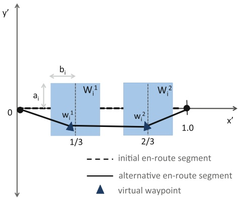

Fig. 1.12 Rectangular-shape sets of the possible locations of $M = 2$ virtual waypoints, for trajectory i

## Objective Function

The objective is to minimize the number of interactions between trajectories, which correspond, roughly speaking, to situations that occur in the flight planning phase, when more than one trajectory compete for the same space at the same period of time. Consider for example the trajectories A, B and C in Fig. 1.13.

We define an interaction at a trajectory point $P _ { i , k } ( u _ { i } )$ to be the sum of all the conflicts associated with point $P _ { i , k } ( u _ { i } )$ , where $u _ { i }$ the ith component of u. We further define the interaction, $\Phi _ { i } ,$ , associated with trajectory i, as: $\begin{array} { r } { \Phi _ { i } ( u ) : = \sum _ { k = 1 } ^ { K _ { i } } \varPhi _ { i , k } \big ( u \big ) } \end{array}$ where $K _ { i }$ is the number of trajectory points obtained through some discretization of the trajectory of the ith flight. Figure 1.13 illustrates the case of trajectory $i = B$ at the trajectory point $P _ { B , 4 }$ . Finally, interaction between trajectories, $\Phi _ { t o t }$ , for a whole traffic situation is simply defined as:

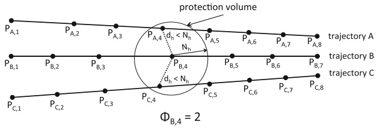

Fig. 1.13 Interactions, $\varPhi _ { B , 4 }$ , at sampling point $P _ { B , 4 }$ of trajectory B

$$
\Phi_ {t o t} (u) := \sum_ {i = 1} ^ {N} \Phi_ {i} (u) = \sum_ {i = 1} ^ {N} \sum_ {k = 1} ^ {K _ {i}} \Phi_ {i, k} (u).\tag{1.11}
$$

The interaction minimization problem can be formulated as a mixed-integer optimization problem, as follows:

$$
\min _ {u = (\delta , \mathbf {w})} \Phi_ {t o t} (u)
$$

subject to

$$
\begin{array}{l} \delta_ {i} \in \Delta_ {i}, \quad \text {for all} i = 1, 2, \ldots , N \\ w _ {i x} ^ {m} \in W _ {i x} ^ {m}, \quad \text {for all} i = 1, 2, \ldots , N, m = 1, 2, \ldots , M \\ w _ {i y} ^ {m} \in W _ {i y} ^ {m}, \quad \text {for all} i = 1, 2, \ldots , N, m = 1, 2, \ldots , M, \end{array}\tag{P1}
$$

where the set $\varDelta _ { i }$ is defined in (1.7), and $W _ { i x } ^ { m }$ and $W _ { i y } ^ { m }$ are defined in (1.9) and (1.10), respectively.

In order to evaluate the objective function of a candidate solution, $( \mathbf { w } , \delta )$ , one needs to compute the interaction, $\Phi _ { t o t }$ , between the N aircraft trajectories. To avoid the $\frac { N ( \stackrel { \star } { N - 1 } ) } { 2 }$ time-consuming pair-wise comparisons, which is prohibitive in our large-scale application context, we propose a 4D grid-based conflict detection scheme as illustrated in Fig. 1.14 (see [5, 10] for further details). First, we define a four-dimensional (3D space + time) grid (see Fig. 1.14). The size of each cell in the x, y, and z directions is defined by the minimum separation requirements, $N _ { h } = 5   \mathrm { N M }$ and $N _ { v } = 1 0 0 0   \mathrm { f t }$ . The size of the cell in the time domain is set according to some given discretization step size, $t _ { S } .$ . To detect conflicts, the idea is to successively put each trajectory in this grid, and then check for conflicts only in the cells surrounding the current trajectory.

In the SA optimization process, the computation of the objective function, $\Phi _ { t o t } ( u )$ , is repeated many times. Therefore it must be computed as efficiently as possible. To avoid checking interactions over all the N trajectories even when only a subset of trajectories are modified in a new proposed solution, the interaction count is updated in a differential manner. More precisely, we proceed as follows. First, the 4D grid is initialized with every cell empty. Then, the initial N trajectories, corresponding to the initial value of the decision vector, u (with all its components at zero, i.e., direct flight), are placed in the 4D grid and the current interaction, $\Phi _ { i _ { C } }$ , associated with each trajectory, i, and the current total interaction between trajectories, $\phi _ { t o t _ { C } }$ , are computed.

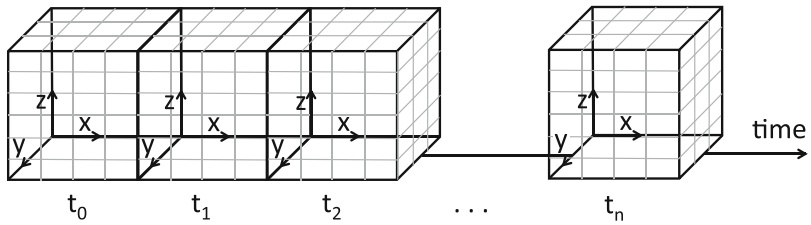

Fig. 1.14 Four dimension (space-time) grid

We assume now that during the optimization process, the decision variables of l flights are to be modified. Let $I _ { m o d i f }$ be a list of length l containing the flight indices of the l flights. To update the value of total interaction, we first remove all the l corresponding trajectories from the 4D grid. Therefore, the interaction associated with each trajectory in $I _ { m o d i f }$ is set to an intermediate value $\Phi _ { i , i n t e r } ( u ) = 0$ $\forall i \in I _ { m o d i f }$ It should be noted that the interaction measurement is symmetrical: if $\Phi ^ { i j } ( u )$ denotes the contribution of trajectory i to the interaction associated with trajectory $j ,$ then $\pmb { \varPhi } ^ { i j } ( u ) = \pmb { \varPhi } ^ { j i } ( u )$ . Let $\mathcal { N } _ { i }$ be a set of trajectories currently interacting with trajectory i. The interaction associated with trajectory $j \in \mathcal { N } _ { i }$ over all trajectories $i \in I _ { m o d i f } ,$ is set to an intermediate value $\begin{array} { r } { \pmb { \varPhi } _ { j , i n t e r } ( u ) = \pmb { \varPhi } _ { j } ( u ) - \sum _ { i \in I _ { m o d i f } } \pmb { \varPhi } ^ { i j } ( u ) } \end{array}$ Thereafter, the modified trajectories corresponding to the new decision variable values, $u _ { i } , i   \in   I _ { m o d i f }$ , are placed in the 4D grid and the interaction detection procedure is performed over all trajectories $i \in I _ { m o d i f }$ . Then, the interaction, $\Phi _ { i }$ , associated with each trajectory $i \in I _ { m o d i f } ,$ , is computed. Again, the interaction associated with each trajectory, j, interacting with the set of modified trajectories is updated as follows: $\begin{array} { r } { \pmb { \varPhi } _ { j } ( u ) = \pmb { \varPhi } _ { j , i n t e r } ( u ) + \sum _ { i \in I _ { m o d i f } } \pmb { \varPhi } ^ { i j } ( u ) } \end{array}$ . Finally, the total interaction between trajectories is simply computed as $\begin{array} { r } { \varPhi _ { t o t } \big ( u \big ) = \sum _ { i = 1 } ^ { N } \varPhi _ { i } \big ( u \big ) } \end{array}$ This interaction computation method allows us to update the value of the objective function when some trajectories are modified within a very short computation time, since we do not need to compute the change of interaction for decisions that are not modified at the current optimization iteration.

## 1.6.2 Computational Experiments with SA

The proposed methodology is tested with a continent-size air traffic instance for a full day of air-traffic over the European airspace, consisting of $N = 2 9 { , } 8 5 2$ enroute trajectories. The trajectories are sampled with a discretization step of $t _ { s } =$ 20 s. The initial trajectory set involves $\Phi _ { t o t } = 1 4 2 { , } 1 4 4$ total interactions between trajectories. Figure 1.15 illustrates the initial trajectory points (blue dots), and the locations where the initial interactions occur (red dots).

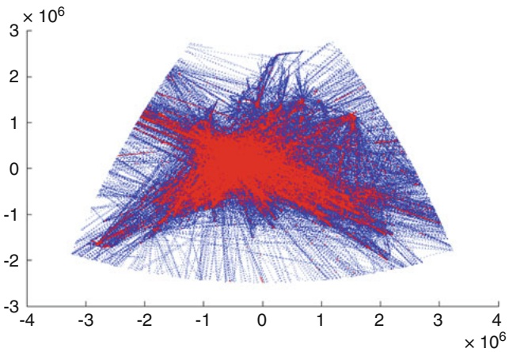

Fig. 1.15 Initial (direct-route) trajectory set involving 1-day en-route air traffic over the European airspace (29,852 flights) sampled with $t _ { s } = 2 0   \mathrm { s }$ with initial location of interactions displayed as red color dots

The initial temperature is computed by first generating 100 deteriorating transformations at random and then by evaluating the average variations, $\Delta \Phi _ { a \nu g }$ , of the objective function values. The initial temperature, $c _ { 0 } ,$ , is then deduced from the relation: $c _ { 0 } = e ^ { \frac { \varDelta \phi _ { a v g } } { T _ { 0 } } }$ , where $\tau _ { 0 }$ is the initial acceptance rate of degrading solutions (which will be empirically set). In order to reach an equilibrium, a sufficient number of iterations, denoted $L _ { k }$ , have to be performed at each temperature step k. In our case, we assume for simplicity purposes that the number of iterations, $L _ { k }$ , is constant and empirically set. The temperature is decreased following the geometrical law, $c _ { k + 1 } = \alpha c _ { k }$ , where $0 \leq \alpha \leq 1$ is a pre-defined constant value.

To generate a solution in the neighborhood, we set a user-defined threshold value of interaction, denoted $\Phi _ { \tau }$ , such that the trajectory of a randomly chosen flight i will be modified only if $\varPhi _ { i } ( u ) \geq \varPhi _ { \tau }$ , where u is the current solution. Then, for a chosen flight, i, we introduce another user-defined parameter, $P _ { w } \leq 1$ , to control the probability of modifying the value of the ith trajectory waypoint location decision vector, $w _ { i }$ . The probability to modify instead the departure time is thus $1 - P _ { w }$ . The algorithm terminates when the final temperature, $c _ { f }$ , is reached, or when an interactionfree solution is found. The parameter values chosen to specify the instance considered, and the empirically set parameters defining the overall SA problem-solving methodology are given in Table 1.1.

The SA adapted to solve the strategic trajectory planning problem is implemented in Java. We address this problem instance with an AMD Opteron 2 GHz processor with 128 Gb RAM. Numerical results obtained from the simulation are reported in Table 1.2. This SA implementation yields an interaction-free solution for this continent-scale problem instance after around 76 min of computation time. This is compatible with strategic (several days in advance) planning application requirements in the setting of regular airline schedules.

Table 1.1 Chosen (user-defined) parameter values defining the problem and the empirically-set (user-defined) parameter values of the resolution methodology

| Parameters pro | defining the blem | Parameters S | defining the A |
| --- | --- | --- | --- |
| Parameter | Value | Parameter | Value |
| -δaiδ=s δdi | 60min20s | L<sub>τ0k</sub> | 35000.3 |
| d<sub>i</sub> | 0.12 (12%) | β | 0.99 |
| M | 2 | Tf | (1/500).T<sub>0</sub> |
| a<sub>i</sub> | 0.126 | P<sub>w</sub> | 0.5 |
| b<sub>i</sub> | 0.067 | Φ<sub>τ</sub> | 0.5 Φ<sub>avg</sub> |

Table 1.2 Numerical results for continent-size problem instance solved by SA (averages are computed over 10 runs)

| Numerical results | Value |
| --- | --- |
| Number of iterations | 497,000 |
| Avg. computation time (minutes) | 76.19 |
| Avg. proportion of delayed/advanced flights | 71.29% |
| Avg. proportion of extended flights | 46.23% |
| Avg. departure time shifts (minutes) | 30.14 |
| Avg. route length extensions | 1.95% |

## 1.7 Conclusion

This chapter introduced the reader to simulated annealing (SA), a global optimization metaheuristic. The main advantage of SA is its simplicity. SA is based on an analogy with the physical annealing of materials that avoids the drawback of the Monte-Carlo approach (which can be trapped in local minima), thanks to an efficient Metropolis acceptance criterion. When the objective function evaluations require a lot of memory space, for example when it results from complex simulation processes that manipulate large-dimension state space involving much memory, population-based algorithms are not applicable and simulated annealing is the right answer to address such issues. An illustration was provided in section 1.6 where a large-scale complex aircraft trajectory planning problem involving nearly 30,000 flights over Europe was addressed by exploiting particular features of the problem and, in particular, by integrating clever implementation techniques within the algorithm, and by setting user-defined parameters empirically, along the lines of the basic SA theory.

## References

1. E. Aarts, J. Korst, Simulated Annealing and Boltzmann Machines: A Stochastic Approach to Combinatorial Optimization and Neural Computing (Wiley, New York, 1989)

2. E. Aarts, P. Van Laarhoven, A new polynomial time cooling schedule, in Proceedings of the IEEE International Conference on Computer-Aided Design, Santa Clara (1985), pp. 206–208

3. E. Aarts, P. Van Laarhoven, Statistical cooling: a general approach to combinatorial problems. Philips J. Res. 40, 193–226 (1985)

4. H. Bayram, R. Sahin, A new simulated annealing approach for travelling salesman problem. Math. Comput. Appl. 18(3), 313–322 (2013)

5. S. Chaimatanan, D. Delahaye, M. Mongeau, A hybrid metaheuristic optimization algorithm for strategic planning of 4D aircraft trajectories at the continental scale. IEEE Comput. Intell. Mag. 9(4), 46–61 (2014)

6. M. Chams, A. Hertz, D. de Werra, Some experiments with simulated annealing for coloring graphs. Eur. J. Oper. Res. 32(2), 260–266 (1987)

7. Y. Crama, M. Schyns, Simulated annealing for complex portfolio selection problems. Eur. J. Oper. Res. 150(3), 546–571 (2003)

8. T. Emden-Weiner, M. Proksch, Best practice simulated annealing for the airline crew scheduling problem. J. Heuristics 5(4), 419–436 (1999)

9. R. Hanafi, E. Kozan, A hybrid constructive heuristic and simulated annealing for railway crew scheduling. Comput. Ind. Eng. 70, 11–19 (2014)

10. A. Islami, S. Chaimatanan, D. Delahaye, Large-scale 4D trajectory planning, in Air Traffic Management and Systems II, ed. by Electronic Navigation Research Institute. Lecture Notes in Electrical Engineering, vol. 420 (Springer, Tokyo, 2017), pp. 27–47

11. S. Kirkpatrick, C.D. Gelatt, M.P. Vecchi, Optimization by simulated annealing. IBM Research Report RC 9355, Acts of PTRC Summer Annual Meeting (1982)

12. S. Kirkpatrick, C.D. Gelatt, M.P. Vecchi, Optimization by simulated annealing. Science 220(4598), 671 (1983)

13. P. Laarhoven, E. Aarts (eds.), Simulated Annealing: Theory and Applications (Kluwer, Norwell, 1987)

14. W.F. Mahmudy, Improved simulated annealing for optimization of vehicle routing problem with time windows (VRPTW). Kursor J. 7(3), 109–116 (2014)

15. N. Metropolis, A. Rosenbluth, M. Rosenbluth, A. Teller, E. Teller, Equation of state calculation by fast computing machines. J. Chem. Phys. 21(6), 1087–1092 (1953)

16. P. Siarry, G. Berthiau, F. Durdin, J. Haussy, Enhanced simulated annealing for globally minimizing functions of many continuous variables. ACM Trans. Math. Softw. 23(2), 209–228 (1997)

17. D.F. Wong, H.W. Leong, C.L. Liu, Simulated Annealing for VLSI Design (Kluwer Academic, Boston, 1988)

# Chapter 2 Tabu Search

Michel Gendreau and Jean-Yves Potvin

**Abstract** This chapter presents the fundamental concepts of Tabu Search (TS) in a tutorial fashion. Special emphasis is put on showing the relationships with classical local search methods and on the basic elements of any TS heuristic, namely, the definition of the search space, the neighborhood structure, and the search memory. Other sections cover other important concepts such as search intensification and diversification and provide references to significant work on TS. Recent advances in TS are also briefly discussed.

## 2.1 Introduction

Over the last 30 years, hundreds of papers presenting applications of Tabu Search (TS), a heuristic method originally proposed by Glover in 1986 [30], to various combinatorial problems have appeared in the operations research literature. In several cases, the methods described provide solutions very close to optimality and are among the most effective, if not the best, to tackle the difficult problems at hand. These successes have made TS extremely popular among those interested in finding good solutions to the large combinatorial problems encountered in many practical settings. Several papers, book chapters, special issues and books have surveyed the rich TS literature (a list of some of the most important references is provided in a later section). In spite of this abundant literature, there still seem to be many researchers who, while they are eager to apply TS to new problem settings, find it difficult to properly grasp the fundamental concepts of the method, its strengths and its limitations, and to come up with effective implementations. The purpose of this chapter is to address this situation by providing an introduction in the form of a tutorial focusing on the fundamental concepts of TS. Throughout the chapter, a relatively straightforward, yet challenging and relevant, problem will be used to illustrate these concepts: the Classical Vehicle Routing Problem (CVRP). This problem will be introduced in the following section. The remainder of the chapter is organized as follows. The basic concepts of TS, like the search space, neighborhood structure, and short-term tabu lists, are described and illustrated in Sect. 2.3. Intermediate, yet critical, concepts, such as intensification and diversification, are described in Sect. 2.4. This is followed in Sect. 2.5 by a brief discussion of advanced topics in TS, and in Sect. 2.6 by a short list of key references on TS and its applications. Section 2.7 provides practical tips for newcomers struggling with unforeseen problems as they first try to apply TS to their favorite problem. Section 2.8 concludes the chapter with some general advice on the application of TS to combinatorial problems.

<small><span class="docvortex-page-footnote" data-block-type="page_footnote" style="color:#6b7280">M. Gendreau Département de mathématiques et de génie industriel, Polytechnique Montréal, Montreal, QC, Canada</span></small>

<small><span class="docvortex-page-footnote" data-block-type="page_footnote" style="color:#6b7280">Centre interuniversitaire de recherche sur les réseaux d’entreprise, la logistique et le transport, Montreal, QC, Canada e-mail: [michel.gendreau@cirrelt.net](mailto:michel.gendreau@cirrelt.net)</span></small>

<small><span class="docvortex-page-footnote" data-block-type="page_footnote" style="color:#6b7280">J.-Y. Potvin (-) Département d’informatique et de recherche opérationnelle, Université de Montréal, Montreal, QC, Canada</span></small>

<small><span class="docvortex-page-footnote" data-block-type="page_footnote" style="color:#6b7280">Centre interuniversitaire de recherche sur les réseaux d’entreprise, la logistique et le transport, Montreal, QC, Canada e-mail: [potvin@iro.umontreal.ca](mailto:potvin@iro.umontreal.ca)</span></small>

## 2.2 The Classical Vehicle Routing Problem

Vehicle Routing Problems have very important applications in the area of distribution management. As a consequence, they have become some of the most studied problems in the combinatorial optimization literature and a large number of papers and books (see [65], for example) deal with the numerous procedures that have been proposed to solve them. These include several TS implementations that currently rank among the most effective. The Classical Vehicle Routing Problem (CVRP) is the basic variant in that class of problems. It can formally be defined as follows. Let $G = ( V , A )$ be a graph where $V$ is the vertex set and A is the arc set. One of the vertices represents the depot at which a fleet of $m$ identical vehicles of capacity Q is based, and the other vertices represent customers that need to be serviced. With each customer vertex $\nu _ { i }$ are associated a demand $q _ { i }$ and a service time $t _ { i } .$ With each arc $( \nu _ { i } , \nu _ { j } )$ of A are associated a cost $c _ { i j }$ and a travel time $t _ { i j }$ . The CVRP consists in finding a set of routes such that:

• Each route begins and ends at the depot;

• Each customer is visited exactly once by exactly one route;

• The total demand of the customers assigned to each route does not exceed $Q ;$

• The total duration of each route (including travel and service times) does not exceed a specified value L;

• The total cost of the routes is minimized.

A feasible solution for the problem thus consists in a partition of the customers into m groups, each of total demand no larger than Q, that are sequenced to yield routes (starting and ending at the depot) of duration no larger than L. This problem will be used in the following to illustrate how various TS concepts can be applied in practice.

## 2.3 Basic Concepts

Before introducing the basic concepts of TS, the next subsection first goes back in time to try to better understand the genesis of the method and how it relates to previous work.

## 2.3.1 Historical Background

Heuristics, i.e., approximate solution techniques, have been used since the beginnings of operations research to tackle difficult combinatorial problems. With the development of complexity theory in the early 70s, it became clear that, since most of these problems were NP-hard, there was little hope of ever finding efficient exact solution procedures for them. This realization emphasized the role of heuristics for solving the combinatorial problems that were encountered in real-life applications and that needed to be tackled, whether or not they were NP-hard. While many different approaches were proposed and experimented with, the most popular one was based on Local Search (LS) improvement techniques. LS can be roughly summarized as an iterative search procedure that, starting from an initial feasible solution, progressively improves it by applying a series of local modifications (or moves). At each iteration, the search moves to an improving feasible solution that differs only slightly from the current one (in fact, the difference between the previous and the new solutions amounts to one of the local modifications mentioned above). The search terminates when it encounters a local optimum with respect to the transformations that it considers, an important limitation of the method: unless one is extremely lucky, this local optimum is often a fairly mediocre solution. In LS, the quality of the solution obtained and computing times are usually highly dependent upon the richness of the set of transformations (moves) considered at each iteration of the heuristic.

In 1983, the world of combinatorial optimization was shattered by the appearance of a paper [82] where it was shown that a new heuristic approach called Simulated Annealing (SA) could converge to an optimal solution of a combinatorial problem, albeit in infinite computing time. Based on an analogy with statistical mechanics, SA can be interpreted as a form of controlled random walk in the space of feasible solutions. The emergence of SA indicated that one could look for other ways to tackle combinatorial optimization problems and spurred the interest of the research community. In the following years, many other new approaches were proposed, mostly based on analogies with natural phenomena (like TS, Ant Colony Optimization, Particle Swarm Optimization, Artificial Immune Systems) which, together with some older ones, such as Genetic Algorithms [38], gained an increasing popularity. Now collectively known under the name of metaheuristics (a term originally coined by Glover in [30]), these methods have become over the last 20 years the leading edge of heuristic approaches for solving combinatorial optimization problems.

## 2.3.2 Tabu Search

Building upon some of his previous work, Fred Glover proposed a new approach, which he called Tabu Search, to allow local search methods to overcome local optima [30]. In fact, many elements of this first TS proposal, and some elements of later TS elaborations, were introduced in [29], including short term memory to pre-vent the reversal of recent moves, and longer term frequency memory to reinforce attractive components. The basic principle of TS is to pursue LS whenever it encounters a local optimum by allowing non-improving moves; cycling back to pre-viously visited solutions is prevented by the use of memories, called tabu lists, that record the recent history of the search, a key idea that can be linked to artificial intelligence concepts. It is also important to remark that Glover did not see TS as a proper heuristic, but rather as a metaheuristic, i.e., a general strategy for guiding and controlling inner heuristics specifically tailored to the problems at hand.

## 2.3.3 Search Space and Neighborhood Structure

As we just mentioned, TS is an extension of classical LS methods. In fact, a basic TS can be seen as simply the combination of LS with short-term memories. It follows that the two first basic elements of any TS heuristic are the definition of its search space and its neighborhood structure.

The search space of an LS or TS heuristic is simply the space of all possible solutions that can be considered (visited) during the search. For instance, in the CVRP example described in Sect. 2.2, the search space could simply be the set of feasible solutions to the problem, where each point in the search space corresponds to a set of vehicles routes satisfying all the specified constraints. While in that case the definition of the search space seems quite natural, it is not always so. In the Capacitated Plant Location Problem (CPLP), for instance, customers must be served from plants located in a subset of potential sites. In this context, one could use the full feasible search space made of binary location variables (a site is open or closed) and continuous flow variables. A more attractive search space, though, is obtained by restricting the search space to the binary location variables, from which the complete solution can be obtained by solving the associated transportation problem to get the optimal flow variables. One could also decide to search for the extreme points of the set of feasible flow variable vectors, retrieving the associated location variables by noting that a plant must be open whenever some flow is allocated to it [17]. It is also important to note that it is not always a good idea to restrict the search space to feasible solutions; in many cases, allowing the search to move to infeasible solutions is desirable, and sometimes necessary (see Sect. 2.4.3 for further details).

Closely linked to the definition of the search space is that of the neighborhood structure. At each iteration of LS or TS, the local transformations that can be applied to the current solution, denoted S, define a set of neighboring solutions in the search space, denoted N(S) (the neighborhood of S). Formally, N(S) is a subset of the search space made of all solutions obtained by applying a single local transformation to S. In general, for any specific problem at hand, there are many more possible (and even, attractive) neighborhood structures than search space definitions. This follows from the fact that there may be several plausible neighborhood structures for a given definition of the search space. This is easily illustrated on our CVRP example that has been the object of several TS implementations. To simplify the discussion, we suppose in the following that the search space is the feasible space. Simple neighborhood structures for the CVRP involve moving at each iteration a single customer from its current route; the selected customer is inserted in the same route or in another route with sufficient residual capacity. An important feature of these neighborhood structures is the way in which insertions are performed: one could use random insertion or insertion at the best position in the target route; alternately, one could use more complex insertion schemes that involve a partial reoptimization of the target route, such as GENI insertions [25]. Before proceeding any further it is important to stress that while we say that these neighborhood structures involve moving a single customer, the neighborhoods they define contain all the feasible route configurations that can be obtained from the current solution by moving any customer and inserting it in the stated fashion. Examining the neighborhood can thus be fairly demanding.

More complex neighborhood structures for the CVRP, such as the λ-interchange [50], are obtained by allowing simultaneously the movement of customers to different routes and the swapping of customers between routes. In [54], moves are defined by ejection chains that are sequences of coordinated movements of customers from one route to another; for instance, an ejection chain of length 3 would involve moving a customer $\nu _ { 1 }$ from route $R _ { 1 }$ to route $R _ { 2 }$ , a customer $\nu _ { 2 }$ from $R _ { 2 }$ to route $R _ { 3 }$ and a customer $\nu _ { 3 }$ from $R _ { 3 }$ to route $R _ { 4 }$ . Other neighborhood structures involve the swapping of sequences of several customers between routes, as in the Cross-exchange [63]. These types of neighborhoods have seldom been used for the CVRP, but are common in TS heuristics for its time-windows extension, where customers must be visited within a pre-specified time interval. We refer the interested reader to [9, 27] for a more detailed discussion of TS implementations for the CVRP and the Vehicle Routing Problem with Time Windows.

When different definitions of the search space are considered for a given problem, neighborhood structures will inevitably differ to a considerable degree. In the case of the CPLP, alluded to above, if the search space corresponds to the location variables only, one could use operators to change the status of these variables (from open to closed and conversely). If, however, the search space is made of the extreme points of the set of feasible flow variable vectors, one could instead consider moves defined by the application of pivots to the linear programming formulation of the transportation problem to move the current solution to an adjacent extreme point. Thus, choosing a search space and a neighborhood structure is by far the most critical step in the design of any TS heuristic. It is at this step that one must make the best use of the understanding and knowledge he/she has of the problem at hand.

## 2.3.4 Tabus

Tabus are one of the distinctive elements of TS when compared to LS. As we already mentioned, tabus are used to prevent cycling when moving away from local optima through non-improving moves. The key realization here is that when this situation occurs, something needs to be done to prevent the search from tracing back its steps to where it came from. This is achieved by declaring tabu (disallowing) moves that reverse the effect of recent moves. For instance, in the CVRP example, if customer $\nu _ { 1 }$ has just been moved from route $R _ { 1 }$ to route $R _ { 2 }$ , one could declare tabu moving back $\nu _ { 1 }$ from $R _ { 2 }$ to $R _ { 1 }$ for some number of iterations (this number is called the tabu tenure of the move). Tabus are also useful to help the search move away from previously visited portions of the search space and thus perform more extensive exploration.

Tabus are stored in a short-term memory of the search (the tabu list) and usually only a fixed and fairly limited quantity of information is recorded. In any given context, there are several possibilities regarding the specific information that is recorded. One could record complete solutions, but this requires a lot of storage and makes it expensive to check whether a potential move is tabu or not; it is therefore seldom used. The most commonly used tabus involve recording the last few transformations performed on the current solution and prohibiting reverse transformations (as in the example above); others are based on key characteristics of the solutions themselves or of the moves.

To better understand how tabus work, let us go back to our reference problem. In the CVRP, one could define tabus in several ways. To continue our example where customer $\nu _ { 1 }$ has just been moved from route $R _ { 1 }$ to route $R _ { 2 }$ , one could declare tabu specifically moving back $\nu _ { 1 }$ from $R _ { 2 }$ to $R _ { 1 }$ and record this in the short-term memory as the triplet $( \nu _ { 1 } ,   R _ { 2 } ,   R _ { 1 } )$ . Note that this type of tabu will not constrain the search much and that cycling may occur if $\nu _ { 1 }$ is then moved to another route $R _ { 3 }$ and then from $R _ { 3 }$ to $R _ { 1 }$ . A stronger tabu would involve prohibiting moving back $\nu _ { 1 }$ to $R _ { 1 }$ without consideration for its current route, and be recorded as $\left( \nu _ { 1 } , R _ { 1 } \right)$ . An even stronger tabu would be to disallow moving $\nu _ { 1 }$ to any other route and would simply be noted as $\left( \nu _ { 1 } \right)$

Multiple tabu lists can be used simultaneously and are sometimes advisable. For example, when different types of moves are used to generate the neighborhood, it might be a good idea to keep a separate tabu list for each type. Standard tabu lists are usually implemented as circular lists of fixed length. It has been shown, however, that fixed-length tabus cannot always prevent cycling, and some authors have proposed varying the tabu list length during the search [31, 32, 58, 60, 61]. Another solution is to randomly generate the tabu tenure of each move within some specified interval; using this approach requires a somewhat different scheme for recording tabus that are then usually stored as tags in an array (the entries in this array will usually record the iteration number until which a move is tabu; see [25], for more details).

## 2.3.5 Aspiration Criteria

While central to TS, tabus are sometimes too powerful: they may prohibit attractive moves, even when there is no danger of cycling, or they may lead to an overall stagnation of the searching process. It is thus necessary to use algorithmic devices that will allow one to revoke (cancel) tabus. These are called aspiration criteria. The simplest and most commonly used aspiration criterion, which is found in almost all TS implementations, consists in allowing a move, even if it is tabu, if it results in a solution with an objective value better than that of the current best-known solution (since the new solution has obviously not been previously visited). Much more complicated aspiration criteria have been proposed and successfully implemented (see, for instance [19, 37]), but they are rarely used. The key rule in this respect is that if cycling cannot occur, tabus can be disregarded.

## 2.3.6 A Template for Simple Tabu Search

We are now in the position to give a general template for TS, integrating the elements we have seen so far. We suppose that we are trying to minimize a function $f ( S )$ over some domain and we apply the so-called best improvement version of TS, i.e., the version in which one chooses at each iteration the best available move (this is the most commonly used version of TS).

Notation

• $S ,$ the current solution,

• $S ^ { * }$ , the best-known solution,

$f ^ { * }$ , the value of $S ^ { * }$ ,

$N ( S )$ , the neighborhood of $S ,$

• $\tilde { N } ( S )$ , the admissible subset of N(S) (i.e., non-tabu or allowed by aspiration),

$T .$ , the tabu list.

Initialization

Choose (construct) an initial solution $S _ { 0 }$

Set $S \leftarrow S _ { 0 } ,   f ^ { * } \leftarrow f ( S _ { 0 } ) ,   S ^ { * } \leftarrow S _ { 0 } ,   T \leftarrow \emptyset .$

Search

While termination criterion not satisfied do:

select S in argmi $n _ { S ^ { \prime } \in \tilde { N } ( S ) } [ f ( S ^ { \prime } ) ]$

if $f ( S ) < f ^ { * }$ , then set $f ^ { * } \gets f ( S ) , S ^ { * } \gets S ;$

record tabu for the current move in $T$ (delete oldest entry if necessary).

## 2.3.7 Termination Criteria

One may have noticed that we have not specified in our template above a termination criterion. In theory, the search could go on forever, unless the optimal value of the problem at hand is known beforehand. In practice, obviously, the search has to be stopped at some point. The most commonly used stopping criteria in TS are:

• after a fixed number of iterations (or a fixed amount of CPU time);

• after some number of iterations without an improvement in the objective function value (the criterion used in most implementations);

• when the objective reaches a pre-specified threshold value.

In complex tabu schemes, the search is usually stopped after completing a sequence of phases, the duration of each phase being determined by one of the above criteria.

## 2.3.8 Probabilistic TS and Candidate Lists

In regular TS, one must evaluate the objective for every element of the neighborhood $N ( S )$ of the current solution. This can prove extremely expensive from the computational standpoint. An alternative is to instead consider only a random sample $N ^ { \prime } ( S )$ of $N ( S )$ , thus reducing significantly the computational burden. Another attractive feature of this alternative is that the added randomness can act as an anti-cycling mechanism; this allows one to use shorter tabu lists than would be necessary if a full exploration of the neighborhood was performed. On the negative side, it must be noted that, in that case, one may miss excellent solutions (more on this topic in Sect. 2.7.3). Probabilities may also be applied to activating tabu criteria.

Another way to control the number of moves examined is by means of candidate list strategies, which provide more strategic ways of generating a useful subset $N ^ { \prime } ( S )$ of $N ( S )$ (the probabilistic approach can be considered to be one instance of a candidate list strategy, and may also be used to modify such a strategy). Failure to adequately address the issues involved in creating effective candidate lists is one of the more conspicuous shortcomings that differentiates a naive TS implementation from one that is more solidly grounded. Relevant designs for candidate list strategies are discussed in [35]. We also discuss a useful type of candidate generation approach in Sect. 2.4.4. Another interesting approach for the CVRP is the granular TS [66], where only arcs that are likely to be found in good solutions (i.e., short ones) are considered, thus reducing the size of the underlying graph.

## 2.4 Intermediate Concepts

Simple TS as described above can sometimes successfully solve difficult problems, but in most cases, additional elements have to be included in the search strategy to make it fully effective. We now briefly review the most important of these.

## 2.4.1 Intensification

The idea behind the concept of search intensification is that, as an intelligent human being would probably do, one should explore more thoroughly the portions of the search space that seem promising to make sure that the best solutions in these areas are indeed found. From time to time, one would thus stop the normal searching process to perform an intensification phase. In general, intensification is based on some intermediate-term memory, such as a recency memory, in which one records the number of consecutive iterations that various solution components have been present in the current solution without interruption. For instance, in a CVRP application, one could record how long an arc has been used. A typical approach to intensification is to restart the search from the best currently known solution and to fix the components that seem more attractive. To continue the CVRP example, one could fix the arcs that have been used for the largest number of iterations and perform a restricted search on the remaining arcs. Another technique that is often used consists in changing the neighborhood structure to one allowing more powerful or more diverse moves. In the CVRP example, one could therefore allow more complex insertion moves or switch to an ejection chain neighborhood structure [33]. In probabilistic TS, one could increase the sample size or switch to searching without sampling.

Intensification is used in many TS implementations, but it is not always necessary. This is because there are many situations where the search performed by the normal process is thorough enough. There is thus no need to spend time exploring more carefully the portions of the search space that have already been visited, and this time can be used more effectively as we shall see right now.

## 2.4.2 Diversification

One of the main problems of all methods based on local search approaches, and this includes TS in spite of the beneficial impact of tabus, is that they tend to be too local (as their name implies), i.e., they tend to spend most, if not all, of their time in a restricted portion of the search space. The negative consequence of this fact is that, although good solutions may be obtained, one may fail to explore the most interesting parts of the search space and thus end up with solutions that are still pretty far from the optimal ones. Diversification is an algorithmic mechanism that tries to alleviate this problem by forcing the search into previously unexplored areas of the search space. It is usually based on some form of long-term memory of the search, such as a frequency memory, in which one records the total number of iterations (since the beginning of the search) that various solution components have been present in the current solution or have been involved in the selected moves. For instance, in the CVRP application, one could note how many times each customer has been moved from its current route. In cases where it is possible to identify useful regions of the search space, the frequency memory can be refined to track the number of iterations spent in these different regions.

There are two major diversification techniques. The first, called restart diversification, involves forcing a few rarely used components in the current solution (or the best known solution) and restarting the search from this point. In a CVRP heuristic, customers that have not yet been moved frequently could be forced into new routes. The second diversification method, continuous diversification, integrates diversification considerations directly into the regular searching process. This is achieved by biasing the evaluation of possible moves by adding to the objective a small term related to component frequencies (see [59] for an extensive discussion on these two techniques). A third way of achieving diversification is strategic oscillation as we will see in the next subsection.

Before closing this subsection, we would like to stress that ensuring proper search diversification is possibly the most critical issue in the design of TS heuristics. It should be addressed with extreme care fairly early in the design phase and revisited if the results obtained are not up to expectations.

## 2.4.3 Allowing Infeasible Solutions

Accounting for all problem constraints in the definition of the search space often restricts the searching process too much and can lead to mediocre solutions. This occurs, for example, in CVRP instances where the route capacity or duration constraints are too tight to allow moving customers effectively between routes. In such cases, constraint relaxation is an attractive strategy, since it creates a larger search space that can be explored with simpler neighborhood structures. Constraint relaxation is easily implemented by dropping selected constraints from the search space definition and adding to the objective weighted penalties for constraint violations. This, however, raises the issue of finding correct weights for constraint violations. An interesting way of circumventing this problem is to use self-adjusting penalties, i.e., weights are adjusted dynamically on the basis of the recent history of the search: weights are increased if only infeasible solutions were encountered in the last few iterations, and decreased if all recent solutions were feasible (see, for instance, [25] for further details). Penalty weights can also be modified systematically to drive the search to cross the feasibility boundary of the search space and thus induce diversification. This technique, known as strategic oscillation, was introduced as early as 1977 in [29] and used since in several successful TS procedures (an important early variant oscillates among different types of moves, hence neighborhood structures, while another oscillates around a selected value for a critical function).

## 2.4.4 Surrogate and Auxiliary Objectives

There are many problems for which the true objective function is quite costly to evaluate. When this occurs, the evaluation of moves may become prohibitive, even if sampling is used. An effective approach to handle this issue is to evaluate neighbors using a surrogate objective, i.e., a function that is correlated to the true objective, but is less computationally demanding, in order to identify a (small) set of promising candidates (potential solutions achieving the best values for the surrogate). The true objective is then computed for this small set of candidate moves and the best one selected to become the new current solution; an example of this approach is found in [16].

Another frequently encountered difficulty is that the objective function may not provide enough information to effectively drive the search to more interesting areas of the search space. A typical illustration of this situation is the variant of the CVRP in which the fleet size is not fixed, but is rather the primary objective (i.e., one is looking for the minimal fleet size allowing a feasible solution). In this problem, except for solutions where a route has only one or a few customers assigned to it, most neighborhood structures will lead to the situation where all elements in the neighborhood score equally with respect to the primary objective (i.e., all allowable moves produce solutions with the same number of vehicles). In such a case, it is absolutely necessary to define an auxiliary objective function to orient the search.

Such a function must measure in some way the desirable attributes of solutions. In our example, one could, for instance, use a function that would favor solutions with routes having just a few customers, thus increasing the likelihood that a route can be totally emptied in a subsequent iteration. It should be noted that coming up with an effective auxiliary objective is not always easy and may require a lengthy trial and error process. In some other cases, fortunately, the auxiliary objective is obvious for anyone familiar with the problem at hand (see [24], for an illustration).

## 2.5 Advanced Concepts

The concepts and techniques described in the previous sections are sufficient to de sign effective TS heuristics for many combinatorial problems. Early TS implementa tions, several of which were extremely successful, relied indeed almost exclusively on these algorithmic components. Modern TS implementations, however, exploit more advanced concepts and techniques. While it is clearly beyond the scope of an introductory tutorial, such as this one, to review this type of advanced material, we would like to give readers some insight into it (readers who wish to learn more about this topic should consider the key references provided in the next section).

Various techniques have been devised for making the search more effective. These include methods for exploiting better the information that becomes available during search and creating better starting points, as well as more powerful neighborhood operators and parallel search strategies (on this last topic, see the advances reported in [3] and the chapter on parallel metaheuristics in this Handbook; for specific implementation examples of TS on CPU-based parallel platforms, see [13, 42], and for GPU-based platforms, see [46, 67]). The numerous techniques for making better use of the information are of particular significance since they can lead to dramatic performance improvements. Many of these rely on elite solutions (the best solutions previously encountered) or on parts of these to create new solutions, the rationale being that fragments or elements of excellent solutions are often identified quite early in the searching process, but that the challenge is to complete these fragments or to recombine them [33, 35, 39, 53, 55, 64]. Other methods, such as the Reactive TS [6, 48], attempt to find ways of making the search move away from local optima that have already been visited. An important issue is the general approach for exploiting the search framework provided by TS. Some favor simplicity, that is, a search strategy with only a few parameters and based on simple neighborhood operators, as illustrated by the Unified TS [14, 15, 22]. Others propose complex neighborhood operators, thus leading to large or very large neighborhood searches [1, 2].

Another important research area in TS (this is, in fact, pervasive in the whole metaheuristics field) is hybridization, i.e., using TS in conjunction with other solution approaches such as adaptive large neighborhood search [69], genetic algorithms [41, 45, 47, 49], constraint programming [8, 10, 18, 52] or integer programming techniques (there is a whole chapter on this topic in [35]).

TS has also been successful in domains outside its traditional ones (graph the ory problems, scheduling, vehicle routing), for example: continuous optimization [7, 11, 12, 21, 40, 68], multi-criteria optimization [36, 40], stochastic programming [5], mixed integer programming [51, 57], dynamic decision problems [26, 28, 56], etc. These domains confront researchers with challenges that ask for innovative extensions of the method.

## 2.6 Key References

Readers who wish to read other introductory papers on TS can choose among several ones [23, 31, 34, 37, 62]. The book by Glover and Laguna [35] is the ultimate reference on TS: apart from the fundamental concepts of the method, it presents a considerable amount of advanced material, as well as a variety of applications. It is interesting to note that this book contains several ideas applicable to TS that yet remain to be fully exploited. Also valuable are the books and special issues made up from selected papers presented at the recent Metaheuristics International Conferences (MIC) in 2011 [20], 2013 [44] and 2015 [4]. The last MIC conference was held in Barcelona in 2017 and the conference web site can be accessed at mic2017.upf.edu.

## 2.7 Tricks of the Trade

Newcomers to TS trying to apply the method to a problem that they wish to solve are often confused about what they need to do to come up with a successful implementation. This section is aimed at providing some help in this regard.

## 2.7.1 Getting Started

The following step-by-step procedure should provide a useful framework for getting started.

## A step-by-step procedure

1. Read one or two good introductory papers to gain some knowledge of the concepts and of the vocabulary.

2. Read several papers describing in detail applications in various areas to see how the concepts have been actually implemented by other researchers.

3. Think a lot about the problem at hand, focusing on the definition of the search space and the neighborhood structure.

4. Implement a simple version based on this search space definition and this neighborhood structure.

5. Collect statistics on the performance of this simple heuristic. It is usually useful at this point to introduce a variety of memories, such as frequency and recency memories, to really track down what the heuristic does.

6. Analyze results and adjust the procedure accordingly. It is at this point that one should eventually introduce mechanisms for search intensification and diversification or other intermediate features. Special attention should be paid to diversification, since this is often where simple TS procedures fail.

## 2.7.2 More Tips

It is not unusual that, in spite of following carefully the preceding procedure, one ends up with a heuristic that nonetheless produces mediocre results. If this occurs, the following tips may prove useful:

1. If there are constraints, consider penalizing them. Letting the search move to infeasible solutions is often necessary in highly constrained problems to allow for a meaningful exploration of the search space (see Sect. 2.4).

2. Reconsider the neighborhood structure and change it if necessary. Many TS implementations fail because the neighborhood structure is too simple. In particular, one should make sure that the chosen neighborhood structure allows for a purposeful evaluation of possible moves (i.e., the moves that seem intuitively to move the search in the right direction should be the ones that are likely to be selected); it might also be a good idea to introduce a surrogate objective to achieve this (see Sect. 2.4).

3. Collect more statistics.

4. Follow the execution of the algorithm step-by-step on some reasonably sized instances.

5. Reconsider diversification. As mentioned earlier, this is a critical feature in most TS implementations.

6. Experiment with parameter settings. Many TS procedures are extremely sensitive to parameter settings; it is not unusual to see the performance of a procedure dramatically improve after changing the value of one or two key parameters (unfortunately, it is not always obvious to determine which parameters are the key ones in a given procedure).

## 2.7.3 Additional Tips for Probabilistic TS

While it is an effective way of tackling many problems, probabilistic TS creates problems of its own that need to be carefully addressed. The most important of these is the fact that, more often than not, the best solutions returned by probabilistic TS will not be local optima with respect to the neighborhood structure being used. This is particularly annoying since, in that case, better solutions can be easily obtained, sometimes even manually. An easy way to come around this is to simply perform a local improvement phase (using the same neighborhood operator) from the best found solution at the end of the TS itself. One could alternately switch to TS without sampling (again from the best found solution) for a short duration before completing the algorithm. A possibly more effective technique is to add throughout the search an intensification step without sampling; in this fashion, the best solutions available in the various regions of the search space explored by the method will be found and recorded (similar special aspiration criteria for allowing the search to reach local optima at useful junctures are proposed in [34]).

## 2.7.4 Parameter Calibration and Computational Testing

Parameter calibration and computational experiments are key steps in the development of any algorithm. This is particularly true in the case of TS, since the number of parameters required by most implementations is fairly large and since the performance of a given procedure can vary quite significantly when parameter values are modified. The first step in any serious computational experimentation is to select a good set of benchmark instances (either by obtaining them from other researchers or by constructing them), preferably with some reasonable measure of their difficulty and with a wide range of size and difficulty. This set should be split into two subsets, the first one being used at the algorithmic design and parameter calibration steps, and the second reserved for performing the final computational tests that will be reported in the paper(s) describing the heuristic under development. The reason for doing so is quite simple: when calibrating parameters, one always run the risk of overfitting, i.e., finding parameter values that are excellent for the instances at hand, but poor in general, because these values provide too good a fit (from the algorithmic standpoint) to these instances. Methods with several parameters should thus be calibrated on much larger sets of instances than ones with few parameters to ensure a reasonable degree of robustness. The calibration process itself should proceed in several stages:

1. Perform exploratory testing to find good ranges of parameters. This can be done by running the heuristic with a variety of parameter settings.

2. Fix the value of parameters that appear to be robust, i.e., which do not seem to have a significant impact on the performance of the procedure.

3. Perform systematic testing for the other parameters. It is usually more efficient to test values for only a single parameter at a time, the others being fixed at what appear to be reasonable values. One must be careful, however, for cross effects between parameters. Where such effects exist, it can be important to jointly test pairs or triplets of parameters, which can be an extremely time-consuming task.

The work in [16] provides a detailed description of the calibration process for a fairly complex TS procedure and can be used as a guideline for this purpose.

## 2.8 Conclusion

Tabu Search is a powerful algorithmic approach that has been applied with great success to many difficult combinatorial problems. A particularly nice feature of TS is that, like all approaches based on local search, it can quite easily handle complicating constraints that are typically found in real-life applications. It is thus a really practical approach. It is not, however, a panacea: every reviewer or editor of a scientific journal has seen more than his/her share of failed TS heuristics. These failures stem from two major causes: an insufficient understanding of fundamental concepts of the method (and we hope that this tutorial will help in alleviating this shortcoming), but also, more often than not, a crippling lack of understanding of the problem at hand. One cannot develop a good TS heuristic for a problem that he/she does not know well! This is because significant problem knowledge is absolutely required to perform the most basic steps of the development of any TS procedure, namely the choice of a search space and of an effective neighborhood structure. If the search space and/or the neighborhood structure are inadequate, no amount of TS expertise will be sufficient to save the day. A last word of caution: to be successful, all metaheuristics need to achieve both depth and breadth in their searching process; depth is usually not a problem for TS, which is quite aggressive in this respect (TS heuristics generally find pretty good solutions very early in the search), but breadth can be a critical issue. To handle this, it is extremely important to develop an effective diversification scheme.

## References

1. S. Abdullah, S. Ahmadi, E.K. Burke, B. Dror, A. McCollum, Tabu-based large neighbourhood search methodology for the capacitated examination timetabling problem. J. Oper. Res. Soc. 58, 1494–1502 (2007)

2. R.K. Ahuja, O. Ergun, J.B. Orlin, A.P. Punnen, A survey of very large-scale neighborhood search techniques. Discrete Appl. Math. 123, 75–102 (2002)

3. E. Alba, G. Luque, S. Nesmachnow, Parallel metaheuristics: recent advances and new trends. Int. Trans. Oper. Res. 20, 1–48 (2013)

4. L. Amodeo, E.-G., Talbi, F. Yalaoui (eds.), Recent Developments in Metaheuristics (Springer International Publishing, Cham, 2018)

5. R. Aringhieri, Solving chance-constrained programs combining tabu search and simulation. Lect. Notes Comput. Sci. 3059, 30–41 (2004)

6. R. Battiti, G. Tecchiolli, The reactive tabu search. ORSA J. Comput. 6, 126–140 (1994)

7. R. Battiti, G. Tecchiolli, The continuous reactive tabu search: blending combinatorial optimization and stochastic search for global optimization. Ann. Oper. Res. 63, 151–188 (1996)

8. G. Berbeglia, J.-F. Cordeau, G. Laporte, A hybrid tabu search and constraint programming algorithm for the dynamic dial-a-ride problem. INFORMS J. Comput. 24, 343–355 (2012)

9. O. Bräysy, M. Gendreau, Tabu search heuristics for the vehicle routing problem with time windows. TOP 10, 211–237 (2002)

10. Y. Caseau, F. Laburthe, C. Le Pape, B. Rottembourg, Combining local and global search in a constraint programming environment. Knowl. Eng. Rev. 16, 41–68 (2001)

11. R. Chelouah, P. Siarry, Tabu Search applied to global optimization. Eur. J. Oper. Res. 123, 256–270 (2000)

12. R. Chelouah, P. Siarry, A hybrid method combining continuous tabu search and Nelder-Mead simplex algorithms for the global optimization of multiminima functions. Eur. J. Oper. Res. 161, 636–654 (2005)

13. J.-F. Cordeau, M. Maischberger, A parallel iterated tabu search heuristic for vehicle routing problems. Comput. Oper. Res. 39, 2033–2050 (2012)

14. J.-F. Cordeau, M. Gendreau, G. Laporte, A tabu search heuristic for periodic and multi-depot vehicle routing problems. Networks 30, 105–119 (1997)

15. J.-F. Cordeau, G. Laporte, A. Mercier, A unified tabu search heuristic for vehicle routing problems with time windows. J. Oper. Res. Soc. 52, 928–936 (2001)

16. T.G. Crainic, M. Gendreau, P. Soriano, M. Toulouse, A tabu search procedure for multicommodity location/allocation with balancing requirements. Ann. Oper. Res. 41, 359–383 (1993)

17. T.G. Crainic, M. Gendreau, J.M. Farvolden, Simplex-based tabu search for the multicommodity capacitated fixed charge network design problem. INFORMS J. Comput. 12, 223–236 (2000)

18. B. de Backer, V. Furnon, P. Shaw, P. Kilby, P. Prosser, Solving vehicle routing problems using constraint programming and metaheuristics. J. Heuristics 6, 501–523 (2000)

19. D. de Werra, A. Hertz, Tabu search techniques: a tutorial and an application to neural networks. OR Spektrum 11, 131–141 (1989)

20. L. Di Gaspero, A. Schaerf, T. Stützle (eds.), Advances in Metaheuristics (Springer, New York, 2013)

21. A. Duarte, R. Martí, F. Glover, F. Gortazar, Hybrid scatter tabu search for unconstrained global optimization. Ann. Oper. Res. 183, 95–123 (2011)

22. Z. Fu, R. Eglese, L.Y.O. Li, A unified tabu search algorithm for vehicle routing problems with soft time windows. J. Oper. Res. Soc. 59, 663–673 (2008)

23. M. Gendreau, J.-Y. Potvin, Tabu search, in Search Methodologies - Introductory Tutorials in Optimization and Decision Support Techniques, ed. by E.K. Burke, G. Kendall (Springer, New York, 2014), pp. 243–263

24. M. Gendreau, P. Soriano, L. Salvail, Solving the maximum clique problem using a tabu search approach. Ann. Oper. Res. 41, 385–403 (1993)

25. M. Gendreau, A. Hertz, G. Laporte, A tabu search heuristic for the vehicle routing problem. Manag. Sci. 40, 1276–1290 (1994)

26. M. Gendreau, F. Guertin, J.-Y. Potvin, É.D. Taillard, Parallel tabu search for real-time vehicle routing and dispatching. Transp. Sci. 33, 381–390 (1999)

27. M. Gendreau, G. Laporte, J.-Y. Potvin, Metaheuristics for the capacitated VRP, in The Vehicle Routing Problem, ed. by P. Toth, D. Vigo. SIAM Monographs on Discrete Mathematics and Applications (SIAM, Philadelphia, 2002), pp. 129–154

28. M. Gendreau, F. Guertin, J.-Y. Potvin, R. Séguin, Neighborhood search heuristics for a dynamic vehicle dispatching problem with pick-ups and deliveries. Transp. Res. C Emerg. Technol. 14, 157–174 (2006)

29. F. Glover, Heuristics for integer programming using surrogate constraints. Decis. Sci. 8, 156–166 (1977)

30. F. Glover, Future paths for integer programming and links to artificial intelligence. Comput. Oper. Res. 13, 533–549 (1986)

31. F. Glover, Tabu search - Part I. ORSA J. Comput. 1, 190–206 (1989)

32. F. Glover, Tabu search - Part II. ORSA J. Comput. 2, 4–32 (1990)

33. F. Glover, Ejection chains, reference structures and alternating path methods for traveling salesman problems. Discrete Appl. Math. 65, 223–253 (1996)

34. F. Glover, M. Laguna, Tabu search, in Modern Heuristic Techniques for Combinatorial Problems, ed. by C.R. Reeves (Blackwell Scientific, Oxford, 1993), pp. 70–150

35. F. Glover, M. Laguna, Tabu Search (Kluwer Academic, Boston, 1997)

36. M.P. Hansen, Tabu search in multiobjective optimisation: MOTS, in Proceedings of the 13th International Conference on Multiple Criteria Decision Making, Cape Town (1997), pp. 574–586

37. A. Hertz, D. de Werra, The tabu search metaheuristic: how we used it. Ann. Math. Artif. Intell. 1, 111–121 (1991)

38. J.H. Holland, Adaptation in Natural and Artificial Systems (The University of Michigan Press, Ann Arbor, 1975)

39. L.M. Hvattum, A. Lokketangen, F. Glover, Comparisons of commercial MIP solvers and an adaptive memory (tabu search) procedure for a class of 0-1 integer programming problems. Algorithm. Oper. Res. 7, 13–20 (2012)

40. D.M. Jaeggi, G.T. Parks, T. Kipouros, P.J. Clarkson, The development of a multi-objective tabu search algorithm for continuous optimisation problems. Eur. J. Oper. Res. 185, 1192–1212 (2008)

41. S.N. Jat, S. Yang, A hybrid genetic algorithm and tabu search approach for post enrolment course timetabling. J. Sched. 14, 617–637 (2011)

42. J. Jin, T.G. Crainic, A. Lokketangen, A parallel multi-neighborhood cooperative tabu search for capacitated vehicle routing problems. Eur. J. Oper. Res. 222, 441–451 (2012)

43. S. Kirkpatrick, C.D. Gelatt Jr., M.P. Vecchi, Optimization by simulated annealing. Science 220, 671–680 (1983)

44. H.C. Lau, G.R. Raidl, P. Van Hentenryck (eds.), New developments in metaheuristics and their applications. Special issue. J. Heuristics 22(4), 359–664 (2016)

45. X. Li, L. Gao, An effective hybrid genetic algorithm and tabu search for flexible job shop scheduling problem. Int. J. Prod. Econ. 174, 93–110 (2016)

46. T.V. Luong, L. Loukil, N. Melab, E.-G. Talbi, A GPU-based iterated tabu search for solving the quadratic 3-dimensional assignment problem, in ACS/IEEE International Conference on Computer Systems and Applications, Hammamet (2010). [https://doi.org/10.1109/AICCSA.2010.5587019](https://doi.org/10.1109/AICCSA.2010.5587019)

47. T. Lust, J. Teghem, MEMOTS: a memetic algorithm integrating tabu search for combinatorial multiobjective optimization. RAIRO—Oper. Res. 42, 3–33 (2008)

48. F. Mascia, P. Pellegrini, M. Birattari, T. Stützle, An analysis of parameter adaptation in reactive tabu search. Int. Trans. Oper. Res. 21, 127–152 (2014)

49. S. Meeran, M.S. Morshed, A hybrid genetic tabu search algorithm for solving job shop scheduling problems: a case study. J. Intell. Manuf. 23, 1063–1078 (2012)

50. I.H. Osman, Metastrategy simulated annealing and tabu search algorithms for the vehicle routing problem. Ann. Oper. Res. 41, 421–451 (1993)

51. J.P. Pedroso, Tabu search for mixed integer programming, in Metaheuristic Optimization via Memory and Evolution, ed. by C. Rego, B. Alidaee (Kluwer Academic, Boston, 2005), pp. 247–261

52. G. Pesant, M. Gendreau, A constraint programming framework for local search methods. J. Heuristics 5, 255–280 (1999)

53. C. Rego, B. Alidaee (eds.), Metaheuristic Optimization via Memory and Evolution: Tabu Search and Scatter Search (Kluwer Academic, Boston, 2005)

54. C. Rego, C. Roucairol, A parallel tabu search algorithm using ejection chains for the vehicle routing problem, in Meta-Heuristics: Theory and Applications, ed. by I.H. Osman, J.P. Kelly (Kluwer Academic, Boston, 1996), pp. 661–675

55. Y. Rochat, É.D. Taillard, Probabilistic diversification and intensification in local search for vehicle routing. J. Heuristics 1, 147–167 (1995)

56. A.G. Roesener, J.W. Barnes, An advanced tabu search approach to the dynamic airlift loading problem. Log. Res. 9, 12:1–12:18 (2016)

57. L.H. Sacchi, V.A. Armentano, A computational study of parametric tabu search for 0-1 mixed integer program. Comput. Oper. Res. 38, 464–473 (2011)

58. J. Skorin-Kapov, Tabu search applied to the quadratic assignment problem. ORSA J. Comput. 2, 33–45 (1990)

59. P. Soriano, M. Gendreau, Diversification strategies in tabu search algorithms for the maximum clique problem. Ann. Oper. Res. 63, 189–207 (1996)

60. É.D. Taillard, Some efficient heuristic methods for the flow shop sequencing problem. Eur. J. Oper. Res. 47, 65–74 (1990)

61. É.D. Taillard, Robust taboo search for the quadratic assignment problem. Parallel Comput. 17, 443–455 (1991)

62. E. Taillard, Tabu search, in Metaheuristics, ed. by P. Siarry (Springer International Publishing, Cham, 2016), pp. 51–76

63. É.D. Taillard, P. Badeau, M. Gendreau, F. Guertin, J.-Y. Potvin, A tabu search heuristic for the vehicle routing problem with soft time windows. Transp. Sci. 31, 170–186 (1997)

64. C.D. Tarantilis, C.T. Kiranoudis, BoneRoute - an adaptive memory-based method for effective fleet management. Ann. Oper. Res. 115, 227–241 (2002)

65. P. Toth, D. Vigo (eds.), The Vehicle Routing Problem. SIAM Monographs on Discrete Mathematics and Applications (SIAM, Philadelphia, 2002)

66. P. Toth, D. Vigo, The granular tabu search and its application to the vehicle routing problem. INFORMS J. Comput. 15, 333–346 (2003)

67. C. Tsotskas, T. Kipouros, A.M. Savill, The design and implementation of a GPU-enabled multi-objective tabu-search intended for real world and high-dimensional applications. Procedia Comput. Sci. 29, 2152–2161 (2014)

68. G. Waligóra, Simulated annealing and tabu search for discrete-continuous project scheduling with discounted cash flows. RAIRO—Oper. Res. 48, 1–24 (2014)

69. I. Žulj, S. Kramer, M. Schneider, A hybrid of adaptive large neighborhood search and tabu search for the order-batching problem. Eur. J. Oper. Res. 264, 653–664 (2018)

# Chapter 3 Variable Neighborhood Search

Pierre Hansen, Nenad Mladenovic, Jack Brimberg, and José A. Moreno Pérez ´

**Abstract** Variable neighborhood search (VNS) is a metaheuristic for solving combinatorial and global optimization problems whose basic idea is a systematic change of neighborhood both within a descent phase to find a local optimum and in a perturbation phase to get out of the corresponding valley. In this chapter we present the basic schemes of VNS and some of its extensions. We then describe recent developments, i.e., formulation space search and variable formulation search. We then present some families of applications in which VNS has proven to be very successful: (1) exact solution of large scale location problems by primal-dual VNS; (2) generation of solutions to large mixed integer linear programs, by hybridization of VNS and local branching; (3) generation of solutions to very large mixed integer programs using VNS decomposition and exact solvers (4) generation of good feasible solutions to continuous nonlinear programs; (5) adaptation of VNS for solving automatic programming problems from the Artificial Intelligence field and (6) exploration of graph theory to find conjectures, refutations and proofs or ideas of proofs.

<small><span class="docvortex-page-footnote" data-block-type="page_footnote" style="color:#6b7280">P. Hansen École des Hautes Études Commerciales, Montréal, QC, Canada</span></small>

<small><span class="docvortex-page-footnote" data-block-type="page_footnote" style="color:#6b7280">GERAD, Montréal, QC, Canada e-mail: [pierre.hansen@gerad.ca](mailto:pierre.hansen@gerad.ca)</span></small>

<small><span class="docvortex-page-footnote" data-block-type="page_footnote" style="color:#6b7280">N. Mladenovic ( ´ -) Mathematical Institute, SANU, Belgrade, Serbia e-mail: [nenad@mi.sanu.ac.rs](mailto:nenad@mi.sanu.ac.rs)</span></small>

<small><span class="docvortex-page-footnote" data-block-type="page_footnote" style="color:#6b7280">J. Brimberg Department of Mathematics and Computer Science, Royal Military College of Canada, Kingston, ON, Canada e-mail: [jack.brimberg@rmc.ca](mailto:jack.brimberg@rmc.ca)</span></small>

<small><span class="docvortex-page-footnote" data-block-type="page_footnote" style="color:#6b7280">J. A. M. Pérez IUDR and Department of Informatics and Systems Engineering, Universidad de La Laguna, Tenerife, Spain e-mail: [jamoreno@ull.es](mailto:jamoreno@ull.es)</span></small>

## 3.1 Introduction

Optimization tools have greatly improved during the last two decades. This is due to several factors: (1) progress in mathematical programming theory and algorithmic design; (2) rapid improvement in computer performances; (3) better communication of new ideas and integration in widely used complex softwares. Consequently, many problems long viewed as out of reach are currently solved, sometimes in very moderate computing times. This success, however, has led researchers and practitioners to address much larger instances and more difficult classes of problems. Many of these may again only be solved heuristically. Therefore thousands of papers describing, evaluating and comparing new heuristics appear each year. Keeping abreast of such a large literature is a challenge. Metaheuristics, or general frameworks for building heuristics, are therefore needed in order to organize the study of heuristics. As evidenced by the Handbook, there are many of them. Some desirable properties of metaheuristics [58, 59, 68] are listed in the concluding section of this chapter.

Variable neighborhood search (VNS) is a metaheuristic proposed by some of the present authors some 20 years ago [80]. Earlier work that motivated this approach can be found in [25, 36, 44, 78]. It is based upon the idea of a systematic change of neighborhood both in a descent phase to find a local optimum and in a perturbation phase to get out of the corresponding valley. Originally designed for approximate solution of combinatorial optimization problems, it was extended to address mixed integer programs, nonlinear programs, and recently mixed integer nonlinear programs. In addition VNS has been used as a tool for automated or computer assisted graph theory. This led to the discovery of over 1500 conjectures in that field and the automated proof of more than half of them. This is to be compared with the unassisted proof of about 400 of these conjectures by many different mathematicians.

Applications are rapidly increasing in number and pertain to many fields: location theory, cluster analysis, scheduling, vehicle routing, network design, lot-sizing, artificial intelligence, engineering, pooling problems, biology, phylogeny, reliability, geometry, telecommunication design, etc. References are too numerous to be listed here, but many of them can be found in [69] and special issues of IMA Journal of Management Mathematics [76], European Journal of Operational Research [68] and Journal of Heuristics [87] that are devoted to VNS.

This chapter is organized as follows. In the next section we present the basic schemes of VNS, i.e., variable neighborhood descent (VND), reduced VNS (RVNS), basic VNS (BVNS) and general VNS (GVNS). Two important extensions are presented in Sect. 3.3: Skewed VNS and Variable neighborhood decomposition search (VNDS). A further recent development called Formulation Space Search (FSS) is discussed in Sect. 3.4. The remainder of the paper describes applications of VNS to several classes of large scale and complex optimization problems for which it has proven to be particularly successful. Section 3.5 is devoted to primal dual VNS (PD-VNS) and its application to location and clustering problems. Finding feasible solutions to large mixed integer linear programs with VNS is discussed in Sect. 3.6. Section 3.7 addresses ways to apply VNS in continuous global optimization. The more difficult case of solving mixed integer nonlinear programming by VNS is considered in Sect. 3.8. Applying VNS to graph theory per se (and not just to particular optimization problems defined on graphs) is discussed in Sect. 3.9. Brief conclusions are drawn in Sect. 3.10.

## 3.2 Basic Schemes

A deterministic optimization problem may be formulated as

$$
\min \{f (x) | x \in X, X \subseteq \mathscr {S} \},\tag{3.1}
$$

where ${ \mathcal { S } } ,   X ,   x$ and f denote the solution space, the feasible set, a feasible solution and a real-valued objective function, respectively. If $\mathcal { S }$ is a finite but large set, a combinatorial optimization problem is defined. If $\mathcal { S } = \mathbb { R } ^ { n }$ , we refer to continuous optimization. A solution $x ^ { * } \in X$ is optimal if

$$
f (x ^ {*}) \leq f (x), \forall x \in X.
$$

An exact algorithm for problem (3.1), if one exists, finds an optimal solution $x ^ { * }$ together with the proof of its optimality, or shows that there is no feasible solution, $\mathbf { i . e . } , X   =   \emptyset ,$ , or the solution is unbounded. Moreover, in practice, the time needed to do so should be finite (and not too long). For continuous optimization, it is reasonable to allow for some degree of tolerance, i.e., to stop when sufficient convergence is detected.

Let us denote $\mathcal { N } _ { k } ,   ( k = 1 , \ldots , k _ { m a x } )$ , a finite set of pre-selected neighborhood structures, and $\mathcal { N } _ { k } ( x )$ the set of solutions in the kth neighborhood of $x .$ Most local search heuristics use only one neighborhood structure, i.e., $k _ { m a x } = 1$ . Often successive neighborhoods $\mathcal { N } _ { k }$ are nested and may be induced from one or more metric (or quasi-metric) functions introduced into a solution space $\mathcal { L }$ An optimal solution $x _ { o p t }$ (or global minimum) is a feasible solution where a minimum is reached. We call $x ^ { \prime } \in X$ a local minimum of (3.1) with respect to $\mathcal { N } _ { k }$ (w.r.t. $\mathcal { N } _ { k }$ for short), if there is no solution $x \in \mathcal { N } _ { k } ( x ^ { \prime } ) \subseteq X$ such that $f ( x ) < f ( x ^ { \prime } )$ . Metaheuristics (based on local search procedures) try to continue the search by other means after finding the first local minimum. VNS is based on three simple facts:

**Fact 1** A local minimum w.r.t. one neighborhood structure is not necessarily so for another;

**Fact 2** A global minimum is a local minimum w.r.t. all possible neighborhood structures;

**Fact 3** For many problems, local minima w.r.t. one or several $\mathcal { N } _ { k }$ are relatively close to each other.

This last observation, which is empirical, implies that a local optimum often provides some information about the global one. For instance, there may be several variables sharing the same values in both solutions. Since these variables usually cannot be identified in advance, one should conduct an organized study of the neighborhoods of a local optimum until a better solution is found.

In order to solve (1) by using several neighborhoods, facts 1–3 can be used in three different ways: (1) deterministic; (2) stochastic; (3) both deterministic and stochastic.

We first examine in Algorithm 1 the solution move and neighborhood change function that will be used within a VNS framework. Function Neighborhood-Change() compares the incumbent value $f ( x )$ with the new value $f ( x ^ { \prime } )$ obtained from the kth neighborhood (line 1). If an improvement is obtained, the incumbent is updated (line 2) and k is returned to its initial value (line 3). Otherwise, the next neighborhood is considered (line 4).

<div class="docvortex-algorithm" style="white-space: pre-wrap; font-family:monospace;">
Function NeighborhoodChange $(x, x', k)$
if $f(x') &lt; f(x)$ then
    $x \leftarrow x'$ // Make a move
    $k \leftarrow 1$ // Initial neighborhood
else
    $k \leftarrow k + 1$ // Next neighborhood
return $x, k$
</div>

Algorithm 1: Neighborhood change

Below we discuss Variable Neighborhood Descent and Reduced Variable Neighborhood Search and then build upon this to construct the framework for Basic and General Variable Neighborhood Search.

(i) The <strong><u>Variable Neighborhood Descent</u></strong> (VND) method (Algorithm 2) performs a change of neighborhoods in a deterministic way. These neighborhoods are denoted as $N _ { k } , k   =   1 , \ldots , k _ { m a x }$

Most local search heuristics use one or sometimes two neighborhoods for improving the current solution $( \mathrm { i . e . , } k _ { m a x } \leq 2 )$ . Note that the final solution should be a local minimum w.r.t. all $k _ { m a x }$ neighborhoods, and thus, a global optimum is more likely to be reached than with a single structure. Beside this sequential order of neighborhood structures in VND, one can develop a nested strategy. Assume, for example, that $k _ { m a x }   =   3$ ; then a possible nested strategy is: perform VND with Algorithm 2 for the first two neighborhoods from each point $x ^ { \prime }$ that belongs to the third one $( x ^ { \prime } \in N _ { 3 } ( x ) )$ . Such an approach is successfully applied in [22, 26, 57].

<div class="docvortex-algorithm" style="white-space: pre-wrap; font-family:monospace;">
Function VND ($x, k_{max}$)
    $k \leftarrow 1$
    repeat
        $x' \leftarrow arg \min_{y \in N_k(x)} f(y) // Find the best neighbor in N_k(x)$
        $x, k \leftarrow NeighborhoodChange (x, x', k) // Change neighborhood until k = k_{max}$
    return $x$
</div>

Algorithm 2: Variable neighborhood descent

(ii) The <strong><u>Reduced VNS</u></strong> (RVNS) method is obtained when a random point is selected from $\mathcal { N } _ { k } ( x )$ and no descent is attempted from this point. Rather, the value of the new point is compared with that of the incumbent and an update takes place in the case of improvement. We also assume that a stopping condition has been chosen such as the maximum CPU time allowed $t _ { m a x }$ , or the maximum number of iterations between two improvements. To simplify the description of the algorithms, we always use $t _ { m a x }$ below. Therefore, RVNS (Algorithm 3) uses two parameters: $t _ { m a x }$ and $k _ { m a x } .$

```txt
Function RVNS(x, k_max, t_max)
  repeat
    k ← 1
    repeat
      x' ← Shake(x, k)
      x, k ← NeighborhoodChange (x, x', k)
    until k = k_max
    t ← CpuTime ()
  until t > t_max
return x
```

Algorithm 3: Reduced VNS

The function Shake in line 4 generates a point $x ^ { \prime }$ at random from the kth neighborhood of x, i.e., $x ^ { \prime } \in \mathcal { N } _ { k } ( x )$ . It is given in Algorithm 4, where it is assumed that the points from $\mathcal { N } _ { k } ( x )$ are numbered as $\{ x ^ { 1 } , \ldots , x ^ { | { \mathcal { N } } _ { k } ( x ) | } \}$ . Note that a different notation is used for the neighborhood structures in the shake operation, since these are generally different than the ones used in VND.

```txt
Function Shake(x,k)
  1 w ← ⌊1+Rand(0,1) × |N_k(x)|⌋
  2 x' ← x^w
return x'
```

Algorithm 4: Shaking function

RVNS is useful for very large instances for which local search is costly. It can be used as well for finding initial solutions for large problems before decomposition.

It has been observed that the best value for the parameter $k _ { m a x }$ is often 2 or 3. In addition, a maximum number of iterations between two improvements is typically used as the stopping condition. RVNS is akin to a Monte-Carlo method, but is more systematic (see, e.g., [81] where results obtained by RVNS were 30% better than those of the Monte-Carlo method in solving a continuous min-max problem). When applied to the p-Median problem, RVNS gave equally good solutions as the Fast Interchange heuristic of [102] while being 20 to 40 times faster [63].

(iii) The <strong><u>Basic VNS</u></strong> (BVNS) method [80] combines deterministic and stochastic changes of neighborhood. The deterministic part is represented by a local search heuristic. It consists in (1) choosing an initial solution x, (2) finding a direction of descent from x (within a neighborhood $N ( x ) )$ and (3) moving to the minimum of $f ( x )$ within N(x) along that direction. If there is no direction of descent, the heuristic stops; otherwise it is iterated. Usually the steepest descent direction, also referred to as best improvement, is used. Also see Algorithm 2, where the best improvement is used in each neighborhood of the VND. This is summarized in Algorithm 5, where we assume that an initial solution x is given. The output consists of a local minimum, also denoted by x, and its value.

<div class="docvortex-algorithm" style="white-space: pre-wrap; font-family:monospace;">
Function BestImprovement(x)
  repeat
    $x' \leftarrow x$
    $x \leftarrow arg \min_{y \in N(x')} f(y)$
    until $(f(x) \geq f(x'))$
  return $x$
</div>

Algorithm 5: Best improvement (steepest descent) heuristic

As Steepest descent may be time-consuming, an alternative is to use a first descent (or first improvement) heuristic. Points $x ^ { i } \in N ( x )$ are then enumerated systematically and a move is made as soon as a direction for descent is found. This is summarized in Algorithm 6.

<div class="docvortex-algorithm" style="white-space: pre-wrap; font-family:monospace;">
Function FirstImprovement(x)
  repeat
    $x' \leftarrow x; \ i \leftarrow 0$
    repeat
      $i \leftarrow i + 1$
      $x \leftarrow arg \min\{f(x), f(x^i)\}, \ x^i \in N(x)$
    until $(f(x) &lt; f(x'))$ or $i = |N(x)|$
  until $(f(x) \geq f(x'))$
return x
</div>

Algorithm 6: First improvement (first descent) heuristic

The stochastic phase of BVNS (see Algorithm 7) is represented by the random selection of a point $x ^ { \prime }$ from the kth neighborhood of the shake operation. Note that point $x ^ { \prime }$ is generated at random in Step 5 in order to avoid cycling, which might occur with a deterministic rule.

```javascript
Function BVNS(x, k_max, t_max)
  t ← 0
  while t < t_max do
    k ← 1
    repeat
      x' ← Shake (x, k)          // Shaking
      x'' ← BestImprovement (x')   // Local search
      x, k ← NeighborhoodChange (x, x'', k) // Change neighborhood
    until k = k_max
    t ← CpuTime()
return x
```

Algorithm 7: Basic VNS

**Example.** We illustrate the basic steps on a minimum k-cardinality tree instance taken from [72], see Fig. 3.1. The minimum k-cardinality tree problem on graph G (k-card for short) consists of finding a subtree of G with exactly k edges whose sum of weights is minimum.

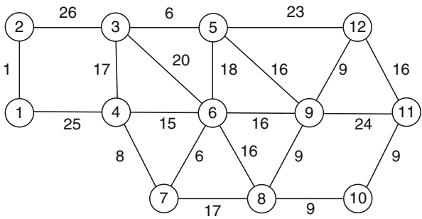

Fig. 3.1 4-Cardinality tree problem

The steps of BVNS for solving the 4-card problem are illustrated in Fig. 3.2. In Step 0 the objective function value, i.e., the sum of edge weights, is equal to 40; it is indicated in the right bottom corner of the figure. That first solution is a local minimum with respect to the edge-exchange neighborhood structure (one edge in, one out). After shaking, the objective function is 60, and after another local search, we are back to the same solution. Then, in Step 3, we take out 2 edges and add another 2 at random, and after a local search, an improved solution is obtained with a value of 39. Continuing in that way, the optimal solution with an objective function value equal to 36 is obtained in Step 8.

| LS0 40 | Shake-11 60 | LS2 40 |
| --- | --- | --- |
| Shake-23 47 | LS4 39 | Shake-15 49 |
| LS6 39 | Shake-27 43 | LS8 36 |

Fig. 3.2 Steps of the Basic VNS for solving 4-card tree problem

(iv) <strong><u>General VNS.</u></strong> Note that the local search step (line 6 in BVNS, Algorithm 7) may also be replaced by VND (Algorithm 2). This General VNS (VNS/VND) approach has led to some of the most successful applications reported in the literature (see, e.g., [1, 26–29, 31, 32, 39, 57, 66, 92, 93]). General VNS (GVNS) is outlined in Algorithm 8 below. Note that neighborhoods $N _ { 1 } , \ldots , N _ { l _ { m a x } }$ are used in the VND step, while a different series of neighborhoods $N _ { 1 } , \ldots , N _ { k _ { m a x } }$ apply to the Shake step.

<div class="docvortex-algorithm" style="white-space: pre-wrap; font-family:monospace;">
Function GVNS ($x, \ell_{max}, k_{max}, t_{max}$)
repeat
    $k \leftarrow 1$
    repeat
        $x' \leftarrow \text{Shake}(x, k)$
        $x'' \leftarrow \text{VND}(x', \ell_{max})$
        $x, k \leftarrow \text{NeighborhoodChange}(x, x'', k)$
    until $k = k_{max}$
    $t \leftarrow \text{CpuTime()}$
until $t &gt; t_{max}$
return $x$
</div>

**Algorithm 8**: General VNS

## 3.3 Some Extensions

(i) The <strong><u>Skewed VNS</u></strong> (SVNS) method [62] addresses the problem of exploring valleys far from the incumbent solution. Indeed, once the best solution in a large region has been found it is necessary to go quite far to obtain an improved one. Solutions drawn at random in far-away neighborhoods may differ substantially from the incumbent, and VNS may then degenerate, to some extent, into a Multistart heuristic (where descents are made iteratively from solutions generated at random, and which is known to be inefficient). So some compensation for distance from the incumbent must be made, and a scheme called Skewed VNS (SVNS) is proposed for that purpose. Its steps are presented in Algorithms 9, 10 and 11. The KeepBest $( x , x ^ { \prime } )$ function (Algorithm 9) in SVNS simply keeps the best of solutions x and $x ^ { \prime }$ The NeighborhoodChangeS function (Algorithm 10) performs the move and neighborhood change for the SVNS.

```javascript
Function KeepBest(x,x')
  if f(x') < f(x) then
    x ← x'
  return x
```

Algorithm 9: Keep best solution

```txt
Function NeighborhoodChangeS(x,x',k,α)
  if f(x') - αρ(x,x') < f(x) then
    | x ← x'; k ← 1
    else
      k ← k + 1
  return x,k
```

Algorithm 10: Neighborhood change for Skewed VNS

SVNS makes use of a function $\rho ( x , x ^ { \prime \prime } )$ to measure the distance between the current solution x and the local optimum $x ^ { \prime \prime } ,$ . The distance function used to define $\mathcal { N } _ { k }$ could also be used for this purpose. The parameter α must be chosen to allow movement to valleys far away from x when $f ( x ^ { \prime \prime } )$ is larger than $f ( x )$ but not too much larger (otherwise one will always leave x). A good value for α is found experimentally in each case. Moreover, in order to avoid frequent moves from x to a close solution, one may take a smaller value for $\alpha$ when $\rho ( x , x ^ { \prime \prime } )$ is small. More sophisticated choices for selecting a function of $\alpha \rho ( x , x ^ { \prime \prime } )$ could be made through some learning process.

<div class="docvortex-algorithm" style="white-space: pre-wrap; font-family:monospace;">
Function SVNS ($x, k_{max}, t_{max}, \alpha$)
$x_{best} \leftarrow x$
repeat
    $k \leftarrow 1$
    repeat
        $x' \leftarrow Shake(x, k)$
        $x'' \leftarrow FirstImprovement(x')$
        $x, k \leftarrow NeighborhoodChangeS(x, x'', k, \alpha)$
        $x_{best} \leftarrow KeepBest (x_{best}, x)$
    until $k = k_{max}$
    $x \leftarrow x_{best}$
    $t \leftarrow \text{CpuTime()}$
until $t &gt; t_{max}$
return $x$
</div>

Algorithm 11: Skewed VNS

(ii) The <strong><u>Variable neighborhood decomposition search</u></strong> (VNDS) method [63] extends the basic VNS into a two-level VNS scheme based upon decomposition of the problem. It is presented in Algorithm 12, where $t _ { d }$ is an additional parameter that represents the running time allowed for solving decomposed (smaller-sized) problems by Basic VNS (line 5).

<div class="docvortex-algorithm" style="white-space: pre-wrap; font-family:monospace;">
Function VNDS ($x, k_{max1}, t_{max}, t_d$)
repeat
    $k \leftarrow 1$
    repeat
        $x' \leftarrow$ Shake ($x, k$); $y \leftarrow x' \setminus x$
        $y' \leftarrow$ BVNS($y, k_{max2}, t_d$); $x'' = (x' \setminus y) \cup y'$
        $x''' \leftarrow$ FirstImprovement($x''$)
        $x, k \leftarrow$ NeighborhoodChange($x, x'''', k$)
    until $k = k_{max1}$
until $t &gt; t_{max}$
return $x$
</div>

Algorithm 12: Variable neighborhood decomposition search

For ease of presentation, but without loss of generality, we assume that the solution x represents a set of attributes. In Step 4 we denote by y a set of k solution attributes present in $x ^ { \prime }$ but not in x $( y = x ^ { \prime } \setminus x )$ . In Step 5 we find the local optimum $y ^ { \prime }$ in the space of y; then we denote with $x ^ { \prime \prime }$ the corresponding solution in the whole space X $( x ^ { \prime \prime }   =   ( x ^ { \prime }   \setminus   y )   \cup   y ^ { \prime } )$ . We notice that exploiting some boundary effects in a new solution can significantly improve solution quality. That is why, in Step 6, the local optimum $x ^ { m }$ is found in the whole space X using $x ^ { \prime \prime }$ as an initial solution. If this is time consuming, then at least a few local search iterations should be performed.

VNDS can be viewed as embedding the classical successive approximation scheme (which has been used in combinatorial optimization at least since the sixties, see, e.g., [48]) in the VNS framework. Let us mention here a few applications of VNDS: p-median problem [63]; simple plant location problem [67]; k-cardinality tree problem [100]; 0-1 mixed integer programming problem [51, 74]; design of MBA student teams [37], etc.

## 3.4 Changing Formulation Within VNS

A traditional approach to tackle an optimization problem is to consider a given formulation and search in some way through its feasible set X. Given that the same problem can often be formulated in different ways, it is possible to extend search paradigms to include jumps from one formulation to another. Each formulation should lend itself to some traditional search method, its ‘local search’ that works totally within this formulation, and yields a final solution when started from some initial solution. Any solution found in one formulation should easily be translatable to its equivalent solution in any other formulation. We may then move from one formulation to another by using the solution resulting from the local search of the former as an initial solution for the local search of the latter. Such a strategy will of course only be useful when local searches in different formulations behave differently. Here we discuss two such possibilities.

## 3.4.1 Variable Neighborhood-Based Formulation Space Search

The idea of changing the formulation of a problem was investigated in [82, 83] using an approach that systematically alternates between different formulations for solving various Circle Packing Problems (CPP). It is shown there that a stationary point for a nonlinear programming formulation of CPP in Cartesian coordinates is not necessarily a stationary point in polar coordinates. A method called Reformulation Descent (RD) that alternates between these two formulations until the final solution is stationary with respect to both formulations is suggested. Results obtained were comparable with the best known values, but were achieved about 150 times faster than with an alternative single formulation approach. In this paper, the idea suggested above of Formulation Space Search (FSS) is also introduced, using more than two formulations. Some research in that direction has also been reported in [70, 79, 90]. One methodology that uses the variable neighborhood idea when searching through the formulation space is given in Algorithms 13 and 14. Here $\phi$ $( \phi ^ { \prime } )$ denotes a formulation from a given space $\mathcal { F } ,   x   ( x ^ { \prime } )$ denotes a solution in the feasible set defined with that formulation, and $\ell \leq \ell _ { m a x }$ is the formulation neighborhood index. Note that Algorithm 14 uses a reduced VNS strategy in the formulation space $\mathcal { F }$ . Note also that the ShakeFormulation() function must provide a search through the solution space $\mathcal { S } ^ { \prime }$ (associated with formulation $\phi ^ { \prime } )$ in order to get a new solution $x ^ { \prime } .$ Any appropriate method can be used for this purpose.

```csv
Function FormulationChange(x,x',φ,φ',ℓ)
if f(φ',x') < f(φ,x) then
    φ ← φ'
    x ← x'
    ℓ ← 1
else
    ℓ ← ℓ + 1
return x,φ,ℓ
```

Algorithm 13: Formulation change

```txt
Function VNFSS(x, φ, ℓ_max)
repeat
    ℓ ← 1                      // Initialize formulation in ℤ
    while ℓ ≤ ℓ_max do
        x', φ', ℓ ← ShakeFormulation(x, x', φ, φ', ℓ) // (φ', x') ∈ (Nℓ(φ), ℼ(x)) random
        x, φ, ℓ ← FormulationChange(x, x', φ, φ', ℓ) // Change formulation
until some stopping condition is met
return x
```

Algorithm 14: Reduced variable neighborhood FSS

## 3.4.2 Variable Formulation Search

Many optimization problems in the literature, e.g., min-max problems, demonstrate a flat landscape. It means that, given a formulation of the problem, many neighbors of a solution have the same objective function value. When this happens, it is difficult to determine which neighborhood solution is more promising to continue the search. To address this drawback, the use of alternative formulations of the problem within VNS is proposed in [85, 86, 89]. In [89] it is named Variable Formulation Search (VFS). It combines a change of neighborhood within the VNS framework, with the use of alternative formulations.

Let us assume that, beside the original formulation and the corresponding objective function $f _ { 0 } ( x )$ , there are p other formulations denoted as $f _ { 1 } ( x ) , . . , f _ { p } ( x ) , x \in X$ Note that two formulations are defined as equivalent if the optimal solution of one is the optimal solution of the other, and vice versa. For simplification purposes, we will denote different formulations as different objectives $f _ { i } ( x ) , i = 1 , . . , p$ . The idea of VFS is to add the procedure Accept $( x , x ^ { \prime } , p )$ , given in Algorithm 15, in all three basic steps of BVNS: Shaking, LocalSearch and NeighborhoodChange. Clearly, if a better solution is not obtained by any of the $p + 1$ formulations, the move is rejected. The next iteration in the loop of Algorithm 15 will take place only if the objective function values according to all previous formulations are equal.

<div class="docvortex-algorithm" style="white-space: pre-wrap; font-family:monospace;">
Logical Function Accept $(x, x', p)$
for $i = 0$ to $p$ do
    if $(f_i(x') &lt; f_i(x))$ then return TRUE
    if $(f_i(x') &gt; f_i(x))$ then return FALSE
return FALSE
</div>

Algorithm 15: Accept procedure with $p$ secondary formulations

If Accept $( x , x ^ { \prime } , p )$ is included in the LocalSearch subroutine of BVNS, then it will not stop the first time a non improved solution is found. In order to stop LocalSearch and thus claim that $x ^ { \prime }$ is a local minimum, $x ^ { \prime }$ should not be improved by any among the $p$ different formulations. Thus, for any particular problem, one needs to design different formulations of the problem considered and decide the order in which they will be used in the Accept subroutine. Answers to those two questions are problem specific and sometimes not easy. The Accept $( x , x ^ { \prime } , p )$ subroutine can obviously be added to the NeighborhoodChange and Shaking steps of BVNS from Algorithm 7 as well.

In [85], three evaluation functions, or acceptance criteria, within the Neighborhood Change step are used in solving the Bandwidth Minimization Problem. This minmax problem consists of finding permutations of rows and columns of a given square matrix to minimize the maximal distance of the nonzero elements from the main diagonal in the corresponding rows. Solution x may be represented as a labeling of a graph and the move from x to $x ^ { \prime }$ as $x \to x ^ { \prime }$ . Three criteria are used:

1. the bandwidth length $f _ { 0 } ( x ) \; ( f _ { 0 } ( x ^ { \prime } ) < f _ { 0 } ( x ) ) ;$

2. the total number of critical vertices $f_{1}(x) \left( f_{1}(x') < f_{1}(x) \right), \mathrm{if} f_{0}(x') = f_{0}(x);$

3. $f _ { 3 } ( x , x ^ { \prime } ) = \rho ( x , x ^ { \prime } ) - \alpha$ , if $f _ { 0 } ( x ^ { \prime } ) = f _ { 0 } ( x )$ and $f _ { 1 } ( x ^ { \prime } ) = f _ { 1 } ( x )$ . Here, we want $f _ { 3 } ( x , x ^ { \prime } ) > 0 ,$ , because we assume that x and $x ^ { \prime }$ are sufficiently far from one another when $\rho \left( x ,   x ^ { \prime } \right) > \alpha$ , where α is an additional parameter. The idea for a move to an even worse solution, if it is very far, is used within Skewed VNS. However, a move to a solution with the same value is only performed in [85] if its Hamming distance from the incumbent is greater than α.

In [86] a different mathematical programming formulation of the original problem is used as a secondary objective within the Neighborhood Change function of VNS. There, two combinatorial optimization problems on a graph are considered: the Metric Dimension Problem and Minimal Doubly Resolving Set Problem.

A more general VFS approach is given in [89], where the Cutwidth Graph Minimization Problem (CWP) is considered. CWP also belongs to the min-max problem family. For a given graph, one needs to find a sequence of nodes such that the maximum cutwidth is minimum. The cutwidth of a graph should be clear from the example provided in Fig. 3.3 for the graph with six vertices and nine edges shown in (a).

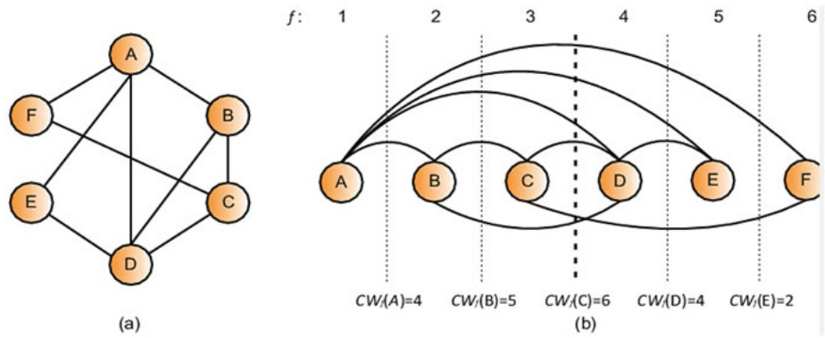

Fig. 3.3 Cutwidth minimization example as in [89]

Figure 3.3b shows an ordering x of the vertices of the graph in (a) with the corresponding cutwidth CW values of each vertex. It is clear that the CW represents the number of cut edges between two consecutive nodes in the solution x. The cutwidth value $f _ { 0 } ( x ) = C W ( x )$ of the ordering $\boldsymbol { x } = ( A ,   B ,   C ,   D ,   E ,   F )$ is equal to $f_{0}(x) = \max\{4,5,6,4,2\} = 6$ . Thus, one needs to find an order x that minimizes the maximum cut-width value over all vertices.

Beside minimizing the bandwidth $f _ { 0 } ,$ two additional formulations, denoted $f _ { 1 }$ and $f _ { 2 }$ , are used in [89], and implemented within a VND local search. Results are compared among themselves (Table 3.1) and with a few heuristics from the literature (Table 3.1), using the following usual data set:

$\text{" }Gr i d  \text{" }$ : This data set consists of 81 matrices constructed as the Cartesian product of two paths. They were originally introduced by Rolim et al. [94]. For this set of instances, the vertices are arranged on a grid of dimension width × height where width and height are selected from the set {3, 6, 9, 12, 15, 18, 21, 24, 27}.

“Harwell-Boeing” (HB): This data set is a subset of the public-domain Matrix Market library.<sup>1</sup> This collection consists of a set of standard test matrices $M = ( M _ { i j } )$ arising from problems in linear systems, least squares, and eigenvalue calculations from a wide variety of scientific and engineering disciplines. Graphs were derived from these matrices by considering an edge $( i , j )$ for every element $M _ { i j }   \neq   0$ . The data set is formed by the selection of the 87 instances were $n \leq 7 0 0$ . Their number of vertices ranges from 30 to 700 and the number of edges from 46 to 41,686.

<small><span class="docvortex-page-footnote" data-block-type="page_footnote" style="color:#6b7280">1 Available at [http://math.nist.gov/MatrixMarket/data/Harwell-Boeing/](http://math.nist.gov/MatrixMarket/data/Harwell-Boeing/).</span></small>

Table 3.1 presents the results obtained with four different VFS variants, after executing them for 30 s over each instance. The column ‘BVNS’ of Table 3.1 represents a heuristic based on BVNS which makes use only of the original formulation $f _ { 0 }$ of the CWP. $\mathrm { V F S _ { 1 } }$ denotes a BVNS heuristic that uses only one secondary criterion, $\mathbf { i . e . , } f _ { 0 }$ and $f _ { 1 } . \; \mathrm { V F S } _ { 2 }$ is equivalent to the previous one with the difference that now $f _ { 2 }$ is considered (instead of $f _ { 1 } )$ . Finally, the fourth column of the table, denoted as $\mathrm { V F S } _ { 3 }$ , combines the original formulation of the CWP with the two alternative ones, in the way presented in Algorithm 15. All algorithms were configured with $k _ { m a x } = 0 . 1 n$ and start from the same random solution.

Table 3.1 Comparison of alternative formulations within 30 s for each test, by average objective values and % deviation from the best known solution

|  | BVNS VFS<sub>1</sub> VFS<sub>2</sub> VFS<sub>3</sub> |
| --- | --- |
| Avg. Dev. (%) | 137.31 93.56 91.56 90.75192.44 60.40 49.23 48.22 |

Test are performed on “Grid” and “HB” data sets that contain 81 and 86 instances, respectively

It appears that significant improvements in solution quality are obtained when at least one secondary formulation is used in case of ties (compare e.g., 192.44% and 60.40% deviations from the best known solutions obtained by BVNS and $\mathrm { V F S _ { 1 } }$ respectively). An additional improvement is obtained when all three formulations are used in $\mathrm { V F S } _ { 3 }$

Comparison of $\mathrm { V F S } _ { 3 }$ and state-of-the-art heuristics are given in Table 3.2. There, the stopping condition is increased from 30 s to 300 and 600 s for the first and the second set of instances, respectively. Besides average values and $\%$ deviation, the methods are compared based on the number of wins (the third row) and the total cpu time in seconds. Overall, the best quality results are obtained by VFS in less computing time.

Table 3.2 Comparison of VFS with the state-of-the-art heuristics over the “Grid” and “HB” data sets, within 300 and 600 s respectively

<table><tbody><tr><td rowspan="2"></td><td colspan="4">81 'grid' test instances</td><td colspan="4">86 HB instances</td></tr><tr><td>GPR [2]</td><td>SA [34] S</td><td>S [88] V</td><td>FS [89]</td><td>GPR [2]</td><td>SA [34] S</td><td>S [88]</td><td>VFS [89]</td></tr><tr><td>Avg.</td><td>38.44</td><td>16.14</td><td>13.00</td><td>12.23</td><td>364.83</td><td>346.21</td><td>315.22</td><td>314.39</td></tr><tr><td>Dev. (%)</td><td>201.81</td><td>25.42</td><td>7.76</td><td>3.25</td><td>95.13</td><td>53.30</td><td>3.40</td><td>1.77</td></tr><tr><td>#Opt.</td><td>2</td><td>37</td><td>44</td><td>59</td><td>2</td><td>8</td><td>47</td><td>61</td></tr><tr><td>CPU t (s)</td><td>235.16</td><td>216.14</td><td>210.07</td><td>90.34</td><td>557.49</td><td>435.40</td><td>430.57</td><td>128.12</td></tr></tbody></table>

## 3.5 Primal-Dual VNS

For most modern heuristics, the difference in value between the optimal solution and the obtained approximate solution is not precisely known. Guaranteed performance of the primal heuristic may be determined if a lower bound on the objective function value can be found. To this end, the standard approach is to relax the integrality condition on the primal variables, based on a mathematical programming formulation of the problem. However, when the dimension of the problem is large, even the relaxed problem may be impossible to solve exactly by standard commercial solvers. Therefore, it seems to be a good idea to solve dual relaxed problems heuristically as well. In this way we get guaranteed bounds on the primal heuristic performance. The next difficulty arises if we want to get an exact solution within a branch-and-bound framework since having the approximate value of the relaxed dual does not allow us to branch in an easy way, for example by exploiting complementary slackness conditions. Thus, the exact value of the dual is necessary. A general approach to get both guaranteed bounds and an exact solution is proposed in [67], and referred as Primal-Dual VNS (PD-VNS). It is given in Algorithm 16.

Algorithm 16: Basic PD-VNS

In the first stage, a heuristic procedure based on VNS is used to obtain a near optimal solution. In [67] it is shown that VNS with decomposition is a very powerful technique for large-scale simple plant location problems (SPLP) with up to 15,000 facilities and 15,000 users. In the second phase, the objective is to find an exact solution of the relaxed dual problem. Solving the relaxed dual is accomplished in three stages: (1) find an initial dual solution (generally infeasible) using the primal heuristic solution and complementary slackness conditions; (2) find a feasible solution by applying VNS to the unconstrained nonlinear form of the dual; (3) solve the dual exactly starting with the found initial feasible solution using a customized “sliding simplex” algorithm that applies “windows” on the dual variables, thus substantially reducing the problem size. On all problems tested, including instances much larger than those previously reported in the literature, the procedure was able to find the exact dual solution in reasonable computing time. In the third and final phase, armed with tight upper and lower bounds obtained from the heuristic primal solution in phase one and the exact dual solution in phase two, respectively, a standard branchand-bound algorithm is applied to find an optimal solution of the original problem. The lower bounds are updated with the dual sliding simplex method and the upper bounds whenever new integer solutions are obtained at the nodes of the branching tree. In this way it was possible to solve exactly problem instances of sizes up to 7000 facilities ×7000 users, for uniform fixed costs, and 15, 000 facilities ×15, 000 users, otherwise.

## 3.6 VNS for Mixed Integer Linear Programming

The Mixed Integer Linear Programming (MILP) problem consists of maximizing or minimizing a linear function, subject to equality or inequality constraints and integrality restrictions on some of the variables. The mixed integer programming problem $( M I L P )$ can be expressed as:

$$
\left[ \begin{array}{c} \text {(MILP)} \end{array} \right] \quad \left[ \begin{array}{l l} \min & \sum_ {j = 1} ^ {n} c _ {j} x _ {j} \\ \text {s.t.} & \sum_ {j = 1} ^ {n} a _ {i j} x _ {j} \geq b _ {i} \quad \forall i \in M = \{1, 2, \dots , m \} \\ & x _ {j} \in \{0, 1 \} \quad \forall j \in \mathscr {B} \\ & x _ {j} \geq 0, \text {integer} \forall j \in \mathscr {G} \\ & x _ {j} \geq 0 \quad \forall j \in \mathscr {C} \end{array} \right]
$$

where the set of indices $N = \{ 1 , 2 , \ldots , n \}$ is partitioned into three subsets $\mathcal { B } , \mathcal { G }$ and $\mathcal { C } ,$ corresponding to binary, general integer and continuous variables, respectively.

Numerous combinatorial optimization problems, including a wide range of practical problems in business, engineering and science, can be modeled as MILPs. Several special cases, such as knapsack, set packing, cutting and packing, network design, protein alignment, traveling salesman and other routing problems, are known to be NP-hard [46].

Many commercial solvers such as CPLEX [71] are available for solving MILPs. Methods included in such software packages are usually of the branch-and-bound (B&B) or of branch-and-cut (B&C) types. Basically, those methods enumerate all possible integer values in some order, and prune the search space for the cases where such enumeration cannot improve the current best solution.

## 3.6.1 Variable Neighborhood Branching

The connection between local search based heuristics and exact solvers may be established by introducing the so called local branching constraints [43]. By adding just one constraint into (MILP), as explained below, the kth neighborhood of (MILP) is defined. This allows the use of all local search based metaheuristics, such as Tabu search, Simulating annealing, VNS etc. More precisely, given two solutions x and y of (MILP), the distance between x and y is defined as:

$$
\delta (x, y) = \sum_ {j \in \mathscr {B}} | x _ {j} - y _ {j} |.
$$

Let X be the solution space of (MILP). The neighborhood structures $\{ \mathcal { N } _ { k } \mid k =$ $\{ 1 , \ldots , k _ { m a x } \}$ can be defined, knowing the distance $\delta ( x , y )$ between any two solutions $x , y \in X$ . The set of all solutions in the kth neighborhood of $y \in X$ is denoted as $\mathcal { N } _ { k } ( y )$ where

$$
\mathcal {N} _ {k} (y) = \{x \in X \mid \delta (x, y) \leq k \}.
$$

For the pure 0-1 MILP given above (i.e., (MILP) with $\mathcal { G }   =   \emptyset ) ,   \delta ( . , . )$ represents the Hamming distance and $\mathcal { N } _ { k } ( y )$ may be expressed by the following local branching constraint

$$
\delta (x, y) = \sum_ {j \in S} (1 - x _ {j}) + \sum_ {j \in \mathscr {B} \backslash S} x _ {j} \leq k,\tag{3.2}
$$

where $S = \{ j \in \mathcal { B } \mid y _ { j } = 1 \}$

In [66] a general VNS procedure for solving 0-1 MILPs is presented (see Algorithm 17). An exact MILP solver (MIPSOLVE() within CPLEX) is used as a black box for finding the best solution in the neighborhood, based on the given formulation (MILP) plus the added local branching constraints. Shaking is performed using the Hamming distance defined above. A detailed description of this VNS branching method is provided in Algorithm 17. The variables and constants used in the algorithm are defined as follows [66]:

UB—input variable for the CPLEX solver which represents the current upper bound.

f irst—logical input variable for CPLEX solver which is true if the first solution lower than UB is asked for in the output; if $f i r s t = \mathtt { f a l s e }$ , CPLEX returns the best solution found so far.

• TL—maximum time allowed for running CPLEX.

rhs—right hand side of the local branching constraint; it defines the size of the neighborhood within the inner or VND loop.

cont—logical variable which indicates if the inner loop continues (true) or not (false).

$x \_ o p t$ and $f \_ o p t$ —incumbent solution and corresponding objective function value.

x\_cur, f \_cur, k\_cur—current solution, objective function value and neighborhood from where the VND local search starts (lines 6–20).

x\_next and f \_next—solution and corresponding objective function value obtained by CPLEX in the inner loop.

```autohotkey
Function VnsBra(total_time_limit, node_time_limit, k_step,
    x_opt)
TL := total_time_limit; UB := ∞; first := true
stat := MIPSOLVE(TL, UB, first, x_opt, f_opt)
x_cur:=x_opt; f_cur:=f_opt
while (elapsedtime < total_time_limit) do
    cont := true; rhs := 1; first := false
    while (cont or elapsedtime < total_time_limit) do
        TL = min(node_time_limit, total_time_limit-
        elapsedtime)
        add local br. constr. δ(x, x_cur) ≤ rhs; UB := f_cur
        stat := MIPSOLVE(TL, UB, first, x_next, f_next)
        switch stat do
            case "opt_sol_found":
                reverse last local br. const. into δ(x, x_cur) ≥ rhs + 1
                x_cur := x_next; f_cur := f_next; rhs := 1;
            case "feasible_sol_found":
                reverse last local br. constr. into δ(x, x_cur) ≥ 1
                x_cur := x_next; f_cur := f_next; rhs := 1;
            case "proven_infeasible":
                remove last local br. constr.; rhs := rhs + 1;
            case "no_feasible_sol_found":
                cont := false
    if f_cur < f_opt then
        x_opt := x_cur; f_opt := f_cur; k_cur := k_step;
    else
        k_cur := k_cur + k_step;
    remove all added constraints; cont := true
    while cont and (elapsedtime < total_time_limit) do
        add constraints k_cur ≤ δ(x, x_opt) and
        δ(x, x_opt) < k_cur + k_step
        TL := total_time_limit - elapsedtime; UB := ∞; first := true
        stat := MIPSOLVE(TL, UB, first, x_cur, f_cur)
        remove last two added constraints; cont = false
        if stat = "proven_infeasible" or
            "no_feasible_sol_found" then
                cont := true; k_cur := k_cur + k_step
```

Algorithm 17: VNS branching

In line 2, a commercial MIP solver is run to get an initial feasible solution, i.e., logical variable ‘first’ is set to value true. The outer loop starts from line 4. VND based local search is performed in the inner loop that starts from line 6 and finishes at line 24. There are four different outputs from subroutine MIPSOLVE provided by variable stat. They are coded in lines 11–20. The shaking step also uses the MIP solver. It is presented in the loop that starts at line 25.

## 3.6.2 VNDS Based Heuristics for MILP

It is well known that heuristics and relaxations are useful for providing upper and lower bounds on the optimal value of large and difficult optimization problems. A hybrid approach for solving 0-1 MILPs is presented in this section. A more detailed description may be found in [51]. It combines variable neighborhood decomposition search (VNDS) [63] and a generic MILP solver for upper bounding purposes, and a generic linear programming solver for lower bounding. VNDS is used to define a variable fixing scheme for generating a sequence of smaller subproblems, which are normally easier to solve than the original problem. Different heuristics are derived by choosing different strategies for updating lower and upper bounds, and thus defining different schemes for generating a series of subproblems. We also present in this section a two-level decomposition scheme, in which subproblems created according to the VNDS rules are further divided into smaller subproblems using another criterion, derived from the mathematical formulation of the problem.

## 3.6.2.1 VNDS for 0-1 MILPs with Pseudo-Cuts

Variable neighborhood decomposition search is a two-level variable neighborhood search scheme for solving optimization problems, based upon the decomposition of the problem (see Algorithm 12). We discuss here an algorithm which solves exactly a sequence of reduced problems obtained from a sequence of linear programming relaxations. The set of reduced problems for each LP relaxation is generated by fixing a certain number of variables according to VNDS rules. That way, two sequences of upper and lower bounds are generated, until an optimal solution of the problem is obtained. Also, after each reduced problem is solved, a pseudo-cut is added to guarantee that this subproblem is not revisited. Furthermore, whenever an improvement in the objective function value occurs, a local search procedure is applied in the whole solution space to attempt a further improvement (the so-called boundary effect within VNDS). This procedure is referred to as VNDS-PC, since it employs VNDS to solve 0-1 MILPs, while incorporating pseudo-cuts to reduce the search space [51].

If $J \subseteq { \mathcal { B } } ,$ , we define the partial distance between x and y, relative to $J ,$ as $\begin{array} { r } { \delta \big ( J ,   x ,   y \big ) = \sum _ { j \in J } |   x _ { j } - y _ { j }   | } \end{array}$ . Obviously we have $\delta ( \mathcal { B } ,   x ,   y ) = \delta ( x ,   y ) )$ . More generally, let ¯x be an optimal solution of $\operatorname { L P } ( P )$ , the LP relaxation of the problem P considered (not necessarily MIP feasible), and $J \subseteq B ( { \bar { x } } ) = \{ j \in N \mid { \bar { x } } _ { j } \in \{ 0 , 1 \} \}$ an arbitrary subset of indices. The partial distance $\delta ( J , x , { \overline { { x } } } )$ can be linearized as follows:

$$
\delta (J, x, \bar {x}) = \sum_ {j \in J} \left[ x _ {j} \left(1 - \bar {x} _ {j}\right) + \bar {x} _ {j} \left(1 - x _ {j}\right) \right].
$$

Let X be the solution space of problem P. The neighborhood structures $\{ \mathcal { N } _ { k } \mid k =$ $k _ { m i n } , \ldots , k _ { m a x } \} , 1 \leq k _ { m i n } \leq k _ { m a x } \leq p ,$ can be defined knowing the distance $\delta ( \mathcal { B } ,   x ,   y )$

between any two solutions $x , y \in X$ . The set of all solutions in the kth neighborhood of $x \in X$ is denoted as $\mathcal { N } _ { k } ( x )$ , where

$$
\mathcal {N} _ {k} (x) = \{y \in X \mid \delta (\mathscr {B}, x, y) \leq k \}.
$$

From the definition of $\mathcal { N } _ { k } ( x )$ , it follows that $\mathcal { N } _ { k } ( x ) \subset \mathcal { N } _ { k + 1 } ( x )$ , for any $k \in \{ k _ { m i n } , k _ { m i n } + 1 , \ldots , k _ { m a x } - 1 \}$ , since $\delta ( \mathcal { B } ,   x ,   y )   \leq   k$ implies $\delta ( \mathcal { B } , x , y )   \leq   k + 1$ It is trivial that, if we completely explore neighborhood $\mathcal { N } _ { k + 1 } ( x )$ , it is not necessary to explore neighborhood $\mathcal { N } _ { k } ( x )$

<strong><u>Ordering variables w.r.t LP–relaxation.</u></strong> The first variant of VNDS-PC, denoted as VNDS-PC1, is considered here for the maximization case. See Algorithm 18 for the pseudo-code of this algorithm which can be easily adjusted for minimization problems. Input parameters for the algorithm are an instance P of the 0-1 MIP problem, a parameter $d$ which defines the number of variables to be released in each iteration and an initial feasible solution $x ^ { * }$ of P. The algorithm returns the best solution found until the stopping criterion defined by the variable proceed1 is met.

<div class="docvortex-algorithm" style="white-space: pre-wrap; font-family:monospace;">
Function VNDS-PC1($P, d, x^*$)
Choose stopping criteria (set proceed1 = proceed2 = true)
Add objective cut: $LB = c^{\text{T}}x^*$; $P = (P \mid c^{\text{T}}x &gt; LB)$
while proceed1 do
    Find an optimal solution $\bar{x}$ of LP($P$)
    set $UB = c^{\text{T}}\bar{x}$
    if $B(\bar{x}) = \mathcal{B}$ then
        break
    Set $\delta_j = |x_j^* - \bar{x}_j|$, $j \in \mathcal{B}$
    Index $x_j$ so that $\delta_j \leq \delta_{j+1}$, $j = 1, \dots, p-1$, $p = |\mathcal{B}|$
    Set $q = |\{j \in \mathcal{B} \mid \delta_j \neq 0\}|$
    Set $k_{min} = p - q$, $k_{step} = \lfloor q/d \rfloor$, $k_{max} = p - k_{step}$, $k = k_{max}$
    while proceed2 and $k \geq 0$ do
        $J_k = \{1, \dots, k\}$; $x' = \text{MIPSOLVE}(P(x^*, J_k), x^*)$
        $P = (P \mid \delta(J_k, x^*, x) \geq 1)$
        if ($c^{\text{T}}x' &gt; c^{\text{T}}x^*$) then
            $x^* = \text{LocalSearch}(P, x')$; $LB = c^{\text{T}}x^*$
            Update objective cut: $P = (P \mid c^{\text{T}}x &gt; LB)$; break
        else
            if ($k - k_{step} &lt; k_{min}$) then
                $k_{step} = \max\{\lfloor k/2 \rfloor, 1\}$
                Set $k = k - k_{step}$
            Update proceed2
        Update proceed1
return $LB, UB, x^*$.
</div>

Algorithm 18: VNDS for MIPs with pseudo-cuts

This variant of VNDS-PC is based on the following choices. Variables are ordered according to their distances from the corresponding LP relaxation solution values (see lines 4, 6 and 7 in Algorithm 18). More precisely, we compute distances $\delta _ { j }   =   \mid   x _ { j }   -   \overline { { x } } _ { j }   \mid$ for $j \in \mathcal { B }$ , where $x _ { j }$ is a variable value of the current incumbent (feasible) solution and $\overline { { x } } _ { j }$ a variable value of the LP-relaxation. We then index variables $x _ { j } , j \in \mathcal { B }$ , so that $\delta _ { 1 } \leq \delta _ { 2 } \leq \ldots \leq \delta _ { p } , p = | \mathcal { B } |$ . Parameters $k _ { m i n } ,   k _ { s t e p }$ and $k _ { m a x }$ (see line 9 in Algorithm 18) are determined in the following way. Let $q$ be the number of binary variables which have different values in the LP relaxation solution and in the incumbent solution $( q = \mid \{ j \in \mathcal { B } \mid \delta _ { j } \neq 0 \} \mid )$ , and let $d$ be a given parameter (whose value is experimentally found) which controls the neighborhood size. Then we set $k_{min} = p - q, k_{step} = \left\lfloor q / d \right\rfloor$ and $k _ { m a x }   =   p   -   k _ { s t e p }$ We also allow the value of $k$ to be less then $k _ { m i n }$ (see lines 17 and 18 in Algorithm 18). In other words, we allow the variables which have the same integer value in the incumbent and LP-relaxation solutions to be freed anyway. When $k   <   k _ { m i n } ,   k _ { s t e p }$ is set to (approximately) half the number of the remaining fixed variables. Note that the maximum value of parameter k (which is $k _ { m a x } )$ indicates the maximum possible number of fixed variables, which implies the minimum number of free variables and therefore the minimum possible neighborhood size in the VNDS scheme.

If an improvement occurs after solving the subproblem $P ( x ^ { * } , J _ { k } )$ , where $x ^ { * }$ is the current incumbent solution (see line 12 in Algorithm 18), we perform a local search on the complete solution, starting from $x ^ { \prime }$ (see line 14 in Algorithm 18). The local search applied at this stage is the variable neighborhood descent for 0-1 MILPs, as described in [66]. Note that, in Algorithm 18 and in the pseudo-codes that follow, the statement $y = \mathtt { M I L P S O L V E } ( P , x )$ denotes a call to a generic MILP solver, for a given 0-1 MILP problem P, starting from a given solution x and returning a new solution y (if P is infeasible, then the value of y remains the same as the one before the call to the MILP solver).

In practice, when used as a heuristic with a time limit as the stopping criterion, VNDS-PC1 has a good performance. One can observe that, if pseudo-cuts (line 13 in Algorithm 18) and objective cuts (lines 2 and 16) are not added, the algorithm from [74] is obtained, which is a special case of VNDS-PC with a fixed LP relaxation reference solution.

## Ordering variables w.r.t. the minimum and maximum distances from the incumbent solution.

In the VNDS variant above, the variables in the incumbent integer solution are ordered according to the distances of their values to the values of the current linear relaxation solution. However, it is possible to employ different ordering strategies. For example, in the case of maximization of $c ^ { T } x ,$ consider the following two problems:

$$
(L P _ {x ^ {*}} ^ {-}) \left[ \begin{array}{c} \min \delta (x ^ {*}, x) \\ \text {s.t.:} A x \leq b \\ c ^ {\mathrm{T}} x \geq L B + 1 \\ x _ {j} \in [ 0, 1 ], j \in \mathcal {B} \\ x _ {j} \geq 0, j \in N \end{array} \quad (L P _ {x ^ {*}} ^ {+}) \left[ \begin{array}{c} \max \delta (x ^ {*}, x) \\ \text {s.t.:} A x \leq b \\ c ^ {\mathrm{T}} x \geq L B + 1 \\ x _ {j} \in [ 0, 1 ], j \in \mathcal {B} \\ x _ {j} \geq 0, j \in N \end{array} \right. \right.
$$

where $x ^ { * }$ is the best known integer feasible solution and LB is the best lower bound found so far $( \mathrm { i . e . , } ~ L B = c ^ { \mathrm { T } } x ^ { * } )$ . Of course, in case of solving min $c ^ { T } x ,$ the inequality $c ^ { T } x \geq L B + 1$ from models $( L P _ { x ^ { * } } ^ { - } )$ and $( L P _ { x ^ { * } } ^ { + } )$ , should be replaced with $c ^ { T } x   \leq   U B   -   1$ where the upper bound $U B = { \stackrel { \kappa } { = } } c ^ { T } x ^ { * }$ . If $x ^ { - }$ and $x ^ { + }$ are optimal solutions of the LP-relaxation problems $L P _ { x ^ { * } } ^ { - }$ and $L P _ { x ^ { * } } ^ { + }$ , respectively, then components of $x ^ { * }$ could be ordered in ascending order of values $| \overline { { x } } _ { j } ^ { - } - \overline { { x } } _ { j } ^ { + } | ,   j \in \mathcal { B }$ . Since both solution vectors $x ^ { - }$ and $\overline { { x } } ^ { + }$ are real-valued (i.e., from R<sup>n</sup>), this ordering technique is expected to be more sensitive than the standard one, i.e., the number of pairs $( j , j ^ { \prime } ) ,   j , j ^ { \prime } \in N , j \neq$ $j ^ { \prime }$ for which $| \overline { { x } } _ { j } ^ { - } - \overline { { x } } _ { j } ^ { + } | \neq | \overline { { x } } _ { j ^ { \prime } } ^ { - } - \overline { { x } } _ { j ^ { \prime } } ^ { + } |$ is expected to be greater than the number of pairs $(h,h'),h,h' \in \widetilde{N},h \neq h'$ for which $| x _ { h } ^ { * } - \bar { x } _ { h } | \neq | x _ { h ^ { \prime } } ^ { * } - \bar { x } _ { h ^ { \prime } } |$ , where x is an optimal solution of the LP relaxation $L P ( P )$

Also, according to the definition of $x ^ { - }$ and $x ^ { + }$ , it is intuitively more likely for the variables $x _ { j } ,   j \in N$ , for which $\overline { { x } } _ { j } ^ { - } = \overline { { x } } _ { j } ^ { + }$ , to have that same value $\overline { { x _ { j } } }$ in the final solution, than it is for variables $x _ { j } , \; j \in N ,$ , for which $x _ { j } ^ { * } = \bar { x } _ { j }$ (and $\overline { { x } } _ { j } ^ { - } \neq \overline { { x } } _ { j } ^ { + } )$ , to have the final value $x _ { j } ^ { * }$ . In practice, if $\bar { x } _ { j } ^ { - } = \bar { x } _ { j } ^ { + } ,   j \in N$ , then usually $x _ { j } ^ { * } = \overline { { x } } _ { j } ^ { - }$ , which justifies the ordering of components of $\dot { x } ^ { * }$ in the described way. However, if we want to keep the number of iterations in one pass of VNDS approximately the same as in the standard ordering, i.e., if we want to use the same value for parameter $d ,$ then the subproblems examined will be larger than with the standard ordering, since the value of $q$ will be smaller (see line 8 in Algorithm 19). The pseudo-code of this variant of VNDS-PC, denoted as VNDS-PC2, is provided in Algorithm 19.

## 3.6.2.2 A Double Decomposition Scheme

In this section we propose the use of a second level decomposition scheme within VNDS for the 0-1 MILP. The 0-1 MILP is tackled by decomposing the problem into several subproblems, where the number of binary variables with value 1 is fixed at a given integer value. Fixing the number of variables with value 1 to a given value $h \in \mathbb { N } \cup \{ 0 \}$ can be achieved by adding the constraint $x_{1} + x_{2} + \ldots + x_{p} = h$ or, equivalently, $e ^ { \mathrm { T } } x = h .$ , where $e$ is the vector of ones. Solving the 0-1 MILP by tackling separately each of the subproblems $P _ { h }$ for $h \in N$ appears to be an interesting approach for the case of the multidimensional knapsack problem [101], especially because the additional constraint $e ^ { \mathrm { T } } x = h$ provides tighter upper bounds than the classical LP-relaxation.

<div class="docvortex-algorithm" style="white-space: pre-wrap; font-family:monospace;">
Function VNDS-PC2($P, d, x^*$)
Choose stopping criteria (set proceed1=proceed2=true)
Add objective cut: $LB = c^{\text{T}}x^*$; $P = (P \mid c^{\text{T}}x &gt; LB)$
while proceed1 do
    Find an optimal solution $\bar{x}$ of LP($P$); set $UB = c^{\text{T}}\bar{x}$
    if $(B(\bar{x}) = \mathcal{B})$ then
        break
    Find optimal solutions $\bar{x}^{-}$ of $LP_{x^*}^{-}$ and $\bar{x}^{+}$ of $LP_{x^*}^{+}$
    $\delta_j = |\bar{x}_j^- - \bar{x}_j^+|$, $j = 1, ..., p$; index $x_j$ so that $\delta_j \leq \delta_{j+1}$, $j = 1, ..., p-1$
    Set $q = |\{j \in \mathcal{B} \mid \delta_j \neq 0\}|$, $k_{step} = \lfloor q/d \rfloor$, $k = p - k_{step}$
    while proceed2 and $k \geq 0$ do
        $J_k = \{1, ..., k\}$; $x' = \text{MIPSOLVE}(P(x^*, J_k), x^*)$;
        if $(c^{\text{T}}x' &gt; c^{\text{T}}x^*)$ then
            Update objective cut: $LB = c^{\text{T}}x'$; $P = (P \mid c^{\text{T}}x &gt; LB)$;
            $x^* = \text{LocalSearch}(P, x')$; $LB = c^{\text{T}}x^*$; break
        else
            if $(k - k_{step} &gt; p - q)$ then
                $k_{step} = \max\{\lfloor k/2 \rfloor, 1\}$
            Set $k = k - k_{step}$
        Update proceed2
    $x' = \text{MIPSOLVE}(P(\bar{x}, B(\bar{x})), x^*)$; $LB = \max\{LB, c^{\text{T}}x'\}$;
    Add pseudo-cut to $P: P = (P \mid \delta(B(\bar{x}), x, \bar{x}) \geq 1)$;
    $x' = \text{MIPSOLVE}(P(\bar{x}^-, B(\bar{x}^-)), x^*)$; $LB = \max\{LB, c^{\text{T}}x'\}$;
    Add pseudo-cut to $P: P = (P \mid \delta(B(\bar{x}^-), x, \bar{x}^-) \geq 1)$;
    $x' = \text{MIPSOLVE}(P(\bar{x}^+, B(\bar{x}^+)), x^*)$; $LB = \max\{LB, c^{\text{T}}x'\}$;
    Add pseudo-cut to $P: P = (P \mid \delta(B(\bar{x}^+), x, \bar{x}^+) \geq 1)$;
    Update proceed1;
return $LB, UB, x^*$.
</div>

Algorithm 19: VNDS for MIPs with pseudo-cuts and another ordering strategy

Formally, let $P _ { h }$ be the subproblem obtained from the original problem by adding the hyperplane constraint $e ^ { \mathrm { T } } x   =   h$ for $h \in N$ , and enriched by an objective cut:

$$
\begin{array}{l} \hline (P _ {h}) \left[ \begin{array}{c} \max c ^ {\mathrm{T}} x \\ \text {s.t.:} A x \leq b \\ c ^ {\mathrm{T}} x \geq L B + 1 \\ e ^ {\mathrm{T}} x = h \\ x \in \{0, 1 \} ^ {p} \times \mathbb {R} _ {+} ^ {n - p} \end{array} \right. \end{array}
$$

Let $\bar { h } _ { m i n } ^ { \quad - }$ and $h _ { m a x }$ denote lower and upper bounds on the number of variables with value 1 in an optimal solution of the problem. Then it is obvious that $\nu ( P ) =$ max $\{ \nu ( P _ { h } ) \mid h _ { m i n } \leq h \leq h _ { m a x } \}$ . Bounds $h _ { m i n } = \left\lceil \mathcal { V } ( L P _ { 0 } ^ { - } ) \right\rceil$ and $h _ { m a x } = \lfloor \nu ( L P _ { 0 } ^ { + } ) \rfloor$ can be computed by solving the following two problems:

$$
\left(L P _ {0} ^ {-}\right) \left[ \begin{array}{c} \min e ^ {\mathrm{T}} x \\ \text {s.t.:} A x \leq b \\ c ^ {\mathrm{T}} x \geq L B + 1 \\ x \in [ 0, 1 ] ^ {p} \times \mathbb {R} _ {+} ^ {n - p} \end{array} \quad \left(L P _ {0} ^ {+}\right) \left[ \begin{array}{c} \max e ^ {\mathrm{T}} x \\ \text {s.t.:} A x \leq b \\ c ^ {\mathrm{T}} x \geq L B + 1 \\ x \in [ 0, 1 ] ^ {p} \times \mathbb {R} _ {+} ^ {n - p} \end{array} \right. \right.
$$

We define the order of the hyperplanes at the beginning of the algorithm, and then we explore them one by one, in that order. The ordering can be done according to the objective values of the linear programming relaxations $\mathrm { L P } ( P _ { h } )$ $h \in H = \{ h _ { m i n } , \ldots , h _ { m a x } \}$ . In each hyperplane, VNDS-PC1 is applied and if there is no improvement, the next hyperplane is explored. We refer to this method as VNDDS (short for Variable Neighborhood Double Decomposition Search), which corresponds to the pseudo-code in Algorithm 20. This idea is inspired by the approach proposed in [91], where the ordering of the neighborhood structures in Variable Neighborhood Descent is determined dynamically, by solving relaxations of the problems. Problems differ in one constraint that defines the Hamming distance $h \left( h \in H = \{ h _ { m i n } , . . , h _ { m a x } \} \right)$

<div class="docvortex-algorithm" style="white-space: pre-wrap; font-family:monospace;">
Function VNDDS($P, x^*, d$)
    Solve the LP-relaxation problems $LP_0^-$ and $LP_0^+$;
        Set $h_{min} = \left\lceil v(LP_0^-)\right\rceil$ and $h_{max} = \left\lfloor v(LP_0^+)\right\rfloor$;
    Sort the set of subproblems $\{P_{h_{min}}, \ldots, P_{h_{max}}\}$ so that
        $v(LP(P_h)) \leq v(LP(P_{h+1})), h_{min} \leq h &lt; h_{max}$;
    Find initial integer feasible solution $x^*$;
    for ($h = h_{min}; h \leq h_{max}; h++$) do
        $x' = \text{VNDS-PC1}(P_h, d, x^*)$
        if ($c^{\text{T}}x' &gt; c^{\text{T}}x^*$) then
            $x^* = x'$
    return $x^*$.
</div>

Algorithm 20: Two levels of decomposition with hyperplanes ordering

It is important to note that the exact variant of VNDDS, i.e., without any limitations regarding the running time or the number of iterations, converges to an optimal solution in a finite number of steps [51].

## 3.6.2.3 Comparison

For comparison purposes, five algorithms are ranked according to their objective values for the MIP benchmark instances in MIPLIB [77] and the benchmark instances for the Maximum Knapsack Problem (MKP) in [21]. Tables 3.3 and 3.4 report the average differences between the ranks of every pair of algorithms for the MIPLIP and MKP test sets, respectively.

Table 3.3 Objective value average rank differences on the MIPLIB set

| ALGORITHM | CPLEX | VNDS-MIP | VNDS-PC1 | VNDS-PC2 | VNDDS |
| --- | --- | --- | --- | --- | --- |
| (average rank) | (2.14) | (1.95) | (2.64) | (3.64) | (4.64) |
| CPLEX (2.14) VNDS-MIP (1.95) | 0.00 -0.18 | 0.18 0.00 | -0.50 -0.68 | -1.50 -1.68 | -2.50 -2.68 |
| VNDS-PC1 (2.64) | 0.50 | 0.68 | 0.00 | -1.00 | -2.00 |
| VNDS-PC2 (3.64) | 1.50 | 1.68 | 1.00 | 0.00 | -1.00 |
| VNDDS (4.64) | 2.50 | 2.68 | 2.00 | 1.00 | 0.00 |

Table 3.4 Objective value average rank differences on the MKP set

| ALGORITHM | CPLEX | VNDS-MIP | VNDS-PC1 | VNDS-PC2 | VNDDS |
| --- | --- | --- | --- | --- | --- |
| (average rank) | (2.86) | (3.09) | (2.09) | (3.23) | (3.72) |
| CPLEX (2.86) VNDS-MIP (3.09) | 0.00 0.23 | -0.23 0.00 | 0.77 1.00 | -0.36 -0.14 | -0.86 -0.64 |
| VNDS-PC1 (2.09) | -0.77 | -1.00 | 0.00 | -1.14 | -1.64 |
| VNDS-PC2 (3.23) | 0.36 | 0.14 | 1.14 | 0.00 | -0.50 |
| VNDDS (3.72) | 0.86 | 0.64 | 1.64 | 0.50 | 0.00 |

It appears that VNDS-MIP outperforms the other four methods on MIPLIB instances, while for the MKP set, the best performance is obtained with the VNDS-PC1 heuristic.

## 3.7 Variable Neighborhood Search for Continuous Global Optimization

The general form of the continuous constrained nonlinear global optimization problem (GOP) is given as follows:

$$
\left| \begin{array}{c} (G O P) \end{array} \right. \quad \left[ \begin{array}{c c c} \min & f (x) \\ \text {s.t.} & g _ {i} (x) \leq 0 & \forall i \in \{1, 2, \dots , m \} \\ & h _ {i} (x) = 0 & \forall i \in \{1, 2, \dots , r \} \\ & a _ {j} \leq x _ {j} \leq b _ {j} & \forall j \in \{1, 2, \dots , n \} \end{array} \right|
$$

where $x \in R^{n}, f : R^{n} \rightarrow R, g_{i} : R^{n} \rightarrow R, i = 1,2,\ldots,m,$ and $h _ { i } : R ^ { n } \to R , i = 1 , 2 , \ldots , r ,$ are possibly nonlinear continuous functions, and $a , b   \in   R ^ { n }$ are the variable bounds. A box constraint GOP is defined when only the variable bound constraints are present in the model.

GOPs naturally arise in many applications, e.g. in advanced engineering design, data analysis, financial planning, risk management, scientific modeling, etc. Most cases of practical interest are characterized by multiple local optima and, therefore, a search effort of global scope is needed to find the globally optimal solution.

If the feasible set X is convex and objective function $f$ is convex, then (GOP) is relatively easy to solve, i.e., the Karush-Kuhn-Tucker conditions can be applied. However, if X is not a convex set or f is not a convex function, we can have many local optima and the problem may not be solved with classical techniques. For solving (GOP), VNS has been used in two different ways: (1) with neighborhoods induced by using a $\ell _ { p }$ norm; (2) without using a $\ell _ { p }$ norm.

(i) **VNS with** $\ell _ { p }$ <strong><u>norm neighborhoods</u></strong> [40, 75, 81, 84]. A natural approach in applying VNS for solving GOPs is to induce neighborhood structures $\mathcal { N } _ { k } ( x )$ from the $\ell _ { p }$ metric given as:

$$
\rho (x, y) = \left(\sum_ {i = 1} ^ {n} \left| x _ {i} - y _ {i} \right| ^ {p}\right) ^ {1 / p}, \quad p \in [ 1, \infty)\tag{3.3}
$$

and

$$
\rho (x, y) = \max _ {1 \leq i \leq n} | x _ {i} - y _ {i} |, \quad p \to \infty .\tag{3.4}
$$

The neighborhood $\mathcal { N } _ { k } ( x )$ denotes the set of solutions in the k-th neighborhood of x based on the metric $\rho$ . It is defined as

$$
\mathcal {N} _ {k} (x) = \{y \in X \mid \rho (x, y) \leq \rho_ {k} \},\tag{3.5}
$$

or

$$
\mathcal {N} _ {k} (x) = \{y \in X \mid \rho_ {k - 1} <   \rho (x, y) \leq \rho_ {k} \},\tag{3.6}
$$

where $\rho _ { k }$ , known as the radius of $\mathcal { N } _ { k } ( x )$ , is monotonically increasing with $k   ( k \geq 2 )$ ).

For solving box constraint GOPs, both [40] and [75] use the neighborhoods as defined in (3.6). The basic differences between the two algorithms reported there are as follows: (1) in the procedure suggested in [75] the $\ell _ { \infty }$ norm is used, while in [40] the choice of metric is either left to the analyst, or changed automatically in some predefined order; (2) the commercial solver SNOPT [47] is used as a local search procedure within VNS in [75], while in [40], the analyst may choose one out of six different convex minimizers. A VNS based heuristic for solving the generally constrained GOP is suggested in [84]. There, the problem is first transformed into a sequence of box constrained problems within the well known exterior point method:

$$
\min _ {a \leq x \leq b} F _ {\mu , q} (x) = f (x) + \frac {1}{\mu} \sum_ {i = 1} ^ {m} (\max \{0, g _ {i} (x) \}) ^ {q} + \sum_ {i = 1} ^ {r} | h _ {i} (x) | ^ {q},\tag{3.7}
$$

where $\mu$ and $q \geq 1$ are a positive penalty parameter and penalty exponent, respectively. Algorithm 21 outlines the steps for solving the box constraint subproblem as proposed in [84].

<div class="docvortex-algorithm" style="white-space: pre-wrap; font-family:monospace;">
Function Glob-VNS ($x^*, k_{max}, t_{max}$)
Select the set of neighborhood structures $\mathcal{N}_k, k = 1, \ldots, k_{\max}$
Select the array of random distributions types and an initial point $x^* \in X$
$x \leftarrow x^*, f^* \leftarrow f(x), t \leftarrow 0$
while $t &lt; t_{max}$ do
    $k \leftarrow 1$
    repeat
        for all distribution types do
            $y \leftarrow \text{Shake}(x^*, k) // \text{Get } y \in \mathcal{N}_k(x^*)$ at random
            $y' \leftarrow \text{BestImprovement}(y) // \text{Apply LS to obtain a local minimum } y'$
            if $f(y') &lt; f^*$ then
                $x^* \leftarrow y', f^* \leftarrow f(y'), \text{ go to line 5}$
            $k \leftarrow k + 1$
    until $k = k_{\max}$
    $t \leftarrow \text{CpuTime()}$
</div>

Algorithm 21: VNS using a $\ell _ { p }$ norm

The Glob-VNS procedure from Algorithm 21 contains the following parameters in addition to $k _ { m a x }$ and $t _ { m a x } \colon ( 1 )$ Values of radii $\rho _ { k } ,   k = 1 , \ldots , k _ { \operatorname* { m a x } }$ , which may be defined by the user or calculated automatically in the minimizing process; (2) Geometry of neighborhood structures $\mathcal { N } _ { k } ,$ , defined by the choice of metric. Usual choices are the $\ell _ { 1 } , \ell _ { 2 }$ , and $\ell _ { \infty }$ norms; (3) Distribution types used for obtaining random points $y$ from $\mathcal { N } _ { k }$ in the Shaking step. A uniform distribution in $\mathcal { N } _ { k }$ is the obvious choice, but other distributions may lead to much better performance on some problems. Different choices of neighborhood structures and random point distributions lead to different VNS-based heuristics.

(ii) **VNS without using** $\ell _ { p }$ **norm neighborhoods**. Two different neighborhoods, $N _ { 1 } ( x )$ and $N _ { 2 } ( x )$ , are used in the VNS based heuristic suggested in [99]. In $N _ { 1 } ( x )$ r (a parameter) random directions from the current point x are generated and a one dimensional search along each direction is performed. The best point (out of r) is selected as a new starting solution for the next iteration, if it is better than the current one. If not, as in VND, the search is continued within the next neighborhood $N _ { 2 } ( x )$ . The new point in $N _ { 2 } ( x )$ is obtained as follows. The current solution is moved for each $x _ { j }   ( j = 1 , \ldots , n )$ by a value $\varDelta _ { j } ,$ , taken at random from the interval $( - \alpha , \alpha )$ $x_{j}^{(new)} = x_{j} + \Delta_{j}   or   x_{j}^{(new)} = x_{j} - \Delta_{j}$ . Points obtained by the plus or minus sign for each variable define the neighborhood $N _ { 2 } ( x )$ . If a relative increase of 1% in the value of $x _ { j } ^ { ( n e w ) }$ produces a better solution than $x ^ { ( n e w ) }$ , the + sign is chosen; otherwise the − sign is chosen.

Neighborhoods $N _ { 1 } ( x )$ and $N _ { 2 } ( x )$ are used for designing two algorithms. The first, called VND, iterates over these neighborhoods until there is no improvement in the solution value. In the second variant, a local search is performed with $N _ { 2 }$ and $k _ { m a x }$ is set to 2 for the shaking step.

It is interesting to note that computational results reported by all VNS based heuristics were very promising. They usually outperformed other recent approaches from the literature.

## 3.8 Variable Neighborhood Programming (VNP): VNS for Automatic Programming

Building an intelligent machine is an old dream that, thanks to computers, begins to take shape. Automatic programming is an efficient technique that has led to important developments in the field of artificial intelligence. Genetic programming (GP) [73], inspired by the genetic algorithm (GA), is among the few evolutionary algorithms used to evolve a population of programs. The main difference between GP and GA is the representation of a solution. An individual in GA can be a string, while in GP, the individuals are programs. A tree is the usual way to represent a program in GP. For example, assume that the current solution of a problem is the following function:

$$
f (x _ {1}, \dots , x _ {5}) = \frac {x _ {1}}{x _ {2} + x _ {3}} + x _ {4} - x _ {5}.
$$

Then the code (tree) that calculates $f$ using GP may be represented as in Fig. 3.4a.

Elleuch et al. [41, 42] recently adapted VNS rules for solving automatic programming problems. They first suggested an extended solution representation by adding coefficients to variables. Each terminal node was attached to its own parameter value. These parameters give a weight for each terminal node, with values from the interval [0, 1]. This type of representation allows VNP to examine parameter values and the tree structure in the same iteration, increasing the probability for finding a good solution faster. Let $G   =   \{ \alpha _ { 1 } , \alpha _ { 2 } , \ldots , \alpha _ { n } \}$ denote a parameter set. In Fig. 3.4b an example of a solution representation in VNP is illustrated.

<strong><u>(i) Neighborhood structures</u></strong>. Nine different neighborhood structures are proposed in [42] based on a tree representation. To save space, we will just mention some of them:

$N _ { 1 } ( T )$ —**Changing a node value operator.** This neighborhood preserves the tree structure and changes only the values of a functional or a terminal node. Each node has a set of allowed values from which one can be chosen. Let $x _ { i }$ be the current solution; then a neighbor $x _ { i + 1 }$ differs from $x _ { i }$ by just a single node. A move within this neighborhood is shown in Fig. 3.5.

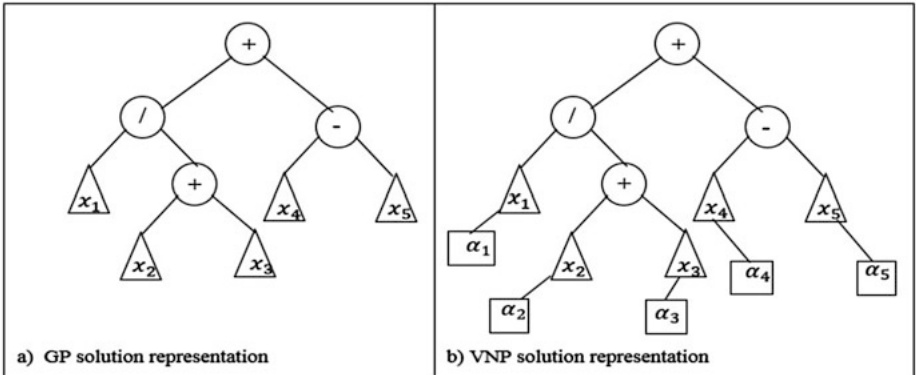

Fig. 3.4 Current solution representation in automatic programming problem: (a) $\frac{x_{1}}{x_{2}+x_{3}}+x_{4}-x_{5};$ (b) $\frac{\alpha_{1}x_{1}}{\alpha_{2}x_{2}+\alpha_{3}x_{3}}+\alpha_{4}x_{4}-\alpha_{5}x_{5}$

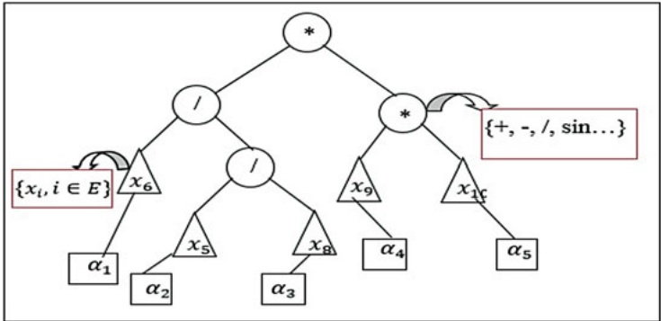

Fig. 3.5 Neighborhood $N _ { 1 }$ : changing a node value

$N _ { 2 } ( T )$ -Swap operator. Here, a subtree from the current tree is randomly selected and a new random subtree is generated as shown in Fig. 3.6a1 and $\mathtt { a } 2 .$ Then the new subtree replaces the current one (see Fig. 3.6b). In this move, any constraint related to the maximum tree size should be respected.

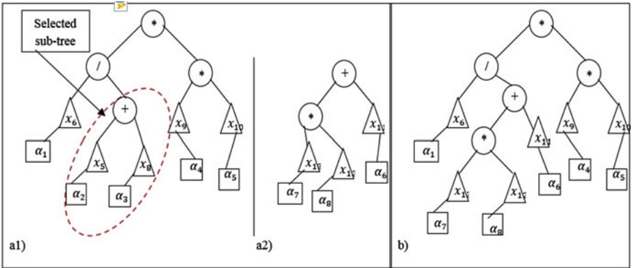

Fig. 3.6 Neighborhood $N_{2};$ swap operator. (a1) The current solution. (a2) New generated subtree. (b) The new solution

$N _ { 3 } ( T )$ **Changing parameter values.** In the two previous neighborhoods, the tree structure and the node values were considered. In the $N _ { 3 } ( T )$ neighborhood, attention is paid to the parameters. So, the position and value of nodes are kept in order to search the neighbors in the parameter space. Figure 3.7 illustrates the procedure where the change from one value to another is performed at random.

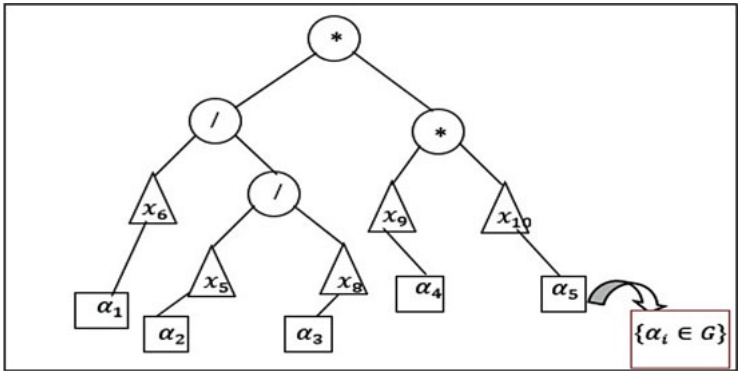

Fig. 3.7 Neighborhood $N _ { 3 }$ : change parameters

These neighborhoods may be used in both the local search step $( N _ { \ell } , \ell \in [ 1 , \ell _ { m a x } ] )$ and in the shaking step $( \mathcal { N } _ { k } , k \in [ 1 , k _ { m a x } ] )$ of the VNP.

<strong><u>(ii) VNP shaking.</u></strong> The shaking step allows diversification in the search space. The proposed VNP algorithm does not use exactly the same neighborhood structures $N _ { \ell }$ than the local search. Thus, we denote the neighborhoods used in the shaking phase as $\mathcal { N } _ { k } ( T ) , k = 1 , \ldots , k _ { m a x } . \mathcal { N } _ { k } ( T )$ may be constructed by repeating k times one or more moves from the set $\{ N _ { \ell } ( T ) , | \ell = 1 , \ldots , \ell _ { m a x } \}$ . Consider, for example, the swap operator $N _ { 2 } ( T )$ . Let m denote the maximum number of nodes in the tree representation of the solution. We can get a solution from the kth neighborhood of $T$ using the swap operator, where k represents the number of nodes of the new generated sub-tree. If n denotes the number of nodes in the original tree after deleting the old sub-tree, than $n + k \leq m$ . The objective of the shaking phase is to provide a good starting point for the local search.

<strong><u>(iii) VNP objective function</u></strong><u>.</u> The evaluation consists of defining a fitness (or objective) function to assess a solution. This function depends on the problem considered. After running each solution (program) on a training data set, the fitness may be measured by counting the training cases where the returned solution is correct or close to the exact solution.

<strong><u>(iv) An example: Time series forecasting (TSF) problem.</u></strong> Two widely used benchmark data sets of the TSF problem are considered in [42] to study the VNP capabilities: the Mackey-Glass series and the Box-Jenkins set. The parameters for the VNP implementation that were chosen after some preliminary testing are given in Table 3.5.

Table 3.5 VNP parameters adjustment for the forecasting problem

| Parameters | Values |
| --- | --- |
| The functional set | $F = \{+,*,,pow\}$ |
| The terminal sets | $\{(x_i, c), i \in [1, \dots, m], m = \text{number of inputs}, c \in R\}$ |
| Neighborhood structures | $\{N_1, N_2, N_3\}$ |
| Minimum tree length | 20 nodes |
| Maximum tree length | 200 nodes |
| Maximum number of iterations | 50,000 |

The root mean square error (RMSE) is used as the fitness function, as it is normally done in the literature:

$$
f (T) = \sqrt {\frac {1}{n} \sum_ {j = 1} ^ {n} (y _ {t} ^ {j} - y _ {o u t} ^ {j}) ^ {2}}
$$

where n is the total number of samples, and $y _ { o u t } ^ { j }$ and $y _ { t } ^ { j }$ are the output of the VNP model and the desired output for sample $j ,$ respectively. Next we illustrate with a comparison on a single Box-Jenkins instance.

The gas furnace data for this instance were collected from a combustion process of a methane air mixture [20]. This time series has found a widespread application as a benchmark example for testing prediction algorithms. The data set contains 296 pairs of input-output values. The input $u ( t )$ corresponds to the gas flow, and the output $y ( t )$ is the $\mathrm { C O } _ { 2 }$ concentration in the outlet gas. The inputs are $u ( t - 4 )$ , and $y ( t - 1 )$ , and the output is $y ( t )$ . In this work, 200 samples are used in the training phase and the remaining samples are used for the testing phase. The performance of the evolved VNP model is evaluated by comparing it with existing approaches.

The RMSE achieved by the VNP output model is (**0.00038**), which is better than the RMSE obtained by other approaches, as shown in Table 3.6.

Table 3.6 Comparison of testing error on Box-Jenkins dataset

| Method | Prediction error RMSE |
| --- | --- |
| ODE [98] | 0.5132 |
| HHMDDE [38] | 0.3745 |
| FBBFNT [24] | 0.0047 |
| VNP [42] | 0.0038 |

## 3.9 Discovery Science

In all the above applications, VNS is used as an optimization tool. It can also lead to results in “discovery science”, i.e., for the development of new theories. This has been done for graph theory in a long series of papers with the common title “Variable neighborhood search for extremal graphs” that report on the development and applications of the AutoGraphiX (AGX) system [10, 28, 29]. This system addresses the following problems:

• Find a graph satisfying given constraints.

• Find optimal or near optimal graphs for an invariant subject to constraints.

• Refute a conjecture.

Suggest a conjecture (or repair or sharpen one).

• Provide a proof (in simple cases) or suggest an idea of proof.

A basic idea then is to address all of these problems as parametric combinatorial optimization problems on the infinite set of all graphs (or in practice some smaller subset) using a generic heuristic to explore the solution space. This is being accomplished using VNS to find extremal graphs with a given number n of vertices (and possibly also a given number of edges). Extremal graphs may be viewed as a family of graphs that maximize some invariant such as the independence number or chromatic number, possibly subject to constraints. We may also be interested in finding lower and upper bounds on some invariant for a given family of graphs. Once an extremal graph is obtained, VND with many neighborhoods may be used to build other such graphs. Those neighborhoods are defined by modifications of the graphs such as the removal or addition of an edge, rotation of an edge, and so forth. Once a set of extremal graphs, parameterized by their order, is found, their properties are explored with various data mining techniques, leading to conjectures, refutations and simple proofs or ideas of proof.

More recent applications include [31, 32, 45, 50, 55] in chemistry, [8, 29] for finding conjectures, [16, 35] for largest eigenvalues, [23, 56, 64] for extremal values in graphs, independence [17, 18], specialty indexes [11, 15, 19, 61] and others [13, 60, 95, 96]. See [9] for a survey with many further references.

The current list of references in the series “VNS for extremal graphs” corresponds to [3, 8, 10–19, 23, 28, 29, 31, 32, 35, 45, 50, 55, 56, 60, 61, 64, 95, 96]. Another list of papers, not included in this series, is [4–7, 9, 30, 33, 49, 52–54, 65, 97]. Papers in these two lists cover a variety of topics:

1. <strong><u>Principles of the approach</u></strong> [28, 29] and its implementation [10];

2. <strong><u>Applications to spectral graph theory</u></strong>, e.g., bounds on the index for various families of graphs, graphs maximizing the index subject to some conditions [16, 19, 23, 35, 65];

3. <strong><u>Studies of classical graph parameters</u></strong>, e.g., independence, chromatic number, clique number, average distance [3, 9, 12, 17, 18, 95, 96];

4. <strong><u>Studies of little known or new parameters of graphs</u></strong>, e.g., irregularity, proximity and remoteness [4, 56];

5. <strong><u>New families of graphs discovered by AGX</u></strong>, e.g., bags, which are obtained from complete graphs by replacing an edge by a path, and bugs, which are obtained by cutting the paths of a bag [14, 60];

6. <strong><u>Applications to mathematical chemistry</u></strong>, e.g., study of chemical graph energy, and of the Randic index [ ´ 11, 15, 32, 45, 49, 50, 52, 53, 55];

7. <strong><u>Results of a systematic study of 20 graph invariants</u></strong>, which led to almost 1500 new conjectures, more than half of which were proved by AGX and over 300 by various mathematicians [13];

8. <strong><u>Refutation or strengthening of conjectures from the literature</u></strong> [8, 30, 53];

9. <strong><u>Surveys and discussions about various discovery systems in graph theory</u></strong>, assessment of the state-of-the-art and the forms of interesting conjectures together with proposals for the design of more powerful systems [33, 54].

## 3.10 Conclusions

The general schemes of variable neighborhood search have been presented and discussed. In order to evaluate research development related to VNS, one needs a list of the desirable properties of metaheuristics.

1. Simplicity: the metaheuristic should be based on a simple and clear principle, which should be widely applicable;

2. Precision: the steps of the metaheuristic should be formulated in pre-cise mathematical terms, independent of possible physical or biological analogies which may have been the initial source of inspiration;

3. Coherence: all steps of heuristics developed for solving a particular problem should follow naturally from the metaheuristic principles;

4. Effectiveness: heuristics for particular problems should provide optimal or near-optimal solutions for all known or at least the most realistic instances. Preferably, they should find optimal solutions for most benchmark problems for which such solutions are known;

5. Efficiency: heuristics for particular problems should take a moderate computing time to provide optimal or near-optimal solutions, or comparable or better solutions than the state-of-the-art;

6. Robustness: the performance of the metaheuristic should be consistent over a variety of instances, i.e., not merely fine-tuned to some training set and not so good elsewhere;

7. User-friendliness: the metaheuristic should be clearly expressed, easy to understand and, most importantly, easy to use. This implies it should have as few parameters as possible, ideally none;

8. Innovation: the principle of the metaheuristic and/or the efficiency and effectiveness of the heuristics derived from it should lead to new types of application.

9. Generality: the metaheuristic should lead to good results for a wide variety of problems;

10. Interactivity: the metaheuristic should allow the user to incorporate his knowledge to improve the resolution process;

11. Multiplicity: the metaheuristic should be able to produce several near optimal solutions from which the user can choose.

We have tried to show here that VNS possesses to a great extent, all of the above properties. This framework has led to heuristics which are among the very best ones for many problems. Interest in VNS is growing quickly. This is evidenced by the increasing number of papers published each year on this topic. 20 years ago, only a few; 15 years ago, about a dozen; 10 years ago, about 50, and more than 250 papers in 2016.

Figure 3.8 shows the parallel increase of the number of papers on VNS and on the other best known metaheuristics. Data are obtained by using the Scopus search tool, looking for the terms “Variable Neighborhood Search” (VNS) and “Metaheuristics” (MH). Figure 3.8 shows the number of times the terms appeared in the abstract of papers in this database. The years used are from 2000 to 2017 but in 2017 only the first 6 months (from January to June) are included. For comparison purposes, the number of papers with MH is divided by 4.

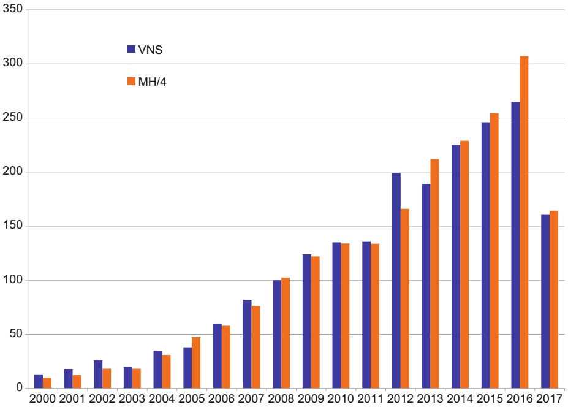

Fig. 3.8 VNS versus MH

Figure 3.9 shows the parallel increase of number of papers on VNS and on other most known Metaheuristics. Data are collected again from the Scopus search tool to look for the terms Variable Neighborhood Search (VNS), Tabu Search (TS), Genetic Algorithms (GA) and Simulated Annealing (SA). For better illustration, the number of appearances of TS, GA and SA are divided by 3, 50 and 10, respectively.

From the last figure, one can easily see that the relative increase in the number of papers with VNS is larger than the one of other major metaheuristics, especially in the last 5 years.

In addition, the 18th EURO Mini conference held in Tenerife in November 2005 was entirely devoted to VNS. It led to special issues of the IMA Journal of Management Mathematics in 2007 [76], European Journal of Operational Research [68] and Journal of Heuristics [87] in 2008. After that, VNS conferences took place in Herceg Novi—Montenegro (2012), Djerba—Tunis (2014), Málaga—Spain (2016) and in Ouro Preto—Brazil (2017). Each meeting was covered with beforeconference Proceedings (in Electronic notes of Discrete Mathematics) and with at least one post-conference special issue in leading OR journals: Computers and OR, Journal of Global Optimization, IMA JMM, International Transactions of OR.

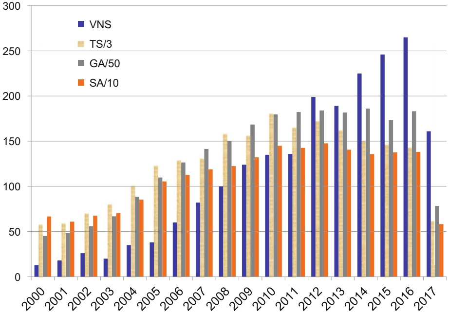

Fig. 3.9 VNS versus other main MHs

**Acknowledgements** The work of Nenad Mladenovic was conducted at the National Research ´ University Higher School of Economics, Nizhni Novgorod, Russia, and supported by RSF grant 14-41-00039. The fourth author is partially funded by Ministerio de Economía y Competitividad (Spanish Government) with FEDER funds, grant TIN2015-70226-R, and by Fundación Cajacanarias, grant 2016TUR19.

## References

1. D.J. Aloise, D. Aloise, C.T.M. Rocha, C.C. Ribeiro, J.C. Ribeiro, L.S.S. Moura, Scheduling work-over rigs for onshore oil production. Discrete Appl. Math. 154, 695–702 (2006)

2. D.V. Andrade, M.G.C. Resende, GRASP with path-relinking for network migration scheduling, in Proceedings of International Network Optimization Conference (INOC) (2007)

3. M. Aouchiche, P. Hansen, Recherche à voisinage variable de graphes extrèmes 13. À propos de la maille (French). RAIRO Oper. Res. 39, 275–293 (2005)

4. M. Aouchiche, P. Hansen, Automated results and conjectures on average distance in graphs, in Graph Theory in Paris, ed. by A. Bondy, J. Fonlupt, J.L. Fouquet, J.C. Fournier, J.L. Ramírez Alfonsn. Trends in Mathematics (Birkhäuser, Basel, 2006), pp. 21–36 ´

5. M. Aouchiche, P. Hansen, On a conjecture about the Randic index. Discrete Math. 307, 262–265 (2007)

6. M. Aouchiche, P. Hansen, Bounding average distance using minimum degree. Graph Theory Notes N. Y. 56, 21–29 (2009)

7. M. Aouchiche, P. Hansen, Nordhaus-Gaddum relations for proximity and remoteness in graphs. Comput. Math. Appl. 59, 2827–2835 (2010)

8. M. Aouchiche, G. Caporossi, D. Cvetkovic, Variable neighborhood search for extremal ´ graphs 8. Variations on Graffiti 105. Congressus Numerantium 148, 129–144 (2001)

9. M. Aouchiche, G. Caporossi, P. Hansen, M. Laffay, AutoGraphiX: a survey. Electron Notes Discrete Math. 22, 515–520 (2005)

10. M. Aouchiche, J.M. Bonnefoy, A. Fidahoussen, G. Caporossi, P. Hansen, L. Hiesse, J. Lacheré, A. Monhait, Variable neighborhood search for extremal graphs 14. The Auto-GraphiX 2 system, in Global Optimization: From Theory to Implementation, ed. by L. Liberti, N. Maculan (Springer, Berlin, 2005), pp. 281–309

11. M. Aouchiche, P. Hansen, M. Zheng, Variable neighborhood search for extremal graphs 18. Conjectures and results about the Randic index. MATCH. Commun. Math. Comput. Chem. 56, 541–550 (2006)

12. M. Aouchiche, O. Favaron, P. Hansen, Recherche à voisinage variable de graphes extrèmes 26. Nouveaux résultats sur la maille (French). Les Cahiers du GERAD, G-2007-55, 2007

13. M. Aouchiche, G. Caporossi, P. Hansen, Variable Neighborhood search for extremal graphs 20. Automated comparison of graph invariants. MATCH. Commun. Math. Comput. Chem. 58, 365–384 (2007)

14. M. Aouchiche, G. Caporossi, P. Hansen, Variable neighborhood search for extremal graphs 27. Families of extremal graphs. Les Cahiers du GERAD, G-2007-87, 2007

15. M. Aouchiche, P. Hansen, M. Zheng, Variable neighborhood search for extremal graphs 19. Further conjectures and results about the Randic index. MATCH. Commun. Math. Comput. Chem. 58, 83–102 (2007)

16. M. Aouchiche, F.K. Bell, D. Cvetkovic, P. Hansen, P. Rowlinson, S.K. Simi ´ c, D. Stevanovi ´ c,´ Variable neighborhood search for extremal graphs 16. Some conjectures related to the largest eigenvalue of a graph. Eur. J. Oper. Res. 191, 661–676 (2008)

17. M. Aouchiche, G. Brinkmann, P. Hansen, Variable neighborhood search for extremal graphs 21. Conjectures and results about the independence number. Discrete Appl. Math. 156, 2530–2542 (2009)

18. M. Aouchiche, O. Favaron, P. Hansen, Variable neighborhood search for extremal graphs 22. Extending bounds for independence to upper irredundance. Discrete Appl. Math. 157, 3497–3510 (2009)

19. M. Aouchiche, P. Hansen, D. Stevanovic, Variable neighborhood search for extremal graphs ´ 17. Further conjectures and results about the index. Discussiones Mathematicae: Graph Theory 29, 15–37 (2009)

20. C. Audet, V. Bachard, S. Le Digabel, Nonsmooth optimization through mesh adaptive direct search and variable neighborhood search. J. Glob. Optim. 41, 299–318 (2008)

21. J. Beasley, OR-Library: distributing test problems by electronic mail. J. Oper. Res. Soc. 41(11), 1069–1072 (1990)

22. N. Belacel, P. Hansen, N. Mladenovic, Fuzzy J-means: a new heuristic for fuzzy clustering. ´ Pattern Recognit. 35, 2193–2200 (2002)

23. S. Belhaiza, de, N. Abreu, HanP. sen, C. Oliveira, Variable neighborhood search for extremal graphs 11. Bounds on algebraic connectivity, in Graph Theory and Combinatorial Optimization, ed. by D. Avis, A. Hertz, O. Marcotte (2007), pp. 1–16

24. S. Bouaziz, H. Dhahri, A.M. Alimi, A. Abraham, A hybrid learning algorithm for evolving flexible beta basis function neural tree model. Neurocomputing 117, 107–117 (2013)

25. J. Brimberg, N. Mladenovic, A variable neighborhood algorithm for solving the continuous ´ location-allocation problem. Stud. Locat. Anal. 10, 1–12 (1996)

26. J. Brimberg, P. Hansen, N. Mladenovic, É. Taillard, Improvements and comparison of heuris- ´ tics for solving the multisource Weber problem. Oper. Res. 48, 444–460 (2000)

27. S. Canuto, M. Resende, C. Ribeiro, Local search with perturbations for the prize-collecting Steiner tree problem in graphs. Networks 31, 201–206 (2001)

28. G. Caporossi, P. Hansen, Variable neighborhood search for extremal graphs 1. The Auto-GraphiX system. Discrete Math. 212, 29–44 (2000)

29. G. Caporossi, P. Hansen, Variable neighborhood search for extremal graphs 5. Three ways to automate finding conjectures. Discrete Math. 276, 81–94 (2004)

30. G. Caporossi, A.A. Dobrynin, I. Gutman, P. Hansen, Trees with palindromic Hosoya polynomials. Graph Theory Notes N. Y. 37, 10–16 (1999)

31. G. Caporossi, D. Cvetkovic, I. Gutman, P. Hansen, Variable neighborhood search for extremal ´ graphs 2. Finding graphs with extremal energy. J. Chem. Inform. Comput. Sci. 39, 984–996 (1999)

32. G. Caporossi, I. Gutman, P. Hansen, Variable neighborhood search for extremal graphs 4. Chemical trees with extremal connectivity index. Comput. Chem. 23, 469–477 (1999)

33. G. Caporossi, I. Gutman, P. Hansen, L. Pavlovic, Graphs with maximum connectivity index. ´ Comput. Biol. Chem. 27, 85–90 (2003)

34. J. Cohoon, S. Sahni, Heuristics for backplane ordering. J. VLSI Comput. Syst. 2, 37–61 (1987)

35. D. Cvetkovic, S. Simic, G. Caporossi, P. Hansen, Variable neighborhood search for extremal graphs 3. On the largest eigenvalue of color-constrained trees. Linear Multilinear Algebra 49, 143–160 (2001)

36. W.C. Davidon, Variable metric algorithm for minimization. Argonne National Laboratory Report ANL-5990 (1959)

37. J. Desrosiers, N. Mladenovic, D. Villeneuve, Design of balanced MBA student teams. J. Oper. ´ Res. Soc. 56, 60–66 (2005)

38. H. Dhahri, A.M. Alimi, A. Abraham, Hierarchical multi-dimensional differential evolution for the design of beta basis function neural network. Neurocomputing 97, 131–140 (2012)

39. A. Djenic, N. Radojicic, M. Maric, N. Mladenovic, Parallel VNS for bus terminal location ´ problem. Appl. Soft Comput. 42, 448–458 (2016)

40. M. Dražic, V. Kovacevic-Vujci ´ c, M. Cangalovi ´ c, N. Mladenovi ´ c, GLOB - a new VNS-based ´ software for global optimization, in Global Optimization: From Theory to Implementation, ed. by L. Liberti, N. Maculan (Springer, Berlin, 2006), pp. 135–144

41. S. Elleuch, B. Jarboui, N. Mladenovic, Reduced variable neighborhood programming for ´ the preventive maintenance planning of railway infrastructure. GERAD Technical report, G-2016-92, Montreal (2016)

42. S. Elleuch, B. Jarboui, N. Mladenovic, Variable neighborhood programming - A new auto- ´ matic programming method in artificial intelligence. GERAD Technical report, G-2016-21, Montreal (2016)

43. M. Fischetti, A. Lodi, Local branching. Math. Program. 98, 23–47 (2003)

44. R. Fletcher, M.J.D. Powell, Rapidly convergent descent method for minimization. Comput. J. 6, 163–168 (1963)

45. P.W. Fowler, P. Hansen, G. Caporossi, A. Soncini, Variable neighborhood search for extremal graphs 7. Polyenes with maximum HOMO-LUMO gap. Chem. Phys. Lett. 49, 143–146 (2001)

46. M.R. Garey, D.S. Johnson, Computers and Intractability: A Guide to the Theory of NP-Completeness (Freeman, New York, 1978)

47. P. Gill, W. Murray, M.A. Saunders, SNOPT: an SQP algorithms for largescale constrained optimization. SIAM J. Optim. 12, 979–1006 (2002)

48. R.E. Griffith, R.A. Stewart, A nonlinear programming technique for the optimization of continuous processing systems. Manag. Sci. 7, 379–392 (1961)

49. I. Gutman, O. Miljkovic, G. Caporossi, P. Hansen, Alkanes with small and large Randi ´ c con- ´ nectivity indices. Chem. Phys. Lett. 306, 366–372 (1999)

50. I. Gutman, P. Hansen, H. Mélot, Variable neighborhood search for extremal graphs 10. Comparison of irregularity indices for chemical trees. J. Chem. Inform. Model. 45, 222–230 (2005)

51. S. Hanafi, J. Lazic, N. Mladenovi ´ c, C. Wilbaut, I. Crévits, New variable neighborhood search ´ based 0-1 MIP heuristic. Yugoslav J. Oper. Res. 25, 343–360 (2015)

52. P. Hansen, Computers in graph theory. Graph Theory Notes N. Y. XLIII, 20–39 (2002)

53. P. Hansen, How far is, should and could be conjecture-making in graph theory an automated process? in Graph and Discovery. DIMACS Series in Discrete Mathematics and Theoretical Computer Science, vol.69 (American Mathematical Society, Providence, 2005), pp. 189–229

54. P. Hansen, H. Mélot, Computers and discovery in algebraic graph theory. Linear Algebra Appl. 356, 211–230 (2002)

55. P. Hansen, H. Mélot, Variable neighborhood search for extremal graphs 6. Analyzing bounds for the connectivity index. J. Chem. Inform. Comput. Sci. 43, 1–14 (2003)

56. P. Hansen, H. Mélot, Variable neighborhood search for extremal graphs 9. Bounding the irregularity of a graph. Graphs Discov. 69, 253–264 (2005)

57. P. Hansen, N. Mladenovic, J-Means: a new local search heuristic for minimum sum-of- ´ squares clustering. Pattern Recognit. 34, 405–413 (2001)

58. P. Hansen, N. Mladenovic, Variable neighborhood search: principles and applications. Eur. J. ´ Oper. Res. 130, 449–467 (2001)

59. P. Hansen, N. Mladenovic, Variable neighborhood search, in ´ Handbook of Metaheuristics, ed. by F. Glover, G. Kochenberger (Kluwer, Boston, 2003), pp. 145–184

60. P. Hansen, D. Stevanovic, Variable neighborhood search for extremal graphs 15. On bags and ´ bugs. Discrete Appl. Math. 156, 986–997 (2005)

61. P. Hansen, D. Vukicevi ˇ c, Variable neighborhood search for extremal graphs 23. On the Randic ´ index and the chromatic number. Discrete Math. 309, 4228–4234 (2009)

62. P. Hansen, B. Jaumard, N. Mladenovic, A. Parreira, Variable neighborhood search for ´ weighted maximum satisfiability problem. Les Cahiers du GERAD, G-2000-62, 2000

63. P. Hansen, N. Mladenovic, D. Pérez-Brito, Variable neighborhood decomposition search. J. ´ Heuristics 7, 335–350 (2001)

64. P. Hansen, H. Mélot, I. Gutman, Variable neighborhood search for extremal graphs 12. A note on the variance of bounded degrees in graphs. MATCH Commun. Math. Comput. Chem. 54, 221–232 (2005)

65. P. Hansen, M. Aouchiche, G. Caporossi, H. Mélot, D. Stevanovic, What forms do interest- ´ ing conjectures have in graph theory? in Graph and Discovery. DIMACS Series in Discrete Mathematics and Theoretical Computer Science, vol. 69 (American Mathematical Society, Providence, 2005), pp. 231–251

66. P. Hansen, N. Mladenovic, D. Uroševi ´ c, Variable neighborhood search and local branching. ´ Comput. Oper. Res. 33, 3034–3045 (2006)

67. P. Hansen, J. Brimberg, D. Uroševic, N. Mladenovi ´ c, Primal-dual variable neighborhood ´ search for the simple plant location problem. INFORMS J. Comput. 19, 552–564 (2007)

68. P. Hansen, N. Mladenovic, J.A. Moreno Pérez, Variable neighborhood search. Eur. J. Oper. ´ Res. 191, 593–595 (2008)

69. P. Hansen, N. Mladenovic, J.A. Moreno Pérez, Variable neighborhood search: methods and ´ applications. 4OR. Q. J. Oper. Res. 6, 319–360 (2008)

70. A. Hertz, M. Plumettaz, N. Zufferey, Variable space search for graph coloring. Discrete Appl. Math. 156, 2551–2560 (2008)

71. ILOG CPLEX 10.1. User’s Manual (2006)

72. K. Jornsten, A. Lokketangen, Tabu search for weighted k-cardinality trees. Asia-Pacific J. Oper. Res. 14, 9–26 (1997)

73. J.R. Koza, Genetic Programming: On the Programming of Computers by Means of Natural Selection (MIT, Cambridge, 1992)

74. J. Lazic, S. Hanafi, N. Mladenovi ´ c, D. Uroševi ´ c, Variable neighbourhood decomposition ´ search for 0–1 mixed integer programs. Comput. Oper. Res. 37, 1055–1067 (2010)

75. L. Liberti, M. Dražic, Variable neighbourhood search for the global optimization of con- ´ strained NLPs, in Proceedings of GO Workshop, Almeria, 2005

76. B. Melián, N. Mladenovic, Editorial. IMA J. Manag. Math. ´ 18, 99–100 (2007)

77. MIPLIB [http://miplib.zib.de/miplib2003/](http://miplib.zib.de/miplib2003/)

78. N. Mladenovic, A variable neighborhood algorithm – a new metaheuristic for combinatorial ´ optimization. Abstracts of papers presented at Optimization Days, Montréal (1995), p. 112

79. N. Mladenovic, Formulation space search – a new approach to optimization (plenary talk), in ´ Proceedings of XXXII SYMOPIS’05, ed. by J. Vuleta (Vrnjacka Banja, Serbia, 2005)

80. N. Mladenovic, P. Hansen, Variable neighborhood search. Comput. Oper. Res. ´ 24, 1097–1100 (1997)

81. N. Mladenovic, J. Petrovi ´ c, V. Kova ´ cevi ˇ c-Vuj ´ ciˇ c, M. ´ Cangalovi ˇ c, Solving spread spectrum ´ radar polyphase code design problem by tabu search and variable neighborhood search. Eur. J. Oper. Res. 151, 389–399 (2003)

82. N. Mladenovic, F. Plastria, D. Uroševi ´ c, Reformulation descent applied to circle packing ´ problems. Comput. Oper. Res. 32, 2419–2434 (2005)

83. N. Mladenovic, F. Plastria, D. Uroševi ´ c, Formulation space search for circle packing prob- ´ lems. Lect. Notes Comput. Sci. 4638, 212–216 (2007)

84. N. Mladenovic, M. Draži ´ c, V. Kova ´ cevic-Vuj ˇ ciˇ c, M. ´ Cangalovi ˇ c, General variable neighbor- ´ hood search for the continuous optimization. Eur. J. Oper. Res. 191, 753–770 (2008)

85. N. Mladenovic, D. Uroševi ´ c, D. Pérez-Brito, C.G. García-González, Variable neighbourhood ´ search for bandwidth reduction. Eur. J. Oper. Res. 200, 14–27 (2010)

86. N. Mladenovic, J. Kratica, V. Kovacevic-Vujcic, M. Cangalovic, Variable neighborhood search for metric dimension and minimal doubly resolving set problems. Eur. J. Oper. Res. 220, 328–337 (2012)

87. J.M. Moreno-Vega, B. Melián, Introduction to the special issue on variable neighborhood search. J. Heuristics 14, 403–404 (2008)

88. J.J. Pantrigo, R. Marti, A. Duarte, E.G. Pardo, Scatter search for the cutwidth minimization problem. Ann. Oper. Res. 199, 285–304 (2012)

89. E.G. Pardo, N. Mladenovic, J.J. Pantrigo, A. Duarte, Variable formulation search for the cut- ´ width minimization problem. Appl. Soft Comput. 13, 2242–2252 (2014)

90. F. Plastria, N. Mladenovic, D. Uroševi ´ c, Variable neighborhood formulation space search for ´ circle packing, in 18th Mini Euro Conference VNS, Tenerife, 2005

91. J. Puchinger, G. Raidl, Bringing order into the neighborhoods: relaxation guided variable neighborhood search. J. Heuristics 14, 457–472 (2008)

92. C.C. Ribeiro, M.C. de Souza, Variable neighborhood search for the degree-constrained minimum spanning tree problem. Discrete Appl. Math. 118, 43–54 (2002)

93. C.C. Ribeiro, E. Uchoa, R. Werneck, A hybrid GRASP with perturbations for the Steiner problem in graphs. INFORMS J. Comput. 14, 228–246 (2002)

94. J. Rolim, O. Sýkora, I. Vrt’o, Optimal cutwidths and bisection widths of 2- and 3-dimensional meshes, in Graph-Theoretic Concepts in Computer Science. Lecture Notes in Computer Science, vol. 1017 (1995), pp. 252–264

95. J. Sedlar, D. Vukicevic, M. Aouchiche, P. Hansen, Variable neighborhood search for extremal graphs 24. Conjectures and results about the clique number. Les Cahiers du GERAD G-2007-33, 2007

96. J. Sedlar, D. Vukicevic, M. Aouchiche, P. Hansen, Variable neighborhood search for extremal graphs 25. Products of connectivity and distance measures. Les Cahiers du GERAD, G-2007-47, 2007

97. D. Stevanovic, M. Aouchiche, P. Hansen, On the spectral radius of graphs with a given domination number. Linear Algebra Appl. 428, 1854–1864 (2008)

98. B. Subudhi, D. Jena, A differential evolution based neural network approach to nonlinear system identification. Appl. Soft Comput. 11, 861–871 (2011)

99. A.D. Toksari, E. Güner, Solving the unconstrained optimization problem by a variable neighborhood search. J. Math. Anal. Appl. 328, 1178–1187 (2007)

100. D. Uroševic, J. Brimberg, N. Mladenovi ´ c, Variable neighborhood decomposition search for ´ the edge weighted k-cardinality tree problem. Comput. Oper. Res. 31, 1205–1213 (2004)

101. Y. Vimont, S. Boussier, M. Vasquez, Reduced costs propagation in an efficient implicit enumeration for the 01 multidimensional knapsack problem. J. Comb. Optim. 15, 165–178 (2008)

102. R. Whitaker, A fast algorithm for the greedy interchange of large-scale clustering and median location problems. INFOR 21, 95–108 (1983)

# Chapter 4 Large Neighborhood Search

David Pisinger and Stefan Ropke

**Abstract** In the last 15 years, heuristics based on large neighborhood search (LNS) and the variant adaptive large neighborhood search (ALNS) have become some of the most successful paradigms for solving various transportation and scheduling problems. Large neighborhood search methods explore a complex neighborhood through the use of heuristics. Using large neighborhoods makes it possible to find better candidate solutions in each iteration and hence follow a more promising search path. Starting from the general framework of large neighborhood search, we study in depth adaptive large neighborhood search, discussing design ideas and properties of the framework. Application of large neighborhood search methods in routing and scheduling are discussed. We end the chapter by presenting the related framework of very large-scale neighborhood search (VLSN) and discuss parallels to LNS, before drawing some conclusions about algorithms exploiting large neighborhoods.

## 4.1 Introduction

The topic of this chapter is the metaheuristic Large Neighborhood Search (LNS) proposed by Shaw [105] and its more recent extension Adaptive Large Neighborhood Search (ALNS) proposed by Ropke and Pisinger [88, 95]. In LNS, an initial solution is gradually improved by alternately destroying and repairing the solution. The LNS heuristic belongs to the class of heuristics known as Very Large Scale Neighborhood search (VLSN) algorithms [4]. All VLSN algorithms are based on the observation that searching a large neighborhood results in finding local optima of high quality, and hence a VLSN algorithm may return better solutions. However, searching a large neighborhood is time consuming, hence various filtering techniques are used to limit the search. In VLSN algorithms, the neighborhood is typ ically restricted to a subset of solutions which can be searched efficiently. In LNS, the neighborhood is implicitly defined by methods (often heuristics) which are used to destroy and repair an incumbent solution.

<small><span class="docvortex-page-footnote" data-block-type="page_footnote" style="color:#6b7280">D. Pisinger · S. Ropke (-)</span></small>

<small><span class="docvortex-page-footnote" data-block-type="page_footnote" style="color:#6b7280">DTU Management Engineering, Technical University of Denmark, Lyngby, Denmark e-mail: [dapi@dtu.dk](mailto:dapi@dtu.dk); [ropke@dtu.dk](mailto:ropke@dtu.dk)</span></small>

The two similar terms LNS and VLSN may cause confusion. We consistently use VLSN for the broad class of algorithms that searches very large neighborhoods and LNS for the particular metaheuristic based on destroy and repair neighborhoods, as described in Sect. 4.2.

In the rest of the introduction, we first define two example problems and the concept of neighborhood search algorithms. In Sect. 4.2, we describe the LNS metaheuristic. Its ALNS extension is described in Sect. 4.3. This is followed in Sect. 4.4 by a discussion of properties of ALNS and a survey of LNS and ALNS applications. Finally, we present the related VLSN framework and discuss parallels to LNS in Sect. 4.5. Some conclusions and future research directions are drawn in Sect. 4.6.

## 4.1.1 Example Problems

Throughout this chapter, we will refer to two example problems: the Traveling Salesman Problem (TSP) and a generalization, the Capacitated Vehicle Routing Problem (CVRP). The TSP is probably the most studied and well-known combinatorial optimization problem. In the TSP, a salesman has to visit a number of cities. The salesman must perform a tour through all the cities such that the salesman returns to his starting city at the end of the tour. More precisely, we are given an undirected graph $G = ( V ,   E )$ in which each edge $e \in E$ has an associated cost $c _ { e }$ The goal of the TSP is to find a cyclic tour, such that each vertex is visited exactly once. The sum of the edge costs used in the tour must be minimized. We recommend [7] for more information about the TSP.

In the CVRP, one has to serve a set of customers using a fleet of homogeneous vehicles based at a common depot. Each customer has a certain demand for goods which are initially located at the depot. The task is to design vehicle routes starting and ending at the depot such that all customer demands are fulfilled.

The CVRP can be defined more precisely as follows. We are given an undirected graph $G = ( V ,   E )$ with vertices $V = \{ 0 , \ldots , n \}$ where vertex 0 is the depot and the vertices $N = \{ 1 , \ldots , n \}$ are customers. Each edge $e \in E$ has an associated cost $c _ { e }$ The demand of each customer $i \in N$ is given by a positive quantity $q _ { i }$ . Moreover, m homogeneous vehicles are available at the depot and the capacity of each vehicle is equal to $Q .$ The goal of the CVRP is to find exactly m routes, starting and ending at the depot, such that each customer is visited exactly once by a vehicle and such that the sum of demands of the customers on each route is less than or equal to $Q .$ The sum of the edge costs used in the m routes must be minimized. We recommend [58] for further information about the CVRP and vehicle routing problems in general. An example of a TSP and a CVRP solution are shown in Fig. 4.1.

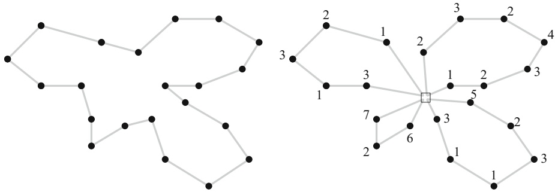

Fig. 4.1 Left: a TSP solution. Right: A CVRP solution. In the CVRP, the depot is represented by a square and each customer i is represented by a node labeled with a demand q<sub>i</sub>

## 4.1.2 Neighborhood Search

In this section, we formally introduce the term neighborhood search. We are given an instance I of a combinatorial optimization problem, where X is the set of feasible solutions for the instance (we write $X ( I )$ when we need to emphasize the connection between an instance and its solution set) and $c : X \to \mathbb { R }$ is a function that maps a solution to its cost. X is assumed to be finite, but is usually an extremely large set. We assume that the combinatorial optimization problem is a minimization problem, that is, we want to find a solution $x ^ { * }$ such that $c ( x ^ { * } ) \leq c ( x ) \forall x \in X$

We define a neighborhood of a solution $x \in X$ as $N ( x ) \subseteq X$ . That is, N is a func tion that maps a solution to a set of solutions. A solution x is said to be locally optimal or a local optimum with respect to a neighborhood N if $c(x) \leq c(x') \forall x' \in N(x)$ A neighborhood search algorithm takes an initial solution x as input, and computes $x ^ { \prime } = \arg \operatorname* { m i n } _ { x ^ { \prime \prime } \in N ( x ) } \{ c ( x ^ { \prime \prime } ) \}$ , that is, it finds the best solution $x ^ { \prime }$ in the neighborhood of x. If $c ( x ^ { \prime } ) < \widehat { c ( x ) }$ then the algorithm performs the update $x = x ^ { \prime }$ . The neighborhood of the new solution x is searched for an improving solution and this is repeated until a local optimum x is reached, in which case the algorithm stops. The algorithm is denoted a best improvement algorithm as it always chooses the best solution in the neighborhood.

A simple example of a neighborhood for the TSP is the 2-opt neighborhood which can be traced back to [41]. The neighborhood of a solution x in the 2-opt neighborhood is the set of solutions that can be reached from x by deleting two edges in x and adding two other edges in order to reconnect the tour. A simple example of a neighborhood for the CVRP is the relocate neighborhood (see e.g. [61]). In this neighborhood, $N ( x )$ is defined as the set of solutions that can be created from x by relocating a single customer. The customer can be moved to another position in its current route or to another route.

We define the size of the neighborhood $N ( \cdot )$ for a particular instance I as max $\{ | N ( x ) | : x \in X ( I ) \}$ . Let $\mathcal { I } ( n )$ be the (possibly infinite) set of all instances of size n for the problem under study. We can then define the size of a neighborhood as a function $f ( n )$ of the instance size n: $f(n) = \max \left\{ \left| N(x) \right| : I \in \mathcal{I}(n), x \in X(I) \right\}$ Heuristics based on neighborhoods of size $f ( n ) = O ( n ^ { k } )$ for low values of $k$ (say $k \leq 3 )$ are denoted small neighborhood search (SNS) heuristics in the following.

The 2-opt neighborhood for the TSP as well as the relocate neighborhood for the CVRP have size $f ( n ) = O ( n ^ { 2 } )$ where n is the number of cities/customers.

## 4.2 Large Neighborhood Search

The Large Neighborhood Search (LNS) metaheuristic was proposed by Shaw [105] and was based on ideas similar to those of the ruin and recreate method by Schrimpf et al. [102].

Most neighborhood search algorithms explicitly define the neighborhood like the relocate neighborhood described in Sect. 4.1.2. In the LNS metaheuristic, the neigh borhood is implicitly defined by a destroy and a repair method. A destroy method destructs a part of the current solution while a repair method rebuilds the destroyed solution. The destroy method typically contains an element of stochasticity, so that different parts of the solution are destroyed each time the method is invoked. The neighborhood $N ( x )$ of a solution x is then defined as the set of solutions that can be reached by first applying the destroy method and then the repair method.

To illustrate the destroy and repair concepts, consider the CVRP. A destroy method for the CVRP could remove, say 15%, of the customers in the current solution, short-cutting the routes where customers have been removed. A very simple destroy method would select the customers to remove at random. A repair method could rebuild the solution by inserting removed customers, using a greedy heuristic. Such a heuristic could simply scan all free customers, insert the one whose insertion cost is the lowest and repeat the insertion until all customers are done. The destroy and repair steps are illustrated in Fig. 4.2.

Since the destroy method can destruct a large part of the solution, the neighborhood typically contains a large number of solutions, as indicated by the name of this heuristic. Consider for example a CVRP instance with 100 customers. There are $C ( 1 0 0 , 1 5 ) = 1 0 0 ! / ( 1 5 ! \times 8 5 ! ) = 2 . 5 \times 1 0 ^ { 1 7 }$ different ways to select the customers to be removed if the percentage or degree of destruction of the solution is 15%. There are many ways to repair the solution for each removal choice, but different removal choices can of course result in the same solution after the repair.

We now present the LNS heuristic in more details. Pseudocode for the heuristic is shown in Algorithm 1. Three variables are maintained by the algorithm. The variable $x ^ { b }$ is the best solution observed during the search, x is the current solution and $x ^ { t }$ is a temporary solution that can be discarded or promoted to the status of current solution. The function $d ( \cdot )$ is the destroy method while $r ( \cdot )$ is the repair method. More specifically, $d ( x )$ returns a copy of x that is partly destroyed. Applying $r ( \cdot )$

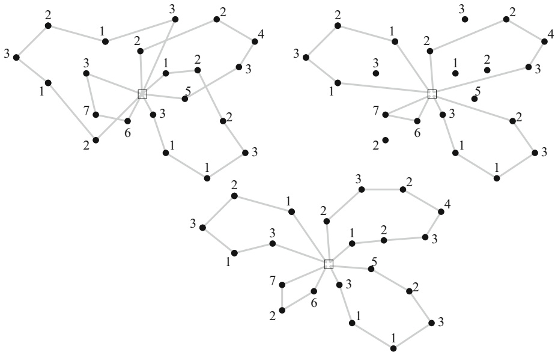

Fig. 4.2 Destroy and repair example. The top left figure shows a CVRP solution before the destroy operation. The top right figure shows the solution after a destroy operation that removed six customers (now disconnected from the routes). The bottom figure shows the solution obtained after reinsertion of the customers by the repair operation

to an incomplete solution repairs it, that is, it returns a feasible solution built from the destroyed one. In line 2, the global best solution is initialized. In line 4, the heuristic first applies the destroy method and then the repair method to obtain a new solution $x ^ { t }$ . In line 5, the new solution is evaluated, and the heuristic determines whether this solution should become the new current solution (line 6) or whether it should be rejected. The accept function can be implemented in different ways. The simplest choice is to only accept improving solutions. Note that more sophisticated methods are described later in this section. Line 8 checks whether the new solution is better than the best known solution. Here c(x) denotes the objective value of solution x. The best solution is updated in line 9, if necessary. In line 11, the termination condition is checked. It is up to the implementer to choose the termination criterion, but a limit on the number of iterations or a time limit would be typical choices. In line 12, the best solution found is returned. It can be observed from the pseudocode that the LNS metaheuristic does not search the entire neighborhood of a solution, but merely samples this neighborhood.

The main idea behind the LNS heuristic is that the large neighborhood allows the heuristic to navigate in the solution space easily, even if the instance is tightly constrained. This is to be opposed to small neighborhood search heuristics like those mentioned in Sect. 4.1.2 which can make it harder to explore distant parts of the solution space. The idea had been proposed prior to the first LNS papers by Shaw, but it was Shaw [104, 105] who first described the heuristic in general terms and coined the name Large neighborhood search. Shaw [105] refers to the papers by Caseau and Laburthe [25] and Adams et al. [1] as sources of inspiration. Another earlier heuristic that clearly contains the destroy/repair idea is a set covering heuristic by Jacobs and Brusco [59].

<div class="docvortex-algorithm" style="white-space: pre-wrap; font-family:monospace;">
Algorithm 1 Large neighborhood search
input: a feasible solution $x$
$x^b = x$;
repeat
    $x^t = r(d(x))$;
    if accept($x^t, x$) then
        $x = x^t$;
    end if
    if $c(x^t) &lt; c(x^b)$ then
        $x^b = x^t$;
    end if
until stopping criterion is met
return $x^b$
</div>

In the original LNS paper [105], the accept method only allowed improving solutions (we denote such an accept method a hill-climber). Later papers, like [95] and [102], have used an acceptance criteria borrowed from simulated annealing. With such an acceptance criterion, the temporary solution $x ^ { t }$ is always accepted if $c ( x ^ { t } ) \leq c ( x )$ , and accepted with probability exp $( - ( c ( x ^ { t } )   -   c ( x ) ) / T )$ if $c ( x ) < c ( x ^ { t } )$ Here $T > 0$ is the current temperature. The temperature is initialized at $T _ { 0 } > 0$ and is decreased gradually, for example by performing the update $T _ { n e w } = \alpha T _ { o l d }$ at each iteration, where $0 < \alpha < 1$ is a parameter. T is set to a relatively high value initially, thus allowing deteriorating solutions to be accepted. As the search progresses, $T$ decreases and only a few or no deteriorating solutions are accepted towards the end of the search. If such an acceptance criterion is employed, the LNS heuristic can be viewed as a standard simulated annealing heuristic with a complex neighborhood definition.

Other acceptance criteria have been tested in recent works, see for example Lei et al. [71], Hemmati and Hvattum [51] and Santini et al. [99]. The latter references compare different acceptance criteria across several problem types. The conclusion is that the simulated annealing acceptance criterion works well, but that better choices may exist for a given application. Other well performing acceptance criteria are record-to-record travel [37] and threshold accepting [38], both of which are controlled by a parameter T like simulated annealing. Another finding is that decreasing the parameter T linearly from $T _ { 0 }$ to 0 over the course of the algorithm results in comparable performance to decreasing T linearly or exponentially to an application specific end value $T _ { \mathrm { e n d } }$ . This holds for all three mentioned acceptance criteria (for simulated annealing, one has to decrease to an ε close to 0 to avoid division by zero). This observation simplifies parameter tuning since one does not have to worry about setting an appropriate end temperature.

The destroy method is an important part of the LNS heuristic. The most important choice when implementing the destroy method is the degree of destruction: if only a small part of the solution is destroyed then the heuristic may have trouble exploring the search space as the effect of a large neighborhood is lost. If a very large part of the solution is destroyed then the LNS heuristic almost degrades into repeated re-optimization. This can be time consuming or yield poor quality solutions depending on how the partial solution is repaired. Shaw [105] proposed to gradually increase the degree of destruction, while Ropke and Pisinger [95] choose the degree of destruction randomly in each iteration by choosing the degree from a specific range dependent on the instance size. The destroy method must also allow the entire search space to be reached, or at least the interesting part of the search space where the global optimum is expected to be found. Therefore, it cannot focus on always destroying a particular component of the solution but must make possible to destroy every part of the solution.

There is a lot of freedom in choosing the repair method of an LNS implementation. A first decision is whether the repair method should be optimal in the sense that the best possible complete solution is constructed from the partial solution, or whether it should be a heuristic, assuming that one is satisfied with a good solution constructed from the partial solution. An optimal repair operation will be slower than a heuristic one, but may potentially lead to high quality solutions in a few iterations. However, from a diversification point of view, an optimal repair operation may not be attractive: only improving or identical-cost solutions will be produced and it can be difficult to leave valleys in the search space unless a large part of the solution is destroyed in each iteration. The repair method can be based on a problem-specific heuristic, an exact method, a general purpose mixed integer programming (MIP), or a constraint programming solver.

It is worth observing that the LNS heuristic typically alternates between an infeasible solution and a feasible solution: the destroy operation creates an infeasible solution which is brought back into feasible form by the repair heuristic. The destroy and repair methods can also be viewed as fix/optimize operations: the fix method (corresponding to the destroy method) fixes part of the solution at its current value while the rest remains free; the optimize method (corresponding to the repair method) attempts to improve the current solution while respecting the fixed values. Such an interpretation of the heuristic may be more natural if the repair method is implemented using MIP or constraint programming solvers.

## 4.3 Adaptive Large Neighborhood Search

The Adaptive Large Neighborhood Search (ALNS) heuristic was proposed in [95] and extends the LNS heuristic by allowing multiple destroy and repair methods to be used within the same search process. Each destroy/repair method is assigned a weight that controls how often that particular method is attempted during the search. The weights are adjusted dynamically as the search progresses so that the heuristic adapts to the instance at hand and to the state of the search.

Using a neighborhood search terminology, one can say that ALNS extends LNS by allowing multiple neighborhoods within the same search. The choice of neighborhood to use is controlled dynamically using the recorded performance of the neighborhoods.

<div class="docvortex-algorithm" style="white-space: pre-wrap; font-family:monospace;">
Algorithm 2 Adaptive large neighborhood search
input: a feasible solution $x$
$x^b = x; \rho^- = (1, \dots, 1); \rho^+ = (1, \dots, 1)$;
repeat
    select destroy and repair methods $d \in \Omega^-$ and $r \in \Omega^+$ using $\rho^-$ and $\rho^+$;
    $x^t = r(d(x))$;
    if accept($x^t, x$) then
        $x = x^t$;
    end if
    if $c(x^t) &lt; c(x^b)$ then
        $x^b = x^t$;
    end if
    update $\rho^-$ and $\rho^+$;
until stopping criterion is met
return $x^b$
</div>

A pseudocode for the ALNS heuristic is shown in Algorithm 2. When we compare with the LNS pseudocode in Algorithm 1, we note the following changes. Lines 4 and 12 have been added and line 2 has been modified. The sets of destroy and repair methods are denoted $\varOmega ^ { - }$ and $\Omega ^ { + }$ , respectively. Two new variables are introduced in line 2: $\rho ^ { - } \in \mathbb { R } ^ { | \Omega ^ { - } | }$ and $\pmb { \rho } ^ { + }   \in   \mathbb { R } ^ { | \varOmega ^ { + } | }$ , to store the weight of each destroy and repair method, respectively. Initially all methods have the same weight. In line 4, the weight vectors $\rho ^ { - }$ and $\rho ^ { + }$ are used to select the destroy and repair methods using a roulette wheel principle. The algorithm calculates the probability $\phi _ { j } ^ { - }$ of choosing the jth destroy method as follows

$$
\left| \phi_ {j} ^ {-} = \frac {\rho_ {j} ^ {-}}{\sum_ {k = 1} ^ {| \Omega^ {-} |} \rho_ {k} ^ {-}} \right.,
$$

and the probabilities for choosing the repair methods are determined in the same way.

The weights are adjusted dynamically, based on the recorded performance of each destroy and repair method. This takes place in line 12: when an iteration of the ALNS heuristic is completed, a score ψ for the destroy and repair methods used in the last iteration is computed using the formula

```latex
$\psi = \max \left\{ \begin{array}{ll}\omega_{1} & \text{if the new solution is a new global best,}\\ \omega_{2} & \text{if the new solution is better than the current one,}\\ \omega_{3} & \text{if the new solution is accepted,}\\ \omega_{4} & \text{if the new solution is rejected,} \end{array} \right.$
```

(4.1)

where $\omega _ { 1 } , \omega _ { 2 } , \omega _ { 3 }$ and $\omega _ { 4 }$ are parameters. A high ψ value corresponds to a successful method. We would normally have $\omega _ { 1 } \geq \omega _ { 2 } \geq \omega _ { 3 } \geq \omega _ { 4 } \geq 0$

Let a and b be the indices of the destroy and repair methods that were used in the last iteration of the algorithm, respectively. The components corresponding to the selected destroy and repair methods in the $\rho ^ { - }$ and $\rho ^ { + }$ vectors are updated using the equations

$$
\rho_ {a} ^ {-} = \lambda \rho_ {a} ^ {-} + (1 - \lambda) \psi , \quad \rho_ {b} ^ {+} = \lambda \rho_ {b} ^ {+} + (1 - \lambda) \psi ,\tag{4.2}
$$

where $\lambda \in [ 0 , 1 ]$ is the decay parameter that controls how sensitive the weights are to changes in the performance of the destroy and repair methods. Note that the weights that are not used in the current iteration remain unchanged. The aim of the adaptive weight adjustment is to select weights that work well for the instance being solved. We encourage heuristics that bring the search forward, which are the ones rewarded with the $\omega _ { 1 } , \omega _ { 2 }$ and $\omega _ { 3 }$ parameters in (4.1). We discourage heuristics that lead to many rejected solutions since an iteration resulting in a rejected solution is a wasted iteration, roughly speaking. This is achieved by assigning a low value to $\omega _ { 4 }$

In the presentation above, we assigned an individual weight to each destroy and repair method. This approach may not be appropriate if a particular destroy method works well together with one repair method and produces non-interesting solutions when coupled with another repair method. In this case, it can make sense to assign weight to pairs of (destroy, repair) methods instead of each individual method. An example of this approach is found in Kovacs et al. [63].

It may also be that the partial solution produced by a destroy operator is incom patible with a certain repair method, for example when the repair method makes certain assumptions about the solution. In this case, one can use coupled neighborhoods. In principle, one may define a subset $K _ { i } \subseteq \Omega ^ { + }$ of repair neighborhoods that can be used with each destroy method $d _ { i }$ . The roulette wheel selection of repair neighborhoods will then only choose a neighborhood in $K _ { i }$ if $d _ { i }$ was chosen.

A special case is $K _ { i } = \emptyset$ when the neighborhood $d _ { i }$ takes care of both the destroy and repair steps. One could also use an ordinary local search heuristic to compete with the other destroy and repair neighborhoods, thus ensuring that a thorough investigation of the solution space close to the current solution is made from time to time.

The ALNS heuristic described so far is prone to favor complex repair methods that more often reach high quality solutions when compared to simpler repair methods. This is fine if the complex and simple repair methods are equally timeconsuming, but that may not be the case. If some methods are significantly slower than others, one may normalize the score ψ of a method with a measure of the time consumption of the corresponding heuristic. This ensures a proper trade-off between time consumption and solution quality. An example is found in Adulyasak et al. [2].

## 4.3.1 Designing an ALNS Algorithm

The considerations mentioned earlier for selecting destroy and repair methods in the LNS heuristic also holds for an ALNS heuristic. However, the ALNS framework gives some extra freedom because multiple destroy/repair methods are allowed. In the pure LNS heuristic, we have to select a destroy and a repair method that is expected to work well for a wide range of instances. In an ALNS heuristic, we can afford to include destroy/repair methods that only are suitable in some cases—the adaptive weight adjustment will ensure that these heuristics are seldom used on instances where they are ineffective. Therefore, the selection of destroy and repair methods can be turned into a search for methods that are good at either diversification or intensification.

Below, we will discuss some typical destroy and repair methods. In the discussion, we will assume that our solution is represented by a set of decision variables. The term variables should be understood in a rather abstract way.

Diversification and intensification for the destroy methods can be accomplished as follows: to diversify the search, one may randomly select the parts of the solution that should be destroyed (random destroy method). To intensify the search one may try to remove $q$ “critical” variables, i.e. variables having a large cost or variables that spoil the current structure of the solution (e.g. edges crossing each other in an Euclidean TSP). This is known as worst destroy or critical destroy.

One may also choose a number of related variables that are easy to interchange while maintaining solution feasibility. This related destroy neighborhood was introduced by Shaw [105]. For the CVRP one can define a relatedness measure between each pair of customers. The measure could simply be the distance between the customers and it could include customer demand as well (customers with similar demand are considered related). Thus, a related destroy method would select a set of customers that have a high mutual relatedness measure. The idea is that it should be easy to exchange similar customers.

Finally, one may use history based destroy where the $q$ variables are chosen ac cording to some historical information, as presented in [88]. The historical information could for example count how often the setting of a given variable (or set of variables) leads to a bad solution. One may then try to remove variables that are currently assigned to an improper value, based on the historical information.

The repair methods in set $\Omega ^ { + }$ are often based on specific well-performing heuristics for the given problem. These heuristics can make use of variants of the greedy paradigm, e.g. performing the locally best choice in each step, or performing the least bad choice in each step. Traditional improvement algorithms that explore small neighborhoods, denoted SNS heuristics in Sect. 4.1.2, can be used as part of a repair method to improve the output of a greedy algorithm.

The repair methods can also be based on approximation algorithms or exact algorithms. Exact algorithms can be relaxed to obtain faster solution times at the cost of solution quality. Some examples are presented in [13, 105]. Time consuming and fast repair methods can be mixed by penalizing the time consuming methods as described earlier. Using a MIP solver for performing the repair step is becoming increasingly attractive because these solvers become more and more powerful with every new released version [15]. The MIP approach has the advantage that repair methods for complex applications can be implemented quickly. A potential drawback is that extra care regarding the degree of destruction is necessary as the repair method otherwise could become extremely slow. Some examples of (A)LNS heuristics that employ a MIP solver for the repair step are: Belo-Filho et al. [12], Carrizosa et al. [24], Grangier et al. [48], Muller et al. [81]. It is worth pointing out that an (A)LNS heuristic with a MIP repair method can be seen as a prototype of a matheuristic.

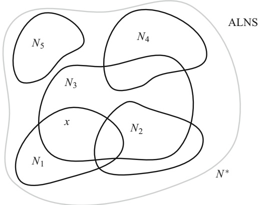

Fig. 4.3 Illustration of neighborhoods used by ALNS. The current solution is marked with x. ALNS operates on structurally different neighborhoods $N _ { 1 } , \ldots , N _ { k }$ defined by the corresponding search heuristics. All neighborhoods $N _ { 1 } , \ldots , N _ { k }$ in ALNS are a subset of the neighborhood $N ^ { * }$ defined by modifying $q$ variables, where $q$ is a measure of the maximum degree of destruction

Figure 4.3 illustrates, in an abstract way, the many neighborhoods in an ALNS heuristic. Each neighborhood on the figure can be considered as a unique combination of a destroy and repair method.

In traditional local search heuristics, diversification is controlled implicitly by the local search paradigm (accept ratio, tabu list, etc.). (A)LNS heuristics typically controls diversification through the accept criterion, and in many (A)LNS applications further diversification is applied by using noise or randomization in the destroy and repair methods. The rationale is to avoid a stagnating search processes where the destroy and repair methods keep performing the same modifications to a solution.

Several papers have pointed out that diversification in the repair step does not necessarily lead to better solution quality (see, for example, Kiefer et al. [60]). Hemmati and Hvatum [51] go a step further and study the effect of exchanging the randomized components with deterministic alternatives in an ALNS algorithm for a maritime pickup and delivery problem. Seven randomized components are identified and for five of them, the performance is about the same when the randomized and deterministic components are compared. The randomized version produces better results in one case while the deterministic version produce better results in the remaining case. It is worth pointing out that the deterministic alternatives are not necessarily simpler or more intuitive compared to their randomized counterparts.

To conclude on this issue, we believe that the benefits of noise, in particular for the repair component, is application specific and depend on other choices made in the design of the ALNS heuristic. It is therefore a component that can be omitted. If included, it would be wise to test if it has any impact.

For some problems, it may be sufficient to have a number of destroy and repair heuristics that are selected randomly with equal probability, that is, without the adaptive layer. In [88], such heuristics were coined large multiple-neighborhood search (LMNS) heuristics. LMNS heuristics share the robustness of the ALNS heuristics, while having considerably fewer parameters to calibrate. Several heuristics of this type have appeared recently in the literature (see Sect. 4.4).

## 4.3.2 Properties of the ALNS Framework

The ALNS framework has several advantages. For most optimization problems, we already know a number of well-performing heuristics which can form the core of an ALNS algorithm. Due to the large neighborhoods and diversity of the neighborhoods, the ALNS algorithm will explore large parts of the solution space in a structured way. The resulting algorithm becomes very robust because it can adapt to various characteristics of the individual instances, and it seldom gets trapped in local optima.

The calibration of the ALNS algorithm is quite limited since the adaptive layer automatically adjusts the influence of each neighborhood used. It is still necessary to calibrate the individual sub-heuristics used for searching the destroy and repair neighborhoods, but one may calibrate these individually or even use the parameters of existing algorithms.

In the design of most local search algorithms, the researcher has to choose be tween a number of possible neighborhoods. In ALNS, the question is not “either-or” but rather “both-and”. As a matter of fact, our experience is that the more (reasonable) neighborhoods the ALNS heuristic makes use of, the better it performs [88, 96].

The ALNS framework is not the only one to make use of several neighborhoods in a LNS heuristic. Rousseau et al. [97] use two LNS neighborhoods for the Vehicle Routing Problem with Time Windows (VRPTW): one removing customers and another removing arcs. They propose a Variable Neighborhood Descent (VND) where one neighborhood is used until one is “sufficiently sure” that the search is trapped in a local minimum, in which case the search switches to the other neighborhood. When the second neighborhood runs out of steam, the first neighborhood is used again and so on.

Perron [85] uses an adaptive technique to select repair methods from a portfolio by assigning weights to the repair methods based on their performance, like ALNS. Laborie and Godard [67] propose a framework very similar to ALNS, the difference being that their framework also dynamically adjusts the parameters of the individual destroy and repair methods. The ALNS framework described in this section assumes that those parameters are fixed in advance. Palpant et al. [82] only use one destroy and repair method but propose a method for dynamically adjusting the scope of the destroy operation in order to find the neighborhood size that allows the repair operation to be completed within reasonable time. The authors use complex, time consuming repair methods.

## 4.3.3 Relation to Other Metaheuristics

The LNS and ALNS have similarities to the variable neighborhood search (VNS) metaheuristics presented by Hansen and Mladenovic [ ´ 50], Mladenovic and Hansen ´ [79]. In order to implement a VNS, one needs a set of neighborhood structures $\mathcal { N } _ { k } , k   =   1 , \ldots , k _ { \mathrm { m a x } }$ . Typically the size of the neighborhood increases with k and it is common, but not required, that $\mathcal { N } _ { k _ { 1 } } ( x ) \subseteq \mathcal { N } _ { k _ { 2 } } ( x )$ for any solution x when $k _ { 1 } < k _ { 2 }$ Furthermore, one needs a local search method. The local search method can use a single neighborhood or it can use several different neighborhoods in which case it is called a variable neighborhood descent. The basic VNS heuristic is depicted in Algorithm 3. Line 5 is known as the shaking step and the result of the shaking step is improved using the local search in line 6. Lines 7–11 check if the resulting solution is better than the incumbent. If it is not, k is increased. In this way, the shaking becomes more powerful (under the assumption that the size of the neighborhood grows with k).

The VNS heuristic can be understood in LNS terms as follows: the shaking step in line 5 corresponds to the destroy method in the LNS while the local search step in line 6 corresponds to the repair step. In this sense, LNS and ALNS can be seen as generalizations of VNS. The multiple neighborhoods available to the shaking step is similar to the multiple neighborhoods in ALNS, but there is no adaptive selection of neighborhood in the basic VNS (adaptive versions in the spirit of ALNS have been suggested, see for example Schneider et al. [103]).

Another related concept is that of Hyper Heuristics. Burke et al. [21] describes hyper-heuristics as heuristics to choose heuristics, that is, algorithms where a master heuristic is choosing between several sub-ordinate heuristics. Therefore, the ALNS heuristic can be seen as a hyper-heuristic: the adaptive component is choosing from the set of destroy and repair methods (which usually are heuristics).

## 4.3.4 Parallelism

Examples of implementations of the (A)LNS heuristics that takes advantage of parallel processing have been proposed in the literature. Perron and Shaw [86] describe a parallel LNS heuristic for a network design problem, while Ropke [94] describes a framework for implementing parallel ALNS heuristics. The framework was tested on the CVRP and TSP with pickup and delivery. More recently, Hifi et al. [55] describe a parallel LNS for a knapsack problem under disjunctive constraints. Also, there have been publications about the implementation of (A)LNS using graphical processing units (GPUs). GPUs are massively parallel processing units that theoretically can do many more calculations per second compared to ordinary CPUs. However, new memory models and rules for execution of program parts must be understood in order to take the full advantage of the GPU. Campeotto et al. [22] present a GPU implementation of a large neighborhood search applied to constraint programming, while Bach et al. [10] present in a short abstract a GPU implementation of the ALNS for solving distance constrained CVRPs.

<div class="docvortex-algorithm" style="white-space: pre-wrap; font-family:monospace;">
Algorithm 3 Variable neighborhood search (VNS)
input: an initial solution $x$
repeat
    $k = 1$
    repeat
        select random $x'$ from $\mathcal{N}_k(x)$
        $x'' = \text{localsearch}(x')$
        if $f(x'') &lt; f(x)$ then
            $x = x''$; $k = 1$
        else
            $k = k + 1$
        end if
    until $k &gt; k_{\max}$
until stopping criterion is met
return $x$
</div>

## 4.4 Applications of LNS and ALNS

The LNS heuristic was early on primarily used as a heuristic for solving vehicle routing problems. But, in recent years, there has been a growth in the number of papers that apply the heuristic to other problem types. In the following sections, we review some of the of (A)LNS heuristics proposed for both VRP and non-VRP applications.

## 4.4.1 Vehicle Routing Applications

LNS was first applied to vehicle routing problems by Shaw [104, 105]. Then, in the early 2000s, the method was shown to produce high quality solutions for the vehicle routing problem with time windows (VRPTW) and the pickup and delivery problem with time windows (PDPTW) by Bent and Van Hentenryck [13, 14]. At around the same time, the ALNS was introduced and its first applications were the PDPTW [95], the VRPTW [88] and other VRP variants [96]. From then on, a large number of LNS and ALNS heuristics have been proposed for a multitude of VRP variants. Table 4.1 summarizes some of the publications on VRP variants published from 2010 to 2017. The list is far from complete: we have chosen a sample that spans different problem types over those years. The two first columns of the table report the main problem type (VRP type) and the specific problem studied in the paper. In terms of the main problem types, we consider VRPs where goods are distributed from a depot to customers or collected from customers and brought back to the depot, with different objectives and constraints. In multi-layer routing problems, goods can be transported along several routes. In the VRP with cross-docking, for example, goods are picked up using one vehicle, transported to the cross-dock where goods are consolidated and moved to new vehicles that perform the delivery. In pickup and delivery problems, a transport request consists of a pickup at one location and a delivery at a different location, where typically more than one request can share the vehicle. In inventory routing problems, customers may need a delivery several times during a given time horizon and routes should be planned to avoid running out of stock at one or more customers. Production routing integrates the routing decision with a lot sizing problem and potentially also with inventory considerations at the customer nodes. Arc routing deals with problems where the arcs of a graph, not the nodes, require service. A typical example is snow removal. In dynamic/stochastic routing problems, a part of the input data is considered uncertain, but information about the stochastic variables may be available through known distributions. Such problems can be approached in a classical stochastic optimization sense where one generate an a-priori solution that minimizes the expected cost or generates solutions that remain feasible in most scenarios. Another approach is to simply solve the updated problem every time new information becomes available. The reader is referred to Pillac et al. [87], Psaraftis et al. [90] and Gendreau et al. [45] for more information on dynamic and stochastic VRPs.

Columns 3–5 in Table 4.1 show the number of destroy and repair methods used, as well as the number of combined destroy-repair methods. Combined methods occur in two different situations. First, the VRP type may be such that the removal of customers can be seen as both a destroy and a repair method, in which case all methods are combined. It happens, for example, when a part of the problem is to select which customers to serve or to select on which day(s) the customers should be served. An example is the inventory routing problem studied by Coelho et al. [27]. Second, methods may both destroy and repair in the same step. An example is the swap method defined in Eskandarpour et al. [40]. It is worth mentioning that the number of destroy/repair methods for a particular method is debatable. Sometimes, it is possible to create different instances of one method by changing a parameter. An example is the widely used regret repair method based on a VRP construction algorithm proposed by Potvin and Rousseau [89]. In this method, an integer parameter defines a kind of look-ahead measure and each parameter value can give rise to a new repair method. Such multiple parameterized versions of the same algorithm are counted as one method. Column 6 indicates if ALNS (-) or LNS (–) is used.

Column 7 indicates if solutions are improved using a small neighborhood search (SNS) heuristic (see Sect. 4.1.2). A - in the column indicates “yes”. For example, the routes in a VRP solution may be improved using the 2-opt neighborhood and the entire solution may be improved using the relocate neighborhood mentioned in Sect. 4.1.2. Column 8 reports the acceptance criterion used, where SA, HC and RRT indicates Simulated annealing, hill climbing and record to record travel, respectively. The two first acceptance criteria are explained in Sect. 4.2, while the last is explained in Dueck [37]. The SA and RRT rely on a parameter T that typically is decreasing over time. If this parameter is kept fixed, it is indicated with fixed in column 8. For some publications, the acceptance criterion is listed as ad hoc because it does not fit the common criteria defined in the literature. Column 9 indicates the publication year.

We comment further on the table in the following section. For now, we would like to highlight the heuristic presented by Christiaens and Vanden Berghe [26] for the CVRP. It is currently among the heuristics that perform best on the large set of instances proposed by Uchoa et al. [109]. This is quite remarkable since the heuristic is simple and the CVRP is one of the most studied VRP variants (see, for example, Laporte et al. [69]). Among non-LNS heuristics that perform well on the CVRP, we would like to mention the hybrid genetic algorithm by Vidal et al. [111] (which also provides high quality solutions to many other variants).

## 4.4.2 Other Applications

As already mentioned, the number of (A)LNS applications outside the VRP domain has traditionally been small compared to the number of VRP applications. But, in recent years, the number of non-VRP applications has significantly grown. Table 4.2 highlights some of these applications (although the list is far from complete). The table is organized in the same way as Table 4.1 and cover publications on different applications from 2010 to 2017. The first column now specifies the major application area (the labels should be self-explanatory). It is interesting to note that most applications fall into the broad category of transport and logistics. This is perhaps not surprising considering the popularity of (A)LNS heuristics within the VRP community.

Some trends become apparent when examining Tables 4.1 and 4.2. However, before drawing any conclusions, we would like to stress that the publications presented in the tables are just a sample of the entire population of (A)LNS papers. Therefore, a bias in the selection of publications can skew the conclusions.

Table4.1VRPapplications

<table><tbody><tr><td>VRP type</td><td>Specific problem</td><td>#destroy</td><td>#repair</td><td>#combined</td><td>ALNS</td><td>SNS</td><td>Acceptance</td><td>Year</td></tr><tr><td rowspan="10">VRP</td><td>Ship routing and scheduling with split loads [62]</td><td>1</td><td>1</td><td></td><td></td><td>-</td><td>HC</td><td>201 1</td></tr><tr><td>Cumulative capacitated VRP [93]</td><td>7</td><td>3</td><td></td><td>-</td><td></td><td>SA</td><td>201 2</td></tr><tr><td>Waste collection VRP [20]</td><td>6</td><td>2</td><td></td><td>-</td><td></td><td>SA</td><td>201 2</td></tr><tr><td>Pollution routing [33]</td><td>1 2</td><td>3</td><td></td><td>-</td><td></td><td>SA</td><td>201 2</td></tr><tr><td>Service technician routing and scheduling problem [63]</td><td>5</td><td>3</td><td></td><td>-</td><td></td><td>SA</td><td>201 2</td></tr><tr><td>Consistent VRP [64]</td><td>4</td><td>2</td><td></td><td>-</td><td>-</td><td>SA</td><td>2014</td></tr><tr><td>Bi-objective pollution routing [34]</td><td>1 2</td><td>3</td><td></td><td>-</td><td></td><td>SA</td><td>2014</td></tr><tr><td>VRP with multiple routes per vehicle [9]</td><td>5</td><td>2</td><td></td><td>-</td><td></td><td>SA</td><td>2014</td></tr><tr><td>Capacitated VRP [26]</td><td>1</td><td>1</td><td></td><td></td><td></td><td>SA</td><td>201 6</td></tr><tr><td>Electric VRP [54]</td><td>5</td><td>4</td><td></td><td>-</td><td>-</td><td>HC</td><td>201 6</td></tr><tr><td rowspan="2">Multi-layer routing</td><td>Two-echelon VRP [53]</td><td>8</td><td>3</td><td></td><td>-</td><td></td><td>Ad hoc</td><td>201 2</td></tr><tr><td>VRP with cross-docking [48]</td><td>4</td><td>2</td><td></td><td>-</td><td></td><td>HC, SA fixed</td><td>2017</td></tr><tr><td rowspan="4">Pickup and delivery</td><td>Pickup and delivery problem with trans-fers [75]</td><td>7</td><td>5</td><td></td><td>-</td><td></td><td>SA</td><td>201 3</td></tr><tr><td>Dial a ride [83]</td><td>3</td><td>2</td><td></td><td></td><td>-</td><td>Ad hoc</td><td>201 3</td></tr><tr><td>Dial a ride problem with transfers [76]</td><td>6</td><td>5</td><td></td><td>-</td><td></td><td>SA</td><td>2014</td></tr><tr><td>Pickup and delivery TSP with handling costs [ 1 10]</td><td>5</td><td>1</td><td></td><td></td><td></td><td>SA</td><td>2017</td></tr></tbody></table>

Table4.1—Continuedfrompreviouspage

<table><tbody><tr><td>VRP type</td><td>Specific problem</td><td>#destroy</td><td>#repair</td><td>#combined</td><td>ALNS</td><td>SNS</td><td>Acceptance</td><td>Year</td></tr><tr><td rowspan="3">Inventory routing</td><td>Inventory-routing problem with transship-ment [27]</td><td></td><td></td><td>1 1</td><td>-</td><td>-</td><td>SA</td><td>20 1 2</td></tr><tr><td>Selective and periodic inventory routing problem [5]</td><td></td><td></td><td>1 1</td><td>-</td><td>-</td><td>SA</td><td>20 14</td></tr><tr><td>Inventory routing in tramp shipping [52]</td><td>3</td><td>2</td><td></td><td>-</td><td></td><td>SA</td><td>20 1 5</td></tr><tr><td>Production routing</td><td>Production routing [ 1 2]</td><td>8</td><td>1</td><td></td><td>-</td><td></td><td>HC</td><td>20 1 5</td></tr><tr><td>Arc Routing</td><td>Synchronized arc routing [98]</td><td></td><td></td><td>5</td><td>-</td><td></td><td>RRT fixed</td><td>20 1 2</td></tr><tr><td rowspan="4">Dynamic/stochastic</td><td>Capacitated arc routing with stochastic demands [68]</td><td>4</td><td>4</td><td></td><td>-</td><td></td><td>RRT</td><td>20 1 0</td></tr><tr><td>Capacitated VRP with stochastic demands and time windows [7 1 ]</td><td>4</td><td>4</td><td></td><td>-</td><td></td><td>RRT</td><td>20 1 1</td></tr><tr><td>Dynamic VRP with multiple delivery routes [8]</td><td>5</td><td>2</td><td></td><td>-</td><td></td><td>SA</td><td>20 1 2</td></tr><tr><td>Dynamic and stochastic inventory-routing[28]</td><td>4</td><td>4</td><td></td><td>-</td><td>-</td><td>SA</td><td>20 14</td></tr></tbody></table>

Table4.2Non-VRPapplications

<table><tr><td>Domain</td><td>Specific problem</td><td>#destroy</td><td>#repair</td><td>#combined</td><td>ALNS</td><td>SNS</td><td>Acceptance</td><td>Year</td></tr><tr><td rowspan="4">Public transport</td><td>Simultaneous vehicle scheduling and passenger service problem</td><td>2</td><td>1</td><td>-</td><td>-</td><td>-</td><td>SA</td><td>2012</td></tr><tr><td>Route design (network design) [101]</td><td>3</td><td>3</td><td>-</td><td>-</td><td>-</td><td>Ad hoc</td><td>2014</td></tr><tr><td>Electric vehicle scheduling [112]</td><td>3</td><td>1</td><td>-</td><td>✓</td><td>-</td><td>SA</td><td>2016</td></tr><tr><td>Railway rapid transit network design and line planning [23]</td><td>-</td><td>-</td><td>6</td><td>✓</td><td>✓</td><td>SA</td><td>2017</td></tr><tr><td rowspan="3">Network design</td><td>Robust network design for multispecies conservation [70]</td><td>1</td><td>2</td><td>-</td><td>-</td><td>-</td><td>HC</td><td>2013</td></tr><tr><td>Design of hub networks [32]</td><td>5</td><td>2</td><td>-</td><td>✓</td><td>-</td><td>SA</td><td>2015</td></tr><tr><td>Supply chain network design [40]</td><td>6</td><td>9</td><td>2</td><td>-</td><td>-</td><td>SA</td><td>2017</td></tr><tr><td>Facility location</td><td>Probabilistic maximal covering location-allocation problem [84]</td><td>4</td><td>4</td><td>-</td><td>✓</td><td>-</td><td>SA</td><td>2015</td></tr><tr><td rowspan="2">Seaport operations</td><td>Berth allocation [78]</td><td>4</td><td>3</td><td>-</td><td>✓</td><td>-</td><td>SA</td><td>2016</td></tr><tr><td>Berth allocation and quay crane assignment [57]</td><td>4</td><td>2</td><td>-</td><td>✓</td><td>-</td><td>SA</td><td>2017</td></tr><tr><td rowspan="4">Educational time tabling</td><td>Consultation timetabling [66]</td><td>2</td><td>2</td><td>-</td><td>✓</td><td>-</td><td>SA</td><td>2013</td></tr><tr><td>Elective course student sectioning [65]</td><td>2</td><td>3</td><td>-</td><td>✓</td><td>-</td><td>SA</td><td>2016</td></tr><tr><td>Curriculum-based course timetabling problem [60]</td><td>10</td><td>3</td><td>-</td><td>✓</td><td>-</td><td>SA</td><td>2017</td></tr><tr><td>High school timetabling [35]</td><td>2</td><td>1</td><td>-</td><td>-</td><td>-</td><td>HC</td><td>2017</td></tr><tr><td>Lot-sizing</td><td>Lot-sizing with setup times [81]</td><td>6</td><td>2</td><td>-</td><td>✓</td><td>-</td><td>HC</td><td>2012</td></tr><tr><td>Warehouse logistics</td><td>Joint order batching and generalized assignment problem [77]</td><td>-</td><td>-</td><td>5</td><td>✓</td><td>-</td><td>SA</td><td>2017</td></tr><tr><td rowspan="2">Scheduling</td><td>Shift minimization personnel task scheduling problem [74]</td><td>1</td><td>1</td><td>-</td><td>-</td><td>-</td><td>SA</td><td>2014</td></tr><tr><td>Scheduling identical parallel machines with tooling constraints [11]</td><td>9</td><td>3</td><td>-</td><td>✓</td><td>-</td><td>SA</td><td>2017</td></tr><tr><td rowspan="4">Other</td><td>Energy aware meeting scheduling in smart buildings [72]</td><td>1</td><td>1</td><td></td><td>-</td><td>-</td><td>HC</td><td>2015</td></tr><tr><td>Partition coloring [42]</td><td>Many</td><td>9</td><td>-</td><td>✓</td><td>✓</td><td>Ad hoc</td><td>2016</td></tr><tr><td>Software module clustering [80]</td><td>3</td><td>4</td><td>-</td><td>-</td><td>-</td><td>HC</td><td>2017</td></tr><tr><td>Visualizing proportions and dissimilarities by space-filling maps [24]</td><td>1</td><td>1</td><td>-</td><td>-</td><td>-</td><td>HC</td><td>2017</td></tr></table>

With that word of warning, we wish to indicate the following trends to the reader: it appears that simulated annealing and hill-climbing are the two most popular choices for the acceptance criterion. These criteria were used in the early successful LNS and ALNS implementations, so it is not surprising if they are pervasive in the literature. However, as reported by Santini et al. [99], it may be worthwhile to consider other acceptance criteria in order to improve the performance slightly. From the tables, it also appears that the idea of applying small neighborhood search to improve the results from the repair step is more widespread in VRP applications than in other applications. A possible explanation is that well-performing small neighborhoods are widely known for VRP variants and are therefore an easy addition to the heuristic.

The idea of using more than one destroy/repair method is widespread and is not found only within ALNS heuristics. One may use multiple destroy/repair methods in the large multiple-neighborhood search method described earlier, and other approaches also exists. Monçores et al. [80], for example, let the search start with one method and only switches to the next method when no improving solution is found for a certain number of iterations.

The numerous diverse applications in Table 4.2 illustrate the versatility of the (A)LNS heuristic. It remains an easy-to-apply heuristic, especially if one relies on existing solvers (e.g. MIP solvers) to perform the repair step. Looking into the future, we therefore believe that the heuristic is going to find new applications and that the ratio between VRP and non-VRP applications could soon shift toward a majority of published results for non-VRP applications.

## 4.5 Very Large-Scale Neighborhood Search

We end this chapter by considering a related class of algorithms based on very largescale neighborhood search. LNS belongs to the class of VLSN algorithms since it searches a very large neighborhood. However, neighborhoods of LNS are typically implicitly defined from the destroy and repair heuristics, while VLSN algorithms usually have an explicit definition of the neighborhoods.

According to Altner et al. [6], a search algorithm belongs to the class of VLSN algorithms if the neighborhood it searches grows exponentially with the instance size or if the neighborhood is simply too large to be searched explicitly. Clearly, the class of VLSN algorithms is rather broad. Altner et al. [6] categorize VLSN into three classes: (1) variable depth methods, (2) network flow-based improvement methods, (3) other methods based on compound moves or variable fixing.

Searching a very large neighborhood should intuitively lead to higher quality solutions than searching a small neighborhood. However, in practice, small neighborhoods can provide similar or superior quality if they are embedded in a metaheuristic framework, because they typically can be searched more quickly. Such behavior is reported in [17, 56], for example. Thus, VLSN algorithms are not “magic bullets”. But, for the right applications, they provide excellent results.

## 4.5.1 Variable-Depth Methods

Larger neighborhoods generally lead to local solutions of better quality, but the search is more time-consuming. Hence, a natural idea is to gradually extend the size of the neighborhood, each time the search gets trapped in a local minimum.

Variable-Depth Neighborhood Search (VDNS) methods search a parameterized family of still deeper neighborhoods $N _ { 1 } , N _ { 2 } , \ldots , N _ { k }$ in a heuristic way. A typical example is the 1-exchange neighborhood $N _ { 1 }$ where one variable/position is changed. Similarly, the 2-exchange neighborhood $N _ { 2 }$ swaps the value of two variables/positions. In general, the k-exchange neighborhood $N _ { k }$ changes k variables. Variable-depth search methods are techniques that search the k-exchange neighborhood partially, hence reducing the time used to search the neighborhood.

One of the first applications of variable-depth search was the Lin-Kernighan heuristic [73] for solving the TSP. Briefly, the idea in the Lin-Kernighan heuristic is to replace as many as n edges (with n being the number of cities in the instance) when moving from a tour S to a tour T. In even steps of the algorithm, an edge is inserted into the Hamiltonian path, while in odd steps, an edge is deleted to restore a Hamiltonian path. From each Hamiltonian path, a Hamiltonian cycle is implicitly constructed by joining the two end nodes. The choice for the edge to be added to the Hamiltonian path is made in a greedy way, maximizing the gain in the objective function. The Lin-Kernighan algorithm terminates when no improving tour can be constructed.

The basic idea in a VDNS heuristic is to make a sequence of local moves and to freeze all combinatorial objects that have been moved to prevent the search from cycling. VDNS stops when no further local move is possible and returns the best found solution.

An extension of the Lin-Kernighan heuristic, called ejection chains, was proposed by Glover in [46]. An ejection chain is initiated by selecting a set of elements that will undergo a state change. The result of this change leads to identifying a collection of other sets, with the property that the elements of at least one set must be “ejected from” their current states. State-change steps and ejection steps typically alternate. In some cases, a cascade of operations may be triggered leading to a domino effect.

Variable-depth and ejection-chain based algorithms have been applied to several problems, including the traveling salesman problem [43, 92], the vehicle routing problem with time windows [106], the generalized assignment problem [113] and nurse scheduling [36]. Ahuja et al. [4] give an excellent overview of earlier applications of the VDNS methods.

Frequently, VDNS methods are used in conjunction with other metaheuristic frameworks, like the filter-and-fan methods in Glover and Rego [47].

## 4.5.2 Network Flow-Based Improvement Algorithms

This family of improvement algorithms use various network-flow algorithms to search the neighborhood. In general, they can be grouped in the following three, not necessarily distinct, categories: (1) minimum cost cycle methods, (2) shortest path based methods, and (3) minimum cost assignment based methods. In the following, we give a short overview of the methods and refer to the survey of Ahuja et al. [4] for further details.

## 4.5.2.1 Neighborhoods Defined by Cycles

A cyclic exchange neighborhood consists of a sequence of elements being transferred among a family of subsets. Thompson [107] showed how to find an improving neighbor in the cyclic exchange neighborhood by finding a negative cost cycle in a constructed improvement graph. Finding a negative cost subset-disjoint cycle in the improvement graph is NP-hard, but effective heuristics for searching the graph exist.

Thompson and Psarafitis [108] and Gendreau et al. [44] applied the cyclic neighborhood to solve the VRP. Ahuja et al. [3] used cyclic exchanges to solve the capacitated minimum spanning tree problem.

## 4.5.2.2 Neighborhoods Defined by Paths

Path exchanges is a generalization of the swap neighborhood. A large-scale neighborhood can be defined by aggregating an arbitrary number of so-called independent swap operations [4]. The best neighbor of a TSP tour for this aggregated swap neighborhood can be found in $O ( n ^ { 2 } )$ time by solving a shortest path problem in an improvement graph constructed for this purpose.

For the one machine batching problem, Hurink [56] applies a special case of the aggregated swap neighborhood where only adjacent pairs are allowed to switch. An improving neighbor can be found in $O ( n ^ { 2 } )$ time by solving a shortest path problem in the improvement graph.

Considering the single machine scheduling problem, Brueggemann and Hurink [16] presented an extension of the adjacent pairwise interchange neighborhood which can be searched in quadratic time by calculating a shortest path in an improvement graph.

## 4.5.2.3 Neighborhoods Defined by Assignments and Matching

The assignment neighborhood was first presented by Sarvanov and Doroshko [100] for the TSP. It is an exponential neighborhood structure obtained by finding minimum cost assignments in an improvement graph.

For the TSP, the assignment neighborhood is based on the removal of k nodes, from which a bipartite graph is constructed. In this graph, the nodes on the left-hand side are the removed nodes, and the nodes on the right-hand side are the remaining nodes. The cost of each assignment is the cost of inserting a node between two existing nodes. Sarvanov and Doroshko [100] considered the case where $k = n / 2$ and n is even. Punnen [91] generalized this approach to arbitrary k and n.

Using the same idea, Franceschi et al. [31] obtained promising results for the distance-constrained CVRP. Brueggemann and Hurink [19] presented a neighborhood of exponential size for the problem of scheduling independent jobs on parallel machines when the weighted average completion time is minimized.

## 4.5.3 Other VLSN Algorithms

VLSN algorithms can also be based on aggregating or compounding independent moves. The idea is to simultaneously execute two or more moves when their impact on the objective function can be evaluated independently. Ergun et al. [39] and Gendreau et al. [44] aggregate independent moves to solve the VRP, and Brueggemann et al. [18] apply the concept to a minimum makespan parallel machine scheduling problem.

Another approach is to solve an induced MIP subproblem by fixing a subset of the decision variables. The RINS algorithm proposed by Danna et al. [29] solve an induced MIP subproblem where some variables are fixed to values frequently attained in previous incumbent solutions. Davenport et al. [30] use constraint programming to search a large neighborhood.

## 4.6 Conclusion

This chapter has given an in-depth description of LNS and ALNS, and has briefly explained the central concepts of VLSN. Algorithms exploiting large neighborhoods have shown very promising results during the last decade, and we expect to see more algorithmic developments as well as new application areas.

One of the key benefits of the LNS heuristic is that a heuristic can be quickly put together from existing components: An existing construction heuristic or exact method can be turned into a repair heuristic and a destroy method based on random selection is easy to implement. Therefore, we see a potential for using simple LNS heuristics for benchmark purposes when developing more sophisticated methods.

Large neighborhoods offer no guarantee of finding better solutions than using smaller neighborhoods. Increased complexity of the neighborhood search means that fewer iterations can be performed by a local search algorithm. Gutin and Karapetyan [49] experimentally compared a number of small and large neighborhoods for the multidimensional assignment problem, including various combinations of them. It was demonstrated that some combinations of both small and large neighborhoods provided the best results. This could indicate that hybrid neighborhoods may be a promising direction for future research.

Another interesting research topic for the future is to investigate if techniques from machine learning and artificial intelligence could be used to improve the adaptive layer in ALNS. It is likely that a more clever dynamic selection of destroy and repair methods could improve the heuristic and it may be interesting to let other parameters in the algorithm adapt to the instance at hand, for example parameters controlling solution acceptance.

## References

1. J. Adams, E. Balas, D. Zawack, The shifting bottleneck procedure for job shop scheduling. Manag. Sci. 34(3), 391–401 (1988)

2. Y. Adulyasak, J.-F. Cordeau, R. Jans, Optimization-based adaptive large neighborhood search for the production routing problem. Transp. Sci. 48(1), 20–45 (2012)

3. R.K. Ahuja, J.B. Orlin, D. Sharma, Multi-exchange neighborhood structures for the capacitated minimum spanning tree problem. Math. Program. 91(1), 71–97 (2001)

4. R.K. Ahuja, Ö. Ergun, J.B. Orlin, A.P. Punnen, A survey of very large-scale neighborhood search techniques. Discret. Appl. Math. 123, 75–102 (2002)

5. D. Aksen, O. Kaya, F.S. Salman, Ö. Tüncel, An adaptive large neighborhood search algorithm for a selective and periodic inventory routing problem. Eur. J. Oper. Res. 239(2), 413–426 (2014)

6. D.S. Altner, R.K. Ahuja, Ö. Ergun, J.B. Orlin, Very large-scale neighborhood search, in Search Methodologies: Introductory Tutorials in Optimization and Decision Support Techniques (Springer, Berlin, 2014), pp. 339–367

7. D.L. Applegate, R.E. Bixby, V. Chvátal, W.J. Cook, The Traveling Salesman Problem: A Computational Study (Princeton University Press, Princeton, 2006)

8. N. Azi, M. Gendreau, J.-Y. Potvin, A dynamic vehicle routing problem with multiple delivery routes. Ann. Oper. Res. 199(1), 103–112 (2012)

9. N. Azi, M. Gendreau, J.-Y. Potvin, An adaptive large neighborhood search for a vehicle routing problem with multiple routes. Comput. Oper. Res. 41, 167–173 (2014)

10. L. Bach, G. Hasle, C. Schulz, GPU parallelization of ALNS for the DCVRP, in VeRoLog Abstracts, Nantes (2016)

11. A.C. Beezão, J.-F. Cordeau, G. Laporte, H.-H. Yanasse, Scheduling identical parallel machines with tooling constraints. Eur. J. Oper. Res. 257(3), 834–844 (2017)

12. M.A.F. Belo-Filho, P. Amorim, B. Almada-Lobo, An adaptive large neighbourhood search for the operational integrated production and distribution problem of perishable products. Int. J. Prod. Res. 53(20), 6040–6058 (2015)

13. R. Bent, P. Van Hentenryck, A two-stage hybrid local search for the vehicle routing problem with time windows. Transp. Sci. 38(4), 515–530 (2004)

14. R. Bent, P. Van Hentenryck, A two-stage hybrid algorithm for pickup and delivery vehicle routing problem with time windows. Comput. Oper. Res. 33(4), 875–893 (2006)

15. R.E. Bixby, A brief history of linear and mixed-integer programming computation. Doc. Math. Extra Volume: Optimization Stories, 107–121 (2012)

16. T. Brueggemann, J.L. Hurink, Two exponential neighborhoods for single machine scheduling. Technical report Memorandum No. 1776, University of Twente (2005)

17. T. Brueggemann, J. Hurink, Two very large-scale neighborhoods for single machine scheduling. OR Spectr. 29, 513–533 (2007)

18. T. Brueggemann, J.L. Hurink, T. Vredeveld, G.J. Woeginger, Performance of a very largescale neighborhood for minimizing makespan on parallel machines. Electron. Notes Discret. Math. 25, 29–33 (2006)

19. T. Brueggemann, J.L. Hurink, Matching based exponential neighborhoods for parallel machine scheduling. J. Heuristics 17(6), 637–658 (2011)

20. K. Buhrkal, A. Larsen, S. Ropke, The waste collection vehicle routing problem with time windows in a city logistics context. Procedia. Soc. Behav. Sci. 39, 241–254 (2012)

21. E.K. Burke, M. Gendreau, M. Hyde, G. Kendall, G. Ochoa, E. Özcan, R. Qu, Hyperheuristics: a survey of the state of the art. J. Oper. Res. Soc. 64(12), 1695–1724 (2013)

22. F. Campeotto, A. Dovier, F. Fioretto, E. Pontelli, A GPU implementation of large neighborhood search for solving constraint optimization problems, in Proceedings of the Twenty-First European Conference on Artificial Intelligence (IOS Press, Amsterdam, 2014), pp. 189–194

23. D. Canca, A. De-Los-Santos, G. Laporte, J.A. Mesa, An adaptive neighborhood search metaheuristic for the integrated railway rapid transit network design and line planning problem. Comput. Oper. Res. 78, 1–14 (2017)

24. E. Carrizosa, V. Guerrero, D.R. Morales, Visualizing proportions and dissimilarities by space-filling maps: a large neighborhood search approach. Comput. Oper. Res. 78, 369–380 (2017)

25. Y. Caseau, F. Laburthe, Disjunctive scheduling with task intervals. Technical report LIENS-95-25, Ecole Normale Superieure, Département de mathématiques et informatique, Paris (1995)

26. J. Christiaens, G. Vanden Berghe, A fresh ruin & recreate implementation for the capacitated vehicle routing problem. Technical report, KU Leuven, November 2016

27. L.C. Coelho, J.-F. Cordeau, G. Laporte, The inventory-routing problem with transshipment. Comput. Oper. Res. 39(11), 2537–2548 (2012)

28. L.C. Coelho, J.-F. Cordeau, G. Laporte, Heuristics for dynamic and stochastic inventoryrouting. Comput. Oper. Res. 52, 55–67 (2014)

29. E. Danna, E. Rothberg, C. Le Pape, Exploring relaxation induced neighborhoods to improve MIP solutions. Math. Program. 102(1), 71–90 (2005)

30. A. Davenport, J. Kalagnanam, C. Reddy, S. Siegel, J. Hou, An application of constraint programming to generating detailed operations schedules for steel manufacturing, in International Conference on Principles and Practice of Constraint Programming (Springer, Berlin, 2007), pp. 64–76

31. R. De Franceschi, M. Fischetti, P. Toth, A new ILP-based refinement heuristic for vehicle routing problems. Math. Program. 105(2–3), 471–499 (2006)

32. E.M. de Sá, I. Contreras, J.-F. Cordeau, Exact and heuristic algorithms for the design of hub networks with multiple lines. Eur. J. Oper. Res. 246(1), 186–198 (2015)

33. E. Demir, T. Bektaş, G. Laporte, An adaptive large neighborhood search heuristic for the pollution-routing problem. Eur. J. Oper. Res. 223(2), 346–359 (2012)

34. E. Demir, T. Bektaş, G. Laporte, The bi-objective pollution-routing problem. Eur. J. Oper. Res. 232(3), 464–478 (2014)

35. E. Demirovic, N. Musliu, MaxSAT-based large neighborhood search for high school ´ timetabling. Comput. Oper. Res. 78, 172–180 (2017)

36. K.A. Dowsland, Nurse scheduling with tabu search and strategic oscillation. Eur. J. Oper. Res. 106(2–3), 393–407 (1998)

37. G. Dueck, New optimization heuristics: the great deluge algorithm and the record-to-record travel. J. Comput. Phys. 104(1), 86–92 (1993)

38. G. Dueck, T. Scheuer, Threshold accepting: a general purpose optimization algorithm appearing superior to simulated annealing. J. Comput. Phys. 90(1), 161–175 (1990)

39. Ö. Ergun, J.B. Orlin, A. Steele-Feldman, Creating very large scale neighborhoods out of smaller ones by compounding moves. J. Heuristics 12(1), 115–140 (2006)

40. M. Eskandarpour, P. Dejax, O. Péton, A large neighborhood search heuristic for supply chain network design. Comput. Oper. Res. 80, 23–37 (2017)

41. M.M. Flood, The traveling salesman problem. Oper. Res. 4(1), 61–75 (1956)

42. F. Furini, E. Malaguti, A. Santini, An exact algorithm for the partition coloring problem. Technical report, Optimization Online (2016)

43. D. Gamboa, C. Osterman, C. Rego, F. Glover, An experimental evaluation of ejection chain algorithms for the traveling salesman problem. Technical report, School of Business Administration, University of Mississippi (2006)

44. M. Gendreau, F. Guertin, J.-Y. Potvin, R. Séguin, Neighborhood search heuristics for a dynamic vehicle dispatching problem with pick-ups and deliveries. Transp. Res. C: Emerg. Technol. 14(3), 157–174 (2006)

45. M. Gendreau, O. Jabali, W. Rei, Stochastic vehicle routing problems, in Vehicle Routing: Problems, Methods, and Applications, ed. by P. Toth, D. Vigo, 2nd edn. (Society for Industrial and Applied Mathematics, Philadelphia, 2014), pp. 213–239

46. F. Glover, Ejection chains, reference structures and alternating path methods for traveling salesman problems. Discret. Appl. Math. 65(1–3), 223–253 (1996)

47. F. Glover, C. Rego, Ejection chain and filter-and-fan methods in combinatorial optimization. 4OR: Q. J. Oper. Res. 4(4), 263–296 (2006)

48. P. Grangier, M. Gendreau, F. Lehuédé, L.-M. Rousseau, A matheuristic based on large neighborhood search for the vehicle routing problem with cross-docking. Comput. Oper. Res. 84, 116–126 (2017)

49. G. Gutin, D. Karapetyan, Local search heuristics for the multidimensional assignment problem, in Proceedings of Golumbic Festschrift, vol. 5420 (Springer, Heidelberg, 2009), pp. 100–115

50. P. Hansen, N. Mladenovic, Variable neighborhood search: principles and applications. Eur. ´ J. Oper. Res. 130(3), 449–467 (2001)

51. A. Hemmati, L.M. Hvattum, Evaluating the importance of randomization in adaptive large neighborhood search. Int. Trans. Oper. Res. 24(5), 929–942 (2017)

52. A. Hemmati, M. Stålhane, L.M. Hvattum, H. Andersson, An effective heuristic for solving a combined cargo and inventory routing problem in tramp shipping. Comput. Oper. Res. 64, 274–282 (2015)

53. V.C. Hemmelmayr, J.-F. Cordeau, T.G. Crainic, An adaptive large neighborhood search heuristic for two-echelon vehicle routing problems arising in city logistics. Comput. Oper. Res. 39(12), 3215–3228 (2012)

54. G. Hiermann, J. Puchinger, S. Ropke, R.F. Hartl, The electric fleet size and mix vehicle routing problem with time windows and recharging stations. Eur. J. Oper. Res. 252(3), 995–1018 (2016)

55. M. Hifi, S. Negre, T. Saadi, S. Saleh, L. Wu, A parallel large neighborhood search-based heuristic for the disjunctively constrained knapsack problem, in Parallel & Distributed Processing Symposium Workshops (IPDPSW), 2014 IEEE International (IEEE, Piscataway, 2014), pp. 1547–1551

56. J. Hurink, An exponential neighborhood for a one machine batching problem. OR Spektrum 21(4), 461–476 (1999)

57. C. Iris, D. Pacino, S. Ropke, Improved formulations and an adaptive large neighborhood search heuristic for the integrated berth allocation and quay crane assignment problem. Transport. Res E: Log. Transport. Rev. 105, 123–147 (2017)

58. S. Irnich, P. Toth, D. Vigo, The family of vehicle routing problems, in Vehicle Routing: Problems, Methods and Applications, 2nd edn. (SIAM, Philadelphia, 2014), pp. 1–33

59. L.W. Jacobs, M.J. Brusco, Note: a local-search heuristic for large set-covering problems. Nav. Res. Logist. 42(7), 1129–1140 (1995)

60. A. Kiefer, R.F. Hartl, A. Schnell, Adaptive large neighborhood search for the curriculumbased course timetabling problem. Ann. Oper. Res. 252(2), 255–282 (2017)

61. P. Kilby, P. Prosser, P. Shaw, Guided local search for the vehicle routing problem, in Proceedings of the 2nd International Conference on Metaheuristics, July 1997

62. J.E. Korsvik, K. Fagerholt, G. Laporte, A large neighbourhood search heuristic for ship routing and scheduling with split loads. Comput. Oper. Res. 38(2), 474–483 (2011)

63. A.A. Kovacs, S.N. Parragh, K.F. Doerner, R.F. Hartl, Adaptive large neighborhood search for service technician routing and scheduling problems. J. Sched. 15(5), 579–600 (2012)

64. A.A. Kovacs, S.N. Parragh, R.F Hartl, A template-based adaptive large neighborhood search for the consistent vehicle routing problem. Networks 63(1), 60–81 (2014)

65. S. Kristiansen, T.R. Stidsen, Elective course student sectioning at Danish high schools. Ann. Oper. Res. 239(1), 99–117 (2016)

66. S. Kristiansen, M. Sørensen, M.B Herold, T.R. Stidsen, The consultation timetabling problem at Danish high schools. J. Heuristics 19(3), 465–495 (2013)

67. P. Laborie, D. Godard, Self-adapting large neighborhood search: application to single-mode scheduling problems. Technical report TR-07-001, ILOG (2007)

68. G. Laporte, R. Musmanno, F. Vocaturo, An adaptive large neighbourhood search heuristic for the capacitated arc-routing problem with stochastic demands. Transp. Sci. 44(1), 125–135 (2010)

69. G. Laporte, S. Ropke, T. Vidal, Heuristics for the vehicle routing problem, in Vehicle Routing: Problems, Methods, and Applications, ed. by P. Toth, D. Vigo, 2nd edn. (Society for Industrial and Applied Mathematics, Philadelphia, 2014), pp. 87–116

70. R. Le Bras, B. Dilkina, Y. Xue, C. Gomes, K. McKelvey, M. Schwartz, C. Montgomery, Robust network design for multispecies conservation, in Proceedings of the Twenty-Seventh AAAI Conference on Artificial Intelligence (2013)

71. H. Lei, G. Laporte, B. Guo, The capacitated vehicle routing problem with stochastic demands and time windows. Comput. Oper. Res. 38(12), 1775–1783 (2011)

72. B.P. Lim, M. Van Den Briel, S. Thiébaux, R. Bent, S. Backhaus, Large neighborhood search for energy aware meeting scheduling in smart buildings, in International Conference on AI and OR Techniques in Constraint Programming for Combinatorial Optimization Problems (Springer, Cham, 2015), pp. 240–254

73. S. Lin, B. Kernighan, An effective heuristic algorithm for the traveling salesman problem. Oper. Res. 21(2), 498–516 (1973)

74. S.-W. Lin, K.-C. Ying, Minimizing shifts for personnel task scheduling problems: a threephase algorithm. Eur. J. Oper. Res. 237(1), 323–334 (2014)

75. R. Masson, F. Lehuédé, O. Péton, An adaptive large neighborhood search for the pickup and delivery problem with transfers. Transp. Sci. 47(3), 344–355 (2013)

76. R. Masson, F. Lehuédé, O. Péton, The dial-a-ride problem with transfers. Comput. Oper. Res. 41, 12–23 (2014)

77. M. Matusiak, R. de Koster, J. Saarinen, Utilizing individual picker skills to improve order batching in a warehouse. Eur. J. Oper. Res. 263(3), 888–899 (2017)

78. G.R. Mauri, G.M. Ribeiro, L.A.N. Lorena, G. Laporte, An adaptive large neighborhood search for the discrete and continuous berth allocation problem. Comput. Oper. Res. 70, 140–154 (2016)

79. N. Mladenovic, P. Hansen, Variable neighborhood search. Comput. Oper. Res. 24(11), 1097–1100 (1997)

80. M.C. Monçores, A.C.F. Alvim, M.O. Barros, Large neighborhood search applied to the software module clustering problem. Comput. Oper. Res. 91, 92–111 (2018)

81. L.F. Muller, S. Spoorendonk, D. Pisinger, A hybrid adaptive large neighborhood search heuristic for lot-sizing with setup times. Eur. J. Oper. Res. 218(3), 614–623 (2012)

82. M. Palpant, C.C. Artigues, P. Michelon, LSSPER: solving the resource-constrained project scheduling problem with large neighbourhood search. Ann. Oper. Res. 131, 237–257 (2004)

83. S.N. Parragh, V. Schmid, Hybrid column generation and large neighborhood search for the dial-a-ride problem. Comput. Oper. Res. 40(1), 490–497 (2013)

84. M.A. Pereira, L.C. Coelho, L.A.N. Lorena, L.C. De Souza, A hybrid method for the probabilistic maximal covering location–allocation problem. Comput. Oper. Res. 57, 51–59 (2015)

85. L. Perron, Fast restart policies and large neighborhood search, in Proceedings of CP-AI-OR’2003 (2003)

86. L. Perron, P. Shaw, Parallel large neighborhood search, in Proceedings of RenPar’15 (2003)

87. V. Pillac, M. Gendreau, C. Guéret, A.L. Medaglia, A review of dynamic vehicle routing problems. Eur. J. Oper. Res. 225(1), 1–11 (2013)

88. D. Pisinger, S. Ropke, A general heuristic for vehicle routing problems. Comput. Oper. Res. 34(8), 2403–2435 (2007)

89. J.-Y. Potvin, J.-M. Rousseau, A parallel route building algorithm for the vehicle routing and scheduling problem with time windows. Eur. J. Oper. Res. 66(3), 331–340 (1993)

90. H.N. Psaraftis, M. Wen, C.A. Kontovas, Dynamic vehicle routing problems: three decades and counting. Networks 67(1), 3–31 (2016)

91. A.P. Punnen, The traveling salesman problem: new polynomial approximation algorithms and domination analysis. J. Inf. Optim. Sci. 22(1), 191–206 (2001)

92. C. Rego, D. Gamboa, F. Glover, Data structures and ejection chains for solving large scale traveling salesman problems. Eur. J. Oper. Res. 160(1), 154–171 (2006)

93. G.M. Ribeiro, G. Laporte, An adaptive large neighborhood search heuristic for the cumulative capacitated vehicle routing problem. Comput. Oper. Res. 39(3), 728–735 (2012)

94. S. Ropke, PALNS - a software framework for parallel large neighborhood search, in 8th Metaheuristic International Conference CDROM (2009)

95. S. Ropke, D. Pisinger, An adaptive large neighborhood search heuristic for the pickup and delivery problem with time windows. Transp. Sci. 40(4), 455–472 (2006)

96. S. Ropke, D. Pisinger, A unified heuristic for a large class of vehicle routing problems with backhauls. Eur. J. Oper. Res. 171(3), 750–775 (2006)

97. L.-M. Rousseau, M. Gendreau, G. Pesant, Using constraint-based operators to solve the vehicle routing problem with time windows. J. Heuristics 8(1), 43–58 (2002)

98. M.A. Salazar-Aguilar, A. Langevin, G. Laporte, Synchronized arc routing for snow plowing operations. Comput. Oper. Res. 39(7), 1432–1440 (2012)

99. A. Santini, S. Ropke, L.M. Hvattum, A comparison of acceptance criteria for the adaptive large neighbourhood search metaheuristic. J. Heuristics (2018). [https://doi.org/10.1007/s10732-018-9377-x](https://doi.org/10.1007/s10732-018-9377-x)

100. V.I. Sarvanov, N.N. Doroshko, Approximate solution of the traveling salesman problem by a local algorithm with scanning neighborhoods of factorial cardinality in cubic time. Softw. Algorithms Progr. Math. Inst. Beloruss. Acad. Sci., Minsk 31, 11–13 (1981)

101. V. Schmid, Hybrid large neighborhood search for the bus rapid transit route design problem. Eur. J. Oper. Res. 238(2), 427–437 (2014)

102. G. Schrimpf, J. Schneider, H. Stamm-Wilbrandt, G. Dueck, Record breaking optimization results using the ruin and recreate principle. J. Comput. Phys. 159(2), 139–171 (2000)

103. M. Schneider, A. Stenger, J. Hof, An adaptive VNS algorithm for vehicle routing problems with intermediate stops. OR Spectr. 37(2), 353–387 (2015)

104. P. Shaw, A new local search algorithm providing high quality solutions to vehicle routing problems. Technical report, APES Group, Department of Computer Science, University of Strathclyde, Glasgow, July 1997

105. P. Shaw, Using constraint programming and local search methods to solve vehicle routing problems, in CP-98 (Fourth International Conference on Principles and Practice of Constraint Programming). Lecture Notes in Computer Science, vol. 1520, pp. 417–431 (1998)

106. H. Sontrop, P. van der Horn, M. Uetz, Fast ejection chain algorithms for vehicle routing with time windows. Lect. Notes Comput. Sci. 3636, 78–89 (2005)

107. P.M. Thompson, Local search algorithms for vehicle routing and other combinatorial problems. Ph.D. thesis, Operations Research Center, MIT, 1988

108. P.M. Thompson, H.N. Psaraftis, Cyclic transfer algorithms for multivehicle routing and scheduling problems. Oper. Res. 41(5), 935–946 (1993)

109. E. Uchoa, D. Pecin, A. Pessoa, M. Poggi, T. Vidal, A. Subramanian, New benchmark instances for the capacitated vehicle routing problem. Eur. J. Oper. Res. 257(3), 845–858 (2017)

110. M. Veenstra, K.J. Roodbergen, I.F. Vis, L.C. Coelho, The pickup and delivery traveling salesman problem with handling costs. Eur. J. Oper. Res. 257(1), 118–132 (2017)

111. T. Vidal, T.G. Crainic, M. Gendreau, C. Prins, A unified solution framework for multi-attribute vehicle routing problems. Eur. J. Oper. Res. 234(3), 658–673 (2014)

112. M. Wen, E. Linde, S. Ropke, P. Mirchandani, A. Larsen, An adaptive large neighborhood search heuristic for the electric vehicle scheduling problem. Comput. Oper. Res. 76, 73–83 (2016)

113. M. Yagiura, T. Ibaraki, F. Glover, A path relinking approach with ejection chains for the generalized assignment problem. Eur. J. Oper. Res. 169(2), 548–569 (2006)

# Iterated Local Search: Framework and Applications

Helena Ramalhinho Lourenço, Olivier C. Martin, and Thomas Stützle

**Abstract** The key idea underlying iterated local search is to focus the search not on the full space of all candidate solutions but on the solutions that are returned by some underlying algorithm, typically a local search heuristic. The resulting search behavior can be characterized as iteratively building a chain of solutions of this embedded algorithm. The result is also a conceptually simple metaheuristic that nevertheless has led to state-of-the-art algorithms for many computationally hard problems. In fact, very good performance is often already obtained by rather straightforward implementations of the metaheuristic. In addition, the modular architecture of iterated local search makes it very suitable for an algorithm engineering approach where, progressively, the algorithm’s performance can be further optimized. Our purpose here is to give an accessible description of the underlying principles of iterated local search and a discussion of the main aspects that need to be taken into account for a successful application of it. In addition, we review the most important applications of this method and discuss its relationship with other metaheuristics.

<small><span class="docvortex-page-footnote" data-block-type="page_footnote" style="color:#6b7280">H. R. Lourenço Universitat Pompeu Fabra, Barcelona, Spain e-mail: [helena.ramalhinho@upf.edu](mailto:helena.ramalhinho@upf.edu)</span></small>

<small><span class="docvortex-page-footnote" data-block-type="page_footnote" style="color:#6b7280">O. C. Martin INRA, Université Paris-Sud, Orsay, France e-mail: [olivier.c.martin@inra.fr](mailto:olivier.c.martin@inra.fr)</span></small>

<small><span class="docvortex-page-footnote" data-block-type="page_footnote" style="color:#6b7280">T. Stützle (-) Université Libre de Bruxelles (ULB), Brussels, Belgium e-mail: [stuetzle@ulb.ac.be](mailto:stuetzle@ulb.ac.be)</span></small>

## 5.1 Introduction

The importance of high performance algorithms for tackling difficult optimization problems cannot be understated, and in many cases the most effective methods are metaheuristics. When designing a metaheuristic, simplicity should be favored, both conceptually and in practice. Naturally, it must also lead to effective algorithms. If we think of a metaheuristic as simply a construction for guiding (problem-specific) heuristics, the ideal case is when the metaheuristic can be used without any problemdependent knowledge.

As metaheuristics have become more and more sophisticated, this ideal case has been pushed aside in the quest for greater performance. As a consequence, problemspecific knowledge (in addition to that built into the heuristic being guided) must now be incorporated into metaheuristic algorithms in order to reach state-of-the-art level. Unfortunately, this makes the boundary between heuristics and metaheuristics fuzzy, and we run the risk of losing both simplicity and generality. To counter this, we appeal to modularity and try to decompose a metaheuristic algorithm into a few parts, each with its own specificity. In particular, we would like to have a totally general-purpose part, so that any problem-specific knowledge built into the metaheuristic would be restricted to another part. Finally, to the extent possible, we pre-fer to leave untouched the embedded heuristic (which is to be “guided”) because of its potential complexity. One can also consider the case where this heuristic is only available through an object module, the source code being proprietary; it is then necessary to be able to treat it as a “black-box” routine. Iterated local search provides a simple way to satisfy all these requirements.

The essence of iterated local search can be given in a nut-shell: one iteratively builds a sequence of solutions generated by the embedded heuristic, leading to far better solutions than if one were to use repeated random trials of that heuristic. This simple idea [13] has a long history, and its rediscovery by many authors has led to many different names for iterated local search such as iterated descent [11, 12], large-step Markov chains [88], iterated Lin-Kernighan [68], chained local optimization [87], combinations of these [3] and so on. Readers interested in these historical developments should consult the review in [69]. For us, there are two main points that make an algorithm an iterated local search: (1) there must be a single chain that is being followed (this then excludes population-based algorithms); (2) the search for better solutions occurs in a reduced space defined by the output of a blackbox heuristic. In practice, local search has been the most frequently used embedded heuristic, but in fact any optimizer can be used, be it deterministic or not.

The purpose of this review is to give a detailed description of the ideas underlying iterated local search and to show where it stands in terms of performance. So far, in spite of its conceptual simplicity, it has led to a number of state-of-the-art results without the use of too much problem-specific knowledge. Perhaps this is because iterated local search is very malleable, as many implementation choices are left to the developer and problem-specific knowledge can be incorporated in many different ways.

We have organized this chapter as follows. First we give a high-level presentation of iterated local search in Sect. 5.2. Then we discuss the importance of the different parts of the metaheuristic in Sect. 5.3, especially the subtleties associated with perturbing the solutions. In Sect. 5.4 we go over past work aimed at testing iterated local search in practice, while in Sect. 5.5 we discuss similarities and differences between iterated local search and other metaheuristics. The chapter closes with a summary of what has been achieved so far and an outlook on what the near future may look like.

## 5.2 Iterating a Local Search

## 5.2.1 General Framework

We assume we have been given a problem-specific heuristic optimization algorithm that from now on we shall refer to as a local search (even if in fact it is not a true local search). This algorithm is implemented via a computer routine that we call LocalSearch. The question we ask is “Can such an algorithm be improved by the use of iteration?”. Our answer is “YES”, and in fact the improvements obtained in practice are usually significant. Only in rather pathological cases where the iteration method is “incompatible” with the local search will the improvement be minimal. In the same vein, in order to have the largest possible improvement, it is necessary to have some understanding of the way the LocalSearch works. However, to keep this presentation as simple as possible, we shall ignore for the time being these complications; the additional subtleties associated with tuning the iteration to the local search procedure will be discussed in Sect. 5.3. Furthermore, all issues associated with the actual speed of the algorithm are omitted in this first section as we wish to focus solely on the high-level architecture of iterated local search.

Let C be the cost function of our combinatorial optimization problem; C is to be minimized. We label candidate solutions or simply “solutions” by s, and denote by $\mathcal { S }$ the set of all s (for simplicity $\mathcal { S }$ is taken to be finite, but it does not matter much). Finally, for the purposes of this high-level presentation, we assume that the local search procedure is deterministic and memoryless<sup>1</sup>: for a given input s, it always outputs the same solution $s ^ { * }$ whose cost is less than or equal to $\mathcal { C } ( s )$ . LocalSearch then defines a many to one mapping from the set $\mathcal { S }$ to the smaller set $\mathcal { S } ^ { * } = \{ s ^ { * } \}$ of locally optimal solutions. To have a pictorial view of this, we introduce the “basin of attraction” of a local minimum $s ^ { * }$ as the set of solutions s that are mapped to $s ^ { * }$ under the local search routine. LocalSearch then takes an $s \in S$ as a starting solution and produces a local optimum $s ^ { * } \in \mathcal { S } ^ { * }$ at the bottom of the corresponding basin of attraction.

<small><span class="docvortex-page-footnote" data-block-type="page_footnote" style="color:#6b7280">1 The reader can check that very little of what we say really uses this property, and in practice, many successful implementations of iterated local search have non-deterministic local searches or include memory.</span></small>

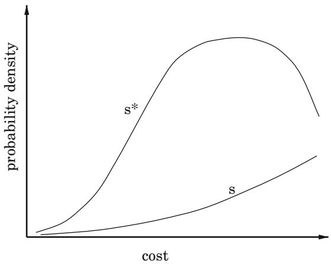

Fig. 5.1 Probability densities of costs. The curve labeled s indicates the left tail of the cost density function for all solutions, while the curve labeled $s ^ { * }$ indicates the cost density function for the solutions that are local optima

Now take an s or an $s ^ { * }$ at random. Typically, the cost distribution has a very rapidly rising part at the lowest values. In Fig. 5.1 we show the kind of distributions found in practice for combinatorial optimization problems having a finite solution space. The distribution of costs is bell-shaped, with a mean and variance that is significantly smaller for solutions in $\mathcal { S } ^ { * }$ than for those in S. As a consequence, it is much better to use local search than to sample randomly in $\mathcal { S }$ if one seeks low cost solutions. The essential ingredient necessary for local search is a neighborhood structure. This means that $\mathcal { S }$ is a “space” with some topological structure, not just a set. Having such a space allows one to move from one solution s to a better one in an intelligent way, something that would not be possible if $\mathcal { S }$ were just a set.

Now the question is how to go beyond this use of LocalSearch. More precisely, given the mapping from $\mathcal { S }$ to $S ^ { * }$ , how can one further reduce the costs found without opening up and modifying LocalSearch, leaving it as a “black box” routine?

## 5.2.2 Random Restart

The simplest possibility to improve upon a cost found by LocalSearch is to repeat the search from another starting point. Every $s ^ { * }$ generated is then independent, and the use of multiple trials allows one to reach the lower part of the distribution. Although such a “random restart” approach with independent samplings is sometimes a useful strategy (in particular when all other options fail), it breaks down as the instance size grows because in the limit, the tail of the cost distribution collapses. Indeed, empirical studies [69] and general arguments [112] indicate that local search algorithms on large generic instances lead to costs that: (1) have a mean that is a fixed percentage above the optimum cost; (2) have a distribution that becomes arbitrarily peaked around the mean when the instance size goes to infinity. This second property makes it impossible in practice to find an $s ^ { * }$ whose cost is even a little bit lower percentage-wise than the typical cost. Note, however, that there do exist many solutions of significantly lower cost, it is just that random sampling has a lower and lower probability of finding them as the instance size increases. To reach those configurations, a biased sampling is necessary; this is precisely what is accomplished by a stochastic search.

## 5.2.3 Searching in $\mathcal { S } ^ { * }$

To overcome the problem just mentioned associated with large instance sizes, reconsider what local search does: it takes one solution from $\mathcal { S }$ where $\mathcal { C }$ has a large mean to a solution in $S ^ { * }$ where C has a smaller mean. It is then natural to invoke recursion: use local search to go from $S ^ { * }$ to a smaller space $\mathcal { S } ^ { * * }$ where the mean cost is even lower! That would correspond to an algorithm with one local search nested inside another. Such a construction could be iterated for as many levels as desired, leading to a hierarchy of nested local searches. But upon closer scrutiny, we see that the problem is precisely how to formulate local search beyond the lowest level of the hierarchy: local search requires a neighborhood structure and this is not a priori given. The fundamental difficulty is to define neighbors in $\mathcal { S } ^ { * }$ so that they can be enumerated and accessed efficiently. Furthermore, it is desirable for neighbors in $\mathcal { S } ^ { * }$ to be relatively close according to the distance metric defined in space $\mathcal { S } ;$ if this were not the case, a stochastic search on $\mathcal { S } ^ { * }$ would have little chance of being effective.

Upon further thought, it transpires that one can introduce a good neighborhood structure on $\mathcal { S } ^ { * }$ as follows. First, one recalls that a neighborhood structure on set $\mathcal { S }$ directly induces a neighborhood structure on subsets of $\mathcal { S } ;$ two subsets are neighbors simply if they contain solutions that are neighbors. Second, take these subsets to be the basins of attraction of the solutions in $S ^ { * }$ ; this leads us to associate any $s ^ { * } \in \mathcal { S } ^ { * }$ with its basin of attraction. Then, this immediately provides the “canonical” notion of neighborhood on $\mathcal { S } ^ { * }$ , which can be stated in a simple way: $s _ { 1 } ^ { * }$ and $s _ { 2 } ^ { * }$ are neighbors in $\mathcal { S } ^ { * }$ if their basins of attraction intersect $( \mathbf { i . e . }$ , they contain neighbor solutions in $\mathcal { S } )$ . Unfortunately this definition has the major drawback that one cannot in practice list the neighbors of $s ^ { * }$ because there is no computationally efficient method for finding all solutions s in the basin of attraction of $s ^ { * }$ . Nevertheless, we can stochastically generate neighbors as follows. Starting from $s ^ { * }$ , create a randomized path in $S ,   s _ { 1 }$ $s _ { 2 } ,   \ldots ,   s _ { i } ,$ where $s _ { j + 1 }$ is a neighbor of $s _ { j }$ . Determine the first $s _ { j }$ in this path that belongs to a different basin of attraction so that applying local search to $s _ { j }$ leads to $s ^ { * \prime } \neq s ^ { * }$ . Then $s ^ { * \prime }$ is a neighbor of $s ^ { * }$

Given this procedure, we can in principle perform a local $\mathtt { s e a r c h } ^ { 2 }$ in $S ^ { * }$ . Extending the argument recursively, we see that it would be possible to have an algorithm implementing nested searches, performing local search on $\mathcal { S } ,   \mathcal { S } ^ { * } ,   \mathcal { S } ^ { * * }$ , and so on, in a hierarchical way. Unfortunately, the implementation of a neighbor search at the level of $S ^ { * }$ is too costly computationally because of the number of times one has to execute LocalSearch. Thus we are led to abandon the (stochastic) search for neighbors in $\mathcal { S } ^ { * }$ ; instead we use a weaker notion of closeness which then allows for a fast stochastic search in $\mathcal { S } ^ { * }$ . Our construction leads to a (biased) sampling of $\mathcal { S } ^ { * }$ Such a sampling will be better than a random one if it is possible to find appropriate computational ways to go from one $s ^ { * }$ to another. Finally, one last advantage of this modified notion of closeness is that it does not require basins of attraction to be defined; the local search can then incorporate memory or be non-deterministic, making the method far more general.

<small><span class="docvortex-page-footnote" data-block-type="page_footnote" style="color:#6b7280">1S\*.</span></small>

<small><span class="docvortex-page-footnote" data-block-type="page_footnote" style="color:#6b7280">2 Note that the local search finds neighbors stochastically; generally there is no efficient way to ensure that one has tested all the neighbors of any given s∗.</span></small>

## 5.2.4 Iterated Local Search

We want to explore $\mathcal { S } ^ { * }$ using a walk that steps from one $s ^ { * }$ to a “nearby” one, without the constraint of using only neighbors as defined above. Iterated local search (ILS) achieves this heuristically as follows. Given the current $s ^ { * }$ , we first apply a change or perturbation that leads to an intermediate state $s ^ { \prime }$ (which belongs to $\mathcal { S } )$ . Then LocalSearch is applied to $s ^ { \prime }$ and we reach a solution $s ^ { * / }$ in $\mathcal { S } ^ { * } . \operatorname { I f } s ^ { * \prime }$ passes an acceptance test, it becomes the next element of the walk in $\mathcal { S } ^ { * }$ ; otherwise, we return to $s ^ { * }$ . The resulting walk is a case of a stochastic search in $\mathcal { S } ^ { * }$ , but where neighborhoods are never explicitly introduced. This iterated local search procedure should lead to good biased sampling as long as the perturbations are neither too small nor too large. If they are too small, one will often fall back to $s ^ { * }$ and few new solutions of $S ^ { * }$ will be explored. If on the contrary the perturbations are too large, $s ^ { \prime }$ will be random, there will be no bias in the sampling, and we will recover a random restart type algorithm.

The overall ILS procedure is pictorially illustrated in Fig. 5.2. To be complete, let us note that generally the iterated local search walk will not be reversible; in particular one may sometimes be able to step from $s _ { 1 } ^ { * }$ to $s _ { 2 } ^ { * }$ but not from $s _ { 2 } ^ { * }$ to $s _ { 1 } ^ { * }$ . However, this “unfortunate” aspect of the procedure does not prevent ILS from being very effective in practice.

Since deterministic perturbations may lead to short cycles (for instance of length two), one should randomize the perturbations or make them adaptive to avoid this kind of cycling. If the perturbations depend on any of the previous $s ^ { * }$ , one has a walk in $\mathcal { S } ^ { * }$ with memory. Now the reader may have noticed that aside from the issue of perturbations (which use the structure on $\mathcal { S } )$ , our formalism reduces the problem to that of a stochastic search on $S ^ { * }$ . Then all bells and whistles (diversification, intensification, tabu, adaptive perturbations and acceptance criteria, etc. . . . ) that are commonly used in that context may be applied here. This leads us to define iterated local search as a metaheuristic having the high level architecture given by Algorithm 1.

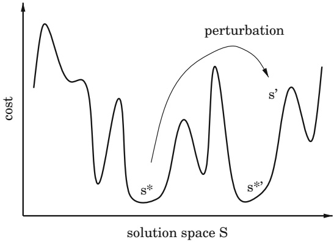

Fig. 5.2 Pictorial representation of iterated local search. Starting with a local minimum $s ^ { * } .$ , we apply a perturbation leading to a solution $s ^ { \prime } .$ After applying LocalSearch, we find a new local minimum $s ^ { * \prime }$ that may be better than $s ^ { * }$

<div class="docvortex-algorithm" style="white-space: pre-wrap; font-family:monospace;">
Algorithm 1 Iterated local search
$s_0 = \text{GenerateInitialSolution}$
$s^* = \text{LocalSearch}(s_0)$
repeat
    $s' = \text{Perturbation}(s^*, \text{history})$
    $s^{*\prime} = \text{LocalSearch}(s')$
    $s^* = \text{AcceptanceCriterion}(s^*, s^{*\prime}, \text{history})$
until termination condition met
</div>

In practice, much of the potential complexity of ILS is hidden in the history dependence. If there happens to be no such dependence, the walk has no memory<sup>3</sup>: the perturbation and acceptance criterion do not depend on any of the solutions visited previously during the walk, and one accepts or not $s ^ { * \prime }$ with a fixed rule. This leads to random walk dynamics on $S ^ { * }$ that are “Markovian”, i. $. e .$ , the probability of making a particular step from $s _ { 1 } ^ { * }$ to $s _ { 2 } ^ { * }$ depends only on $s _ { 1 } ^ { * }$ and $s _ { 2 } ^ { * }$ . Most of the work using ILS has been of this type, though studies show that incorporating memory enhances performance [115].

Staying within Markovian walks, the most basic acceptance criteria will use only the difference in the costs of $s ^ { * }$ and $s ^ { * / }$ ; this type of dynamics for the walk is then very similar in spirit to what occurs in simulated annealing. A limiting case of this is to accept only improving moves, as happens in simulated annealing at zero temperature; the algorithm then does stochastic descent in $\mathcal { S } ^ { * }$ . If we add to such a method a termination criterion, the resulting algorithm pretty much has two nested local searches; to be precise, it has a local search operating on $\mathcal { S }$ embedded in a stochastic search operating on $\mathcal { S } ^ { * }$ . More generally, one can extend this type of algorithm to more levels of nesting, having a different stochastic search algorithm for $S ^ { * }$ , S∗∗ and so on. Each level would be characterized by its own type of perturbation and stopping rule; to our knowledge, such a construction has never been attempted.

<small><span class="docvortex-page-footnote" data-block-type="page_footnote" style="color:#6b7280">3 Recall that to simplify this section’s presentation, the local search is assumed to have no memory.</span></small>

We can summarize this section by saying that the potential power of iterated local search lies in its biased sampling of the set of local optima. The efficiency of this sampling depends both on the kinds of perturbations and on the acceptance criteria. Interestingly, even with the most naïve implementations of these components, iterated local search is much better than random restart. But still much better results can be obtained if the iterated local search modules are optimized. First, the acceptance criteria can be adjusted empirically as in simulated annealing without knowing anything about the problem being optimized. This kind of optimization will be familiar to any user of metaheuristics, though the questions of memory may become quite complex. Second, the perturbation can incorporate as much problem-specific information as the developer is willing to put into it. In practice, a rule of thumb can be used as a guide: “a good perturbation transforms one excellent solution into an excellent starting point for a local search”. Together, these different aspects show that iterated local search algorithms can have a wide range of complexity, but complexity may be added progressively and in a modular way. (Recall in particular that all of the fine-tuning that resides in the embedded local search can be ignored if one wants, and it does not appear in the metaheuristic per se.) This makes iterated local search an appealing metaheuristic for both academic and industrial applications. The cherry on the cake is speed: as we shall see soon, one can perform k local searches embedded within an iterated local search much faster than if the k local searches are run with random restart.

## 5.3 Getting High Performance

Given all these advantages, we hope the reader is now motivated to go on and consider the more nitty-gritty details that arise when developing an ILS algorithm for a new application. In this section, we will illustrate the main issues that need to be tackled when optimizing an ILS algorithm in order to achieve high performance.

There are four components to consider: GenerateInitialSolution, LocalSearch, Perturbation, and AcceptanceCriterion. Before attempting to develop a state-of-the-art algorithm, it is relatively straightforward to develop a more basic version of ILS. Indeed, (1) one can start with a random solution or one returned by some greedy construction heuristic; (2) for most problems a local search algorithm is readily available; (3) for the perturbation, a random move in a neighborhood of higher order than the one used by the local search algorithm can be surprisingly effective; and (4) a reasonable first guess for the acceptance criterion is to force the cost to decrease, corresponding to a stochastic first-improvement algorithm in $\mathcal { S } ^ { * }$ . Basic ILS implementations of this type usually lead to much better performance than random restart approaches. The developer can then run this basic ILS to build his intuition and try to improve the overall algorithm performance by improving each of the four modules. This should be particularly effective if it is possible to take into account the specificities of the combinatorial optimization problem under consideration. In practice, this tuning is easier for ILS than for other, less modular metaheuristics. The reason may be that the complexity of ILS is reduced by its modularity, the function of each component being relatively easy to understand. Finally, the last task to consider is the overall optimization of the ILS algorithm; indeed, the different components affect one another and so it is necessary to understand their interactions. However, because these interactions are so problem dependent, we wait till the end of this section before discussing that kind of “global” optimization.

Perhaps the main message here is that the developer can choose the level of optimization he wants. In the absence of any optimizations, ILS is a simple, easy to implement, and quite effective metaheuristic. But with further work on its four components, ILS can often be turned into a very competitive or even state-of-the-art algorithm.

## 5.3.1 Initial Solution

Local search applied to the initial solution $s _ { 0 }$ gives the starting point $s _ { 0 } ^ { * }$ of the walk in $\mathcal { S } ^ { * }$ . Starting with a good $s _ { 0 } ^ { * }$ can be important if high-quality solutions are to be reached as fast as possible.

Standard choices for $s _ { 0 }$ are either a random initial solution or a solution returned by a greedy construction heuristic. A greedy initial solution $s _ { 0 }$ has two main advantages over random starting solutions: (1) when combined with local search, greedy initial solutions often result in better quality solutions $s _ { 0 } ^ { * } ;   ( 2 )$ a local search from greedy solutions takes, on average, less improvement steps and therefore the local search requires less CPU time.<sup>4</sup>

<small><span class="docvortex-page-footnote" data-block-type="page_footnote" style="color:#6b7280">4 Note that the best possible greedy initial solution need not be the best choice when combined with a local search. For example, in [69], it is shown that the combination of the Clarke-Wright starting tour (one of the best performing TSP construction heuristics) with local search resulted in worse local optima than starting from random initial solutions when using 3-opt. Additionally, greedy algorithms which generate very high quality initial solutions can be quite time-consuming.</span></small>

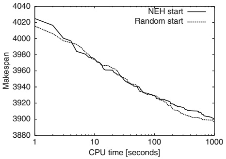

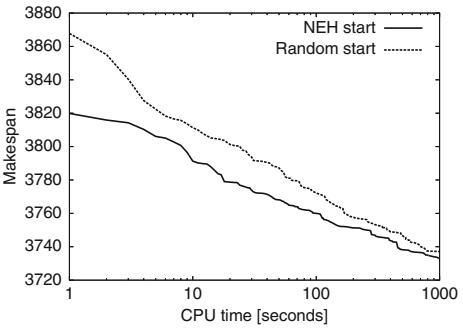

Fig. 5.3 The plots show the average solution cost (makespan on the y-axis) as a function of CPU time (given on the x-axis) for an ILS algorithm applied to the PFSP on instances ta051 and ta056

The question of an appropriate initial solution for (random restart) local search carries over to ILS because of the dependence of the walk in $\mathcal { S } ^ { * }$ on $s _ { 0 } ^ { * } .$ Indeed, when starting with a random $s _ { 0 }$ , ILS may take several iterations to catch up in quality with runs using an $s _ { 0 } ^ { * }$ obtained by a greedy initial solution. Hence, for short computation times the initial solution is certainly important to achieve the highest possible solution quality. For larger computation times, the dependence on $s _ { 0 }$ of the final solution returned by ILS reflects just how fast, if at all, the memory of the initial solution is lost when performing the walk in $\mathcal { S } ^ { * }$

Let us illustrate the tradeoffs between random and greedy initial solutions when using an ILS algorithm for the permutation flow shop problem (PFSP) [114]. That ILS algorithm uses a straightforward local search implementation, random perturbations, and only accepts better quality solutions in the acceptance test. In Fig. 5.3 we show how the average solution cost (makespan) evolves with the number of iterations for two instances. The averages are for 10 independent runs when starting from random initial solutions or from initial solutions returned by the NEH heuristic [98]. (NEH is one of the best performing constructive heuristics for the PFSP.) For short runs, the curve for the instance on the right shows that the NEH initial solutions lead to better average solution cost than random initial solutions. But, for longer times, the picture is not so clear. Sometimes, random initial solutions lead to better average results as observed on the instance on the left. This kind of test was also performed for ILS applied to the TSP [3]. Again it was observed that the initial solution had a significant influence on quality for short to medium sized runs.

In general, there will not always be a clear-cut answer regarding the best choice of an initial solution, but greedy initial solutions appear to be recommendable when one needs low-cost solutions quickly. For much longer runs, the initial solution seems to be less relevant, so the user can choose the initial solution which is the easiest to implement. If, however, one has an algorithm where the influence of the initial solution does persist for long times, the ILS walk is probably having difficulty in exploring $\mathcal { S } ^ { * }$ and so other perturbations or acceptance criteria should be considered.

## 5.3.2 Perturbation

The main drawback of iterative improvement is that it gets trapped in local optima that are significantly worse than the global optimum. Much like simulated annealing, ILS escapes from local optima by applying perturbations to the current local minimum. We will refer to the strength of a perturbation as the number of solution components that are modified. For the TSP, for example, it is the number of edges that are modified in the tour, while in the flow shop problem, it is the number of jobs which are moved by the perturbation. Generally, the local search should not be able to undo the perturbation, otherwise one will fall back into the local optimum just visited. Surprisingly, a random move in a neighborhood of higher order than the one used by the local search algorithm can often achieve this and will lead to a satisfactory algorithm. Still better results can be obtained if the perturbations take into account properties of the problem and are well matched to the local search algorithm.

By how much should the perturbation change the current solution? If the perturbation is too strong, ILS may behave like a random restart, so better solutions will only be found with a very low probability. On the other hand, if the perturbation is too small, the local search will often fall back into the local optimum just visited and the diversification of the search will be very limited. An example of a simple but effective perturbation for the TSP is the double-bridge move. This perturbation cuts four edges (and is thus of “strength” four) and introduces four new ones as shown in Fig. 5.4. Notice that each bridge is a two-change, but neither of the two-changes individually keeps the tour connected. Nearly all ILS studies of the TSP have incorporated this kind of perturbation, and it has been found to be effective for all instance sizes. This is almost certainly because it changes the topology of the tour and can operate on quadruples of very distant cities, whereas local search always modifies the tour among nearby cities. In effect, the double-bridge perturbation cannot be undone easily, neither by simple local search algorithms such as 2-opt or 3-opt, nor by most local search algorithms based on the Lin-Kernighan heuristic [80], which is currently the champion local search algorithm for the TSP. (Only very few local searches include such double-bridge changes in the search, the best known being the Lin-Kernighan implementation of Helsgaun [57, 58].) Furthermore, this perturbation does not increase much the tour length, so even if the current solution is very good, one is almost sure the next one will be good, too. These two properties of the perturbation—its small strength and its fundamentally different nature from the changes used in local search—make the TSP the perfect application for ILS.

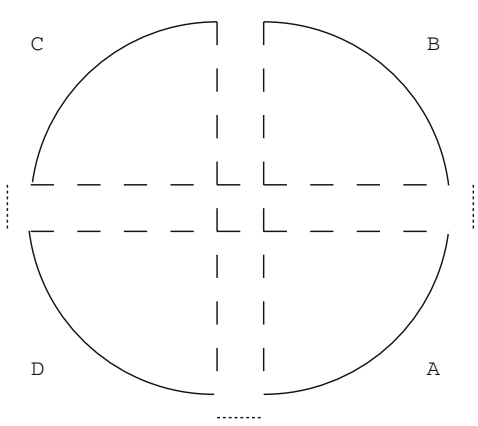

Fig. 5.4 Schematic representation of the double-bridge move. The four dotted edges are removed and the remaining parts A, B, C, D are reconnected by the dashed edges

We will now consider optimizing the perturbation assuming the other modules to be fixed. In problems like the TSP, one can hope to have a satisfactory ILS when using perturbations of fixed size (independent of the instance size). On the contrary, for more difficult problems, fixed-strength perturbations may lead to poor performance. Of course, the strength of the perturbations used is not the whole story; their nature is almost always very important and will also be discussed. Finally we will close by pointing out that the perturbation strength has an effect on the speed of the local search: weak perturbations usually lead to faster execution of LocalSearch. All these different aspects need to be considered when optimizing this module.

## 5.3.2.1 Perturbation Strength

For some problems, an appropriate perturbation strength is very small and seems to be rather independent of the instance size. This is the case for both the TSP and the PFSP, and, interestingly, ILS for these problems is very competitive with today’s best metaheuristic methods. We can also consider other problems where one is driven instead to large perturbation sizes. Consider the example of an ILS algorithm for the quadratic assignment problem (QAP). We use an embedded 2-opt local search algorithm, the perturbation is a random exchange of the location of k items, where k is an adjustable parameter, and the acceptance criterion only accepts better quality solutions. We applied this ILS algorithm to QAPLIB instances<sup>5</sup> from four different classes of QAP instances [120]; computational results are given in Table 5.1. A first observation is that the best perturbation size is strongly dependent on the particular instance. For two of the instances, the best performance was achieved when as many as 75% of the solution components were altered by the perturbation. Additionally, when the perturbation strength is too small, the ILS performed worse than random restart (corresponding to the perturbation strength n). However, the fact that random restart for the QAP may perform—on average— better than a basic ILS algorithm is a bit misleading: in the next section we will show that by modifying a bit the acceptance criterion, ILS becomes far better than random restart. Thus, one should keep in mind that the optimization of an ILS algorithm may require more than the optimization of the individual components.

<small><span class="docvortex-page-footnote" data-block-type="page_footnote" style="color:#6b7280">5 QAPLIB is accessible at [http://www.seas.upenn.edu/qaplib](http://www.seas.upenn.edu/qaplib).</span></small>

Table 5.1 The first column gives the identifier of the QAP instance; the number in the identifier gives its size n

| Instance 3 n/12 n/6 n/4 n/3 n/2 | 3n/4 n |
| --- | --- |
| kra30a 2.51 2.51 2.04 1.06 0.83 0.42 | 0.0 0.77 |
| sko64 0.65 1.04 0.50 0.37 0.29 0.29 | 0.82 0.93 |
| tai60a 2.31 2.24 1.91 1.71 1.86 2.94 | 3.13 3.18 |
| tai60b 2.44 0.97 0.67 0.96 0.82 0.50 | 0.14 0.43 |

The successive columns are for perturbation sizes 3, $, n / 12, \cdots, n.  A$ perturbation of size n corresponds to random restart. The table shows the average solution cost measured across 10 independent runs for each instance. The CPU-time for each trial is 30 s. for kra30a, 60 s. for tai60a and sko64, and 120 s. for tai60b on a Pentium III 500 MHz PC

## 5.3.2.2 Adaptive Perturbations

The behavior of ILS for the QAP and also for other combinatorial optimization problems [59, 114, 116] shows that there is no a priori single best size for the perturbation. This observation motivates the possibility of modifying the perturbation strength and adapting it during the run.

To this end, one approach is to exploit the search history. For the development of such schemes, inspiration can be taken from what is done in the context of reactive search [9, 10]. In particular, Battiti and Protasi proposed a reactive search algorithm for MAX-SAT, which fits perfectly into the ILS framework [9]. They perform a perturbation scheme which is implemented by a tabu search algorithm and after each perturbation they apply a standard local improvement algorithm. An alternative is to use feedback from the search process to adapt the choice of the perturbation operators [19].

Another way of adapting the perturbation is to change its strength during the search according to an a priori defined scheme. One particular example is employed in basic variable neighborhood search (basic VNS) [53, 95]; we refer to Sect. 5.5 for some explanations on VNS. Other examples arise in the context of tabu search [49]. In particular, ideas such as strategic oscillations may be useful to derive more effective perturbations.

## 5.3.2.3 More Complex Perturbation Schemes

Perturbations can be more complex than random changes in a higher order neighborhood. One rather general procedure to generate $s ^ { \prime }$ from the current $s ^ { * }$ is as follows. First, gently modify the definition of the instance, e.g., via the parameters defining the various costs. Second, for this modified instance, run LocalSearch using $s ^ { * }$ as input; the output is the perturbed solution $s ^ { \prime } .$ Interestingly, this is the method proposed in the oldest ILS work we are aware of: Baxter tested this approach with success on a location problem [13]. This idea seems to have been rediscovered later by Codenotti et al. in the context of the TSP [26]. They first change slightly the city coordinates. Then they apply the local search to $s ^ { * }$ using the perturbed city locations, obtaining the new tour $s ^ { \prime } .$ Finally, running LocalSearch on $s ^ { \prime }$ using the unperturbed city coordinates, they obtain the new candidate tour $s ^ { * / }$

Other sophisticated ways to generate good perturbations consist in optimizing a sub-part of the problem. Such an approach was proposed by Lourenço [82] in the context of the job shop scheduling problem (JSP). Her perturbation schemes are based on defining one- or two-machine sub-problems by fixing a number of variables in the current solution and solving these sub-problems, either heuristically [83] or to optimality using for instance Carlier’s exact algorithm [22] or the early-late algorithm [83]. These schemes work well because: (1) local search is unable to undo the perturbations; (2) after the perturbation, the solutions tend to be very good and also have “new” parts that are optimized. Even evolutionary algorithms have been used to generate perturbations for ILS algorithms [85]. The idea in this approach is to generate a small initial population of solutions by perturbing the best-so-far solution, to perform a short run of a GA with this population and then to use the best solution found in this process as a new starting solution for the local search.

## 5.3.2.4 Speed

In the context of “easy” problems where ILS can work very well with weak (fixed size) perturbations, there is another reason why that metaheuristic can perform much better than random restart: Speed. Indeed, LocalSearch will usually execute much faster on a solution obtained by applying a small perturbation to a local optimum than on a random solution. As a consequence, iterated local search can run many more local searches than random restart for the same CPU time. As a qualitative example, consider again Euclidean TSPs. $\mathcal { O } ( n )$ local changes have to be applied by the local search to reach a local optimum from a random starting solution, whereas empirically a nearly constant number is necessary in ILS when using the $s ^ { \prime }$ obtained with the double-bridge perturbation. Hence, in a given amount of CPU time, ILS can sample many more local optima than random restart can. This speed factor can give ILS a considerable advantage over other restart schemes.

Let us illustrate this speed factor quantitatively. We compared the number of local searches performed in a given amount of CPU time for the TSP by: (1) random restart; (2) ILS using a double-bridge move; (3) ILS using five simultaneous double-bridge moves. (For both ILS implementations, we used random starting solutions and the routine AcceptanceCriterion accepted only shorter tours.) For our numerical tests we used a 3-opt implementation with standard speed-up techniques. In particular, it used a fixed radius nearest neighbor search restricted to candidate lists with the 40 nearest neighbors of each city and “don’t look” bits [15, 69, 88]. Initially, all don’t look bits were turned off (set to 0). If no improving move was found for a given node, its don’t look bit was turned on (set to 1) and the node was not considered as a starting node for finding an improving move in the next iteration. When an arc incident to a node was changed by a move, the node’s don’t look bit was turned off again. In addition, after a perturbation we only turned off the don’t look bits of the 25 cities around each of the four breakpoints in the current tour. All three algorithms were run for 120 s on a 266 MHz Pentium II processor on a set of $\mathrm { T S P L I B ^ { 6 } }$ instances ranging from 100 up to 5915 cities. Results are given in Table 5.2. For the smallest instances, we see that iterated local search ran between 2 and 10 times as many local searches as random restart. This advantage of ILS grows fast with increasing instance size: for the largest instance, the first ILS algorithm ran approximately 260 times as many local searches as random restart in the available time. Obviously, this speed advantage of ILS over random restart is strongly dependent on the strength of the applied perturbation. The larger the perturbation size, the more the solution is modified and generally the longer the subsequent local search takes. This fact is intuitively obvious and it is confirmed in Table 5.2.

In summary, the optimization of the perturbations depends on many factors, and problem-specific characteristics play a central role. It is important to keep in mind that the perturbations interact with the other components of ILS. We will discuss these interactions in Sect. 5.3.5.

Table 5.2 The first column gives the identifier of the TSP instance, where the number in the identifier specifies the number of cities

| Instance | #LSRR | #LS1-DB | #LS5-DB |
| --- | --- | --- | --- |
| kroA100 | 17,507 | 56,186 | 34,451 |
| d198 | 7715 | 36,849 | 16,454 |
| lin318 | 4271 | 25,540 | 9430 |
| pcb442 | 4394 | 40,509 | 12,880 |
| rat783 | 1340 | 21,937 | 4631 |
| pr1002 | 910 | 17,894 | 3345 |
| pcb1173 | 712 | 18,999 | 3229 |
| d1291 | 835 | 23,842 | 4312 |
| fl1577 | 742 | 22,438 | 3915 |
| pr2392 | 216 | 15,324 | 1777 |
| pcb3038 | 121 | 13,323 | 1232 |
| fl3795 | 134 | 14,478 | 1773 |
| rl5915 | 34 | 8820 | 556 |

The next columns give the number of local searches performed when using: (1) random restart (#LS<sub>RR</sub>); (2) ILS with a single double-bridge perturbation $( \# \mathrm { L S } _ { 1 - D B } ) ;$ (3) ILS with a five doublebridge perturbation (#LS<sub>5−D</sub>B). All algorithms were run for 120 s on a PC with a 266 MHz Pentium processor

<small><span class="docvortex-page-footnote" data-block-type="page_footnote" style="color:#6b7280">6 TSPLIB is accessible at www.iwr.uni-heidelberg.de/groups/comopt/software/TSPLIB95.</span></small>

## 5.3.3 Acceptance Criterion

ILS does a randomized walk in $\mathcal { S } ^ { * }$ , the space of local minima. The perturbation mechanism together with the local search defines the possible transitions between a current solution $s ^ { * }$ in $\mathcal { S } ^ { * }$ to a “neighboring” solution $s ^ { * \prime }$ also in $S ^ { * }$ . The procedure AcceptanceCriterion then determines whether $s ^ { * / }$ is accepted or not as the new current solution. AcceptanceCriterion has a strong influence on the nature and effectiveness of the walk in $\mathcal { S } ^ { * }$ . Roughly, it can be used to control the balance between intensification and diversification of that search. A simple way to illustrate this is to consider a Markovian acceptance criterion. A very strong intensification is achieved if only better solutions are accepted. We call this acceptance criterion Better and it is defined for minimization problems as:

$$
\text {Better} (s ^ {*}, s ^ {* \prime}, h i s t o r y) = \left\{ \begin{array}{l l} s ^ {* \prime} & \text {if} \mathcal {C} (s ^ {* \prime}) <   \mathcal {C} (s ^ {*}) \\ s ^ {*} & \text {otherwise.} \end{array} \right.\tag{5.1}
$$

At the opposite extreme is the random walk acceptance criterion (denoted by RW) which always applies the perturbation to the most recently visited local optimum, irrespective of its cost:

$$
\mathbb {R} \mathrm{W} (s ^ {*}, s ^ {* ^ {\prime}}, h i s t o r y) = s ^ {* ^ {\prime}}.\tag{5.2}
$$

This criterion clearly favors diversification over intensification.

Many intermediate choices between these two extreme cases are possible. In one of the first ILS algorithms, the large-step Markov chain (LSMC) algorithm proposed by Martin et al. [88, 89], a simulated annealing type acceptance criterion was applied. We call it $\mathtt { L S M C } ( s ^ { * } , s ^ { * \prime } , h i s t o r y )$ . In particular, $s ^ { * \prime }$ is always accepted if it is better than $s ^ { * }$ . Otherwise, if $s ^ { * \prime }$ is worse than $s ^ { * } , \; s ^ { * \prime }$ is accepted with probability exp $\{ ( \mathcal { C } ( s ^ { * } ) - \mathcal { C } ( s ^ { * \prime } ) ) / T \}$ where T is a parameter called temperature, which is usually lowered during the run as in simulated annealing. Note that LSMC approaches the RW acceptance criterion if $T$ is very high, while at very low temperatures LSMC is similar to the Better acceptance criterion. An interesting possibility for LSMC is to allow non-monotonic temperature schedules as proposed for simulated annealing [63] or tabu thresholding [47]. This can be most effective if it is done using memory: when further intensification no longer seems useful, increase the temperature to do diversification for a limited time, then resume intensification. Of course, just as in tabu search, it is desirable to do this in an automated and self-regulating manner [49].

A very limited usage of memory in the acceptance criterion is to restart the ILS algorithm when the intensification seems to become ineffective. (Of course, this is a rather extreme way to switch from intensification to diversification.) For instance one can restart the ILS algorithm from a new initial solution if no improved solution has been found for a given number of iterations. The restart of the algorithm can easily be modeled by the acceptance criterion Restart $( s ^ { * } , s ^ { * \prime }$ , history). Let $i _ { l a s t }$ be the last iteration where a better solution has been found and i be the iteration counter. Then Restart $( s ^ { * } , s ^ { * \prime } , h i s t o r y )$ is defined as

$$
\text {Restart} (s ^ {*}, s ^ {* ^ {\prime}}, h i s t o r y) = \left\{ \begin{array}{l l} s ^ {* ^ {\prime}} & \quad \text {if} \mathcal {C} (s ^ {* ^ {\prime}}) <   \mathcal {C} (s ^ {*}) \\ s & \quad \text {if} \mathcal {C} (s ^ {* ^ {\prime}}) \geq \mathcal {C} (s ^ {*}) \text {and} i - i _ {l a s t} > i _ {r} \\ s ^ {*} & \quad \text {otherwise.} \end{array} \right.\tag{5.3}
$$

where $i _ { r }$ is a parameter that indicates that the algorithm should be restarted if no improved solution was found for $i _ { r }$ iterations. Typically, s can be generated in different ways. The simplest strategy is to generate a new solution randomly or by a greedy randomized heuristic. Clearly many other ways to incorporate memory may and should be considered, the overall efficiency of ILS being quite sensitive to the acceptance criterion applied. We now illustrate this with two examples.

Table 5.3 Influence of the acceptance criterion for various TSP instances

| Instance | Δ<sub>avg</sub>(RR) | Δ<sub>avg</sub>(RW) | Δ<sub>avg</sub>(Better) |
| --- | --- | --- | --- |
| kroA100 | 0.0 | 0.0 | 0.0 |
| d198 | 0.003 | 0.0 | 0.0 |
| lin318 | 0.66 | 0.30 | 0.12 |
| pcb442 | 0.83 | 0.42 | 0.11 |
| rat783 | 2.46 | 1.37 | 0.12 |
| pr1002 | 2.72 | 1.55 | 0.14 |
| pcb1173 | 3.12 | 1.63 | 0.40 |
| d1291 | 2.21 | 0.59 | 0.28 |
| fl1577 | 10.3 | 1.20 | 0.33 |
| pr2392 | 4.38 | 2.29 | 0.54 |
| pcb3038 | 4.21 | 2.62 | 0.47 |
| fl3795 | 38.8 | 1.87 | 0.58 |
| rl5915 | 6.90 | 2.13 | 0.66 |

The first column gives the identifier of the TSP instance, where the number in the identifier specifies the number of cities. The next columns give the average percentage over the optimal tour length obtained using: random restart (RR), iterated local search with RW, and iterated local search with Better. The results are averaged over 10 independent runs. All algorithms were run for 120 s on a PC with a 266 MHz Pentium processor

## 5.3.3.1 Example 1: TSP

Let us consider the effect of the two acceptance criteria RW and Better. We performed our tests on the TSP as summarized in Table 5.3. We give the average percentage over the known optimal solutions when using 10 independent runs on our set of benchmark instances. In addition, we also give this number for the random restart 3-opt algorithm. First, we observe that both ILS algorithms lead to a significantly better average solution quality than random restart using the same local search. This is particularly true for the largest instances, confirming the claims made in Sect. 5.2. Second, given that one expects good solutions for the TSP to cluster (see

Sect. 5.3.5), a good strategy should incorporate intensification. It is thus not surprising to see that the Better criterion leads to shorter tours than the RW criterion.

The runs given in this example are rather short. For much longer runs, the Better strategy comes to a point where it no longer finds improved tours. In fact, an analysis of ILS algorithms based on the run-time distribution methodology [62] has shown that such stagnation situations effectively occur and that the performance of the ILS algorithm can be considerably improved by additional diversification mechanisms [117], an occasional restart of the ILS algorithm being the conceptually simplest case.

Table 5.4 Further tests on the QAP benchmark instances using the same perturbations and CPU times than for Table 5.1; given is the average solution cost measured across 10 independent runs for each instance

| Instance | Acceptance | 3 | n/12 | n/6 | n/4 | n/3 | n/2 | 3n/4 | n |
| --- | --- | --- | --- | --- | --- | --- | --- | --- | --- |
| kra30a | Better | 2.51 | 2.51 | 2.04 | 1.06 | 0.83 | 0.42 | 0.0 | 0.77 |
| kra30a | RW | 0.0 | 0.0 | 0.0 | 0.0 | 0.0 | 0.02 | 0.47 | 0.77 |
| kra30a | Restart | 0.0 | 0.0 | 0.0 | 0.0 | 0.0 | 0.0 | 0.0 | 0.77 |
| sko64 | Better | 0.65 | 1.04 | 0.50 | 0.37 | 0.29 | 0.29 | 0.82 | 0.93 |
| sko64 | RW | 0.11 | 0.14 | 0.17 | 0.24 | 0.44 | 0.62 | 0.88 | 0.93 |
| sko64 | Restart | 0.37 | 0.31 | 0.14 | 0.14 | 0.15 | 0.41 | 0.79 | 0.93 |
| tai60a | Better | 2.31 | 2.24 | 1.91 | 1.71 | 1.86 | 2.94 | 3.13 | 3.18 |
| tai60a | RW | 1.36 | 1.44 | 2.08 | 2.63 | 2.81 | 3.02 | 3.14 | 3.18 |
| tai60a | Restart | 1.83 | 1.74 | 1.45 | 1.73 | 2.29 | 3.01 | 3.10 | 3.18 |
| tai60b | Better | 2.44 | 0.97 | 0.67 | 0.96 | 0.82 | 0.50 | 0.14 | 0.43 |
| tai60b | RW | 0.79 | 0.80 | 0.52 | 0.21 | 0.08 | 0.14 | 0.28 | 0.43 |
| tai60b | Restart | 0.08 | 0.08 | 0.005 | 0.02 | 0.03 | 0.07 | 0.17 | 0.43 |

Here we consider three different choices for the acceptance criterion. Clearly, the inclusion of diversification significantly lowers the average cost found

## 5.3.3.2 Example 2: QAP

Let us come back to ILS for the QAP. For this problem we found that the acceptance criterion Better together with a poor choice of the perturbation strength could result in worse performance than random restart. In Table 5.4 we give results for the same ILS algorithm except that we now also consider the use of the RW and Restart acceptance criteria. We see that the performance of the ILS algorithms using these acceptance criteria are much better than random restart, the only exception being for the ILS algorithm with RW for a small perturbation strength on tai60b.

This example shows that there are strong interdependencies between the perturbation strength and the acceptance criterion. This dependency is rarely completely understood. But, as a general rule of thumb, when it is necessary to allow for diversification, we believe it is best to do so by accepting numerous small perturbations rather than by accepting one large perturbation.

Most of the acceptance criteria applied so far in ILS algorithms are either fully Markovian or make use of the search history in a very limited way. We expect that there will be many more ILS applications in the future making strong use of the search history; in particular, alternating between intensification and diversification is likely to be an essential feature in these applications.

## 5.3.4 Local Search

So far we have treated the local search algorithm as a black box, which is called many times by ILS. Since the behavior and performance of the over-all ILS algorithm is quite sensitive to the choice of the embedded heuristic, one should optimize this choice whenever possible. In practice, there may be many quite different algorithms that can be used for the embedded heuristic. (As mentioned at the beginning of the chapter, the heuristic needs not even be a local search.) One might think that the better the local search, the better the corresponding ILS. Often this is true. For instance in the context of the TSP, Lin-Kernighan [80] is a better local search than 3- opt, which itself is better than 2-opt [69]. Using a fixed type of perturbation such as the double-bridge move, one finds that iterated Lin-Kernighan gives better solutions than iterated 3-opt which itself gives better solutions than iterated 2-opt [69, 117]. But if we assume that the total computation time is fixed, it might be better to apply more frequently a faster but less effective local search algorithm than a slower and more powerful one. Clearly, which choice is best depends on just how much more time is needed to run the better heuristic. If the speed difference is not large, for example if it is independent of the instance size, then it usually worth using the better heuristic. This is the most frequent case; in the TSP, 3-opt is a bit slower than 2-opt, but the improvement in quality of the tours is well worth the extra CPU time, be it using random restart or iterated local search. The same comparison applies to using Lin-Kernighan rather than 3-opt. However, there are other cases where the increase in CPU time is so large compared to the improvement in solution quality that it is best not to use the “better” local search. For example, again in the context of the TSP, it is known that 4-opt gives slightly better solutions than 3-opt, but in standard implementations it is O(n) times slower (n being the number of cities). It is then better not to use 4-opt as the local search embedded in ILS.

There are also other aspects that should be considered when selecting a local search. Clearly, there is not much point in having an excellent local search if it will systematically undo the perturbation; however this issue is one of globally optimizing iterated local search, so it will be postponed till the next subsection. Another important aspect is whether one can really get the speed-ups that were mentioned in Sect. 5.3.2. There we saw that a standard speed-up for local search was to introduce don’t look bits. They give a large gain in speed if the bits can also be reset after the application of the perturbation. This requires that the developer be able to access the source code of LocalSearch. A state-of-the-art ILS algorithm will take advantage of all possible speed-up tricks, and thus the LocalSearch most likely will not be a true black box.

Finally, there may be some advantages in allowing LocalSearch to sometimes generate worse solutions. For instance, if we replace the local search heuristic by tabu search or short simulated annealing runs, the corresponding ILS may perform better. This seems most promising when standard iterative improvement algorithms perform poorly. This is indeed the case in the job-shop scheduling problem: the use of tabu search as the embedded heuristic gives rise to a very effective iterated local search [84].

## 5.3.5 Global Optimization of ILS

So far, we have considered representative issues arising when optimizing separately each of the four components of an iterated local search. In particular, when illustrating various important characteristics of one component, we kept the other components fixed. But clearly the optimization of one component depends on the choices made for the others; as an example, we made it clear that a good perturbation must have the property that it cannot be easily undone by the local search. Thus, one should tackle the global optimization of an ILS. Since at present there is no significant theory for analyzing a metaheuristic such as iterated local search to support its configuration, we will first give a rough idea of how such a global optimization can be done in a manual algorithm engineering process. Over the recent years, the engineering of effective algorithms has been made increasingly automated through the usage of automatic algorithm configuration techniques and we will also shortly discuss the possibilities these offer.

If we reconsider the subsection on the effect of the initial solution, we see that GenerateInitialSolution is to a large extent irrelevant when the ILS performs well and rapidly loses the memory of its starting point. Hereafter we assume that this is the case; then the optimization of GenerateInitialSolution can be ignored and we are left with the joint optimization of the three other components. Clearly the best choice of Perturbation depends on the choice of LocalSearch while the best choice of AcceptanceCriterion depends on the choices of LocalSearch and Perturbation. In practice, we can approximate this global optimization problem by successively optimizing each component, assuming the others are fixed until no improvements are found for any of the components [36]. Thus the only difference with what has been presented in the previous sub-sections is that the optimization has to be iterative. This does not guarantee global optimization of the ILS, but it should lead to an adequate optimization of the overall algorithm.

Given these approximations, we should be more precise about what we want to optimize. For most users, it will be the mean (over starting solutions) of the best cost found during a run of a given length. Then the “best” choice for the different components is a well defined problem, though it is intractable without further restrictions. Furthermore, in general, the detailed instance that will be considered by the user is not known ahead of time, so it is important that the resulting ILS algorithm be robust. Thus it is preferable not to optimize it to the point where it is sensitive to the details of the instance. This robustness seems to be achieved in practice: researchers implement versions of iterated local search with a reasonable level of global optimization, and then test with some degree of success the performance on standard benchmarks.

At the risk of repeating ourselves, let us highlight the main dependencies of the components:

1. The perturbation should not be easily undone by the local search; if the local search has obvious shortcomings, a good perturbation should compensate for them.

2. The combination Perturbation–AcceptanceCriterion determines the relative balance of intensification and diversification; large perturbations are only useful if they can be accepted, which occurs only if the acceptance criterion is not too biased towards better solutions.

As a general guideline, LocalSearch should be as powerful as possible as long as it is not too costly in CPU time. Given such a choice, find a well adapted perturbation following the discussion in Sect. 5.3.2; to the extent possible, take advantage of the structure of the problem. Finally, set the AcceptanceCriterion routine so that $\mathcal { S } ^ { * }$ is sampled adequately. With this point of view, the overall optimization of the ILS is nearly a bottom-up process, but with iteration. Perhaps the core issue is what to put into Perturbation. In particular, is it possible to consider only weak perturbations? From a theoretical point of view, the answer to this question depends on whether the best solutions “cluster” in $\mathcal { S } ^ { * }$ . In some problems (and the TSP is one of them), there is a strong correlation between the cost of a solution and its “distance” to the optimum: in effect, the best solutions cluster together, i.e., have many similar components. This has been referred to in many different ways: “Massif Central” phenomenon [44], principle of proximate optimality [49], and replica symmetry [93]. If the problem under consideration has this property, it is not unreasonable to hope to find the true optimum using a biased sampling of $S ^ { * }$ . In particular, it is clear that it is useful to use intensification to improve the probability of hitting the global optimum.

There are, however, other types of problems where the clustering is incomplete, i.e., where very distant solutions can be nearly as good as the optimum. Examples of combinatorial optimization problems in this category are QAP, graph bi-section, and MAX-SAT. When the space of solutions has this property, new strategies have to be used. Clearly, it is still necessary to use intensification to get the best solution in one’s current neighborhood, but generally this will not lead to the optimum. After an intensification phase, one must explore other regions of $\mathcal { S } ^ { * }$ . This can be attempted by using “large” perturbations whose strength grows with the instance. Other possibilities are to restart the algorithm from scratch and repeat another intensification phase or by oscillating the acceptance criterion between intensification and diversification phases. Additional ideas on the tradeoffs between intensification and diversification are well discussed in the context of tabu search (see, for example, [49]). Clearly, finding an appropriate balance of intensification vs. diversification is very important but still a challenging problem.

The steps outlined above are those generally followed in a manual algorithm engineering process. In that case, it is important to carefully understand the main dependencies between the algorithm components and to reduce the algorithm design space to the most promising part. Over the last few years, however, the availability of algorithmic techniques that automate the parameter setting and configuration of optimization algorithms and, in particular, metaheuristic algorithms has increased. Some early methods include the usage of F-races [16] and CALIBRA [1]. Over the recent years, a number of powerful general-purpose algorithm configurators have been proposed such as irace [7, 81], ParamILS [64], gender-based genetic algorithms [2], or SMAC [65]. (Interestingly, one of these configurators, ParamILS, is actually itself again an ILS algorithm that searches the algorithm parameter space for high-performing algorithm configurations.) These configurators have shown to be powerful and for a given algorithm skeleton, they reach often significant improvements over default algorithms settings or those obtained in a manual algorithm configuration effort [60, 118]. Maybe more importantly, effective algorithm configuration techniques have the potential to transform the metaheuristic development process and moving it actually towards an automated algorithm design process [61, 118]. When applying such a process to the design of an ILS algorithm, one would implement possible ILS algorithm components inside a freely configurable algorithm framework and then exploit automatic algorithm configuration techniques to search the design space for high-performing algorithm configurations. For more details on such a process, we refer to the chapter authored by Stützle and López-Ibáñez in this Handbook.

## 5.4 Selected Applications of ILS

ILS algorithms have been applied successfully to a variety of combinatorial optimization problems. In some cases, these algorithms achieve extremely high performance and even constitute the current state-of-the-art algorithms, while in other cases the ILS approach is merely competitive with other metaheuristics. In this section, we give an overview of interesting ILS applications, presenting the core ideas of these algorithms to illustrate possible uses of ILS. We put a particular emphasis on the TSP, given its central role in the development of ILS algorithms.

## 5.4.1 ILS for the TSP

The TSP is probably the best-known combinatorial optimization problem. De facto, it is a standard test-bed for the development of new algorithmic ideas: a good performance on the TSP is taken as evidence of the value of such ideas. Like many other metaheuristic algorithms, some of the first ILS algorithms were introduced and tested on the TSP, the oldest case of this being due to Baum [11, 12]. He coined his method iterated descent; his tests used 2-opt as the embedded heuristic, random 3-changes as the perturbations, and imposed the tour length to decrease (thus the name of the method). His results were not impressive, in part because some algorithm components were probably not the most appropriate and also because he tackled non-Euclidean TSPs.

A major improvement in the performance of ILS algorithms came from the large step Markov chain algorithm proposed by Martin et al. [88]. They used the LSMC acceptance criterion (see Sect. 5.3.3) from which the algorithm’s name is derived. They considered both the application of 3-opt local search and the Lin-Kernighan heuristic, which is the best performing local search algorithm for the TSP. But probably the key ingredient of their work is the introduction of the double-bridge move for the perturbation. This choice made the approach very powerful for the Euclidean TSP and encouraged much more work along these lines. In particular, Johnson [68, 69] coined the term “iterated Lin-Kernighan” (ILK) for his implementation of ILS using Lin-Kernighan as the local search. The main differences with the LSMC implementation are: (1) double-bridge moves are random rather than biased; (2) the costs are improving (only better tours are accepted, corresponding to the choice Better in our notation). Since these initial studies, other ILS variants have been proposed; Johnson and McGeoch [69] give a summary of the situation as of 1997 and several additional ILS variants are covered in a 2002 book chapter, which summarizes early results from the 8th DIMACS implementation challenge on the TSP [70].

A high performing ILS algorithm is offered as part of the Concorde software package and it is available for download at [http://www.tsp.gatech.edu/concorde/](http://www.tsp.gatech.edu/concorde/).This chained Lin-Kernighan code has been developed by Applegate, Bixby, Chvatal, and Cook and a detailed description of the code is given in their recent book on the TSP [4]; this book also contains details on an extensive computational study of this code. Noteworthy is also the experimental study by Applegate et al. [3] who performed tests on very large TSP instances with up to 25 million cities. Recently, a new ILS variant has been proposed that further illustrates the impressive performance of ILS algorithms on very large TSP instances. Currently, the iterated Lin-Kernighan variant of Merz and Huhse [92] appears to be the best performing algorithm for very large TSP instances with several millions of cities when the computation times are relatively short (in the range of a few hours on a modern PC as of 2008).

A major leap in TSP solving stems from Helsgaun’s Lin-Kernighan implementation and its iterated version [57]. The main novelty of Helsgaun’s algorithm lies on the local search side: the Lin-Kernighan variant developed is based on more complex basic moves than previous implementations. His iterated version of the Lin-Kernighan heuristic is not really an ILS algorithm like the ones presented in this chapter since the generation of new starting solutions is through a solution construction method. However, the constructive mechanism is very strongly biased towards the incumbent solution, which makes this approach somehow similar to an ILS algorithm. The most recent version of this algorithm, along with an accompanying technical report describing the recent developments, is available for download at [http://www.akira.ruc.dk/\~keld/research/LKH/](http://www.akira.ruc.dk/~keld/research/LKH/).

There are a number of other ILS algorithms for the TSP that not necessarily offer the ultimate state-of-the-art performance but that illustrate various ideas that may be useful in ILS algorithms. One algorithm, which has already been mentioned before, is the one by Codenotti et al. [26]. It gives an example of a complex perturbation scheme, which is based on the modification of the instance data. Various perturbation sizes as well as population-based extensions of ILS algorithms for the TSP have been studied by Hong et al. [59]. The perturbation mechanism is also the focus of the work by Katayama and Narisha [71]. They introduce a new perturbation mechanism, which they called genetic transformation. The genetic transformation mechanism uses two tours, the best found so far, $s _ { b e s t ^ { 1 } } ^ { * }$ , and a second, current local optimum, $s ^ { * }$ . First a random 4-opt move is performed on $s _ { b e s t ^ { \prime } } ^ { * }$ resulting in $s ^ { * \prime }$ . Then the subtours that are shared among $s ^ { * \prime }$ and $s ^ { * }$ are kept and the resulting parts are reconnected with a greedy algorithm. Computational experiments with an iterated Lin-Kernighan algorithm using the genetic transformation method instead of the standard double-bridge move have shown that the approach is effective.

An analysis of the run-time behavior of various ILS algorithms for the TSP is done by Stützle and Hoos [115, 117]; this analysis clearly shows that ILS algorithms with the Better acceptance criterion show a type of stagnation behavior for long run-times. To avoid such stagnation, restarts and a particular acceptance criterion to diversify the search were proposed. The goal of this latter strategy is to force the search, once search stagnation is detected, to continue from a high quality solution that is beyond a certain minimal distance from the current one [117]. As shown in [62], current state-of-the-art algorithms such as Helsgaun’s iterated Lin-Kernighan can also suffer from stagnation behavior and, hence, their performance can be further improved by similar ideas.

Finally, let us mention that ILS algorithms have been used as components of more complex algorithms. A clear example is the tour merging approach [4, 29]. The central idea is to generate a set G of high quality tours by using ILS and then to post-process these solutions further. In particular, in tour merging, the optimal tour (or, if this is not feasible in reasonable computation time, the best possible tour) is produced from fragments of tours occurring in $G .$

## 5.4.2 ILS for Other Routing Problems

Besides the TSP, ILS algorithms have been applied increasingly often to other routing problems, in particular, vehicle routing problems (VRPs). Among the first ILS applications to VRPs, we find the prize-collecting VRP [121], time-dependent VRPs [56], and VRPs with time penalty functions [66]. In the latter article, a dynamic programming algorithm is used to minimize penalties for violating time windows; experimental results with up to 1000 customers show that this ILS was able to reach very high performance and was also efficient. Various other variants of VRPs have been tackled. Vaz Penna et al. consider a variant where the fleet of vehicles is heterogeneous, that is, it consists of vehicles with different characteristics such as different capacities [124]. Palhazi Cuervo et al. [101] propose an ILS algorithm for a VRP with backhauls, where apart from the customer deliveries, suppliers may send back goods to the depot. The proposed ILS algorithm exploits various neighborhoods and allows to move between feasible and infeasible solutions. A VRP with multiple, incompatible commodities and multiple trips per work day is tackled with an effective ILS algorithm by Cattaruzza et al. [23]: their algorithm is shown to outperform previous approaches. Integrating a tabu search algorithm into an ILS approach, Silvestrin and Ritt obtain a high-performing algorithm for the multi-compartment VRP, surpassing the performance of other, existing heuristic algorithms. Melo Silva et al. [90] tackle VRPs where split deliveries are allowed, that is, a customer demand may be served by deliveries from various vehicles or tours. Their ILS algorithm reached very high performance and for a large number of benchmark instances it could improve the best known solutions. Nguyen et al. [99] consider a two-echelon location-routing problem, which involves two types of trips. One type serves several subordinate depots, which have to be located suitably, from a main depot; a second type of trips delivers goods to customers from the subordinate depots. Laurent and Hao considered a multiple depot vehicle scheduling problem, which arises in public transport [77]. Cruz et al. [33] consider the re-positioning of bikes in a bike-sharing system among various stations using a single vehicle, where each station may be served in multiple visits. They develop an ILS algorithm for this problem, reaching very high performance competitive to other methods. Porumbel et al. [104] propose a matheuristic, in which an ILS algorithm and a column generation approach collaborate in parallel and communicate by exchanging routes. The example application of this approach to arc-routing problems shows very promising results.

## 5.4.3 ILS for Scheduling Problems

Scheduling is one of the most popular application areas of ILS and much early progress has been achieved on such problems. In what follows we discuss some earlier applications in increasing order of complexity of the underlying scheduling models, starting with single-machine problems, and give some pointers to more recent literature on the topic. Congram at al. have presented an ILS algorithm for the single machine total weighted tardiness problem (SMTWTP) [28] based on a dynasearch local search. The perturbation mechanism in their ILS algorithm applies a series of random interchange moves and additionally exploits specific properties of the SMTWTP. In the acceptance criterion, they introduced a backtrack step: after iterations in which every new local optimum is accepted, the algorithm restarts from the best solution found so far; the backtrack step is a particular choice for incorporating history dependence into the acceptance criterion. The performance of this ILS algorithm was excellent, solving almost all available benchmark instances in a few seconds on the available hardware. A further improvement over this algorithm, mainly based on an enlarged neighborhood being explored within the dynasearch local search, was presented by Grosso et al. [52]. This approach outperformed the first iterated dynasearch algorithm, defining the state-of-the-art for solving the SMTWTP. Other applications of ILS to the SMTWTP have been reported in [36]. Later, ILS algorithms have been applied with very good results to variants of the SMTWTP such as those including sequence-dependent setup times [119, 127].

Brucker et al. [17, 18] applied early on the principles of ILS to a number of onemachine and parallel-machine scheduling problems. They introduce a local search method which is based on two types of neighborhoods. At each step one goes from one feasible solution to a neighboring one with respect to the secondary neighborhood. The main difference with standard local search methods is that this secondary neighborhood is defined on the set of locally optimal solutions of the first neighborhood. Thus, this is an ILS with two nested neighborhoods; searching in the primary neighborhood corresponds to our local search phase; searching in the secondary neighborhood is like our perturbation phase. The authors note that the second neighborhood is problem specific; this is what is observed in ILS where the perturbation should be adapted to the problem. The search at a higher level reduces the search space and at the same time leads to better results.

The first application of ILS to the permutation flow-shop scheduling (PFSP) under the makespan objective, which is the most widely studied flow-shop scheduling problem, has been reported by Stützle [114]. This ILS algorithm is based on a straightforward first-improvement local search using the insert neighborhood while the perturbation is composed of swap moves, which exchange the positions of two adjacent jobs, and interchange moves, which have no adjacency constraint. This ILS algorithm was shown to be the best performing metaheuristic algorithms for the PFSP in a later review article [109]; an adaptation of this ILS algorithm has also shown very good performance on the flow-shop problem with flow-time objective [37]. The ILS algorithm has been extended to an iterated greedy (IG) algorithm [110], a method closely related to ILS; this latter algorithm remained for a long time the state-of-the-art algorithm for the PFSP and significantly better performing extensions of it have only recently been proposed [40]. ILS has been used to solve flow-shop problems with other objectives than makespan such as total flow-time [102] and additional features that make it more difficult to solve. Yang et al. [129] presented an ILS algorithm for a flow-shop with several stages in series, where at each stage a number of machines is available for processing the jobs. Pan et al. have recently applied ILS to the hybrid flow-shop problem with due date windows and earliness and tardiness objectives, reporting very good results. The blocking flow-shop problem has been tackled by Ribas et al. [105], who combine, in the local search as well as in the perturbation, moves in different neighborhoods. An ILS variation embedding ILS in a biased multi-start approach, called biasedrandomized ILS was applied to the flow-shop problem with failure-risk costs [43]. Urlings et al. proposed ILS algorithms that are interleaved with other techniques to tackle complex hybrid flexible flowline problems that tightly resemble scheduling tasks in realistic production shop floors [123].

Also the job-shop scheduling problem has received significant attention by researchers working with ILS. Lourenço [82] and Lourenço and Zwijnenburg [84] used ILS to tackle the job shop scheduling problem under the makespan criterion. They performed extensive computational tests, comparing different ways to generate initial solutions, various local search algorithms, different perturbations, and three acceptance criteria. While they found that the initial solution had only a very limited influence, the other components turned out to be very important. Perhaps the heart of their work is the way they perform the perturbations, which has already been described in Sect. 5.3.2. Balas and Vazacopoulos [8] presented a variable depth search heuristic which they called guided local search (GLS). They developed ILS algorithms by embedding GLS within the shifting bottleneck (SB) procedure and by replacing the reoptimization cycle of SB with a number of cycles of the GLS procedure. They call this procedure SB-GLS1. The later SB-GLS2 variant works as follows. Once all machines have been sequenced, they iteratively remove one machine and apply GLS to a smaller instance defined by the remaining machines. Then again GLS is applied on the initial instance containing all machines. Hence, both heuristics are based on re-optimizing a part of the instance and then reapplying local search to the full one. Kreipl applied ILS to the total weighted tardiness job-shop scheduling problem [76]. His ILS algorithm uses a RW acceptance criterion and the local search consists of reversing critical arcs and arcs adjacent to them. One original aspect of this ILS is the perturbation step: Kreipl applies a few steps of a simulated annealing-like algorithm with constant temperature; in the perturbation phase a smaller neighborhood than the one used in the local search phase is applied. The number of iterations performed during the perturbation phase depends on how good the incumbent solution is. In promising regions, only a few steps are applied to stay near good solutions, otherwise, a “large” perturbation is applied to escape from a poor region. Computational results with the ILS algorithm on a set of benchmark instances have shown a very promising performance. In fact, the algorithm performance is roughly similar to a later, more complex algorithm proposed by Essafi et al. [41]. Interestingly, this latter approach integrates an ILS algorithm as a local search operator into an evolutionary algorithm, illustrating the fact that ILS can also be used as an improvement method inside other metaheuristics.

## 5.4.4 ILS for Other Problems

ILS algorithms have been applied to a large number of other problems, often achieving excellent performance. The graph bipartitioning problem is among the earliest available ILS applications. Martin and Otto [86, 87] introduced an ILS for this problem following their earlier work on the TSP. For the local search, they used the Kernighan-Lin variable depth local search algorithm [73] which is the analog of the Lin-Kernighan algorithm for this problem. When considering possible perturbations, they noticed a particular weakness of the Kernighan-Lin local search: it frequently generates partitions with many “islands”, i.e., the two sets A and B are typically highly fragmented (disconnected). Thus, they introduced perturbations that exchanged vertices between these islands rather than between the whole sets A and B. Finally, for the acceptance criterion, Martin and Otto used the Better acceptance criterion. The overall algorithm significantly improved over the embedded local search (random restart of the Kernighan-Lin local search); it also improved over competing simulated annealing algorithms when the acceptance criterion was optimized.

Battiti and Protasi presented an application of reactive search to the MAX-SAT problem [9]. Their algorithm consists of two phases: a local search phase and a diversification (perturbation) phase, where a tabu search on the current local minimum guarantees that the modified solution $s ^ { \prime }$ is sufficiently different from the current solution $s ^ { * }$ . As LocalSearch, they use a standard iterative improvement algorithm appropriate for the MAX-SAT problem. Depending on the distance between $s ^ { * / }$ and $s ^ { * }$ , the tabu list length for the perturbation phase is dynamically adjusted. The next perturbation phase is then started based on solution $s ^ { * \prime } .$ —corresponding to the RW acceptance criterion. This work illustrates very nicely how one can adjust dynamically the perturbation strength in an ILS run. We conjecture that similar schemes will be useful to adapt the perturbation size while running an ILS algorithm. In later work, Smyth et al. [113] have developed an ILS algorithm based on a robust tabu search algorithm that is used in both the local search phase and the perturbation phase. The main difference between the two phases is that the length of the tabu list is strongly increased in the perturbation to drive the search away from the current solution. Noteworthy is also the ILS algorithm of Yagiura and Ibaraki, which is based on large neighborhoods for MAX-SAT that are used in the local search phase [128]. A number of ILS approaches for coloring graphs have been proposed [21, 25, 103]; these approaches generally reach very high quality colorings and perform particularly well on some structured graphs.

ILS algorithms have also reached remarkable performance on the QAP [116]. Based on the insights gained through an analysis of the run-time behavior of a basic ILS algorithm with the Better acceptance criterion, a number of different ILS algorithms were proposed [116]. Population-based extensions of ILS that use restart-type criteria and additional criteria for maintaining solution diversity have been the best performing variants. An extensive experimental campaign has identified this population-based ILS variant as state-of-the-art for structured QAP instances. Recently, extension of ILS have been proposed to solve stochastic combinatorial optimization problems [51]. This extension, named SimILS, consists in a simulation-based framework that combines ILS with Monte Carlo Simulation, with the objective to obtain robust solution in presence of stochasticity.

The application of ILS to continuous optimization problems has been considered in few articles. Kramer proposed to embed Powell’s direction-set method into an ILS algorithm for continuous optimization problems and reported promising results [75]. Liao and Stützle have used an ILS algorithm for continuous optimization as one component in their competition-based approach for continuous optimization, which was one of the two winners of the CEC 2013 benchmark competition for real-parameter optimization [79].

ILS has been applied to a number of other problems and we shortly mention here some of them without attempting to give an exhaustive enumeration. Very high performing ILS algorithms have been proposed for problems such as maximum clique [72], image registration [32], some loop layout problems [14], partial Latin square extension [55], linear ordering [27, 111], logistic network design problems [30], generalized quadratic multiple knapsack problem [5], maximum weight independent set [100], capacitated hub location problem [108], fixed-charge transportation problem [20], mirrored traveling tournament problem [106], car sequencing [31, 107], placement of irregular polygons in a rectangular surface [67], optimization problems arising in wireless ad-hoc networks [126], Euclidean Steiner tree problem [78], Bayesian networks structure learning [34], minimum sum-of-squares clustering [91], design of water distribution networks [35], and many others.

## 5.4.5 Summary

The examples we have chosen in this section stress several points that have already been mentioned. First, the choice of the local search algorithm is usually quite critical if one is to obtain peak performance. In most applications, the best performing ILS algorithms apply much more sophisticated local search algorithms than simple best- or first-improvement methods. Second, the other components of an ILS also need to be optimized if state-of-the-art results are to be achieved. This optimization should be global and should involve the use of problem-specific properties. Examples of this last point were given in scheduling applications where good perturbations were not simply random, but rather involved re-optimization of significant parts of the instance (c.f. the job-shop case).

The final picture is one where (1) ILS is a versatile metaheuristic, which can be easily adapted to different combinatorial optimization problems; (2) it has shown to be an effective way to boost the performance of simpler improvement methods; and (3) sophisticated perturbation schemes and search diversification are essential ingredients to achieve the best possible ILS performance.

## 5.5 Relation to Other Metaheuristics

In this section, we highlight the similarities and differences between ILS and other well-known metaheuristics. We shall distinguish metaheuristics that are essentially variants of local search and those that generate solutions using a mechanism that is not necessarily based on an explicit neighborhood structure. Among the first class, which we call neighborhood-based metaheuristics, are methods like simulated annealing (SA) [24, 74], tabu search (TS) [49] or guided local search (GLS) [125]. The second class comprises metaheuristics such as GRASP [42], ant colony optimization (ACO) [38, 39], evolutionary and memetic algorithms [6, 94, 96], scatter search [48, 50], variable neighborhood search (VNS) [53, 54, 95] and ILS. Some metaheuristics of this second class, like evolutionary algorithms and ant colony optimization, do not necessarily make use of local search algorithms; however a local search can be embedded in them, in which case the performance is usually enhanced [38, 96, 97]. The other metaheuristics in this class explicitly use embedded local search algorithms as an essential part of their structure. For simplicity, we will assume in what follows that all the metaheuristics of this second class do incorporate local search algorithms. In this case, such metaheuristics generate iteratively input solutions that are passed to a local search; they can thus be interpreted as multi-start algorithms, in the most general meaning of that term. This is why we call them here multi-start-based metaheuristics.

## 5.5.1 Neighborhood-Based Metaheuristics

Neighborhood-based metaheuristics are extensions of iterative improvement algorithms. They avoid getting stuck in locally optimal solutions by allowing moves to worse solutions in the neighborhood of the current solution. Metaheuristics in this class differ mainly by their move strategies. In the case of SA, the neighborhood is sampled randomly and worse solutions are accepted with a probability, which depends on a temperature parameter and the degree of deterioration incurred; better neighboring solutions are usually accepted while much worse neighboring solutions are accepted with a low probability. In the case of (simple) TS strategies, the neighborhood is explored in an aggressive way and cycles are avoided by declaring tabu attributes of visited solutions. Finally, in the case of GLS, the evaluation function is dynamically modified by penalizing certain solution components. This allows the search to escape from a solution that is a local optimum of the original objective function.

Obviously, any of these neighborhood-based metaheuristics can be used as the local search procedure in ILS. In general, however, these metaheuristics do not halt, so it is necessary to limit their run time if they are to be embedded in ILS. One particular advantage of combining neighborhood-based metaheuristics with ILS is that they often obtain much better solutions than iterative improvement algorithms. But this advantage usually comes at the cost of larger computation times. Since these metaheuristics allow one to obtain better solutions at the expense of greater computation times, we are confronted with the following optimization problem when using them within an ILS<sup>7</sup>: “For how long should one run the embedded search in order to achieve the best tradeoff between computation time and solution quality?” This is analogous to the question of whether it is best to have a fast but not so effective local search or a slower but a more powerful one. The answer depends of course on the total computation time available, and on how the costs improve with time.

A different type of connection between ILS, SA and TS arises from certain similarities in the algorithms. For example, SA can be seen as an ILS without a local search phase (SA samples the original space S and not the reduced space S∗) and where the acceptance criteria is $\mathtt { L S M C } ( s ^ { * } , s ^ { * \prime } , h i s t o r y )$ . While SA does not employ memory, the use of memory is the main feature of TS which makes a strong use of historical information at multiple levels. Given its effectiveness, we expect that the integration of memories will become widespread in future ILS applications.<sup>8</sup> Furthermore, since TS is a prototype for memory intensive search procedures, it can be a valuable source of inspiration for deriving ILS variants with a more direct usage of memory; this can lead to a better balance between intensification and diversification in the search.<sup>9</sup> Similarly, TS strategies may also be improved by features of ILS algorithms and by some insights gained from the research on ILS.

<small><span class="docvortex-page-footnote" data-block-type="page_footnote" style="color:#6b7280">7 This question is not specific to ILS; it arises for all multi-start-based metaheuristics.</span></small>

## 5.5.2 Multi-Start-Based Metaheuristics

Multi-start-based metaheuristics can be classified into constructive metaheuristics and perturbation-based metaheuristics.

Well-known examples of constructive metaheuristics are ACO and GRASP, which both use a probabilistic solution construction phase. An important difference between ACO and GRASP is that ACO has an indirect memory of the search process, which is used to bias the construction process, whereas GRASP does not use that kind of memory. An obvious difference between ILS and constructive metaheuristics is that ILS does not construct solutions. However, both generate a sequence of solutions, and if the constructive metaheuristic uses an embedded local search, both go from one local minimum to another. So it might be said that the perturbation phase of an ILS is replaced by a (memory-dependent) construction phase in these constructive metaheuristics. But another connection can be made: ILS can be used instead of the embedded “local search” in ACO or GRASP. (This is exactly what is done, for example, in [106].) This is one way to generalize ILS, but it is not specific to these kinds of metaheuristics: whenever one has an embedded local search, one can try to replace it by an iterated local search.

Perturbation-based metaheuristics differ in the techniques they use to actually perturb solutions. Before going into details, let us introduce one additional feature for classifying metaheuristics: we will distinguish between population-based algorithms and those that use a single current solution (a population is of size one). For example, evolutionary algorithms, memetic algorithms, scatter search, and ACO are population-based, while ILS uses a single solution at each step. Whether or not a metaheuristics is population-based is important for the type of perturbation that can be applied. If no population is used, new solutions are generated by applying perturbations to single solutions; this is what happens for ILS and VNS. If a population is present, one can also use the possibility of recombining several solutions into a new one. Such combinations of solutions are implemented by “crossover” operators in evolutionary algorithms or in the recombination of multiple solutions in scatter search.

<small><span class="docvortex-page-footnote" data-block-type="page_footnote" style="color:#6b7280">8 In early TS publications, proposals similar to the use of perturbations were put forward under the name random shakeup [45]. These procedures where characterized as a “randomized series of moves that leads the heuristic (away) from its customary path” [45]. The relationship to perturbations in ILS is obvious.</span></small>

<small><span class="docvortex-page-footnote" data-block-type="page_footnote" style="color:#6b7280">9 Indeed, in [46], Glover uses “strategic oscillation” whereby one cycles over these procedures: the simplest moves are used till there is no more improvement, and then progressively more advanced moves are used.</span></small>

VNS is the metaheuristic that is probably closest to ILS. VNS begins by observing that the concept of local optimality is conditional on the neighborhood structure used in a local search. Then VNS systemizes the idea of changing the neighborhood during the search to avoid getting stuck in poor quality solutions. Several VNS variants have been proposed. The most widely used one, basic VNS, can be seen as an ILS algorithm, which uses the Better acceptance criterion and a systematic way of varying the perturbation strength. To do so, basic VNS orders neighborhoods as $\mathcal { N } _ { 1 } , \ldots , \mathcal { N } _ { m }$ where the order is chosen according to the neighborhood size. Let k be a counter variable, $k   =   1 , 2 , \ldots , m ,$ , initially set to 1. If the perturbation and the subsequent local search lead to a new best solution, then k is reset to 1, otherwise k is increased by one. We refer to [53, 54] for a description of other VNS variants.

A major difference between ILS and VNS is the philosophy underlying the two metaheuristics: ILS has the explicit goal of building a walk in the set of locally optimal solutions, while VNS algorithms are derived from the idea of systematically changing neighborhoods during the search.

In general, population-based metaheuristics are more complex to use than those following a single solution: they require mechanisms to manage a population of solutions and more importantly it is necessary to find effective operators for the combination of solutions. Most often, this last task is a real challenge. The complexity of population-based local search methods can be justified if they lead to better performance than non population-based methods. Therefore, one question of interest is whether using a population of solutions is really useful. Clearly, for some problems such as the TSP with high cost-distance correlations, the use of a single element in the population leads to good results, so the advantage of population-based methods is small or may become only noticeable if very high computation times are invested. However, for other problems, the use of a population can be an appealing way to achieve search diversification. Thus, population-based methods may be desirable if their complexity is not overwhelming. Because of this, population-based extensions of ILS are promising approaches.

To date, several population-based extensions of ILS have been proposed [59, 115, 116, 122]. The approaches in [59, 115] keep the simplicity of ILS algorithms by maintaining unchanged the perturbations: one parent is perturbed to give one child. More complex population-based ILS extensions with mechanisms for maintaining diversity in the population are considered in [116]. A population of solutions is used in [122] to restrict the perturbation to explore only parts of solutions where pairs of solutions differ (similar in spirit to the genetic transformations [71]) and to reduce the size of the neighborhood in the local search.

Clearly, there are major points in common between most of today’s high performance metaheuristics. Is there a way to summarize how ILS differs from the others? We shall proceed by enumeration as the diversity of today’s metaheuristics seems to forbid any simpler approach. When compared to ACO and GRASP, we see that ILS uses perturbations to create new solutions; this is quite different in principle and in practice from using construction. When compared to evolutionary algorithms, memetic algorithms, and scatter search, we see that ILS, as we defined it, has a population of size one; therefore no recombination operators need be defined. We could continue like this, but we cannot expect the boundaries between all metaheuristics to be clear-cut. Not only are hybrid methods very often the way to go, but most often one can smoothly go from one metaheuristic to another. In addition, as mentioned at the beginning of this chapter, the distinction between heuristic and metaheuristic is rarely unambiguous. So our point of view is not that ILS has essential features that are absent in other metaheuristics; rather, when considering the basic structure of ILS, some simple yet powerful ideas transpire, and these can be of use in most metaheuristics, being close or not in spirit to ILS.

## 5.6 Conclusions

ILS has many of the desirable features of a metaheuristic: it is simple, easy to implement, robust, and highly effective. The essential idea of ILS lies in focusing the search not on the full space of solutions but on a smaller subspace defined by the solutions that are locally optimal for a given optimization engine. The success of ILS lies in the biased sampling of this set of local optima. How effective this approach turns out to be depends mainly on the choice of the local search, the perturbation, and the acceptance criterion. Interestingly, even when using the most naive implementations of these components, ILS can do much better than random restart. But, with further work to carefully adapt the components to the problem at hand, ILS can often become a competitive or even state-of-the-art algorithm. This dichotomy is important because the optimization of the algorithm can be done progressively, and so ILS can be kept at any desired level of simplicity. This, plus the modular nature of ILS, leads to short development times and gives ILS an edge over more complex metaheuristics in the world of industrial applications. As an example of this, recall that ILS essentially treats the embedded heuristic as a black box; then upgrading an ILS to take advantage of a new and better local search algorithm is nearly immediate. In addition, the modular nature of ILS also makes it amenable as an underlying template for the automated design of metaheuristic algorithms, a trend that will become more prominent in the future. Because of all these features, we believe that ILS is a promising and powerful algorithm to solve real complex problems in industry and services, in areas ranging from finance to production management and logistics. Finally, let us note that even if this review was presented in the context of tackling combinatorial optimization problems, in reality much of what we covered can be extended in a straightforward manner to continuous optimization problems.

The ideas and results presented in this chapter leave many questions unanswered. Clearly, more work needs to be done to better understand the interplay between the ILS modules GenerateInitialSolution, Perturbation, LocalSearch, and AcceptanceCriterion. Other directions for improving ILS performance are to consider the intelligent use of memory, explicit intensification and diversification strategies, and greater problem-specific tuning. The exploration of these issues will certainly lead to higher performance iterated local search algorithms.

**Acknowledgements** Helena Ramalhinho Lourenço acknowledges support from the Spanish Ministry of Economy and Competitiveness (TRA2013-48180-C3-P, TRA2015-71883-REDT), and Thomas Stützle acknowledges support from the F.R.S.-FNRS, of which he is a research director. This work received support from the COMEX project P7/36 within the Interuniversity Attraction Poles Programme of the Belgian Science Policy Office.

## References

1. B. Adenso-Díaz, M. Laguna, Fine-tuning of algorithms using fractional experimental design and local search. Oper. Res. 54(1), 99–114 (2006)

2. C. Ansótegui, M. Sellmann, K. Tierney, A gender-based genetic algorithm for the automatic configuration of algorithms, in Principles and Practice of Constraint Programming, CP 2009, ed. by I.P. Gent. Lecture Notes in Computer Science, vol. 5732 (Springer, Heidelberg, 2009), pp. 142–157

3. D. Applegate, W.J. Cook, A. Rohe, Chained Lin-Kernighan for large traveling salesman problems. INFORMS J. Comput. 15(1), 82–92 (2003)

4. D.L. Applegate, R.E. Bixby, V. Chvátal, W.J. Cook, The Traveling Salesman Problem: A Computational Study (Princeton University Press, Princeton, 2006)

5. M. Avci, S. Topaloglu, A multi-start iterated local search algorithm for the generalized quadratic multiple knapsack problem. Comput. Oper. Res. 83, 54–65 (2017)

6. T. Bäck, Evolutionary Algorithms in Theory and Practice (Oxford University Press, Oxford, 1996)

7. P. Balaprakash, M. Birattari, T. Stützle, Improvement strategies for the F-race algorithm: sampling design and iterative refinement, in Hybrid Metaheuristics, ed. by T. Bartz-Beielstein, M.J. Blesa, C. Blum, B. Naujoks, A. Roli, G. Rudolph, M. Sampels. Lecture Notes in Computer Science, vol. 4771 (Springer, Heidelberg, 2007), pp. 108–122

8. E. Balas, A. Vazacopoulos, Guided local search with shifting bottleneck for job shop scheduling. Manag. Sci. 44(2), 262–275 (1998)

9. R. Battiti, M. Protasi, Reactive search, a history-based heuristic for MAX-SAT. ACM J. Exp. Algorithmics 2 (1997). [https://doi.org/10.1145/264216.264220](https://doi.org/10.1145/264216.264220)

10. R. Battiti, G. Tecchiolli, The reactive tabu search. ORSA J. Comput. 6(2), 126–140 (1994)

11. E.B. Baum, Iterated descent: a better algorithm for local search in combinatorial optimization problems. Technical Report, Caltech, Pasadena, CA, 1986; manuscript

12. E.B. Baum, Towards practical “neural” computation for combinatorial optimization problems, in Neural Networks for Computing, ed. by J. Denker. AIP Conference Proceedings (1986), pp. 53–64

13. J. Baxter, Local optima avoidance in depot location. J. Oper. Res. Soc. 32(9), 815–819 (1981)

14. J.A. Bennell, C.N. Potts, J.D. Whitehead, Local search algorithms for the min-max loop layout problem. J. Oper. Res. Soc. 53(10), 1109–1117 (2002)

15. J.L. Bentley, Fast algorithms for geometric traveling salesman problems. ORSA J. Comput. 4(4), 387–411 (1992)

16. M. Birattari, T. Stützle, L. Paquete, K. Varrentrapp, A racing algorithm for configuring metaheuristics, in Proceedings of the Genetic and Evolutionary Computation Conference, GECCO 2002, ed. by W.B. Langdon et al. (Morgan Kaufmann, San Francisco, 2002), pp. 11–18

17. P. Brucker, J. Hurink, F. Werner, Improving local search heuristics for some scheduling problems — part I. Discret. Appl. Math. 65(1–3), 97–122 (1996)

18. P. Brucker, J. Hurink, F. Werner, Improving local search heuristics for some scheduling problems — part II. Discret. Appl. Math. 72(1–2), 47–69 (1997)

19. E.K. Burke, M. Gendreau, G. Ochoa, J.D. Walker, Adaptive iterated local search for cross-domain optimisation, in Proceedings of the 13th Annual Genetic and Evolutionary Computation Conference, ed. by N. Krasnogor, P.L. Lanzi (ACM Press, New York, 2011), pp. 1987–1994

20. E. Buson, R. Roberti, P. Toth, A reduced-cost iterated local search heuristic for the fixedcharge transportation problem. Oper. Res. 62(5), 1095–1106 (2014)

21. M. Caramia, P. Dell’Olmo, Coloring graphs by iterated local search traversing feasible and infeasible solutions. Discret. Appl. Math. 156(2), 201–217 (2008)

22. J. Carlier, The one-machine sequencing problem. Eur. J. Oper. Res. 11(1), 42–47 (1982)

23. D. Cattaruzza, N. Absi, D. Feillet, D. Vigo, An iterated local search for the multi-commodity multi-trip vehicle routing problem with time windows. Comput. Oper. Res. 51, 257–267 (2014)

24. V. Cerný, A thermodynamical approach to the traveling salesman problem: an efficient sim- ˇ ulation algorithm. J. Optim. Theory Appl. 45(1), 41–51 (1985)

25. M. Chiarandini, T. Stützle, An application of iterated local search to the graph coloring problem, in Proceedings of the Computational Symposium on Graph Coloring and Its Generalizations, Ithaca, NY, 2002, ed. by A.M.D.S. Johnson, M. Trick, pp. 112–125 (2002)

26. B. Codenotti, G. Manzini, L. Margara, G. Resta, Perturbation: an efficient technique for the solution of very large instances of the Euclidean TSP. INFORMS J. Comput. 8(2), 125–133 (1996)

27. R.K. Congram, Polynomially searchable exponential neighbourhoods for sequencing problems in combinatorial optimization. Ph.D. thesis, Southampton University, Faculty of Mathematical Studies, Southampton, 2000

28. R.K. Congram, C.N. Potts, S. van de Velde, An iterated dynasearch algorithm for the singlemachine total weighted tardiness scheduling problem. INFORMS J. Comput. 14(1), 52–67 (2002)

29. W.J. Cook, P. Seymour, Tour merging via branch-decomposition. INFORMS J. Comput. 15(3), 233–248 (2003)

30. J.-F. Cordeau, G. Laporte, F. Pasin, An iterated local search heuristic for the logistics network design problem with single assignment. Int. J. Prod. Econ. 113(2), 626–640 (2008)

31. J.-F. Cordeau, G. Laporte, F. Pasin, Iterated tabu search for the car sequencing problem. Eur. J. Oper. Res. 191(3), 945–956 (2008)

32. O. Cordón, S. Damas, Image registration with iterated local search. J. Heuristics 12(1–2), 73–94 (2006)

33. F. Cruz, A. Subramanian, B.P. Bruck, M. Iori, A heuristic algorithm for a single vehicle static bike sharing rebalancing problem. Comput. Oper. Res. 79, 19–33 (2017)

34. L.M. de Campos, J.M. Fernández-Luna, J. Miguel Puerta, An iterated local search algorithm for learning Bayesian networks with restarts based on conditional independence tests. Int. J. Intell. Syst. 18(2), 221–235 (2003)

35. A. De Corte, K. Sörensen, An iterated local search algorithm for water distribution network design optimization. Networks 67(3), 187–198 (2016)

36. M.L. den Besten, T. Stützle, M. Dorigo, Design of iterated local search algorithms: an example application to the single machine total weighted tardiness problem, in Applications of Evolutionary Computing. Proceedings of EvoWorkshops 2001, ed. by E.J.W. Boers et al. Lecture Notes in Computer Science, vol. 2037 (Springer, Heidelberg, 2001), pp. 441–452

37. X. Dong, H. Huang, P. Chen, An iterated local search algorithm for the permutation flowshop problem with total flowtime criterion. Comput. Oper. Res. 36(5), 1664–1669 (2009)

38. M. Dorigo, T. Stützle, Ant Colony Optimization (MIT Press, Cambridge, 2004)

39. M. Dorigo, M. Birattari, T. Stützle, Ant colony optimization: artificial ants as a computational intelligence technique. IEEE Comput. Intell. Mag. 1(4), 28–39 (2006)

40. J. Dubois-Lacoste, F. Pagnozzi, T. Stützle, An iterated greedy algorithm with optimization of partial solutions for the permutation flowshop problem. Comput. Oper. Res. 81, 160–166 (2017)

41. I. Essafi, Y. Mati, S. Dauzère-Pèréz, A genetic local search algorithm for minimizing total weighted tardiness in the job-shop scheduling problem. Comput. Oper. Res. 35(8), 2599–2616 (2008)

42. T.A. Feo, M.G.C. Resende, Greedy randomized adaptive search procedures. J. Glob. Optim. 6, 109–133 (1995)

43. A. Ferrer, D. Guimarans, H. Ramalhinho Lourenço, A.A. Juan, A BRILS metaheuristic for non-smooth flow-shop problems with failure-risk costs. Expert Syst. Appl. 44, 177–186 (2016)

44. C. Fonlupt, D. Robilliard, P. Preux, E.-G. Talbi, Fitness landscape and performance of metaheuristics, in Meta-Heuristics: Advances and Trends in Local Search Paradigms for Optimization, ed. by S. Voss, S. Martello, I.H. Osman, and C. Roucairol (Kluwer Academic, Boston, 1999), pp. 257–268

45. F. Glover, Future paths for integer programming and links to artificial intelligence. Comput. Oper. Res. 13(5), 533–549 (1986)

46. F. Glover, Tabu search – part I. ORSA J. Comput. 1(3), 190–206 (1989)

47. F. Glover, Tabu thresholding: improved search by nonmonotonic trajectories. ORSA J. Comput. 7(4), 426–442 (1995)

48. F. Glover, Scatter search and path relinking, in New Ideas in Optimization, ed. by D. Corne, M. Dorigo, F. Glover (McGraw Hill, London, 1999), pp. 297–316

49. F. Glover, M. Laguna, Tabu Search (Kluwer Academic, Boston, 1997)

50. F. Glover, M. Laguna, R. Martí, Scatter search and path relinking: advances and applications, in Handbook of Metaheuristics, ed. by F. Glover, G. Kochenberger (Kluwer Academic, Norwell, 2002), pp. 1–35

51. A. Grasas, A.A. Juan, H.R. Lourenço. SimILS: a simulation-based extension of the iterated local search metaheuristic for stochastic combinatorial optimization. J. Simul. 10(1), 69–77 (2016)

52. A. Grosso, F.D. Croce, R. Tadei, An enhanced dynasearch neighborhood for the singlemachine total weighted tardiness scheduling problem. Oper. Res. Lett. 32(1), 68–72 (2004)

53. P. Hansen, N. Mladenovic, Variable neighborhood search: principles and applications. Eur. ´ J. Oper. Res. 130(3), 449–467 (2001)

54. P. Hansen, N. Mladenovic, J. Brimberg, J.A. Moreno Pérez, ´ Variable Neighborhood Search, in Handbook of Metaheuristics, ed. by M. Gendreau, J.-Y. Potvin. International Series in Operations Research & Management Science, 2nd edn., vol. 146 (Springer, New York, 2010), pp. 61–86

55. K. Haraguchi, Iterated local search with Trellis-neighborhood for the partial Latin square extension problem. J. Heuristics 22(5), 727–757 (2016)

56. H. Hashimoto, M. Yagiura, T. Ibaraki, An iterated local search algorithm for the timedependent vehicle routing problem with time windows. Discret. Optim. 5(2), 434–456 (2008)

57. K. Helsgaun, An effective implementation of the Lin-Kernighan traveling salesman heuristic. Eur. J. Oper. Res. 126(1), 106–130 (2000)

58. K. Helsgaun, General k-opt submoves for the Lin-Kernighan TSP heuristic. Math. Program. Comput. 1(2–3), 119–163 (2009)

59. I. Hong, A.B. Kahng, B.R. Moon, Improved large-step Markov chain variants for the symmetric TSP. J. Heuristics 3(1), 63–81 (1997)

60. H.H. Hoos, Automated algorithm configuration and parameter tuning, in Autonomous Search, ed. by Y. Hamadi, E. Monfroy, F. Saubion (Springer, Berlin, 2012), pp. 37–71

61. H.H. Hoos, Programming by optimization. Commun. ACM 55(2), 70–80 (2012)

62. H.H. Hoos, T. Stützle, Stochastic Local Search—Foundations and Applications (Morgan Kaufmann, San Francisco, 2005)

63. T.C. Hu, A.B. Kahng, C.-W.A. Tsao, Old bachelor acceptance: a new class of non-monotone threshold accepting methods. ORSA J. Comput. 7(4), 417–425 (1995)

64. F. Hutter, H.H. Hoos, K. Leyton-Brown, T. Stützle, ParamILS: an automatic algorithm configuration framework. J. Artif. Intell. Res. 36, 267–306 (2009)

65. F. Hutter, H.H. Hoos, K. Leyton-Brown, Sequential model-based optimization for general algorithm configuration, in Learning and Intelligent Optimization, ed. by C.A. Coello Coello. 5th International Conference, LION 5. Lecture Notes in Computer Science, vol. 6683 (Springer, Heidelberg, 2011), pp. 507–523

66. T. Ibaraki, S. Imahori, K. Nonobe, K. Sobue, T. Uno, M. Yagiura, An iterated local search algorithm for the vehicle routing problem with convex time penalty functions. Discret. Appl. Math. 156(11), 2050–2069 (2008)

67. T. Imamichi, M. Yagiura, H. Nagamochi, An iterated local search algorithm based on non-linear programming for the irregular strip packing problem. Discret. Optim. 6(4), 345–361 (2009)

68. D.S. Johnson, Local optimization and the travelling salesman problem, in Proceedings of the 17th Colloquium on Automata, Languages, and Programming. Lecture Notes in Computer Science, vol. 443 (Springer, Heidelberg, 1990), pp. 446–461

69. D.S. Johnson, L.A. McGeoch, The traveling salesman problem: a case study in local optimization, in Local Search in Combinatorial Optimization, ed. by E.H.L. Aarts, J.K. Lenstra (Wiley, Chichester, 1997), pp. 215–310

70. D.S. Johnson, L.A. McGeoch, Experimental analysis of heuristics for the STSP, in The Traveling Salesman Problem and Its Variations, ed. by G. Gutin, A. Punnen (Kluwer Academic Publishers, Dordrecht, 2002), pp. 369–443

71. K. Katayama, H. Narihisa, Iterated local search approach using genetic transformation to the traveling salesman problem, in Proceedings of the Genetic and Evolutionary Computation Conference (GECCO-1999), ed. by W. Banzhaf, J. Daida, A.E. Eiben, M.H. Garzon, V. Honavar, M. Jakiela, R.E. Smith, vol. 1 (Morgan Kaufmann, San Francisco, 1999), pp. 321–328

72. K. Katayama, M. Sadamatsu, H. Narihisa, Iterated k-opt local search for the maximum clique problem, in Evolutionary Computation in Combinatorial Optimization, ed. by C. Cotta, J. van Hemert. Lecture Notes in Computer Science, vol. 4446 (Springer, Heidelberg, 2007), pp. 84–95

73. B.W. Kernighan, S. Lin, An efficient heuristic procedure for partitioning graphs. Bell Syst. Tech. J. 49(2), 213–219 (1970)

74. S. Kirkpatrick, C.D. Gelatt Jr., M.P. Vecchi, Optimization by simulated annealing. Science 220, 671–680 (1983)

75. O. Kramer, Iterated local search with Powell’s method: a memetic algorithm for continuous global optimization. Memet. Comput. 2(1), 69–83 (2010)

76. S. Kreipl, A large step random walk for minimizing total weighted tardiness in a job shop. J. Sched. 3(3), 125–138 (2000)

77. B. Laurent, J.-K. Hao, Iterated local search for the multiple depot vehicle scheduling problem. Comput. Ind. Eng. 57(1), 277–286 (2009)

78. V. Leal do Forte, F.M. Tavares Montenegro, J.A. de Moura Brito, N. Maculan, Iterated local search algorithms for the Euclidean Steiner tree problem in n dimensions. Int. Trans. Oper. Res. 23(6), 1185–1199 (2016)

79. T. Liao, T. Stützle, Benchmark results for a simple hybrid algorithm on the CEC 2013 benchmark set for real-parameter optimization, in Proceedings of the 2013 Congress on Evolutionary Computation (CEC 2013) (IEEE Press, Piscataway, 2013), pp. 1938–1944

80. S. Lin, B.W. Kernighan, An effective heuristic algorithm for the traveling salesman problem. Oper. Res. 21(2), 498–516 (1973)

81. M. López-Ibáñez, J. Dubois-Lacoste, Leslie Pérez Cáceres, T. Stützle, M. Birattari, The irace package: iterated racing for automatic algorithm configuration. Oper. Res. Perspect. 3, 43–58 (2016)

82. H.R. Lourenço, Job-shop scheduling: computational study of local search and large-step optimization methods. Eur. J. Oper. Res. 83(2), 347–364 (1995)

83. H. Ramalhinho, A polynomial algorithm for a special case of the one–machine scheduling problem with time–lags, in Engineering Optimization 2014, ed. by E.C. Rodrigues, J. Herskovits, C.M. Mota Soares, J.M. Guedes, A.L. Araújo, J.O. Folgado, F. Moleiro, J.F.A. Madeira, Chapter 67 (Taylor & Francis Group, London, 2015), pp. 397–401. [https://doi.org/10.1201/b17488-70](https://doi.org/10.1201/b17488-70)

84. H.R. Lourenço, M. Zwijnenburg, Combining the large-step optimization with tabu-search: application to the job-shop scheduling problem, in Meta-Heuristics: Theory & Applications, ed. by I.H. Osman, J.P. Kelly (Kluwer Academic, Boston, 1996), pp. 219–236

85. M. Lozano, C. García-Martínez, An evolutionary ILS-perturbation technique, in Hybrid Metaheuristics, ed. by M.J. Blesa, C. Blum, C. Cotta, A.J. Fernández, J.E. Gallardo, A. Roli, M. Sampels. 5th International Workshop, HM 2008. Lecture Notes in Computer Science, vol. 5296 (Springer, Heidelberg, 2008), pp. 1–15

86. O. Martin, S.W. Otto, Partitioning of unstructured meshes for load balancing. Concurr. Pract. Exp. 7(4), 303–314 (1995)

87. O. Martin, S.W. Otto, Combining simulated annealing with local search heuristics. Ann. Oper. Res. 63, 57–75 (1996)

88. O. Martin, S.W. Otto, E.W. Felten, Large-step Markov chains for the traveling salesman problem. Complex Syst. 5(3), 299–326 (1991)

89. O. Martin, S.W. Otto, E.W. Felten, Large-step Markov chains for the TSP incorporating local search heuristics. Oper. Res. Lett. 11(4), 219–224 (1992)

90. M. Melo Silva, A. Subramanian, L.S. Ochi, An iterated local search heuristic for the split delivery vehicle routing problem. Comput. Oper. Res. 53, 234–249 (2015)

91. P. Merz, An iterated local search approach for minimum sum-of-squares clustering, in Advances in Intelligent Data Analysis V, IDA 2003, ed. by M.R. Berthold, H.-J. Lenz, E. Bradley, R. Kruse, C. Borgelt. Lecture Notes in Computer Science, vol. 2810 (Springer, Heidelberg, 2003), pp. 286–296

92. P. Merz, J. Huhse, An iterated local search approach for finding provably good solutions for very large TSP instances, in Parallel Problem Solving from Nature–PPSN X, ed. by G. Rudolph, T. Jansen, S.M. Lucas, C. Poloni, N. Beume. Lecture Notes in Computer Science, vol. 5199 (Springer, Heidelberg, 2008), pp. 929–939

93. M. Mézard, G. Parisi, M.A. Virasoro, Spin-Glass Theory and Beyond. Lecture Notes in Physics, vol. 9 (World Scientific, Singapore, 1987)

94. Z. Michalewicz, D.B. Fogel, How to Solve It: Modern Heuristics (Springer, Berlin, 2000)

95. N. Mladenovic, P. Hansen, Variable neighborhood search. Comput. Oper. Res. ´ 24(11), 1097–1100 (1997)

96. P. Moscato, C. Cotta, Memetic Algorithms, in Handbook of Approximation Algorithms and Metaheuristics, ed. by T.F. González. Computer and Information Science Series, chapter 27 (Chapman & Hall/CRC, Boca Raton, 2007)

97. H. Mühlenbein, Evolution in time and space – the parallel genetic algorithm, in Foundations of Genetic Algorithms (Morgan Kaufmann, San Mateo, 1991), pp. 316–337

98. M. Nawaz, E. Enscore Jr., I. Ham, A heuristic algorithm for the m-machine, n-job flow-shop sequencing problem. Omega 11(1), 91–95 (1983)

99. V.-P. Nguyen, C. Prins, C. Prodhon, A multi-start iterated local search with tabu list and path relinking for the two-echelon location-routing problem. Eng. Appl. Artif. Intell. 25(1), 56–71 (2012)

100. B. Nogueira, R.G.S. Pinheiro, A. Subramanian, A hybrid iterated local search heuristic for the maximum weight independent set problem. Optim. Lett. 12(3), 567–583 (2018). [https://doi.org/10.1007/s11590-017-1128-7](https://doi.org/10.1007/s11590-017-1128-7)

101. D. Palhazi Cuervo, P. Goos, K. Sörensen, E. Arráiz, An iterated local search algorithm for the vehicle routing problem with backhauls. Eur. J. Oper. Res. 237(2), 454–464 (2014)

102. Q.-K. Pan, R. Ruiz, Local search methods for the flowshop scheduling problem with flowtime minimization. Eur. J. Oper. Res. 222(1), 31–43 (2012)

103. L. Paquete, T. Stützle, An experimental investigation of iterated local search for coloring graphs, in Applications of Evolutionary Computing, ed. by S. Cagnoni, J. Gottlieb, E. Hart, M. Middendorf, G. Raidl. Lecture Notes in Computer Science, vol. 2279 (Springer, Heidelberg, 2002), pp. 122–131

104. D. Porumbel, G. Goncalves, H. Allaoui, T. Hsu, Iterated local search and column generation to solve arc-routing as a permutation set-covering problem. Eur. J. Oper. Res. 256(2), 349–367 (2017)

105. I. Ribas, R. Companys, X. Tort-Martorell, An iterated greedy algorithm for the flowshop scheduling problem with blocking. Omega 39(3), 293–301 (2011)

106. C.C. Ribeiro, S. Urrutia, Heuristics for the mirrored traveling tournament problem. Eur. J. Oper. Res. 179(3), 775–787 (2007)

107. C.C. Ribeiro, D. Aloise, T.F. Noronha, C. Rocha, S. Urrutia, A hybrid heuristic for a multi-objective real-life car sequencing problem with painting and assembly line constraints. Eur. J. Oper. Res. 191(3), 981–992 (2008)

108. I. Rodríguez-Martín, J.J. Salazar González, Solving a capacitated hub location problem. Eur. J. Oper. Res. 184(2), 468–479 (2008)

109. R. Ruiz, C. Maroto, A comprehensive review and evaluation of permutation flowshop heuristics. Eur. J. Oper. Res. 165(2), 479–494 (2005)

110. R. Ruiz, T. Stützle, A simple and effective iterated greedy algorithm for the permutation flowshop scheduling problem. Eur. J. Oper. Res. 177(3), 2033–2049 (2007)

111. T. Schiavinotto, T. Stützle, The linear ordering problem: Instances, search space analysis and algorithms. J. Math. Model. Algorithms 3(4), 367–402 (2004)

112. G.R. Schreiber, O.C. Martin, Cut size statistics of graph bisection heuristics. SIAM J. Optim. 10(1), 231–251 (1999)

113. K. Smyth, H.H. Hoos, T. Stützle, Iterated robust tabu search for MAX-SAT, in Advances in Artificial Intelligence, ed. by Y. Xiang, B. Chaib-Draa. 16th Conference of the Canadian Society for Computational Studies of Intelligence. Lecture Notes in Computer Science, vol. 2671 (Springer, Heidelberg, 2003), pp. 129–144

114. T. Stützle, Applying iterated local search to the permutation flow shop problem. Technical Report AIDA–98–04, FG Intellektik, TU Darmstadt, Darmstadt, August 1998

115. T. Stützle, Local Search Algorithms for Combinatorial Problems: Analysis, Improvements, and New Applications. Dissertations in Artificial Intelligence, vol. 220 (IOS Press, Amsterdam, 1999)

116. T. Stützle, Iterated local search for the quadratic assignment problem. Eur. J. Oper. Res. 174(3), 1519–1539 (2006)

117. T. Stützle, H.H. Hoos, Analysing the run-time behaviour of iterated local search for the travelling salesman problem, in Essays and Surveys on Metaheuristics, ed. by P. Hansen, C. Ribeiro. Operations Research/Computer Science Interfaces Series (Kluwer Academic, Boston, 2001), pp. 589–611

118. T. Stützle, M. López-Ibáñez, Automatic (offline) configuration of algorithms, in GECCO (Companion), ed. by J.L. Jiménez Laredo, S. Silva, A.I. Esparcia-Alcázar (ACM Press, New York, 2015), pp. 681–702

119. A. Subramanian, M. Battarra, C.N. Potts, An iterated local search heuristic for the single machine total weighted tardiness scheduling problem with sequence-dependent setup times. Int. J. Prod. Res. 52(9), 2729–2742 (2014)

120. É.D. Taillard, Comparison of iterative searches for the quadratic assignment problem. Locat. Sci. 3(2), 87–105 (1995)

121. L. Tang, X. Wang, Iterated local search algorithm based on a very large-scale neighborhood for prize-collecting vehicle routing problem. Int. J. Adv. Manuf. Technol. 29(11–12), 1246–1258 (2006)

122. D. Thierens, Population-based iterated local search: restricting the neighborhood search by crossover, in Genetic and Evolutionary Computation–GECCO 2004, Part II, ed. by K. Deb et al. Lecture Notes in Computer Science, vol. 3102 (Springer, Heidelberg, 2004), pp. 234–245

123. T. Urlings, R. Ruiz, T. Stützle, Shifting representation search for hybrid flexible flowline problems. Eur. J. Oper. Res. 207(2), 1086–1095 (2010)

124. P.H. Vaz Penna, A. Subramanian, L.S. Ochi, An iterated local search heuristic for the heterogeneous fleet vehicle routing problem. J. Heuristics 19(2), 201–232 (2013)

125. C. Voudouris, E.P.K. Tsang, Guided local search, in Handbook of Metaheuristics, ed. by F. Glover, G. Kochenberger (Kluwer Academic, Norwell, 2002), pp. 185–218

126. S. Wolf, P. Merz, Iterated local search for minimum power symmetric connectivity in wireless networks, in Proceedings of EvoCOP 2009 – 9th European Conference on Evolutionary Computation in Combinatorial Optimization, ed. by C. Cotta, P. Cowling. Lecture Notes in Computer Science, vol. 5482 (Springer, Heidelberg, 2009), pp. 192–203

127. H. Xu, Z. Lü, T.C.E. Cheng, Iterated local search for single-machine scheduling with sequence-dependent setup times to minimize total weighted tardiness. J. Sched. 17(3), 271–287 (2014)

128. M. Yagiura, T. Ibaraki, Efficient 2 and 3-flip neighborhood search algorithms for the MAX SAT: experimental evaluation. J. Heuristics 7(5), 423–442 (2001)

129. Y. Yang, S. Kreipl, M. Pinedo, Heuristics for minimizing total weighted tardiness in flexible flow shops. J. Sched. 3(2), 89–108 (2000)

# Greedy Randomized Adaptive Search Procedures: Advances and Extensions

Mauricio G. C. Resende and Celso C. Ribeiro

**Abstract** A greedy randomized adaptive search procedure (GRASP) is a multi-start metaheuristic for combinatorial optimization problems, in which each iteration consists basically of two phases: construction and local search. The construction phase builds a feasible solution whose neighborhood is investigated until a local minimum is found during the local search phase. The best overall solution is kept as the result. In this chapter, we first describe the basic components of GRASP. Successful implementation techniques are discussed and illustrated by numerical results obtained for different applications. Enhanced or alternative solution construction mechanisms and techniques to speed up the search are also described: Alternative randomized greedy construction schemes, Reactive GRASP, cost perturbations, bias functions, memory and learning, Lagrangean constructive heuristics and Lagrangean GRASP, local search on partially constructed solutions, hashing, and filtering. We also discuss implementation strategies of memory-based intensification and post-optimization techniques using path-relinking. Restart strategies to speedup the search, hybridizations with other metaheuristics, and applications are also reviewed.

<small><span class="docvortex-page-footnote" data-block-type="page_footnote" style="color:#6b7280">M. G. C. Resende (-) Amazon.com, Seattle, WA, USA University of Washington, Seattle, WA, USA e-mail: [mgcr@uw.edu](mailto:mgcr@uw.edu)</span></small>

<small><span class="docvortex-page-footnote" data-block-type="page_footnote" style="color:#6b7280">C. C. Ribeiro Universidade Federal Fluminense, Niterói, Rio de Janeiro, Brazil e-mail: [celso@ic.uff.br](mailto:celso@ic.uff.br)</span></small>

## 6.1 Introduction

We consider in this chapter a combinatorial optimization problem, defined by a finite ground set $E = \{ 1 , \ldots , n \}$ , a set of feasible solutions $F \subseteq 2 ^ { E }$ , and an objective function $f   :   2 ^ { E } \to \mathbb { R }$ . In its minimization version, we seek an optimal solution $S ^ { * } \in F$ such that $f ( S ^ { * } ) \leq f ( S ) ,   \forall S \in F$ . The ground set E, the cost function $f ,$ and the set of feasible solutions F are defined for each specific problem. For instance, in the case of the traveling salesman problem, the ground set E is that of all edges connecting the cities to be visited, f(S) is the sum of the costs of all edges in S, and F is formed by all edge subsets that determine a Hamiltonian cycle.

GRASP (Greedy Randomized Adaptive Search Procedure) [90, 91] is a multi-start or iterative metaheuristic, in which each iteration consists of two phases: construction and local search. The construction phase builds a solution using a greedy randomized adaptive algorithm. If this solution is not feasible, then it is necessary to apply a repair procedure to achieve feasibility or to make a new attempt to build a feasible solution. Once a feasible solution is obtained, its neighborhood is investigated until a local minimum is found during the local search phase. The best overall solution is kept as the result.

Extensive literature surveys on greedy randomized adaptive search procedures are presented in [98–100, 212, 213, 224]. A first book on GRASP was published in 2016 by Resende and Ribeiro [215].

The pseudo-code in Fig. 6.1 illustrates the main blocks of a GRASP procedure for minimization, in which Max\_Iterations iterations are performed and Seed is used as the initial seed for the pseudo-random number generator.

<div class="docvortex-algorithm" style="white-space: pre-wrap; font-family:monospace;">
procedure GRASP(Max_Iterations, Seed)
    Read_Input();
    for $k = 1, ..., Max\_Iterations$ do
        Solution ← Greedy_Randomized_Construction(Seed);
        if Solution is not feasible then
            Solution ← Repair(Solution);
        end;
        Solution ← Local_Search(Solution);
        Update_Solution(Solution,Best_Solution);
    end;
    return Best_Solution;
end GRASP.
</div>

Fig. 6.1 Pseudo-code of the GRASP metaheuristic

Figure 6.2 illustrates the construction phase with its pseudo-code. At each iteration of this phase, let the set of candidate elements be formed by all elements of the ground set E that can be incorporated into the partial solution being built, without impeding the construction of a feasible solution with the remaining ground set elements. The selection of the next element for incorporation is determined by the evaluation of all candidate elements according to a greedy evaluation function. This greedy function usually represents the incremental increase in the cost function due to the incorporation of this element into the solution under construction. The evaluation of the elements by this function leads to the creation of a restricted candidate list (RCL) formed by the best elements, i.e. those whose incorporation to the current partial solution results in the smallest incremental costs (this is the greedy aspect of the algorithm). The element to be incorporated into the partial solution is randomly selected from those in the RCL (this is the probabilistic aspect of the heuristic). Once the selected element is incorporated into the partial solution, the candidate list is updated and the incremental costs are reevaluated (this is the adaptive aspect of the heuristic). The above steps are repeated while there exists at least one candidate element. This strategy is similar to the semi-greedy heuristic proposed by Hart and Shogan [122], which is also a multi-start approach based on greedy randomized constructions, but without local search.

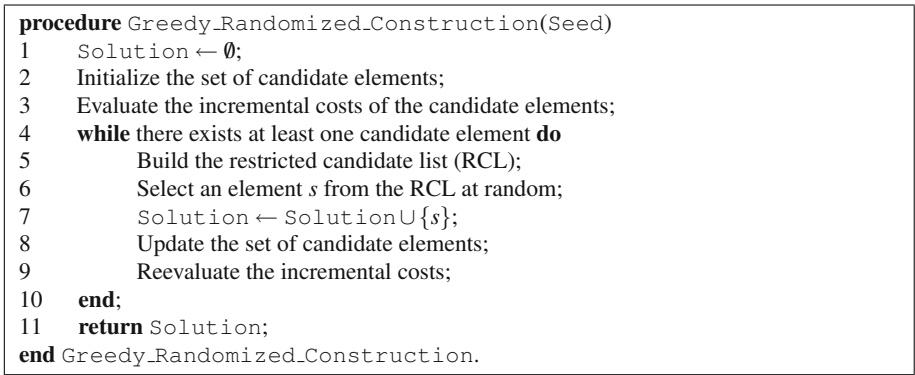

Fig. 6.2 Pseudo-code of the construction phase

A randomized greedy construction procedure is not always able to produce a feasible solution. It may be necessary to apply a repair procedure to the solution to achieve feasibility. Examples of repair procedures can be found in [80, 81, 169, 180].

The solutions generated by a greedy randomized construction are not necessarily optimal, even with respect to simple neighborhoods. The local search phase usually improves the constructed solution. A local search algorithm works in an iterative fashion by successively replacing the current solution by a better solution in its neighborhood. It terminates when no better solution is found in the neighborhood. The pseudo-code of a basic local search algorithm starting from the solution Solution constructed in the first phase (and possibly made feasible by the repair heuristic) and using a neighborhood N is given in Fig. 6.3.

<div class="docvortex-algorithm" style="white-space: pre-wrap; font-family:monospace;">
procedure Local_Search(Solution)
    while Solution is not locally optimal do
        Find $s' \in N(\text{Solution})$ with $f(s') &lt; f(\text{Solution})$;
        Solution $\leftarrow s'$;
    end;
    return Solution;
end Local_Search.
</div>

Fig. 6.3 Pseudo-code of the local search phase

The speed and the effectiveness of a local search procedure depend on several aspects, such as the neighborhood structure, the neighborhood search technique, the strategy used for the evaluation of the cost function value at the neighbors, and the starting solution itself. The construction phase plays a very important role with respect to this last aspect, building high-quality starting solutions for the local search. Simple neighborhoods are typically used. The neighborhood search can be implemented using either a best-improving or a first-improving strategy. In the case of the best-improving strategy, all neighbors are investigated and the current solution is replaced by the best neighbor. In the case of a first-improving strategy, the current solution moves to the first neighbor whose cost function value is smaller than that of the current solution. In practice, we observed on many applications that quite often both strategies lead to the same final solution, but in smaller computation times when the first-improving strategy is used. We also observed that premature convergence to a bad local minimum is more likely to occur with a best-improving strategy.

## 6.2 Construction of the Restricted Candidate List

An especially appealing characteristic of GRASP is the ease with which it can be implemented. Few parameters need to be set and tuned. Therefore, development can focus on implementing appropriate data structures for efficient construction and local search algorithms. GRASP has two main parameters: one related to the stopping criterion and the other to the quality of the elements in the restricted candidate list.

The stopping criterion used in the pseudo-code described in Fig. 6.1 is determined by the number Max\_Iterations of iterations. Although the probability of finding a new solution improving the incumbent (current best solution) decreases with the number of iterations, the quality of the incumbent does not worsen with the number of iterations. Since the computation time does not vary much from iteration to iteration, the total computation time is predictable and increases linearly with the number of iterations. Consequently, the larger the number of iterations, the larger will be the computation time and the better will be the solution found.

For the construction of the RCL used in the first phase we consider, without loss of generality, a minimization problem as the one formulated in Sect. 6.1. We denote by $c ( e )$ the incremental cost associated with the incorporation of element $e \in E$ into the solution under construction. At any GRASP iteration, let $c ^ { m i n }$ and $c ^ { m a x }$ be, respectively, the smallest and the largest incremental costs.

The restricted candidate list RCL is made up of the elements $e \in E$ with the best (i.e., the smallest) incremental costs $c ( e )$ . This list can be limited either by the number of elements (cardinality-based) or by their quality (value-based). In the first case, it is made up of the $p$ elements with the best incremental costs, where $p$ is a parameter. In this chapter, the RCL is associated with a threshold parameter $\alpha \in [ 0 , 1 ]$ . The restricted candidate list is formed by all elements $e \in E$ which can be feasibly inserted into the partial solution under construction and whose quality is superior to the threshold value, i.e., $c ( e ) \in [ c ^ { m i n } , c ^ { m i n } + \alpha ( c ^ { m a x } - c ^ { m i n } ) ]$ . The case $\alpha   =   0$ corresponds to a pure greedy algorithm, while $\alpha   =   1$ is equivalent to a random construction. The pseudo-code in Fig. 6.4 is a refinement of the greedy randomized construction pseudo-code shown in Fig. 6.2. It shows that the parameter α controls the amounts of greediness and randomness in the algorithm.

<div class="docvortex-algorithm" style="white-space: pre-wrap; font-family:monospace;">
procedure Greedy_Randomized_Construction($\alpha$,Seed)
    Solution $\leftarrow \emptyset$;
    Initialize the candidate set: $C \leftarrow E$;
    Evaluate the incremental cost $c(e)$ for all $e \in C$;
    while $C \neq \emptyset$ do
        $c^{min} \leftarrow \min\{c(e) \mid e \in C\}$;
        $c^{max} \leftarrow \max\{c(e) \mid e \in C\}$;
        RCL $\leftarrow \{e \in C \mid c(e) \leq c^{min} + \alpha(c^{max} - c^{min})\}$;
        Select an element $s$ from the RCL at random;
        Solution $\leftarrow$ Solution$\cup \{s\}$;
        Update the candidate set $C$;
        Reevaluate the incremental cost $c(e)$ for all $e \in C$;
    end;
    return Solution;
end Greedy_Randomized_Construction.
</div>

Fig. 6.4 Refined pseudo-code of the construction phase

GRASP construction can be viewed as a repetitive sampling technique. Each iteration produces a sample solution from an unknown distribution, whose mean and variance are functions of the restrictive nature of the RCL. For example, if the RCL is restricted to a single element, then the same solution will be produced at all iterations. The variance of the distribution will be zero and the mean will be equal to the value of the greedy solution. If the RCL is allowed to have more elements, then many different solutions will be produced, implying a larger variance. Since greediness plays a smaller role in this case, the average solution value should be worse than that of the greedy solution. However, the value of the best solution found outperforms the average value and can be near-optimal or even optimal. It is unlikely that GRASP will find an optimal solution if the average solution value is high, even if there is a large variance in the overall solution values. On the other hand, if there is little variance in the overall solution values, it is also unlikely that GRASP will find an optimal solution, even if the average solution is low. What often leads to good solutions are relatively low average solution values in the presence of a relatively large variance, such as is the case for $\alpha = 0 . 2$

Another interesting observation is that the distances between the solutions obtained at each iteration and the best solution found increase as the construction phase moves from more greedy to more random. This causes the average time taken by the local search to increase. Very often, many GRASP solutions may be generated in the same amount of time required by the local search procedure to converge from a single random start. In these cases, the time saved by starting the local search from good initial solutions can be used to improve solution quality by performing more GRASP iterations.

These results are illustrated in Table 6.1 and Fig. 6.5, for an instance of the MAXSAT problem [219] where 1000 iterations were run. For each value of α ranging from 0 (purely random construction for maximization problems) to 1 (purely greedy construction for maximization problems), we give in Table 6.1 the average Hamming distance between each solution built during the construction phase and the corresponding local optimum obtained after local search, the average number of moves from the former to the latter, the local search time in seconds, and the total processing time in seconds. Figure 6.5 summarizes the values observed for the total processing time and the local search time. We notice that both time measures considerably decrease as α tends to 1, approaching the purely greedy choice. In particular, we observe that the average local search time taken by α = 0 (purely random) is approximately 2.5 times longer than the time taken by $\alpha = 0 . 9$ (almost greedy). In this example, two to three greedily constructed solutions can be investigated in the same time needed to apply local search to one single randomly constructed solution. The appropriate choice of the value of the RCL parameter α is clearly critical and relevant to achieve a good balance between computation time and solution quality.

Table 6.1 Average number of moves and local search time as a function of the RCL parameter α for a maximization problem

| α | Avg. distance | Avg. moves | Local search time (s) | Total time (s) |
| --- | --- | --- | --- | --- |
| 0.0 | 12.487 | 12.373 | 18.083 | 23.378 |
| 0.1 | 10.787 | 10.709 | 15.842 | 20.801 |
| 0.2 | 10.242 | 10.166 | 15.127 | 19.830 |
| 0.3 | 9.777 | 9.721 | 14.511 | 18.806 |
| 0.4 | 9.003 | 8.957 | 13.489 | 17.139 |
| 0.5 | 8.241 | 8.189 | 12.494 | 15.375 |
| 0.6 | 7.389 | 7.341 | 11.338 | 13.482 |
| 0.7 | 6.452 | 6.436 | 10.098 | 11.720 |
| 0.8 | 5.667 | 5.643 | 9.094 | 10.441 |
| 0.9 | 4.697 | 4.691 | 7.753 | 8.941 |
| 1.0 | 2.733 | 2.733 | 5.118 | 6.235 |

Prais and Ribeiro [201] show that using a single fixed value for the RCL parameter α very often hinders finding a high-quality solution, which could be found if another value is used. They propose an extension of the basic GRASP procedure, which they call Reactive GRASP, in which the parameter α is self-tuned and its value is periodically modified depending on the quality of the solutions obtained along the search. In particular, computational experiments on the problem of traffic assignment in communication satellites [202] show that Reactive GRASP finds better solutions than the basic algorithm for many test instances. These results motivated the study of the behavior of GRASP with different strategies for the variation of the value of the RCL parameter α:

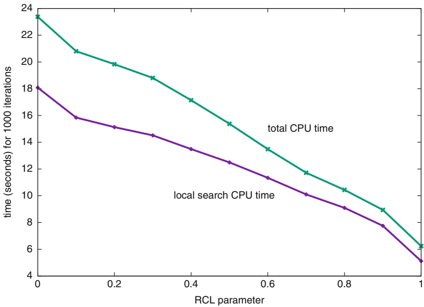

Fig. 6.5 Total CPU time and local search CPU time as a function of the RCL parameter α for a maximization problem (1000 repetitions for each value of α)

R: α self tuned with a Reactive GRASP procedure;

E: α randomly chosen from a uniform discrete probability distribution;

H: α randomly chosen from a decreasing non-uniform discrete probability distribution;

F: α fixed, close to the purely greedy choice value.

We summarize the results obtained by the experiments reported in [200, 201]. These four strategies are incorporated into the GRASP procedures developed for four different optimization problems: (P-1) matrix decomposition for traffic assignment in communication satellites [202]; (P-2) set covering [90]; (P-3) weighted MAX-SAT [219, 221]; and (P-4) graph planarization [210, 226]. Let

$$
\Psi = \{\alpha_ {1}, \dots , \alpha_ {m} \}
$$

be the set of possible values for the parameter α for the first three strategies. The strategy for choosing and self-tuning the value of α in the case of the Reactive GRASP procedure (R) is described later in Sect. 6.3. In the case of the strategy (E) based on using the discrete uniform distribution, all choice probabilities are equal to $1 / m .$ . The third case corresponds to the a hybrid strategy (H), in which the authors considered $p ( \alpha = 0 . 1 ) = 0 . 5 ,   p ( \alpha = 0 . 2 ) = 0 . 2 5 ,   p ( \alpha = 0 . 3 ) = 0 . 1 2 5$ $p(\alpha = 0.4) = 0.03,   p(\alpha = 0.5) = 0.03,   p(\alpha = 0.6) = 0.03,   p(\alpha = 0.7) = 0.01$ $p ( \alpha = 0 . 8 ) = 0 . 0 1 ,   p ( \alpha = 0 . 9 ) = 0 . 0 1$ , and $p ( \alpha   =   1 . 0 )   =   0 . 0 0 5$ . Finally, in the last strategy (F), the value of α is fixed as recommended in the original references of problems P-1 to P-4 cited above, where this parameter was tuned for each problem. A subset of the literature instances was considered for each class of test problems. The results reported in [201] are summarized in Table 6.2. For each problem, we first list the number of instances considered. Next, for each strategy, we give the number of times it found the best solution (hits), as well as the average CPU time (in seconds) on an IBM 9672 model R34. The number of iterations was fixed at 10,000.

Table 6.2 Computational results for different strategies for the variation of parameter α

<table><tr><td rowspan="2" colspan="2">Problem Instances</td><td colspan="2">R</td><td colspan="2">E</td><td colspan="2">H</td><td colspan="2">F</td></tr><tr><td>Hits</td><td>Time</td><td>Hits</td><td>Time</td><td>Hits</td><td>Time</td><td>Hits</td><td>Time</td></tr><tr><td>P-1</td><td>36</td><td>34</td><td>579.0</td><td>35</td><td>358.2</td><td>32</td><td>612.6</td><td>24</td><td>642.8</td></tr><tr><td>P-2</td><td>7</td><td>7</td><td>1346.8</td><td>6</td><td>1352.0</td><td>6</td><td>668.2</td><td>5</td><td>500.7</td></tr><tr><td>P-3</td><td>44</td><td>22</td><td>2463.7</td><td>23</td><td>2492.6</td><td>16</td><td>1740.9</td><td>11</td><td>1625.2</td></tr><tr><td>P-4</td><td>37</td><td>28</td><td>6363.1</td><td>21</td><td>7292.9</td><td>24</td><td>6326.5</td><td>19</td><td>5972.0</td></tr><tr><td>Total</td><td>124</td><td>91</td><td></td><td>85</td><td></td><td>78</td><td></td><td>59</td><td></td></tr></table>

Strategy (F) presented the shortest average computation times for three out the four problem types. It was also the one with the least variability in the constructed solutions and, in consequence, found the best solution the fewest times. The reactive strategy (R) is the one which most often found the best solutions, however, at the cost of computation times that are longer than those of some of the other strategies. The high number of hits observed for strategy (E) also illustrates the effectiveness of strategies based on the variation of the RCL parameter.

## 6.3 Alternative Construction Mechanisms

A possible shortcoming of the standard GRASP framework is the independence of its iterations, i.e., the fact that it does not learn from the search history or from solutions found in previous iterations. This is so because the basic algorithm discards information about any solution previously encountered that does not improve the incumbent. Information gathered from good solutions can be used to imple ment memory-based procedures to influence the construction phase, by modifying the selection probabilities associated with each element of the RCL or by enforcing specific choices. Another possible shortcoming of the greedy randomized construction is its complexity. At each step of the construction, each yet unselected candidate element has to be evaluated by the greedy function. In cases where the difference between the number of elements in the ground set and the number of elements that appear in a solution is large, this may not be very efficient.

In this section, we consider enhancements and alternative techniques for the construction phase of GRASP. They include random plus greedy, sampled greedy, Reactive GRASP, cost perturbations, bias functions, memory and learning, local search on partially constructed solutions, and Lagrangean GRASP heuristics.

## 6.3.1 Random Plus Greedy and Sampled Greedy Construction

In Sect. 6.2, we described the semi-greedy construction scheme used to build randomized greedy solutions that serve as starting points for local search. Two other randomized greedy approaches were proposed in [216], with smaller worst-case complexities than the semi-greedy algorithm.

Instead of combining greediness and randomness at each step of the construction procedure, the random plus greedy scheme applies randomness during the first $p$ construction steps to produce a random partial solution. Next, the algorithm completes the solution with one or more pure greedy construction steps. The resulting solution is randomized greedy. One can control the balance between greediness and randomness in the construction by changing the value of the parameter $p .$ Larger values of $p$ are associated with solutions that are more random, while smaller values result in greedier solutions.

Similar to the random plus greedy procedure, the sampled greedy construction also combines randomness and greediness but in a different way. This procedure is also controlled by a parameter $p .$ At each step of the construction process, the procedure builds a restricted candidate list by randomly sampling min $\{ p , | C | \}$ elements of the candidate set $C .$ Each element of the RCL is evaluated by the greedy function. The element with the smallest greedy function value is added to the partial solution. This two-step process is repeated until there are no more candidate elements. The resulting solution is also randomized greedy. The balance between greediness and randomness can be controlled by changing the value of the parameter $p ,$ i.e. the number of candidate elements that are sampled. Small sample sizes lead to more random solutions, while large sample sizes lead to greedier solutions.

## 6.3.2 Reactive GRASP

The first strategy to incorporate a learning mechanism in the memoryless construction phase of the basic GRASP was the Reactive GRASP procedure introduced in Sect. 6.2. In this case, the value of the RCL parameter $\alpha$ is not fixed, but instead is randomly selected at each iteration from a discrete set of possible values. This selection is guided by the solution values found along the previous iterations. One way to accomplish this is to use the rule proposed in [202]. Let $\Psi = \{ \alpha _ { 1 } , \ldots , \alpha _ { m } \}$ be a set of possible values for $\alpha .$ The probabilities associated with the choice of each value are all initially made equal to $p _ { i } = 1 / m$ , for $i = 1 , \ldots , m$ . Furthermore, let $z ^ { * }$ be the incumbent solution and let $A _ { i }$ be the average value of all solutions found using $\alpha = \alpha _ { i }$ , for $i = 1 , \ldots , m .$ . The selection probabilities are periodically reevaluated by taking $\textstyle p _ { i } = q _ { i } / \sum _ { j = 1 } ^ { m } q _ { j }$ , with $q _ { i } = z ^ { * } / A _ { i }$ for $i = 1 , \ldots , m$ . The value of $q _ { i }$ will be larger for values of $\alpha = \alpha _ { i }$ leading to the best solutions on average. Larger values of $q _ { i }$ correspond to more suitable values for the parameter $\alpha .$ The probabilities associated with the more appropriate values will then increase when they are reevaluated.

The reactive approach leads to improvements over the basic GRASP in terms of robustness and solution quality, due to greater diversification and less reliance on parameter tuning. In addition to the applications in [200–202], this approach has been used in power system transmission network planning [46], job shop scheduling [49], channel assignment in mobile phone networks [118], rural road network development [249], capacitated location [71], strip-packing [15], and a combined production-distribution problem [50].

## 6.3.3 Cost Perturbations

The idea of introducing some noise into the original costs is similar to that in the socalled “noising” method of Charon and Hudry [57, 58]. It adds more flexibility into the algorithm design and may be even more effective than the greedy randomized construction of the basic GRASP procedure in circumstances where the construction algorithms are not very sensitive to randomization. This is indeed the case for the shortest-path heuristic of Takahashi and Matsuyama [259], used as one of the main building blocks of the construction phase of the hybrid GRASP procedure proposed by Ribeiro et al. [233] for the Steiner problem in graphs. Another situation where cost perturbations can be very effective appears when no greedy algorithm is available for straightforward randomization. This happens to be the case of the hybrid GRASP developed by Canuto et al. [54] for the prize-collecting Steiner tree problem, which makes use of the primal-dual algorithm of Goemans and Williamson [117] to build initial solutions using perturbed costs.

In the case of the GRASP for the prize-collecting Steiner tree problem described in [54], a new solution is built at each iteration using node prizes updated by a perturbation function, based on the structure of the current solution. Two different prize perturbation schemes were used. In perturbation by eliminations, the primal-dual algorithm used in the construction phase is driven to build a new solution without some of the nodes that appeared in the solution constructed in the previous iteration. In perturbation by prize changes, some noise is introduced into the node prizes to change the objective function, similarly to what is proposed in [57, 58].

The cost perturbation methods used in the GRASP for the minimum Steiner tree problem described in [233] incorporate learning mechanisms associated with intensification and diversification strategies. Three distinct weight randomization methods were applied. At a given GRASP iteration, the modified weight of each edge is randomly selected from a uniform distribution over an interval which depends on the selected weight randomization method applied at that iteration. The different weight randomization methods use frequency information and may be used to enforce intensification and diversification strategies. The experimental results reported in [233] show that the strategy combining these three perturbation methods is more robust than any of them used in isolation, leading to the best overall results on a quite broad mix of test instances with different characteristics. The GRASP heuristic using this cost perturbation strategy is among the most effective heuristics currently available for the Steiner problem in graphs.

## 6.3.4 Bias Functions

In the construction procedure of the basic GRASP, the next element to be introduced in the solution is chosen at random from the candidates in the RCL. The elements of the RCL are assigned equal probabilities of being chosen. However, any probability distribution can be used to bias the selection toward some particular candidates. Another construction mechanism was proposed by Bresina [51], where a family of such probability distributions is introduced. They are based on the rank $r ( e )$ assigned to each candidate element $e \in C ,$ according to its greedy function value. Several bias functions were proposed, such as:

• random bias: bias $( r ) = 1$

• linear bias: bi $\mathtt { a s } ( r ) = 1 / r ;$

• log bias: bias $( r ) = \log ^ { - 1 } ( r + 1 )$

• exponential bias: $\mathtt { b i a s } ( r ) = e ^ { - r }$ ; and

• polynomial bias of order $n \mathbf { : b i a s } ( r ) = r ^ { - n }$

Let $r ( e )$ denote the rank of element $e \in C$ and let bias $( r ( e ) )$ be one of the bias functions defined above. Once these values have been evaluated for all elements in the candidate set $C ,$ the probability $\pi ( e )$ of selecting element $e \in C$ is

$$
\pi (e) = \frac {\mathrm{bias} (r (e))}{\sum_ {e ^ {\prime} \in C} \mathrm{bias} (r (e ^ {\prime}))}.\tag{6.1}
$$

The evaluation of these bias functions may be restricted to the elements of the RCL. Bresina’s selection procedure restricted to elements of the RCL was used in [49]. The standard GRASP uses a random bias function.

## 6.3.5 Intelligent Construction: Memory and Learning

Fleurent and Glover [106] observed that the basic GRASP does not use a long-term memory (information gathered in previous iterations) and proposed a long-term memory scheme to address this issue in multi-start heuristics. Long-term memory is one of the fundamentals on which tabu search relies.

Their scheme maintains a pool of elite solutions to be used in the construction phase. To become an elite solution, a solution must be either better than the best member of the pool, or better than its worst member and sufficiently different from the other solutions in the pool. For example, one can count identical solution vector components and set a threshold for rejection.

A strongly determined variable is one that cannot be changed without eroding the objective or changing significantly other variables. A consistent variable is one that receives a particular value in a large portion of the elite solution set. Let the intensity function $I ( e )$ be a measure of the strong determination and consistency features of a solution element $e \in E$ . Then, $I ( e )$ becomes larger as e appears more often in the pool of elite solutions. The intensity function is used in the construction phase as follows. Recall that $c ( e )$ is the greedy function, i.e. the incremental cost associated with the incorporation of element $e \in E$ into the solution under construction. Let $K ( e ) = F ( c ( e ) , I ( e ) )$ be a function of the greedy and intensification functions. For example, $K ( e ) = \lambda c ( e ) + I ( e )$ . The intensification scheme biases selection from the RCL to those elements $e \in E$ with a high value of $K ( e )$ by setting its selection probability to be $\begin{array} { r } { p ( e ) = K ( e ) / \sum _ { s \in \mathrm { R C L } } K ( s ) } \end{array}$

The function K(e) can vary with time by changing the value of λ. For example, may be set to a large value that is decreased when diversification is called for. Procedures for changing the value of λ are given by Fleurent and Glover [106] and Binato et al. [49].

## 6.3.6 POP in Construction

The Proximate Optimality Principle (POP) is based on the idea that “good solutions at one level are likely to be found ‘close to’ good solutions at an adjacent level” [115]. Fleurent and Glover [106] provided a GRASP interpretation of this principle. They suggested that imperfections introduced during steps of the GRASP construction can be “ironed-out” by applying local search during (and not only at the end of) the GRASP construction phase.

Because of efficiency considerations, a practical implementation of POP to GRASP consists in applying local search a few times during the construction phase, but not at every construction iteration. Local search was applied by Binato et al. [49] after 40% and 80% of the construction moves were performed, as well as at the end of the construction phase.

## 6.3.7 Lagrangean GRASP Heuristics

Lagrangean relaxation [45, 105] is a mathematical programming technique that can be used to provide lower bounds for minimization problems. Held and Karp [123, 124] were among the first to explore the use of the dual multipliers produced by Lagrangean relaxation to derive lower bounds, applying this idea in the context of the traveling salesman problem. Lagrangean heuristics further explore the use of different dual multipliers to generate feasible solutions. Beasley [43, 44] described a Lagrangean heuristic for set covering.

## 6.3.7.1 Lagrangean Relaxation and Subgradient Optimization

Lagrangean relaxation can be used to provide lower bounds for combinatorial op timization problems. However, the primal solutions produced by the algorithms used to solve the Lagrangean dual problem are not necessarily feasible. Lagrangean heuristics exploit dual multipliers to generate primal feasible solutions.

Given a mathematical programming problem $\mathcal { P }$ formulated as

$$
f ^ {*} = \min f (x)\tag{6.2}
$$

$$
g _ {i} (x) \leq 0, \quad i = 1, \dots , m,\tag{6.3}
$$

$$
x \in X,\tag{6.4}
$$

its Lagrangean relaxation is obtained by associating dual multipliers $\lambda _ { i } \in \mathbb { R } _ { + }$ with each inequality (6.3), for $i = 1 , \ldots , m$ . This results in the following Lagrangean relaxation problem $L R P ( \lambda )$

$$
\min f ^ {\prime} (x) = f (x) + \sum_ {i = 1} ^ {m} \lambda_ {i} \cdot g _ {i} (x)\tag{6.5}
$$

$$
x \in X,\tag{6.4}
$$

whose optimal solution $x ( \lambda )$ gives a lower bound $f ^ { \prime } ( x ( \lambda ) )$ to the optimal value of the original problem $\mathcal { P }$ defined by (6.2)–(6.4). The best (dual) lower bound is given by the solution of the Lagrangean dual problem $\mathcal { D }$

$$
f _ {\mathscr {D}} = f ^ {\prime} (x (\lambda^ {*})) = \max _ {\lambda \in \mathbb {R} _ {+} ^ {m}} f ^ {\prime} (x (\lambda)).\tag{6.6}
$$

Subgradient optimization is used to solve the dual problem $\mathcal { D }$ defined by (6.6). Subgradient algorithms start from any feasible set of dual multipliers, such as $\lambda _ { i }   =   0$ for $i = 1 , \ldots , m ,$ , and iteratively generate updated multipliers.

At any iteration $q ,$ let $\lambda ^ { q }$ be the current vector of multipliers and let $x ( \lambda ^ { q } )$ be an optimal solution to problem $L R P ( \lambda ^ { q } )$ , whose optimal value is $f ^ { \prime } ( x ( \lambda ^ { q } ) )$ . Furthermore, let $\bar { f }$ be a known upper bound to the optimal value of problem $\mathcal { P }$ . Additionally, let $g ^ { q } \in \mathbb { R } ^ { m }$ be a subgradient of $f ^ { \prime } ( x )$ at $x = x ( \lambda ^ { q } )$ , with $g _ { i } ^ { q } = g _ { i } ( x ( \lambda ^ { q } ) )$ for $i = 1 , \ldots , m$ . To update the Lagrangean multipliers, the algorithm makes use of a step size

$$
d ^ {q} = \frac {\eta \cdot (\bar {f} - f ^ {\prime} (x (\lambda^ {q})))}{\sum_ {i = 1} ^ {m} (g _ {i} ^ {q}) ^ {2}},\tag{6.7}
$$

where $\eta \in ( 0 , 2 ]$ . Multipliers are then updated as

$$
\lambda_ {i} ^ {q + 1} = \max \{0; \lambda_ {i} ^ {q} - d ^ {q} \cdot g _ {i} ^ {q} \}, \quad i = 1, \dots , m,\tag{6.8}
$$

and the subgradient algorithm proceeds to iteration $q   +   1$

## 6.3.7.2 A Template for Lagrangean Heuristics

We describe next a template for Lagrangean heuristics that make use of the dual multipliers $\lambda ^ { q }$ and of the optimal solution $x ( \lambda ^ { q } )$ to each problem $L R P ( \lambda ^ { q } )$ to build feasible solutions to the original problem $\mathcal { P }$ defined by (6.2)–(6.4). In the following, we assume that the objective function and all constraints are linear functions, i.e. $\begin{array} { r } { f \big ( x \big ) = \sum _ { i = 1 } ^ { n } c _ { j } x _ { j } } \end{array}$ and $\begin{array} { r } { g _ { i } ( \boldsymbol { x } ) = \sum _ { j = 1 } ^ { n } d _ { i j } x _ { j } - e _ { i } } \end{array}$ , for $i   =   1 , \ldots , m$

Let $\mathcal { H }$ be a primal heuristic that builds a feasible solution x to $\mathcal { P }$ , starting from the initial solution $x ^ { 0 } = x ( \lambda ^ { q } )$ at every iteration $q$ of the subgradient algorithm. Heuristic $\mathcal { H }$ is first applied using the original costs $c _ { j } , \mathrm { i . e }$ . using the cost function $f ( x )$ . In any subsequent iteration $q$ of the subgradient algorithm, $\mathcal { H }$ uses either the Lagrangean reduced costs $\begin{array} { r } { c _ { j } ^ { \prime } = c _ { j } - \sum _ { i = 1 } ^ { m } \lambda _ { i } ^ { q } d _ { i j } } \end{array}$ or the complementary costs $\bar { c } _ { j } =$ $\bigl ( 1   -   x _ { j } \bigl ( \lambda ^ { q } \bigr ) \bigr )   \cdot   c _ { j }$

Let $x ^ { \mathcal { H } , \gamma }$ be the solution obtained by heuristic $\mathcal { H }$ , using a generic cost vector $\gamma$ corresponding to either one of the above modified cost schemes or to the original cost vector. Its cost can be used to update the upper bound $\bar { f }$ to the optimal value of the original problem. This upper bound can be further improved by local search and is used to adjust the step size defined by Eq. (6.7).

Figure 6.6 shows the pseudo-code of a Lagrangean heuristic. Lines 1–4 initialize the upper and lower bounds, the iteration counter, and the dual multipliers. The iter ations of the subgradient algorithm are performed along the loop defined in lines $5 -$ 24. The reduced costs are computed in line 6 and the Lagrangean relaxation problem is solved in line $7 .$ In the first iteration of the Lagrangean heuristic, the original cost vector is assigned to $\gamma$ in line 9, while in subsequent iterations a modified cost vector is assigned to $\gamma$ in line 11. Heuristic $\mathcal { H }$ is applied in line 13 at the first iteration and after every $H$ iterations thereafter $( \mathbf { i . e . }$ , whenever the iteration counter $q$ is a multi-ple of the input parameter $H )$ to produce a feasible solution $x ^ { \mathcal { H } , \gamma }$ to problem $\mathcal { P }$ . If the cost of this solution is smaller than the current upper bound, then the best solution and its cost are updated in lines 14–18. If the lower bound $f ^ { \prime } ( x ( \lambda ^ { q } ) )$ is greater than the current lower bound $f _ { \mathcal { D } }$ , then $f _ { \mathcal { D } }$ is updated in line 19. Line 20 computes a subgradient at $x ( \lambda ^ { q } )$ and line 21 computes the step size. The dual multipliers are updated in line 22 and the iteration counter is incremented in line 23. The best solution found and its cost are returned in line 24.

The strategy proposed by Held et al. [125] is commonly used in the implementation of Lagrangean heuristics to update the dual multipliers from one iteration to the next. Beasley [44] reported as computationally useful the adjustment of components of the subgradients to zero whenever they do not effectively contribute to the update of the multipliers, i.e., arbitrarily setting $g _ { i } ^ { q } = 0$ whenever $g _ { i } ^ { q } > 0$ and $\lambda _ { i } ^ { q } = 0$ , for $i = 1 , \ldots , m .$

<div class="docvortex-algorithm" style="white-space: pre-wrap; font-family:monospace;">
procedure Lagrangean_Heuristic(H)
    $\bar{f} \leftarrow +\infty;$
    $f_{\mathcal{D}} \leftarrow -\infty;$
    $q \leftarrow 0;$
    $\lambda_i^q \leftarrow 0, i = 1, \ldots, m;$
    repeat
        Compute reduced costs: $c'_j \leftarrow c_j - \sum_{i=1}^{m} \lambda_i^q d_{ij}, j = 1, \ldots, n;$
        Solve $LRP(\lambda^q)$ to obtain a solution $x(\lambda^q);$
        if $q = 0$ then
            $\gamma \leftarrow c;$
        else
            Set $\gamma$ to the modified cost vector $c'$ or $\bar{c};$
        end-if;
        if $q$ is a multiple of $H$ then apply heuristic $\mathscr{H}$ with cost vector $\gamma$ to obtain $x^{\mathscr{H},\gamma};$
        if $f(x^{\mathscr{H},\gamma}) &lt; \bar{f}$
        then do;
            $x^* \leftarrow x^{\mathscr{H},\gamma};$
            $\bar{f} \leftarrow f(x^{\mathscr{H},\gamma});$
        end-if;
        if $f'(x(\lambda^q)) &gt; f_{\mathcal{D}}$ then $f_{\mathcal{D}} \leftarrow f'(x(\lambda^q));$
        Compute a subgradient: $g_i^q \leftarrow g_i(x(\lambda^q)), i = 1, \ldots, m;$
        Compute the step size: $d^q \leftarrow \eta \cdot (\bar{f} - f'(x(\lambda^q))) / \sum_{i=1}^{m} (g_i^q)^2;$
        Update the dual multipliers: $\lambda_i^{q+1} \leftarrow \max\{0, \lambda_i^q - d^q g_i^q\}, i = 1, \ldots, m;$
        $q \leftarrow q + 1;$
    until stopping criterion satisfied;
    return $x^*, f(x^*);$
end Lagrangean_Heuristic.
</div>

Fig. 6.6 Pseudo-code of a template for a Lagrangean heuristic

Different choices for the initial solution $x ^ { 0 }$ , for the modified costs $\gamma ,$ and for the primal heuristic $\mathcal { H }$ itself lead to different variants of the above algorithm. The integer parameter H defines the frequency in which $\mathcal { H }$ is applied. The smaller the value of $H ,$ the greater the number of times $\mathcal { H }$ is applied. Therefore, the computation time increases as the value of H decreases. In particular, one should set $H = 1$ if the primal heuristic $\mathcal { H }$ is to be applied at every iteration.

## 6.3.7.3 Lagrangean GRASP

Pessoa et al. [195, 196] proposed the hybridization of GRASP and Lagrangean relaxation leading to the Lagrangean GRASP heuristic described below. Different choices for the primal heuristic $\mathcal { H }$ in the template of the algorithm in Fig. 6.6 lead to distinct Lagrangean heuristics. We consider two variants: the first makes use of a greedy algorithm with local search, while in the second a GRASP with path-relinking (see Sect. 6.4) is used.

Greedy heuristic: This heuristic greedily repairs the solution $x ( \lambda ^ { q } )$ produced in line $7$ of the Lagrangean heuristic described in Fig. 6.6 to make it feasible for problem $\mathcal { P } ,$ . It makes use of the modified costs $( c ^ { \prime } \mathrm { ~ o r ~ } \bar { c } )$ . Local search can be applied to the resulting solution, using the original cost vector $c .$ We refer to this approach as a greedy Lagrangean heuristic (GLH).

GRASP heuristic: Instead of simply performing one construction step followed by local search, as GLH does, this variant applies a GRASP heuristic to repair the solution $x ( \lambda ^ { q } )$ produced in line 7 of the Lagrangean heuristic to make it feasible for problem $\mathcal { P }$

Although the GRASP heuristic produces better solutions than the greedy heuris tic, the greedy heuristic is much faster. To appropriately address this trade-off, we adapt line 10 of Fig. 6.6 to use the GRASP heuristic with probability $\beta$ and the greedy heuristic with probability $1 - \beta$ , where $\beta$ is a parameter of the algorithm.

We note that this strategy involves three main parameters: the number $H$ of iterations after which the basic heuristic is always applied, the number $Q$ of iterations performed by the GRASP heuristic when it is chosen as the primal heuristic, and the probability $\beta$ of choosing the GRASP heuristic as $\mathcal { H }$ . We shall refer to the Lagrangean heuristic that uses this hybrid strategy as LAGRASP $( \beta ,   H ,   Q )$

We next summarize computational results obtained for 135 instances of the set k-covering problem. These instances have up to 400 constraints and 4000 binary variables. The set k-covering, or set multi-covering, problem is an extension of the classical set covering problem, in which each element is required to be covered at least k times. The problem finds applications in the design of communication networks and in computational biology.

The first experiment with the GRASP Lagrangean heuristic established the relationship between running times and solution quality for different parameter settings. Parameter $\beta$ , the probability of GRASP being applied as the heuristic $\mathcal { H }$ , was set to

0, 0.25, 0.50, 0.75, and 1. Parameter H, the number of iterations between successive calls to the heuristic $\mathcal { H }$ , was set to 1, 5, 10, and 50. Parameter $Q ,$ the number of iterations carried out by the GRASP heuristic, was set to 1, 5, 10, and 50. By combining some of these parameter values, 68 variants of the hybrid LAGRASP(β,H, Q) heuristic were created. Each variant was applied eight times to a subset of 21 instances, with different initial seeds being given to the random number generator.

The plot in Fig. 6.7 summarizes the results for all variants evaluated, display ing points whose coordinates are the values of the average deviation from the best known solution value and the total time in seconds for processing the eight runs on all instances, for each combination of parameter values. Eight variants of special interest are identified and labeled with the corresponding parameters $\beta ,$ , H, and $Q ,$ in this order. These variants correspond to selected Pareto points in the plot in Fig. 6.7. Setting $\beta = 0$ and H = 1 corresponds to the greedy Lagrangean heuristic (GLH) or, equivalently, to LAGRASP(0,1,−), whose average deviation (in percentage) from the best value amounts to 0.12% in 4859.16 s of total running time. Table 6.3 shows the average deviation from the best known solution value and the total time for each of the eight selected variants.

In another experiment, all 135 test instances were considered for the comparison of the above selected eight variants of LAGRASP. Table 6.4 summarizes the results obtained by the eight selected variants. It shows that LAGRASP(1,1,50) found the best solutions, with an average deviation from the best values amounting to 0.079%. It also found the best known solutions in 365 runs (each variant was run eight times on each instance), again with the best performance when the eight variants are evaluated side by side, although its running times are the largest. On the other hand, the smallest running times were observed for LAGRASP(0,50,−), which was over 3000 times faster than LAGRASP(1,1,50) but found the worst-quality solutions among the eight variants considered.

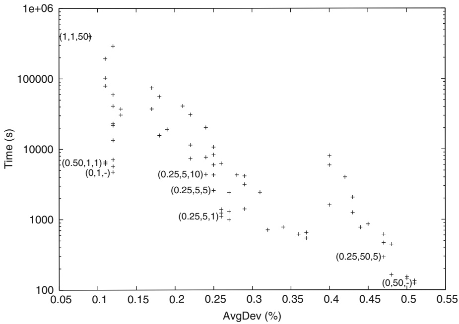

Fig. 6.7 Average deviation from the best value and total running time for 68 different variants of LAGRASP on a reduced set of 21 instances of the set k-covering problem: each point represents a unique combination of parameters β, H, and Q

Table 6.3 Summary of the numerical results obtained with the selected variants of the GRASP Lagrangean heuristic on a reduced set of 21 instances of the set k-covering problem

| Heuristic | Average deviation | Total time (s) |
| --- | --- | --- |
| LAGRASP(1,1,50) | 0.09% | 399,101.14 |
| LAGRASP(0.50,1,1) | 0.11% | 6198.46 |
| LLAAGGRRAASSPP((00.,215,-,5),10) | 0.12%0.24% | 4859.164373.56 |
| LAGRASP(0.25,5,5) | 0.25% | 2589.79 |
| LAGRASP(0.25,5,1) | 0.26% | 1101.64 |
| LAGRASP(0.25,50,5) | 0.47% | 292.95 |
| LAGRASP(0,50,-) | 0.51% | 124.26 |

These values correspond to the coordinates of the selected variants in Fig. 6.7. The total time is given in seconds

Table 6.4 Summary of the numerical results obtained with the selected variants of the GRASP Lagrangean heuristic on the full set of 135 instances of the set k-covering problem

| Heuristic | Average deviation | Hits | Total time (s) |
| --- | --- | --- | --- |
| LAGRASP(1,1,50) | 0.079% | 365 | 1,803,283.64 |
| LAGRASP(0.50,1,1) | 0.134% | 242 | 30,489.17 |
| LLAAGGRRAASSPP((00.,215,-,5),10) | 0.135%0.235% | 238168 | 24,274.7222,475.54 |
| LAGRASP(0.25,5,5) | 0.247% | 163 | 11,263.80 |
| LAGRASP(0.25,5,1) | 0.249% | 164 | 5347.78 |
| LAGRASP(0.25,50,5) | 0.442% | 100 | 1553.35 |
| LAGRASP(0,50,-) | 0.439% | 97 | 569.30 |

The total time is given in seconds

Figure 6.8 illustrates the merit of the proposed approach for one of the test instances. We first observe that all variants reach the same lower bounds, as expected, since they depend exclusively on the common subgradient algorithm. However, as the lower bound appears to stabilize, the upper bound obtained by GLH (LAGRASP(0,1,−) also seems to freeze. On the other hand, the other variants continue to make improvements by discovering better upper bounds, since the randomized GRASP construction helps them to escape from locally optimal solutions and find new, improved upper bounds.

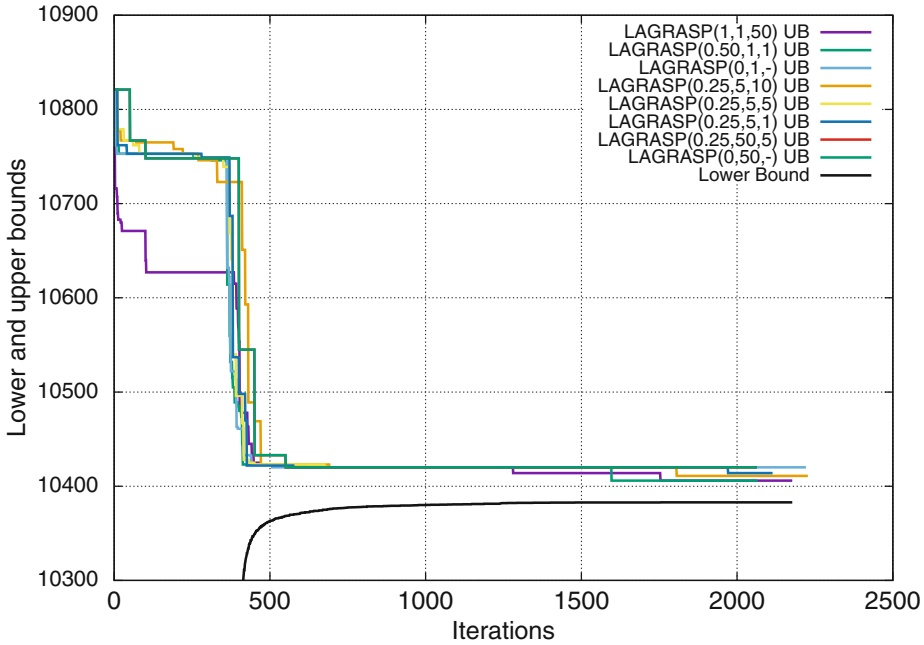

Fig. 6.8 Evolution of lower and upper bounds over the iterations for different variants of LA-GRASP. The number of iterations taken by each LAGRASP variant depends on the step-size, which in turn depends on the upper bounds produced by each heuristic

Finally, we provide a comparison between GRASP with backward path-relinking and the LAGRASP variants on all 135 test instances when the same time limits are used to stop all heuristics. Eight runs were performed for each heuristic and each instance, using different initial seeds for the random number generator. Each heuristic was run a total of (8 × 135 =) 1080 times. The results in Table 6.5 show that all variants of LAGRASP outperformed GRASP with backward path-relinking and were able to find solutions whose costs are very close to or as good as the best known solution values, while GRASP with backward path-relinking found solutions whose costs are on average 4.05% larger than the best known solution values.

Table 6.5 Summary of results for the best variants of LAGRASP and GRASP

| Heuristic | Average deviation | Hits |
| --- | --- | --- |
| LAGRASP(1,1,50) | 3.30% | 0 |
| LAGRASP(0.50,1,1) | 0.35% | 171 |
| LLAAGGRRAASSPP((00.,215,-,5),10) | 0.35%0.45% | 173138 |
| LAGRASP(0.25,5,5) | 0.45% | 143 |
| LAGRASP(0.25,5,1) | 0.46% | 137 |
| LAGRASP(0.25,50,5) | 0.65% | 97 |
| GLARGARSPASwPit(h0,b5a0c,-kw)ard path-relinking | 0.65%4.05% | 93<sub>0</sub> |

Figure 6.9 displays for one test instance the typical behavior of these heuristics. As opposed to the GRASP with path-relinking, the Lagrangean heuristics are able to escape from local optima for longer and keep on improving the solutions to obtain the best results.

We note that an important feature of Lagrangean heuristics is that they provide not only a feasible solution (which gives an upper bound, in the case of a minimization problem), but also a lower bound that may be used to give an estimate of the optimality gap that may be considered as a stopping criterion.

## 6.4 Path-Relinking

The LAGRASP heuristics presented in Sect. 6.3.7.3 made use of path-relinking. Path-relinking is another enhancement to the basic GRASP procedure, leading to significant improvements in both solution quality and running times. This technique was originally proposed by Glover [112] as an intensification strategy to explore trajectories connecting elite solutions obtained by tabu search or scatter search [113, 115, 116].

We consider the undirected graph associated with the solution space $G   =   (   S   ,   M   )$ where the nodes in S correspond to feasible solutions and the edges in M correspond to moves in the neighborhood structure, i.e. $( i , j ) \in M$ if and only if $i \in S ,$ $j \in S ,   j \in N ( i )$ and $i \in N ( j )$ , where $N ( s )$ denotes the neighborhood of a node $s \in S$ Path-relinking is usually carried out between two solutions: one is called the initial solution, while the other is the guiding solution. One or more paths in the solution space graph connecting these solutions are explored in the search for better solutions. Local search is applied to the best solution in each of these paths, since there is no guarantee that the best solution is locally optimal.

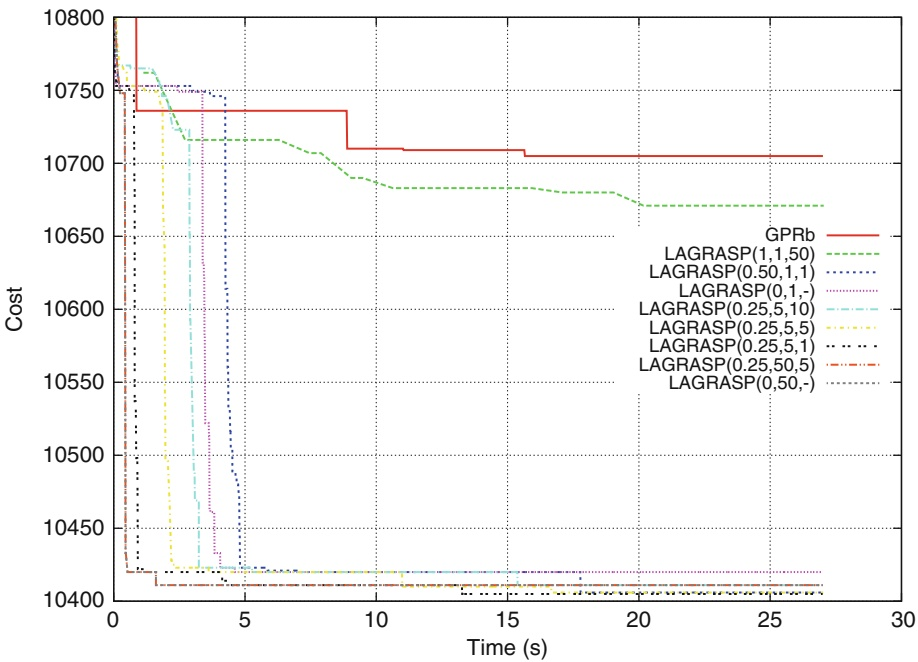

Fig. 6.9 Evolution of solution costs with time for the best variants of LAGRASP and GRASP with backward path-relinking (GPRb)

Let $s \in S$ be a node on the path between an initial solution and a guiding solution $g \in S$ . Not all solutions in the neighborhood $N ( s )$ are candidates to follow s on the path from s to g. We restrict the choice only to those solutions that are more similar to g than s. This is accomplished by selecting moves from s that introduce attributes contained in the guiding solution g. Therefore, path-relinking may be viewed as a strategy that seeks to incorporate attributes of high quality solutions (i.e. the guiding elite solutions), by favoring these attributes in the selected moves.

The use of path-relinking within a GRASP procedure, as an intensification strategy applied to each locally optimal solution, was first proposed by Laguna and Martí [147]. It was followed by several extensions, improvements, and successful applications [8, 9, 22, 54, 104, 183, 206, 212, 216, 217, 227, 233, 249]. A survey of GRASP with path-relinking can be found in [213].

Enhancing GRASP with path-relinking almost always improves the performance of the heuristic. As an illustration, Fig. 6.10 shows time-to-target plots [7, 10, 228, 235, 236] for GRASP and GRASP with path-relinking implementations for four different applications. These time-to-target plots show the empirical cumulative probability distributions of the time-to-target random variable when using pure GRASP and GRASP with path-relinking, i.e., the time needed to find a solution at least as good as a prespecified target value. For all problems, the plots show that GRASP with path-relinking is able to find target solutions faster than GRASP.

GRASP with path-relinking makes use of an elite set to collect a diverse pool of high-quality solutions found during the search. This pool is limited in size, i.e. it can have at most Max\_Elite solutions. Several schemes have been proposed for the implementation of path-relinking, which may be applied as:

• an intensification strategy, between each local optimum obtained after the local search phase and one or more elite solutions;

• a post-optimization step, between every pair of elite solutions;

an intensification strategy, periodically (after a fixed number of GRASP iterations since the last intensification phase) submitting the pool of elite solutions to an evolutionary process (see Sect. 6.4.7);

• a post-optimization phase, submitting the pool of elite solutions to an evolutionary process; or

• any other combination of the above schemes.

The pool of elite solutions is initially empty. Each locally optimal solution obtained by local search and each solution resulting from path-relinking is considered as a candidate to be inserted into the pool. If the pool is not yet full, the candidate is simply added to the pool. Otherwise, if the candidate is better than the incumbent (best solution found so far), it replaces an element of the pool. In case the candidate is better than the worst element of the pool but not better than the best element, then it replaces some element of the pool if it is sufficiently different from every other solution currently in the pool. To balance the impact on pool quality and diversity, the element selected to be replaced is the one that is most similar to the entering solution among those elite solutions of quality no better than the entering solution [216].

3 index assignment: Balas & Statzman 26.1

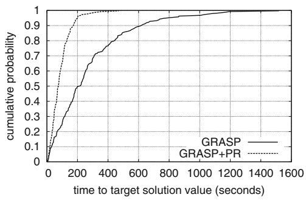

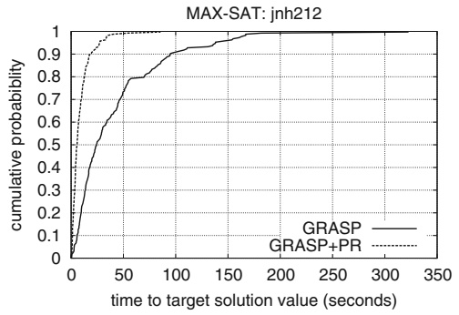

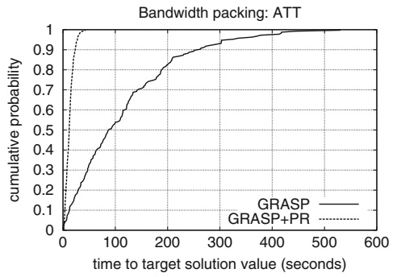

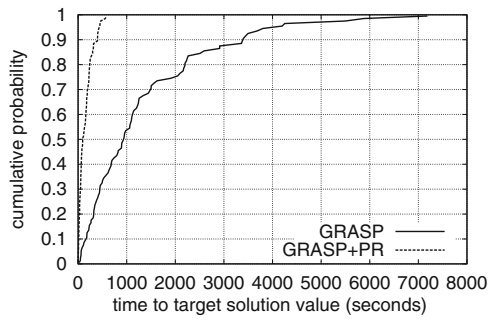

Fig. 6.10 Time to target plots comparing running times of pure GRASP and GRASP with pathrelinking on four instances of distinct problem types: three index assignment, maximum satisfiability, bandwidth packing, and quadratic assignment

Given a local optimum $s _ { 1 }$ produced at the end of a GRASP iteration, we need to select at random a solution $s _ { 2 }$ from the pool to apply path-relinking between $s _ { 1 }$ and $s _ { 2 }$ . In principle, any pool solution could be selected. However, we may want to avoid pool solutions that are too similar to $s _ { 1 }$ , because relinking two solutions that are similar limits the scope of the path-relinking search. If the solutions are represented by 0–1 indicator vectors, we should favor pairs of solutions that are far from each other, based on their Hamming distance (i.e., the number of components that take on different values in each solution). A strategy introduced in Resende and Werneck [216] is to select a pool element $s _ { 2 }$ at random with a probability proportional to the Hamming distance between the pool element and the local optimum $s _ { 1 }$ . Since the number of paths between two solutions grows exponentially with their Hamming distance, this strategy favors pool elements with a large number of paths connecting them to and from $s _ { 1 }$

After determining which solution $( s _ { 1 } \mathrm { \bf ~ o r } \; s _ { 2 } )$ will be designated the initial solution $i$ and which will be the guiding solution $g ,$ the algorithm starts by computing the set $\varDelta ( i , g )$ of components in which i and $g$ differ. This set corresponds to the moves which should be applied to i to reach $g .$ Starting from the initial solution, the best move in $\varDelta ( i , g )$ still not performed is applied to the current solution, until the guiding solution is reached. By best move, we mean the one that results in the highest quality solution in the restricted neighborhood. The best solution found along this trajectory is submitted to local search and returned as the solution produced by the path-relinking algorithm.

<div class="docvortex-algorithm" style="white-space: pre-wrap; font-family:monospace;">
procedure GRASP+PR(Seed);
    Set pool of elite solutions $\mathcal{E} \leftarrow \varnothing$;
    Set best solution value $f^* \leftarrow \infty$;
    while stopping criterion not satisfied do
        Solution $\leftarrow$ Greedy_Randomized_Construction(Seed);
        if Solution is not feasible then
            Solution $\leftarrow$ Repair(Solution);
        end-if;
        Solution $\leftarrow$ Local_Search(Solution);
        if $|\mathcal{E}| &gt; 0$ then
            Select an elite solution Solution' at random from $\mathcal{E}$;
            Solution $\leftarrow$ PR(Solution,Solution');
        end-if;
        if $f(\text{Solution}) &lt; f^*$ then
            Best_Solution $\leftarrow$ Solution;
            $f^* \leftarrow f(S)$;
        end-if;
        Update the pool of elite solutions $\mathcal{E}$ with Solution;
    end-while;
    return Best_Solution;
end GRASP+PR.
</div>

Fig. 6.11 Pseudo-code of a template of a GRASP with path-relinking for a minimization problem

The pseudo-code shown in Fig. 6.11 summarizes the steps of a GRASP with path-relinking for a minimization problem. The pseudo-code follows the structure of the basic GRASP algorithm in Fig. 6.1. Lines 1 and 2 initialize the pool of elite solutions and the best solution value, respectively. Path-relinking is performed in line 11 between the solution Solution obtained at the end of the local search phase (line 8) and a solution Solution randomly selected from the pool of elite solutions E (line 10). Procedure PR(Solution, Solution) could make use, for example, of any variant of a pure or combined path-relinking strategy. The best overall solution found Best\_Solution is returned in line 19 after the stopping criterion is satisfied.

Several alternatives have been considered and combined in recent implementations of path-relinking. These include forward, backward, back and forward, mixed, truncated, greedy randomized adaptive, evolutionary, and external path-relinking. All these alternatives, which are described in the following, involve trade-offs between computation time and solution quality.

## 6.4.1 Forward Path-Relinking

In forward path-relinking, the GRASP local optimum is designated as the initial solution and the pool solution is made the guiding solution. This is the original scheme proposed by Laguna and Martí [147].

## 6.4.2 Backward Path-Relinking

In backward path-relinking, the pool solution is designated as the initial solution and the GRASP local optimum is made the guiding one. This scheme was originally proposed in Aiex et al. [9] and Resende and Ribeiro [212]. The main advantage of this approach over forward path-relinking comes from the fact that, in general, there are more high-quality solutions near pool elements than near GRASP local optima. Backward path-relinking explores more thoroughly the neighborhood around the pool solution, whereas forward path-relinking explores more the neighborhood around the GRASP local optimum. Experiments in [9, 212] have shown that backward path-relinking usually outperforms forward path-relinking.

## 6.4.3 Back and Forward Path-Relinking

Back and forward path-relinking combines forward and backward path-relinking. As shown in [9, 212], it finds solutions at least as good as forward path-relinking or backward path-relinking, but at the expense of taking about twice as long to run. The reason that back and forward path-relinking often finds solutions of better quality than simple backward or forward path-relinking stems from the fact that it thoroughly explores the neighborhoods of both solutions $s _ { 1 }$ and $s _ { 2 }$

## 6.4.4 Mixed Path-Relinking

Mixed path-relinking shares the benefits of back and forward path-relinking, i.e. it thoroughly explores both neighborhoods, but does so in about the same time as forward or backward path-relinking alone. This is achieved by interchanging the roles of the initial and guiding solutions at each step of the path-relinking procedure. Therefore, two paths are generated, one starting at $s _ { 1 }$ and the other at s<sub>2</sub>. The paths evolve and eventually meet at some solution about half way between $s _ { 1 }$ and $s _ { 2 }$ The joined path relinks these two solutions. Mixed path-relinking was suggested by Glover [112] and was first implemented and tested by Ribeiro and Rosseti [227], where it was shown to outperform forward, backward, and back and forward pathrelinking. Figure 6.12 shows a comparison of pure GRASP and four variants of path-relinking: forward, backward, back and forward, and mixed. The time-to-target plots show that GRASP with mixed path-relinking has the best running time profile among the variants compared.

## 6.4.5 Truncated Path-Relinking

Since good-quality solutions tend to be near other good-quality solutions, one would expect to find the best solutions with path-relinking near the initial or guiding solution. Indeed, Resende et al. [222] showed that this is the case for instances of the max-min diversity problem, as shown in Fig. 6.13. In that experiment, a back and forward path-relinking scheme was tested. The figure shows the average number of best solutions found by path-relinking taken over several instances and several applications of path-relinking. The 0–10% range in this figure corresponds to subpaths near the initial solutions for the forward path-relinking phase as well as the backward phase, while the 90–100% range are subpaths near the guiding solutions. As the figure indicates, exploring the subpaths near the extremities may produce solutions about as good as those found by exploring the entire path. There is a higher concentration of better solutions close to the initial solutions explored by path-relinking.

Truncated path-relinking can be applied to either forward, backward, backward and forward, or mixed path-relinking. Instead of exploring the entire path, truncated path-relinking only explores a fraction of the path and, consequently, takes a fraction of the time to run. Truncated path-relinking has been applied in [22, 222].

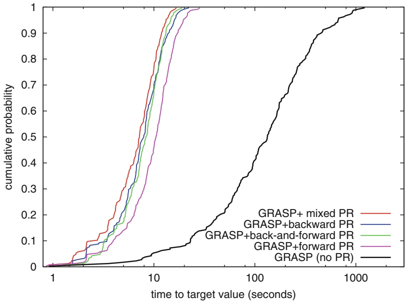

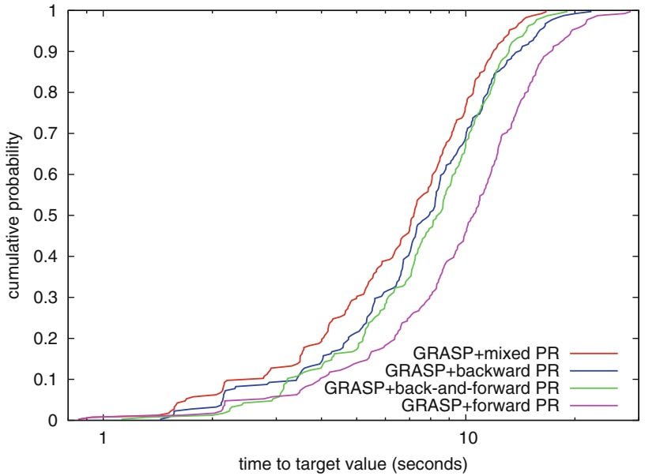

Fig. 6.12 Time-to-target plots for pure GRASP and four variants of GRASP with path-relinking (forward, backward, back and forward, and mixed) on an instance of the 2-path network design problem

## 6.4.6 Greedy Randomized Adaptive Path-Relinking

In path-relinking, the best not yet performed move in set $\varDelta ( i , g )$ is applied to the current solution, until the guiding solution is reached. If ties are broken deterministically, this strategy will always produce the same path between the initial and guiding solutions. Since the number of paths connecting i and g is exponential in $| \varLambda ( i , g ) |$ , exploring a single path can be somewhat limiting.

Greedy randomized adaptive path-relinking, introduced by Binato et al. [47], is a semi-greedy version of path-relinking. Instead of taking the best move in $\varDelta ( i , g )$ still not performed, a restricted candidate list of good moves still not performed is set up and a randomly selected move from the latter is applied. By applying this strategy several times between the initial and guiding solutions, several paths can be explored. Greedy randomized adaptive path-relinking has been applied in [22, 86, 222].

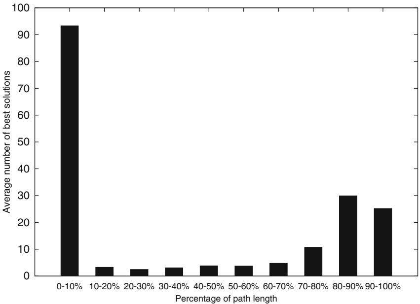

Fig. 6.13 Average number of best solutions found at different depths of the path from the initial solution to the guiding solution on instances of the max-min diversity problem

## 6.4.7 Evolutionary Path-Relinking

GRASP with path-relinking maintains a pool of elite solutions. Applying pathrelinking between pairs of pool solutions may result in an even better pool of solutions. Aiex et al. [9] applied path-relinking between all pairs of elite solutions as an intensification scheme to improve the quality of the pool and as a post-optimization step. The application of path-relinking was repeated until no further improvement was possible.

Resende and Werneck [216, 217] described an evolutionary path-relinking scheme applied to pairs of elite solutions and used as a post-optimization step. The pool resulting from the GRASP with path-relinking iterations is referred to as population $P _ { 0 }$ . At step k, all pairs of elite set solutions of population $P _ { k }$ are relinked and the resulting solutions are made candidates for inclusion in population $P _ { k + 1 }$ the next generation. The same rules for acceptance into the pool during GRASP with path-relinking are used for acceptance into $P _ { k + 1 }$ . If the best solution in $P _ { k + 1 }$ is better than the best in $P _ { k } ,$ , then k is incremented by one and the process is repeated. Resende et al. [222] describe another way to implement evolutionary path-relinking, where a single population is maintained. Each pair of elite solutions is relinked and the resulting solution is a candidate to enter the elite set. If accepted, it replaces an existing elite solution. The process is continued while there are still pairs of elite solutions that have not yet been relinked.

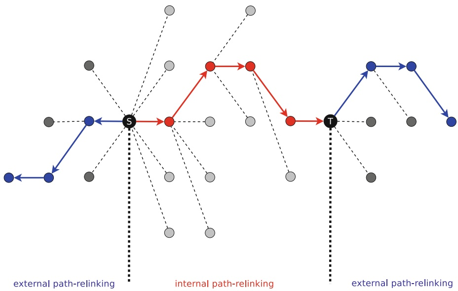

Fig. 6.14 An internal path (red arcs, red nodes) from solution S to solution T and two external (blue arcs, blue nodes) paths, one emanating from solution S and the other from solution T. These paths are produced by internal and external path-relinking

Andrade and Resende [21] used this evolutionary scheme as an intensification process every 100 GRASP iterations. During the intensification phase, every solution in the pool is relinked with the two best ones. Since two elite solutions may be relinked more than once in different calls to the intensification process, greedy randomized adaptive path-relinking was used.

Resende et al. [222] showed that a variant of GRASP with evolutionary pathrelinking outperformed several other heuristics using GRASP with path-relinking, simulated annealing, and tabu search for the max-min diversity problem.

## 6.4.8 External Path-Relinking and Diversification

So far in this section, we have considered variants of path-relinking in which a path in the search space graph connects two feasible solutions by progressively introducing in one of them (the initial solution) attributes of the other (the guiding solution). Since attributes common to both solutions are not changed and all solutions visited belong to a path between the two solutions, we may also refer to this type of path-relinking as internal path-relinking.

External path-relinking extends any path connecting two feasible solutions S and T beyond its extremities. To extend such a path beyond S, attributes not present in either S or T are introduced in S. Symmetrically, to extend it beyond T, attributes not present in either S or T are introduced in T. In its greedy variant, all moves are evaluated and the solution chosen to be next in the path is one with best cost or, in case they are all infeasible, the one with least infeasibility. In either direction, the procedure stops when all attributes that do not appear in either S or T have been tested for extending the path. Once both paths are complete, local search may be applied to the best solution in each of them. The best of the two local minima is returned as the solution produced by the external path-relinking procedure.

Figure 6.14 illustrates internal and external path-relinking. The path with red nodes and edges is the one resulting from internal path-relinking applied with S as the initial solution and T as the guiding solution. We observe that the orientation introduced by the arcs in this path is due only to the choice of the initial and guiding solutions. If the roles of solutions S and T were interchanged, it could have been computed and generated in the reverse direction. The same figure also illustrates two paths obtained by external path-relinking, one emanating from S and the other from T, both represented with blue nodes and edges. The orientations of the arcs in each of these paths indicate that they necessarily emanate from either solution S or T.

To conclude, we establish a parallel between internal and external path-relinking. Since internal path-relinking works by fixing all attributes common to the initial and guiding solutions and searches for paths between them satisfying this property, it is clearly an intensification strategy. Contrarily, external path-relinking progressively removes common attributes and replaces them by others that do not appear in either one of the initial or guiding solution. Therefore, it can be seen as a diversification strategy which produces solutions increasingly farther from both the initial and the guiding solutions. External path-relinking becomes therefore a tool for search diversification.

External path-relinking was introduced by Glover [114] and first applied by Duarte et al. [84] in a heuristic for differential dispersion minimization.

## 6.5 Restart Strategies

Figure 6.15 shows a typical iteration count distribution for a GRASP with pathrelinking. Observe in this example that for most of the independent runs whose iteration counts make up the plot, the algorithm finds a target solution in relatively few iterations: about 25% of the runs take at most 101 iterations; about 50% take at most 192 iterations; and about 75% take at most 345. However, some runs take much longer: 10% take over 1000 iterations; 5% over 2000; and 2% over 9715 iterations. The longest run took 11,607 iterations to find a solution at least as good as the target. These long tails contribute to a large average iteration count as well as to a high standard deviation. This section proposes strategies to reduce the tail of the distribution, consequently reducing the average iteration count and its standard deviation.

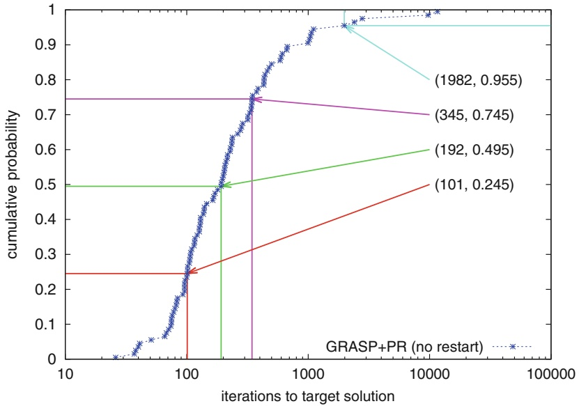

Fig. 6.15 Typical iteration count distribution of GRASP with path-relinking

Consider again the distribution in Fig. 6.15. The distribution shows that each run will take over 345 iterations with a probability of about 25%. Therefore, any time the algorithm is restarted, the probability that the new run will take over 345 iterations is also about 25%. By restarting the algorithm after 345 iterations, the new run will take more than 345 iterations with probability of also about 25%. Therefore, the probability that the algorithm will be still running after $3 4 5 + 3 4 5 = 6 9 0$ iterations is the probability that it takes more than 345 iterations multiplied by the probability that it takes more than 690 iterations given that it took more than 345 iterations, i.e., about $( 1 / 4 ) \times ( 1 / 4 ) = ( 1 / 4 ) ^ { 2 }$ . It follows by induction that the probability that the algorithm will still be running after k periods of 345 iterations is $1 / ( 4 ^ { k } )$ . In this example, the probability that the algorithm will be running after 1725 iterations will be about 0.1%, i.e., much less than the $5 \%$ probability that the algorithm will take over 2000 iterations without restart.

A restart strategy is defined as an infinite sequence of time intervals $\tau _ { 1 } , \tau _ { 2 } , \tau _ { 3 } , \ldots$ which define epochs $\tau _ { 1 } , \tau _ { 1 } + \tau _ { 2 } , \tau _ { 1 } + \tau _ { 2 } + \tau _ { 3 } , .$ . when the algorithm is restarted from scratch. It can be shown that the optimal restart strategy uses $\tau _ { 1 } = \tau _ { 2 } = \cdots = \tau ^ { * }$ where $\tau ^ { * }$ is some (unknown) constant. Strategies for speeding up stochastic local search algorithms using restarts were first proposed by Luby et al. [156], where they proved the existence of an optimal restart strategy. Restart strategies in metaheuristics have been addressed in [67, 139, 182, 187, 250]. Further work on restart strategies can be found in [251, 252].

Implementing the optimal strategy may be difficult in practice because it requires the constant value $\tau ^ { * }$ . Runtimes can vary greatly for different combinations of algorithm, instance, and solution quality sought. Since usually one has no prior information about the runtime distribution of the stochastic search algorithm for the optimization problem under consideration, one runs the risk of choosing a value of $\tau ^ { * }$ that is either too small or too large. On the one hand, a value that is too small can cause the restart variant of the algorithm to take much longer to converge than a no-restart variant. On the other hand, a value that is too large may never lead to a restart, causing the restart-variant of the algorithm to take as long to converge as the no-restart variant. Figure 6.16 illustrates the restart strategies with time-to-target plots for the maximum cut instance G12 [126] on an 800-node graph with edge density of 0.63% with target solution value 554 for τ = 6, 9, 12, 18, 24, 30, and 42 s. For each value of τ, 100 independent runs of a GRASP with path-relinking with restarts were performed. The variant with τ = ∞ corresponds to the heuristic without restart. The figure shows that, for some values of τ, the resulting heuristic outperformed its counterpart with no restart by a large margin.

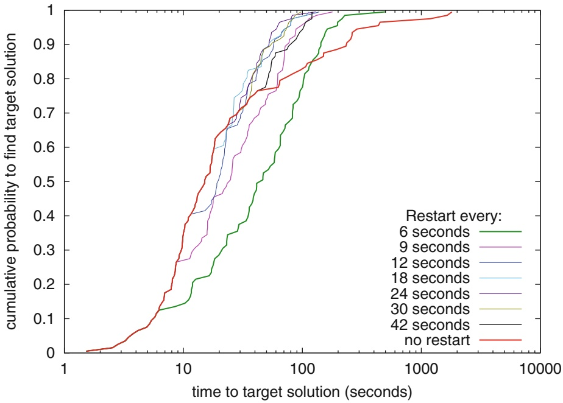

Fig. 6.16 Time-to-target plot for target solution value of 554 for a GRASP with path-linking with restart on the maximum cut instance G12 using different values of τ

In GRASP with path-relinking, the number of iterations between improvements of the incumbent solution tends to vary less than the runtimes for different combinations of instance and solution quality sought. If one takes this into account, a simple and effective restart strategy for GRASP with path-relinking is to keep track of the last iteration when the incumbent solution was improved and restart the GRASP with path-relinking if κ iterations have gone by without improvement. We shall call such a strategy restart(κ). A restart consists in saving the incumbent and emptying out the elite set.

<div class="docvortex-algorithm" style="white-space: pre-wrap; font-family:monospace;">
procedure GRASP+PR+Restarts(Seed);
    Set pool of elite solutions $\mathcal{E} \leftarrow \varnothing$;
    Set best solution value $f^* \leftarrow \infty$;
    LastImprov $\leftarrow 0$;
    CurrentIter $\leftarrow 0$;
    while stopping criterion not satisfied do
        CurrentIter $\leftarrow$ CurrentIter + 1;
        Solution $\leftarrow$ Greedy_Randomized_Construction(Seed);
        if Solution is not feasible then
            Solution $\leftarrow$ Repair(Solution);
        end-if;
        Solution $\leftarrow$ Local_Search(Solution);
        if $|\mathcal{E}| &gt; 0$ then
            Select an elite solution Solution' at random from $\mathcal{E}$;
            Solution $\leftarrow$ forward-PR(Solution,Solution');
        end-if;
        if $f(\text{Solution}) &lt; f^*$ then
            Best_Solution $\leftarrow$ Solution;
            $f^* \leftarrow f(S)$;
            LastImprov $\leftarrow$ CurrentIter;
            end-if;
        if CurrentIter - LastImprov &gt; $\kappa$ then
            $\mathcal{E} \leftarrow \varnothing$;
            LastImprov $\leftarrow$ CurrentIter;
        else
            Update the pool of elite solutions $\mathcal{E}$ with Solution;
        end-if;
    end-while;
    return Best_Solution;
end GRASP+PR+Restarts.
</div>

Fig. 6.17 Pseudo-code of a template of a GRASP with path-relinking with restarts for a minimization problem

The pseudo-code shown in Fig. 6.17 summarizes the steps of a GRASP with pathrelinking using the restart(κ) strategy for a minimization problem. The algorithm keeps track of the current iteration (CurrentIter), as well as of the last iteration when an improving solution was found (LastImprov). If an improving solution is detected in line 16, then this solution and its cost are saved in lines 17 and 18, respectively, and the iteration of the last improvement is set to the current iteration in line 19. If, in line 21, it is determined that more than κ iterations have gone by since the last improvement of the incumbent, then a restart is triggered, emptying out the elite set in line 22 and resetting the iteration of the last improvement to the current iteration in line 23. If restart is not triggered, then in line 25 the current solution is tested for inclusion in the elite set and the set is updated if it is accepted. The best overall solution found Best\_Solution is returned in line 28 after the stopping criterion is satisfied.

As an illustration of the use of the restart(κ) strategy within a GRASP with pathrelinking, consider the maximum cut instance G12. For the values $\kappa   =   5 0 , 1 0 0 , 2 0 0 ,$ 300, 500, 1000, 2000, and 5000, the heuristic was run independently 100 times, and was stopped when a cut of weight 554 or higher was found. A strategy without restarts was also implemented. Figures 6.18 and 6.19, as well as Table 6.6, summarize these runs, showing the average time to target solution as a function of the value of κ and the time-to-target plots for different values of κ. These figures illustrate well the effect on running time of selecting a value of κ that is either too small $( \kappa = 5 0 , 1 0 0 )$ or too large $( \kappa   =   2 0 0 0 , 5 0 0 0 )$ . They further show that there is a wide range of κ values $( \kappa = 2 0 0 ,   3 0 0 ,   5 0 0 ,   1 0 0 0 )$ that result in lower runtimes when compared to the strategy without restarts.

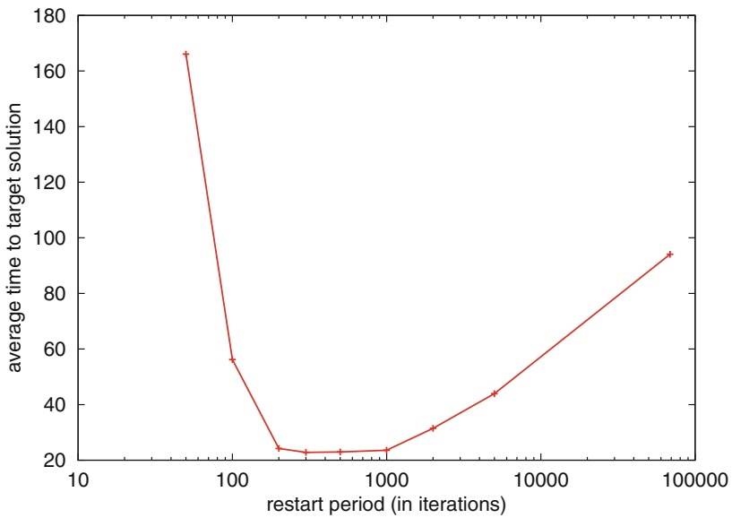

Fig. 6.18 Average time to target solution for maximum cut instance G12 using different values of. All runs of all strategies have found a solution at least as good as the target value of 554

Figure 6.20 further illustrates the behavior of the restart(100), restart(500), and restart(1000) strategies for the previous example, when compared with the strategy without restarts on the same maximum cut instance G12. However, in this figure, for each strategy, we plot the number of iterations to the target solution value. It is interesting to note that, as expected, each strategy restart(κ) behaves exactly like the strategy without restarts for the κ first iterations, for $\kappa = 1 0 0 , 5 0 0 , 1 0 0 0$ . After this point, each trajectory deviates from that of the strategy without restarts. Among these strategies, restart(500) is the one with the best performance.

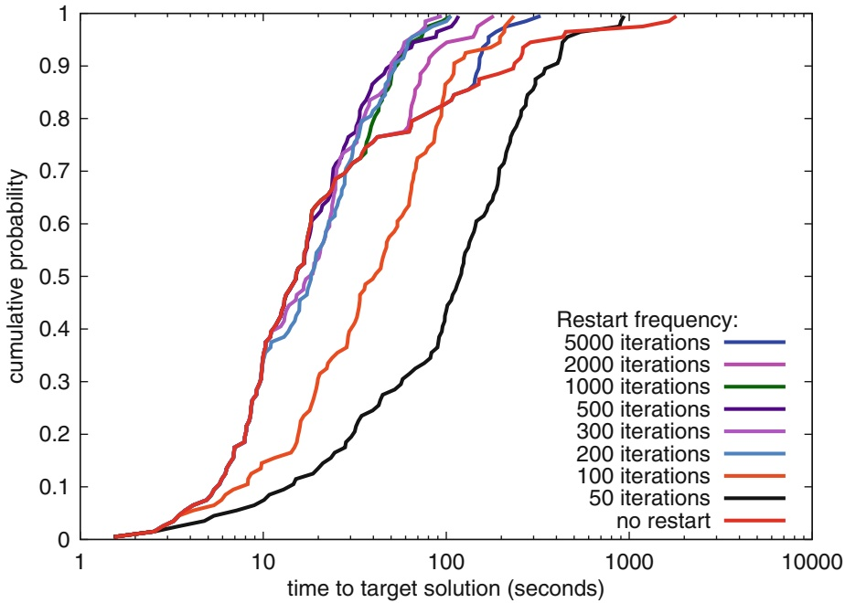

Fig. 6.19 Time-to-target plots for maximum cut instance G12 using different values of κ. The figure also shows the time-to-target plot for the strategy without restarts. All runs of all strategies found a solution at least as good as the target value of 554

We make some final observations about these experiments. The effect of the restart strategies can be mainly observed in the column corresponding to the fourth quartile of Table 6.6. Entries in this quartile correspond to those in the heavy tails of the distributions. The restart strategies in general did not affect the other quartiles of the distributions, which is a desirable characteristic. Compared to the no-restart strategy, restart strategies restart(500) and restart(1000) were able to reduce the maximum number of iterations, as well as the average and the standard deviation. Strategy restart(100) did so, too, but not as much as restart(500) and restart(1000). Restart strategies restart(500) and restart(1000) were clearly the best strategies of those tested.

Table 6.6 Summary of computational results on maximum cut instance G12 with four strategies

<table><tr><td></td><td colspan="4">Iterations in quartile</td><td colspan="2"></td></tr><tr><td>Strategy</td><td>1st</td><td>2nd</td><td>3rd</td><td>4th</td><td>Average</td><td>st.dev.</td></tr><tr><td>No restarts</td><td>326</td><td>550</td><td>1596</td><td>68,813</td><td>4525.1</td><td>11,927.0</td></tr><tr><td>restart(1000)</td><td>326</td><td>550</td><td>1423</td><td>5014</td><td>953.2</td><td>942.1</td></tr><tr><td>restart(500)</td><td>326</td><td>550</td><td>1152</td><td>4178</td><td>835.0</td><td>746.1</td></tr><tr><td>restart(100)</td><td>509</td><td>1243</td><td>3247</td><td>8382</td><td>2055.0</td><td>2005.9</td></tr></table>

For each strategy, 100 independent runs were executed, each stopped when a solution as good as the target solution value 554 was found. For each strategy, the table shows the distribution of the number of iterations by quartile. For each quartile, the table gives the maximum number of iterations taken by all runs in that quartile, i.e., the slowest of the fastest 25% (1st), 50% (2nd), 75% (3rd), and 100% (4th) of the runs. The average number of iterations over the 100 runs and the standard deviation (st.dev.) are also given for each strategy

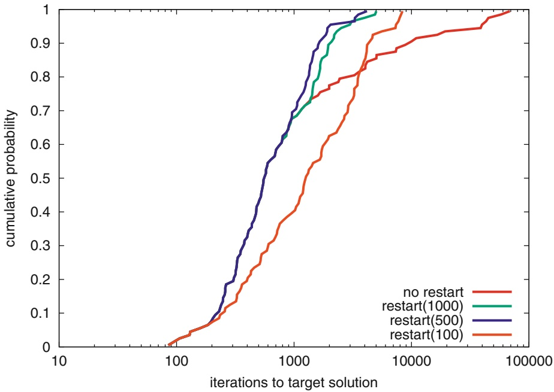

Fig. 6.20 Comparison of the iterations-to-target plots for maximum cut instance G12 using strategies restart(100), restart(500), and restart(1000). The figure also shows the iterations-to-target plot for the strategy without restarts. All runs of all strategies found a solution at least as good as the target value of 554

The restart(κ) strategy for GRASP with path-relinking discussed in this section was originally proposed by Resende and Ribeiro [214]. Besides the experiments presented in this chapter for the maximum cut instance G12, that paper also considered five other instances of maximum cut, maximum weighted satisfiability, and bandwidth packing. Interian and Ribeiro [136] implemented restart strategies for GRASP with path-relinking for the Steiner traveling salesman problem.

## 6.6 Extensions

In this section, we comment on some extensions, implementation strategies, and hybridizations of GRASP.

The use of hash tables to avoid cycling in conjunction with tabu search was proposed by Woodruff and Zemel [266]. A similar approach was later explored by Ribeiro et al. [232] in their tabu search algorithm for query optimization in relational databases. In the context of GRASP implementations, hash tables were first used by Martins et al. [168] in their multi-neighborhood heuristic for the Steiner problem in graphs, to avoid the application of local search to solutions already visited in previous iterations.

Filtering strategies are used to speed up the iterations of GRASP, see e.g. [93, 168, 202]. With filtering, local search is not applied to all solutions obtained at the end of the construction phase, but only to some more promising unvisited solutions, defined by a threshold with respect to the incumbent.

Almost all randomization effort in the basic GRASP algorithm involves the construction phase. Local search stops at the first local optimum. On the other hand, strategies such as VNS (Variable Neighborhood Search), proposed by Hansen and Mladenovic [ ´ 121, 172], rely almost entirely on the randomization of the local search to escape from local optima. With respect to randomization, GRASP and variable neighborhood strategies can be considered complementary and potentially capable of leading to effective hybrid methods. A first attempt in this direction was made by Martins et al. [168] where the construction phase of a hybrid heuristic for the Steiner problem in graphs follows the greedy randomized strategy of GRASP, while the local search phase makes use of two different neighborhood structures, like the VND (variable neighborhood descent) procedure [121, 172]. That heuristic was later improved by Ribeiro et al. [233], where one of the key components of the new algorithm was another strategy for the exploration of different neighborhoods. Ribeiro and Souza [229] also combined GRASP with VND in a hybrid heuristic for the degree-constrained minimum spanning tree problem. Festa et al. [102] studied different variants and combinations of GRASP and VNS for the maximum cut problem, finding and improving the best known solutions for some open instances from the literature.

GRASP has also been used in conjunction with genetic algorithms. The greedy randomized strategy used in the construction phase of a GRASP heuristic is applied to generate the initial population for a genetic algorithm. As an example, consider the genetic algorithm of Ahuja et al. [4] for the quadratic assignment problem. It makes use of the GRASP heuristic proposed by Li et al. [150] to create the initial population of solutions. A similar approach was used by Armony et al. [31], with the initial population made up of both randomly generated solutions and those built by a GRASP heuristic.

The hybridization of GRASP with tabu search was first studied by Laguna and González-Velarde [146]. Delmaire et al. [71] considered two approaches. In the first, GRASP is applied as a powerful diversification strategy in the context of a tabu search procedure. The second approach is an implementation of the Reactive GRASP algorithm presented in Sect. 6.3.2, in which the local search phase is strengthened by tabu search. Results reported for the capacitated location problem show that the hybrid approaches perform better than the isolated methods previously used. Two two-stage heuristics are proposed in [1] for solving the multi-floor facility layout problem. GRASP/TS applies a GRASP to find the initial layout and tabu search to refine it.

Iterated Local Search (ILS) iteratively builds a sequence of solutions generated by the repeated application of local search and perturbation of the local optima found by local search [42]. Lourenço et al. [155] point out that ILS has been rediscovered many times and is also known as iterated descent [40, 41], large step Markov chains [165], iterated Lin-Kernighan [137], and chained local optimization [164]. A GRASP/ILS hybrid can be obtained by replacing the standard local search of GRASP by ILS. The GRASP construction produces a solution which is passed to the ILS procedure. Ribeiro and Urrutia [230] presented a hybrid GRASP with ILS for the mirrored traveling tournament problem, in which perturbations are achieved by randomly generating solutions in the game rotation ejection chain [110, 111] neighborhood.

## 6.7 Applications

The first application of GRASP was described in the literature in 1989 [90]. In that paper, GRASP was applied to difficult set covering problems Since then, GRASP has been applied to a wide range of problems. The main applications areas are summarized below with links to specific references:

• Assignment problems [4, 9, 89, 106, 150, 153, 154, 169, 170, 177, 178, 183, 188, 190, 198, 202, 204, 218, 241]

• Biology [23, 64, 68, 76, 97, 108, 231]

• Computer vision [53, 132, 246, 247]

• Covering, packing, and partitioning [13, 15, 16, 28, 29, 72, 77, 90, 109, 119, 192, 195, 196, 223, 239, 244, 245]

• Diversity and dispersion [79, 84, 163, 222]

• Finance [19, 127]

• Graph and map drawing [66, 96, 147, 159, 160, 162, 184, 210, 226]

• Location and layout [1, 60, 66, 71, 120, 133, 141, 171, 181, 185, 253, 255, 260, 261]

• Logic [75, 104, 189, 208, 219, 221]

• Minimum Steiner tree [54, 166–168, 233]

• Optimization in graphs [2, 3, 5, 12, 32, 56, 73, 82, 83, 93, 101, 103, 134, 148, 149, 157, 160, 161, 168, 179, 191, 193, 207, 210, 220, 226, 233, 248, 257]

• Power systems [25, 46, 48, 86, 203, 263]

• Robotics [144, 240]

• Routing [30, 33, 38, 52, 55, 63, 136, 143, 145, 151, 176, 181, 206, 262, 264, 265]

• Software engineering [158]

• Sports [26, 140, 225, 230]

• Telecommunications [2, 17, 18, 20, 22, 31, 62, 107, 141, 153, 174, 175, 194, 197, 199, 202, 207, 209, 212, 234, 258]

Timetabling, scheduling, and manufacturing [8, 11, 14, 20, 22, 24, 35–37, 39, 49, 50, 59, 61, 65, 69, 70, 74, 78, 85, 87, 88, 92, 94, 95, 138, 142, 146, 152, 173, 180, 186, 205, 230, 237, 238, 242, 243, 267, 268]

• Transportation [30, 34, 87, 89, 256]

• VLSI design [27, 28]

The reader is referred to Festa and Resende [100] and the book by Resende and Ribeiro [215] for extended annotated bibliographies of GRASP applications.

## 6.8 Concluding Remarks

The results described in this chapter reflect successful applications of GRASP to a large number of classical combinatorial optimization problems, as well as to problems that arise in real-world situations in different areas of business, science, and technology.

We underscore the simplicity of implementation of GRASP, which makes use of simple building blocks (solution construction procedures and local search methods) that are often readily available. Contrary to what occurs with most other metaheuris tics, such as tabu search or genetic algorithms, that make use of a large number of parameters in their implementations, the basic variant of GRASP requires the adjustment of a single parameter, i.e. the restricted candidate list (RCL) parameter α.

Recent developments, presented in this chapter, show that different extensions of the basic procedure allow further improvements in the solutions found by GRASP. Among these, we highlight reactive GRASP, which automates the adjustment of the restricted candidate list parameter; variable neighborhoods, which permit accelerated and intensified local search; path-relinking, which beyond allowing the implementation of intensification strategies based on the memory of elite solutions, opens the way for the development of very effective cooperative parallel strategies [6, 8, 9, 227]; and restart strategies to speedup the search.

These and other extensions make up a set of tools that can be added to simpler heuristics to find better-quality solutions. To illustrate the effect of additional extensions on solution quality, Fig. 6.21 shows some results obtained for the prizecollecting Steiner tree problem (PCSTP), as discussed by Canuto et al. in [54]. The figure shows results for 11 different levels of solution accuracy (varying from optimal to 10% from optimal) on 40 PCSTP instances. For each level of solution accuracy, the figure shows the number of instances for which each component found solutions within the accuracy level. The components are the primal-dual constructive algorithm (GW) of Goemans and Williamson [117], GW followed by local search (GW+LS), corresponding to the first GRASP iteration, 500 iterations of GRASP with path-relinking (GRASP+PR), and the complete algorithm, using variable neighborhood search as a post-optimization procedure (GRASP+PR+VNS).

We observe that the number of optimal solutions found goes from six, using only the constructive algorithm, to a total of 36, using the complete algorithm described in [54]. The largest relative deviation with respect to the optimal value decreases from 36.4% in the first case, to only 1.1% for the complete algorithm. It is easy to notice the contribution made by each additional extension.


Fig. 6.21 Performance of GW approximation algorithm, a single GRASP iteration (GW followed by local search), 500 iterations of GRASP with path-relinking, and 500 iterations of GRASP with path-relinking followed by VNS for series C prize-collecting Steiner tree problems

The structure of GRASP makes it very amenable to straightforward, efficient parallel implementations that benefit from the computer architecture. Parallel implementations of GRASP [6, 8, 9, 227] are quite robust and lead to linear speedups both in independent and cooperative strategies. Cooperative strategies are based on the collaboration between processors through path-relinking and a global pool of elite solutions. This allows the use of more processors to find better solutions in less computation time. Many parallel implementations of GRASP have been reported in the literature, see e.g. [166, 168, 178, 188, 189]. In many of these papers, a common observation was made: the speedups in the measured running times were proportional to the number of processors. This observation can be explained if the random variable time-to-target-solution-value is exponentially distributed. Aiex et al. [7] developed a graphical methodology based on runtime distributions to empirically show that the running times of GRASP heuristics fit exponential distributions, as summarized below.

Runtime distributions or time-to-target plots display on the ordinate axis the probability that an algorithm will find a solution at least as good as a given target value within a given running time, shown on the abscissa axis. They provide a very useful tool to characterize the running times of stochastic algorithms for combinatorial optimization problems and to compare different algorithms or strategies for solving a given problem. Time-to-target plots were first used by Feo et al. [93] and have been widely used as a tool for algorithm design and comparison. Runtime distributions have also been advocated by Hoos and Stützle [135] as a way to characterize the running times of stochastic local search algorithms for combinatorial optimization. In particular, they have been largely applied to evaluate and compare the efficiency of different strategies of sequential and parallel implementations of GRASP with (and without) path-relinking heuristics. Aiex et al. [7] used time-to-target plots to show experimentally that the running times of GRASP heuristics fit shifted (or two-parameter) exponential distributions, reporting computational results for 2400 runs of GRASP heuristics for each of five different problems: maximum stable set, quadratic assignment, graph planarization [210, 211, 226], maximum weighted satisfiability, and maximum covering. Aiex et al. [10] developed a Perl program to create time-to-target plots for measured times that are assumed to fit a shifted exponential distribution, following closely the work in [7]. Ribeiro et al. [235] developed a closed form result to compare two exponential algorithms and an iterative procedure to compare two algorithms following generic runtime distributions. This work was extended by Ribeiro et al. [236] and was also applied in the comparison of parallel heuristics. Ribeiro and Rosseti [228] developed a code to compare runtime distributions of randomized algorithms.

To conclude, this chapter provides the reader with the tools to build a basic GRASP to find optimal or near-optimal solutions to a combinatorial optimization problem. The chapter also provides the means to add more advanced features to this basic GRASP, like path-relinking and restart strategies, that enable better performance, both with respect to solution quality and solution run time. Left out of this chapter is the use of GRASP for solving continuous optimization problems. The interested reader is pointed to [128–131, 215, 254] for an introduction to C-GRASP, or Continuous GRASP, as well as to some software and applications of C-GRASP.

## References

1. S. Abdinnour-Helm, S.W. Hadley, Tabu search based heuristics for multi-floor facility layout. Int. J. Prod. Res. 38, 365–383 (2000)

2. J. Abello, P.M. Pardalos, M.G.C. Resende, On maximum clique problems in very large graphs, in External Memory Algorithms and Visualization, ed. by J. Abello, J. Vitter. DI-MACS Series on Discrete Mathematics and Theoretical Computer Science, vol. 50 (American Mathematical Society, Providence, 1999), pp. 199–130

3. J. Abello, M.G.C. Resende, S. Sudarsky, Massive quasi-clique detection, in LATIN 2002: Theoretical Informatics, ed. by S. Rajsbaum. Lecture Notes in Computer Science, vol. 2286 (Springer, Berlin, 2002), pp. 598–612

4. R.K. Ahuja, J.B. Orlin, A. Tiwari, A greedy genetic algorithm for the quadratic assignment problem. Comput. Oper. Res. 27, 917–934 (2000)

5. R.K. Ahuja, J.B. Orlin, D. Sharma, Multi-exchange neighborhood structures for the capacitated minimum spanning tree problem. Math. Program. 91, 71–97 (2001)

6. R.M. Aiex, M.G.C. Resende, Parallel strategies for GRASP with path-relinking, in Metaheuristics: Progress as Real Problem Solvers, ed. by T. Ibaraki, K. Nonobe, M. Yagiura (Springer, New York, 2005), pp. 301–331

7. R.M. Aiex, M.G.C. Resende, C.C. Ribeiro, Probability distribution of solution time in GRASP: an experimental investigation. J. Heuristics 8, 343–373 (2002)

8. R.M. Aiex, S. Binato, M.G.C. Resende, Parallel GRASP with path-relinking for job shop scheduling. Parallel Comput. 29, 393–430 (2003)

9. R.M. Aiex, P.M. Pardalos, M.G.C. Resende, G. Toraldo, GRASP with path-relinking for three-index assignment. INFORMS J. Comput. 17, 224–247 (2005)

10. R.M. Aiex, M.G.C. Resende, C.C. Ribeiro, TTTPLOTS: a perl program to create time-to-target plots. Optim Lett. 1, 355–366 (2007)

11. E. Alekseeva, M. Mezmaz, D. Tuyttens, N. Melab, Parallel multi-core hyper-heuristic GRASP to solve permutation flow-shop problem. Concurrency Comput. Pract. Exp. 29, e3835 (2017)

12. D. Aloise, C.C. Ribeiro, Adaptive memory in multistart heuristics for multicommodity network design. J. Heuristics 17, 153–179 (2011)

13. R. Álvarez-Valdés, F. Parreno, J.M. Tamarit, A GRASP algorithm for constrained twodimensional non-guillotine cutting problems. J. Oper. Res. Soc. 56, 414–425 (2005)

14. R. Álvarez-Valdés, E. Crespo, J.M. Tamarit, F. Villa, GRASP and path relinking for project scheduling under partially renewable resources. Eur. J. Oper. Res. 189, 1153–1170 (2008)

15. R. Alvarez-Valdesa, F. Parreno, J.M. Tamarit, Reactive GRASP for the strip-packing problem. Comput. Oper. Res. 35, 1065–1083 (2008)

16. R. Alvarez-Valdes, F. Parreño, J.M. Tamarit, A GRASP/path relinking algorithm for two- and three-dimensional multiple bin-size bin packing problems. Comput. Oper. Res. 40, 3081–3090 (2013)

17. E. Amaldi, A. Capone, F. Malucelli, Planning UMTS base station location: optimization models with power control and algorithms. IEEE Trans. Wirel. Commun. 2, 939–952 (2003)

18. E. Amaldi, A. Capone, F. Malucelli, F. Signori, Optimization models and algorithms for downlink UMTS radio planning, in Proceedings of Wireless Communications and Networking, vol. 2 (2003), pp. 827–831

19. K.P. Anagnostopoulos, P.D. Chatzoglou, S. Katsavounis, A reactive greedy randomized adaptive search procedure for a mixed integer portfolio optimization problem. Manag. Financ. 36, 1057–1065 (2010)

20. D.V. Andrade, M.G.C. Resende, A GRASP for PBX telephone migration scheduling, in Proceedings of the Eighth INFORMS Telecommunications Conference (2006)

21. D.V. Andrade, M.G.C. Resende, GRASP with evolutionary path-relinking. Technical Report TD-6XPTS7, AT&T Labs Research, Florham Park, 2007

22. D.V. Andrade, M.G.C. Resende, GRASP with path-relinking for network migration scheduling, in Proceedings of the International Network Optimization Conference (2007)

23. A.A. Andreatta, C.C. Ribeiro, Heuristics for the phylogeny problem. J. Heuristics 8, 429–447 (2002)

24. C. Andrés, C. Miralles, R. Pastor, Balancing and scheduling tasks in assembly lines with sequence-dependent setup times. Eur. J. Oper. Res. 187, 1212–1223 (2008)

25. C.H. Antunes, E. Oliveira, P. Lima, A multi-objective GRASP procedure for reactive power compensation planning. Optim. Eng. 15, 199–215 (2014)

26. A.P.F. Araújo, C. Boeres, V.E.F. Rebello, C.C. Ribeiro, S. Urrutia, Exploring grid implementations of parallel cooperative metaheuristics: a case study for the mirrored traveling tournament problem, in Metaheuristics: Progress in Complex Systems Optimization, ed. by K.F. Doerner, M. Gendreau, P. Greistorfer, W. Gutjahr, R.F. Hartl, M. Reimann (Springer, New York, 2007), pp. 297–322

27. S.M. Areibi, GRASP: an effective constructive technique for VLSI circuit partitioning, in Proceedings of the IEEE Canadian Conference on Electrical and Computer Engineering, Edmonton, pp. 462–467 (1999)

28. S. Areibi, A. Vannelli, A GRASP clustering technique for circuit partitioning, in Satisfiability Problems, ed. by J. Gu, P.M. Pardalos. DIMACS Series on Discrete Mathematics and Theoretical Computer Science, vol. 35 (American Mathematical Society, Providence, 1997), pp. 711–724

29. M.F. Argüello, T.A. Feo, O. Goldschmidt, Randomized methods for the number partitioning problem. Comput. Oper. Res. 23, 103–111 (1996)

30. M.F. Argüello, J.F. Bard, G. Yu, A GRASP for aircraft routing in response to groundings and delays. J. Comb. Optim. 1, 211–228 (1997)

31. M. Armony, J.C. Klincewicz, H. Luss, M.B. Rosenwein, Design of stacked self-healing rings using a genetic algorithm. J. Heuristics 6, 85–105 (2000)

32. J.E.C. Arroyo, P.S. Vieira, D.S. Vianna, A GRASP algorithm for the multi-criteria minimum spanning tree problem. Ann. Oper. Res. 159, 125–133 (2008)

33. J.B. Atkinson, A greedy randomised search heuristic for time-constrained vehicle scheduling and the incorporation of a learning strategy. J. Oper. Res. Soc. 49, 700–708 (1998)

34. J.F. Bard, An analysis of a rail car unloading area for a consumer products manufacturer. J. Oper. Res. Soc. 48, 873–883 (1997)

35. J.F. Bard, T.A. Feo, Operations sequencing in discrete parts manufacturing. Manage. Sci. 35, 249–255 (1989)

36. J.F. Bard, T.A. Feo, An algorithm for the manufacturing equipment selection problem. IIE Trans. 23, 83–92 (1991)

37. J.F. Bard, T.A. Feo, S. Holland, A GRASP for scheduling printed wiring board assembly. IIE Trans. 28, 155–165 (1996)

38. J.F. Bard, L. Huang, P. Jaillet, M. Dror, A decomposition approach to the inventory routing problem with satellite facilities. Transp. Sci. 32, 189–203 (1998)

39. J.F. Bard, Y. Shao, A.I. Jarrah, A sequential GRASP for the therapist routing and scheduling problem. J. Scheduling 17, 109–133 (2014)

40. E.B. Baum, Iterated descent: a better algorithm for local search in combinatorial optimization problems. Technical Report, California Institute of Technology, 1986

41. E.B. Baum, Towards practical ‘neural’ computation for combinatorial optimization problems, in AIP Conference Proceedings 151 on Neural Networks for Computing (American Institute of Physics Inc., Woodbury, 1987), pp. 53–58

42. J. Baxter, Local optima avoidance in depot location. J. Oper. Res. Soc. 32, 815–819 (1981)

43. J.E. Beasley, An algorithm for set-covering problems. Eur. J. Oper. Res. 31, 85–93 (1987)

44. J.E. Beasley, A Lagrangian heuristic for set-covering problems. Nav. Res. Logist. 37, 151–164 (1990)

45. J.E. Beasley, Lagrangean relaxation, in Modern Heuristic Techniques for Combinatorial Problems, ed. by C.R. Reeves (Blackwell Scientific Publications, Oxford, 1993), pp. 243–303

46. S. Binato, G.C. Oliveira, A reactive GRASP for transmission network expansion planning, in Essays and Surveys in Metaheuristics, ed. by C.C. Ribeiro, P. Hansen (Kluwer Academic Publishers, Boston, 2002), pp. 81–100

47. S. Binato, H. Faria Jr., M.G.C. Resende, Greedy randomized adaptive path relinking, in Proceedings of the IV Metaheuristics International Conference, ed. by J.P. Sousa, pp. 393–397 (2001)

48. S. Binato, G.C. Oliveira, J.L. Araújo, A greedy randomized adaptive search procedure for transmission expansion planning. IEEE Trans. Power Syst. 16, 247–253 (2001)

49. S. Binato, W.J. Hery, D. Loewenstern, M.G.C. Resende, A GRASP for job shop scheduling, in Essays and Surveys in Metaheuristics, ed. by C.C. Ribeiro, P. Hansen (Kluwer Academic Publishers, Boston, 2002), pp. 59–79

50. M. Boudia, M.A.O. Louly, C. Prins, A reactive GRASP and path relinking for a combined production-distribution problem. Comput. Oper. Res. 34, 3402–3419 (2007)

51. J.L. Bresina, Heuristic-biased stochastic sampling, in Proceedings of the Thirteenth National Conference on Artificial Intelligence, Portland, pp. 271–278 (1996)

52. A.M. Campbell, B.W. Thomas, Probabilistic traveling salesman problem with deadlines. Transp. Sci. 42, 1–21 (2008)

53. R.G. Cano, G. Kunigami, C.C. de Souza, P.J. de Rezende, A hybrid GRASP heuristic to construct effective drawings of proportional symbol maps. Comput. Oper. Res. 40, 1435–1447 (2013)

54. S.A. Canuto, M.G.C. Resende, C.C. Ribeiro, Local search with perturbations for the prizecollecting Steiner tree problem in graphs. Networks 38, 50–58 (2001)

55. C. Carreto, B. Baker, A GRASP interactive approach to the vehicle routing problem with backhauls, in Essays and Surveys in Metaheuristics, ed. by C.C. Ribeiro, P. Hansen (Kluwer Academic Publishers, Boston, 2002), pp. 185–199

56. W.A. Chaovalitwongse, C.A.S Oliveira, B. Chiarini, P.M. Pardalos, M.G.C. Resende, Revised GRASP with path-relinking for the linear ordering problem. J. Comb. Optim. 22, 572–593 (2011)

57. I. Charon, O. Hudry, The noising method: a new method for combinatorial optimization. Oper. Res. Lett. 14, 133–137 (1993)

58. I. Charon, O. Hudry, The noising methods: a survey, in Essays and Surveys in Metaheuristics, ed. by C.C. Ribeiro, P. Hansen (Kluwer Academic Publishers, Boston, 2002), pp. 245–261

59. M. Chica, O. Cordón, S. Damas, J. Bautista, A multiobjective GRASP for the 1/3 variant of the time and space assembly line balancing problem, in Trends in Applied Intelligent Systems, ed. by N. García-Pedrajas, F. Herrera, C. Fyfe, J. Benítez, M. Ali. Lecture Notes in Computer Science, vol. 6098 (Springer, Berlin, 2010), pp. 656–665

60. R. Colomé, D. Serra, Consumer choice in competitive location models: formulations and heuristics. Pap. Reg. Sci. 80, 439–464 (2001)

61. C.W. Commander, S.I. Butenko, P.M. Pardalos, C.A.S. Oliveira, Reactive GRASP with path relinking for the broadcast scheduling problem, in Proceedings of the 40th Annual International Telemetry Conference, pp. 792–800 (2004)

62. C. Commander, C.A.S. Oliveira, P.M. Pardalos, M.G.C. Resende, A GRASP heuristic for the cooperative communication problem in ad hoc networks, in Proceedings of the VI Metaheuristics International Conference, pp. 225–330 (2005)

63. A. Corberán, R. Martí, J.M. Sanchís, A GRASP heuristic for the mixed Chinese postman problem. Eur. J. Oper. Res. 142, 70–80 (2002)

64. R. Cordone, G. Lulli, A GRASP metaheuristic for microarray data analysis. Comput. Oper. Res. 40, 3108–3120 (2013)

65. J.F. Correcher, M.T. Alonso, F. Parre no, R. Alvarez-Valdes, Solving a large multicontainer loading problem in the car manufacturing industry. Comput. Oper. Res. 82, 139–152 (2017)

66. G.L. Cravo, G.M. Ribeiro, L.A. Nogueira Lorena, A greedy randomized adaptive search procedure for the point-feature cartographic label placement. Comput. Geosci. 34, 373–386 (2008)

67. M.M. D’Apuzzo, A. Migdalas, P.M. Pardalos, G. Toraldo, Parallel computing in global optimization, in Handbook of Parallel Computing and Statistics, ed. by E. Kontoghiorghes (Chapman & Hall/CRC, Boca Raton, 2006)

68. S. Das, S.M. Idicula, Application of reactive GRASP to the biclustering of gene expression data, in Proceedings of the International Symposium on Biocomputing (ACM, Calicut, 2010), p. 14

69. P. De, J.B. Ghosj, C.E. Wells, Solving a generalized model for con due date assignment and sequencing. Int. J. Prod. Econ. 34, 179–185 (1994)

70. R. De Leone, P. Festa, E. Marchitto, Solving a bus driver scheduling problem with randomized multistart heuristics. Int. Trans. Oper. Res. 18, 707–727 (2011)

71. H. Delmaire, J.A. Díaz, E. Fernández, M. Ortega, Reactive GRASP and Tabu Search based heuristics for the single source capacitated plant location problem. INFOR 37, 194–225 (1999)

72. X. Delorme, X. Gandibleux, F. Degoutin, Evolutionary, constructive and hybrid procedures for the bi-objective set packing problem. Eur. J. Oper. Res. 204, 206–217 (2010)

73. Y. Deng, J.F. Bard, A reactive GRASP with path relinking for capacitated clustering. J. Heuristics 17, 119–152 (2011)

74. Y. Deng, J.F. Bard, G.R. Chacon, J. Stuber, Scheduling back-end operations in semiconductor manufacturing. IEEE Trans. Semicond. Manuf. 23, 210–220 (2010)

75. A.S. Deshpande, E. Triantaphyllou, A greedy randomized adaptive search procedure (GRASP) for inferring logical clauses from examples in polynomial time and some extensions. Math. Comput. Model. 27, 75–99 (1998)

76. S. Dharan, A.S. Nair, Biclustering of gene expression data using reactive greedy randomized adaptive search procedure. BMC Bioinf. 10(Suppl 1), S27 (2009)

77. J.A. Díaz, D.E. Luna, J.-F. Camacho-Vallejo, M.-S. Casas-Ramírez, GRASP and hybrid GRASP-Tabu heuristics to solve a maximal covering location problem with customer preference ordering. Expert Syst. Appl. 82, 67–76 (2017)

78. A. Drexl, F. Salewski, Distribution requirements and compactness constraints in school timetabling. Eur. J. Oper. Res. 102, 193–214 (1997)

79. A. Duarte, R. Martí, Tabu search and GRASP for the maximum diversity problem. Eur. J. Oper. Res. 178, 71–84 (2007)

80. A. Duarte, C.C. Ribeiro, S. Urrutia, A hybrid ILS heuristic to the referee assignment problem with an embedded MIP strategy. Lect. Notes Comput. Sci. 4771, 82–95 (2007)

81. A.R. Duarte, C.C. Ribeiro, S. Urrutia, E.H. Haeusler, Referee assignment in sports leagues. Lect. Notes Comput. Sci. 3867, 158–173 (2007)

82. A. Duarte, R. Martí, M.G.C. Resende, R.M.A. Silva, GRASP with path relinking heuristics for the antibandwidth problem. Networks 58, 171–189 (2011)

83. A. Duarte, R. Martí, A. Álvarez, F. Ángel-Bello, Metaheuristics for the linear ordering problem with cumulative costs. Eur. J. Oper. Res. 216, 270–277 (2012)

84. A. Duarte, J. Sánchez-Oro, M.G.C. Resende, F. Glover, R. Martí, GRASP with exterior path relinking for differential dispersion minimization. Inform. Sci. 296, 46–60 (2015)

85. M. Essafi, X. Delorme, A. Dolgui, Balancing lines with CNC machines: a multi-start and based heuristic. CIRP J. Manuf. Sci. Technol. 2, 176–182 (2010)

86. H. Faria Jr., S. Binato, M.G.C. Resende, D.J. Falcão, Transmission network design by a greedy randomized adaptive path relinking approach. IEEE Trans. Power Syst. 20, 43–49 (2005)

87. T.A. Feo, J.F. Bard, Flight scheduling and maintenance base planning. Manag. Sci. 35, 1415–1432 (1989)

88. T.A. Feo, J.F. Bard, The cutting path and tool selection problem in computer-aided process planning. J. Manufact. Syst. 8, 17–26 (1989)

89. T.A. Feo, J.L. González-Velarde, The intermodal trailer assignment problem: Models, algorithms, and heuristics. Transp. Sci. 29, 330–341 (1995)

90. T.A. Feo, M.G.C. Resende, A probabilistic heuristic for a computationally difficult set covering problem. Oper. Res. Lett. 8, 67–71 (1989)

91. T.A. Feo, M.G.C. Resende, Greedy randomized adaptive search procedures. J. Glob. Optim. 6, 109–133 (1995)

92. T.A. Feo, K. Venkatraman, J.F. Bard, A GRASP for a difficult single machine scheduling problem. Comput. Oper. Res. 18, 635–643 (1991)

93. T.A. Feo, M.G.C. Resende, S.H. Smith, A greedy randomized adaptive search procedure for maximum independent set. Oper. Res. 42, 860–878 (1994)

94. T.A. Feo, J.F. Bard, S. Holland, Facility-wide planning and scheduling of printed wiring board assembly. Oper. Res. 43, 219–230 (1995)

95. T.A. Feo, K. Sarathy, J. McGahan, A GRASP for single machine scheduling with sequence dependent setup costs and linear delay penalties. Comput. Oper. Res. 23, 881–895 (1996)

96. E. Fernández, R. Martí, GRASP for seam drawing in mosaicking of aerial photographic maps. J. Heuristics 5, 181–197 (1999)

97. P. Festa, On some optimization problems in molecular biology. Math. Biosci. 207, 219–234 (2007)

98. P. Festa, M.G.C. Resende, GRASP: An annotated bibliography, in Essays and Surveys in Metaheuristics, ed. by C.C. Ribeiro, P. Hansen (Kluwer Academic Publishers, Boston, 2002), pp. 325–367

99. P. Festa, M.G.C. Resende, An annotated bibliography of GRASP, part I: algorithms. Int. Trans. Oper. Res. 16, 1–24 (2009)

100. P. Festa, M.G.C. Resende, An annotated bibliography of GRASP, part II: applications. Int. Trans. Oper. Res. 16, 131–172 (2009)

101. P. Festa, P.M. Pardalos, M.G.C. Resende, Algorithm 815: FORTRAN subroutines for computing approximate solution to feedback set problems using GRASP. ACM Trans. Math. Softw. 27, 456–464 (2001)

102. P. Festa, M.G.C. Resende, P. Pardalos, C.C. Ribeiro, GRASP and VNS for Max-Cut, in Extended Abstracts of the Fourth Metaheuristics International Conference, Porto, pp. 371–376 (2001)

103. P. Festa, P.M. Pardalos, M.G.C. Resende, C.C. Ribeiro, Randomized heuristics for the MAX-CUT problem. Optim. Methods Softw. 7, 1033–1058 (2002)

104. P. Festa, P.M. Pardalos, L.S. Pitsoulis, M.G.C. Resende, GRASP with path-relinking for the weighted MAXSAT problem. ACM J. Exp. Algorithmics 11, 1–16 (2006)

105. M.L. Fisher, The Lagrangian relaxation method for solving integer programming problems. Manag. Sci. 50, 1861–1871 (2004)

106. C. Fleurent, F. Glover, Improved constructive multistart strategies for the quadratic assignment problem using adaptive memory. INFORMS J. Comput. 11, 198–204 (1999)

107. E. Fonseca, R. Fuchsuber, L.F.M. Santos, A. Plastino, S.L. Martins, Exploring the hybrid metaheuristic DM-GRASP for efficient server replication for reliable multicast, in International Conference on Metaheuristics and Nature Inspired Computing, Hammamet (2008)

108. R.D. Frinhani, R.M. Silva, G.R. Mateus, P. Festa, M.G.C. Resende, GRASP with pathrelinking for data clustering: a case study for biological data, in Experimental Algorithms, ed. by P.M. Pardalos, S. Rebennack. Lecture Notes in Computer Science, vol. 6630 (Springer, Berlin, 2011), pp. 410–420

109. J.B. Ghosh, Computational aspects of the maximum diversity problem. Oper. Res. Lett. 19, 175–181 (1996)

110. F. Glover, New ejection chain and alternating path methods for traveling salesman problems, in Computer Science and Operations Research: New Developments in Their Interfaces, ed. by O. Balci, R. Sharda, S. Zenios (Elsevier, Amsterdam, 1992), pp. 449–509

111. F. Glover, Ejection chains, reference structures and alternating path methods for traveling salesman problems. Discret. Appl. Math. 65, 223–254 (1996)

112. F. Glover, Tabu search and adaptive memory programing – advances, applications and challenges, in Interfaces in Computer Science and Operations Research, ed. by R.S. Barr, R.V. Helgason, J.L. Kennington (Kluwer Academic Publishers, Boston, 1996), pp. 1–75

113. F. Glover, Multi-start and strategic oscillation methods – principles to exploit adaptive memory, in Computing Tools for Modeling, Optimization and Simulation: Interfaces in Computer Science and Operations Research, ed. by M. Laguna, J.L. Gonzáles-Velarde (Kluwer Academic Publishers, Boston, 2000), pp. 1–24

114. F. Glover, Exterior path relinking for zero-one optimization. Int. J. Appl. Metaheuristic Comput. 5, 1–8 (2014)

115. F. Glover, M. Laguna, Tabu Search (Kluwer Academic Publishers, Boston, 1997)

116. F. Glover, M. Laguna, R. Martí, Fundamentals of scatter search and path relinking. Control Cybern. 39, 653–684 (2000)

117. M.X. Goemans, D.P. Williamson, The primal dual method for approximation algorithms and its application to network design problems, in Approximation Algorithms for NP-Hard Problems, ed. by D. Hochbaum (PWS Publishing Co., Boston, 1996), pp. 144–191

118. F.C. Gomes, C.S. Oliveira, P.M. Pardalos, M.G.C. Resende, Reactive GRASP with path relinking for channel assignment in mobile phone networks, in Proceedings of the 5th International Workshop on Discrete Algorithms and Methods for Mobile Computing and Communications (ACM Press, New York, 2001), pp. 60–67

119. P.L. Hammer, D.J. Rader Jr., Maximally disjoint solutions of the set covering problem. J. Heuristics 7, 131–144 (2001)

120. B.T. Han, V.T. Raja, A GRASP heuristic for solving an extended capacitated concentrator location problem. Int. J. Inf. Technol. Decis. Mak. 2, 597–617 (2003)

121. P. Hansen, N. Mladenovic, Developments of variable neighborhood search, in ´ Essays and Surveys in Metaheuristics, ed. by C.C. Ribeiro, P. Hansen (Kluwer Academic Publishers, Boston, 2002), pp. 415–439

122. J.P. Hart, A.W. Shogan, Semi-greedy heuristics: an empirical study. Oper. Res. Lett. 6, 107–114 (1987)

123. M. Held, R.M. Karp, The traveling-salesman problem and minimum spanning trees. Oper. Res. 18, 1138–1162 (1970)

124. M. Held, R.M. Karp, The traveling-salesman problem and minimum spanning trees: part II. Math. Program. 1, 6–25 (1971)

125. M. Held, P. Wolfe, H.P. Crowder, Validation of subgradient optimization. Math. Program. 6, 62–88 (1974)

126. C. Helmberg, F. Rendl, A spectral bundle method for semidefinite programming. SIAM J. Optim. 10, 673–696 (2000)

127. A.J. Higgins, S. Hajkowicz, E. Bui, A multi-objective model for environmental investment decision making. Comput. Oper. Res. 35, 253–266 (2008)

128. M.J. Hirsch, GRASP-based heuristics for continuous global optimization problems. Ph.D. thesis, Department of Industrial and Systems Engineering, University of Florida, Gainesville, 2006

129. M.J. Hirsch, C.N. Meneses, P.M. Pardalos, M.G.C. Resende, Global optimization by continuous GRASP. Optim. Lett. 1, 201–212 (2007)

130. M.J. Hirsch, P.M. Pardalos, M.G.C. Resende, Solving systems of nonlinear equations with continuous GRASP. Nonlinear Anal. Real World Appl. 10, 2000–2006 (2009)

131. M.J. Hirsch, P.M. Pardalos, M.G.C. Resende, Speeding up continuous GRASP. Eur. J. Oper. Res. 205, 507–521 (2010)

132. M.J. Hirsch, P.M. Pardalos, M.G.C. Resende, Correspondence of projected 3D points and lines using a continuous GRASP. Int. Trans. Oper. Res. 18, 493–511 (2011)

133. K. Holmqvist, A. Migdalas, P.M. Pardalos, Greedy randomized adaptive search for a location problem with economies of scale, in Developments in Global Optimization, ed. by I.M. Bomze et al. (Kluwer Academic Publishers, Dordrecht, 1997), pp. 301–313

134. K. Holmqvist, A. Migdalas, P.M. Pardalos, A GRASP algorithm for the single source uncapacitated minimum concave-cost network flow problem, in Network Design: Connectivity and Facilities Location, ed. by P.M. Pardalos, D.-Z. Du. DIMACS Series on Discrete Mathematics and Theoretical Computer Science, vol. 40 (American Mathematical Society, Providence, 1998), pp. 131–142

135. H.H. Hoos, T. Stützle, Evaluation of Las Vegas algorithms - Pitfalls and remedies, in Proceedings of the 14th Conference on Uncertainty in Artificial Intelligence, ed. by G. Cooper, S. Moral (Morgan Kaufmann, Madison, 1998), pp. 238–245

136. R. Interian, C.C. Ribeiro, A GRASP heuristic using path-relinking and restarts for the Steiner traveling salesman problem. Int. Trans. Oper. Res. 24, 1307–1323 (2017)

137. D.S. Johnson, Local optimization and the traveling salesman problem, in Proceedings of the 17th Colloquium on Automata. LNCS, vol. 443 (Springer, Berlin, 1990), pp. 446–461

138. E.H. Kampke, J.E.C. Arroyo, A.G. Santos, Reactive GRASP with path relinking for solving parallel machines scheduling problem with resource-assignable sequence dependent setup times, in Proceedings of the World Congress on Nature and Biologically Inspired Computing, Coimbatore (IEEE, New York, 2009), pp. 924–929

139. H. Kautz, E. Horvitz, Y. Ruan, C. Gomes, B. Selman, Dynamic restart policies, in Proceedings of the Eighteenth National Conference on Artificial Intelligence (American Association for Artificial Intelligence, Edmonton, 2002), pp. 674–681

140. G. Kendall, S. Knust, C.C. Ribeiro, S. Urrutia, Scheduling in sports: an annotated bibliography. Comput. Oper. Res. 37, 1–19 (2010)

141. J.G. Klincewicz, Avoiding local optima in the p-hub location problem using tabu search and GRASP. Ann. Oper. Res. 40, 283–302 (1992)

142. J.G. Klincewicz, A. Rajan, Using GRASP to solve the component grouping problem. Nav. Res. Log. 41, 893–912 (1994)

143. G. Kontoravdis, J.F. Bard, A GRASP for the vehicle routing problem with time windows. ORSA J. Comput. 7, 10–23 (1995)

144. M. Kulich, J.J. Miranda-Bront, L. Preucil, A meta-heuristic based goal-selection strategy for mobile robot search in an unknown environment. Comput. Oper. Res. 84, 178–187 (2017)

145. N. Labadi, C. Prins, M. Reghioui, GRASP with path relinking for the capacitated arc routing problem with time windows, in Advances in Computational Intelligence in Transport, Logistics, and Supply Chain Management, ed. by A. Fink, F. Rothlauf (Springer, Berlin, 2008), pp. 111–135

146. M. Laguna, J.L. González-Velarde, A search heuristic for just-in-time scheduling in parallel machines. J. Intell. Manuf. 2, 253–260 (1991)

147. M. Laguna, R. Martí, GRASP and path relinking for 2-layer straight line crossing minimization. INFORMS J. Comput. 11, 44–52 (1999)

148. M. Laguna, R. Martí, A GRASP for coloring sparse graphs. Comput. Optim. Appl. 19, 165–178 (2001)

149. M. Laguna, T.A. Feo, H.C. Elrod, A greedy randomized adaptive search procedure for the two-partition problem. Oper. Res. 42, 677–687 (1994)

150. Y. Li, P.M. Pardalos, M.G.C. Resende, A greedy randomized adaptive search procedure for the quadratic assignment problem, in Quadratic Assignment and Related Problems, ed. by P.M. Pardalos, H. Wolkowicz. DIMACS Series on Discrete Mathematics and Theoretical Computer Science, vol. 16 (American Mathematical Society, Providence, 1994), pp. 237–261

151. A. Lim, F. Wang, A smoothed dynamic tabu search embedded GRASP for m-VRPTW, in Proceedings of ICTAI 2004, pp. 704–708 (2004)

152. A. Lim, B. Rodrigues, C. Wang, Two-machine flow shop problems with a single server. J. Sched. 9, 515–543 (2006)

153. X. Liu, P.M. Pardalos, S. Rajasekaran, M.G.C. Resende, A GRASP for frequency assignment in mobile radio networks, in Mobile Networks and Computing, ed. by B.R. Badrinath, F. Hsu, P.M. Pardalos, S. Rajasejaran. DIMACS Series on Discrete Mathematics and Theoretical Computer Science, vol. 52 (American Mathematical Society, Providence, 2000), pp. 195–201

154. H.R. Lourenço, D. Serra, Adaptive approach heuristics for the generalized assignment problem. Mathw. Soft Comput. 9, 209–234 (2002)

155. H.R. Lourenço, O.C. Martin, T. Stützle, Iterated local search, in Handbook of Metaheuristics, ed. by F. Glover, G. Kochenberger (Kluwer Academic Publishers, Boston, 2003), pp. 321–353

156. M. Luby, A. Sinclair, D. Zuckerman, Optimal speedup of Las Vegas algorithms. Inf. Process. Lett. 47, 173–180 (1993)

157. M. Luis, S. Salhi, G. Nagy, A guided reactive GRASP for the capacitated multi-source Weber problem. Comput. Oper. Res. 38, 1014–1024 (2011)

158. C.L.B. Maia, R.A.F. Carmo, F.G. Freitas, G.A.L. Campos, J.T. Souza, Automated test case prioritization with reactive GRASP. Adv. Softw. Eng. 2010, Article ID 428521 (2010)

159. R. Martí, Arc crossing minimization in graphs with GRASP. IEE Trans. 33, 913–919 (2001)

160. R. Martí, Arc crossing minimization in graphs with GRASP. IEEE Trans. 33, 913–919 (2002)

161. R. Martí, V. Estruch, Incremental bipartite drawing problem. Comput. Oper. Res. 28, 1287–1298 (2001)

162. R. Martí, M. Laguna, Heuristics and meta-heuristics for 2-layer straight line crossing minimization. Discret. Appl. Math. 127, 665–678 (2003)

163. R. Martí, F. Sandoya, GRASP and path relinking for the equitable dispersion problem. Comput. Oper. Res. 40, 3091–3099 (2013)

164. O. Martin, S.W. Otto, Combining simulated annealing with local search heuristics. Ann. Oper. Res. 63, 57–75 (1996)

165. O. Martin, S.W. Otto, E.W. Felten, Large-step Markov chains for the traveling salesman problem. Complex Syst. 5, 299–326 (1991)

166. S.L. Martins, C.C. Ribeiro, M.C. Souza, A parallel GRASP for the Steiner problem in graphs, in Proceedings of IRREGULAR’98 – 5th International Symposium on Solving Irregularly Structured Problems in Parallel, ed. by A. Ferreira, J. Rolim. Lecture Notes in Computer Science, vol. 1457 (Springer, Berlin, 1998), pp. 285–297

167. S.L. Martins, P.M. Pardalos, M.G.C. Resende, C.C. Ribeiro, Greedy randomized adaptive search procedures for the steiner problem in graphs, in Randomization Methods in Algorithmic Design, P.M. Pardalos, S. Rajasejaran, J. Rolim. DIMACS Series on Discrete Mathematics and Theoretical Computer Science, vol. 43 (American Mathematical Society, Providence, 1999), pp. 133–145

168. S.L. Martins, M.G.C. Resende, C.C. Ribeiro, P.M. Pardalos, A parallel GRASP for the Steiner tree problem in graphs using a hybrid local search strategy. J. Glob. Optim. 17, 267–283 (2000)

169. G.R. Mateus, M.G.C. Resende, R.M.A. Silva, GRASP with path-relinking for the generalized quadratic assignment problem. J. Heuristics 17, 527–565 (2011)

170. T. Mavridou, P.M. Pardalos, L.S. Pitsoulis, M.G.C. Resende, A GRASP for the biquadratic assignment problem. Eur. J. Oper. Res. 105, 613–621 (1998)

171. M. Mestria, L.S. Ochi, S.L. Martins, GRASP with path relinking for the symmetric Euclidean clustered traveling salesman problem. Comput. Oper. Res. 40, 3218–3229 (2013)

172. N. Mladenovic, P. Hansen, Variable neighborhood search. Comput. Oper. Res. ´ 24, 1097–1100 (1997)

173. S.K. Monkman, D.J. Morrice, J.F. Bard, A production scheduling heuristic for an electronics manufacturer with sequence-dependent setup costs. Eur. J. Oper. Res. 187, 1100–1114 (2008)

174. R.E.N. Moraes, C.C. Ribeiro, Power optimization in ad hoc wireless network topology control with biconnectivity requirements. Comput. Oper. Res. 40, 3188–3196 (2013)

175. L.F. Morán-Mirabal, J.L. González-Velarde, M.G.C. Resende, R.M.A. Silva, Randomized heuristics for handover minimization in mobility networks. J. Heuristics 19, 845–880 (2013)

176. L.F. Morán-Mirabal, J.L. González-Velarde, M.G.C. Resende, Randomized heuristics for the family traveling salesperson problem. Int. Trans. Oper. Res. 21, 41–57 (2014)

177. R.A. Murphey, P.M. Pardalos, L.S. Pitsoulis, A greedy randomized adaptive search procedure for the multitarget multisensor tracking problem, in Network Design: Connectivity and Facilities Location, ed. by P.M. Pardalos, D.-Z. Du. DIMACS Series on Discrete Mathematics and Theoretical Computer Science, vol. 40 (American Mathematical Society, Providence, 1998), pp. 277–301

178. R.A. Murphey, P.M. Pardalos, L.S. Pitsoulis, A parallel GRASP for the data association multidimensional assignment problem, in Parallel Processing of Discrete Problems, ed. by P.M. Pardalos. The IMA Volumes in Mathematics and Its Applications, vol. 106 (Springer, New York, 1998), pp. 159–180

179. M.C.V. Nascimento, L. Pitsoulis, Community detection by modularity maximization using GRASP with path relinking. Comput. Oper. Res. 40, 3121–3131 (2013)

180. M.C.V. Nascimento, M.G.C. Resende, F.M.B. Toledo, GRASP heuristic with path-relinking for the multi-plant capacitated lot sizing problem. Eur. J. Oper. Res. 200, 747–754 (2010)

181. V.-P. Nguyen, C. Prins, C. Prodhon, Solving the two-echelon location routing problem by a GRASP reinforced by a learning process and path relinking. Eur. J. Oper. Res. 216, 113–126 (2012)

182. E. Nowicki, C. Smutnicki, An advanced tabu search algorithm for the job shop problem. J. Sched. 8, 145–159 (2005)

183. C.A. Oliveira, P.M. Pardalos, M.G.C. Resende, GRASP with path-relinking for the quadratic assignment problem, in Proceedings of III Workshop on Efficient and Experimental Algorithms, vol. 3059, ed. by C.C. Ribeiro, S.L. Martins (Springer, New York, 2004), pp. 356–368

184. I.H. Osman, B. Al-Ayoubi, M. Barake, A greedy random adaptive search procedure for the weighted maximal planar graph problem. Comput. Ind. Eng. 45, 635–651 (2003)

185. J.A. Pacheco, S. Casado, Solving two location models with few facilities by using a hybrid heuristic: a real health resources case. Comput. Oper. Res. 32, 3075–3091 (2005)

186. A.V.F. Pacheco, G.M. Ribeiro, G.R. Mauri, A GRASP with path-relinking for the workover rig scheduling problem. Int. J. Nat. Comput. Res. 1, 1–14 (2010)

187. G. Palubeckis, Multistart tabu search strategies for the unconstrained binary quadratic optimization problem. Ann. Oper. Res. 131, 259–282 (2004)

188. P.M. Pardalos, L.S. Pitsoulis, M.G.C. Resende, A parallel GRASP implementation for the quadratic assignment problem, in Parallel Algorithms for Irregularly Structured Problems – Irregular’94, ed. by A. Ferreira, J. Rolim (Kluwer Academic Publishers, Dordrecht, 1995), pp. 115–133

189. P.M. Pardalos, L.S. Pitsoulis, M.G.C. Resende, A parallel GRASP for MAX-SAT problems. Lect. Notes Comput. Sci. 1184, 575–585 (1996)

190. P.M. Pardalos, L.S. Pitsoulis, M.G.C. Resende, Algorithm 769: Fortran subroutines for approximate solution of sparse quadratic assignment problems using GRASP. ACM Trans. Math. Softw. 23, 196–208 (1997)

191. P.M. Pardalos, T. Qian, M.G.C. Resende, A greedy randomized adaptive search procedure for the feedback vertex set problem. J. Comb. Optim. 2, 399–412 (1999)

192. F. Parreño, R. Alvarez-Valdes, J.M. Tamarit, J.F. Oliveira, A maximal-space algorithm for the container loading problem. INFORMS J. Comput. 20, 412–422 (2008)

193. R.A. Patterson, H. Pirkul, E. Rolland, A memory adaptive reasoning technique for solving the capacitated minimum spanning tree problem. J. Heuristics 5, 159–180 (1999)

194. O. Pedrola, M. Ruiz, L. Velasco, D. Careglio, O. González de Dios, J. Comellas, A GRASP with path-relinking heuristic for the survivable IP/MPLS-over-WSON multi-layer network optimization problem. Comput. Oper. Res. 40, 3174–3187 (2013)

195. L.S. Pessoa, M.G.C. Resende, C.C. Ribeiro, Experiments with the LAGRASP heuristic for set k-covering. Optim. Lett. 5, 407–419 (2011)

196. L.S. Pessoa, M.G.C. Resende, C.C. Ribeiro, A hybrid Lagrangean heuristic with GRASP and path-relinking for set k-covering. Comput. Oper. Res. 40, 3132–3146 (2013)

197. E. Pinana, I. Plana, V. Campos, R. Martí, GRASP and path relinking for the matrix bandwidth minimization. Eur. J. Oper. Res. 153, 200–210 (2004)

198. L.S. Pitsoulis, P.M. Pardalos, D.W. Hearn, Approximate solutions to the turbine balancing problem. Eur. J. Oper. Res. 130, 147–155 (2001)

199. F. Poppe, M. Pickavet, P. Arijs, P. Demeester, Design techniques for SDH mesh-restorable networks, in Proceedings of the European Conference on Networks and Optical Communications, Volume 2: Core and ATM Networks, pp. 94–101, (1997)

200. M. Prais, C.C. Ribeiro, Parameter variation in GRASP implementations, in Extended Abstracts of the Third Metaheuristics International Conference, Angra dos Reis, pp. 375–380 (1999)

201. M. Prais, C.C. Ribeiro, Parameter variation in GRASP procedures. Investigación Operativa 9, 1–20 (2000)

202. M. Prais, C.C. Ribeiro, Reactive GRASP: an application to a matrix decomposition problem in TDMA traffic assignment. INFORMS J. Comput. 12, 164–176 (2000)

203. M. Rahmani, M. Rashidinejad, E.M. Carreno, R.A. Romero, Evolutionary multi-move pathrelinking for transmission network expansion planning, in 2010 IEEE Power and Energy Society General Meeting, Minneapolis (IEEE, New York, 2010), pp. 1–6

204. M.C. Rangel, N.M.M. Abreu, P.O. Boaventura Netto, GRASP in the QAP: an acceptance bound for initial solutions. Pesquisa Operacional 20, 45–58 (2000)

205. M.G. Ravetti, F.G. Nakamura, C.N. Meneses, M.G.C. Resende, G.R. Mateus, P.M. Pardalos, Hybrid heuristics for the permutation flow shop problem. Technical Report, AT&T Labs Research Technical Report, Florham Park, 2006

206. M. Reghioui, C. Prins, N. Labadi, GRASP with path relinking for the capacitated arc routing problem with time windows, in Applications of Evolutionary Computing, ed. by M. Giacobini et al. Lecture Notes in Computer Science, vol. 4448 (Springer, Berlin, 2007), pp. 722–731

207. M.G.C. Resende, Computing approximate solutions of the maximum covering problem using GRASP. J. Heuristics 4, 161–171 (1998)

208. M.G.C. Resende, T.A. Feo, A GRASP for satisfiability, in Cliques, Coloring, and Satisfiability: The Second DIMACS Implementation Challenge, ed. by D.S. Johnson, M.A. Trick. DIMACS Series on Discrete Mathematics and Theoretical Computer Science, vol. 26 (American Mathematical Society, Providence, 1996), pp. 499–520

209. L.I.P. Resende, M.G.C. Resende, A GRASP for frame relay permanent virtual circuit routing, in Extended Abstracts of the III Metaheuristics International Conference, ed. by C.C. Ribeiro, P. Hansen, Angra dos Reis, pp. 397–401 (1999)

210. M.G.C. Resende, C.C. Ribeiro, A GRASP for graph planarization. Networks 29, 173–189 (1997)

211. M.G.C. Resende, C.C. Ribeiro, Graph planarization, in Encyclopedia of Optimization, vol. 2, ed. by C. Floudas, P.M. Pardalos (Kluwer Academic Publishers, Boston, 2001), pp. 368–373 212. M.G.C. Resende, C.C. Ribeiro, A GRASP with path-relinking for private virtual circuit routing. Networks 41, 104–114 (2003)

213. M.G.C. Resende, C.C. Ribeiro, GRASP with path-relinking: recent advances and applications, in Metaheuristics: Progress as Real Problem Solvers, ed. by T. Ibaraki, K. Nonobe, M. Yagiura (Springer, Boston, 2005), pp. 29–63

214. M.G.C. Resende, C.C. Ribeiro, Restart strategies for GRASP with path-relinking heuristics. Optim. Lett. 5, 467–478 (2011)

215. M.G.C. Resende, C.C. Ribeiro, Optimization by GRASP: Greedy Randomized Adaptive Search Procedures (Springer, New York, 2016)

216. M.G.C. Resende, R.F. Werneck, A hybrid heuristic for the p-median problem. J. Heuristics 10, 59–88 (2004)

217. M.G.C. Resende, R.F. Werneck, A hybrid multistart heuristic for the uncapacitated facility location problem. Eur. J. Oper. Res. 174, 54–68 (2006)

218. M.G.C. Resende, P.M. Pardalos, Y. Li, Algorithm 754: Fortran subroutines for approximate solution of dense quadratic assignment problems using GRASP. ACM Trans. Math. Softw. 22, 104–118 (1996)

219. M.G.C. Resende, L.S. Pitsoulis, P.M. Pardalos, Approximate solution of weighted MAX-SAT problems using GRASP, in Satisfiability Problems, ed. by J. Gu, P.M. Pardalos. DI-MACS Series on Discrete Mathematics and Theoretical Computer Science, vol. 35 (American Mathematical Society, Providence, 1997), pp. 393–405

220. M.G.C. Resende, T.A. Feo, S.H. Smith, Algorithm 787: Fortran subroutines for approximate solution of maximum independent set problems using GRASP. ACM Trans. Math. Softw. 24, 386–394 (1998)

221. M.G.C. Resende, L.S. Pitsoulis, P.M. Pardalos, Fortran subroutines for computing approximate solutions of MAX-SAT problems using GRASP. Discret. Appl. Math. 100, 95–113 (2000)

222. M.G.C. Resende, R. Martí, M. Gallego, A. Duarte, GRASP and path relinking for the maxmin diversity problem. Comput. Oper. Res. 37, 498–508 (2010)

223. A.P. Reynolds, B. de la Iglesia, A multi-objective GRASP for partial classification. Soft Comput. 13, 227–243 (2009)

224. C.C. Ribeiro, GRASP: Une métaheuristique gloutone et probabiliste, in Optimisation Approchée en Recherche Opérationnelle, ed. by J. Teghem, M. Pirlot (Hermès, Paris, 2002), pp. 153–176

225. C.C. Ribeiro, Sports scheduling: problems and applications. Int. Trans. Oper. Res. 19, 201–226 (2012)

226. C.C. Ribeiro, M.G.C. Resende, Algorithm 797: Fortran subroutines for approximate solution of graph planarization problems using GRASP. ACM Trans. Math. Softw. 25, 342–352 (1999)

227. C.C. Ribeiro, I. Rosseti, Efficient parallel cooperative implementations of GRASP heuristics. Parallel Comput. 33, 21–35 (2007)

228. C.C. Ribeiro, I. Rosseti, tttplots-compare: A perl program to compare time-to-target plots or general runtime distributions of randomized algorithms. Optim. Lett. 9, 601–614 (2015)

229. C.C. Ribeiro, M.C. Souza, Variable neighborhood search for the degree constrained minimum spanning tree problem. Discret. Appl. Math. 118, 43–54 (2002)

230. C.C. Ribeiro, S. Urrutia, Heuristics for the mirrored traveling tournament problem. Eur. J. Oper. Res. 179, 775–787 (2007)

231. C.C. Ribeiro, D.S. Vianna, A GRASP/VND heuristic for the phylogeny problem using a new neighborhood structure. Int. Trans. Oper. Res. 12, 325–338 (2005)

232. C.C. Ribeiro, C.D. Ribeiro, R.S. Lanzelotte, Query optimization in distributed relational databases. J. Heuristics 3, 5–23 (1997)

233. C.C. Ribeiro, E. Uchoa, R.F. Werneck, A hybrid GRASP with perturbations for the Steiner problem in graphs. INFORMS J. Comput. 14, 228–246 (2002)

234. C.C. Ribeiro, S.L. Martins, I. Rosseti, Metaheuristics for optimization problems in computer communications. Comput. Comuun. 30, 656–669 (2007)

235. C.C. Ribeiro, I. Rosseti, R. Vallejos, On the use of run time distributions to evaluate and compare stochastic local search algorithms, in Engineering Stochastic Local Search Algorithms, ed. by T. Sttzle, M. Biratari, and H.H. Hoos. Lecture Notes in Computer Science, vol. 5752 (Springer, Berlin, 2009), pp. 16–30

236. C.C. Ribeiro, I. Rosseti, R. Vallejos, Exploiting run time distributions to compare sequential and parallel stochastic local search algorithms. J. Glob. Optim. 54, 405–429 (2012)

237. R.Z. Ríos-Mercado, J.F. Bard, Heuristics for the flow line problem with setup costs. Eur. J. Oper. Res. 110, 76–98 (1998)

238. R.Z. Ríos-Mercado, J.F. Bard, An enhanced TSP-based heuristic for makespan minimization in a flow shop with setup costs. J. Heuristics 5, 57–74 (1999)

239. R.Z. Ríos-Mercado, E. Fernández. A reactive GRASP for a commercial territory design problem with multiple balancing requirements. Comput. Oper. Res. 36, 755–776 (2009)

240. A. Riva, F. Amigoni, A GRASP metaheuristic for the coverage of grid environments with limited-footprint tools, in Proceedings of the 16th Conference on Autonomous Agents and MultiAgent Systems, AAMAS ’17, Richland, SC, pp. 484–491. International Foundation for Autonomous Agents and Multiagent Systems (2017)

241. A.J. Robertson, A set of greedy randomized adaptive local search procedure (GRASP) implementations for the multidimensional assignment problem. Comput. Optim. Appl. 19, 145–164 (2001)

242. P.L. Rocha, M.G. Ravetti, G.R. Mateus, The metaheuristic GRASP as an upper bound for a branch and bound algorithm in a scheduling problem with non-related parallel machines and sequence-dependent setup times, in Proceedings of the 4th EU/ME Workshop: Design and Evaluation of Advanced Hybrid Meta-Heuristics, vol. 1 (2004), pp. 62–67

243. F.J. Rodriguez, C. Blum, C. García-Martínez, M. Lozano, GRASP with path-relinking for the non-identical parallel machine scheduling problem with minimising total weighted completion times. Ann. Oper. Res. 201, 383–401 (2012)

244. F.J. Rodriguez, F. Glover, C. García-Martínez, R. Martí, M. Lozano, Grasp with exterior pathrelinking and restricted local search for the multidimensional two-way number partitioning problem. Comput. Oper. Res. 78, 243–254 (2017)

245. M.A. Salazar-Aguilar, R.Z. Ríos-Mercado, J.L. González-Velarde, GRASP strategies for a bi-objective commercial territory design problem. J. Heuristics 19, 179–200 (2013)

246. J. Santamaría, O. Cordón, S. Damas, R. Martí, R.J. Palma, GRASP & evolutionary path relinking for medical image registration based on point matching, in 2010 IEEE Congress on Evolutionary Computation (IEEE, New York, 2010), pp. 1–8

247. J. Santamaría, O. Cordón, S. Damas, R. Martí, R.J. Palma, GRASP and path relinking hybridizations for the point matching-based image registration problem. J. Heuristics 18, 169–192 (2012)

248. D. Santos, A. de Sousa, F. Alvelos, A hybrid column generation with GRASP and path relinking for the network load balancing problem. Comput. Oper. Res. 40, 3147–3158 (2013)

249. M. Scaparra, R. Church, A GRASP and path relinking heuristic for rural road network development. J. Heuristics 11, 89–108 (2005)

250. I.V. Sergienko, V.P. Shilo, V.A. Roshchin, Optimization parallelizing for discrete programming problems. Cybern. Syst. Anal. 40, 184–189 (2004)

251. O.V. Shylo, T. Middelkoop, P.M. Pardalos, Restart strategies in optimization: parallel and serial cases. Parallel Comput. 37, 60–68 (2011)

252. O.V. Shylo, O.A. Prokopyev, J. Rajgopal, On algorithm portfolios and restart strategies. Oper. Res. Lett. 39, 49–52 (2011)

253. F. Silva, D. Serra, Locating emergency services with different priorities: the priority queuing covering location problem. J. Oper. Res. Soc. 59, 1229–1238 (2007)

254. R.M.A. Silva, M.G.C. Resende, P.M. Pardalos, M.J. Hirsch, A Python/C library for boundconstrained global optimization with continuous GRASP. Optim. Lett. 7, 967–984 (2013)

255. R.M.A. Silva, M.G.C. Resende, P.M. Pardalos, G.R. Mateus, G. de Tomi, GRASP with pathrelinking for facility layout, in Models, Algorithms, and Technologies for Network Analysis, ed. by B.I. Goldengorin, V.A. Kalyagin, P.M. Pardalos. Springer Proceedings in Mathematics and Statistics, vol. 59 (Springer, Berlin, 2013), pp. 175–190

256. D. Sosnowska, Optimization of a simplified fleet assignment problem with metaheuristics: simulated annealing and GRASP, in Approximation and Complexity in Numerical Optimization, ed. by P.M. Pardalos (Kluwer Academic Publishers, Dordrecht, 2000)

257. M.C. Souza, C. Duhamel, C.C. Ribeiro, A GRASP heuristic for the capacitated minimum spanning tree problem using a memory-based local search strategy, in Metaheuristics: Computer Decision-Making, ed. by M.G.C. Resende, J. Souza (Kluwer Academic Publisher, Dordrecht, 2004), pp. 627–658

258. A. Srinivasan, K.G. Ramakrishnan, K. Kumaram, M. Aravamudam, S. Naqvi, Optimal design of signaling networks for Internet telephony, in IEEE INFOCOM 2000, vol. 2 (2000), pp. 707–716

259. H. Takahashi, A. Matsuyama, An approximate solution for the Steiner problem in graphs. Math. Jpn. 24, 573–577 (1980)

260. T.L. Urban, Solution procedures for the dynamic facility layout problem. Ann. Oper. Res. 76, 323–342 (1998)

261. T.L. Urban, W.-C. Chiang, R.A. Russel, The integrated machine allocation and layout problem. Int. J. Prod. Res. 38, 2913–2930 (2000)

262. F.L. Usberti, P.M. França, A.L.M. França, GRASP with evolutionary path-relinking for the capacitated arc routing problem. Comput. Oper. Res. 40, 3206–3217 (2013)

263. J.X. Vianna Neto, D.L.A. Bernert, L.S. Coelho, Continuous GRASP algorithm applied to economic dispatch problem of thermal units, in Proceedings of the 13th Brazilian Congress of Thermal Sciences and Engineering, Uberlandia (2010)

264. J.G. Villegas, C. Prins, C. Prodhon, A.L. Medaglia, N. Velasco, GRASP/VND and multi-start evolutionary local search for the single truck and trailer routing problem with satellite depots. Eng. Appl. Artif. Intelli. 23, 780–794 (2010)

265. J.G. Villegas, C. Prins, C. Prodhon, A.L. Medaglia, N. Velasco, A GRASP with evolutionary path relinking for the truck and trailer routing problem. Comput. Oper. Res. 38, 1319–1334 (2011)

266. D.L. Woodruff, E. Zemel, Hashing vectors for tabu search. Ann. Oper. Res. 41, 123–137 (1993)

267. J.Y. Xu, S.Y. Chiu, Effective heuristic procedure for a field technician scheduling problem. J. Heuristics 7, 495–509 (2001)

268. J. Yen, M. Carlsson, M. Chang, J.M. Garcia, H. Nguyen, Constraint solving for inkjet print mask design. J. Imaging Sci. Technol. 44, 391–397 (2000)

# Chapter 7 Intelligent Multi-Start Methods

Rafael Martí, Ricardo Aceves, Maria Teresa León, Jose M. Moreno-Vega, and Abraham Duarte

**Abstract** Heuristic search procedures aimed at finding globally optimal solutions to hard combinatorial optimization problems usually require some type of diversification to overcome local optimality. One way to achieve diversification is to re-start the procedure from a new solution once a region has been explored, which constitutes a multi-start procedure. In this chapter we describe the best known multi-start methods for solving optimization problems. We also describe their connections with other metaheuristic methodologies. We propose classifying these methods in terms of their use of randomization, memory and degree of rebuild. We also present a computational comparison of these methods on solving the Maximum Diversity Problem to illustrate the efficiency of the multi-start methodology in terms of solution quality and diversification power.

<small><span class="docvortex-page-footnote" data-block-type="page_footnote" style="color:#6b7280">R. Martí (-) · M. T. León Departamento de Estadística e Investigación Operativa, Universidad de Valencia, Valencia, Spain e-mail: [rafael.marti@uv.es](mailto:rafael.marti@uv.es); [teresa.leon@uv.es](mailto:teresa.leon@uv.es)</span></small>

<small><span class="docvortex-page-footnote" data-block-type="page_footnote" style="color:#6b7280">R. Aceves Departamento de Ingeniería de Sistemas, Universidad Nacional Autónoma de México, Mexico City, Mexico e-mail: [aceves@unam.mx](mailto:aceves@unam.mx)</span></small>

<small><span class="docvortex-page-footnote" data-block-type="page_footnote" style="color:#6b7280">J. M. Moreno-Vega Departamento de Ingeniería Informática y de Sistemas, Universidad de La Laguna, San Cristobal de La Laguna, Spain e-mail: [jmmoreno@ull.es](mailto:jmmoreno@ull.es)</span></small>

<small><span class="docvortex-page-footnote" data-block-type="page_footnote" style="color:#6b7280">A. Duarte Departamento de Ciencias de la Computación, Arquitectura de Computadores, Lenguajes y Sistemas Informáticos, Estadística e Investigación Operativa, Universidad Rey Juan Carlos, Móstoles, Spain il: b h .d t @</span></small>

## 7.1 Introduction

Metaheuristics are high level solution methods that provide guidelines to design and integrate subordinate heuristics to solve optimization problems. These high level methods characteristically focus on strategies to escape from local optima and perform a robust search of a solution space. Most of them are based, at least partially, on a neighborhood search, and the degree to which neighborhoods are exploited varies according to the type of method.

Multi-start procedures were originally conceived as a way to exploit a local or neighborhood search procedure, by simply applying it from multiple random initial solutions. It is well known that search methods based on local optimization that are aimed at finding global optima usually require some type of diversification to overcome local optimality. Without this diversification, such methods can become reduced to tracing paths that are confined to a small area of the solution space, making it impossible to find a global optimum. Multi-start methods, appropriately designed, incorporate a powerful form of diversification.

For some problems, construction procedures are more effective than neighborhood based procedures. For example, in constrained scheduling problems it is difficult to define neighborhoods (i.e., structures that allow transitions from a given solution to so-called adjacent solutions) that maintain feasibility, whereas solutions can be created relatively easily by an appropriate construction process. Something similar happens in simulation-optimization where the model treats the objective-function evaluation as a black box, making the search algorithm context-independent. In these problems the generation of solutions by stepwise constructions, according to information recorded during the search process, is more efficient than the exploration of solutions in the neighborhood of a given solution since the evaluation requires a simulation process that is usually very time-consuming. Therefore, Multi-start methods provide an appropriate framework within which to develop algorithms to solve combinatorial optimization problems.

The re-start mechanism of multi-start methods can be superimposed on many dif ferent search methods. Once a new solution has been generated, a variety of options can be used to improve it, ranging from a simple greedy routine to a complex metaheuristic. This chapter focuses on the different strategies and methods for generating solutions to launch a succession of new searches for a global optimum. We illustrate the efficiency of the multi-start methodology with a computational comparison of different methods on solving the Maximum Diversity Problem. This chapter complements a recent survey [44] devoted to multi-start methods in the context of combinatorial optimization. In particular, the survey sketches historical developments that have motivated these methods and focuses on several contributions that defined the state-of-the-art of the field in 2013.

## 7.2 An Overview

Multi-start methods have two phases: the first one in which the solution is generated and the second one in which the solution is typically (but not necessarily) improved. Then, each global iteration produces a solution (usually a local optima) and the best overall is the algorithm’s output.

In recent years, many heuristic algorithms have been proposed to solve some combinatorial optimization problems. Some of them are problem-dependent and the ideas and strategies implemented are difficult to apply to different problems, while others are based on a framework that can be used directly to design solving methods for other problems. In this section we describe the most relevant procedures in terms of applying them to a wide variety of problems. We pay special attention to the adaptation of memory structures to multi-start methods.

The explicit use of memory structures constitutes the core of a large number of intelligent solving methods. They include tabu search [16], scatter search [34], iterated-based methods [40], evolutionary path relinking [56], and some hybridizations of multi-start procedures. These methods focus on exploiting a set of strategic memory designs. Tabu search (TS), the metaheuristic that launched this perspective, is the source of the term Adaptive Memory Programming (AMP) to describe methods that use advanced memory strategies (and hence learning, in a non-trivial sense) to guide a search.

In the following subsections we trace some of the more salient contributions to multi-start methods of the past two decades (though the origins of the methods go back somewhat farther). We have grouped them according to four categories: memory based designs (Sect. 7.2.1), GRASP (Sect. 7.2.2), theoretical analysis (Sect. 7.2.5), constructive designs (Sect. 7.2.3) and hybrid designs (Sect. 7.2.4). Based on the analysis of these methods, we propose a classification of multi-start procedures (Sect. 7.3) in which the use of memory plays a central role.

## 7.2.1 Memory Based Designs

Many papers on multi-start methods that appeared before the mid-90s do not use explicit memory, as notably exemplified by the Monte Carlo random re-start approach in the context of nonlinear unconstrained optimization. Here, the method simply evaluates the objective function at randomly generated points. The probability of success approaches one as the sample size tends to infinity under very mild assumptions about the objective function. Many algorithms have been proposed that combine the Monte Carlo method with local search procedures [57]. The convergence for random re-start methods is studied in [62], where the probability distribution used to choose the next starting point can depend on how the search evolves. Some extensions of these methods seek to reduce the number of complete local searches that are performed and increase the probability that they start from points close to the global optimum [45]. More advanced probabilistic forms of re-starting based on memory functions were subsequently developed in [38, 58].

Fleurent and Glover [13] propose some adaptive memory search principles to enhance multi-start approaches. The authors introduce a template of a constructive version of Tabu Search using both a set of elite solutions and intensification strategies based on identifying strongly determined and consistent variables. Strongly determined variables are those whose values cannot be changed without significantly eroding the objective function value or disrupting the values of other variables. A consistent variable is defined as one that receives a particular value in a significant portion of good solutions. The authors propose the inclusion of memory structures within the multi-start framework as it is done with tabu search. Computational experiments for the quadratic assignment problem show that these methods improve significantly over previous multi-start methods like GRASP and random restart that do not incorporate memory based strategies.

Patterson et al. [51] introduce a multi-start framework (Adaptive Reasoning Techniques, ART) based on memory structures. The authors implement the short term and long term memory functions, proposed in the Tabu Search framework, to solve the Capacitated Minimum Spanning Tree Problem. ART is an iterative, constructive solution procedure that implements learning methodologies on top of memory structures. ART derives its success from being able to learn about, and modify the behavior of a primary greedy heuristic. The greedy heuristic is executed repeatedly, and for each new execution, constraints that prohibit certain solution elements from being considered by the greedy heuristic are probabilistically introduced. The active constraints are held in a short term memory. A long term memory holds information regarding the constraints that were in the active memory for the best set of solutions.

Glover [17] proposes approaches for creating improved forms of constructive multi-start and strategic oscillation methods, based on new search principles: persistent attractiveness and marginal conditional validity. These concepts play a key role in deriving appropriate measures to capture information during prior search. Applied to constructive neighborhoods, strategic oscillation operates by alternating constructive and destructive phases, where each solution generated by a constructive phase is dismantled (to a variable degree) by the destructive phase, after which a new phase builds the solution anew. The conjunction of both phases and their associated memory structures provides the basis for an improved multi-start method.

The principle of persistent attractiveness says that good choices derive from making decisions that have often appeared attractive, but that have not previously been made within a particular region of the search space. That is, persistent attractiveness also carries with it the connotation of persistently unselected (i.e., not selected in many trials) within a specific domain or interval. The principle of marginal conditional validity specifies that the problem becomes more restricted as more and more decisions are made. Consequently, as the search progresses future decisions face less complexity and less ambiguity about which choices are likely to be preferable. Therefore, early decisions are more likely to be bad ones or at least to look better than they should, once later decisions are made. Specific strategies for exploiting these concepts and their underlying principles are given in [17].

Scatter Search and Path-Relinking [23] are effective methodologies to solve a great diversity of optimization problems. These methods differ from other evolutionary procedures, such as genetic algorithms, in their approach to combine solutions based on path construction (both in Euclidean spaces and in neighborhood spaces). In the context of Scatter Search, Laguna and Martí [33] discuss the development and application of the OptQuest system. Using this library, Ugray et al. [66] develop the algorithm called OQNLP to find global optimal for pure and mixed integer non-linear problems, where all the functions are differentiable with respect to continuous variables. It uses OptQuest to generate candidate starting points for a local NLP solver as a kind of multi-start algorithm. Additionally, the authors show in [67] that OQNLP is a promising approach to NLP smooth nonconvex problems with continuous variables. Later, Lasdon and Plummer [36] describe modifications to OptQuest/NLP and Multistart-NLP for global optimization, which allow them to find feasible solutions to a system of nonlinear constraints more efficiently. Modifications include the replacement of the penalty function used to measure the goodness of an initial point by the sum of infeasibilities and ending the search when a feasible solution is found.

Beausoleil at al. [3] consider a multi-objective combinatorial optimization problem called Extended Knapsack Problem. By applying multi-start search and path relinking their solving method rapidly guides the search toward the most balanced zone of the Pareto-optimal front (the zone in which all the objectives are equally important). Through the Pareto relation, a subset of the best generated solutions is designated as the current efficient set of solutions. A max-min criterion applied to the Hamming distance is used as a measure of dissimilarity in order to find diverse solutions to be combined. The performance of this approach is compared with several state-of-the-art Multi-Objective Evolutionary Algorithms on a suite of test problems taken from the literature.

Considering the problem of finding global optima for restricted multimodal func tions, Lasdon et al. [37] present some multi-start methods based on the adaptive memory programming (AMP) structure, which involves memory structures that can be superimposed to a local optimizer, to guide the search for initial points when solving global optimization problems. The first approach is based on a tabu tunneling strategy and the second one on a pseudo-cut strategy. Both are designed to avoid being trapped in local optima.

Since we cannot refer here to all the previous developments in this area, and we limit ourselves to a few significant examples. For instance, there is a recent application in the context of mobile network design [64]. The problem of assigning network elements to controllers when defining network structure can be modeled as a graph partitioning problem. Accordingly, a comprehensive analysis of a sophisticated graph partitioning algorithm for grouping base stations into packet control units for a mobile network is presented. The proposed algorithm combines multi-level and adaptive multi-start schemes to obtain high quality solutions efficiently. Performance assessment is carried out on a set of problem instances built from measurements in a live network. The overall results confirm that the proposed algorithm finds solutions better than those obtained by classical multi-level approaches and much faster than classical multistart approaches. The analysis shows that the best local minima share strong similarities, which explains the superiority of adaptive multi-start approaches

## 7.2.2 GRASP

One of the most well known Multi-start methods is the Greedy Adaptive Search Procedures (GRASP), which was introduced by Feo and Resende [11]. It was first used to solve set covering problems [10]. Each GRASP iteration consists of constructing a trial solution and then applying a local search procedure to find a local optimum (i.e., the final solution for that iteration). The construction step is an adaptive and iterative process guided by a greedy evaluation function. It is iterative because the initial solution is built considering one element at a time. It is greedy because the addition of each element is guided by a greedy function. It is adaptive because the element chosen at any iteration in a construction is a function of previously chosen elements. (That is, the method is adaptive in the sense of updating relevant information from one construction step to the next.) At each stage, the next element to be added to the solution is randomly selected from a candidate list of high quality elements according to the evaluation function. Once a solution has been obtained, it is typically improved by a local search procedure. The improvement phase performs a sequence of moves towards a local optimum, which becomes the output of a complete GRASP iteration. Some examples of successful applications are given in [32, 35, 54]. Recently, Festa and Resende [12] present an overview of GRASP, describing its basic components and enhancements to the basic procedure, including reactive GRASP and intensification strategies.

Laguna and Martí [32] introduce Path Relinking within GRASP as a way to improve Multi-start methods. Path Relinking has been suggested as an approach to integrate intensification and diversification strategies in the context of tabu search [21]. This approach generates new solutions by exploring trajectories that connect high-quality solutions. It starts from one of these solutions and generates a path in the neighborhood space that leads toward the other solutions. This is accomplished by selecting moves that introduce attributes contained in the guiding solutions. Relinking in the context of GRASP consists in finding a path between a solution found after an improvement phase and a chosen elite solution. Therefore, the relinking concept has a different interpretation within GRASP, since the solutions found from one iteration to the next are not originally linked by a sequence of moves (as in tabu search), but are linked for the first time when this procedure is applied. The proposed strategy can be applied to any method that produces a sequence of solutions; specifically, it can be used in any multi-start procedure. Based on these ideas, Binato et al. [4] proposed the Greedy Randomized Adaptive Path Relinking. Many different designs named Evolutionary Path Relinking have also been studied in [55].

Prais and Ribeiro [52] propose an improved GRASP implementation, called reactive GRASP, for a matrix decomposition problem arising in the context of traffic assignment in communication satellites. The method incorporates a memory structure to record information about previously found solutions. In Reactive GRASP, the basic parameter which restricts the candidate list during the construction phase is self-adjusted, according to the quality of the previously found solutions. The proposed method matches most of the best solutions known.

Morillo et al. [48] propose a new design of the GRASP for solving the latencyaware partitioning problem in Distributed Virtual Environments (DVE systems) called M-GRASP or GRASP with memory. The idea is to start from scratch and to design a specific GRASP that can be implemented in parallel and can provide a feasible solution for the considered problem at any iteration, in such a way that it can be adapted to any time constraint. Since each iteration in GRASP consists of a constructive phase and a local search phase, they propose different alternatives for each phase, evaluating the performance obtained with each alternative. Additionally, they enhance this basic approach with some intensification strategies, selecting the option with the best performance as the proposed final implementation.

Ribeiro and Resende [56] compare the run time distributions of GRASP with and without path-relinking implementations for four different applications: three-index assignment, maximum satisfiability, bandwidth packing, and quadratic assignment. In all cases the plots show that GRASP with path relinking performs better (founding target solutions faster) than the memoryless basic algorithm.

Glover [19] introduces a new design for a framework that links iterated neigh borhood search methods and iterated constructive methods by exploiting the notions of conditional influence within a strategic oscillation framework. These approaches, which are unified within a class of methods called multi-wave algorithms, exploit memory-based strategies that draw on the concept of persistent attractiveness. These algorithms provide new forms of both neighborhood search methods and multi-start methods and are readily embodied within evolutionary algorithms and memetic algorithms by solution combination mechanisms derived from path relinking.

In 2007, Hirsch [26] proposed an adaptation of GRASP for continuous global optimization called continuous GRASP (C-GRASP), which was shown to perform well on a set of multimodal test functions, as well as on real-world applications. C-GRASP is a stochastic local search metaheuristic for finding cost-efficient solutions to continuous global optimization problems subject to box constraints. Like GRASP, C-GRASP is a multi-start procedure where a starting solution for local improvement is constructed in a greedy randomized fashion. In 2010, Hirsch et al. [27] described several improvements to speed up the original C-GRASP and make it more robust. The authors compare the new C-GRASP with the original version as well as with other algorithms from the recent literature on a set of benchmark multimodal test functions whose global minima are known. A sequential stopping rule is implemented and C-GRASP is shown to converge.

De Santis et al. [8] recently propose a variant of the GRASP framework that uses a nonmonotone strategy to explore the neighborhood of the current solution. Inspired by an idea proposed for Newton’s method, this approach controls uphill moves without using a tabu list but rather by maintaining a number of previously computed objective function values. A new solution is accepted if its function value improves the worst value in the set. The authors formally state the convergence of the nonmonotone local search to a locally optimal solution and illustrate the effectiveness of the resulting Nonmonotone GRASP on three classical hard combinatorial optimization problems: the maximum cut problem (MAX-CUT), the weighted maximum satisfiability problem (MAX-SAT), and the quadratic assignment problem (QAP).

## 7.2.3 Constructive Designs

Multi-start procedures usually follow a global scheme in which generation and improvement alternate for a certain number of iterations. Note that there are some applications in which the improvement can be applied several times within a global iteration. In the incomplete construction methods, the improvement phase is periodically invoked during the construction process of the partial solution rather than after the complete construction, as it is usually done (see [7, 59] for successful applications of this approach in vehicle routing).

Hickernell and Yuan [25] present a multi-start algorithm for unconstrained global optimization based on quasirandom samples. Quasirandom samples are sets of deterministic points, as opposed to random points, that are evenly distributed over a set. The algorithm applies an inexpensive local search (steepest descent) on a set of quasirandom points to concentrate the sample. Then, the sample is reduced by replacing worse points with new quasirandom points. Any point that is retained for a certain number of iterations is used to start an efficient complete local search. The algorithm terminates when no new local minimum is found after several iterations. An experimental comparison shows that the method performs favorably with respect to other global optimization procedures.

Hagen and Kahng [24] implement an adaptive multi start method for a VLSI partitioning optimization problem where the objective is to minimize the number of signals sent between components. The method consists of two phases: (1) generate a set of random starting points and perform the iterative (local search) algorithm on each point, thus producing a set of local minima; and (2) construct adaptive starting points derived from the best local minima found so far. The authors add a preprocessing cluster module to reduce the size of the problem. The resulting Clustering Adaptive Multi Start method (CAMS) is fast and stable and improves upon previous partitioning results reported in the literature.

Tu and Mayne [65] describe a multi-start approach with a clustering strategy for constrained optimization problems. It exploits the characteristics of non-linear constrained global optimization problems by extending a strategy previously tested on unconstrained problems. In this study, variations of multi-start with clustering are considered including a simulated annealing procedure for sampling the design domain and a quadratic programming (QP) sub-problem for cluster formation. The strategies are evaluated by solving 18 non-linear mathematical problems and six engineering design problems. Numerical results show that the solution of a one-step QP sub-problem helps predict possible basins of attraction of local minima and can enhance robustness and effectiveness in identifying local minima without sacrificing efficiency. In comparison with other multi-start techniques, the strategies proposed in this study are superior in terms of the number of local searches performed, the number of minima found and the number of function evaluations required.

Bronmo et al. [6] present a multi-start local search heuristic for a typical ship scheduling problem. Their method generates a large number of initial solutions with a randomized insertion heuristic. The best initial solutions are improved with a quick local search heuristic coupled with an extended version. The quick local search is used to improve a given number of the best initial solutions. The extended local search heuristic then further improves some of the best solutions found. The multi-start local search heuristic is compared with an optimization-based solution approach with respect to computation time and solution quality. The computational study shows that the multi-start local search method consistently returns optimal or near-optimal solutions to real-life instances of the ship scheduling problem within a reasonable amount of CPU time.

In 2013, Glover [18] introduces advanced greedy algorithms and applies them on knapsack and covering problems with linear and quadratic objective functions. Beginning with single-constraint problems, he provides extensions for multiple knapsack and covering problems, where the elements should be assigned to different knapsacks and covers. For multi-constraint knapsack and covering problems, the constraints are exploited using surrogate constraint strategies. Also, he introduces a progressive probe strategy for improving the selection of variables that should be assigned a value. The author describes ways to utilize these algorithms with multi-start and strategic oscillation metaheuristics. He also identifies how surrogate constraints can be employed to produce inequalities that dominate those previously used in the best linear programming methods for multi-constraint knapsack problems. These algorithms are often embedded within constructive processes used in multi-start metaheuristics and also within linked constructive and destructive processes in strategic oscillation metaheuristics.

Talarico et al. [63] develop and combine four constructive heuristics, as well as a local search composed of six operators to solve a variant of the capacitated vehicle routing problem. The initial solution obtained with one of the four construction heuristics serves as input for the local search. The construction heuristics and the local search are embedded in two different global metaheuristic structures: a multi-start and a perturb-and-improve (or perturbation) structure. The multi-start structure repeats both the construction phase and the local search phase a number of times. The perturbation structure only uses the construction heuristic once, and restarts the local search block from a perturbed solution. The resulting metaheuristics are able to obtain solutions of excellent quality in very limited computing times.

Luis et al. [41] investigate a multi-start constructive heuristic algorithm based on the furthest distance rule and a concept of restricted regions is developed to tackle a variant of the classical multi-source location-allocation problem in the presence of capacity restrictions. The classical problem assumes that the number of facilities is known in advance, whereas in practice, determining the number of facilities is a decision factor. This new approach determines the number of facilities minimizing the total sum of fixed and variable costs in accordance with finding the best trade-off between customer demand and opening of new facilities. The proposed method is assessed using benchmark data sets from the literature.

## 7.2.4 Hybrid Designs

Ulder et al. [68] combine genetic algorithms with local search strategies to improve previous genetic approaches for the travelling salesman problem. They apply an iterative algorithm to improve each individual, either before or while being combined with other individuals to form a new solution (offspring). The combination of these three elements: Generation, Combination and Local Search, extends the paradigm of Re-Start and establishes links with other metaheuristics such as Scatter Search [17] or Memetic Algorithms [49].

Mezmaz et al. [46] hybridize the multi-start framework with a model in which several evolutionary algorithms run simultaneously and cooperate to compute better solutions (called island model). They propose a solving method in the context of multi-objective optimization on a computational grid. The authors point out that although the combination of these two models usually provides very effective parallel algorithms, experiments on large-size problem instances must often be stopped before convergence. The full exploitation of the cooperation model needs a large amount of computational resources and the management of fault tolerance issues. In this paper, a grid-based fault-tolerant approach for these models and their implementation on the XtremWeb grid middleware is proposed. The approach has been tested on the bi-objective Flow-Shop problem on a computational grid made of 321 heterogeneous Linux PCs within a multi-domain education network. The preliminary results, obtained after an execution time of several days, demonstrate that the use of grid computing effectively and efficiently exploits the two parallel models and their combination for solving challenging optimization problems. In particular, the effectiveness is improved by over 60% when compared with a serial meta-heuristic.

An open question about the design of a good search procedure is whether it is better to implement a simple improving method that allows a large number of global iterations or, alternatively, to apply a complex routine that significantly improves a few generated solutions. A simple procedure depends heavily on the initial solution but a more elaborate method takes much more running time and therefore can only be applied a few times, thus reducing the sampling of the solution space. Some metaheuristics, such as GRASP, launch limited local searches from numerous constructions (i.e., starting points). In most tabu search implementations, the search starts from one initial point and if a restarting procedure is also part of the method, it is invoked only a limited number of times. However, the inclusion of restarting strategies within the Tabu Search framework has been well documented in several papers (see for example [15, 21]). In [42] the balance between restarting and search-depth (i.e., the time spent searching from a single starting point) is studied in the context of the Bandwidth Matrix Problem. The authors tested both alternatives and concluded that it was better to invest the CPU time to search from a few starting points than re-starting the search more often. Although we cannot draw a general conclusion from these experiments, the experience gained in this work and in previous research indicates that some metaheuristics, like Tabu Search, need to reach a critical search depth to be effective. If this search depth is not reached, the effectiveness of the method is severely compromised.

Based on Iterated Local Search (ILS), Prins [53] proposes heuristics for the Vehicle Routing Problem: an ILS with several offspring solutions per generation called Evolutionary Local Search (ELS), and two hybrid forms of GRASP. These variants share three main features: a simple structure, a mechanism to alternate between solutions encoded as giant tours and VRP solutions, and a fast local search based on a sequential decomposition of moves. Using this idea, Lacomme et al. [31] address an extension of the Capacitated Vehicle Routing Problem where the demand of a customer consists of three-dimensional weighted items (3L-CVRP), and the objective is to design a set of trips for a homogeneous fleet of vehicles based at a depot node so as to minimize the total transportation cost. The items in each vehicle trip must satisfy the three-dimensional orthogonal packing constraints. The proposed method is a multi-start algorithm where ELS is applied to the initial solutions generated by the greedy randomized heuristics.

Kaucic [29] presents a multi-start Particle Swarm Optimization (PSO) algorithm for the global optimization of a function subject to bound constraints. The procedure consists of three main steps. In the initialization phase, an opposition-based learning strategy is performed. Then, a variant of an adaptive differential evolution scheme is used to adjust the velocity of the particles. Finally, a re-initialization strategy based on two swarm diversity measures is applied to avoid premature convergence and stagnation. The overall idea is to increase the search abilities of PSO by employing an opposition-based selection for the initial swarm and an adaptive velocity update equation for the following iterations. The restart scheme is applied to the particles in the swarm whenever premature convergence and stagnation occur.

Pacheco et al. [50] propose a heuristic method for solving a problem of sequenc ing jobs on a machine with programmed preventive maintenance and sequencedependent set-up times. The method hybridizes multi-start strategies with Tabu Search. Their algorithm, called Multi-start Tabu (MST), is an iterative algorithm that generates a solution in each iteration using a constructive algorithm (called Diversification Generator), and then, improves it using a Tabu Search procedure (called Basic Tabu). In this way, each iteration produces a local optimum and the best one is the algorithm’s output. To explore the whole space of feasible solutions, the designed constructive procedure takes into account the knowledge accumulated during previous executions, generating solutions in regions not visited previously.

The research work of Sharma and Glemmestad [60] focuses on the use of the Generalized Reduced Gradient (GRG) method [67] to solve a constraint multivariable lift gas allocation optimization problem. The GRG algorithm is a local solver i.e. the solution provided by GRG may only be a local optimum. To ensure that the final solution is as close as possible to a global optimum, a multi-start search routine is applied on top of the GRG algorithm. First, different feasible starting points are generated. Then, GRG is applied to each of these feasible starting points and the corresponding local optima are stored. Finally, when all points have been exploited, the solution which maximizes the objective function is returned as the final solution.

## 7.2.5 Theoretical Analysis

From a theoretical point of view, Hu et al. [28] study the combination of the gradient algorithm with random initializations to find a global optimum. Efficacy of parallel processing, choice of the restart probability distribution and number of restarts are studied for both discrete and continuous models. The authors show that the uniform probability distribution is a good choice for restarting procedures.

Boese et al. [5] analyze relationships among local minima from the perspective of the best local minimum, finding convex structures in the cost surfaces. Based on the results of that study, they propose a multi-start method where starting points for greedy descent are adaptively derived from the best previously found local minima. In the first step, Adaptive Multi-start heuristics (AMS) generate r random starting solutions and run a greedy descent method from each one to determine a set of corresponding random local minima. In the second step, adaptive starting solutions are constructed based on the local minima obtained so far and improved with a greedy descent method. This improvement is applied several times from each adaptive starting solution to yield corresponding adaptive local minima. The authors test this method for the traveling salesman problem and obtain significant speedups over previous multi-start implementations. Hagen and Kahng [24] apply this method for the iterative partitioning problem.

Moreno et al. [47] propose a stopping rule for the multi-start method based on a statistical study of the number of iterations needed to find the global optimum. The authors introduce two random variables that together provide a way of estimating the number of global iterations needed to find the global optima: the number of initial solutions generated and the number of objective function evaluations performed to find the global optima. From these measures, the probability that the incumbent solution is the global optimum is evaluated via a normal approximation. Thus, at each global iteration, this value is computed and if it is greater than a fixed threshold, the algorithm stops, otherwise a new solution is generated. The authors illustrate the method using the median p-hub problem.

Simple forms of multi-start methods are often used to compare other methods and measure their relative contribution. Baluja [2] compares different genetic algorithms for six sets of benchmark problems commonly found in the GA literature: Traveling Salesman Problem, Job-Shop Scheduling, Knapsack, Bin Packing, Neural Network Weight Optimization, and Numerical Function Optimization. The author uses the multi-start method (Multiple Restart Stochastic Hill-climbing, MRSH) as a baseline in the computational testing. Since solutions are represented with strings, the improvement step consists of a local search based on random flip of bits. The results indicate that using Genetic Algorithms for the optimization of static functions does not yield a benefit, in terms of the final result obtained, over simpler optimization heuristics. Other comparisons between MRSH and GAs can be found, for example, in [1, 70].

Many heuristics used for global optimization can be described as populationbased algorithms in which, at every iteration, the quality of a population of solutions is evaluated and a new population is randomly generated according to a given rule, designed to achieve an acceptable trade-off in the allocation of computational effort for “exploration” versus “exploitation”. Wang and García [69] propose an algorithmic design for global optimization with multiple interacting threads. It applies a multi-start method that makes use of a local search algorithm to guarantee the diversity of search spaces. In the proposed design, each thread implements a search with a relative emphasis on exploitation that does not vary over time. More efficient exploration is achieved by means of a simple acceptance-rejection rule preventing duplication of the search spaces.

## 7.3 A Classification

We have found three key elements in multi-start methods that can be used for classification purposes: memory, randomization and degree of rebuild. The possible choices for each element are not restricted to its presence or absence, but rather represent a whole continuum between these two extremes. We can identify these extremes as:

• Memory/Memory-less

• Systematic/Randomized

• Rebuild/Build-from-scratch

The **Memory** classification refers to elements that are common to certain pre-viously generated solutions. As in the Tabu Search framework [21], such memory provides a foundation for incentive-based learning, where actions leading to good solutions are reinforced through incentives or actions leading to bad solutions are discouraged through deterrents. Thus, instead of simply resorting to randomized re-starting processes, in which the current decisions do not get any benefit from the knowledge accumulated during prior search, specific information is identified to exploit the search history. On the other hand, memory avoidance (via the Memoryless classification) is employed in a variety of methods where the construction of unconnected solutions is viewed as a means of strategically sampling the solution space. It should be noted that memory is not restricted to recording good solutions (or attributes of these solutions) but also includes recording solutions that exhibit diversity.

Starting solutions can be randomly generated or, on the contrary, they can be generated in a systematic way. **Randomization** is a very simple way of achieving diversification, but with no control over the diversity achieved since in some cases randomization can obtain very similar solutions. Moreover, there is a variety of forms of diversity that can be more important for conducting an effective search process than the haphazard outcomes of randomization. More systematic mechanisms are available to control the similarities among solutions, as a way to yield outcomes exhibiting a useful range of structural differences. Between the extremes of Randomized and Systematic (or deterministic) generation of solutions lie a significant number of possibilities. These can range from imposing deterministic controls on a randomized process to alternating in various ways between randomized and deterministic processes. The GRASP method discussed later combines several of these intermediate possibilities.

The **Degree of Rebuild** measures the number or proportion of elements that remain fixed from one generation to another. Most applications build the solution at each generation from scratch, but some strategies fix (or lock-in) some elements found in previously generated solutions. Such an approach was proposed in the context of identifying and then iteratively exploiting strongly determined and consistent variables [15]. This selective way of fixing elements, by reference to their impact and frequency of occurrence in previously visited solutions, is a memorybased strategy of the type commonly used in tabu search. This type of approach is also implicit in the operation of Path Relinking [20] which generates new solutions by exploring trajectories that connect high-quality solutions. In this case the process seeks to incorporate the attributes of previously generated elite solutions by creating incentives to favor these attributes in currently generated solutions. In an extreme case all the elements in the new solution will be determined (and fixed) by the information generated from the set of elite solutions considered. This is labeled as (complete) Rebuild.

This classification has already been used in a practical approach to solve a vehicle routing problem proposed by an international company operating in Spain. The work reported in [39] considered a variant of the Open Vehicle Routing Problem in which the makespan, i.e., the time spent in the vehicle by one person, must be minimized. A competitive multi-start algorithm producing high quality solutions within reasonable computing time is proposed. The effectiveness of the algorithm is analyzed through computational testing on a set of 19 school-bus routing benchmark problems from the literature, and on 9 hard real-world problem instances.

The multi-start algorithm in [39] is a classical two-phases iterative process. First, there is a construction phase in which a feasible solution is generated, followed by a local search phase in which an attempt to improve solution quality and (possibly) infeasibility is performed. As a consequence, each iteration produces a locally optimal solution, and the algorithm returns the best solution found during the iterative process. According to our classification, the authors classify their method as Memory-less, Randomized, and Build-from-scratch because those characteristics favor solution diversity, thus providing a best overall result.

## 7.4 The Maximum Diversity Problem

In this section we consider a difficult optimization problem to illustrate how to implement a multi-start method. In particular, we describe different solution methods for the Maximum Diversity Problem. It also gives us the opportunity to evaluate the use of memory structures in the context of multi-start methods.

The problem of choosing a subset of elements with maximum diversity from a given set is known as the Maximum Diversity Problem (MDP). This problem has a wide range of practical applications involving fields such as medical treatments, environmental balance, immigration policies and genetic engineering, among others [22]. The MDP has been studied by numerous authors, the most prominent among them being Kuo et al. [30], who described four formulations of the problem, ranging from the most intuitive to the most efficient. These formulations also served to show that the MDP is NP-hard. In 1996, Ghosh [14] proposed a multi-start method and proved the completeness of the problem. Later, Glover et al. [22] proposed four deterministic heuristic methods, two of them constructive and the other two destructive. Silva et al. [61] presented a multi-start algorithm based on the GRASP methodology. Specifically, they described three constructive methods, called KLD, KLDv2 and MDI, and two improvement methods: LS, which is an adaptation of the one proposed by Ghosh, and SOMA, based on a VNS implementation.

The MDP can be formally described as a combinational optimization problem which can be stated as follows: let $S = \{ s _ { i } : i \in N \}$ be a set of elements where $N =$ $\{ 1 , 2 , \ldots , n \}$ is the set of indexes. Each element of the set $s _ { i } \in S$ may be represented by a vector $s _ { i } = ( s _ { i _ { 1 } } , s _ { i _ { 2 } } , . . , s _ { i _ { r } } )$ . Let $d _ { i j }$ be the distance between two elements $s _ { i }$ and s<sub>j</sub> and let m (with $m < n )$ be the desired size of the maximum diversity set. In this context, the solution of the MDP consists of finding a subset Sel of m elements of S $(   S e l \subset S$ and $| S e l | = m )$ in order to maximize the sum of the distances between the selected elements. Mathematically, the MDP may be rewritten as an optimization problem in the following terms:

$$
\max z = \sum_ {i <   j} d _ {i j} x _ {i} x _ {j}
$$

subject to

$$
\left| \begin{array}{l} \sum_ {i = 1} ^ {n} x _ {i} = m \\ x _ {i} \in \{0, 1 \} i = 1, \dots , n \end{array} \right|
$$

where $x _ { i } = 1$ indicates that element $s _ { i }$ has been selected.

Two constructive algorithms are proposed to solve the MDP using a multi-start scheme, one with memory and the other without. Each algorithm is described in turn in the following sections.

## 7.4.1 Multi-Start Without Memory (MSWoM)

The Multi-Start Without Memory (MSWoM) algorithm consists of a GRASP based constructive procedure and a first improvement local search. This approach comes from a heuristic method proposed in Glover et al. [22]. In each step, the constructive procedure adds a high quality element (given by a greedy function) to the set Sel. The non-selected elements are contained in the set $S - S e l$ . The set Sel is initially empty, meaning that all elements may be selected. The algorithm starts by selecting an element from S at random and placing it in the set Sel. The distance from all the non-selected elements $s _ { i } \in S - S e l$ to the elements in Sel is then computed as follows:

$$
d (s _ {i}, S e l) = \sum_ {s _ {j} \in S e l} d (s _ {i}, s _ {j})\tag{7.1}
$$

To select the next element for inclusion in the set Sel, an ordered list L is constructed with all the elements $s _ { i } \in S - S e l$ within a percentage α of the maximum distance. Mathematically, L is defined as:

$$
L = \left\{s _ {i} \in S - S e l / d (s _ {i}, S e l) \geq d _ {\min} + \alpha (d _ {\max} - d _ {\min}) \right\}\tag{7.2}
$$

where

$$
\begin{array}{c} d _ {\max} = \max _ {s _ {i} \in S - S e l} d (s _ {i}, S e l) \\ \hline \end{array} \quad \begin{array}{c} d _ {\min} = \min _ {s _ {i} \in S - S e l} d (s _ {i}, S e l) \end{array}
$$

The next element introduced in set Sel is chosen at random among the elements in L, thus ensuring a minimum quality as defined by the percentage α. So, it is not a purely greedy selection, but it combines greediness with randomization. This procedure is repeated until m elements have been chosen $( | S e l | = m )$ . At this point, Sel contains a solution to the problem. After niter executions, the arithmetic mean of the niter solutions will typically be worse than if the solution had been constructed by taking the element with a maximum distance over those already selected, although some of the niter solutions will probably improve on this value.

For the algorithm to have a reactive behavior, the parameter α is initially set at 0.5 and then adjusted dynamically depending on the quality of the solutions obtained; that is, if after niter/5 consecutive iterations, the best solution has not improved, then α is increased by 0.1 (up to a maximum of 0.9).

The improvement method is based on a simplification of the local search described in [14], which seeks to increase the efficiency of the local search. The proposed method is classified as a first improvement local search which, as described in [32], not only tends to yield better results than the best improvement strategies, but also requires much less time. It does so by factoring the contribution from each element $s _ { i }$ in $S e l ;$ that is, for each element $s _ { i } \in S e l$ , its contribution $d _ { i }$ to the objective function is:

$$
d _ {i} = \sum_ {s _ {j} \in S e l} d _ {i j} = d (s _ {i}, S e l)\tag{7.3}
$$

with the objective function defined as:

$$
z = \frac {1}{2} \sum_ {s _ {i} \in S e l} d _ {i}\tag{7.4}
$$

Subsequently, the element $s _ { i ^ { * } } \in S e l$ with the lowest contribution $d _ { i } *$ to the current solution is selected and exchanged with the first element $s _ { j } \in S - S e l$ (in lexicographical order) that leads to an increase in the objective value. The search procedure continues for as long as the objective function improves by extracting the element from the set $S e l$ which contributes the least and inserting another element from $S - S e l$ which improves the value of the objective function. When there is no improvement, the second least-contributing element is used, and so on. This procedure is continued until no further improvement is obtained.

## 7.4.2 Multi-Start With Memory (MSWM)

Multistart with Memory (MSWM) is the second multistart algorithm described in [9]. The method uses memory both in the solution construction and improvement phases. These strategies are integrated within the Tabu Search method [21].

In each iteration, the constructive algorithm penalizes the frequency of use of those elements which appeared in previous solutions. The procedure also rewards those elements which previously appeared in high quality solutions. To implement this algorithm, the number of times element $s _ { i }$ was selected in previous constructions is stored in $f r e q [ i ]$ . The maximum value of $f r e q [ i ]$ over all $i$ is stored in $m a x f r e q .$ The average value of the solutions in which element $s _ { i }$ has appeared is stored in $q u a l i t y [ i ]$ . In addition, $m a x _ { q }$ stores the maximum value of $q u a l i t y [ i ]$ over all i. The evaluation of each non-selected element in the current construction is modified depending on these values, thus favoring the selection of low-frequency, high-quality elements. This is achieved by using the following expression instead of the distance metric described in Eq. (7.3) between an element and the set of selected elements:

$$
d ^ {\prime} (s _ {i}, S e l) = d (s _ {i}, S e l) - \beta \text {range} (S e l) \frac {\text {freq}[i]}{\text {max\_freq}} + \delta \text {range} (S e l) \frac {\text {quality}[i]}{\text {max\_q}}
$$

with

$$
\text {range} (S e l) = \max _ {s _ {j} \in S - S e l} d (s _ {j}, S e l) - \min _ {s _ {j} \in S - S e l} d (s _ {j}, S e l)
$$

where $\beta$ and $\delta$ are parameters that quantify the contributions of the frequency penalty and the reward for quality. Both are adjusted experimentally. The purpose of the $r a n g e ( S e l )$ parameter is to smooth the changes in the penalty function.

The set Sel is initially empty, meaning that any element can be selected. The algorithm starts by selecting an element from S at random and inserting it in the set $S e l$ . It then computes the distance $d ^ { \prime } ( s _ { i } , S e l )$ for each element $s _ { i } \in S - S e l$ , which in the first construction would correspond with $d ( s _ { i } , S e l )$ , since $f r e q [ i ] = q u a l i t y [ i ] =$ 0. The chosen element $i ^ { * }$ is the one such that:

$$
d ^ {\prime} (s _ {i ^ {*}}, S e l) = \max _ {s _ {i} \in S} \{d ^ {\prime} (s _ {i}, S e l) \}
$$

It is then inserted in ${ S e l } ,$ after which the frequency vector is updated. This procedure is repeated until $m$ elements have been chosen. Once a solution is constructed, the quality vector is updated. The tabu multi-start method executes this procedure niter times, in such a way that with each construction the distances between an element and the set of those already selected is updated depending on its past history.

The improvement method is a modification of the one described above with the addition of a short-term memory based on the exchange of an element between Sel and $S - S e l$ . One iteration of this algorithm consists of randomly selecting an element $s _ { i } \in S e l$ . The probability of selecting this element is inversely proportional to its associated $d _ { i }$ value. That element of $S e l$ is replaced by the first element $s _ { j } \in$ $S - S e l$ which improves the value of the objective function. If this element does not exist, then the one which degrades the least the objective function is chosen (i.e., an exchange is always performed). When this exchange is carried out, both $s _ { i } ,$ and $s _ { j }$ take on a tabu status for TabuTenure iterations. Consequently, it is forbidden to remove element $s _ { j }$ from set Sel (respectively, element $s _ { i }$ from set $S - S e l )$ for that number of iterations. The tabu search process continues until MaxIter consecutive iterations are executed without improving the best value obtained thus far.

## 7.4.3 Experimental Results

To illustrate the behavior of the two multi-start algorithms summarized in this paper and proposed in [9], we present a comparison with two other previously reported algorithms. Specifically, the MSWoM and MSWM algorithms are compared with the D2 constructive algorithm [22], along with the improvement method described in [14], and the KLDv2 algorithm with its improvement procedure [61]. They are the best methods for this problem. All the algorithms were coded in C and compiled with Borland Builder 5.0, optimized for maximum speed. The experiments were carried out on a 3-GHz Pentium IV with 1 GB RAM.

The algorithms were executed on three sets of instances:

1. **Silva:** 20 $n \times n$ matrices with random integer values generated from a $[ 0 , 9 ]$ uniform distribution with $n \in [ 1 0 0 , 5 0 0 ]$ and $m \in [ 0 . 1 n , 0 . 4 n ]$

2. **Glover:** 20 $n \times n$ matrices in which the values are the distances between each pair of points with Euclidean coordinates randomly generated in [0, 10]. Each point has $r$ coordinates, with $r \in [ 2 , 2 1 ]$

3. **Random:** 20 $n \times n$ matrices with real weights generated from a (0, 10) uniform distribution with $n = 2 0 0 0$ and $m = 2 0 0$ . It should be noted that these were the largest problem instances solved in the references consulted.

Tables 7.1, 7.2 and 7.3 compare MSWoM, MSWM, D2 + LS and KLDv2+LS. These tables show the average percentage of deviation for each procedure with respect to the best solution produced in each experiment (since the optimal values are unknown), the number of best solutions and the number of constructions and improvements made by the algorithm in 10 s (stopping criterion).

Table 7.1 Constructive methods—Silva instances

|  | D2 + LS | KLDv2 + LS | MSWoM | MSWM |
| --- | --- | --- | --- | --- |
| Dev. | 1.722% | 1.079% | 0.0377% | 0.0130% |
| # Best | 2 | 5 | 12 | 13 |
| # Const. | 5140.5 | 5 | 12 | 13 |

Table 7.2 Constructive methods—Glover instances

|  | D2 + LS | KLDv2 + LS | MSWoM | MSWM |
| --- | --- | --- | --- | --- |
| Dev. | 0.018% | 0.006% | 0.000% | 0.000% |
| ‡ Best | 16 | 18 | 20 | 20 |
| ‡ Const. | 2149.6 | 971.0 | 790.4 | 397.5 |

Table 7.3 Constructive methods—Random instances

|  | D2 + LS | KLDv2 + LS | MSWoM | MSWM |
| --- | --- | --- | --- | --- |
| Dev. | 1.270% | 1.219% | 0.204% | 0.099% |
| # Best | 0 | 0 | 7 | 15 |
| # Const. | 128.1 | 3.5 | 12 | 14.8 |

We can conclude from these tables that the proposed multi-start methods substantially improve on previous algorithms, with regard to both the deviation from the best known values and the number of times that value is found. Moreover, the experiments also show that the use of memory, at least for the instances tested, leads to better results. Note that in the case of Glover instances, the algorithms studied yield very similar values. This fact indicates that these are the simplest problem instances, and consequently say little about the quality of each algorithm. At the other extreme are the Random instances, where substantial improvements are obtained with the multi-start methods.

A thorough computational study to compare 10 heuristics and 20 metaheuristics for the maximum diversity problem (MDP) can be found in [43]. The authors present the benchmark library MDPLIB which contains 315 instances of the problem, and compare the 30 methods on MDPLIB making use of non-parametric statistical tests to draw significant conclusions. They conclude that even the simplest heuristics provide good solutions to this problem. However, to obtain high-quality solutions they recommend to apply multi-start metaheuristics.

## 7.5 Conclusion

The objective of this chapter is to extend and advance the knowledge on multi-start methods. Unlike other well-known methods, these procedures have not yet become widely implemented and tested as true metaheuristic for solving complex optimization problems. We have presented new ideas that have recently emerged in the field of multi-start methods. These ideas, which have yet to be fully explored, have great potential. We have also shown the connections between these methodologies and other metaheuristics.

Our findings indicate that memory appears to play an important role during both the constructive and the improvement phase of a multi-start procedure. One possible explanation may be that the repeated application of the constructive phase operates primarily as a diversification process, while the introduction of memory structures guides the diversification in an efficient way. On the other hand, the benefits associated with the inclusion of memory structures in the local search (improvement phase) has been extensively documented in the Tabu Search literature. Our results with the Maximum Diversity Problem confirm these previous findings. The comparison between memory-based and memory-less designs is an interesting area for future research.

**Acknowledgements** This research was partially supported by the Ministerio de Economía y Competitividad with codes TIN2015-65460-C2 (MINECO-FEDER) and TIN2015-70226-R.

## References

1. D.P. Ackley, An empirical study of bit vector function optimization, in Genetic Algorithms and Simulated Annealing, ed. by L. Davis (Morgan Kaufmann, Los Altos, 1987), pp. 170–204

2. S. Baluja, An empirical comparison of seven iterative and evolutionary function optimization heuristics. Technical report CMU-CS-95-193, Computer Science Department, Carnegie Mellon University (1995)

3. R.P. Beausoleil, G. Baldoquin, R.A. Montejo, Multi-start and path relinking methods to deal with multiobjective knapsack problems. Ann. Oper. Res. 157(1), 105–133 (2008)

4. S. Binato, H. Faria Jr., M.G.C. Resende, Greedy randomized adaptive path relinking, in Proceedings of the 4th Metaheuristics International Conference (2001), pp. 393–397

5. K.D. Boese, A.B. Kahng, S. Muddu, A new adaptive multi-start technique for combinatorial global optimizations. Oper. Res. Lett. 16(2), 101–113 (1994)

6. G. Brønmo, M. Christiansen, K. Fagerholt, B. Nygreen, A multi-start local search heuristic for ship scheduling: a computational study. Comput. Oper. Res. 34(3), 900–917 (2007)

7. W.C. Chiang, R.A. Russell, Simulated annealing metaheuristics for the vehicle routing problem with time windows. Ann. Oper. Res. 63(1), 3–27 (1996)

8. M. De Santis, P. Festa, G. Liuzzi, S. Lucidi, F. Rinaldi, A nonmonotone GRASP. Math. Program. Comput. 8(3), 271–309 (2016)

9. A. Duarte, R. Martí, Tabu search and GRASP for the maximum diversity problem. Eur. J. Oper. Res. 178(1), 71–84 (2007)

10. T.A. Feo, M.G.C. Resende, A probabilistic heuristic for a computationally difficult set covering problem. Oper. Res. Lett. 8(2), 67–71 (1989)

11. T. Feo, M.G.C. Resende, Greedy randomized adaptive search procedures. J. Glob. Optim. 6(2), 109–133 (1995)

12. P. Festa, M.G.C. Resende, GRASP: basic components and enhancements. Telecommun. Syst. 46(3), 253–271 (2011)

13. C. Fleurent, F. Glover, Improved constructive multistart strategies for the quadratic assignment problem using adaptive memory. INFORMS J. Comput. 11(2), 198–204 (1999)

14. J.B. Ghosh, Computational aspects of the maximum diversity problem. Oper. Res. Lett. 19(4), 175–181 (1996)

15. F. Glover, Heuristics for integer programming using surrogate constraints. Decis. Sci. 8(1), 156–166 (1977)

16. F. Glover, Tabu search. ORSA J. Comput. 1(3), 190–206 (1989)

17. F. Glover, Multi-start and strategic oscillation methods: principles to exploit adaptive memory, in Computing Tools for Modeling, Optimization and Simulation: Interfaces in Computer Science and Operations Research, ed. by M. Laguna, J.L. González-Velarde (Springer, Boston, 2000), pp. 1–23

18. F. Glover, Advanced greedy algorithms and surrogate constraint methods for linear and quadratic knapsack and covering problems. Eur. J. Oper. Res. 230(2), 212–225 (2013)

19. F. Glover, Multi-wave algorithms for metaheuristic optimization. J. Heuristics 22(3), 331–358 (2016)

20. F. Glover, M. Laguna, Tabu search, in Modern Heuristic Techniques for Combinatorial Problems, ed. by C.R. Reeves (Blackwell Scientific Publications, Oxford, 1993), pp. 70–141

21. F. Glover, M. Laguna, Tabu Search (Kluwer, Boston, 1997)

22. F. Glover, C.C. Kuo, K.S. Dhir, Heuristic algorithms for the maximum diversity problem. J. Inform. Optim. Sci. 19(1), 109–132 (1998)

23. F. Glover, M. Laguna, R. Martí, Fundamentals of scatter search and path relinking. Control Cybern. 29, 653–684 (2000)

24. L.W. Hagen, A.B. Kahng, Combining problem reduction and adaptive multistart: a new technique for superior iterative partitioning. IEEE Trans. Comput. Aided Des. Integr. Circuits Syst. 16(7), 709–717 (1997)

25. F.J. Hickernell, Y. Yuany, A simple multistart algorithm for global optimization. OR Trans. 1(2), 1–11 (1997)

26. M.J. Hirsch, C.N. Meneses, P.M. Pardalos, M. Ragle, Mauricio G.C. Resende, A continuous GRASP to determine the relationship between drugs and adverse reactions. AIP Conf. Proc. 953(1), 106–121 (2007)

27. M.J. Hirsch, P.M. Pardalos, M.G.C. Resende, Speeding up continuous GRASP. Eur. J. Oper. Res. 205(3), 507–521 (2010)

28. X. Hu, R. Shonkwiler, M.C. Spruill, Random restarts in global optimization. Technical report, Georgia Institute of Technology (2009)

29. M. Kaucic, A multi-start opposition-based particle swarm optimization algorithm with adaptive velocity for bound constrained global optimization. J. Glob. Optim. 55(1), 165–188 (2013)

30. C.C. Kuo, F. Glover, K.S. Dhir, Analyzing and modeling the maximum diversity problem by zero-one programming. Decis. Sci. 24(6), 1171–1185 (1993)

31. P. Lacomme, H. Toussaint, C. Duhamel, A GRASP x ELS for the vehicle routing problem with basic three-dimensional loading constraints. Eng. Appl. Artif. Intell. 26(8), 1795–1810 (2013)

32. M. Laguna, R. Martí, GRASP and path relinking for 2-layer straight line crossing minimization. INFORMS J. Comput. 11(1), 44–52 (1999)

33. M. Laguna, R. Martí, The OptQuest callable library, in Optimization Software Class Libraries, ed. by S. Voß, D.L. Woodruff (Springer, Boston, 2002), pp. 193–218

34. M. Laguna, R. Martí, Scatter Search: Methodology and Implementations in C, vol. 24 (Springer, Boston, 2012)

35. M. Laguna, T.A. Feo, H.C. Elrod, A greedy randomized adaptive search procedure for the two-partition problem. Oper. Res. 42(4), 677–687 (1994)

36. L. Lasdon, J.C. Plummer, Multistart algorithms for seeking feasibility. Comput. Oper. Res. 35(5), 1379–1393 (2008)

37. L. Lasdon, A. Duarte, F. Glover, M. Laguna, R. Martí, Adaptive memory programming for constrained global optimization. Comput. Oper. Res. 37(8), 1500–1509 (2010)

38. A. Løkketangen, F. Glover, Probabilistic move selection in tabu search for zero-one mixed integer programming problems, in Meta-Heuristics – Theory and Applications (Springer, New York, 1996), pp. 467–487

39. A.D. López-Sánchez, A.G. Hernández-Díaz, D. Vigo, R. Caballero, J. Molina, A multi-start algorithm for a balanced real-world open vehicle routing problem. Eur. J. Oper. Res. 238(1), 104–113 (2014)

40. M. Lozano, F. Glover, C. García-Martínez, F.J. Rodríguez, R. Martí, Tabu search with strategic oscillation for the quadratic minimum spanning tree. IIE Trans. 46(4), 414–428 (2014)

41. M. Luis, H. Lamsali, A. Imran, A. Lin, A multi-start heuristic for the capacitated planar location-allocation problem with facility fixed costs. Information 19(7A), 2441–2446 (2016)

42. R. Martí, M. Laguna, F. Glover, V. Campos, Reducing the bandwidth of a sparse matrix with tabu search. Eur. J. Oper. Res. 135(2), 450–459 (2001)

43. R. Martí, M. Gallego, A. Duarte, E.G. Pardo, Heuristics and metaheuristics for the maximum diversity problem. J. Heuristics 19(4), 591–615 (2013)

44. R. Martí, M.G.C. Resende, C.C. Ribeiro, Multi-start methods for combinatorial optimization. Eur. J. Oper. Res. 226(1), 1–8 (2013)

45. D.Q. Mayne, C.C. Meewella, A non-clustering multistart algorithm for global optimization, in Analysis and Optimization of Systems (Springer, Berlin, 1988), pp. 334–345

46. M. Mezmaz, N. Melab, E.-G. Talbi, Using the multi-start and island models for parallel multi-objective optimization on the computational grid, in e-Science 2006 - Second IEEE International Conference on e-Science and Grid Computing (IEEE, Piscataway, 2006)

47. J.A. Moreno, N. Mladenovic, J.M. Moreno-Vega, A statistical analysis of strategies for multistart heuristic searches for p-facility location-allocation problems, in Eighth Meeting of the EWG on Locational Analysis (Lambrecht, Germany, 1995)

48. P. Morillo, J.M. Orduna, J. Duato, M-GRASP: a GRASP with memory for latency-aware partitioning methods in DVE systems. IEEE Trans. Syst. Man Cybern. - Part A: Syst. Hum. 39(6), 1214–1223 (2009)

49. P. Moscato, Memetic algorithms: a short introduction, in New Ideas in Optimization (McGraw-Hill, London, 1999), pp. 219–234

50. J. Pacheco, F. Ángel-Bello, A. Álvarez, A multi-start tabu search method for a singlemachine scheduling problem with periodic maintenance and sequence-dependent set-up times. J. Scheduling 16(6), 661–673 (2013)

51. R. Patterson, H. Pirkul, E. Rolland, A memory adaptive reasoning technique for solving the capacitated minimum spanning tree problem. J. Heuristics 5(2), 159–180 (1999)

52. M. Prais, C.C. Ribeiro, Reactive grasp: an application to a matrix decomposition problem in TDMA traffic assignment. INFORMS J. Comput. 12(3), 164–176 (2000)

53. C. Prins, A GRASP evolutionary local search hybrid for the vehicle routing problem, in Bioinspired Algorithms for the Vehicle Routing Problem, ed. by F.B. Pereira, J. Tavares (Springer, Berlin, 2009), pp. 35–53

54. M.G.C. Resende, Computing approximate solutions of the maximum covering problem with GRASP. J. Heuristics 4(2), 161–177 (1998)

55. M.G.C. Resende, R. Martí, M. Gallego, A. Duarte, GRASP and path relinking for the max– min diversity problem. Comput. Oper. Res. 37(3), 498–508 (2010)

56. C.C. Ribeiro, M.G.C. Resende, Path-relinking intensification methods for stochastic local search algorithms. J. Heuristics 18(2), 193–214 (2012)

57. A.H.G. Rinnooy Kan, G.T. Timmer, Global optimization, in Handbooks in Operations Research and Management Science, vol. 1, ed. by A.H.G. Rinnooy Kan, M.J. Todd (North Holland, Amsterdam, 1989), pp. 631–662

58. Y. Rochat, E.D. Taillard, Probabilistic diversification and intensification in local search for vehicle routing. J. Heuristics 1(1), 147–167 (1995)

59. R.A. Russell, Hybrid heuristics for the vehicle routing problem with time windows. Transp. Sci. 29(2), 156–166 (1995)

60. R. Sharma, B. Glemmestad, On generalized reduced gradient method with multi-start and self-optimizing control structure for gas lift allocation optimization. J. Process Control 23(8), 1129–1140 (2013)

61. G.C. Silva, L.S. Ochi, S.L. Martins, Experimental comparison of greedy randomized adaptive search procedures for the maximum diversity problem. Lect. Notes Comput. Sci 3059, 498–512 (2004)

62. F.J. Solis, R.J.B. Wets, Minimization by random search techniques. Math. Oper. Res. 6(1), 19–30 (1981)

63. L. Talarico, K. Sörensen, J. Springael, Metaheuristics for the risk-constrained cash-in-transit vehicle routing problem. Eur. J. Oper. Res. 244(2), 457–470 (2015)

64. M. Toril, V. Wille, I. Molina-Fernández, C. Walshaw, An adaptive multi-start graph partitioning algorithm for structuring cellular networks. J. Heuristics 17(5), 615–635 (2011)

65. W. Tu, R.W. Mayne, An approach to multi-start clustering for global optimization with non-linear constraints. Int. J. Numer. Methods Eng. 53(9), 2253–2269 (2002)

66. Z. Ugray, L. Lasdon, J.C. Plummer, F. Glover, J. Kelly, R. Martí, A multistart scatter search heuristic for smooth NLP and MINLP problems, in Metaheuristic Optimization via Memory and Evolution: Tabu Search and Scatter Search, ed. by R. Sharda, S. Voß, C. Rego, B. Alidaee (Springer, Boston, 2005), pp. 25–57

67. Z. Ugray, L. Lasdon, J. Plummer, F. Glover, J. Kelly, R. Martí, Scatter search and local NLP solvers: a multistart framework for global optimization. INFORMS J. Comput. 19(3), 328–340 (2007)

68. N.L.J. Ulder, E.H.L. Aarts, H.-J. Bandelt, P.J.M. Van Laarhoven, E. Pesch, Genetic local search algorithms for the traveling salesman problem, in International Conference on Parallel Problem Solving from Nature (Springer, Berlin, 1990), pp. 109–116

69. Y. Wang, A. García, Interactive model-based search for global optimization. J. Glob. Optim. 61(3), 479–495 (2015)

70. M. Wattenberg, A. Juels, Stochastic hillclimbing as a baseline method for evaluating genetic algorithms. Technical report, Berkeley (1994)

**Chapter 8**

# Next Generation Genetic Algorithms: A User’s Guide and Tutorial


Darrell Whitley

**Abstract** Genetic algorithms are different from most other metaheuristics because they exploit three key ideas: (1) the use of a population of solutions to guide search, (2) the use of crossover operators that recombine two or more solutions to generate new and potentially better solutions, and (3) the active management of diversity to sustain exploration. New ideas that are also introduced in this chapter include (1) the use of deterministic recombination operators that are capable of tunneling between local optima, and (2) the use of deterministic constant time move operators.

## 8.1 Introduction

Genetic algorithms have been a popular tool for search and optimization for more than 30 years. The first “International Conference on Genetic Algorithms and Their Applications” was held in 1985, and there has been steady growth in the field since that time. Two key landmark publications that appeared in 1975 were John Holland’s book “Adaptation in Natural and Artificial Systems” [26], and the Ph.D. dissertation of Ken De Jong, “An analysis of the behavior of a class of genetic adaptive systems” [9].

Both Holland (in the introduction to the second edition of his book [27]) and De Jong [10] have argued that “genetic algorithms are not function optimizers,” and that instead, genetic algorithms are complex systems that adaptively find new competitive opportunities in complex environments where the notion of a static “optimal solution” may not make sense. Nevertheless, genetic algorithms have been widely used as function optimizers.

<small><span class="docvortex-page-footnote" data-block-type="page_footnote" style="color:#6b7280">D. Whitley (-) Colorado State University, Fort Collins, CO, USA e-mail: [whitley@colostate.edu](mailto:whitley@colostate.edu)</span></small>

Genetic algorithms and evolutionary algorithms in general build on the idea that natural evolution is a powerful adaptive system that is responsible for the diversity and adaptation of all life on earth. In a natural system, the environment is constantly changing and natural evolution has resulted in highly adapted life forms capable of complex behavior. The connection between “evolutionary computation” and natural evolution makes it possible to separate evolutionary algorithms from other metaheuristics based on natural metaphors. Sorensen [47] has written a blistering critique of the creation of metaheuristics based on what are essentially meaningless metaphors. Swarms of bees and flocks of birds might display interesting adaptive behavior, but a natural swarm of bees has never evolved an eye, or designed a wing, or solved any other general design problem. Evolution is different. However, we still do not understand how to harness the power of evolution in an open-end fashion: artificial evolution is highly constrained compared to natural evolution. Natural evolution builds new life forms, whereas artificial evolution in most cases just optimizes a parameterized search space.

Part of the early euphoria over genetic algorithms was fueled by claims that genetic algorithms were capable of global search and near optimal allocation of trials to sample different regions of the search space. Thus, by extension, genetic algorithms were thought to ensure globally competitive results. These claims were partly based on mathematics combined with certain sampling assumptions, and ultimately, those assumptions were not well suited to static function optimizers. Note that the title of Holland’s seminal book also references adaptation in natural systems. Holland’s theories were about open-ended evolution where a solution can be evolved to adaptively respond to almost any kind of problem in almost any kind of environment. When evolutionary algorithms are used as static optimization tools and as function optimizers, we have changed the rules of the game.

Today, there is very little theoretical justification for claims that genetic algorithms used for function optimizers are “global optimizers.” Instead they must be seen as complex stochastic hill climbers that operate in a more complex space than other stochastic hill climbers. Nevertheless, genetic algorithms still bring three powerful trademark ideas to the table:

1. How can a population of solutions be used to yield a more robust search?

2. How can two or more solutions be recombined to yield new (and potentially better) solutions?

3. How can “diversity” in a population be actively managed to sustain exploration?

This notion of diversity is often associated with mutation operators in evolutionary systems. But diversity can also be achieved by random restarts, by using local search operators, or by any number of other mechanisms. Diversity can also be managed by controlling selection and the composition of the population.

In this paper, a brief overview of classic, Holland-style genetic algorithms will be given. This also serves the purpose of explaining the three critical components of evolutionary systems, the population, recombination and diversity, and the role these components play in genetic algorithms. Also, genetic algorithms will only be considered for discrete combinatorial optimization problems. This is consistent with the fact that evolutionary algorithms such as Covariance Matrix Adaptation Evolution Strategies [19, 20] have now replaced genetic algorithms for real-valued parameter optimization [2].

This paper will also present a new generation of genetic algorithms. Genetic algorithms (and evolutionary algorithms in general) are normally highly stochastic algorithms. “Mutations” are generally random mutations. Recombination is also generally a random process that mixes components from two (or more) “parents” in order to construct an “offspring” solution. But in some cases crossover and mutation need not be random. In certain domains, we can prove that deterministic forms of recombination can be used to “tunnel” between local optima in $O ( n )$ time. These deterministic forms of recombination decompose the parents into q components, such that the offspring generated by recombination is guaranteed to be the best of 2<sup>q</sup> possible reachable solutions. “Random mutation” can also be replaced by the deterministic selection of improving moves in constant time. The result is a form of Gray Box Optimization where knowledge about problem structure is actively and explicitly exploited [67].

## 8.2 Classic Simple Genetic Algorithms (SGA)

We will start with pseudo-Boolean optimization problems. A pseudo-Boolean function is a function $f : \{ 0 , 1 \} ^ { n } \to$ R that maps strings over a binary alphabet into the real numbers. We can represent the search space using binary strings drawn from the set $\mathcal { X } = \{ 0 , 1 \} ^ { n }$ (i.e., all binary strings of length n). The neighborhood $\mathcal { N }$ is given by the standard Hamming operator. The neighbors at Hamming distance 1 are generated by flipping a single bit.

**Recombination:** Assume we are working with strings where $n = 5 0$ , which means the size of the search space is $2 ^ { 5 0 }$ . Without loss of generality, assume the following two strings, **Parent 1** and **Parent 2** are possible candidate solutions. (To illustrate recombination more clearly, $\mathrm { y } { = } 0$ and x=1 in Parent 2.) Assume that recombination is applied by performing a single randomly chosen crossover point to yield **Offspring** 1 and **Offspring 2**.

Parent 1: 0000011111 0010101010 0000011111 0000000000 0000000000

Parent 2: yyxxxxxyyy yyyxyxxyyy xxxxxyyyyy xxxxxxxxxx xxxxxxxxxx

Offspring 1: 0000011111 0010101010 00 xxxyyyyy xxxxxxxxxx xxxxxxxxxx Offspring 2: yyxxxxxyyy yyyxyxxyyy xx 00011111 0000000000 0000000000

We could also use two crossover points to generate another pair of offspring, **Offspring 3** and **Offspring 4**, as follows:

Offspring 3: 0000011111 0010101010 00 xxxyyyyy xxxxxxxxxx 0000000000 Offspring 4: yyxxxxxyyy yyyxyxxyyy xx 00011111 0000000000 xxxxxxxxxx

Recombination is sometimes referred to as crossover. And the strings in the population are sometimes referred to as individuals.

**Selection:** Selection determines which parents are allowed to produce offspring. More precisely, a “fitness function” is used to sample the population so as to allocate opportunities to reproduce to “parent strings.” Obviously, selection must reference the objective function in some way. Often, “fitness” is a relative measure: how good is string A compared to the rest of the current population or compared to another string B? Many researchers now refer to the objective function as being the “fitness function.” This is technically imprecise (or incorrect), but it is nevertheless common practice.

**Mutation:** For pseudo-Boolean optimization problems, the neighborhood N is given by the standard Hamming operator: the neighbors at Hamming distance 1 are generated by flipping a single bit. In classic genetic algorithms, a mutation operator is applied to every bit with very low probably. Typically, the probability of mutating a single bit, denoted by $p _ { m }$ , is proportional to string length, for example

$$
p _ {m} = 1 / n
$$

is commonly used. It is inefficient to actually compute a mutation probability for every bit, and instead one might compute how many mutations will occur and then compute where the mutations should occur.

One can also discard mutation and instead apply local search to improve every offspring that is generated. This result is a “hybrid genetic algorithm” that combines local search and the genetic algorithm [11]; such hybrids have also been called “memetic algorithms” [36] although the term “memetic” is more correctly applied to the evolution of ideas.

The goal of mutation is to introduce new variation and to explore locally. Variation can be introduced by generating a completely random new string. Variation can also be introduced by doing a random walk: take a high quality solution, then randomly change a small number of bits (e.g. 10 or 20) or randomly change a small percentage of the entire string (e.g., 10%).

## 8.2.1 The Population and Selection

A hallmark of all genetic algorithms is the use of a population. The population makes genetic algorithms unlike other “point based” search methods, such as local search. A point based search method maintains a single current incumbent solution (e.g., denoted by x); the search algorithm then selects a direction to move that will yield an improving move (or an exploratory move). For local search methods applied to combinatorial optimization problems, searching for an improving move usually means defining a neighborhood and then searching that neighborhood for an improving move.

A point based search method has a search trajectory that moves in the space of solutions. This trajectory can be seen as a probability distribution; given that the current incumbent solution is x, what is the probably of moving to any other solution $x _ { i }$ in the search space?

A genetic algorithm using a population has a search trajectory that moves from population to population. So even if an genetic algorithm is a complex hill-climber, it is climbing in the space of possible populations, and the trajectory of that search can be presented as a probability distribution that asks: if the current population is $\mathcal { P } _ { c } ,$ what is the probably of moving to any other population $\mathcal { P } _ { i }$ , where $\mathcal { P } _ { i }$ can be any other feasible population? Michael Vose’s book The Simple Genetic Algorithm [55] is the classic reference describing the trajectory of populations.

Returning to Holland’s simple genetic algorithm [14], assume we have a population, and we have recombination and mutation operators. We also need to define a selection operator to decide which strings in the population will undergo recombination and/or mutation. In fact, we can think of “one generation” in a simple genetic algorithm as first using selection to create an **intermediate population** (see Fig. 8.1) that is made up of clones, or identical copies of the parents. The population size (as well as the size of the intermediate population) is fixed to a constant. Based on selection, some parents are replicated more than others, and a small number of parents are dropped from the population at this phase.

Holland proposed using what is known as “fitness proportional selection.” This involves computing the average evaluation of all strings in the population: we denote this by ${ \bar { f } } _ { p } .$ We also denote the fitness of a string $j$ in the current population by $f _ { j }$ . Under fitness proportional selection the string j should be selected such that in expectation there are $f _ { j } / \bar { f } _ { p }$ copies of string j in the intermediate population. One way to do this is using a method known as “roulette wheel selection.” Each string is assigned a space on a roulette wheel proportional to $f _ { j } / \bar { f } _ { p }$ , and a spin of the roulette wheel selects a string. (One can also construct the roulette wheel so as to select the entire population in one spin [14, 62].)

To be more precise, we should also index the current population by time (denoted by t) as measured by generations. Denote the population average at generation t by $\bar { f } _ { p , t }$ . This makes it obvious the roulette wheel is redefined every generation. This also highlights one of the problems with “fitness proportional selection” when using a genetic algorithm for static function optimization. Assuming the population average increases over time (when maximizing) the selective pressure for string j decreases because $f _ { j } / \bar { f } _ { p , t }$ decreases as $\bar { f } _ { p , t }$ increases. Several references cover fitness proportional selection in detail [14, 62].

One dubious advantage of fitness proportional selection is that it is much easier to model mathematically than other common types of selection [55]. This also contributes to a divergence between theory (modeling simple genetic algorithms that are nicely described by mathematics) and practice (where complex operators may be used that are more difficult to model).

We can now outline the operation of a simple genetic algorithm as illustrated in Fig. 8.1. There is a population at time t. First, all individuals in the population are evaluated using the objective function. Second, an intermediate population is created using selection. The selection operator draws strings from the population at time t, and then creates clones of these individuals (exact copies) in such a way that better individuals pass more copies into the intermediate population. Third, after the intermediate population is defined, crossover and mutation are applied to create the next population (i.e., the next generation) at time t + 1. If the placement of individuals into the intermediate population has been randomized, adjacent strings can be recombined; otherwise, a random pairing of parents is used.


Fig. 8.1 An illustration of the classic Holland style “simple genetic algorithm.” In this illustration, it is assumed that the order in which strings have been placed in the intermediate population has been randomized so that the recombination of adjacent strings in the intermediate population results in the random pairing of parent strings

In Holland’s classic simple genetic algorithm, two parents are recombined to create two offspring, and the two offspring replace the two parents. This means that the best solution might not survive from one generation to the next.

**Elitism** is a mechanism whereby the best solution at generation t is placed directly into the population at generation t + 1. Elitism can also be parameterized so that a constant number of the best individuals are directly placed into the next generation. This also has the side effect of increasing selective pressure, since it reduces the number of available positions that can be filled in the population by newly created strings produced by recombination and/or mutation. Both crossover and mutation can be parameterized so that not all strings undergo recombination, and not all strings undergo mutation.

This cycle of (1) evaluation, (2) selection and (3) reproduction is then repeated for some number of generations or until other stopping criteria are met. The initial population is often randomly generated. The initial population might also be improved using local search or some other mechanism.

## 8.2.2 Tournament Selection

In modern genetic algorithms fitness proportional selection has been largely replaced by rank based selection, the most common form being tournament selection [16, 17].

In its simplest form, tournament selection randomly selects two strings from the population, compares their evaluation using the objective function, and then returns the best of the two strings. This also randomizes the order in which strings are placed in the intermediate population, thus allowing parents in adjacent positions to be recombined without bias (see Fig. 8.1). When this form of tournament selection is used to fill every position in the intermediate population, this produces a linear selective pressure of 2.0, such that the best individual is represented 2 times in expectation, the median individual is represented 1.0 time in expectation, and the worst individual’s representation drops to 0. (By interpolation, the individual at the top $7 5 \%$ quartile in the population has an expected representation of 1.5 and the individual at the lower 25% quartile has an expected representation of 0.5.)

**Unbiased Tournament Selection:** One flaw in tournament selection is due to random sampling: not all strings will compete in exactly two tournaments under standard tournament selection. A form of unbiased tournament selection [45, 46] can be implemented by using a random permutation denoted by π representing pointers into the population. Obviously, the length of the permutation is equal to the population size denoted by $N _ { p o p }$ . A tournament would then compare the two randomly chosen strings indexed by $\pi ( i )$ and $\pi ( i + 1 )$ and select the best. The last tournament also compares the strings indexed by $\pi ( 1 )$ and $\pi ( N _ { p o p } )$ . Since the permutation was generated randomly, this also randomly pairs the parent strings. This strategy guarantees that every string competes in exactly two tournaments and makes the sampling process less noisy.

**Parameterized Tournament Selection:** One other enhancement to tournament selection is to adjust the selective pressure. To create a linear selective pressure of less than 2.0, define a selective pressure variable, denoted by $0 . 5 \leq S _ { v } \leq 1$ such that the actual selective pressure is given by 2S<sub>v</sub>. The parameter $S _ { \nu }$ denotes the probability that the best string is selected during tournament selection. If $S _ { v } = 0 . 5$ , then selection is completely random because the selective pressure is 1.0 and thus flat. If $S _ { \nu } = 1 . 0$ the linear selective pressure is 2.0. As Sv increases, the probability that the better string is selected also increases linearly.

## 8.3 Steady State and Monotonic Genetic Algorithms

Steady state genetic algorithms have become one of the most popular forms of genetic algorithm. Davis [7] notes that the first steady state genetic algorithm was the GENITOR algorithm introduced by Whitley and Kauth [61]. The “steady state”

name was later coined by Syswerda [49]. An alternative (and probably better) name is **monotonic genetic algorithms**. In a steady state genetic algorithm, the population is always monotonically improving. Typically some form of rank based selection is also used.

A monotonic genetic algorithm is very easy to implement, particularly when used in combination with tournament selection. Offspring are generated one at a time instead of generating a whole generation in one step. The algorithm works as follows. (1) Select two individuals to recombine using two tournaments. (2) Generate one offspring (e.g., by recombination and mutation), or generate two offspring, evaluate them both, and keep the best. (3) Place the new offspring in the population by replacing the worst member of the population. The population can be stored in a data structure known as a heap so that finding and replacing the worst individual can be done efficiently.

The use of a steady state genetic algorithm results in much higher selective pressure than the Holland style genetic algorithm: the pressure of tournament selection is compounded with the pressure created by replacing the worst member of the population [17]. It also increases the genetic algorithm’s hill-climbing abilities, but it does so at a cost: diversity is driven out of the population faster.

## 8.4 The Demise of Hyperplane Sampling Theory

Two ideas formed the cornerstones of John Holland’s theoretical characterizations of genetic algorithms: “building blocks” and “hyperplane sampling.” Holland used schemata to define hyperplanes. We will use three symbols to construct schemata: 0’s, 1’s and \*’s. The 0’s and 1’s denote bits. The \* symbol denotes a “wildcard” operator that matches either a 0 or a 1. Thus, the hyperplane (for n = 30) containing strings that have a 0 in the first position is denoted by:

## 0\*\*\*\*\*\*\*\*\*\*\*\*\*\*\*\*\*\*\*\*\*\*\*\*\*\*\*\*\*

A hyperplane with only 1 bit specified in this way is called an order 1 hyperplane. In general a hyperplane with i bits specified denotes an order i hyperplane. If the string length is n then an order i hyperplane denotes a set of strings of size 2<sup>n</sup>−<sup>i</sup>.

The **hyperplane sampling hypothesis** asserts that if hyperplane A contains better solutions on average than hyperplane B, then the specified bits (the 0’s and 1’s) found in the strings contained in hyperplane A should increase faster in the population. Consider the following examples of hyperplanes:

```txt
hyperplane A: 0**************************
hyperplane B: 1**************************
hyperplane C: 0**10**************************
hyperplane D: 1**01**************************
```

The **hyperplane sampling hypothesis** suggests that if hyperplane A contains better solutions on average than hyperplane B, then the number of 0’s in the first position should increase in the population in the next generation. But suppose that hyperplane A is better than hyperplane B, but hyperplane D is better than hyperplane C. So which hyperplane increases its representation in the population faster, hyperplane A, which has a 0 in the first position, or hyperplane D, which has a 1 in first position? Do the number of 0’s in the first position now increase or decrease? And what happens at generation 1 compared to generation 100? These questions cannot be answered without modeling the full dynamics of the genetic algorithm [40, 54, 57].

Holland’s schema theorem computes a lower bound on the sampling rate of a hy perplane from one generation at time t to the next generation at time t + 1. However, the schema theorem, while mathematically correct, does not precisely characterize hyperplane sampling rates (even in a single generation) and it certainly cannot adequately predict hyperplane sampling rates over multiple generations. Exact Markov Models of the genetic algorithm’s behavior developed in the early 1990s make this abundantly clear [40, 54, 57].

There is also another problem. For some classes of problems, it is possible to exactly calculate static hyperplane averages in polynomial time. For example, we can exactly compute hyperplane averages in closed form for MAX-kSAT and for all k-bounded pseudo-Boolean optimization problems [41]. It turns out that exactly determining that Hyperplane A is better than Hyperplane B, and that Hyperplane D is better than Hyperplane C does not always (or even often) help to guide search. Statically computed hyperplane averages do not appear to provide reliable gradient information. Occasionally hyperplane averages can be useful. But sometimes hyperplane averages can be deceptive and misleading [67]. Interactions between low order hyperplanes are enough to render MAX-3SAT problems NP Hard.

**The Building Block Hypothesis.** Consider the following argument: If a giraffe with a long neck is better able to reach its food, and a giraffe with long legs is better able to reach its food, then a giraffe with both long legs and a long neck is even better.

The building block hypothesis asserts that useful traits will be assembled together by evolution. Selection increases the number of good “building blocks” in the population, and crossover reassorts these building blocks to combine useful traits.

The population can certainly assemble building blocks during selection and recombination. But things can also go wrong. Assume that trait A is normally good, and trait B is normally good, but A and B together are not good. This can certainly happen with nonlinear functions. Even for problems with bounded nonlinearity, it is very difficult to predict how variables will interact.

Recombination and selection can also fail to isolate and properly reassort different traits [34]. How (and where) different parameters are encoded on the string also matters. Parameters that are close together on the string representation tend to be inherited together more often under 1-point or 2-point crossover. Assume trait A is very good, but trait Z is not. Nevertheless, if A and Z are often inherited together, Z can benefit from selection for trait A. This results in a form of **genetic hitching** where the frequency of a less desirable trait nevertheless increases in the population because it is commonly inherited along with a more desirable trait.

## 8.5 Gray Box Optimization

Optimization is often posed as a “blackbox” process. Parameter values are passed into an objective function (the black box), and the evaluation of that particular parameter configuration is passed out.

However, in most cases, the best optimizer is not a blackbox optimizer. Instead, we can extract additional information from the objective function that can be used to guide search. Indeed, for many classic NP Hard problems such as MAX-kSAT or the Traveling Salesman Problem (TSP), the best optimizers are not blackbox optimizers. Indeed, blackbox optimizers are hopelessly inefficient on such problems. Instead, the best optimizers explicitly exploit problem structure. And it is relatively safe to say that every exact solver exploits problem structure.

**Gray Box Optimizers** are designed to exploit problem specific structure while still maintaining a high degree of generality [67]. We will look specifically at kbounded Pseudo-Boolean functions as well as the TSP as two examples where a Gray Box Optimization strategy can be used to dramatically improve the search capabilities of genetic algorithms.

## 8.6 The k-Bounded Pseudo-Boolean Functions

As previously noted, a pseudo-Boolean function is a function $f \colon \{ 0 , 1 \} ^ { n } \to \mathbb { R }$ that maps strings over a binary alphabet into the real numbers. A pseudo-Boolean function is k-bounded if it can be expressed as the sum of m subfunctions where each subfunction depends on at most k bits (where k is a constant).

$$
f (x) = \sum_ {i = 1} ^ {m} f _ {i} (x)
$$

Figure 8.2 shows a simplified general model for k-bounded pseudo-Boolean functions. A mask can be used to select the k (or fewer) variables that are passed to subfunction $f _ { i } .$ However, we can assume that the mask is implicit in the definition of each subfunction $f _ { i }$ . In many cases, we will assume $m = O ( n )$ which implies there exists a constant z such that $m = z n$ . It is possible to implement a Hamming distance r local search and to know exactly where the improving moves are located without enumerating the local search neighborhood.

MAX-kSAT is the classic k-bounded Boolean function [44]. But other k-bounded Boolean and pseudo-Boolean functions are associated with a number of well-studied combinatorial optimization problems over the set of binary strings. For MAX-kSAT, each subfunction is a logical clause in Conjunctive Normal Form, and each clause evaluates to True or False (1 or 0). NK Landscapes [29, 30] are another well known class of k-bounded pseudo-Boolean functions. Whitley et al. [67] has proposed the more general term “Mk Landscapes” to refer to functions composed of m subfunctions where each subfunction accepts k variables.


Fig. 8.2 A general model of Mk landscapes and k-bounded pseudo-Boolean optimization

Under Gray Box Optimization, we want to ask what general properties can be exploited when optimizing a k-bounded pseudo-Boolean function. First, the function $f ( x )$ can be expressed as a discrete Fourier polynomial, also known as a Walsh polynomial.

$$
f (x) = W (f (x)) = \sum_ {i = 1} ^ {m} W (f _ {i} (x))
$$

where $W$ is a discrete Fourier transform [21, 41], also known as a Walsh transform. Goldberg [15] provides a helpful tutorial on Walsh polynomials and how they have been used to understand genetic algorithms. Converting a subfunction $f _ { i } ( x )$ into a Walsh polynomial takes $\bar { 2 } ^ { k }$ time. Thus, if $m = O ( n )$ then the construction of the Walsh polynomial takes $m 2 ^ { k } = O ( n )$ time, and (luckily!) there are at most $O ( n )$ non-zero coefficients. This result is critical: in the worst case, the Walsh transform yields $O ( 2 ^ { n } )$ coefficients [15], but for k-bounded pseudo-Boolean problems where $m = O ( n )$ , there are only $O ( n )$ coefficients.

Every k-bounded pseudo-Boolean optimization problem is also a sum of k Elementary Landscapes

$$
f (x) = w _ {0} + \sum_ {j = 1} ^ {k} \varphi^ {(j)} (x)
$$

where $w _ { 0 } = \bar { f }   ( \mathrm { i . e . ,   w _ { 0 } }$ is the order zero Walsh coefficient) and the jth subfunction $\varphi ^ { ( j ) }$ is composed of all the jth order coefficients of the Walsh polynomial. For example, $\varphi ^ { ( 1 ) } ( x )$ is composed of the $n$ linear Walsh coefficients, and $\tilde { \varphi } ^ { ( 2 ) } ( x )$ is composed of all of the order two “pairwise” nonlinear Walsh coefficients. There are at most $m ( k ( k   -   1 ) / 2 )$ order two Walsh coefficients. Each subfunction $\pmb { \varphi } ^ { ( j ) } , j \leq k$ is also an eigenvector of the neighborhood graph Laplacian. This makes it possible to exactly compute basic statistical information about neighborhoods in closed form [43, 48].


Fig. 8.3 An illustration of the Variable Interaction Graph (VIG). The vertices present the variables using numbers, $\mathbf { e . g . , 9 } = x \mathbf { 9 }$ . There is an edge in the VIG if there is nonlinear interaction between two variables. For k-bounded pseudo Boolean functions the VIG has at most $O ( n )$ edges

## 8.6.1 Tunneling Between Optima

We next show how it is possible to “tunnel” between local optima in $O ( n )$ time on k-bounded pseudo-Boolean optimization problems.

As an illustration, we produce a graph of the nonlinear interactions as indicated by the non-zero Walsh coefficients. Note again there are at most $O ( n )$ coefficients, the graph is generated only once, and this takes $O ( n )$ time. Consider a function composed of the following subfunctions:

$$
f (x) = \sum_ {i = 1} ^ {m} f _ {i} (x) \quad \text { where: }
$$

$$
\begin{array}{l l l l} f _ {1} (x _ {1}, x _ {3}, x _ {6}) & f _ {6} (x _ {6}, x _ {1 0}, x _ {1 3}) & f _ {1 1} (x _ {1 1}, x _ {1 6}, x _ {1 7}) & f _ {1 5} (x _ {1 5}, x _ {7}, x _ {1 3}) \\ f _ {2} (x _ {2}, x _ {1}, x _ {6}) & f _ {7} (x _ {7}, x _ {1 2}, x _ {1 5}) & f _ {1 2} (x _ {1 2}, x _ {1 0}, x _ {1 7}) & f _ {1 6} (x _ {1 6}, x _ {9}, x _ {1 1}) \\ f _ {3} (x _ {3}, x _ {6}, x _ {1 4}) & f _ {8} (x _ {8}, x _ {1 8}, x _ {6}) & f _ {1 3} (x _ {1 3}, x _ {1 2}, x _ {1 5}) & f _ {1 7} (x _ {1 7}, x _ {5}, x _ {1 6}) \\ f _ {4} (x _ {4}, x _ {1}, x _ {1 4}) & f _ {9} (x _ {9}, x _ {1 1}, x _ {1 4}) & f _ {1 4} (x _ {1 4}, x _ {4}, x _ {1 6}) & f _ {1 8} (x _ {1 8}, x _ {7}, x _ {1 3}) \\ f _ {5} (x _ {5}, x _ {4}, x _ {2}) & f _ {1 0} (x _ {1 0}, x _ {2}, x _ {1 7}) \end{array}
$$

From these subfunctions, assume we extract the nonlinear interactions from the Walsh polynomial: these are shown in Fig. 8.3 as a Variable Interaction $G r a p h .$ Two variables are not connected in the VIG if the Walsh coefficients associated with those potential variable interactions are zero in value (or do not exist). In this example, every pair of variables that appear together in a subfunction has a nonlinear interaction.

We will use the Variable Interaction Graph [4] to implement a recombination operator that can directly move from local optima to local optima with high probability [51]. For now we will assume that local optima are well defined: a local optimum represents a single solution rather than a set of solutions with equal evaluation forming a plateau. Plateaus are not a problem: but for the moment, it is simpler to have a well-defined local optimum.

The recombination operator is named “Partition Crossover” because it partitions the evaluation function into linearly separable subfunctions during recombination. Partition Crossover is not random: instead, it is both greedy and deterministic.


Fig. 8.4 The recombination graph with three separable recombining components for the parent strings $S _ { P 1 } = 0 0 0 0 0 0 0 0 0 0 0 0 0 0 0 0 0 0 0 0 0$ and $S _ { P 2 } = 1 1 1 0 0 0 1$ 11011101101

We will assume the two parents that are to be recombined using Partition Crossover are local optima under Hamming distance 1 local search. Returning to the example in Fig. 8.3, without loss of generality let the two parents be denoted by $S _ { P 1 }$ and $S _ { P 2 }$ such that

$$
S _ {P 1} = 0 0 0 0 0 0 0 0 0 0 0 0 0 0 0 0 0 \quad \text {and} \quad S _ {P 2} = 1 1 1 0 0 0 1 1 1 0 1 1 1 0 1 1 0 1
$$

Thus, $x_{4}=x_{5}=x_{6}=x_{10}=x_{14}=x_{17}=0$ in both parents. Otherwise, $x _ { i } = 0$ in parent 1 $( S _ { P 1 } )$ , and $x _ { i }   =   1$ in parent $2 \left( S _ { P 2 } \right)$ for all of the other bits. Thus, both parents reside in the hyperplane $* * * 0 0 0 * * * 0 * * * 0 * * 0 *$ where ∗ denotes the bits that are different in the two solutions, and 0 marks the positions where they have the same bit values (again, without loss of generality).

Next, we will use the hyperplane ∗ ∗ $\ast 0 0 0 \ast \ast \ast 0 \ast \ast \ast 0 \ast \ast 0 \ast$ to decompose the VIG in order to produce a recombination graph. We remove all of the variables (vertices) that have the same “common assignments” and also remove all edges that are incident on the vertices corresponding to these bits. This yields the Recombination Graph shown in Fig. 8.4.

We will use the idea of connected components to identify recombining components. The decomposition in Fig. 8.4 results in $q   =   3$ recombining components. Any variables that are connected in the recombination graph must be inherited together from one parent. The recombination graph also allows us to define a reduced evaluation function, $g ,$ that is linearly separable into $q$ recombining components.

$$
g (x ^ {\prime}) = a + g _ {1} (x _ {9}, x _ {1 1}, x _ {1 6}) + g _ {2} (x _ {1}, x _ {2}, x _ {3}) + g _ {3} (x _ {1 8}, x _ {7}, x _ {8}, x _ {1 2}, x _ {1 3}, x _ {1 5})
$$

where $g ( x ^ { \prime } ) = f ( x )$ but where the domain of function $g ( x ^ { \prime } )$ is restricted to a subspace that contains the parent strings $S _ { P 1 }$ and $S _ { P 2 } ; a$ is a constant, $\begin{array} { r } { a = f ( x ) - \sum _ { i = 1 } ^ { q } g _ { i } ( x ^ { \prime } ) } \end{array}$ In other words, $g ( x ^ { \prime } )$ operates over the largest Hamming hyperplane subspace that contains both parent 1 and parent 2. Also note that the function $g ( x ^ { \prime } )$ is linearly separable. The subfunctions that make up $g ( x ^ { \prime } )$ share no variables.

One can compute each subfunction $g _ { i }$ from the original subfunctions used by function $f .$ Keep in mind that only active variables are passed to these subfunctions; for example, $g _ { 2 } ( x ^ { \prime } )$ calls subfunction $f _ { 3 } ( x ^ { \prime } )$ , but the only active variable being passed to $f _ { 3 } ( x _ { 3 } , x _ { 6 } , x _ { 1 4 } )$ is $x _ { 3 }$ because $x _ { 6 } = 0$ and $x _ { 1 4 } = 0$ in both parents. Note that $g ( x ^ { \prime } )$ partitions both the subfunctions and the variables used by function $f ( x )$

$$
g _ {1} (x ^ {\prime}) = f _ {9} (x _ {9}, x _ {1 1}) + f _ {1 1} (x _ {1 1}, x _ {1 6}) + f _ {1 4} (x _ {1 6}) + f _ {1 6} (x _ {1 6}, x _ {9}, x _ {1 1}) + f _ {1 7} (x _ {1 6})
$$

$$
g _ {2} (x ^ {\prime}) = f _ {1} (x _ {1}, x _ {3}) + f _ {2} (x _ {1}, x _ {2}) + f _ {3} (x _ {3}) + f _ {4} (x _ {1}) + f _ {5} (x _ {2}) + f _ {1 0} (x _ {2})
$$

And expressed more generically in terms of $x ^ { \prime } ;$

$$
g _ {3} \left(x ^ {\prime}\right) = f _ {6} \left(x ^ {\prime}\right) + f _ {7} \left(x ^ {\prime}\right) + f _ {8} \left(x ^ {\prime}\right) + f _ {1 2} \left(x ^ {\prime}\right) + f _ {1 3} \left(x ^ {\prime}\right) + f _ {1 5} \left(x ^ {\prime}\right) + f _ {1 8} \left(x ^ {\prime}\right)
$$

Again, there is no overlap in the subfunctions or the variables. As a result of this decomposition, evaluating the contribution of all of the subfunctions in $g$ can be done in $O ( n )$ time. Note that not all subfunctions will necessarily be used in the decomposition of $g ( x ^ { \prime } )$ , and the constant a must account for the contribution of subfunctions where there are no active variables.

We can now see how tunneling works. Every recombination over q recombining components induces a new separable function $g ( x ^ { \prime } )$ that operates in a hyperplane of $f ( x )$

$$
g (x ^ {\prime}) = a + \sum_ {i = 1} ^ {q} g _ {i} (x ^ {\prime})
$$

Since $g ( x ^ { \prime } )$ is separable, we can be greedy and select which parent yields the best partial solution for each subfunction $g _ { i } ( x ^ { \prime } )$ . We can now prove the following results.

**The Partition Crossover Theorem [65]:** Given q linearly separable recombining components, Partition Crossover using two parents returns the best of $2 ^ { q } - 2$ reachable solutions distinct from parent 1 and parent 2 in $O ( n )$ time.

**The Local Optimum Theorem [51]:** Every solution generated by Partition Crossover for k-bounded pseudo-Boolean optimization is guaranteed to be a local optimum relative to the function $g ( x ^ { \prime } )$ when the parent strings $S _ { P 1 }$ and $S _ { P 2 }$ are locally optimal relative to function $f ( x )$

Stated another way, an offspring generated by Partition Crossover must be locally optimal in the largest hyperplane subspace containing both parents. Empirically, in most cases when an offspring is locally optimal in $g ( x ^ { \prime } )$ , is it locally optimal in $f ( x )$

## 8.6.2 How to Select Improving Moves in Constant Time

Normally, when local search is used to find improving moves for a combinatorial optimization problem, the local search neighborhood is enumerated to find an improving move. However, for certain NP Hard problems and for certain neighborhoods, selecting an improving move can be done in constant time. This is true for both “best improving” moves that return the best move in the entire neighborhood, as well as for “next improving” moves that return the first improving move that is found. We show how to do this for k-bounded pseudo-Boolean functions. Computing the location of improving moves makes normal mutation operators unnecessary.


Fig. 8.5 Tracking the changes following 1 bit flip; the location of potential improving moves is obvious

Figure 8.2 shows a simplified general model for k-bounded pseudo-Boolean functions. Figure 8.5 shows what happens after a bit flip that allows us to identify new improving moves in constant time. We will first consider Hamming distance 1 local search. Assume we have scanned the full neighborhood and know the location of all of the improving moves. Then a move is taken, and the set of available improving moves must be updated. The bit interactions can be traced in Fig. 8.5. If a bit flips, the interactions flow up to the subfunctions. When a subfunction is affected, it changes the potential contribution of the other bits that flow into those subfunctions. One can prove that the only new improving moves are found at the variables that feed into the affected subfunctions. Over multiple moves, on average there can be only a constant number of locations that must be checked for new improving moves. By tracking these changes, we can construct a highly efficient move operator with (1) average complexity per move [60, 66].

The idea of looking at all k-bounded pseudo-Boolean problems in this way is new; the idea of looking at MAXSAT in this way is only partly new. The original GSAT local search algorithm for MAX-kSAT used a similar strategy to track the cascading effects of each bit flip [12, 28, 44]. Whitley and collaborators have introduced three new contributions: (1) using a mild tabu on repeated bit flips, it can be proven that improving moves can be found in Θ(1) time on average for all k-bound pseudo-Boolean functions [60], (2) a proof that there is no difference in runtime complexity between (an almost always best) best-improving local search and next-improving local search (which is somewhat surprising) [66], and (3) an algorithm showing these results can be extended to the Hamming distance r local search neighborhood [4].

Following Hoos and Stützle [28], let Score be a vector where $S c o r e ( p )$ stores the incremental change in the evaluation function relative to the current solution x when bit $p$ is flipped; the string $y _ { p }$ is a Hamming distance 1 neighbor of x which is reached by flipping a single bit $p .$

$$
f (y _ {p}) - f (x) = \text {Score} (p)
$$

We will generalize the Score vector notation: Score(radius,start,destination) where $r a d i u s = r$ denotes the number of bits that are flipped in a single move, start is the current solution, and destination is the solution to which we are moving. The destination will be denoted by $y _ { p _ { 1 } , p _ { 2 } , . . . , p _ { r } }$ where $p _ { 1 } , p _ { 2 } , \ldots , p _ { r }$ explicitly denotes the individual $r$ bits that are flipped. (There are more concise notations, but the goal in this case is to be very explicit about how updates occur.) Thus, $\mathit { S c o r e } ( 1 , x , y _ { p } )$ denotes the start solution is x and the destination is $y _ { p }$ which is reached by flipping a single bit $p$

Let $y _ { p }   \in   N ( x )$ be a Hamming distance 1 neighbor of string x generated by flipping bit $p .$ .

$$
\forall y _ {p} \in N (x): f (y _ {p}) = f (x) + \text {Score} (1, x, y _ {p})
$$

Optimizing $\mathit { S c o r e } ( 1 ,   x ,   y _ { p } )$ also optimizes the choice of an improving move $f ( y _ { p } )$ In practice, the current start solution x is implicit, and what is actually stored and updated is Score(r, destination).

We will convert all subfunctions into Walsh polynomials. When a bit flips, this changes the contribution (by changing the sign) of the Walsh coefficients. This approach has three advantages: (1) the results generalize to all k-bounded pseudo-Boolean problems, (2) the updates remain simple for multistep moves involving multiple bit flips, and (3) the representation is compact, since it consolidates duplication of interactions. However, other implementations use differences in subfunctions rather than Walsh polynomial to update the Score vectors [4], particularly for MAXSAT [28, 44].

Assume bit $p$ is flipped and search moves from solution x to neighboring solution $y _ { p }$ . Recall that:

$$
\text {Score} (1, x, y _ {p}) = f (y _ {p}) - f (x).
$$

When search first starts, the Score vector must be initialized by evaluating every possible bit flips, which requires n evaluations. After this, the Score vector can be updated incrementally in constant time (on average).

Assume we now want to update the Score vector because bit $p$ has just flipped and the new start location is $y _ { p }$ . Let $y _ { h }$ be any arbitrary bit flip in the Score vector (i.e., this anticipates flipping bit h). The only linear update changes Score $( 1 , y _ { p } , y _ { p } )$ As will be seen in the following explanation, when updated $\mathit { S c o r e } ( 1 , y _ { p } , y _ { p } ) =$ $- S c o r e ( 1 , x , y _ { p } )$ because every Walsh coefficient changes sign. All other updates of the form Score $( 1 , y _ { p } , y _ { h } )$ are strictly nonlinear.

The update is as follows:

$$
\text {Score} (1, y _ {p}, y _ {h}) = \text {Score} (1, x, y _ {h}) - 2 \sum_ {\forall i, (h \subset i) \land (p \subset i)} w _ {i} \psi_ {i} (y _ {p})
$$

where $w _ { i }$ is a Walsh coefficient and $\psi _ { i } ( x ) = - 1 ^ { i ^ { T } x }$ modulates the sign of the Walsh coefficient. The index i is a bit string which also encodes the integer i indexing $w _ { i }$ . The notation $( h \subset i ) \land ( p \subset i )$ indicates both bit $h$ and $j$ have value 1 in the string i encoding integer index i. If there is a nonlinear Walsh coefficient indexed by both bit $p$ and bit $h ,$ then $\mathit { S c o r e } ( 1 , y _ { p } , y _ { h } )$ needs to be updated after a bit flip moving from solution x to solution $y _ { p }$ . On average, this takes constant time: the only update is to change the sign of a subset of the Walsh coefficients, $\psi _ { i } ( y _ { p } ) =$ $- \psi _ { i } ( x ) = - ( - 1 ^ { i ^ { T } x } )$ since x and $y _ { p }$ must differ by exactly one bit. Because Walsh coefficients are zero centered, when a Walsh coefficient changes its contribution, the difference is a factor of $2 ( \mathbf { e . g . } ,$ , a negative contribution of $w _ { i }$ must be removed before a positive contribution of $w _ { i }$ is added). Thus, the net impact of each relevant Walsh coefficient after one bit flip is $^ { - 2 }$

However, if no Walsh coefficients are indexed by both $p$ and h (e.g., they do not co-occur in any subfunction), then Score $( 1 , x , y _ { h } ) = S c o r e ( 1 , y _ { p } , y _ { h } )$ and no update is needed. This is conceptually the same as the example given in Fig. 8.5; the Score vector can also be updated by computing the change in the affected subfunctions in those cases were p and h do co-occur in one or more subfunctions.

There are $O ( n ^ { 2 } )$ possible pairwise variable interactions but only $O ( n )$ total Walsh coefficients. Thus, there is approximately a probability of $O ( 1 / n )$ that bit $p$ and bit h will have a nonlinear interaction, and in most cases there is no interaction. This means that, on average, most of the values stored in the Score vector do not change. We have proven that on average only a constant number of locations in the Score vector need to be updated after a bit flip. One update can take $O ( n )$ time in the worst case, but updates takes $O ( 1 )$ time on average [60, 66]; this assumes a mild tabu on flipping the same (costly) bit again if it was very recently flipped.

## 8.6.3 Looking Multiple Steps Ahead

Can we look five or ten steps ahead instead of just one step ahead? And how can this be done in constant time? In general, flipping r bits induces a neighborhood of size $O ( n ^ { r } )$ . However, the number of possible new improving moves remains bounded by a constant (on average) if no variable appears in more than a constant number of subfunctions. (This additional restriction does not apply to the Hamming distance 1 neighborhood.)

To illustrate this, assume we wish to look three moves ahead by flipping individual variables $\nu _ { p } , \nu _ { h } , \nu _ { w }$ . We will use the notation $y _ { p , h }$ to denote that bits $p , h$ were most recently flipped to arrive at solution $y _ { p , h }$ , starting from some solution x.

$$
\begin{array}{c} f (y _ {p}) = f (x) + S c o r e (1, x, y _ {p}) \\ f (y _ {p, h}) = [ f (x) + S c o r e (1, x, y _ {p}) ] + S c o r e (1, y _ {p}, y _ {h}) \\ \quad = f (x) + S c o r e (2, x, y _ {p, h}) \\ f (y _ {p, h, w}) = [ [ f (x) + S c o r e (1, x, y _ {p}) ] + S c o r e (1, y _ {p}, y _ {h}) ] + S c o r e (1, y _ {h}, y _ {w}) \\ \quad = f (x) + S c o r e (3, x, y _ {p, h, w}) \end{array}
$$


Fig. 8.6 An example of the graph constructed from the union of two solutions, $S _ { P 1 }$ (dashed edges) and $S _ { P 2 }$ (solid edges), and how graph $G _ { u }$ can be partitioned into three recombining components

Note that Score $( 1 , y _ { p } , y _ { h } )$ and $S c o r e ( 1 , y _ { h } , y _ { w } )$ can be computed on the fly given $\mathit { S c o r e } ( 1 , x , y _ { p } )$ . Chicano et al. [4] show that one can also use differences in the subfunction evaluations to update the Score vectors, and describe how to compute improving moves in the r-radius Hamming Ball in detail.

One might ask, “Doesn’t the cost of this computation explode $i _ { \star } ^ { \bullet }$ We can prove it does not [4]. Because there are only $O ( n )$ Walsh coefficients, there are only $O ( n )$ combinations of r variables that can result in an improving move. For example, in the Variable Interaction Graph in Fig. 8.3, note that variables $x _ { 2 } , x _ { 7 }$ and $x _ { 1 1 }$ are not directly connected in the VIG. Assume all of the Hamming distance 1 moves have already been taken (and thus no linear improvement is possible); then flipping bits $x _ { 2 } , x _ { 7 }$ and $x _ { 1 1 }$ together cannot yield an improving move because there are no nonlinear Walsh coefficients associated with any combination of these variables.

## 8.7 The Traveling Saleman (TSP): Tunneling Between Optima

We next consider the Traveling Salesman Problem (TSP). The goal when solving the TSP is to find the shortest Hamiltonian cycle that visits all of the vertices in a graph, assuming the graph is fully connected [5, 42]. A solution, $S ,$ is a permutation of vertices. We again start with two parent solutions, $S _ { P 1 }$ and $S _ { P 2 }$

We first look at how to apply “Partition Crossover” to the TSP. The tunneling algorithm first constructs a graph $G _ { u } = ( V ,   E )$ where V is the set of cities in the TSP instance and E is the union of edges in the two parent solution s SP1 and $S _ { P 1 }$ $S _ { P 2 }$

An example of finding recombination components is given in Fig. 8.6. We will use two mechanisms to break $G _ { u }$ into multiple linearly independent subgraphs: (1) remove common edges, and (2) split a vertex if and only if it has degree 4. We again refer to the subgraphs that result from decomposing the parents as recombining components. The recombining components can be found in $O ( n )$ time.

The simplest types of components have the property that every subgraph (except one) has two end points: let one end point be an entry and the other an exit. This


Fig. 8.7 This illustration shows how viable partitions can be found that cut four edges at a time

means that both solutions $S _ { P 1 }$ and $S _ { P 2 }$ enter a recombining component at the same “entry” vertex, and exit the recombining component at the same “exit” vertex. The tunneling algorithm selects the path followed by either $S _ { P 1 }$ or $S _ { P 2 }$ in a greedy fashion from each recombining component to construct a new solution. The Partition Crossover Theorem tells us that the solution that is constructed is the best of the $2 ^ { q } - 2$ reachable solutions distinct from $S _ { P 1 }$ and $S _ { P 2 }$

Another TSP recombination operator, Iterative Partial Transcription (IPT), can also find the same recombining components that have two end points. The IPT crossover operator was first proposed by Möbius et al. in 1999 [35]; the original IPT explicitly searches for two endpoints of the recombining components and has $O ( n ^ { 2 } )$ complexity. The Partition Crossover operator achieves $O ( n )$ complexity by exploiting decomposition.

However these are not the only partitions that exist. In Fig. 8.7 the graph can be separated into two feasible recombining components, but the partition cuts four edges. These kinds of partitions are not found by IPT. Tinós et al. [50] discuss methods that can still find these additional recombining components.

One thing that is immediately obvious from Figs. 8.6 and 8.7 is that the parent solutions $S _ { P 1 }$ and $S _ { P 2 }$ must share a significant number of “common edges.” This does not happen if $S _ { P 1 }$ and $S _ { P 2 }$ are randomly generated solutions. However local optima do share a significant number of “common edges.” 2-opt and 3-opt are the most commonly used local search operators for the TSP [6, 32]. For a sample of 1500 city to 2000 city problems, we found that when recombining solutions improved using 3- opt there was on average 26 recombining components, and we confirmed that more than $2 ^ { 2 5 }$ of these reachable solutions were also locally optimal under 3-opt. Thus, a single tunneling event is returning the best of $2 ^ { 2 5 }$ locally optimal solutions. More recent versions of Partition Crossover are capable of finding many more recombining components and it is an open research question whether all possible opportunities for Partition Crossover can be found in $O ( n )$ time (or even polynomial time) for the TSP.

Figure 8.8 shows tunnels between local optima included by Partition Crossover on a 323 city problem, instance rbg323 [52]. By contrast, local search in the form


Fig. 8.8 This illustration shows how partition crossover induces tunnels connecting local optima. Each circle denotes a local optimum. Each directed edge denotes a tunnel between local optima induced by Partition Crossover. These tunnels can lead to one of several globally optimal solutions (larger red circles) on TSP instance rbg323 [52]

of the Chained LK algorithm [5] is often trapped on plateaus in the search space on this same instance [52].

## 8.8 An Iterated Hybrid Genetic Algorithm

The Lin-Kernigham-Helsaun (LKH) algorithm [22–24] is widely recognized as the best iterated local search algorithm [28] for the TSP. The core of LKH is the variable depth local search heuristic developed by Lin and Kernighan (LK) [32]. LKH also explores general k-opt submoves and the partition of large TSPs into smaller subproblems. Surprisingly, the LKH algorithm also includes a recombination operator: the previously mentioned Iterative Partial Transcription (IPT) [35].

Helsgaun’s implementation of LKH uses recombination in a clever way. In general, iterated local search runs the local search multiple times. In LKH (and the well-known Chained LK algorithm [5]), when local search stalls, a soft restart mechanism is used. We might assume that each iteration of local search converges to a


Fig. 8.9 An Iterated Hybrid Genetic Algorithm compared to Multi-trial LKH2 on a 31,000 city clustered TSP instance. The Iterated Hybrid Genetic Algorithm (LKH+PX) is created by maintaining a population of all of the “Local Optima” found by LKH2. Every new solution is recombined with all members of the population using Partition Cross (PX)

local optimum, but when variable size neighborhoods are used by local search, one iteration of local search more likely stops because some stagnation metric is triggered. We will still (imprecisely) refer to these solutions as “local optima” since they will still be locally optimal under 2-opt and 3-opt local search.

Let $S _ { L O }$ denote the “new local optimum” returned by the most recent iteration of local search. Let $S _ { B S F }$ denote the “Best so $\mathrm { F a r } ^ { \ast }$ solution found by iterated local search. In the LKH algorithm, the solutions $S _ { L O }$ and $S _ { B S F }$ are recombined using Iterative Partial Transcription (IPT). If an improvement is found, this becomes the new “Best so $\mathrm { F a r } ^ { \ast }$ solution.

The use of crossover in the LKH algorithm suggests a new way that genetic algorithms can be hybridized with iterated local search.

To create an **Iterated Hybrid Genetic Algorithm** we will accumulate all of the “local optima” found by iterated local search [18]. Thus, “the population” can be created dynamically and opportunistically, and continues to grow in size with every newly discovered local optimum. Every new local optimum that is found can be recombined with all of the previously discovered local optima. Alternatively, instead of allowing the population size to continue to grow indefinitely, one can establish a fixed population size to retain a subset of the best previously discovered local optima. Again, every new local optimum that is found is recombined with all of the members of the current population.

Figure 8.9 illustrates how the LKH algorithm can be improved by maintaining a population of all the local optima found by each iteration of local search on a 31,000 city clustered TSP instance. In this case, the main improvement is not the use of Partition Crossover (vs. IPT), but rather collecting a population of local optima that are then recombined to yield more improving moves [18]. Tinós et al. [50] use this strategy to improve on LKH on both symmetric and asymmetric TSP instances.

## 8.8.1 The Limitations of Tunneling and Partition Crossover

Recombination operators such as Partition Crossover are capable of producing rapid and dramatic improvements during search. However, while Partition Crossover is highly exploitive, it also lacks exploratory power. This is particularly evident in the case of the TSP. Partition Crossover returns an offspring that is only composed of edges found in the two parents. This means that Partition Crossover never introduces new edges into a population: if the edges needed to construct a globally optimal solution are not in the population, then Partition Crossover cannot be used to reach a globally optimal solution. Therefore, other operators are needed to generate new edges, but particularly new edges that are likely to be found in high quality solutions.

## 8.9 The EAX Algorithms for the TSP

To illustrate the kind of implementation that can be found in a modern genetic algorithm we specifically examine the EAX genetic algorithm [37–39]. The name “EAX” stands for Edge Assembly Crossover, but EAX also is used to refer to both the EAX crossover operator and the genetic algorithm that uses EAX.

The EAX crossover operator combines the two parents into a graph, which we again denote by $G _ { u }$ . It then finds what are known as AB-Cycles in the graph $G _ { u } .$ An AB-Cycle is found by taking one edge from parent 1, then one edge from parent 2, then one edge from parent 1 again, etc. This continues until a loop results. The loop of alternating edges is an AB-Cycle. A number of AB-Cycles are generated and together are referred to as the E-Set. The AB-Cycles can then be used to cut one of the parents into subcycles. These steps are illustrated in Fig. 8.10. Parent 1 is cut using the AB-Cycles shown. This cutting process means that edges found both in Parent 1 and the AB-Cycles are removed. Then edges from Parent 2 found in the AB-Cycles are added to Parent 1. This process yields the subcycles. The subcycles are then merged in a greedy fashion to create an offspring. This greedy process which merges the subcycles into a Hamiltonian cycle also introduces relatively short edges that are not found in either parent. Thus, EAX has a way to introduce new (and highly useful) diversity into the population [37, 56].

In addition to the novelty of the EAX recombination operator, the EAX genetic algorithm also provides a lesson in how genetic algorithms can be configured to yield sustained search.

The curse of all genetic algorithms is a lack of diversity. Without diversity, the population stagnates. It is easy to see why this would be deadly to an operator such as Partition Crossover. However, an operator such as EAX would seem to be inherently diversity preserving, since it can continually introduce new edges into the population. But this is not quite true. If two parent strings are too similar, there are few AB-Cycles and it is not possible to decompose the parents into subcycles in useful ways. When this happens, EAX also fails to introduce new edges into the


Fig. 8.10 An illustration of the EAX recombination operator. The top three graphs represent the two parents and the union of the two parents into one graph. AB-Cycles are extracted from the graph which is the Union of the Parents. The AB-Cycles are then used to cut Parent 1 into subcycles. These subcycles are then reconnected in a greedy fashion to create an offspring

population at a rate that can sustain diversity. When diversity collapses in this way, the population and the search stagnates. One way to enhance diversity is to use a larger population size. A larger population converges slower and preseves diversity (see Fig. 8.11).


Fig. 8.11 A composite illustration of the runtime behavior of EAX based on multiple runs on a 10,000 city TSP. The EAX algorithm displays the classic “Tortoise and Hare” phenomenon, where small populations converge faster, but larger populations ultimately converge to better results

The EAX genetic algorithm uses a number of mechanisms to preserve population diversity. It can “localize” the EAX crossover operator so that the offspring is more similar to Parent 1, or it can “globalize” the EAX crossover operator so that the offspring inherits a more mixed combination of edges from parents and new edges. One way it can do this is to use fewer or more AB-Cycles in the Edge Set. If only a single AB-cycle is used, the offspring will be more like Parent 1 because most of the edges are inherited from Parent 1.

The EAX genetic algorithm can also exploit the similarity between Parent 1 and the offspring. It does not use selection in the conventional sense. EAX uses a form of generational replacement that in some ways represents a return to a Holland style genetic algorithm compared to the use of steady state genetic algorithms. A random permutation of pointers to members of the population is generated. We again denote this random permutation by π. Instead of using π to apply tournament selection, the parent at location π(i) is directly recombined with the solution at location π(i + 1). The offspring that is generated replaces parent π(i). By making parent π(i) the “Parent 1” solution (as illustrated in Fig. 8.10) during an application of EAX, the offspring will replace the parent from which it inherited the most edges. This slows down the loss of diversity.

If the EAX genetic algorithm does not use selection pressure when selecting parents, where is selection pressured applied? EAX uses brood selection.

**Brood Selection** is a form of selection where a large number of offspring are generated, and the best offspring is then selected. For example, in the EAX genetic algorithm, two parents may be recombined 30 times to generate 30 different offspring. (The number of offspring can obviously be parameterized.) But only the best of the 30 offspring is returned. In this case, recombination is clearly a stochastic process, and different offspring can be produced by generating different sets of AB-

Cycles when applying the EAX recombination operator. Brood selection increases the probability that the EAX recombination operator will find an improvement.

Yet another way that diversity can be preserved in the population is to not always select the best solution during brood selection. EAX computes two metrics to determine fitness: one metric looks at the improvement in tour length using the objective function. But the EAX genetic algorithm also looks at the edges in the current population and computes a diversity metric relative to each new potential offspring and the current population [38]. An offspring that represents a more modest improvement in tour length that also preserves diversity can be selected instead of a solution with a shorter tour length that does not preserve diversity. Whitley et al. [65] also used a hybrid fitness function that included a diversity metric in combination with Partition Crossover for the TSP.

EAX can be highly effective for large TSP instances. Nagata and Kobayashi [38] report they have found optimal or new best known solutions on many TSP instances with up to 200,000 cities. And EAX does this without using any mutation operator or any local search operators.

## 8.10 Massively Parallel Genetic Algorithms

Holland’s generational genetic algorithm is easily parallelized when tournament selection is used. The processes of tournament selection, recombination, mutation and evaluation can be done in parallel. The level of parallelism is proportional to the population size. However, we can also look to the EAX algorithm to see how a more modern genetic algorithm can be parallelized.

As noted in the last section, in the EAX genetic algorithm every recombination involves only the parent at location i and location i + 1. All of these recombinations can be done in parallel. Assuming a population size of 500, this work can easily be mapped onto 500 processors. And because EAX also uses brood selection, the construction and evaluation of 30 offspring produced by recombining the parents at position i and i + 1 can also be done in parallel. Thus, assuming a population size of 500 and a brood of 30 offspring, this work could be trivially parallelized across 15,000 processors. While there are synchronization issues, there is very little global communication in the EAX algorithm.

This use of localized mating in a 1-D population array by the EAX genetic algorithm has connections to parallel “cellular genetic algorithms” [59] where parents are selected locally to reproduce. However, cellular genetic algorithms are more commonly associated with populations that are distributed onto a 2-D or 3-D grid.

“Steady State Genetic Algorithms” are perhaps best parallelized using an **Island Model** of parallelism. This also provides a more coarse grain level of parallelism. For example, if the population size is 1600, the population might be broken into 16 subpopulations, or “islands,” where each island has a population of 100 strings. Each island runs for a fixed amount of time. Then a migration process allows a very small number of individuals (e.g., one individual per island) to migrate from one island to another. If migration is frequent, the islands behave more like one single population due to panmictic mixing. However, if migration is more restricted, the island model can help to preserve diversity and increase exploration. Thus, an island model steady state genetic algorithm can produce results that are better than a single population steady state genetic algorithm [58, 63]. Lugue and Alba [1] provide a more recent review of parallel genetic algorithms.

## 8.11 Conclusions

It is impossible to capture the wide range of work that has been published on genetic algorithms in a relatively short survey. One of the areas where genetic algorithms have been particular useful is for scheduling applications, particularly resource scheduling applications; Whitley et al. [64] surveys this work. There has also been very interesting work on Vehicle Routing problems [25, 53] and on Graph Coloring [13, 33].

This survey has focused on a few application areas, specifically k-bounded pseudo-Boolean optimization and the TSP. While it may not be widely appreciated, the EAX genetic algorithm is one of the best heuristic TSP solvers, and LKH, the primary iterated local search competitor, also uses recombination to accelerate search. Kotthoff et al. [31] have used both solvers in combination, using machine learning to decide which method to apply to which TSP instance, but genetic recombination is still inside both algorithms.

The focus on k-bounded functions in the tutorial might seem restrictive. At the same time, every pseudo-Boolean function (every problem with a bit representation) and a closed form evaluation function (with a polynomial space representation) can be transformed into a k-bounded pseudo-Boolean function [3]. This mirrors the well known result for SAT such that every SAT problem can be transformed (reduced) to MAX-3SAT in polynomial time. While such transformations are common place in the SAT community, they have not been explored to any significant degree in the genetic algorithm community.

This tutorial has also looked at how old ideas can be applied in new ways. The use of brood selection in the EAX algorithm provides a different way of approaching the problem of selection. Rather than use a steady state genetic algorithm and tournament selection, the EAX algorithm combines brood selection (a configuration that one might associate with a (μ + λ) evolution strategy) and a generational genetic algorithm. Brood selection provides the genetic algorithm with a different way to be greedy, in as much as many offspring are generated, but only the single best offspring is retained. At the same time, this approach can still yield high levels of parallelism, and it keeps communication overhead minimal: there is no tournament to worry about, and replacement is simple.

The concept of tunneling between local optima was also outlined. “Tunneling” is likely to be an important part of other genetic algorithm applications in the future. A genetic algorithm introduced by Deb and Myburgh [8] for foundry cast scheduling uses a related form of deterministic greedy recombination. Rather than decomposing the problems into separable subfunctions, the method used by Deb and Myburgh relaxes constraints to decompose parents into independent components; when this relaxation results in violations of the constraints, repair mechanisms are used after recombination. Deb and Myburgh show how this form of recombination and repair scales to solve problems with up to one billion variables.

Genetic algorithms continue to provide state-of-the-art results for certain classes of discrete combinatorial optimization problems.

This tutorial has also advanced the idea that genetic algorithms should be constructed as Gray Box Optimizers whenever possible. A number of toy test problems (ONEMAX, LEADING ONES, the JUMP function and all functions of unitation) become absolutely trivial to solve under Gray Box optimization. This should come as no surprise, since all of these problems have simple polynomial time solutions. Furthermore, there is no theoretical evidence to suggest that complexity results on toy problems that have polynomial time solutions can yield any insight about how genetic algorithms perform on NP Hard problems. Gray Box Optimization, on the other hand, allows us to ask relevant questions about the complexity and decomposability of challenging NP Hard problems.

## References

1. E. Alba, G. Lugue, Parallel Genetic Algorithms: Theory and Real World Applications, vol. 367 (Springer, Berlin, 2011)

2. Th. Bäck, C. Foussette, P. Krause, Contemporary Evolutionary Strategies (Springer, Berlin, 2013)

3. E. Boros, P.L. Hammer, Pseudo-boolean optimization. Discret. Appl. Math. 123(1), 155–225 (2002)

4. F. Chicano, D. Whitley, A. Sutton, Efficient identification of improving moves in a ball for pseudo-boolean problems, in Genetic and Evolutionary Computation Conference (GECCO) (ACM, New York, 2014), pp. 437–444

5. W. Cook, Pursuit of the Traveling Salesman: Mathematics at the Limits of Computation (Princeton University Press, Princeton, 2011)

6. G.A. Croes, A method for solving traveling salesman problems. Oper. Res. 6(6), 791–812 (1958)

7. L. Davis, Handbook of Genetic Algorithms (Van Nostrand Reinhold, New York, 1991)

8. K. Deb, C. Myburgh, Breaking the billion variable barrier in real world optimization, in Genetic and Evolutionary Computation Conference (GECCO) (ACM, New York, 2016), pp. 653–660

9. K. DeJong, An analysis of the behavior of a class of genetic adaptive systems. Ph.D. thesis, University of Michigan, Department of Computer and Communication Sciences, Ann Arbor, 1975

10. K. DeJong, Genetic algorithms are NOT function optimizers, in Foundations of Genetic Algorithms, ed. by D. Whitley, vol. 2 (Morgan Kaufmann, Burlington, 1993), pp. 5–17

11. T. El-Mihoub, A. Hopgood, L. Nolle, A. Battersby, Hybrid genetic algorithms: a review. Eng. Lett. 13(2), 124–137 (2006)

12. I.P. Gent, T. Walsh, Towards an understanding of hill-climbing procedures for SAT, in The National Conference on Artificial Intelligence (AAAI) (MIT Press, Cambridge, 1993), pp. 28–33

13. C. Glass, A. Prugel-Bennett, Genetic algorithm for graph coloring: exploration of Galinier and Hao’s algorithm. J. Comb. Optim. 7(3), 229–236 (2003)

14. D. Goldberg, Genetic Algorithms in Search, Optimization and Machine Learning (Addison-Wesley, Reading, 1989)

15. D. Goldberg, Genetic algorithms and Walsh functions: part I, a gentle introduction. Complex Syst. 3, 129–152 (1989)

16. D. Goldberg, A note on Boltzmann tournament selection for genetic algorithms and population-oriented simulated annealing. Complex Syst. 4(4), 445–460 (1990)

17. D. Goldberg, K. Deb, A comparative analysis of selection schemes used in genetic algorithms, in Foundations of Genetic Algorithms, ed. by G. Rawlins, vol. 1 (Morgan Kaufmann, Burlington, 1991), pp. 69–93

18. D. Hains, D. Whitley, A. Howe, Improving Lin-Kernighan-Helsgaun with crossover on clustered instances of the TSP, in Parallel Problem Solving from Nature (PPSN) (Springer, Berlin, 2012), pp. 388–397

19. N. Hansen, The CMA evolution strategy: a comparing review, in Toward a New Evolutionary Computation (Springer, Berlin, 2006), pp. 75–102

20. N. Hansen, S. Kern, Evaluating the CMA evolution strategy on multimodal test functions, in Parallel Problem Solving from Nature (PPSN) (Springer, Berlin, 2004), pp. 282–291

21. R.B. Heckendorn, Embedded landscapes. Evol. Comput. 10(4), 345–369 (2002)

22. K. Helsgaun, An effective implementation of the Lin-Kernighan traveling salesman heuristic. Eur. J. Oper. Res. 126(1), 106–130 (2000)

23. K. Helsgaun, General k-opt submoves for the Lin-Kernighan TSP heuristic. Math. Program. Comput. 1(2–3), 119–163 (2009)

24. K. Helsgaun, DIMACS TSP challenge results: current best tours found by LKH (2013). [http:// www.akira.ruc.dk/keld/research/LKH/DIMACSresults.html](http://www.akira.ruc.dk/%20keld/research/LKH/DIMACS%20results.html). November 24, 2013

25. G. Ho, P. Ji, H. Lau, A hybrid genetic algorithm for multi-depot vehicle routing problem. Eng. Appl. Artif. Intell. 21(4), 548–557 (2008)

26. J. Holland, Adaptation in Natural and Artificial Systems (University of Michigan Press, Ann Arbor, 1975)

27. J. Holland, Adaptation in Natural and Artificial Systems, 2nd edn. (MIT Press, Cambridge, 1992)

28. H.H. Hoos, Th. Stützle, Stochastic Local Search: Foundations and Applications (Morgan Kaufman, Burlington, 2004)

29. S.A. Kauffman, Adaptation on rugged fitness landscapes, in Lectures in the Science of Complexity, ed. by D.L. Stein (Addison-Wesley, Boston, 1989), pp. 527–618

30. S.A. Kauffman, The Origins of Order (Oxford Press, Oxford, 1993)

31. L. Kotthoff, P. Kerschke, H. Hoos, H. Trautmann, Improving the state of the art in inexact TSP solving using per-instance algorithm selection, in International Conference on Learning and Intelligent Optimization (Springer, Berlin, 2015), pp. 202–217

32. S. Lin, B. Kernighan, An effective heuristic algorithm for the traveling salesman problem. Oper. Res. 21, 498–516 (1973)

33. Z. Lü, J.K. Hao, A memetic algorithm for graph coloring. Eur. J. Oper. Res. 203(1), 241–250 (2010)

34. M. Mitchell, S. Forrest, Fitness landscapes: royal road functions, in Handbook of Evolutionary Computation, ed. by T. Bäck, D. Fogel, Z. Michalewicx, vol. B2.7 (Institute of Physics Publishing, Bristol, 1997), pp. 1–25

35. A. Möbius, B. Freisleben, P. Merz, M. Schreiber, Combinatorial optimization by iterative partial transcription. Phys. Rev. E 59(4), 4667–4674 (1999)

36. P. Moscato, C. Cotta, A gentle introduction to memetic algorithms, in Handbook of Metaheuristics, ed. by F. Glover, G. Kochenberger (Springer, Boston, 2003), pp. 105–144

37. Y. Nagata, S. Kobayashi, Edge assembly crossover: a high-power genetic algorithm for the traveling salesman problem, in International Conference on Genetic Algorithms (ICGA), ed. by T. Bäck (Morgan Kaufmann, Burlington, 1997), pp. 450–457

38. Y. Nagata, S. Kobayashi, A powerful genetic algorithms using edge assemble crossover the traveling salesman problem. INFORMS J. Comput. 25(2), 346–363 (2013)

39. Y. Nagata, D. Soler, A new genetic algorithm for the asymmetric TSP. Expert Syst. Appl. 39(10), 8947–8953 (2012)

40. A. Nix, M. Vose, Modelling genetic algorithms with Markov chains. Ann. Math. Artif. Intell. 5, 79–88 (1992)

41. S. Rana, R. Heckendorn, D. Whitley, A tractable Walsh analysis of SAT and its implications for genetic algorithms, in The National Conference on Artificial Intelligence (AAAI) (MIT Press, Cambridge, 1998), pp. 392–397

42. C. Rego, D. Gamboa, F. Glover, C. Osterman, Traveling salesman problem heuristics: leading methods, implementations and latest advances. Eur. J. Oper. Res. 211(3), 427–441 (2011)

43. C.M. Reidys, P.F. Stadler, Combinatorial landscapes. SIAM Rev. 44, 3–54 (2002)

44. B. Selman, H. Levesque, D. Mitchell, A new method for solving hard satisfiability problems, in The National Conference on Artificial Intelligence (AAAI), San Jose (1992), pp. 44–446

45. A. Sokolov, D. Whitley, Unbiased tournament selection, in Genetic and Evolutionary Computation Conference (GECCO) (ACM, New York, 2005), pp. 1131–1138

46. A. Sokolov, D. Whitley, A note on the variance of rank-based selection strategies for genetic algorithms and genetic programming. Genet. Program Evolvable Mach. 8(3), 221–237 (2007)

47. K. Sorensen, Metaheuristics: the metaphor exposed. Int. Trans. Oper. Res. 22(1), 3–18 (2015)

48. A.M. Sutton, A. Howe, D. Whitley, A theoretical analysis of the k-satisfiability search space, in Workshop on Engineering Stochastic Local Search Algorithms (SLS) (2009), pp. 46–60

49. G. Syswerda, Reproduction in generational and steady state genetic algorithms, in Foundations of Genetic Algorithms, ed. by G. Rawlins, vol. 1 (Morgan Kaufmann, Burlington, 1991), pp. 94–101

50. R. Tinós, D. Whitley, G. Ochoa, Generalized asymmetric partition crossover (GAPX) for the asymmetric TSP, in Genetic and Evolutionary Computation Conference (GECCO) (ACM, New York, 2014), pp. 501–508

51. R. Tinós, D. Whitley, F. Chicano, Partition crossover for pseudo-Boolean optimization, in Foundations of Genetic Algorithms (FOGA-15) (2015), pp. 137–149

52. N. Veerapen, G. Ochoa, D. Whitley, Tunneling crossover for the asymmetric TSP, in Parallel Problem Solving from Nature (PPSN). Lecture Notes in Computer Science (Springer, Cham, 2016), pp. 994–1004

53. T. Vidal, T. Crainic, M. Gendreau, N. Lahrichi, W. Rei, A hybrid genetic algorithm for multi-depot and periodic vehicle routing problems. Oper. Res. 60(3), 611–624 (2012)

54. M. Vose, Modeling simple genetic algorithms, in Foundations of Genetic Algorithms (FOGA 2), ed. by D. Whitley (Morgan Kaufmann, Burlington, 1993), pp. 63–73

55. M. Vose, The Simple Genetic Algorithm (MIT Press, Cambridge, 1999)

56. J. Watson, C. Ross, V. Eisele, J. Denton, J. Bins, C. Guerra, D. Whitley, The traveling Salesrep problem, edge assembly crossover, and 2-opt, in Parallel Problem Solving from Nature (PPSN) (Springer, Berlin, 1998), pp. 823–832

57. D. Whitley, An executable model of the simple genetic algorithm, in Foundations of Genetic Algorithms (FOGA 2) ed. by D. Whitley (Morgan Kaufmann, Burlington, 1993), pp. 45–62

58. D. Whitley, A genetic algorithm tutorial. Stat. Comput. 4, 65–85 (1994)

59. D. Whitley, A review of models for simple and cellular genetic algorithms, in Applications of Modern Heuristic Search, ed. by V.J. Rayward-Smith, Chap. 4 (Alfred Waller Limited, Oxon, 1995), pp. 55–67

60. D. Whitley, W. Chen, Constant time steepest descent local search with lookahead for NK-landscapes and MAX-kSAT, in Genetic and Evolutionary Computation Conference (GECCO) (ACM, New York, 2012), pp. 1357–1364

61. D. Whitley, J. Kauth, GENITOR: a different genetic algorithm, in Proceedings of the Rocky Mountain Conference on Artificial Intelligence (1988), pp. 118–130

62. D. Whitley, A. Sutton, Genetic algorithms: a survey of models and methods, in Handbook of Natural Computation (Springer, Berlin, 2013), pp. 637–671

63. D. Whitley, S. Rana, R. Heckendorn, The island model genetic algorithm: on separability, population size and convergence. J. Comput. Inf. Technol. 7(1), 33–47 (1999)

64. D. Whitley, A. Sutton, A.E. Howe, L. Barbulescu, Resource scheduling with permutation based representations: three applications, in Evolutionary Computation in Practice, ed. by T. Yu, L. Davis, C. Baydar, R. Roy. Studies in Computational Intelligence, vol. 88 (Springer, Berlin, 2008), pp. 219–243

65. D. Whitley, D. Hains, A. Howe, A hybrid genetic algorithm for the traveling salesman problem using generalized partition crossover, in Parallel Problem Solving from Nature (PPSN) (Springer, Berlin, 2010), pp. 566–575

66. D. Whitley, A. Howe, D. Hains, Greedy or not? Best improving versus first improving stochastic local search for MAXSAT, in The National Conference on Artificial Intelligence (AAAI) (2013), pp. 940–946

67. D. Whitley, F. Chicano, B. Goldman, Gray box optimization for Mk landscapes (NK landscapes and MAX-kSAT). Evol. Comput. 24, 491–519 (2016)

**Chapter 9**

# An Accelerated Introduction to Memetic Algorithms


Pablo Moscato and Carlos Cotta

**Abstract** Memetic algorithms (MAs) are optimization techniques based on the or chestrated interplay between global and local search components and have the exploitation of specific problem knowledge as one of their guiding principles. In its most classical form, a MA is typically composed of an underlying population-based engine onto which a local search component is integrated. These aspects are described in this chapter in some detail, paying particular attention to design and integration issues. After this description of the basic architecture of MAs, we move to different algorithmic extensions that give rise to more sophisticated memetic approaches. After providing a meta-review of the numerous practical applications of MAs, we close this chapter with an overview of current perspectives of memetic algorithms.

## 9.1 Introduction and Historical Notes

The generic denomination of ‘Memetic Algorithms’ (MAs) [135] is used to encompass a broad class of metaheuristics, understanding the latter as high-level templates that orchestrate the functioning on low-level rules and heuristics. The method, which is based on a population of agents, had practical success in a variety of problem domains, in particular for the heuristic resolution of **NP**-hard optimization problems.

<small><span class="docvortex-page-footnote" data-block-type="page_footnote" style="color:#6b7280">P. Moscato The University of Newcastle, Callaghan, NSW, Australia e-mail: [Pablo.Moscato@newcastle.edu.au](mailto:Pablo.Moscato@newcastle.edu.au)</span></small>

<small><span class="docvortex-page-footnote" data-block-type="page_footnote" style="color:#6b7280">C. Cotta (-) Escuela Técnica Superior de Ingeniería Informática, Universidad de Málaga, Málaga, Spain e-mail: [ccottap@lcc.uma.es](mailto:ccottap@lcc.uma.es)</span></small>

Unlike traditional evolutionary computation (EC) methods, MAs are intrinsically concerned with exploiting all available knowledge about the problem under study. The incorporation of problem domain knowledge is not an optional mechanism, but a fundamental feature that characterizes MAs. This functioning philosophy is perfectly illustrated by the term “memetic”. Coined by Dawkins [40], the word ‘meme’ denotes an analogous to the gene in the context of cultural evolution [116]. In Dawkins’ words:

Examples of memes are tunes, ideas, catch-phrases, clothes fashions, ways of making pots or of building arches. Just as genes propagate themselves in the gene pool by leaping from body to body via sperms or eggs, so memes propagate themselves in the meme pool by leaping from brain to brain via a process which, in the broad sense, can be called imitation.

This characterization of a meme suggests that in cultural evolution processes, information is not simply transmitted unaltered between individuals. Rather, it is processed and enhanced by the communicating parts. This enhancement is accomplished in MAs by incorporating heuristics, approximation algorithms, local search techniques, specialized recombination operators, truncated exact methods, etc. In essence, most MAs can be interpreted as a search strategy in which a population of optimizing agents cooperate and compete [144]. The success of MAs can probably be explained as being a direct consequence of the synergy of the different search approaches they incorporate.

The most crucial and distinctive feature of MAs, the inclusion of problem knowledge, is also supported by strong theoretical results. As Hart and Belew [68] initially stated and Wolpert and Macready [190] later popularized in the so-called No-Free-Lunch Theorem, a search algorithm strictly performs in accordance with the amount and quality of the problem knowledge they incorporate. More precisely, the theorem establishes that the performance of any search algorithm is indistinguishable on average from any other one when all possible problems are considered, a scenario that captures the lack of knowledge on the target problem (this very broad assumption can be challenged [45]; this said, similar results can be found for more restricted scenarios [78, 165]). The quest for universal solvers is thus futile [36]: using and exploiting problem knowledge is a requirement for attaining efficient problem solvers [116]. Given that the term hybridization is often used to denote the process of incorporating problem knowledge (due to the fact that it is accomplished by combining or hybridizing concepts from different resolution algorithms [39]), it is not surprising that MAs are sometimes called ‘Hybrid Evolutionary Algorithms (hybrid EAs) as well.

One of the first algorithms to which the MA label was assigned dates back to 1988 [144], and was regarded by many as a hybrid of traditional Genetic Algorithms (GAs) and Simulated Annealing (SA). Part of the initial motivation was to find a way out of the limitations of both techniques on a well-studied combinatorial optimization problem the MIN EUCLIDEAN TRAVELING SALESMAN problem (MIN ETSP)—the reader interested in the historical circumstances of the initial developments in this field is directed to a personal and very detailed account in [119]. According to the authors, the original inspiration came from computer game tournaments [72] used to study “the evolution of cooperation” [4, 130]. That approach had several features which anticipated many current algorithms in practice today. The competitive phase of the algorithm was based on the new allocation of search points in the configuration space, a process involving a “battle” for survival followed by the so-called “cloning”, which has a strong similarity with ‘go with the winners’ algorithms [1, 150]. Thus, the cooperative phase followed by local search may be better named “go-with-the-local-winners” since the topological arrangement of the optimizing agents was a two-dimensional toroidal lattice. After initial computer experiments, an insight was derived on the particular relevance of the “spatial” organization, when coupled with an appropriate set of rules, for the overall performance of population search processes. A few months later, Moscato and Norman discovered that they shared similar views with other researchers [61, 126] and other authors proposing “island models” for GAs. Spacialization is now being recognized as the “catalyzer” responsible for a variety of phenomena [129, 130]. This is an important research issue, currently only understood in a rather heuristic way. However, some proper undecidability results have been obtained for related problems [63] giving some hope to a more formal treatment.

Less than a year later, in 1989, Moscato and Norman identified several authors who were also pioneering the introduction of heuristics to improve the solutions before recombining them [60, 127] (see other references and the discussion in [116]). Particularly coming from the GA field, several authors were introducing problemdomain knowledge in a variety of ways. In [116] the denomination of ‘memetic algorithms’ was introduced for the first time. It was also suggested that cultural evolution can be a better working metaphor for these metaheuristics to avoid “biologically constrained” thinking that was restricting progress at that time.

Thirty years later, albeit unfortunately under different names, MAs have become an important optimization approach, with several successes in a variety of classical **NP**-hard optimization problems. We aim to provide an updated and self-contained introduction to MAs, focusing on their technical innards and formal features, but without loosing the perspective of their practical applications and open research issues.

## 9.2 Memetic Algorithms

Before proceeding to the description of MAs, it is necessary to provide some basic concepts and definitions. Several notions introduced in the first subsection are strongly related to the field of computational complexity. Nevertheless, we approach them in a slightly different way, more oriented toward the subsequent developments in the chapter. These basic concepts will give rise to the notions of local search and population-based search, upon which MAs are founded. This latter class of search settles the scenario for recombination, a crucial mechanism in the functioning of MAs that will be studied to some depth. Finally, a basic algorithmic template and some guidelines for designing MAs will be presented.

## 9.2.1 Basic Concepts

An algorithm is a detailed step-by-step procedure for solving a computational problem. A computational problem P denotes a class of algorithmically-doable tasks, and it has an input domain set of instances denoted $I _ { P }$ . For each instance $x \in I _ { P }$ there is an associated set $s o l _ { P } ( x )$ which denotes the feasible solutions for problem P given instance x. The set $s o l _ { P } ( x )$ is also known as the set of acceptable or valid solutions.

We are expected to deliver an algorithm that solves problem $P ;$ this means that our algorithm, given instance $x \in I _ { P }$ , must return at least one element $y$ from a set of answers $a n s _ { P } ( x )$ (also called given solutions) that satisfies the requirements of the problem. This is the first design issue to face. To be precise, depending on the kind of answers expected, computational problems can be classified into different categories; for example:

• finding all solutions in $s o l _ { P } ( x )$ , i.e., enumeration problems.

• counting how many solutions exist in $s o l _ { P } ( x )$ , i.e. counting problems.

• determining whether the set $s o l _ { P } ( x )$ is empty or not, i.e., decision problems.

• finding a solution in $s o l _ { P } ( x )$ maximizing or minimizing a given function, i.e., optimization problems.

In this chapter, we will focus on the last possibility, that is, a problem will be considered solved by finding a feasible solution $y \in s o l _ { P } ( x )$ which is optimal or by giving an indication that no such feasible solution exists. It is thus convenient in many situations to define a Boolean $f e a s i b i l i t y$ function $f e a s i b l e _ { P } ( x , y )$ in order to identify whether a given solution $y \in a n s _ { P } ( x )$ is acceptable for an instance $x \in I _ { P }$ of a computational problem P, i.e., checking if $y \in s o l _ { P } ( x )$

An algorithm is said to solve problem P if it can fulfill this condition for any given instance $x \in I _ { P }$ . This definition is certainly too broad, so a more restrictive characterization for our problems of interest is necessary. This characterization is provided by restricting ourselves to the so-called combinatorial optimization problems. These constitute a special subclass of computational problems in which for each instance $x \in I _ { P } !$

• the cardinality of $s o l _ { P } ( x )$ is finite.

• each solution $y \in s o l _ { P } ( x )$ has a goodness integer value $m _ { P } ( y , x )$ , obtained by means of an associated objective function $m _ { P } .$

• a partial order $\prec _ { P }$ is defined over the set of goodness values returned by the objective function, thus allowing to determine which of two goodness values is preferable.

An instance $x \in I _ { P }$ of a combinatorial optimization problem $P$ is solved by finding the best solution $y ^ { * } \in s o l _ { P } ( x )$ , i.e., finding a solution $y ^ { * }$ such that no other solution $y \prec _ { P } y ^ { * }$ exists if $s o l _ { P } ( x )$ is not empty. It is very common to have $\prec _ { P }$ defining a total order. In this case, the best solution is the one that maximizes (or minimizes) the objective function.

As an example of a combinatorial optimization problem consider the 0–1 MUL-TIPLE KNAPSACK PROBLEM (0–1 MKP). Each instance x of this problem is defined by a vector of profits $V = \{ v _ { 0 } , \cdots , v _ { n - 1 } \}$ , a vector of capacities $C = \{ c _ { 0 } , \cdots , c _ { m - 1 } \}$ and a matrix of capacity constraints coefficients $M = \left\{ m_{ij} : 0 \leqslant i < m, \; 0 \leqslant j < n \right\}$ Intuitively, the problem consists of selecting a set of objects so as to maximize the profit of this set without violating the capacity constraints. If the objects are indexed with the elements of the set $\mathbb { N } _ { n } = \{ 0 , 1 , \cdots , n - 1 \}$ , the answer set $a n s _ { P } ( x )$ for an instance x is simply the power set of $\mathbb { N } _ { n }$ , that is, each subset of $\mathbb { N } _ { n }$ is a possible answer. Furthermore, the set of feasible answers $s o l _ { P } ( x )$ is composed of those subsets whose incidence vector B verifies M · $B \leqslant C .$ Finally, the objective function is defined as $\begin{array} { r } { m _ { P } ( y , x ) = \sum _ { i \in y } v _ { i } , } \end{array}$ , i.e., the sum of profits for all selected objects, the goal being to maximize this value.

Notice that a decisional version can be associated with a combinatorial optimization problem. To formulate the decision problem, an integer goodness value K is considered, and instead of trying to find the best solution of instance x, we ask whether x has a solution whose goodness is equal or better than K. In the above example, we could ask whether a feasible solution y exists such that its associated profit is equal or better than K.

## 9.2.2 Search Landscapes

As mentioned above, having defined the concept of combinatorial optimization problem, the goal is to find at least one of the optimal solutions for a given instance. For this purpose, a search algorithm must be used. Before discussing search algorithms, three entities must be discussed. These are the search space, the neighborhood relation, and the guiding function. It is important to consider that, for any given computational problem, these three entities can be instantiated in several ways, giving rise to different optimization tasks.

Let us start by defining the concept of search space for a combinatorial problem P. To do so, we consider a set $\mathcal { S } _ { P } ( x )$ , whose elements must satisfy the following requirements:

• Each element $s \in { \mathcal { I } } _ { P } ( x )$ represents at least one answer in $a n s _ { P } ( x )$

• For decision problems: at least one element of $s o l _ { P } ( x )$ that stands for a ‘Yes answer must be represented by one element in $\mathcal { S } _ { P } ( x )$

• For optimization problems: at least one optimal element $y ^ { * }$ of $s o l _ { P } ( x )$ is represented by one element in $\mathcal { S } _ { P } ( x )$

Each element of $\mathcal { S } _ { P } ( x )$ is called a configuration. It is related to an answer in $a n s _ { P } ( x )$ by a growth function $g : { \mathcal { S } } _ { P } ( x ) \to a n s _ { P } ( x )$ . Note that the first requirement refers to $a n s _ { P } ( x )$ and not to $s o l _ { P } ( x )$ , i.e., some configurations in the search space may correspond to infeasible solutions. Thus, the search algorithm may need to be prepared to deal with this fact. If these requirements have been achieved, we say that we have a valid representation or valid formulation of the problem. For simplicity, we will just write $\mathcal { S }$ to refer to $\mathcal { S } _ { P } ( x )$ when x and P are clear from the context. People using biologically-inspired metaphors like to call $\mathcal { S } _ { P } ( x )$ the genotype space and $a n s _ { P } ( x )$ the phenotype space, so we appropriately refer to g as the growth function.

To illustrate this notion of search space, consider again the case of the 0–1 MKP. Since solutions in $a n s _ { P } ( x )$ are subsets of $\mathbb { N } _ { n }$ , we can define the search space as the set of n-dimensional binary vectors. Each vector will represent the incidence vector of a certain subset, i.e., the growth function $g$ is defined as $g(s) = g(b_0b_1\cdots b_{n-1})$ $\{ i \mid b _ { i } = 1 \}$ . As mentioned above, many binary vectors may correspond to infeasible sets of objects. Another possibility is defining the search space as the set of permutations of elements in $\mathbb { N } _ { n }$ [62]. In this case, the growth function may consist of applying a greedy construction algorithm, considering objects in the order provided by the permutation. Unlike the binary search space previously mentioned, all configurations represent feasible solutions in this case.

The role of the search space is to provide a “ground” where the search algorithm will act. Important properties of the search space that affect the dynamics of the search algorithm are related to the accessibility relationships between the configurations. These relationships are dependent of a neighborhood function $\mathcal { N } : \mathcal { S } \to 2 ^ { \mathcal { S } }$ This function assigns to each element $s \in \mathcal { S }$ a set $\mathcal { N } ( s ) \subseteq \mathcal { S }$ of neighboring configurations of s. The set $\mathcal { N } ( s )$ is called the neighborhood of s and each member $s ^ { \prime } \in \mathcal { N } ( s )$ is called a neighbor of $s .$

It must be noted that the neighborhood depends on the instance, so the notation $\mathcal { N } ( s )$ is a simplified form of $\mathcal { N } _ { P } ( s , x )$ since it is clear from the context. The elements of $\mathcal { N } ( s )$ need not be listed explicitly. In fact, it is very usual to define them implicitly by referring to a set of possible moves, which define transitions between configurations. Moves are usually defined as “local” modifications of some part of s, where “locality” refers to the fact that the move is done on a single solution to obtain another single solution. This “locality”, is one of the key ingredients of local search, and actually it has also given the name to the whole search paradigm.

As examples of concrete neighborhood definitions, consider the two representations of solutions for the 0–1 MKP presented above. In the first case (binary representation), moves can be defined as changing the values of a number of bits. If just one bit is modified at a time, the resulting neighborhood structure is the n-dimensional binary hypercube. In the second case (permutation representation), moves can be defined as the interchange of two positions in the permutation. Thus, two configurations are neighboring if, and only if, they differ in exactly two positions.

This definition of locality presented above is not necessarily related to “closeness” under some kind of distance relationship between configurations (except in the tautological situation in which the distance between two configurations s and $s ^ { \prime }$ is defined as the number of moves needed to reach $s ^ { \prime }$ from s). As a matter of fact, it is possible to give common examples of very complex neighborhood definitions unrelated to intuitive distance measures.

An important feature that must be considered when selecting the class of moves to be used in the search algorithm is its “ergodicity”, that is the ability, given any $s \in \mathcal { S }$ to find a sequence of moves that can reach all other configurations $s ^ { \prime } \in \mathcal { S }$

In many situations this property is self-evident and no explicit demonstration is required. It is important since even if we have a valid representation (recall the defini tion above), it is necessary to guarantee a priori that at least one optimal solution is reachable from any given initial solution. Again, consider the binary representation of solutions for a 0–1 MKP instance. If moves are defined as single bit-flips, it is easily seen that any configuration $s ^ { \prime }$ can be reached from another configuration s in exactly h moves, where h is the Hamming distance between these configurations. This is not always the case though.

The last entity that must be defined is the guiding function. To do so, we require a set $\mathcal { F }$ whose elements are termed fitness values (typically $\mathcal { F } \equiv \mathbb { R } )$ , and a partial order $\prec _ { \mathcal { F } }$ on $\mathcal { F }$ (typically, but not always, $\prec _ { \mathcal { F } } \equiv < )$ . The guiding function is defined as a function $F _ { g } : { \mathcal { S } } \to { \mathcal { F } }$ that associates to each configuration $s \in \mathcal { S }$ a value $F _ { g } ( s )$ that assesses the quality of the solution. The behavior of the search algorithm will be “controlled” by these fitness values.

Notice that for optimization problems there is an obvious direct connection between the guiding function $F _ { g }$ and the objective function $m _ { P }$ (and hence between partial orders $\prec _ { P } \mathrm { a n d } \prec _ { \mathcal { F } }$ . As a matter of fact, it is very common to enforce this relationship to the point that both terms are usually considered equivalent. However, this equivalence is not necessary and, in many situations, not even desirable. For decision problems, since a solution is a $\text{" } Ye s "$ or $\mathrm { { ^ \circ N o } ^ { \prime } }$ answer, associated guiding functions usually take the form of distance to satisfiability.

A typical example is the BOOLEAN SATISFIABILITY PROBLEM, i.e., determining whether a Boolean expression in conjunctive normal form is satisfiable. In this case, solutions are assignments of Boolean values to variables, and the objective function $m _ { P }$ is a binary function returning 1 if the solution satisfies the Boolean expression, and 0 otherwise. This objective function could be used as the guiding function. However, a much more typical choice is to use the number of satisfied clauses in the current configuration as guiding function, i.e., $\begin{array} { r } { F _ { g } ( s ) = \sum _ { i } f _ { i } ( s ) } \end{array}$ , the sum over clause indexes i of $f _ { i } ( s )$ , defined as $f _ { i } ( s ) = 0$ for a yet unsatisfied clause $i ,$ and $f _ { i } ( s ) = 1$ if the clause i is satisfied. Hence, the goal is to maximize this number. Notice that the guiding function in this case is the objective function of the associated **NP**-hard optimization problem called MAX SAT.

The above differentiation between objective function and guiding function is also very important in the context of constrained optimization problems, i.e., problems for which, in general, $s o l _ { P } ( x )$ is chosen to be a proper subset of $a n s _ { P } ( x )$ . Since the growth function establishes a mapping from $\mathcal { S }$ to $a n s _ { P } ( x )$ , the search algorithm may need to process both feasible solutions (whose goodness values are welldefined) and infeasible solutions (whose goodness values are ill-defined in general). In many implementations of MAs for these problems, a guiding function is defined as a weighted sum of the value of the objective function and the distance to feasibility (which accounts for the constraints). Typically, a higher weight is assigned to the constraints, so as to give preference to feasibility over optimality. Several other remedies to this problem abound, including resorting to multi-objective techniques.

The combination of a certain problem instance and the three entities defined above induces a so-called fitness landscape [87]. Essentially, a fitness landscape can be defined as a weighted digraph, in which the vertices are configurations of the search space $\mathcal { S } ,$ and the arcs connect neighboring configurations. The weights are the differences between the guiding function values of the two endpoint configurations. The search can thus be seen as the process of “navigating” the fitness landscape using the information provided by the guiding function. This is a very powerful metaphor; it allows interpretations in terms of well-known topographical objects such as peaks, valleys, mesas, etc., which is of great utility to visualize the search progress, and to grasp factors affecting the performance of the process. In particular, the important notion of local optimum is associated with this definition of fitness landscape. To be precise, a local optimum is a vertex of the fitness landscape whose guiding function value is better than the values of all its neighbors. Notice that different moves define different neighborhoods and hence different fitness landscapes, even when the same problem instance is considered. For this reason, the notion of local optimum is not intrinsic to a problem instance as it is, sometimes, erroneously considered.

The notion of fitness landscape is not only useful for conceptual or visualization purposes. It also serves as a very useful instrument in order to analyze the properties of the search space as regarded by a certain search algorithm (via the moves used by the latter). Thus, analytical tools such as random-walk correlation or fitness distance correlation can be used to assess the difficulty perceived by the optimizer, and other statistical tools can be utilized to guide the design/parameterization of the search algorithm—see [111].

## 9.2.3 Local vs. Population-Based Search

The definitions presented in the previous subsection naturally lead to the notion of local search algorithm. A local search algorithm starts from a configuration $s _ { 0 } \in \mathcal { S }$ , generated at random or constructed by some other algorithm. Subsequently, it iterates using at each step a transition based on the neighborhood of the current configuration. Transitions leading to preferable (according to the partial order ≺F ) configurations are accepted, i.e., the newly generated configuration turns to be the current configuration in the next step. Otherwise, the current configuration is kept. This process is repeated until a certain termination criterion is met. Typical criteria are the realization of a pre-specified number of iterations, not having found any improvement in the last m iterations, or even more complex mechanisms based on estimating the probability of being at a local optimum [29]. Due to these characteristics, the approach is metaphorically called “hill climbing”. The whole process is sketched in Algorithm 1.

The selection of the particular type of moves to use (which are also known as mutations in the context of GAs) does certainly depend on the specific characteristics of the problem and the representation chosen. There is no general advice for this, since it is a matter of the available computer time for the whole process as well as other algorithmic decisions that include ease of coding, etc. In some cases some moves are conspicuous, for example it can be the change of the value of one single variable or the swap of the values of two different variables. Sometimes the “step” may also be composed of a chain of transitions. For instance, in relation with MAs, Radcliffe and Surry introduced the concept of Binomial Minimal Mutation, where the number of mutations to perform is selected according to a certain bino mial distribution [159]. In the context of fitness landscapes, this is equivalent to a redefinition of the neighborhood relation, considering two configurations as neighbors when there exists a chain of transitions connecting them.

<div class="docvortex-algorithm" style="white-space: pre-wrap; font-family:monospace;">
Algorithm 1: A local search algorithm
Procedure Local-Search-Engine (current);
begin
    repeat
        new ← GenerateNeighbor(current);
        if $F_g(new) \prec_{\mathcal{F}} F_g(current)$ then
            current ← new;
        endif
    until TerminationCriterion() ;
    return current;
end
</div>

Local search algorithms are thus characterized by keeping a single configuration at a time. The immediate generalization of this behavior is the simultaneous maintenance of k, $( k \geqslant 2 )$ configurations. The term population-based search algorithms has been coined to denote search techniques behaving this way.

The availability of several configurations at a time allows the use of new powerful mechanisms for traversing the fitness landscape in addition to the standard mutation operator. The most popular of these mechanisms, the recombination operator, will be studied in more depth in the next section. In any case, notice that the general functioning of population-based search techniques is very similar to the pseudocode depicted in Algorithm 1. As a matter of fact, a population-based algorithm can be seen as a procedure in which we sequentially visit vertices of a hypergraph. Each vertex of the hypergraph represents a set of configurations in $\mathcal { S } _ { P } ( x )$ , i.e., a population. The next vertex to be visited, i.e., the new population, can be established according to the composition of the neighborhoods of the different transition mechanisms used in the population algorithm. Despite the analogy with local search, it is widely accepted in the scientific literature to apply the denomination ‘local’ just to one-configuration-at-a-time search algorithms. For this reason, the term ‘local’ will be used with this interpretation in the remainder of the chapter.

## 9.2.4 Recombination

As mentioned in the previous section, local search is based on the application of a mutation operator to a single configuration. Despite the apparent simplicity of this mechanism, “mutation-based” local search has revealed itself a very powerful mechanism for obtaining good quality solutions for **NP**-hard problems. For this reason, some researchers have tried to provide a more theoretically-solid background to this class of search. In this line, it is worth mentioning the definition of the Polynomial Local Search class (PLS) by Johnson et al. [86]. Basically, this complexity class comprises a problem and an associated search landscape such that for any given point in the search landscape we can decide in polynomial time if it is a local optimum or not, and in the latter case find an improved solution in the neighborhood. Unfortunately, this does not mean that we can find a local optimum in polynomial time (in fact, it may generally take an exponential number of steps to do so). This fact has justified the quest for additional search mechanisms to be used as standalone operators or as complements to standard mutation.

In this line, recall that population-based search allowed the definition of generalized move operators termed recombination operators. In essence, recombination can be defined as a process in which a set $\mathcal { S } _ { p a r }$ of n configurations (informally referred to as “parents”) is taken into consideration to create a set $\mathcal { S } _ { d e s c } \subseteq s o l _ { P } ( x )$ of m new configurations (informally termed “descendants”). The creation of these descendants involves the identification and combination of features extracted from the parents.

At this point, it is possible to consider properties of interest that can be exhibited by recombination operators [159]. The first property, respect, represents the exploitation side of recombination. A recombination operator is said to be respectful, regarding a particular type of features of the configurations, if, and only if, it generates descendants carrying all basic features common to all parents (where the term ‘basic’ refers to features being used to represent solutions, hence constituting a representation basis in an algebraic sense). Notice that, if all parent configurations are identical, a respectful recombination operator is forced to return the same configuration as a descendant. This property is termed purity, and can be achieved even when the recombination operator is not generally respectful.

On the other hand, assortment represents the exploratory side of recombination. A recombination operator is said to be properly assorting if, and only if, it can generate descendants carrying any combination of compatible features taken from the parents. The assortment is said to be weak if this cannot be accomplished in a single recombination event, and further applications of the recombination operator on the offspring are required.

Finally, transmission is a very important property that captures the intuitive role of recombination. An operator is said to be transmitting if every feature exhibited by the offspring is present in at least one of the parents. Thus, a transmitting recombination operator combines the information present in the parents but does not introduce new information. This latter task is usually left to the mutation operator. For this reason, a non-transmitting recombination operator is said to introduce implicit mutation.

The three properties above suffice to describe the abstract input/output behavior of a recombination operator regarding some particular features. It provides a characterization of the possible descendants that can be produced by the operator. Nevertheless, there exist other aspects of the functioning of recombination that must be studied. In particular, it is interesting to consider how the construction of $\mathcal { S } _ { d e s c }$ is approached.

First of all, a recombination operator is said to be blind if it has no other input than $\mathcal { S } _ { p a r } ,$ i.e., it does not use any information from the problem instance. This definition is certainly very restrictive, and hence is sometimes relaxed to allow the recombination operator to use information regarding the problem constraints (so as to construct feasible descendants), and possibly the fitness values of configurations $y \in \mathcal { S } _ { p a r }$ (so as to bias the generation of descendants toward the best parents). A typical example of a blind recombination operator is the classical Uniform crossover [180]. This operator is defined on search spaces ${ \mathcal { S } } \equiv \Sigma ^ { n }$ , i.e., strings of n symbols taken from an alphabet Σ. The construction of the descendant is done by randomly selecting at each position one of the symbols appearing in that position in any of the parents. This random selection can be totally uniform or can be biased according to the fitness values of the parents as mentioned before. Furthermore, the selection can be done so as to enforce feasibility (e.g., consider the binary representation of solutions in the 0–1 MKP). Notice that, in this case, the resulting operator is neither respectful nor transmitting in general.

The use of blind recombination operators has been usually justified on the grounds of not introducing excessive bias in the search algorithm, thus preventing extremely fast convergence to suboptimal solutions. This is questionable though. First, notice that the behavior of the algorithm is in fact biased by the choice of representation and the mechanics of the particular operators. Second, there exist widely known mechanisms (e.g., spatial isolation) to hinder these problems. Finally, it can be better to quickly obtain a suboptimal solution and restart the algorithm than using blind operators for a long time in pursuit of an asymptotically optimal behavior (not even guaranteed in most cases).

Recombination operators that use problem knowledge are commonly termed heuristic or hybrid. In these operators, problem information is utilized to guide the process of constructing the descendants. This can be done in a plethora of ways for each problem, so it is difficult to provide a taxonomy of heuristic recombination operators. Nevertheless, there exist two main aspects into which problem knowledge can be injected: the selection of the parental features that will be transmitted to the descendant, and the selection of non-parental features that will be added to it. A heuristic recombination operator can focus in one of these aspects, or in both of them simultaneously.

As an example of a heuristic recombination operator focusing on the first aspect, Dynastically Optimal Recombination (DOR) [27] can be mentioned. This operator explores the dynastic potential (i.e., the set of possible children) of the configurations being recombined, so as to find the best member of this set (notice that, since configurations in the dynastic potential are entirely composed of features taken from any of the parents, this is a transmitting operator). This exploration is done using a subordinate complete algorithm, and its goal is thus to find the best combination of parental features giving rise to a feasible child. This can be accomplished using techniques such as branch and bound (BnB) or dynamic programming (see, e.g. [57]). This operator is monotonic in the sense that any child generated is at least as good as the best parent.

With regard to heuristic operators concentrating on the selection of non-parental features, one can cite the patching-by-forma-completion operators proposed by Radcliffe and Surry [158]. These operators are based on generating an incomplete child using a non-heuristic procedure (e.g., the $\mathbf { R A R } _ { \omega }$ operator [157]), and then completing the child either using a local hill climbing procedure restricted to non-specified features (locally optimal forma completion) or a global search procedure that finds the globally best solution carrying the specified features (globally optimal forma completion). Notice the similarity of this latter approach with DOR.

Finally, there exist some operators trying to exploit knowledge in both of the above aspects. A distinguished example is the Edge Assembly Crossover (EAX) [128]. EAX is a specialized operator for the TSP (both for symmetric and asymmetric instances) in which the construction of the child comprises two-phases: the first one involves the generation of an incomplete child via the so-called E-sets (subtours composed of alternating edges from each parent); subsequently, these subtours are merged into a single feasible subtour using a greedy repair algorithm. The authors of this operator reported impressive results in terms of accuracy and speed. It has some similarities with the recombination operator proposed in [117]. We can also mention the use of path relinking [59], a method based on creating a trajectory in the search space between the solutions being “recombined” and picking the best solution along that path.

A final comment must be made in relation to the computational complexity of recombination. It is clear that combining the features of several solutions is in general computationally more expensive than modifying a single solution (i.e., a mutation). Furthermore, the recombination operation will be usually invoked a large number of times. For this reason, it is convenient (and in many situations mandatory) to keep it at a low computational cost. A reasonable guideline is to consider an O(N logN) upper bound for its complexity, where N is the size of the input (the set $S _ { p a r }$ and the problem instance x). Such limit is easily affordable for blind recombination operators, which are called crossover, a reasonable name to convey their low complexity (yet not always used in this context). However, this limit can be relatively astringent in the case of heuristic recombination, mainly when epistasis (non-additive interfeature influence on the fitness value) is involved. This admits several solutions depending upon the particular heuristic used. For example, DOR has exponential worst case behavior, but it can be made affordable by picking larger pieces of information from each parent (the larger the size of these pieces of information, the lower the number of them needed to complete the child) [26]. In any case, heuristic recombination operators provide better solutions than blind recombination operators, and hence they need not be invoked the same number of times.

```matlab
Algorithm 2: A population-based search algorithm
Procedure Population-Based-Search-Engine;
begin
    Initialize pop using GenerateInitialPopulation();
    repeat
        newpop ← GenerateNewPopulation(pop);
        pop ← UpdatePopulation (pop, newpop);
        if pop has converged then
            pop ← RestartPopulation(pop);
        endif
    until TerminationCriterion() ;
end
```

<div class="docvortex-algorithm" style="white-space: pre-wrap; font-family:monospace;">
Algorithm 3: Injecting high-quality solutions in the initial population
Procedure GenerateInitialPopulation;
begin
    Initialize pop using EmptyPopulation();
    for $j \leftarrow l$ to popsize do
        $i \leftarrow$ GenerateRandomConfiguration();
        $i \leftarrow$ Local-Search-Engine ($i$);
        InsertInPopulation individual $i$ to pop;
    endfor
    return pop;
end
</div>

## 9.2.5 A Memetic Algorithm Template

In light of the above considerations, it is possible to provide a general template for a memetic algorithm. As mentioned in Sect. 9.2.3, this template is very similar to that of a local search procedure acting on a set of $\left| p o p \right| \geqslant 2$ configurations. This is shown in Algorithm 2.

This template requires some explanation. First of all, the GenerateInitialPopulation procedure is responsible for creating the initial set of |pop| configurations. This can be done by simply generating $| p o p |$ random configurations or by using a more sophisticated seeding mechanism (for instance, some constructive heuristic), by means of which high-quality configurations are injected in the initial population [179]. Another possibility is to use the Local-Search-Engine presented in Sect. 9.2.3 (as shown in Algorithm 3) or any other randomized constructive algorithm for that matter. For example, a Greedy Randomized Adaptive Search Procedure (GRASP) [161, 162] mechanism was used in [51], and Beam Search [189] was used in [56].

As for the TerminationCriterion function, it can be defined very similarly to Local Search, i.e., setting a limit on the total number of iterations, reaching a maximum number of iterations without improvement or performing a certain number of population restarts, etc.

<div class="docvortex-algorithm" style="white-space: pre-wrap; font-family:monospace;">
Algorithm 4: The pipelined GenerateNewPopulation procedure
Procedure GenerateNewPopulation (pop);
begin
    $buffer^0 \leftarrow pop$;
    for $j \leftarrow 1$ to $n_{op}$ do
        Initialize $buffer^j$ using EmptyPopulation();
    endfor
    for $j \leftarrow 1$ to $n_{op}$ do
        $S_{par}^j \leftarrow$ ExtractFromBuffer ($buffer^{j-1}, arity^j_in$);
        $S_{desc}^j \leftarrow$ ApplyOperator ($op^j, S_{par}^j$);
        for $z \leftarrow 1$ to $arity^j_out$ do
            InsertInPopulation individual $S_{desc}^j[z]$ to $buffer^j$;
        endfor
    endfor
    return $buffer^{n_{op}}$;
end
</div>

The GenerateNewPopulation procedure is at the core of memetic algorithms. Essentially, this procedure can be seen as a pipelined process comprising $n _ { o p }$ stages. Each of these stages consists of applying a variation (or reproductive) operator $o p ^ { j }$ by taking $a r i t y _ { i n } ^ { j }$ configurations from the previous stage to produce $a r i t y _ { o u t } ^ { j }$ new configurations. This pipeline is restricted to have $a r i t y _ { i n } ^ { 1 } = p o p s i z e$ . The whole process is sketched in Algorithm 4.

This template for the GenerateNewPopulation procedure is typically instantiated in GAs by letting $n _ { o p } = 3$ , using a selection, a recombination, and a mutation operator. Traditionally, mutation is applied after recombination, i.e., on each child generated by the recombination operator. However, if a heuristic recombination operator is being used, it may be more convenient to apply mutation before recombination. Since the purpose of mutation is simply to introduce new features in the configuration pool, using it in advance is possible in this case. Furthermore, the smart feature combination performed by the heuristic operator would not be disturbed this way.

This situation is slightly different in MAs. In this case, it is very common to let $n _ { o p } = 4$ , inserting a Local-Search-Engine right after applying $o p ^ { 2 }$ and $o p ^ { 3 }$ (respectively recombination and mutation). Due to the local optimization performed after mutation, their combined effect (i.e., mutation + local search) cannot be regarded as a simple disruption of a computationally-demanding recombination. Note also that the interplay between mutation and local search requires the former to be different than the neighborhood structure used in the latter; otherwise mutations can be readily reverted by local search, and their usefulness would be negligible.

The UpdatePopulation procedure is used to reconstruct the current population using the old population $p o p$ and the newly generated population newpop. Borrowing the terminology from the evolution strategy [160, 166] community, there exist two main possibilities to carry on this reconstruction: the plus strategy and the comma strategy. In the former, the current population is constructed taken the best popsize configurations from pop ∪ newpop. For the latter, the best popsize configurations are taken just from newpop. In this case, it is required to have |newpop| > popsize, so as to put some selective pressure on the process (the bigger the |newpop|/popsize ratio, the stronger the pressure). Otherwise, the search would reduce to a random wandering through $\mathcal { S }$

There are a number of studies regarding appropriate choices for the UpdatePopulation procedure (see e.g., [6]). As a general guideline, the comma strategy is usually regarded as less prone to stagnation, with the ratio $| n e w p o p | / p o p s i z e \simeq 6$ being a common choice [7]. Nevertheless, this option can be somewhat computationally expensive if the guiding function is complex and time-consuming. Another common alternative is to use a plus strategy with a low value of |newpop|, analogous to the so-called steady-state replacement strategy in GAs [187]. This option usually provides a faster convergence to high-quality solutions. However, care has to be taken with premature convergence to suboptimal regions of the search space, i.e., all configurations in the population being very similar to each other, hence hindering the exploration of other regions of $\mathcal { S }$

The above consideration about premature convergence leads to the last component of the template shown in Algorithm 2, the restarting procedure. First of all, it must be decided whether the population has degraded or has not. To do so, it is possible to use some measure of information diversity in the population such as Shannon’s entropy [38]. If this measure falls below a predefined threshold, the population is considered to be in a degenerate state. This threshold depends upon the representation (number of values per variable, constraints, etc.) and hence must be determined in an ad-hoc fashion. A different possibility is using a probabilistic approach to determine with a desired confidence that the population has converged. For example, in [77] a Bayesian approach is presented for this purpose.

Once the population is considered to be at a degenerate state, the restart procedure is invoked. Again, this can be implemented in a number of ways. A very typical strategy is to keep a fraction of the current population (this fraction can be as small as one solution, the current best), and substituting the remaining configurations with newly generated (from scratch) solutions, as shown in Algorithm 5.

The procedure shown in Algorithm 5 is also known as the random-immigrant strategy [20]. Another possibility is using the previous search history [178] or activate a strong or heavy mutation operator in order to drive the population away from its current location in the search space. Both options have their advantages and disadvantages. For example, when using the random-immigrant strategy, one has to take some caution to prevent the preserved configurations to take over the population (this can be achieved by putting a low selective pressure, at least in the first iterations after a restart). As to the heavy mutation strategy, one has to achieve a tradeoff between an excessively strong mutation that would destroy any information contained in the current population, and a not so strong mutation that would cause the population to converge again in a few iterations.

```matlab
Algorithm 5: The RestartPopulation procedure
Procedure RestartPopulation (pop);
begin
    Initialize newpop using EmptyPopulation();
    #preserved ← popsize · %preserve;
    for j ← 1 to #preserved do
        i ← ExtractBestFromPopulation(pop);
        InsertInPopulation individual i to newpop;
    endfor
    for j ← #preserved + 1 to popsize do
        i ← GenerateRandomConfiguration();
        i ← Local-Search-Engine (i);
        InsertInPopulation individual i to newpop;
    endfor
    return newpop;
end
```

## 9.2.6 Designing an Effective Memetic Algorithm

The general template of MAs depicted in the previous section must be instantiated with precise components in order to be used for solving a specific problem. This instantiation has to be done carefully so as to obtain an effective optimization tool. We will address some design issues in this section.

A first obvious remark is that there exist no general approach for the design of effective MAs. This observation is based on different proofs depending on the precise definition of effective in the previous statement. Such proofs may involve classical complexity results and conjectures if ‘effective’ is understood as ‘polynomial-time’, or the NFL Theorem if we consider a more general set of performance measures, and even Computability Theory if we relax the definition to arbitrary decision problems. For these reasons, we can only define several design heuristics that will likely result in good-performing MAs, but without explicit guarantees for this.

This said, MAs are commonly implemented as evolutionary algorithms endowed with an independent search component, sometimes provided by a local search mechanism (recall previous section), and as such can benefit from the theoretical corpus available for EAs. This is particularly applicable to some basic aspects such as the representation of solutions in terms of meaningful information units [37, 158]. Focusing now on more specific aspects of MAs, the first consideration that must be clearly taken into account is the interplay among the local search component and the remaining operators, mostly with respect to the characteristics of the search landscape. A good example of this issue can be found in the work of Merz and Freisleben on the TSP [49]. They consider the use of a highly intensive local search procedure—the Lin-Kernighan heuristic [104]—and note that the average distance between local optima is similar to the average distance between a local optimum and the global optimum. For this reason, they introduce a distance-preserving crossover (DPX) operator that generate offspring whose distance from the parents is the same as the distance between the parents themselves. Such an operator is likely to be less effective if a not-so-powerful local improvement method, e.g., 2-opt, was used, inducing a different distribution of local optima.

Another important choice refers to the learning model used. The most common option is to use a Lamarckian model, whereby an improved solution is sought via local search and the corresponding genotypic changes are retained in the solution. However, there also exists the possibility of using a Baldwinian model, in which the improved solution is only used for the purposes of fitness computation, but the actual solution is not changed at all. This might be useful in order to avoid local optima while converging to the global optimum [58, 89, 192]; see also [188] for a classical analysis of these two strategies in optimization.

In addition to the particular choice (or choices) of local search operator, there remains the issue of determining an adequate parameterization for the procedure, namely, how much effort must be spent on each local search, how often the local search must be applied, and—were it not applied to every new solution generated— how to select the solutions that will undergo local improvement. Regarding the first two items, there exists theoretical evidence [99, 175] that an inadequate parameter setting can turn the algorithmic solution from easily solvable to non-polynomially solvable. Besides, there are obvious practical limitations in situations where the local search and/or the fitness function is computationally expensive. This fact admits different solutions. On the one hand, the use of surrogates (i.e., fast approximate models of the true function) to accelerate evolution is an increasingly popular option in such highly demanding problems [64, 102, 185, 186, 194]. On the other hand, partial lamarckism [23, 74, 149], where not every individual is subject to local search, is commonly used as well. The precise value for the local search application probability (or multiple values when more than one local search procedure is available) largely depends on the problem under consideration [81], and its determination is in many cases an art. For this reason, adaptive and self-adaptive mechanisms have been defined in order to let the algorithm learn what the most appropriate setting is (see Sect. 9.3.4). The interested reader is referred to [176, 177] for a more indepth analysis of the balance between the local and global (i.e., population-based) components of the memetic algorithm.

As to the selection of individuals that will undergo local search, the most common options are random-selection, and fitness-based selection, where only the best individuals are subject to local improvement. Nguyen et al. [136] also consider a ‘stratified’ approach, in which the population is sorted and divided into k levels (k being the number of local search applications), and one individual per level is randomly selected. Their experimentation on some continuous functions indicates that this strategy and improve-the-best (i.e., applying local search to the best individuals) provide better results than random selection. Such strategies can be readily deployed on a structured MA as defined by Moscato et al. [10, 15, 48, 110, 125], where good solutions flow upwards within a tree-structured population, and layers are explicitly available. Other population management strategies are possible as well, see [14, 153, 154, 173].

## 9.3 Algorithmic Extensions of Memetic Algorithms

The algorithmic template and design guidelines described in the previous section can characterize most basic incarnations of MAs, namely population-based algorithms endowed with static local search for single-objective optimization. However, more sophisticated approaches can be conceived, and are certainly required in certain applications. This section is aimed at providing an overview of more advanced algorithmic extensions used in the MA realm.

## 9.3.1 Multiobjective Memetic Algorithms

Multiobjective problems are frequent in real-world applications. Rather than having a single objective to be optimized, the solver is faced with multiple, partially conflicting objectives. As a result, there is no a priori single optimal solution but rather a collection of optimal solutions, providing different trade-offs among the objectives considered. In this scenario, the notion of Pareto-dominance is essential: given two solutions $s , s ^ { \prime } \in s o l _ { P } ( x )$ , s is said to dominate $s ^ { \prime }$ if it is better than $s ^ { \prime }$ in at least one of the objectives, and it is no worse in the remaining ones. This clearly induces a partial order $\prec _ { P }$ , since given two solutions it may be the case that none of them dominates the other. This collection of optimal solutions is termed the optimal Pareto front, or the optimal non-dominated front.

Population-based search techniques, in particular evolutionary algorithms (EAs), are naturally fit to deal with multiobjective problems, due to the availability of a population of solutions which can approach the optimal Pareto front from different directions. There is an extensive literature on the deployment of EAs in multiobjective settings, and the reader is referred to [21, 22, 42, 195], among others, for more information on this topic. MAs can obviously benefit from this corpus of knowledge. However, MAs typically incorporate a local search mechanism, and it has to be adapted to the multiobjective setting as well. This can be done in different ways [94], which can be roughly classified into two major classes: scalarizing approaches, and Pareto-based approaches. Scalarizing approaches are based on the use of some aggregation mechanism to combine the multiple objectives into a single scalar value. This is usually done using a linear combination of the objective values, with weights that are either fixed (at random or otherwise) for the whole execution of the local search procedure [182], or adapted as the local search progresses [66]. With regard to Pareto-based approaches, the notion of Pareto-dominance is considered for deciding transitions among neighboring solutions, typically coupled with the use of some measure of crowding to spread the search, e.g, [91].

A full-fledged multiobjective MA (MOMA) is obtained by appropriately combining population-based and local search-based components for multiobjective optimization. Again, the strategy used in the local search mechanism can be used to classify most MOMAs. On one hand, we have aggregation approaches. Thus, two proposals due to Ishibuchi and Murata [79, 80] and Jaszkiewicz [83, 84] are based on the use of random scalarization each time a local search is to be used. Alternatively, a single-objective local search could be used to optimize individual objectives [82]. Ad hoc mating strategies based on the particular weights chosen at each local search invocation (whereby the solutions to be recombined are picked according to these weights) are used as well. A related approach—including the on-line adjustment of scalarizing weights—is followed by Guo et al. [65–67]. On the other hand, we have Pareto-based approaches. In this line, a MA based on PAES (Pareto Archived Evolution Strategy) was defined by Knowles and Corne [92, 93]. More recently, a MOMA based on particle swarm optimization (PSO) has been defined by Liu et al. [101, 108]. In this algorithm, an archive of non-dominated solutions is maintained and randomly sampled to obtain reference points for particles. A different approach is used by Schuetze et al. [164] for numerical-optimization problems. The continuous nature of solution variables allows using their values for computing search directions. This fact is exploited in their local search procedure (HCS for Hill Climber with Sidestep) to direct the search toward specific regions (e.g., along the Pareto front) when required. We refer to [85] for a more in-depth discussion on multiobjective MAs.

## 9.3.2 Continuous Optimization

Continuous optimization problems are defined on a dense search space [183], typically by some subset of the n-fold Cartesian product $\mathbb { R } ^ { n }$ . Many problems have decision variables of this continuous nature and hence continuous optimization is a realm of paramount importance. Throughout previous sections, MAs were admittedly described with a discrete background in mind. Indeed, discrete optimization problems put to test the skills of the algorithmic designer in the sense that the difficulty of solving a particular problem and the effectiveness of the solver depend on the precise instantiation of notions such as the neighborhood relation. This said, most of the ideas and concepts sketched before for discrete optimization are also applicable to continuous optimization. Of course, in this realm there is a natural notion of neighborhood of a point s given by open balls $B _ { d } ( s ) = \{ s ^ { \prime } : | | s - s ^ { \prime } | | < d \}$ , i.e., those points located within distance d of x, for a suitable distance metric (typically, but not necessarily, the Euclidean distance—see [44]).

The different components of a classic MA, namely the population-based engine and the local search technique, must be adapted to deal with this new domain of solutions. Regarding the former, there is plenty of literature on how to adapt the variation operators to tackle continuous optimization [70, 71, 109, 191] and actually some evolutionary computation families lend themselves naturally to this kind of optimization [13, 174]. Typical options with regard to the recombination operator are the following (assuming for the sake of notation that parental solutions $s =$ $\langle s _ { 1 } , \ldots , s _ { n } \rangle$ and $s ^ { \prime } = \langle s _ { 1 } ^ { \prime } , \ldots , s _ { n } ^ { \prime } \rangle$ are being recombined to obtain $\boldsymbol { u } = \langle u _ { 1 } , \ldots , u _ { n } \rangle )$

• use a discrete approach and create the offspring by using the precise values the decision variable have in the parental solutions, i.e., $u _ { i } \in \{ s _ { i } , s _ { i } ^ { \prime } \}$

• use some arithmetical operation to combine the values of homologous variables in the parental solutions, e.g., compute an average: $u _ { i } = ( s _ { i } + s _ { i } ^ { \prime } ) / 2$

• use some sampling procedure within some hyperrectangle, hyperellipse, or other suitable hypersurface defined by the parental solutions, e.g., $u _ { i } \in \left[ m _ { i } , M _ { i } \right]$ where $m_{i} = \min(s_{i},s_{i}^{\prime}) - \alpha d_{i}, M_{i} = \max(s_{i},s_{i}^{\prime}) + \alpha d_{i}, d_{i} = |s_{i} - s_{i}^{\prime}|, \alpha \geqslant 0.$

The situation is more flexible when multiparent recombination is used. In this case, other possibilities exist in addition to the previous methods, such as utilizing some subset of the parental solutions to create a hypersurface and using some projection technique to create the offspring, much like it is done in the Nelder-Mead method [131]. For mutation, it is typically accomplished by some additive or multiplicative perturbation to variable values, obtained by means of some predefined distribution such as uniform, Gaussian or Cauchy, just to cite some of the most common examples. The extent of the perturbation is a parameter than can be subject to adaptation during the run (cf. Sect. 9.3.4)

Regarding the local search component, there are many techniques that can be used for this purpose, just by adapting the definition of neighborhood as mentioned before and using some kind of gradient ascent, possibly modulated with some mechanism to escape from local optima (as it is done in e.g., simulated annealing); see [41] for a more detailed discussion of these. One particular issue worth mentioning in connection with local search is the fact that, unlike many typical discrete optimization scenarios in which the objective function can be decomposed in order to isolate the effect caused by the modification of a certain decision variable (i.e., the fitness value of the modified solution is $f ( u ) = f ( s ) + \Delta ( s , u )$ for some function $\varDelta ( s , u )$ which is computationally cheaper to compute than f(u)), continuous optimization problem usually exhibits many couplings and non-linearities that preclude or at least limit such approaches. This affects the cost of the local search component which in turn may influence the optimal balance between local and global search in the algorithm. Some authors [115] have proposed to store the state of the local search along with each solution it is applied to, so that further applications of the local improvement routine resume from this state. We refer to [25] for a more detailed discussion of design issues in MAs for continuous optimization.

## 9.3.3 Memetic Computing Approaches

Memes were introduced in Sect. 9.1 as units of imitation. In a computational context (and more precisely with regard to memetic algorithms), they acquire a new meaning though. In this sense, a first interpretation would be to use the notion of meme as a high-level non-genetic pattern of information, that is, the carrier particle of individual learning. From the standpoint of classical MAs, this role is implemented by local improvement procedures. Thus, the particular choice of a local search procedure (a simple heuristic rule, hill climbing, simulated annealing, etc.) plus the corresponding parameterization can be regarded as the implicit definition of a fixed meme. However, earlier works already anticipated that these memes needed not be static, but change dynamically during the search. Quoting [118]:

It may be possible that a future generation of MAs will work in at least two levels and two timescales. In the short-timescale, a set of agents would be searching in the search space associated to the problem while the long-time scale adapts the heuristics associated with the agents.

The first steps in this direction were taken in [96, 168] by including an explicit representation of memes alongside solutions, and having them evolve. This has given rise to the notion of memetic computing, which can be defined as a broad discipline that focuses on the use of dynamic complex computational structures composed of interacting modules (the memes) which are harmoniously coordinated to solve particular problems [132]; see also [19, 146].

There are obvious connections here with the notion of adaptive hyperheuristics [16, 18, 35, 88], particularly in the context of Meta-Lamarckian learning [137, 145], in which a collection of memes are available and some mechanism is used to decide which one to apply and when (be it using information on the previous applications of each meme or gathering population statistics [134]). Some other possibilities can be used though. As mentioned above, memes can be explicitly represented (this can range from a simple parameterization of a generic template—i.e., the neighborhood definition of a local search procedure, the pivot rule, etc.—to the full definition of the local improver using mechanisms akin to genetic programming) and self-adapt during the execution of the algorithm, either as a part of solutions [97, 98, 140, 171] or in a separate population [169]. Furthermore, it is possible to aggregate simple memes into larger compounds or memeplexes [19] in order to attain synergistic co-operation and improved search efficiency.

## 9.3.4 Self- Memetic Algorithms

When some design guidelines were given in Sect. 9.2.6, the fact that these were heuristics that ultimately relied on the available problem knowledge was stressed. This is not a particular feature of MAs, but affects the field of metaheuristics as a whole. Indeed, one of the keystones in practical metaheuristic problem-solving is the necessity of customizing the solver for the problem at hand [30]. Therefore, it is not surprising that attempts to transfer a part of this tuning effort to the metaheuristic technique itself have been common. Such attempts can take place at different levels, or can affect different components of the algorithm. The first—and more intuitive one—is the parametric level involving the numerical values of parameters, such as the operator application rates. Examples of this can be found in early EAs, see for example [3, 12, 39, 167]. An overview of these approaches (actually broader in scope, covering more advanced topics than parameter adaptation) can be found in [170]. Focusing specifically on MAs, this kind of adaptation has been applied in [8, 71, 113, 114, 147].

The explicit processing of memes described in the previous section is actually a further step in the direction of promoting the autonomous functioning of the algorithm. Indeed, from a very general point of view this connects to the idea of autonomic computing [73], that tries to transfer to the computing realm the idea of the autonomic nervous system carrying essential functions without conscious control. In this line, the umbrella term self- properties [5] is used to describe the capacity of self-management in complex computational systems [76]. Self-parameterization attempts mentioned previously fall within the scope of self- properties, and so does the explicit handling of memes described in previous section, which can be considered a case of self-generating search strategies. As a matter of fact, both approaches constitute examples of self-optimization [9], because they aim at improving the capabilities of the algorithm for carrying out its functions (which is in turn solving the objective problem).

Self- properties can encompass other advanced capabilities beyond self-optimization such as self-scaling or self-healing. The former refers to the ability of the system to react efficiently to changes in its scale parameters, be it related to changes in the scale of the problem being solved, in the scale of the computational resources available, or in other circumstance or combination of circumstances of the computation. Such capability may involve some form of self-configuration in order to accomplish the objective of the computation in the most effective way in light of the change of scale. An example can be found in the domain of island-based MAs [138] deployed in unstable distributed environments [32]: if the computational substrate is composed of processing nodes whose availability fluctuate, the algorithm may face uncontrollable reductions or increments of the computational resources (i.e., some islands may appear, other islands may disappear). As a reaction, the algorithm may attempt to resize the islands and balance them out, so that the population size is affected as little as possible [141]. The second property, namely self-healing, is also relevant in this context: it aims to maintain and restore system attributes that may have been affected by internal or external actions, i.e., self-healing externally infringed damage. In the volatile computational scenario depicted, such damage is caused by the loss of information and the disruptions in connectivity caused by the disappearance of islands [142]. To tackle these issues, the algorithm may use self-sampling (using a probabilistic model of the population—much like it is done in estimation of distribution algorithms [100, 151]—in order to enlarge it in a sensible way when required) and self-rewiring in order to create new connectivity links and prevent the network from becoming disconnected. It must also be noted as an aside that very traditional techniques commonly used when metaheuristic face constrained problems, namely using a repair function to restore the feasibility of solutions [112], can also fall within the scope of self-repairing approaches.

## 9.3.5 Memetic Algorithms and Complete Techniques

The combination of exact techniques with metaheuristics is an increasingly popular approach. Focusing on local search techniques, Dumitrescu and Stüztle [46] have provided a classification of methods in which exact algorithms are used to strengthen local search, i.e., to explore large neighborhoods, to solve exactly some subproblems, to provide bounds and problem relaxations to guide the search, etc. Some of these combinations can also be found in the literature on populationbased methods. For example, exact techniques—such as BnB [27] or dynamic programming [54] among others—have been used to perform recombination (recall Sect. 9.2.4), and approaches in which exact techniques solved some subproblems provided by EAs date back to 1995 [28]; see also [47] for a large list of references regarding local search/exact hybrids.

Puchinger and Raidl [155] have provided a classification of this kind of hybrid techniques in which algorithmic combinations are either collaborative (sequential or intertwined execution of the combined algorithms) or integrative (one technique works inside the other one, as a subordinate). Some of the exact/metaheuristic hy brid approaches defined before are clearly integrative—i.e., using an exact technique to explore neighborhoods. Further examples are the use of BnB in the decoding process [156] of a genetic algorithm (i.e., exact method within a metaheuristic technique), or the use of evolutionary techniques for the strategic guidance of BnB [95] (metaheuristic approach within an exact method).

With regard to collaborative combinations, a sequential approach in which the execution of a MA is followed by a branch-and-cut method can be found in [90]. Intertwined approaches are also popular. For example, Denzinger and Offerman [43] combine genetic algorithms and BnB within a parallel multi-agent system. These two algorithms also cooperate in [28, 52], the exact technique providing partial promising solutions, and the metaheuristic returning improved bound. A related approach involving beam search and full-fledged MAs can be found in [53, 55, 56]; see also [31] for a broader overview of this kind of combinations.

It must be noted that most hybrid algorithms defined so far that involve exact techniques and metaheuristics are not complete, in the sense that they do not guarantee an optimal solution (an exception is the proposal of French et al. [50], combining an integer-programming BnB approach with GAs for MAX-SAT). Thus, the term ‘complete MA’ may be not fully appropriate. Nevertheless, many of these hybrids can be readily adapted for completeness purposes, although obviously time and/or space requirements will grow faster-than-polynomial in general.

## 9.4 Applications of Memetic Algorithms

Applications are the “raison d’être” of memetic algorithms. Their functioning philosophy, namely incorporating and exploiting knowledge of the problem being solved, presumes they are designed with a target problem in mind. This section will provide an overview of the numerous applications of MAs. The reader may actually be convinced of the breadth of these applications by noting the existence of a number of domain-specific reviews of MAs. As a matter of fact, we have organized this section as a meta-review of applications, providing pointers to these compilations rather than to individual specific applications. This is done in Table 9.1.

Table 9.1 Application surveys of memetic algorithms

| Domain | References |
| --- | --- |
| General overviews | [33, 69, 120–123, 132] |
| Bioinformatics | [11, 122] |
| Combinatorial optimization | [120–123] |
| Electronics and telecommunications | [33, 34, 120, 122, 123] |
| Engineering | [17, 33] |
| Machine learning and knowledge discovery | [120, 122, 123] |
| Molecular optimization | [120, 123] |
| Planning, scheduling, and timetabling | [24, 122–124] |

General overviews are also referenced with respect to the subdomains in which they are internally structured

Any of the reviews mentioned are far from exhaustive since new applications are being developed continuously. However, they are intended to illustrate the practical impact of these optimization techniques, pointing out some selected compilations from these well-known application areas. For further information about MA applications, we suggest querying bibliographical databases or web browsers for the keywords ‘memetic algorithms’ and ‘hybrid genetic algorithms’.

## 9.5 Conclusions

We believe that the future looks good for MAs. This belief is based on the following. First of all, MAs are showing a great record of efficient implementations, providing very good results for practical problems, as the reader may have noted in Sect. 9.4. We also have reasons to believe that we are close to some major leaps forward in our theoretical understanding of these techniques, including for example the worstcase and average-case computational complexity of recombination procedures. On the other hand, the ubiquitous nature of distributed systems is likely to boost the deployment of MAs on large-scale, computationally demanding optimization problems.

We also see as a healthy sign the systematic development of other particular optimization strategies. If any of the simpler metaheuristics (SA, TS, VNS, GRASP, etc.) performs the same as a more complex method (GAs, MAs, Ant Colonies, etc.), an “elegance design” principle should prevail and we must either resort to the simpler method, or to the one that has less free parameters, or to the one that is easier to implement. Such a fact should challenge us to adapt complex methodologies to beat simpler heuristics, or to check if that is possible at all. An unhealthy sign of


Fig. 9.1 Number of publications obtained by querying the Web of Science and Scopus with the term “memetic algorithm” (1998–2016)

current research, however, are the attempts to encapsulate metaheuristics in separate compartments. Fortunately, such attempts are becoming increasingly less frequent. Indeed, combinations of MAs with other metaheuristics such as differential evolution [133, 143, 163, 181], estimation of distribution algorithms [2, 139, 184], particle swarm optimization [75, 101, 105–108, 148, 152, 172, 193], or ant-colony optimization [103] are not unusual nowadays. Furthermore, there is a clear ascending trend in the number of publications related to MAs, as shown in Fig. 9.1. Thus, as stated before, the future looks promising for MAs.

**Acknowledgements** This chapter is an update of [122], refurbished with new references and the inclusion of sections on timely topics which were not fully addressed in the previous editions. Pablo Moscato acknowledges funding of his research by the Australian Research Council grants Future Fellowship FT120100060 and Discovery Project DP140104183. He also acknowledges pre-vious support by FAPESP, Brazil (1996–2001). Carlos Cotta acknowledges the support of Spanish Ministry of Economy and Competitiveness and European Regional Development Fund (FEDER) under project EphemeCH (TIN2014-56494-C4-1-P).

## References

1. D. Aldous, U. Vazirani, “Go with the winners” algorithms, in Proceedings of the 35th Annual Symposium on Foundations of Computer Science (IEEE Press, Los Alamitos, 1994), pp. 492–501

2. J.E. Amaya, C. Cotta, A.J. Fernández, Cross entropy-based memetic algorithms: an application study over the tool switching problem. Int. J. Comput. Intell. Syst. 6(3), 559–584 (2013)

3. P. Angeline, Morphogenic evolutionary computations: introduction, issues and example, in Fourth Annual Conference on Evolutionary Programming, ed. by J.R. McDonnell et al. (MIT Press, Cambridge, 1995), pp. 387–402

4. R. Axelrod, W. Hamilton, The evolution of cooperation. Science 211(4489), 1390–1396 (1981)

5. Ö. Babaoglu, M. Jelasity, A. Montresor, C. Fetzer, S. Leonardi, A. van Moorsel, M. van Steen ˘ (eds.), Self-Star Properties in Complex Information Systems. Lecture Notes in Computer Science, vol. 3460 (Springer, Berlin, 2005)

6. T. Bäck, Evolutionary Algorithms in Theory and Practice (Oxford University Press, New York, 1996)

7. T. Bäck, F. Hoffmeister, Adaptive search by evolutionary algorithms, in Models of Self-organization in Complex Systems, ed. by W. Ebeling, M. Peschel, W. Weidlich. Mathematical Research, vol. 64 (Akademie-Verlag, Berlin, 1991), pp. 17–21

8. N. Bambha, S. Bhattacharyya, J. Teich, E. Zitzler, Systematic integration of parameterized local search into evolutionary algorithms. IEEE Trans. Evol. Comput. 8(2), 137–155 (2004)

9. A. Berns, S. Ghosh, Dissecting self- properties, in Third IEEE International Conference on Self-Adaptive and Self-Organizing Systems - SASO 2009 (IEEE Press, San Francisco, 2009), pp. 10–19

10. R. Berretta, C. Cotta, P. Moscato, Enhancing the performance of memetic algorithms by using a matching-based recombination algorithm: results on the number partitioning problem, in Metaheuristics: Computer-Decision Making, ed. by M. Resende, J. Pinho de Sousa (Kluwer Academic Publishers, Boston, 2003), pp. 65–90

11. R. Berretta, C. Cotta, P. Moscato, Memetic algorithms in bioinformatics, in Handbook of Memetic Algorithms, ed. by F. Neri, C. Cotta, P. Moscato. Studies in Computational Intelligence, vol. 379 (Springer, Berlin, 2012), pp. 261–271

12. H. Beyer, Toward a theory of evolution strategies: self-adaptation. Evol. Comput. 3(3), 311–348 (1995)

13. H.G. Beyer, H.P. Schwefel, Evolution strategies – a comprehensive introduction. Nat. Comput. 1(1), 3–52 (2002)

14. M. Boudia, C. Prins, M. Reghioui, An effective memetic algorithm with population management for the split delivery vehicle routing problem, in Hybrid Metaheuristics 2007, ed. by T. Bartz-Beielstein et al. Lecture Notes in Computer Science, vol. 4771 (Springer, Berlin, 2007), pp. 16–30

15. L. Buriol, P. França, P. Moscato, A new memetic algorithm for the asymmetric traveling salesman problem. J. Heuristics 10(5), 483–506 (2004)

16. E. Burke, G. Kendall, E. Soubeiga, A tabu search hyperheuristic for timetabling and rostering. J. Heristics 9(6), 451–470 (2003)

17. A. Caponio, F. Neri, Memetic algorithms in engineering and design, in Handbook of Memetic Algorithms, ed. by F. Neri, C. Cotta, P. Moscato. Studies in Computational Intelligence, vol. 379 (Springer, Berlin, 2012), pp. 241–260

18. K. Chakhlevitch, P. Cowling, Hyperheuristics: recent developments, in Adaptive and Multilevel Metaheuristics, ed. by C. Cotta, M. Sevaux, K. Sörensen. Studies in Computational Intelligence, vol. 136 (Springer, Berlin, 2008), pp. 3–29

19. X. Chen, Y.S. Ong, A conceptual modeling of meme complexes in stochastic search. IEEE Trans. Syst. Man Cybern. Part C Appl. Rev. 42(5), 612–625 (2012)

20. H. Cobb, J. Grefenstette, Genetic algorithms for tracking changing environments, in Proceedings of the Fifth International Conference on Genetic Algorithms, ed. by S. Forrest (Morgan Kaufmann, San Mateo, 1993), pp. 529–530

21. C. Coello Coello, G. Lamont, Applications of Multi-Objective Evolutionary Algorithms (World Scientific, New York, 2004)

22. C. Coello Coello, D. Van Veldhuizen, G. Lamont, Evolutionary Algorithms for Solving Multi-Objective Problems. Genetic Algorithms and Evolutionary Computation, vol. 5 (Kluwer Academic Publishers, Dordrecht, 2002)

23. C. Cotta, Memetic algorithms with partial lamarckism for the shortest common supersequence problem, in Artificial Intelligence and Knowledge Engineering Applications: A Bioinspired Approach, ed. by J. Mira, J. Álvarez. Lecture Notes in Computer Science, vol. 3562 (Springer, Berlin, 2005), pp. 84–91

24. C. Cotta, A. Fernández, Memetic algorithms in planning, scheduling, and timetabling, in Evolutionary Scheduling, ed. by K. Dahal, K. Tan, P. Cowling. Studies in Computational Intelligence, vol. 49 (Springer, Berlin, 2007), pp. 1–30

25. C. Cotta, F. Neri, Memetic algorithms in continuous optimization, in Handbook of Memetic Algorithms, ed. by F. Neri, C. Cotta, P. Moscato. Studies in Computational Intelligence, vol. 379 (Springer, Berlin, 2012), pp. 121–134

26. C. Cotta, J. Troya, On the influence of the representation granularity in heuristic forma recombination, in ACM Symposium on Applied Computing 2000, ed. by J. Carroll, E. Damiani, H. Haddad, D. Oppenheim (ACM Press, New York, 2000), pp. 433–439

27. C. Cotta, J. Troya, Embedding branch and bound within evolutionary algorithms. Appl. Intell. 18(2), 137–153 (2003)

28. C. Cotta, J. Aldana, A. Nebro, J. Troya, Hybridizing genetic algorithms with branch and bound techniques for the resolution of the TSP, in Artificial Neural Nets and Genetic Algorithms 2, ed. by D. Pearson, N. Steele, R. Albrecht (Springer, Wien, 1995), pp. 277–280

29. C. Cotta, E. Alba, J. Troya, Stochastic reverse hillclimbing and iterated local search, in Proceedings of the 1999 Congress on Evolutionary Computation (IEEE, Washington, DC, 1999), pp. 1558–1565

30. C. Cotta, M. Sevaux, K. Sörensen, Adaptive and Multilevel Metaheuristics. Studies in Computational Intelligence, vol. 136 (Springer, Berlin, 2008)

31. C. Cotta, A.J. Fernández Leiva, J.E. Gallardo, Memetic algorithms and complete techniques, in Handbook of Memetic Algorithms, ed. by F. Neri, C. Cotta, P. Moscato. Studies in Computational Intelligence, vol. 379 (Springer, Berlin, 2012), pp. 189–200

32. C. Cotta, A.J. Fernández-Leiva, F. Fernández de Vega, F. Chávez, J.J. Merelo, P.A. Castillo, G. Bello, D. Camacho, Ephemeral computing and bioinspired optimization - challenges and opportunities, in 7th International Joint Conference on Evolutionary Computation Theory and Applications, Lisboa (2015), pp. 319–324

33. C. Cotta, L. Mathieson, P. Moscato, Memetic algorithms, in Handbook of Heuristics, ed. by M. Resende, R. Marti, P. Pardalos (Springer, Berlin, 2015)

34. C. Cotta, J. Gallardo, L. Mathieson, P. Moscato, A contemporary introduction to memetic algorithms, in Wiley Encyclopedia of Electrical and Electronic Engineering (Wiley, Hoboken, 2016), pp. 1–15. [https://doi.org/10.1002/047134608X.W8330](https://doi.org/10.1002/047134608X.W8330)

35. P. Cowling, G. Kendall, E. Soubeiga, A hyperheuristic approach to schedule a sales submit, in Third International Conference on Practice and Theory of Automated Timetabling III - PATAT 2000, ed. by E. Burke, W. Erben. Lecture Notes in Computer Science, vol. 2079 (Springer, Berlin, 2000), pp. 176–190

36. J. Culberson, On the futility of blind search: an algorithmic view of “no free lunch”. Evol. Comput. 6(2), 109–128 (1998)

37. Y. Davidor, Epistasis variance: suitability of a representation to genetic algorithms. Complex Syst. 4(4), 369–383 (1990)

38. Y. Davidor, O. Ben-Kiki, The interplay among the genetic algorithm operators: information theory tools used in a holistic way, in Parallel Problem Solving From Nature II, ed. by R. Männer, B. Manderick (Elsevier Science Publishers B.V., Amsterdam, 1992), pp. 75–84

39. L. Davis, Handbook of Genetic Algorithms (Van Nostrand Reinhold Computer Library, New York, 1991)

40. R. Dawkins, The Selfish Gene (Clarendon Press, Oxford, 1976)

41. M.A.M. de Oca, C. Cotta, F. Neri, Local search, in Handbook of Memetic Algorithms. Studies in Computational Intelligence, ed. by F. Neri, C. Cotta, P. Moscato, vol. 379 (Springer, Berlin, 2012), pp. 29–41

42. K. Deb, Multi-Objective Optimization Using Evolutionary Algorithms (Wiley, Chichester, 2001)

43. J. Denzinger, T. Offermann, On cooperation between evolutionary algorithms and other search paradigms, in 6th International Conference on Evolutionary Computation (IEEE Press, New York, 1999), pp. 2317–2324

44. M. Deza, E. Deza, Encyclopedia of Distances (Springer, Berlin, 2009)

45. S. Droste, T. Jansen, I. Wegener, Perhaps not a free lunch but at least a free appetizer, in Genetic and Evolutionary Computation - GECCO 1999, ed. by W. Banzhaf et al., vol. 1 (Morgan Kaufmann Publishers, Orlando, 1999), pp. 833–839

46. I. Dumitrescu, T. Stützle, Combinations of local search and exact algorithms, in Applications of Evolutionary Computing: EvoWorkshops 2003, ed. by G.R. Raidl et al. Lecture Notes in Computer Science, vol. 2611 (Springer, Berlin, 2003), pp. 212–224

47. S. Fernandes, H. Lourenço, Hybrids combining local search heurisitcs with exact algorithms, in V Congreso Español sobre Metaheurísticas, Algoritmos Evolutivos y Bioinspirados, Las Palmas, Spain, ed. by F. Almeida et al. (2007), pp. 269–274

48. P.M. França, J.N. Gupta, A.S. Mendes, P. Moscato, K.J. Veltink, Evolutionary algorithms for scheduling a flowshop manufacturing cell with sequence dependent family setups. Comput. Ind. Eng. 48(3), 491–506 (2005)

49. B. Freisleben, P. Merz, A genetic local search algorithm for solving symmetric and asymmetric traveling salesman problems, in Proceedings of the 1996 IEEE International Conference on Evolutionary Computation, Nagoya, Japan (IEEE Press, New York, 1996), pp. 616–621

50. A. French, A. Robinson, J. Wilson, Using a hybrid genetic-algorithm/branch and bound approach to solve feasibility and optimization integer programming problems. J. Heuristics 7(6), 551–564 (2001)

51. J.E. Gallardo, C. Cotta, A GRASP-based memetic algorithm with path relinking for the far from most string problem. Eng. Appl. Artif. Intell. 41, 183–194 (2015)

52. J. Gallardo, C. Cotta, A. Fernández, Solving the multidimensional knapsack problem using an evolutionary algorithm hybridized with branch and bound, in Artificial Intelligence and Knowledge Engineering Applications: A Bioinspired Approach, ed. by J. Mira, J. Álvarez. Lecture Notes in Computer Science, vol. 3562 (Springer, Berlin, 2005), pp. 21–30

53. J. Gallardo, C. Cotta, A. Fernández, A multi-level memetic/exact hybrid algorithm for the still life problem, in Parallel Problem Solving from Nature IX, ed. by T. Runarsson et al. Lecture Notes in Computer Science, vol. 4193 (Springer, Berlin, 2006), pp. 212–221

54. J. Gallardo, C. Cotta, A. Fernández, A memetic algorithm with bucket elimination for the still life problem, in Evolutionary Computation in Combinatorial Optimization, ed. by J. Gottlieb, G. Raidl. Lecture Notes in Computer Science, vol. 3906 (Springer, Budapest, 2006), pp. 73–84

55. J. Gallardo, C. Cotta, A. Fernández, Reconstructing phylogenies with memetic algorithms and branch-and-bound, in Analysis of Biological Data: A Soft Computing Approach, ed. by S. Bandyopadhyay, U. Maulik, J.T.L. Wang (World Scientific, Singapore, 2007), pp. 59–84

56. J.E. Gallardo, C. Cotta, A.J. Fernández, On the hybridization of memetic algorithms with branch-and-bound techniques. IEEE Trans. Syst. Man Cybern. B 37(1), 77–83 (2007)

57. J.E. Gallardo, C. Cotta, A.J. Fernández, Solving weighted constraint satisfaction problems with memetic/exact hybrid algorithms. J. Artif. Intell. Res. 35, 533–555 (2009)

58. M. Gen, R. Cheng, Genetic Algorithms and Engineering Optimization (Wiley, Hoboken, 2000)

59. F. Glover, M. Laguna, R. Mart, Fundamentals of scatter search and path relinking. Control. Cybern. 29(3), 653–684 (2000)

60. M. Gorges-Schleuter, ASPARAGOS: an asynchronous parallel genetic optimization strategy, in Proceedings of the 3rd International Conference on Genetic Algorithms, ed. by J.D. Schaffer (Morgan Kaufmann Publishers, Burlington, 1989), pp. 422–427

61. M. Gorges-Schleuter, Explicit parallelism of genetic algorithms through population structures, in Parallel Problem Solving from Nature, ed. by H.P. Schwefel, R. Männer (Springer, Berlin, 1991), pp. 150–159

62. J. Gottlieb, Permutation-based evolutionary algorithms for multidimensional knapsack problems, in ACM Symposium on Applied Computing 2000, ed. by J. Carroll, E. Damiani, H. Haddad, D. Oppenheim (ACM Press, New York, 2000), pp. 408–414

63. P. Grim, The undecidability of the spatialized prisoner’s dilemma. Theor. Decis. 42(1), 53–80 (1997)

64. F. Guimarães, F. Campelo, H. Igarashi, D. Lowther, J. Ramírez, Optimization of cost functions using evolutionary algorithms with local learning and local search. IEEE Trans. Magn. 43(4), 1641–1644 (2007)

65. X. Guo, Z. Wu, G. Yang, A hybrid adaptive multi-objective memetic algorithm for 0/1 knapsack problem, in AI 2005: Advances in Artificial Intelligence. Lecture Notes in Artificial Intelligence, vol. 3809 (Springer, Berlin, 2005), pp. 176–185

66. X. Guo, G. Yang, Z. Wu, A hybrid self-adjusted memetic algorithm for multi-objective optimization, in 4th Mexican International Conference on Artificial Intelligence. Lecture Notes in Computer Science, vol. 3789 (Springer, Berlin, 2005), pp. 663–672

67. X. Guo, G. Yang, Z. Wu, Z. Huang, A hybrid fine-timed multi-objective memetic algorithm. IEICE Trans. Fundam. Electron. Commun. Comput. Sci. E89A(3), 790–797 (2006)

68. W. Hart, R. Belew, Optimizing an arbitrary function is hard for the genetic algorithm, in Proceedings of the Fourth International Conference on Genetic Algorithms, ed. by R. Belew, L. Booker (Morgan Kaufmann, San Mateo, 1991), pp. 190–195

69. W. Hart, N. Krasnogor, J. Smith, Recent Advances in Memetic Algorithms. Studies in Fuzziness and Soft Computing, vol. 166 (Springer, Berlin, 2005)

70. F. Herrera, M. Lozano, J. Verdegay, Tackling real-coded genetic algorithms: operators and tools for behavioural analysis. Artif. Intell. Rev. 12(4), 265–319 (1998)

71. F. Herrera, M. Lozano, A. Sánchez, A taxonomy for the crossover operator for real-coded genetic algorithms: an experimental study. Int. J. Intell. Syst. 18, 309–338 (2003)

72. D. Hofstadter, Computer tournaments of the prisoners-dilemma suggest how cooperation evolves. Sci. Am. 248(5), 16–23 (1983)

73. P. Horn, Autonomic computing: IBM’s perspective on the state of information technology, Technical report, IBM Research, 2001, [http://people.scs.carleton.ca/\~soma/biosec/readings/autonomic\_computing.pdf](http://people.scs.carleton.ca/~soma/biosec/readings/autonomic_computing.pdf). Accessed 18 Sept 2017

74. C. Houck, J. Joines, M. Kay, J. Wilson, Empirical investigation of the benefits of partial lamarckianism. Evol. Comput. 5(1), 31–60 (1997)

75. Z. Hu, Y. Bao, T. Xiong, Comprehensive learning particle swarm optimization based memetic algorithm for model selection in short-term load forecasting using support vector regression. Appl. Soft Comput. 25, 15–25 (2014)

76. M. Huebscher, J. McCann, A survey of autonomic computing-degrees, models and applications. ACM Comput. Surv. 40(3) (2008). Article 7

77. M. Hulin, An optimal stop criterion for genetic algorithms: a bayesian approach, in Proceedings of the Seventh International Conference on Genetic Algorithms, ed. by T. Bäck (Morgan Kaufmann, San Mateo, 1997), pp. 135–143

78. C. Igel, M. Toussaint, On classes of functions for which no free lunch results hold. Inf. Process. Lett. 86(6), 317–321 (2003)

79. H. Ishibuchi, T. Murata, Multi-objective genetic local search algorithm, in 1996 International Conference on Evolutionary Computation, ed. by T. Fukuda, T. Furuhashi (IEEE Press, Nagoya, 1996), pp. 119–124

80. H. Ishibuchi, T. Murata, Multi-objective genetic local search algorithm and its application to flowshop scheduling. IEEE Trans. Syst. Man Cybern. 28(3), 392–403 (1998)

81. H. Ishibuchi, T. Yoshida, T. Murata, Balance between genetic search and local search in memetic algorithms for multiobjective permutation flowshop scheduling. IEEE Trans. Evol. Comput. 7(2), 204–223 (2003)

82. H. Ishibuchi, Y. Hitotsuyanagi, N. Tsukamoto, Y. Nojima, Use of heuristic local search for single-objective optimization in multiobjective memetic algorithms, in Parallel Problem Solving from Nature X, ed. by G. Rudolph et al. Lecture Notes in Computer Science, vol. 5199 (Springer, Berlin, 2008), pp. 743–752

83. A. Jaszkiewicz, Genetic local search for multiple objective combinatorial optimization. Eur. J. Oper. Res. 137(1), 50–71 (2002)

84. A. Jaszkiewicz, A comparative study of multiple-objective metaheuristics on the bi-objective set covering problem and the Pareto memetic algorithm. Ann. Oper. Res. 131(1–4), 135–158 (2004)

85. A. Jaszkiewicz, H. Ishibuchi, Q. Zhang, Multiobjective memetic algorithms, in Handbook of Memetic Algorithms, ed. by F. Neri, C. Cotta, P. Moscato. Studies in Computational Intelligence, vol. 379 (Springer, Berlin, 2012), pp. 201–217

86. D. Johnson, C. Papadimitriou, M. Yannakakis, How easy is local search? J. Comput. Syst. Sci. 37(1), 79–100 (1988)

87. T. Jones, Evolutionary algorithms, fitness landscapes and search, Ph.D. thesis, University of New Mexico, 1995

88. G. Kendall, P. Cowling, E. Sou, Choice function and random hyperheuristics, in Fourth Asia-Pacific Conference on Simulated Evolution and Learning, ed. by L. Wang et al. (2002), pp. 667–671

89. C.W. Kheng, S.Y. Chong, M. Lim, Centroid-based memetic algorithm - adaptive lamarckian and baldwinian learning. Int. J. Syst. Sci. 43(7), 1193–1216 (2012)

90. G. Klau, I. Ljubic, A. Moser, P. Mutzel, P. Neuner, U. Pferschy, G. Raidl, R. Weiskircher, ´ Combining a memetic algorithm with integer programming to solve the prize-collecting Steiner tree problem, in GECCO 04: Genetic and Evolutionary Computation Conference (Part 1), vol. 3102 (2004), pp. 1304–1315

91. J. Knowles, D. Corne, Approximating the non-dominated front using the pareto archived evolution strategy. Evol. Comput. 8(2), 149–172 (2000)

92. J. Knowles, D. Corne, A comparison of diverse approaches to memetic multiobjective combinatorial optimization, in Proceedings of the 2000 Genetic and Evolutionary Computation Conference Workshop Program, ed. by A.S. Wu (2000), pp. 103–108

93. J. Knowles, D.W. Corne, M-PAES: a memetic algorithm for multiobjective optimization, in Proceedings of the 2000 Congress on Evolutionary Computation (CEC00) (IEEE Press, Piscataway, 2000), pp. 325–332

94. J. Knowles, D. Corne, Memetic algorithms for multiobjective optimization: issues, methods and prospects, in Recent Advances in Memetic Algorithms, ed. by W. Hart, N. Krasnogor, J.E. Smith. Studies in Fuzziness and Soft Computing, vol. 166 (Springer, Berlin, 2005), pp. 313–352

95. K. Kostikas, C. Fragakis, Genetic programming applied to mixed integer programming, in 7th European Conference on Genetic Programming, ed. by M. Keijzer et al. Lecture Notes in Computer Science, vol. 3003 (Springer, Berlin, 2004), pp. 113–124

96. N. Krasnogor, Studies in the theory and design space of memetic algorithms, Ph.D. thesis, University of the West of England, 2002

97. N. Krasnogor, Self generating metaheuristics in bioinformatics: the proteins structure comparison case. Genet. Program. Evolvable Mach. 5(2), 181–201 (2004)

98. N. Krasnogor, J. Smith, A tutorial for competent memetic algorithms: model, taxonomy and design issues. IEEE Trans. Evol. Comput. 9(5), 474–488 (2005)

99. N. Krasnogor, J. Smith, Memetic algorithms: the polynomial local search complexity theory perspective. J. Math. Model. Algorithms 7(1), 3–24 (2008)

100. P. Larrañaga, J. Lozano (eds.), Estimation of Distribution Algorithms. Genetic Algorithms and Evolutionary Computation, vol. 2 (Springer, Berlin, 2002)

101. B.B. Li, L. Wang, B. Liu, An effective PSO-based hybrid algorithm for multiobjective permutation flow shop scheduling. IEEE Trans. Syst. Man Cybern. B 38(4), 818–831 (2008)

102. D. Lim, Y.S. Ong, Y. Jin, B. Sendhoff, A study on metamodeling techniques, ensembles, and multi-surrogates in evolutionary computation, in GECCO ’07: Proceedings of the 9th annual conference on Genetic and evolutionary computation, ed. by D. Thierens et al., vol. 2 (ACM Press, London, 2007), pp. 1288–1295

103. K. Lim, Y.S. Ong, M. Lim, X. Chen, A. Agarwal, Hybrid ant colony algorithms for path planning in sparse graphs. Soft. Comput. 12(10), 981–994 (2008)

104. S. Lin, B. Kernighan, An effective heuristic algorithm for the traveling salesman problem. Oper. Res. 21(2), 498–516 (1973)

105. B. Liu, L. Wang, Y.H. Jin, D.X. Huang, An effective PSO-based memetic algorithm for TSP, in Intelligent Computing in Signal Processing and Pattern Recognition. Lecture Notes in Control and Information Sciences, vol. 345 (Springer, Berlin, 2006), pp. 1151–1156

106. B. Liu, L. Wang, Y. Jin, An effective PSO-based memetic algorithm for flow shop scheduling. IEEE Trans. Syst. Man Cybern. B 37(1), 18–27 (2007)

107. B. Liu, L. Wang, Y. Jin, D. Huang, Designing neural networks using PSO-based memetic algorithm, in 4th International Symposium on Neural Networks, ed. by D. Liu, S. Fei, Z.G. Hou, H. Zhang, C. Sun. Lecture Notes in Computer Science, vol. 4493 (Springer, Berlin, 2007), pp. 219–224

108. D. Liu, K.C. Tan, C.K. Goh, W.K. Ho, A multiobjective memetic algorithm based on particle swarm optimization. IEEE Trans. Syst. Man Cybern. B 37(1), 42–50 (2007)

109. M. Lozano, F. Herrera, N. Krasnogor, D. Molina, Real-coded memetic algorithms with crossover hill-climbing. Evol. Comput. 12(3), 273–302 (2004)

110. A. Mendes, C. Cotta, V. Garcia, P. França, P. Moscato, Gene ordering in microarray data using parallel memetic algorithms, in Proceedings of the 2005 International Conference on Parallel Processing Workshops, ed. by T. Skie, C.S. Yang (IEEE Press, Oslo, 2005), pp. 604–611

111. P. Merz, Memetic algorithms and fitness landscapes in combinatorial optimization, in Handbook of Memetic Algorithms, ed. by F. Neri, C. Cotta, P. Moscato. Studies in Computational Intelligence, vol. 379 (Springer, Berlin, 2012), pp. 95–119

112. Z. Michalewicz, Repair algorithms, in Handbook of Evolutionary Computation, ed. by T. Bäck et al. (Institute of Physics Publishing/Oxford University Press, Bristol, 1997), pp. C5.4:1–5

113. D. Molina, F. Herrera, M. Lozano, Adaptive local search parameters for real-coded memetic algorithms, in Proceedings of the 2005 IEEE Congress on Evolutionary Computation, ed. by D. Corne et al., vol. 1 (IEEE Press, Edinburgh, 2005), pp. 888–895

114. D. Molina, M. Lozano, F. Herrera, Memetic algorithms for intense continuous local search methods, in Hybrid Metaheuristics 2008, ed. by M. Blesa et al. Lecture Notes in Computer Science, vol. 5296 (Springer, Berlin, 2008), pp. 58–71

115. D. Molina, M. Lozano, A.M. Sánchez, F. Herrera, Memetic algorithms based on local search chains for large scale continuous optimisation problems: ma-ssw-chains. Soft. Comput. 15(11), 2201–2220 (2011)

116. P. Moscato, On evolution, search, optimization, genetic algorithms and martial arts: towards memetic algorithms, Technical report, Caltech Concurrent Computation Program, Report 826, California Institute of Technology, Pasadena, CA, 1989

117. P. Moscato, An introduction to population approaches for optimization and hierarchical objective functions: the role of tabu search. Ann. Oper. Res. 41(1–4), 85–121 (1993)

118. P. Moscato, Memetic algorithms: a short introduction, in New Ideas in Optimization, ed. by D. Corne, M. Dorigo, F. Glover (McGraw-Hill, Maidenhead, 1999), pp. 219–234

119. P. Moscato, Memetic algorithms: the untold story, in Handbook of Memetic Algorithms, ed. by F. Neri, C. Cotta, P. Moscato. Studies in Computational Intelligence, vol. 379 (Springer, Berlin, 2012), pp. 275–309

120. P. Moscato, C. Cotta, A gentle introduction to memetic algorithms, in Handbook of Metaheuristics, ed. by F. Glover, G. Kochenberger (Kluwer Academic Publishers, Boston, 2003), pp. 105–144

121. P. Moscato, C. Cotta, Chapter 22: Memetic algorithms, in Handbook of Approximation Algorithms and Metaheuristics, ed. by T. González (Taylor & Francis, Milton Park, 2006)

122. P. Moscato, C. Cotta, A modern introduction to memetic algorithms, in Handbook of Metaheuristics, ed. by M. Gendreau, J. Potvin. International Series in Operations Research and Management Science, vol. 146, 2nd edn. (Springer, Berlin, 2010), pp. 141–183

123. P. Moscato, C. Cotta, A. Mendes, Memetic algorithms, in New Optimization Techniques in Engineering, ed. by G. Onwubolu, B. Babu (Springer, Berlin, 2004), pp. 53–85

124. P. Moscato, A. Mendes, C. Cotta, Scheduling & produ, in New Optimization Techniques in Engineering, ed. by G. Onwubolu, B. Babu (Springer, Berlin, 2004), pp. 655–680

125. P. Moscato, A. Mendes, R. Berretta, Benchmarking a memetic algorithm for ordering microarray data. Biosystems 88(1), 56–75 (2007)

126. H. Mühlenbein, Evolution in time and space – the parallel genetic algorithm, in Foundations of Genetic Algorithms, ed. by G.J. Rawlins (Morgan Kaufmann Publishers, Burlington, 1991), pp. 316–337

127. H. Mühlenbein, M. Gorges-Schleuter, O. Krämer, Evolution algorithms in combinatorial optimization. Parallel Comput. 7(1), 65–88 (1988)

128. Y. Nagata, S. Kobayashi, Edge assembly crossover: a high-power genetic algorithm for the traveling salesman problem, in Proceedings of the Seventh International Conference on Genetic Algorithms, ed. by T. Bäck (Morgan Kaufmann, San Mateo, 1997), pp. 450–457

129. M. Nakamaru, H. Matsuda, Y. Iwasa, The evolution of social interaction in lattice models. Sociol. Theory Methods 12(2), 149–162 (1998)

130. M. Nakamaru, H. Nogami, Y. Iwasa, Score-dependent fertility model for the evolution of cooperation in a lattice. J. Theor. Biol. 194(1), 101–124 (1998)

131. J.A. Nelder, R. Mead, A simplex method for function minimization. Comput. J. 7(4), 308–313 (1965)

132. F. Neri, C. Cotta, Memetic algorithms and memetic computing optimization: a literature review. Swarm Evol. Comput. 2, 1–14 (2012)

133. F. Neri, V. Tirronen, On memetic differential evolution frameworks: a study of advantages and limitations in hybridization, in 2008 IEEE World Congress on Computational Intelligence, ed. by J. Wang (IEEE Computational Intelligence Society/IEEE Press, Hong Kong, 2008), pp. 2135–2142

134. F. Neri, V. Tirronen, T. Kärkkäinen, T. Rossi, Fitness diversity based adaptation in multimeme algorithms: a comparative study, in IEEE Congress on Evolutionary Computation - CEC 2007 (IEEE Press, Singapore, 2007), pp. 2374–2381

135. F. Neri, C. Cotta, P. Moscato (eds.), Handbook of Memetic Algorithms. Studies in Computational Intelligence, vol. 379 (Springer, Berlin, 2012)

136. Q.H. Nguyen, Y.S. Ong, N. Krasnogor, A study on the design issues of memetic algorithm, in 2007 IEEE Congress on Evolutionary Computation, ed. by D. Srinivasan, L. Wang (IEEE Computational Intelligence Society/IEEE Press, Singapore, 2007), pp. 2390–2397

137. Q.C. Nguyen, Y.S. Ong, J.L. Kuo, A hierarchical approach to study the thermal behavior of protonated water clusters H+(H2O)(n). J. Chem. Theory Comput. 5(10), 2629–2639 (2009)

138. R. Nogueras, C. Cotta, An analysis of migration strategies in island-based multimemetic algorithms, in Parallel Problem Solving from Nature - PPSN XIII, ed. by T. Bartz-Beielstein et al. Lecture Notes in Computer Science, vol. 8672 (Springer, Berlin, 2014), pp. 731–740

139. R. Nogueras, C. Cotta, A study on multimemetic estimation of distribution algorithms, in Parallel Problem Solving from Nature - PPSN XIII, ed. by T. Bartz-Beielstein et al. Lecture Notes in Computer Science, vol. 8672 (Springer, Berlin, 2014), pp. 322–331

140. R. Nogueras, C. Cotta, A study on meme propagation in multimemetic algorithms. Appl. Math. Comput. Sci. 25(3), 499–512 (2015)

141. R. Nogueras, C. Cotta, Studying self-balancing strategies in island-based multimemetic algorithms. J. Comput. Appl. Math. 293, 180–191 (2016)

142. R. Nogueras, C. Cotta, Self-healing strategies for memetic algorithms in unstable and ephemeral computational environments. Nat. Comput. 6(2), 189–200 (2017)

143. N. Noman, H. Iba, Accelerating differential evolution using an adaptive local search. IEEE Trans. Evol. Comput. 12(1), 107–125 (2008)

144. M. Norman, P. Moscato, A competitive and cooperative approach to complex combinatorial search, in Proceedings of the 20th Informatics and Operations Research Meeting, Buenos Aires (1989), pp. 3.15–3.29

145. Y. Ong, A. Keane, Meta-lamarckian learning in memetic algorithm. IEEE Trans. Evol. Comput. 8(2), 99–110 (2004)

146. Y. Ong, M. Lim, X. Chen, Memetic computation—past, present and future. IEEE Comput. Intell. Mag. 5(2), 24–31 (2010)

147. E. Özcan, J.H. Drake, C. Altintas, S. Asta, A self-adaptive multimeme memetic algorithm co-evolving utility scores to control genetic operators and their parameter settings. Appl. Soft Comput. 49, 81–93 (2016)

148. Q.K. Pan, L. Wang, B. Qian, A novel multi-objective particle swarm optimization algorithm for no-wait flow shop scheduling problems. J. Eng. Manuf. 222(4), 519–539 (2008)

149. W. Paszkowicz, Properties of a genetic algorithm extended by a random self-learning operator and asymmetric mutations: a convergence study for a task of powder-pattern indexing. Anal. Chim. Acta 566(1), 81–98 (2006)

150. M. Peinado, T. Lengauer, Parallel “go with the winners algorithms” in the LogP Model, in Proceedings of the 11th International Parallel Processing Symposium (IEEE Computer Society Press, Los Alamitos, 1997), pp. 656–664

151. M. Pelikan, M. Hauschild, F. Lobo, Estimation of distribution algorithms, in Handbook of Computational Intelligence, ed. by J. Kacprzyk, W. Pedrycz (Springer, Berlin, 2015), pp. 899–928

152. Y.G. Petalas, K.E. Parsopoulos, M.N. Vrahatis, Memetic particle swarm optimization. Ann. Oper. Res. 156(1), 99–127 (2007)

153. C. Prins, C. Prodhon, R. Calvo, A memetic algorithm with population management (MA | PM) for the capacitated location-routing problem, in Evolutionary Computation in Combinatorial Optimization, ed. by J. Gottlieb, G. Raidl. Lecture Notes in Computer Science, vol. 3906 (Springer, Budapest, 2006), pp. 183–194

154. C. Prodhom, C. Prins, A memetic algorithm with population management (MA|PM) for the periodic location-routing problem, in Hybrid Metaheuristics 2008, ed. by M. Blesa et al. Lecture Notes in Computer Science, vol. 5296 (Springer, Berlin, 2008), pp. 43–57

155. J. Puchinger, G. Raidl, Combining metaheuristics and exact algorithms in combinatorial optimization: a survey and classification, in Artificial Intelligence and Knowledge Engineering Applications: A Bioinspired Approach, ed. by J. Mira, J. Álvarez. Lecture Notes in Computer Science, vol. 3562 (Springer, Berlin, 2005), pp. 41–53

156. J. Puchinger, G. Raidl, G. Koller, Solving a real-world glass cutting problem, in 4th European Conference on Evolutionary Computation in Combinatorial Optimization, ed. by J. Gottlieb, G. Raidl. Lecture Notes in Computer Science, vol. 3004 (Springer, Berlin, 2004), pp. 165–176

157. N. Radcliffe, The algebra of genetic algorithms. Ann. Math. Artif. Intell. 10(4), 339–384 (1994)

158. N. Radcliffe, P. Surry, Fitness variance of formae and performance prediction, in Proceedings of the 3rd Workshop on Foundations of Genetic Algorithms, ed. by L. Whitley, M. Vose (Morgan Kaufmann, San Francisco, 1994), pp. 51–72

159. N. Radcliffe, P. Surry, Formal memetic algorithms, in Evolutionary Computing: AISB Workshop, ed. by T. Fogarty. Lecture Notes in Computer Science, vol. 865 (Springer, Berlin, 1994), pp. 1–16

160. I. Rechenberg, Evolutionsstrategie: Optimierung technischer Systeme nach Prinzipien der biologischen Evolution (Frommann-Holzboog Verlag, Stuttgart, 1973)

161. M. Resende, C. Ribeiro, Greedy randomized adaptive search procedures, in Handbook of Metaheuristics, ed. by F. Glover, G. Kochenberger (Kluwer Academic Publishers, Boston, 2003), pp. 219–249

162. M.G.C. Resende, C.C. Ribeiro, Optimization by GRASP: Greedy Randomized Adaptive Search Procedures (Springer, New York, 2016)

163. N.R. Sabar, J.H. Abawajy, J. Yearwood, Heterogeneous cooperative co-evolution memetic differential evolution algorithm for big data optimization problems. IEEE Trans. Evol. Comput. 21(2), 315–327 (2017)

164. O. Schuetze, G. Sanchez, C. Coello Coello, A new memetic strategy for the numerical treatment of multi-objective optimization problems, in GECCO ’08: Proceedings of the 10th Annual Conference on Genetic and Evolutionary Computation, ed. by M. Keijzer et al. (ACM Press, Atlanta, 2008), pp. 705–712

165. C. Schumacher, M. Vose, L. Whitley, The no free lunch and description length, in Genetic and Evolutionary Computation - GECCO 2001, ed. by L. Spector et al. (Morgan Kaufmann Publishers, San Francisco, 2001), pp. 565–570

166. H.P. Schwefel, Evolution strategies: a family of non-linear optimization techniques based on imitating some principles of natural evolution. Ann. Oper. Res. 1(2), 165–167 (1984)

167. H. Schwefel, Imitating evolution: collective, two-level learning processes, in Explaining Process and Change - Approaches to Evolutionary Economics (University of Michigan Press, Ann Arbor, 1992), pp. 49–63

168. J. Smith, The co-evolution of memetic algorithms for protein structure prediction, in Recent Advances in Memetic Algorithms, ed. by W. Hart, N. Krasnogor, J. Smith. Studies in Fuzziness and Soft Computing, vol. 166 (Springer, Berlin, 2005), pp. 105–128

169. J.E. Smith, Coevolving memetic algorithms: a review and progress report. IEEE Trans. Syst. Man Cybern. B 37(1), 6–17 (2007)

170. J. Smith, Self-adaptation in evolutionary algorithms for combinatorial optimization, in Adaptive and Multilevel Metaheuristics, ed. by C. Cotta, M. Sevaux, K. Sörensen. Studies in Computational Intelligence, vol. 136 (Springer, Berlin, 2008), pp. 31–57

171. J. Smith, Self-adaptative and coevolving memetic algorithms, in Handbook of Memetic Algorithms, ed. by F. Neri, C. Cotta, P. Moscato. Studies in Computational Intelligence, vol. 379 (Springer, Berlin, 2012), pp. 167–188

172. S.M. Soak, S.W. Lee, N. Mahalik, B.H. Ahn, A new memetic algorithm using particle swarm optimization and genetic algorithm, in Knowledge-Based Intelligent Information and Engineering Systems. Lecture Notes in Artificial Intelligence, vol. 4251 (Springer, Berlin, 2006), pp. 122–129

173. K. Sörensen, M. Sevaux: MA | PM: memetic algorithms with population management. Comput. Oper. Res. 33(5), 1214–1225 (2006)

174. R. Storn, K. Price, Differential evolution – a simple and efficient heuristic for global optimization over continuous spaces. J. Glob. Optim. 11(4), 341–359 (1997)

175. D. Sudholt, Memetic algorithms with variable-depth search to overcome local optima, in GECCO ’08: Proceedings of the 10th Annual Conference on Genetic and Evolutionary Computation, ed. by M. Keijzer et al. (ACM Press, Atlanta, 2008), pp. 787–794

176. D. Sudholt, The impact of parametrization in memetic evolutionary algorithms. Theor. Comput. Sci. 410(26), 2511–2528 (2009)

177. D. Sudholt, Parametrization and balancing local and global search, in Handbook of Memetic Algorithms, ed. by F. Neri, C. Cotta, P. Moscato. Studies in Computational Intelligence, vol. 379 (Springer, Berlin, 2012), pp. 55–72

178. J. Sun, J.M. Garibaldi, N. Krasnogor, Q. Zhang, An intelligent multi-restart memetic algorithm for box constrained global optimisation. Evol. Comput. 21(1), 107–147 (2013)

179. P. Surry, N. Radcliffe, Inoculation to initialise evolutionary search, in Evolutionary Computing: AISB Workshop, ed. by T. Fogarty. Lecture Notes in Computer Science, vol. 1143 (Springer, Berlin, 1996), pp. 269–285

180. G. Syswerda, Uniform crossover in genetic algorithms, in Proceedings of the 3rd International Conference on Genetic Algorithms, ed. by J. Schaffer (Morgan Kaufmann, San Mateo, 1989), pp. 2–9

181. V. Tirronen, F. Neri, T. Kärkkäinen, K. Majava, T. Rossi, A memetic differential evolution in filter design for defect detection in paper production, in Applications of Evolutionary Computing, ed. by M. Giacobini et al. Lecture Notes in Computer Science, vol. 4448 (Springer, Berlin, 2007), pp. 320–329

182. E. Ulungu, J. Teghem, P. Fortemps, D. Tuyttens, MOSA method: a tool for solving multi-objective combinatorial optimization problems. J. Multi-Criteria Decis. Anal. 8(4), 221–236 (1999)

183. M. Vo˘ıtsekhovski˘ı, Continuous set, in Encyclopaedia of Mathematics, ed. by M. Hazewinkel, vol. 1 (Springer, Berlin, 1995)

184. S. Wang, L. Wang, An estimation of distribution algorithm-based memetic algorithm for the distributed assembly permutation flow-shop scheduling problem. IEEE Trans. Syst. Man Cybern. Syst. 46(1), 139–149 (2016)

185. E. Wanner, F. Guimarães, R. Takahashi, P. Fleming, Local search with quadratic approximations into memetic algorithms for optimization with multiple criteria. Evol. Comput. 16(2), 185–224 (2008)

186. E. Wanner, F. Guimarães, R. Takahashi, D. Lowther, J. Ramírez, Multiobjective memetic algorithms with quadratic approximation-based local search for expensive optimization in electromagnetics. IEEE Trans. Magn. 44(6), 1126–1129 (2008)

187. D. Whitley, Using reproductive evaluation to improve genetic search and heuristic discovery, in Proceedings of the 2nd International Conference on Genetic Algorithms and their Applications, ed. by J. Grefenstette (Lawrence Erlbaum Associates, Cambridge, 1987), pp. 108–115

188. D. Whitley, V.S. Gordon, K. Mathias, Lamarckian evolution, the baldwin effect and function optimization, in ed. by Parallel Problem Solving from Nature — PPSN III, ed. by Y. Davidor, H.P. Schwefel, R. Männer (Springer, Berlin, 1994), pp. 5–15

189. P. Wiston, Artificial Intelligence (Addison-Wesley, Reading, 1984)

190. D. Wolpert, W. Macready, No free lunch theorems for optimization. IEEE Trans. Evol. Comput. 1(1), 67–82 (1997)

191. A.H. Wright, Genetic algorithms for real parameter optimization, in Proceedings of the First Workshop on Foundations of Genetic Algorithms, ed. by G.J.E. Rawlins (Morgan Kaufmann, Burlington, 1990), pp. 205–218

192. Q. Yuan, F. Qian, W. Du, A hybrid genetic algorithm with the baldwin effect. Inf. Sci. 180(5), 640–652 (2010)

193. Z. Zhen, Z. Wang, Z. Gu, Y. Liu, A novel memetic algorithm for global optimization based on PSO and SFLA, in 2nd International Symposium on Advances in Computation and Intelligence, ed. by L. Kang, Y. Liu, S.Y. Zeng. Lecture Notes in Computer Science, vol. 4683 (Springer, Berlin, 2007), pp. 127–136

194. Z. Zhou, Y.S. Ong, M.H. Lim, B.S. Lee, Memetic algorithm using multi-surrogates for computationally expensive optimization problems. Soft. Comput. 11(10), 957–971 (2007)

195. E. Zitzler, M. Laumanns, S. Bleuler, A Tutorial on Evolutionary Multiobjective Optimization, in Metaheuristics for Multiobjective Optimisation, ed. by X. Gandibleux et al. Lecture Notes in Economics and Mathematical Systems, vol. 535 (Springer, Berlin, 2004)

# Chapter 10 Ant Colony Optimization: Overview and Recent Advances


Marco Dorigo and Thomas Stützle

**Abstract** Ant Colony Optimization (ACO) is a metaheuristic that is inspired by the pheromone trail laying and following behavior of some ant species. Artificial ants in ACO are stochastic solution construction procedures that build candidate solutions for the problem instance under concern by exploiting (artificial) pheromone information that is adapted based on the ants’ search experience and possibly available heuristic information. Since the proposal of Ant System, the first ACO algorithm, many significant research results have been obtained. These contributions focused on the development of high performing algorithmic variants, the development of a generic algorithmic framework for ACO algorithm, successful applications of ACO algorithms to a wide range of computationally hard problems, and the theoretical understanding of important properties of ACO algorithms. This chapter reviews these developments and gives an overview of recent research trends in ACO.

## 10.1 Introduction

Ant Colony Optimization (ACO) [63, 66, 70] is a metaheuristic for solving hard combinatorial optimization problems. The inspiring source of ACO is the pheromone trail laying and following behavior of real ants, which use pheromones as a communication medium. By analogy with the biological example, ACO is based on indirect communication within a colony of simple agents, called (artificial) ants, mediated by (artificial) pheromone trails. The pheromone trails in ACO serve as distributed, numerical information, which is used by the ants to probabilistically construct solutions to the problem being solved and which they adapt during the algorithm’s execution to reflect their search experience.

<small><span class="docvortex-page-footnote" data-block-type="page_footnote" style="color:#6b7280">M. Dorigo · T. Stützle (-) IRIDIA, Université Libre de Bruxelles (ULB), Brussels, Belgium e-mail: [mdorigo@ulb.ac.be;stuetzle@ulb.ac.be](mailto:mdorigo@ulb.ac.be;%20stuetzle@ulb.ac.be)</span></small>

The first example of such an algorithm is Ant System (AS) [61, 67–69], which was proposed using as application example the well known traveling salesman problem (TSP) [6, 110, 155]. Despite encouraging initial results, AS could not compete with state-of-the-art algorithms for the TSP. Nevertheless, it had the important role of stimulating further research both on algorithmic variants, which obtain much better computational performance, and on applications to a large variety of different problems. In fact, there exist now a considerable number of applications of such algorithms where world class performance is obtained. Examples are applications of ACO algorithms to problems such as sequential ordering [84], scheduling [20], assembly line balancing [21], probabilistic TSP [7], 2D-HP protein folding [160], DNA sequencing [27], protein–ligand docking [107], packet-switched routing in Internet-like networks [52], and so on. The ACO metaheuristic provides a common framework for the existing applications and algorithmic variants [63, 70]. Algorithms which follow the ACO metaheuristic are called ACO algorithms.

The (artificial) ants in ACO implement a randomized construction heuristic which makes probabilistic decisions as a function of artificial pheromone trails and possibly available heuristic information based on the input data of the problem to be solved. As such, ACO can be interpreted as an extension of traditional construction heuristics, which are readily available for many combinatorial optimization problems. Yet, an important difference with construction heuristics is the adaptation of the pheromone trails during algorithm execution to take into account the cumulated search experience.

The rest of this chapter is organized as follows. In Sect. 10.2, we briefly overview construction heuristics and local search algorithms. In Sect. 10.3, we present a specific version of the ACO metaheuristic that focuses on applications to NP-hard problems. Section 10.4 outlines the inspiring biological analogy and describes the historical developments leading to ACO. In Sect. 10.5, we illustrate how the ACO metaheuristic can be applied to different types of problems and we give an overview of its successful applications. Section 10.6 gives an overview of recent developments in ACO and Sect. 10.7 concludes the chapter.

## 10.2 Approximate Approaches

Many important combinatorial optimization problems are hard to solve. The notion of problem hardness is captured by the theory of computational complexity [88, 150] and for many important problems it is well known that they are NP-hard, that is, the time needed to solve an instance in the worst case grows exponentially with the instance size. Often, approximate algorithms are the only feasible way to obtain near optimal solutions at relatively low computational cost.

<div class="docvortex-algorithm" style="white-space: pre-wrap; font-family:monospace;">
procedure Greedy Construction Heuristic
    $s_p = empty$ solution
    while $s_p$ not_a_complete_solution do
        $e = \text{GreedyComponent}(s_p)$
        $s_p = s_p \otimes e$
    end
    return $s_p$
end Greedy Construction Heuristic
</div>

Fig. 10.1 Algorithmic skeleton of a greedy construction heuristic. The addition of component e to a partial solution $s _ { p }$ is denoted by the operator $\otimes$

Most approximate algorithms are either construction algorithms or local search algorithms.<sup>1</sup> These two types of methods are significantly different, because construction algorithms work on partial solutions trying to extend them in the best possible way to complete problem solutions, while local search methods move in the search space of complete solutions.

## 10.2.1 Construction Algorithms

Construction algorithms build solutions to a problem under consideration in an incremental way starting with an empty initial solution and iteratively adding appropriate solution components without backtracking until a complete solution is obtained. In the simplest case, solution components are added in random order. Often better results are obtained if a heuristic estimate of the myopic benefit of adding solution components is taken into account. Greedy construction heuristics add at each step a solution component that achieves the maximal myopic benefit as measured by some heuristic information. An algorithmic outline of a greedy construction heuristic is given in Fig. 10.1. The function GreedyComponent returns the solution component e with the best heuristic estimate as a function of the current partial solution $s _ { p }$ . Solutions returned by greedy algorithms are typically of (much) better quality than randomly generated solutions. Yet, a disadvantage of greedy construction heuristics is that they typically generate only a limited number of different solutions. Additionally, greedy decisions in early stages of the construction process constrain the available possibilities at later stages, often causing very poor moves in the final phases of the solution construction.

<small><span class="docvortex-page-footnote" data-block-type="page_footnote" style="color:#6b7280">1 Other approximate methods are also conceivable. For example, when stopping exact methods, like Branch and Bound, before completion [11, 104] (e.g., using some given time bound, or when some guarantee on solution quality is obtained through the use of lower and upper bounds), we can convert exact algorithms into approximate ones.</span></small>

<div class="docvortex-algorithm" style="white-space: pre-wrap; font-family:monospace;">
procedure IterativeImprovement ($s \in \mathcal{S}$)
    $s' =$ Improve(s)
    while $s' \neq s$ do
        $s = s'$
        $s' =$ Improve(s)
    end
    return $s$
end IterativeImprovement
</div>

Fig. 10.2 Algorithmic skeleton of iterative improvement

As an example, consider a greedy construction heuristic for the TSP. In the TSP we are given a complete weighted graph $G   =   ( N ,   A )$ with N being the set of vertices, representing the cities, and A the set of edges fully connecting the vertices N. Each edge is assigned a value $d _ { i j }$ , which is the length of edge $( i , j ) \in A$ . The TSP is the problem of finding a minimum length Hamiltonian cycle of the graph, where an Hamiltonian cycle is a closed tour visiting exactly once each of the $n = | N |$ vertices of G. For symmetric TSPs, the distances between the cities are independent of the direction of traversing the edges, that is, $d _ { i j } = d _ { j i }$ for every pair of vertices. In the more general asymmetric TSP (ATSP) at least for one pair of vertices $i , j$ we have $d _ { i j } \neq d _ { j i }$

A simple rule of thumb to build a tour is to start from some initial city and to always choose to go to the closest still unvisited city before returning to the start city. This algorithm is known as the nearest neighbor tour construction heuristic.

Construction algorithms are typically the fastest approximate methods, but the solutions they generate are often not of very high quality and they are not guaranteed to be optimal with respect to small changes; therefore, the results produced by constructive heuristics can often be improved by local search algorithms.

## 10.2.2 Local Search Algorithms

Local search algorithms start from a complete initial solution and try to find a better solution in an appropriately defined neighborhood of the current solution. In its most basic version, known as iterative improvement, the algorithm searches the neighborhood for an improving solution. If such a solution is found, it replaces the current solution and the local search continues. These steps are repeated until no improving neighbor solution can be found and the algorithm ends in a local optimum. An outline of an iterative improvement algorithm is given in Fig. 10.2. The procedure Improve returns a better neighbor solution if one exists, otherwise it returns the current solution, in which case the algorithm stops.


Fig. 10.3 Schematic illustration of a 2-exchange move. The proposed move reduces the total tour length if we consider the Euclidean distance between the points

The choice of an appropriate neighborhood structure is crucial for the performance of local search algorithms and has to be done in a problem specific way. The neighborhood structure defines the set of solutions that can be reached from s in one single step of the algorithm. An example of neighborhood for the TSP is the k-exchange neighborhood in which neighbor solutions differ by at most k edges. Figure 10.3 shows an example of a 2-exchange neighborhood. The 2-exchange algorithm systematically tests whether the current tour can be improved by replacing two edges. To fully specify a local search algorithm, it is necessary to designate a particular neighborhood examination scheme that defines how the neighborhood is searched and which neighbor solution replaces the current one. In the case of iterative improvement algorithms, this rule is called the pivoting rule [188] and examples are the best-improvement rule, which chooses the neighbor solution giving the largest improvement of the objective function, and the first-improvement rule, which uses the first improved solution found when scanning the neighborhood to replace the current one. A common problem with local search algorithms is that they easily get trapped in local minima and that the result strongly depends on the initial solution.

## 10.3 The ACO Metaheuristic

Artificial ants used in ACO are stochastic solution construction procedures that probabilistically build a solution by iteratively adding solution components to partial solutions by taking into account (1) heuristic information about the problem instance being solved, if available, and (2) (artificial) pheromone trails which change dynamically at run-time to reflect the agents’ acquired search experience.

A stochastic component in ACO allows the ants to build a wide variety of different solutions and hence to explore a much larger number of solutions than greedy heuristics. At the same time, the use of heuristic information, which is readily available for many problems, can guide the ants towards the most promising solutions. More important, the ants’ search experience can be used to influence, in a way reminiscent of reinforcement learning [179], the solution construction in future iterations of the algorithm. Additionally, the use of a colony of ants can give the algorithm increased robustness and in many ACO applications the collective interaction of a population of agents is needed to efficiently solve a problem.

The domain of application of ACO algorithms is vast. In principle, ACO can be applied to any discrete optimization problem for which some solution construc tion mechanism can be conceived. In the remainder of this section, we first define a generic problem representation that the ants in ACO may exploit to construct solutions, and then we define the ACO metaheuristic.

## 10.3.1 Problem Representation

Let us consider minimization problems<sup>2</sup> and define a general model of a combinatorial optimization problem.

**Definition 1.** A model $P = ( S , \varOmega , f )$ of a combinatorial optimization problem consists of

• a search space S that is defined by a finite set of decision variables, each with a finite domain, and a set Ω of constraints among the variables;

• an objective function $f : \mathcal { S } \mapsto \mathbb { R } _ { 0 } ^ { + }$ that is to be minimized.

The search space is defined by a finite set of variables $X _ { i } , i = 1 , \ldots , n ,$ each having an associated domain $D _ { i }$ of values that can be assigned to it. An instantiation of a variable consists in an assignment of a value $\nu _ { i } ^ { j } \in D _ { i }$ to variable $X _ { i }$ and it is denoted by $X _ { i }   =   v _ { i } ^ { j }$ . A feasible solution $s \in S$ is an assignment to each variable of a value in its domain such that all the problem constraints in Ω are satisfied. If Ω is empty, then the problem is unconstrained and each decision variable can take any value from its domain, independent of the other variables. In this case, $P$ is an unconstrained problem model; otherwise it is called constrained. A feasible solution $s ^ { * } \in S$ is called a global minimum of P if and only if $f ( s ^ { * } ) \leq f ( s ) \; \forall s \in S$ . We denote by ${ \mathcal { S } } ^ { * } \subseteq { \mathcal { S } }$ the set of all global minima. 

This model of a combinatorial optimization problem can be directly used to derive a generic pheromone model that is exploited by ACO algorithms. To see how, let us call the instantiation of a variable $X _ { i }$ with a particular value $\nu _ { i } ^ { j }$ of its domain a solution component, which is denoted by $c _ { i } ^ { j }$ . Ants then need to appropriately combine solution components to form high-quality, feasible solutions. To do so, each solution component $c _ { i } ^ { \vec { j } }$ will have an associated pheromone variable $\mathrm { T } _ { i j }$ . We denote the set of all solution components by C and the set of all pheromone variables by T. Each pheromone variable $\mathrm { T } _ { i j }$ has a pheromone value $\tau _ { i j }$ ; this value indicates the desirability of choosing solution component $c _ { i } ^ { j } .$ . Note that, as said before, the pheromone values are time-varying and therefore they are a function of the algorithm iteration t. In what follows we will, however, omit the reference to the iteration counter and write simply $\tau _ { i j }$ instead of $\tau _ { i j } ( t )$

<small><span class="docvortex-page-footnote" data-block-type="page_footnote" style="color:#6b7280">2 The adaptation to maximization problems is straightforward.</span></small>

| procedure ACO algorithm for combinatorial optimization problems |
| --- |
| Initialization |
| while (termination condition not met) do |
| ConstructAntSolutions |
| ApplyLocalSearch % optional |
| GlobalUpdatePheromones |
| end |
| end ACO algorithm for combinatorial optimization problems |

Fig. 10.4 Algorithmic skeleton for ACO algorithms applied to combinatorial optimization problems. The application of a local search algorithm is a typical example of a possible daemon action in ACO algorithms

As an example of this formalization, consider the TSP. In this case, the solution components are the moves from one city to another one. This can be formalized by associating one variable with each city. The domain of each variable $X _ { i }$ has then $n - 1$ values, $j = 1 , \ldots , n , \; j \neq i .$ As a result, with each edge between a pair of cities is associated one pheromone value $\tau _ { i j }$ . An instantiation of the decision variables corresponds to a feasible solution, if and only if the set of edges corresponding to the values of the decision variables forms a Hamiltonian cycle. (Note that for the TSP it is possible to guarantee that ants generate feasible solutions.) The objective function $f ( \cdot )$ computes for each feasible solution the sum of the edge lengths, that is, the length of the Hamiltonian cycle.

## 10.3.2 The Metaheuristic

A general outline of the ACO metaheuristic for applications to static combinatorial optimization problems<sup>3</sup> is given in Fig. 10.4. After initializing parameters and pheromone trails, the main loop consists of three main steps. First, m ants construct solutions to the problem instance under consideration, biased by the pheromone information and possibly by the available heuristic information. Once the ants have completed their solutions, these may be improved in an optional local search phase. Finally, before the start of the next iteration, the pheromone trails are adapted to reflect the search experience of the ants. The main steps of the ACO metaheuristic are explained in more detail in the following.

<small><span class="docvortex-page-footnote" data-block-type="page_footnote" style="color:#6b7280">3 Static problems are those whose topology and costs do not change while they are being solved. This is the case, for example, for the classic TSP, in which city locations and intercity distances do not change during the algorithm’s run-time. In contrast, in dynamic problems the topology and costs can change while solutions are built. An example of such a problem is routing in telecommunications networks [52], in which traffic patterns change all the time.</span></small>

Initialization. At the start of the algorithm, parameters are set and all pheromone variables are initialized to a value $\tau _ { 0 } ,$ , which is a parameter of the algorithm.

ConstructAntSolutions. A set of m ants constructs solutions to the problem instance being tackled. To do so, each ant starts with an initially empty solution $s _ { p } = \emptyset$ . At each construction step, an ant extends its current partial solution $s _ { p }$ by choosing one feasible solution component $c _ { i } ^ { j } \in \mathcal { N } ( s _ { p } ) \subseteq C$ and adding it to its current partial solution. $\mathcal { N } ( s _ { p } )$ is the set of solution components that may be added while maintaining feasibility and is defined implicitly by the solution construction process that the ants implement. If a partial solution cannot be extended while maintaining feasibility, it depends on the particular construction mechanism whether the solution construction is abandoned or an infeasible, complete solution is constructed. In the latter case, infeasible solutions may be penalized depending on the degree of violation of the problem constraints.

The choice of the solution component to add is done probabilistically at each construction step. Various ways for defining the probability distributions have been considered. The most widely used rule is that of Ant System (AS) [69]:

$$
p (c _ {i} ^ {j} | s _ {p}) = \frac {\tau_ {i j} ^ {\alpha} \cdot [ \eta (c _ {i} ^ {j}) ] ^ {\beta}}{\sum_ {c _ {i} ^ {l} \in \mathcal {N} (s _ {p})} \tau_ {i l} ^ {\alpha} \cdot [ \eta (c _ {i} ^ {l}) ] ^ {\beta}}, \quad \forall c _ {i} ^ {j} \in \mathcal {N} (s _ {p})\tag{10.1}
$$

where $\eta ( \cdot )$ is a function that assigns a heuristic value $\eta _ { i j }$ to each feasible solution component $c _ { i } ^ { j } \in \mathcal { N } ( s _ { p } )$ , which is usually called the heuristic information. Parameters α and $\beta$ determine the relative influence of the pheromone trails and the heuristic information and have the following influence on the algorithm behavior. If $\alpha = 0$ , the selection probabilities are proportional to $[ \eta _ { i j } ] ^ { \beta }$ and a solution component with a high heuristic value will more likely be selected: this case corresponds to a stochastic greedy algorithm. If $\beta = 0$ , only pheromone amplification is at work.

ApplyLocalSearch. Once complete candidate solutions are obtained, these may further be improved by applying local search algorithms. In fact, for a wide range of combinatorial optimization problems, ACO algorithms reach best performance when coupled with local search algorithms [66]. More generally, local search is one example of what have been called daemon actions [63, 70]. These are used to implement problem specific or centralized actions that cannot be performed by individual ants.

GlobalUpdatePheromones. The pheromone update is intended to make solution components belonging to good solutions more desirable for the following iterations. There are essentially two mechanisms that are used to achieve this goal. The first is pheromone deposit, which increases the level of the pheromone of solution components that are associated with a chosen set $S _ { u p d }$ of good solutions. The goal is to make these solution components more attractive for ants in the following iterations. The second is pheromone trail evaporation, which is the mechanism that decreases over time the pheromone deposited by previous ants. From a practical point of view, pheromone evaporation is needed to avoid a too rapid convergence of the algorithm towards a sub-optimal region. It implements a useful form of $f o r -$ getting, favoring the exploration of new areas of the search space. The pheromone update is commonly implemented as:

$$
\tau_ {i j} = (1 - \rho) \tau_ {i j} + \sum_ {s \in S _ {u p d} \mid c _ {i} ^ {j} \in s} g (s)\tag{10.2}
$$

where $S _ { u p d }$ is the set of solutions that are used to deposit pheromone, $\pmb { \rho } \in ( 0 , 1 ]$ is a parameter called evaporation rate, $g ( \cdot ) : S \mapsto \mathbb { R } ^ { + }$ is a function such that $f ( s ) <$ $f ( s ^ { \prime } ) \Rightarrow g ( s ) \geq g ( s ^ { \prime } )$ . It determines the quality of a solution and it is commonly called evaluation function.

ACO algorithms typically differ in the way pheromone update is implemented: different specifications of how to determine $S _ { u p d }$ result in different instantiations of the update rule given in Eq. (10.2). Typically, $S _ { u p d }$ is a subset of $S _ { i t e r } \cup \left\{ s _ { g b } \right\}$ , where $S _ { i t e r }$ is the set of all solutions constructed in the current iteration of the main loop and $s _ { g b }$ is the best solution found since the start of the algorithm (gb stands for global-best).

## 10.4 History

The first ACO algorithm to be proposed was Ant System (AS). AS was applied to some rather small TSP instances with up to 75 cities. It was able to reach the performance of other general-purpose heuristics like evolutionary computation [61, 69]. Despite these initial encouraging results, AS did not prove to be competitive with state-of-the-art algorithms specifically designed for the TSP. Therefore, a substantial amount of research in ACO has focused on ACO algorithms which show better performance than AS when applied, for example, to the TSP. In the remainder of this section, we first briefly introduce the biological metaphor by which AS and ACO are inspired, and then we present a brief history of the early developments that have led from the original AS to more performing ACO algorithms.

## 10.4.1 Biological Analogy

In many ant species, individual ants may deposit a pheromone (a chemical that ants can smell) on the ground while walking [48, 89]. By depositing pheromone, ants create a trail that is used, for example, to mark the path from the nest to food sources and back. Foragers can sense the pheromone trails and follow the path to food discovered by other ants. Several ant species are capable of exploiting pheromone trails to determine the shortest among the available paths leading to the food.

Deneubourg and colleagues [48, 89] used a double bridge connecting a nest of ants and a food source to study the pheromone trail laying and following behavior in controlled experimental conditions.<sup>4</sup> They ran a number of experiments in which they varied the length of the two branches of the bridge. For our purposes, the most interesting of these experiments is the one in which one branch was longer than the other. In this experiment, at the start the ants were left free to move between the nest and the food source and the percentage of ants that chose one or the other of the two branches was observed over time. The outcome was that, although in the initial phase random oscillations could occur, in most experiments all the ants ended up using the shorter branch.

This result can be explained as follows. When a trial starts there is no pheromone on the two branches. Hence, the ants do not have a preference and they select with the same probability either of the two branches. It can be expected that, on average, half of the ants choose the short branch and the other half the long branch, although stochastic oscillations may occasionally favor one branch over the other. However, because one branch is shorter than the other, the ants choosing the short branch are the first to reach the food and to start their travel back to the nest.<sup>5</sup> But then, when they must make a decision between the short and the long branch, the higher level of pheromone on the short branch biases their decision in its favor.<sup>6</sup> Therefore, pheromone starts to accumulate faster on the short branch, which will eventually be used by the great majority of the ants.

It should be clear by now how real ants have inspired AS and later algorithms: the double bridge was substituted by a graph, and pheromone trails by artificial pheromone trails. Also, because we wanted artificial ants to solve problems more complicated than those solved by real ants, we gave artificial ants some extra capacities, like a memory (used to implement constraints and to allow the ants to retrace their solutions without errors) and the capacity for depositing a quantity of pheromone proportional to the quality of the solution produced (a similar behavior is observed also in some real ants species in which the quantity of pheromone deposited while returning to the nest from a food source is proportional to the quality of the food source [10]).

In the next section we will see how, starting from AS, new algorithms have been proposed that, although retaining some of the original biological inspiration, are less and less biologically inspired and more and more motivated by the need of making ACO algorithms better or at least competitive with other state-of-the-art algorithms. Nevertheless, many aspects of the original Ant System remain: the need for a colony, the role of autocatalysis, the cooperative behavior mediated by artificial pheromone trails, the probabilistic construction of solutions biased by artificial pheromone trails and local heuristic information, the pheromone updating guided by solution quality, and the evaporation of pheromone trail are present in all ACO algorithms.

<small><span class="docvortex-page-footnote" data-block-type="page_footnote" style="color:#6b7280">4 The experiment described was originally executed using a laboratory colony of Argentine ants (Iridomyrmex humilis). It is known that these ants deposit pheromone both when leaving and when returning to the nest [89].</span></small>

<small><span class="docvortex-page-footnote" data-block-type="page_footnote" style="color:#6b7280">5 In the ACO literature, this is often called differential path length effect.</span></small>

<small><span class="docvortex-page-footnote" data-block-type="page_footnote" style="color:#6b7280">T  t</span></small>

<small><span class="docvortex-page-footnote" data-block-type="page_footnote" style="color:#6b7280">6 A process like this, in which a decision taken at time t increases the probability of making the same decision at time > is said to be an autocatalytic process. Autocatalytic processes exploit positive feedback.</span></small>

## 10.4.2 Historical Development

As said, AS was the first ACO algorithm to be proposed in the literature. In fact, AS was originally a set of three algorithms called ant-cycle, ant-density, and antquantity. These three algorithms were proposed in Dorigo’s doctoral dissertation [61] and first appeared in a technical report [67, 68] that was published a few years later in the IEEE Transactions on Systems, Man, and Cybernetics [69]. Other early publications are [36, 37].

While in ant-density and ant-quantity the ants updated the pheromone directly after a move from a city to an adjacent one, in ant-cycle the pheromone update was only done after all the ants had constructed the tours and the amount of pheromone deposited by each ant was set to be a function of the tour quality. Because ant-cycle performed better than the other two variants, it was later called simply Ant System (and in fact, it is the algorithm that we will present in the following subsection), while the other two algorithms were no longer studied.

The major merit of AS, whose computational results were promising but not competitive with other more established approaches, was to stimulate a number of researchers, mostly in Europe, to develop extensions and improvements of its basic ideas so as to produce better performing, and often state-of-the-art, algorithms.

## 10.4.2.1 The First ACO Algorithm: Ant System and the TSP

The TSP is a paradigmatic NP-hard combinatorial optimization problem, which has attracted an enormous amount of research effort [6, 103, 110]. The TSP is a very important problem also in the context of Ant Colony Optimization because it is the problem to which the original AS was first applied [61, 67–69], and it has later often been used as a benchmark to test new ideas and algorithmic variants.

In AS each ant is initially put on a randomly chosen city and has a memory, which stores the partial solution it has constructed so far (initially the memory contains only the start city). Starting from its start city, an ant iteratively moves from city to city, which corresponds to adding iteratively solution components as explained in Sect. 10.3.2. When being at a city i, an ant k chooses to go to an as yet unvisited city j with a probability given by Eq. (10.1). The heuristic information is given by $\eta _ { i j } = 1 / d _ { i j }$ and $\mathcal { N } ( s _ { p } )$ is the set of cities that ant k has not visited yet.

The solution construction ends after each ant has completed a tour, that is, after each ant has constructed a sequence of length n, corresponding to a permutation of the city indices. Next, the pheromone trails are updated. In AS this is done by using Eq. (10.2), where we have

$$
S _ {u p d} = S _ {i t e r}\tag{10.3}
$$

and

$$
g (s) = 1 / f (s),\tag{10.4}
$$

where $f ( s )$ is the length of the tour s. Hence, the shorter the ant’s tour is, the more pheromone is received by edges (solution components) belonging to the tour.<sup>7</sup> In general, edges which are used by many ants and which are contained in shorter tours receive more pheromone and therefore are also more likely to be chosen in future iterations of the algorithm.

## 10.4.2.2 Ant System and Its Extensions

As previously stated, AS was not competitive with state-of-the-art algorithms for the TSP. Researchers then started to extend it to try to improve its performance.

A first improvement, called the elitist strategy, was introduced in [61, 69]. It consists of giving the best tour since the start of the algorithm (called $s _ { g b } )$ a strong additional weight. In practice, each time the pheromone trails are updated by Eq. (10.2), we have that $S _ { u p d } = S _ { i t e r } \cup \{ s _ { g b } \}$ , and $g ( s ) , s \neq s _ { g b }$ , is given by Eq. (10.4) and $g ( s _ { g b } ) = e / f ( s _ { g b } )$ , where $e$ is a positive integer. Note that this type of pheromone update is a first example of a daemon action as described in Sect. 10.3.2.

Other improvements reported in the literature are rank-based Ant System $( \mathrm { A S } _ { r a n k } )$ , MAX –MIN Ant System (MMAS), and Ant Colony System (ACS). $\mathbf { A } \mathbf { S } _ { r a n k }$ [32] is in a sense an extension of the elitist strategy: it sorts the ants according to the lengths of the tours they generated and, after each tour construction phase, only the $( w   -   1 )$ best ants and the global-best ant are allowed to deposit pheromone. The rth best ant of the colony contributes to the pheromone update with a weight given by max $\{ 0 , w - r \}$ while the global-best tour reinforces the pheromone trails with weight w. This can easily be implemented by an appropriate choice of $S _ { u p d }$ and $g ( s )$ in Eq. (10.2).

MMAS [172, 175, 176] introduces upper and lower bounds to the values of the pheromone trails, as well as a different initialization of their values. In practice, the allowed range of the pheromone trail strength in MMAS is limited to the interval $[ \tau _ { \mathrm { m i n } } , \tau _ { \mathrm { m a x } } ]$ , that is, $\tau _ { \operatorname* { m i n } } \leq \tau _ { i j } \leq \tau _ { \operatorname* { m a x } } \forall \tau _ { i j }$ , and the pheromone trails are initialized to the upper trail limit, which causes a higher exploration at the start of the algorithm. In [172, 176] it is discussed how to set the upper and lower pheromone trail limits. Pheromone updates are performed using a strong elitist strategy: only the best solution generated is allowed to update pheromone trails. This can be the iteration-best solution, that is, the best in the current iteration, or the global-best solution. The amount of pheromone deposited is then given by $g ( s _ { b } )   =   1 / f ( s _ { b } )$ , where $s _ { b }$ is either $s _ { i b }$ , the iteration-best solution, or $s _ { g b }$ . In fact, the iteration-best ant and the globalbest ant can be used alternately in the pheromone update. Computational results have shown that best results are obtained when pheromone updates are performed using the global-best solution with increasing frequency during the algorithm execution [172, 176]. As an additional means for increasing the explorative behavior of MMAS (and of ACO algorithms, in general), occasional pheromone trail reinitialization is used. MMAS has been improved also by the addition of local search routines that take the solution generated by ants to their local optimum just before the pheromone update.

<small><span class="docvortex-page-footnote" data-block-type="page_footnote" style="color:#6b7280">( , j)</span></small>

<small><span class="docvortex-page-footnote" data-block-type="page_footnote" style="color:#6b7280">(j, )</span></small>

<small><span class="docvortex-page-footnote" data-block-type="page_footnote" style="color:#6b7280">7 Note that, when applied to symmetric TSPs, the edges are considered to be bidirectional and edges i and i are both updated. This is different for the ATSP, where edges are directed; in this case, an ant crossing edge ( j) will update only this edge and not edge (j ) i, , i .</span></small>

ACS [64, 65, 83] improves over AS by increasing the importance of exploitation of information collected by previous ants with respect to exploration of the search space.<sup>8</sup> This is achieved via two mechanisms. First, a strong elitist strategy is used to update pheromone trails. Second, ants choose a solution component (that is, the next city in the TSP case) using the so-called pseudo-random proportional rule [65]: with probability $q _ { 0 } ,   0 \leq q _ { 0 } < 1$ , they move to the city j for which the product between pheromone trail and heuristic information is maximum, that is, $j = \arg \operatorname* { m a x } _ { c _ { i } ^ { j } \in \mathcal { N } ( s _ { p } ) } \{ \tau _ { i j } \cdot \eta _ { i j } ^ { \beta } \}$ , while with probability $1 - q _ { 0 }$ they operate a biased exploration in which the probability $p _ { i j } ( t )$ is the same as in AS (see Eq. (10.1)). The

Table 10.1 Overview of the main ACO algorithms for NP-hard problems that have been proposed in the literature

| ACO algorithm | Main referenc | es Year TSP |
| --- | --- | --- |
| Ant system | [61, 67, 69] | 1991 Yes |
| Elitist AS | [61, 67, 69] | 1992 Yes |
| Ant-Q | [82] | 1995 Yes |
| Ant colony system | [64, 65, 83] | 1996 Yes |
| MRanMk-bAaSsed AS | [174-176][31, 32] | 1996 Yes 1997 Yes |
| ANTS | [124, 125] | 1998 No |
| Best-worst AS | [38, 39] | 2000 Yes |
| Population-based AC | O [92] | 2002 Yes |
| Beam-ACO | [19, 20] | 2004 No |

Given are the ACO algorithm name, the main references where these algorithms are described, the year they were first published, and whether they were tested on the TSP or not

value $q _ { 0 }$ is a parameter: when it is set to a value close to 1, as it is the case in most ACS applications, exploitation is favored over exploration. Obviously, when $q _ { 0 } = 0$ the probabilistic decision rule becomes the same as in AS.

Also, as in MMAS, only the best ant (the global-best or the iteration-best ant) is allowed to add pheromone after each iteration of ACS; the former is the most common choice in applications of ACS. The amount of pheromone deposited is then given by $g ( s _ { b } ) = \rho / f ( s _ { g b } )$ , where $\rho$ is the pheromone evaporation.

<small><span class="docvortex-page-footnote" data-block-type="page_footnote" style="color:#6b7280">8 ACS was an offspring of Ant-Q [82], an algorithm intended to create a link between reinforcement learning [179] and Ant Colony Optimization. Computational experiments have shown that some aspects of Ant-Q, in particular the pheromone update rule, could be strongly simplified without affecting performance. It is for this reason that Ant-Q was abandoned in favor of the simpler and equally good ACS.</span></small>

Finally, ACS also differs from most ACO algorithms because ants update the pheromone trails while building solutions (as in ant-quantity and in ant-density). In practice, ACS ants remove some of the pheromone trail on the edges they visit. This has the effect of decreasing the probability that the same path is used by all ants (that is, it favors exploration, counterbalancing the other two above-mentioned modifications that strongly favor exploitation of the collected knowledge about the problem). Similarly to MMAS, ACS also usually exploits local search to improve its performance.

We could continue by enumerating the modifications that have been proposed in various other ACO algorithms that have been reported in the literature. Instead, we give an overview of the various developments on ACO algorithms for NP-hard problems in Table 10.1. There we give for each of the main ACO variants that have been proposed, the main references to these algorithms, the year in which they have been proposed and whether they have been tested on the TSP. In fact, (published) tests of most ACO variants have been done on the TSP, which again confirms the central role of this problem in ACO research.

## 10.4.2.3 Applications to Dynamic Network Routing Problems

The application of ACO algorithms to dynamic problems, that is, problems whose characteristics change while being solved, is among the main success stories in ACO. The first such application [159] was concerned with routing in circuitswitched networks (e.g., classical telephone networks). The proposed algorithm, called ABC, was demonstrated on a simulated version of the British Telecom network. The main merit of ABC was to stimulate the interest of ACO researchers in dynamic problems. In fact, only rather limited comparisons were made between ABC and state-of-the-art algorithms, so that it is not possible to judge on the quality of the results obtained.

A very successful application of ACO to dynamic problems is the AntNet algorithm, proposed by Di Caro and Dorigo [50–53] and discussed in Sect. 10.5.3. AntNet was applied to routing in packet-switched networks (e.g., the Internet). It contains a number of innovations with respect to AS and it has been shown experimentally to outperform a whole set of state-of-the-art algorithms on numerous benchmark problems. Later, AntNet has also been extended to routing problems in mobile ad-hoc networks, obtaining again excellent performance [74].

## 10.4.2.4 Towards the ACO Metaheuristic

Given the initial success of ACO algorithms in the applications to NP-hard problems as well as to dynamic routing problems in networks, Dorigo and Di Caro [63] made the synthesis effort that led to the definition of a first version of the ACO metaheuristic (see also [63, 66, 70]). In other words, the ACO metaheuristic was defined a posteriori with the goal of providing a common characterization of a new class of algorithms and a reference framework for the design of new instances of ACO algorithms.

The first version of the ACO metaheuristic was aimed at giving a comprehensive framework for ACO algorithm applications to “classical” $\mathcal { N P }$ -hard combinatorial optimization problems and to highly dynamic problems in network routing applications. As such, this early version of the ACO metaheuristic left very large freedom to the algorithm designer in the definition of the solution components, construction mechanism, pheromone update, and ants’ behavior. This more comprehensive variant of the ACO metaheuristic is presented in many publications on this topic [63, 66, 70]. The version of the ACO metaheuristic described in Sect. 10.3 is targeted towards the application of ACO algorithms to $\mathcal { N P } .$ -hard problems and therefore it is also more precise with respect to the definition of the solution components and solution construction procedure. It follows mainly the versions presented in Chapter 3 of [66] or [23, 24].

## 10.5 Applications

The versatility and the practical use of the ACO metaheuristic for the solution of combinatorial optimization problems is best illustrated via example applications to a number of different problems.

The ACO application to the TSP has already been illustrated in the previous section. Here, we additionally discuss applications to two NP-hard optimization problems, the single machine total weighted tardiness problem (SMTWTP), and the set covering problem (SCP). We have chosen these problems since they are in several aspects different from the TSP. Although the SMTWTP is also a permutation problem, it differs from the TSP in the interpretation of the permutations. In the SCP a solution is represented as a subset of the available solution components.

Applications of ACO to dynamic problems focus mainly on routing in data networks. To give a flavor of these applications, as a third example, we present the AntNet algorithm [52].

## 10.5.1 Example 1: The Single Machine Total Weighted Tardiness Scheduling Problem (SMTWTP)

In the SMTWTP n jobs have to be processed sequentially without interruption on a single machine. Each job has an associated processing time $p _ { j }$ , a weight $w _ { j }$ , and a due date $d _ { j }$ and all jobs are available for processing at time zero. The tardiness of job $j$ is defined as $T_{j} = \max\{0, C_{j} - d_{j}\}$ , where $C _ { j }$ is its completion time in the current job sequence. The goal in the SMTWTP is to find a job sequence which minimizes the sum of the weighted tardiness given by $\textstyle \sum _ { i = 1 } ^ { n } w _ { i } \cdot T _ { i }$

For the ACO application to the SMTWTP, we can have one variable $X _ { i }$ for each position i in the sequence and each variable has n associated values $j   =   1 , \ldots , n$ . The solution components model the assignment of a job j to position i in the sequence.

The SMTWTP was tackled in [47] using ACS (ACS-SMTWTP). In ACS-SMTWTP, the positions of the sequence are filled in their canonical order, that is, first position one, next position two, and so on, until position n. At each construction step, an ant assigns a job to the current position using the pseudo-randomproportional action choice rule, where the feasible neighborhood of an ant is the list of yet unscheduled jobs. Pheromone trails are therefore defined as follows: $\tau _ { i j }$ refers to the desirability of scheduling job j at position i. This definition of the pheromone trails is, in fact, used in many ACO applications to scheduling problems [9, 47, 136, 170]. Concerning the heuristic information, the use of three priority rules allowed to define three different types of heuristic information for the SMTWTP [47]. The investigated priority rules were: (1) the earliest due date rule, which puts the jobs in non-decreasing order of the due dates $d _ { j }$ , (2) the modified due date rule which puts the jobs in non-decreasing order of the modified due dates given by $m d d _ { j } = \max \left\{ C + p _ { j } , d _ { j } \right\}$ [9], where C is the sum of the processing times of the already sequenced jobs, and (3) the apparent urgency rule which puts the jobs in non-decreasing order of the apparent urgency [144], given by $a u _ { j } = ( w _ { j } / p _ { j } ) \cdot \exp ( - ( \max \{ d _ { j } - C _ { j } , 0 \} ) / k \overline { p } )$ , where k is a parameter. In each case, the heuristic information was defined as $\eta _ { i j } = 1 / h _ { j }$ , where $h _ { j }$ is either $d _ { j }$ mddj, or $a u _ { j }$ , depending on the priority rule used.

The global and the local pheromone updates are carried out as in the standard ACS described in Sect. 10.4.2, where in the global pheromone update, $g ( s _ { g b } )$ is the total weighted tardiness of the global best solution.

In [47], ACS-SMTWTP was combined with a powerful local search algorithm. The final ACS algorithm was tested on a benchmark set available from ORLIB at [http://people.brunel.ac.uk/\~mastjjb/jeb/orlib/wtinfo.html](http://people.brunel.ac.uk/~mastjjb/jeb/orlib/wtinfo.html). Within the computation time limits given,<sup>9</sup> ACS reached a very good performance and could find in each single run the optimal or best known solutions on all instances of the benchmark set [47].

## 10.5.2 Example 2: The Set Covering Problem (SCP)

In the set covering problem (SCP) we are given a finite set $A = \{ a _ { 1 } , \ldots , a _ { n } \}$ of elements and a set $B = \{ B _ { 1 } , \ldots , B _ { l } \}$ of subsets, $B _ { i } \subseteq A$ , that covers A, that is, we have $\textstyle \bigcup _ { i = 1 } ^ { l } B _ { i }   =   A$ . We say that a set $B _ { i }$ covers an element $a _ { j }$ , if $a _ { j } \in B _ { i }$ . Each set $B _ { i }$ has an associated cost $c _ { i } .$ The goal in the SCP is to choose a subset C of the sets in B such that (1) every element of A is covered and that (2) C has minimum total cost, that is, the sum of the costs of the subsets in C is minimal.

ACO can be applied in a very straightforward way to the SCP. A binary variable $X _ { i }$ is associated with every set $B _ { i }$ and a solution component $c _ { i } ^ { 1 }$ indicates that $B _ { i }$ is selected for set $C \left( \mathrm { i . e . , } X _ { i }   =   1 \right)$ , while a solution component $c _ { i } ^ { 0 }$ indicates that it is not selected $( \mathrm { i . e . } , X _ { i } = 0 )$ . Each solution component $c _ { i } ^ { 1 }$ is associated with a pheromone trail $\tau _ { i }$ and a heuristic information $\eta _ { i }$ that indicate the learned and the heuristic desirability of choosing subset $B _ { i }$ . (Note that no pheromone trails are associated with solution components $c _ { i } ^ { 0 } . )$ Solutions can be constructed as follows. Each ant starts with an empty solution and then adds at each step one subset until a cover is completed. A solution component $c _ { i } ^ { 1 }$ is chosen with probability

<small><span class="docvortex-page-footnote" data-block-type="page_footnote" style="color:#6b7280">9 The maximum time for the largest instances was 20 min on a 450 MHz Pentium III PC with 256 MB RAM. Programs were written in C++ and the PC was run under Red Hat Linux 6.1.</span></small>

$$
p _ {i} (s _ {p}) = \frac {\tau_ {i} ^ {\alpha} \cdot [ \eta_ {i} (s _ {p}) ] ^ {\beta}}{\sum_ {l \in \mathcal {N} (s _ {p})} \tau_ {l} ^ {\alpha} \cdot [ \eta_ {l} (s _ {p}) ] ^ {\beta}}, \quad \forall c _ {i} ^ {1} \in \mathcal {N} (s _ {p})\tag{10.5}
$$

where $\mathcal { N } ( s _ { p } )$ consists of all subsets that cover at least one still uncovered element of $A .$ The heuristic information $\eta _ { i } ( s _ { p } )$ can be chosen in several different ways. For example, a simple static information could be used, taking into account only the subset cost: $\eta _ { i }   =   1 / c _ { i }$ . A more sophisticated approach would be to consider the total number of elements $d _ { i }$ covered by a set $B _ { i }$ and to set $\eta _ { i }   =   d _ { i } / c _ { i }$ . These two ways of defining the heuristic information do not depend on the partial solution. Typically, more accurate heuristics can be developed taking into account the partial solution of an ant. In this case, it can be defined as $\eta _ { i } ( s _ { p } ) = e _ { i } ( s _ { p } ) / c _ { i }$ , where $e _ { i } ( s _ { p } )$ is the socalled cover value, that is, the number of additional elements covered when adding subset $B _ { i }$ to the current partial solution $s _ { p }$ . In other words, the heuristic information measures the unit cost of covering one additional element.

An ant ends the solution construction when all the elements of A are covered. In a post-optimization step, an ant can remove redundant subsets—subsets that only cover elements that are already covered by other subsets in the final solution—or apply some additional local search to improve solutions. The pheromone update can be carried out in a standard way as described in earlier sections.

When applying ACO to the SCP one difference with the previously presented applications is that the number of solution components in the ant’s solutions may differ among the ants and, hence, the solution construction only ends when all the ants have terminated their corresponding walks.

There have been a few applications of ACO algorithms to the SCP [4, 42, 100, 112, 156]. The best results of these ACO algorithms are obtained by the variants tested by Lessing et al. [112]. In their article, they compared the performance of a number of ACO algorithms with and without the usage of a local search algorithm based on 3-flip neighborhoods [186]. The best performance results were obtained, as expected, when including local search and for a large number of instances the computational results were competitive with state-of-the-art algorithms for the SCP.

## 10.5.3 Example 3: AntNet for Network Routing Applications

Given a graph representing a telecommunications network, the problem solved by AntNet is to find the minimum cost path between each pair of vertices of the graph. It is important to note that, although finding a minimum cost path on a graph is an easy problem (it can be efficiently solved by algorithms having polynomial worst case complexity [13]), it becomes extremely difficult when the costs on the edges are time-varying stochastic variables. This is the case of routing in packet-switched networks, the target application for AntNet.

Here we briefly describe a simplified version of AntNet (the interested reader should refer to [52], where the AntNet approach to routing is explained and evaluated in detail). As stated earlier, in AntNet each ant searches for a minimum cost path between a given pair of vertices of the network. To this end, ants are launched from each network vertex towards randomly selected destination vertices. Each ant has a source vertex s and a destination vertex $d ,$ and moves from s to d hopping from one vertex to the next until vertex d is reached. When ant k is in vertex i, it chooses the next vertex $j$ to move to according to a probabilistic decision rule which is a function of the ant’s memory and of local pheromone and heuristic information (very much like AS, for example).

Unlike AS, where pheromone trails are associated with edges, in AntNet pheromone trails are associated with edge-destination pairs. That is, each directed edge $( i , j )$ has $n - 1$ associated trail values $\tau _ { i j d } \in [ 0 , 1 ]$ , where n is the number of vertices in the graph associated with the routing problem. In other words, there is one trail value $\tau _ { i j d }$ for each possible destination vertex d an ant located in vertex i can have. In general, it will hold that $\tau _ { i j d } \neq \tau _ { j i d }$ . Each edge also has an associated heuristic value $\eta _ { i j } \in [ 0 , 1 ]$ independent of the final destination. The heuristic values can be set for example to the values $\begin{array} { r } { \eta _ { i j } = 1 - q _ { i j } / \sum _ { l \in \mathcal { N } _ { i } } q _ { i l } } \end{array}$ , where $q _ { i j }$ is the length (in bits waiting to be sent) of the queue of the link connecting vertex i with its neighbor j: links with a shorter queue have a higher heuristic value.

Ants choose their way probabilistically, using as probability a functional composition of the local pheromone trails $\tau _ { i j d }$ and heuristic values $\eta _ { i j }$ . While building the path to their destinations, ants move using the same link queues as data packets and experience the same delays. Therefore, the time $T _ { s d }$ elapsed while moving from the source vertex s to the destination vertex $d$ can be used as a measure of the quality of the path they built. The overall quality of a path is evaluated by a heuristic function of the trip time $T _ { s d }$ and of a local adaptive statistical model maintained in each vertex. In fact, paths need to be evaluated relative to the network status because a trip time T judged of low quality under low congestion conditions could be an excellent one under high traffic load. Once the generic ant k has completed a path, it deposits on the visited vertices an amount of pheromone $\Delta \tau ^ { k } ( t )$ proportional to the quality of the path. To deposit pheromone after reaching its destination vertex, the ant moves back to its source vertex along the same path but backward and using high priority queues, to allow a fast propagation of the collected information. The pheromone trail intensity of each edge $l _ { i j }$ used by the ant while it was moving from s to d is increased as follows: $\tau _ { i j d } ( t ) \gets \dot { \tau } _ { i j d } ( t ) + \varDelta \tau ^ { k } ( t )$ . After the pheromone trail on the visited edges has been updated, the pheromone value of all the outgoing connections of the same vertex i, relative to destination $d ,$ evaporates in such a way that the pheromone values are normalized and can continue to be used as probabilities: $\tau _ { i j d } ( t ) \leftarrow \tau _ { i j d } ( t ) / ( 1 + \varDelta \tau ^ { k } ( t ) ) , \forall j \in \mathcal { N } _ { i }$ , where $\mathcal { N } _ { i }$ is the set of neighbors of vertex i.

AntNet was compared with many state-of-the-art algorithms on a large set of benchmark problems under a variety of traffic conditions. It always compared favorably with competing approaches and it was shown to be very robust with respect to varying traffic conditions and parameter settings. More details on the experimental results can be found in [52].

## 10.5.4 Applications of the ACO Metaheuristic

ACO has raised a lot of interest in the scientific community. There are now hundreds of successful implementations of the ACO metaheuristic applied to a wide range of different combinatorial optimization problems. The vast majority of these applications concern NP-hard combinatorial optimization problems.

Many successful ACO applications to NP-hard problems use local search algorithms to improve the ants’ solutions. Another common feature of many successful ACO applications is that they use one of the advanced ACO algorithms such as ACS, MMAS, etc. In fact, AS has been abandoned by now in favor of more performing variants. Finally, for problems for which ACO algorithms reach very high performance, the available ACO algorithms are fine-tuned to the problem under consideration. Apart from fine-tuning parameter settings, this typically involves the exploitation of problem knowledge, for example, through the use of appropriate heuristic information, informed choices for the construction mechanism, or the use of fine-tuned local search algorithms. For a complete overview of ACO applications until the year 2004 we refer to [66]. Pointers to some early, successful applications of ACO algorithms to challenging “static” optimization problems are also given in Table 10.2.

Another large class of applications of ACO algorithms is routing problems where some system properties such as the availability of links or the cost of traversing links is time-varying. This is a common case in telecommunications networks. As said before, the first ACO applications have been to telephone like networks [159], which are circuit-switched, and to packet switched networks such as the Internet [52]. Ant-based algorithms have given rise to several other routing algorithms, enhancing performance in a variety of wired network scenarios, see [49, 161] for a survey. Later applications of these strategies involved the more challenging class of mobile ad hoc networks (MANETs). Even though the straightforward application of the ACO algorithms developed for wired networks has proven unsuccessful due to the specific characteristics of MANETs (very high dynamics, link asymmetry) [190], Ducatelle et al. [54, 74] were able to propose an ACO algorithm which is competitive with state-of-the-art routing algorithms for MANETs, while at the same time offering better scalability. For an exhaustive list of references on ACO applications to dynamic network routing problems we refer to [75, 78].

The above mentioned applications are mainly early examples of successful ACO applications. They have motivated other researchers to either consider ACO-based algorithms for a wide range of different applications or to advance some aspects of ACO algorithms on widely studied benchmark problems. As a result, the number of applications of ACO and, thus, also the number of articles focusing on ACO has increased a lot, reaching the level of several hundreds of articles listed annually in the Scopus database. In particular, Fig. 10.5 gives the number of articles that are published annually based on a search of the terms ant system, ant colony system, or ant colony optimization in article titles. In particular, since the publication of the 1996 journal article by Dorigo et al. [69], the number of articles published annually has increased strongly until ca. the year 2010 and since then has maintained a high level of more than 400 articles each year.

Table 10.2 Some early applications of ACO algorithms

<table><tr><td>Problem type</td><td>Problem name</td><td>Authors</td><td>Year</td><td>References</td></tr><tr><td rowspan="10">Routing</td><td rowspan="3">Traveling salesman</td><td>Dorigo et al.</td><td>1991, 1996</td><td>[68, 69]</td></tr><tr><td>Dorigo and Gambardella</td><td>1997</td><td>[65]</td></tr><tr><td>Stützle and Hoos</td><td>1997, 2000</td><td>[175, 176]</td></tr><tr><td>TSP with time windows</td><td>López Ibáñez et al.</td><td>2009</td><td>[121]</td></tr><tr><td>Sequential ordering</td><td>Gambardella and Dorigo</td><td>2000</td><td>[84]</td></tr><tr><td rowspan="4">Vehicle routing</td><td>Gambardella et al.</td><td>1999</td><td>[85]</td></tr><tr><td>Reimann et al.</td><td>2004</td><td>[154]</td></tr><tr><td>Favoretto et al.</td><td>2007</td><td>[79]</td></tr><tr><td>Fuellerer et al.</td><td>2009</td><td>[81]</td></tr><tr><td>Multicasting</td><td>Hernández and Blum</td><td>2009</td><td>[101]</td></tr><tr><td rowspan="5">Assignment</td><td rowspan="2">Quadratic assignment</td><td>Maniezzo</td><td>1999</td><td>[125]</td></tr><tr><td>Stützle and Hoos</td><td>2000</td><td>[176]</td></tr><tr><td>Frequency assignment</td><td>Maniezzo and Carbonaro</td><td>2000</td><td>[126]</td></tr><tr><td>Course timetabling</td><td>Socha et al.</td><td>2002, 2003</td><td>[166, 167]</td></tr><tr><td>Graph coloring</td><td>Costa and Hertz</td><td>1997</td><td>[41]</td></tr><tr><td rowspan="7">Scheduling</td><td>Project scheduling</td><td>Merkle et al.</td><td>2002</td><td>[137]</td></tr><tr><td rowspan="2">Weighted tardiness</td><td>den Besten et al.</td><td>2000</td><td>[47]</td></tr><tr><td>Merkle and Middendorf</td><td>2000</td><td>[135]</td></tr><tr><td rowspan="2">Flow shop</td><td>Stützle</td><td>1997</td><td>[170]</td></tr><tr><td>Rajendran, Ziegler</td><td>2004</td><td>[152]</td></tr><tr><td>Open shop</td><td>Blum</td><td>2005</td><td>[20]</td></tr><tr><td>Car sequencing</td><td>Solnon</td><td>2008</td><td>[168]</td></tr><tr><td rowspan="4">Subset</td><td>Set covering</td><td>Lessing et al.</td><td>2004</td><td>[112]</td></tr><tr><td>l-cardinality trees</td><td>Blum and Blesa</td><td>2005</td><td>[22]</td></tr><tr><td>Multiple knapsack</td><td>Leguizamón and Michalewicz</td><td>1999</td><td>[111]</td></tr><tr><td>Maximum clique</td><td>Solnon, Fenet</td><td>2006</td><td>[169]</td></tr><tr><td rowspan="5">Machine learning</td><td rowspan="3">Classification rules</td><td>Parpinelli et al.</td><td>2002</td><td>[151]</td></tr><tr><td>Martens et al.</td><td>2006</td><td>[127]</td></tr><tr><td>Otero et al.</td><td>2008</td><td>[148]</td></tr><tr><td>Bayesian networks</td><td>Campos, Fernández-Luna</td><td>2002</td><td>[44, 45]</td></tr><tr><td>Neural networks</td><td>Socha, Blum</td><td>2007</td><td>[163]</td></tr><tr><td rowspan="4">Bioinformatics</td><td>Protein folding</td><td>Shmygelska and Hoos</td><td>2005</td><td>[160]</td></tr><tr><td>Docking</td><td>Korb et al.</td><td>2006</td><td>[106, 107]</td></tr><tr><td>DNA sequencing</td><td>Blum et al.</td><td>2008</td><td>[27]</td></tr><tr><td>Haplotype inference</td><td>Benedettini et al.</td><td>2008</td><td>[12]</td></tr></table>

Applications are listed according to problem types


Fig. 10.5 Development of the number of publications containing the terms “ant system,” “ant colony system” or “ant colony optimization” in the title from the years 1996 to 2016; source: Scopus publication database

## 10.5.5 Main Application Principles

ACO algorithms have been applied to a large number of different combinatorial optimization problems. Based on this experience, one can identify some basic issues that need to be addressed when attacking a new problem. These issues are discussed in the following.

## 10.5.5.1 Definition of Solution Components and Pheromone Trails

Of crucial importance in ACO applications is the definition of the solution components and of the pheromone model. Consider, for example, the differences in the definition of solution components in the TSP and the SMTWTP. Although both problems represent solutions as permutations, the definition of solution components (and, hence, the interpretation of the pheromone trails), is very different. In the TSP case, a solution component refers to the direct successor relationship between elements, while in the SMTWTP it refers to the allocation of a job to a specific position in the permutation. This is intuitively due to the different role that permutations have in the two problems. In the TSP, only the relative order of the solution components is important and a permutation ${ \pmb \pi } = ( 1 \; 2 \; \cdots \; n )$ has the same tour length as the permutation $\pmb { \pi } ^ { \prime } = ( n \; 1 \; 2 \; \dots \; n - 1 )$ —it represents the same tour. On the contrary, in the SMTWTP (as well as in many other scheduling problems), π and $\pi ^ { \prime }$ would represent two different solutions with most probably very different costs; in this case the position information is very important.

In some applications, the role of the pheromone trail definition has been investigated in more depth. Blum and Sampels compare different ways of defining the pheromone model for job shop scheduling problems [25]. In [24], Blum and Dorigo show that the choice of an inappropriate pheromone model can result in an undesirable performance degradation over time. Fortunately, in many applications the solution components used in high performing constructive algorithms, together with the correct choice of the pheromone model, typically result in high performing algorithms. However, finding the best pheromone model is not always a straightforward task. Examples of some more complex or unusual choices are the ACO application to the shortest common supersequence problem [140] or the application of ACO to protein–ligand docking [107].

## 10.5.5.2 Balancing Exploration and Exploitation

Any effective metaheuristic algorithm has to achieve an appropriate balance between the exploitation of the search experience gathered so far and the exploration of unvisited or relatively unexplored search space regions. In ACO several ways exist for achieving such a balance, typically through the management of the pheromone trails. In fact, the pheromone trails induce a probability distribution over the search space and determine which parts of the search space are effectively sampled, that is, in which part of the search space the constructed solutions are located with higher frequency.

The best performing ACO algorithms typically use an elitist strategy in which the best solutions found during the search contribute strongly to pheromone trail updating. A stronger exploitation of the “learned” pheromone trails can be achieved during solution construction by applying the pseudo-random proportional rule of ACS, as explained in Sect. 10.4.2.2. These exploitation features are then typically combined with some means to ensure enough search space exploration trying to avoid convergence of the ants to a single path, corresponding to a situation of search stagnation. There are several ways to try to avoid such stagnation situations. For example, in ACS the ants use a local pheromone update rule during solution construction to make the path they have taken less desirable for subsequent ants and, thus, to diversify the search. MMAS introduces an explicit lower limit on the pheromone trail value so that a minimal level of exploration is always guaranteed. MMAS also uses a reinitialization of the pheromone trails, which is a way of enforcing search space exploration. Finally, an important role in the balance of exploration and exploitation is played by the parameters $\alpha$ and $\beta$ in Eq. (10.1). Consider, for example, the influence $\mathbf { o f }$ parameter $\alpha .$ (Parameter $\beta$ has an analogous influence on the exploitation of the heuristic information). For $\alpha > 0$ , the larger the value of $\alpha$ the stronger the exploitation of the search experience; for $\alpha = 0$ the pheromone trails are not taken into account at all; and for $\alpha < 0$ the most probable choices taken by the ants are those that are less desirable from the point of view of pheromone trails. Hence, varying α could be used to shift from exploration to exploitation and conversely.

## 10.5.5.3 ACO and Local Search

In many applications to NP-hard combinatorial optimization problems, ACO algorithms perform best when coupled with local search algorithms. Local search algorithms locally optimize the ants’ solutions and these locally optimized solutions are used in the pheromone update.

The use of local search in ACO algorithms can be very interesting since the two approaches are complementary. In fact, ACO algorithms perform a rather coarsegrained search, and the solutions they produce can then be locally fine-tuned by an adequate local search algorithm. On the other side, generating appropriate initial solutions for local search algorithms is not an easy task. In practice, ants probabilistically combine solution components which are part of the best locally optimal solutions found so far and generate new, promising initial solutions for the local search. Experimentally, it has been found that such a combination of a probabilistic, adaptive construction heuristic with local search can yield excellent results [28, 65, 175]. Particularly good results are obtained when the integration of the local search in the ACO algorithm is well designed. To reach highest performance when very powerful local search algorithms are available or when problem instances are very large, modifications of the ACO algorithm may also be beneficial in some cases as shown by Gambardella et al. [86].

Despite the fact that the use of local search algorithms has been shown to be crucial for achieving state-of-the-art performance in many ACO applications, it should be noted that ACO algorithms also show very good performance when local search algorithms cannot be applied easily [52, 140].

## 10.5.5.4 Heuristic Information

The possibility of using heuristic information to direct the ants’ probabilistic solution construction is important because it gives the possibility of exploiting problem specific knowledge. This knowledge can be available a priori (this is the most frequent situation in NP-hard problems) or at run-time (this is the typical situation in dynamic problems).

For most NP-hard problems, the heuristic information η can be computed at initialization time and then it remains the same throughout the whole algorithm’s run. An example is the use, in the TSP applications, of the length $d _ { i j }$ of the edge connecting cities i and j to define the heuristic information $\eta _ { i j }   =   1 / d _ { i j }$ . However, the heuristic information may also depend on the partial solution constructed so far and therefore be computed at each step of an ant’s solution construction. This determines a higher computational cost that may be compensated by the higher accuracy of the computed heuristic values. For example, in the ACO applications to the SMTWTP and the SCP the use of such “adaptive” heuristic information was found to be crucial for reaching very high performance.

Finally, it should be noted that while the use of heuristic information is rather important for a generic ACO algorithm, its importance is strongly reduced if local search is used to improve solutions. This is due to the fact that local search takes into account information about the cost to improve solutions in a more direct way.

## 10.6 Developments

In this section, we review recent research trends in ACO. These include (1) the application of ACO algorithms to non-standard problems; (2) the development of ACO algorithms that are hybridized with other metaheuristics or techniques from mathematical programming; (3) the parallel implementation of ACO algorithms; and (4) theoretical results on ACO algorithms.

## 10.6.1 Non-standard Applications of ACO

We review here applications of ACO to problems that involve complicating factors such as multiple objective functions, time-varying data and stochastic information about objective values or constraints. In addition, we review some recent applications of ACO to continuous optimization problems.

## 10.6.1.1 Multi-Objective Optimization

Frequently, in real-world applications, various solutions are evaluated as a function of multiple, often conflicting objectives. In simple cases, objectives can be ordered with respect to their importance, or they can be combined into a single-objective by using a weighted sum approach. An example of the former approach is the application of a two-colony ACS algorithm for the vehicle routing problem with time windows [85]; an example of the latter is given by Doerner et al. [56] for a bi-objective transportation problem.

If a priori preferences or weights are not available, the usual option is to approximate the set of Pareto-optimal solutions—a solution s is Pareto optimal if no other solution has a better value than s for at least one objective and is not worse than s for the remaining objectives. The first general ACO approach targeted to such problems is due to Iredi et al. [102], who discussed various alternatives to apply ACO to multi-objective problems and presented results with a few variants for a bi-objective scheduling problem. Since then, several algorithmic studies have tested various alternative approaches. These possible approaches differ in whether they use one or several pheromone matrices (one for each objective), one or several heuristic information, how solutions are chosen for pheromone deposit, and whether one or several colonies of ants are used. Several combinations of these possibilities have been studied, for example, in [3, 120]. For a detailed overview of available multi-objective ACO algorithms we refer to the review articles by García-Martínez [87], which also contains an experimental evaluation of some proposed ACO approaches, and by Angus and Woodward [5].

A different approach to develop multi-objective ACO algorithms has been proposed by López-Ibáñez and Stützle [118, 119]. They have analyzed carefully the various existing ACO approaches to tackle multi-objective problems and proposed a generalized multi-objective ACO (MOACO) structure from which most of the then available approaches could be instantiated but also new variants be generated. Exploring the resulting design space of MOACO algorithms through a novel methodology for generating automatically multi-objective optimizers, they could generate new MOACO algorithms that clearly outperformed all previously proposed ACO algorithms for multi-objective optimization [118]. Such framework may also be further extended to consider more recent ACO approaches to many-objective problems such as those proposed by Falcón-Cardona and Coello Coello [77].

## 10.6.1.2 Dynamic Versions of NP-hard Problems

As said earlier, ACO algorithms have been applied with significant success to dy namic problems in the area of network routing [52, 54]. ACO algorithms have also been applied to dynamic versions of classical NP-hard problems. Examples are the applications to dynamic versions of the TSP, where the distances between cities may change or where cities may appear or disappear [76, 91, 92, 130]. More recent work in this area includes the explicit usage of local search algorithms to improve the ACO performance on dynamic problems [133]. Applications of ACO algorithms to dynamic vehicle routing problems are reported in [60, 131, 143], showing good results on both academic instances and real-world instances. For a recent review of swarm intelligence algorithms for dynamic optimization problems, including ACO, we refer to [132].

## 10.6.1.3 Stochastic Optimization Problems

In many optimization problems data are not known exactly before generating a solution. Rather, what is available is stochastic information on the objective function value(s), on the decision variable values, or on the constraint boundaries due to uncertainty, noise, approximation or other factors. ACO algorithms have been applied to a few stochastic optimization problems. The first stochastic problem to which ACO was applied is the probabilistic TSP (PTSP), where for each city the probability that it requires a visit is known and the goal is to find an a priori tour of minimal expected length over all the cities. The first to apply ACO to the PTSP were Bianchi et al. [14], who used an adaptation of ACS. This algorithm was improved by Branke and Guntsch and by Balaprakash et al. [7], resulting in a state-of-the-art algorithm for the PTSP. Other applications of ACO include the vehicle routing problem with uncertain demands [15], the vehicle routing problem with uncertain demands and customers [8], and the selection of optimal screening policies for diabetic retinopathy [30], which builds on the S-ACO algorithm by Gutjahr [95]. For an overview of the application of metaheuristics, including ACO algorithms, to stochastic combinatorial optimization problems we refer to [16].

## 10.6.1.4 Continuous Optimization

Although ACO was proposed for combinatorial problems, researchers started to adapt it to continuous optimization problems.<sup>10</sup> The simplest approach for applying ACO to continuous problems would be to discretize the real-valued domain of the variables. This approach has been successfully followed when applying ACO to the protein–ligand docking problem [107], where it was combined with a local search that was, however, working on the continuous domain of the variables. ACO algorithms that handle continuous parameters natively have been proposed [162]. An example is the $\mathrm { A C O } _ { R }$ algorithm by Socha and Dorigo [165], where the probability density functions that are implicitly built by the pheromone model in classic ACO algorithms are explicitly represented by Gaussian kernel functions. Other early references on this subject are [162, 181, 183]. $\mathrm { A C O } _ { R }$ has been refined by Liao et al. using an increasing population size and integrating powerful local search algorithms [113]; additional refinements were later reported by Kumar et al. [109]. A unified framework for ACO applications to continuous optimization is proposed by Liao et al. [114]. In their approach, many variants of $\mathrm { A C O } _ { R }$ can be instantiated by choosing specific algorithm components and by setting freely a large number of algorithm parameters. Using the help of an automated algorithm configuration tool called irace [122], the unified framework proved to be able to generate continuous ACO algorithms superior to those previously proposed in the literature. An extension of $\mathrm { A C O } _ { R }$ to multi-modal optimization is presented by Yang et al. [187]. Finally, the $\mathrm { A C O } _ { R }$ approach has also been extended to mixed-variable—continuous and discrete–problems [115, 164].

## 10.6.2 Algorithmic Developments

In the early years of ACO research, the focus was in developing ACO variants with modified pheromone update rules or solution generation mechanisms to improve the algorithmic performance. More recently, researchers have explored combinations of ACO with other algorithmic techniques. Here, we review some of the most noteworthy developments.

<small><span class="docvortex-page-footnote" data-block-type="page_footnote" style="color:#6b7280">10 There have been several proposals of ant-inspired algorithms for continuous optimization [17, 73, 142]. However, these differ strongly from the underlying ideas of ACO (for example, they use direct communication among ants) and therefore cannot be considered as algorithms falling into the framework of the ACO metaheuristic.</span></small>

## 10.6.2.1 Hybridizations of ACO with Other Metaheuristics

The most straightforward hybridization of ACO is with local improvement heuristics, which are used to fine-tune the solutions constructed by the ants. Often simple iterative improvement algorithms are used. However, in various articles, other metaheuristic algorithms have been used as improvement methods. One example is the use of tabu search to improve the ants’ solutions for the quadratic assignment problem [176, 180]. Interestingly, other, more sophisticated hybridizations have been proposed. A first one is to let the ants start the solution construction not from scratch but from partial solutions that are obtained either by removing solution components from an ant’s complete solution [185, 189] or by taking partial solutions from other complete solutions [1, 2, 182]. Two important advantages of starting the solution construction from partial solutions are that (1) the solution construction process is much faster and (2) good parts of solutions may be exploited directly. Probably the most straightforward of these proposals is the iterated ants [185], which uses ideas from the iterated greedy (IG) metaheuristic [158]. Once some initial solution has been generated, IG iterates over construction heuristics by first removing solution components of a complete solution s, resulting in a partial solution $s _ { p }$ . From $s _ { p }$ a complete solution is then rebuilt using some construction mechanism. In the iterated ants algorithm, this mechanism is simply the standard solution construction of the underlying ACO algorithm. Computational results suggest that this idea is particularly useful if no effective local search is available.

## 10.6.2.2 Hybridizations of ACO with Branch-and-Bound Techniques

The integration of tree search techniques into constructive algorithms is an appealing possibility of hybridization since the probabilistic solution construction of ants can be seen as the stochastic exploration of a search tree. Particularly attractive are combinations of ACO with tree search techniques from mathematical programming such as branch-and-bound. A first algorithm is the approximate nondeterministic tree search (ANTS) algorithm by Maniezzo [125]. The most important innovation of ANTS is the use of lower bound estimates as the heuristic information for rating the attractiveness of adding specific solution components. Additionally, lower bound computations allow the method to prune feasible extensions of partial solutions if the estimated solution cost is larger than that of the best solution found so far. An additional innovation of ANTS consists of computing an initial lower bound to influence the order in which solution components are considered in the solution construction. Computational results obtained with ANTS for the quadratic assignment and the frequency assignment problems are very promising [125, 126].

BeamACO, the combination of ACO algorithms with beam-search, was proposed by Blum [20]. Beam-search is a derivative of branch-and-bound algorithms that keeps at each iteration a set of at most fw nodes in a search tree and expands each of them in at most bw directions according to a selection based on lower bounds [149]. At each extension step applied to the $\mathcal { M }$ current partial solutions, $f w$ · bw new partial solutions are generated and the $\mathcal { M }$ best ones are kept (where best is rated with respect to a lower bound). BeamACO takes from beam-search the parallel exploration of the search tree and replaces the beam-search’s deterministic solution extension mechanism by that of ACO. The results with BeamACO have been very good so far. For example, it is a state-of-the-art algorithm for open shop scheduling [20], for some variants of assembly line balancing [21], and for the TSP with time windows [117].

## 10.6.2.3 Combinations of ACO with Constraint and Integer Programming Techniques

For problems that are highly constrained and for which it is difficult to find feasible solutions, an attractive possibility is to integrate constraint programming techniques into ACO. A first proposal in this direction can be found in [139]. In particular, the authors integrate a constraint propagation mechanism into the solution construction of the ants to identify earlier in the construction process whether specific solutions extensions would lead to infeasible solutions. Computational tests on a highly constrained scheduling problem have shown the high potential of this approach. More recently, Khichane et al. [105] have examined the integration of an ACO algorithm into a constraint solver. Massen et al. [128] have considered the usage of ACO mechanisms in a column generation approach to vehicle routing problems with black-box feasibility constraints. The ACO-based approach is used as a heuristic to generate candidate routes for the vehicles, which correspond to the columns in the integer programming model; an “optimal” combination of the generated candidate routes is then found by an integer programming technique. A further analysis of the parameters of this method is proposed by Massen et al. [129], which resulted in some improved solutions to various benchmark instances.

## 10.6.3 Parallel Implementations

The very nature of ACO algorithms lends them to be parallelized in the data or population domains. In particular, many parallel models used in other populationbased algorithms can be easily adapted to ACO. Most early parallelization strategies can be classified into fine-grained and coarse-grained strategies. Characteristics of fine-grained parallelization are that very few individuals are assigned to one single processor and that frequent information exchange among the processors takes place. On the contrary, in coarse grained approaches, larger subpopulations or even full populations are assigned to single processors and information exchange is rather rare. We refer, for example, to [34] for an overview.

Fine-grained parallelization schemes have been investigated early when multi-core CPUs and shared memory architectures were not available or not common. The first fine-grained parallelization schemes were studied with parallel versions of

AS for the TSP on the Connection Machine CM-2 by attributing a single processing unit to each ant [29]. Experimental results showed that communication overhead can be a major problem, since ants ended up spending most of their time communicating the modifications they made to pheromone trails. Similar negative results have also been reported in [33, 153].

As shown by several researches [29, 33, 123, 141, 171], coarse grained parallelization schemes are much more promising for ACO; such schemes are also still relevant in the context of modern architectures. When applied to ACO, coarse grained schemes run p subcolonies in parallel, where $p$ is the number of available processors. Even though independent runs of the p subcolonies in parallel have shown to be effective [123, 171], often further improved performance may be obtained by a well-designed information exchange among the subcolonies. In this case, a policy defines the kind of information to be exchanged, how migrants between the subcolonies are selected, to which colonies the information is sent, when information is sent and what is to be done with the received information. We refer to Middendorf et al. [141] or Twomey et al. [184] for comprehensive studies of this subject. With the wide-spread availability of multi-core CPUs and shared memory architectures, thread-level parallelism is nowadays the option of choice to speed-up a single run of an ACO algorithm. Nevertheless, if high solution quality is desired, the above mentioned coarse-grained schemes can easily be implemented also on such architectures. Recent work on the parallelization of ACO algorithms evaluates them on various platforms [90] and studies the exploitation of graphics processor units to speed them up [35, 43, 46].

## 10.6.4 Theoretical Results

The initial, experimentally driven research on ACO has established it as an interesting algorithmic technique. After this initial phase, researchers have started to obtain insights into fundamental properties of ACO algorithms.

The first question was whether an ACO algorithm, if given enough time, will eventually find an optimal solution. This is an interesting question, because the pheromone update could prevent ACO algorithms from ever reaching an optimum. The first convergence proofs were presented by Gutjahr in [93]. He proved convergence with probability 1 − ε to the optimal solution of Graph-Based Ant System (GBAS), an ACO algorithm whose empirical performance is unknown. Later, he proved convergence to any optimal solution [94] with probability one for two extended versions of GBAS. Interestingly, convergence proofs for two of the top performing ACO algorithms in practice, ACS and MMAS, could also be obtained [66, 173].

Unfortunately, these convergence proofs do not say anything about the speed with which the algorithms converge to the optimal solution. A more detailed analysis would therefore consider the expected runtime when applying ACO algorithms to specific problems. In fact, a number of results have been obtained in that direction. The first results can be found in [96] and since then a number of additional results have been obtained [58, 59, 98, 99, 145, 146]. Due to the difficulty of the theoretical analysis, most of these results, however, have been obtained considering idealized, polynomially solvable problems. While often these include simple pseudo-Boolean functions, in [147] a theoretical runtime analysis is carried out for a basic combinatorial problem, the minimum spanning tree problem, while Sudholt and Thyssen study the shortest path problem [178]. More recently, Lissov and Witt have considered the analysis of MMAS for dynamic shortest path problems, studying, in particular, the impact of the population size on optimization performance as a function of the type of dynamic variations [116]. For an early review of this research direction, we refer to [97].

Other research in ACO theory has focused on establishing formal links between ACO and other techniques for learning and optimization. One example relates ACO to the fields of optimal control and reinforcement learning [18], while another examines the connections between ACO algorithms and probabilistic learning algorithms such as the stochastic gradient ascent and the cross-entropy method [138]. Zlochin et al. [191] have proposed a unifying framework for so-called model-based search algorithms. Among other advantages, this framework allows a better understanding of what are important parts of an algorithm and it could lead to a better cross-fertilization among algorithms.

While convergence proofs give insight into some mathematically relevant properties of algorithms, they usually do not provide guidance to practitioners for the implementation of efficient algorithms. More relevant for practical applications are research efforts aimed at a better understanding of the behavior of ACO algorithms. Blum and Dorigo [24] have shown that ACO algorithms in general suffer from first order deception in the same way as genetic algorithms suffer from deception. They further introduced the concept of second order deception, which occurs, for example, in situations where some solution components receive updates from more solutions on average than others they compete with [26]. The first to study the behavior of ACO algorithms by analyzing the dynamics of the pheromone model were Merkle and Middendorf [134]. For idealized permutation problems, they showed that the bias introduced on decisions in the construction process (due to constraints on the feasibility of solutions) leads to what they call a selection bias. When applying ACO to the TSP, the solution construction can be seen as a probabilistic version of the nearest neighbor heuristic. However, Kötzing et al. show that different construction rules result in better performance at least from a theoretical perspective [108].

A discussion of recent theoretical results on ACO including those on the expected run-time analysis can be found in a tutorial on the theory of swarm intelligence algorithms [177]. A review paper on early advancements in ACO theory is [62].

## 10.7 Conclusions

Since the proposal of the first ACO algorithms in 1991, the field of ACO has attracted a large number of researchers and nowadays a large number of research results of both experimental and theoretical nature exist. By now ACO is a well established metaheuristic. The importance of ACO is exemplified by (1) the biannual conference ANTS (International conference on Ant Colony Optimization and Swarm Intelligence; [http://www.swarm-intelligence.eu/](http://www.swarm-intelligence.eu/)), where researchers meet to discuss the properties of ACO and other ant algorithms, both theoretically and experimentally; (2) the IEEE Swarm Intelligence Symposium series; (3) various conferences on metaheuristics and evolutionary algorithms, where ACO is a central topic; and (4) a number of journal special issues [40, 57, 71, 72]. More information on ACO can also be found on the Ant Colony Optimization web page: www.aco-metaheuristic.org. Additionally, a moderated mailing list dedicated to the exchange of information related to ACO is accessible at: www.aco-metaheuristic.org/mailing-list.html.

The majority of the currently published articles on ACO are clearly on its application to computationally challenging problems. While most researches here are on academic applications, it is noteworthy that companies have started to use ACO algorithms for real-world applications [157]. For example, the company AntOptima (www.antoptima.com) plays an important role in promoting the real-world application of ACO. Furthermore, the company Arcelor-Mittal uses ACO algorithms to solve several of the optimization problems arising in their production sites [55, 80]. In real-world applications, features such as time-varying data, multiple objectives or the availability of stochastic information about events or data are rather common. Interestingly, applications of ACO to problems that show such characteristics are receiving increased attention. In fact, we believe that ACO algorithms are particularly useful when they are applied to such “ill-structured” problems for which it is not clear how to apply local search, or to highly dynamic domains where only local information is available.

**Acknowledgements** This work was supported by the COMEX project, P7/36, within the Interuniversity Attraction Poles Programme of the Belgian Science Policy Office. Marco Dorigo and Thomas Stützle acknowledge support from the Belgian F.R.S.-FNRS, of which they are Research Directors.

## References

1. A. Acan, An external memory implementation in ant colony optimization, in Ant Colony Optimization and Swarm Intelligence: 4th International Workshop, ANTS 2004, ed. by M. Dorigo, M. Birattari, C. Blum, L. M. Gambardella, F. Mondada, T. Stützle. Lecture Notes in Computer Science, vol. 3172 (Springer, Heidelberg, 2004), pp. 73–84

2. A. Acan, An external partial permutations memory for ant colony optimization, in Evolutionary Computation in Combinatorial Optimization, ed. by G. Raidl, J. Gottlieb. Lecture Notes in Computer Science, vol. 3448 (Springer, Heidelberg, 2005), pp. 1–11

3. I. Alaya, C. Solnon, K. Ghédira, Ant colony optimization for multi-objective optimization problems, in 19th IEEE International Conference on Tools with Artificial Intelligence (ICTAI 2007), vol. 1 (IEEE Computer Society, Los Alamitos, 2007), pp. 450–457

4. D.A. Alexandrov, Y.A. Kochetov, The behavior of the ant colony algorithm for the set covering problem, in Operations Research Proceedings 1999, ed. by K. Inderfurth, G. Schwö- diauer, W. Domschke, F. Juhnke, P. Kleinschmidt, G. Wäscher (Springer, Berlin, 2000), pp. 255–260

5. D. Angus, C. Woodward, Multiple objective ant colony optimization. Swarm Intell. 3(1), 69–85 (2009)

6. D. Applegate, R.E. Bixby, V. Chvátal, W.J. Cook, The Traveling Salesman Problem: A Computational Study (Princeton University Press, Princeton, 2006)

7. P. Balaprakash, M. Birattari, T. Stützle, Z. Yuan, M. Dorigo, Estimation-based ant colony optimization algorithms for the probabilistic travelling salesman problem. Swarm Intell. 3(3), 223–242 (2009)

8. P. Balaprakash, M. Birattari, T. Stützle, Z. Yuan, M. Dorigo, Estimation-based metaheuristics for the single vehicle routing problem with stochastic demands and customers. Comput. Optim. Appl. 61(2), 463–487 (2015)

9. A. Bauer, B. Bullnheimer, R.F. Hartl, C. Strauss, An ant colony optimization approach for the single machine total tardiness problem, in Proceedings of the 1999 Congress on Evolutionary Computation (CEC’99) (IEEE Press, Piscataway, 1999), pp. 1445–1450

10. R. Beckers, J.-L. Deneubourg, S. Goss, Modulation of trail laying in the ant Lasius niger (hymenoptera: Formicidae) and its role in the collective selection of a food source. J. Insect Behav. 6(6), 751–759 (1993)

11. R. Bellman, A.O. Esogbue, I. Nabeshima, Mathematical Aspects of Scheduling and Applications (Pergamon Press, New York, 1982)

12. S. Benedettini, A. Roli, L. Di Gaspero, Two-level ACO for haplotype inference under pure parsimony, in Ant Colony Optimization and Swarm Intelligence, 6th International Workshop, ANTS 2008, ed. by M. Dorigo, M. Birattari, C. Blum, M. Clerc, T. Stützle, A.F.T. Winfield. Lecture Notes in Computer Science, vol. 5217 (Springer, Heidelberg, 2008), pp. 179–190

13. D. Bertsekas, Network Optimization: Continuous and Discrete Models (Athena Scientific, Belmont, 1998)

14. L. Bianchi, L.M. Gambardella, M. Dorigo, An ant colony optimization approach to the probabilistic traveling salesman problem, in Parallel Problem Solving from Nature – PPSN VII: 7th International Conference, J.J. Merelo Guervós, P. Adamidis, H.-G. Beyer, J.-L. Fernández-Villacanas, H.-P. Schwefel. Lecture Notes in Computer Science, vol. 2439 (Springer, Heidelberg, 2002), pp. 883–892

15. L. Bianchi, M. Birattari, M. Manfrin, M. Mastrolilli L. Paquete, O. Rossi-Doria, T. Schiavinotto, Hybrid metaheuristics for the vehicle routing problem with stochastic demands. J. Math. Model. Algorithms 5(1), 91–110 (2006)

16. L. Bianchi, L.M. Gambardella, M. Dorigo, W. Gutjahr, A survey on metaheuristics for stochastic combinatorial optimization. Nat. Comput. 8(2), 239–287 (2009)

17. G. Bilchev, I.C. Parmee, The ant colony metaphor for searching continuous design spaces, in Evolutionary Computing, AISB Workshop, ed. by T.C. Fogarty. Lecture Notes in Computer Science, vol. 993 (Springer, Heidelberg, 1995), pp. 25–39

18. M. Birattari, G. Di Caro, M. Dorigo, Toward the formal foundation of ant programming, in Ant Algorithms: Third International Workshop, ANTS 2002, ed. by M. Dorigo, G. Di Caro, M. Sampels. Lecture Notes in Computer Science, vol. 2463 (Springer, Heidelberg, 2002), pp. 188–201

19. C. Blum, Theoretical and practical aspects of ant colony optimization, PhD thesis, IRIDIA, Université Libre de Bruxelles, Brussels, 2004

20. C. Blum, Beam-ACO—hybridizing ant colony optimization with beam search: an application to open shop scheduling. Comput. Oper. Res. 32(6), 1565–1591 (2005)

21. C. Blum, Beam-ACO for simple assembly line balancing. INFORMS J. Comput. 20(4), 618–627 (2008)

22. C. Blum, M.J. Blesa, New metaheuristic approaches for the edge-weighted k-cardinality tree problem.Comput. Oper. Res. 32(6), 1355–1377 (2005)

23. C. Blum, M. Dorigo, The hyper-cube framework for ant colony optimization. IEEE Trans. Syst. Man Cybern. B 34(2), 1161–1172 (2004)

24. C. Blum, M. Dorigo, Search bias in ant colony optimization: on the role of competitionbalanced systems. IEEE Trans. Evol. Comput. 9(2), 159–174 (2005)

25. C. Blum, M. Sampels, Ant colony optimization for FOP shop scheduling: a case study on different pheromone representations, in Proceedings of the 2002 Congress on Evolutionary Computation (CEC’02) (IEEE Press, Piscataway, 2002), pp. 1558–1563

26. C. Blum, M. Sampels, M. Zlochin, On a particularity in model-based search, in Proceedings of the Genetic and Evolutionary Computation Conference (GECCO-2002), ed. by W.B. Langdon et al. (Morgan Kaufmann Publishers, San Francisco, 2002), pp. 35–42

27. C. Blum, M. Yabar, M.J. Blesa, An ant colony optimization algorithm for DNA sequencing by hybridization.Comput. Oper. Res. 35(11), 3620–3635 (2008)

28. K.D. Boese, A.B. Kahng, S. Muddu, A new adaptive multi-start technique for combinatorial global optimization. Oper. Res. Lett. 16(2), 101–113 (1994)

29. M. Bolondi, M. Bondanza, Parallelizzazione di un algoritmo per la risoluzione del problema del commesso viaggiatore, Master’s thesis, Dipartimento di Elettronica, Politecnico di Milano, Italy, 1993

30. S.C. Brailsford, W.J. Gutjahr, M.S. Rauner, W. Zeppelzauer, Combined discrete-event simulation and ant colony optimisation approach for selecting optimal screening policies for diabetic retinopathy. Comput. Manag. Sci. 4(1), 59–83 (2006)

31. B. Bullnheimer, R.F. Hartl, C. Strauss, A new rank based version of the Ant System — a computational study, Technical report, Institute of Management Science, University of Vienna, 1997

32. B. Bullnheimer, R.F. Hartl, C. Strauss, A new rank-based version of the Ant System: a computational study. Cent. Eur. J. Oper. Res. Econ. 7(1), 25–38 (1999)

33. B. Bullnheimer, G. Kotsis, C. Strauss, Parallelization strategies for the Ant System, in High Performance Algorithms and Software in Nonlinear Optimization, ed. by R. De Leone, A. Murli, P. Pardalos, G. Toraldo. Kluwer Series of Applied Optmization, vol. 24 (Kluwer Academic Publishers, Dordrecht, 1998), pp. 87–100

34. E. Cantú-Paz, Efficient and Accurate Parallel Genetic Algorithms (Kluwer Academic Publishers, Boston, 2000)

35. J.M. Cecilia, J.M. García, A. Nisbet, M. Amos, M. Ujaldón, Enhancing data parallelism for ant colony optimization on GPUs. J. Parallel Distrib. Comput. 73(1), 52–61 (2013)

36. A. Colorni, M. Dorigo, V. Maniezzo, Distributed optimization by ant colonies, in Proceedings of the First European Conference on Artificial Life, ed. by F.J. Varela, P. Bourgine (MIT, Cambridge, 1992), pp. 134–142

37. A. Colorni, M. Dorigo, V. Maniezzo, An investigation of some properties of an ant algorithm, in Parallel Problem Solving from Nature – PPSN II, ed. by R. Männer, B. Manderick (North-Holland, Amsterdam, 1992), pp. 509–520

38. O. Cordón, I. Fernández de Viana, F. Herrera, L. Moreno, A new ACO model integrating evolutionary computation concepts: the best-worst Ant System, in Abstract proceedings of ANTS 2000 – From Ant Colonies to Artificial Ants: Second International Workshop on Ant Algorithms, ed. by M. Dorigo, M. Middendorf, T. Stützle (IRIDIA, Université Libre de Bruxelles, Brussels, 2000), pp. 22–29

39. O. Cordón, I. Fernández de Viana, F. Herrera, Analysis of the best-worst Ant System and its variants on the TSP. Mathw. Soft Comput. 9(2–3), 177–192 (2002)

40. O. Cordón, F. Herrera, T. Stützle, Special issue on ant colony optimization: models and applications. Mathw. Soft Comput. 9(2–3), 137–268 (2003)

41. D. Costa, A. Hertz, Ants can colour graphs. J. Oper. Res. Soc. 48(3), 295–305 (1997)

42. B. Crawford, R. Soto, E. Monfroy, F. Paredes, W. Palma, A hybrid ant algorithm for the set covering problem. Int. J. Phys. Sci. 6(19), 4667–4673 (2011)

43. L. Dawson, I.A. Stewart, Improving ant colony optimization performance on the GPU using CUDA, in Proceedings of the IEEE Congress on Evolutionary Computation, CEC 2013 (IEEE Press, Piscataway, 2013), pp. 1901–1908

44. L.M. de Campos, J.M. Fernández-Luna, J.A. Gámez, J.M. Puerta, Ant colony optimization for learning Bayesian networks. Int. J. Approx. Reason. 31(3), 291–311 (2002)

45. L.M. de Campos, J.A. Gamez, J.M. Puerta, Learning Bayesian networks by ant colony optimisation: searching in the space of orderings. Mathw. Soft Comput. 9(2–3), 251–268 (2002)

46. A. Delvacq, P. Delisle, M. Gravel, M. Krajecki, Parallel ant colony optimization on graphics processing units. J. Parallel Distrib. Comput. 73(1), 52–61 (2013)

47. M.L. den Besten, T. Stützle, M. Dorigo, Ant colony optimization for the total weighted tardiness problem, in Proceedings of PPSN-VI, Sixth International Conference on Parallel Problem Solving from Nature, ed. by M. Schoenauer, K. Deb, G. Rudolph, X. Yao, E. Lutton, J.J. Merelo, H.-P. Schwefel. Lecture Notes in Computer Science, vol. 1917 (Springer, Heidelberg, 2000), pp. 611–620

48. J.-L. Deneubourg, S. Aron, S. Goss, J.-M. Pasteels, The self-organizing exploratory pattern of the Argentine ant. J. Insect Behav. 3(2), 159–168 (1990)

49. G. Di Caro, Ant Colony Optimization and its application to adaptive routing in telecommunication networks, PhD thesis, IRIDIA, Université Libre de Bruxelles, Brussels, 2004

50. G. Di Caro, M. Dorigo, AntNet: a mobile agents approach to adaptive routing, Technical Report IRIDIA/97-12, IRIDIA, Université Libre de Bruxelles, Brussels, 1997

51. G. Di Caro, M. Dorigo, Ant colonies for adaptive routing in packet-switched communications networks, in Proceedings of PPSN-V, Fifth International Conference on Parallel Problem Solving from Nature, ed. by A. E. Eiben, T. Bäck, M. Schoenauer, H.-P. Schwefel. Lecture Notes in Computer Science, vol. 1498 (Springer, Heidelberg, 1998), pp. 673–682

52. G. Di Caro, M. Dorigo, AntNet: distributed stigmergetic control for communications networks. J. Artif. Intell. Res. 9, 317–365 (1998)

53. G. Di Caro, M. Dorigo, Mobile agents for adaptive routing, in Proceedings of the 31st International Conference on System Sciences (HICSS-31), ed. by H. El-Rewini. (IEEE Computer Society Press, Los Alamitos, 1998), pp. 74–83

54. G. Di Caro, F. Ducatelle, L.M. Gambardella, AntHocNet: an adaptive nature-inspired algorithm for routing in mobile ad hoc networks. Eur. Trans. Telecommun. 16(5), 443–455 (2005)

55. D. Díaz, P. Valledor, P. Areces, J. Rodil, M. Suárez, An ACO algorithm to solve an extended cutting stock problem for scrap minimization in a bar mill, in Swarm Intelligence, 9th International Conference, ANTS 2014, ed. by M. Dorigo, M. Birattari, S. Garnier, H. Hamann, M. Montes de Oca, C. Solnon, T. Stützle. Lecture Notes in Computer Science, vol. 8667 (Springer, Heidelberg, 2014), pp. 13–24

56. K.F. Doerner, R.F. Hartl, M. Reimann, Are CompetAnts more competent for problem solving? the case of a multiple objective transportation problem. Cent. Eur. J. Oper. Res. Econ. 11(2), 115–141 (2003)

57. K.F. Doerner, D. Merkle, T. Stützle, Special issue on ant colony optimization. Swarm Intell. 3(1), 1–2 (2009)

58. B. Doerr, F. Neumann, D. Sudholt, C. Witt, On the runtime analysis of the 1-ANT ACO algorithm, in Genetic and Evolutionary Computation Conference, GECCO 2007, Proceedings (ACM press, New York, 2007), pp. 33–40

59. B. Doerr, F. Neumann, D. Sudholt, C. Witt, Runtime analysis of the 1-ant ant colony optimizer. Theor. Comput. Sci. 412(17), 1629–1644 (2011)

60. A.V. Donati, R. Montemanni, N. Casagrande, A.E. Rizzoli, L.M. Gambardella, Time dependent vehicle routing problem with a multi ant colony system. Eur. J. Oper. Res. 185(3), 1174–1191 (2008)

61. M. Dorigo, Optimization, Learning and Natural Algorithms (in Italian), PhD thesis, Dipartimento di Elettronica, Politecnico di Milano, Italy, 1992

62. M. Dorigo, C. Blum, Ant colony optimization theory: a survey. Theor. Comput. Sci. 344(2–3), 243–278 (2005)

63. M. Dorigo, G. Di Caro, The Ant Colony Optimization meta-heuristic, in New Ideas in Optimization, ed. by D. Corne, M. Dorigo, F. Glover (McGraw Hill, London, 1999), pp. 11–32

64. M. Dorigo, L.M. Gambardella, Ant colonies for the traveling salesman problem. BioSystems 43(2), 73–81 (1997)

65. M. Dorigo, L.M. Gambardella, Ant Colony System: a cooperative learning approach to the traveling salesman problem. IEEE Trans. Evol. Comput. 1(1), 53–66 (1997)

66. M. Dorigo, T. Stützle, Ant Colony Optimization (MIT Press, Cambridge, 2004)

67. M. Dorigo, V. Maniezzo, A. Colorni, The Ant System: an autocatalytic optimizing process, Technical Report 91-016 Revised, Dipartimento di Elettronica, Politecnico di Milano, Italy, 1991

68. M. Dorigo, V. Maniezzo, A. Colorni, Positive feedback as a search strategy, Technical Report 91–016, Dipartimento di Elettronica, Politecnico di Milano, Italy, 1991

69. M. Dorigo, V. Maniezzo, A. Colorni, Ant System: optimization by a colony of cooperating agents. IEEE Trans. Syst. Man Cybern. B 26(1), 29–41 (1996)

70. M. Dorigo, G. Di Caro, L.M. Gambardella, Ant algorithms for discrete optimization.Artif. Life 5(2), 137–172 (1999)

71. M. Dorigo, G. Di Caro, T. Stützle (eds.), Special issue on “Ant Algorithms”. Futur. Gener. Comput. Syst. 16(8), 851–956 (2000)

72. M. Dorigo, L.M. Gambardella, M. Middendorf, T. Stützle (eds.), Special issue on “Ant Algorithms and Swarm Intelligence”. IEEE Trans. Evol. Comput. 6(4), 317–365 (2002)

73. J. Dréo, P. Siarry, Continuous interacting ant colony algorithm based on dense heterarchy. Futur. Gener. Comput. Syst. 20(5), 841–856 (2004)

74. F. Ducatelle, G. Di Caro, L.M. Gambardella, Using ant agents to combine reactive and proactive strategies for routing in mobile ad hoc networks. Int. J. Comput. Intell. Appl. 5(2), 169–184 (2005)

75. F. Ducatelle, G. Di Caro, L.M. Gambardella, Principles and applications of swarm intelligence for adaptive routing in telecommunications networks. Swarm Intell. 4(3), 173–198 (2010)

76. C.J. Eyckelhof, M. Snoek, Ant systems for a dynamic TSP: ants caught in a traffic jam, in Ant Algorithms: Third International Workshop, ANTS 2002, ed. by M. Dorigo, G. Di Caro, M. Sampels. Lecture Notes in Computer Science, vol. 2463 (Springer, Heidelberg, 2002), pp. 88–99

77. J.G. Falcón-Cardona, C.A. Coello Coello, A new indicator-based many-objective ant colony optimizer for continuous search spaces. Swarm Intell. 11(1), 71–100 (2017)

78. M. Farooq, G. Di Caro, Routing protocols for next-generation intelligent networks inspired by collective behaviors of insect societies, in Swarm Intelligence: Introduction and Applications, ed. by C. Blum, D. Merkle. Natural Computing Series (Springer, Berlin, 2008), pp. 101–160

79. D. Favaretto, E. Moretti, P. Pellegrini, Ant colony system for a VRP with multiple time windows and multiple visits. J. Interdiscip. Math. 10(2), 263–284 (2007)

80. S. Fernández, S. Álvarez, D. Díaz, M. Iglesias, B. Ena, Scheduling a galvanizing line by ant colony optimization, in Swarm Intelligence, 9th International Conference, ANTS 2014, ed. by M. Dorigo, M. Birattari, S. Garnier, H. Hamann, M. Montes de Oca, C. Solnon, T. Stützle. Lecture Notes in Computer Science, vol. 8667 (Springer, Heidelberg, 2014), pp. 146–157

81. G. Fuellerer, K.F. Doerner, R.F. Hartl, M. Iori, Ant colony optimization for the twodimensional loading vehicle routing problem. Comput. Oper. Res. 36(3), 655–673 (2009)

82. L.M. Gambardella, M. Dorigo, Ant-Q: a reinforcement learning approach to the traveling salesman problem. in Proceedings of the Twelfth International Conference on Machine Learning (ML-95), ed. by A. Prieditis, S. Russell (Morgan Kaufmann Publishers, Palo Alto, 1995), pp. 252–260

83. L.M. Gambardella, M. Dorigo, Solving symmetric and asymmetric TSPs by ant colonies, in Proceedings of the 1996 IEEE International Conference on Evolutionary Computation (ICEC’96) (IEEE Press, Piscataway, 1996), pp. 622–627

84. L.M. Gambardella, M. Dorigo, Ant Colony System hybridized with a new local search for the sequential ordering problem. INFORMS J. Comput. 12(3), 237–255 (2000)

85. L.M. Gambardella, É.D. Taillard, G. Agazzi, MACS-VRPTW: a multiple ant colony system for vehicle routing problems with time windows, in New Ideas in Optimization, ed. by D. Corne, M. Dorigo, F. Glover (McGraw Hill, London, 1999), pp. 63–76

86. L.M. Gambardella, R. Montemanni, D. Weyland, Coupling ant colony systems with strong local searches. Eur. J. Oper. Res. 220(3), 831–843 (2012)

87. C. García-Martínez, O. Cordón, F. Herrera, A taxonomy and an empirical analysis of multiple objective ant colony optimization algorithms for the bi-criteria TSP. Eur. J. Oper. Res. 180(1), 116–148 (2007)

88. M.R. Garey, D.S. Johnson, Computers and Intractability: A Guide to the Theory of $\mathcal { N P } .$ Completeness (Freeman, San Francisco, 1979)

89. S. Goss, S. Aron, J.L. Deneubourg, J.M. Pasteels, Self-organized shortcuts in the Argentine ant. Naturwissenschaften 76(12), 579–581 (1989)

90. G.D. Guerrero, J.M. Cecilia, A. Llanes, J.M. García, M. Amos, M. Ujaldón, Comparative evaluation of platforms for parallel ant colony optimization. J. Supercomput. 69(1), 318–329 (2014)

91. M. Guntsch, M. Middendorf, Pheromone modification strategies for ant algorithms applied to dynamic TSP, in Applications of Evolutionary Computing: Proceedings of EvoWorkshops 2001, ed. by E.J.W. Boers, J. Gottlieb, P.L. Lanzi, R.E. Smith, S. Cagnoni, E. Hart, G.R. Raidl, H. Tijink. Lecture Notes in Computer Science, vol. 2037 (Springer, Heidelberg, 2001), pp. 213–222

92. M. Guntsch, M. Middendorf, A population based approach for ACO, in Applications of Evolutionary Computing, Proceedings of EvoWorkshops2002: EvoCOP, EvoIASP, EvoSTim, ed. by S. Cagnoni, J. Gottlieb, E. Hart, M. Middendorf, G.R. Raidl. Lecture Notes in Computer Science, vol. 2279 (Springer, Heidelberg, 2002), pp. 71–80

93. W.J. Gutjahr, A Graph-based Ant System and its convergence. Futur. Gener. Comput. Syst. 16(8), 873–888 (2000)

94. W.J. Gutjahr, ACO algorithms with guaranteed convergence to the optimal solution. Inf. Process. Lett. 82(3), 145–153 (2002)

95. W.J. Gutjahr, S-ACO: an ant-based approach to combinatorial optimization under uncertainty, in Ant Colony Optimization and Swarm Intelligence: 4th International Workshop, ANTS 2004, ed. by M. Dorigo, L. Gambardella, F. Mondada, T. Stützle, M. Birratari, C. Blum. Lecture Notes in Computer Science, vol. 3172 (Springer, Heidelberg, 2004), pp. 238–249

96. W.J. Gutjahr, On the finite-time dynamics of ant colony optimization. Methodol. Comput. Appl. Probab. 8(1), 105–133 (2006)

97. W.J. Gutjahr, Mathematical runtime analysis of ACO algorithms: survey on an emerging issue. Swarm Intell. 1(1), 59–79 (2007)

98. W.J. Gutjahr, First steps to the runtime complexity analysis of ant colony optimization. Comput. Oper. Res. 35(9), 2711–2727 (2008)

99. W.J. Gutjahr, G. Sebastiani, Runtime analysis of ant colony optimization with best-so-far reinforcement. Methodol. Comput. Appl. Probab. 10(3), 409–433 (2008)

100. R. Hadji, M. Rahoual, E. Talbi, V. Bachelet, Ant colonies for the set covering problem, in Abstract proceedings of ANTS 2000 – From Ant Colonies to Artificial Ants: Second International Workshop on Ant Algorithms, ed. by M. Dorigo, M. Middendorf, T. Stützle (Université Libre de Bruxelles, Brussels, 2000), pp. 63–66

101. H. Hernández, C. Blum, Ant colony optimization for multicasting in static wireless ad-hoc networks. Swarm Intell. 3(2), 125–148 (2009)

102. S. Iredi, D. Merkle, M. Middendorf, Bi-criterion optimization with multi colony ant algorithms, in First International Conference on Evolutionary Multi-Criterion Optimization, (EMO’01), ed. by E. Zitzler, K. Deb, L. Thiele, C.A. Coello Coello, and D. Corne. Lecture Notes in Computer Science, vol. 1993 (Springer, Heidelberg, 2001), pp. 359–372

103. D.S. Johnson, L.A. McGeoch, The travelling salesman problem: a case study in local optimization, in Local Search in Combinatorial Optimization, ed. by E.H.L. Aarts, J.K. Lenstra (Wiley, Chichester, 1997), pp. 215–310

104. M. Jünger, G. Reinelt, S. Thienel, Provably good solutions for the traveling salesman problem. Z. Oper. Res. 40(2), 183–217 (1994)

105. M. Khichane, P. Albert, C. Solnon, Integration of ACO in a constraint programming language, in Ant Colony Optimization and Swarm Intelligence, 6th International Conference, ANTS 2008, ed. by M. Dorigo, M. Birattari, C. Blum, M. Clerc, T. Stützle, A.F.T. Winfield. Lecture Notes in Computer Science, vol. 5217 (Springer, Heidelberg, 2008), pp. 84–95

106. O. Korb, T. Stützle, T.E. Exner, Application of ant colony optimization to structure-based drug design, in Ant Colony Optimization and Swarm Intelligence, 5th International Workshop, ANTS 2006, ed. by M. Dorigo, M. Birattari, C. Blum, M. Clerc, T. Stützle, A.F.T. Winfield. Lecture Notes in Computer Science, vol. 4150 (Springer, Heidelberg, 2006), pp. 247–258

107. O. Korb, T. Stützle, T.E. Exner, An ant colony optimization approach to flexible proteinligand docking. Swarm Intell. 1(2), 115–134 (2007)

108. T. Kötzing, F. Neumann, H. Röglin, C. Witt, Theoretical analysis of two ACO approaches for the traveling salesman problem. Swarm Intell. 6(1), 1–21 (2012)

109. U. Kumar, Jayadeva, S. Soman, Enhancing IACOR local search by Mtsls1-BFGS for continuous global optimization, in Proceedings of the Genetic and Evolutionary Computation Conference, GECCO 2015, ed. by S. Silva, A.I. Esparcia-Alcázar (ACM Press, New York, 2015), pp. 33–40

110. E.L. Lawler, J.K. Lenstra, A.H.G. Rinnooy Kan, D.B. Shmoys, The Travelling Salesman Problem (Wiley, Chichester, 1985), pp. 33–40

111. G. Leguizamón, Z. Michalewicz, A new version of Ant System for subset problems, in Proceedings of the 1999 Congress on Evolutionary Computation (CEC’99) (IEEE Press, Piscataway, 1999), pp. 1459–1464

112. L. Lessing, I. Dumitrescu, T. Stützle, A comparison between ACO algorithms for the set covering problem, in Ant Colony Optimization and Swarm Intelligence: 4th International Workshop, ANTS 2004, ed. by M. Dorigo, L. Gambardella, F. Mondada, T. Stützle, M. Birratari, C. Blum. Lecture Notes in Computer Science, vol. 3172 (Springer, Heidelberg, 2004), pp. 1–12

113. T. Liao, M. Montes de Oca, D. Aydin, T. Stützle, M. Dorigo, An incremental ant colony algorithm with local search for continuous optimization, in Proceedings of the Genetic and Evolutionary Computation Conference, GECCO 2011, ed. by N. Krasnogor, P.L. Lanzi (ACM Press, New York, 2011), pp. 125–132

114. T. Liao, M. Montes de Oca, T. Stützle, M. Dorigo, A unified ant colony optimization algorithm for continuous optimization. Eur. J. Oper. Res. 234(3), 597–609 (2014)

115. T. Liao, K. Socha, M. Montes de Oca, T. Stützle, M. Dorigo, Ant colony optimization for mixed-variable optimization problems. IEEE Trans. Evol. Comput. 18(4), 503–518 (2014)

116. A. Lissovoi, C. Witt, Runtime analysis of ant colony optimization on dynamic shortest path problems. Theor. Comput. Sci. 561, 73–85 (2015)

117. M. López-Ibáñez, C. Blum, Beam-ACO for the travelling salesman problem with time windows. Comput. Oper. Res. 37(9), 1570–1583 (2010)

118. M. López-Ibáñez, T. Stützle, The automatic design of multi-objective ant colony optimization algorithms. IEEE Trans. Evol. Comput. 16(6), 861–875 (2012)

119. M. López-Ibáñez, T. Stützle, An experimental analysis of design choices of multi-objective ant colony optimization algorithms. Swarm Intell. 6(3), 207–232 (2012)

120. M. López-Ibáñez, L. Paquete, T. Stützle, On the design of ACO for the biobjective quadratic assignment problem, in ANTS’2004, Fourth International Workshop on Ant Algorithms and Swarm Intelligence, ed. by M. Dorigo, L. Gambardella, F. Mondada, T. Stützle, M. Birratari, C. Blum. Lecture Notes in Computer Science, vol. 3172 (Springer, Heidelberg, 2004), pp. 214–225

121. M. López-Ibáñez, C. Blum, D. Thiruvady, A.T. Ernst, B. Meyer, Beam-ACO based on stochastic sampling for makespan optimization concerning the TSP with time windows, in Evolutionary Computation in Combinatorial Optimization, ed. by C. Cotta, P. Cowling. Lecture Notes in Computer Science, vol. 5482 (Springer, Heidelberg, 2009), pp. 97–108

122. M. López-Ibáñez, J. Dubois-Lacoste, L. Perez Cáceres, T. Stützle, M. Birattari, The irace package: iterated racing for automatic algorithm configuration. Oper. Res. Perspect. 3, 43–58 (2016)

123. M. Manfrin, M. Birattari, T. Stützle, M. Dorigo, Parallel ant colony optimization for the traveling salesman problem, in ed. by Ant Colony Optimization and Swarm Intelligence: 5th International Workshop, ANTS 2006, ed. by M. Dorigo, L.M. Gambardella, M. Birattari, A. Martinoli, R. Poli, T. Stützle. Lecture Notes in Computer Science, vol. 4150 (Springer, Heidelberg, 2006), pp. 224–234

124. V. Maniezzo, Exact and approximate nondeterministic tree-search procedures for the quadratic assignment problem, Technical Report CSR 98-1, Scienze dell’Informazione, Universitá di Bologna, Sede di Cesena, Italy, 1998

125. V. Maniezzo, Exact and approximate nondeterministic tree-search procedures for the quadratic assignment problem. INFORMS J. Comput. 11(4), 358–369 (1999)

126. V. Maniezzo, A. Carbonaro, An ANTS heuristic for the frequency assignment problem. Futur. Gener. Comput. Syst. 16(8), 927–935 (2000)

127. D. Martens, M. De Backer, R. Haesen, J. Vanthienen, M. Snoeck, B. Baesens, Classification with ant colony optimization. IEEE Trans. Evol. Comput. 11(5), 651–665 (2007)

128. F. Massen, Y. Deville, P. van Hentenryck, Pheromone-based heuristic column generation for vehicle routing problems with black box feasibility, in Integration of AI and OR Techniques in Contraint Programming for Combinatorial Optimization Problems, CPAIOR 2012, ed. by N. Beldiceanu, N. Jussien, E. Pinson. Lecture Notes in Computer Science, vol. 7298 (Springer, Berlin, 2012), pp. 260–274

129. F. Massen, M. López-Ibá nez, T. Stützle, Y. Deville, Experimental analysis of pheromonebased heuristic column generation using irace, in Hybrid Metaheuristics, ed. by M. J. Blesa, C. Blum, P. Festa, A. Roli, M. Sampels. Lecture Notes in Computer Science, vol. 7919 (Springer, Berlin, 2013), pp. 92–106

130. M. Mavrovouniotis, S. Yang, Ant colony optimization with immigrants schemes for the dynamic travelling salesman problem with traffic factors. Appl. Soft Comput. 13(10), 4023–4037 (2013)

131. M. Mavrovouniotis, S. Yang, Ant algorithms with immigrants schemes for the dynamic vehicle routing problem. Inf. Sci. 294, 456–477 (2015)

132. M. Mavrovouniotis, C. Li, S. Yang, A survey of swarm intelligence for dynamic optimization: algorithms and applications. Swarm Evol. Comput. 33, 1–17 (2017)

133. M. Mavrovouniotis, F. Martins Müller, S. Yang, Ant colony optimization with local search for dynamic traveling salesman problems. IEEE Trans. Cybern. 47(7), 1743–1756 (2017)

134. D. Merkle, M. Middendorf, Modeling the dynamics of ant colony optimization. Evol. Comput. 10(3), 235–262 (2002)

135. D. Merkle, M. Middendorf, Ant colony optimization with global pheromone evaluation for scheduling a single machine. Appl. Intell. 18(1), 105–111 (2003)

136. D. Merkle, M. Middendorf, H. Schmeck, Ant colony optimization for resource-constrained project scheduling, in Proceedings of the Genetic and Evolutionary Computation Conference (GECCO-2000), ed. by D. Whitley, D. Goldberg, E. Cantu-Paz, L. Spector, I. Parmee, H.-G. Beyer (Morgan Kaufmann Publishers, San Francisco, 2000), pp. 893–900

137. D. Merkle, M. Middendorf, H. Schmeck, Ant colony optimization for resource-constrained project scheduling. IEEE Trans. Evol. Comput. 6(4), 333–346 (2002)

138. N. Meuleau, M. Dorigo, Ant colony optimization and stochastic gradient descent. Artif. Life 8(2), 103–121 (2002)

139. B. Meyer, A. Ernst, Integrating ACO and constraint propagation, in Ant Colony Optimization and Swarm Intelligence, 4th International Workshop, ANTS 2004, M. Dorigo, M. Birattari, C. Blum, L.M. Gambardella, F. Mondada, T. Stützle. Lecture Notes in Computer Science, vol. 3172 (Springer, Heidelberg, 2004), pp. 166–177

140. R. Michel, M. Middendorf, An ACO algorithm for the shortest supersequence problem, in New Ideas in Optimization, ed. by D. Corne, M. Dorigo, F. Glover (McGraw Hill, London, 1999), pp. 51–61

141. M. Middendorf, F. Reischle, H. Schmeck, Multi colony ant algorithms. J. Heuristics 8(3), 305–320 (2002)

142. N. Monmarché, G. Venturini, M. Slimane, On how Pachycondyla apicalis ants suggest a new search algorithm. Futur. Gener. Comput. Syst. 16(8), 937–946 (2000)

143. R. Montemanni, L.M. Gambardella, A.E. Rizzoli, A.V. Donati, Ant colony system for a dynamic vehicle routing problem. J. Comb. Optim. 10(4), 327–343 (2005)

144. T.E. Morton, R.M. Rachamadugu, A. Vepsalainen, Accurate myopic heuristics for tardiness scheduling, GSIA Working Paper 36-83-84, Carnegie Mellon University, Pittsburgh, PA, 1984

145. F. Neumann, D. Sudholt, C. Witt, Analysis of different MMAS ACO algorithms on unimodal functions and plateaus. Swarm Intell. 3(1), 35–68 (2009)

146. F. Neumann, C. Witt, Algorithmica 54, 243 (2009). [https://doi.org/10.1007/s00453-007-9134-2](https://doi.org/10.1007/s00453-007-9134-2)

147. F. Neumann, C. Witt, Ant colony optimization and the minimum spanning tree problem. Theor. Comput. Sci. 411(25), 2406–2413 (2010)

148. F.E.B. Otero, A.A. Freitas, C.G. Johnson, cAnt-Miner: an ant colony classification algorithm to cope with continuous attributes, in Ant Colony Optimization and Swarm Intelligence, 6th International Workshop, ANTS 2008, ed. by M. Dorigo, M. Birattari, C. Blum, M. Clerc, T. Stützle, A.F.T. Winfield. Lecture Notes in Computer Science, vol. 5217 (Springer, Heidelberg, 2008), pp. 48–59

149. P.S. Ow, T.E. Morton, Filtered beam search in scheduling. Int. J. Prod. Res. 26(1), 297–307 (1988)

150. C.H. Papadimitriou, Computational Complexity (Addison-Wesley, Reading, 1994)

151. R.S. Parpinelli, H.S. Lopes, A.A. Freitas, Data mining with an ant colony optimization algorithm. IEEE Trans. Evol. Comput. 6(4), 321–332 (2002)

152. C. Rajendran, H. Ziegler, Ant-colony algorithms for permutation flowshop scheduling to minimize makespan/total flowtime of jobs. Eur. J. Oper. Res. 155(2), 426–438 (2004)

153. M. Randall, A. Lewis, A parallel implementation of ant colony optimization. J. Parallel Distrib. Comput. 62(9), 1421–1432 (2002)

154. M. Reimann, K. Doerner, R.F. Hartl, D-ants: savings based ants divide and conquer the vehicle routing problems. Comput. Oper. Res. 31(4), 563–591 (2004)

155. G. Reinelt, The Traveling Salesman: Computational Solutions for TSP Applications. Lecture Notes in Computer Science, vol. 840 (Springer, Heidelberg, 1994)

156. Z.-G. Ren, Z.-R. Feng, L.-J. Ke, Z.-J. Zhang, New ideas for applying ant colony optimization to the set covering problem. Comput. Ind. Eng. 58(4), 774–784 (2010)

157. A.E. Rizzoli, R. Montemanni, E. Lucibello, L.M. Gambardella, Ant colony optimization for real-world vehicle routing problems. From theory to applications. Swarm Intell. 1(2), 135–151 (2007)

158. R. Ruiz, T. Stützle, A simple and effective iterated greedy algorithm for the permutation flowshop scheduling problem. Eur. J. Oper. Res. 177(3), 2033–2049 (2007)

159. R. Schoonderwoerd, O. Holland, J. Bruten, L. Rothkrantz, Ant-based load balancing in telecommunications networks. Adapt. Behav. 5(2), 169–207 (1996)

160. A. Shmygelska, H.H. Hoos, An ant colony optimisation algorithm for the 2D and 3D hydrophobic polar protein folding problem. BMC Bioinf. 6, 30 (2005)

161. K.M. Sim, W.H. Sun, Ant colony optimization for routing and load-balancing: Survey and new directions. IEEE Trans. Syst. Man Cybern. Syst. Hum. 33(5), 560–572 (2003)

162. K. Socha, ACO for continuous and mixed-variable optimization, in Ant Colony Optimization and Swarm Intelligence: 4th International Workshop, ANTS 2004, ed. by M. Dorigo, L. Gambardella, F. Mondada, T. Stützle, M. Birratari, C. Blum. Lecture Notes in Computer Science, vol. 3172 (Springer, Heidelberg, 2004), pp. 25–36

163. K. Socha, C. Blum, An ant colony optimization algorithm for continuous optimization: an application to feed-forward neural network training. Neural Comput. Appl. 16(3), 235–248 (2007)

164. K. Socha, M. Dorigo, Ant colony optimization for mixed-variable optimization problems, Technical Report TR/IRIDIA/2007-019, IRIDIA, Université Libre de Bruxelles, Brussels, 2007

165. K. Socha, M. Dorigo, Ant colony optimization for continuous domains. Eur. J. Oper. Res. 185(3), 1155–1173 (2008)

166. K. Socha, J. Knowles, M. Sampels, A MAX − MIN Ant System for the university course timetabling problem, in Ant Algorithms: Third International Workshop, ANTS 2002, ed. by M. Dorigo, G. Di Caro, M. Sampels. Lecture Notes in Computer Science, vol. 2463 (Springer, Heidelberg, 2002), pp. 1–13

167. K. Socha, M. Sampels, M. Manfrin, Ant algorithms for the university course timetabling problem with regard to the state-of-the-art, in Applications of Evolutionary Computing, Proceedings of EvoWorkshops 2003, ed. by G.R. Raidl, J.-A. Meyer, M. Middendorf, S. Cagnoni, J.J.R. Cardalda, D.W. Corne, J. Gottlieb, A. Guillot, E. Hart, C.G. Johnson, E. Marchiori. Lecture Notes in Computer Science, vol. 2611 (Springer, Heidelberg, 2003), pp. 334–345

168. C. Solnon, Combining two pheromone structures for solving the car sequencing problem with ant colony optimization. Eur. J. Oper. Res. 191(3), 1043–1055 (2008)

169. C. Solnon, S. Fenet, A study of ACO capabilities for solving the maximum clique problem. J. Heuristics 12(3), 155–180 (2006)

170. T. Stützle, An ant approach to the flow shop problem, in Proceedings of the Sixth European Congress on Intelligent Techniques & Soft Computing (EUFIT’98), vol. 3 (Verlag Mainz, Wissenschaftsverlag, Aachen, 1998), pp. 1560–1564

171. T. Stützle, Parallelization strategies for ant colony optimization, in Proceedings of PPSN-V, Fifth International Conference on Parallel Problem Solving from Nature, ed. by A.E. Eiben, T. Bäck, M. Schoenauer, H.-P. Schwefel. Lecture Notes in Computer Science, vol. 1498 (Springer, Heidelberg, 1998), pp. 722–731

172. T. Stützle, Local Search Algorithms for Combinatorial Problems: Analysis, Improvements, and New Applications. Dissertationen zur künstlichen Intelligenz, vol. 220 (Infix, Sankt Augustin, 1999)

173. T. Stützle, M. Dorigo, A short convergence proof for a class of ACO algorithms. IEEE Trans. Evol. Comput. 6(4), 358–365 (2002)

174. T. Stützle, H.H. Hoos, Improving the Ant System: A detailed report on the MAX–MIN Ant System, Technical Report AIDA–96–12, FG Intellektik, FB Informatik, TU Darmstadt, 1996

175. T. Stützle, H.H. Hoos, The MAX–MIN Ant System and local search for the traveling salesman problem, in Proceedings of the 1997 IEEE International Conference on Evolutionary Computation (ICEC’97), ed. by T. Bäck, Z. Michalewicz, X. Yao (IEEE Press, Piscataway, 1997), pp. 309–314

176. T. Stützle, H.H. Hoos, MAX–MIN Ant System. Futur. Gener. Comput. Syst. 16(8), 889–914 (2000)

177. D. Sudholt, Theory of swarm intelligence: tutorial at GECCO 2017, in Genetic and Evolutionary Computation Conference, Berlin, July 15–19, 2017, Companion Material Proceedings, ed. by P.A.N. Bosman (ACM Press, New York, 2017), pp. 902–921

178. D. Sudholt, C. Thyssen, Running time analysis of ant colony optimization for shortest path problems. J. Discret. Algorithms 10, 165–180 (2012)

179. R.S. Sutton, A.G. Barto, Reinforcement Learning: An Introduction (MIT Press, Cambridge, 1998)

180. E.-G. Talbi, O.H. Roux, C. Fonlupt, D. Robillard, Parallel ant colonies for the quadratic assignment problem. Futur. Gener. Comput. Syst. 17(4), 441–449 (2001)

181. S. Tsutsui, Ant colony optimisation for continuous domains with aggregation pheromones metaphor, in Proceedings of the 5th International Conference on Recent Advances in Soft Computing (RASC-04), Nottingham (2004), pp. 207–212

182. S. Tsutsui, cAS: ant colony optimization with cunning ants, in Parallel Problem Solving from Nature–PPSN IX, 9th International Conference, ed. by T.P. Runarsson, H.-G. Beyer, E.K. Burke, J.J. Merelo Guervós, L.D. Whitley, X. Yao. Lecture Notes in Computer Science, vol. 4193 (Springer, Heidelberg, 2006), pp. 162–171

183. S. Tsutsui, An enhanced aggregation pheromone system for real-parameter optimization in the ACO metaphor, in Ant Colony Optimization and Swarm Intelligence: 5th International Workshop, ANTS 2006, ed. by M. Dorigo, L. M. Gambardella, M. Birattari, A. Martinoli, R. Poli, T. Stützle. Lecture Notes in Computer Science, vol. 4150 (Springer, Berlin, 2006), pp. 60–71

184. C. Twomey, T. Stützle, M. Dorigo, M. Manfrin, M. Birattari, An analysis of communication policies for homogeneous multi-colony ACO algorithms. Inf. Sci. 180(12), 2390–2404 (2010)

185. W. Wiesemann, T. Stützle, Iterated ants: an experimental study for the quadratic assignment problem. in Ant Colony Optimization and Swarm Intelligence: 5th International Workshop, ANTS 2006, ed. by M. Dorigo, L.M. Gambardella, M. Birattari, A. Martinoli, R. Poli, T. Stützle. Lecture Notes in Computer Science, vol. 4150 (Springer, Heidelberg, 2006), pp. 179–190

186. M. Yagiura, M. Kishida, T. Ibaraki, A 3-flip neighborhood local search for the set covering problem. Eur. J. Oper. Res. 172(2), 472–499 (2006)

187. Q. Yang, W.-N. Chen, Z. Yu, T. Gu, Y. Li, H. Zhang, J. Zhang, Adaptive multimodal continuous ant colony optimization. IEEE Trans. Evol. Comput. 21(2), 191–205 (2017)

188. M. Yannakakis, Computational complexity, in Local Search in Combinatorial Optimization, ed. by E.H.L. Aarts, J.K. Lenstra (Wiley, Chichester, 1997), pp. 19–55

189. Z. Yuan, A. Fügenschuh, H. Homfeld, P. Balaprakash, T. Stützle, M. Schoch, Iterated greedy algorithms for a real-world cyclic train scheduling problem, in Hybrid Metaheuristics, 5th International Workshop, HM 2008, ed. by M.J. Blesa, C. Blum, C. Cotta, A.J. Fernández, J.E. Gallardo, A. Roli, M. Sampels. Lecture Notes in Computer Science, vol. 5296 (Springer, Heidelberg, 2008), pp. 102–116

190. Y. Zhang, L.D. Kuhn, M.P.J. Fromherz, Improvements on ant routing for sensor networks, in Ant Colony Optimization and Swarm Intelligence: 4th International Workshop, ANTS 2004, ed. by M. Dorigo, L.M. Gambardella, F. Mondada, T. Stützle, M. Birattari, C. Blum. Lecture Notes in Computer Science, vol. 3172 (Springer, Heidelberg, 2004), pp. 154–165

191. M. Zlochin, M. Birattari, N. Meuleau, M. Dorigo, Model-based search for combinatorial optimization: a critical survey. Ann. Oper. Res. 131(1–4), 373–395 (2004)

# Chapter 11 Swarm Intelligence

Xiaodong Li and Maurice Clerc

**Abstract** Swarm Intelligence (SI) is an Artificial Intelligence (AI) discipline that studies the collective behaviours of artificial and natural systems such as those of insects or animals. SI is seen as a new concept of AI and is becoming increasingly accepted in the literature. SI techniques are typically inspired by natural phenomena, and they have exhibited remarkable capabilities in solving problems that are often perceived to be challenging to conventional computational techniques. Although an SI system lacks a centralized control, the system at the swarm (or population) level reveals remarkable complex and self-organizing behaviours, often as the result of local interactions among individuals in the swarm as well as individuals with the environment, based on very simple interaction rules.

## 11.1 Introduction

Swarm Intelligence refers to a family of modern Artificial Intelligence techniques that are inspired by the collective behaviours exhibited by social insects and animals, as well as human societies. Many such phenomena can be observed in nature, such as ant foraging behaviours, bird flocking, fish schooling, animal herding, and many more. Even though individual ants are simple insects and do not exhibit sophisticated behaviour, many ants working together can achieve fairly complex tasks. An SI system typically consists of a population of individuals. These individuals are usually very simple agents that on their own do not exhibit complex behaviours. However, complex global patterns may emerge from interactions between these agents and the agents with the environment. An intriguing property of an SI system is its ability to behave in a complex and self-organized way without any specific individual taking control of everything. In other words, even without any teleological principle, a common goal may nevertheless be reached.

<small><span class="docvortex-page-footnote" data-block-type="page_footnote" style="color:#6b7280">X. Li (-) School of Science (Computer Science), RMIT University, Melbourne, VIC, Australia e-mail: [xiaodong.li@rmit.edu.au](mailto:xiaodong.li@rmit.edu.au)</span></small>

One definition on Swarm Intelligence provided by Kennedy [44], the inventor of Particle Swarm Optimization (PSO), captures very nicely the essence of SI:

“Swarm intelligence refers to a kind of problem-solving ability that emerges in the interactions of simple information processing units. The concept of a swarm suggests multiplicity, stochasticity, randomness, and messiness, and the concept of intelligence suggests that the problem-solving method is somehow successful. The information processing units that compose a swarm can be animate, mechanical, computational, or mathematical; they can be insects, birds, or human beings; they can be array elements, robots, or standalone workstations; they can be real or imaginary. Their coupling can have a wide range of characteristics, but there must be interaction among the units.”

SI techniques are problem solving techniques emulating this sort of social behaviours that are observed in nature. In essence, the problem solving ability of an SI technique is derived from the interactions among many simple information processing units (or agents). Given the distributed nature of the system, SI techniques tend to be more robust and scalable than conventional techniques. The term of Swarm Intelligence was first coined by Beni and Wang [1] in the context of cellular robotic systems. Since then, this term has been adopted in much broader research areas [9, 10].

The purpose of this chapter is to provide an introduction to SI and how it complements the traditional definition of Artificial Intelligence. Several biological examples as inspirations for SI techniques will be presented, as well as the SI metaphor of the human society. The application of SI principles to optimization is in particular prevalent among its many application areas. This chapter will focus on providing a detailed account on one of the most popular SI techniques, Particle Swarm Optimization (PSO). In particular, the chapter will present the canonical PSO and its variants, and provide an illustration of swarm dynamics through a simplified PSO. The chapter will also discuss several popular PSO application areas and its recent theoretical developments.

Traditionally intelligence has been considered as a trait of an individual. Kennedy et al. remarked [46]:

“The early AI researchers had made an important assumption, so fundamental that it was never stated explicitly nor consciously acknowledged. They assumed that cognition is something inside an individuals head. An AI program was modeled on the vision of a single disconnected person, processing information inside his or her brain, turning the problem this way and that, rationally and coolly.”


Fig. 11.1 The double-bridge experiment: ants find the shorter path of the two between the nest and the food source; (a) at the start, (b) after some period, more ants choose the shorter path


Fig. 11.2 Biological examples: flock of birds in flight (top left); fish schools (top right); domes built by termites (bottom left); and honey bees (bottom right)

SI can be regarded as a broader concept of intelligence since it emphasizes the fact that intelligence should be modeled in a social context, as a result of interaction with one another. Intelligence should be seen as a collective entity rather than a single isolated one.

## 11.2 Biological Examples

There is an abundance of social behaviour examples among insects and animals in nature that exhibit emergent intelligent properties [9]. A few examples include:

**Ants exhibit interesting path-finding behaviours as they go out searching for food**. A well known biological example is the double-bridge experiment, where two bridges of different lengths are placed between the ant nest and the food source (Fig. 11.1). The ants are set out to reach the food source and bring the food back to the nest. Since ants leave pheromone trails as they move around, the path with more ants crossing it will have a higher intensity level of pheromone than the other one. Although at the start of foraging, there is no pheromone on the two paths and there is a probability of 50% of going along either of the two bridges (Fig. 11.1a), after a certain period of time, as more ants come back via the shorter path, the intensity level of pheromone on the shorter path increases. Because ants tend to follow the path with a higher intensity level of pheromone, there will be more and more ants choosing the shorter path to reach the food source. Eventually almost all ants would converge onto the shorter path (Fig. 11.1b). It is remarkable that though no single ant knows about how to find the shorter path, many ants working together manage to achieve the task.

**Birds fly in flocks to increase their chance of survival, finding food sources, and avoiding predators**. By staying in a flock (Fig. 11.2 top left), birds gain several benefits. One major benefit is the so called “safety-in-numbers”, since if a predator approaches the flock, it is more likely to be seen by at least some of the birds in the flock than if a bird is just on its own. The alarm message can be quickly passed onto other birds in the vicinity, and soon to the entire flock. Staying in a flock also serves as a distraction, as the predator may struggle to single out any specific bird. Birds in a flock are more efficient in foraging—if any bird spots the food location and dive towards it, this information can be passed onto others quickly, thus the whole flock benefits. Flying in a flock following a certain pattern also improves the efficiency of the flight, due to better aerodynamics.

**Many species of fish swim in schools so as to minimize their energy consumption and to escape from predators’ attack**. Fish schooling (Fig. 11.2 top right) often refers to the fact that fish swim in groups in a highly coordinated manner, e.g., in the same direction. A fish school may appear to have a life of its own, as they move in unison like one single entity. It is amazing to see the direction or speed of hundreds of fish change almost at the same exact instant. By staying in a school, each individual fish can look out for one another, helping them to avoid a predator’s attack. By swimming in a certain formation following one another, fish can reduce their body friction with the water thereby keeping energy consumption at a very low level.

**Termites build sophisticated domed structures as a result of decentralized control**. Individual termites participate in building a dome by following some very simple rules (Fig. 11.2 bottom left). For example, termites carry dirt in their mouths, and move in the direction of the strongest pheromone intensity, and then deposit the dirt where the smell is the strongest. Initially termites move randomly and only a number of small pillars are built. These pillars also happen to be the places visited by a larger number of termites, thereby the pheromone intensity is higher there. As more termites deposit their loads in a place, the more attractive this place is to other termites, resulting in a positive feedback loop. Since the deposit tends to be made on the inner side of the pillars, more and more build-up is formed on the inward facing side, eventually resulting in an arch.

**Honey bees perform waggle dances to inform other bees about the good sites of food sources**. Honey bees use dance as a mechanism to convey information about the direction and distance of the food source (Fig. 11.2 bottom right). Dancing honey bees adjust both the duration and vigor of the dance to inform other bees about good sites of the food sources. The duration of the dance is measured by the number of waggle phases, while the vigor is measured by the time interval between waggle phases. The larger number of waggle phases, the more profitable the food source is, hence more bees will be attracted to it.

**In human society we learn from each other**. SI can be also observed in the human society. People learn from each other. Knowledge spreads from person to person. Culture emerges from populations. Human society has this remarkable ability to self-organize and adapt. A city like New York has several hundreds of bakeries to supply bread on a daily basis. No one dictates where exactly these bakeries should be located. Yet, these bakeries manage to do a good job of catering to the people living there. As a psychologist, Kennedy et al. [46] mention that the human society operates at three different levels, from individuals, to groups, and to cultures: (1) Individuals learn locally from their neighbours. People interact with their neighbours and share insights with each other; (2) Group-level processes emerge as a result of the spread of knowledge through social learning. Regularities in beliefs, attitudes and behaviours across populations can be observed. A society is a self-organizing entity, and its global properties cannot be predicted from its constituent individuals; (3) Culture optimizes cognition. Locally formed insights and innovations are transported by culture to faraway individuals. Combinations of various knowledge results in even more innovations.

SI principles have been applied to a wide range of problems, among which the most prominent one is probably optimization, SI has been the inspiration for developing many new optimization algorithms [8], including the two most representative examples, Particle Swarm Optimization [46] and Ant Colony Optimization [29]. The application of SI principles goes beyond just optimization though, e.g., in data mining [58] and swarm robotics [72]. As a new research field inspired by SI, swarm robotics studies physical robots which are designed in such a way that they can collaboratively achieve tasks that are beyond the capability of any individual robot. This chapter will mainly focus on Particle Swarm Optimization (PSO), perhaps one of most well-known nature-inspired SI optimization technique. In addition, we will also briefly describe SI applications in data mining and swarm robotics. Readers interested in further more general SI techniques can find a wealth of information from some classic readings on the topic [9, 10, 46].

## 11.3 Particle Swarm Optimization

Particle Swarm Optimization (PSO) was originally proposed by Kennedy and Eberhart [45]. PSO is a meta-heuristic technique inspired by the social behaviours observed in animals, insects and humans. Since its inception, PSO has enjoyed a widespread acceptance among researchers and practitioners as a robust and efficient technique for solving various optimization problems. PSO was also based on a key insight into human social behaviours and cognition, as remarked by Kennedy: “people learn to make sense of the world by talking with other people about $\mathbf { i } \mathbf { t } ^ { \flat \flat }$ [44]. This simple observation allowed Kennedy and Eberhart to go on to design a computer program that encodes a population of candidate solutions that iteratively improve through interactions, that is, by sharing information with their neighbours and by making appropriate adjustments.

In PSO, each individual particle of a swarm represents a potential solution, which moves through the problem space, seeking to improve its own position by taking advantage of information collected by itself and its neighbours. The fact that, on the whole, the swarm often converges to an optimal solution (though not always) which is an emergent consequence of the interaction among particles. Basically the particles broadcast their current positions to neighbouring particles. Through some random perturbation, each particle adjusts its position according to its velocity (i.e., rate of change) and the difference between its current position and the best position found so far by its neighbours, as well as the best position found so far by the particle itself. As the PSO model iterates, the swarm converges towards an area of the search space containing high-quality solutions. The swarm as a whole mimics a flock of birds collectively searching for food. As time goes on, the flock gradually converges onto the food location. Locating a good solution in the search space is achieved by the collective effort of many particles interacting with each other.

Each particle’s velocity is updated iteratively through its personal best position (i.e., the best position found so far by the particle) and the best position found by the particles in its neighbourhood. As a result, each particle searches around a region defined by its personal best position and the best position in its neighbourhood. If we use vector $\mathbf { v } _ { i }$ to denote the velocity of the i-th particle in the swarm, $\mathbf { X } _ { i }$ its position, $\mathbf { p } _ { i }$ its personal best position, and $\mathbf { p } _ { g }$ the best position found by particles in its neighbourhood (or the entire swarm), $\mathbf { v } _ { i }$ and $\mathbf { X } _ { i }$ in the original PSO algorithm are updated according to the following two equations [45]:

## 11 Swarm Intelligence

$$
\mathbf {v} _ {i} ^ {N E W} \leftarrow \mathbf {v} _ {i} + \varphi_ {1} \otimes (\mathbf {p} _ {i} - \mathbf {x} _ {i}) + \varphi_ {2} \otimes (\mathbf {p} _ {g} - \mathbf {x} _ {i}),\tag{11.1}
$$

$$
\mathbf {x} _ {i} ^ {N E W} \leftarrow \mathbf {x} _ {i} + \mathbf {v} _ {i} ^ {N E W},\tag{11.2}
$$

where $\varphi _ { 1 } = c _ { 1 } \mathbf { R _ { 1 } }$ and $\varphi _ { 2 } = c _ { 2 } \mathbf { R } _ { 2 } . \mathbf { R } _ { 1 }$ and $\mathbf { R } _ { 2 }$ are two separate functions, each returning a vector of random values uniformly generated in the range [0, 1]. $c _ { 1 }$ and $c _ { 2 }$ are acceleration coefficients. The symbol $\otimes$ denotes component-wise vector multi-plication. Equation (11.1) shows that the velocity term $\mathbf { v } _ { i }$ of a particle is determined by three components, the “momentum”, “cognitive” and “social” parts. The “mo-


Fig. 11.3 Neighbourhood topologies: fully-connected, ring, and star (from left to right)

<div class="docvortex-algorithm" style="white-space: pre-wrap; font-family:monospace;">
Algorithm 1 The PSO algorithm, assuming maximization
Randomly generate an initial population
REPEAT
    FOR each particle $i$
        IF $f(\mathbf{x}_i) &gt; f(\mathbf{p}_i)$ THEN $\mathbf{p}_i \leftarrow \mathbf{x}_i$;
        $\mathbf{p}_g \leftarrow \max(\mathbf{p}_{neighbors})$;
        Update velocity (Eq. (11.1));
        Update position (Eq. (11.2));
    END
UNTIL termination criterion is met;
</div>

mentum” term $\mathbf { v } _ { i } ,$ represents the previous velocity term which is used to carry the particle in the direction it has travelled so far; the “cognitive” part, $\varphi _ { 1 } \otimes \left( \mathbf { p } _ { i } - \mathbf { x } _ { i } \right)$ represents the tendency of the particle to return to the best position it has found so far; and finally the “social” part, $\mathbf { \varphi } _ { 2 } \otimes \left( \mathbf { p } _ { g } - \mathbf { x } _ { i } \right)$ , represents the tendency of the particle to be attracted towards the best position found by the entire swarm.

In practice, randomness is obtained with a Random Number Generator (RNG), but the same algorithm may perform differently depending on the chosen RNG. Furthermore, the best performance is not always obtained using the “best” generator.

A detailed discussion and how to cope with this issue can be found in [24].

Neighbourhood topologies used in the “social” component can be exploited to control the speed of information propagation among particles. Representative examples of neighbourhood topologies include ring, star, and von Neumann (see Fig. 11.3). Restricted information propagation as a result of using small neighbourhood topologies, such as von Neumann usually works better on complex multi-modal problems, whereas larger neighbourhoods would perform better on simpler unimodal problems [59]. A PSO algorithm choosing its $\mathbf { p } _ { g }$ from within a restricted local neighbourhood is usually called a lbest PSO, whereas a PSO choosing $\mathbf { p } _ { g }$ without any restriction (hence from the entire swarm) is commonly referred to as a gbest PSO. Algorithm 1 summarizes a basic PSO algorithm, where $f ( . )$ refers to the fitness function, and function max $c ( \mathbf { p } _ { n e i g h b o r s } )$ returns the best position among all the personal bests in the i-th particle’s neighbourhood.

Note that the Algorithm 1 is a classical asynchronous model, usually the most efficient one. However, synchronous updates are also possible. In the case of parallel


Fig. 11.4 The next movement of particle $\mathbf { X } _ { i }$ is determined by three components, i.e., its previous velocity, its “cognitive” component, and the “social” component

computation, for example, one may use synchronous updates, in which all $\mathbf { p } _ { i }$ are saved first, before updating $\mathbf { p } _ { g }$ , and then updating all particles’ velocity and position values.

Figure 11.4 shows that particle position $\mathbf { X } _ { i }$ is updated to its next position $\mathbf { x } _ { i } ^ { \prime }$ (denoted by a dashed circle), based on three components: the “momentum” term, i.e., the previous $\mathbf { v } _ { i }$ scaled by the inertia weight w, the “cognitive” and “social” components. It is apparent that the new position $\mathbf { x } _ { i } ^ { \prime }$ is generated by a linear combination of these three vectors. The particle is shown to have moved to a position somewhere in the vicinity of the mean of the cognitive component $\mathbf { p } _ { i }$ and social component $\mathbf { p } _ { g }$ . Note that due to the random coefficient used for each dimension, the “cognitive” and “social” components in Eq. (11.4) may be weighted differently for each dimension. This is indicated by the shaded areas in the figure. Note also that the inertia coefficient w is used to scale the previous velocity term, normally to reduce the “momentum” of the particle. More discussion on w will be provided in the next section.

## 11 Swarm Intelligence

Earlier studies showed that the velocity as defined in Eq. (11.1) has a tendency to diverge to a large value, resulting in particles flying past the boundaries of the search space, i.e., violating the boundary constraints. This is more likely to happen when a particle is far from its $\mathbf { p } _ { g }$ or $\mathbf { p } _ { i }$ . To overcome this problem, a velocity clamping method can be adopted to clamp the maximum velocity value to $V _ { m a x }$ in each dimension of $\mathbf { v } _ { i }$ . This method does not necessarily prevent particles from leaving the search space, nor to converge. However, it does limit the particle step size, therefore restricting particles from further divergence.

Note there are many ways to take boundary constraints into account [22, 37]. When a particle tends to leave the search space, we can force it to go back, randomly or not, or to stop it at the boundary. We can even let it fly, but without re-evaluating its position outside the search space. As its memorised previous best position $\mathbf { p } _ { i }$ is inside it, we are sure that it will be back, sooner or later [13].

## 11.3.1 Inertia Weighted and Constricted PSOs

The two most widely-used PSO models are probably the inertia weighted PSO and the constricted PSO, both representing a further refinement of the original PSO described in the previous section. Note that the $\mathbf { p } _ { i }$ and $\mathbf { p } _ { g }$ in Eq. (11.1) can be collapsed into a single term p without losing any information:

$$
\mathbf {v} _ {i} ^ {N E W} \leftarrow \mathbf {v} _ {i} + \varphi \otimes (\mathbf {p} - \mathbf {x} _ {i}),\tag{11.3}
$$

where $\begin{array} { r } { \mathbf { p } = \frac { \mathbf { \varphi } _ { 1 } \otimes \mathbf { p } _ { i } + \mathbf { \varphi } _ { 2 } \otimes \mathbf { p } _ { g } } { \mathbf { \varphi } _ { 1 } + \mathbf { \varphi } _ { 2 } } } \end{array}$ , and $\varphi = \varphi _ { 1 } + \varphi _ { 2 }$ . Note that the division operator is a component-wise operator here. The vector p represents the stochastically weighted average of $\mathbf { p } _ { i }$ and $\mathbf { p } _ { g }$ . Each particle oscillates around the point p as a result of Eq. (11.3), when its velocity $\mathbf { v } _ { i }$ is adjusted at each iteration. As the particle gets farther away from p, $\mathbf { v } _ { i }$ becomes smaller until it reverses its direction (since $\mathbf { v } _ { i }$ is iteratively reduced, and then increased in magnitude but in the opposite direction), and the particle then heads in the opposite direction. Note that the movement of the particle does not strictly follow a cyclic pattern, given that p is a stochastic average. This sort of stochasticity provides the needed variations that allow the particle to find new and better points.

The coefficient vector $\varphi _ { 1 } = c _ { 1 } \mathbf { R _ { 1 } }$ (or $\varphi _ { 2 } = c _ { 2 } \mathbf { R _ { 2 } } )$ is a vector of randomly generated numbers in the range $[ 0 , c _ { 1 } ]$ . Thus, if a coefficient is equal to $0 ,$ the associated $\mathbf { p } ( \mathrm { o r } \; \mathbf { p } _ { g } )$ has no effect. If both coefficients are equal to $0 ,$ the velocity $\mathbf { v } _ { i }$ will not change from its previous value. When both coefficients are close to 1, then $\mathbf { v } _ { i }$ is likely to be greatly affected.

From Eq. (11.1) it can be seen that the previous velocity term $\mathbf { v } _ { i }$ tends to keep the particle moving in the same direction. A coefficient inertia weight, w, can be used to control this influence on the new velocity. The velocity update in Eq. (11.1) can now be revised as:

$$
\mathbf {v} _ {i} ^ {N E W} \leftarrow w \mathbf {v} _ {i} + \varphi_ {1} \otimes (\mathbf {p} _ {i} - \mathbf {x} _ {i}) + \varphi_ {2} \otimes (\mathbf {p} _ {g} - \mathbf {x} _ {i})\tag{11.4}
$$

This so-called inertia weighted PSO can converge under certain conditions even without using $V _ { m a x }$ [25]. For $w > 1$ , velocities increase over time causing particles to eventually diverge beyond the boundaries of the search space. For $0 < w < 1$ velocities decrease over time eventually reaching 0, thus resulting in convergence. Eberhart and Shi suggested to use a time-varying inertia weight that gradually decreases from 0.9 to 0.4 (with $\varphi = 4 . 0 )$ [30].

A more general PSO model employing a constriction coefficient $\chi$ was introduced by Clerc and Kennedy [25]. Several variants were suggested, among which Constriction Type 1 PSO is shown to be algebraically equivalent to the inertiaweighted PSO. In Constriction Type 1 PSO, the velocity update in Eq. (11.4) can be rewritten as:

$$
\mathbf {v} _ {i} ^ {N E W} \leftarrow \chi (\mathbf {v} _ {i} + \varphi_ {1} \otimes (\mathbf {p} _ {i} - \mathbf {x} _ {i}) + \varphi_ {2} \otimes (\mathbf {p} _ {g} - \mathbf {x} _ {i})),\tag{11.5}
$$

where $\chi = \frac{2}{\left| 2 - \varphi^{\prime} - \sqrt{\varphi^{\prime 2} - 4\varphi^{\prime}} \right|}$ , and $\varphi ^ { \prime } = c _ { 1 } + c _ { 2 } , \varphi ^ { \prime } > 4$ (note that $\varphi ^ { \prime }$ is a scaler). If $\varphi ^ { \prime }$ is set to 4.1, and $c_{1} = c_{2} = 2.05$ , then the constriction coefficient $\chi$ will be 0.7298. Applying $\chi$ in Eq. (11.5) results in the previous velocity to be scaled by 0.7298 and the “cognitive” and “social” parts multiplied by 1.496 (i.e., 0.7298 multiplied by 2.05). Both theoretical and empirical results suggest that the above configuration using a constriction coefficient $\chi = 0 . 7 2 9 8$ ensures convergent behaviour [30] without using $V _ { m a x }$ . However, early empirical studies by Eberhart and Shi suggested that it may still be a good idea to use velocity clamping together with the constriction coefficient, which showed improved performance on certain problems.

## 11.3.2 Memory-Swarm vs. Explorer-Swarm

In PSO, interactions among particles have a significant impact on the particles’ behaviour. A distinct feature of PSO, which sets it apart from a typical evolutionary algorithm, is that each particle has its own memory, i.e., its personal best p<sub>i</sub>. As remarked by Clerc [23], a swarm can be viewed as comprising two sub-swarms with different functionalities. The first group, explorer-swarm, is composed of particles moving around in large step sizes and more frequently, each strongly influenced by its velocity and its previous position (see Eqs. (11.2) and (11.1)). The explorerswarm explores the search space more broadly. The second group, memory-swarm, consists of the personal bests of all particles. This memory-swarm is more stable than the explorer-swarm because personal bests represent the best positions found so far by individual particles. The memory-swarm is more effective in retaining the best positions found so far by the swarm as a whole. Meanwhile, each of these positions can be further improved by the more exploratory particles in the explorerswarm.

We can use a “graph of influence” to illustrate the sender and receiver of influence for each particle in a swarm. A swarm of seven particles following a ring neighbourhood topology is shown in Fig. 11.5. Here, a particle that informs another particle is called an “informant”. The explorer-swarm consists of particles labeled from 1 to 7, and the memory-swarm consists of particles labeled from m1 to m7, which are the personal bests of particles 1–7. Each particle has three informants: the memories of two neighbouring particles and its own memory. The memory of each particle has also three informants: the two neighbouring particles and the particle itself.


(a)


(b)

Fig. 11.5 Graphs of influence for a swarm of seven particles on a ring topology [23]; (a) each particle interacting directly with its immediate left and right-sided neighbours plus itself; (b) still the same swarm as in (a), but showing both the explorer-swarm (not shaded) and the memory swarm (shaded)

## 11.3.3 Particle Dynamics Through a Simplified Example

It is worth noting that the interactions among particles have a huge impact on the performance of the PSO model. To gain a better understanding of the consequences of such interactions, we study a simplified PSO in this section, where a swarm is reduced to only one or two particles, with just one dimension. We then examine the dynamics of this simplified PSO. Although it is a very simple model, we hope to provide a glimpse of how and why PSO works. We use an example based on [23] to demonstrate the dynamics of such a simplified PSO.

In this simplified PSO, we assume that there is no stochastic component, only one dimension, and the initial position and velocity are pre-specified. With these assumptions, Eqs. (11.4) and (11.2) can be simplified as follows:

$$
v _ {i} ^ {N E W} \leftarrow w v _ {i} + c _ {1} (p _ {i} - x _ {i}) + c _ {2} (p _ {g} - x _ {i}),\tag{11.6}
$$

$$
x _ {i} ^ {N E W} \leftarrow x _ {i} + v _ {i} ^ {N E W}.\tag{11.7}
$$

Note that the subscript i can also be removed in the above equations when there is only one particle. In the following case studies, we also set $w ,   c _ { 1 }$ and $c _ { 2 }$ to 0.7 for simplification purposes.


Fig. 11.6 The dynamics of the system is different depending on the initial x and v values: (a) when $x = - 2 0$ and $\nu = 3 . 2 .$ , the particle prematurely converges to one point, which is not the minimum; (b) when $x = - 2$ and $\nu = 6 . 4$ , the particle oscillates around the minimum several times before converging to it

## 11.3.3.1 One Particle

Let us first assume that there is only a single particle in the swarm. Note that even when there is only one particle, we actually know the information about two positions, its current position x and its personal best position $p$ (since there is only one particle, $p _ { g }$ is the same as $p )$ . Let us now consider a simple minimization problem using the one-dimensional Parabola function: $f ( x ) = x ^ { 2 }$ , where $x \in [ - 2 0 , 2 0 ]$ . If the initial x and v values are provided, then the future x values can be computed deterministically by iteratively calling Eqs. (11.6) and (11.7). There are two possible scenarios:

• **Case 1:** the initial x and v positions are on the same side of the minimum, e.g., when $x = - 2 0 , v = 3 . 2$ (see Fig. 11.6a);

• **Case 2:** The initial x and v positions are on both sides of the minimum, e.g., $x = - 2 , v = 6 . 4$ (see Fig. 11.6b).

Figure 11.6 shows two startling different dynamics depending on the initial x and v values. In Fig. 11.6a, it can be noted that $p$ is always equal to x, essentially turning Eq. (11.6) into $v \gets w v$ . Since $w { = } 0 . 7$ , v gradually approaches $0$ over iterations. As a result, with increasingly small step sizes, x prematurely converges to a point which is insufficient to reach the minimum. In contrast, Fig. 11.6b shows that when the particle oscillates around the minimum, it manages to converge very closely to the minimum. This time, the iteratively updated $p$ is not always equal to x, resulting in a much better convergence behaviour.

The better convergence behaviour of the particle can be further illustrated in Fig. 11.7 in the phase spaces of v and x. Figure 11.7b shows that the particle oscillates around the minimum with several changes in the direction of velocity v, before the particle converges to the minimum following a spiral trajectory. In contrast, Fig. 11.7a shows that the prematurely converged particle never manages to change the direction of its velocity v.


Fig. 11.7 Phase spaces for the two examples used in Fig. 11.6: (a) velocity v approaches 0 from a positive number; (b) velocity v takes both positive and negative values, approaching 0 through a spiral trajectory


(b)


Fig. 11.8 A swarm of two particles based on two different cases: $x = - 2 0 , \mathrm { ~ v ~ } = 3 . 2$ and $x = - 2 ,$ $v = 6 . 4$ . Now the two particles interact with each other: (a) particle $\mathrm { T s }$ convergence benefits from the information provided by particle 2; (b) particle $2 \mathrm { s }$ convergence behaviour is unaffected, since no useful information comes from particle 1

## 11.3.3.2 Two Particles

Now, let us consider a swarm of two particles. In this case, we know four positions: the two particles’ current positions and their two personal bests (i.e., memories). Here, each particle informs only its memory, but gets informed by both its own memory and the other particle’s memory.

Figure 11.8 shows the convergence behaviours of the two interacting particles in a swarm. In this example, m2 is always better than m1, hence particle 2 does not benefit from the presence of particle 1. The convergence behaviour of particle 2 as shown in Fig. 11.8b is unaffected and is identical to the case illustrated in Fig. 11.6b. On the other hand, the trajectory of particle 1 in Fig. 11.8a shows that it benefits from the presence of particle 2. Since m2 is better than m1, this information is used to improve the convergence behaviour of particle 1 towards the minimum.


Fig. 11.9 A swarm of two particles both benefiting from interaction with each other. (a) particle 1’s convergence trajectory; (b) particle 2’s convergence trajectory

Figure 11.9 shows a more general case where each particle is influenced by the memory of the other. Both particles benefit from receiving the memory to the other particle. Improved convergence for each particle is evident.

## 11.4 PSO Variants

Apart from the canonical PSO models such as the inertia weighted and constriction based PSO, a few other PSO variants have been increasingly accepted in the optimization research community.

## 11.4.1 Fully Informed PSO

It can be noted that Eq. (11.3) suggests that a particle tends to converge towards a point determined by $\mathbf{p} = \frac{\varphi_{1} \otimes \mathbf{p}_{i} + \widetilde{\varphi_{2}} \otimes \mathbf{p}_{g}}{\varphi_{1} + \varphi_{2}}$ , where $\varphi = \varphi _ { 1 } + \varphi _ { 2 }$ . In the Fully Informed Particle Swarm (FIPS) proposed by Mendes et al. [59], p can be further generalized to any number of terms:

$$
\mathbf {p} = \frac {\sum_ {k \in N _ {i}} \mathbf {R} [ 0 , \frac {c _ {m a x}}{| N _ {i} |} ] \otimes \mathbf {p} _ {k}}{\sum_ {k \in N _ {i}} \varphi_ {k}},\tag{11.8}
$$

where $\mathbf { p } _ { k }$ denotes the best position found by the k-th particle in $N _ { i } ,$ which is a set of neighbours that includes the particle $i ,$ and $c _ { m a x }$ denotes the acceleration coefficient which is usually shared among all $\left| N _ { i } \right|$ neighbours. $\begin{array} { r } { \mathbf { R } [ 0 , \frac { c _ { m a x } } { | N _ { i } | } ] } \end{array}$ is a function returning a vector of numbers randomly and is uniformly generated in the range $\textstyle [ 0 , { \frac { c _ { m a x } } { \left| N _ { i } \right| } } ]$ . Note again that the division is a component-wise operator.

If we set $k   =   2$ and $\mathbf { p } _ { 1 } = \mathbf { p } _ { i }$ , and $\mathbf { p } _ { 2 } = \mathbf { p } _ { g }$ , with both $\mathbf { p } _ { i } , \mathbf { p } _ { g } \in N _ { i }$ , then the Constriction Type 1 PSO is just a special case of the more general PSO— FIPS defined in Eq. (11.8). A significant implication of Eq. (11.8) is that it allows us to think more freely about other terms of influence than just $\mathbf { p } _ { i }$ and $\mathbf { p } _ { g }$ [43, 59].

## 11.4.2 Bare-Bones PSO

Kennedy proposed a PSO variant which does not use the velocity term $\mathbf { v } _ { i } ,$ so called bare-bones PSO [42]. Each dimension $d = 1 , \ldots , D$ of the new position of a particle is randomly selected from a Gaussian distribution, with a mean defined by the average of $p _ { i , d }$ and $p _ { g , d }$ and a standard deviation set to the distance between $p _ { i , d }$ and $p _ { g , d } \cdot$

$$
x _ {i, d} \leftarrow N (\frac {p _ {i , d} + p _ {g , d}}{2}, | | p _ {i, d} - p _ {g, d} | |).\tag{11.9}
$$

Note that no velocity term is used in Eq. (11.9). The new particle position is simply generated via the Gaussian distribution. Other sampling distributions may also be employed [23, 70]. For example, Richer and Blackwell [70] employed a Lévy distribution instead of the Gaussian. The Lévy distribution is also bell-shaped like the Gaussian but with fatter tails. A parameter α can be tuned to obtain a series of different shapes between the Cauchy and Gaussian distributions. Richer and Blackwell found that the bare-bones PSO using the Lévy distribution with $\alpha = 1 . 4$ was able to reproduce the performance of the canonical PSO [70].

## 11.4.3 Binary PSO

Although the canonical PSO was designed for continuous optimization, it can be extended to operate on binary search spaces. Kennedy et al. [46] developed a simple binary PSO by using a sigmoid function $s ( . )$ to transform the velocity term in the canonical PSO into a probability threshold to determine if the d-th element of a binary string representing $\mathbf { X } _ { i }$ should be 0 or 1:

$$
s (v _ {i d}) = \frac {1}{1 + e x p (- v _ {i d})},\tag{11.10}
$$

and

$$
x _ {i d} = \left\{ \begin{array}{l l} 1 & \text {if} R \leq s (v _ {i d}) \\ 0 & \text {otherwise} \end{array} \right..\tag{11.11}
$$

That is, if a uniformly drawn random number R from [0, 1] is smaller than $s ( \nu _ { i d } )$ then $x _ { i d }$ is set to 1, otherwise it is set to 0. Equation (11.10) is iterated over each dimension for each particle to see if $x _ { i d }$ results in a better fitness than $p _ { i d }$ , and if so, $p _ { i d }$ is updated.


Fig. 11.10 The points $x _ { i } ^ { \prime }$ and $x _ { i } ^ { \prime \prime }$ are chosen at random inside two hyper-parallelepipeds parallel to the coordinate axes

## 11.4.4 Discrete PSO

PSO can also be extended to solve discrete or mixed (continuous and discrete) optimization problems such as knapsack, quadratic assignment, and traveling salesman problems. PSO can be adapted to work with discrete variables by simply discretizing the values obtained after computing the velocity and position update equations, or using combinatorial methods (what is usually done for knapsack, quadratic assignment, and traveling salesman problems) [21, 23]. In the latter case, designing a domain specific velocity operator following the general PSO principle is critical, i.e., each particle has a velocity, has knowledge of the best position visited so far, and the best position in the swarm (Fig. 11.4). For example, Goldbarg et al. [34] used customized local search operators (e.g., swap operator) and the path-relinking procedure for effectively solving the traveling salesman problem. An empirical study on several such discrete PSOs on the traveling salesman problem [57] shows that they can be competitive with ACO algorithms.

## 11.4.5 SPSO-2011

A major shortcoming of both inertia weighted and constricted PSO is that they are not “rotation invariant” [74, 75], meaning that their performances depend on the orientation of the coordinate axes. Note that it is rarely the case in real-world situations that we need to rotate the search space of a problem. But, the appeal of such a “rotation invariant” algorithm is that its behaviour does not depend on the orientation of the search space, hence it is more likely to perform more consistently. The rotation of the search space here merely introduces variable interaction, often making the problem more difficult to handle.

Figure 11.10 provides an example to illustrate this issue with the canonical PSO. Here, the cognitive and social components of PSO (c.f., either Eq. (11.4) or (11.5)) can be seen as parts of the following two hyper-parallelepipeds (each is the Euclidean product of D real intervals):

$$
x _ {i} ^ {\prime} = \bigotimes_ {d = 1} ^ {D} [ x _ {i, d}, x _ {i, d} + c (p _ {i, d} - x _ {i, d}) ],\tag{11.12}
$$

$$
x _ {i} ^ {\prime \prime} = \bigotimes_ {d = 1} ^ {D} [ x _ {i, d}, x _ {i, d} + c (l _ {i, d} - x _ {i, d}) ],\tag{11.13}
$$

where $l _ { i , d }$ denotes the neighbourhood best for the i-th particle. Its new position at the next iteration will then be:

$$
\mathbf {x} _ {i} ^ {N E W} \leftarrow w \mathbf {v} _ {i} + \left(\mathbf {x} _ {i} ^ {\prime} - \mathbf {x} _ {i}\right) + \left(\mathbf {x} _ {i} ^ {\prime \prime} - \mathbf {x} _ {i}\right).\tag{11.14}
$$

As can be seen in Fig. 11.10, both $x _ { i } ^ { \prime }$ and $x _ { i } ^ { \prime \prime }$ are sampled uniformly from the two hyper-parallelepipeds with their sides parallel to the coordinate axes. It shows that the newly generated position $\mathbf { x } _ { i } ^ { N E W }$ depends on the orientation of the coordinate axes. If we consider the distribution of all possible next positions (DNPP), its support is a D-rectangle whose density is not uniform (denser near the center). A more complete analysis of this phenomenon is given in [75].

To address this problem, Clerc proposed SPSO-2011 [20], where the velocity term is modified in a “geometrical” way that does not depend on the system of coordinates. The key idea is to define the center of gravity $\mathbf { G } _ { i }$ from three existing points: the current position $\mathbf { X } _ { i } ,$ a point a bit beyond the best personal best position $\mathbf { p } _ { i } ^ { \prime } ,$ and a point a bit beyond the best local neighbourhood point $\mathbf { I } _ { i } ^ { \prime } ,$ as follows:

$$
\mathbf {G} _ {i} = \frac {\mathbf {x} _ {i} + \mathbf {p} _ {i} ^ {\prime} + \mathbf {l} _ {i} ^ {\prime}}{3},\tag{11.15}
$$

where $\mathbf { p } _ { i } ^ { \prime } = \mathbf { x } _ { i } + c _ { 1 } \mathbf { \varphi } _ { 1 } \otimes ( \mathbf { p } _ { i } - \mathbf { x } _ { i } )$ and $\mathbf { l } _ { i } ^ { \prime } = \mathbf { x } _ { i } + c _ { 1 } \mathbf { \varphi } _ { 1 } \otimes ( \mathbf { l } _ { i } - \mathbf { x } _ { i } )$

A random point $\mathbf { x } _ { i } ^ { \prime }$ can then be selected (may be according to a uniform distribution) in the hypersphere $H _ { i } ( \mathbf { G } _ { i } , | | \mathbf { G } _ { i } - \mathbf { x } _ { i } | | )$ of center $\mathbf { G } _ { i }$ with a radius $| | \mathbf { G } _ { i }   -   \mathbf { x } _ { i } | |$ . The velocity update equation is now:

$$
\mathbf {v} _ {i} ^ {N E W} \leftarrow w \mathbf {v} _ {i} + \mathbf {x} _ {i} ^ {\prime} - \mathbf {x} _ {i},\tag{11.16}
$$

and the position update equation is:

$$
\mathbf {x} _ {i} ^ {N E W} \leftarrow w \mathbf {v} _ {i} ^ {N E W} + \mathbf {x} _ {i} ^ {\prime}\tag{11.17}
$$

Figure 11.11 shows how such a new point $\mathbf { x } _ { i } ^ { \prime }$ is selected from the hypersphere $H _ { i } ,$ which is now rotation invariant.


Fig. 11.11 The points $x _ { i } ^ { \prime }$ is chosen at random inside the hypersphere $H _ { i } ( G _ { i } , | | G _ { i } - x _ { i } | | )$

SPSO-2011 also adopts an adaptive random topology (which was previously defined in SPSO-2006 [23]). It means that at the beginning, and after each unsuccessful iteration (no improvement of the best known fitness value), the graph of influence is modified: each particle informs at random K particles, including itself. The parameter K is usually set to 3, but may follow some distribution to allow occasionally the selection of a larger number of particles. Thus, on average, each particle is informed by K other particles, but may be informed by a much larger number of particles (possibly the entire swarm) with a small probability.

SPSO-2011 represents a major enhancement to PSO. The incorporation of these two features, i.e., adaptive random topology and rotational invariance, has resulted in competitive performances against other state-of-the-art meta-heuristic algorithms on the CEC’2013 real-parameter optimization test function suite [84].

## 11.4.6 Other PSO Variants

Many PSO variants have been developed since it was first introduced. In particular, to tackle the problem of premature convergence often encountered when using the canonical PSO, several PSO variants incorporate some diversity maintenance mechanisms. For example, ARPSO (attractive and repulsive PSO) uses a diversity measure to trigger alternating phases of attraction and repulsion [71]; a PSO with self-organized criticality was also developed [56]; another PSO variant based on fitness-distance-ratio (FDR-PSO) was developed to encourage interactions among particles with high fitness and close to each other [80]. This FDR-PSO can be seen as using a dynamically defined neighbourhood topology. Various neighbourhood topologies have been adopted to restrict particle interactions. In particular, the von Neumann neighbourhood topology has been shown to provide good performance across a range of test functions [59, 76]. In [40], a H-PSO (Hierarchical PSO) was proposed, where a hierarchical tree structure is adopted to restrict the interactions among particles. Each particle is influenced only by its own personal best position and by the best position of the particle that is directly above it in the hierarchy. Another highly successful PSO variant is CLPSO (Comprehensive Learning PSO) [55], where more historical information about particles’ personal best is harnessed through a learning method to better preserve swarm diversity. The Gaussian distribution was employed as a mutation operator to create more diversity in a hybrid PSO variant [38]. A cooperative PSO, similar to coevolutionary algorithms, was also proposed in [78]. It should be noted that many more PSO variants can be found in the literature.

## 11.5 PSO Applications

One of the earliest PSO applications was the optimization of neural network structures [46], where PSO replaced the traditional back-propagation learning algorithm in a multilayer Perceptron. Due to the fast convergence property of PSO, using it to train a neural network can potentially save a considerable amount of computational time as compared to other optimization methods. There are numerous examples of PSO applications for a wide range of optimization problems, from classical problems such as scheduling, traveling salesman problem, neural network training, to highly specialized problem domains such as reactive power and voltage control [83], biomedical image registration [81], and even music composition [4]. PSO is also a popular choice for multiobjective optimization [69] dynamic optimization [63], and multimodal optimization problems [49], which will be described in more detail in the subsequent sections.

## 11.5.1 Multiobjective Optimization

Multiobjective optimization problems represent an important class of real-world problems. Typically such problems involve trade-offs. For example, a car manufacturer wants to maximize its profit, but at the same time wants to minimize its production cost. These objectives are usually conflicting with each other, e.g., a higher profit would increase the production cost. Generally speaking, there is no single optimal solution. Often the manufacturer needs to consider many possible “trade-off” solutions before choosing the one that suits its need. The curve or surface (for more than two objectives) describing the optimal trade-off solutions between objectives is known as the Pareto front. A multiobjective optimization algorithm is required to locate solutions as closely as possible to the Pareto front, and at the same time maintaining a good spread of these solutions along the Pareto front. Several questions must first be answered before one can apply PSO to multiobjective optimization:

How to choose $\mathbf { p _ { g } }$ (i.e., a swarm leader) for each particle? The PSO model needs to favor non-dominated particles over dominated ones, and propels the swarm to spread towards different parts of the Pareto front, not just towards a single point. This would require particles to be led by different swarm leaders.

How to identify non-dominated particles with respect to all particles’ current positions and personal best positions? and how to retain these solutions during the search? One strategy is to combine all particles’ personal best positions $( \mathbf { p } _ { i } )$ and current positions (x<sub>i</sub>), and then extract the non-dominated solutions from this combined population.

How to maintain particle diversity so that a set of well-distributed solutions can be found along the Pareto front? Some classic niching methods (e.g., crowding [27] or sharing [33]) can be adopted for this purpose.

The earliest work on PSO for solving multiobjective optimization was proposed by Moore and Chapman [60], where an lbest PSO was used, and $\mathbf { p _ { g } }$ was chosen from a local neighbourhood using a ring topology. All personal best positions were kept in an archive. At each particle update, the current position is compared with solutions in this archive to see if the current position can be considered as a non-dominated solution. Then the archive is subsequently updated (at each iteration) to ensure it retains only non-dominated solutions.

It was not until 2002 that the next research work on multiobjective PSO appeared—Coello and Lechuga [26] proposed MOPSO (Multiobjective PSO) which also uses an external archive to store non-dominated solutions. The diversity of solutions is maintained by keeping only one solution within each hypercube specified by the user in the objective space. Parsopoulos and Vrahatis adopted the classical weighted-sum approach in [65]. By using a set of gradually changing weights, their approach was able to find a diverse set of solutions along the Pareto front. In [32], Fieldsend and Singh proposed a PSO using a dominated tree structure to store non-dominated solutions. The selection of leaders was also based on this structure. To maintain a better diversity, a turbulence operator was adopted to function as a ‘mutation’ operator in order to perturb the velocity value of a particle. To make effective extraction of non-dominated solutions from a PSO population, NSPSO (Non-dominated Sorting PSO) was proposed in [47], which follows the main idea of the well-known genetic algorithm NSGA II [28]. In NSPSO, instead of comparing solely a particle’s personal best with its new position, all particles’ personal bests and their new positions are first combined to form a temporary population. The dominance comparisons are performed over all individuals in this temporary population. This strategy allows more non-dominated solutions to be discovered and in a much faster way than early multiobjective PSO algorithms.

Many more multiobjective PSO algorithms have been proposed over the years. A survey in 2006 showed that there were 25 different PSO variants at that time for handling multiobjective optimization problems [69]. Multiobjective PSO has also been combined with classic MCDM (Multi-Criteria Decision Making) user prefer-


Fig. 11.12 Particles of a multiobjective PSO model have converged only around the preferred regions (of the Pareto front), as indicated by the reference points supplied by a decision maker, e.g., points (0.2, 0.9) and (0.5, 0.5) in the 2-objective space, as shown in (a); and AP (Aspiration Point) and RP (Reservation Point) in the 3-objective space, as shown in (b). Note that δ denotes a control parameter specifying the coverage of the preferred region

ences based techniques to allow a decision maker to specify a preferred region of convergence before running the algorithm. By using this preference information, a multiobjective PSO can focus its search effort more effectively on the preferred region in the objective space [82]. This could save a substantial amount of computational time especially when the number of objectives is large. An example of convergence to a preferred region of the Pareto-front by this multiobjective PSO is presented in Fig. 11.12. This multiobjective PSO has also been shown to be an efficient optimizer for a practical aerodynamic design problem [17, 18].

## 11.5.2 Optimization in Dynamic Environments

Many real-world optimization problems are dynamic by nature, and require optimization algorithms to adapt to the changing optima over time. For example, traffic conditions in a city change dynamically and continuously. What might be regarded as an optimal route at one time might not be optimal a bit later. In contrast to optimization towards a static optimum, the goal in a dynamic environment is to track as closely as possible the dynamically changing optima.

A defining characteristic of PSO is its fast convergent behaviour and inherent adaptability. Particles can adaptively adjust their positions based on their dynamic interactions with other particles in the population. This makes PSO especially appealing as a potential solution to dynamic optimization problems. Several studies showed that the canonical PSO must be adapted to meet the additional challenges of dynamic optimization problems [5, 6, 15, 16, 31, 39, 51, 63]. In particular, the following questions need to be answered: (1) How do we detect that a change has actually occurred? (2) Which response strategies are appropriate once a change is detected? (3) How do we handle the issue of “out-of-date” memory as particles personal best positions become invalid once the environment has changed? (4) How do we handle the trade-off issue between convergence (in order to locate optima) and diversity (in order to relocate changed optima)?

An early work on the application of PSO for dynamic optimization was carried out by Eberhart and Shi [31], where an inertia-weighted PSO was used to track the optimum of a unimodal parabolic function whose maxima changed at regular interval. It was found that, under certain circumstances, the performance of PSO was comparable to or even better than that of evolutionary algorithms.

To detect changes, one could use a randomly chosen sentry particle at each iteration [15]. The sentry particle can be evaluated before each iteration, comparing its fitness with its previous fitness value. If the two values are different, suggesting that the environment has changed, then the whole swarm gets alerted and several possible responses can then be triggered. Another simple strategy is to re-evaluate $\mathbf { p } _ { g }$ and a second-best particle to detect if a change has occurred [39].

Various response strategies have been proposed. To deal with the issue of “outof-date” memory as the environment changes, we can periodically replace all personal best positions by their corresponding current positions when a change has been detected [16]. This allows particles to forget their past experience and use only up-to-date knowledge about the new environment. Re-randomizing different proportions of the swarm was also suggested in order to maintain some degree of diversity and better track the optima after a change [39]. However, this approach suffers from possible information loss since the re-randomized portion of the population does not retain any, potentially useful, information from the past iterations. Another idea is to introduce the so called “charged swarms” [3], where mutually repelling charged particles orbit around the nucleus of neutral particles (conventional PSO particles) [6, 53]. Whereas charged particles allow the swarm to better adapt to changes in the environment, neutral particles are used to converge towards the optimum.

A multi-population based approach can be promising if used with charged particles. The multi-swarm PSO [53] aims at maintaining multiple swarms on different peaks. These swarms are prevented from converging to the same optimum by randomizing the worse of two swarms that come too close. The multi-swarm PSO also replaces the charged particles with quantum particles, whose positions are solely based on a probability function centered around the swarm attractor. This multi-swarm approach is particularly attractive because of its improved adaptability in a more complex multimodal dynamic environment where multiple peaks exist and need to be tracked. Along this line of research, a species-based PSO was also developed to locate and track multiple peaks in a dynamic environment [48, 63], where a speciation algorithm [66] was incorporated into PSO and a local “species seed” was used to provide the local $\mathbf { p _ { g } }$ to particles whose positions are within a userspecified radius of the seed. This encourages swarms to converge toward multiple local optima instead of a single global optimum, hence performing search with mul-


Fig. 11.13 Two multi-modal test functions from the CEC 2013 multi-modal optimization benchmark test function suite [54]: (a) Shubert 2D function and (b) Vincent 2D function

tiple swarms in parallel. It was also demonstrated in [7] that the quantum particle model can be integrated into the species-based PSO to improve its optima-tracking performance for the moving peaks problem [12].

## 11.5.3 Multimodal Optimization

The two canonical PSOs, inertia weighted PSO and constricted PSO, were designed for locating a single global solution. The swarm typically converges to one final solution by the end of an optimization run. However, many real-world problems are “multimodal” by nature, that is, multiple satisfactory solutions exist. For such an optimization problem, it may be desirable to locate all global optima and/or some local optima which are considered to be sufficiently good. Figure 11.13 shows the fitness landscapes of two multi-modal test functions, each with multiple global peaks (or solutions). In the early development of genetic algorithms during the 1970s and 1980s, several techniques have been designed specifically for locating multi-ple optima (global or local), which are commonly referred to as “niching” methods. The most well-known niching methods include fitness sharing [33] and crowding [27]. Subsequently, other niching methods were also developed, including restricted tournament selection [36], clearing [66], and speciation [52]. Since PSO is also population-based, a niching method can be easily incorporated into PSO, to promote formation of multiple subpopulations within a swarm, allowing multiple optima to be found in the search space.

One early PSO niching model was based on a “stretching method” proposed by Parsopoulos and Vrahatis [64], where a potentially good solution is isolated once it is found. Then, the fitness landscape is “stretched” to keep other particles away from this area of the search space. The isolated particle is checked to see if it is a global optimum, and if it is below the desired threshold, a small population is generated around this particle to allow a finer search in this area. The main swarm continues its search in the rest of the search space for other potential global optima. Another early PSO niching method NichePSO was proposed by Brits et al. [14]. It uses multiple subswarms produced from a main swarm to locate multiple optimal solutions. Subswarms can merge together, or absorb particles from the main swarm. NichePSO monitors the fitness of a particle by tracking its variance over a number of iterations. If there is little change in a particle’s fitness over a number of iterations, a subswarm is created with the particle’s closest neighbour.

A speciation-based PSO (SPSO) model based on the notion of species was developed in [48]. Here, the definition of species depends on a parameter $r _ { s } ,$ which denotes the radius measured in Euclidean distance from the center of a species to its boundary. The center of a species, the so-called species seed, is always the best-fit individual in the species. All particles that fall within distance $r _ { s }$ from the species seed are classified as the same species. A procedure for determining species seeds can be applied at each iteration step. As a result, different species seeds are identified for multiple species, with each seed adopted as the $\mathbf { p _ { g } }$ (similar to a neighbourhood best in an lbest PSO) of a different species. In SPSO, a niche radius must be specified in order to define the size of a niche (or species). Since this knowledge may not always be available a priori, it may be difficult to apply this algorithm to some real-world problems. To tackle this problem, population statistics or a time-based convergence measure could also be used for adaptively determining the niching parameters during a run [2].

## 11 Swarm Intelligence

A simple ring neighbourhood topology could be also used for designing a PSO niching method [49]. This PSO niching method (which belongs to the class of lbest PSOs) makes use of the inherent characteristics of PSO and does not require pre-specification of the niching parameters, hence may offer advantages over previous methods. The ring topology-based niching PSO algorithm makes use of its individual particles’ local memories (i.e., the memory-swarm) to form a stable network retaining the best positions found so far, while still allowing these particles to explore the search space more broadly. Given a reasonably large population uniformly distributed in the search space, the ring topology-based niching PSO is able to form stable niches across different local neighbourhoods, eventually locating multiple global/local optima. Of course, the neighbourhood is not necessarily defined only in the topological space. For example, LIPS (Locally Informed PSO) induces a niching effect by using information on the nearest neighbours to each particle’s personal best, as measured in the decision space [68].

It is noteworthy here that the intrinsic properties of PSO can be harnessed to design highly competitive niching algorithms. In particular, local memory and slow communication topology seem to be two key components for constructing a competent PSO niching method. Further information on PSO niching methods can be found in [50].

## 11.6 PSO Theoretical Works

Since PSO was first introduced by Kennedy and Eberhart [45], several studies have been carried out on understanding the convergence properties of PSO. Although particles in isolation and the update rules are simple, the dynamics of the whole swarm of multiple interacting particles can be rather complex. A direct analysis of the convergence behavior of a swarm would be a very challenging task. As a result, many of these works focused on studying the convergence behavior of a simplified PSO system.

Kennedy [41] provided the first analysis of a simplified particle behavior, where particle trajectories for a range of variable choices were given. Ozcan and Mohan [61] showed that the behaviour of one particle in a one-dimensional PSO system, with its $\mathbf { p _ { i } } , \mathbf { p _ { g } } ,   \mathbf { \varphi _ { 1 } }$ and $\varphi _ { 2 }$ kept constant, follows the path of a sinusoidal wave, where the amplitude and frequency of the wave are randomly generated.

A formal theoretical analysis of the convergence properties of a simplified PSO was provided by Clerc and Kennedy [25], by assuming that the system consists of only one particle, which is one-dimensional, with the best positions being stagnant, and deterministic. The PSO was represented as a dynamic system in state-space form. By simplifying the PSO to a deterministic dynamic system (i.e., removing all its stochastic components), its convergence can be shown based on the eigenvalues of the state transition matrix. If the eigenvalue is less than 1, the particle will converge to equilibrium. Through this study, Clerc and Kennedy were able to derive a general PSO model which employs a constriction coefficient (see Eq. (11.5)).

The original PSO and the inertia weighted PSO can be treated as special cases of this general PSO model. This study also led to suggestions of PSO parameter settings that would guarantee convergence. A similar work was also carried out by van den Bergh [77] where regions of the parameter space that guarantee convergence are identified. The conditions for convergence derived from both studies [25, 77] are: $w < 1$ and $w > \textstyle { \frac { 1 } { 2 } } ( c _ { 1 } + c _ { 2 } ) - 1$ . In another work by van den Bergh and Engelbrecht [79], the above analysis was generalized by including the inertia weight w. A more formal convergence proof of particles was provided using this representation. Furthermore, the particle trajectory was examined with a relaxed assumption that allowed stochastic values for $\phi _ { \mathbf { 1 } }$ and $\phi _ { 2 }$ . They demonstrated that a particle can exhibit a combination of convergent and divergent behaviors with different probabilities when different values of $\phi _ { \mathbf { 1 } }$ and $\phi _ { 2 }$ are used.

In another important theoretical work, Poli [67] suggested a method to build Markov chain models of stochastic optimizers and approximate them on continuous problems to any degree of precision. By using discretization, it allows an easy computation of the transition matrix and represents more precisely the behaviour of PSO at each iteration. Poli [67] was able to overcome the limitations of previous theoretical PSO studies and model the bare-bones PSO without any simplification, that is, the stochastic elements as well as the dynamics of a population of particles are included in the model.

It is worth noting that many analyses are still based on a stagnation assumption, i.e., the best positions are not supposed to move. Although one recent work does not make this assumption [11], the best positions in this case move according to a probabilistic distribution whose expectation is known, which is not more realistic than stagnation (it depends on the problem and may not even exist, e.g., when Lévy flights are used). Hence, although of theoretical interest, this approach cannot yet derive better parameter guidelines than the previous work. Nevertheless, along with a theoretical analysis, recent works also suggest a useful empirical approach [19].

## 11.7 Other SI Applications

There are many SI applications apart from just optimization. Below we provide two such examples.

## 11.7.1 Swarm Robotics

Swarm robotics is a new emerging SI research area concerned with the design, control and coordination of multi-robot systems, especially when the number of robots is large. The focus is on the physical embodiment of SI individuals and their interactions with each others and with the environment in a realistic setting. A more formal definition of swarm robotics is provided below [72]:

“Swarm robotics is the study of how a large number of relatively simple physically embodied agents can be designed such that a desired collective behavior emerges from the local interactions among agents and between the agents and the environment.”

A swarm robotic system should exhibit the following three functional properties observed in nature: robustness, flexibility, and scalability. Robustness refers to the system still being able to function despite disturbances from the environment or some individuals being malfunctional; flexibility means that individuals of the swarm can coordinate their behaviours to tackle various tasks; finally scalability means that the swarm is able to operate under different group sizes and with a large number of individuals.

One successful demonstration of the above characteristics of a swarm robotic system is provided in a swarm-bot study [35], where a swarm-bot consists of multi-ple mobile robots capable of self-assembling into task-oriented teams to accomplish tasks that individual robots would not be able to achieve independently. These teamoriented tasks include “crossing a hole”, “object transport”, and “navigation over a hill” [35]. Readers are referred to [73] for further information on swarm robotics and many application examples.

## 11.7.2 Swarm Intelligence in Data Mining

Apart from being used as optimization methods, SI techniques can be also used for typical data mining tasks. Data instances in the feature space can be checked and sorted by swarms so that similar data instances are grouped into suitable clusters.

Popular SI techniques such as ACO (Ant Colony Optimization) and PSO have been extensively studied for their capabilities to do data mining tasks. A survey by Martens et al. [58] shows that ACO has been used for both supervised learning such as classification tasks as well as unsupervised learning such as clustering. One most notable example is AntMiner [62], which is an ant-colony-based data miner capable of extracting classification rules from data. In AntMiner, a directed graph is constructed to allow each variable to have multiple paths, each leading to one node associated with one possible value for that variable. Multiple variables in sequence form the entire directed graph. Ants build their paths by sequencing the variables, and by doing so they implicitly construct a rule. Compared with GA-based approaches, rules produced by AntMiner are simpler and can be better understood than other machine learning methods such as neural networks or support vector machines.

## 11.8 Conclusion

This chapter provides an introduction to Swarm Intelligence (SI), a research paradigm that has shown tremendous growth and popularity in the past decade. SI techniques have been successfully applied to many application domains. In particular, many SI techniques have been developed for solving optimization problems which are challenging for conventional computational and mathematical techniques. Two representative examples are Particle Swarm Optimization (PSO) and Ant Colony Optimization (ACO). This chapter focused on the canonical PSOs, their variants, and their common application areas. There is a growing list of new real-world applications based on SI techniques. Nevertheless, SI is still a relatively young field as compared with classic Artificial Intelligence techniques. There is still a huge potential for developing better and more efficient SI algorithms. Many open research questions still remain. Clerc’s PSO book [23] provides many pointers to hot research topics on PSO. Blum and Merkle’s edited book [9] provides some interesting examples of SI applications. Readers are encouraged to look at the references listed in the bibliography section to gain more in-depth understanding of this fast growing research field.

**Acknowledgements** The authors would like to thank Prof. Jean-Yves Potvin for his valuable feedback, which has substantially improved the quality of this chapter.

## References

1. G. Beni, J. Wang, Swarm intelligence in cellular robotic systems, in Robots and Biological Systems: Towards a New Bionics? ed. by P. Dario, G. Sandini, P. Aebischer (Springer, Berlin, 1993), pp. 703–712

2. S. Bird, X. Li, Adaptively choosing niching parameters in a PSO, in Proceedings of Genetic and Evolutionary Computation Conference, July 2006, ed. by M. Cattolico (ACM Press, New York, 2006), pp. 3–10

3. T.M. Blackwell, P. Bentley, Dynamic search with charged swarms, in Proceedings of Workshop on Evolutionary Algorithms Dynamic Optimization Problems (2002), pp. 19–26

4. T.M. Blackwell, P.J. Bentley, Improvised music with swarms, in Proceedings of Congress on Evolutionary Computation, ed. by D.B. Fogel, M.A. El-Sharkawi, X. Yao, G. Greenwood, H. Iba, P. Marrow, M. Shackleton (IEEE Press, Piscataway, 2002), pp. 1462–1467

5. T.M. Blackwell, J. Branke, Multi-swarm optimization in dynamic environments, in Applications of Evolutionary Computing, LNCS 3005 (Springer, Berlin, 2004), pp. 489–500

6. T.M. Blackwell, J. Branke, Multi-swarms, exclusion and anti-convergence in dynamic environments. IEEE Trans. Evol. Comput. 10(4), 459–472 (2006)

7. T.M. Blackwell, J. Branke, X. Li, Particle swarms for dynamic optimization problems, in Swarm Intelligence: Introduction and Applications, ed. by C. Blum, D.D. Merkle (Springer, Berlin, 2008), pp. 193–217

8. C. Blum, X. Li, Swarm intelligence in optimization, in Swarm Intelligence: Introduction and Applications, ed. by C. Blum, D. Merkle (Springer, Berlin, 2008), pp. 43–85

9. C. Blum, D. Merkle, Swarm Intelligence: Introduction and Applications. Natural Computing Series (Springer, Berlin, 2008)

10. E. Bonabeau, M. Dorigo, G. Theraulaz, Swarm Intelligence: From Natural to Artificial Systems (Oxford University Press, New York, 1999)

11. M.R. Bonyadi, Z. Michalewicz, Stability analysis of the particle swarm optimization without stagnation assumption. IEEE Trans. Evol. Comput. 20(5), 814–819 (2016)

12. J. Branke, Evolutionary Optimization in Dynamic Environments (Kluwer Academic, Norwell, 2002)

13. D. Bratton, J. Kennedy, Defining a standard for particle swarm optimization, in IEEE Swarm Intelligence Symposium (June 2007), pp. 120–127

14. R. Brits, A.P. Engelbrecht, F. van den Bergh, A niching particle swarm optimizer, in Proceedings of 4th Asia-Pacific Conference on Simulated Evolution and Learning (2002), pp. 692–696

15. A. Carlisle, G. Dozier, Adapting particle swarm optimization to dynamic environments, in Proceedings of International Conference on Artificial Intelligence, Las Vegas, NV (2000), pp. 429–434

16. A. Carlisle, G. Dozier, Tracking changing extrema with adaptive particle swarm optimizer, in Proceedings of World Automation Congress, Orlando, FL (2002), pp. 265–270

17. R. Carrese, X. Li, Preference-based multiobjective particle swarm optimization for airfoil design, in Springer Handbook of Computational Intelligence, ed. by J. Kacprzyk, W. Pedrycz (Springer, Berlin, 2015), pp. 1311–1331

18. R. Carrese, A. Sobester, H. Winarto, X. Li, Swarm heuristic for identifying preferred solutions in surrogate-based multi-objective engineering design. Am. Inst. Aeronaut. Astronaut. J. 49(7), 1437–1449 (2011)

19. C.W. Cleghorn, Particle Swarm Optimization: Empirical and Theoretical Stability Analysis, Ph.D. thesis, University of Pretoria, 2017

20. M. Clerc, Standard particle swarm optimisation. 15 pages (2012)

21. M. Clerc, Discrete particle swarm optimization, illustrated by the traveling salesman problem, in New Optimization Techniques in Engineering (Springer, Heidelberg, 2004), pp. 219–239

22. M. Clerc, Confinements and biases in particle swarm optimisation, Technical report, Open archive HAL (2006). [http://hal.archives-ouvertes.fr/](http://hal.archives-ouvertes.fr/), ref. hal-00122799

23. M. Clerc, Particle Swarm Optimization (ISTE Ltd, Washington, DC, 2006)

24. M. Clerc, Guided Randomness in Optimization (ISTE (International Scientific and Technical Encyclopedia)/Wiley, Washington, DC/Hoboken, 2015)

25. M. Clerc, J. Kennedy, The particle swarm - explosion, stability, and convergence in a multidimensional complex space. IEEE Trans. Evol. Comput. 6(1), 58–73 (2002)

26. C.A.C. Coello, M. Salazar Lechuga, MOPSO: a proposal for multiple objective particle swarm optimization, in Proceedings of Congress on Evolutionary Computation, Piscataway, NJ, May 2002, vol. 2, pp. 1051–1056

27. K.A. De Jong, An Analysis of the Behavior of a Class of Genetic Adaptive Systems, Ph.D. thesis, University of Michigan, 1975

28. K. Deb, A. Pratap, S. Agrawal, T. Meyarivan, A fast and elitist multiobjective genetic algorithm: NSGA II. IEEE Trans. Evol. Comput. 6(2), 182–197 (2002)

29. M. Dorigo, V. Maniezzo, A. Colorni, Ant system: optimization by a colony of cooperating agents. Trans. Syst. Man Cybern. B 26(1), 29–41 (1996)

30. R.C. Eberhart, Y. Shi, Comparing inertia weights and constriction factors in particle swarm optimization, in Proceedings of IEEE International Conference Evolutionary Computation (2000), pp. 84–88

31. R.C. Eberhart, Y. Shi, Tracking and optimizing dynamic systems with particle swarms, in Proceedings of Congress on Evolutionary Computation (IEEE Press, 2001), pp. 94–100

32. J.E. Fieldsend, S. Singh, A multi-objective algorithm based upon particle swarm optimisation, an efficient data structure and turbulence, in Proceedings of U.K. Workshop on Computational Intelligence, Birmingham, September 2002, pp. 37–44

33. D.E. Goldberg, J. Richardson, Genetic algorithms with sharing for multimodal function optimization, in Proceedings of Second International Conference on Genetic Algorithms, ed. by J.J. Grefenstette, pp. 41–49 (1987)

34. E.F.G. Goldbarg, G.R. De Souza, M.C. Goldbarg, Particle swarm for the traveling salesman problem, in Evolutionary Computation in Combinatorial Optimization: Proceedings of the 6th European Conference, EvoCOP 2006, ed. by J. Gottlieb, G. Raidl, R. Günther. LNCS, vol. 3906 (Springer, Berlin, 2006), pp. 99–110

35. R. Groß, M. Bonani, F. Mondada, M. Dorigo, Autonomous self-assembly in swarm-bots. IEEE Trans. Robot. 22(6), 1115–1130 (2006)

36. G.R. Harik, Finding multimodal solutions using restricted tournament selection, in Proceedings of Sixth International Conference on Genetic Algorithms, ed. by L. Eshelman (Morgan Kaufmann, San Francisco, 1995), pp. 24–31

37. S. Helwig, R. Wanka, Particle swarm optimization in high-dimensional bounded search spaces, in Proceedings of IEEE Swarm Intelligence Symposium, April 2007 (IEEE Press, Honolulu, 2007), pp. 198–205

38. N. Higashi, H. Iba, Particle swarm optimization with Gaussian mutation, in Proceedings of IEEE Swarm Intelligence Symposium (2003), pp. 72–79

39. X. Hu, R.C. Eberhart, Adaptive particle swarm optimisation: detection and response to dynamic systems, in Proceedings of Congress on Evolutionary Computation (2002), pp. 1666–1670

40. S. Janson, M. Middendorf, A hierarchical particle swarm optimizer and its adaptive variant. IEEE Trans. Syst. Man Cybern. B 35(6), 1272–1282 (2005)

41. J. Kennedy, The behaviour of particle, in Proceedings of 7th Annual Conference Evolutionary Programming, San Diego, CA (1998), pp. 581–589

42. J. Kennedy, Bare bones particle swarms, in Proceedings of IEEE Swarm Intelligence Symposium, Indianapolis, IN (2003), pp. 80–87

43. J. Kennedy, In search of the essential particle swarm, in Proceedings of IEEE Congress on Evolutionary Computation (IEEE Press, 2006), pp. 6158–6165

44. J. Kennedy, Swarm intelligence, in Handbook of Nature-Inspired and Innovative Computing: Integrating Classical Models with Emerging Technologies, ed. by A.Y. Zomaya (Springer, Boston, 2006), pp. 187–219

45. J. Kennedy, R.C. Eberhart, Particle swarm optimization, in Proceedings of IEEE International Conference on Neural Networks, vol. 4 (IEEE Press, Piscataway, 1995), pp. 1942–1948

46. J. Kennedy, R.C. Eberhart, Y. Shi, Swarm Intelligence (Morgan Kaufmann, San Francisco, 2001)

47. X. Li, A non-dominated sorting particle swarm optimizer for multiobjective optimization, in Proceedings of Genetic and Evolutionary Computation Conference, Part I, ed. by Erick Cantú-Paz et al. LNCS, vol. 2723 (Springer, Berlin, 2003), pp. 37–48

48. X. Li, Adaptively choosing neighbourhood bests using species in a particle swarm optimizer for multimodal function optimization, in Proceedings of Genetic and Evolutionary Computation Conference, ed. by K. Deb. LNCS, vol. 3102 (2004), pp. 105–116

49. X. Li, Niching without niching parameters: particle swarm optimization using a ring topology. IEEE Trans. Evol. Comput. 14(1), 150–169 (2010)

50. X. Li, Developing niching algorithms in particle swarm optimization, in Handbook of Swarm Intelligence ed. by B. Panigrahi, Y. Shi, M.-H. Lim. Adaptation, Learning, and Optimization, vol. 8 (Springer, Berlin, 2011), pp. 67–88

51. X. Li, K.H. Dam, Comparing particle swarms for tracking extrema in dynamic environments, in Proceedings of Congress on Evolutionary Computation (2003), pp. 1772–1779

52. J.P. Li, M.E. Balazs, G.T. Parks, P.J. Clarkson, A species conserving genetic algorithm for multimodal function optimization. Evol. Comput. 10(3), 207–234 (2002)

53. X. Li, J. Branke, T. Blackwell, Particle swarm with speciation and adaptation in a dynamic environment, in Proceedings of Genetic and Evolutionary Computation Conference, ed. by M. Cattolico (ACM Press, New York, 2006), pp. 51–58

54. X. Li, A. Engelbrecht, M.G. Epitropakis, Benchmark functions for CEC’2013 special session and competition on niching methods for multimodal function optimization, Technical report, Evolutionary Computation and Machine Learning Group, RMIT University, 2013

55. J.J. Liang, A.K. Qin, P.N. Suganthan, S. Baskar, Comprehensive learning particle swarm optimizer for global optimization of multimodal functions. IEEE Trans. Evol. Comput. 10(3), 281–295 (2006)

56. M. Lovbjerg, T. Krink, Extending particle swarm optimizers with self-organized criticality, in Proceedings of Congress on Evolutionary Computation (IEEE Press, 2002), pp. 1588–1593

57. A. Mah, S.I. Hossain, S. Akter, A comparative study of prominent particle swarm optimization based methods to solve traveling salesman problem. Int. J. Swarm Intell. Evol. Comput. 5(3), 1–10 (2016)

58. D. Martens, B. Baesens, T. Fawcett, Editorial survey: swarm intelligence for data mining. Mach. Learn. 82(1), 1–42 (2011)

59. R. Mendes, J. Kennedy, J. Neves, The fully informed particle swarm: simpler, maybe better. IEEE Trans. Evol. Comput. 8(3), 204–210 (2004)

60. J. Moore, R. Chapman, Application of Particle Swarm to Multiobjective Optimization (Department of Computer Science and Software Engineering, Auburn University, 1999)

61. E. Ozcan, C.K. Mohan, Analysis of a simple particle swarm optimization system, in Intelligent Engineering Systems through Artificial Neural Networks (1998), pp. 253–258

62. R.S. Parpinelli, H.S. Lopes, A.A. Freitas, Data mining with an ant colony optimization algorithm. IEEE Trans. Evol. Comput. 6(4), 321–332 (2002)

63. D. Parrott, X. Li, Locating and tracking multiple dynamic optima by a particle swarm model using speciation. IEEE Trans. Evol. Comput. 10(4), 440–458 (2006)

64. K. Parsopoulos, M. Vrahatis, Modification of the particle swarm optimizer for locating all the global minima, in Artificial Neural Networks and Genetic Algorithms, ed. by V. Kurkova, N. Steele, R. Neruda, M. Karny (Springer, Berlin, 2001), pp. 324–327

65. K. Parsopoulos, M. Vrahatis, Particle swarm optimization method in multiobjective problems, in Proceedings of ACM Symposium on Applied Computing, Madrid (ACM Press, New York, 2002), pp. 603–607

66. A. Pétrowski, A clearing procedure as a niching method for genetic algorithms, in Proceedings of 3rd IEEE International Conference on Evolutionary Computation (1996), pp. 798–803

67. R. Poli, Mean and variance of the sampling distribution of particle swarm optimizers during stagnation. IEEE Trans. Evol. Comput. 13(4), 712–721 (2009)

68. B.Y. Qu, P.N. Suganthan, S. Das, A distance-based locally informed particle swarm model for multimodal optimization. IEEE Trans. Evol. Comput. 17(3), 387–402 (2013)

69. M. Reyes-Sierra, C.A.C. Coello, Multi-objective particle swarm optimizers: a survey of the state-of-the-art. Int. J. Comput. Intell. Res. 2(3), 287–308 (2006)

70. T. Richer, T. Blackwell, The L évy particle swarm, in Proceedings of Congress on Evolutionary Computation (2006), pp. 808– 815

71. J. Riget, J. Vesterstroem, A diversity-guided particle swarm optimizer - the ARPSO, Technical Report 2002-02, Department of Computer Science, University of Aarhus, 2002

72. E. Şahin, Swarm robotics: from sources of inspiration to domains of application, in Swarm Robotics: SAB 2004 International Workshop (Revised Selected Papers), ed. by E. Şahin, W.M. Spears (Springer, Berlin, 2005), pp. 10–20

73. E. Şahin, S. Girgin, L. Bayindir, A.E. Turgut, Swarm robotics, in Swarm Intelligence: Introduction and Applications, ed. by C. Blum, D. Merkle (Springer, Berlin, 2008), pp. 87–100

74. R. Salomon, Re-evaluating genetic algorithm performance under coordinate rotation of benchmark functions - a survey of some theoretical and practical aspects of genetic algorithms. Biosystems 39(3), 263–278 (1996)

75. W.M. Spears, D.T. Green, D.F. Spears, Biases in particle swarm optimization. Int. J. Swarm. Intell. Res. 1(2), 34–57 (2010)

76. P.N. Suganthan, Particle swarm optimiser with neighbourhood operator, in Congress on Evolutionary Computation (CEC 1999), Washington (1999), pp. 1958–1962

77. F. van den Bergh, Analysis of Particle Swarm Optimizers, Ph.D. thesis, Department of Computer Science, University of Pretoria, Pretoria, 2002

78. F. van den Bergh, A.P. Engelbrecht, A cooperative approach to particle swarm optimization. IEEE Trans. Evol. Comput. 8(3), 225–239 (2004)

79. F. van den Bergh, A.P. Engelbrecht, A study of particle swarm optimization particle trajectories. Inform. Sci. 176, 937–971 (2006)

80. K. Veeramachaneni, T. Peram, C. Mohan, L. Osadciw, Optimization using particle swarm with near neighbor interactions, in Proceedings of Genetic and Evolutionary Computation Conference, Chicago, IL (2003), pp. 110 – 121

81. M. Wachowiak, R. Smolikova, Y. Zheng, J. Zurada, A. Elmaghraby, An approach to multi-modal biomedical image registration utilizing particle swarm optimization. IEEE Trans. Evol. Comput. 8(3), 289–301 (2004)

82. U.K. Wickramasinghe, X. Li, Using a distance metric to guide PSO algorithms for manyobjective optimization, in Proceedings of Genetic and Evolutionary Computation Conference (ACM Press, New York, 2009), pp. 667–674

83. H. Yoshida, K. Kawata, Y. Fukuyama, S. Takayama, Y. Nakanishi, A particle swarm optimization for reactive power and voltage control considering voltage security assessment. IEEE Trans. Power Syst. 15(4), 1232–1239 (2001)

84. M. Zambrano-Bigiarini, M. Clerc, R. Rojas, Standard particle swarm optimisation 2011 at CEC-2013: a baseline for future PSO improvements, in Proceedings of Congress on Evolutionary Computation (2013), pp. 2337–2344

# Chapter 12 Metaheuristic Hybrids

Günther R. Raidl, Jakob Puchinger, and Christian Blum

**Abstract** Over the last decades, so-called hybrid optimization approaches have become increasingly popular for addressing hard optimization problems. In fact, when looking at leading applications of metaheuristics for complex real-world scenarios, many if not most of them do not purely adhere to one specific classical metaheuristic model but rather combine different algorithmic techniques. Concepts from different metaheuristics are often hybridized with each other, but they are also often combined with other optimization techniques such as tree-search, dynamic programming and methods from the mathematical programming, constraint programming, and SAT-solving fields. Such combinations aim at exploiting the particular advantages of the individual components, and in fact well-designed hybrids often perform substantially better than their “pure” counterparts. Many very different ways of hybridizing metaheuristics are described in the literature, and unfortunately it is usually difficult to decide which approach(es) are most appropriate in a particular situation. This chapter gives an overview on this topic by starting with a classification of metaheuristic hybrids and then discussing several prominent design templates which are illustrated by concrete examples.

<small><span class="docvortex-page-footnote" data-block-type="page_footnote" style="color:#6b7280">G. R. Raidl (-) Institute of Logic and Computation, TU Wien, Vienna, Austria e-mail: [raidl@ac.tuwien.ac.at](mailto:raidl@ac.tuwien.ac.at)</span></small>

<small><span class="docvortex-page-footnote" data-block-type="page_footnote" style="color:#6b7280">J. Puchinger Laboratoire Genie Industriel, CentraleSupélec, Université Paris-Saclay, Gif-sur-Yvette, France</span></small>

<small><span class="docvortex-page-footnote" data-block-type="page_footnote" style="color:#6b7280">Institut de Recherche Technologique SystemX, Palaiseau, France e-mail: [jakob.puchinger@centralesupelec.fr](mailto:jakob.puchinger@centralesupelec.fr)</span></small>

<small><span class="docvortex-page-footnote" data-block-type="page_footnote" style="color:#6b7280">C. Blum Artificial Intelligence Research Institute (IIIA-CSIC), Campus UAB, Bellaterra, Spain e-mail: [christian.blum@iiia.csic.es](mailto:christian.blum@iiia.csic.es)</span></small>

## 12.1 Introduction

Most of the other chapters of this book illustrate the existence of a large number of different metaheuristics. Simulated annealing, tabu search, iterated local search, variable neighborhood search, the greedy randomized adaptive search procedure, evolutionary algorithms such as genetic and memetic algorithms, ant colony optimization, scatter search, and path relinking are—among others—prominent examples. Each of them has an individual historical background, follows certain paradigms and philosophies, and puts one or more particular strategic concepts in the foreground.

Over the last years a large number of algorithms were reported that do not purely follow the concepts of one single traditional metaheuristic, but combine various algorithmic ideas, often originating from other branches of optimization and softcomputing. These approaches are commonly referred to as metaheuristic hybrids or hybrid metaheuristics. For hybrids involving mathematical programming models or techniques, the name matheuristics also is frequently used. Note that the lack of a precise definition of these terms is sometimes subject to criticism. In our opinion, however, the relatively open nature of these terms is rather helpful, as strict borderlines between related fields of research are often a hindrance for creative thinking and the exploration of new research directions.

The motivation behind hybridizations of different algorithmic concepts is usually to obtain better performing systems that exploit and unite advantages of the individual pure strategies; i.e. such hybrids are believed to benefit from synergy. In fact, today it seems that choosing an adequate combination of multiple algorithmic concepts is the key for achieving top performance in solving most challenging optimization problems of combinatorial nature. The vastly increasing number of reported applications of metaheuristic hybrids and dedicated scientific events such as the Workshops on Hybrid Metaheuristics (see the proceedings of the 2016 edition [14]), the Workshops on Matheuristics (see the proceedings of the 2016 edition [76]), and the conferences on the Integration of AI and OR Techniques in Constraint Programming for Combinatorial Optimization Problems (see the proceedings of the 2016 edition [102]) document the popularity, success, and importance of this specific line of research.

The idea of hybridizing metaheuristics is not new but dates back to their origins. At the beginning, however, such combinations were not very popular since several relatively strongly separated and sometimes competing communities of researchers existed who tended to consider “their” favorite class of metaheuristics generally superior to others and dogmatically followed their specific philosophies. For example the evolutionary computation community grew up relatively isolated and followed quite strictly the biologically inspired thinking. The situation changed, according to many researchers, with the no free lunch theorems [124] when people recognized that there cannot exist a general optimization strategy which is always better than any other. In fact, solving a specific problem most effectively almost always requires a particularly tuned algorithm made of an adequate combination of sometimes very problem specific parts often originating from different metaheuristics and other algorithmic techniques. Exploiting problem specific knowledge in the best possible ways, picking the right algorithmic components, and combining them in the most appropriate way are key ingredients for leading optimization algorithms.

Unfortunately, developing a highly effective hybrid approach is in general a difficult task and sometimes even considered an art. Nevertheless, there are several strategies that have proven successful on many occasions, and they can provide some guidance. In the next section, we will start with a general classification of metaheuristic hybrids. The following sections will discuss the most prominent algorithmic templates of combinations and illustrate them with selected examples from the literature. For in-depth reading and comprehensive reviews on hybrid metaheuristics, we recommend the books by Blum and Raidl [22], Talbi [116, 117], and Blum et al. [23]. Hybrid metaheuristics for multiobjective optimization are specifically treated in [41] and for continuous—i.e., real-parameter—optimization in [80].

## 12.2 Classification

Several classifications and taxonomies of hybrid metaheuristics can be found in the literature. Here we primarily follow the classification from Raidl [104] that combines aspects of the taxonomy introduced by Talbi [115] with the points-of-view from Cotta [32] and Blum and Roli [18]. Differentiations with regard to parallel metaheuristics and hybridization of metaheuristics with exact optimization techniques are adopted from El-Abd and Kamel [42] and from Puchinger and Raidl [98], respectively. Figure 12.1 illustrates our classification.

We primarily distinguish hybrid metaheuristics according to four criteria, namely the kinds of algorithms that are hybridized, the level of hybridization, the order of execution, and the control strategy.

**Hybridized algorithms.** First, one may combine (components of) different metaheuristics (MH). Second, highly problem specific algorithms, such as entire simulations for evaluating candidate solutions, are sometimes used in conjunction with metaheuristics. As a third class we consider the combination of metaheuristics with other more general techniques coming from fields like operations research (OR) and artificial intelligence (AI). Here, we can further distinguish between combinations with exact techniques or with other heuristics and softcomputing methods. Prominent examples for exact techniques that are often successfully combined with metaheuristics are tree-search-based methods such as branch-and-bound (B&B), dynamic programming, linear programming (LP) and mixed integer programming (MIP) methods as well as nonlinear programming techniques, constraint programming (CP), and SAT-solving. For a survey dedicated to combinations of metaheuristics with MIP techniques see [106], for an overview on combinations of local search based methods with CP see [37, 51], and for a review on combinations of local search methods with exact techniques see [40]. Examples of other heuristic and soft-computing techniques include neural networks, fuzzy logic, and diverse statistical techniques. As a fourth class we


Fig. 12.1 Classification of metaheuristic (MH) hybrids based on Raidl [104]

want to mention the combination of metaheuristics with human interaction components, called human guided search. In particular for problems where it is difficult to quantify the quality of solutions in mathematically precise ways, where candidate solutions can be well visualized, and where human intuition and intelligence present an advantage, such interactive systems are often highly appreciated in practice [72].

**Level of hybridization.** Hybrid metaheuristics can further be differentiated according to the level (or strength) at which the individual algorithms are coupled: High-level combinations retain in principle the individual identities of the original algorithms and cooperate over a relatively well defined interface; there is no direct, substantial relationship of the internal workings of the algorithms. On the contrary, algorithms in low-level combinations strongly depend on each other; individual components or functions of the algorithms are mixed.

**Order of execution.** In the simplest case, the batch execution, the individual algorithms are performed in a sequential way and the results of one algorithm are used as input for the next one. More sophisticated approaches apply the individual algorithms in an intertwined or even parallel way, and information is exchanged more frequently, usually in a bidirectional way. Parallel metaheuristics are an important research area by themselves and independent classifications of hybrid parallel approaches have been proposed in [6, 42]. They distinguish the following major criteria: (a) the architecture (SIMD: single instruction, multiple data streams versus MIMD: multiple instructions, multiple data streams), (b) the granularity of parallelization (fine- or coarse-grained), (c) the hardware (homogeneous or heterogeneous), (d) the memory (shared or distributed), (e) task and data allocation (static or dynamic), and (f) whether the parallel processes run asynchronously or are synchronized in some way.

**Control strategy.** Last but not least, we distinguish metaheuristic hybrids according to their control strategy, which can be either integrative (coercive) or collaborative (cooperative).

In the extremely popular integrative case, one algorithm is the subordinate, embedded component of another. Examples include the local improvement of candidate solutions by an inner optimization algorithm (as in memetic algorithms, see also Sect. 12.3), special techniques for searching large neighborhoods (see Sect. 12.9.1), indirect or incomplete representations relying on decoders (see Sect. 12.5), and intelligent merging (recombination) of solutions (see Sect. 12.6). In contrast, in collaborative approaches the individual algorithms exchange information but are not part of each other. For example, the popular island model [30] for parallelizing evolutionary algorithms (EAs) is of this type. Collaborative approaches can further be classified into homogeneous approaches, where several instances of one and the same algorithm are performed (as in traditional island models), and heterogeneous approaches. An example for the latter are asynchronous teams (A-Teams) [118]: An A-Team consists of a collection of agents and memories connected into a strongly cyclic directed network. Each of these agents is an optimization algorithm that works asynchronously on the target problem, on a relaxation of it, i.e. a superproblem, or on a subproblem. Information is exchanged via shared memory. Denzinger and Offermann [36] presented a similar multi-agent approach for achieving cooperation between search algorithms following different search paradigms, such as B&B and EAs. Especially in collaborative combinations, a particular question is which search spaces are actually explored by the individual algorithms. Implicit decomposition results from different initial solutions, parameter settings, or random decisions, while an explicit decomposition is obtained when each algorithm works on its individually defined subspace. Effectively decomposing large problems is often an important issue in practice. Occasionally, problems decompose in a relatively natural way (see Sects. 12.4 and 12.9), but most often finding a strong decomposition into weakly related or even unrelated subproblems is a difficult task, and (self-)adaptive schemes are sometimes applied.

Starting with the next section, we will consider several templates for implementing metaheuristic hybrids, which have successfully been applied on many occasions.

## 12.3 Finding Initial or Improved Solutions by Embedded Methods

The most natural way of hybridizing two optimization algorithms is probably to embed one algorithm into another for obtaining either promising starting solutions or for possibly improving intermediate solutions.

Problem-specific construction heuristics are often used for finding initial solutions which are then further improved by local search or metaheuristics. A frequently applied and more general strategy for obtaining initial solutions is to solve a relaxation of the original problem, such as the LP relaxation, and repair the obtained solution in some heuristic way, e.g., by rounding. Examples to such approaches can also be found in Sect. 12.7.

The greedy randomized adaptive search procedure (GRASP) [45] systematically extends the principle of locally improving a starting solution by iterating a randomized construction process, and each of the resulting solutions is then used as a starting point for local search.

The so-called proximate optimality principle (POP) was first mentioned by Glover and Laguna in the context of tabu search [54]. It refers to the general intuition that good solutions are likely to have a similar structure and can therefore be found close to each other in the search space. Fleurent and Glover transferred this principle in [50] from complete to partial solutions in the context of GRASP. They suggested that mistakes introduced during the construction process may be undone by applying local search during (and not only at the end of) the GRASP construction phase. They proposed a practical implementation of POP in GRASP by applying local search at a few stages of the construction phase only.

Often local search procedures or more sophisticated improvement algorithms are applied within an outer metaheuristic for “fine-tuning” intermediate candidate solutions. While the outer metaheuristic is responsible for diversification, the inner improvement algorithm focuses on intensification. For example, memetic algorithms [81] typically rely on this principle: The outer metaheuristic is an EA, and intermediate candidate solutions are locally improved. If each intermediate solution is always turned into a local optimum, the EA exclusively searches the space of local optima (w.r.t. the neighborhood structure of the inner local improvement procedure) only. Memetic algorithms are often more successful than simple EAs, because intensification is typically considered a weakness of traditional EAs. By adjusting how much effort is spent in the local improvement, one can tune the balance between intensification and diversification. Note that the inner local improvement does not always have to be just a simple local search. Occasionally, more sophisticated strategies like tabu search or even exact techniques for solving a restricted problem are applied. This also leads to the related large neighborhood search methods, which we will consider in Sect. 12.9.1.

Another example is variable neighborhood search (VNS) [61], where each candidate solution undergoes some kind of local improvement and a sequence of different neighborhood structures is utilized. Especially in general variable neighborhood search, a more sophisticated variable neighborhood descent is uses as the inner local improvement procedure, which makes use of its own, typically systematically searched sequence of different neighborhood structures.

Considering exact techniques, B&B approaches strongly rely on good upper and lower bounds in order to prune the search tree as strongly as possible. Metaheuristic techniques are frequently applied to obtain a promising initial solution or to improve intermediate solutions in order to find tight(er) bounds. Sects. 12.6 and 12.8 contain several examples such as [35, 57, 111] that also fall into this category.

## 12.4 Multi-Stage Approaches

Some optimization approaches consist of multiple sequentially performed stages, and different techniques are applied at the individual stages.

In many complex real-world applications, the problem naturally decomposes into multiple levels. If the decision variables associated with the lower level(s) have a significantly weaker impact on the objective or the whole solution than the higherlevel variables or if the impact of these variable sets is only loosely correlated, it is a very reasonable approach to optimize the individual levels in a strictly sequential manner. This corresponds to a kind-of top-down solution construction. Different techniques can be applied at the individual levels yielding simple but often very effective hybrid approaches.

For example, for vehicle routing applications where the aim is to deliver goods to customers, it is a meaningful approach to first partition the customers into groups which are then independently treated by finding appropriate delivery tours. Such approaches are called cluster-first route-second methods [49]. In contrast, it is also perfectly reasonable to start by finding a giant tour (ordering) over all customers and partition this tour into feasible subtours in the second stage; these methods are called route-first cluster second or order-first split-second approaches [97]. While such two-staged methods are often relatively fast, they typically only yield solutions of moderate quality due to the neglected dependency of the decision making in the two phases. Such methods, however, can also be further embedded in more rigorous (hybrid) metaheuristic search frameworks and thus combined with other design patterns. In case of vehicle routing, order-first split-second approaches have been very successful recently when applied within a hybrid genetic algorithm following a decoder-based strategy, which we will explain in Sect. 12.5.

Another example are job scheduling problems, for which it is often natural to first assign the jobs to machines and then independently optimize the schedules for each machine. For large communication network design problems it may be wise to first optimize a possibly redundant backbone infrastructure, then design the individual local access network structures, and finally decide about the concrete cable laying and technical parameters such as the capacities of the individual links.

We remark that in practice such multi-stage approaches will usually not lead to optimal solutions, as the sequentially solved subproblems are typically not independent. However, for many complicated real-world problems of large size, as for example when designing a communication infrastructure for a larger city, a multi-stage approach is the only viable choice. Furthermore, multi-stage approaches are often very useful to find relatively quickly first approximate solutions. Therefore, they are frequently used in practice.

Multi-stage approaches are sometimes even applied when such a problem decomposition is not so obvious but results in algorithmic advantages. Classical pre-processing techniques, where the problem is usually reduced to a hard-to-solve core by applying certain problem specific simplification strategies, are an example.

A more general, systematic approach is based on tools from the field of parameterized complexity. It offers both a framework of complexity analysis and toolkits for algorithm design. One of the tools for algorithm design is known as problem kernelization. The idea is to reduce a given problem instance in polynomial time to a so-called problem kernel such that an optimal solution to the problem kernel can, in polynomial time, be transformed into an optimal solution to the original problem instance. In [53], Gilmour and Dras propose different ways of using the information given by the kernel of a problem instance for making ant colony system more efficient for solving the minimum vertex cover problem. The most intuitive version applies the ant colony system directly to the problem kernel and subsequently transforms the best solution obtained for the kernel into a solution to the original problem instance.

Multi-level refinement strategies [123] can also be considered a special class of multi-stage approaches. They involve a recursive coarsening to create a series of approximations to the original problem. An initial solution is identified for the coarsest level and is then iteratively refined at each level—coarsest to finest—typically by using some kind of (meta-)heuristic. Solution extension operators transfer the solution from one level to the next. In iterated multi-level algorithms, solutions are not just refined but occasionally also re-coarsened, and the whole process is iterated. These strategies have been successfully applied on several problems including multilevel graph partitioning, graph coloring, very large traveling salesman problems, vehicle routing, and DNA sequencing.

Variable fixing strategies where variables of the original problem are fixed to certain values (according to some, usually heuristic, criterion) to perform the optimization over a restricted search space are also related to the above mentioned strategies. Examples of effective variable fixing strategies are the core concepts for knapsack problems [93, 101].

Some approaches determine a set of (complete) initial solutions by a first stage method and apply one (or even more) other technique(s) for further improving upon them. For example, occasionally a metaheuristic is used for finding a pool of diverse high-quality solutions, and merging is performed to identify a single final solution combining the particularly beneficial properties of the intermediate solutions. We will consider merging in more detail in Sect. 12.6.

In [120], Vasquez and Hao present a two-stage approach for tackling the 0-1 multi-dimensional knapsack problem (MKP). Given n items and m resources, each object has an associated profit $c _ { i }$ and resource consumptions $a _ { i , j } , \forall i = 1 , \ldots , n , \forall j =$ $1 , \ldots , m ,$ and each resource has a capacity $b _ { j }$ . The goal of the MKP is to choose a subset of the $n$ objects such that its total profit is maximized without violating the capacity constraints. In the ILP formulation of the MKP, a binary variable $x _ { i } \in \{ 0 , 1 \}$ is defined for each object. In the first stage of the proposed hybrid solution method a series of LP relaxations with additional constraints is solved. They are of the form $\textstyle \sum _ { i = 1 } ^ { n } x _ { i } = k$ where $k \in \{ k _ { \operatorname* { m i n } } , \ldots , k _ { \operatorname* { m a x } } \}$ , i.e. the number of items to be selected is fixed to $k .$ Each setting of k defines an LP that is solved to optimality. In the second stage of the process, tabu search is used to search for better solutions around the usually non-integral optimal solutions of the $k_{\max} - k_{\min} + 1 \mathrm{LPs}$ . The approach has been improved in [121] by additional variable fixing.

A general multistage approach is implemented in the context of the so-called generate-and-solve (GS) framework [83], which decomposes the original optimization problem into two conceptually different levels. One of the two levels makes use of a component called solver of reduced instances (SRI), in which an exact method is applied to sub-instances of the original problem instance that maintain the conceptual structure of the original instance, that is, any solution to the sub-instance is also a solution to the original instance. At the other level, a metaheuristic component deals with the problem of generating sub-instances that contain high quality solutions. In GS, the metaheuristic component is called generator of reduced instances (GRI). Feedback is provided from the SRI component to the GRI component, for example, by means of the objective function value of the best solution found in a sub-instance. This feedback serves for guiding the search process of the GRI component. Application examples in which the GRI component makes use of EAs and simulated annealing can be found in [34, 90, 91].

## 12.5 Decoder-Based Approaches

The hybrid metaheuristic design template considered in this section is particularly popular for problems where solutions must fulfill certain constraints and a fast construction heuristic yielding feasible solutions exists. In decoder-based approaches, a candidate solution is represented in an indirect or incomplete way and a problem specific decoding algorithm is applied for transforming the encoded solution into a complete feasible solution. This principle is often applied in EAs, where encoded solutions are denoted as genotypes and the decoded counterparts are called phenotypes [56].

A prominent, quite generic way of indirectly representing solutions is by means of permutations of solution attributes. The decoder is then usually a greedy construction heuristic which composes a solution by considering the solution attributes in the order given by the permutation, i.e. the order of an attribute in the permutation is the greedy criterion. Cutting and packing problems are examples where such decoder-based methods are frequently used [70]. The overall performance obviously depends strongly on the quality and the speed of the decoder. Such approaches are often straightforward and relatively easy to implement, in particular as standard metaheuristics with traditional neighborhoods for permutations can directly be applied. On the downside, more elaborate metaheuristics based on direct encodings and tuned problem specific operators are often likely to achieve better performance, as they may exploit problem specific features in better ways.

Especially attractive are decoder-based approaches where the decoder is a more sophisticated algorithm rather than a simple construction procedure. For example, a mixed integer linear programming problem can be approached by splitting the variables into the integral and continuous parts. One can then apply a metaheuristic to optimize the integer part only; for each candidate solution, corresponding optimal fractional variable values are efficiently determined by solving the remaining LP. Such approaches are described in conjunction with GRASP by Neto and Pedroso [84] and in conjunction with tabu search by Pedroso [87].

Besides problem specific heuristics and LP solvers, other efficient techniques are sometimes used as a decoder to augment incompletely represented solutions. For example, Hu and Raidl [65] consider the generalized traveling salesman problem in which a clustered graph is given and a shortest tour visiting exactly one node from each cluster is requested. Their approach is based on VNS and represents a candidate solution in two orthogonal ways: On the one hand, a permutation of clusters is given, representing the order in which the clusters are to be visited. A dynamic programming procedure is used as decoder to derive a corresponding optimal selection of particular nodes. On the other hand, only the unordered set of selected nodes from each cluster is given, and the classical chained Lin-Kernighan heuristic for the traveling salesman problem is used as a decoder to obtain a corresponding high-quality tour. The VNS uses several types of neighborhood structures for each representation.

More recently, Biesinger et al. [13] have proposed a related VNS for the generalized vehicle routing problem with stochastic demands. Again, a clustered graph is given and exactly one node from each cluster needs to be visited. Now, however, stochastic customer demands are additionally given and due to the vehicle’s limited capacity, restocking trips back to the depot must also be considered. The VNS employs a permutation of the clusters as incomplete solution representation. For selecting optimal nodes from the clusters to be visited and the expected tour lengths, an exact but time-consuming dynamic programming approach is described. As exact objective values are not always needed in the VNS to possibly recognize and discard inferior solutions, an efficient multi-level evaluation scheme is used.

An impressive example of a quite general decoder-based approach is the unified hybrid genetic search (UHGS) framework for solving a large variety of vehicle routing type problems [122]. It is based on the order-first split-second principle as presented in Sect. 12.4. The authors propose a component-based method, where problem specifics are treated in the route evaluation component. Route evaluation is the major building block of a problem independent split procedure, allowing to construct a generic hybrid GA. The UHGS framework is applied to 29 vehicle routing variants matching or outperforming most of the state-of-the-art problem specific algorithms. This example shows the strength of decoder-based approaches from an algorithm engineering point of view. Problem specifics are efficiently treated in clearly defined subparts of the metaheuristic allowing to solve a large variety of problem classes without giving away solution quality and algorithmic efficiency.

Besides permutations, random keys are another versatile indirect solution representation technique making fundamental use of decoders. Originally, they were proposed by Bean in the context of genetic algorithms [9], and more recently Gonçalves and Resende [58] applied refined variants to a larger number of problems. A solution is represented by a vector of real values associated again with the solution elements. For initial solutions, these values are typically independently set to random values of a certain interval, e.g. [0, 1)—therefore the name “random keys”. The decoder sorts all solution elements according to their random keys and then performs as in a permutation-based method in a problem-specific way. The main advantage of this approach is that the metaheuristic’s search space is even more basic (i.e., [0, 1)<sup>n</sup> for n solution elements) and standard operators like uniform crossover and mutation where randomly selected keys are set to new random values can be used, which are entirely independent of the targeted problem.

Decoder-based approaches have also been used in the context of ant colony optimization (ACO). For example, Blum and Blesa [19] present a decoder-based ACO for the general k-cardinality tree problem. Given an undirected graph, this problem involves finding among all trees with exactly k edges a tree such that a certain objective function is minimized. In contrast to a standard ACO algorithm that constructs trees (i.e. solutions) with exactly k edges, the decoder-based approach of [19] builds l-cardinality trees, where l > k. Subsequently, an efficient dynamic programming algorithm is applied for finding the best k-cardinality tree that is contained in the lcardinality tree. Results show that this approach has clear advantages over standard ACO approaches.

## 12.6 Solution Merging

The basic idea of solution merging is to derive a new, hopefully better solution from the attributes appearing in two or more promising input solutions. The observation that high-quality solutions usually have many attributes in common is exploited.

In the simplest form, this operation corresponds to the classical recombination (crossover) which is considered the primary operator in GAs: Usually two parent solutions are selected and an offspring is constructed by inheriting attributes from both of them based on naive random decisions. While such an operation is computationally cheap, created offspring are often worse than the respective parents, and many repetitions are typically necessary for achieving strong improvements.

Alternatively, one can put more effort into the determination of such offspring. An established technique is path relinking [55]. It traces a path in the search space from one parent to a second by always exchanging only a single attribute (or more generally by performing a move in a simple neighborhood structure towards the target parent). An overall best solution found on this path is finally taken as offspring.

This concept can further be extended by considering not just solutions on an individual path between two parents, but the whole subspace of solutions defined by the joined attributes appearing in a set of two or more input solutions. An optimal merging operation returns a best solution from this subspace, i.e. it identifies a best possible combination of the ancestors’ features that can be attained without introducing new attributes. Depending on the underlying problem, identifying such an optimal offspring is often a hard optimization problem on its own, but due to the limited number of different properties appearing in the parents, it can sometimes be solved in reasonable time in practice. Frequently, this underlying problem also is only solved by means of a sub-(meta-)heuristic, yielding a near-optimal merging.

Applegate et al. [8] were among the first to apply more sophisticated merging in practice. For the traveling salesman problem, they derive a set of different tours by a series of runs of the chained Lin-Kernighan iterated local search algorithm. The sets of edges of all these solutions are merged and the traveling salesman problem is finally solved to optimality on this strongly restricted graph. Solutions are achieved that are typically superior to the best ones obtained by the iterated local search.

Besides the one-time application of merging in the above way, variants of merging can also replace classical recombination in evolutionary and memetic algorithms. Aggarwal et al. [1] originally suggested such an approach for the independent set problem. The subproblem of identifying the largest independent set in the union of two parental independent sets is solved exactly by an efficient algorithm. Ahuja et al. [2] apply this concept to a GA for the quadratic assignment problem. As the optimal recombination problem is more difficult in this case, they use a matching-based heuristic that quickly finds high-quality offspring solutions. Optimal merging is also used by Blum [16] in the context of an EA for the k-cardinality tree problem. The individuals are trees with k edges. Crossover first combines two parent trees, producing hereby a larger l-cardinality tree. Dynamic programming is then used to reduce this tree to the best feasible subtree with k edges.

Eremeev [43] studies the computational complexity of producing a best possible offspring from two parents for binary representations from a theoretical point of view. He concludes that the optimal recombination problem is polynomially solvable for the maximum weight set packing problem, the minimum weight set partition problem, and linear Boolean programming problems with at most two variables per inequality. On the other hand, determining an optimal offspring is NP-hard for 0/1 integer programming with three or more variables per inequality, like the knapsack, set covering, and p-median problems, among others.

Solution merging is also the underlying idea of the general construct, merge, solve & adapt (CMSA) algorithm [24] which is suited for problems in which a solution corresponds to a subset of components from a larger base set. CMSA maintains a so-called incumbent sub-instance of the original problem in which only a part of the base set of all components is considered. Initially, this incumbent subinstance is empty. In each iteration of CMSA, a randomized greedy heuristic is used to generate a set of solutions to the tackled problem. The components of all these solutions are then collected and added to the incumbent sub-instance, and an exact technique like a MIP solver is used to find, if possible within an allotted computation time, a best solution to this sub-instance. The CMSA framework not only adds solution components to the incumbent sub-instance at each iteration, but also contains a mechanism to dispose of seemingly useless solution components. Apart from applications to the minimum common string partition and the minimum weighted arborescence problem in the original paper [24], CMSA has also been successfully applied to problems such as the repetition-free longest common subsequence problem [20] and the MKP [21].

Cotta and Troya [33] discuss merging in the light of a general framework for hy bridizing B&B and evolutionary algorithms. They show the usefulness of applying B&B for identifying optimal offspring on various benchmarks.

For mixed integer programming, Rothberg [111] suggests a tight integration of an EA in a branch-and-cut-based MIP solver. At regular intervals the evolutionary algorithm is applied as a B&B tree node heuristic. Optimal recombination is performed by first fixing all variables that are common in the selected parental solutions and by applying the MIP solver to the reduced subproblem. Mutation selects one parent, fixes a randomly chosen subset of variables, and calls the MIP solver for determining optimal values for the remaining variables. Since the number of variables to be fixed is a critical parameter, an adaptive scheme is applied to control it. This method is integrated in the commercial MIP solver CPLEX<sup>1</sup> since version 10. See also [74] for further heuristic mechanisms embedded within CPLEX.

Hachemi et al. [59] studied different methods to heuristically integrate (i.e., merge) candidate solutions of a rich multi-depot periodic vehicle routing problem. In particular the authors distinguish between restriction- and incentive-based approaches. In their restriction-based methods they fix critical characteristics of the solutions, while in the incentive-based approaches incentive terms are added to the objective function of the integration-subproblem. The authors conclude that integration operators fixing critical characteristics for which a consensus exist in all input solutions outperform the others when used as stand-alone procedures. In the context of cooperative search (UHGS framework from [122]), however, a mixture also involving the incentive-based methods appears to be more fruitful. Overall, the proposed solution integration procedures exhibit substantial advantages on the performance of the heuristic search.

<small><span class="docvortex-page-footnote" data-block-type="page_footnote" style="color:#6b7280">1 http://www-01.ibm.com/software/info/ilog.</span></small>

Parragh and Schmid [86] propose a hybridization of large neighbourhood search and column generation for solving the dial-a-ride problem (DARP). Based on a heuristically obtained initial feasible solution a set covering based column generation scheme is started where new reduced-cost columns are generated using VNS applied on the existing columns (routes). At a certain interval large neighbourhood search is used to improve the current best solution. All routes generated during the LNS phase are added as new columns to the set covering column pool. This approach can be viewed from a solution merging perspective because the routes of multiple solutions are merged into a single DARP solution by combining them optimally using a set covering problem. The obtained computational results are improving the state-of-the-art. In general, heuristic approaches generating multiple solutions for problems that can be decomposed in such a way can strongly benefit from applying a set covering approach for merging them optimally.

## 12.7 Strategic Guidance of Metaheuristics by Other Techniques

Many successful hybrid metaheuristics use other optimization techniques for guiding the search process. This may be done by either using information gathered by applying other algorithms such as optimal solutions to problem relaxations; or this may be done by directly enhancing the functionality of a metaheuristic with algorithmic components originating from other techniques. In the following two subsections we give examples for both variants.

## 12.7.1 Using Information Gathered by Other Algorithms

Guiding metaheuristics using information gathered by applying other algorithms is often a very successful approach that is commonly used. Problem relaxations, where some or all constraints of a problem are loosened or omitted, are often used to efficiently obtain bounds and approximate (not necessarily feasible) solutions to the original problem. The gathered information can be utilized for guiding the search, since an optimal solution to a relaxation often indicates in which parts of the original problem’s search space good or even optimal solutions may be found.

Sometimes an optimal solution to a relaxation can be repaired by a problem specific procedure in order to make it feasible for the original problem and to use it as a promising starting point for a subsequent metaheuristic (or exact) search; see also Sect. 12.3. For example, Raidl [103] applies this idea in a GA for the MKP. The MKP’s LP relaxation is solved and a randomized rounding procedure derives an initial population of diverse solutions from the LP-optimum. Furthermore, the LP-optimum is also exploited for guiding the repair of infeasible candidate solutions and for local improvement. The variables are sorted according to increasing LP values. The greedy repair procedure considers the variables in this order and removes items from the knapsack until all constraints are fulfilled. In the greedy improvement procedure, items are considered in reverse order and included in the knapsack as long as no constraint is violated. Many similar examples for exploiting LP solutions—also including the biasing of operators such as recombination and mutation in EAs—exist.

Plateau et al. [94] combine interior point methods and metaheuristics for solving the MKP. In a first step an interior point method is performed with early termination. By rounding and applying several different ascent heuristics, a population of different feasible candidate solutions is generated. This set of solutions is then the initial population for a path relinking/scatter search.

Puchinger and Raidl [100] suggest a new variant of VNS: relaxation guided vari able neighborhood search. It is based on the general VNS scheme and a new embedded variable neighborhood descent (VND) strategy utilizing different types of neighborhood structures. For a current incumbent solution, the order in which the neighborhoods are searched is determined dynamically by first solving relaxations of them. The objective values of these relaxations are used as indicators for the potential gains of searching the corresponding neighborhoods, and more promising neighborhoods are searched first. The proposed approach has been tested on the MKP but is more generally applicable. Computational experiments involving several types of ILP-based neighborhoods show that the adaptive neighborhood ordering is beneficial for the heuristic search, improving obtained results.

Occasionally, dual variable information of LP solutions is also exploited. Chu and Beasley [28] make use of it in their GA for the MKP by calculating so-called pseudo-utility ratios for the primal variables and using them in similar ways as described above for the primal solution values. For the MKP, these pseudo-utility ratios tend to be better indicators for the likeliness of the corresponding items to be included in an optimal integer solution than the primal variable values and several other heuristic measures (a more detailed analysis is given in [101]).

Other relaxations besides the LP relaxation are occasionally also exploited in conjunction with metaheuristics. A successful example is the hybrid Lagrangian GA for the prize collecting Steiner tree problem from Haouari and Siala [62]. It is based on a Lagrangian decomposition of a minimum spanning tree-like ILP formulation of the problem. The volume algorithm is used for solving the Lagrangian dual. After its termination, the GA is started and exploits results obtained from the volume algorithm in several ways: (a) The volume algorithm creates a sequence of intermediate spanning trees as a by-product. All edges appearing in these intermediate trees are marked, and only this reduced edge set is further considered by the GA; i.e. a core of edges is derived from the intermediate primal results when solving the Lagrangian dual. (b) A subset of diverse initial solutions is created by a Lagrangian heuristic, which greedily generates solutions based on the reduced costs appearing as intermediate results in the volume algorithm. (c) Instead of the original objective function, an alternate one, based on the reduced costs that are obtained by the volume algorithm, is used. The idea is to focus the search even more on regions of the search space around the results of the Lagrangian heuristic, where also better solutions with respect to the original objective function are likely to be found.

Pirkwieser et al. [92] describe a similar combination of Lagrangian decomposition and a GA for the knapsack constrained maximum spanning tree problem. The problem is decomposed into a minimum spanning tree and a 0–1 knapsack problem. Again, the volume algorithm is employed to solve the Lagrangian dual. While graph reduction takes place as before, the objective function remains unchanged. Instead, final reduced costs are exploited for biasing the initialization, recombination, and mutation operators. In addition, the best feasible solution obtained from the volume algorithm is used as a seed in the GA’s initial population. Results indicate that the volume algorithm alone is already able to find solutions of high quality even for large instances. These solutions are polished by the GA, and, remarkably, in most cases proven optimal solutions are finally obtained.

Dowsland et al. [38] propose an approach where bounding information available from partial solutions is used to guide an EA. An indirect, order-based representation of candidate solutions is applied. Phenotypes are derived by a specific decoding procedure which is a construction heuristic that is also able to calculate upper bounds for intermediate partial solutions (considering a maximization problem). Given a certain target value, which is e.g. the objective value of the so far best solution, a bound point is determined for each candidate solution in the population: It is the first position in the genotype for which the corresponding partial solution has a bound that is worse than the target value. A modified one-point crossover is then guided by this bound information. That is, the crossover point must be chosen in the part of the first chromosome before its bound point. In this way, recombinations definitely leading to worse offspring are avoided. The authors tested this concept on a pallet loading and a two-dimensional packing problem.

## 12.7.2 Enhancing the Functionality of Metaheuristics

One of the basic ingredients of an optimization technique is a mechanism for exploring the search space. An important class of algorithms tackles an optimization problem by exploring the search space along a so-called search tree. This class of algorithms comprises approximate as well as complete techniques. A prominent example of a complete method belonging to this class is B&B. An interesting heuristic derivative of breadth-first B&B is beam search [85]. While B&B (implicitly) considers all nodes at a certain level in the search tree, beam search restricts the search to a certain number of nodes based on bounding information.

One relatively recent line of research deals with the incorporation of algorithmic components originating from deterministic B&B derivatives such as beam search into construction-based metaheuristics. Examples are the so-called Beam-ACO algorithms [15, 17] and approximate and non-deterministic tree search (ANTS) procedures [75]. Note that Beam-ACO can be seen as a generalization of ANTS. In Beam-ACO, artificial ants perform a probabilistic beam search in which the extension of partial solutions is done in the ACO fashion rather than deterministically. The existence of an accurate—and computationally inexpensive—lower bound for the guidance of the ACO’s search process is crucial for the success of Beam-ACO.

Another example concerns the use of CP techniques for restricting the search performed by an ACO algorithm to promising regions of the search space. The motivation for this type of hybridization is as follows. Generally, ACO algorithms are competitive with other optimization techniques when applied to problems that are not overly constrained. However, when highly constrained problems such as scheduling or timetabling are considered, the performance of ACO algorithms frequently degrades. Note that this is usually also the case for other metaheuristics. The reason is to be found in the structure of the search space: On the one side, when a problem is not overly constrained, it is usually not difficult to find feasible solutions. The difficulty rather lies in the optimization part, namely the search for good feasible solutions. On the other side, when a problem is highly constrained the difficulty is rather in finding any feasible solution. This is where CP comes into play, because these problems are the typical target problems for CP applications. Meyer and Ernst [79] introduced the incorporation of CP into ACO in an application to the single machine job scheduling problem.

Raidl and Hu in [107] proposed to enhance a GA by a so-called trie-based complete solution archive, which is in fact a hybridization of a GA with B&B. This relatively general approach is particularly useful for problems with a compact solution representation but expensive solution evaluation, such as methods relying on costly decoders or rigorous simulations. The central idea is to store all created candidate solutions of the GA efficiently in a special trie data structure, which essentially corresponds to an explicitly stored B&B tree. Doing so allows to efficiently check if a created candidate solution has already been considered before. If this is the case, the archive further provides an efficient way to transform the candidate solution into a different but usually similar one, which is guaranteed not to have been considered before. Thus, the solution archive can also be seen as an “intelligent mutation” operator effectively avoiding any re-visits. This even implies that the GA is in principle turned into an exact optimization technique that is guaranteed to find an optimal solution in limited time. In practice, however, the approach will typically still be terminated early, i.e., before the whole space of solutions has been covered. This approach was tested in [107] on royal road functions and NK-landscapes with classical binary representations as proof of concept. Later, the usefulness of this hybrid was also shown on a variety of other, practically more relevant problems with different representations, including the generalized minimum spanning tree problem, the discrete $( r | p )$ centroid problem [11], and other competitive facility location problems [12]. The latter works exploit the solution archive also within an embedded local search component turning it into a special kind of tabu search. Furthermore, the principle is extended by also occasionally calculating dual bounds on partial solutions, effectively including the bounding mechanism of classical B&B [66] in order to prune larger parts of the search space. We refer the reader to [10] for more details on trie-based solution archives.

## 12.8 Strategic Guidance of Other Techniques by Metaheuristics

Many metaheuristics are based on the principle of local search, i.e. starting from an initial solution, a certain neighborhood around it is investigated, and if a better solution can be identified, it becomes the new incumbent solution; this process is then repeated. Thus, the central idea is to focus the search for better solutions on regions of the search space nearby already identified good solutions.

In comparison, most classical B&B algorithms choose the next B&B tree node to be processed by a best-first strategy: assuming minimization, a node with smallest lower bound is always selected, since it is considered the most promising for reaching an optimal solution. This approach is often the best strategy for minimizing the total number of nodes that need to be explored until finding an optimum and proving its optimality. However, good complete solutions—and thus also tight upper bounds—are often found late during this search. The best-first node selection strategy typically “hops around” in the search tree and in the search space, and does not stay focused on subregions. When no strong primal heuristic is applied for determining promising complete solutions, the best-first strategy is often combined with an initial diving, in which a depth-first strategy is used at the beginning until some feasible solution is obtained. In depth-first search, the next node to be processed is always the one that has been most recently created by branching.

In the last two decades, several more sophisticated concepts have been proposed with the aim to intensify B&B-search in an initial phase to neighborhoods of promising incumbents in order to quickly identify high-quality approximate solutions. In some sense, we can consider these strategies to “virtually” execute a local search or even a metaheuristic.

Danna et al. [35] describe guided dives, which are a minor, but effective modification of the already mentioned simple diving by temporarily switching to depth-first search. The branch to be processed next in case of guided dives is always the one in which the branching variable is allowed to take the value it has in an incumbent solution. Diving is therefore biased towards the neighborhood of this solution. Instead of performing only a single dive at the beginning, guided dives are repeatedly applied at regular intervals during the whole optimization process. This strategy is trivial to implement, and experimental results indicate significant advantages over standard node selection strategies.

Fischetti and Lodi [47] proposed local branching, an exact approach introducing the classical k-OPT local search idea in a generic branch-and-cut-based MIP solver. The whole problem is partitioned into a k-OPT neighborhood of an initial solution and the remaining part of the search space by applying a local branching constraint and its inverse, respectively. The MIP solver is then forced to completely solve the k-

OPT neighborhood before considering the remainder of the problem. If an improved solution has been found in the k-OPT neighborhood, a new subproblem corresponding to the k-OPT neighborhood of this new incumbent is split off and solved in the same way; otherwise, a larger k may be tried. The process is repeated until no further improvement can be achieved. Finally, the remaining problem corresponding to all parts of the search space not yet considered is processed in a standard way.

Hansen et al. [61] present a variant of local branching in which they follow the classical VNS strategy, especially for adapting the neighborhood parameter k. Improved results are reported. Another variant of the original local branching scheme is described by Fischetti et al. in [48]. They consider problems in which the set of variables can be naturally partitioned into two levels and fixing the values of the first-level variables yields substantially easier subproblems; cf. Sect. 12.4.

Danna et al. [35] further suggest an approach called relaxation induced neighborhood search (RINS) for exploring the neighborhoods of promising MIP solutions more intensively. The main idea is to occasionally devise a sub-MIP at a node of the B&B tree that corresponds to a special neighborhood of an incumbent solution. First, variables having the same values in the incumbent and in the current solution of the LP relaxation are fixed. Second, an objective cutoff based on the objective value of the incumbent is set. Third, a sub-MIP is solved on the remaining variables. The time for solving this sub-MIP is limited. If a better incumbent is found during this process, it is given to the global MIP-search which is resumed after the sub-MIP’s termination. In the authors’ experiments, CPLEX is the MIP solver, and RINS is compared to standard CPLEX, local branching, combinations of RINS and local branching, and guided dives. Results indicate that RINS often performs best. CPLEX includes RINS as a standard strategy for quickly obtaining good heuristic solutions since version 10. Recently, Gomes et al. [57] suggested an extension of RINS that explicitly explores pre-processing techniques. Their method systematically searches for a suitable number of variable fixings to produce subproblems of controlled size, which are explored in a variable-neighborhood-descent fashion.

The nested partitioning method proposed by Shi and Ólafsson [112] is another example where a metaheuristic provides strategic guidance to another technique. At each iteration the search focuses on a part of the search space called the most promising region. The remaining part of the search space is called the surrounding region. The most promising region may, for example, be characterized by a number of fixed variables. At each step, the most promising region is divided into a fixed number of subregions. This may be done, for example, by choosing one of the free variables and creating a subregion for each of the variable’s possible domain value. Each of the subregions as well as the surrounding region is then sampled. The best objective function value obtained for each region is called the promising index. The region with the best index becomes the most promising region of the next iteration. The latter is thus nested within the current most promising region. When the surrounding region is found to be the best, the method backtracks to a larger region. The approach may be divided into four main steps: partitioning, sampling, selecting a promising region, and backtracking. Each of these steps may be implemented in a generic fashion, but can also be defined in a problem specific way. In particular the sampling phase may benefit from the use of metaheuristics instead of performing a naive random sampling. In a sense, metaheuristics can be seen as enhancements for guiding the search process of the method. In [5], for example, ant colony optimization is applied for sampling, whereas in [113] local search is used for this purpose.

A very different paradigm is followed in constraint-based local search [63]. It combines the flexibility of CP concepts such as rich modeling, global constraints, and search abstractions with the efficiency of local search. The Comet programming language allows the modeling of combinatorial optimization problems in a relatively natural way.

Note that the construct, merge, solve & adapt (CMSA) framework [24] previously described in Sect. 12.6 in the context of solution merging, can also be seen as a technique in which heuristic elements provide guidance for an exact approach. This is because the reduced sub-instances of the tackled problem instances—which are solved by an exact technique—are generated by iteratively applying a greedy heuristic in a probabilistic way.

Guidance of a complete technique by means of the information gathered by a metaheuristic can also be found in the context of CP. An example is the work of Khichane et al. [71] in which the pheromone information of an ACO algorithm is used for value ordering during CP branching.

## 12.9 Decomposition Approaches

Problem decomposition approaches are another category of powerful techniques for combining different optimization techniques. Usually, a very hard-to-solve problem is decomposed into parts which can be dealt with more effectively. Some of the multi-stage approaches in Sect. 12.4 already follow this basic idea. Large neighborhood search, heuristic cut and column generation in mixed integer programming, and constraint propagation by means of metaheuristics are three other prominent instances of successful decomposition techniques, which we consider in the following in more detail.

## 12.9.1 Exploring Large Neighborhoods

A frequently applied approach in more sophisticated local search based metaheuris tics is to search neighborhoods not by naive enumeration but by clever, more efficient algorithms. If the neighborhoods are chosen appropriately, they can be quite large and nevertheless an efficient search for a best (or almost best) neighboring solution is still possible in short time. Such techniques are commonly known as very large-scale neighborhood search [4] or just large neighborhood search [110]. Many of today’s combinations of local search based metaheuristics with dynamic programming or MIP techniques follow this scheme. In the following, we present some examples. For further details we refer to the separate chapter in this book specifically dedicated to large neighborhood search.

A frequently found general design principle for large neighborhoods is to select a set of the problem’s variables for re-optimization and to fix all remaining variables as they appear in the current incumbent solution. Clearly, the number of variables to be optimized in each iteration and the way to select them have a substantial impact on the performance of the search. Usually variables are selected randomly, but typically in a way to favor the joint selection of strongly related variables that determine certain solution characteristics or to favor variables involved in constraint violations. Different types of large neighborhoods can be obtained through different strategies for variable selection and for re-optimization of the resulting subproblems. Methods for the latter can range from basic greedy heuristics over dynamic programming to MIP or CP solvers.

Numerous applications exist in which large neighborhoods are described in the form of MIPs and a MIP-solver is applied for finding a good—or a best— neighboring solution. Examples of MIP-based large neighborhood search can be found in Duarte et al. [39], where an iterated local search framework is applied to a real-world referee assignment problem, and in Prandtstetter and Raidl [96] where several different MIP-based neighborhoods are searched within a VNS framework for a car sequencing problem. Toledo et al. [119] describe an effective MIP-based “relax-and-fix with fix-and-optimize” heuristic for multi-level lot-sizing problems.

As it is sometimes difficult to decide which large neighborhood is the best to apply at a certain time, adaptive schemes that increase or decrease the probability to apply each neighborhood structure according to its past performance have also been useful. For example Ropke and Pisinger [110] proposed an adaptive large neighborhood search (ALNS) for the pickup and delivery problem with time windows, Muller et al. [82] applied an ALNS with MIP neighborhoods to a lot-sizing problem with setup times, and Pereira et al. [88] described such an approach for a probabilis tic maximal covering location-allocation problem.

In Dynasearch [31] exponentially large neighborhoods are explored by dynamic programming. A neighborhood consists of all possible combinations of mutually independent simple search steps, and one Dynasearch move corresponds to a set of such simple steps that are executed in parallel in a single local search iteration. The required independence in the context of Dynasearch means that the individual simple moves do not interfere with each other; in this case, dynamic programming can be used to find a best combination. Ergun and Orlin [44] investigated several such neighborhoods in particular for the traveling salesman problem.

Other types of large neighborhoods that can also be efficiently searched by dynamic programming are cyclic and path exchange neighborhoods [3, 4]. They are often applied to problems where items need to be partitioned into disjoint sets. Examples of such problems are vehicle routing, capacitated minimum spanning tree, and parallel machine scheduling. In these neighborhoods, a series of items is exchanged between an arbitrary number of sets in a cyclic or path-like fashion, and a best move is determined by a shortest path-like algorithm.

Pesant and Gendreau [89] describe a generic framework for combining CP and local search. They view and model the original problem as well as the (large) neigh borhoods as CP problems. Each of the neighborhoods is solved via a CP-based B&B that preserves solution feasibility. The framework allows for a relatively generic problem modeling while providing the advantages of local search. The authors solve a physician scheduling problem as well as the traveling salesman problem with time windows, and they approach them by tabu search in which large neighborhoods are searched by means of the CP-based B&B. More recent examples of CP-based LNS concern applications to a dial-and-ride problem [68] and a post enrolment-based course timetabling problem [27]. A general modeling language and a hybrid solver specially designed for LNS, called GELATO, was proposed in [29].

Hu et al. [67] describe a VNS for the generalized minimum spanning tree problem. The approach uses two dual types of representations and exponentially large neighborhood structures. Best neighbors are identified by means of dynamic programming algorithms, and—in case of the so-called global subtree optimization neighborhood—by solving an ILP formulation with CPLEX.

A way of defining large neighborhoods in the context of a decomposition approach is proposed in a general framework called POPMUSIC (Partial OPtimization Metaheuristic Under Special Intensification Conditions) [114]. POPMUSIC is thought for the application to generally large-scale optimization problems in which solutions have the property to be composed of parts that can be optimized relatively independently. The basic idea is to identify and to optimize these parts a posteriori once an initial solution to the problem under consideration is obtained. The subproblem solved at each iteration re-shapes at most r parts, where r is a parameter of the algorithm, in the best possible way. This can be seen as a large neighborhood based on soft fixing as it is known, for example, from other techniques such as local branching [47], cf. Sect. 12.8. Exact solvers often come into play. A recent example is the application of POPMUSIC to a berth allocation problem [73].

Note also that large neighborhood search and POPMUSIC are strongly related to variable neighborhood decomposition search [60], where neighborhoods are searched only for selected parts of an incumbent solution.

## 12.9.2 Hybrids Based on MIP Decomposition Techniques

Mathematical programming decomposition techniques are methods for solving a large problem by considering a series of smaller problems and appropriately combining the solutions. Lagrangian decomposition, Benders decomposition, and column generation are particularly well known and are used in many state-of-the-art exact and heuristic solution approaches for different combinatorial optimization problems [125]. In fact, these decomposition techniques may also be interpreted as more general metaheuristic frameworks themselves, see [26]. Frequently, these methods can be considerably accelerated with the help of (meta-)heuristics, sometimes even retaining completeness, or combined in fruitful ways with metaheuristics in order to guide them. See [105] for a survey on such decomposition based hybrids metaheuristics. The possibilities in this context are manifold. Here, we just want to give a few ideas that have already been proven successful in several applications.

## 12.9.2.1 Lagrangian Decomposition

With respect to Lagrangian decomposition (LD), we have already considered the works from Haouari and Siala [62] and Pirkwieser et al. [92] in Sect. 12.7.1, which cleverly exploit the information gathered from LD in various ways within a GA. More generally, LD is in principle only a method for obtaining a lower bound. To get a feasible solution, it typically relies on some further heuristic method that usually exploits the Lagrangian dual.

## 12.9.2.2 Column Generation

In column generation (CG) one usually aims at solving a MIP model with a huge number of variables. Such models frequently resemble a kind of set covering or set partitioning model and are attractive because they provide a strong LP relaxation. For example, a vehicle routing problem may be modeled in a way where any feasible route corresponds to a variable, and a subset of all routes is sought that covers all customers. Clearly, there are exponentially many routes, and thus variables, and such a model cannot be solved directly in practice. Column generation starts with a reduced model containing only a small set of initial variables, which are for example derived from an initial solution provided by a heuristic. This reduced model is then iteratively solved and augmented by further variables (i.e., columns in the matrix notation of the MIP) that may lead in the next iteration to an improved solution. The subproblem of identifying a new variable whose inclusion will yield an improvement is called the pricing problem and is often difficult to solve on its own. Applying fast (meta-)heuristics for this purpose is sometimes a very meaningful option.

For example, Filho and Lorena [46] apply a heuristic CG approach to graph coloring. A GA is used to generate initial columns and to solve the pricing problem at every iteration. Column generation is performed as long as the GA finds columns with negative reduced costs. The master problem is solved using CPLEX. Puchinger and Raidl [99] describe an exact branch-and-price approach for the three-stage twodimensional bin packing problem. Fast CG is performed by applying a chain of four methods: (a) a greedy heuristic, (b) an EA, (c) solving a restricted form of the pricing problem using CPLEX, and finally (d) solving the complete pricing problem using CPLEX. Massen et al. [78] use ant colony optimization for heuristic CG to solve a black-box vehicle routing problem.

Alvelos et al. [7] describe a general hybrid strategy called SearchCol where CG and a metaheuristic are iteratively performed and information is exchanged between them. The metaheuristic works in a problem-independent way trying to find a best integral solution by searching over combinations of variables identified by CG, while the CG is perturbed in each iteration based on the metaheuristic’s result by fixing subproblem variables with special constraints.

## 12.9.2.3 Benders Decomposition

Benders decomposition (BD) has been originally suggested for solving large MIPs involving “complicating” integer variables. The basic principle is to project the MIP into the space of complicating integer variables only; real variables and the constraints involving them are replaced by corresponding inequalities on the integer variables. These inequalities, however, are not directly available but are dynamically separated as cuts. According to the classical BD, an optimal solution to the relaxed master problem (including only the already separated cuts) is needed and an LP involving this solution must be solved in order to separate a single new cut.

Rei et al. [109] improved classical BD by introducing phases of local branching on the original problem in order to obtain multiple feasible heuristic solutions quickly. These solutions provide improved upper bounds on one hand, but also allow the derivation of multiple additional cuts before the relaxed master problem needs to be solved again. Poojari and Beasley [95] describe such an approach for solving general MIPs in which a GA together with a feasibility pump heuristic are applied to the master problem. The authors argue that a population based metaheuristic like a genetic algorithm is particularly useful as it provides multiple solutions in each iteration giving rise to more Benders cuts. Boland et al. [25] use a proximity search to drive a BD for two-stage mixed-integer linear stochastic programming models.

Extensions of classical BD exist in which the subproblems can contain also integer variables and may be difficult on their own. Especially in these cases, CP and metaheuristics have a great potential for speeding up the overall approach by providing helpful cuts much faster. For example [64] describes a logic-based BD in which subproblems are solved by CP. The approach substantially outperforms pure MIP and pure CP approaches on a large class of planning and scheduling problems.

Raidl et al. [108] proposed an exact logic-based BD approach for a bi-level capacitated vehicle routing problem. The authors were able to speed it up considerably by first solving all instances of the master problem as well as all subproblems with a fast variable neighborhood search heuristic. Invalid Benders cuts possibly cutting off feasible solutions may be created. In a second phase, all these heuristically generated Benders cuts undergo a validity check by re-solving exactly the corresponding subproblems with a MIP solver, yielding possibly corrected cuts that replace the invalid ones. When the master problem is solved exactly and no further Benders cuts can be derived, a proven optimal solution is obtained.

## 12.9.3 Using Metaheuristics for Constraint Propagation

In CP the mechanism of constraint propagation is used to reduce the domains of the variables at each node of a tree search. Similarly to cut generation in mixed integer programming, the search space is reduced by propagating constraints from the current state of the search. Usually specialized and standard combinatorial algorithms are used [77] for this purpose. An example of the use of (meta-)heuristic methods in the context of constraint propagation is local probing [69].

Galinier et al. [52] presents a tabu search procedure to speed up filtering for generalized all-different constraints. That is:

$$
\text {SomeDifferent} (X, D, E) = \left\{\left(x _ {1}, \dots , x _ {n}\right) \in D \mid x _ {i} \neq x _ {j} \forall (i, j) \in E \right\}
$$

is defined over variables $X = ( x _ { 1 } , \ldots , x _ { n } )$ with respective domains $D = ( D _ { 1 } , \ldots , D _ { n } )$ and a graph $G = ( X ,   E )$ with edge set E specifying pairs of variables that must be assigned different values. The satisfiability of the constraint can be tested by solving a special graph coloring problem. Tabu search is first applied to see if it can color the graph. If it does not find a solution, an exact method is applied. In a second step a similar tabu search procedure is used to determine a large set of variable/value combinations that are feasible. Finally an exact filtering is applied to the remaining variable/value pairs checking if some of them can be excluded from the variable domains. Computational experiments show that the hybrid approach is comparable to the state-of-the-art on data from a real-world work-force management problem and is significantly faster on random graph instances for the SomeDifferent constraint. The authors suppose that the idea of combining fast metaheuristics with exact procedures can speed up filtering procedures for other hard constraints as well.

## 12.10 Summary and Conclusions

We have reviewed a large number of different approaches for combining traditional metaheuristic strategies with each other or with algorithmic techniques from other fields. All these possibilities have their individual pros and cons, but the common underlying motivation is to exploit the advantages of the individual techniques in order to obtain a more effective hybrid system, benefiting from synergy. In fact, history clearly shows that focusing on a single metaheuristic is rather restrictive for advancing the state-of-the-art when tackling difficult optimization problems. Thus, designing hybrid systems for complex optimization problems is nowadays a natural process.

On the downside, metaheuristic hybrids are usually significantly more complex than classical “pure” strategies. The necessary development and tuning effort may be substantially higher than when using a straightforward out-of-the-box strategy. One should further keep in mind that a more complex hybrid algorithm does not automatically perform better—an adequate design and appropriate tuning is always mandatory, and the effort increases with the system’s complexity. Einstein’s advice of “keeping things as simple as possible, but not simpler” therefore is especially true also for metaheuristic hybrids.

We started by presenting a classification of metaheuristic hybrids in which we pointed out the different basic characteristics. Then we discussed several commonly used design templates. Note that these templates are not meant as a clear categorization of existing hybrid approaches: Many of the referenced examples from the literature can be argued to follow more than one design template, and occasionally the boundaries are fuzzy.

Finding initial or improved solutions by embedded methods may be the most commonly applied approach. Multi-stage combinations are sometimes straightforward for problems that naturally decompose into multiple levels and are also otherwise popular as they are typically easier to tune than more intertwined hybrids. The concept of decoder-based metaheuristics is also quite popular, because they can often be implemented quickly, once an appropriate construction heuristic is available. The next design template that we discussed was solution merging for which numerous successful examples exist. Then we considered cases where metaheuristics are strategically guided by other techniques. In particular, solutions to relaxations of the original problem are frequently exploited in various ways. The reverse, strategic guidance of other techniques by metaheuristics, has been particularly successful in the field of mixed integer programming, where such strategies can help to find good approximate solutions early within an exact B&B-based method. Last but not least, there are several different decomposition approaches: Exploring large neighborhoods by specialized algorithms has become particularly popular over the last years, and occasionally metaheuristics are applied to speed up Lagrangian decomposition, column generation, and Benders decomposition.

As an important final advice for the development of well-performing metaheuris tic hybrids, the authors would like to recommend (1) the careful search of the literature for the most successful optimization approaches for the problem at hand or for similar problems, and (2) the study of clever ways of combining the most interesting features of the identified approaches. We hope this chapter provides a starting point and some useful references for this purpose.

**Acknowledgements** Günther R. Raidl is supported by the Austrian Science Fund (FWF) under grants P27615 and W1260.

## References

1. C. Aggarwal, J. Orlin, R. Tai, Optimized crossover for the independent set problem. Oper. Res. 45(2), 226–234 (1997)

2. R. Ahuja, J. Orlin, A. Tiwari, A greedy genetic algorithm for the quadratic assignment problem. Comput. Oper. Res. 27(10), 917–934 (2000)

3. R.K. Ahuja, J. Orlin, D. Sharma, Multi-exchange neighborhood search algorithms for the capacitated minimum spanning tree problem. Math. Program. 91(1), 71–97 (2001)

4. R.K. Ahuja, Ö Ergun, J.B. Orlin, A.P. Punnen, A survey of very large-scale neighborhood search techniques. Discret. Appl. Math. 123(1-3), 75–102 (2002)

5. S. Al-Shihabi, Ants for sampling in the nested partition algorithm, in Proceedings of HM 2004 – First International Workshop on Hybrid Metaheuristics, ed. by C. Blum, A. Roli, M. Sampels, Valencia, Spain (2004), pp. 11–18

6. E. Alba, Parallel Metaheuristics: A New Class of Algorithms (Wiley, Hoboken, 2005)

7. F. Alvelos, A. de Sousa, D. Santos, Combining column generation and metaheuristics, in Hybrid Metaheuristics, ed. by E.G. Talbi. Studies in Computational Intelligence, vol. 434 (Springer, Berlin, 2013), pp. 285–334

8. D.L. Applegate, R.E. Bixby, V. Chvátal, W.J. Cook, On the solution of the traveling salesman problem. Doc. Math. Extra Volume ICM III, 645–656 (1998)

9. J.C. Bean, Genetic algorithms and random keys for sequencing and optimization. ORSA J. Comput. 6(2), 154–160 (1994)

10. B. Biesinger, Complete solution archives for evolutionary combinatorial optimization: application to a competitive facility location and stochastic vehicle routing problem, Ph.D. thesis, TU Wien, Institute of Computer Graphics and Algorithms, Vienna, Austria, 2016

11. B. Biesinger, B. Hu, G. Raidl, A hybrid genetic algorithm with solution archive for the discrete (r|p)-centroid problem. J. Heuristics 21(3), 391–431 (2015)

12. B. Biesinger, B. Hu, G. Raidl, Models and algorithms for competitive facility location problems with different customer behavior. Ann. Math. Artif. Intell. 76(1), 93–119 (2015)

13. B. Biesinger, B. Hu, G.R. Raidl, A variable neighborhood search for the generalized vehicle routing problem with stochastic demands, in Evolutionary Computation in Combinatorial Optimization – EvoCOP 2015, ed. by G. Ochoa, F. Chicano. Lecture Notes in Computer Science, vol. 9026 (Springer, Cham, 2015), pp. 48–60

14. M.J. Blesa, C. Blum, A. Cangelosi, V. Cutello, A.G. Di Nuovo, M. Pavone, E. Talbi (eds.), Proceedings of HM 2016 – Tenth International Workshop on Hybrid Metaheuristics. Lecture Notes in Computer Science, vol. 9668 (Springer, 2016)

15. C. Blum, Beam-ACO: hybridizing ant colony optimization with beam search: an application to open shop scheduling. Comput. Oper. Res. 32(6), 1565–1591 (2005)

16. C. Blum, A new hybrid evolutionary algorithm for the k-cardinality tree problem, in Proceedings of the Genetic and Evolutionary Computation Conference 2006 (ACM Press, 2006), pp. 515–522

17. C. Blum, Beam-ACO for simple assembly line balancing. INFORMS J. Comput. 20(4), 618–627 (2008)

18. C. Blum, A. Roli, Metaheuristics in combinatorial optimization: overview and conceptual comparison. ACM Comput. Surv. 35(3), 268–308 (2003)

19. C. Blum, M. Blesa, Combining ant colony optimization with dynamic programming for solving the k-cardinality tree problem, in Proceedings of IWANN 2005 – 8th International Work-Conference on Artificial Neural Networks, Computational Intelligence and Bioinspired Systems. Lecture Notes in Computer Science, vol. 3512 (Springer, 2005), pp. 25–33

20. C. Blum, M.J. Blesa, Construct, merge, solve and adapt: application to the repetition-free longest common subsequence problem, in Proceedings of EvoCOP 2007 – 16th European Conference on Evolutionary Computation in Combinatorial Optimization, no. 9595, ed. by F. Chicano, B. Hu, P. García-Sánchez. Lecture Notes in Computer Science (Springer, 2016), pp. 46–57

21. C. Blum, J. Pereira, Extension of the CMSA algorithm: an LP-based way for reducing subinstances, in Proceedings of GECCO 2016 – Genetic and Evolutionary Computation Conference (ACM, 2016), pp. 285–292

22. C. Blum, G.R. Raidl, Hybrid metaheuristics – powerful tools for optimization, in Artificial Intelligence: Foundations, Theory, and Algorithms (Springer, Cham, 2016)

23. C. Blum, M.J. Blesa Aguilera, A. Roli, M. Sampels (eds.), Hybrid Metaheuristics – An Emerging Approach to Optimization. Studies in Computational Intelligence, vol. 114 (Springer, Berlin, 2008)

24. C. Blum, P. Pinacho, M. López-Ibáñez, J.A. Lozano, Construct, merge, solve & adapt: a new general algorithm for combinatorial optimization. Comput. Oper. Res. 68, 75–88 (2016)

25. N. Boland, M. Fischetti, M. Monaci, M. Savelsbergh, Proximity benders: a decomposition heuristic for stochastic programs. J. Heuristics 22(2), 181–198 (2015).

26. M. Boschetti, V. Maniezzo, M. Roffilli, Decomposition techniques as metaheuristic frameworks, in Matheuristics – Hybridizing Metaheuristics and Mathematical Programming, ed. by V. Maniezzo, T. Stützle, S. Voss. Annals of Information Systems, vol. 10 (Springer, New York, 2009), pp. 135–158

27. H. Cambazard, E. Hebrard, B. O’Sullivan, A. Papadopoulos, Local search and constraint programming for the post enrolment-based course timetabling problem. Ann. Oper. Res. 194(1), 111–135 (2012)

28. P.C. Chu, J.E. Beasley, A genetic algorithm for the multidimensional knapsack problem. J. Heuristics 4, 63–86 (1998)

29. R. Cipriano, L. Di Gaspero, A. Dovier, A hybrid solver for large neighborhood search: mixing gecode and easylocal++, in Proceedings of HM 2009 – 6th International Workshop on Hybrid Metaheuristics, no. 5818, ed. by M.J. Blesa, C. Blum, L. Di Gaspero, A. Roli, M. Sampels, A. Schaerf. Lecture Notes in Computer Science (Springer, 2009), pp. 141–155

30. J. Cohoon, S. Hegde, W. Martin, D. Richards, Punctuated equilibria: a parallel genetic algorithm, in Proceedings of the Second International Conference on Genetic Algorithms, ed. by J. Grefenstette (Lawrence Erlbaum Associates, 1987), pp. 148–154

31. R.K. Congram, C.N. Potts, S.L. van de Velde, An iterated dynasearch algorithm for the single-machine total weighted tardiness scheduling problem. INFORMS J. Comput. 14(1), 52–67 (2002)

32. C. Cotta, A study of hybridisation techniques and their application to the design of evolutionary algorithms. AI Commun. 11(3–4), 223–224 (1998)

33. C. Cotta, J.M. Troya, Embedding branch and bound within evolutionary algorithms. Appl. Intell. 18(2), 137–153 (2003)

34. D. Coudert, N. Nepomuceno, H. Rivano, Power-efficient radio configuration in fixed broadband wireless networks. Comput. Commun. 33(8), 898–906 (2010)

35. E. Danna, E. Rothberg, C. Le Pape, Exploring relaxation induced neighborhoods to improve MIP solutions. Math. Program. Ser. A 102(71), 71–90 (2005)

36. J. Denzinger, T. Offermann, On cooperation between evolutionary algorithms and other search paradigms, in Proceedings of the 1999 Congress on Evolutionary Computation (CEC), ed. by W. Porto, et al., vol. 3 (IEEE Press, 1999), pp. 2317–2324

37. L. Di Gaspero, Integration of metaheuristics and constraint programming, in Springer Handbook of Computational Intelligence, ed. by J. Kacprzyk, W. Pedrycz (Springer, Berlin, 2015), pp. 1225–1237

38. K.A. Dowsland, E.A. Herbert, G. Kendall, E. Burke, Using tree search bounds to enhance a genetic algorithm approach to two rectangle packing problems. Eur. J. Oper. Res. 168(2), 390–402 (2006)

39. A.R. Duarte, C.C. Ribeiro, S. Urrutia, A hybrid ILS heuristic to the referee assignment problem with an embedded MIP strategy, in Proceedings of HM 2007 – Fourth International Workshop on Hybrid Metaheuristics, ed. by T. Bartz-Beielstein, M.J. Blesa Aguilera, C. Blum, B. Naujoks, A. Roli, G. Rudolph, M. Sampels. Lecture Notes in Computer Science, vol. 4771 (Springer, 2007), pp. 82–95

40. I. Dumitrescu, T. Stützle, Combinations of local search and exact algorithms, in Applications of Evolutionary Computation, ed. by S. Cagnoni, C.G. Johnson, J.J. Romero Cardalda, E. Marchiori, D.W. Corne, J.A. Meyer, J. Gottlieb, M. Middendorf, A. Guillot, G.R. Raidl, E. Hart. Lecture Notes in Computer Science, vol. 2611 (Springer, Berlin, 2003), pp. 211–223

41. M. Ehrgott, X. Gandibleux, Hybrid metaheuristics for multi-objective combinatorial optimization, in Hybrid Metaheuristics – An Emerging Approach to Optimization, ed. by C. Blum, M.J. Blesa Aguilera, A. Roli, M. Sampels. Studies in Computational Intelligence, vol. 114 (Springer, Berlin, 2008), pp. 221–259

42. M. El-Abd, M. Kamel, A taxonomy of cooperative search algorithms, in Proceedings of HM 2005 – Second International Workshop on Hybrid Metaheuristics, ed. by M.J. Blesa Aguilera, C. Blum, A. Roli, M. Sampels. Lecture Notes in Computer Science, vol. 3636 (Springer, Berlin, 2005), pp. 32–41

43. A.V. Eremeev, On complexity of optimal recombination for binary representations of solutions. Evol. Comput. 16(1), 127–147 (2008)

44. O. Ergun, J.B. Orlin, A dynamic programming methodology in very large scale neighborhood search applied to the traveling salesman problem. Discret. Optim. 3(1), 78–85 (2006)

45. T.A. Feo, M.G.C. Resende, Greedy randomized adaptive search procedures. J. Glob. Optim. 6, 109–133 (1995)

46. G.R. Filho, L.A.N. Lorena, Constructive genetic algorithm and column generation: an application to graph coloring, in Proceedings of APORS 2000, the Fifth Conference of the Association of Asian-Pacific Operations Research Societies within IFORS, ed. by L.P. Chuen (2000)

47. M. Fischetti, A. Lodi, Local branching. Math. Program. Ser. B 98(1), 23–47 (2003)

48. M. Fischetti, C. Polo, M. Scantamburlo, Local branching heuristic for mixed-integer programs with 2-level variables, with an application to a telecommunication network design problem. Networks 44(2), 61–72 (2004)

49. M.L. Fisher, R. Jaikumar, A generalized assignment heuristic for vehicle routing. Networks 11(2), 109–124 (1981)

50. C. Fleurent, F. Glover, Improved constructive multistart strategies for the quadratic assignment problem using adaptive memory. INFORMS J. Comput. 11(2), 198–204 (1999)

51. F. Focacci, F. Laburthe, A. Lodi, Local search and constraint programming: LS and CP illustrated on a transportation problem, in Constraint and Integer Programming, ed. by M. Milano. Towards a Unified Methodology (Kluwer Academic, Berlin, 2004), pp. 293–329

52. P. Galinier, A. Hertz, S. Paroz, G. Pesant, Using local search to speed up filtering algorithms forasome np-hard constraints. Ann. Oper. Res. ˘ 184(1), 121–135 (2011)

53. S. Gilmour, M. Dras, Kernelization as heuristic structure for the vertex cover problem, in Proceedings of ANTS 2006 – 5th International Workshop on Ant Colony Optimization and Swarm Intelligence,ed. by M. Dorigo, L.M. Gambardella, M. Birattari, A. Martinoli, R. Poli, T. Stützle. Lecture Notes in Computer Science, vol. 4150 (Springer, 2006), pp. 452–459

54. F. Glover, Surrogate constraints. Oper. Res. 16(4), 741–749 (1968)

55. F. Glover, M. Laguna, R. Martí, Fundamentals of scatter search and path relinking. Control. Cybern. 39(3), 653–684 (2000)

56. D.E. Goldberg, Genetic Algorithms in Search, Optimization, and Learning (Addison-Wesley, Reading, 1989)

57. T.M. Gomes, H.G. Santos, J.F. Souza, A pre-processing aware RINS based MIP heuristic, in Proceedings of HM 2013 – Eighth International Workshop on Hybrid Metaheuristics, ed. by M.J. Blesa, C. Blum, P. Festa, A. Roli, M. Sampels. Lecture Notes in Computer Science, vol. 7919 (Springer, 2013), pp. 1–11

58. J.F. Gonçalves, M.G.C. Resende, Biased random-key genetic algorithms foracombinatorial ˘ optimization. J. Heuristics 17(5), 487–525 (2011)

59. N.E. Hachemi, T.G. Crainic, N. Lahrichi, W. Rei, T. Vidal, Solution integration in combinatorial optimization with applications to cooperative search and rich vehicle routing. J. Heuristics 21(5), 663–685 (2015).

60. P. Hansen, N. Mladenovic, D. Perez-Britos, Variable neighborhood decomposition search. J. Heuristics 7(4), 335–350 (2001)

61. P. Hansen, N. Mladenovic, D. Urosevi ´ c, Variable neighborhood search and local branching. ´ Comput. Oper. Res. 33(10), 3034–3045 (2006)

62. M. Haouari, J.C. Siala, A hybrid Lagrangian genetic algorithm for the prize collecting Steiner tree problem. Comput. Oper. Res. 33(5), 1274–1288 (2006)

63. P.V. Hentenryck, L. Michel, Constraint-Based Local Search (MIT Press, Cambridge, 2005)

64. J.N. Hooker, Planning and scheduling by logic-based Benders decomposition. Oper. Res. 55(3), 588–602 (2007)

65. B. Hu, G.R. Raidl, Effective neighborhood structures for the generalized traveling salesman problem, in Evolutionary Computation in Combinatorial Optimization – EvoCOP 2008, ed. by J.I. van Hemert, C. Cotta. Lecture Notes in Computer Science, vol. 4972 (Springer, Berlin, 2008), pp. 36–47

66. B. Hu, G.R. Raidl, An evolutionary algorithm with solution archives and bounding extension for the generalized minimum spanning tree problem, in Proceedings of the 14th Annual Conference on Genetic and Evolutionary Computation (GECCO) (ACM Press, Philadelphia, 2012), pp. 393–400

67. B. Hu, M. Leitner, G.R. Raidl, Combining variable neighborhood search with integer linear programming for the generalized minimum spanning tree problem. J. Heuristics 14(5), 473–499 (2008)

68. S. Jain, P. Van Hentenryck, Large neighborhood search for dial-a-ride problems, in Proceedings of CP 2011 – 17th International Conference Principles and Practice of Constraint Programming, no. 6876, ed. by J. Lee. Lecture Notes in Computer Science (Springer, 2011), pp. 400–413

69. O. Kamarainen, H.E. Sakkout, Local probing applied to scheduling, in Proceedings of CP 2002 – 8th International Conference on Principles and Practice of Constraint Programming, no. 2470, ed. by P. Van Hentenryck. Lecture Notes in Computer Science (Springer, 2002), pp. 155–171

70. H. Kellerer, U. Pferschy, D. Pisinger, Knapsack Problems (Springer, Berlin, 2004)

71. M. Khichane, P. Albert, C. Solnon, Strong combination of ant colony optimization with constraint programming optimization, in Proceedings of CPAIOR 2010 – 7th International Conference on the Integration of AI and OR Techniques in Constraint Programming for Combinatorial Optimization Problems, no. 6140, ed. by A. Lodi, M. Milano, P. Toth. Lecture Notes in Computer Science (Springer, 2010), pp. 232–245

72. G.W. Klau, N. Lesh, J. Marks, M. Mitzenmacher, Human-guided search. J. Heuristics 16(3), 289–310 (2010)

73. E. Lalla-Ruiz, S. Voß, POPMUSIC as a matheuristic for the berth allocation problem. Ann. Math. Artif. Intell. 76(1), 173–189 (2016)

74. A. Lodi, The heuristic (dark) side of MIP solvers, in Hybrid Metaheuristics, ed. by E.G. Talbi. Studies in Computational Intelligence, vol. 434 (Springer, Berlin, 2013), pp. 273–284

75. V. Maniezzo, Exact and approximate nondeterministic tree-search procedures for the quadratic assignment problem. INFORMS J. Comput. 11(4), 358–369 (1999)

76. V. Maniezzo, T. Stützle, Matheuristics 2016 – Proceedings of the Sixth International Workshop on Model-based Metaheuristics, Technical Report TR/IRIDIA/2016-007, IRIDIA, Université libre de Bruxelles, Belgium, 2016

77. K. Marriott, P.J. Stuckey, Introduction to Constraint Logic Programming (MIT Press, Cambridge, 1998)

78. F. Massen, Y. Deville, P.V. Hentenryck, Pheromone-based heuristic column generation for vehicle routing problems with black box feasibility, in Integration of AI and OR Techniques in Constraint Programming for Combinatorial Optimization Problems – CPAIOR 2012, ed. by N. Beldiceanu, N. Jussien, É. Pinson. Lecture Notes in Computer Science, vol. 7298 (Springer, 2012), pp. 260–274

79. B. Meyer, A. Ernst, Integrating ACO and constraint propagation, in Proceedings of ANTS 2004 – Fourth International Workshop on Ant Colony Optimization and Swarm Intelligence, ed. by M. Dorigo, M. Birattari, C. Blum, L.M. Gambardella, F. Mondada, T. Stützle. Lecture Notes in Computer Science, vol. 3172 (Springer, 2004), pp. 166–177

80. Z. Michalewicz, P. Siarry, Special issue on adaptation of discrete metaheuristics to continuous optimization. Eur. J. Oper. Res. 185(3), 1060–1273 (2008)

81. P. Moscato, Memetic algorithms: a short introduction, in New Ideas in Optimization, ed. by D. Corne, M. Dorigo, F. Glover, D. Dasgupta, P. Moscato, R. Poli, K.V. Price (McGraw-Hill, Maidenhead, 1999), pp. 219–234

82. L.F. Muller, S. Spoorendonk, D. Pisinger, A hybrid adaptive large neighborhood search heuristic for lot-sizing with setup times. Eur. J. Oper. Res. 218(3), 614–623 (2012)

83. N. Nepomuceno, P. Pinheiro, A.L.V. Coelho, A hybrid optimization framework for cutting and packing problems, in Recent Advances in Evolutionary Computation for Combinatorial Optimization, ed. by C. Cotta, J. van Hemert. Studies in Computational Intelligence, vol. 153 (Springer, Berlin, 2008), pp. 87–99

84. T. Neto, J.P. Pedroso, GRASP for linear integer programming, in Metaheuristics: Computer Decision Making, ed. by J.P. Sousa, M.G.C. Resende. Combinatorial Optimization Book Series (Kluwer Academic, Dordrecht, 2003), pp. 545–574

85. P.S. Ow, T.E. Morton, Filtered beam search in scheduling. Int. J. Prod. Res. 26(1), 297–307 (1988)

86. S.N. Parragh, V. Schmid, Hybrid column generation and large neighborhood search for the dial-a-ride problem. Comput. Oper. Res. 40(1), 490–497 (2013)

87. J.P. Pedroso, Tabu search for mixed integer programming, in Metaheuristic Optimization via Memory and Evolution, ed. by C. Rego, B. Alidaee. Operations Research/Computer Science Interfaces Series, vol. 30 (Springer, Boston, 2005), pp. 247–261

88. M.A. Pereira, L.C. Coelho, L.A.N. Lorena, L.C. de Souza, A hybrid method for the probabilistic maximal covering location–allocation problem. Comput. Oper. Res. 57, 51–59 (2015)

89. G. Pesant, M. Gendreau, A constraint programming framework for local search methods. J. Heuristics 5(3), 255–279 (1999)

90. P.R. Pinheiro, A.L.V. Coelho, A.B. de Aguiar, T.O. Bonates, On the concept of density control and its application to a hybrid optimization framework: investigation into cutting problems. Comput. Ind. Eng. 61(3), 463–472 (2011)

91. P.R. Pinheiro, A.L.V. Coelho, A.B. de Aguiar, A. de Menezes Sobreira Neto, Towards aid by generate and solve methodology: application in the problem of coverage and connectivity in wireless sensor networks. Int. J. Distrib. Sens. Netw. 2012 (2012); Article ID 790459

92. S. Pirkwieser, G.R. Raidl, J. Puchinger, Combining Lagrangian decomposition with an evolutionary algorithm for the knapsack constrained maximum spanning tree problem, in Evolutionary Computation in Combinatorial Optimization – EvoCOP 2007, ed. by C. Cotta, J.I. van Hemert. Lecture Notes in Computer Science, vol. 4446 (Springer, Berlin, 2007), pp. 176–187

93. D. Pisinger, Core problems in knapsack algorithms. Oper. Res. 47(4), 570–575 (1999)

94. A. Plateau, D. Tachat, P. Tolla, A hybrid search combining interior point methods and metaheuristics for 0–1 programming. Int. Trans. Oper. Res. 9(6), 731–746 (2002)

95. C.A. Poojari, J.E. Beasley, Improving Benders decomposition using a genetic algorithm. Eur. J. Oper. Res. 199(1), 89–97 (2009)

96. M. Prandtstetter, G.R. Raidl, An integer linear programming approach and a hybrid variable neighborhood search for the car sequencing problem. Eur. J. Oper. Res. 191(3), 1004–1022 (2008)

97. C. Prins, P. Lacomme, C. Prodhon, Order-first split-second methods for vehicle routing problems: a review. Transp. Res. C 40, 179–200 (2014)

98. J. Puchinger, G.R. Raidl, Combining metaheuristics and exact algorithms in combinatorial optimization: a survey and classification, in Proceedings of the First International Work-Conference on the Interplay Between Natural and Artificial Computation, Part II. Lecture Notes in Computer Science, vol. 3562 (Springer, 2005), pp. 41–53

99. J. Puchinger, G.R. Raidl, Models and algorithms for three-stage two-dimensional bin packing. Eur. J. Oper. Res. 183(3), 1304–1327 (2007)

100. J. Puchinger, G.R. Raidl, Bringing order into the neighborhoods: relaxation guided variable neighborhood search. J. Heuristics 14(5), 457–472 (2008)

101. J. Puchinger, G.R. Raidl, U. Pferschy, The core concept for the multidimensional knapsack problem, in Evolutionary Computation in Combinatorial Optimization – EvoCOP 2006, ed. by J. Gottlieb, G.R. Raidl. Lecture Notes in Computer Science, vol. 3906 (Springer, Berlin, 2006), pp. 195–208

102. C.G. Quimper (ed.), in Proceedings of CPAIOR 2016 – 13th International Conference on the Integration of AI and OR Techniques in Constraint Programming for Combinatorial Optimization Problems. Lecture Notes in Computer Science, vol. 9676 (Springer, 2016)

103. G.R. Raidl, An improved genetic algorithm for the multiconstrained 0–1 knapsack problem, in Proceedings of the 1998 IEEE International Conference on Evolutionary Computation, ed. by D.B. Fogel, et al. (IEEE Press, 1998), pp. 207–211

104. G.R. Raidl, A unified view on hybrid metaheuristics, in Proceedings of HM 2006 – Third International Workshop on Hybrid Metaheuristics, ed. by F. Almeida, M.J. Blesa Aguilera, C. Blum, J.M. Moreno Vega, M.P. Pérez, A. Roli, M. Sampels. Lecture Notes in Computer Science, vol. 4030 (Springer, 2006), pp. 1–12

105. G.R. Raidl, Decomposition based hybrid metaheuristics. Eur. J. Oper. Res. 244(1), 66–76 (2015)

106. G.R. Raidl, J. Puchinger, Combining (integer) linear programming techniques and metaheuristics for combinatorial optimization, in Hybrid Metaheuristics – An Emerging Approach to Optimization, ed. by C. Blum, M.J. Blesa Aguilera, A. Roli, M. Sampels. Studies in Computational Intelligence, vol. 114 (Springer, Berlin, 2008), pp. 31–62

107. G.R. Raidl, B. Hu, Enhancing genetic algorithms by a TRIE-based complete solution archive, in Evolutionary Computation in Combinatorial Optimization – EvoCOP 2010, ed. by P. Cowling, P. Merz. Lecture Notes in Computer Science, vol. 6022 (Springer, Berlin, 2010), pp. 239–251

108. G.R. Raidl, T. Baumhauer, B. Hu, Speeding up logic-based Benders’ decomposition by a metaheuristic for a bi-level capacitated vehicle routing problem, in Proceedings of HM 2014 – Ninth International Workshop on Hybrid Metaheuristics, ed. by M.J. Blesa, C. Blum, S. Voss. Lecture Notes in Computer Science, vol. 8457 (Springer, 2014), pp. 183–197

109. W. Rei, J.F. Cordeau, M. Gendreau, P. Soriano, Accelerating benders decomposition by local branching. INFORMS J. Comput. 21(2), 333–345 (2008)

110. S. Ropke, D. Pisinger, An adaptive large neighborhood search heuristic for the pickup and delivery problem with time windows. Transp. Sci. 40(4), 455–472 (2006)

111. E. Rothberg, An evolutionary algorithm for polishing mixed integer programming solutions. INFORMS J. Comput. 19(4), 534–541 (2007)

112. L. Shi, S. Ólafsson, Nested partitions method for global optimization. Oper. Res. 48(3), 390–407 (2000)

113. L. Shi, S. Ólafsson, Q. Chen, An optimization framework for product design. Manag. Sci. 47(12), 1681–1692 (2001)

114. É.D. Taillard, S. Voß, POPMUSIC: partial optimization metaheuristic under special intensification conditions, in Essays and Surveys in Metaheuristics, ed. by C.C. Ribeiro, P. Hansen (Kluwer Academic, Dordrecht, 2001), pp. 613–629

115. E.G. Talbi, A taxonomy of hybrid metaheuristics. J. Heuristics 8(5), 541–565 (2002)

116. E.G. Talbi, Metaheuristics: from design to implementation (Wiley, Hoboken, 2009)

117. E.G. Talbi (ed.), Hybrid Metaheuristics. Studies in Computational Intelligence, vol. 434 (Springer, Berlin, 2013)

118. S. Talukdar, L. Baeretzen, A. Gove, P. de Souza, Asynchronous teams: cooperation schemes for autonomous agents. J. Heuristics 4(4), 295–321 (1998)

119. C.F.M. Toledo, M.d.S. Arantes, M.Y.B. Hossomi, P.M. França, , K. Akartunalı, A relax-and-fix with fix-and-optimize heuristic applied to multi-level lot-sizing problems. J. Heuristics 21(5), 687–717 (2015).

120. M. Vasquez, J.K. Hao, A hybrid approach for the 0–1 multidimensional knapsack problem, in Proceedings of the 17th International Joint Conference on Artificial Intelligence, IJCAI 2001, ed. by B. Nebel (Morgan Kaufman, Seattle, 2001), pp. 328–333

121. M. Vasquez, Y. Vimont, Improved results on the 0–1 multidimensional knapsack problem. Eur. J. Oper. Res. 165(1), 70–81 (2005)

122. T. Vidal, T.G. Crainic, M. Gendreau, C. Prins, A unified solution framework for multi-attribute vehicle routing problems. Eur. J. Oper. Res. 234(3), 658–673 (2014)

123. C. Walshaw, Multilevel refinement for combinatorial optimisation: boosting metaheuristic performance, in Hybrid Metaheuristics – An Emerging Approach to Optimization, ed. by C. Blum, M.J. Blesa Aguilera, A. Roli, M. Sampels. Studies in Computational Intelligence, vol. 114 (Springer, Berlin, 2008), pp. 261–289

124. D. Wolpert, W. Macready, No free lunch theorems for optimization. IEEE Trans. Evol. Comput. 1(1), 67–82 (1997)

125. L.A. Wolsey, Integer Programming (Wiley, Hoboken, 1998)

**Chapter 13**

# Parallel Metaheuristics and Cooperative Search


Teodor Gabriel Crainic

**Abstract** The chapter presents a general view of parallel metaheuristics for optimization. It recalls the main concepts and strategies in designing parallel metaheuristics and identifies trends and promising research directions. The focus is on cooperation-based strategies, which display remarkable performances, in particular strategies based on asynchronous exchanges and the creation of new information out of exchanged data to enhance the global guidance of the search.

## 13.1 Introduction

The development of metaheuristics that take advantage of parallel computing aims for two major goals. The first is common to all parallel computing development efforts: solve larger problem instances, faster. That is, address larger problem instances than what is achievable by sequential methods, and do this in reasonable computing times. The second is proper to approximate solution methods, e.g., simple heuristics, metaheuristics, and matheuristics, and it concerns the method’s socalled robustness, that is, its capability to offer a consistently high level of performance over a wide variety of problem settings and instance characteristics. In appropriate settings, e.g., the cooperative multi-search strategies (Sect. 13.6), parallel metaheuristics proved to be much more robust than sequential versions. Moreover, they also generally require less extensive, and expensive, parameter-calibration efforts.

<small><span class="docvortex-page-footnote" data-block-type="page_footnote" style="color:#6b7280">T G C i i (-) . . ra n c</span></small>

<small><span class="docvortex-page-footnote" data-block-type="page_footnote" style="color:#6b7280">CIRRELT - Interuniversity Research Centre on Enterprise Networks, Logistics and Transportation, Montréal, QC, Canada</span></small>

<small><span class="docvortex-page-footnote" data-block-type="page_footnote" style="color:#6b7280">School of Management, Université du Québec à Montréal, Montréal, QC, Canada e-mail: [TeodorGabriel.Crainic@cirrelt.net](mailto:TeodorGabriel.Crainic@cirrelt.net)</span></small>

The objective of this chapter is to present an overview of the parallel metaheuris tics field in a unified manner. It thus recalls the main concepts and general strategies for the design of parallel metaheuristics, including the main approaches to instantiate them for neighborhood- and population-based metaheuristics. Note that the chapter focuses on the design of the new class of algorithms parallel metaheuristics create, and, thus, not on their implementation on particular computing architectures. We do, however, identify new trends, challenges, and opportunities that some of the new computing-platform developments bring to the field. We complete the chapter with a number of major open questions and research challenges.

As the chapter follows and updates a previous publication [27], it focuses on more recent developments (typically, from 2005 to 2017) and, in particular, on cooperation-based strategies, which display remarkable performances for a broad range of optimization problems. In addition to the references provided in the following sections, the reader may consult a number of surveys, taxonomies, and syntheses, e.g., [1, 2, 19, 20, 23, 27, 35, 71, 80, 95].

The chapter is organized as follows. Section 13.2 is dedicated to a general discussion of the potential for parallel computing in metaheuristics, a brief description of performance indicators for parallel metaheuristics, and the taxonomy used to structure the presentation. Section 13.3 addresses strategies focusing on accelerating computing-intensive tasks without modifying the basic algorithmic design. Methods based on the explicit separation of the search space are treated in Sect. 13.4, while strategies based on the simultaneous exploration of the search space by several independent metaheuristics constitutes the topic of Sect. 13.5. Cooperation principles and strategies are discussed in Sect. 13.6 and are detailed in Sects. 13.6.1, 13.6.2, and 13.7. We conclude in Sect. 13.8.

## 13.2 Metaheuristics and Parallelism

This section is dedicated to a brief overview of the main potential sources for parallel computing in metaheuristics, followed by a discussion of performance indicators for parallel metaheuristics. The section concludes with the criteria used in this paper to describe and classify parallelization strategies for metaheuristics.

## 13.2.1 Sources of Parallelism

Parallel/distributed/concurrent computing means that several processes work simultaneously on several processors addressing a given problem instance and aiming to identify the best (or a) solution for that instance. Parallelism thus follows from a decomposition of the total computational load and the distribution of the resulting tasks to available processors. According to how “small” or “large” the tasks are in terms of algorithm work or search space, the parallelization is called fine- or coarsegrained, respectively.

The decomposition may concern the algorithm, the search space, or the problem structure. Functional parallelism (Sect. 13.3) corresponds to the first case, according to which computing-intensive parts of the algorithm are decomposed into a number of tasks (processes), working on the same data or on dedicated parts of the data, are allocated to different processors and run in parallel, possibly exchanging information. The concurrent execution of the innermost loop iterations, e.g., evaluating neighbors, computing the fitness of individuals, or having ants forage concurrently, provides the main source of functional parallelism for metaheuristics This is often also the only source of readily available parallelism in metaheuristics, the execution of most other steps in the algorithm depending on the status of the search, e.g., what has been performed so far and the values of the decision variables, which requires either the computation of the previous steps to be completed, or the synchronization of computations; and synchronization generally yields significant delays, which may make such parallel computation non relevant. Traditionally, functional parallelism was therefore interesting as a low-level component of hierarchical parallelization strategies, or when addressing problem settings requiring a significant part of the computing effort to be spent in inner-loop algorithmic components. The rapid development in the utilization of the graphical processing units (GPU), ubiquitous within most computers, is changing this statement as very impressive reductions in computing times may be obtained (Sect. 13.3).

Search space separation, constitutes a second major class of parallel strategies. We find under this umbrella the two other cases mentioned above, i.e., the search space and the problem structure. The general idea is to decompose the problem domain, or the associated search space (for brevity reasons and without loss of generality, the latter term is used in this chapter), and to address the problem on each of the resulting components using a particular solution methodology. Indeed, there are no data dependencies between the evaluation functions of different solutions and, thus, these may be computed in parallel. Moreover, theoretically, the parallelism in the solution or search space is as large as the space itself when a processor is assigned to each solution. Obviously, the latter strategy is not practical and the search space is separated into subspaces assigned to different processors. Such a separation still leaves a search space for each processor too large for explicit enumeration, however, and, thus, an exact or heuristic search method is required to implicitly explore it.

Space separation is exploited in many of the strategies described in this chapter, but raises a number of issues with respect to an overall metaheuristic search strategy, e.g., how to separate; how to control an overall search conducted separately on several components of the original space; how to create a complete solution out of the ones obtained on each component; how to allocate resources for an efficient exploration avoiding, for example, regions with poor-quality solutions. The answers to these questions yield several classes of algorithms described in the following sections. These may be grouped, however, into two main approaches: domain decomposition and multi search. The former explicitly separates the space yielding a number of subproblems to be addressed simultaneously, their solutions being then combined into solutions to the original problem, while the latter performs the separation implicitly, through concurrent explorations by several methods, named solvers in the following, which may exchange information or not.

The metaheuristic or exact solvers involved in a multi-search metaheuristic may address either the complete problem at hand, or explore partial problems defined by decomposing the initial problem through mathematical programming or attributebased heuristic approaches. In the former case, the decomposition method implic itly defines how a complete solution is built out of partial ones. In the latter case, some processors work on the partial problems corresponding to the particular sets of attributes defined in the decomposition, while others combine the resulting partial solutions into complete solutions to the original problem. Multi-search strategies, particularly those based on cooperation principles, are at the core of the most successful developments in parallel metaheuristics and are the object of the later sections of this chapter.

## 13.2.2 Performance Measures

The traditional goal when designing parallel solution methods is to reduce the time required to “solve”, exactly or heuristically, given problem instances or to address larger instances without increasing the computational effort. For exact solution methods that run until the optimal solution is obtained, this translates into the wellknown speedup performance measure, computed as the ratio between the wall-clock time required to solve the problem instance in parallel with p processors and the corresponding solution time of the best-known sequential algorithm. A somewhat less restrictive measure replaces the latter with the time of the parallel algorithm run on a single processor. See [5] for a detailed discussion of this issue, including additional performance measures.

Speedup measures are more difficult to define when the optimal solution is not guaranteed or the exact method is stopped before optimality is reached, which is obviously also the case for metaheuristics. Moreover, most strategies to build parallel metaheuristics yield solutions that are different in value, composition, or both from those of the sequential versions (when they exist). Hence, an equally important objective for parallel metaheuristics is to what extend they outperform their sequential counterparts in terms of solution quality and, ideally, computational efficiency. In other words, the parallel method should not require a higher overall computation effort than the sequential method or should justify the effort by higher quality solutions.

Search robustness is another characteristic increasingly expected of parallel heuristics. Robustness with respect to a problem setting is meant in the sense of providing “equally” good solutions to a large and varied set of problem instances, without excessive calibration, neither during initial development, nor when addressing new instances. Multi-search methods, particularly those based on cooperation, generally display a behavior different from those of the sequential methods involved, offering enhanced performances compared to sequential methods and other parallelization strategies in terms of solution quality and method robustness (see [24, 25] for a discussion of these issues). They are thus generally acknowledged as proper metaheuristics [1].

## 13.2.3 Parallel Metaheuristics Strategies

We adopt the classification of [23], generalizing that of [29], to describe the different parallel strategies for metaheuristics. This classification is sufficiently general to encompass the principal parallel metaheuristic classes, while avoiding a level of detail incompatible with the scope and dimension limits of the chapter.

The three dimensions of the classification define how the global problem-solving process is controlled, how information is exchanged among processes and how, eventually, new information is created, and the diversity of searches involved, respectively. Table 13.1 synthesizes the dimensions and categories of the classification, which are now detailed.

The first dimension, Search Control Cardinality, specifies whether the global search is controlled by a single process or by several processes that may collaborate or not. The two categories are identified as 1-control (1C) and p-control (pC), respectively.

The second dimension, relative to the type of Search Control and Communications, addresses the issue of information exchanges and the utilization of the exchanged information to control or guide the search. In parallel computing, one generally refers to synchronous and asynchronous communications. In the former case, all concerned processes stop and engage in some form of communication and information exchange at moments (number of iterations, time intervals, specified algorithmic stages, etc.) exogenously determined, either hard-coded or imposed by a control (master) process. In the latter case, each process is in charge of its own search, as well as of establishing communications with other processes, and the global search terminates once all individual searches stop. Four categories are defined to reflect the quantity and quality of the information exchanged and shared, as well as the additional knowledge derived from these exchanges (if any); two for synchronous settings, Rigid (RS) and Knowledge Synchronization (KS), and, symmetrically, two for asynchronous strategies, Collegial (C) and Knowledge Collegial (KC).

Table 13.1 The parallel metaheuristics taxonomy

<table><tr><td>Dimension</td><td colspan="4">Categories</td></tr><tr><td>Control Cardinality</td><td colspan="2">1C</td><td colspan="2">pC</td></tr><tr><td>Control and Communications</td><td>RS</td><td>KS</td><td>C</td><td>KC</td></tr><tr><td>Differentiation</td><td>SPSS</td><td>SPDS</td><td>MPSS</td><td>MPDS</td></tr></table>

More than one solution method or variant (e.g., with different parameter settings) may be involved in a parallel metaheuristic and such solvers may be (meta-)heuristics or exact solution methods. The third dimension thus indicates the Search Differentiation or diversity: do solvers start from the same or different solutions, and are they the same or not? Note that one characterizes two solvers as “different” even when based on the same methodology (e.g., two tabu searches or genetic algorithms) if they use different search strategies in terms of components (e.g., neighborhoods or selection mechanism) or parameter values. The four classes are: SPSS, Same initial Point/Population, Same search Strategy; SPDS, Same initial Point/Population, Different search Strategies; MPSS, Multiple initial Points/Populations, Same search Strategies; MPDS, Multiple initial Points/Populations, Different search Strategies, where “point” relates to neighborhood-based, single-solution methods, while “population” is used for population-based ones.

## 13.3 Low-Level Parallelization Strategies

Functional-parallelism-based strategies, exploiting the potential for task decomposition within the inner-loop computations of metaheuristics, aim to accelerate the search, without modifying the algorithmic logic, the search space and behavior of the sequential metaheuristic. Hence the label “low level” often associated with such strategies. Typically, the exploration is initialized from a single solution or population, and proceeds according to the sequential metaheuristic logic, while a number of intensive-computation steps are decomposed and simultaneously performed by several processors.

Most low-level parallel strategies belong to the 1C/RS/SPSS class and are usually implemented according to the classical master-slave parallel programming model. A “master” program executes the (1-control) sequential metaheuristic, separating and dispatching computation-intensive tasks to be executed in parallel by “slave” programs. Slaves perform the tasks and return the results to the master which, once all the results are in, resumes the normal logic of the sequential metaheuristic. The master thus has complete control on the algorithm execution; it decides the work allocation for all other processors and initiates communications. No communications take place among slave programs.

The neighborhood-evaluation procedure of the local search heuristics, used alone or as component of neighborhood- or population-based metaheuristics (implementing advanced “schooling” for offspring in the latter case) is generally targeted in 1C/RS/SPSS designs. The master groups the neighbors into tasks and sends them to slaves. Each slave then executes the exploration/evaluation procedure on its respective part of the neighborhood, and sends back the best, or first improving, neighbor found. The master waits for all slaves to terminate their computations, selects the best move and proceeds with the search. The appropriate granularity of the decomposition, that is, the size of the tasks, depends upon the particular problem and computer architecture, but is generally computationally sensitive to inter-processor communication times and work-load balancing. Thus, for example, [38] discusses several decomposition policies for the permutation-based local search neighborhood applied to the scheduling of dependent tasks on homogeneous processors, and shows that the uniform partition usually called upon in the literature is not appropriate in this context characterized by neighborhoods of different sizes. The authors also show that a fixed coarse-grained non-uniform decomposition, while offering superior results, requires calibration each time the problem size or the number of processors varies. The best performing strategy, called dynamic fine-grained by the authors, defines each neighbor evaluation as a single task, the master dynamically dispatching these on a first-available, first-served basis to slave processors as they complete their tasks. The strategy partitions the neighborhood into a number of components equal to the number of available processors, but of unequal size with a content dynamically determined at each iteration. The dynamic fine-grained strategy provides maximum flexibility and good load balancing, particularly when the evaluation of neighbors is of uneven length. The uniform distribution appears more appropriate when the neighbor evaluations are sensibly the same, or when the overhead cost of the dynamic strategy for creating and exchanging tasks appears too high.

Similar observations may be made regarding population-based metaheuristics. In theory, all genetic-algorithm operators may be addressed through a 1C/RS/SPSS design, and the degree of possible parallelism is equal to the population size. In practice, the computations associated to most operators are not sufficiently heavy to warrant parallelizing, while overhead costs may significantly reduce the degree of parallelism and increase the granularity of the tasks. Consequently, the fitness evaluation is often the target of 1C/RS/SPSS parallelism for genetic-evolutionary methods, usually implemented using the master-slave model.

The 1C/RS/SPSS parallelism for ant-colony and, generally, swarm-based methods lies at the level of the individual ants. Ants share information indirectly through the pheromone matrix, which is updated once all solutions have been constructed. There are no modifications of the pheromone matrix during a construction cycle and, thus, each individual ant performs its solution-construction procedure without data dependencies on the progress of the other ants. Many parallel ant-colony methods proposed in the literature implement some form of 1C/RS/SPSS strategy according to the master-slave model (e.g., [41] and references herein). The master builds tasks consisting of small colonies of one or a few ants, and distributes them to the available processors. Slaves perform their construction heuristic and return their solution(s) to the master, which updates the pheromone matrix, returns it to the slaves, and so on. To further speed up computation, the pheromone update can be partially computed at the slave level, each slave computing the update associated to its solutions. This fine-grained version with central matrix update outperformed the sequential version of the algorithm in most cases. It is acknowledged, however, that it does not scale when implemented on “traditional” processors (i.e., exploiting the central processing units—CPUs), and that, similarly to other metaheuristics, it is outperformed by more advanced multi-search methods.

Scatter search and path relinking implement different evolution strategies, where a restricted number of elite solutions are combined, the result being enhanced through a local search or a full-fledged metaheuristic, usually neighborhood-based. Consequently, the 1C/RS/SPSS strategies discussed above apply straightforwardly as in [46–48] for the p-median and the feature-selection problems. A different 1C/RS/SPSS strategy for scatter search may be obtained by running concurrently the combination and improvement operators on several subsets of the reference set. Here, the master generates tasks by extracting a number of solution subsets, which are sent to slaves. Each slave then combines and improves its solutions, returning its results to the master for the global update of the reference set. Each subset sent to a slave may contain the exact number of solutions required by the combination operator or a higher number. In the former case, the slave performs an “iteration” of the scatter search algorithm [46–48]. In the latter case, several combinationimprovement sequences could be executed and solutions could be returned to the master as they are found or all together at the end of all sequences. Load-balancing capabilities should be added to the master to avoid differences in work quantity and computing times between slaves.

To conclude, low level, 1-control parallel strategies are particularly attractive when neighborhoods or populations are large, or the neighbor or individual evaluation is costly. Computing time gains may then be obtained, as illustrated by many early contributions discussed in the surveys indicated in the Introduction. Even more impressive gains may be obtained by taking advantage of the current computing platforms integrating multi-core central processing units (CPUs—the “traditional” processor) and graphical processing units (GPUs) enhanced with data streaming, i.e., hardware data parallelism providing the means for each processor to perform the same task on different parts of the distributed data (e.g., [10, 11]). This hardware technology offers the possibility of extensive very low-level parallelization reminiscent of the work performed for the massively parallel computers of the late eighties. The neighborhood evaluation in local search heuristics, the fitness evaluation of evolutionary methods, and the evolution of individuals in swarms may clearly benefit from such a hardware-oriented parallelization, spectacular speedups having been observed (e.g., [10, 11, 14, 39, 72, 97, 107]). A number of remarks are in order, however. First, the utilization of this technology is not straightforward, and work must be dedicated to its conceptual, technical and experimental aspects. Second, there is also the need to examine the sequential and parallel metaheuristic designs to identify and valuate where this technology would bring the most benefits, besides those already identified. The work of [84] is a step on this research path. Finally, as discussed in the following sections, more advanced multi-search strategies outperform low-level strategies in most cases, in particular with respect to solution quality. Consequently, hierarchical settings combining multi-search strategies and 1C/RS/SPSS evaluation procedures, all on CPU-based architectures, are generally used currently. More research is needed in this area to account for the massively parallel possibilities of GPUs.

## 13.4 Domain Decomposition

We group under this title the strategies that separate the search space explicitly. The basic idea is intuitively simple and appealing: separate the search space into smaller subspaces, address the resulting subproblems by applying the sequential metaheuristic on each subspace, collect the respective partial solutions, and reconstruct an entire solution out of the partial ones. This apparently simple idea may take several forms, however, according to the type of separation performed, the permitted links among the resulting subproblems, the possible iterative modification of the separation and the type of control of the parallel metaheuristic.

Regarding the separation type, the resulting subspaces may constitute a partition of the complete space (disjoint subspaces, their union being the full space), or a cover allowing a certain amount of overlap among the subspaces. Note that covers may be defined implicitly by allowing the search within a given subspace to reach out to some part of one or several other subspaces through, e.g., neighborhood moves or individual crossovers.

The separation may be obtained by identifying a subset of variables, and corresponding constraints, eventually, and by discarding or fixing the other variables and constraints, the goal being to obtain smaller, easier to address subproblems. Note that it is not always possible, even desirable, to discard. Thus, if one may easily discard the customers in a Vehicle Routing Problem (VRP) that do not belong to a given subspace (the depot must be included in each subspace) and solve the resulting partial VRPs separately, doing the same is much more difficult to implement when considering the commodities and arcs of a Multicommodity Capacitated Network Design problem (MCND). Separation by variable fixing (and projection of the corresponding constraints) appears more flexible as one still works on smaller subproblems, but considering the complete vector of decision variables, some of which are fixed. It is also a more general approach, as we find it in advanced cooperative search methods, e.g., [64].

Strict partitioning restricts the solvers to their subspaces, resulting in part of the search space being unreachable and the loss of exploration quality for the parallel metaheuristic. Covers, through explicit or implicit overlapping, partially address this issue; indeed, to guarantee that all potential solutions are reachable, one must make overlapping cover the entire search space, which would negate the benefits of decomposition. To avoid these drawbacks, one can change the separation and start again. This idea translates into a strategy encountered quite frequently in strict partitioning, where the separation is modified periodically, and the search is restarted using the new decomposition. A complete-solution reconstruction feature is almost always part of the procedure. Note that this approach provides also the opportunity to define non-exhaustive separations, i.e., where the union of the subspaces is smaller than the complete search space.

This strategy is naturally implemented using master-slave 1C/RS schemes, with MPSS or MPDS search differentiation. The master process determines the separation and sends partial subsets (or information to define them out of the initial space—this reduces the communication overhead) to slaves, synchronizes them and collects their solutions, reconstructs complete solutions, modifies the separation, and determines when stopping conditions are met. Slaves concurrently and independently perform the search on their assigned subsets. Most implementations addressed problem settings for which a large number of iterations can be performed in a relatively short time and restarting the method with a new decomposition does not require an unreasonable computational effort (e.g., [52] for real-time ambulance fleet management), a full-fledged metaheuristic being generally used on each subspace.

Explicit space separation may also be performed in a pC, collegial decisionmaking, framework with MPSS or MPDS search-differentiation. The separation in a pC/KS strategy is collegially decided and modified through information-exchange phases (e.g., round-robin or many-to-many exchanges) activated at given synchronization points. The KS label comes from exchanging not only the best solutions in each subspace (e.g., routes in a VRP), but also from the so-called context information (e.g., un-serviced customers and empty vehicles in a VRP [91]) that is used to modify the separation. In the initial proposition by [91] for the VRP (simulated on a sequential machine), the customer set was partitioned, vehicles were allocated to the resulting regions, each subproblem was solved by an independent tabu search, synchronization occurred after a number of iterations that varied according to the total number of iterations already performed, and exchanges took place between adjacent processors (corresponding to neighboring regions). The method allowed at the time to address successfully a number of problem instances, but the synchronization inherent in the design of the strategy hindered its performance. A parallel ant-colony approach for the VRP based on this idea was presented in [41] with good speedup results when the number of customer increased.

Domain decomposition methods induce different search behavior and solution quality compared to those of the sequential metaheuristic. Such methods appear increasingly needed as the dimensions of the contemplated problem instances continue to grow. Given the increased complexity of the problem settings, work is also required on how to best combine search-space separation and the other paralleliza tion strategies, cooperation in particular. The Integrative Cooperative Search [64] is a step in this direction (see Sect. 13.7).

## 13.5 Independent Multi-Search

We dedicate a section to the Independent multi-search as it was among the first parallelization strategies proposed in the literature, and is also the most simple and straightforward p-control parallelization strategy, generally offering an interesting performance.

Independent multi-search seeks to accelerate the exploration of the search space toward a better solution (compared to sequential search) by initiating simultaneous solvers from different initial points (with or without different search strategies). It thus parallelizes the classical multi-start strategy by performing several searches simultaneously on the entire search space, starting from the same or from different initial solutions, and selecting at the end the best among the best solutions obtained by all searches. Independent multi-search methods thus belong to the pC/RS class of the taxonomy. No attempt is made to take advantage of the multiple solvers running in parallel other than to identify the best overall solution at the final synchronization step.

The efficiency of independent multi-search follows from the sheer quantity of computing power it allows one to apply to a given problem [7, 90, 92, 98]. The surveys identified in the Introduction describe numerous contributions of applying the pC/RS independent multi-search strategy to a variety of combinatorial optimization problems.

Independent multi-search offers an easy access to parallel metaheuristic computation, offering a tool when looking for a “good” solution without investment in methodological development or coding. Such methods are generally outperformed by cooperative strategies, however, through mechanisms enabling the independent solvers to share, during the search, the information their exploration generates. As explained in the following sections, this sharing and the eventual creation of new information out of the shared one, yields in most cases a collective output of superior solutions compared to independent and sequential search.

## 13.6 Cooperative Search

Cooperative multi-search has emerged as one of the most successful metaheuristic methodologies to address hard optimization problems (e.g., [1, 18, 19, 23, 26, 27, 94, 96]). While independent multi-search strategies seek to accelerate, compared to sequential search, the exploration toward a better solution by initiating simultaneous searches from different initial points, cooperative search strategies go further and integrate cooperation mechanisms to share, while the search is in progress, the information obtained from this diversified exploration of the same problem instance. The sharing and, eventually, creation of new information out of the exchanged data (Sect. 13.7), yields in many cases a collective output with better solutions than a parallel independent search.

Cooperative-search strategies are thus defined by the solver components engaged in cooperation, their interaction mechanism, and the nature of the information shared. The solvers define trajectories in the search space from possibly different initial points or populations, by using possibly different search strategies (including, possibly exact methods). The information-sharing cooperation mechanism specifies how these independent solvers interact, how the exchanged information is used globally (if at all), and how each solver acts on the received information, using it within its own search and, thus, transforming it before passing it to other solvers.

The information-sharing cooperation mechanism specifies how these independent solvers interact, the global search behavior of the cooperative parallel metaheuristic emerging from the local interactions among them, which makes it a “new”

metaheuristic in its own right [26]. The similarity between this behavior and that of systems where decisions emerge from interactions among autonomous and equal “colleagues” has inspired the name collegial control associated with cooperativesearch strategies in the taxonomy used in this chapter. The various cooperation mechanisms proposed in the literature are described in the next sections.

Exchanged information must be meaningful and exchanges must be timely. The goals are (1) to improve the performance of the receiving solvers, and (2) to create as much as possible a global, “complete” image of the status of the cooperative search to enable guiding it, through its participating solvers, toward a better performance in terms of solution quality and computational efficiency than the simple concatenation of results obtained by non-cooperating solvers. A list of questions related to addressing this challenge was proposed in [100]. The list is still relevant when designing cooperative parallel strategies: What information is exchanged? Between what processes is it exchanged? When is information exchanged? How is it exchanged? How is the imported data used? Implicit in their taxonomy and explicitly stated in later papers, the issue of whether the information is modified during exchanges or whether new information is created completes this list.

“Good” solutions are the most often exchanged type of information, usually taking the form of the overall best solution or the current-best solution of a solver being sent to the others. It was observed, however, that sending out all current-best solutions a solver identifies is often counter productive, particularly when the solver performs a series of improving moves or generations, as solutions are generally “similar” (particularly for neighborhood-based procedures), and the receiving solvers have no chance to act on the in-coming information (unless special receiving mechanisms are embedded in all solvers) before receiving a new solution, or may embark on explorations similar to that of the sending solver. It was also observed that always sending the overall best solution to all cooperating solvers is generally bad as it rapidly decreases the diversity of the search, increasing the amount of worthless computational work (many solvers will search in the same region) and bringing an early “convergence” to a not-so-good solution. Sending out the local optima after a series of improving moves, exchanging groups of solutions, and implementing random selection procedures for the solutions to send out, the latter generally biased toward good or good-and-different solutions, are among the strategies aimed at addressing these issues.

Context information may also be shared profitably when embedded in the mechanisms used to guide the search. Context information refers to data collected by a solver during its own exploration, such as the statistical information relative to the presence of particular solution elements in improving solutions (e.g., the medium and long-term memories of tabu search), the impact of particular moves on the search trajectory (e.g., the scores of the moves of large adaptive neighborhood search), population diversity measures, individual resilience across generations, etc. A limited number of studies indicate the interest of context-information exchanges (see Sect. 13.7), but more research is needed on this topic.

Cooperating solvers may exchange information directly or indirectly. Direct exchanges of information occur either when the concerned solvers agree on a meeting point in time to share information, or when a solver broadcasts its information to one or several other solvers without prior mutual agreement. The latter case is to be avoided as it requires solvers to include capabilities to store received information without disturbing their own search trajectories until they are ready to consider it. Failure to implement such mechanisms generally results in bad performances, as observed for strategies combining uncontrolled broadcasting of information and immediate acceptance of received data.

Indirect exchanges of information are performed through independent data structures that become shared resources of data solvers may access asynchronously and according to their own internal logic to post and retrieve information. Such data structures are called blackboard in the computer-science and artificial-intelligence vocabulary, while memory, pool, and data warehouse (reference and elite set are also sometimes used) are equivalent terms found in the parallel metaheuristic literature. The term memory is used in this chapter.

Centralized-memory mechanisms have been used in most parallel metaheuristic contributions. They receive, eventually process, and post information received from all cooperating solvers, which, in turn, may retrieve this information independently. Distributed memory mechanisms may be contemplated, where a number of memories are inter-connected, each servicing a number of solvers. Such hierarchical structures, with several layers of solvers and memories, appear interesting when a large number of processors is involved, when computations are to take place on grids or loosely coupled distributed systems, and for integrative cooperation strategies. Issues related to data availability, redundancy, and integrity must then be addressed, as well as questions relative to the balancing of workloads and the volume of information exchanged. More research is needed on this topic.

Communications proceed according to an interaction topology represented by a communication graph specifying the processes that may engage in direct exchanges and, thus, directing the flow of information within the cooperative search. Each node of the graph represents a solver or a memory. Edges define pairs of solvers or a solver-memory pair. The projection of this graph on the physical interconnection topology of the parallel computer executing the parallel program is generally part of the implementation design.

When and how information is shared specifies the frequency of cooperation activities, who initiates them and when, and whether the concerned solvers must synchronize, i.e., each stopping its activities and waiting for all others to be ready, or not. These two cases are identified as synchronous and asynchronous communications, respectively, and are discussed in the following sections. A general observation for both cases, however, is that exchanges should not be too frequent to avoid excessive communication overheads as well as premature “convergence” to local optima [101, 102, 104, 105].

Two observations to conclude this general discussion about cooperation. First, it is worth noticing that cooperation is somewhat biased toward intensifying the search in regions of the space that have already been explored and where interesting solutions have been identified. This is particularly true for “simple” cooperation mechanisms based on synchronization or that exchange current-best solutions only.

It is thus important to equip the cooperation mechanisms with diversification capabilities, e.g., probabilistic or diversity-driven selection of exchanged solutions as proposed in [108], or creation of new solutions and guidance information [64].

Second, the main principles of cooperative parallelization are the same for neighborhood- and population-based metaheuristics, even though denominations and implementation approaches may differ. We thus structure the presentation that follows based on these principles and general strategies, rather than by metaheuristic class. The next two subsections discuss the classic synchronous and asynchronous strategies, while the advanced methods based on creation of new information out of the shared one are the topic of Sect. 13.7.

## 13.6.1 pC/KS Synchronous Cooperative Strategies

Synchronous cooperation follows a p-control (pC), knowledge synchronous (pC/K) strategy, with any of the SPDS, MPSS or MPDS search differentiation approaches. All participating solvers stop their activities at particular moments and engage in an information-exchange phase, which must be completed before any solver can restart its exploration from that synchronization point. Synchronization moments may be determined by conditions imposed exogeneously to all solvers (e.g., number of iterations from the last synchronization point), or detected by an a priori designated solver.

The goal of synchronous cooperative strategies is to re-create a state of complete knowledge at particular points in the global search and, thus, to hopefully guide it into a coordinated evolution toward the problem solution. This goal is generally only partially attained, however, even though these strategies have generally outperformed the sequential versions as well as simpler parallelization strategies. Moreover, synchronization results in significant time inefficiencies as communications are initiated only when the slowest search thread is ready to start. Asynchronous information sharing thus intuitively appears more promising and, indeed, cooperation based on asynchronous exchanges, described in the following sections, generally outperformed synchronous methods. Consequently, few contributions relying on synchronous cooperation were proposed in recent years.

We therefore restrict this section to recalling the main concepts used in synchronous cooperation, some of which found their way into more advanced strategies, encouraging interested readers to consult the surveys indicated in the Introduction for details and references.

Synchronization may use a complete communication graph or a more restricted, less densely connected communication topology (e.g., ring, torus, and grid graph). Global exchanges of information among all solvers take place in the former case, while information follows a diffusion process through direct, local, exchanges among neighboring processes in the latter.

In a restricted view of the concept, a number of proposed pC/KS cooperative search metaheuristics based on global exchanges use a designated communication master process, which may or not include one of the participating solvers. The communication master manages the synchronization mechanism in a master-slave implementation. It initiates the global search starting the solvers, stops all solvers at synchronization points, gathers the information, updates the global data, verifies the termination criteria of the search and, either effectively terminates it or distributes the shared information (a good solution, generally, the overall best solution in many cases) and sends a signal to the solvers to continue the search (e.g., [45, 82]). For coarse-grained island implementations of cooperating genetic methods, synchronization means the communication master initiates the migration operator to exchange among the independent populations the best or a small group of some of the best individuals in each [36, 89]. For ant-colony systems, this strategy divides the colony into several sub-colonies individually assigned to solvers, the master updating the pheromone matrix, and starting a new search phase, based on the received solver results [42]. A more sophisticated approach was proposed in [76], where the master dynamically adjusted the search parameters of cooperating tabu searches according to the results each had obtained so far. The method performed well on the 0-1 Multi-dimensional Knapsack Problem, which is encouraging, as the idea of dynamic adjustment of the search parameters may be generalized to more sophisticated cooperation mechanisms.

A truer global pC/KS cooperative scheme empowers solvers to initiate synchronization. Once it reaches a pre-determined status, a solver thus sends the stopping signal, broadcasts its data (current best solution or group of solutions, in most cases), followed by similar broadcasts performed by the other solvers. Once all information is shared, each solver performs its own import procedures on the received data and proceeds with its exploration of the search space until the next synchronization event. Most synchronous coarse-grained island parallelizations of geneticbased evolutionary methods fall under this category, where migration operators are applied at regular intervals [44, 59] ([59] implementing a hierarchical method with the fitness computation performed at the second level through a master-slave implementation; the overhead due to the parallelization of the fitness became significant for larger numbers of processors). For ant-colony application, where each colony evolves its own pheromone matrix, global synchronization means that, after a fixed number of iterations, colonies exchange elite solutions that are used to update the pheromone matrix of the receiving colony [73, 74].

Synchronization based on global exchanges of information assumes that making available to all solvers the entire information shared will result in superior performances. Other than the often excessive communication overhead, the main drawback is that solvers relying heavily on the same information end up by exploring the same regions of the search space, resulting in loss of diversity and efficiency. Two approaches have been proposed to overcome this drawback.

First, do not share and use uniquely the local best solutions, as shown in the pC/RS/MPDS iterated tabu search proposed for the VRP in [16]. In this work, solvers synchronized after a number of consecutive iterations without improvement within the individual improvement phases. Synchronization involved the exchange of the good solutions obtained by the solvers and, then, each individual solver built a new starting solution by selecting routes probabilistically among those received and its own. Computational results showed this method to be flexible and efficient for several classes of routing settings with several depots, periodicity of demands, and time windows.

The second approach is based on diffusion. In such strategies, direct communications at synchronization points are possible only with neighboring solvers, i.e., with nodes adjacent in the sparse communication graph. The quantity of information each solver processes and relies upon is thus significantly reduced. Information is still shared between non-adjacent solvers but at the reduced diffusion speed of chains of local exchanges and data modification by the intervening solvers. This idea was less explored compared to the global-exchange strategy, even though synchronous cooperative mechanisms based on local exchanges and diffusion have a less negative impact on the diversity of the search-space exploration and have yielded good results (e.g., [74, 99]).

## 13.6.2 pC/C Asynchronous Cooperative Strategies

Historically, independent and synchronous cooperative methods were the first multi-search approaches to be developed. The focus has shifted, however, to asynchronous cooperation strategies, which may be considered as defining the “state-of-the-art” in parallel multi-search metaheuristics.

A cooperation strategy is asynchronous when programs initiate cooperation activities according to their own internal logic, without coordination with other solvers or memories. Thus, e.g., a solver may make available its current best solution by posting it on a memory, or may ask for an external solution when it failed to improve the quality of its best solution for a certain number of iterations.

Asynchronous communications provide the means to build cooperation and information sharing among search threads without incurring the overheads associated with synchronization. They also bring adaptability to cooperation strategies, to the extent that the parallel cooperative metaheuristic may more easily react and dynamically adapt to the exploration of the search space than independent or synchronous search. These benefits come with potential issues one must care for. For example, the information related to the global search that is available when a solver must take an action may be less “complete” than in a synchronous environment. On the other hand, too frequent data exchanges, combined with simple acceptance rules for incoming information, may induce an erratic solver behavior, the corresponding search trajectories becoming similar to random walks. Hence the interest for applying information-sharing based on quality, meaningfulness, and parsimony principles [28, 29, 100].

Asynchronous cooperative strategies follow either pC/C or pC/KC collegial principles, the main difference between the two being that in the latter “new” knowledge is inferred on the basis of the information exchanged between solvers; pC/KC strategies are addressed in the next section.

In most pC/C asynchronous strategies in the literature, the shared information corresponds to a locally improving solution or individual(s), the most successful contributions sharing local optima only. The principles mentioned above also resulted in mechanisms to diversify the shared information [28]. Thus, always selecting the best available solution out of an elite set of good solutions, sent by potentially different solvers, proved less efficient in terms of quality of the final solution than a strategy that selected randomly, but biased by quality, among the same elite set.

When to initiate and perform cooperation activities, as well as how to use the incoming information is particular to each type of metaheuristic. Most strategies proposed in the literature follow the same idea, however, to send and request information jointly. There is no need to do this, however, even though it can decrease the amount of communication. It may thus be interesting for neighborhood-based methods to make available right away their newly found local optima or improved overall solutions, and not wait for the algorithmic step where examining external information is appropriate. Similarly, population-based methods could migrate a number of individuals when a significant improvement is observed in the quality and diversity of their elite group of individuals. Regarding the request of external information, it may be based on a pre-fixed number of iterations, but this approach should be restricted to metaheuristics without search-diversification steps, e.g., tabu search based on continuous diversification. In most other cases, the principle of parsimonious communications implies selecting moments when the status of the search changes significantly, e.g., when the best solution or the elite subpopulation did not improve for a number of iterations. At such moments, solvers generally engage into some form of search-diversification phase, e.g., diversification in tabu search, change of neighborhood in variable neighborhood search, and complete or partial re-generation of population in population-based metaheuristics, which involves the choice or modification of the current solution to initiate a new phase. External information, which generally includes at least one good solution, may prove particularity interesting at that moment. How it is to be used depends on the particular logic of the receiving solver; in may be used to initiate a diversification phase, to modify the search trajectory through a combination with a “local” solution, or to modify the solver behavior in the long run through an insertion in an elite set or population. As already mentioned, however, one tries to avoid frequent imports followed by a replacement of the current solution or population, which will result in a random search.

Direct and indirect exchange pC/C strategies may be used with any metaheuristic. Historically, however, most genetic-based evolutionary asynchronous cooperative metaheuristics relied on direct communications over complete communication graphs [12]. These methods generally implement a coarse-grained island model, migration being triggered by conditions within individual populations, selected migrant individuals being directed toward either all other populations or a dynamically-selected subset. The work in [106] illustrates this approach, where migration is initiated by an island that identified a new best solution, which it sends to all other islands. The migrant individual is accepted by the solver of another island only when different from the local population and better than the worst individual in that population. We also mention the work of [60] who introduced genetic solvers with different strategies, which was a novelty in the GA-island field (previously, all island populations were evolved by the same algorithm), and observed significant improvements compared to more traditional island-based pC/C models. The parallelization of ant-colony methods may use the same approach, where partitions of the initial colony play the role of islands. The contribution of [70] is interesting in this context for a novel way of selecting the receiving subcolony (island). Here, a solver initiates an exchange when the evolution of its colony becomes stagnant (no longer improving) by selecting an exchange partner probabilistically based on the relative distance (the most different best solution) and fitness (of the best solution); it then requests the current best solution from the selected partner, and, upon reception, updates its pheromone matrix and continues the search.

Notice that complete communication graphs are not compulsory. Indeed, one could use particular graphs and information-diffusion processes tailored to the problem at hand. Yet, despite encouraging results, e.g., [88] proposing VNS pC/C strategies over uni and bidirectional ring topologies, too few experiments have been reported yet.

Historically, the sharing of information in most asynchronous cooperative search strategies outside the genetic-evolutionary community is based on some form of indirect communications through a centralized device—data repository/processor -, often called central memory [18, 28, 29]. A solver involved in such a cooperation deposits good solutions, local optima generally, into the central memory, from where, when needed, it also retrieves information sent by the other cooperating solvers. Classical retrieval mechanisms are based on random selection, which may be uniform or biased to favor solutions with high rankings based on solution value and diversity. The central memory accepts incoming solutions for as long as it is not full, acceptance becoming conditional to the relative interest of the incoming solution compared to the “worst” solution in the memory, otherwise. Diversity criteria are increasingly considered, a slightly worse solution being preferred if it increases the diversity of solutions in the central memory. Population culling may also be performed (deleting, e.g., the worst half of the solutions in memory).

Central-memory-based cooperative search strategies are described in the literature for most metaheuristic classes. To the best of our knowledge, the authors in [28] were the first to propose a central-memory approach for asynchronous tabu search in their comparative study for a multi-commodity location problem with balancing requirements. Their method, where individual tabu searches sent to the memory their local-best solutions when improved, and imported a solution selected probabilistically biased by rank before engaging in a diversification phase, outperformed in terms of solution quality the sequential version as well as several synchronous and broadcast-based asynchronous cooperative strategies. The same approach was applied to the fixed cost, capacitated, multicommodity network design problem with similar results [22].

pC/C with some form of central memory were proposed for a variety of problems, including cutting [8], container loading [9], labor-constrained scheduling [13], and VRP with time windows (VRPTW) [66]. On the other hand, several studies focused on pC/C strategies with some form of central memory for particular classes of metaheuristics like simulated annealing (e.g., [4, 68, 86], the latter for multi-objective problem settings), VNS (e.g., [30, 81], the latter proposing a self-adapting mechanism for the main search parameters based on recent performance, and solution selection out of the ten best present in memory), GRASP with cooperation based on applying path relinking to solutions from memory [83], and tabu search with memory hosting a reference set and long-term global memories built on short-term local memories sent by solvers [61].

Notice that cooperating solvers need not belong to the same metaheuristic class. The next section will show several examples where different metaheuristics collaborate within pC/KC strategies. We find, in the classical pC/C case, contributions following the same broad strategy described above when calling sequentially on metaheuristics belonging to different types. The two-phase approach of [49] for the VRPTW is a typical example of such a method, where each solver first applies an evolution strategy to reduce the number of vehicles, followed by a tabu search to minimize the total distance traveled. A somewhat different two-phase pC/C parallel strategy was proposed in [6] for the Steiner problem, where each phase, using reactive tabu search and path relinking, respectively, implemented the pC/C asynchronous central memory strategy, all processes switching from the first to the second phase simultaneously.

Multi-level cooperative search proposes a different pC/C asynchronous cooperative strategy based on controlled diffusion of information [103]. Solvers are arrayed in a linear, conceptually vertical, communication graph and a local memory is associated with each. Each solver works on the original problem but at a different level of aggregation or “coarsening”, the first-level solver working on the complete original problem. It communicates exclusively with the two solvers directly above and below, that is, at higher and lower aggregation levels, respectively. The local memory is used to receive the information coming from the immediate neighbors and to access it at moments dynamically determined according to the internal logic of the solver. In the original implementation, solvers were exchanging improved solutions, incoming solutions not being transmitted further until modified locally for a number of iterations to enforce the controlled diffusion of information. Excellent results have been obtained for various problem settings including graph and hypergraph partitioning [78, 79], network design [32], feature selection in biomedical data [77], and covering design [37]. It is noteworthy that one can implement multi-level cooperative search using a central memory by adequately defining the communication protocols. Although not yet fully defined and tested, this idea is interesting as it opens the possibility of richer exchange mechanisms combining controlled diffusion and general availability of global information.

The central-memory pC/C asynchronous cooperation strategy is generally offering very good results, yielding high-quality solutions. It is also computationally efficient as no overhead is incurred for synchronization. No broadcasting is taking place and there is no need for complex mechanisms to select the solvers that will receive or send information and to control the cooperation. It has also proved efficient in handling the issue of premature “convergence” in cooperative search, by diversifying the information received by the solvers through probabilistic selection from the memory and by a somewhat large and diverse population of solutions in the central memory; solvers may thus import different solutions even when their co-operation activities are taking place within a short time span. The central memory is thus an efficient algorithmic device that allows for a strict asynchronous mode of exchange, with no predetermined connection pattern, where no solver is interrupted by another for communication purposes, but where any solver may access at all times the data previously sent out by the other solvers.

The performance of central-memory cooperation and the availability of exchanged information (kept in the memory) has brought the question of whether one could design more advanced cooperation mechanisms taking advantage of the information exchanged among cooperating solvers. The pC/KC strategies described in the next section are the result of this area of research.

## 13.7 pC/KC Cooperation Strategies: Creating New Knowledge

Cooperation, particularly in the central-memory asynchronous form, offers many possibilities for algorithm development. Particularly noteworthy are the flexibility in terms of the different metaheuristic and exact methods that can be combined, and the population of elite solutions being hosted in the central memory and continuously enhanced by the cooperating solvers. One can thus select cooperating methods that complement each other, some of which heuristically construct new solutions, execute neighborhood-based improving metaheuristics, evolve populations of solutions, or perform post-optimization procedures on solutions in memory.

The study reported in [21] illustrates the interest of these ideas. The authors combined a genetic solver and several solvers executing the pC/C tabu search for the multicommodity location-allocation problem with balancing requirements of [28]. The tabu searches were aggressively exploring the search space, building the elite solution set in the central memory, while the genetic method contributed toward increasing the diversity, and hopefully the quality, of the solutions in the central memory, which the cooperating tabu search methods would then import. The genetic method was launched once a certain number of elite solutions identified by the tabu searches were recorded in the central memory, using this memory as initial population. Asynchronous migration subsequently transferred the best solution of the genetic pool to the central memory, as well as solutions of the central memory toward the genetic population. This strategy did perform well, especially on larger instances. It also yielded an interesting observation: while the best overall solution was never found by the genetic solver, its inclusion allowed the tabu search solvers to find better solutions, more diversity among solutions in memory translating into a more effective diversification of the global search.

Several studies, including [21], showed that it is beneficial not only to include solvers of different types in the cooperation, but also to use the elite population built by these solvers in memory to construct an approximate image of the status of the global search, e.g., to learn about the parts of the search space already explored, the relations between the values of certain decision variables (e.g., arcs in a VRP or design solution) and the value of the corresponding solution, the performance of the cooperating solvers on the particular instance given the information they receive from the central memory, etc. This information may then be used to create new knowledge, new and diverse solutions, solution components, “ideal” target solutions, etc., and guide the search. Population-based metaheuristics are particularly appropriate to generate solutions that add quality and diversity to an elite set.

Cooperative strategies including mechanisms to create new information and solu tions based on the solutions exchanged belong to the p-control knowledge collegial (pC/KC) class. Most contributions to this field have solvers work on the complete problem and make the bulk of the section. We conclude the pC/KC section with a discussion on recent developments targeting multi-attribute problem settings where the problem at hand is decomposed and solvers work on particular parts of the problem or on integrating the resulting partial solutions into complete ones.

Historically, two main classes of pC/KC cooperative mechanisms are found in the literature, both based on the idea of exploiting a set of elite solutions, and their attributes, exchanged by cooperating solvers working on the complete problem, but differing in the information kept in memory. Adaptive-memory methods [85] store and score partial elements of good solutions and combine them to create new complete solutions that are then improved by the cooperating solvers. Central-memory methods exchange complete elite solutions among neighborhood and populationbased metaheuristics and use them to create new solutions and knowledge to guide the cooperating solvers [18, 25, 28]. The latter method generalizes the former and, the vocabulary used in the various papers not withstanding, the two approaches are becoming increasingly unified.

The adaptive-memory terminology was coined in [85] proposing tabu searchbased heuristics for the VRP and the VRPTW that are still among the most effective ones for both problems (see [3, 55, 93] for more on adaptive-memory concepts). The main idea is to keep in memory the individual components (vehicle routes in VRP) making up the elite solutions found by the cooperating solvers, together with memories counting for each component its frequency of inclusion in the best solutions encountered so far, as well as its score, and rank among the population in memory, computed from the attribute values, in particular the objective value, of its respective solutions. Solvers construct solutions out of probabilistically selected (biased by rank) solution components in memory, enhance it (tabu search in the initial contribution), and deposit their best solutions in the adaptive memory The probabilistic selection yields, in almost all cases, a new solution made up of components (routes) from different elite solutions, thus inducing a diversification effect. A number of early developments provided insights into algorithmic design. Worth mentioning are [87] for the VRPTW, where a set-covering heuristic is proposed to select the solution components in memory used to generate the new initial solution of a cooperating solver, and [51], for real-time vehicle routing and dispatching, actually implementing a hierarchical, two-level parallel scheme: a pC/KC/MPSS cooperating adaptive memory metaheuristic at the first level, while each individual tabu-search solver implemented the route decomposition of [91] with the help of several slave processors on the second level.

Generalizing the pC/C and adaptive-memory strategies, pC/KC central-memory mechanisms keep full solutions, as well as attributes and context information sent by the solvers involved in cooperation. Solvers, which indirectly exchange complete elite solutions and context information though the central memory, may perform constructive, improving and post-optimization heuristics [64, 66, 67], neighborhood-based methods like tabu search [40, 62–64], population-based methods like genetic algorithms [40, 64, 66, 67] and path relinking [31], as well as exact solution methods [58] on possibly restricted versions of the problem.

The particular solvers to include in cooperation depend on the application. They should be efficient for the problem at hand, of course. Additionally, they should also aim to cover different regions of the search space in such a way that they contribute not only to the quality but also to the diversity of the elite population being built in the central memory.

Other than the information received from the cooperating solvers, the central memory keeps newly created information out of these exchanged data. Statisticsbuilding, information-extraction and learning, and new solution-creation mecha nisms provide this new “knowledge”. Memories recording the performance of individual solutions, solution components, and solvers may be added to the central memory, and guidance mechanisms based on this knowledge may be gradually built.

Central-memory mechanisms thus perform two main tasks: data-warehousing and communications with solvers, on the one hand, and information-creation and search-guiding, on the other hand. To distinguish between the two, we single out the latter as the Search Coordinator (SC). The simplest SC mechanism was used in the pC/C strategies of the previous section, where solutions in memory were ordered and rank-biased randomly extracted to answer solver requests. The functions of the SC in pC/KC methods include creating new solutions, extracting appropriate solution elements, building statistics on the presence and performance of solutions, solution elements, and solvers (these belong to the family of memories, well-known in the metaheuristic community), creating the information to return when answering solver requests, the latter being part of the so-called guidance mechanisms.

The cooperative metaheuristic proposed in [66] for the VRPTW used a simple pC/KC mechanism, involving four solvers, two simple genetic algorithms with order and edge recombination crossovers, respectively, and two tabu search methods that perform well sequentially, Unified Tabu Search [17] and TABUROUTE [50]. The cooperating solvers shared their respective best solutions identified so far. The SC in central memory performed post-optimization (2-opt, 3-opt, Or-opt, and ejectionchain procedures to reduce the number of vehicles and the total traveled distance) on the received solutions before making them available for sharing. Solvers requested solutions from the central memory when needed, i.e., the genetic algorithms for crossover operations, the Unified Tabu at regular intervals, and TABUROUTE at diversification time. This algorithm, without any calibration or tailoring, proved to be competitive with the best metaheuristics of its day in linear speedups.

A SC enhanced with an innovative learning and guidance mechanism was proposed in [67]. The authors aimed for a mechanism that, not only returned meaningful information to solvers, but was also independent of particular problem characteristics, e.g., routes in their VRPTW application, and could be broadly applied to network-based problem settings. The SC mechanism is thus based on an atomic element in network optimization, the arc. Starting from the classical memory concepts pioneered for tabu search [53, 54, 56], the authors combined two ideas: first, that an arc appearing often in good solutions and less frequently in bad solutions may be worthy of consideration for inclusion in a tentative solution, and vice versa, and, second, that this worthiness increases when the behavior appear stable in time. The authors thus considered the evolution of the frequency of inclusion of arcs in solutions of different quality, that is, in the elite (e.g., the 10% best), average (between the 10% and 90% best), and worst (the last 10%) groups of solutions in the central memory. Patterns of arcs were then defined representing subsets of arcs (not necessarily adjacent) with similar frequencies of inclusion in particular population groups. Guidance was obtained by transmitting arc patterns to the individual solvers indicating whether the arcs in the pattern should be “fixed” or “prohibited” to intensify or diversify the search, respectively. The solvers accounted for these instructions by using the patterns to bias the selection of arcs for move or reproduction operations. A four-phase fixed schedule (two phases of diversification at the beginning to broaden the search, followed by two intensification phases to focus the search around promising regions) was used with excellent results in terms of solution quality and computing efficiency compared to the best-performing methods of the day (see [65] for a dynamic version of this mechanism).

The pC/KC/MPDS method proposed in [58] for the VRP illustrates how specialized solvers may address different issues in a cooperative metaheuristic, including the generation of new knowledge. Two types of solvers were defined. The socalled heuristic solvers improved solutions received from the SC associated with the central memory (called master in [58]), through a record-to-record metaheuristic [15, 57, 69]. On completing the task, the solvers returned the 50 best solutions found and the corresponding routes (a post-optimization procedure was first run on each route). Simultaneously, exact solvers aimed to identify new solutions by solving series of set covering problems starting from a limited set of routes. Each time a set covering problem was solved, the solution was returned to the central memory and the set of the current 10 best solutions was retrieved for the next run. Set-covering solvers had also access to the ordered list of best routes in memory and they selected within to complete their problems. The number of routes selected to set up a set covering problem was dynamically modified during the search to control the corresponding computational effort. The method performed very well, both in terms of solution quality and computational effort (an almost-linear speedup was observed).

A different SC mechanism for a pC/KC metaheuristic with tabu search solvers was proposed in [63] for the VRP. Data sharing was relatively simple; solvers periodically (after a number of iterations or when the solution did not improve for a number of iterations) sent best solutions to the central memory, and received a solution back from it, the search being resumed from the received solution. The SC mechanism aimed to identify and extract information from the solutions in memory to guide solvers toward intensification and diversification phases. This was obtained by dynamically (on reception) clustering solutions according to the number of edges in common. Thus, solutions in a given cluster share a certain number of edges, this cluster of edges and solutions being assumed to represent a region of the search space. Search history indicators were associated with clusters giving the number of solutions in the cluster and the quality of the solutions. This information was used to infer how thoroughly the corresponding region had been explored and how promising it appeared. Clusters were sorted according to the average solution value of their feasible solutions, and the cluster with the lowest value, that is, with the largest number of very good solutions, was selected for intensification, while the solution with the lowest number of good solutions was selected for diversification. A solution was then selected in the corresponding cluster and it was sent to the requesting solver. Excellent results were obtained in terms of solution quality and computation effort (an almost linear speedup was observed with up to 240 processors) compared to the state-of-the-art methods of the day.

We complete this section by addressing recent developments targeting multi-attribute, “rich”, problem settings where the problems at hand display a large number of attributes characterizing their feasibility and optimality structures. Traditionally, such problems were simplified, or sequentially solved through a series of particular cases, where part of the overall problem was fixed or ignored, or both. The general idea of the new generation of pC/KC metaheuristics is to decompose the problem formulation along sets of decision variables, which is called decision-set attribute decomposition in [64]. The goal of this decomposition is to obtain simpler but meaningful problem settings, in the sense that efficient solvers, can be “easily” obtained for the partial problems either by opportunistically using existing highperforming methods or by developing new ones. The central-memory asynchronous cooperative search framework then brings together these partial problems and their associated solvers, together with integration mechanisms, reconstructing complete solutions, and search-guidance mechanisms.

According to our best knowledge, the authors in [31] (see also [40]) were the first to propose such a methodology in the context of designing wireless networks, where seven attributes were considered simultaneously. The proposed pC/KC/MPDS metaheuristic had tabu search solvers working on limited subsets of attributes, the others being fixed, and a genetic method combining the partial solutions generated by the tabu search procedures into complete solutions to the initial problem.

The general method, called Integrative Cooperative Search ICS), was introduced in [64] (see [33, 34] for initial developments) and illustrated through an application to the multi-depot periodic vehicle routing problem (MDPVRP) [75, 108]. The main components of ICS, to be instantiated for each application, are (1) the decomposition rule; (2) the Partial Solver Groups (PSGs) addressing the partial problems resulting from the decomposition; (3) the Integrators selecting partial solutions from PSGs, combining them, and sending the resulting complete solutions to the Complete Solver Group (CSG); and (4) the CSG, providing the central memory functionalities of ICS. Notice that, in order to facilitate the cooperation, a unique solution representation, obtained by fixing rather than eliminating variables when defining partial problems, is used throughout ICS.

The selection of the decision-sets for decomposition is specific to each application case, decision variables being clustered to yield known or identifiable optimization problem settings. Thus, an opportunistic rule decomposed the MDPVRP along the depot and period decision sets to create two partial problems, a periodic VRP (PVRP) and a multi-depot VRP (MDVRP), high-quality solvers being available in the literature for both problems.

The PSG may contain one or several solvers targeting particular subsets of attributes. Thus, two PSGs were defined in [64], one for the PVRP and the other for the MDVRP. Each PSG was organized according to the pC/KC paradigm and was thus composed of a set of Partial Solvers, a central memory where elite solutions were kept, and a Local Search Coordinator (LSC) managing the local central memory and interfacing with the Global Search Coordinator. Two algorithms were used as partial solvers, the hybrid genetic algorithm HGSADC [108] and GUTS, a generalized version of the Unified Tabu Search [17].

Integrators build complete solutions by mixing partial solutions with promising features obtained within the PSGs. Integrators aim for solution quality, the transmission of critical features extracted from the partial solutions, and computational efficiency. The simplest Integrator consists of selecting high-quality partial solutions (with respect to solution value or the inclusion of particular decision combinations) and passing them directly to the Complete Solver Group. Population-based metaheuristics make natural integrators, as well as solvers of optimization formulations combining solutions or solution elements (e.g., set covering for VRP) to yield complete solutions to the problem at hand. The work of [43] belongs to the latter category, proposing particular optimization models for rich VRP settings, which preserve desired critical variables (desired attributes), present in partial solutions, when selecting and combining routes.

Several Integrators can be involved in an ICS metaheuristic, increasing the diversity of the population of complete solutions. Four Integrators were thus included in the MDPVRP application, the simple one passing good solutions to the CSG, the crossover and individual education (enhancement) operators of HGSADC, and two of the methods proposed in [43], the first transmitting the attributes for which there was “consensus” in the input solutions, while the second “promoted” them only through penalties added to the objective function. The last three integrators started from pairs of partial solutions randomly selected among the best 25% of the solutions in the central memories of the two PSGs.

The Complete Solver Group includes the central memory, where the complete solutions are stored, together with the context information and the guiding solutions built by the Global Search Coordinator (GSC). Complete solutions are received from Integrators and, when solvers are present in the CSG, these solutions are further enhanced. The GSC (1) builds the contextual information (e.g., the frequency of appearance of each (customer, depot, pattern) triplet in the complete solution set for the MDPVRP, together with the cost of the best solution containing it), (2) generates new guiding solutions to orient the search toward promising features, and (3) monitors the status of the solver groups, sending guiding instructions (solutions) when necessary.

Monitoring is performed by following the evolution of the PSGs (e.g., the number of improving solutions generated during a certain time period) to detect undesired situations, such as loss of diversity in the partial or complete populations, stagnation in improving the quality of the current best solution, awareness that some zones of the solution space—defined by particular values for particular decision sets—have been scarcely explored, etc. Whenever one of these situations is detected, the GSC sends guidance “instructions” to the particular PSG. The particular type of guidance is application specific, but one may inject new solutions or elements, modify the values of the fixed attributes for the PSG to orient its search toward a different area, change the attribute subset under investigation (i.e., change the decomposition of the decision-set attributes), or modify/replace the solution method in a Partial Solver or Integrator. The last two should not occur too frequently. In [64], guidance took the form of three solutions, which were either randomly selected from the complete solution set, or were built by the GSC out of promising solution elements with respect to the search history.

The authors in [64] reported very good results even when compared to the stateof-the-art metaheuristic. The experimental results also indicated that (1) one should use solvers with similar time performances in order to have them contributing reasonably equally to the cooperation; (2) when using genetic solvers in a PSG it is preferable for long runs to define a local population for each such solver, while using the central memory as population for all cooperating genetic solvers appears better for short runs; and (3) embedding good solvers in the CSG enhances slightly the already excellent performance of the ICS parallel metaheuristic.

## 13.8 Conclusions

This chapter presented an overview and state-of-the-art survey of the main parallel metaheuristic ideas, discussing general concepts and algorithm design principles and strategies. Four main classes of parallel metaheuristics strategies were described: low-level decomposition of computing-intensive tasks with no modification to the original algorithm, decomposition of the search space, independent multi-search, and cooperative multi-search, the latter encompassing synchronous, asynchronous collegial and knowledge-creating asynchronous collegial strategies. It is noteworthy that this series also reflects the historical sequence of the development of parallel metaheuristics, which are now acknowledged, cooperative search strategies in particular, as making up their own class of metaheuristics.

It must be emphasized that each of these strategy classes fulfills a particular type of task and all are needed at some time. Thus, the idea that everything seems to be known regarding low-level parallelization strategies is not true. Most studies on accelerating computing-intensive tasks targeted the evaluation of a population or neighborhood in classic metaheuristic frameworks but, as a number of more recent studies show, the best strategy to accelerate a local-search procedure may prove less effective when the local search is embedded into a full metaheuristics or hierarchical solution method. On the other hand, the evolution of computing infrastructure, in particular, the integration of graphical processing units within computing platforms, opens up interesting but challenging perspectives. In both cases, more research is needed to understand their behavior and identify the most appropriate combination of strategies, particularly low-level and cooperative search, for various metaheuristics, problem settings, and computing platforms.

Search-space decomposition also seems to have been thoroughly studied, and has been overlooked in the last years, maybe due to the rapid and phenomenal increase in the memory available and the speed of access. Let us not forget, however, that most optimization problems of interest are complex and that the dimensions of the instances one faces in practice keep increasing. Research challenges exist in dy namic search-space decomposition and the combination of cooperative search and search-space decomposition. The Integrative Cooperative Search is a first answer in this direction, but more research is needed.

Asynchronous cooperation, particularly when relying on memories as communication mechanisms, provides a powerful, flexible and adaptable framework for parallel metaheuristics that consistently achieved good results in terms of computing efficiency and solution quality for many metaheuristic and problem classes. A number of challenging research issues are worth investigating.

A first issue concerns the exchange and utilization of context data locally generated by the cooperating solvers, to infer an image of the status of the global search and generate appropriate guiding instructions. Thus, contrasting the various local context data may be used to identify regions of the search space that were neglected or over explored. The information could also be used to evaluate the relative performance of the solvers conducting, eventually, to adjust the search parameters of particular solvers or even change the search strategy. So-called “strategic” decision variables or parameters could thus be more easily identified, which could prove very profitable in terms of search guidance.

A related issue concerns the learning processes and the creation of new information out of the shared data. Important questions concern the identification of information that may be derived from the exchanged solutions and its usefulness in inferring the status of the global search, and determining the appropriate guiding information to be sent to solvers. Research in this direction is still at the very beginning but has already proved its worth, in particular in the context of the integrative cooperative methods.

A third broad issue concerns the cooperation of different types of metaheuristics, as well as the cooperation of metaheuristics with exact solution methods. The so-called hybrid and matheuristic methods, representing the former and latter types of method combination, respectively, are trendy in the sequential optimization field. Very few studies explicitly target parallel methods, however. How different methods behave when involved in cooperative search and how the latter behaves given various combinations of methods is an important issue that should yield valuable insights into the design of parallel metaheuristic algorithms, cooperative ones in particular. A particularly challenging but fascinating direction for cooperative search and ICS is represented by the multi-scenario representation of stochastic optimization formulations, for which almost nothing beyond low-level scenario-decomposition has been proposed yet. Transversal studies comparing the behavior and performance of particular parallel metaheuristic strategies over different problem classes, and of different parallel strategies and implementations for the same problem class, would be very valuable in this context, as in the broader field of parallel metaheuristics.

**Acknowledgements** The author wishes to acknowledge the contributions of colleagues and students, in particular Professors Michel Gendreau, Université de Montréal, Canada, and Michel Toulouse, the Vietnamese-German University, Vietnam, who collaborated over the years to the work on parallel metaheuristics for combinatorial optimization. All errors are, however, solely and entirely due to the author.

Partial funding for this project has been provided by the Natural Sciences and Engineering Research Council of Canada (NSERC), through its Discovery Grant and the Discovery Accelerator Supplements programs, and the Strategic Clusters program of the Fonds de Recherche Québé- cois Nature et Technologies (FRQNT). The author thanks the two institutions for supporting this research.

## References

1. E. Alba (ed.), Parallel Metaheuristics: A New Class of Algorithms (Wiley, Hoboken, 2005)

2. E. Alba, G. Luque, S. Nesmachnow, Parallel metaheuristics: recent advances and new trends. Int. Trans. Oper. Res. 20(1), 1–48 (2013)

3. P. Badeau, M. Gendreau, F. Guertin, J.-Y. Potvin, É.D. Taillard, A parallel tabu search heuristic for the vehicle routing problem with time windows. Transp. Res. C: Emerg. Technol. 5(2), 109–122 (1997)

4. R. Banos, J. Ortega, C. Gil, A. Fernandez, F. de Toro, A simulated annealing-based parallel multi-objective approach to vehicle routing problems with time windows. Exp. Syst. Appl. 40(5), 1696–1707 (2013)

5. R.S. Barr, B.L. Hickman, Reporting computational experiments with parallel algorithms: issues, measures, and experts opinions. ORSA J. Comput. 5(1), 2–18 (1993)

6. M.P. Bastos, C.C. Ribeiro, Reactive tabu search with path-relinking for the steiner problem in graphs, in Meta-Heuristics 98: Theory & Applications, ed. by S. Voß, S. Martello, C. Roucairol, I.H. Osman (Kluwer Academic Publishers, Norwell, 1999), pp. 31–36

7. R. Battiti, G. Tecchiolli, Parallel based search for combinatorial optimization: genetic algorithms and TABU. Microprocess. Microsyst. 16(7), 351–367 (1992)

8. J. Blazewicz, A. Moret-Salvador, R. Walkowiak, Parallel tabu search approaches for twodimensional cutting. Parallel Process. Lett. 14(1), 23–32 (2004)

9. A. Bortfeldt, H. Gehring, D. Mack, A parallel tabu search algorithm for solving the container loading problem. Parallel Comput. 29(5), 641–662 (2003)

10. A.R. Brodtkorb, T.R. Hagen, C. Schulz, G. Hasle, GPU computing in discrete optimization. Part I: introduction to the GPU. EURO J. Transp. Logist. 2(1–2), 129–157 (2013)

11. A.R. Brodtkorb, T.R. Hagen, C. Schulz, G. Hasle, GPU computing in discrete optimization. Part II: survey focussed on routing problems. EURO J. Transp. Logist. 2(1–2), 159–186 (2013)

12. E. Cantú-Paz, Theory of parallel genetic algorithms, in Parallel Metaheuristics: A New Class of Algorithms, ed. by E. Alba (Wiley, Hoboken, 2005), pp. 425–445

13. C.B.C. Cavalcante, V.F. Cavalcante, C.C. Ribeiro, M.C. Souza, Parallel cooperative approaches for the labor constrained scheduling problem, in Essays and Surveys in Metaheuristics, ed. by C.C. Ribeiro, P. Hansen (Kluwer Academic Publishers, Norwell, 2002), pp. 201–225

14. J.M. Cecilia, J.M. Garciá, A. Nisbet, M. Amos, M. Ujaldón, Enhancing data parallelism for ant colony optimization on GPUs. J. Parallel Distrib. Comput. 73(1), 42–51 (2013)

15. I.M. Chao, B.L. Golden, E.A. Wasil, An improved heuristic for the period vehicle routing problem. Networks 26(1), 25–44 (1995)

16. J.-F. Cordeau, M. Maischberger, A parallel iterated tabu search heuristic for vehicle routing problems. Comput. Oper. Res. 39(9), 2033–2050 (2012)

17. J.-F. Cordeau, G. Laporte, A. Mercier, A unified tabu search heuristic for vehicle routing problems with time windows. J. Oper. Res. Soc. 52(8), 928–936 (2001)

18. T.G. Crainic, Parallel computation, co-operation, tabu search, in Metaheuristic Optimization Via Memory and Evolution: Tabu Search and Scatter Search, ed. by C. Rego, B. Alidaee (Kluwer Academic Publishers, Norwell, 2005), pp. 283–302

19. T.G. Crainic, Parallel solution methods for vehicle routing problems, in The Vehicle Routing Problem: Latest Advances and New Challenges, ed. by B.L. Golden, S. Raghavan, E.A. Wasil (Springer, New York, 2008), pp. 171–198

20. T.G. Crainic, Parallel meta-heuristic search, in Handbook of Heuristics, ed. by R. Marti, P.M. Pardalos, M.G.C. Resende (Springer, New York, 2017)

21. T.G. Crainic, M. Gendreau, Towards an evolutionary method - cooperating multi-thread parallel tabu search hybrid, in Meta-Heuristics 98: Theory & Applications, ed. by S. Voß, S. Martello, C. Roucairol, I.H. Osman (Kluwer Academic Publishers, Norwell, 1999), pp. 331–344

22. T.G. Crainic, M. Gendreau, Cooperative parallel tabu search for capacitated network design. J. Heuristics 8(6), 601–627 (2002)

23. T.G. Crainic, N. Hail, Parallel meta-heuristics applications, in Parallel Metaheuristics: A New Class of Algorithms, ed. by E. Alba (Wiley, Hoboken, 2005), pp. 447–494

24. T.G. Crainic, M. Toulouse, Parallel metaheuristics, in Fleet Management and Logistics, ed. by T.G. Crainic, G. Laporte (Kluwer Academic Publishers, Norwell, 1998), pp. 205–251

25. T.G. Crainic, M. Toulouse, Parallel strategies for meta-heuristics, in Handbook in Metaheuristics, ed. by F. Glover, G. Kochenberger (Kluwer Academic Publishers, Norwell, 2003), pp. 475–513

26. T.G. Crainic, M. Toulouse, Explicit and emergent cooperation schemes for search algorithms, in Learning and Intelligent Optimization, ed. by V. Maniezzo, R. Battiti, J.-P. Watson. Lecture Notes in Computer Science, vol. 5315 (Springer, Berlin, 2008), pp. 95–109

27. T.G. Crainic, M. Toulouse, Parallel meta-heuristics, in Handbook of Metaheuristics, ed. by M. Gendreau, J.-Y. Potvin, 2nd edn. (Springer, Berlin, 2010), pp. 497–541

28. T.G. Crainic, M. Toulouse, M. Gendreau, Parallel asynchronous tabu search for multicommodity location-allocation with balancing requirements. Ann. Oper. Res. 63, 277–299 (1996)

29. T.G. Crainic, M. Toulouse, M. Gendreau, Towards a taxonomy of parallel tabu search algorithms. INFORMS J. Comput. 9(1), 61–72 (1997)

30. T.G. Crainic, M. Gendreau, P. Hansen, N. Mladenovic, Cooperative parallel variable neigh- ´ borhood search for the p-median. J. Heuristics 10(3), 293–314 (2004)

31. T.G. Crainic, B. Di Chiara, M. Nonato, L. Tarricone, Tackling electrosmog in completely configured 3G networks by parallel cooperative meta-heuristics. IEEE Wireless Commun. 13(6), 34–41 (2006)

32. T.G. Crainic, Y. Li, M. Toulouse, A first multilevel cooperative algorithm for the capacitated multicommodity network design. Comput. Oper. Res. 33(9), 2602–2622 (2006)

33. T.G. Crainic, G.C. Crisan, M. Gendreau, N. Lahrichi, W. Rei, A concurrent evolutionary approach for cooperative rich combinatorial optimization, in Genetic and Evolutionary Computation Conference - GECCO 2009, July 8–12, Montréal, Canada (ACM, New York, 2009). CD-ROM

34. T.G. Crainic, G.C. Crisan, M. Gendreau, N. Lahrichi, W. Rei, Multi-thread integrative cooperative optimization for rich combinatorial problems, in The 12th International Workshop on Nature Inspired Distributed Computing - IDISC’09, 25–29 May, Rome (2009). CD-ROM

35. T.G. Crainic, T. Davidovic, D. Ramljak, Designing parallel meta-heuristic methods, in ´ High Performance and Cloud Computing in Scientific Research and Education, ed. by M. Despotovic-Zrakic, V. Milutinovic, A. Belic (IGI Global, Hershey, 2014), pp. 260–280

36. Z.J. Czech, A parallel genetic algorithm for the set partitioning problem, in 8th Euromicro Workshop on Parallel and Distributed Processing (2000), pp. 343–350

37. C. Dai, B. Li, M. Toulouse, A multilevel cooperative tabu search algorithm for the covering design problem. J. Comb. Math. Comb. Comput. 68, 35–65 (2009)

38. T. Davidovic, T.G. Crainic, Parallel local search to schedule communicating tasks on identi- ´ cal processors. Parallel Comput. 48, 1–14 (2015)

39. A. Delévacq, P. Delisle, M. Gravel, M. Krajecki, Parallel ant colony optimization on graphics processing units. J. Parallel Distrib. Comput. 73(1), 52–61 (2013)

40. B. Di Chiara, Optimum planning of 3G cellular systems: radio propagation models and co-operative parallel meta-heuristics. Ph.D. thesis, Dipartimento di ingegneria dell’innovatione, Universitá degli Studi di Lecce, Lecce, 2006

41. K.F. Doerner, R.F. Hartl, S. Benkner, M. Lucka, Cooperative savings based ant colony optimization - multiple search and decomposition approaches. Parallel Process. Lett. 16(3), 351–369 (2006)

42. H. Drias, A. Ibri, Parallel ACS for weighted MAX-SAT, in Artificial Neural Nets Problem Solving Methods - Proceedings of the 7th International Work-Conference on Artificial and Natural Neural Networks, ed. by J. Mira, J. Álvarez. Lecture Notes in Computer Science, vol. 2686 (Springer, Heidelberg, 2003), pp. 414–421

43. N. El Hachemi, T.G. Crainic, N. Lahrichi, W. Rei, T. Vidal, Solution integration in combinatorial optimization with applications to cooperative search and rich vehicle routing. J. Heuristics 21(5), 663–685 (2015)

44. C.D. Flores, B.B. Cegla, D.B. Caceres, Telecommunication network design with parallel multi-objective evolutionary algorithms, in Proceedings of the 2003 IFIP/ACM Latin America Networking Conference - Towards a Latin American Agenda for Network Research (ACM, New York, 2003), pp. 1–11

45. F. García-López, B. Melián-Batista, J.A. Moreno-Pérez, J.M. Moreno-Vega, The parallel variable neighborhood search for the p-median problem. J. Heuristics 8(3), 375–388 (2002)

46. F. García-López, B. Melián-Batista, J.A. Moreno-Pérez, J.M. Moreno-Vega, Parallelization of the scatter search for the p-median problem. Parallel Comput. 29, 575–589 (2003)

47. F. García-López, M. García Torres, B. Melián-Batista, J.A. Moreno-Pérez, J.M. Moreno-Vega, Parallel scatter search, in Parallel Metaheuristics: A New Class of Metaheuristics (Wiley, Hoboken, 2005), pp. 223–246

48. F. García-López, M. García Torres, B. Melián-Batista, J.A. Moreno-Pérez, J.M. Moreno-Vega, Solving feature subset selection problem by a parallel scatter search. Eur. J. Oper. Res. 169(2), 477–489 (2006)

49. H. Gehring, J. Homberger, Parallelization of a two-phase metaheuristic for routing problems with time windows. J. Heuristics 8(3), 251–276 (2002)

50. M. Gendreau, A. Hertz, G. Laporte, A tabu search heuristic for the vehicle routing problem. Manag. Sci. 40(10), 1276–1290 (1994)

51. M. Gendreau, F. Guertin, J.-Y. Potvin, É.D. Taillard, Tabu search for real-time vehicle routing and dispatching. Transp. Sci. 33(4), 381–390 (1999)

52. M. Gendreau, G. Laporte, F. Semet, A dynamic model and parallel tabu search heuristic for real-time ambulance relocation. Parallel Comput. 27(12), 1641–1653 (2001)

53. F. Glover, Tabu search – Part I. ORSA J. Comput. 1(3), 190–206 (1989)

54. F. Glover, Tabu search – Part II. ORSA J. Comput. 2(1), 4–32 (1990)

55. F. Glover, Tabu search and adaptive memory programming – advances, applications and challenges, in Interfaces in Computer Science and Operations Research, ed. by R.S. Barr, R.V. Helgason, J. Kennington (Kluwer Academic Publishers, Norwell, 1996), pp. 1–75

56. F. Glover, M. Laguna, Tabu Search (Kluwer Academic Publishers, Norwell, 1997)

57. B.L. Golden, E.A. Wasil, J.P. Kelly, I.M. Chao, Metaheuristics in vehicle routing, in Fleet Management and Logistics, ed. by T.G. Crainic, G. Laporte (Kluwer Academic Publishers, Norwell, 1998), pp. 33–56

58. C. Groër, B. Golden, A parallel algorithm for the vehicle routing problem. INFORMS J. Comput. 23(2), 315–330 (2011)

59. J.I. Hidalgo, M. Prieto, J. Lanchares, R. Baraglia, F. Tirado, O. Garnica, Hybrid parallelization of a compact genetic algorithm, in Proceedings of the 11th Uromicro Conference on Parallel, Distributed and Network-Based Processing (2003), pp. 449–455

60. D. Izzo, M. Rucinski, C. Ampatzis, Parallel global optimisation meta-heuristics using an asynchronous island-model, in CEC’09 - IEEE Congress on Evolutionary Computation (IEEE, Piscataway, 2009), pp. 2301–2308

61. T. James, C. Rego, F. Glover, A cooperative parallel tabu search algorithm for the quadratic assignment problem. Eur. J. Oper. Res. 195(3), 810–826 (2009)

62. J. Jin, T.G. Crainic, A. Løkketangen, A parallel multi-neighborhood cooperative tabu search for capacitated vehicle routing problems. Eur. J. Oper. Res. 222(3), 441–451 (2012)

63. J. Jin, T.G. Crainic, A. Løkketangen, A cooperative parallel metaheuristic for the capacitated vehicle routing problem. Comput. Oper. Res. 44, 33–41 (2014)

64. N. Lahrichi, T.G. Crainic, M. Gendreau, W. Rei, C.C. Crisan, T. Vidal, An integrative co-operative search framework for multi-decision-attribute combinatorial optimization. Eur. J. Oper. Res. 246(2), 400–412 (2015)

65. A. Le Bouthillier, Recherches coopératives pour la résolution de problèmes d’optimisation combinatoire. Ph.D. thesis, Département d’informatique et de recherche opérationnelle, Université de Montréal, Montréal, 2007

66. A. Le Bouthillier, T.G. Crainic, A cooperative parallel meta-heuristic for the vehicle routing problem with time windows. Comput. Oper. Res. 32(7), 1685–1708 (2005)

67. A. Le Bouthillier, T.G. Crainic, P. Kropf, A guided cooperative search for the vehicle routing problem with time windows. IEEE Intell. Syst. 20(4), 36–42 (2005)

68. S.Y. Lee, K.G. Lee, Synchronous and asynchronous parallel simulated annealing with multiple Markov chains. IEEE Trans. Parallel Distrib. Syst. 7(10), 993–1007 (1996)

69. F. Li, B.L. Golden, E.A. Wasil, Very large-scale vehicle routing: new test problems, algorithms, and results. Comput. Oper. Res. 32(5), 1165–1179 (2005)

70. C. Ling, S. Hai-Ying, W. Shu, A parallel ant colony algorithm on massively parallel processors and its convergence analysis for the travelling salesman problem. Inf. Sci. 199, 31–42 (2012)

71. N. Melab, E.-G. Talbi, S. Cahon, E. Alba, G. Luque, Parallel metaheuristics: models and frameworks, in Parallel Combinatorial Optimization, ed. by E.-G. Talbi (Wiley, New York, 2006), pp. 149–162

72. N. Melab, T.-V. Luong, K. Boufaras, E.-G. Talbi, Towards paradisEO-MO-GPU: a framework for gpu-based local search metaheuristics, in Advances in Computational Intelligence. Lecture Notes in Computer Science, vol. 6691, ed. by J. Cabestany, I. Rojas, G. Joya (Springer, Berlin, 2011), pp. 401–408

73. R. Michels, M. Middendorf, An ant system for the shortest common supersequence problem, in New Ideas in Optimization, ed. by D. Corne, M. Dorigo, F. Glover (McGraw-Hill, New York, 1999), pp. 51–61

74. M. Middendorf, F. Reischle, H. Schmeck, Multi colony ant algorithms. J. Heuristics 8(3), 305–320 (2002)

75. A. Mingozzi, The multi-depot periodic vehicle routing problem, in Abstraction, Reformulation and Approximation, ed. by J.-D. Zucker, L. Saitta. Lecture Notes in Computer Science, vol. 3607 (Springer, Berlin, 2005), pp. 347–350

76. S. Niar, A. Fréville, A parallel tabu search algorithm for the 0–1 multidimensional knapsack problem, in 11th International Parallel Processing Symposium (IPPS ’97), Geneva (IEEE, Piscataway, 1997), pp. 512–516

77. I.O. Oduntan, M. Toulouse, R. Baumgartner, C. Bowman, R. Somorjai, T.G. Crainic, A multi-level tabu search algorithm for the feature selection problem in biomedical data sets. Comput. Math. Appl. 55(5), 1019–1033 (2008)

78. M. Ouyang, M. Toulouse, K. Thulasiraman, F. Glover, J.S. Deogun, Multi-level cooperative search: application to the netlist/hypergraph partitioning problem, in Proceedings of International Symposium on Physical Design (ACM Press, New York, 2000), pp. 192–198

79. M. Ouyang, M. Toulouse, K. Thulasiraman, F. Glover, J.S. Deogun, Multilevel cooperative search for the circuit/hypergraph partitioning problem. IEEE Trans. Comput. Aided Des. 21(6), 685–693 (2002)

80. M. Pedemonte, S. Nesmachnow, H. Cancela, A survey of parallel ant colony optimization. Appl. Soft Comput. 11(8), 5181–5197 (2011)

81. M. Polacek, S. Benkner, K.F. Doerner, R.F. Hartl, A cooperative and adaptive variable neighborhood search for the multi depot vehicle routing problem with time windows. Bus. Res. 1(2), 207–218 (2008)

82. C. Rego, Node ejection chains for the vehicle routing problem: sequential and parallel algorithms. Parallel Comput. 27(3), 201–222 (2001)

83. C.C. Ribeiro, I. Rosseti, Efficient parallel cooperative implementations of GRASP heuristics. Parallel Comput. 33(1), 21–35 (2007)

84. E. Rios, L.S. Ochi, C. Bœres, V.N. Cœlho, I.M. Cœlho, R. Faria, Exploring parallel multi-GPU local search strategies in a metaheuristic framework. J. Parallel Distrib. Comput. (2017). [https://doi.org/10.1016/j.jpdc.2017.06.011](https://doi.org/10.1016/j.jpdc.2017.06.011)

85. Y. Rochat, É.D. Taillard, Probabilistic diversification and intensification in local search for vehicle routing. J. Heuristics 1(1), 147–167 (1995)

86. H. Sanvicente-Sánchez, J. Frausto-Solís, MPSA: a methodology to parallelize simulated annealing and its application to the traveling salesman problem, in MICAI 2002: Advances in Artificial Intelligence, ed. by C.A. Coello Coello, A. de Albornoz, L.E. Sucar, O.C. Battistutti. Lecture Notes in Computer Science, vol. 2313 (Springer, Heidelberg, 2002), pp. 89–97

87. J. Schulze, T. Fahle, A parallel algorithm for the vehicle routing problem with time window constraints. Ann. Oper. Res. 86, 585–607 (1999)

88. M. Sevkli, M.E. Aydin, Parallel variable neighbourhood search algorithms for job shop scheduling problems. IMA J. Manag. Math. 18(2), 117–133 (2007)

89. M. Solar, V. Parada, R. Urrutia, A parallel genetic algorithm to solve the set-covering problem. Comput. Oper. Res. 29(9), 1221–1235 (2002)

90. T. Stutzle, Parallelization strategies for ant colony optimization, in Proceedings of Parallel Problem Solving from Nature V, ed. by A.E. Eiben, T. Back, M. Schoenauer, H.-P. Schwefel. Lecture Notes in Computer Science, vol. 1498 (Springer, Heidelberg, 1998), pp. 722–731

91. É.D. Taillard, Parallel iterative search methods for vehicle routing problems. Networks 23(8), 661–673 (1993)

92. É.D. Taillard, Parallel taboo search techniques for the job shop scheduling problem. ORSA J. Comput. 6(2), 108–117 (1994)

93. É.D. Taillard, L.M. Gambardella, M. Gendreau, J.-Y. Potvin, Adaptive memory programming: a unified view of metaheuristics. Eur. J. Oper. Res. 135(1), 1–10 (1997)

94. E.-G. Talbi (ed.), Parallel Combinatorial Optimization (Wiley, Hoboken, 2006)

95. E.-G. Talbi (ed.), Metaheuristics: From Design to Implementation (Wiley, Hoboken, 2009)

96. S. Talukdar, S. Murthy, R. Akkiraju, Asynchronous teams, in Handbook in Metaheuristics, ed. by F. Glover, G. Kochenberger (Kluwer Academic Publishers, Norwell, 2003)

97. Y. Tan, K. Ding, A survey on GPU-based implementation of swarm intelligence algorithms. IEEE Trans. Cybern. 46(9), 2168–2267 (2016)

98. H.M.M. ten Eikelder, B.J.L. Aarts, M.G.A. Verhoeven, E.H.L. Aarts, Sequential and parallel local search for job shop scheduling, in Meta-Heuristics 98: Theory & Applications, ed. by S. Voß, S. Martello, C. Roucairol, I.H. Osman (Kluwer Academic Publishers, Norwell, 1999), pp. 359–371

99. G. Tongcheng, M. Chundi, Radio network using coarse-grained parallel genetic algorithms with different neighbor topology, in Proceedings of the 4th World Congress on Intelligent Control and Automation, vol. 3 (2002), pp. 1840–1843

100. M. Toulouse, T.G. Crainic, M. Gendreau, Communication issues in designing cooperative multi thread parallel searches, in Meta-Heuristics: Theory & Applications, ed. by I.H. Osman, J.P. Kelly (Kluwer Academic Publishers, Norwell, 1996), pp. 501–522

101. M. Toulouse, T.G. Crainic, B. Sansó, K. Thulasiraman, Self-organization in cooperative search algorithms, in Proceedings of the 1998 IEEE International Conference on Systems, Man, and Cybernetics (Omnipress, Madison, 1998), pp. 2379–2385

102. M. Toulouse, T.G. Crainic, B. Sansó, An experimental study of systemic behavior of co-operative search algorithms, in Meta-Heuristics 98: Theory & Applications, ed. by S. Voß, S. Martello, C. Roucairol, I.H. Osman (Kluwer Academic Publishers, Norwell, 1999), pp. 373–392

103. M. Toulouse, K. Thulasiraman, F. Glover, Multi-level cooperative search: a new paradigm for combinatorial optimization and an application to graph partitioning, in 5th International Euro-Par Parallel Processing Conference, ed. by P. Amestoy, P. Berger, M. Daydé, I. Duff, V. Frayssé, L. Giraud, D. Ruiz. Lecture Notes in Computer Science, vol. 1685 (Springer, Heidelberg, 1999), pp. 533–542

104. M. Toulouse, T.G. Crainic, K. Thulasiraman, Global optimization properties of parallel co-operative search algorithms: a simulation study. Parallel Comput. 26(1), 91–112 (2000)

105. M. Toulouse, T.G. Crainic, B. Sansó, Systemic behavior of cooperative search algorithms. Parallel Comput. 30(1), 57–79 (2004)

106. E. Vallada, R. Ruiz, A cooperative metaheuristics for the permutation flowshop scheduling problem. Eur. J. Oper. Res. 193(2), 365–376 (2009)

107. T. Van Luong, N. Melab, E.-G. Talbi, GPU computing for parallel local search metaheuristic algorithms. IEEE Trans. Comput. 62(1), 173–185 (2013)

108. T. Vidal, T.G. Crainic, M. Gendreau, N. Lahrichi, W. Rei, A hybrid genetic algorithm for multi-depot and periodic vehicle routing problems. Oper. Res. 60(3), 611–624 (2012)

# A Classification of Hyper-Heuristic Approaches: Revisited

Edmund K. Burke, Matthew R. Hyde, Graham Kendall, Gabriela Ochoa, Ender Özcan, and John R. Woodward

**Abstract** Hyper-heuristics comprise a set of approaches that aim to automate the development of computational search methodologies. This chapter overviews pre-vious categorisations of hyper-heuristics and provides a unified classification and definition. We distinguish between two main hyper-heuristic categories: heuristic selection and heuristic generation. Some representative examples of each category are discussed in detail and recent research trends are highlighted.

<small><span class="docvortex-page-footnote" data-block-type="page_footnote" style="color:#6b7280">E. K. Burke (-) University of Leicester, Leicester, UK e-mail: [edmund.burke@le.ac.uk](mailto:edmund.burke@le.ac.uk)</span></small>

<small><span class="docvortex-page-footnote" data-block-type="page_footnote" style="color:#6b7280">M. R. Hyde · E. Özcan Automated Scheduling, Optimisation and Planning (ASAP) Group, School of Computer Science, University of Nottingham, Nottingham, UK e-mail: [matthewroberthyde@gmail.com](mailto:matthewroberthyde@gmail.com); [Ender.Ozcan@nottingham.ac.uk](mailto:Ender.Ozcan@nottingham.ac.uk)</span></small>

<small><span class="docvortex-page-footnote" data-block-type="page_footnote" style="color:#6b7280">G. Kendall University of Nottingham Malaysia Campus, Semenyih, Malaysia</span></small>

<small><span class="docvortex-page-footnote" data-block-type="page_footnote" style="color:#6b7280">Automated Scheduling, Optimisation and Planning (ASAP) Group, School of Computer Science, University of Nottingham, Nottingham, UK e-mail: [Graham.Kendall@nottingham.ac.uk](mailto:Graham.Kendall@nottingham.ac.uk)</span></small>

<small><span class="docvortex-page-footnote" data-block-type="page_footnote" style="color:#6b7280">G. Ochoa Computing Science and Mathematics, University of Stirling, Stirling, UK e-mail: [goc@cs.stir.ac.uk](mailto:goc@cs.stir.ac.uk)</span></small>

<small><span class="docvortex-page-footnote" data-block-type="page_footnote" style="color:#6b7280">J. R. Woodward Queen Mary University of London, London, UK e-mail: [j.woodward@qmul.ac.uk](mailto:j.woodward@qmul.ac.uk)</span></small>

## 14.1 Introduction

The current state-of-the art in hyper-heuristic research represents a set of approaches that share the common goal of automating the design and adaptation of heuristic methods in order to address computational search problems. The motivation behind these approaches is to raise the level of generality at which search methodologies can operate [13]. The term hyper-heuristic was first used in 1997 [32] to describe a protocol that combines several artificial intelligence methods for automated theorem proving. The term was independently used in 2000 [28] to describe ‘heuristics to choose heuristics’ in the context of combinatorial optimisation. In this context, a hyper-heuristic is a high-level approach that, given a particular problem instance and a number of low-level heuristics, can select and apply an appropriate low-level heuristic at each decision point [13, 79]. The idea of automating the heuristic design process, however, is not new. Indeed, it can be traced back to the early 1960s [30, 38, 39], and was independently developed by a number of authors during the 1990s [36, 45, 49, 64, 95, 98]. Some historical notes, and a brief overview of early approaches can be found in [13] and [79], respectively. A more recent research trend in hyperheuristics attempts to automatically generate new heuristics that are suited to a given problem or class of problems. This is typically done by combining, through the use of genetic programming for example, components or building-blocks of human designed heuristics [20].

We differentiate between the terms heuristic, metaheuristic and hyper-heuristic. A heuristic is a “rule of thumb” offering guidance for finding good solutions according to domain knowledge. Two main types of search heuristics can be distinguished, perturbative or local search heuristics, which operate on fully instantiated candidate solutions, and constructive heuristics which iteratively expand partial candidate solutions. Metaheuristics are search methodologies that coordinate local search and higher-level strategies to perform a robust search on a solution space and which aim to escape local optima. Hyper-heuristics are high-level strategies that operate on a search space of heuristics rather than directly on a search space of solutions.

A variety of hyper-heuristic approaches have been proposed in the literature. An introduction to the area appeared in the 2003 edition of the Handbook of Metaheuristics [13]. The present chapter updates our previous version [21], which sug gested a unified classification and definition of hyper-heuristics. The proposed classification inspired a thorough survey article that appeared in 2013 [25], and has been widely adopted by the research community.

The next section outlines previous classifications of hyper-heuristics. Section 14.3 proposes our unified classification and definition. Sections 14.4 and 14.5 describe the main categories of the proposed classification. They discuss some representative examples and highlight current research trends. Finally, Sect. 14.6 summarises our categorisation.

## 14.2 Previous Classifications

The first attempt to classify hyper-heuristics was reported in [94], where two categories are proposed: (1) with learning, and (2) without learning. Hyper-heuristics without learning include approaches that use several heuristics (neighbourhood structures), but select the heuristics to call according to a predetermined sequence. Therefore, this category contains approaches such as variable neighbourhood search [47]. The hyper-heuristics with learning include methods that dynamically change the preference of each heuristic based on their historical performance, guided by some learning mechanism. As discussed in [94], hyper-heuristics can be further classified with respect to the learning mechanism employed, and a distinction is made between approaches which use a genetic algorithm, from those which use other mechanisms. This is because several hyper-heuristics have been based on genetic algorithms. In these genetic algorithm-based hyper-heuristics the idea is to evolve the solution methods, not the solutions themselves.

In [79], hyper-heuristics are classified into those which are constructive and those which are local search methods. Constructive hyper-heuristics build a solution in crementally by adaptively selecting heuristics, from a pool of constructive heuristics, at different stages of the construction process. Local search hyper-heuristics, on the other hand, start from a complete initial solution and iteratively select, from a set of neighbourhood structures, appropriate heuristics to lead the search in a promising direction.

When genetic programming started being used for hyper-heuristic research in the late 2000s (see [20] for an overview), a new class of hyper-heuristics emerged. This class was explicitly and independently mentioned in [5] and [22]. In the first class of heuristics, or ‘heuristics to choose heuristics’, the framework is provided with a set of pre-existing, generally widely known heuristics for solving the target problem. In contrast, in the second class, the aim is to generate new heuristics from a set of building-blocks, components or search trail of known heuristics, which are given to the framework. Therefore, the process requires, as in the first class of hyperheuristics, the selection of a suitable set of heuristics known to be useful in solving the target problem. However, instead of supplying these directly to the framework, the heuristics are first decomposed into their basic components. Genetic programming hyper-heuristic researchers [5, 20, 22] have also made the distinction between ‘disposable’ and ‘reusable’ heuristics. A disposable heuristic is created just for one problem, and is not intended for use on unseen problems. Alternatively, the heuristic may be created for the purpose of re-using it on new unseen problems of a certain class.

In [27], hyper-heuristics are classified into four categories: (1) hyper-heuristics based on the random choice of low-level heuristics, (2) greedy and peckish hyperheuristics, which require preliminary evaluation of all or a subset of the heuristics in order to select the best performing one, (3) metaheuristics based hyperheuristics, and (4) hyper-heuristics employing learning mechanisms to manage low level heuristics.

## 14.3 The Proposed Classification and Definition

Building upon some of the previous classifications discussed above, and realising that hyper-heuristics lie at the interface of optimisation and machine learning research, we propose a general classification of hyper-heuristics according to two considerations: (1) the nature of the heuristic search space, and (2) the source of feedback during learning. These considerations are orthogonal in that different heuristic search spaces can be combined with different sources of feedback, and thus different machine learning techniques.


Fig. 14.1 A classification of hyper-heuristic approaches, according to two considerations: (1) the nature of the heuristic search space, and (2) the source of feedback during learning

The most fundamental hyper-heuristic categories from the previous classifications, are those represented by the processes of:

• Heuristic selection: Methodologies for choosing or selecting existing heuristics

• Heuristic generation: Methodologies for generating new heuristics (from primitive components or observed search trails of existing heuristics)

There is no reason why the higher level strategy (for selecting or generating heuristics) should be a heuristic. Indeed, sophisticated knowledge-based techniques such as case-based reasoning have been employed in this way for university timetabling [15]. This leads us to propose the following more general definition of the term ‘hyper-heuristic’ which is intended to capture the idea of a method for automating the heuristic design and selection process:

A hyper-heuristic is an automated methodology for selecting or generating heuristics to solve computational search problems.

From this definition, there are two clear categories of hyper-heuristics aimed at either (1) heuristic selection or (2) heuristic generation. This is the first point when considering the nature of the search space. The second point is the distinction between constructive and local search hyper-heuristics, also discussed in Sect. 14.2. Notice that this categorisation is concerned with the nature of the low-level heuristics used in the hyper-heuristic framework. Our classification uses the terms construction and perturbation to refer to these classes of low-level heuristics. Sections 14.4 and 14.5 describe these categories in more detail, discussing some concrete examples of recent approaches reported in the literature.

There is an underlying theme to these two clear categories of hyper-heuristics. In both cases a high-level hyper-heuristic operates on a set of heuristics which in turn operate on the solution space. In the case of selection, we are choosing from a set of atomic predefined heuristics. In the case of generation, we are operating on a space of heuristic components.

We consider a hyper-heuristic to be a learning algorithm when it uses feedback information on the performance of the low-level heuristics from the search process. A non-learning hyper-heuristic selects a heuristic to apply uniformly at random or in a prefixed order from the existing pool, without keeping a record of their pre-vious performance. According to the source of the feedback during learning about the low-level heuristics performance, we propose a distinction between online and offline learning. Notice that in the context of heuristic generation methodologies, an example of which is genetic programming-based hyper-heuristics (discussed in Sect. 14.2), the notions of disposable and reusable are analogous to those of online and offline learning, as described below:

Online learning hyper-heuristics: The learning takes place while the algorithm is solving an instance of a problem. Therefore, task-dependent local properties can be used by the high-level strategy to determine the appropriate low-level heuristic to apply.

Offline learning hyper-heuristics: The idea is to gather knowledge in the form of rules or programs, from a set of representative training instances, that we would expect to generalise to the process of solving unseen instances.

The proposed classification of hyper-heuristic approaches can be summarised as follows (see also Fig. 14.1):

• With respect to the nature of the heuristic search space

– **Heuristic selection methodologies**: Produce combinations of pre-existing construction or perturbation heuristics.

**Heuristic generation methodologies**: Generate new heuristic methods using basic components/building-blocks or search trail of pre-existing construction or perturbation heuristics.

• With respect to the source of feedback during learning

– **Online learning hyper-heuristics**: Learn while solving a given instance of a problem.

**Offline learning hyper-heuristics**: Learn, from a set of training instances, a method that would generalise to unseen instances.

– **No-learning hyper-heuristics**: Do not use previous information from the search process on the low-level heuristics performance.

These categories reflect the most common research trends. However, there are methodologies that can cut across categories. For example, we can see hybrid methodologies that combine constructive with perturbation heuristics [43], or heuristic selection with heuristic generation [56, 63, 77, 88].

## 14.4 Heuristic Selection Methodologies

This section is not intended to be an exhaustive survey. The intention is to present a few examples to give the reader a flavour of the research that has been undertaken in this area. Some research trends are also highlighted.

## 14.4.1 Approaches Based on Construction Low-Level Heuristics

These approaches build a solution incrementally. Starting with an empty solution, the goal is to intelligently select and use construction heuristics to gradually build a complete solution. The hyper-heuristic framework is provided with a set of pre-existing (generally problem specific) construction heuristics, and the challenge is to select the heuristic that is somehow the most suitable for the current problem state. This process continues until the final state (a complete solution) is obtained. Notice that there is a natural end to the construction process, that is, when a complete solution is reached. Therefore, the sequence of heuristic choices is finite and determined by the size of the underlying combinatorial problem. Furthermore, there is the interesting possibility of learning associations between partial solution stages and adequate heuristics for those stages.

Several approaches have been proposed to generate efficient hybridisations of existing construction heuristics in domains such as bin packing [62, 81], timetabling [15, 19, 74, 80, 82], production scheduling [101], and stock cutting [99, 100]. Both online and offline machine learning approaches have been investigated. Examples of online approaches are the use of metaheuristics in a search space of construction heuristics like genetic algorithms [37, 49, 98, 101], tabu search [19] and other singlepoint based search strategies [76]. For this type of hyper-heuristic, the structure of the heuristic search space or hyper-heuristic landscape has been studied [67]. Examples of offline techniques are the use of learning classifier systems [62, 81], messy genetic algorithms [80, 82, 100] and case-based reasoning [15].

## 14.4.1.1 Representative Examples

Two hyper-heuristics based on construction heuristics are described here in more detail. The first approach is online and is based on graph-colouring heuristics for timetabling problems, whilst the second is offline and is based on bin packing heuristics.

**Graph-Colouring Hyper-Heuristic for Timetabling** In educational timetabling, a number of courses or exams need to be assigned to a number of timeslots, subject to a set of both hard and soft constraints. Timetabling problems can be modelled as graph colouring problems, where nodes in the graph represent events (e.g. exams), and edges represent conflicts between events. Graph heuristics in timetabling use the information in the graph to order the events by their characteristics (e.g. number of conflicts with other events or the degree of conflict), and assign them one by one into the timeslots. These characteristics suggest how difficult it is to schedule the events. Therefore, the most difficult event, according to the corresponding ordering strategy, will be assigned first. The graph-based hyper-heuristic developed in [19], implements the following five graph colouring-based heuristics, plus a random ordering heuristic:

• Largest Degree (LD): Orders the events in decreasing order based on the number of conflicts the event has with the other events.

• Largest Weighted Degree (LW): The same as LD, but the events are weighted by the number of students involved.

• Colour Degree (CD): Orders the events in decreasing order in terms of the number of conflicts (events with common students involved) each event has with those already scheduled.

• Largest Enrolment (RO): Orders the events in decreasing order based on the number of enrolments.

• Saturation Degree (SD): Orders the events in increasing order based on the number of timeslots available for each event in the timetable at that time.

A candidate solution in the heuristic search space corresponds to a sequence (list) of these heuristics. The solution (timetable) construction is an iterative process where, at the ith iteration, the ith graph-colouring heuristic in the list is used to order the events not yet scheduled at that step. The first e events in the ordered list are then assigned to the first e least-cost timeslots in the timetable (see Fig. 14.2).

Tabu Search is employed as the high-level search strategy for producing good sequences of the low-level heuristics. Each heuristic list produced by tabu search is evaluated by sequentially using the individual heuristics to order the unscheduled events, and thus construct a complete timetable. Since each heuristic in the list is used to schedule a number e of events, the length of the heuristic list is $n / e$ where n is the number of events to be scheduled. Tests were performed for $e = 1 , \ldots , 5$ (details can be found in [19]). This work also highlights the existence of two search spaces in constructive hyper-heuristics (the heuristic space and the problem solution space). The approach was tested on both course and exam timetabling benchmark instances with competitive results. This graph-based hyper-heuristic was later extended in [76] where a formal definition of the framework is presented. The authors also compare the performance of several high-level heuristics that operate on the search space of heuristics. Specifically, a best-improvement hill-climber, iterated local search and variable neighbourhood search are implemented and compared to the previously implemented tabu search. The results suggest that the choice of a particular neighbourhood structure on the heuristic space is not crucial to the performance. Moreover, iterative techniques such as iterated local search and variable neighbourhood search, were found to be more effective for traversing the heuristic search space than more elaborate metaheuristics such as tabu search. The authors suggest that the heuristic search space is likely to be smooth and to contain large plateaus (i.e. areas where different heuristic sequences produce solutions of similar quality). The work also considers hybridisations of the hyper-heuristic framework with local search operating on the solution space. This strategy greatly improves the performance of the overall system, making it competitive with state-of-the-art approaches on the studied benchmark instances.


Fig. 14.2 A solution (timetable) is constructed by iteratively considering each heuristic in the list, and using it to order the events not yet scheduled. The first e events (in the figure e = 5) in the resulting ordering are assigned to the first e least-cost timeslots in the timetable

In a further study [67], the notion of fitness landscapes is used to analyse the search space of graph colouring heuristics. The study confirms some observations about the structure of the heuristic search space discussed in [76]. Specifically, these landscapes have a high level of neutrality (i.e. the presence of plateaus). Furthermore, although rugged, they have the encouraging feature of a globally convex or big valley structure, which indicates that an optimal solution would not be isolated but surrounded by many local minima. The study also revealed a positional bias in the search space made of sequences of heuristics. Specifically, changes in the earlier positions of a heuristic sequence have a larger impact on the solution quality than changes in the later positions. This is because early decisions (heuristic choices) in a construction process have a higher impact on the overall quality of the solution than later decisions.

**Classifier System Hyper-Heuristic for Bin Packing** Classifier systems are rulebased learning systems that evolve fixed length stimulus-response rules. The rules are encoded as ternary strings, made of the symbols {0, 1, #}, and have an associated strength. The system operates in two phases. First, the population of classification rules is applied to some task; and secondly, a genetic algorithm generates a new population of rules by selection based on strength, and by the application of standard genetic operators. Calculating the strength of each rule is a credit assignment problem, which refers to determining the contribution made by each sub-component or partial solution, in decomposable problems being solved collectively by a set of partial solutions.

In [81], a classifier system was used in the domain of one-dimensional bin packing, to learn a set of rules that associate characteristics of the current state of a problem with different low-level construction heuristics. In the one-dimensional bin packing problem, there is an unlimited supply of bins, each with capacity C. A set of n items is to be packed into the bins, the size of each item is given, and items must not overfill any bin. The task is to minimise the total number of bins required.

The set of rules evolved by the classifier system is used as follows: given the initial problem characteristics P, a heuristic H is chosen to pack an item, thus gradually altering the characteristics of the problem that remains to be solved. At each step a rule appropriate to the current problem state P is selected, and the process continues until all items have been packed. For the training phase a total of 890 benchmark instances from the literature were used. The authors chose four bin packing heuristics from the literature, the selection being based on those that produced the best results on the studied benchmark set. These heuristics were as follows:

• Largest-Fit-Decreasing: Items are taken in order of size, largest first, and are put in the first bin where they fit (a new bin is opened if necessary).

• Next-Fit-Decreasing: An item is packed into the current bin if possible, or else a new bin is opened into which the item is placed. This new bin becomes the current bin.

• Djang and Finch’s (DJD): A heuristic that considers combinations of up to three items to completely fill partially full bins.

• A Variation of DJD: A variation of the previous heuristic that considers combinations of up to five items to completely fill partially full bins.

A simplified description of the current state of the problem is proposed. This description considers the number of items remaining to be packed, and calculates the percentage of items in each of four size ranges (huge, large, medium, and small), where the size of the items is judged in proportion to the bin size. The approach used single-step environments, meaning that rewards were available after each action had taken place. The classifier system was trained on a set of example problems and showed good generalisation to unseen problems. In [62], the classifier system approach is extended to multi-step environments. The authors tested several reward schemes in combination with alternate exploration/exploitation ratios, and several sizes and types of multi-step environments. Again, the approach was tested using a large set of one-dimensional benchmark bin packing problems. The classifier system was able to generalise well and create solution processes that performed well on a large set of NP-hard benchmark instances. The authors report that multi-step environments can obtain better results than single-step environments at the expense of a higher number of training cycles.

## 14.4.2 Approaches Based on Perturbation Low-Level Heuristics

These approaches start with a complete solution, generated either randomly or using simple construction heuristics, and thereafter try to iteratively improve the current solution. The hyper-heuristic framework is provided with a set of neighbourhood structures and/or simple local searchers, and the goal is to iteratively select and apply them to the current complete solution. This process continues until a stopping condition is met. Notice that these approaches differ from those based on construction heuristics, in that they do not have a natural termination condition. The sequence of heuristic choices can, in principle, be arbitrarily extended. This class of hyper-heuristics has the potential to be applied successfully to different combinatorial optimisation problems, since general neighbourhood structures or simple local searchers can be made available. Hyper-heuristics based on perturbation have been applied to personnel scheduling [14, 28], timetabling [7, 9, 23, 74, 84, 90, 91], shelf space allocation [6, 8], packing [7, 34] and vehicle routing problems [43, 75, 88].

So far, the approaches that combine perturbation low-level heuristics in a hyperheuristic framework use online learning, in that they attempt to adaptively solve a single instance of the problem under consideration. Furthermore, the majority of the proposed approaches are single-point algorithms, in that they maintain a single incumbent solution in the solution space. Some approaches that maintain a population of points in the heuristic space have been attempted [29, 103].

As suggested in [71, 72] perturbation hyper-heuristics can be separated into two processes: (1) (low-level) heuristic selection, and (2) move acceptance strategy. Thus, the authors classify hyper-heuristics with respect to the nature of the heuristic selection and move acceptance components. The heuristic selection can be done in a non-adaptive (simple) way: either randomly or along a cycle, based on a prefixed heuristic ordering [28]. No learning is involved in these approaches. Alternatively, the heuristic selection may incorporate an adaptive (or on-line learning) mechanism based on the probabilistic weighting of the low-level heuristics [14, 65, 75], or some type of performance statistics [28]. Both non-adaptive and adaptive heuristic selection schemes are generally embedded within a single-point local search high-level heuristic.

The acceptance strategy is an important component of any local search heuristic. Many acceptance strategies have been explored within hyper-heuristics. Move acceptance strategies can be divided into two categories: deterministic and non-deterministic. In general, a move is accepted or rejected, based on the quality of the move and the current solution during a single point search. At any point in the search, deterministic move acceptance methods generate the same result for the same candidate solution(s) involved in the acceptance test. However, a different outcome is possible if a non-deterministic approach is used. If the move acceptance test involves other parameters, such as the current time, then these strategies are referred to as non-deterministic strategies. Well known meta-heuristic components are used as non-deterministic acceptance methods such as simulated annealing [34, 75].

## 14.4.2.1 Representative Examples

Two hyper-heuristics based on perturbation heuristics are described here. The first is applied to a real-world packing problem, whilst the second uses large neighbourhood heuristics and is applied to five variants of the well known vehicle routing problem.

**A Simulated Annealing Hyper-Heuristic for Determining Shipper Sizes** In [34] the tabu search hyper-heuristic, originally presented in [14], is integrated within a simulated annealing framework. That is, a simulated annealing acceptance strategy is combined with the previously proposed heuristic selection mechanism. Fig ure 14.3 outlines the simulated annealing-based hyper-heuristic, illustrating the do main barrier that separates the high-level search strategy from the underlying problem domain. The framework requires a repository of low-level heuristic from which the high-level strategy selects and applies to the incumbent solution considering only domain-independent information on the performance of each heuristic.

The tabu search hyper-heuristic [14], selects the low-level heuristics according to learned utilities or ranks. The framework also incorporates a dynamic tabu list of low-level heuristics that are temporarily excluded from the selection pool. The algorithm deterministically selects the low-level heuristic with the highest rank (not included in the tabu list), and applies it once regardless of whether the selected move causes an improvement or not (all moves acceptance). If there is an improvement, the rank is increased. If the new solution is worse, the rank of the low-level heuristic is decreased and it is made tabu. The rank update scheme is additive, and the tabu list is emptied each time a non-improvement move is accepted. This general tabu search approach was evaluated on various instances of two distinct timetabling and rostering (personal scheduling) problems, and the obtained results were competitive with those obtained using state-of-the-art problem-specific techniques. Apart from the simulated annealing acceptance criteria, some modifications are also introduced in [34]. In particular, a single application of a low-level heuristic h, is defined to be k iterations of h. Therefore, the decision points are set every k iterations, and the feedback for updating the quality of heuristic h is based on the best cost obtained during those k iterations. Additionally, a non monotonic cooling schedule is proposed to deal with the effects of having different neighbourhood sizes (given by the pool of low-level heuristics used). The methodology was applied to a packing problem in the cosmetics industry, where the shipper sizes for storage and transportation had to be determined. Real data was used for generating the instances, and the approach was compared with a simpler local search strategy (random descent), with favourable results.


Fig. 14.3 A simulated annealing hyper-heuristic framework

**A General Heuristic for Vehicle Routing Problems** In [75], a unified methodology is presented, which is able to solve five variants of the vehicle routing problem: the vehicle routing problem with time windows, the capacitated vehicle routing problem, the multi-depot vehicle routing problem, the site-dependent vehicle routing problem and the open vehicle routing problem. All problem variants are transformed into a rich pickup and delivery model and solved using an adaptive large neighbourhood search methodology [78]. The general framework is outlined in Fig. 14.4, where the repeat loop corresponds to the high-level local search framework. Implementing a simulated annealing algorithm is straightforward as one solution is sampled in each iteration of the algorithm. The acceptance strategy considers a standard exponential cooling rate. In each iteration of the main loop, the algorithm chooses one destroy (N−) and one repair neighbourhood (N+). An adaptive layer stochastically controls which neighbourhoods to choose according to their past performance (score, $P _ { i } )$ . The more the neighbourhood $N _ { i }$ has contributed to the solution process, the larger the score $P _ { i }$ it obtains, and hence the larger the probability of being chosen. The adaptive layer uses roulette wheel selection for choosing a destroy and a repair neighbourhood.

The pickup and delivery model is concerned with serving a number of transportation requests using a limited number of vehicles. Each request involves moving a number of goods from a pickup location to a delivery location. The task is to construct routes that visit all locations such that the corresponding pickups and deliveries are placed on the same route and such that a pickup is performed before the corresponding delivery. Different constraints are added to model the different problem variants. A large number of tests were performed on standard benchmarks from the literature on the five variants of the vehicle routing problem. The results proved to be highly promising, as the methodology was able to improve on the best known solutions of over one third of the tested instances.

```txt
Construct a feasible solution x; set x*:=x
Repeat
  Choose a destroy and a repair neighbourhood: N- and N+
    based on previously obtained scores (Pi)
  Generate a new solution x' from x using the heuristics
    corresponding to the chosen destroy and repair neighbourhoods
  If x' can be accepted then set x:=x'
  Update scores Pi of N- and N+
  If f(x) < f(x*) set x*:=x
Until a stopping criterion is met
return x*
```

Fig. 14.4 Outline of the Adaptive Large Neighbourhood framework. N− and N+ correspond to destroy and repair neighbourhoods, respectively. P<sub>i</sub> stands for the score associated to heuristic i

## 14.4.3 Recent Research Trends

The most prominent approaches for heuristic selection have focused on a high-level search strategy resembling an existing metaheuristic such as simulated annealing, variable neighbourhood or genetic algorithms, which searches in a space of simple low-level heuristics. In recent years, new hyper-heuristic methodologies, such as the use of Monte Carlo Search [23, 83] have been explored. In addition, new domains such as software engineering [51, 103, 104], game playing [58], competitive travelling salesman problem [54], and DNA sequencing [10] have been studied. Attention has also been devoted to developing software frameworks, considering multi-objective problems and studying the theoretical foundations of these methods, as discussed below.

## 14.4.3.1 Software Frameworks

The HyFlex (Hyper-heuristic Flexible) framework [68], features a common software interface for dealing with different combinatorial optimisation problems, and provides the algorithm components that are problem specific. The algorithm designer does not require a detailed knowledge of the problem domains, and thus can concentrate his/her efforts on designing adaptive general-purpose optimisation algorithms. HyFlex provides six combinatorial problems implemented in Java, namely: Boolean satisfiability, one dimensional bin packing, permutation flow shop, personnel scheduling, travelling salesman and vehicle routing. These domains supported an international research competition: the first Cross-Domain Heuristic Search Challenge (CHeSC) [66]. The framework has been widely used by the research community [25], an extension to the framework was proposed in [69] and three new domains have been recently added: the 0-1 knapsack, quadratic assignment and max-cut problem [1].

In [96] a unified object-oriented formulation of hyper-heuristics is introduced, which includes perturbative and constructive heuristics, as well as selection and generation heuristics. The goal is to extend the software design space of hyperheuristic algorithms.

## 14.4.3.2 Multi-Objective

There are emerging studies on multiobjective optimisation approaches mixing a set of existing multiobjective metaheuristics. For example, [102] describes a multialgorithm, genetically adaptive multiobjective method applied to benchmark function optimisation using NSGA-II [31], particle swarm optimisation, adaptive Metropolis search, and differential evolution. This study demonstrates that combining standard metaheuristic algorithms can be better than using each one is isolation, as well as being competitive with other state-of-the-art methodologies on a set of benchmark functions. However, it has been once again observed in [59] that the choice of low level (meta)heuristics influences the overall performance of a hyper-heuristic. This latter study considers a variety of selection hyper-heuristics for multi-objective optimisation. The results showed that combining simple random choice and great deluge move acceptance from [61] is the best performing approach using three modern multi-objective evolutionary algorithms as low level metaheuristics. This approach is additionally tested on a real world wind farm layout optimisation problem.

## 14.4.3.3 Theoretical and Foundational Studies

The structure of heuristic search spaces has been studied using the notion of fitness landscapes [67]. These landscapes are found to have a high level of neutrality (i.e. the presence of plateaus). Furthermore, although rugged, they have the encouraging feature of a globally convex or big valley structure, which indicates that there is a gradient guiding search towards good solutions. More recently, the search space of Boolean satisfiability (MAX-SAT) heuristics was analysed [26]. Using systematic enumeration of millions of heuristics, they gave evidence that the heuristic landscape had many clusters of good local optima, and was also amenable to other search methods, such as (iterated) hill-climbing.

A series of formal run-time analysis of simplified hyper-heuristic algorithms has been conducted. In [50], the authors show the improved performance of a (1+1) evolutionary algorithms using a strategy combining multiple operators as compared to a strategy employing a single mutation operator with respect to a performance metric referred to as asymptotic hitting time. In [57], a rigorous run-time analysis of hyper-heuristic mixing heuristics (operators) was performed, showing that there is some value to mixing heuristics leading to exponentially faster search than individual heuristics on some problems. In [2], theoretical analyses showed that alternatives to the additive updates in reinforcement learning, which is a commonly used scheme for heuristic selection, should be considered, since this strategy behaves in an asymptotically similar way to random choice based on the assumption that the probability of improving a solution at each step is less than 0.5. Heuristic space diversity is the focus of [46].

A fundamental open question in selection hyper-heuristics is which low-level heuristics (and how many) to use as part of the pool. In [3], the authors use tensor analysis as an advanced machine learning approach to decide on the subset of low level heuristics operating effectively with chosen deterministic move acceptance, yielding improved results. A methodology for selecting a subset of effective heuristics from a given larger set is proposed in [92]. The approach considers non-parametric statistics and fitness landscape measurements from an available set of heuristics and benchmark instances, and it produces a compact subset of effective heuristics with improved performance for the underlying problem.

## 14.5 Heuristic Generation Methodologies

This section provides some examples of approaches that have the potential to automatically generate heuristics for a given problem. Many of the approaches in the literature to generate heuristics use genetic programming [20], a branch of evolutionary computation concerned with the automatic generation of computer programs. Genetic programming has been successfully applied to the automated generation of heuristics that solve hard combinatorial optimisation problems, such as Boolean satisfiability, [5, 40–42, 55], bin packing [16, 17, 22, 60, 89], the traveling salesman problem [52, 53] and production scheduling [11, 33, 44, 48, 97]. In addition to the particular representation, using trees, graphs, grammars or linear program encodings, genetic programming differs from other evolutionary approaches in its application area. While most applications of evolutionary algorithms deal with optimisation problems, genetic programming could instead be positioned in the field of machine learning.

Some genetic programming-based hyper-heuristics have evolved local search heuristics [5, 24, 41, 42, 52, 53] or even evolutionary algorithms [70]. An alternative idea is to use genetic programming to evolve a program representing a function, which is part of the processing of a given problem specific construction heuristic [16, 17, 33, 44, 97]. Most examples of using genetic programming as a hyperheuristic are offline in that a training set is used for generating a program that acts as a heuristic, which is thereafter used on unseen instances of the same problem. That is, the idea is to generate reusable heuristics. However, research on disposable heuristics has also been conducted [5, 52, 53]. In other words, heuristics are evolved for solving a single instance of a problem. This approach is analogous to the online heuristic selection methodologies discussed in Sect. 14.4, except that a new heuristic is generated for each instance, instead of choosing a sequence of heuristics from a predefined set.

The adaptation of heuristic orderings can also be considered as a methodology for heuristic generation. The adaptive approach proposed in [12], starts with one heuristic and adapts it to suit a particular problem instance ‘on the fly’. This method provides an alternative to existing forms of ‘backtracking’, which are often required to cope with the possible unsuitability of a heuristic. The adaptive method is more general, significantly easier to implement, and produces results that are at least comparable (if not better) than the current state-of-the-art examination timetabling algorithms.

## 14.5.1 Representative Examples

Two representative examples of heuristic generation using genetic programming are discussed below. The first evolves packing heuristics that operate on a constructive framework. The second evolves complete local search algorithms, using components of successful, existing local search heuristics for Boolean satisfiability.

**Generation of Construction Heuristics for Bin Packing** The one-dimensional bin packing problem involves a set of n items, which must be packed into bins of a certain capacity C, using the minimum number of bins possible. In the online version of the problem, the number of items and their sizes are not known in advance. This is in contrast to the offline version of the problem where the set of items to be packed is available at the start. An example of a construction heuristic used in online bin packing is first-fit, which packs a set of items one at a time, in the order that they are presented. The heuristic iterates through the open bins, and the current item is placed in the first bin into which it fits.

In [16, 17], construction heuristics are evolved for the online bin packing problem. The evolved heuristics, represented as trees (see Fig. 14.5 for an example), operate within a fixed framework that resembles the operation of the first-fit heuristic discussed above. The key idea is to use the attributes of the items and bin capacities, that represent the state of the problem, in order to evolve functions (expressions) that would direct the packing process. Each evolved function (GP tree) is applied in turn to the available bins, returning a value. If the value is less than or equal to zero then the system moves on to the next bin, but if the value is positive the item is packed into the current bin. In this way, the function decides when to stop the search for a suitable bin for the item. The algorithm (depicted in Fig. 14.6) then repeats the process for each of the other items until all the items have been packed.


Fig. 14.5 Evolving one-dimensional packing heuristics with genetic programming. The tree illustrates an evolved heuristic, while the bins indicate an example current state of the online binpacking solving process

In a genetic programming framework, the set of terminals and functions need to be specified. The hyper-heuristic framework for online bin packing uses attributes that describe the state of the problem to define the terminals. In [16], the authors use the following terminals:

• S, the size of the current item,

• C, the capacity of a bin (this is a constant for the problem) and,

• L, the load of a bin (i.e. the total size of all of the items occupying that bin).

Later [18], these three attributes were replaced by only two attributes: S, the size of the current item and $E ~ ( = C - L )$ , the residual capacity of a bin (i.e. how much space is remaining in the bin). The function set used in [16, 17] consists of $\leq , + , - , \times , \%$ , where $\%$ is the ‘protected divide function’. The results in [16] show that a simple genetic programming system can discover human designed heuristics such as first-fit, whilst in [18], heuristics that outperformed first-fit were evolved. In [17], it was also shown empirically that the choice of the training instances (categorised according to the item size distribution) has an impact on the trade-off between the performance and generality of the heuristics generated and their applicability to new problems.

```txt
For each item p
    For each bin b
        output := evaluate Heuristic
        If (output > 0)
            place item p in bin b
            break
        End If
    End For
```

End For

Fig. 14.6 Pseudo code showing the overall program structure within which an evolved packing heuristic operates

**Generation of Local Search Heuristics for Satisfiability Testing** The Boolean satisfiability problem consists of finding the true/false assignments of a set of Boolean variables, to decide if a given propositional formula or expression (in conjunctive normal form) can be satisfied. The problem, denoted as SAT, is a classic NP-complete problem.

In [40–42] a genetic programming system, named CLASS (Composite Learned Algorithms for SAT Search), is proposed which automatically discovers new SAT local search heuristics. Figure 14.7 illustrates a generic SAT local search algorithm, where the ‘key detail’ is the choice of a variable selection heuristic in the inner loop. Much research in the past decade has focused on designing a better variable selection heuristic, and as a result, the performance of local search heuristics have improved dramatically. The CLASS system was developed in order to automatically discover variable selection heuristics for SAT local search. It was noted in [40] that many of the best-known SAT heuristics (such as GSAT, HSAT, Walksat, and Novelty [42]) could be expressed as decision tree-like combinations of a set of primitives. Thus, it should be possible for a machine learning system to automatically discover new, efficient variable selection heuristics by exploring the space of combinations of these primitives. Examples of the primitives used in human designed SAT heuristics are the gain obtained by flipping a variable (i.e. the increase in the number of satisfied clauses in the formula) or the age of a variable (i.e. how long since it was last flipped).

The results using CLASS [42] show that a simple genetic programming system is able to generate local search heuristics that are competitive with efficient implementations of state-of-the-art heuristics (e.g., Walksat and Novelty variants), as well as previous evolutionary approaches. The evolved heuristics scale and generalise fairly well on random instances as well as more structured problem classes.

```txt
A:= randomly generated truth assignment
While termination condition is not met
    If A satisfies formula then return A
        v:= Choose variable using
            "variable selection heuristic"
    A:= A with value of v inverted
End If
End While
return FAILURE (no assignment found)
```

**Fig. 14.7** A generic SAT local search algorithm. The “variable selection heuristic” is replaced by the evolved function

## 14.5.2 Some Recent Examples

The most common approach so-far for generating heuristics has been tree-based genetic programming. Recently other genetic programming approaches have been used such as grammar-based [93], gene expression programming [86, 87], and grammatical evolution [24, 85].

Other machine learning techniques and representations have also been employed. In [4, 73], the authors applied a generic genetic algorithm which creates and searches heuristics in the form of policy matrices, communicating with an online bin packing simulator for evaluation. The empirical results show that the generated heuristics are specialised to the distribution of item sizes and outperform the existing human designed heuristics.

A lifelong learning approach is proposed in [89], where an artificial immune system is combined with genetic programming in a system that continuously generates new heuristics and samples problems from its environment. The system is successfully tested on a large set of dynamically changing one-dimensional bin packing instances. A system that evolves an ensemble of heuristics for the job-shop scheduling problem is presented in [48]. The ensemble adopts a divide-and-conquer approach in which each heuristic solves a unique subset of the instance set considered. The system incorporates a heuristic generator that evolves heuristics composed of linear sequences of dispatching rules. Following a training period, the ensemble is shown to outperform both existing dispatching rules and a standard genetic programming algorithm on a large set of new test instances.

A new application domain includes generating strategies for games, such as the work in [35] where heuristics are evolved to guide staged deepening search for the hard game of FreeCell, obtaining solvers that outperform human players in this challenging puzzle.

## 14.6 Conclusions

The defining feature of hyper-heuristic research is that it investigates methodologies that operate on a search space of heuristics rather than directly on a search space of problem solutions. This feature provides the potential for increasing the level of generality of search methodologies. Several hyper-heuristic approaches have been proposed that incorporate different search and machine learning paradigms. We have suggested an updated definition of the term ‘hyper-heuristic’ to reflect recent work in the area.

With the incorporation of genetic programming and other machine learning methods, a new class of approaches can be identified; that is, heuristic generation methodologies. These approaches provide richer heuristic search spaces, and thus the freedom to create new methodologies for solving the underlying combinatorial problems. However, they are more difficult to implement than their counterpart, heuristic selection methodologies, since they require the decomposition of existing heuristics, and the design of an appropriate framework.

We have further categorised the two main classes of hyper-heuristics (heuristic selection and heuristic generation), according to whether they use construction or perturbation low-level heuristics. These categories describe current research trends. However, the possibilities are open for the exploration of hybrid approaches. We also considered an additional orthogonal criterion for classifying hyper-heuristics with respect to the source of the feedback during the learning process, which can be either one instance (online approaches) or many instances of the underlying problem (offline approaches). Both online and offline approaches are potentially useful and therefore worth investigating. Although having a reusable method will increase the speed of solving new instances of problems, using online (or disposable) methods can have other advantages. In particular, searching over a space of heuristics may be more effective than directly searching the underlying problem space, as heuristics may provide an advantageous search space structure. Moreover, in newly encountered problems there may not be a set of related instances on which to train off-line hyper-heuristic methods.

Hyper-heuristic research lies at the interface between search methodologies and machine learning methods. Machine learning is a well established artificial intelligence sub-field with a wealth of proven tools. The exploration of these techniques for automating the design of heuristics is only in its infancy. We foresee increasing interest in these methodologies in the coming years.

## References

1. S. Adriaensen, G. Ochoa, A. Nowé, A benchmark set extension and comparative study for the hyflex framework, in IEEE Congress on Evolutionary Computation, CEC (2015), pp. 784–791

2. F. Alanazi, P.K. Lehre, Limits to learning in reinforcement learning hyper-heuristics, in European Conference on Evolutionary Computation in Combinatorial Optimization, EvoCOP. Lecture Notes in Computer Science, vol. 9595 (2016), pp. 170–185

3. S. Asta, E. Özcan, A tensor-based selection hyper-heuristic for cross-domain heuristic search. Inf. Sci. 299, 412–432 (2015)

4. S. Asta, E. Özcan, A.J. Parkes, CHAMP: creating heuristics via many parameters for online bin packing. Exp. Syst. Appl. 63, 208–221 (2016)

5. M. Bader-El-Den, R. Poli, Generating SAT local-search heuristics using a GP hyper-heuristic framework, in Artificial Evolution Conference, EA. Lecture Notes in Computer Science, vol. 4926 (2007), pp. 37–49

6. R. Bai, E.K. Burke, G. Kendall, Heuristic, meta-heuristic and hyper-heuristic approaches for fresh produce inventory control and shelf space allocation. J. Oper. Res. Soc. 59(10), 1387–1397 (2008)

7. R. Bai, J. Blazewicz, E.K. Burke, G. Kendall, B. McCollum, A simulated annealing hyperheuristic methodology for flexible decision support. 4OR Quart. J. Oper. Res. 10(1), 43–66 (2012)

8. R. Bai, E.K. Burke, G. Kendall, T. van Woensel, A new model and a hyper-heuristic approach for two-dimensional shelf space allocation. 4OR Quart. J. Oper. Res. 11(1), 31–55 (2013)

9. B. Bilgin, E. Özcan, E.E. Korkmaz, An experimental study on hyper-heuristics and exam timetabling, in Practice and Theory of Automated Timetabling, PATAT. Lecture Notes in Computer Science, vol. 3867 (2007), pp. 394–412

10. J. Blazewicz, E.K. Burke, G. Kendall, W. Mruczkiewicz, C. Öguz, A. Swiercz, A hyperheuristic approach to sequencing by hybridization of DNA sequences. Ann. Oper. Res. 207(1), 27–41 (2013)

11. J. Branke, S. Nguyen, C. Pickardt, M. Zhang, Automated design of production scheduling heuristics: a review. IEEE Trans. Evol. Comput. 20(1), 110–124 (2016)

12. E.K. Burke, J. Newall, Solving examination timetabling problems through adaptation of heuristic orderings. Ann. Oper. Res. 129(1–4), 107–134 (2004)

13. E.K. Burke, E. Hart, G. Kendall, J. Newall, P. Ross, S. Schulenburg, Hyper-heuristics: an emerging direction in modern search technology, in Handbook of Metaheuristics, ed. by F. Glover, G. Kochenberger (Kluwer, Dordecht, 2003), pp. 457–474

14. E.K. Burke, G. Kendall, E. Soubeiga, A tabu-search hyperheuristic for timetabling and rostering. J. Heuristics 9(6), 451–470 (2003)

15. E.K. Burke, S. Petrovic, R. Qu, Case based heuristic selection for timetabling problems. J. Sched. 9(2), 115–132 (2006)

16. E.K. Burke, M.R. Hyde, G. Kendall, Evolving bin packing heuristics with genetic programming, in Parallel Problem Solving from Nature, PPS. Lecture Notes in Computer Science, vol. 4193 (2006), pp. 860–869

17. E.K. Burke, M.R. Hyde, G. Kendall, J. Woodward, Automatic heuristic generation with genetic programming: evolving a jack-of-all-trades or a master of one, in Genetic and Evolutionary Computation Conference, GECCO (2007), pp. 1559–1565

18. E.K. Burke, M.R. Hyde, G. Kendall, J.R. Woodward, The scalability of evolved on line bin packing heuristics, in IEEE Congress on Evolutionary Computation, CEC (2007), pp. 2530–2537

19. E.K. Burke, B. McCollum, A. Meisels, S. Petrovic, R. Qu, A graph-based hyper-heuristic for educational timetabling problems. Eur. J. Oper. Res. 176(1), 177–192 (2007)

20. E.K. Burke, M. Hyde, G. Kendall, G. Ochoa, E. Özcan, J. Woodward, Exploring hyperheuristic methodologies with genetic programming, in Collaborative Computational Intelligence, ed. by C. Mumford, L. Jain (Springer, Berlin, 2009), pp. 177–201

21. E.K. Burke, M. Hyde, G. Kendall, G. Ochoa, E. Özcan, J.R. Woodward, A Classification of Hyper-Heuristic Approaches (Springer, Boston, 2010), pp. 449–468

22. E.K. Burke, M.R. Hyde, G. Kendall, J.R. Woodward, A genetic programming hyper-heuristic approach for evolving 2-D strip packing heuristics. IEEE Trans. Evol. Comput. 14(6), 942–958 (2010)

23. E.K. Burke, G. Kendall, M. Misir, E. Özcan, Monte Carlo hyper-heuristics for examination timetabling. Ann. Oper. Res. 196(1), 73–90 (2012)

24. E.K. Burke, M.R. Hyde, G. Kendall, Grammatical evolution of local search heuristics. IEEE Trans. Evol. Comput. 16(3), 406–417 (2012)

25. E.K. Burke, M. Gendreau, M. Hyde, G. Kendall, G. Ochoa, E. Ozcan, R. Qu, Hyperheuristics: a survey of the state of the art. J. Oper. Res. Soc. 64(12), 695–1724 (2013)

26. A.W. Burnett, A.J. Parkes, Exploring the landscape of the space of heuristics for local search in SAT, in IEEE Congress on Evolutionary Computation CEC (2017), pp. 2518–2525

27. K. Chakhlevitch, P.I. Cowling, Hyperheuristics: recent developments, in Adaptive and Multilevel Metaheuristics. Studies in Computational Intelligence, vol. 136 (Springer, Berlin, 2008), pp. 3–29

28. P. Cowling, G. Kendall, E. Soubeiga, A hyperheuristic approach for scheduling a sales summit, in Selected Papers of the Third International Conference on the Practice and Theory of Automated Timetabling, PATAT 2000. Lecture Notes in Computer Science (2001)

29. P. Cowling, G. Kendall, L. Han, An investigation of a hyperheuristic genetic algorithm applied to a trainer scheduling problem, in IEEE Congress on Evolutionary Computation, CEC (2002), pp. 1185–1190

30. W.B. Crowston, F. Glover, G.L. Thompson, J.D. Trawick, Probabilistic and parametric learning combinations of local job shop scheduling rules. ONR research memorandum, Carnegie-Mellon University, Pittsburgh (1963)

31. K. Deb, A. Pratap, S. Agarwal, T. Meyarivan, A fast and elitist multiobjective genetic algorithm: NSGA-II. IEEE Trans. Evol. Comput. 6(2), 182–197 (2002)

32. J. Denzinger, M. Fuchs, M. Fuchs, High performance ATP systems by combining several AI methods, in International Joint Conference on Artificial Intelligence IJCAI (1997), pp. 102–107

33. C. Dimopoulos, A.M.S. Zalzala, Investigating the use of genetic programming for a classic one-machine scheduling problem. Adv. Eng. Softw. 32(6), 489–498 (2001)

34. K.A. Dowsland, E. Soubeiga, E.K. Burke, A simulated annealing hyper-heuristic for determining shipper sizes. Eur. J. Oper. Res. 179(3), 759–774 (2007)

35. A. Elyasaf, A. Hauptman, M. Sipper, Evolutionary design of freecell solvers. IEEE Trans. Comput. Intell. AI Games 4(4), 270–281 (2012)

36. H.L. Fang, P. Ross, D. Corne, A promising genetic algorithm approach to job shop scheduling, rescheduling, and open-shop scheduling problems, in International Conference on Genetic Algorithms, ICGA (1993), pp. 375–382

37. H.L. Fang, P. Ross, D. Corne, A promising hybrid GA/heuristic approach for open-shop scheduling problems, in European Conference on Artificial Intelligence, ECAI (1994)

38. H. Fisher, G.L. Thompson, Probabilistic learning combinations of local job-shop scheduling rules, in Factory Scheduling Conference. Carnegie Institue of Technology (1961)

39. H. Fisher, G.L. Thompson, Probabilistic learning combinations of local job-shop scheduling rules, in Industrial Scheduling, ed. by J.F. Muth, G.L. Thompson (Cengage Learning, Boston, 1963)

40. A.S. Fukunaga, Automated discovery of composite SAT variable selection heuristics, in AAAI Conference on Artificial Intelligence (2002), pp. 641–648

41. A.S. Fukunaga, Evolving local search heuristics for SAT using genetic programming, in Genetic and Evolutionary Computation, GECCO (2004), pp. 483–494

42. A.S. Fukunaga, Automated discovery of local search heuristics for satisfiability testing. Evol. Comput. J. 16(1), 31–61 (2008)

43. P. Garrido, M.C. Riff, DVRP: a hard dynamic combinatorial optimisation problem tackled by an evolutionary hyper-heuristic. J. Heuristics 16(6), 795–834 (2010)

44. C.D. Geiger, R. Uzsoy, H. Aytug, Rapid modeling and discovery of priority dispatching rules: ˘ an autonomous learning approach. J. Sched. 9(1), 7–34 (2006)

45. J. Gratch, S. Chien, Adaptive problem-solving for large-scale scheduling problems: a case study. J. Artif. Intell. Res. 4(1), 365–396 (1996)

46. J. Grobler, A.P. Engelbrecht, G. Kendall, V.S.S. Yadavalli, Heuristic space diversity control for improved meta-hyper-heuristic performance. Inf. Sci. 300, 49–62 (2015)

47. P. Hansen, N. Mladenovic, Variable neighborhood search: principles and applications. Eur. J. Oper. Res. 130(3), 449–467 (2001)

48. E. Hart, K. Sim, A hyper-heuristic ensemble method for static job-shop scheduling. Evol. Comput. J. 24(4), 609–635 (2016)

49. E. Hart, P. Ross, J.A.D. Nelson, Solving a real-world problem using an evolving heuristically driven schedule builder. Evol. Comput. J. 6(1), 61–80 (1998)

50. J. He, F. He, H. Dong, Pure strategy or mixed strategy?, in European Conference on Evolutionary Computation in Combinatorial Optimization, EvoCOP. Lecture Notes in Computer Science, vol. 7245 (2012), pp. 218–229

51. Y. Jia, M.B. Cohen, M. Harman, J. Petke, Learning combinatorial interaction test generation strategies using hyperheuristic search, in IEEE/ACM International Conference on Software Engineering, ICSE (2015), pp. 540–550

52. R.E. Keller, R. Poli, Cost-benefit investigation of a genetic-programming hyperheuristic, in Artificial Evolution Conference, EA. Lecture Notes in Computer Science, vol. 4926 (2007), pp. 13–24

53. R.E. Keller, R. Poli, Linear genetic programming of parsimonious metaheuristics, in IEEE Congress on Evolutionary Computation, CEC (2007), pp. 4508–4515

54. G. Kendall, J. Li, Competitive travelling salesmen problem: a hyper-heuristic approach. J. Oper. Res. Soc. 64(2), 208–216 (2013)

55. R.H. Kibria, Y. Li, Optimizing the initialization of dynamic decision heuristics in DPLL SAT solvers using genetic programming, in European Conference on Genetic Programming, EuroGP. Lecture Notes in Computer Science, vol. 3905 (2006), pp. 331–340

56. N. Krasnogor, S. Maturana Gustafson, A study on the use of “self-generation” in memetic algorithms. Nat. Comput. 3(1), 53–76 (2004)

57. P.K. Lehre, E. Özcan, A runtime analysis of simple hyper-heuristics: to mix or not to mix operators, in Workshop on Foundations of Genetic Algorithms, FOGA XII (2013), pp. 97–104

58. J. Li, G. Kendall, A hyper-heuristic methodology to generate adaptive strategies for games. IEEE Trans. Comput. Intell. AI Games 9(1), 1–10 (2017)

59. W. Li, E. Özcan, R. John, Multi-objective evolutionary algorithms and hyper-heuristics for wind farm layout optimisation. Renew. Energy 105, 473–482 (2017)

60. E. Lopez-Camacho, H. Terashima-Marin, P. Ross, G. Ochoa, A unified hyper-heuristic framework for solving bin packing problems. Exp. Syst. Appl. 41(15), 6876–6889 (2014)

61. M. Maashi, G. Kendall, E. Özcan, Choice function based hyper-heuristics for multi-objective optimization. Appl. Soft Comput. 28, 312–326 (2015)

62. J.G. Marin-Blazquez, S. Schulenburg, A hyper-heuristic framework with XCS: learning to create novel problem-solving algorithms constructed from simpler algorithmic ingredients, in Learning Classifier Systems. Lecture Notes in Computer Science, vol. 4399 (2007), pp. 193–218

63. J. Maturana, F. Lardeux, F. Saubion, Autonomous operator management for evolutionary algorithms. J. Heuristics 16(6), 881–909 (2010)

64. J. Mockus, L. Mockus, Bayesian approach to global optimization and applications to multi-objective constrained problems. J. Optim. Theory Appl. 70(1), 155–171 (1991)

65. A. Nareyek, Choosing search heuristics by non-stationary reinforcement learning, in Metaheuristics: Computer Decision-Making, ed. by M.G.C. Resende, J.P. de Sousa, Chap. 9 (Kluwer, Dordecht, 2003), pp. 523–544

66. G. Ochoa, M. Hyde, The cross-domain heuristic search challenge (CHeSC 2011) (2011). [http://www.asap.cs.nott.ac.uk/chesc2011/](http://www.asap.cs.nott.ac.uk/chesc2011/)

67. G. Ochoa, R. Qu, E.K. Burke, Analyzing the landscape of a graph based hyper-heuristic for timetabling problems, in Genetic and Evolutionary Computation Conference, GECCO (2009), pp. 341–348

68. G. Ochoa, M. Hyde, T. Curtois, J.A. Vazquez-Rodriguez, J. Walker, M. Gendreau, G. Kendall, A.J. Parkes, S. Petrovic, E.K. Burke, Hyflex: a benchmark framework for cross-domain heuristic search, in European Conference on Evolutionary Computation in Combinatorial Optimization, EvoCOP. Lecture Notes in Computer Science, vol. 7245 (2012), pp. 136–147

69. G. Ochoa, J. Walker, M. Hyde, T. Curtois, Adaptive evolutionary algorithms and extensions to the hyflex hyper-heuristic framework, in Parallel Problem Solving from Nature, PPSN XI (2012), pp. 418–427

70. M. Oltean, Evolving evolutionary algorithms using linear genetic programming. Evol. Comput. J. 13(3), 387–410 (2005)

71. E. Özcan, B. Bilgin, E.E. Korkmaz, Hill climbers and mutational heuristics in hyperheuristics, in Parallel Problem Solving from Nature, PPSN. Lecture Notes in Computer Science, vol. 4193 (2006), pp. 202–211

72. E. Özcan, B. Bilgin, E.E. Korkmaz, A comprehensive analysis of hyper-heuristics. Intell. Data Anal. 12(1), 3–23 (2008)

73. E. Özcan, A.J. Parkes, Policy matrix evolution for generation of heuristics, in Genetic and Evolutionary Computation, GECCO (2011), pp. 2011–2018

74. N. Pillay, A review of hyper-heuristics for educational timetabling. Ann. Oper. Res. 239(1), 3–38 (2016)

75. D. Pisinger, S. Ropke, A general heuristic for vehicle routing problems. Comput. Oper. Res. 34(8), 2403–2435 (2007)

76. R. Qu, E.K. Burke, Hybridisations within a graph based hyper-heuristic framework for university timetabling problems. J. Oper. Res. Soc. 60, 1273–1285 (2009)

77. S. Remde, P. Cowling, K. Dahal, N. Colledge, E. Selensky, An empirical study of hyperheuristics for managing very large sets of low level heuristics. J. Oper. Res. Soc. 63(3), 392–345 (2012)

78. S. Ropke, D. Pisinger, An adaptive large neighborhood search heuristic for the pickup and delivery problem with time windows. Transp. Sci. 40(4), 455–472 (2006)

79. P. Ross, Hyper-heuristics, in Search Methodologies: Introductory Tutorials in Optimization and Decision Support Techniques, ed. by E.K. Burke, G. Kendall, Chap. 17 (Springer, Berlin, 2005), pp. 529–556

80. P. Ross, J.G. Marín-Blázquez, Constructive hyper-heuristics in class timetabling, in IEEE Congress on Evolutionary Computation, CEC (2005), pp. 1493–1500

81. P. Ross, S. Schulenburg, J.G. Marin-Blazquez, E. Hart, Hyper-heuristics: learning to combine simple heuristics in bin-packing problem, in Genetic and Evolutionary Computation Conference, GECCO (2002), pp. 942–948

82. P. Ross, J.G. Marin-Blazquez, E. Hart, Hyper-heuristics applied to class and exam timetabling problems, in IEEE Congress on Evolutionary Computation, CEC (2004), pp. 1691–1698

83. N.R. Sabar, G. Kendall, Population based Monte Carlo tree search hyper-heuristic for combinatorial optimization problems. Inf. Sci. 314, 225–239 (2015)

84. N.R. Sabar, M. Ayob, R. Qu, G. Kendall, A graph coloring constructive hyper-heuristic for examination timetabling problems. Appl. Intell. 37(1), 1–11 (2012)

85. N.R. Sabar, M. Ayob, G. Kendall, R. Qu, Grammatical evolution hyper-heuristic for combinatorial optimization problems. IEEE Trans. Evol. Comput. 17(6), 840–861 (2013)

86. N.R. Sabar, M. Ayob, G. Kendall, R. Qu, Automatic design of hyper-heuristic framework with gene expression programming for combinatorial optimization problems. IEEE Trans. Evol. Comput. 19(3), 309–325 (2015)

87. N.R. Sabar, M. Ayob, G. Kendall, R. Qu, A dynamic multiarmed bandit-gene expression programming hyper-heuristic for combinatorial optimization problems. IEEE Trans. Cybern. 45(2), 217–228 (2015)

88. K. Sim, E. Hart, A combined generative and selective hyper-heuristic for the vehicle routing problem, in Genetic and Evolutionary Computation Conference, GECCO (2016), pp. 1093–1100

89. K. Sim, E. Hart, B. Paechter, A lifelong learning hyper-heuristic method for bin packing. Evol. Comput. J. 23(1), 37–67 (2015)

90. J.A. Soria-Alcaraz, G. Ochoa, J. Swan, M. Carpio, H. Puga, E.K. Burke, Effective learning hyper-heuristics for the course timetabling problem. Eur. J. Oper. Res. 238(1), 7–86 (2014)

91. J.A. Soria-Alcaraza, E. Özcan, J. Swan, G. Kendall, M. Carpio, Iterated local search using an add and delete hyper-heuristic for university course timetabling. Appl. Soft Comput. 40, 581–593 (2016)

92. J.A. Soria-Alcaraz, G. Ochoa, M.A. Sotelo-Figeroa, E.K. Burke, A methodology for determining an effective subset of heuristics in selection hyper-heuristics. Eur. J. Oper. Res. 260(3), 972–983 (2017)

93. A. Sosa-Ascencio, G. Ochoa, H. Terashima-Marin, S.E. Conant-Pablos, Grammar-based generation of variable-selection heuristics for constraint satisfaction problems. Genet. Program Evolvable Mach. 17(2), 119–144 (2016)

94. E. Soubeiga, Development and application of hyperheuristics to personnel scheduling. Ph.D. Thesis, School of Computer Science and Information Technology, University of Nottingham, 2003

95. R.H. Storer, S.D. Wu, R. Vaccari, Problem and heuristic space search strategies for job shop scheduling. ORSA J. Comput. 7(4), 453–467 (1995)

96. J. Swan, J.R. Woodward, E. Özcan, G. Kendall, E.K. Burke, Searching the hyper-heuristic design space. Cogn. Comput. 6(1), 66–73 (2014)

97. J.C. Tay, N.B. Ho, Evolving dispatching rules using genetic programming for solving multi-objective flexible job-shop problems. Comput. Ind. Eng. 54(3), 453–473 (2008)

98. H. Terashima-Marin, P. Ross, M. Valenzuela-Rendon, Evolution of constraint satisfaction strategies in examination timetabling, in Genetic and Evolutionary Computation Conference, GECCO (1999), pp. 635–642

99. H. Terashima-Marin, E.J. Flores-Alvarez, P. Ross, Hyper-heuristics and classifier systems for solving 2D-regular cutting stock problems, in Genetic and Evolutionary Computation Conference, GECCO (2005), pp. 637–643

100. H. Terashima-Marin, A. Moran-Saavedra, P. Ross, Forming hyper-heuristics with GAs when solving 2D-regular cutting stock problems, in IEEE Congress on Evolutionary Computation, CEC, vol. 2 (2005), pp. 1104–1110

101. J.A. Vazquez-Rodriguez, S. Petrovic, A. Salhi, A combined meta-heuristic with hyperheuristic approach to the scheduling of the hybrid flow shop with sequence dependent setup times and uniform machines, in Multidisciplinary International Scheduling Conference: Theory and Applications, MISTA (2007), pp. 506–513

102. J.A. Vrugt, B.A. Robinson, Improved evolutionary optimization from genetically adaptive multimethod search. Proc. Natl. Acad. Sci. 104(3), 708–711 (2007)

103. X. Wu, P.A. Consoli, L.L. Minku, G. Ochoa, X. Yao, An evolutionary hyper-heuristic for the software project scheduling problem, in Parallel Problem Solving from Nature, PPSN XIV (2016), pp. 37–47

104. K.Z. Zamil, F. Din, G. Kendall, B.S. Ahmed, An experimental study of hyper-heuristic selection and acceptance mechanism for combinatorial t-way test suite generation. Inf. Sci. 399, 121–153 (2017)

**Chapter 15**

# Reactive Search Optimization: Learning While Optimizing


Roberto Battiti, Mauro Brunato, and Andrea Mariello

**Abstract** Reactive Search Optimization (RSO) advocates the integration of subsymbolic machine learning techniques into search heuristics for solving complex optimization problems. The word reactive hints at a ready response to events during the search through an internal online feedback loop for the self-tuning of critical parameters. Methodologies of interest include prohibition-based methods, reactions on the neighborhood, the annealing schedule or the objective function, and reactions in population-based methods. This chapter describes different strategies that have been introduced in the literature as well as several applications to classic combinatorial tasks, continuous optimization and real-world problems.

## 15.1 Introduction

The final purpose of Reactive Search Optimization (RSO) is to simplify the life for the final user of optimization. While researchers enjoy designing algorithms, testing alternatives, tuning parameters and choosing solution schemes—in fact this is part of their daily life—the final users’ interests are different: solving a problem in the most effective way without requiring a costly adaptation and learning curve.

Reactive Search Optimization has to do with learning for optimizing, with the insertion of a machine learning component into a solution process so that algorithm selection, adaptation, integration, are done in an automated way, and a comprehensive solution is delivered to the final user. The interaction with the final user is simplified and made human: no complex technical questions are asked about parameters, but the focus is kept on the problem’s detailed characteristics and user preferences. In fact, the user wants to maintain control of the problem definition, including hard and soft constraints, preferences, weights. This is the part which cannot be automated, while the user is happy to delegate issues related to algorithm choices and tuning.

<small><span class="docvortex-page-footnote" data-block-type="page_footnote" style="color:#6b7280">R. Battiti (-) · M. Brunato · A. Mariello LION Lab, University of Trento, Trento, Italy e-mail: [roberto.battiti@unitn.it](mailto:roberto.battiti@unitn.it); [mauro.brunato@unitn.it](mailto:mauro.brunato@unitn.it); [andrea.mariello@unitn.it](mailto:andrea.mariello@unitn.it)</span></small>

Apart from the above concrete issues related to the final user, Reactive Search Optimization also addresses a scientific issue related to the reproducibility of results and to the objective evaluation of methods. In fact, if an intelligent user is actively in the loop between a parametric algorithm and the solution of a problem, judging about an algorithm in isolation from its user—in some cases its creator—becomes difficult if not impossible. Are the obtained results a merit of the algorithm or a merit of its intelligent user? In some cases, the latter holds, which explains why even some naïve and simplistic techniques can obtain results of interest if adopted by a motivated person, not to say by a researcher in love with his pet algorithm and under pressure to get something published.

Now that the long-term vision is given, we can provide a more detailed definition.

Reactive Search Optimization (RSO) advocates the integration of machine learning techniques into search heuristics for solving complex optimization problems. The word reactive hints at a ready response to events while alternative solutions are tested, through an internal online feedback loop for the self-tuning of critical parameters. Its strength lies in the introduction of highlevel skills often associated to the human brain, such as learning from the past experience, learning on the job, rapid analysis of alternatives, ability to cope with incomplete information, quick adaptation to new situations and events.

If one considers the dictionary definition of reactive, see the box below, the “ready response to some treatment, situation, or stimulus” is the part of interest to us. The contrary in our context is: inactive, inert, unresponsive. For sure, its contrary is not proactive! In fact, when the level of automation increases, the final user wins, but the work becomes much more challenging for the researcher: he must be fully proactive to anticipate the different adaptation needs of a Reactive Search Optimization algorithm.

## re·ac·tive

1 of, relating to, or marked by reaction or reactance

2 a: readily responsive to a stimulus b: occurring as a result of stress or emotional upset

## re·ac·tion

1 a: the act or process or an instance of reacting b: resistance or opposition to a force, influence, or movement . . .

2 a response to some treatment, situation, or stimulus . . .

3 bodily response to or activity aroused by a stimulus: a: an action induced by vital resistance to another action . . .

4 the force that a body subjected to the action of a force from another body exerts in the opposite direction

5 a (1): chemical transformation or change: the interaction of chemical entities (2): the state resulting from such a reaction b: a process involving change in atomic nuclei

(derived from: Merriam-Webster online dictionary)

Before dwelling on the technical details, we briefly mention some relevant characteristics of Reactive Search Optimization when applied in the context of localsearch based processes.

**Learning on the job** Real-world problems have a rich structure. While many alternative solutions are tested in the exploration of a search space, patterns and regularities appear. The human brain quickly learns and drives future decisions based on previous observations. This is the main inspiration source for inserting online machine learning techniques into the optimization engine of RSO.

**Rapid generation and analysis of many alternatives** Often, to solve a problem one searches among a large number of alternatives, each requiring the analysis of what-if scenarios. The search speed is improved if alternatives are generated in a strategic manner, so that different solutions are chained along a trajectory in the search space exploring wide areas and rapidly exploiting the most promising solutions.

**Flexible decision support** Crucial decisions depend on several factors and priorities which are not always easy to describe before starting the solution process. Feedback from the user in the preliminary exploration phase can be incorporated so that a better tuning of the final solutions takes the end user preferences into account.

**Diversity of solutions** The final decision is up to the user, not the machine. The reason is that not all qualitative factors of a problem can be encoded into a computer program. Having a set of diverse near-best alternatives is often a crucial asset for the decision maker.

**Anytime solutions** The user decides when to stop searching. A first complete solution is generated rapidly, then better and better ones are produced in the following search phases. The more the program runs, the higher the probability to identify excellent solutions.

Methodologies of interest for Reactive Search Optimization include machine learning and statistics, in particular neural networks, artificial intelligence, reinforcement learning, active or query learning.

When one considers the source of information that is used for the algorithm selection and tuning process, it is important to stress that there are at least three different alternatives:

1. Problem-dependent information. This is related to characteristics of the specific problem. For example, a local search scheme for the Traveling Salesman Problem needs a different neighborhood definition than a network partitioning problem.

2. Task-dependent information. A single problem consists of a set of instances or tasks with characteristics which can be radically different. For example, a Traveling Salesman task for delivering pizza among a set locations in Los Angeles can be very different from a pizza delivery task in Trento, a small and pleasant town in the Alps.

3. Local properties in configuration space. When one considers a local search scheme based on perturbation, one builds a trajectory in configuration space given by successive sample points generated by selecting and applying the local moves. In poetic terms, one travels along a fitness surface with peaks and valleys which can vary a lot during the trip. For example, the size and depth of the attractors around local minimizers can vary from a reasonably flat surface, to one characterized by deep wells. If a scheme for escaping local minimizers is adapted also to the local characteristics, better results can be expected.

Now, the first alternative is the typical source of information for off-line algorithm selection and parameter tuning, while the last two are the starting point for the on-line schemes of RSO, where parameters are dynamically tuned based on the current optimization state and previous history of the search process while working on a specific instance.

These methods can be applied to any optimization scenario and can be seen as a subset of a more extended area of research called Learning and Intelligent OptimizatioN (LION). This includes online and off-line schemes based on the use of memory, adaptation, incremental development of models, experimental algorithmics applied to intelligent tuning and design of optimization algorithms.

Within LION, the RSO approach of learning on the job is orthogonal to offline parameter tuning. For example, in [90, 91] methods are proposed to predict per-instance and per-parameter run-times with reasonable accuracy. These predictive models are then used to predict which parameter settings result in the lowest run-time for a given instance, thus automatically tuning the parameter values of a stochastic local search (SLS) algorithm on a per-instance basis by simply picking the parameter configuration that is predicted to yield the lowest run-time. An iterated local search (ILS) algorithm for the algorithm configuration problem is proposed in [92]. The approach works for both deterministic and randomized algorithms, and it can be applied regardless of the tuning scenario and optimization objective.

On-line and off-line strategies are complementary: in fact, even RSO methods tend to have a number of parameters that remain fixed during the search and can hence be tuned by off-line approaches.

The remainder of this chapter is organized as follows. First the different opportunities for RSO strategies are listed and briefly commented. Section 15.2 describes different RSO schemes that have been introduced in the literature. A much more extended presentation can be found in [12, 31]. Then sample applications of Reactive Search Optimization principles are illustrated in Sect. 15.3.

## 15.2 Different Reaction Possibilities

Several superficially different techniques for diversifying the search in a responsive manner, according to the RSO principles of learning while optimizing, have design principles that are strongly related. The unifying principle is that of using online reactive learning schemes to increase the robustness and to permit more hands-off usage of software for optimization.

For brevity we concentrate this review chapter on reactive techniques applied to single local search streams. However, other possible strategies include methods related to using more than one search stream, a.k.a. population-based methods, genetic algorithms and evolutionary techniques, and they are briefly mentioned at the end of this section.

## 15.2.1 Reactive Prohibitions

It is part of common sense that the discovery of radically new solutions, which is associated with real creativity, demands departing from the usual way of doing things, avoiding known solutions. The popular concepts of “lateral thinking” and “thinking outside the box” are related to shifting the point of view, observing an old problem with new eyes, discarding pet hypotheses.

Techniques that apply lateral thinking to problems are characterized by the shifting of thinking patterns, away from entrenched or predictable thinking to new or unexpected ideas. A new idea that is the result of lateral thinking is not always a helpful one, but when a good idea is discovered in this way it is usually obvious in hindsight, which is a feature lateral thinking shares with a joke.

There are a number of mental tools or methods that can be used to bring about lateral thinking. These include the following:

## . . .

Provocation: Declare the usual perception out of bounds, or provide some provocative alternative to the usual situation under consideration. . . .

As an example, see the provocation on cars having square wheels.

Challenge: Simply challenge the way things have always been done or seen, or the way they are. This is done not to show there is anything wrong with the existing situation but simply to direct your perceptions to exploring outside the current area.

For example, you could challenge coffee cups being produced with a handle. There is nothing wrong with coffee cups having handles so the challenge is a direction to explore without defending the status quo. The reason for the handle seems to be that the cup is often too hot to hold directly. Perhaps coffee cups could be made with insulated finger grips . . .

There are many other techniques . . . All these tools are practical matters for circumstances where our normal automatic perceptions and pattern matching tend to keep us trapped “within the box”.

(derived from Wikipedia “lateral thinking” voice, Feb 2017)

When one reflects about the above connections, it is not surprising to see ideas related to using “prohibitions” to encourage diversification and exploration (the technical terms for true creativity in the context of optimization heuristics) in different contexts and different times. For example, they can be found in the denial strategy of [140]: once common features are detected in many suboptimal solutions, they are forbidden.

The full blossoming of “intelligent prohibition-based heuristics” starting from the late eighties is greatly due to the role of F. Glover in the proposal and diffusion of a rich variety of meta-heuristic tools under the umbrella of Tabu Search (TS) [78, 79], but see also [83] for an independent seminal paper. It is evident that Glover’s ideas have been a source of inspiration for many approaches based on the intelligent use of memory in heuristics.

The main competitive advantage of TS with respect to alternative heuristics based on local search like Simulated Annealing (SA) lies in the intelligent use of the past history of the search to influence its future steps. Because TS includes now a wide variety of methods, we prefer the term prohibition-based search when the investigation is focused on the use of prohibition to encourage diversification.

Let us assume that the feasible search space is the set of binary strings with a given length L: $\mathcal { X } = \{ 0 , 1 \} ^ { L } . ~ X ^ { ( t ) }$ is the current configuration and $N ( X ^ { ( t ) } )$ the set of its neighbors, i.e., configurations that can be explored in the following step (Sect. 15.2.2 is mainly focused on neighborhoods). In prohibition-based search some of the neighbors are prohibited, and a subset $\tilde { N _ { A } ( X ^ { ( t ) } ) } \subset N ( X ^ { ( t ) } )$ contains the allowed ones. The general way of generating the search trajectory is given by:

$$
X ^ {(t + 1)} = \text {BEST - NEIGHBOR} \left(N _ {A} \left(X ^ {(t)}\right)\right)\tag{15.1}
$$

$$
N _ {A} (X ^ {(t + 1)}) = \operatorname{ALLOW} (N (X ^ {(t + 1)}), X ^ {(0)}, \dots , X ^ {(t + 1)})\tag{15.2}
$$

The set-valued function ALLOW selects a subset of $N ( X ^ { ( t + 1 ) } )$ in a manner that depends on the entire search trajectory $X ^ { ( 0 ) } { , \ldots , } X ^ { ( t + 1 ) }$

By analogy with the concept of abstract data type in Computer Science [2], and with the related object-oriented software engineering framework [56], it is useful to separate the abstract concepts and operations of TS from the detailed implementation, i.e., realization with specific data structures. In other words, policies (that determine which trajectory is generated in the search space, what the balance of intensification and diversification is, etc.) should be separated from mechanisms that determine how a specific policy is realized.

A first classification is between strict-TS policies, which prohibit only the moves leading back to previously visited configurations, and fixed-TS policies, which prohibit only the inverse of moves which have been applied recently in the search, their recency being judged according to a prohibition parameter $T ,$ also called tabu tenure.

Let $\mu ^ { - 1 }$ denote the inverse of a move. For example, if $\mu _ { i }$ is changing the ith bit of a binary string from 0 to 1, ${ \mu _ { i } } ^ { - 1 }$ changes the same bit from 1 to 0. A neighbor is allowed if and only if it is obtained from the current point by applying a move such that its inverse has not been used during the last T iterations. In detail, if LASTUSED(μ) is the last usage time of move $\mu ( \mathrm { L A S T U S E D } ( \mu ) = - \infty$ at the beginning):

$$
N _ {A} (X ^ {(t)}) = \{X = \mu \circ X ^ {(t)} \text {s.t.} \text {LASTUSED} (\mu^ {- 1}) <   (t - T) \}\tag{15.3}
$$

If T changes with the iteration counter depending on the search status, and in this case the notation is $T ^ { ( t ) }$ , the general dynamical system that generates the search trajectory comprises an additional evolution equation for $T ^ { ( t ) }$

$$
T ^ {(t)} = \operatorname{REACT} (T ^ {(t - 1)}, X ^ {(0)}, \dots , X ^ {(t)})\tag{15.4}
$$

$$
N _ {A} (X ^ {(t)}) = \{X = \mu \circ X ^ {(t)} \text {s.t.} \text {LASTUSED} (\mu^ {- 1}) <   (t - T ^ {(t)}) \}\tag{15.5}
$$

$$
X ^ {(t + 1)} = \text {BEST - NEIGHBOR} (N _ {A} (X ^ {(t)}))\tag{15.6}
$$

Rules to determine the prohibition parameter by reacting to the repetition of previously-visited configurations have been proposed in [20] (reactive-TS, RTS for short). In addition, there are situations where the single reactive mechanism on $T$ is not sufficient to avoid long cycles in the search trajectory and therefore a second reaction is needed [20].

The prohibition parameter T used in Eq. (15.3) is related to the amount of diversification: the larger T, the longer the distance that the search trajectory must go before it is allowed to come back to a previously visited point. In particular, the following relationships between prohibition and diversification are demonstrated in [10] for a search space consisting of binary strings with basic moves flipping individual bits:

• The Hamming distance H between a starting point and successive points along the trajectory is strictly increasing for $T + 1$ steps.

$$
H \left(X ^ {(t + \Delta t)}, X ^ {(t)}\right) = \Delta t \quad \text {for} \quad \Delta t \leq T + 1
$$

• The minimum repetition interval R along the trajectory is $2 ( T + 1 )$ .

$$
X ^ {(t + R)} = X ^ {(t)} \Rightarrow R \geq 2 (T + 1)
$$

In general, because a larger prohibition value implies a more limited choice of moves, it makes sense to set T to the smallest value that guarantees a sufficient degree of diversification.

In reactive-TS [20] the prohibition T is determined through feedback (i.e., reactive) mechanisms during the search. T is equal to one at the beginning (the inverse of a given move is prohibited only at the next step), it increases only when there is evidence that diversification is needed, it decreases when this evidence disappears. The evidence that diversification is needed is signaled by the repetition of previously visited configurations. This criterion needs to be generalized when the search space dimension becomes very large, so that the exact repetition of configurations can become very rare even if the trajectory is confined. In this case, one can monitor an appropriate distance measure from a given starting configuration. An insufficient growth of the distance as a function of the number of steps can be taken as evidence of confinement, see for example [15].

A more radical escape mechanism can be triggered when the basic prohibition mechanism is not sufficient to guarantee diversification. In [20] the escape (a number of random steps) is triggered when too many configurations are repeated too often. Further details about applications, implementation and data structures can be found in [31].

A reactive determination of the T value can change the process of escaping from a local minimum in a qualitative manner: one obtains an (optimistic) logarithmic increase in the strict-TS policy, and a (pessimistic) increase that behaves like the square root of the number of iterations in the reactive case [31].

Robust stochastic algorithms related to the previously described deterministic versions can be obtained in many ways. For example, prohibition rules can be substituted with probabilistic generation-acceptance rules with large probability for allowed moves, small for prohibited ones, see for example the probabilistic-TS [78]. Asymptotic results for TS can be obtained in probabilistic TS [64]. In a different proposal (robust-TS) the prohibition parameter is randomly changed between an upper and a lower bound during the search [141].

Finally, other possibilities which are softer than prohibitions exist. For example, in the context of boolean satisfiability problems (see Sect. 15.2.4), the HSAT [77] variation of the GSAT algorithm introduces a tie-breaking rule: if more than one move produces the same (best) $\varDelta f ,$ , the preferred move is the one that has not been applied for the longest span. This can be seen as a “soft” version of Tabu Search: while TS prohibits recently-applied moves, HSAT discourages recent moves if the same $\Delta f$ can be obtained with moves that have been “inactive” for a longer time.

## 15.2.2 Reacting on the Neighborhood

Local search based on perturbing a candidate solution is a first paradigmatic case where simple online adaptation and learning strategies can be applied. Let $\mathcal { X }$ be the search space, $X ^ { ( t ) }$ the current solution at iteration $( \mathrm { { \textlangle } { \textlangle } i m e ^ { \circ } ) }$ t and $N ( X ^ { ( t ) } )$ the neighborhood of point $X ^ { ( t ) }$ , obtained by applying a set of basic moves $\mu _ { 0 } , \mu _ { 1 } , \ldots , \mu _ { M }$ to the current configuration:

$$
N (X ^ {(t)}) = \{X \in \mathscr {X} \text {s.t.} X = \mu_ {i} (X ^ {(t)}), i = 0, \dots , M \}
$$

Local search starts from an admissible configuration $X ^ { ( 0 ) }$ and builds a search trajectory $X ^ { ( 0 ) } { , \ldots , } X ^ { ( t + 1 ) }$ . The successor of the current point is a point in the neighborhood with a lower value of the function $f$ to be minimized. If no neighbor has this property, i.e., if the configuration is a local minimizer, the search stops.

$$
Y \leftarrow \text {IMPROVING - NEIGHBOR} \left(N (X ^ {(t)})\right)\tag{15.7}
$$

$$
X ^ {(t + 1)} = \left\{ \begin{array}{l l} Y & \text {if} f (Y) <   f \left(X ^ {(t)}\right) \\ X ^ {(t)} & \text {otherwise (search stops)} \end{array} \right.\tag{15.8}
$$

IMPROVING-NEIGHBOR returns an improving element in the neighborhood. In a simple case this is the element with the lowest $f$ value, but other possibilities exist, as we will see in what follows.

Online learning strategies can be applied in two contexts: selection of the neighbor or selection of the neighborhood. While these strategies are part of the standard bag of tools, they in fact can be seen as simple forms of reaction to the recent history of evaluations.

When the neighborhood is fixed, one can modify the unresponsive strategy which considers all neighbors before selecting one of the best moves (best-improvement local search) and obtain a very simple reactive strategy like FIRSTMOVE. FIRST-MOVE accepts the first improving neighbor if one is found before examining all candidates. The simple adaptation is clear: the exact number of neighbors evaluated before deciding the next move depends not only on the instance but on the particular local properties in the configuration space around the current point. On the average, less neighbors will need to be evaluated at the beginning of the search, when finding an improving move is simple, more neighbors when the trajectory goes deeper and deeper into a given local minimum attractor.

When the neighborhood is changed depending on the local configuration one obtains for example the Variable Neighborhood Search (VNS) [82]. VNS considers a set of neighborhoods, defined a priori at the beginning of the search, and then uses the most appropriate one during the search.

<div class="docvortex-algorithm" style="white-space: pre-wrap; font-family:monospace;">
function VariableNeighborhoodDescent ($N_1, \ldots, N_{k_{max}}$)
    repeat until no improvement or max CPU time elapsed
        $k \leftarrow 1$ // index of the default neighborhood
        while $k \leq k_{max}$:
            $X' \leftarrow \text{BestNeighbor}(N_k(X))$ // neighborhood exploration
            if $f(X') &lt; f(X)$
                $X \leftarrow X'$; $k \leftarrow 1$ // success: back to default neighborhood
            else
                $k \leftarrow k + 1$ // try with the following neighborhood
</div>

Fig. 15.1 The VND routine. Neighborhoods with higher numbers are considered only if the default neighborhood fails and only until an improving move is identified. X is the current point

Variable Neighborhood Descent (VND) [84], see Fig. 15.1, uses the default neighborhood first, and the ones with a higher number only if the default neighborhood fails $( \mathbf { i . e . } ,$ the current point is a local minimum for $N _ { 1 } )$ , and only until an improving move is identified, after which it reverts back to $N _ { 1 }$ . When VND is coupled with an ordering of the neighborhoods according to the strength of the perturbation, one realizes the principle use the minimum strength perturbation leading to an improved solution, which is present also in more advanced RSO methods. The consideration of neighborhoods of increasing diameter (distance of its members w.r.t. the starting configuration) can be considered as a form of diversification. A strong similarity with the design principle of Reactive Tabu Search is present, see later in this chapter, where diversification through prohibitions is activated when there is evidence of entrapment in an attraction basin and gradually reduced when there is evidence that a new basin has been discovered.

An explicitly reactive-VNS is considered in [37] for the Vehicle Routing Problem with Time Windows (VRPTW), where a construction heuristic is combined with VND using first-improvement local search. Furthermore, the objective function used by the local search operators is modified to consider the waiting time to escape from a local minimum. A preliminary investigation about a self-adaptive neighborhood ordering for VND is presented in [88]. The different neighborhoods are ranked according to their observed benefits in the past.

We also note some similarities between VNS and the adaptation of the search region in stochastic search techniques for continuous optimization, see the discussion later in this chapter. Neighborhood adaptation in the continuous case, see for example the Affine Shaker algorithm in [19], is mainly considered to speed-up convergence to a local minimizer, not to jump to nearby valleys.

A related approach that causes a more radical move when simple ones are not sufficient to escape from a local minimum is iterated local search (ILS). ILS is based on building a sequence of locally optimal solutions by perturbing the current local minimum and applying local search after starting from the modified solution. An application of this technique to biclustering of gene expression data is proposed in [145]. The problem consists in identifying the largest network of collaborating genes and a subset of experimental conditions which activate the specific network under the constraint that the lack of coherence of the network (the residue) is below a threshold. This cannot be done by using traditional clustering methods because one cannot use normal geometric similarities. Significantly better results are achieved by repeating local search on a pool of biclusters, where each move defines a new tentative solution by replacing, deleting and adding a subset of nodes to the current configuration. The main idea is that while one keeps the volume of a bicluster fixed, the local search tries to reduce the residue, and when the residue is below the required threshold, one tries to increase the volume. The work about large-step Markov chain of [109–111, 146] also contains very interesting results coupled with a clear description of the principles.

In VNS minimal perturbations maintain the trajectory in the starting attraction basin, while excessive ones bring the method closer to a random sampling, therefore loosing the boost which can be obtained by the problem structural properties. A possible solution consists of perturbing by a short random walk whose length is adapted by statistically monitoring the progress in the search. Memory and reactive learning can be used in a way similar to [15] to adapt the strength of the perturbation to the local characteristics in the neighborhood of the current solution for the considered instance. Creative perturbations can be obtained by temporarily changing the objective function with penalties so that the current local minimum is displaced, like in [33, 52], see also the later description about reactively changing the objective function, or by fixing some configuration variables and optimizing sub-parts of the problem [106]. Incremental neighborhood evaluation and first-improving strategies have also been recently used to accelerate stochastic local search for training neural networks [40, 42]. In these papers, a Binary Learning Machine (BLM) is proposed that uses the Gray encoding of each weight and acts by changing individual bits and by picking improving moves.

## 15.2.3 Reacting on the Annealing Schedule

A widely popular stochastic local search technique is the Simulated Annealing (SA) method [102] based on the theory of Markov processes. The trajectory is built in a randomized manner: the successor of the current point is chosen stochastically, with a probability that depends only on the difference in $f$ value w.r.t. the current point and not on the previous history.

$$
Y \leftarrow \text {RANDOM - NEIGHBOR} \big (N (X ^ {(t)}) \big)
$$

$$
X ^ {(t + 1)} \leftarrow \left\{ \begin{array}{l l} Y & \text {if} f (Y) \leq f (X ^ {(t)}) \\ Y & \text {if} f (Y) > f (X ^ {(t)}), \text {with probability} p = e ^ {- (f (Y) - f (X ^ {(t)})) / T} \\ X ^ {(t)} & \text {if} f (Y) > f (X ^ {(t)}), \text {with probability} (1 - p). \end{array} \right.\tag{15.9}
$$

SA introduces a temperature parameter T which determines the probability that worsening moves are accepted: a larger T implies that more worsening moves tend to be accepted, and therefore a larger diversification occurs. An analogy with energy-minimization principles in physics is present, and this explains the “temperature term”, as well as the term “energy” to refer to the function $f .$

If the local configuration is close to a local minimizer and the temperature is already very small in comparison to the upward jump which has to be executed to escape from the attractor, the system will eventually escape, but an enormous number of iterations can be spent around the attractor. The memory-less property (current move depending only on the current state, not on the previous history) makes SA look like a dumb animal indeed. It is intuitive that a better performance can be obtained by using memory, by self-analyzing the evolution of the search, by developing simple models and by activating more direct escape strategies aiming at a better usage of the computational resources devoted to optimization.

Even if a vanilla version of a cooling schedule for SA is adopted (starting temperature $T _ { s t a r t } ,$ geometric cooling schedule $T _ { t + 1 } = \alpha T _ { t }$ , with $\alpha < 1$ , final temperature $T _ { e n d } )$ , a sensible choice has to be made for the three involved parameters $T _ { s t a r t } , \alpha ,$ , and $T _ { e n d }$ The work [150] suggests estimating the distribution of $f$ values. The standard deviation of the energy distribution defines the maximum-temperature scale, while the minimum change in energy defines the minimum-temperature scale. These temperature scales tell us where to begin and end an annealing schedule.

The analogy with physics is further pursued in [103], where concepts related to phase transitions and specific heat are used. The idea is that a phase transition is related to solving a sub-part of a problem. After a phase transition corresponding to a big reconfiguration occurs, finer details in the solution have to be fixed, and this requires a slower decrease of the temperature.

When the parameters $T _ { s t a r t }$ and $\alpha$ are fixed a priori, the useful span of CPU time is practically limited. After the initial period the temperature will be so low that the system freezes, and, with large probability, no tentative moves will be accepted anymore in the remaining CPU time of the run. For a new instance, guessing appropriate parameter values is difficult. Furthermore, in many cases one would like to use an anytime algorithm, so that longer allocated CPU times are related to possibly better and better values until the user decides to stop. Non-monotonic cooling schedules are a reactive solution to this difficulty, see [1, 53, 121]. The work in [53] suggests to reset the temperature once and for all at a constant temperature high enough to escape local minima but also low enough to visit them, for example, at the temperature $T _ { f o u n d }$ at which the best heuristic solution was found in a preliminary SA simulation.

A non-monotonic schedule aims at: exploiting an attraction basin rapidly by decreasing the temperature so that the system can settle down close to the local minimizer, increasing the temperature to diversify the solution and visit other attraction basins, decreasing again after reaching a different basin. The implementation details have to do with identifying an entrapment situation, for example when no move is accepted after a sequence $t _ { m a x }$ of tentative changes, and with determining the detailed temperature decrease-increase evolution as a function of events occurring during the search [1, 121]. Enhanced versions involve a learning process to choose a proper value of the heating factor depending on the system state. We note that similar “strategic oscillations” have been proposed in tabu search, in particular in the reactive tabu search of [20], see later in this chapter, and in variable neighborhood search.

Modifications departing from the exponential acceptance rule and other adaptive stochastic local search methods for combinatorial optimization are considered in [116, 117]. The authors appropriately note that the optimal choices of algorithm parameters depend not only on the problem but also on the particular instance and that a proof of convergence to a globally optimum is not a selling point for a specific heuristic: in fact a simple random sampling, or even exhaustive enumeration (if the set of configurations is finite) will eventually find the optimal solution, although they are not the best algorithms to suggest. A simple adaptive technique is suggested in [117]: a perturbation leading to a worsening solution is accepted if and only if a fixed number of trials could not find an improving perturbation. The temperature parameter is eliminated. The positive performance of the method in the area of design automation suggests that the success of SA is “due largely to its acceptance of bad perturbations to escape from local minima rather than to some mystical connection between combinatorial problems and the annealing of metals.”

“Cybernetic” optimization is proposed in [69] as a way to use probabilistic information for feedback during a run of SA. The idea is to consider more runs of SA that are executed in parallel to intensify the search (by lowering the temperature parameter) when there is evidence that the search is converging to the optimum value.

The application of SA to continuous optimization (optimization of functions de fined on real variables) was pioneered by [55]. The basic method is to generate a new point with a random step along a direction $\mathbf { e } _ { h }$ , to evaluate the function and to accept the move with the exponential acceptance rule. One cycles over the different directions $\mathbf { e } _ { h }$ during successive steps of the algorithm. A first critical choice has to do with the range of the random step along the chosen direction. A fixed choice obviously may be very inefficient: this opens a first possibility for learning from the local f surface. In particular a new trial point $\mathbf { x } ^ { \prime }$ is obtained from the current point x as:

$$
\mathbf {x} ^ {\prime} = \mathbf {x} + \mathrm{RAND} (- 1, 1) v _ {h} \mathbf {e} _ {h}
$$

where R $\mathrm { A N D } ( - 1 , 1 )$ returns a random number uniformly distributed between −1 and 1, $\mathbf { e } _ { h }$ is the unit-length vector representing the direction h, and $\nu _ { h }$ is the steprange parameter in dimension h. The $\nu _ { h }$ value is adapted during the search to maintain the number of accepted moves at about one-half of the total number of tried moves. Although the implementation is already reactive and based on memory, the authors encourage more work so that a “good monitoring of the minimization process” can deliver precious feedback about some crucial internal parameters of the algorithm.

In Adaptive Simulated Annealing (ASA), also known as very fast simulated reannealing [93], the parameters that control the temperature cooling schedule and the random step selection are automatically adjusted according to algorithm progress. If the state is represented as a point in a box and the moves as an oval cloud around it, the temperature and the step size are adjusted so that all of the search space is sampled at a coarse resolution in the early stages, while the state is directed to promising areas in the later stages.

A reactive determination of parameters in an advanced simulated annealing application for protein folding is presented in [85].

In [95] ASA is combined with genetic algorithms (GA) for system identification problems, where one develops mathematical models of a physical system and estimates optimal parameter values by experimental means. The proposed algorithm (ASAGA) exploits the ability of probabilistic hill-climbing of SA by defining a mutation operator based on ASA, thus improving the efficiency of the global search provided by the GA.

## 15.2.4 Reacting on the Objective Function

In the above methods, the objective function f remains the guiding source of information to select the next move. Reactive diversification to encourage exploration of areas which are distant from a locally optimal configuration has been considered through an adaptive selection of the neighborhood or the neighbor, based on the local situation and the past history of the search process. A more direct way to force diversification is to directly prohibit configurations or moves to create a pressure to reach adequate distances from a starting point.

This part considers a different way to achieve similar results, by reactively chang ing the function guiding the local search. For example, visiting a local minimum may cause a local increase of the evaluation function value so that the point becomes less and less appealing, until eventually the trajectory is gently pushed to other areas. Of course, the real objective function values and the corresponding configurations are saved into memory before applying the modification process. The physics analogy is that of pushing a ball out of a valley by progressively raising the bottom of the valley.

A relevant problem for which objective function modifications have been extensively used is maximum satisfiability (MAX-SAT): the input consists of logic variables—with false and true values—and the objective is to satisfy the maximum number of clauses (a clause is the logical OR of literals, a literal is a variable or its negation). The decision version is called SAT, where one searches for a variable assignment, if any exists, which makes a formula true.

The influential algorithm GSAT [134] is based on local search with the standard basic moves flipping the individual variables (from false to true and vice versa). Different noise strategies to escape from locally optimal configurations are added to GSAT in [135, 136]. In particular, the GSAT-with-walk algorithm introduces random walk moves with a certain probability. A prototypical algorithm for modifying the evaluation function is the breakout method proposed in [114] for the related constraint satisfaction problem. The cost is measured as the sum of the weights associated with the violated constraints. Each weight is one at the beginning, at a local minimum the weight of each violated constraint is increased by one until one escapes from the given local minimum (a breakout occurs). Clause-weighting has been proposed in [133] for GSAT. A positive weight is associated with each clause to determine how often the clause should be counted when determining which variable to flip. The weights are dynamically modified during problem solving and the qualitative effect is that of “filling $\mathrm { i n ^ { \circ } }$ local optima while the search proceeds. Clauseweighting and the breakout technique can be considered as “reactive” techniques where a repulsion from a given local optimum is generated in order to induce an escape from a given attraction basin.

New clause-weighing parameters are introduced and therefore new possibilities for tuning the parameters based on feedback from preliminary search results. The algorithm in [132] suggests to use weights to encourage more priority on satisfying the “most difficult” clauses. One aims at learning how difficult a clause is to satisfy. These hard clauses are identified as the ones which remain unsatisfied after a try of local search descent. Their weight is increased so that future runs will give them more priority when picking a move. More algorithms based on the same weighting principle are proposed in [72, 73], where clause weights are updated after each flip: the reaction from the unsatisfied clauses is now immediate as one does not wait until the end of a try (weighted GSAT or WGSAT). If weights are only increased, their size becomes large after some time and their relative magnitude will reflect the overall statistics of the SAT instance, more than the local characteristics of the portion of the search space where the current configuration lies. To combat this problem, two techniques are proposed in [73], either reducing the clause weight when a clause is satisfied, or storing the weight increments which took place recently, as obtained by a weight decay scheme (each weight is reduced by a factor $\phi$ before updating it). Depending on the size of the increments and decrements, one achieves “continuously weakening incentives not to flip a variable” instead of the strict prohibitions of Tabu Search. The second scheme takes the recency of moves into account. This is implemented through a weight update scheme where each weight is reduced before being possibly incremented by $\delta$ if the clause is not satisfied:

$$
w _ {i} \leftarrow \phi w _ {i} + \delta
$$

with $\phi$ the decay rate and $\delta$ the “learning rate”. A faster decay (lower $\phi$ value) limits the time horizon and implies that the old information will be forgotten faster. A critique of some warping effects that a clause-weighting dynamic local search can create on the fitness surface is presented in [143]: in particular, the fitness surface is changed in a global way after encountering a local minimum. Points which are very far from the local minimum, but which share some of the unsatisfied clauses, will also see their values changed.

A more recent proposal of a dynamic local search (DLS) for SAT is in [142]. The authors start from the Exponentiated Sub-Gradient (ESG) algorithm [131], which alternates search phases and weight updates, and develop a scheme with low time complexity called Scaling and Probabilistic Smoothing (SAPS). Weights of satisfied clauses are multiplied by $\alpha _ { s a t }$ , while weights of unsatisfied clauses are multiplied by $\alpha _ { u n s a t }$ . Then, all weights are smoothed towards their mean ¯w with the formula $w \gets w   \rho + ( 1 - \rho )$ w¯. A reactive version of SAPS (RSAPS) is also introduced that adaptively tunes the smoothing probability, which directly determines the level of search intensification.

A similar approach of dynamically modifying the objective function has been proposed in Guided Local Search (GLS) [147, 148] for different applications. GLS aims at enabling intelligent search schemes that exploit problem- and search-related information to guide a local search algorithm. Penalties depending on solution features are introduced and dynamically manipulated to distribute the search effort over different regions of a search space. A penalty formulation for the TSP, including memory-based trap-avoidance strategies, is proposed in [149]. One of the strategies avoids visiting points that are close to points visited before, a generalization of the strategy that prohibits only already-visited points from being visited again (the strict-TS policy mentioned in Sect. 15.2.1). A recent algorithm with an adaptive clause weight redistribution is presented in [94]. It adopts resolution-based preprocessing and reactive adaptation of the total weight to the degree of stagnation of the search.

Let us note that the use of a dynamically modified (learned) evaluation function is related to the machine learning technique of reinforcement learning (RL). Early applications of RL in the area of local search are presented in [8, 35, 36]. Some recent RL approaches for optimization are also discussed in [13, 31, 63].

## 15.2.5 Reactive Schemes in Population-Based Methods

Reactions are also possible in techniques involving more than one search stream, a.k.a. population-based methods and evolutionary techniques, where one aims at using a set of local search solvers. A methodology that blends combinatorial and continuous local search has been recently proposed in [41]. Robustness is increased by using a portfolio of interacting and reactive search streams in different regions of the search space. Collaborative RSO (CORSO) is a technique based on solving continuous optimization problems by an intelligent and adaptive use of memory in a set of cooperating local search streams. The knowledge acquired by one solver in a subregion of the search space is shared among the entire population. Each individual stream then generates samples within its district and decides whether a local search should be initiated in coordination with the other solvers.

Knowledge sharing can be done in different ways. One possibility is represented by Genetic Algorithms (GA) [113]: one defines a fitness function and a population of individuals. Then at each iteration the fittest individuals are selected for generating new offspring by means of crossover and mutation . The main idea is that new individuals inherit features from their parents and can discover improving solutions to the optimization problem. In this case there are several possibilities for introducing the RSO techniques discussed previously: one can reactively adapt the selection, crossover and mutation operators to the measured fitness values of single individuals or the whole population.

However, the way knowledge is shared in CORSO is more similar to that of Memetic Algorithms (MA). This term was coined in [115] to describe any population-based approach including separate individual learning or local improvement procedures. In this case there are many possibilities for reaction because one can use self-adaptive local search techniques, such as RTS or VNS, to produce the members of the population.

A reactive evolutionary algorithm for the Maximum Clique Problem is proposed in [39]. The authors demonstrate that the combination of the estimation-of-distribution concept with RSO produces significantly better results than evolutionary algorithms with guided mutation (EA/G) for many test instances and is remarkably robust with respect to the setting of the algorithm parameters.

Another application of intelligent local search to evolutionary algorithms in the context of multiobjective optimization is described in [97]. A memetic algorithm based on decomposition (MOMAD) treats a combinatorial multiobjective problem as a set of single objective optimization problems and evolves three populations: one for recording the current solution to each subproblem, one for storing starting solutions for Pareto local search, and an external population for maintaining all the non-dominated solutions found so far during the search.

In addition to pure evolutionary techniques, one can also benefit from the use of algorithm portfolios [89]. One runs a set of algorithms concurrently, in a time-sharing manner, by allocating a fraction of the total resources to each of them. The number of cycles allocated to each of the interleaved search procedures is dynamically determined by using statistical models of the quality of solutions.

This can be done by using racing techniques. After the portfolio is started, one periodically estimates the future potential of a single algorithm given the current state of the search, and assigns a growing fraction of the available future computing cycles to the most promising algorithms. Racing algorithms can also be used online for parameter tuning during the optimization of a single heuristic solver. The objective in this case is not minimizing the total execution time but finding at each iteration the set of parameter configurations that will statistically provide the best solutions, deciding whether to remove the worst configurations from further consideration or replace them with a perturbed version of the best ones.

An Extreme Reactive Portfolio (XRP) has been recently proposed in [43]. This fast reactive algorithm portfolio is based on simple performance indicators such as the record value and the number of iterations elapsed from the last record. The members of the portfolio are ranked according to a combination of the two indicators and the worst-performing members are stochastically replaced with a new random searcher or a perturbed version of one of the best-performing members.

Other recent RSO and LION methods for local and global optimization problems can be found in [62, 66, 123]. Another source of information and benchmarks is the GENeralization-based challenge in global OPTimization (GENOPT),<sup>1</sup> whose first edition was held in 2016 [32].

## 15.3 Applications of Reactive Search Optimization

It must be noted that Reactive Search Optimization is not a rigid algorithm but a general framework: specific algorithms have been introduced for unconstrained and constrained tasks, with different stochastic mechanisms and rules for selecting neighbors. As it usually happens in heuristics, the more specific knowledge about a problem is used, the better the results. Nonetheless, it was often the case that simple RSO versions could duplicate or improve the performance of more complex schemes, without requiring intensive parameter and algorithm tuning. A long-term goal of RSO is the progressive shift of the learning capabilities from the user to the algorithm itself, through machine learning techniques.

The RSO framework and related algorithms and tools have been and are being applied to a growing number of “classical” discrete optimization problems, continuous optimization tasks, and real-world problems arising in widely different contexts. The Web, see for example Google scholar, lists thousands of papers, and the following list is a selection of some applications that we are aware of. We are always happy to hear from users and developers interested in RSO principles and applications.

In the following we summarize some applications in “classical” combinatorial tasks in Sect. 15.3.1, where by classical we mean abstract definitions of problems which have been extensively studied in the Computer Science and Operations Research community.

Then we present applications in the area of neural networks and clustering in Sect. 15.3.2, where RSO has been used to solve optimization problems related to machine learning. It should be noted that the synergy between optimization and machine learning is explored in the opposite direction in this case, i.e., using optimization to solve machine learning tasks.

We discuss versions of RSO for continuous optimization tasks in Sect. 15.3.3.

Finally, in Sect. 15.3.4, we present some applications to problems which are closer to real application areas. These problems are of course related to their abstract and clean definitions but usually contains more details and require more competence in the specific area to make substantial progress.

<small><span class="docvortex-page-footnote" data-block-type="page_footnote" style="color:#6b7280">1 [http://genopt.org/](http://genopt.org/).</span></small>

## 15.3.1 Classic Combinatorial Tasks

The seminal paper about RSO for Tabu Search (Reactive Tabu Search) pre-sented preliminary experimental results on the 0-1 Knapsack Problem, and on the Quadratic Assignment Problem [20]. A comparison with Simulated Annealing on QAP tasks is contained in [21]. An early experimental comparison of Reactive Search Optimization with alternative heuristics (Repeated Local Minima Search, Simulated Annealing, Genetic Algorithms and Mean Field Neural Networks) is pre-sented in [22]. An application of a self-controlling software approach to Reactive Tabu Search is presented in [65] with results on the QAP problem.

## 15.3.1.1 Knapsack and Related Problems

A reactive local search-based algorithm (adaptive memory search) for the 0/1- Multidemand Multidimensional knapsack problem (0/1-MDMKP) is proposed in [5]. The 0/1-MDMKP represents a large class of important real-life problems, including portfolio selection, capital budgeting, and obnoxious and semi-obnoxious facility location problems. A different application is considered in [86] for the disjunctively constrained knapsack problem (DCKP), a variant of the standard knapsack problem with special disjunctive constraints. A disjunctive constraint corresponds to a pair of items for which only one item is packed.

## 15.3.1.2 Problems on Graphs

A reactive tabu search algorithm for Minimum Labeling Spanning Tree is considered in [46, 47], together with other meta-heuristics. The problem is as follows: Given a graph G with a color (label) assigned to each edge one looks for a spanning tree of G with the minimum number of different colors. The problem has several applications in telecommunication networks, electric networks, multi-modal transportation networks, among others, where one aims at ensuring connectivity by means of homogeneous connections.

The graph partitioning problem has been a test case for advanced local search heuristics starting at least from the seminal paper of Lin and Kernighan [98], who proposed a variable-depth scheme. This is in fact a simple prohibition-based (tabu) scheme where swaps of nodes among the two sets of the partitions are applied, and the just-swapped nodes are kept fixed during a sequence of tentative moves in the search for an improving chain. Greedy, Prohibition-based, and Reactive Search Optimization Heuristics for Graph Partitioning are proposed and compared in [10], Multilevel Reactive Tabu Search techniques, based on the generation of coarse versions of very large graphs, are considered for Graph Partitioning in [29].

RSO is applied to the Maximum Clique Problem (MCP) in [14, 18], where a clique is a subset of nodes which are mutually interconnected in a graph. The problem is related to identifying densely interconnected communities and, in general, to clustering issues. A relaxed quasi-clique version of the problem where some edges may be missing is addressed in [45].

The work in [152] introduces a new algorithm that combines the stigmergic capabilities of Ant Colony Optimization (ACO) with local search heuristics to solve the maximum and maximum-weighted clique problem. The introduced Reactive Prohibition-based Ant Colony Optimization for MCP (RPACOMCP) complements the intelligent ant colony search with a prohibition-based diversification technique, where the amount of diversification is determined in an automated way through a feedback (history-sensitive) scheme.

In [130] the authors address the problem of computing a graph similarity measure which is generic in the sense that other well known graph similarity measures can be viewed as special cases of it. They propose and compare two algorithms, an Ant Colony Optimization based algorithm and a Reactive Search Optimization. They report complementary results: while the RSO technique achieves good solutions in shorter times, the proposed ACO method eventually attains a better solution quality.

A classification of methods to manage the prohibition period (Tabu tenure) in the literature is presented in [61] together with a new reactive Tabu tenure adaptation mechanism. The generic method is tested on the k-coloring problem.

A Reactive Tabu Search algorithm with variable clustering for the unicost Set Covering Problem (SCP) is proposed in [101]. Unicost SCPs arise in graph theory when one must select a minimum covering of edges by nodes or nodes by cliques. In addition, in many practical applications (crew scheduling, political redistricting, conservation biology, etc.) the relative variation in the weights may be small enough to warrant a unicost model.

A local search algorithm based on simulated annealing and greedy search techniques to solve the Traveling Salesman Problem (TSP) is proposed in [75]. Three mutation strategies such as vertex insert (VI), block insert (BI) and block reverse (BR) are used with different probabilities in an ASA scheme. Then greedy search is used to reduce the convergence time of the algorithm.

## 15.3.1.3 Vehicle Routing Problems

A reactive tabu search for the vehicle routing problem with time windows is designed in [51], while a variant of the Vehicle Routing Problem with Backhauls (VRPB) is considered in [57, 122].

A heuristic approach based on the hybrid operation of RTS and Adaptive Memory Programming (AMP) is proposed in [105] to solve the VRPB. One is given a set of customers, some of which are linehauls (delivery points) and some are backhauls (collection points), a set of homogeneous vehicles and a depot. A distinguishing feature of this model is that all backhaul customers must be visited after all linehaul customers in each route. RTS is used with an escape mechanism which manipulates different neighborhood schemes in order to continuously balance intensification and diversification during the search process. The adaptive memory strategy takes the search back to the unexplored regions of the search space by maintaining a set of elite solutions and using them strategically with the RTS. The authors in [118] address the pickup and delivery problem with time windows using reactive tabu search.

A reactive VNS technique for the VRPTW is also proposed in [37]. Vehicle routing with soft time windows and Erlang travel times is studied in [127].

## 15.3.1.4 Satisfiability and Related Problems

Maximum satisfiability is considered in [15, 16], reactive Scaling and Probabilistic Smoothing (SAPS) in [142] and constraint satisfaction in [119]. Reactive local search techniques for the Maximum k-Conjunctive Constraint Satisfaction Problem (MAX-k-CCSP) are used in [17]. A worst-case analysis of tabu search as a function of the tabu list length for the MAX-TWO-SAT problem is presented in [112], with applications also to a reactive determination of the prohibition.

## 15.3.2 Neural Networks and Learning Systems

While derivative-based methods for training from examples have been used with success in many contexts (error back-propagation is an example in the field of neural networks), they are applicable only to differentiable performance functions and are not always appropriate in the presence of local minima. In addition, the calculation of derivatives is expensive and error-prone, especially if special-purpose VLSI hardware is used. A radically different approach is used in [23]: the task is transformed into a combinatorial optimization problem (the points of the search space are binary strings) and solved with the Reactive Search Optimization algorithm. To speed up the neighborhood evaluation phase a stochastic sampling of the neighborhood is adopted and a “smart” iterative scheme is used to compute the changes in the performance function caused by changing a single weight. RSO escapes rapidly from local minima, it is applicable to non-differentiable and even discontinuous functions and it is very robust with respect to the choice of the initial configuration. In addition, by fine-tuning the number of bits for each parameter, one can decrease the size of the search space, increase the expected generalization and realize cost-effective VLSI.

Reactive Tabu Search in Semi-supervised Classification is proposed in [153]. With a linear kernel, their RTS implementation can effectively find optimal global solutions for the primal Mixed Integer Programming Transductive Support Vector Machine (MIP-TSVM) with relatively large problem dimension.

In [107] the well-known k-means clustering algorithm is augmented by using RTS to escape from local optima. Centroids are updated by intensification and diversification strategies based on prohibitions and adaptive neighborhoods.

In contrast to the exhaustive design of systems for pattern recognition, control, and vector quantization, an appealing possibility consists of specifying a general architecture, whose parameters are then tuned through Machine Learning (ML). ML becomes a combinatorial task if the parameters assume a discrete set of values: the RTS algorithm permits the training of these systems with a low number of bits per weight, low computational accuracy, no local minima “trapping” and limited sensitivity to the initial conditions [25, 26].

Special-purpose VLSI modules have been developed to be used as components of fully autonomous massively-parallel systems for real-time adaptive applications. In contrast to many “emulation” approaches, the developed VLSI completely reflects the combinatorial structure used in the learning algorithms.

Applications considered are in the area of pattern recognition (Optical Character Recognition), event triggering in High Energy Physics [3], control of non-linear systems [22], compression of EEG signals [28]. The first product was the TOTEM chip [25, 27]. More general special-purpose VLSI realizations are described in [3, 4]. A parallel neurochip for neural networks implementing the Reactive Tabu Search algorithm and application case studies are presented in [59]. A Fast Programmable Gate Array (FPGA) implementation of the TOTEM chip is presented in [6].

## 15.3.3 Continuous Optimization

A simple benchmark on a continuous function with many suboptimal local minima is considered in [23], where a straightforward discretization of the domain is used. A novel algorithm for the global optimization of functions (C-RTS) is presented in [24], in which a combinatorial optimization method cooperates with a stochastic local minimizer. The combinatorial optimization component, based on Reactive Search Optimization, locates the most promising search regions, where starting points for the local minimizer are generated. In order to cover a wide spectrum of possible applications with no user intervention, the method is designed with adaptive mechanisms: in addition to the reactive adaptation of the prohibition period, the bounding box of the search region is adapted to the local structure of the function to be optimized (boxes are larger in “flat” regions, smaller in regions with a “rough” structure). An application of intelligent prohibition-based strategies to continuous optimization is presented in [50].

A Reactive Affine Shaker method for continuous optimization is studied in [38, 44]. The work presents an adaptive stochastic search algorithm for the optimization of functions of continuous variables where the only hypothesis is the pointwise computability of the function. The main design criterion consists of the adaptation of a search region by an affine transformation which takes into account the local knowledge derived from trial points generated with uniform probability. Heuristic adaptation of the step size and direction allows the largest possible movement per function evaluation. The experimental results show that the proposed technique is, in spite of its simplicity, a promising building block to consider for the development of more complex optimization algorithms, particularly in those cases where the objective function evaluation is expensive.

A Gregarious Particle Swarm Optimizer (GPSO) is proposed in [124]. The particles (the different local searchers) adopt a reactive determination of the step size, based on feedback from the last iterations. This is in contrast to the basic particle swarm algorithm, in which no feedback is used for the self-tuning of algorithm parameters. The novel scheme presented, when tested on a benchmark for continuous optimization, besides generally improving the average optimal values found, reduces the computation effort.

## 15.3.4 Real-World Applications

Reactive search schemes have been applied to a considerable number of “realworld” problems; this term refers to applications where domain-specific knowledge is required. Rather than defining classes with properties common to many problems, these applications aim at the “pointwise” solution of a specific issue with detailed modeling, therefore providing an essential benchmark for optimization techniques.

## 15.3.4.1 Power Distribution Networks

Real-world applications in the area of electric power distribution and service restoration in distribution systems are studied in [76, 144]. Fast optimal setting for voltage control equipment considering interconnection of distributed generators is proposed in [120] and optimal distributed load transfer in [74]. Reactive Tabu Search has also been used in [96] for solving the Job-shop Scheduling Problem (JSP) considering the peak shift of electric power energy consumption.

## 15.3.4.2 Industrial Production and Delivery

A follow-up of the previously mentioned work on the VRPTW [51] is proposed in [128] to aid in the coordination and synchronization of the production and delivery of multi-product newspapers to bulk delivery locations. The problem is modeled as an open vehicle routing problem with time windows and zoning constraints. The methodology is applied to the newspaper production and distribution problem in a major metropolitan area.

In the field of industrial production planning, [67] studies applications of modern heuristic search methods to pattern sequencing problems. Flexible job-shop scheduling is studied in [48, 49]. The plant location problem is studied in [60]. The work in [68] is dedicated to solving the continuous flow-shop scheduling problem. Adaptive self-tuning neurocontrol is considered in [125]. The objective is to construct an adaptive control scheme for unknown time-dependent nonlinear plants.

## 15.3.4.3 Telecommunication Networks

Various applications of RSO focused on problems arising in the design and management of telecommunication networks. RSO for traffic grooming in optical WDM networks is considered in [11]. Optimal conformance test selection is studied in [58]. Conformance testing is used to increase the reliability of telecommunication applications. Locating hidden groups in communication networks is addressed in [108] by using hidden Markov models. A communication network is a collection of social groups that communicate via an underlying communication medium. In such a network, a hidden group may try to camouflage its communications amongst the typical communications of the network. The task of increasing Internet capacity is considered in [71]. The Multiple-choice Multi-dimensional Knapsack Problem (MMKP) with applications to service level agreements and multimedia distribution is studied in [86, 87], where the dynamic adaptation of the resource allocation model is considered for multi-session multimedia. High quality solutions, reaching the optimum for several instances, are obtained through a reactive local search scheme. In the area of wireless and cellular communication networks, the work in [30] considers the optimal wireless access point placement for location-dependent services, and the work in [70] proposes a tabu search heuristic for the dimensioning of 3G multi-service networks.

## 15.3.4.4 Vehicle Routing and Dispatching

Real-time dispatch of trams in storage yards is studied in [151]. In the military sector, simple versions of Reactive Tabu Search are considered in [100] in a comparison of techniques dedicated to designing an unmanned aerial vehicle (UAV) routing system. Hierarchical Tabu Programming is used in [7] for finding underwater vehicle trajectories. Aerial reconnaissance simulations is the topic of [129]. The authors in [9] use an adaptive tabu search approach for solving the aerial fleet refueling problem. Variable Neighborhood Descent is used in [126] for redistributing bicycles in public bike-sharing systems to avoid rental stations to become empty or entirely full.

## 15.3.4.5 Industrial and Architectural Design

In the automotive sector, RSO is used in [81] for improving vehicle safety: a mixed reactive tabu search method is used to optimize the design of a vehicle B-pillar subjected to roof crush. Reactive Tabu Search and sensor selection in active structural acoustic control problems are considered in [99]. The solution of the engineering roof truss design problem is discussed in [80]. An application of reactive tabu search for designing barrelled cylinders and domes of generalized elliptical profile is studied in [34]. The cylinders and domes are optimized for their buckling resistance when loaded by static external pressure through the use of a structural analysis tool.

## 15.3.4.6 Biology

A reactive stochastic local search algorithm is used in [104] to solve the Genomic Median Problem (GMP), an optimization problem inspired by a biological issue. It aims at finding the chromosome organization of the common ancestor of multiple living species. It is formulated as the search for a genome that minimizes a rearrangement distance measure among given genomes. Additional applications in bio-informatics include for example [139], which proposes an adaptive bin framework search method for a beta-sheet protein homopolymer model. A novel approach is studied based on the use of a bin framework for adaptively storing and retrieving promising locally optimal solutions. Each bin holds a set of conformations within a certain energy range and one uses an adaptive strategy for restarting a given search process with a conformation retrieved from these bins when the search stagnates. An adaptive mechanism chooses which conformations should be stored, based on the set of conformations already stored in memory, and biases choices when retrieving conformations from memory in order to overcome search stagnation. The energy and diversity thresholds for each bin are dynamically modified during the search process. An adaptive meta-search method that alternates between two distinct search processes operating at different levels is proposed in [137, 138] for protein folding. The high level process ensures that unexplored promising parts of the search landscape are visited and the low-level search provides the thorough exploration of local neighborhoods. Finally, visual representation of data through clustering is considered in [54].

## 15.4 Conclusion

This chapter provided an introduction to Reactive Search Optimization (RSO), a set of techniques and tools that integrate machine learning into search heuristics for solving complex optimization problems. An immediate response to changes in the search space, while alternative solutions are tested, is possible through the use of an internal on-line feedback loop for the self-tuning of critical parameters. This corresponds to the integration of those high-level skills often associated with the human brain, such as the exploitation of the past experience, learning on the job, rapid analysis of alternatives, robustness to incomplete information and quick adaptation to new situations and events.

Needless to say, studying and designing satisfactory solutions is a long-term enterprise with opportunities for PhD students and researchers of this century, but we showed that the road is clear and preliminary results of interest abound. In particular, we believe that in the next future more effort should and will be put on populationbased methods and evolutionary techniques.

The brevity of this chapter does not allow for an exhaustive description of the field: we ask the omitted authors for forgiveness, and encourage authors of novel work to get in touch with us or mine the LION community<sup>2</sup> web site as an additional source of information.

## References

1. D. Abramson, H. Dang, M. Krisnamoorthy, Simulated annealing cooling schedules for the school timetabling problem. Asia-Pac. J. Oper. Res. 16(1), 1–22 (1999)

2. A.V. Aho, J.E. Hopcroft, J.D. Ullman, Data Structures and Algorithms (Addison-Wesley, Reading, 1983)

3. G. Anzellotti, R. Battiti, I. Lazzizzera, P. Lee, A. Sartori, G. Soncini, G. Tecchiolli, A. Zorat, Totem: a highly parallel chip for triggering applications with inductive learning based on the reactive tabu search, in 4th International Workshop on Software Engineering and Artificial Intelligence for High-Energy and Nuclear Physics (AIHENP95), Pisa, 1995

4. G. Anzellotti, R. Battiti, I. Lazzizzera, G. Soncini, A. Zorat, A. Sartori, G. Tecchiolli, P. Lee, Totem: a highly parallel chip for triggering applications with inductive learning based on the reactive tabu search. Int. J. Mod. Phys. C 6(4), 555–560 (1995)

5. H. Arntzen, L.M. Hvattum, A. Lokketangen, Adaptive memory search for multidemand multidimensional knapsack problems. Comput. Oper. Res. 33(9), 2508–2525 (2006). [http://dx.doi.org/10.1016/j.cor.2005.07.007](http://dx.doi.org/10.1016/j.cor.2005.07.007)

6. M. Avogadro, M. Bera, G. Danese, F. Leporati, A. Spelgatti, The totem neurochip: an FPGA implementation, in Proceedings of the Fourth IEEE International Symposium on Signal Processing and Information Technology (2004), pp. 461–464

7. J. Balicki, Hierarchical tabu programming for finding the underwater vehicle trajectory. Int. J. Comput. Sci. Netw. Secur. 7(11), 32 (2007)

8. S. Baluja, A. Barto, K.B.J. Boyan, W. Buntine, T. Carson, R. Caruana, D. Cook, S. Davies, T. Dean et al., Statistical machine learning for large-scale optimization. Neural Comput. Surv. 3, 1–58 (2000)

9. J. Barnes, V. Wiley, J. Moore, D. Ryer, Solving the aerial fleet refueling problem using group theoretic tabu search. Math. Comput. Model. 39(6–8), 617–640 (2004)

10. R. Battiti, A.A. Bertossi, Greedy, prohibition, and reactive heuristics for graph partitioning. IEEE Trans. Comput. 48(4), 361–385 (1999)

11. R. Battiti, M. Brunato, Reactive search for traffic grooming in WDM networks, in Evolutionary Trends of the Internet, IWDC2001, ed. by S. Palazzo. Taormina. Lecture Notes in Computer Science, vol. 2170 (Springer, Berlin, 2001), pp. 56–66

12. R. Battiti, M. Brunato, The LION way. Machine Learning plus Intelligent Optimization. Version 3.0. (LIONlab, University of Trento, Trento, 2017)

13. R. Battiti, P. Campigotto, Reinforcement learning and reactive search: an adaptive maxsat solver, in Proceedings ECAI 08: 18th European Conference on Artificial Intelligence, Patras, July 21–25, 2008, ed. by N.F.M. Ghallab, C.D. Spyropoulos, N. Avouris (IOS Press, Amsterdam, 2008)

<small><span class="docvortex-page-footnote" data-block-type="page_footnote" style="color:#6b7280">2 [http://intelligent-optimization.org/](http://intelligent-optimization.org/).</span></small>

14. R. Battiti, M. Protasi, Reactive local search for maximum clique, in Proceedings of the Workshop on Algorithm Engineering (WAE’97), Ca’ Dolfin, Venice, ed. by G.F. Italiano, S. Orlando (1997), pp. 74–82

15. R. Battiti, M. Protasi, Reactive search, a history-sensitive heuristic for MAX-SAT. ACM J. Exp. Algorithmics 2(2) (1997). [http://www.jea.acm.org/](http://www.jea.acm.org/)

16. R. Battiti, M. Protasi, Solving MAX-SAT with non-oblivious functions and history-based heuristics, in Satisfiability Problem: Theory and Applications, ed. by D. Du, J. Gu, P.M. Pardalos. DIMACS: Series in Discrete Mathematics and Theoretical Computer Science, vol. 35, American Mathematical Society (ACM, New York, 1997), pp. 649–667

17. R. Battiti, M. Protasi, Reactive local search techniques for the maximum k-conjunctive constraint satisfaction problem (MAX-k-CCSP). Discr. Appl. Math. 96, 3–27 (1999)

18. R. Battiti, M. Protasi, Reactive local search for the maximum clique problem. Algorithmica 29(4), 610–637 (2001)

19. R. Battiti, G. Tecchiolli, Learning with first, second, and no derivatives: a case study in high energy physics. Neurocomputing 6(2), 181–206 (1994)

20. R. Battiti, G. Tecchiolli, The reactive tabu search. ORSA J. Comput. 6(2), 126–140 (1994)

21. R. Battiti, G. Tecchiolli, Simulated annealing and tabu search in the long run: a comparison on QAP tasks. Comput. Math. Appl. 28(6), 1–8 (1994)

22. R. Battiti, G. Tecchiolli, Local search with memory: benchmarking RTS. Oper. Res. Spektrum 17(2–3), 67–86 (1995)

23. R. Battiti, G. Tecchiolli, Training neural nets with the reactive tabu search. IEEE Trans. Neural Netw. 6(5), 1185–1200 (1995)

24. R. Battiti, G. Tecchiolli, The continuous reactive tabu search: blending combinatorial optimization and stochastic search for global optimization. Ann. Oper. Res. Metaheuristics Combinatorial Optim. 63(2), 153–188 (1996)

25. R. Battiti, P. Lee, A. Sartori, G. Tecchiolli, Combinatorial optimization for neural nets: RTS algorithm and silicon. Technical Report, Department of Mathematics, University of Trento (1994). Preprint UTM 435

26. R. Battiti, P. Lee, A. Sartori, G. Tecchiolli, Totem: a digital processor for neural networks and reactive tabu search, in Fourth International Conference on Microelectronics for Neural Networks and Fuzzy Systems, MICRONEURO 94 (IEEE Computer Society Press, Torino, 1994), pp. 17–25. Preprint UTM 436-June 1994, University of Trento

27. R. Battiti, P. Lee, A. Sartori, G. Tecchiolli, Special-purpose parallel architectures for highperformance machine learning, in Proceedings of the International Conference and Exhibition on High-Performance Computing and Networking (Springer, Berlin, 1995)

28. R. Battiti, A. Sartori, G. Tecchiolli, P. Tonella, A. Zorat, Neural compression: an integrated approach to eeg signals, in International Workshop on Applications of Neural Networks to Telecommunications (IWANNT\*95), Stockholm, ed. by J. Alspector, R. Goodman, T.X. Brown (1995), pp. 210–217

29. R. Battiti, A. Bertossi, A. Cappelletti, Multilevel reactive tabu search for graph partitioning. Preprint UTM 554 (1999)

30. R. Battiti, M. Brunato, A. Delai, Optimal wireless access point placement for locationdependent services. Tech. Rep., University of Trento DIT-03-052 (2003)

31. R. Battiti, M. Brunato, F. Mascia, Reactive search and intelligent optimization, in Operations Research/Computer Science Interfaces, vol. 45 (Springer, Berlin, 2008)

32. R. Battiti, Y. Sergeyev, M. Brunato, D. Kvasov, GENOPT 2016: design and results of a GENeralization-based challenge in global OPTimization, in Proceedings of NUMTA 2016, Numerical Computations: Theory and Algorithms, Pizzo Calabro, Italy 1925 June 2016. The American Institute of Physics (AIP) Conference Proceedings (2016)

33. J. Baxter, Local optima avoidance in depot location. J. Oper. Res. Soc. 32(9), 815–819 (1981)

34. J. Błachut, Tabu search optimization of externally pressurized barrels and domes. Eng. Optim. 39(8), 899–918 (2007)

35. J.A. Boyan, A.W. Moore, Learning evaluation functions for global optimization and boolean satisfability, in Proceedings of 15th National Conference on Artificial Intelligence (AAAI), ed. by A. Press (1998), pp. 3–10

36. J. Boyan, A. Moore, Learning evaluation functions to improve optimization by local search. J. Mach. Learn. Res. 1(11), 77–112 (2001)

37. O. Braysy, A reactive variable neighborhood search for the vehicle-routing problem with time windows. INFORMS J. Comput. 15(4), 347–368 (2003)

38. M. Brunato, R. Battiti, RASH: a self-adaptive random search method, in Adaptive and Multilevel Metaheuristics, ed. by C. Cotta, M. Sevaux, K. Sörensen. Studies in Computational Intelligence, vol. 136 (Springer, Berlin, 2008)

39. M. Brunato, R. Battiti, R-EVO: a reactive evolutionary algorithm for the maximum clique problem. IEEE Trans. Evol. Comput. 15(6), 770–782 (2011)

40. M. Brunato, R. Battiti, Stochastic local search for direct training of threshold networks, in 2015 International Joint Conference on Neural Networks (IJCNN) (IEEE, Piscataway, 2015), pp. 1–8

41. M. Brunato, R. Battiti, CoRSO (Collaborative Reactive Search Optimization): blending combinatorial and continuous local search. Informatica 27(2), 299–322 (2016)

42. M. Brunato, R. Battiti, A telescopic binary learning machine for training neural networks. IEEE Trans. Neural Netw. Learn. Syst. 28(3), 665–677 (2016)

43. M. Brunato, R. Battiti, Extreme reactive portfolio (XRP): tuning an algorithm population for global optimization, in International Conference on Learning and Intelligent Optimization (Springer International Publishing, New York, 2016), pp. 60–74

44. M. Brunato, R. Battiti, S. Pasupuleti, A memory-based rash optimizer, in Proceedings of AAAI-06 Workshop on Heuristic Search, Memory Based Heuristics and Their Applications, Boston, ed. by A.F.R.H.H. Geffner (2006), pp. 45–51. ISBN 978-1-57735-290-7

45. M. Brunato, H. Hoos, R. Battiti, On effectively finding maximal quasi-cliques in graphs, in Proceedings of 2nd Learning and Intelligent Optimization Workshop, LION 2, Trento, December 2007, ed. by V. Maniezzo, R. Battiti, J.P. Watson. Lecture Notes in Computer Science, vol. 5313 (Springer, Berlin, 2008)

46. R. Cerulli, A. Fink, M. Gentili, S. Voss, Metaheuristics comparison for the minimum labelling spanning tree problem in The Next Wave on Computing, Optimization, and Decision Technologies (Springer, New York, 2005), pp. 93–106

47. R. Cerulli, A. Fink, M. Gentili, S. Voß, Extensions of the minimum labelling spanning tree problem. Res. J. Telecommun. Inf. Technol. 4, 39–45 (2006)

48. J. Chambers, J. Barnes, New tabu search results for the job shop scheduling problem. The University of Texas, Austin, Technical Report Series ORP96-06, Graduate Program in Operations Research and Industrial Engineering (1996)

49. J. Chambers, J. Barnes, Reactive search for flexible job shop scheduling. Graduate program in Operations Research and Industrial Engineering, The University of Texas at Austin, Technical Report Series, ORP98-04 (1998)

50. R. Chelouah, P. Siarry, Tabu search applied to global optimization. Eur. J. Oper. Res. 123(2), 256–270 (2000)

51. W. Chiang, R. Russell, A reactive tabu search metaheuristic for the vehicle routing problem with time windows. INFORMS J. Comput. 9(4), 417–430 (1997)

52. B. Codenotti, G. Manzini, L. Margara, G. Resta, Perturbation: an efficient technique for the solution of very large instances of the euclidean TSP. INFORMS J. Comput. 8(2), 125–133 (1996)

53. D. Connolly, An improved annealing scheme for the QAP. Eur. J. Oper. Res. 46(1), 93–100 (1990)

54. S. Consoli, K. Darby-Dowman, G. Geleijnse, J. Korst, S. Pauws, Metaheuristic approaches for the quartet method of hierarchical clustering. Technical Report, Brunel University, West London (2008)

55. A. Corana, M. Marchesi, C. Martini, S. Ridella, Minimizing multimodal functions of continuous variables with the simulated annealing algorithm. ACM Trans. Math. Softw. 13(3), 262–280 (1987). [http://doi.acm.org/10.1145/29380.29864](http://doi.acm.org/10.1145/29380.29864)

56. B.J. Cox, Object Oriented Programming, an Evolutionary Approach (Addison-Wesley, Reading, 1990)

57. J. Crispim, J. Brandao, Reactive tabu search and variable neighborhood descent applied to the vehicle routing problem with backhauls, in Proceedings of the 4th Metaheuristics International Conference, MIC, Porto, (2001), pp. 631–636

58. T. Csöndes, B. Kotnyek, J. Zoltán Szabó, Application of heuristic methods for conformance test selection. Eur. J. Oper. Res. 142(1), 203–218 (2002)

59. G. Danese, I. De Lotto, F. Leporati, A. Quaglini, S. Ramat, G. Tecchiolli, A parallel neurochip for neural networks implementing the reactive tabu search algorithm: application case studies, in Proceedings of Ninth Euromicro Workshop on Parallel and Distributed Processing (2001), pp. 273–280

60. H. Delmaire, J. Dıaz, E. Fernandez, M. Ortega, Reactive GRASP and Tabu Search based heuristics for the single source capacitated plant location problem. Inf. Syst. Oper. Res. 37(3), 194–225 (1999)

61. I. Devarenne, H. Mabed, A. Caminada, Adaptive tabu tenure computation in local search, in Proceedings 8th European Conference on Evolutionary Computation in Combinatorial Optimisation, Napoli, March 2008. Lecture Notes in Computer Science, vol. 4972 (Springer, Berlin, 2008), pp. 1–12

62. C. Dhaenens, L. Jourdan, M. E. Marmion (eds.), Learning and Intelligent Optimization: 9th International Conference, LION 9, Lille, January 12–15, 2015. Revised Selected Papers, vol. 8994 (Springer, Berlin, 2015)

63. A. Eiben, M. Horvath, W. Kowalczyk, M. Schut, Reinforcement learning for online control of evolutionary algorithms, in Proceedings of the 4th International Workshop on Engineering Self-organizing Applications (ESOA’06), ed. by H. Brueckner, Y. Jelasity. Lecture Notes in Artificial Intelligence (Springer, Berlin, 2006)

64. U. Faigle, W. Kern, Some convergence results for probabilistic tabu search. ORSA J. Comput. 4(1), 32–37 (1992)

65. N. Fescioglu-Unver, M. Kokar, Application of self controlling software approach to reactive tabu search, in Second IEEE International Conference on Self-adaptive and Self-organizing Systems, SASO’08 (2008), pp. 297–305

66. P. Festa, M. Sellmann, J. Vanschoren, Learning and Intelligent Optimization: 10th International Conference, LION 10, Ischia, May 29–June 1, 2016. Revised Selected Papers. Lecture Notes in Computer Science (Springer, Berlin, 2016)

67. A. Fink, S. Voß, Applications of modern heuristic search methods to pattern sequencing problems. Comput. Oper. Res. 26(1), 17–34 (1999)

68. A. Fink, S. Voß, Solving the continuous flow-shop scheduling problem by metaheuristics. Eur. J. Oper. Res. 151(2), 400–414 (2003)

69. M.A. Fleischer, Cybernetic optimization by simulated annealing: accelerating convergence by parallel processing and probabilistic feedback control. J. Heuristics 1(2), 225–246 (1996)

70. A. Fortin, N. Hail, B. Jaumard, A tabu search heuristic for the dimensioning of 3G multi-service networks, in IEEE Wireless Communications and Networking, WCNC 2003, vol. 3 (2003)

71. B. Fortz, M. Thorup, Increasing internet capacity using local search. Comput. Optim. Appl. 29(1), 13–48 (2004)

72. J. Frank, Weighting for godot: learning heuristics for GSAT, in Proceedings of the National Conference on Artificial Intelligence, vol. 13 (Wiley, Hoboken, 1996), pp. 338–343

73. J. Frank, Learning short-term weights for GSAT, in Proceedings of International Joint Conference on Artificial Intelligence, vol. 15 (Lawrence Erlbaum, Hillsdale, 1997), pp. 384–391

74. Y. Fukuyama, Reactive tabu search for distribution load transfer operation, in IEEE Power Engineering Society Winter Meeting, 2000, vol. 2 (2000)

75. X. Geng, Z. Chen, W. Yang, D. Shi, K. Zhao, Solving the traveling salesman problem based on an adaptive simulated annealing algorithm with greedy search. Appl. Soft Comput. 11(4), 3680–3689 (2011)

76. T. Genji, T. Oomori, K. Miyazato, N. Hayashi, Y. Fukuyama, K. Co, Service restoration in distribution systems aiming higher utilization rate of feeders, in Proceedings of the Fifth Metaheuristics International Conference (MIC2003) (2003)

77. I. Gent, T. Walsh, Towards an understanding of hill-climbing procedures for SAT, in Proceedings of the Eleventh National Conference on Artificial Intelligence (AAAI Press/The MIT Press, Cambridge, 1993), pp. 28–33

78. F. Glover, Tabu search - part I. ORSA J. Comput. 1(3), 190–260 (1989)

79. F. Glover, Tabu search - part II. ORSA J. Comput. 2(1), 4–32 (1990)

80. K. Hamza, H. Mahmoud, K. Saitou, Design optimization of N-shaped roof trusses using reactive taboo search. Appl. Soft Comput. J. 3(3), 221–235 (2003)

81. K. Hamza, K. Saitou, A. Nassef, Design optimization of a vehicle b-pillar subjected to roof crush using mixed reactive taboo search, in ASME 2003 International Design Engineering Technical Conferences and Computers and Information in Engineering Conference, Chicago (2003), pp. 449–457

82. N.M.P. Hansen, Variable neighborhood search. Comput. Oper. Res. 24(11), 1097–1100 (1997)

83. P. Hansen, B. Jaumard, Algorithms for the maximum satisfiability problem. Computing 44(4), 279–303 (1990)

84. P. Hansen, N. Mladenovic, Variable neighborhood search, in Search Methodologies: Introductory Tutorials in Optimization and Decision Support Techniques, ed. by E. Burke, G. Kendall (Springer, Berlin, 2005), pp. 211–238

85. U.H.E. Hansmann, Simulated annealing with tsallis weights a numerical comparison. Phys. A Stat. Theor. Phys. 242(1–2), 250–257 (1997). [https://doi.org/10.1016/S0378-4371(97)00203-3](https://doi.org/10.1016/S0378-4371%2897%2900203-3)

86. M. Hifi, M. Michrafy, A reactive local search-based algorithm for the disjunctively constrained knapsack problem. J. Oper. Res. Soc. 57(6), 718–726 (2006)

87. M. Hifi, M. Michrafy, A. Sbihi, A reactive local search-based algorithm for the multiplechoice multi-dimensional knapsack problem. Comput. Optim. Appl. 33(2), 271–285 (2006)

88. B. Hu, G.R. Raidl, Variable neighborhood descent with self-adaptive neighborhood-ordering, in Proceedings of the 7th EU/MEeting on Adaptive, Self-Adaptive, and Multi-Level Metaheuristics, Malaga, ed. by C. Cotta, A.J. Fernandez, J.E. Gallardo (2006)

89. B.A. Huberman, R.M. Lukose, T. Hogg, An economics approach to hard computational problems. Science 275(5296), 51–54 (1997)

90. F. Hutter, Y. Hamadi, H. Hoos, K. Leyton-Brown, Performance prediction and automated tuning of randomized and parametric algorithms, in Proceedings of the 12th International Conference on Principles and Practice of Constraint Programming (CP 2006) (Springer, Berlin, 2006)

91. F. Hutter, D. Babic, H. Hoos, A. Hu, Boosting verification by automatic tuning of decision procedures, in Formal Methods in Computer Aided Design, FMCAD’07 (2007)

92. F. Hutter, H. Hoos, T. Stutzle, Automatic algorithm configuration based on local search, in Proceedings of the National Conference on Artificial Intelligence, vol. 22 (AAAI Press/MIT Press, Cambridge, 1999/2007), pp. 1152–1157

93. L. Ingber, Very fast simulated re-annealing. Math. Comput. Modell. 12(8), 967–973 (1989)

94. A. Ishtaiwi, J.R. Thornton, Anbulagan, A. Sattar, D.N. Pham, Adaptive clause weight redistribution, in Proceedings of the 12th International Conference on the Principles and Practice of Constraint Programming, CP-2006, Nantes, (2006), pp. 229–243

95. I.K. Jeong, J.J. Lee, Adaptive simulated annealing genetic algorithm for system identification. Eng. Appl. Artif. Intell. 9(5), 523–532 (1996)

96. S. Kawaguchi, Y. Fukuyama, Reactive Tabu Search for Job-shop scheduling problems considering peak shift of electric power energy consumption, in IEEE Region 10 Conference (TENCON) (2016), pp. 3406–3409

97. L. Ke, Q. Zhang, R. Battiti, Hybridization of decomposition and local search for multiobjective optimization. IEEE Trans. Cybern. 44(10), 1808–1820 (2014)

98. B. Kernighan, S. Lin, An efficient heuristic procedure for partitioning graphs. Bell Syst. Tech. J. 49(2), 291–307 (1970)

99. R. Kincaid, K. Laba, Reactive tabu search and sensor selection in active structural acoustic control problems. J. Heuristics 4(3), 199–220 (1998)

100. G. Kinney Jr., R. Hill, J. Moore, Devising a quick-running heuristic for an unmanned aerial vehicle (UAV) routing system. J. Oper. Res. Soc. 56(7), 776–786 (2005)

101. G. Kinney, J. Barnes, B. Colletti, A reactive tabu search algorithm with variable clustering for the unicost set covering problem. Int. J. Oper. Res. 2(2), 156–172 (2007)

102. S. Kirkpatrick, C.D. Gelatt Jr., M.P. Vecchi, Optimization by simulated annealing. Science 220(4598), 671–680 (1983)

103. P.J.M. Laarhoven, E.H.L. Aarts (eds.), Simulated Annealing: Theory and Applications (Kluwer Academic Publishers, Norwell, 1987)

104. R. Lenne, C. Solnon, T. Stutzle, E. Tannier, M. Birattari, Reactive stochastic local search algorithms for the genomic median problem. Lect. Notes Comput. Sci. 4972, 266–276 (2008)

105. A. Login, S. Areas, Reactive tabu adaptive memory programming search for the vehicle routing problem with backhauls. J. Oper. Res. Soc. 58(12), 1630–1641 (2007)

106. H. Lourenco, Job-shop scheduling: computational study of local search and large-step optimization methods. Eur. J. Oper. Res. 83(2), 347–364 (1995)

107. Y. Lu, B. Cao, F. Glover, A Tabu search based clustering algorithm and its parallel implementation on Spark. arXiv:1702.01396 (2017, preprint)

108. M. Magdon-Ismail, M. Goldberg, W. Wallace, D. Siebecker, Locating hidden groups in communication networks using hidden Markov models, in International Conference on Intelligence and Security Informatics (2003), pp. 126–137

109. O.C. Martin, S.W. Otto, Combining simulated annealing with local search heuristics. Ann. Oper. Res. 63(1), 57–76 (1996)

110. O. Martin, S.W. Otto, E.W. Felten, Large-step Markov chains for the traveling salesman problem. Complex Syst. 5(3), 299–326 (1991)

111. O. Martin, S.W. Otto, E.W. Felten, Large-step Markov chains for the TSP incorporating local search heuristics. Oper. Res. Lett. 11(4), 219–224 (1992)

112. M. Mastrolilli, L. Gambardella, MAX-2-SAT: how good is tabu search in the worst-case?, in Proceedings of the National Conference on Artificial Intelligence (AAAI Press/MIT Press, Cambridge 1999/2004), pp. 173–178

113. M. Mitchell, An Introduction to Genetic Algorithms (MIT Press, Cambridge, 1998)

114. P. Morris, The breakout method for escaping from local minima. AAAI Proc. 93, 40–45 (1993)

115. P. Moscato, On evolution, search, optimization, genetic algorithms and martial arts: towards memetic algorithms. Caltech concurrent computation program, C3P Report, 826 (1989)

116. S. Nahar, S. Sahni, E. Shragowitz, Experiments with simulated annealing, in Proceedings of the 22nd ACM/IEEE Conference on Design Automation, (DAC ’85) (ACM Press, New York, 1985), pp. 748–752. [http://doi.acm.org/10.1145/317825.317977](http://doi.acm.org/10.1145/317825.317977)

117. S. Nahar, S. Sahni, E. Shragowitz, Simulated annealing and combinatorial optimization, in Proceedings of the 23rd ACM/IEEE Conference on Design Automation (DAC ’86) (IEEE Press, Piscataway, 1986), pp. 293–299

118. W. Nanry, J. Wesley Barnes, Solving the pickup and delivery problem with time windows using reactive tabu search. Transp. Res. B 34(2), 107–121 (2000)

119. K. Nonobe, T. Ibaraki, A tabu search approach for the constraint satisfaction problem as a general problem solver. Eur. J. Oper. Res. 106(2–3), 599–623 (1998)

120. T. Oomori, T. Genji, T. Yura, S. Takayama, T. Watanabe, Y. Fukuyama, T. Center, K. Inc, J. Hyogo, Fast optimal setting for voltage control equipment considering interconnection of distributed generators, in Transmission and Distribution Conference and Exhibition 2002: Asia Pacific, vol. 2 (IEEE/PES, Piscataway, 2002)

121. I.H. Osman, Metastrategy simulated annealing and tabu search algorithms for the vehicle routing problem. Ann. Oper. Res. 41(1–4), 421–451 (1993)

122. I. Osman, N. Wassan, A reactive tabu search meta-heuristic for the vehicle routing problem with back-hauls. J. Sched. 5(4), 263–285 (2002)

123. P.M. Pardalos, M.G. Resende, C. Vogiatzis, J.L. Walteros (eds.), Learning and Intelligent Optimization: 8th International Conference, Lion 8, Gainesville, February 16–21. Revised Selected Papers, vol. 8426 (Springer, Berlin, 2014)

124. S. Pasupuleti, R. Battiti, The gregarious particle swarm optimizer (G-PSO), in Proceedings of the 8th Annual Conference on Genetic and Evolutionary Computation (ACM, New York, 2006), pp. 67–74

125. P. Potocnik, I. Grabec, Adaptive self-tuning neurocontrol. Math. Comput. Simul. 51(3–4), 201–207 (2000)

126. M. Rainer-Harbach, P. Papazek, B. Hu, G.R. Raidl, Balancing bicycle sharing systems: a variable neighborhood search approach, in European Conference on Evolutionary Computation in Combinatorial Optimization (Springer, Berlin, 2013), pp. 121–132

127. R. Russell, T. Urban, Vehicle routing with soft time windows and Erlang travel times. J. Oper. Res. Soc. 59(9), 1220–1228 (2007)

128. R. Russell, W. Chiang, D. Zepeda, Integrating multi-product production and distribution in newspaper logistics. Comput. Oper. Res. 35(5), 1576–1588 (2008)

129. J. Ryan, T. Bailey, J. Moore, W. Carlton, Reactive tabu search in unmanned aerial reconnaissance simulations, in Proceedings of the 30th Conference on Winter Simulation (1998), pp. 873–880

130. O. Sammoud, S. Sorlin, C. Solnon, K. Ghédira, A comparative study of ant colony optimization and reactive search for graph matching problems, in Evolutionary Computation in Combinatorial Optimization – EvoCOP 2006, ed. by J. Gottlieb, G.R. Raidl. Lecture Notes in Computer Science, vol. 3906 (Springer, Berlin, 2006), pp. 230–242

131. D. Schuurmans, F. Southey, R. Holte, The exponentiated subgradient algorithm for heuristic boolean programming, in Proceedings of the International Joint Conference on Artificial Intelligence, vol. 17 (Lawrence Erlbaum, Hillsdale, 2001), pp. 334–341

132. B. Selman, H. Kautz, Domain-independent extensions to GSAT: solving large structured satisfiability problems, in Proceedings of IJCAI-93 (1993), pp. 290–295

133. B. Selman, H. Kautz, An empirical study of greedy local search for satisfiability testing, in Proceedings of the Eleventh National Conference on Artificial Intelligence (AAAI-93), Washington (1993)

134. B. Selman, H. Levesque, D. Mitchell, A new method for solving hard satisfiability problems, in Proceedings of the Tenth National Conference on Artificial Intelligence (AAAI-92), San Jose (1992), pp. 440–446

135. B. Selman, H. Kautz, B. Cohen, Noise strategies for improving local search, in Proceedings of the National Conference on Artificial Intelligence, vol. 12 (Wiley, Hoboken, 1994)

136. B. Selman, H. Kautz, B. Cohen, Local search strategies for satisfiability testing, in Proceedings of the Second DIMACS Algorithm Implementation Challenge on Cliques, Coloring and Satisfiability, ed. by M. Trick, D.S. Johson. DIMACS Series on Discrete Mathematics and Theoretical Computer Science, vol. 26 (1996), pp. 521–531

137. A. Shmygelska, Novel heuristic search methods for protein folding and identification of folding pathways. Ph.D. thesis, The University of British Columbia, 2006

138. A. Shmygelska, An extremal optimization search method for the protein folding problem: the go-model example, in Proceedings of the 2007 GECCO Conference Companion on Genetic and Evolutionary Computation (ACM Press, New York, 2007), pp. 2572–2579

139. A. Shmygelska, A. Hoos, An adaptive bin framework search method for a beta-sheet protein homopolymer model. BMC Bioinf. 8(1), 136 (2007)

140. K. Steiglitz, P. Weiner, Algorithms for computer solution of the traveling salesman problem, in Proceedings of the Sixth Allerton Conference on Circuit and System Theory, Urbana (IEEE, Piscataway, 1968), pp. 814–821

141. E. Taillard, Robust taboo search for the quadratic assignment problem. Parallel Comput. 17(4–5), 443–455 (1991)

142. F.H.D. Tompkins, H. Hoos, Scaling and probabilistic smoothing: efficient dynamic local search for sat, in Proceedings Principles and Practice of Constraint Programming - CP 2002: 8th International Conference, CP 2002, Ithaca, September 9–13. Lecture Notes in Computer Science, vol. 2470 (Springer, Berlin, 2002), pp. 233–248

143. D. Tompkins, H. Hoos, Warped landscapes and random acts of SAT solving, in Proceedings of the Eighth Intl Symposium on Artificial Intelligence and Mathematics (ISAIM-04) (2004)

144. S. Toune, H. Fudo, T. Genji, Y. Fukuyama, Y. Nakanishi, Comparative study of modern heuristic algorithms to service restoration in distribution systems. IEEE Trans. Power Delivery 17(1), 173–181 (2002)

145. D.T. Truong, R. Battiti, M. Brunato, A repeated local search algorithm for biclustering of gene expression data, in International Workshop on Similarity-Based Pattern Recognition (Springer, Berlin, 2013), pp. 281–296

146. T. Vossen, M. Verhoeven, H. ten Eikelder, E. Aarts, A quantitative analysis of iterated local search. Computing Science Reports 95/06, Department of Computing Science, Eindhoven University of Technology, Eindhoven (1995)

147. C. Voudouris, E. Tsang, Partial constraint satisfaction problems and guided local search, in Proceedings of 2nd International Conference on Practical Application of Constraint Technology (PACT 96), London (1996), pp. 337–356

148. C. Voudouris, E. Tsang, Guided local search and its application to the traveling salesman problem. Eur. J. Oper. Res. 113(2), 469–499 (1999)

149. B. Wah, Z. Wu, Penalty formulations and trap-avoidance strategies for solving hard satisfiability problems. J. Comput. Sci. Technol. 20(1), 3–17 (2005)

150. S. White, Concepts of scale in simulated annealing. AIP Conf. Proc. 122, 261–270 (1984)

151. T. Winter, U. Zimmermann, Real-time dispatch of trams in storage yards. Ann. Oper. Res. 96(1–4), 287–315 (2000)

152. S. Youssef, D. Elliman, Reactive prohibition-based ant colony optimization (RPACO): a new parallel architecture for constrained clique sub-graphs, in Proceedings of the 16th IEEE International Conference on Tools with Artificial Intelligence (IEEE Computer Society, Washington, 2004) pp. 63–71

153. M. Zennaki, A. Ech-cherif, J. Lamirel, Using reactive tabu search in semi-supervised classification, in 19th IEEE International Conference on Tools with Artificial Intelligence, ICTAI 2007, vol. 2 (2007)

# Chapter 16 Stochastic Search in Metaheuristics

Walter J. Gutjahr and Roberto Montemanni

**Abstract** Stochastic search is a key mechanism underlying many metaheuristics. The chapter starts with the presentation of a general framework algorithm in the form of a stochastic search process that contains a large variety of familiar metaheuristic techniques as special cases. Based on this unified view, questions concerning convergence and runtime are discussed at the level of a theoretical analysis. Concrete examples from diverse metaheuristic fields are given. In connection with runtime results, important topics such as instance difficulty, phase transitions, parameter choice, No-Free-Lunch theorems or fitness landscape analysis are addressed. Furthermore, a short sketch of the theory of black-box optimization is given, and generalizations of results to stochastic search under noise and to robust optimization are outlined.

## 16.1 Introduction

The aim of this chapter is to present a unified view of stochastic search which is used as a core mechanism in many metaheuristics. Not every metaheuristic applies a probabilistic mechanism to organize the exploration of the search space; there are, e.g., deterministic versions of Tabu Search. Interestingly enough, however, the incorporation of “random” (or more precisely: pseudo-random) steps into the algorithmic design is rather the usual than the exceptional case in the field of metaheuristics. Thus, it makes sense to have a closer look at this feature.

<small><span class="docvortex-page-footnote" data-block-type="page_footnote" style="color:#6b7280">W. J. Gutjahr (-) University of Vienna, Vienna, Austria e-mail: [walter.gutjahr@univie.ac.at](mailto:walter.gutjahr@univie.ac.at)</span></small>

<small><span class="docvortex-page-footnote" data-block-type="page_footnote" style="color:#6b7280">R. Montemanni Dalle Molle Institute for Artificial Intelligence, University of Applied Sciences of Southern Switzerland, Manno, Switzerland e-mail: [roberto.montemanni@supsi.ch](mailto:roberto.montemanni@supsi.ch)</span></small>

One would expect that all metaheuristics that perform stochastic search have some properties in common. Admittedly, at the moment, we are still far away from a general theory containing every stochastic metaheuristic as a special case. Nevertheless, some observations are available that are not restricted to a particular metaheuristic algorithm, but have been made, possibly in different appearance, for several seemingly unrelated algorithms.

The emphasis of this chapter is on results that lead to a deeper understanding of principles and properties common to more than one stochastic metaheuristic. Because of this goal, we concentrate on theoretical results, which can be rigorous or (at least) precise, where “rigorous” is understood in a mathematical sense, and “precise” means that some form of analytic derivation (although not necessarily a rigorous one) is used for predicting numerical experimental outcomes. It is clear that experimental results are at least as important—presumably even more important. However, they usually contribute to a smaller degree to a unifying understanding, so we shall not focus on them here.

The chapter is organized as follows: In Sect. 16.2, we develop a common formal framework capturing the essential features of most stochastic metaheuristics, and we shortly address the motivation for applying stochastic search in metaheuristic algorithms. Sections 16.3 and 16.4 are devoted to convergence results and to results dealing with required optimization time, respectively. The practically important issue of parameter choice in metaheuristics is briefly outlined in Sect. 16.5. Section 16.6 discusses “No-Free-Lunch” theorems and their implications for stochastic search, in particular the desirability of a problem-specific fitness landscape analysis. Some techniques for the latter are outlined in Sect. 16.7. The purest form of stochastic search algorithms are (stochastic) black-box optimizers, which are discussed in Sect. 16.8. Section 16.9 outlines an important special application area of metaheuristics, namely optimization under uncertainty or noise. Section 16.10 addresses robust optimization approaches, and Sect. 16.11 concludes the chapter.

## 16.2 General Framework

The aim of the stochastic search algorithms investigated in this chapter is the exact or approximative solution of combinatorial optimization (CO) problems of the form

$$
\min f (x) \text {such that} x \in S,\tag{16.1}
$$

where $S$ is a finite search space, $f$ is a real-valued function called objective function, and “min” can be replaced by “max”. The function $f$ is also called cost function (if to be minimized) or fitness function (if to be maximized). We consider iterative algorithms A of the following general type: In iteration t, algorithm A uses a memory $M _ { t }$ and a list $L _ { t }$ of solutions $x _ { i } \in S$ . The list $L _ { t }$ contains new “trial points” for the optimization. The algorithm proceeds as follows:

1. Initialize $M _ { 1 }$ according to some rule.

2. In iteration $t = 1 , 2 , \ldots ,$ until some stopping criterion is satisfied,

a. determine the list $L _ { t }$ as a function $g ( M _ { t } , z _ { t } )$ of $M _ { t }$ and of a random influence $z _ { t } ;$

b. determine the objective function values $f ( x _ { i } )$ of all $x _ { i } \in L _ { t }$ , and form a list $L _ { t } ^ { + }$ containing the pairs $( x _ { i } , f ( x _ { i } ) )$ ;

c. determine the new memory content $M _ { t + 1 }$ as a function $h ( M _ { t } , L _ { t } ^ { + } , z _ { t } ^ { \prime } )$ of the current $M _ { t }$ , of the list of solution-value pairs $L _ { t } ^ { + }$ , and of a random influence $z _ { t } ^ { \prime } .$

The currently proposed (approximate) solution $x _ { t } ^ { c u r r }$ in iteration t results as some function of $( M _ { t } , L _ { t } ^ { + } )$ specified by A. Also the stopping criterion defined by A depends on $( M _ { t } , L _ { t } ^ { + } )$

In this formalism, one can imagine $z _ { t }$ and $z _ { t } ^ { \prime }$ as vectors of (pseudo-)random numbers that are used by the stochastic algorithm. The function $g ( M _ { t } , z _ { t } )$ specifies, for a given memory $M _ { t }$ , a probability distribution for the list of new search points; the function $h ( M _ { t } , L _ { t } ^ { + } , z _ { t } ^ { \prime } )$ specifies, given memory $M _ { t }$ and current list $L _ { t } ^ { + }$ of solutionvalue pairs, a probability distribution for the new content of the memory. If the functions $g$ and h are independent of $z _ { t }$ resp. $z _ { t } ^ { \prime }$ , we obtain the special case of a deterministic search algorithm.

The generic algorithm above, which is an extension of the generic black-box optimizer presented in [21] (discussed in Sect. 16.8), covers most—if not all—stochastic metaheuristics. We shall outline this by giving two special examples:

Simulated Annealing (SA): A neighborhood structure on $S$ is used. $M _ { t }$ consists of a single element, the current search point x. Also $L _ { t }$ consists of a single element, the currently investigated neighbor solution $y$ to x. To determine $L _ { t }$ from $M _ { t }$ choose a random neighbor y to the element x in $M _ { t }$ . To update $M _ { t }$ to $M _ { t + 1 }$ , decide by the stochastic acceptance rule used in SA whether $y$ is accepted or not. If yes, $M _ { t + 1 }$ contains $y ,$ , otherwise it contains x.

Canonical Genetic Algorithm (GA): $M _ { t }$ consists of k solutions, and $L _ { t }$ also consists of k solutions. To determine $L _ { t }$ from $M _ { t }$ , apply the operators mutation and crossover to the solutions in $M _ { t }$ . This yields $L _ { t }$ . To update $M _ { t }$ to $M _ { t + 1 }$ , apply fitness-proportional selection to the population contained in $L _ { t }$ , using the corresponding objective function values. The result gives $M _ { t + 1 }$

In principle, the functions g and h may use any information on the problem instance. The important special case where $g$ and h are only allowed to use the knowledge of the search space $S$ and of the problem type, but not of the specific problem instance, is denoted as black-box optimization and will be dealt with in Sect. 16.8.

An important observation is that by construction, the “states” $( M _ { t } , L _ { t } ^ { + } )$ visited during the execution of the algorithm form a Markov process in discrete time<sup>1</sup>: The distribution of the next state $( M _ { t + 1 } , L _ { t + 1 } ^ { + } )$ only depends on the current state $( M _ { t } , L _ { t } ^ { + } )$ Considering the objective function $f$ as given, $\left( M _ { t } \right)   \left( t = 1 , 2 , \ldots \right)$ can already be seen as a Markov process, since the distribution of $M _ { t + 1 }$ only depends on $M _ { t }$ (via $L _ { t } ^ { + }$ , which results from $M _ { t } )$ . This allows the application of Markov process theory to the analysis of stochastic search algorithms.

We may use the described algorithmic framework for giving a rough classification of several stochastic metaheuristics:

1. Stochastic Local Search Algorithms: Examples are Iterated Local Search (ILS), Simulated Annealing (SA), Generalized Hillclimbers (GHCs), or Variable Neighborhood Search (VNS). $M _ { t }$ contains a small, fixed number of solutions (e.g., incumbent solution, current search point, current neighbor) derived by using a neighborhood structure on S.

2. Population-Based Stochastic Search Algorithms: Examples are GAs and basic forms of Estimation-of-Distribution Algorithms (EDAs). $M _ { t }$ contains a “population” of solutions. The size of this population is a parameter of the algorithm.

3. Model-Based Stochastic Search Algorithms: The concept of model-based search has been introduced by Zlochin et al. [114]. This group of metaheuristics contains Ant Colony Optimization (ACO), some more elaborated forms of EDAs, or Cross-Entropy Optimization. Here, $M _ { t }$ consists of a vector of real-valued parameters, e.g., a pheromone vector in ACO, sometimes also of additional information.

Although metaheuristics as Particle Swarm Optimization (PSO) or some variants of Evolution Strategies (ES) do not deal with CO problems, but rather with continuous search spaces $S$ instead, these metaheuristics can be used for CO problems as well by means of suitable problem encodings. For example, the Binary PSO algorithm proposed by Kennedy and Eberhart [67] maintains vectors interpreted as positions, best positions and velocities of “particles”, from which discrete solutions can be derived by a probabilistic mechanism. In the classification above, this leads us to the model-based class with $M _ { t }$ containing a list of vectors of real numbers.

We close this section with the question of the general motivation for introducing stochastic elements (the random variables $z _ { t }$ and $z _ { t } ^ { \prime }$ above) into a metaheuristic. Perhaps the simplest reason is that care must be taken to prevent a search algorithm from cycling through a small portion of the search space. Let us look at a simple example. Suppose we perform a search in the set $S = \{ 0 , 1 \} ^ { n }$ of binary strings of length n, with some cost function $f$ on S. For simplicity, let us suppose that all occurring cost values are different from each other. Our algorithm always stores the current solution x as well as the solution w visited just before $x ,$ and it iteratively moves from the current x to the lowest-cost neighbor solution y of x different from w, where x and y are called neighbors if they differ exactly in one bit position. This deterministic search algorithm is able to quickly find a locally optimal solution (i.e., a solution that does not have a neighbor with lower cost), but neither is it able to stop at a local optimum $x _ { l o c }$ , nor does it typically leave the neighborhood of some suboptimal $x _ { l o c }$ in order to continue the search for the global optimum. Of course, this undesirable behavior can be avoided by increasing our “tabu list” (consisting only of $w$ in the naive algorithm above), but this comes at the price of increased computational cost. An alternative way to give the search process the freedom to leave local optima is to allow random moves from a solution point to a neighbor. Whenever we choose this alternative, it is much easier to ensure that no point in the solution space is excluded from the search in advance.

<small><span class="docvortex-page-footnote" data-block-type="page_footnote" style="color:#6b7280">Mt .</span></small>

<small><span class="docvortex-page-footnote" data-block-type="page_footnote" style="color:#6b7280">1 Since g and h do not depend on the iteration counter t, the Markov process is homogeneous. Dependence on t can easily be modeled by adding t as a component to the memory</span></small>

## 16.3 Convergence Results

The search process $( M _ { t } , L _ { t } ^ { + } )$ is only helpful if it leads us to an optimal solution of (16.1) or, at least, to a good approximation. Ideally, the current solution $x _ { t } ^ { c u r r }$ derived from the state at time t becomes an element of the set $S ^ { * }$ of optimal solutions in some iteration $t _ { 1 }$ and remains unchanged in subsequent iterations. This behavior is denoted as convergence to the optimum. Since we consider stochastic search algorithms, the definition of convergence has to be modified. In probability theory, there are several different notions for the convergence of a stochastic process. One of the most natural in our context is convergence in probability: A stochastic search algorithm A converges to the optimum in probability, if the probability of the event $x _ { t } ^ { c u r r } \in S ^ { * }$ converges (in the mathematical sense of the word) to unity as $t \rightarrow \infty$

Convergence to the optimum in probability can be achieved easily even by simple stochastic search algorithms: Consider the (usually very inefficient) random search algorithm, where, in each iteration, $L _ { t }$ consists of a single solution $x _ { t }$ that is chosen at random from S according to some fixed distribution independently of $M _ { t }$ (and hence of the previous iterations). Let $M _ { t }$ contain the best-so-far solution $x _ { t } ^ { b s f }$ encountered up to iteration $t - 1$ : The variable $x _ { t } ^ { b s f }$ is initialized arbitrarily for $t = 1$ and is set to $x _ { t }$ in each iteration where $f ( x _ { t } )$ turns out to be better than $f ( x _ { t } ^ { b s f } )$ . If for each iteration t, we choose the currently proposed solution $x _ { t } ^ { c u r r }$ as the best-so-far solution $x _ { t } ^ { b s f }$ , random search converges to the optimum in probability. However, the runtime until hitting an optimal solution may be huge.

Interestingly, some more efficient algorithms (from a practical point of view) do not share the mentioned convergence property. For example, Rudolph [88] showed that the canonical GA, as described in the previous section, with $x _ { t } ^ { c u r r }$ defined as the best element of the current generation, never converges to the optimum in probability; this is simply due to the fact that by possible mutations, the probability of the event that the current population does not contain an element from $S ^ { * }$ has always a strictly positive lower bound. By adding the “elite” solution $x _ { t } ^ { b s f }$ as an additional component to the memory $M _ { t }$ , the algorithm can be made convergent to the optimum in probability.<sup>2</sup>

For a stochastic search algorithm A, it would be desirable that not only the probability of $x _ { t } ^ { c u r r } \in S ^ { * }$ converges to one, but that exploitation of the search history increases the average fitness of the sample points, i.e., of the elements of $L _ { t }$ , which is not the case for random search. If for an algorithm $A ,$ the part of the memory $M _ { t }$ responsible for the generation of the list $L _ { t }$ of sample points converges to some state supporting only optimal (or at least good) solutions, one can expect that the quality of the sample points will improve during the process. Thus, the search algorithm will arrive at the optimum faster than random search.

Convergence results of the last kind are harder to show (and require stricter conditions on algorithms and parameter choices), but there exist such results in the literature for several metaheuristics. The first ones were derived for SA. In the case of SA with a logarithmic cooling scheme, Hajek [51] gave necessary and sufficient conditions for the current search point $x _ { t }$ (the solution contained in $M _ { t } )$ to converge in probability to $S ^ { * }$ . Contrary to the best-so-far solution $x _ { t } ^ { b s f }$ which does not influence the process itself, the current search point $x _ { t }$ defines the next sample point candidates and thus determines the distribution of $L _ { t }$ . If $x _ { t }$ gradually focuses more and more on promising regions of the search space instead of doing “blind” random search (as in the first, high-temperature phase of SA), the chance of detecting the global optimum is increased compared to the random search algorithm. Therefore, convergence of $x _ { t }$ is more meaningful than convergence of $x _ { t } ^ { b s f }$ only.

In the ACO case, the “sample-generating” part of the memory $M _ { t }$ consists of the vector $\tau _ { t }$ of pheromone values that determine the distribution of the solutions to be sampled in the current iteration. For algorithms of the MAX-MIN-Ant-System type developed by Stützle and Hoos [95] using “elitism” (i.e., incorporating also $x _ { t } ^ { b s f }$ into $M _ { t } )$ , conditions are given in [40, 92] to ensure not only that $x _ { t } ^ { \bar { b } s f }$ converges to the optimum, but also that $\tau _ { t }$ converges to a limiting vector that only allows the generation of an optimal solution. A related result for Cross-Entropy Optimization was shown by Margolin [70].

What have these results for different metaheuristics in common? Typically, when proving a “strong” form of convergence for a stochastic search algorithm in the justmentioned sense, the parametrization of the algorithm has to be chosen in such a way that a proper balance between exploration and exploitation is preserved: When the emphasis is too much on the exploration pole, random-search-type behavior results, and the sample-generating part of the memory $M _ { t }$ does not converge at all. On the other hand, when exploitation is emphasized too much, one does obtain convergence, but it is usually “premature” convergence to a suboptimal solution. By keeping the balance, convergence is still ensured, but slowed down to allow the detection of a global optimum. The specific form of the exploration-exploitation tradeoff depends on the algorithm under consideration. For example, for SA, high values of the temperature parameter favor exploration, low values favor exploitation.

<small><span class="docvortex-page-footnote" data-block-type="page_footnote" style="color:#6b7280">2 Elitism as a mechanism ensuring convergence of a GA has already been analyzed in [52], which appears to be the first paper on GA convergence.</span></small>

In some stochastic metaheuristics, the question of convergence is conveniently addressed via a system dynamics approach. For example, Trelea [101] identifies attractors, i.e., stable fixed points of a dynamic process concretizing our generic $( M _ { t } , L _ { t } ^ { + } )$ dynamics in the context of PSO. In the case of convergence, only attractors can be limiting points. In [101], the exploration-exploitation tradeoff and its connection to parameter choice is also explicitly addressed.

A very small selection of convergence results for stochastic metaheuristics have been mentioned in this section. For some other results, see, e.g., [64, 102] (GHCs), [37, 38] (EDAs), [39, 96] (ACO), or [50] (VNS).

## 16.4 Runtime Results

From the viewpoint of applications, the question of whether and in which sense a stochastic search algorithm A converges is less relevant than the question of what amount of computation times A requires for finding an optimal or a sufficiently good solution. Nevertheless, theoretical investigations must start with the convergence issue, since important performance measures are undefined or infinite if A has a nonzero probability of never arriving at an optimum, as, e.g., in the case of premature convergence.<sup>3</sup>

Typical performance measures in the runtime analysis of stochastic search algorithms are (among others):

• The probability $\mu _ { t } = P r \big \{ x _ { t } ^ { c u r r } \in S ^ { * } \big \}$ that the current solution in iteration t is optimal. He and Yu [57] (cf. also [111]) call $1 - \mu _ { t }$ the convergence rate.

• The expected value or the distribution of the first hitting time (FHT) $T _ { 1 }$ , defined by $T _ { 1 } = \min \left\{ t \geq 1 : x _ { t } ^ { c u r r } \in S ^ { * } \right\}$

• The expected value or the distribution of the time until a solution with a relative cost deviation from the optimum less than some ε has been found.

The measures above relate to a single given problem instance, say, a fixed distance matrix in the case of a TSP. In order to obtain more general information, one is usually rather interested in the behavior of A for a class of problem instances. In complexity analysis, all instances of a given problem of a certain size n are considered (say, all $[ n \times n ]$ distance matrices in the case of a TSP), where a suitable measure for instance size is applied. Then, the dependence of a fixed performance measure on n is studied. Since algorithm A has a different expected first hitting time for each instance of size n, some sort of aggregation is necessary. The two most important options for aggregation are to consider either the worst case performance over all instances of size n, or the average case performance, given some probability distribution on the set of instances of size n.

<small><span class="docvortex-page-footnote" data-block-type="page_footnote" style="color:#6b7280">3 To ask, say, for the expected time until an optimal solution is first hit without being sure that the optimum will be reached, is as meaningless as to ask: “How much training time would it take on average for a randomly selected person to win an olympic gold medal?” Also by being satisfied with an approximate solution of a certain minimum quality (call it the “silver medal”) instead of the optimal solution, one does not escape this difficulty.</span></small>

## 16.4.1 Some Methods for Runtime Analysis

Each metaheuristic field has developed some specific techniques for analyzing computation times on selected optimization problems. However, a few general methods that turned out to be successful for more than one metaheuristic algorithm can be identified. Below, we shortly outline four of these methods. The reader is also referred to [5, 44, 81] for more details.

(1) Markov Chain Theory As noted in Sect. 16.2, the process $\left( M _ { t } \right)$ is a Markov process. In cases where the memory content M<sub>t</sub> can only take finitely many values, the state space for this process is finite, i.e., $\left( M _ { t } \right)$ is a (homogeneous) Markov chain. An example are GAs, where $M _ { t }$ contains a population of solutions $x \in S$ . In the probabilistic literature, much is known about Markov chains, and some results can be exploited for the analysis of the corresponding stochastic search algorithms. Following He and Yao [55], let us suppose, e.g., that by construction of A, states of $M _ { t }$ containing an optimal solution are never left again during the process (they are “absorbing states”), whereas other states have a probability larger than zero of being left in the next iteration (they are “transient states”). Let A and T denote the set of absorbing states and transient states, respectively, and let $j = | \mathbf { A } |$ and $k = | \mathbf { T } |$ Giving the $j$ states in A the lowest and the k states in T the highest indices, the probability transition matrix $P$ of the Markov chain $\left( M _ { t } \right)$ can be decomposed in the form

$$
P = \left[ \begin{array}{c c} I _ {j} & 0 \\ R & T \end{array} \right],
$$

where $I _ { j }$ is the $[ j \times j ]$ identity matrix, 0 is the $[ j \times k ]$ matrix with all elements equal to zero, and R and T are $[ k \times j ]$ and $[ k \times k ]$ matrices, respectively. He and Yao [55] show by direct application of a classical Markov chain result that the vector m whose ith component is the expected first hitting time $m _ { i }$ of the set of absorbing (i.e., optimal) states when starting from transient state $i ,$ is given by

$$
\mathbf {m} = (I _ {k} - T) ^ {- 1} (1, \dots , 1) ^ {t},
$$

where $I _ { k }$ is the $[ k \times k ]$ identity matrix. In principle, this would allow the computation of expected first hitting times, but the matrix $I _ { k } - T$ is usually difficult to invert. Thus, the result can only be applied in cases where P has some special form (see, e.g., [81]). For other examples of the application of Markov chain theory, see, e.g., [22, 113]. In the last years, Markov chain approaches are often combined with drift analysis (see below).

(2) Level Sets This method evolved in papers on the analysis of evolutionary algorithms (EAs) such as [13] or [20]. It tries to circumvent the state-space explosion for growing n, unavoidable in the direct application of the Markov chain approach, by grouping solutions into classes, where the fitness values are used as a natural criterion for defining the classes. Certain ranges of the fitness function $( `` \mathrm{lewls}  '' )$ correspond to certain subsets (“level sets”) of the search space $S .$ The level sets have to be ordered in such a way that if $x \in A _ { j }$ and $y \in A _ { k }$ for two level sets $A _ { j }$ and $A _ { k }$ with $j < k$ , it must always hold that $f ( x ) < f ( y )$ . In the easiest cases to analyze, the stochastic search algorithm A never returns to a level set corresponding to a lower fitness value after it has already visited a level set corresponding to a higher fitness value. For example, this monotonicity property is satisfied if A relies on the best-sofar solution $x _ { t } ^ { b s f }$ for the update from $( M _ { t } , L _ { t } ^ { + } )$ to $( M _ { t + 1 } , L _ { t + 1 } ^ { + } )$ , since $x ^ { b s f }$ can never decrease for increasing t. Now, if it is possible to determine a lower bound on the probability that the process jumps from some level $j$ to a higher level $k > j ,$ an upper bound for the expected staying time in level $j$ can be derived, and from those bounds, one can obtain an upper bound for the time until the highest (i.e., optimal) level is reached.

This idea has turned out to be fruitful for runtime analysis purposes not only in the field of EAs, but also in the ACO field (see, e.g., [44, 45, 49]). In the PSO field, the level-set method has been applied by Sudholt and Witt [98]. For an extension of the method using the concept of potential functions, see [108].

(3) Drift Analysis Drift analysis derives from martingale theory and has been applied for the analysis of SA (see [89]) and later for EAs (see, e.g., [54, 56]). Consider again the Markov process $\left( M _ { t } \right)$ and suppose that $x _ { t } ^ { c u r r }$ can be derived directly from $M _ { t } , \mathrm { i . e . } , x _ { t } ^ { c u r r } = x ^ { c u r r } \big ( M _ { t } \big )$ . (If the information in $L _ { t } ^ { + }$ is also required for getting $x _ { t } ^ { c u r r }$ the process $( M _ { t } , L _ { t } ^ { + } )$ must be considered instead of $( M _ { t } ) . )$ Based on $x _ { t } ^ { c u r r }$ , a distance $V ( M )$ between state M and the set of states supporting optimal solutions may be defined. For example, one may set $V ( M ) = \left| f \big ( x ^ { c u r r } ( M ) \big ) - f ^ { * } \right|$ , where $f ^ { * }$ is the objective function value of the optimal solution. The one-step mean drift in state M is defined as the conditional expectation

$$
E \big (V (M _ {t}) - V (M _ {t + 1}) \mid M _ {t} = M \big) = V (M) - \sum_ {M ^ {\prime}} P (M, M ^ {\prime}) V (M ^ {\prime}),
$$

where $P ( M , M ^ { \prime } )$ is the transition probability from state M to state $M ^ { \prime }$ . If the mean drift is always zero, the process $V \big ( M _ { t } \big )$ is a martingale, which means that an optimal solution can only be found by chance. Hopefully, however, the drift generated by a stochastic search algorithm is positive, such that there is a tendency of the process to approach the set of optimal solutions.

He and Yao [54] show that from a lower bound on the mean drift, an upper bound on the expected first hitting time can be derived: If the mean drift in state M is larger than or equal to some constant $c _ { l o w } > 0$ for any M with $V ( M ) > 0$ , then the expected first hitting time after start in state $M _ { 1 }$ satisfies $E ( T _ { 1 }   |   M _ { 1 } ) \leq V ( M _ { 1 } ) / c _ { l o w } .$ With the help of this and similar lemmas, the behavior of some EAs on simple test functions has been successfully analyzed. The generality of the formalism shows that drift analysis should be applicable in principle to every type of stochastic search algorithms.

In the last years, the application of drift analysis for obtaining runtime results has been considerably refined. For example, Oliveto and Witt [80] recently combined drift analysis, potential functions and the theory of submartingales in an investigation of the so-called Simple Genetic Algorithm, showing that already for the OneMax fitness function (discussed in Sect. 16.4.3 below), this algorithm requires exponential optimization time with overwhelming probability.

(4) Stochastic Approximation In some cases, where the process $\left( M _ { t } \right)$ itself appears too difficult for a mathematical analysis, one may try to obtain asymptotic approximations to this process for limiting cases concerning special parameter values. An example is given in [43, 45], where the behavior of the Ant System variant of ACO, developed by Dorigo et al. [18], is analyzed on simple test problems for a small learning rate $\rho$ for the pheromone update $( \rho$ is usually called “evaporation rate” in the ACO literature). In Ant System, the solution quality achieved in iteration t can also decrease compared to iteration $t - 1$ . Therefore, the level-set method is not applicable to this algorithm, contrary to some variants of MAX-MIN-Ant-System. However, letting $\rho$ become small allows the application of the theory of slow learning that has been developed early in the learning literature (see [79]). As stated in Sect. 16.2, the memory $M _ { t }$ in ACO contains a vector of pheromone values. In the limiting case $\rho \rightarrow 0$ , the dynamics of this vector becomes deterministic and can be described by a system of differential equations. Similar approaches have been pursued by Purkayastha and Baras [86] and by Paul and Mukhopdahyay [84].

Stochastic approximation techniques of this type may also be helpful for the analysis of other stochastic search algorithms where the memory content $M _ { t }$ lies in a continuous state space, e.g., EDAs or PSO. Indeed, in one of the first articles using an approach of this type, Gonzales et al. [37] refer to the analysis of PBIL, which is a special EDA.

## 16.4.2 Instance Difficulty and Phase Transitions

The methods presented in Sect. 16.4.1 analyze a stochastic metaheuristic A for a special problem instance $( S , f )$ . As noted at the beginning of Sect. 16.4, the topic of interest is typically not the behavior of A for a single instance, but for a class of instances, say the instances of size n of a given CO problem. The class may contain instances with completely different properties. Thus, the concepts of worst-case and of average-case analysis come into play.

In the case of some simple problems such as Generalized OneMax, which will be described in Sect. 16.4.3, the degree of difficulty is the same for all instances of size n. This is not true anymore for most CO problems found in applications. However, it seems that the degree of difficulty is usually not completely “scattered” among the instances, but often depends on some characteristic parameters of instances which are called control parameters or order parameters. The seminal paper by Cheesman et al. [15] has shown experimentally that for some fundamental

NP-hard combinatorial decision problems like k-SAT, Hamilton Circuits or Graph Coloring, different regions of the set of instances, such as “underconstrained” or “overconstrained” regions, must be distinguished; their boundary is defined by a critical value $\alpha _ { c }$ of a control parameter, and the probability of the existence of a solution with the required properties changes abruptly from near zero to near one when crossing the boundary. The larger the instance size $n ,$ the sharper is the transition. By analogy to phenomena in physics like the melting of ice, this behavior is called phase transition. The computation time required for solving the problem is typically high near the phase transition and low for control parameter values far from $\alpha _ { c }$ (“easy–hard–easy pattern”); sometimes, also “easy–hard” or “hard–easy” patterns are found.

Similar phase transition phenomena have also been observed in NP-hard combinatorial optimization problems, e.g., number partitioning [35], resource-constrained project scheduling problems [58], TSPs [112], independent-set problems [6], Max k-SAT [1], vertex-cover problems [53], and others—problems that form the natural range of application for stochastic search algorithms.

Whereas Cheesman et al. [15] use computational experiments for investigating the phase transition phenomenon in CO, essential progress in the theoretical understanding of this phenomenon has been achieved during the last decade in the physics literature, especially by applying concepts from statistical mechanics to CO. Martin et al. [71] and Monasson [75] give an introduction to this field. Statistical-mechanics investigations of CO problems usually start with the Boltzmann $d i s t r i b u t i o n ^ { 4 }$ on the search space S, which is given by $p ( x ) = ( 1 / Z _ { T } ) \exp ( - f ( x ) / T )$ , where $x \in S$ is a solution, $p ( x )$ is the probability of x, f is the cost function (called energy in the physics literature), the parameter $T \geq 0$ is called temperature, and the normalization factor $Z _ { T } = \sum _ { y \in S } \exp ( - f ( y ) / T )$ is called the partition function. The two boundary cases $T = \infty$ and $T = 0$ produce a uniform distribution on S, resp. a distribution that is concentrated on the set of global optima, the so-called ground states. The crucial idea is that by letting $T$ tend toward zero and by investigating the partition function $Z _ { T }$ at this asymptotic limit, information on global optima is obtained, in particular information on the optimal cost function value $f ^ { * }$ (“ground-state energy”) or on the number of global optima.

In order to get from single problem instances to instance classes, the quantities derived from the partition function are averaged over the distribution of instances within the class of interest. As an example, consider the Number Partitioning Problem (NPP) with n items, the weights of which are represented by b-bit integers. A solution x consists in a partition of the set of given items into two subsets, and the cost function is the absolute difference between the total weights of the two subsets. Here, the ratio $b / n$ turns out as the relevant control parameter. The statisticalmechanics approach predicts a phase transition around $b / n \sim 1$ , with an exponentially growing search cost for b large compared to n, and polynomially growing cost for b small compared to n (see, e.g., [73]). This is in good agreement with experimental results. Recent work has focused on obtaining empirical insights into the changes in some properties such as number of local optima, plateaus or basin sizes when going through a phase transition. For the above-mentioned example of the NPP, e.g., Alyahya and Rowe [4] have presented such results.

<small><span class="docvortex-page-footnote" data-block-type="page_footnote" style="color:#6b7280">T</span></small>

<small><span class="docvortex-page-footnote" data-block-type="page_footnote" style="color:#6b7280">SA</span></small>

<small><span class="docvortex-page-footnote" data-block-type="page_footnote" style="color:#6b7280">4 The relevance of this distribution in the field of stochastic search is also underlined by the fact that one of the oldest general-purpose stochastic search techniques, namely , approximates at each fixed temperature level T the corresponding Boltzmann distribution.</span></small>

From a practical point of view, the results on phase transitions indicate that for testing or tuning a metaheuristic algorithm, a suitable choice of the instance distribution is very important. In particular, it does not make too much sense to mix instances from the “easy” and “hard” regions, since the last will dominate the average behavior, which may mask the information that can be obtained for the easier instances.

## 16.4.3 Some Notes on Special Runtime Results

For reasons that will be discussed in Sect. 16.6, it is rather unlikely that for a stochastic search algorithm, universal positive runtime results (i.e., results valid for all CO problems predicting computation times of practical interest) can be obtained. Therefore, the promising way is to investigate different problems separately from each other, starting with very simple ones in order to develop useful analytical techniques, and successively progressing toward the hard CO problems found in applications.

Due to the necessity of studying runtime issues separately for single problems, the literature on analytical runtime results for stochastic search heuristics is rather dispersed. An overview would be beyond the scope of this chapter. Therefore, we focus on a few key issues. Classical results are recalled in the survey [81], which addresses the evolutionary algorithms field excluding the swarm-intelligence metaheuristics ACO and PSO, and the survey concerning ACO provided in [44]; some more recent results can be found in [5].

Typical simple problems investigated in the literature consist of artificially constructed test functions, usually pseudo-Boolean functions, i.e., functions mapping the set $\mathcal { S } = \{ 0 , 1 \} ^ { n }$ of binary strings $x = ( x _ { 1 } , \ldots , x _ { n } )$ of length n into the reals. Examples are the OneMax fitness function $\begin{array} { r } { f \big ( x \big ) = \sum _ { i = 1 } ^ { n } x _ { i } , } \end{array}$ , the LeadingOnes fitness function $\begin{array} { r } { f ( x ) = \sum _ { i = 1 } ^ { n } \prod _ { j = 1 } ^ { i } x _ { j } } \end{array}$ , or the Needle-in-a-Haystack (NIAH) fitness function $\begin{array} { r } { f ( x ) = \prod _ { j = 1 } ^ { n } x _ { j } } \end{array}$ These three functions (instances) can be generalized to problems (classes of instances). For example, the Generalized OneMax problem contains the fitness functions $n - d _ { H } ( x , x ^ { * } )$ , with $d _ { H }$ denoting the Hamming distance and $x ^ { * } \in S$ being an arbitrary fixed solution. (The OneMax function is the special case where $x ^ { * } = ( 1 , \ldots , 1 ) . )$ Also more general classes have been successfully analyzed in the literature. Droste et al. [20] have shown that for all linear pseudo-boolean functions, the expected first hitting time $E ( T _ { 1 } )$ of the simple (1 + 1) EA grows as $\theta ( n \log n )$ in the instance size n. In [104], some results on quadratic pseudo-boolean functions have been derived; this class already contains NP-hard optimization problems. Also for more complex EAs and for other stochastic metaheuristics, results concerning pseudo-boolean functions have been proved in the meantime (see the cited surveys).

Part of the literature analyzes the behavior of stochastic search algorithms on practically relevant problems from the complexity class P, i.e., problems for which polynomial-time solution algorithms exist. Such problems are good benchmarks for testing a metaheuristic algorithm which should be able to solve them by requiring only a low computational overhead compared to a problem-specific algorithm. In particular, sorting problems (e.g., [90]), maximum matching problems (e.g., [36]), and minimum spanning tree problems (e.g., [76, 78]) have been analyzed in an EA or ACO context. As expected, the investigated metaheuristics perform worse than the respective “tailored” algorithms, but they usually remain efficient in the sense that only polynomially growing runtime is required.

Very few works exist that analyze stochastic metaheuristics on NP-hard problems. Witt [107] investigates the behavior of the (1 + 1) EA on a variant of the NPP (see Sect. 16.4.2) for which a fully polynomial approximation scheme exists. Within $O ( n ^ { 2 } )$ steps, the (1 + 1) EA finds a solution that is at least $( 4 / 3 )$ -approximate. For the maximum clique problem on random planar graphs, Storch [94] proves that SA with constant temperature finds an optimal solution in linear time with overwhelming probability, while the (1 + 1) EA needs $\theta ( n ^ { 6 } )$ iterations. Also Wei and Dinneen [105] investigate the clique problem, comparing two fitness function choices. For the vertex cover problem, Friedrich et al. [29] show that the (1 + 1) EA can produce arbitrarily poor solutions, whereas the evolutionary multi-objective optimizer SEMO performs sufficiently well. The poor performance of the (1 + 1) EA can also be remedied by applying multistarts, as Oliveto et al. [82] demonstrate.

The issue of the possible advantage of random multistart also raises another interesting question. Whether or not random multistart is beneficial depends on the distribution of the first hitting time $T _ { 1 }$ . Therefore, results that do not only determine the expected value $E ( T _ { 1 } )$ , but the entire distribution of the random variable $T _ { 1 }$ , would be very useful. Only a few results of this type seem to exist. We give two examples. Garnier et al. [32] show that for the first hitting time $T _ { 1 } ( n )$ of $( 1 + 1 )$ EA on a OneMax instance of size $n ,$ the re-normalized value $( T _ { 1 } ( n ) - e n \log n ) / n$ converges in distribution to −e log $Z   +   C$ as $n \to \infty$ , where $Z$ is exponentially distributed with parameter $\lambda = 1$ , and C is a constant. Ladret [69] proves that for the first hitting time $T _ { 1 } ( n )$ of the $( 1 + 1 )$ EA on a LeadingOnes instance, the re-normalized value $\stackrel{\frown}{(T_{1}(n)-mn^{2})}/n^{3/2}$ with $m = ( e - 1 ) / 2$ converges in distribution to a normal distribution with mean 0 and variance $3 ( e ^ { 2 }   -   1 ) / 8$

Runtime complexity results are not an end in itself; ideally, they should guide the development of new and more efficient algorithms. In [17], Doerr et al. use runtime analysis to design a new crossover-based genetic algorithm that is asymptotically faster on OneMax than all previously known EAs.

## 16.5 Parameter Choice

One of the most important questions for the application of a metaheuristic algorithm is how its parameters should be chosen in order to obtain a good algorithmic performance for the application case at hand. Considering the functions g and h of the generic algorithm of Sect. 16.2, we may distinguish between sampling parameters contained in $g$ (they govern the distribution of the sample points in $L _ { t } )$ , and learning parameters contained in h (they determine the type and amount of influence of the fitness values observed in the sampled trial points on the new memory content $M _ { t + 1 } )$ . Examples of sampling parameters are mutation rate and crossover rate in GAs. Examples of learning parameters are temperature in SA or the learning rates used in ACO and in some EDAs, respectively.

A first question in this context is whether it is better to keep parameters constant during the optimization run or whether they should be changed dynamically. There are good empirical and theoretical arguments for the second alternative. Convergence results for more than one stochastic search algorithm are based on dynamic parameter schemes. For example, the classical convergence results [51] for SA require that the temperature parameter $T$ is gradually decreased. Similarly, in [40], one of two indicated options for obtaining convergence of an ACO algorithm consists in gradually reducing the learning rate $\rho$ . It seems that such a dynamic management of a central parameter of a stochastic search algorithm is a key instrument for achieving an exploration-exploitation balance.

Despite this intuitive consideration, it is surprisingly hard to verify the benefits of a dynamic parameter scheme through a rigorous demonstration that performance measures, such as the expected first hitting time, can be improved if the parameter values are not kept constant. For example, in the SA literature there has been a long discussion about the question “to cool or not to $\mathsf { c o o l ? ^ { \prime \prime } }$ : Is it really advantageous to decrease $T$ during the optimization process, as theoretical convergence results suggest, or can the same performance be achieved by applying the so-called Metropolis algorithm which preserves a fixed, constant temperature T? At least for some practically occurring optimization problems, the former seems to be the case: Wegener [103] showed that for the minimum spanning tree problem, SA outperforms Metropolis.

In cases where there is no reason suggesting that a gradual reduction of the basic parameter of a stochastic search algorithm may be beneficial, we may still be interested in knowing whether it is better to keep the parameter at a fixed value, or to let it oscillate in some way in order to give the process a higher degree of variability. Jansen and Wegener [65] investigate this question analytically for the (1 + 1) EA, applied to simple test functions such as OneMax and LeadingOnes (see Sect. 16.4.3). It turns out that the static variant where the parameter under consideration, the mutation probability $p$ of the (1 + 1) EA, is fixed to a constant, is better for some test functions than the dynamic variant where $p$ is cyclically changed, and worse for some other test functions. The choice between the static and the dynamic scheme for a specific test function can make the difference between polynomial and exponential runtime.

Doerr and Doerr [16] analyze a certain dynamic rule for step size adaptation of a specific GA and show its superiority over any static version of this GA as well as its asymptotic optimality among adaptive parameter choices.

Apart from the question of whether or not parameters should be changed dynamically during the process, implementers of metaheuristics are always confronted with the question of how the parameter values should be adapted to properties of specific problem instances, in particular the instance size n.

Let us give an example from the ACO domain showing how analytical results can help to get insight into this issue (for details, cf. [44]). The first investigations about the runtime of certain ACO variants [45, 77] seemed to indicate that for the Generalized OneMax problem, one has to apply relatively high values of the learning rate $\rho$ to obtain the favorable expected first hitting time of order $\theta ( n \log n )$ which is already known for the $( 1 + 1 )   \mathrm { E A }$ . In [49], it is demonstrated that a natural ACO algorithm of the MAX-MIN-Ant-System type can solve Generalized OneMax within expected time of order θ(nlogn) also for a small value of $\rho$ independent of the problem size $n .$ Similar results are obtained for the LeadingOnes problem. More than that: As soon as one goes from a fitness function giving “guidance” to the search process, as it is provided by OneMax or LeadingOnes, to a fitness function where parts of the optimal solution have to be identified by trial-and-error rather than by the guidance provided by the neighborhood structure, it becomes essential for the efficiency of the search process to choose $\rho$ small enough. Consider, e.g., a combination of the functions OneMax and NIAH presented in Sect. 16.4.3 and defined by $f ( x ) = \left( \textstyle \prod _ { i = 1 } ^ { k } x _ { i } \right) \cdot \left( \textstyle \sum _ { i = k + 1 } ^ { n } x _ { i } + 1 \right)$ . For the maximization of this function, the correct bits on the first part of length k of the string must be found by trial-and-error (this is the NIAH part), and the remaining $n - k$ bits are optimized as for a OneMax problem. It is shown in [49] that this problem can only be solved efficiently if the learning rate $\rho$ is decreased with increasing problem size $n ,$ but not too fast: For $k = \log _ { 2 } n$ , a scheme of order $\theta ( n ^ { - 3 } )$ is suitable to obtain polynomial expected first hitting time. On the other hand, both (1 + 1) EA and ACO with constant $\rho$ require exponential expected time.

Another example is the following. In [98], Sudholt and Witt show that for the Binary PSO algorithm, keeping the (usually applied) bound $\nu _ { m a x }$ on the velocity of the particles fixed when increasing the instance size n leads to an extreme decline in performance. Scaling $\nu _ { m a x }$ to n by the function $v _ { m a x } = \ln ( n - 1 )$ considerably improves the runtime behavior on the considered test functions.

## 16.6 No-Free-Lunch Theorems

Looking at the co-existence of a considerable number of stochastic metaheuristics, a natural question would be to ask which is the “best” of them. In more specific terms: Can we derive a universal result stating that for all CO problems, some stochastic search algorithm $A _ { 1 }$ always performs better than some other stochastic search algorithm $A _ { 2 } ?$ Results of this type would be extremely valuable by simplifying the complex landscape of metaheuristics, but this hope broke down when Wolpert ad Macready [109] published their famous No-Free-Lunch (NFL) theorems for optimization. Basically, they state that when averaging over all possible fitness functions, no black-box search algorithm (may it be deterministic or stochastic) can be better than straightforward random search.

Before discussing this surprising result in more detail, we have to formulate the setting for which it holds in precise terms. It is not an essential restriction to assume that in our formulation (16.1) of a CO problem, the range of the function $f$ is some finite subset $Y$ of the set of reals: we may simply restrict the range to the image of the finite set $S$ under $f .$ Clearly, for fixed $S$ and $Y .$ there exist $| Y | ^ { | X | }$ different mappings (fitness functions) $f : S \to Y$ . Assume that each of them has the same probability. Furthermore, let us restrict ourselves to search algorithms A (they can be deterministic or stochastic, i.e., the functions $g$ and $h$ introduced in Sect. 16.2 can depend on the random influences z and $z ^ { \prime }$ or not) with the property that the list $L _ { t }$ always contains only sample points $x \in S$ that have not yet been visited in previous iterations—in other words, with the property that the sets $L _ { t }$ are disjoint for $t = 1 , 2 , \ldots , t _ { m a x }$ , where $t _ { m a x }$ is the iteration in which algorithm A terminates. (Of course, this is a strong assumption, since it assumes that A stores information on already visited sample points in the memory $M _ { t }$ ; its consequences, especially for stochastic search, where memory is saved to some extent by re-sampling, have not been fully investigated up to now.)

It is rather clear that under these circumstances, the fitness values of the sample points in S that have already been visited before some iteration t do not give any information on the fitness values of the sample points in S that have not yet been visited. Let us denote the set $\bigcup \left\{ L _ { u } \middle | u < t \right\}$ of already visited points (solutions) by $S _ { \nu } ( t )$ , so that $S \setminus S _ { \nu } ( t )$ is the set of yet unvisited points. As we assumed a uniform distribution on the set of all possible fitness functions $f ,$ the function values $f ( x )$ for $x \in S \setminus S _ { \nu } ( t )$ are independent from the (observed) values for $x \in S _ { \nu } ( t )$ . Therefore, no matter which rule algorithm A applies to determine $L _ { t }$ , information on the fitness values in $S _ { \nu } ( t )$ gathered in iterations $u   =   1 , \ldots , t   -   1$ does not provide any hint about the way to explore the yet completely unknown domain $S \backslash S _ { \nu } ( t )$ . As a consequence, every rule is equally efficient on average; in particular, it is neither more efficient nor less efficient than random search. To each fitness function $f$ for which $A$ performs better than random search, there is another fitness function for which it performs worse.5

Of course, this result does not imply that on a special given problem, every stochastic search algorithm has the same performance. However, it seems that the NFL theorems force us to investigate search algorithms separately for each problem, because if $A _ { 1 }$ dominates $A _ { 2 }$ on some problem $P _ { 1 }$ , there must be another problem $P _ { 2 }$ where $A _ { 2 }$ dominates $A _ { 1 }$ . (For a recent discussion on the NFL theorems and their consequences for metaheuristics, see [61].)

<small><span class="docvortex-page-footnote" data-block-type="page_footnote" style="color:#6b7280">f(x)</span></small>

<small><span class="docvortex-page-footnote" data-block-type="page_footnote" style="color:#6b7280">x ∈ S</span></small>

<small><span class="docvortex-page-footnote" data-block-type="page_footnote" style="color:#6b7280">f(x1), . . . , f(xt−1)</span></small>

<small><span class="docvortex-page-footnote" data-block-type="page_footnote" style="color:#6b7280">f(x)</span></small>

<small><span class="docvortex-page-footnote" data-block-type="page_footnote" style="color:#6b7280">t</span></small>

<small><span class="docvortex-page-footnote" data-block-type="page_footnote" style="color:#6b7280">1, . . . , t−1</span></small>

<small><span class="docvortex-page-footnote" data-block-type="page_footnote" style="color:#6b7280">5 There seem to be close relations between NFL theorems and the well-known philosophical induction problem which also plays a role in AI approaches to inductive reasoning. Suppose that the evaluation of for solution x ∈ is not done by an algorithmic computation, but rather by the observation of some real-world system (say, x is a control vector for a chemical plant, and is the observed value of an outcome variable). Then the “NFL insight” that there is no logical argument for the observations of some sample solutions x x to provide any information on f(x ) for the sample solution ∈ { / } basically amounts to the intriguing xt x1, . . . , x<sub>t−1</sub> , claim by David Hume that we do not have any logical justification for the step called “inductive conclusion”, although this step is essential in science as in everyday life.</span></small>

Some researchers have drawn rather radical implications from the NFL theorems, questioning the field of metaheuristics as a whole. For example, Whitley and Watson [106] report that one extreme reaction is to conclude that there are no effective general-purpose search methods at all. Early on, there has already been a resistance against such over-interpretations, and authors have begun to investigate the limitations of the NFL theorems. Their arguments proceed mainly along two lines:

1. Complexity Issues. Whereas the NFL theorems hold for the set of all possible fitness functions, this set is usually not encountered in practice when solving optimization problems. Instead, the objective functions in classical CO problems have comparably low Kolmogorov complexity (KC). Droste et al. [19] show with an example that NFL theorems do not need to hold in classes of functions with restricted complexity, and that “intelligent” search algorithms are able in this context to outperform random search. English [23, 24] demonstrates that for search spaces $S$ of medium to large size, almost all functions $f : S \to Y$ are “random” (in the sense of having a high KC), and he argues that random functions do not pose practical problems for heuristic optimization, because simple optimizers already discover good solutions quickly for them. On the other hand, “hard” problems are rare and therefore not represented adequately by the average-case consideration of the NFL theorems. Further results on the relation between KC and NFL theorems are presented, e.g., in [11].

2. Influence of Fitness Landscape Properties. Igel and Toussaint [62, 63] prove a sharpened NFL theorem giving a sufficient and necessary condition (closedness of the set of fitness functions under permutation) for the NFL theorem to hold. Under this condition, they show that if a non-trivial neighborhood structure on S has an influence on the fitness, the NFL theorem does not hold. In particular, a set of fitness functions satisfying certain steepness constraints entail that the assumptions of the NFL theorem are not satisfied. (Suitable steepness constraints may, e.g., exclude a case where by moving from a solution to an immediate neighbor solution, the cost function jumps from a global maximum to a global minimum.) Therefore, most practical applications do not fall under the NFL verdict. A similar conclusion is drawn in [68].

One may be relieved about the fact that NFL results do not have the consequence that developing efficient metaheuristics is a futile goal, but one should not miss the message: Since complexity properties are hard to deal with in applications (KC is not computable!), it seems that only the structure of the fitness landscape may “give us a free lunch” when applying general-purpose search algorithms. This leads us to the topic of fitness landscape analysis.

## 16.7 Fitness Landscape Analysis

A fitness landscape is formally defined as a triple $( S , d , f )$ , where S and $f$ are the search space and fitness function, respectively, and d is a distance function on S assigning to each pair $( x , x ^ { \prime } )$ of solutions $x , x ^ { \prime } \in S$ a nonnegative integer distance [74, 91]. (If a neighborhood structure on S—as used by ILS, SA or VNS—is given, d is derived in a natural way as the shortest distance in the neighborhood graph. Conversely, given $d ,$ solutions $x , x ^ { \prime }$ with $d ( x , x ^ { \prime } ) = 1$ are considered as neighbors.) In the literature, several quantities characterizing properties of the fitness landscape that are relevant for search algorithms have been defined (see, e.g., [74, 85, 87]). For the sake of shortness, let us restrict ourselves to two examples:

• The fitness distance correlation (FDC) is defined as

$$
\rho (f, d _ {o p t}) = c o v (f, d _ {o p t}) / [ \sigma (f) \sigma (d _ {o p t}) ],
$$

where $d _ { o p t }$ is the distance of a solution to the nearest optimal solution, while cov and σ denote covariance and standard deviation, respectively. For a maximization problem, a value of $\rho ( f , d _ { o p t } )$ near the minimum possible value of −1 indicates that the fitness is ideally correlated with the distance to the optimum solution; such landscapes are easy for stochastic local search algorithms or GAs. On the other hand, a value of $\rho ( f , d _ { o p t } )$ around 0 makes the problem harder, and a value near 1 indicates that the problem is “deceptive”.

• The random walk correlation function is defined as the average of

$$
r (s) = \frac {1}{\sigma^ {2} (f) (m - s)} \sum_ {t = 1} ^ {m - s} \left(f (x _ {t}) - \bar {f}\right) \left(f (x _ {t + s}) - \bar {f}\right),
$$

where $x _ { 1 } , \ldots , x _ { m }$ is a sampled random walk on the neighborhood graph of $S ,$ $\sigma ^ { 2 } ( f )$ denotes the variance of the fitness, and $\bar { f }$ is the mean fitness.

Experimentally, a considerable effect of fitness landscape measures as those above on the efficiency of stochastic search algorithms has been observed. This effect has been exploited to improve algorithms, e.g., in [26, 59].

One of the most interesting parameters in fitness landscape analysis, and also a crucial parameter for the performance of stochastic local search algorithms, is the number $N _ { l o c }$ of local optima. Fitness landscapes with a large number of local optima are “rugged” and hard for optimization. Reidys and Stadler [87] give a “correlation length conjecture” for the estimation of $N _ { l o c }$ from the so-called correlation length $\ell = - [ \ln ( | r ( 1 ) | ) ] ^ { - 1 }$ , where $r$ is the random walk correlation function defined above. Empirical evidence supports this conjecture. Garnier and Kallel [31] describe a general technique for estimating $N _ { l o c }$ by performing repeated local search with M random start solutions and by recording the number of times the found local optima are covered. Moreover, the methodology provides bounds on the search complexity for detecting all local optima. Eremeev and Reeves [25] are even able to determine confidence intervals for $N _ { l o c }$

For some problems, the number of local optima can also be estimated analytically. For example, through the statistical-mechanics approach outlined in Sect. 16.4.2, Ferreira and Fontani [27] derive the expression $\stackrel { \sim } { N _ { l o c } } \sim 2 . 7 6 4 \cdot 2 ^ { n } n ^ { - 3 / 2 }$ for the average number of local optima of the NPP problem (see Sect. 16.4.2) under a uniform distribution model, which is in good agreement with simulation results. Considering that an NPP instance of size n has $2 ^ { n }$ feasible solutions, we see that a simple ILS implementation will presumably not be very efficient in this case, compared to complete enumeration, except if one single local search run takes distinctly less than $O ( \bar { n ^ { 3 / 2 } } )$ time.

## 16.8 Black-Box Optimization

The basic forms of most stochastic metaheuristics do not exploit any information about the specific problem instance (say, the distance matrix in a TSP), but only use information on the search space, including the neighborhood structure, as well as information on the specific problem type under consideration. In our generic framework, this scenario is defined by the condition that the functions $g$ and $h$ do not depend on the problem instance. Then, one may imagine that the algorithm A repeatedly calls a “black-box” procedure returning fitness values of given solutions $x ,$ but A does not “know” how these fitness values are determined. In this case, A is called a black-box optimizer.

From the viewpoint of a unified theory of stochastic search, it is interesting to investigate the potential of black-box optimizers independently from their specific algorithmic mechanisms. Recently, some articles have studied this issue. In [21], Droste et al. investigate upper and lower bounds for the expected first hitting times of stochastic black-box optimizers. The authors introduce a generic stochastic search algorithm “Black-Box Algorithm $1 ^ { \circ }$ which is essentially the generic algorithm of Sect. 16.2 with $L _ { t }$ restricted to a single element and $M _ { t }$ consisting of the entire search history, i.e., the sequence $( x _ { 1 } , f ( x _ { 1 } ) , \ldots , x _ { t - 1 } , f ( x _ { t - 1 } ) )$ of solutions visited before iteration t, together with their fitness values. In “Black-Box Algorithm $2 ^ { \circ }$ , the size of the memory $M _ { t }$ is restricted by a bound $s ( n )$ depending on the instance size n (which can be seen as a property of $S ;$ therefore, it does not violate the black-box restriction). The measure of performance is the expected optimization time in the worst case over all instances of size n.

For obtaining lower bounds on $E ( T _ { 1 } )$ , the authors apply Yao’s minimax principle [110], which can be stated as follows: The expected optimization time of a stochastic search algorithm A in the worst case over all instances is lower bounded by the expected value of the optimization time of an optimal deterministic search algorithm, where the expected value is taken with respect to an arbitrary instance distribution.

Droste et al. investigate sorting problems, for which they obtain linear lower bounds (and, depending on the fitness function used to evaluate the quality of a sort, linear or slightly super-linear upper bounds), on classes of simple functions such as the linear pseudo-boolean functions, and some more complex pseudo-boolean functions as well as special classes of unimodal functions. To give the flavor of the type of results, let us consider the Generalized OneMax example, for which the lower bound $n / \log ( 2 n + 1 ) - 1$ is derived in $[ 2 1 ] . ^ { 6 }$ It is intuitively clear why we obtain a lower bound of order $O ( n / \log n )$ here: Since there are $n + 1$ different fitness function values, each call of the black-box procedure for determining the fitness of a solution x gives us $\log _ { 2 } ( n + 1 )$ bits of information. On the other hand, since there are $2 ^ { n }$ alternatives for the optimal solution $x ^ { * }$ , a total information of $^ { \prime } n$ bits is needed to identify $x ^ { * }$ . Thus, an optimally designed search procedure will require about $n / \log _ { 2 } ( n )$ black-box calls.

Teytaud and Gelly [99] present lower bounds for black-box optimizers on problems with continuous search space and consider the scenario where only pairwise comparisons between fitness values are allowed to govern the search process instead of the overall information contained in the fitness value.

Another interesting perspective is presented by Borenstein and Poli [11, 12]; it relates NFL theorems, fitness landscape analysis and black-box optimization to each other. The authors argue that it is not sufficient to analyze the fitness landscape for itself; it is only by relating the latter to the operators used during the search that this information becomes relevant. A “proper” black-box optimizer should not have any a-priori preference for any regions of the search space, but rather select new sample points (in our notation: the elements of $L _ { t } )$ on the basis of their distance from already visited points. This requires that the applied search operators are in some sense consistent with the metric structure on S, which is described in [11] in algebraic terms.

Finally, let us mention that several practically applied variants of stochastic metaheuristics are not black-box optimizers, because they use information on the problem instance in addition to a black-box-type core mechanism. An example is the use of problem-specific heuristic values in ACO. We may call such algorithms grey-box optimizers, distinguishing them also from the “white-box” optimization techniques of mathematical programming (MP). Some metaheuristics, such as GRASP or Extreme Optimization, are inherently “grey-box”. A special form of grey-box optimizers are hybrids between metaheuristics and MP approaches such as Local Branching [28], which have been termed matheuristic algorithms [14].

## 16.9 Stochastic Search Under Noise

In applications, it often happens that decisions are made under uncertainty, where certain parameters of an optimization problem are not deterministically known in advance. Often, it is possible to represent these parameters as random variables, by using an appropriate stochastic model. This leads to stochastic optimization problems where the objective function and sometimes also the constraints are disturbed by “noise”. In this section, we restrict ourselves to stochastic combinatorial optimization (SCO) problems of the following frequently occurring form, which is a natural extension of the deterministic CO problem (16.1):

<small><span class="docvortex-page-footnote" data-block-type="page_footnote" style="color:#6b7280">O l g 2 .</span></small>

<small><span class="docvortex-page-footnote" data-block-type="page_footnote" style="color:#6b7280">(n ogn)</span></small>

<small><span class="docvortex-page-footnote" data-block-type="page_footnote" style="color:#6b7280">6 Note that both EAs and ACO algorithms typically solve this problem in O l time [20, 49], which differs from the lower bound by a factor of order (( o n) ) This overhead may partly be explained by the effort for re-sampling already visited solutions.</span></small>

$$
\min E (f (x, \omega)) \text {such that} x \in S.\tag{16.2}
$$

Therein, E denotes the expectation operator, and ω is a random influence with a distribution given by the stochastic model of the problem (ω is not to be confounded with the random variables z and $z ^ { \prime }$ used by the stochastic search algorithm, see Sect. 16.2). As in the deterministic case, “min” can be replaced by “max”. For example, consider the stochastic total tardiness problem, where a set of jobs $1 , \ldots , n$ together with their due dates $d _ { 1 } , \ldots , d _ { n }$ are given. Each job has a processing time $Y _ { i }$ which is a random variable with known distribution. The objective is to find a sequential arrangement x of the n jobs such that the expected value of the sum of their tardiness values is minimized, where the tardiness of job i is $( C _ { i } - d _ { i } ) ^ { + }$ , with $C _ { i }$ denoting the completion time of job i. Note that $C _ { i } = C _ { i } ( x , Y )$ depends both on the solution x and on the vector Y of random processing times. Here, ω can be considered as identical to Y, and $f ( x , \omega ) = \sum _ { i = 1 } ^ { n } ( C _ { i } ( x , \omega ) - d _ { i } ) ^ { + }$

In the literature on stochastic optimization, several methods have been developed to solve problems of the form (16.2). In particular, metaheuristic algorithms have also been applied in this field; surveys are given in [9, 46, 60]. A survey focusing on EAs can also be found in [66].

Basically, three different approaches followed by metaheuristic search algorithms under the black-box optimization paradigm<sup>7</sup> can be distinguished: (1) If possible, a procedure for the numerical computation of the expectation in (16.2) is implemented, and the problem is solved in the same manner as a deterministic CO problem, performing black-box calls of the numerical procedure to obtain fitness evaluations. Often, this requires a large amount of computation time or is even infeasible. (2) A sample of random instances for the uncertain parameters, distributed according to the given stochastic model, is generated as an approximation of the exact distribution; after that, large-scale optimization averaging over this sample is done. This is called a fixed-sample approach. (3) In a variable-sample approach, sampling and optimization are not two successive phases, but rather alternate over the iterations of the search algorithm. This allows the use of smaller sample sizes.

Note that a combination of these different approaches can be convenient for particular problems where the (small) error intrinsically affecting sampling methods is amplified by the characteristics of the problem: Consider a stochastic scheduling problem with the same settings than the total tardiness problem mentioned earlier, but with an objective function given by $f(x,\omega) = \left[Pr(C_i(x,\omega) \leq d_i)q_i - (1 - Pr(C_i(x,\omega) \leq d_i))e_i\right]$ , where $P r ( \gamma )$ is the probability for event $\gamma$ to happen, according to the given distribution, $q _ { i }$ is a reward gained if job i is expected to be completed before the deadline $d _ { i } ,$ and $e _ { i }$ is a penalty paid in case the deadline $d _ { i }$ is not respected for job i. For such a problem, even small errors caused by sampling approaches may produce grossly distorted estimates of the objective function, due to jobs for which $\left| C _ { i } - d _ { i } \right|$ is close to $0 ;$ rewards or penalties can be erroneously attributed in such circumstances. A natural solution is to make a trade off between precision and computational speed by using sampling approaches when $\left| C _ { i }   -   d _ { i } \right|$ is greater than a safety threshold, and numerical approximation otherwise, for critical jobs. Notice that more complex strategies can also be devised [83].

<small><span class="docvortex-page-footnote" data-block-type="page_footnote" style="color:#6b7280">7 For approaches using “white-box” mathematical programming techniques such as the Integer L-Shaped Method, see, e.g., [34].</span></small>

General-purpose variable-sample SCO algorithms have been derived from certain metaheuristics such as SA [3, 33, 48], ACO [10, 41, 42] or VNS [50]. The structure of these algorithms is an extension of our generic scheme of Sect. 16.2. We only have to replace in step 2b of the generic algorithm the evaluation of the objective function values $f ( x _ { i } )$ by sample average estimates $\begin{array} { r } { \tilde { F } ( x _ { i } )   =   \sum _ { v = 1 } ^ { N } f ( x _ { i } , \omega _ { v } ) } \end{array}$ approximating $F(x_{i}) = E(f(x_{i},\omega))$ , where the $\omega _ { v }$ form a random sample for the uncertain parameter ω according to the given distribution. The sample size N does not need to be fixed over the iterations, but can be chosen as a function of $M _ { t }$ . Typically, N is gradually increased to improve the accuracy of the estimate.

Using this approach and using a suitable scheme for $N = N ( M _ { t } )$ , convergence results for the previously mentioned modifications of SA, ACO or VNS are reported in [41, 48, 50] by generalizing known convergence results for the corresponding basic metaheuristics. Furthermore, work on runtime analysis of such algorithms has recently started [2, 30, 47, 97].

## 16.10 Stochastic Search and Robustness

Sometimes it is not possible to come out with a probability distribution for the parameters of a problem under uncertainty, as previously assumed in Sect. 16.9. This can happen either because the uncertain phenomena cannot be captured by a mathematical distribution, or because there is not enough data to identify a distribution. In such cases, one may rely on robust optimization (RO) [93], using, e.g., the so called interval data model [8]. An input information for a problem parameter affected by uncertainty corresponds to an interval defined by a lower and an upper bound. All values within such an interval are possible, but the underlying distribution of the values is considered unknown. Such a model is less precise than those based on stochastic information, but is much easier to handle from a computational viewpoint, and has proven to provide results of great interest for practitioners [7].

The first robust optimization approaches [93] were protecting the decision maker against the worst possible scenarios by taking the worst possible values for all uncertain parameters, from the decision maker point of view. Later, compromise solutions, which are less conservative and typically more practical, were considered. One of the most prominent approaches of this kind was proposed in Bertsimas and Sim [8] who presented robust optimization models where the decision maker can configure the degree of conservatism according to her/his needs. The corresponding robust optimization techniques, based on mathematical programming, provide optimal solutions to the model, but are often not suitable for real-life problems, due to their long running time on medium/large instances. Therefore, general-purpose robust heuristic algorithms have been derived as an extension of our generic scheme described in Sect. 16.2. The main idea is to plug a new objective function evaluator inside an algorithm that, given a solution, returns its robustness cost, taking into account both uncertainty and the degree of conservatism chosen by the decision maker. Such an evaluation is typically obtained by solving a small linear programming model, as originally described in [8]. It has been observed that the robust version of a metaheuristic algorithm typically takes about twice the time of a deterministic version to carry out the same number of iterations [100]. Although the SA [7] and ACO [100] metaheuristics have been presented in the OR domain, to the best of our knowledge, no formal convergence results are available at present for these algorithms.

## 16.11 Conclusions

In the past, metaheuristics have evolved in different scientific sub-communities, separated from each other to a certain extent. Although a strong tendency towards cross-linking can be observed between these sub-communities (see [72]), already resulting in considerable synergy effects as well as in the establishment of a joint experimental methodology, a common theoretical framework enabling an immediate exploitation of progress in one of the metaheuristic subfields by other subfields seems still to be lacking. Much work still has to be done for achieving a unified understanding of metaheuristic algorithms.

One of the key elements around which a holistic view of the different metaheuristic techniques may be organized is the role of stochastic search in most of them. The results cited in this chapter may indicate possible starting points for a process leading to a general theory of stochastic search, but this process still has to take place. Anyway, the many successes of particular metaheuristics in solving real-world problems should not lead the community astray from attempting to consider the “big picture” by looking at what single metaheuristic paradigms have in common.

As discussed in Sect. 16.6, it is not likely that one single metaheuristic will turn out as “superior” to the others and throw them out from the application fields. Rather, it may be anticipated that the current co-existence of different metaheuristics will prevail. This is desirable if we want to increase our understanding of the benefits of each metaheuristic through a common framework that will allow them to be compared.

Many important topics have been excluded in this chapter, such as stochastic search in (non-linear) continuous, multi-objective, or dynamic optimization. Other issues, like runtime analysis, are even less developed in these areas than in singleobjective static CO, and many related open problems represent a challenge for future research.

## References

1. D. Achlioptas, A. Naor, Y. Peres, Rigorous location of phase transitions in hard optimization problems. Nature 435, 759–764 (2005)

2. Y. Akimoto, S. Astete-Morales, O. Teytaud, Analysis of runtime of optimization algorithms for noisy functions over discrete codomains. Theor. Comput. Sci. 605, 42–50 (2015)

3. M.H. Alrefaei, S. Andradottir, A simulated annealing algorithm with constant temperature for discrete stochastic optimization. Manag. Sci. 45, 748–764 (1999)

4. K. Alyahya, J.E. Rowe, Phase transition and landscape properties of the number partitioning problem, in European Conference on Evolutionary Computation in Combinatorial Optimization (Springer, Berlin, 2014), pp. 206–217

5. A. Auger, B. Doerr (eds.), Theory of Randomized Search Heuristics: Foundations and Recent Developments, vol. 1 (World Scientific, Singapore, 2011)

6. V.C. Barbosa, R.G. Ferreira, On the phase transitions of graph coloring and independent sets. Phys. A 343, 401–423 (2004)

7. D. Bertsimas, O. Nohadani, Robust optimization with simulated annealing. J. Glob. Optim. 48, 323–334 (2010)

8. D. Bertsimas, M. Sim, The price of robustness. Oper. Res. 52, 35–53 (2004)

9. L. Bianchi, M. Dorigo, L.M. Gambardella, W.J. Gutjahr, A survey on metaheuristics for stochastic combinatorial optimization. Nat. Comput. 8, 239–287 (2009)

10. M. Birattari, P. Balaprakash, M. Dorigo, The ACO/FRACE algorithm for combinatorial optimization under uncertainty, in Metaheuristics – Progress in Complex Systems Optimization, ed. by K. Doerner et al. (Springer, Berlin, 2006)

11. Y. Borenstein, R. Poli, Information perspective of optimization, in Proceedings of the 9th Conference on Parallel Problem Solving from Nature. Springer LNCS, vol. 4193 (2006), pp. 102–111

12. Y. Borenstein, R. Poli, Structure and metaheuristics, in Proceedings of the Genetic and Evolutionary Computation Conference ’06 (2006), pp. 1087–1093

13. P.A. Borisovsky, A.V. Eremeev, A study on performance of the (1 + 1)-evolutionary algorithm, in Proceedings of the Foundations of Genetic Algorithms, vol. 7 (Morgan Kaufmann, San Francisco, 2003), pp. 271–287

14. M.A. Boschetti, V. Maniezzo, M. Roffilli, A.B. Röhler, Matheuristics: optimization, simulation and control, in International Workshop on Hybrid Metaheuristics (Springer, Berlin, 2009), pp. 171–177

15. P. Cheesman, B. Kenafsky, W.M. Taylor, Where the really hard problems are, in Proceedings of the IJCAI ’91 (Morgan Kaufmann, San Francisco, 1991), pp. 331–337

16. B. Doerr, C. Doerr, Optimal parameter choices through self-adjustment: applying the 1/5- th rule in discrete settings, in Proceedings of the 2015 Annual Conference on Genetic and Evolutionary Computation (ACM, New York, 2015), pp. 1335–1342

17. B. Doerr, C. Doerr, F. Ebel, From black-box complexity to designing new genetic algorithms. Theor. Comput. Sci. 567, 87–104 (2015)

18. M. Dorigo, V. Maniezzo, A. Colorni, Ant System: optimization by a colony of cooperating agents. IEEE Trans. Syst. Man, Cybern. 26, 1–13 (1996)

19. S. Droste, T. Jansen, I. Wegener, Perhaps not a free lunch but at least a free appetizer, in Proceedings of the Genetic and Evolutionary Computation Conference ’99 (1999), pp. 833–839

20. S. Droste, T. Jansen, I. Wegener, On the analysis of the (1 + 1) evolutionary algorithm. Theor. Comput. Sci. 276, 51–81 (2002)

21. S. Droste, T. Jansen, I. Wegener, Upper and lower bounds for randomized search heuristics in black-box optimization. Theory Comput. Syst. 39, 525–544 (2006)

22. X. Du, L. Ding, About the convergence rates of a class of gene expression programming. Sci. China Inf. Sci. 53, 715–728 (2010)

23. T. English, Optimization is easy and learning is hard in the typical function, in Proceedings of the Congress in Evolutionary Computation ’00 (2000), pp. 924–931

24. T. English, On the structure of sequential search: beyond “no free lunch”, in Proceedings of the EvoCOP ’04. Springer LNCS, vol. 3004 (2004), pp. 95–103

25. A.V. Eremeev, C.R. Reeves, On confidence intervals for the number of local optima, in Applications of Evolutionary Computing. Springer LNCS, vol. 2611 (2003), pp. 224–235

26. M. Eskandarpour, E. Nikbakhsh, S.H. Zegordi, Variable neighborhood search for the biobjective post-sales network design problem: a fitness landscape analysis approach. Comput. Oper. Res. 52, 300–314 (2014)

27. F.F. Ferreira, J.F. Fontanari, Probabilistic analysis of the number partitioning problem. J. Phys. A Math. Gen. 31, 3417–3428 (1998)

28. M. Fischetti, A. Lodi, Local branching. Math. Program. Ser. B 98, 23–47 (2003)

29. T. Friedrich, J. He, N. Hebbinghaus, F. Neumann, C. Witt, Approximating covering problems by randomized search heuristics using multi-objective models, in Proceedings of the 9th Annual Conference on Genetic and Evolutionary Computation (2007), pp. 797–804

30. T. Friedrich, T. Kötzing, M.S. Krejca, A.M. Sutton, The benefit of recombination in noisy evolutionary search, in International Symposium on Algorithms and Computation (Springer, Berlin, 2015), pp. 140–150

31. J. Garnier, L. Kallel, Efficiency of local search with multiple local optima. SIAM J. Discrete Math. 15, 122–141 (2002)

32. J. Garnier, L. Kalel, M. Schoenauer, Rigorous hitting times for binary mutations. Evol. Comput. 7, 45–68 (1999)

33. S.B. Gelfand, S.K. Mitter, Simulated annealing with noisy or imprecise measurements. J. Optim. Theory Appl. 69, 49–62 (1989)

34. M. Gendreau, G. Laporte, R. Seguin, An exact algorithm for the vehicle routing problem with stochastic demands and customers. Transp. Sci. 29, 143–155 (1995)

35. I.P. Gent, T. Walsh, Analysis of heuristics for number partitioning. Comput. Intell. 14, 430–450 (1998)

36. O. Giel, I. Wegener, Evolutionary algorithms and the maximum matching problem, in Proceedings of the 20th Annual Symposium on Theoretical Aspects of Computer Science (2003), pp. 415–426

37. C. Gonzalez, J.A. Lozano, P. Larrañaga, Analyzing the PBIL algorithm by means of discrete dynamical systems. Complex Syst. 11, 1–15 (1997)

38. C. Gonzalez, J.A. Lozano, P. Larrañaga, Mathematical modelling of discrete estimation of distribution algorithms, in Estimation of Distribution Algorithms, A New Tool for Evolutionary Computation, ed. by Larranaga et al. (Kluwer Academic Publishers, Boston, 2002), pp. 147–163

39. W.J. Gutjahr, A graph-based ant system and its convergence. Futur. Gener. Comput. Syst. 16, 873–888 (2000)

40. W.J. Gutjahr, ACO algorithms with guaranteed convergence to the optimal solution. Inf. Process. Lett. 82, 145–153 (2002)

41. W.J. Gutjahr, A converging ACO algorithm for stochastic combinatorial optimization, in Proceedings of the 2nd Symposium on Stochastic Algorithms, Foundations and Applications. Springer LNCS, vol. 2827 (2003), pp. 10–25

42. W.J. Gutjahr, S-ACO: an ant-based approach to combinatorial optimization under uncertainty, in Proceedings of the 4nd International Workshop on Ant Colony Optimization and Swarm Intelligence. Springer LNCS, vol. 3172 (2004), pp. 238–249

43. W.J. Gutjahr, On the finite-time dynamics of ant colony optimization. Methodol. Comput. Appl. Probab. 8, 105–133 (2006)

44. W.J. Gutjahr, Mathematical runtime analysis of ACO algorithms: survey on an emerging issue. Swarm Intell. 1, 59–79 (2007)

45. W.J. Gutjahr, First steps to the runtime complexity analysis of ant colony optimization. Comput. Oper. Res. 35, 2711–2727 (2008)

46. W.J. Gutjahr, Recent trends in metaheuristics for stochastic combinatorial optimization. Cen. Eur. J. Comput. Sci. 1, 58–66 (2011)

47. W.J. Gutjahr, Runtime analysis of an evolutionary algorithm for stochastic multi-objective combinatorial optimization. Evol. Comput. 20, 395–421 (2012)

48. W.J. Gutjahr, G. Pflug, Simulated annealing for noisy cost functions. J. Glob. Optim. 8, 1–13 (1996)

49. W.J. Gutjahr, G. Sebastiani, Runtime analysis of ant colony optimization with best-so-far reinforcement. Methodol. Comput. Appl. Probab. 10, 409–433 (2008)

50. W.J. Gutjahr, S. Katzensteiner, P. Reiter, A VNS algorithm for noisy problems and its application to project portfolio analysis, in Proceedings of the SAGA 2007 (Stochastic Algorithms: Foundations and Applications). Springer LNCS, vol. 4665 (2007), pp. 93–104

51. B. Hajek, Cooling schedules for optimal annealing. Math. Oper. Res. 13, 311–329 (1988)

52. R.F. Hartl, A global convergence proof for a class of genetic algorithms. Technical Report, University of Vienna (1990)

53. A.K. Hartmann, W. Barthel, M. Weigt, Phase transition and finite-size scaling in the vertexcover problem. Comput. Phys. Commun. 169, 234–237 (2005)

54. J. He, X. Yao, Drift analysis and average time complexity of evolutionary algorithms. Artif. Intell. 127, 57–85 (2003)

55. J. He, X. Yao, Towards an analytic framework for analysing the computation time of evolutionary algorithms. Artif. Intell. 145, 59–97 (2003)

56. J. He, X. Yao, A study of drift analysis for estimating computation time of evolutionary algorithms. Nat. Comput. 3, 21–35 (2004)

57. J. He, X. Yu, Conditions for the convergence of evolutionary algorithms. J. Syst. Archit. 47, 601–612 (2001)

58. W. Herroelen, B. De Reyck, Phase transitions in project scheduling. J. Oper. Res. Soc. 50, 148–156 (1999)

59. J. Humeau, A. Liefooghe, E.G. Talbi, S. Verel, ParadisEO-MO: from fitness landscape analysis to efficient local search algorithms. J. Heuristics 19, 881–915 (2013)

60. L.M. Hvattum, E.F. Esbensen, Metaheuristics for stochastic problems, in Wiley Encyclopedia of Operations Research and Management Science (Wiley, Hoboken, 2011)

61. C. Igel, No free lunch theorems: limitations and perspectives of metaheuristics, in Theory and Principled Methods for the Design of Metaheuristics (Springer, Berlin, 2014), pp. 1–23

62. C. Igel, M. Toussaint, On classes of functions for which no free lunch results hold. Inf. Process. Lett. 86, 317–321 (2003)

63. C. Igel, M. Toussaint, A no-free-lunch theorem for non-uniform distributions of target functions. J. Math. Model. Algorithms 3, 313–322 (2004)

64. S.H. Jacobson, E. Yücesan, Analyzing the performance of generalized hill climbing algorithms. J. Heuristics 10, 387–405 (2004)

65. T. Jansen, I. Wegener, On the analysis of a dynamic evolutionary algorithm. J. Discrete Algorithms 4, 181–199 (2006)

66. Y. Jin, J. Branke, Evolutionary optimization in uncertain environments – a survey. IEEE Trans. Evol. Comput. 9, 303–317 (2005)

67. J. Kennedy, R.C. Eberhart, A discrete binary version of the particle swarm algorithm, in Proceedings of the World Multiconference on Systemics, Cybernetics and Informatics (1997), pp. 4104–4109

68. G.J. Koehler, Conditions that obviate the no-free-lunch theorems for optimization. Inform. J. Comput. 19, 273–279 (2007)

69. V. Ladret, Asymptotic hitting time for a simple evolutionary model of protein folding. J. Appl. Probab. 42, 39–51 (2005)

70. L. Margolin, On the convergence of the cross-entropy method. Ann. Oper. Res. 134, 201–214 (2005)

71. O.C. Martin, R. Monasson, R. Zecchina, Statistical mechanics methods and phase transitions in optimization problems. Theor. Comput. Sci. 265, 3–67 (2001)

72. J.-J. Merelo, C. Cotta, Building bridges: the role of subfields in metaheuristics. SIGEVOlution 1(4), 9–15 (2006)

73. S. Mertens, A physicist’s approach to number partitioning. Theor. Comput. Sci. 265, 79–108 (2001)

74. P. Merz, B. Freisleben, Fitness landscape analysis and memetic algorithms for the quadratic assignment problem. IEEE Trans. Evol. Comput. 4, 337–352 (2000)

75. R. Monasson, Introduction to phase transitions in random optimization problems. Technical Report, Laboratoire de Physique Theorique de l’ENS, Paris (2007)

76. F. Neumann, I. Wegener, Randomized local search, evolutionary algorithms, and the minimum spanning tree problem. Theor. Comput. Sci. 378, 32–40 (2007)

77. F. Neumann, C. Witt, Runtime analysis of a simple ant colony optimization algorithm, in Proceedings of the ISAAC ’06. Springer LNCS, vol. 4288 (2006), pp. 618–627

78. F. Neumann, C. Witt, Ant colony optimization and the minimum spanning tree problem. Theor. Comput. Sci. 411, 2406–2413 (2010)

79. F. Norman, Markov Processes and Learning Models (Academic, New York, 1972)

80. P.S. Oliveto, C. Witt, Improved time complexity analysis of the simple genetic algorithm. Theor. Comput. Sci. 605, 21–41 (2015)

81. P.S. Oliveto, J. He, X. Yao, Time complexity of evolutionary algorithms for combinatorial optimization: a decade of results. Int. J. Autom. Comput. 4, 281–293 (2007)

82. P.S. Oliveto, J. He, X. Yao, Evolutionary algorithms and the vertex cover problem, in Proceedings of the Congress on Evolutionary Computation CEC ’07 (2007), pp. 1870–1877

83. V. Papapanagiotou, R. Montemanni, L.M. Gambardella, Sampling-based objective function evaluation techniques for the Orienteering Problem with Stochastic Travel and Service Times, in Operations Research Proceedings 2014 (Springer, Cham, 2016), pp. 445–450

84. A. Paul, S. Mukhopadhyay, A frequency domain analysis on the deterministic modeling of the Ant System dynamics, in Third International Conference on Computer, Communication, Control and Information Technology (C3IT) (IEEE, Piscataway, 2015), pp. 1–6

85. E. Pitzer, M. Affenzeller, A comprehensive survey on fitness landscape analysis, in Recent Advances in Intelligent Engineering Systems (Springer, Berlin, 2012), pp. 161–191

86. P. Purkayastha, J.S. Baras, Convergence results for ant routing algorithms via stochastic approximation and optimization, in Proceedings of the 46th IEEE Conference on Decision and Control (2007), pp. 340–345

87. C.M. Reidys, P.F. Stadler, Combinatorial landscapes. SIAM Rev. 44, 3–54 (2002)

88. G. Rudolph, Convergence Analysis of canonical genetic algorithms. IEEE Trans. Neural Netw. 5, 96–101 (1994)

89. G.H. Sasaki, B. Hajek, The time complexity of maximum matching by simulated annealing. J. ACM 35, 67–89 (1988)

90. J. Scharnow, K. Tinnefeld, I. Wegener, Fitness landscapes based on sorting and shortest path problems, in Proceedings of the 7th Conference on Parallel Problem Solving from Nature (2002), pp. 54–63

91. T. Schiavinotto, T. Stûtzle, A review of metrics on permutations for search landscape analysis. Comput. Oper. Res. 34, 3143–3153 (2007)

92. G. Sebastiani, G.L. Torrisi, An extended ant colony algorithm and its convergence analysis. Methodol. Comput. Appl. Probab. 7, 249–263 (2005)

93. A.L. Soyster, Convex programming with set-inclusive constraints and applications to inexact linear programming. Oper. Res. 21, 1154–1157 (1973)

94. T. Storch, How randomized search heuristics find maximum cliques in planar graphs, in Proceedings of the 8th Annual Conference on Genetic and Evolutionary Computation (2006), pp. 567–574

95. T. Stützle, H.H. Hoos, MAX-MIN Ant System. Futur. Gener. Comput. Syst. 16, 889–914 (2000)

96. T. Stützle, M. Dorigo, A short convergence proof for a class of ACO algorithms. IEEE Trans. Evol. Comput. 6, 358–365 (2002)

97. D. Sudholt, C. Thyssen, Running time analysis of ant colony optimization for shortest path problems. J. Discrete Algorithms 10, 165–180 (2012)

98. D. Sudholt, C. Witt, Runtime analysis of binary PSO, in Proceedings of the 10th Annual Conference on Genetic and Evolutionary Computation (2008), pp. 135–142

99. O.Teytaud, S. Gelly, General lower bounds for evolutionary algorithms, in Proceedings of the 9th Conference on Parallel Problem Solving from Nature (2006), pp. 21–31

100. N.E. Toklu, R. Montemanni, L.M. Gambardella, A robust multiple ant colony system for the capacitated vehicle routing problem, in Proceedings of the IEEE International Conference on Systems, Man and Cybernetics (2013), pp. 1871–1876

101. I.C. Trelea, The particle swarm optimization algorithm: convergence analysis and parameter selection. Inf. Process. Lett. 85, 317–325 (2003)

102. D.E. Vaughan, S.H. Jacobson, H. Kaul, Analyzing the performance of simultaneous generalized hill climbing algorithms. Comput. Optim. Appl. 37, 103–119 (2007)

103. I. Wegener, Simulated annealing beats metropolis in combinatorial optimization, in Proceedings of the ICALP ’05. Springer LNCS, vol. 3580 (2005), pp. 589–601

104. I. Wegener, C. Witt, On the analysis of a simple evolutionary algorithm on quadratic pseudoboolean functions. J. Discrete Algorithms 3, 61–78 (2005)

105. K. Wei, M.J. Dinneen, Runtime analysis comparison of two fitness functions on a memetic algorithm for the clique problem, in 2014 IEEE Congress on Evolutionary Computation (CEC) (2014), pp. 133–140

106. D. Whitley, J.P. Watson, Complexity theory and the no free lunch theorem. in Search Methodologies: Introductory Tutorials in Optimization and Decision Support Techniques, ed. by E.K. Burke, G. Kendall (Kluwer, Boston, 2005), pp. 317–399

107. C. Witt, Worst-case and average-case approximations by simple randomized search heuristics, in Proceedings of the 22nd Annual Symposium on Theoretical Aspects of Computer Science. Springer LNCS, vol. 3404 (2005), pp. 44–56

108. C. Witt, Runtime analysis of the (μ + 1) EA on simple pseudo-boolean functions. in Proceedings of the 8th Annual Conference on Genetic and Evolutionary Computation, Seattle, Washington (2006), pp. 651–658

109. D.H. Wolpert, W.G. Macready, No free lunch theorems for optimization. IEEE Trans. Evol. Comput. 1, 67–82 (1997)

110. A.C. Yao, Probabilistic computations: towards a unified measure of complexity, in Proceedings of the 17th IEEE Symposium on the Foundations of Computer Science (1977), pp. 222–227

111. Y. Yu, Z.-H. Zhou, A new approach to estimating the expected first hitting time of evolutionary algorithms, in Proceedings of the 21th National Conference on Artificial Intelligence, Boston (2006), pp. 555–560

112. W. Zhang, Phase transitions and backbones of the asymmetric travelling salesman problem. J. Artif. Intell. Res. 21, 471–497 (2004)

113. Y. Zhou, J. He, Q. Nie, A comparative runtime analysis of heuristic algorithms for satisfiability problems. Artif. Intell. 173, 240–257 (2009)

114. M. Zlochin, M. Birattari, N. Meuleau, M. Dorigo, Model-based search for combinatorial optimization: a critical survey. Ann. Oper. Res. 131, 373–379 (2004)

# Chapter 17 Automated Design of Metaheuristic Algorithms

Thomas Stützle and Manuel López-Ibáñez

**Abstract** The design and development of metaheuristic algorithms can be timeconsuming and difficult for a number of reasons including the complexity of the problems being tackled, the large number of degrees of freedom when designing an algorithm and setting its numerical parameters, and the difficulties of algorithm analysis due to heuristic biases and stochasticity. Traditionally, this design and development has been done through a manual, labor-intensive approach guided mainly by the expertise and intuition of the algorithm designer. In recent years, a number of automatic algorithm configuration methods have been developed that are able to effectively search large and diverse parameter spaces. They have been shown to be very successful in identifying high-performing algorithm designs and parameter settings. In this chapter, we review the recent advances in addressing automatic metaheuristic algorithm design and configuration. We describe the main existing automatic algorithm configuration techniques and discuss some of the main uses of such techniques, ranging from the mere optimization of the performance of already developed metaheuristic algorithms to their pivotal role in modifying the way metaheuristic algorithms will be designed and developed in the future.

<small><span class="docvortex-page-footnote" data-block-type="page_footnote" style="color:#6b7280">T. Stützle (-) Université Libre de Bruxelles (ULB), Brussels, Belgium e-mail: [stuetzle@ulb.ac.be](mailto:stuetzle@ulb.ac.be)</span></small>

<small><span class="docvortex-page-footnote" data-block-type="page_footnote" style="color:#6b7280">M. López-Ibáñez Alliance Manchester Business School, University of Manchester, Manchester, UK e-mail: [manuel.lopez-ibanez@manchester.ac.uk](mailto:manuel.lopez-ibanez@manchester.ac.uk)</span></small>

## 17.1 Introduction

Metaheuristics have become one of the most widespread and effective techniques for tackling computationally hard decision and optimization problems [1, 56, 62]. A metaheuristic can be seen as a set of rules that are applied to derive heuristic algorithms for solving a specific optimization problem of interest. These rules organize the search by defining means for search intensification and diversification and guiding in this way underlying, problem-specific algorithm components. As such, metaheuristics are rather malleable techniques that can be configured and specialized using specific algorithmic components, problem-specific information, and numerical parameters.

The design of high-performing metaheuristic algorithms involves precisely coordinating the intensifying and diversifying aspects of the search together with their interaction with problem-specific heuristics. The design and implementation effort that is spent on the development of metaheuristic algorithms can be highly variable. Basic versions of metaheuristic algorithms can be implemented quickly with little effort, and reach good performance. However, when very high performance is required, the development and design of metaheuristic algorithms profits strongly from the exploitation of problem-specific knowledge, the level of expertise of the developer, the time invested in designing and tuning the algorithms, and the creative use of insights into algorithm behavior and interplay with problem characteristics [142].

Taking appropriate design decisions and searching for appropriate settings of numerical parameters are well-known bottlenecks in the development of metaheuristic algorithms. Traditionally, metaheuristic design and development is addressed in a manual, labor-intensive experimental approach that is guided mainly by the expertise and intuition of the algorithm designer. This process is prone to overgeneralizations from previous experience and implicit independence assumptions between algorithm components and parameters. This manual process also has a number of other disadvantages because it (1) limits the number of design alternatives that are explored, (2) makes the algorithm development process irreproducible, (3) hides the actual effort that has been dedicated to the development, and (4) loses information on which alternative design decisions were explored and discarded as they have resulted in apparently worse performance.

To alleviate metaheuristic algorithm developers from the burden of a manual algorithm parameter tuning, various methods have been proposed that can be executed (almost) without manual user intervention. While several such methods have been applied mainly to tune numerical algorithm parameters [8, 115, 156], various general-purpose automatic algorithm configuration methods have been proposed over the recent years, including ParamILS [68, 69], iterated racing [11, 31, 97], sequential model-based configuration [71], or gender-based genetic algorithms [5, 6]. They can deal with the stochasticity of the algorithms to be configured and are able to search large algorithm parameter spaces, with tens or sometimes hundreds of parameters of different types. In other words, they are built with the intention of dealing with the complexity of the actual algorithm design process.

A basic utilization of these automatic algorithm configuration techniques consists in fine-tuning the parameter settings of metaheuristic algorithms that are already fully specified with respect to the choice of alternative algorithm components. Although this approach already can lead to significant performance improvements w.r.t. the default parameter settings, the importance of effective, automatic algorithm configuration techniques lies in their pivotal role in transforming the way metaheuristic (and also other types of) algorithms are designed and developed. Instead of manually exploring various alternative algorithm components and fine-tuning some parameter settings, an alternative design paradigm relies on defining an appropriate algorithm design space into which alternative algorithm design choices and numerical parameters are encoded and then searching this algorithm design space in a computation-intensive, automated process for high-performance algorithm instantiations. In various research efforts, the feasibility of such an approach has been studied. Currently, the most advanced contributions collect known algorithm components and design features for specific classes of algorithms and specific problems, and include them into a parameterized algorithm framework. These contributions have led to new state-of-the-art heuristics for the satisfiability problem in propositional logic (SAT) [54, 80], highly effective multi-objective optimizers [44, 90, 92], or new hybrid stochastic local search algorithms [104].

The remainder of the chapter is organized as follows. In the next section, we highlight the importance of parameters and design choices in the development of metaheuristic algorithms and review a number of recent methods for automatic algorithm configuration. Section 17.3 discusses approaches that led to an increasing automation of metaheuristic algorithm design. In Sect. 17.4, we give a number of successful examples that highlight the potential of an automated design of metaheuristic algorithms. We shortly discuss related, complementary work in Sect. 17.5 and conclude in Sect. 17.6.

## 17.2 Automatic Algorithm Configuration

In this section, we first discuss the questions and choices that need to be addressed in the development of metaheuristic algorithms, using the example of iterated local search. This motivates the definition of the algorithm configuration problem. A rather natural way to address this problem is to use automatic algorithm configuration tools, which allow moving from a manual, trial-and-error based metaheuristic algorithm development to an automated, reproducible algorithm design process. We discuss some automatic algorithm configuration tools that support such an automated design process.

<div class="docvortex-algorithm" style="white-space: pre-wrap; font-family:monospace;">
Algorithm 1 Iterated local search
$s_0 = \text{GenerateInitialSolution}$
$s^* = \text{LocalSearch}(s_0)$
repeat
    $s' = \text{Perturbation}(s^*, \text{history})$
    $s^{*\prime} = \text{LocalSearch}(s')$
    $s^* = \text{AcceptanceCriterion}(s^*, s^{*\prime}, \text{history})$
until termination condition met
</div>

## 17.2.1 Design Choices for Metaheuristic Algorithms

Let us start by illustrating alternative design choices arising during the development of a metaheuristic algorithm using the example of a rather simple metaheuristic, iterated local search (ILS) [101]. ILS is one of the oldest metaheuristic techniques. Implementations of the ideas underlying ILS can be traced back to several articles published in the early and mid 1980s [21–23]. In a nutshell, ILS embeds an improvement method into an iterative process that loops through phases of solution perturbation, local search and acceptance tests.

A generic outline of an ILS algorithm is given in Algorithm 1. ILS starts from some initial candidate solution s<sub>0</sub> taken from a search space S of candidate solutions. It applies a local search to this initial candidate solution, resulting in some locally optimal candidate solution $s ^ { * }$ . In the main loop of ILS, first a perturbation modifies the incumbent candidate solution to create a new starting candidate solution $s ^ { \prime }$ for the local search. Once a new local optimum $s ^ { * / }$ is obtained, an acceptance criterion decides whether to continue the search process from $s ^ { * }$ or $s ^ { * \prime }$ . Upon termination, the ILS algorithm returns the best candidate solution found in the search process.

A basic version of an ILS algorithm is very easy to implement, in particular, if an improvement method that plays the role of the procedure LocalSearch is already available. In a basic version, the ILS algorithm may start from a random initial candidate solution. The perturbation may be random moves in a higher order neighborhood than the one used in the local search and the acceptance criterion may force the solution cost to decrease. Thus, starting from an available local search procedure, a basic ILS algorithm can be easily obtained by adding a few lines of code to implement the perturbation and the acceptance criterion. With more work on each of the components that define an ILS algorithm, state-of-the-art results are often attainable [101].

For the basic ILS version outlined above, the main choice is the size of the perturbation, which can be controlled by a parameter k (e.g., it may be the number of solution components involved in the perturbation). However, ILS is a very flexible metaheuristic where many alternative choices for each of the main algorithmic components are available [101]. Let us now list a number of alternative choices for the main procedures without any claims of being exhaustive.

For GenerateInitialSolution, one may consider any available greedy or randomized constructive heuristic for the problem under concern. One may also generate a set of initial candidate solutions and take the best one as the starting one.

For Perturbation, various choices are possible for the type of modification applied to a candidate solution and the strength that modification has—strength being defined by the number of solution components it will affect. Concerning the type of modification, different neighborhoods exist for many problems, but a perturbation may be composed of moves in more than one neighborhood, by interleaving them in different ways. Alternatively, complex perturbations may be used, for example, involving the exact solution of some subproblems [99]. The strength of the perturbation may be fixed to some value $k ,$ vary at algorithm run-time or be adjusted based on a feedback loop as in reactive search [20]. Varying the perturbation strength k within some minimum and maximum range $\left[ k _ { \operatorname* { m i n } } , k _ { \operatorname* { m a x } } \right]$ , increasing k by one if LocalSearch does not find an improved solution and setting it to $k _ { \mathrm { m i n } }$ if it does, would lead to a basic variable neighborhood search (VNS) algorithm [60]. With different settings for the variation of parameter $k ,$ other variants of basic VNS would result [60] or even some schemes that have never been examined before.

For AcceptanceCriterion, one may force the cost to decrease or accept every new candidate solution $s ^ { * \prime }$ as the new incumbent. Intermediate choices are possible, for example, by accepting a candidate solution based on probabilistic acceptance criteria such as the Metropolis condition, which always accepts a same or improving candidate solution and accepts a worse candidate solution with a probability given by $\exp ( f ( s ^ { * } ) - f ( s ^ { * \prime } ) / T )$ , where $f$ is the evaluation function (we assume here a minimization problem) and $T$ is a parameter called temperature [82]. In case this acceptance criterion is chosen, the temperature parameter $T$ needs to be appropriately set in case it is kept fixed; if it should be varied, as in simulated annealing, then an annealing schedule needs to be defined. Many other possible acceptance criteria may be considered [101].

Finally, any improvement method can be chosen in principle for LocalSearch, ranging from iterative improvement algorithms in simple or very large-scale neighborhoods to local search-based metaheuristics like tabu search, simulated annealing, etc. Such choices provide a large set of additional options for neighborhoods, pivoting rules and numerical parameters.

The development of a high-performing ILS algorithm would require that the algorithm designer potentially explores many such options and their possible combinations. Typically, the development of a metaheuristic algorithm starts from some template such as the ILS one and then proceeds in a manual, work-intensive algorithm engineering effort that involves cycles of development and coding of alternative procedures, tuning of the current algorithm to identify the usefulness of new alternative choices and, often, the manual execution and analysis of experiments. This process is guided by the expertise that the algorithm developer has gained through previous, similar efforts and the intuition about the problem to be tackled. The disadvantages of such a procedure include irreproducibility of the development process and often a lack of separation between the instances on which the algorithm tuning has been performed and the instances on which the algorithm is evaluated—thus, actually implementing an approach that is known to potentially result in over-fitting. The shortcomings of this (early) research methodology in many articles on metaheuristics (but also on many other algorithms) have recurrently been documented in a number of papers and better practices have been called for and also been proposed [15, 75, 78, 129].

One may wonder whether the many decisions to be taken and parameters to be set is an inherent problem of ILS. The answer is simple: no, it is not. In fact, if one considers the possible choices and decisions to be taken to apply any metaheuristic to a specific optimization problem, a similar list will arise—maybe sometimes shorter for some very simple methods but often much longer, in particular, when considering algorithms that combine elements from different metaheuristic techniques or that integrate techniques from systematic search algorithms, resulting in so-called matheuristics [103]. While some authors strive for so-called parameterless metaheuristics, these are often obtained by simply hiding from the user alternative choices by fixing them a priori. Nevertheless, the fact that the appropriate algorithm design choices and parameter settings can have a very strong impact on algorithm performance is widely acknowledged.

## 17.2.2 Parameters and the Configuration Problem

The choices that must be made during the design and development of metaheuristic algorithms can be represented by appropriate parameters of different types. On a high level, one may consider parameters that are related to algorithm design decisions for choosing between different available options when implementing the main algorithm procedures. Such parameters can be categorical if there is no ordering among the various options and no sensible distance measure between them is available. A categorical parameter may model alternative choices such as the types of moves performed by a perturbation in ILS or which neighborhood is explored in a simulated annealing algorithm. If the values can be ordered according to some criteria but a distance measure is not defined, such as in {small, medium, large}, one has an ordinal parameter. If one has to consider the order of various neighborhoods in a local search algorithm, a permutation parameter may be useful. Other parameters may be numerical ones, which can be either real-valued or integer-valued.

Some numerical parameters may arise as algorithm-wide parameters, that is, parameters that have to be defined independently of other choices. An example is the population size in evolutionary algorithms or the tabu list length in tabu search. However, numerical parameters may arise due to other choices that have been made in the algorithm design, that is, they are conditional parameters because they depend on the value of others. For example, if one chooses simulated annealing as local search in an ILS algorithm, a temperature parameter needs to be set, while no additional parameter is necessary, if an iterative improvement algorithm is chosen instead.

In addition to the parameter types, the possible ranges of the parameter values need to be set. For categorical and ordinal parameters, this is rather straightforward: each available option may be one possible value. For numerical parameters there is some freedom in setting the ranges by choosing appropriate minimum or maximum values a parameter can take. While the size of the range may influence the difficulty of identifying high-performance values, it appears to be preferable in case of doubt to choose a larger range as this gives more freedom for possible settings and sometimes rather unexpected parameter values may be high-performing.

Once the parameters of an algorithm are defined, the task of finding a performance-optimizing algorithm configuration can be more formally described [29]. Let $N _ { p }$ be the number of algorithm parameters of any type, that is, numerical, ordinal, categorical or other variable types. Each parameter $\theta _ { i } , i = 1 , \ldots , N _ { p }$ has an associate type $t _ { i }$ and domain $D _ { i }$ . Hence, we have a parameter vector $\theta = \left( \theta _ { 1 } , \ldots , \theta _ { N _ { p } } \right) \in \Theta$ associated with a metaheuristic algorithm, where  is the space of possible parameter settings. The goal in the design of a metaheuristic algorithm is to optimize the performance reached for some problem Π of interest or for a specific instance distribution $\mathcal { I }$ of problem Π. Formally, the performance of an algorithm, when applied to a problem instance $\pi _ { i }$ obtained from $\mathcal { I }$ , can be captured by a cost measure $\mathcal { C } ( \boldsymbol { \theta } , \pi _ { i } ) \colon \boldsymbol { \varTheta } \times \mathcal { I } \rightarrow \mathbf { R }$ . If a metaheuristic algorithm involves stochastic decisions during the search, the performance measure is a random variable with typically unknown distribution. However, by executing an algorithm on a specific instance, one can measure realizations of this random variable. A second element of stochasticity is incurred by the fact that each instance $\pi _ { i }$ can be seen as being drawn according to some random instance distribution I. The performance of a configuration can then be defined as a function $F _ { \mathcal { I } } ( \pmb { \theta } ) \colon \pmb { \varTheta } \rightarrow \pmb { \mathbb { R } }$ with respect to an instance distribution I.

A common approach to define $F _ { \mathcal { I } } ( \theta )$ is to take the expected cost $E [ \mathcal { C } ( \boldsymbol { \theta } , \boldsymbol { \pi } _ { i } ) ]$ of $\theta$ when applied to a specific instance distribution. The definition of $F _ { \mathcal { I } } ( \theta )$ determines how to compare configurations over a set of instances. If cost values across different instances are not comparable on a same scale, rank-based measures such as the median or the sum of ranks may be more meaningful. The precise value of $F _ { \mathcal { I } } ( \theta )$ can generally not be computed in an analytic way but it can be estimated by sampling. In practice, this means that one obtains realizations $c ( \theta , \pi _ { i } )$ of the random variable $\mathcal { C } ( \theta , \pi _ { i } )$ by running an algorithm configuration $\theta$ on instances that have been sampled according to $\mathcal { I }$

The algorithm configuration problem then is to identify an algorithm configuration $\theta ^ { * }$ such that

$$
\theta^ {*} = \underset {\theta \in \Theta} {\arg \min} F _ {\mathcal {I}} (\theta)\tag{17.1}
$$

The algorithm configuration problem, hence, is a stochastic optimization problem with various variable types, where decision variables may be categorical, ordinal or numerical (that is, real-valued or integer) but also of other types. Each of these variables has an associated domain of possible values and constraints among them. The stochasticity of the configuration task mainly stems from (1) the stochasticity of the algorithm and (2) the stochasticity in the sampling of the problem instances.

Due to the stochastic nature of the configuration problem, a crucial aspect is generalization of the performance of the configurations to unseen instances [29]. As a result, the configuration problem is commonly tackled in a two-phase approach. In a training phase a high-performing algorithm configuration is searched. The training stage involves the execution of candidate algorithm configurations on some training instances. Clearly, to ensure generalization, the set of training instances needs to be representative of the distribution of the instances to which the finally configured algorithm should be applied. This should be ensured by an appropriate selection of the training data set and, additionally, by the specific application context (e.g., available computation times, etc.) in which the algorithm should be employed. If the performance of the obtained best configuration is to be evaluated, this is then done in a test phase using an independent test set, that is, on problem instances that do not overlap with those seen during the configuration process. This split between training and test phase reflects the general setup in which algorithm design usually takes place: an algorithm is designed and trained for a specific target application to which it is later deployed to solve new, previously unseen problem instances.

## 17.2.3 Automatic Algorithm Configuration

In the metaheuristics literature, the algorithm configuration problem is typically addressed by a manual trial-and-error process. Over the recent years, an increasing number of automatic algorithm configuration techniques have been proposed to tackle this problem through a computationally-intensive search process. The general setup followed by these techniques is depicted in Fig. 17.1. A configurator receives as input the parameters to be set for the specific algorithm (software) to be configured. This input includes the names of the parameters, their types and their domains, but also a measure of how to evaluate the performance of the algorithm that is to be configured. Additionally, automatic algorithm configuration tools may receive information about which parameters depend on others, whether specific combinations of parameter values are forbidden, and any other relevant information. With these inputs, the configurator generates one or several algorithm candidate configurations, that is, settings of all parameters relevant in a configuration to define a fully instantiated algorithm. These candidate configurations are evaluated on a set of training instances and the evaluations are returned to the configurator. This process of generating and evaluating candidate configurations is iterated until the specified configuration budget is exhausted; the configuration budget may be given in terms of an overall computation time available for the configuration process (CPU or wall-clock time) or the number of algorithm executions that is allowed if each execution has a specific computation time bound. Upon termination, the best or a set of the best candidate configurations is returned, with possibly some additional information on the configuration process for further analysis.

An automated algorithm configuration offers also a number of advantages with respect to the above mentioned classical, manual development of metaheuristic algorithms. These include a clear definition of the target application scenario through the definition of configuration goals, training instances, the necessary explicit definition of parameters, their types and possible domains, and the termination criteria for the algorithms to be configured. These items together define the target scenario for which the algorithms should be designed. The automatic execution of the configuration process also increases the reproducibility of the algorithm design process, helps to have a more clear-cut separation between training instances and test instances on which the once configured algorithms are actually evaluated, and has a pivotal role in reducing the bias in algorithm comparisons by algorithm designers. Finally, a conceptual advantage is the clear separation between general methods for tackling the algorithm configuration problem through configurators and the use of these methods that led, for example, to rather general ideas on the automated design of (metaheuristic and other) algorithms, as discussed in Sect. 17.3. Improvements on the configurators, thus, have direct repercussions in their application areas or even enable new uses of configurators.

A number of approaches have been targeted towards implementing automated configuration procedures and these may be classified as follows.

**Experimental Design Techniques** To avoid immediate pitfalls of trial-and-error processes, various researchers have adopted statistical techniques such as hypothesis tests for evaluating the statistical significance of performance differences or experimental design techniques such as factorial or fractional factorial designs and response surface methodologies [40, 114, 132, 135]. While often experimental design techniques such as ANOVA have been applied using manual intervention, several efforts have been made to exploit such techniques to make them more automated. An example in this direction is the CALIBRA approach [2], which applies Taguchi designs and a refinement local search to tune five parameters. A different approach by Coy et al. [40] is based on the exploitation of response surface methodologies.


Fig. 17.1 Generic view on the main interaction of an automatic configuration technique with the configuration scenario

**Continuous Optimization Techniques** When an algorithm is already fully designed, that is, all the main alternative algorithm procedures are already fixed, the configuration task reduces to tuning the numerical algorithm parameters. An obvious option is to consider for this task numerical optimization techniques enhanced by techniques to deal with the stochasticity of algorithm configuration. Although continuous optimization techniques typically deal with real-valued parameters, it is often effective in practice to use rounding for integer parameters, in particular, if the possible range of integer values is large. Audet and Orban [8] used mesh-adaptive direct search (MADS) for the tuning of mathematical optimization algorithms, handling stochasticity by averaging the performance of a configuration across a large set of instances. MADS and adaptations of the continuous optimizers CMAES [59] and BOBYQA [126] to the algorithm configuration task have been examined by Yuan et al. [156]. They found that BOBYQA worked best for very few (typically two to four) parameters, while for more parameters the CMAES-based configurator was found to be best performing. Other approaches that have been recently designed and applied mainly to tuning tasks involving numerical parameters include the REVAC algorithm and its extensions [115, 116].

**Heuristic Search Techniques** For configuration tasks that involve other variables than numerical ones, a number of heuristic search techniques have been developed. The first proposals date back to work on meta-genetic algorithms that configure the parameters of an underlying genetic algorithm [57]. More recent work includes gender-based genetic algorithms [5] and the EVOCA evolutionary algorithm [133]. The work on MADS has been extended to the OPAL system, which takes into account categorical and binary parameters [9]. Among the most widely used configurators is the ParamILS algorithm [69], which implements an iterated local search in the parameter space and is described in more detail in Sect. 17.2.3.1.

**Surrogate-Model Based Configurators** Surrogate-modeling approaches intend to predict the performance of configurations based on previously observed executions of other configurations on problem instances. (In the literature, these approaches are also often referred to as Bayesian optimization [112, 137].) These predictions are then used to select one or a set of promising configurations that are executed. In turn, the new execution data are re-used to improve the prediction model. Surrogatemodel based approaches are appealing as they may help to avoid evaluating unpromising candidate configurations and, thus, reduce the computation time spent executing poor configurations. They were first used for parameter tuning tasks within the sequential parameter optimization (SPOT) approach [16, 17]. Currently, sequential model-based algorithm configuration (SMAC) [71], which is described in Sect. 17.2.3.2 in some more detail, is probably the best performing among these approaches. A recent variant of the above mentioned gender-based genetic algorithm also makes use of surrogate models with promising initial results [6].

**(Iterated) Racing Approaches** Other methods make use of racing approaches [105] to select a best configuration among a set of candidate configurations. The F-race method [30] makes use of sequential statistical testing employing the Friedman test and its related post-tests [39]. The initial candidate configurations for a race may be selected by experimental design techniques, randomly or based on problem-specific knowledge [11]. In the case of iterated racing [11, 97], a sampling model is iteratively refined according to the results of previous races. Section 17.2.3.3 explains iterated racing, as implemented in the irace package [97].

## 17.2.3.1 ParamILS

ParamILS performs an iterated local search in the parameter space (see Algorithm 1 for an outline of ILS) [68, 69]. From the algorithmic side, the main features of ParamILS are the following. ParamILS treats the configuration problem as a task that only considers categorical variables. Thus, the numerical parameters need to be discretized in some way, which may be done by generating a number of discrete values for each parameter according to a grid with a specific resolution, by using some a priori knowledge of good parameter value regions, or at random. The resulting values are then handled by ParamILS without any specific ordering. For the initialization, ParamILS requires as input a default configuration and generates a small number of $r$ random configurations. The starting configuration for the local search is then chosen as the best among the $r + 1$ initial configurations. The local search in ParamILS uses a one-exchange neighborhood, where the parameter– value pairs are examined in random order. At each local search step, a next move is examined and the new configuration replaces the current one if it improves upon it. After each improvement, the neighborhood is randomly re-shuffled. Once ParamILS reaches a local optimum, the current locally optimal configuration $\theta ^ { * \prime }$ is compared to the incumbent configuration $\theta ^ { * }$ and the better of the two is kept. The perturbation modifies $k$ randomly chosen parameters (by default, $k = 3$ is used) to obtain configuration $\theta ^ { \prime }$ , from which a new local search is started. With a probability $p _ { \mathrm { r } }$ (by default, $p _ { \mathrm { r } } = 0 . 0 1 )$ a different strategy is followed: instead of applying a perturbation, a random configuration is generated from which the next ILS iteration is started.

ParamILS offers two different approaches for comparing configurations. In the BasicILS version, all configurations are evaluated on the same maximum number of configurations $n _ { \mathrm { e } }$ . The configuration that obtains the better cost estimate is selected. BasicILS incurs the potential disadvantages of requiring an $a$ priori choice of $n _ { \mathrm { e } }$ and wasting configuration budget by evaluating sub-optimal configurations. In the FocusedILS version, which is the recommended one, the number of instances on which two configurations are compared is increased iteratively, until one configuration dominates another one. Dominance between two configurations is established as follows. Let two configurations $\theta _ { 1 }$ and $\theta _ { 2 }$ be evaluated on $n _ { 1 }$ and $n _ { 2 }$ instances, respectively, and without loss of generality we assume $n _ { 1 } \geq n _ { 2 }$ . Configuration $\theta _ { 1 }$ then dominates $\theta _ { 2 }$ if $\hat { F } ( \theta _ { 1 } , n _ { 2 } ) \leq \hat { F } ( \theta _ { 2 } , n _ { 2 } )$ , where $\hat { F } ( \theta , n )$ denotes the cost estimate of a configuration θ using n instances. Thus, a configuration dominates another one if the former has been evaluated on as many instances as the latter and it also has a lower cost estimate for the number of instances on which the latter configuration has been evaluated. If no dominance can be established, the number of instances on which the second configuration is evaluated is increased and the dominance test redone. When a new configuration improves upon the incumbent one, the number of instances on which the new best configuration is evaluated is increased. As a result, over the configuration process, the best configurations are evaluated on a rather large number of instances.

Frequently, ParamILS has been used to configure exact solvers to minimize their computation time until completion. In this context, a large amount of computational budget may be wasted when evaluating new configurations. To reduce this effort, ParamILS implements a pruning technique called adaptive capping, which is used to terminate early the evaluation of potentially poor performing configurations. Essentially, the idea underlying adaptive capping is to allocate to a new configuration a maximum computation time equivalent to the maximum time it could take to still reach a cost estimate better than the one of the incumbent configuration. Together with the above mentioned dominance criterion, adaptive capping can strongly reduce the computation time necessary to eliminate poor performing configurations and is crucial for the success of ParamILS in such configuration scenarios.

ParamILS is publicly available at [http://www.cs.ubc.ca/labs/beta/Projects/ParamILS/](http://www.cs.ubc.ca/labs/beta/Projects/ParamILS/) and it has been shown to be a powerful configurator in a significant number of applications, leading to speed-ups of several orders of magnitude for various applications to solvers for mixed integer programming (MIP) or the SAT problem [67, 70].

## 17.2.3.2 SMAC

Sequential model-based algorithm configuration (SMAC) is a configurator that implements a surrogate-model based search of the parameter space [71]. As opposed to ParamILS, SMAC handles both numerical and categorical parameters natively, that is, without the need of discretizing numerical parameters.

SMAC uses surrogate modelling to screen a set of such configurations using pre-dictions of their performance. The best configurations in the set according to the surrogate model are selected for actual evaluation. The surrogate model of SMAC uses random forests, which is an ensemble learning technique that works by constructing a number of decision trees [33]. The surrogate model is built using performance data generated during the search process. The performance prediction are then used to compute the expected improvement [136] and the configurations are sorted in non-increasing order of the expected improvement for evaluation. Routinely, the random forest model is then re-trained using the execution data to further improve its predictive capabilities.

SMAC starts from some initial configuration, typically, the algorithm default configuration or, if no such configuration is available, from one or a set of random initial configuration(s), which is (are) evaluated on one instance. The procedure then loops over the following steps. First the random forest model is learned. Next, a set of candidate configurations is generated. To do so, a list of $n _ { \mathrm { l s } }$ configurations is created from an elite set of configurations, each of which serves as the starting point for a best-improvement local search in the configuration space, where each configuration is evaluated according to the expected improvement criterion. This process results in $n _ { \mathrm { l s } }$ configurations that are locally optimal w.r.t. the expected improvement. In addition, a set of $n _ { \Gamma }$ randomly generated configurations is created, each being evaluated again according to their expected improvement. Then, SMAC sorts the $n _ { \mathrm { l s } } + n _ { \mathrm { r } }$ configurations according to their expected improvement and executes them in the given order on problem instances. The process for evaluating the configurations on the actual problem instances is analogous to the one used in FocusedILS: it uses the dominance criterion, the adaptive capping technique and, in addition, successively increments the number of instances on which the incumbent configuration is evaluated. This evaluation process is stopped once a time limit on the evaluation process is reached and the next iteration is invoked, that is, the surrogate model is re-learned, new candidate configurations for evaluation are generated, etc.

While the high-level search process implemented by SMAC is a relatively straightforward adaptation of a surrogate-model based search paradigm to the task of automatic algorithm configuration, there are a number of further, rather technical details that have been addressed, such as special treatments of censored data to improve the predictions of SMAC or the inclusion of instance features for the pre-dictions, which together make SMAC one of the best performing and most widely used automatic algorithm configuration techniques. Full details about SMAC can be found in the SMAC user manual [66] and the current version is free for academic use. A reimplementation of SMAC in Python is currently being developed [111] and is expected to replace the original Java implementation in the future.

## 17.2.3.3 irace

The irace package [95, 97] implements configuration procedures where the search mechanism iterates between (1) the generation of algorithm candidate configurations through a probabilistic mechanism, (2) the selection of the best performing configurations through racing, and (3) the update of the probabilistic model that is used to generate candidate configurations around the elite candidate configurations.

irace maintains a set of elite candidate configurations during the run. Each of these elite candidate configurations is associated with a probabilistic model that defines a sampling distribution for each algorithm parameter, independent of those of other elite candidates. For numerical parameters and indices of ordinal parameters, the probabilistic model consists of truncated normal distributions $N ( \mu _ { i } ^ { j } , \sigma _ { i } ^ { j } )$ , where $\mu _ { i } ^ { j }$ is the value that parameter i takes for elite configuration $j$ and $\sigma _ { i } ^ { j }$ is its standard deviation. Hence, assigning a value to a numerical or ordinal parameter corresponds to sampling a value from a truncated $N ( \mu _ { i } ^ { j } , \sigma _ { i } ^ { j } )$ -distribution; the truncation happens in the range $[ x _ { \mathrm { l } } , x _ { \mathrm { u } } ]$ , where $x _ { \mathrm { l } }$ and $x _ { \mathrm { u } }$ are the lower and the upper bound for the parameter, respectively. For categorical parameters a discrete probability distribution is defined, which is initialized to a uniform distribution.

irace may use specific candidate configurations as input, such as default algorithm configurations or otherwise promising candidate configurations, but does not require any initial configuration. Conditional parameters are sampled in the order given by a (cycle-free) dependency graph of conditions: first non-conditional parameters are sampled, then those that are conditional if the condition is satisfied, and so on.

The evaluation of the configurations is done by a racing procedure. In a race, all configurations are evaluated on a first instance, then on a second one and so on until the evaluation budget for the current iteration is depleted. After $T ^ { \mathrm { f i r s t } }$ instances have been considered, a statistical test eliminates candidate configurations that are statistically inferior to the best configuration. Currently, two main alternatives are used for this elimination test. The first is the non-parametric Friedman’s two-way analysis of variance by ranks: if the null hypothesis of equal performance is rejected, the configurations that perform worse than the best one are eliminated using a Friedman post-test [39]. The second is the pairwise, paired Student t-test with or without multiple test corrections; it is recommended not to use multiple test corrections, as otherwise the elimination of poor configurations is very slow. Once a race is finished, either because the computational budget is exhausted or only a minimum number of elite configurations remain, the sampling model is updated independently for each elite configuration. This is done for numerical and ordinal parameters by centering the expectation at the parameter value taken by the corresponding elite configuration and by decreasing the standard deviation of the sampling distribution to bias the search around the best values. For categorical parameters the distribution is shifted by increasing the probability of the parameter’s value in the corresponding elite configuration and by decreasing the probability of the others.

The irace software that implements these iterated racing procedures is publicly available at [http://iridia.ulb.ac.be/irace/](http://iridia.ulb.ac.be/irace/) and has been extended over the recent years, from being mainly a re-implementation and direct extension of the iterated F-race procedure [95], to a software that includes an elitist race that preserves the best configurations across iterations [97], techniques to improve its performance when the configuration target is run-time minimization [123] and additional techniques to improve the sampling procedure [122]. irace has been successfully used in a large number of configuration tasks for metaheuristic algorithms and in many other applications [97].

## 17.3 Towards Metaheuristic Algorithm Design

What is the use of automatic configuration software in the context of metaheuristics? In the following, we argue that the systematic exploitation of automatic configuration software has a number of benefits that stem from their direct use in parameter tuning or, better say, metaheuristic algorithm configuration tasks. We will elaborate on this aspect in the next section. In addition, from a wider algorithm design perspective, the exploitation of automated algorithm configuration software has the potential to radically change the way research is done in metaheuristics, in particular, when combined with flexible software frameworks designed to be freely configurable. This approach will be discussed in Sect. 17.3.2 and a number of examples of the implementation of flexible frameworks from our own research will be given in Sect. 17.4.

## 17.3.1 Basic Uses of Configurators

**Automated Configuration of Existing Algorithms** A basic and common use of a configurator is the tuning of the numerical parameters of an already fully developed algorithm. However, when algorithm design decisions such as the choice of an appropriate local search algorithm are encoded as algorithm parameters, already some aspects of algorithm design can be handled through this basic use.

The success from such a basic use of a configurator is almost guaranteed as all the available configurators may use an already existing default configuration as input and a configuration at least as good as the default one may be expected from the configuration process. Depending on the quality of the default configuration, the configuration budget and the particular target scenario for which the algorithm is to be tuned, the improvement offered by the automatic configuration process may vary. Obviously, the performance improvements through automated configuration may be large if (1) the default version of the algorithm is not based on extensive experiments or (2) the algorithm is applied to a target scenario that differs from the one for which the default parameter settings have been designed. In the latter case, such differences may be due to different instance distributions, termination criteria, hardware, or other factors.

There is a number of examples of this kind in the literature. The tuning of evo lutionary algorithms is a recurring example that has been considered in a number of papers on applications of the REVAC configurator and its design improvements [116, 138, 139], but also in the use of irace for tuning state-of-the-art evolutionary algorithms for continuous function optimization [84]. Typically, significant performance improvements have been achieved. When taking algorithms out of the context for which they have been designed initially, for example, by changing the type of instances to be tackled or changing the termination criteria, often very different parameter settings from the known ones are necessary. This is demonstrated in the work of Pérez Cáceres et al. [121] who re-configured ant colony optimization (ACO) algorithms in a context where only very few objective function evaluations are allowed either due to hard real-time constraints or because the objective function is very costly to evaluate as in simulation-based optimization [7].

**Comparisons of Metaheuristic Algorithms** When comparing the performance of different algorithms, all competitors should undergo the same configuration effort. To achieve this goal, automated configuration tools are instrumental. An additional advantage is that, given the parameters and their ranges, the search for performance optimizing parameter values is not biased by the developer’s expertise, which may favor some techniques with which she/he is more familiar. In addition, configuring algorithms is necessary when the algorithms are evaluated in a modified target scenario. This is, for example, very important if older algorithms are included in the comparison—due to the enormous advances in computation power, older algorithms are often developed for what nowadays would be very small computation times [52].

It is sometimes instructive to compare algorithms before and after the configuration process. Pellegrini and Birattari [119] compared five metaheuristic algorithms for the vehicle routing problem with stochastic demand using default parameter settings and fine-tuned ones. While all metaheuristics benefit from the automatic algorithm configuration process and improve their performance significantly when compared to the default settings, they do benefit to different degrees. As a result, the relative performance between the default versions is rather different from the relative performance of the tuned versions. Liao et al. [86] studied state-of-the-art continuous optimizers (such as evolution strategies, differential evolution, memetic algorithms and others) for different benchmark sets before and after tuning the algorithm parameters. They show that the automated configuration results in significantly improved performance. Maybe more interesting, the type of benchmark set had a crucial impact on the ranking of the algorithms: the ranking of the algorithms for one benchmark set was almost the exact opposite of the ranking on the other benchmark set.

**Integration into an Algorithm (Re-)engineering Process** Automated configuration (as well as sound experiments) are not restricted to be the final step of an algorithm development. Rather, it is advisable to integrate automated configuration already into the iterative metaheuristic algorithm engineering process [142]. In the simplest case, automated algorithm configuration is integrated at each engineering step, where significant changes to an algorithm design are considered, for example when new algorithm components are introduced. In fact, the usefulness of an algorithm component and its interaction with other already available components depends on parameter settings. In turn, good parameter settings may change with new algorithm components. Montes de Oca et al. [113] make this iterative process explicit in their re-design of an existing particle swarm optimization for large-scale function optimization. Earlier, automated configuration was exploited in the development of high-performing local search algorithms and metaheuristic algorithms for the probabilistic traveling salesman problem and in estimation-based metaheuristics for a single vehicle routing problem with stochastic demands and customers [12–14].

## 17.3.2 Advanced Uses of Configurators

While the above uses do not necessarily come up with completely new algorithm designs, even if applied to metaheuristic algorithms with categorical parameters, there are other approaches that aim at a wider scope. They combine the design of flexible, configurable algorithm frameworks that can be instantiated for specific problems


Fig. 17.2 General approach for deriving configurable algorithm frameworks

or problem instance distributions with the power of scrutinizing large configuration spaces using effective automatic configuration techniques. While these approaches vary in scope, the software is designed with the goal of being configured by automatic techniques right at the start of its development. In the following, we will refer to such approaches as automatically configurable frameworks.

The general approach that these methods follow is illustrated in Fig. 17.2. It starts by a definition of the algorithm design space, which can be seen as being composed of algorithmic components and specific ways of how these components interact. From this design space definition, a parameter space is derived, which encodes the choice of the algorithm components, their interaction and the numerical parameters. This parameter space is then explored by automatic algorithm configuration techniques, using training instances that are provided by the user. The configuration process is to be understood as being fully automatic, once the set of training instances and the configuration setup is provided.

Of course, the main task here is the actual definition of the design space for the main algorithm components and the implementation of the underlying software framework to allow the instantiation of a wide variety of valid combinations of algorithm components. So far, this approach has mainly been followed in the develop ment of either problem-specific or metaheuristic-specific, configurable frameworks.

Among the problem-specific, configurable frameworks, the best known ones are approaches to generate local search heuristics for the SAT problem. A first approach by Fukanaga [53, 54] is based on a set of algorithm components taken from existing local search algorithms for SAT, which are combined into unexplored new local search heuristics. Then, the SATenstein framework was proposed by allow ing a flexible combination of various SAT heuristics inside a static algorithm outline [79, 80]. From SATenstein, the authors could derive new state-of-the-art local search algorithms that were unambiguously shown to outperform previous state-of-the-art methods. Another, yet rather different approach, makes use of the ADATE system to derive new heuristics for SAT [117].

In our own research, we have explored the development of several metaheuristicspecific, configurable frameworks. One line of research considered the development of frameworks for continuous optimization problems, in particular by defining a framework for ant colony optimization algorithms for continuous optimization [85] and more recently a framework for artificial bee colony algorithms [10]. In both cases, we could show that the configurations obtained automatically outperformed the best previously available (metaheuristic-specific) algorithms, even if their numerical parameters were fine-tuned using the same configuration effort. Another line of research was about algorithm frameworks for multi-objective problems. The two most advanced comprise a framework for multi-objective ant colony optimization (MOACO) algorithms [90, 92] and a framework for multi-objective evolutionary algorithms [26, 27]; in Sect. 17.4.2 we give some more details on the MOACO framework. While these frameworks were designed for one specific metaheuristic and derived algorithms that fall within the framework of the same metaheuristic, other works went beyond that limitation. An example is the work of Marmion et al. [104], where a framework for generating hybrid stochastic local search (SLS) algorithms was presented. This work has been and is being currently much extended [28, 98]. A more detailed description is given in Sect. 17.4.3.

One common theme of these approaches is that the algorithm components are defined based on a careful analysis of the state-of-the-art and extracted directly from the various algorithmic variants that have been proposed in the literature. In this sense, known algorithmic components are taken as building blocks, with the advantage that already developed, well-designed algorithm components are available for the automatic design process. Using the automatically configurable frameworks, the algorithms from which the components have been extracted can typically be recreated directly with appropriate parameter settings. However, the rules for combining components often lead to a huge number of additional, previously unexplored algorithm designs, which are possibly superior to the best designs that have been proposed in the literature.

One may distinguish two approaches for the design of automatically configurable frameworks. In a top-down approach, a static algorithm outline is defined in which choices between alternative algorithm components are possible at specific points, which are generally encoded as categorical variables. If a specific algorithm step may appear or not, the absence of this step may be encoded by a value none as one possible choice for a categorical variable. Specific choices in turn then may imply further alternatives, often lower level algorithm components or parameters. Considering at implementation time all possible alternatives and their efficient interactions makes generating the code increasingly complex. Hence, an alternative is to implement individual algorithm components and allow their composition in a more flexible way at the time the algorithm is instantiated. This approach can be seen as a bottom-up approach. The possible compositions may then be presented in different forms, be it through grammars that define the possible compositions or through finite-state machine type representations such as the generalized local search machines [62].

In another stream of research, a number of other frameworks have been proposed with the aim of making metaheuristics applicable to a wide class of problems. One of the most advanced examples in this direction is the framework for a wide class of vehicle routing problems proposed by Vidal et al. [148], which is based on a careful analysis of the state-of-the-art on many vehicle routing variants [147]. The key ingredients of the framework are a way to instantiate from the same framework a large number of different VRP variants and a generic, powerful metaheuristic algorithm that is used to tackle each of the VRP variants. There are also a number of other, earlier examples of such problem-focused frameworks [42, 73, 74, 124, 134], which are designed to tackle all variants of vehicle routing problems within the target problem class. Similarly, various available metaheuristic frameworks may also be to a certain extent (at least at the level of the numerical parameters) configurable [35, 43, 64]. However, they have not been designed with the goal of being automatically configurable at the full extent possible. In the future, we would foresee that a generic, powerful approach to tackle important problems combines the two streams of problem-specific and, in particular, problem-class specific frameworks and automatically configurable metaheuristic framework. Thus, through automatic configuration, high performance heuristics can then be specialized to tackle any problem that is specifiable within a relevant problem class or any specific instance distribution for the problem under concern.

## 17.4 Examples

In this section, we describe some successful examples of the automated design of metaheuristic algorithms. The first example illustrates the possibility of using non-standard performance measures related to improving the anytime behavior of metaheuristic algorithms. The second and the third are examples of, respectively, a topdown and a bottom-up approach to automatically configurable frameworks.

## 17.4.1 Improving the Anytime Behavior of Metaheuristics

Metaheuristics are often executed with a pre-defined termination criterion, and once reached, the best solution found is returned. In some cases, terminating the execution earlier may lead to poor solutions. In other cases, continuing the execution beyond the termination criterion may not produce significant improvements, e.g., because the algorithm “converges” quickly and no further exploration is possible. On the other hand, metaheuristics showing a good anytime behavior aim to return a solution that is as good as possible at any moment of their execution [157]. Metaheuristics often need to be (re-)designed with anytime behavior in mind [3, 46, 47, 149], since the default parameter settings may be specified to maximize performance for very long or very short runtimes (thus, sacrificing anytime behavior). Often, different static or time-varying parameter settings may significantly improve anytime behavior with almost no increment in solution cost for the original termination criterion [96, 128, 143].

Optimizing the anytime behavior of metaheuristics can be seen as a bi-objective problem, where both solution cost and runtime must be minimized at the same time [37]. If an algorithm returns both solution cost and runtime whenever the best solution so far is improved, the resulting values conform a set of mutually nondominated points, that is, no point in the set is better in both cost and time than any other point. Thus, the anytime behavior of an algorithm can be improved by “optimizing” the nondominated sets that are obtained from the execution traces. Taking inspiration from research in multi-objective optimization, quality indicators may be used to rate the quality of a set of non-dominated points [159]. A well-known example is the hypervolume measure [158], which summarizes the quality of a nondominated set of points by a single number, corresponding to the volume of the dominated area, which is delimited by some reference point. Such unary quality measures enable the usage of standard, automatic algorithm configuration techniques, which expect the performance of one algorithm execution to be summarized in a single number.

López-Ibáñez and Stützle [94] proposed and evaluated the above idea by automatically choosing among various parameter variation schemes for ACO algorithms. The goal was to determine which and how numerical algorithm parameters should be varied dynamically throughout execution in order to improve the anytime behavior of an ACO algorithm. Schedules for the modification of the various parameters studied were defined, such as changes from one value to another one or a linear increase or decrease of the parameter values over the algorithm runtime. These schedules and modifications were encoded as additional algorithm parameters. The experimental results showed that significant improvements in the anytime behavior of ACO could be achieved in this way without requiring a long and detailed study of the behavior of each parameter. Figure 17.3 gives some illustrative experimental results of possible improvements when considering the evolution of solution quality over computation time. It is particularly remarkable that, thanks to the automatic configuration done with irace, it was possible to find parameter variation schemes that clearly improved upon varying a single parameter at a time—something that was not possible in previous efforts based on a manual approach [143].


Fig. 17.3 Anytime behavior represented by the evolution of solution quality over computation time for the algorithm default settings, the best variation scheme for each one of four parameters (keeping all others to a fixed value) and a scheme that allows all four parameters to change at run-time (ALL). The number in parenthesis besides the curve labels gives the normalized hypervolume value

The above idea is not limited to choosing among parameter variation schemes, but it can be applied also to improving the anytime behavior of exact solvers that may be stopped before reaching the optimal solution [94].

## 17.4.2 Multi-Objective Ant Colony Optimization

Multi-objective metaheuristics generate a set of mutually nondominated solutions, that is, vectors of objective function values where no solution has a better value in all objectives than any other solution in the set. The quality of such nondominated sets may be evaluated by using measures such as the unary epsilon and the unary hypervolume [158]. By combining automatic configuration tools with unary quality measures, it becomes possible to configure the parameters of multi-objective metaheuristics [90, 150]. Using the same technique and a framework of algorithmic components, it is also possible to automatically design multi-objective optimizers.

A notable example is the MOACO framework [92], which consists of an algorithmic template that can reproduce, with appropriate settings of its components, almost all multi-objective ACO methods proposed in the literature so far. At the same time, it can generate new MOACO designs by re-combining its components in novel ways. The MOACO framework is also an example of a top-down approach, because the instantiation of the known and novel MOACO algorithms is done from an a priori defined, fixed algorithm template. The construction of the MOACO framework itself involved a profound analysis of existing MOACO algorithms from the literature, understanding their common points as well as their differences, and deconstructing them into configurable components that may provide alternative MOACO designs [89, 91, 93].

The space of possible designs that can be instantiated from the MOACO framework is too large to be explored exhaustively. However, automatic configuration tools allow to find designs that are well-suited for specific optimization problems. In particular, the automatically found MOACO algorithms outperformed the MOACO algorithms from the literature by a large margin, even after tuning the numerical parameters of the latter with the same effort. Moreover, an analysis of the best designs found provided insights into the actual behavior of MOACO algorithms [93]. This analysis started by finding high-quality algorithmic designs automatically and focusing the analysis on why alternative designs perform worse.

Experiments also showed that the choice of quality measure, either epsilon or hypervolume, did not have a strong influence in the quality of the automatically found designs, and in both cases the automatic designs outperformed the algorithms from the literature [92]. Moreover, configuring all possible settings of the MOACO framework at once was found to produce better results than configuring first the high-level MOACO design using default values for the underlying ACO parameters and then configuring the ACO parameters in a second stage. More research is needed to establish whether these findings generalize to other problems and multi-objective metaheuristics.

Similar approaches have been reported for other types of multi-objective optimizers. Dubois-Lacoste et al. [44] have applied automatic configuration to a two-phase and Pareto local search hybrid algorithm, improving in many cases the state-of-the-art algorithm for five bi-objective flowshop scheduling problems [45]. In a more recent work, Bezerra et al. [27] have developed an algorithmic framework for multi-objective evolutionary algorithms (MOEAs). Similarly to the MOACO framework, not only many known MOEAs can be instantiated from the MOEA framework, but also a huge number of new MOEAs can be created. The key idea behind the flexibility of this framework is a ternary set-preference relation [160] that combines a set-partitioning function, a Pareto-compliant quality metric and a diversity metric to generate different combinations of preference rankings. This set-preference relation does not only replicate the various selection and truncation criteria that have been proposed so far in MOEAs, but also a large number of valid combinations that were never explored before. Computational results with the automatically generated algorithms from the MOEA framework are excellent, outperforming the tuned version of known MOEA algorithms on various benchmark sets for all numbers of objectives tested under various target scenarios.

## 17.4.3 Automated Design of Hybrid Stochastic Local Search Algorithms

Marmion et al. [104] proposed an approach to automatically design a wide range of stochastic local search (SLS) methods (another name for metaheuristics) that manipulate a single solution, that is, methods which essentially do not use a population of solutions. According to [62], these methods can be classified as simple and hybrid SLS methods. The proposed approach has three main aspects. The first is a generic template from which a number of specific metaheuristics can be instantiated. The template is based on a generic, unified view of different metaheuristics. In addition, the template allows the combination of elements that have been proposed for different metaheuristics. The second aspect is the strict separation between generic metaheuristic elements of the code and problem-specific elements that are needed to make the final algorithm efficient on the particular problem being tackled. Finally, the third aspect is the possibility of automatically configuring the framework.

The first step towards a unified algorithmic template is to enable the instantiation of various metaheuristics from it. This can be done by starting with the basic ILS template. Recall from Algorithm 1 that the ILS template essentially uses the four procedures GenerateInitialSolution, LocalSearch, Perturbation, and AcceptanceCriterion. With different choices for these procedures, different metaheuristics may be obtained. Obviously, any choice mentioned in Sect. 17.2.1 would result in an ILS algorithm. As discussed in Sect. 17.2.1, many VNS variants such as basic VNS, skewed VNS, or general VNS may be obtained by appropriate choices for each component; e.g., a general VNS may be obtained by instantiating LocalSearch to a variable neighborhood descent and choosing appropriate settings for the other components. From the template, one may also obtain a simulated annealing algorithm [36, 81], by using a single move in a given neighborhood for Perturbation, not using LocalSearch (that is, instantiating it as “none”), and choosing the Metropolis condition for AcceptanceCriterion. A GRASP algorithm [130] may be obtained by using a greedy randomized constructive heuristic for Perturbation, any improvement method for LocalSearch and not using an acceptance criterion but simply keeping track of the best solution found so far. This list can be completed by enumeration, but from these examples the versatility of the framework should be obvious. Hybridization between various metaheuristics is obtained by allowing LocalSearch to be instantiated again as the main loop of an ILS algorithm, resulting in a recursive embedding of the ILS template within itself. Such a recursive embedding has previously been discussed in [100] and has been used to implement a recursive ILS algorithm in [65].

```txt
<algorithm> ::= <initialization> <ils>
<initialization> ::= random | <pbs_initialization>
        <ils> ::= ILS(<perturb>, <ls>, <accept>, <stop])

<perturb> ::= none | <initialization> | <pbs_perturb>
    <ls> ::= <ils> | <descent> | <sa> | <rii> |<vns>| <ig> | <pbs_ls>
    <accept> ::= alwaysAccept | improvingAccept <comparator>
        | prob(<value_prob_accept>) | probRandom | <metropolis>
        | threshold(<value_threshold_accept>) | <pbs_accept>
```

Fig. 17.4 Initial part of a possible grammar for configuring an automatically instantiable, recursive local search template

The automatic generation of metaheuristic algorithms that follow the template is done through a grammar representation, implementing a bottom-up automated design of metaheuristic algorithms. To give an idea of the grammar, a snapshot of it is given in Fig. 17.4. The first rule says that an algorithm consists of an initialization followed by the main loop of an ILS template. The initialization (second line) may be random or based on a problem-specific procedure (pbs stands for problem specific), while the main ILS loop consists of a perturbation, a local search, and an acceptance criterion (line 3). Lines 4 to 6 give possible alternative choices for the perturbation, the local search, and the acceptance criterion. Note that the rule for the local search in line 5 is recursive as the main ils loop may again be chosen as a local search.

The separation of the grammar into a generic, problem-independent part and a problem-specific part increases the modularity of the approach and would allow tackling problems with little additional implementation effort other than providing a way to evaluate candidate solutions. Furthermore, it is possible to add as many problem-specific features as desired in the code base, which can make the automatically designed algorithms competitive or superior to the state-of-the-art.

The next task is to derive high-performance algorithms from the grammar. While several possibilities exist, one is to translate the grammar representation into a parametric one with the goal of exploiting automatic algorithm configuration tools to derive algorithms [107]. The translation can be done by limiting the number of recursion levels to some maximum, considering the intuitive fact that hybrid methods should not grow arbitrarily complex and that often a hybridization between two or three methods may be sufficient (if necessary at all). A tool called grammar2code was developed to perform this translation. It was shown that by translating the grammar into a parameter space and by using the automatic configuration tool irace, better performing algorithms could be generated, when compared to other methods proposed to derive algorithms directly from grammar representations [107]. The role of the grammar2code tool is twofold. First, it is used to derive the parameter space from the grammar description of the algorithm design space; second, it is used to actually derive an algorithm instantiation from the grammar, given a specific parameter setting.


Fig. 17.5 Overview of the automatic design process to generate hybrid metaheuristic algorithms. The user only needs to provide the grammar, the code implementing problem-specific algorithmic components and the problem instances

Such a system was first implemented by Marmion et al. [104] on top of the ParadisEO framework [64]. The overall system then works as indicated in Fig. 17.5. From a grammar, which comprises problem-independent and problem-specific subgrammars, grammar2code generates a parameter space description. The level of hybridization is limited by the maximum number of derivations of recursive rules. The parameter space description is then input, together with a set of problem instances, to the irace software. From the parameter space, irace generates param eter configurations that correspond to possible designs of hybrid SLS algorithms. These parameter configurations are translated into derivations of the grammar by grammar2code, thus generating source code which is then compiled. The generated executable is run on training instances to evaluate the performance of the corresponding hybrid SLS algorithm. This overall process stops when a maximum computation budget is exceeded and the best algorithm design is returned.

This system for generating hybrid metaheuristic algorithms has been initially evaluated on flow-shop scheduling problems, in particular, the variant to minimize the total weighted tardiness in a permutation flowshop problem. The final output of the system was shown to be superior to the state-of-the-art algorithm (at that time) for the same problem [104]. Since then, the system has been applied to other problems such as unconstrained binary quadratic programming and the traveling salesman problem with time windows. It was able to reach, through automatically generated algorithms, the state-of-the-art performance of algorithms that were obtained after a substantial, manual algorithm engineering effort [98]. In the meantime, a re-implementation of the system with substantial simplifications of the code base was shown to automatically generate new state-of-the-art algorithms for several of the most studied variants of the flow-shop scheduling problem, including the variant where the completion time of the last job is minimized [118]. This is a remarkable result, since the latter variant has received an enormous amount of research effort with tens or even hundreds of articles specifically aimed at solving it [50].

## 17.5 Relevant Connections and Related Work

In this section, we shortly discuss some relevant connections of automatic offline algorithm configuration to other techniques including online parameter control and algorithm selection, and highlight some additional related work.

## 17.5.1 Online Parameter Control

So far, we have discussed the offline configuration of algorithms that mimics the general setting of algorithm design: an algorithm is designed and developed before being actually employed in production mode, where it regularly has to tackle new, previously unseen instances. Of course, offline configuration of algorithms does not mean that the values of the parameters that are configured need to take one fixed value during the whole run of the algorithm. In fact, in Sect. 17.4.1, we have discussed the automatic configuration of a metaheuristic algorithm’s anytime behavior, which may be improved by modifying algorithm parameter values at run-time. The modification of algorithm parameters at run-time is the main topic of a large set of techniques and approaches that have been proposed in the context of online parameter control [48, 77] or reactive search [19, 20, 58]. While many online parameter control schemes refer to the modification of numerical algorithm parameters, a number of schemes have also been proposed to adapt categorical parameters such as operators to be used during the search [51].

Online parameter control may be useful to better adapt an algorithm to the characteristics of a particular instance—this may be particularly beneficial if the instances are relatively heterogeneous, requiring different settings of key algorithm parameters to reach peak performance. Additionally, it may be desirable to adapt algorithm parameters depending on the stage of the search process, for example, to make a transition from a rather explorative to an exploitative search phase, or depending on the amount of infeasibility when dealing with (strongly) constrained problems.

One may distinguish between three types of online parameter control strategies [48, 143]. The first type, which we call pre-scheduled parameter variation, varies a parameter according to an a priori defined function, which may be deterministic or stochastic in nature. The second type uses adaptive parameter settings, which change the parameter value as a function of statistics collected during the search process. The third type are search-based adaptation schemes, where algorithm parameters are added to the problem search space and optimized together with the decision variables of the problem; this latter approach is often called self-adaptation in the evolutionary computation literature [48].

Independent of which type of parameter adaptation mechanism is chosen, offline automatic configuration can help in this design task by automatically configuring the parameter variation scheme, as in Sect. 17.4.1, or by choosing appropriate parameter settings and search processes for adaptive or search-based schemes [51]. In turn, insights into the dependence of parameter settings on instance characteristics, as gained by the analysis of automated configuration results, may identify the parameters that may need to be adapted at run-time. Hence, offline automated algorithm configuration and online parameter control can be seen as complementary schemes.

## 17.5.2 Algorithm Portfolios and Algorithm Selection

The algorithm selection problem [131] is concerned with the selection of the most suitable algorithm from a portfolio of algorithms [63] for tackling specific problem instances. Algorithm selection is relevant when there is no single algorithm that dominates all other algorithms on all problem instances of interest; in other words, when the best algorithm depends on the particular instance to be solved—a common case when using metaheuristic algorithms. In the algorithm selection problem, we have a distribution of problem instances $\mathcal { I }$ and an algorithm space $\mathcal { A }$ and the main task is, given a problem instance $\pi _ { i } \in \mathcal { I }$ , to select some algorithm $a \in \mathcal { A }$ with the best performance when applied to $\pi _ { i } .$ Each instance is characterized by a vector of features. A selection mapping uses this vector to decide which algorithm should tackle each instance. Often, this selection mapping is implemented by predicting the performance of each algorithm for a particular instance and then selecting the algorithm with the best prediction. Algorithm selection approaches have led to significant advances in the performance of solvers for a number of problems. A noteworthy example is the SATzilla approach [153], which is an award-winning algorithm selector for the SAT problem.

To build an effective algorithm selector, various issues need to be addressed: the choice of the portfolio, the features to be computed and used for the performance mapping, whether to select a single algorithm or a subset of algorithms that may be run in parallel or according to some schedule, and how to actually perform the selection. In the literature, various choices for each of these issues have been explored and we refer to [83] for an overview of approaches to algorithm selection for combinatorial problems.

The links between algorithm selection and configuration have been explored in the literature. A first connection results from the large set of parameters and alternative choices, such as the model to be used for the mapping of features to algorithms, present in algorithm selectors. Hence, one possible approach is to use automatic algorithm configuration to configure algorithm selectors [87, 88]. Another is to build portfolios of algorithms for selection using automatic configuration techniques. This direction was explored in the Hydra approach [154], first using the SAT problem as an application example. The central idea of Hydra is to build a portfolio of algorithms from a parameterized algorithm by iteratively generating new algorithm instantiations, through automatic algorithm configuration, that are as complementary as possible—in other words, the different configurations should be specialized to solving particularly well specific sets of instances. An algorithm selection stage then chooses, given an instance feature vector, the most appropriate configuration. This approach has also been applied to automatically configure portfolios of algorithms for mixed integer programs [155]. Another instance-specific algorithm configuration approach was proposed by Kadioglu et al. [76, 102], where the idea is to cluster problem instances according to instance features and to configure an algorithm for each instance cluster. A recent work in this direction uses search landscape features to select appropriate parameter settings of continuous optimizers [24], leading to substantial improvements upon the current state-of-the-art. Other approaches use instance features to set crucial (typically one or two) algorithm parameters; two examples of a regression-based approach to derive parameter settings can be found in [18, 108].

From a higher level perspective, algorithm selection and configuration are complementary, especially when tackling a heterogeneous set of problem instances, where different algorithm configurations are required to reach peak performance. In fact, automatic algorithm configuration works best when the instance distribution is sufficiently homogeneous to allow the identification of a single high-performing configuration for all instances. When the best configuration is different for various instance classes, instead of finding a single configuration that is good on average, algorithm selection offers the possibility of tailoring configurations more precisely within homogeneous instance classes.

The combination of automatic algorithm configuration and algorithm selection may be seen as an alternative approach to using online parameter adaptation, especially if many algorithm parameters would need adaptation to reach high performance. Of course, (some) parameters may still be adapted at run-time and, hence, one relevant research direction is building solver portfolios through the combination of techniques from automatic algorithm configuration, algorithm selection, and online parameter control.

## 17.5.3 Automated Design of Metaheuristics/Metaheuristic Algorithm

There is a subtle but important distinction between the terms metaheuristic and metaheuristic **algorithm**. While metaheuristic refers to a set of rules or a template that needs to be appropriately instantiated to define an algorithm, the term “metaheuristic algorithm” refers to the instantiated algorithm with all design options and parameter settings already defined. The adjective “metaheuristic” in metaheuristic algorithm simply indicates that the algorithm has been derived from some specific template provided by a metaheuristic. This distinction is important when we talk about automated design of metaheuristic algorithms (as in this chapter). In particular, it refers to the automated instantiation of some general algorithm template that can be given as a fixed outline in a top-down approach, as a more flexible composition of components in a bottom-up approach, or in yet other ways.

An alternative would be to automate the design of metaheuristics, which would correspond to the generation of new, general templates that combine algorithm design features related to search diversification and intensification in novel ways. The idea of generating useful, high-performing templates may be formulated as follows: once the templates are instantiated, for example, using automatic algorithm configuration tools, the result should be very high-performing metaheuristic algorithms. This approach is consistent with the research on metaheuristics: much of the early and current metaheuristic research is targeted towards identifying new metaheuristics (i.e., templates) and showing that these are useful by applying them to many different problems. In fact, the work on most metaheuristics, such as simulated annealing, variable neighborhood search, ant colony optimization or any other of your favorite metaheuristics can be cast in these terms. This is also true for the recent wave of (supposedly) new, nature-inspired metaheuristics. This wave of new metaheuristics has in part been strongly criticized due to a number of significant issues such as lack of novelty, weak justifications for their inspiration and poor experimental campaigns [110, 141, 151]. Still, several of these “new” metaheuristics may propose previously unexplored templates and it may be useful to search for new templates that combine known and new metaheuristic features in novel ways. However, we would prefer to think of this being done automatically without resorting to sometimes far-fetched analogies.

## 17.5.4 Other Related Work

There are several other research directions that we did not discuss in detail in this chapter. Related to the topic of this chapter is the stream of work on hyperheuristics. The term hyperheuristics refers to a wide set of techniques from simple combinations of basic pre-defined heuristics to more sophisticated schemes that assemble new heuristics from components (so-called selective hyperheuristics) or build new building blocks of algorithms (generative hyperheuristics) [34]. However, hyperheuristics do not address the algorithm configuration and parameter tuning problem that arises in the design of metaheuristic algorithms. Nevertheless, the literature in the area of hyperheuristics offers approaches for generating specific heuristics or building blocks that typically can be seen as algorithmic components in an automated design approach of metaheuristic algorithms, as described in Sect. 17.3.2. Such components may be used in addition to those components taken directly from existing literature. Hence, an integration of ideas from the hyperheuristics area in the design approaches discussed in this chapter is a promising research direction. For a detailed review of recent work on hyperheuristics, we refer to the accompanying chapter in this book.

Automatic tuning methods have been much explored in the area of performance tuning of computer code w.r.t. specific computer architectures. Several projects define application-specific autotuners that adjust the program produced to the system on which it will be installed. Examples of such work include ATLAS [152], Spiral [127], and Patus [38]. The problem of setting performance optimizing compiler settings has been tackled by various techniques such as OpenTuner [4] or in more specific approaches [32, 55, 125]. In recent years, the idea of hyperparameter tuning, which overlaps with automated algorithm configuration, has received an increasing amount of attention in machine learning [25, 137, 140, 146].

Finally, a number of relevant topics in the area of automatic algorithm configuration should be mentioned. One topic is the analysis of the obtained configuration regarding variable importance and interaction effects. For this analysis, the data generated in the configuration process may be exploited, but in the application of traditional experimental design techniques, a number of issues arise as the data are not generated following some pre-specified experimental designs and many missing data arise as most configurations are executed only on a small set of instances. As technique for dealing in part with these challenges, Hutter et al. [72] have proposed a functional ANOVA analysis. The importance of specific settings in the best configurations when compared to algorithm defaults, for example, is studied by the ablation analysis, proposed by Fawcett and Hoos [49]. The impact of variations around the best configuration, as returned by the configuration process, has been analyzed by Massen et al. [109].

If configuration tasks are very time-consuming due to the occurrence of large instances, one possibility is to develop specialized configuration protocols for adapting the procedures in order to save valuable configuration time [144, 145]. If few key parameters of an algorithm need to be set, an alternative may be to use regression-based approaches to extrapolate parameter settings, as explored by Mascia et al. [106].

From the description of the configurators in Sect. 17.2.3, it is clear that they have themselves a number of parameters that may affect their performance. Additionally, it may seem contradictory at first sight that the configurators have been developed through a manual effort of algorithm design. Some initial, limited experiments on the automatic configuration of parameters of ParamILS have been done early on, but did not result in improved settings [69]. Later, the impact of the parameter settings of irace have been studied on a number of configuration tasks [120], but again without being able to propose new improved settings. However, significantly improved irace settings were determined automatically in a recent work on the automatic configuration of irace for configuration tasks that involve the minimization of computation time [41]. This is the first successful approach for automatically configuring a configurator.

## 17.6 Conclusions

Automatic algorithm configuration is arguably important for metaheuristic research for the following reasons: (1) it provides an improvement over manual, ad-hoc methods for algorithm configuration and makes this process more reproducible, (2) it re duces the development time and human intervention in the parameter tuning process, (3) it allows conducting sound empirical studies and comparisons of algorithms, (4) it increases the number of algorithm design decisions that are considered to instantiate algorithms, and (5) it has become feasible due to the huge increase in available computing power.

It should be noted that the impact of automatic configuration is not limited to metaheuristics research, but has much wider perspectives [61]. The work on the automated design of metaheuristic algorithms from automatically configurable frameworks can be seen as one of the most advanced instances of the “programming by optimization” paradigm [61].

For future research, we propose to combine flexible, automatically configurable algorithm frameworks with problem-related frameworks in which large classes of relevant problems such as routing or scheduling problems can be formulated. Focusing on problem classes will allow capturing specific representations, operators, and problem-specific features, thus tailoring the algorithms to particular problem types and instance distributions of interest in a more effective manner than what would be possible with more generic representations. Combining this approach with the power of automatic configuration of metaheuristic algorithms shows, from our point of view, great promise to further boost the applicability and performance of metaheuristic algorithms.

**Acknowledgements** The authors would like to thanks the editors for the careful reading of the chapter and the valuable comments for improving the presentation. Thomas Stützle acknowledges support from the F.R.S.-FNRS, of which he is a research director. This work received support from the COMEX project P7/36 within the Interuniversity Attraction Poles Programme of the Belgian Science Policy Office.

## References

1. E.H.L. Aarts, J.K. Lenstra (eds.), Local Search in Combinatorial Optimization (Wiley, Chichester, 1997)

2. B. Adenso-Díaz, M. Laguna, Fine-tuning of algorithms using fractional experimental design and local search. Oper. Res. 54(1), 99–114 (2006)

3. S. Aine, R. Kumar, P.P. Chakrabarti, Adaptive parameter control of evolutionary algorithms to improve quality-time trade-off. Appl. Soft Comput. 9(2), 527–540 (2009)

4. J. Ansel, S. Kamil, K. Veeramachaneni, J. Ragan-Kelley, J. Bosboom, U.M. O’Reilly, S. Amarasinghe, Opentuner: an extensible framework for program autotuning, in Proceedings of the 23rd International Conference on Parallel Architectures and Compilation (ACM, New York, 2014), pp. 303–315

5. C. Ansótegui, M. Sellmann, K. Tierney, A gender-based genetic algorithm for the automatic configuration of algorithms, in Principles and Practice of Constraint Programming, CP 2009, ed. by I.P. Gent. Lecture Notes in Computer Science, vol. 5732 (Springer, Heidelberg, 2009), pp. 142–157

6. C. Ansótegui, Y. Malitsky, H. Samulowitz, M. Sellmann, K. Tierney, Model-based genetic algorithms for algorithm configuration, in Proceedings of the Twenty-Fourth International Joint Conference on Artificial Intelligence (IJCAI-15), ed. by Q. Yang, M. Wooldridge (IJ-CAI/AAAI Press, Menlo Park, 2015), pp. 733–739

7. J. April, F. Glover, J.P. Kelly, M. Laguna, Simulation-based optimization: practical introduction to simulation optimization, in Proceedings of the 35th Winter Simulation Conference: Driving Innovation, December 2003, vol. 1, ed. by S.E. Chick, P.J. Sanchez, D.M. Ferrin, D.J. Morrice (ACM Press, New York, 2003), pp. 71–78

8. C. Audet, D. Orban, Finding optimal algorithmic parameters using derivative-free optimization. SIAM J. Optim. 17(3), 642–664 (2006)

9. C. Audet, K.-C. Dang, D. Orban, Optimization of algorithms with OPAL. Math. Program. Comput. 6(3), 233–254 (2014)

10. D. Aydın, G. Yavuz, T. Stützle, ABC-X: a generalized, automatically configurable artificial bee colony framework. Swarm Intell. 11(1), 1–38 (2017)

11. P. Balaprakash, M. Birattari, T. Stützle, Improvement strategies for the F-race algorithm: sampling design and iterative refinement, in Hybrid Metaheuristics, ed. by T. Bartz-Beielstein, M.J. Blesa, C. Blum, B. Naujoks, A. Roli, G. Rudolph, M. Sampels. Lecture Notes in Computer Science, vol. 4771 (Springer, Heidelberg, 2007), pp. 108–122

12. P. Balaprakash, M. Birattari, T. Stützle, M. Dorigo, Adaptive sampling size and importance sampling in estimation-based local search for the probabilistic traveling salesman problem. Eur. J. Oper. Res. 199(1), 98–110 (2009)

13. P. Balaprakash, M. Birattari, T. Stützle, M. Dorigo, Estimation-based metaheuristics for the probabilistic travelling salesman problem. Comput. Oper. Res. 37(11), 1939–1951 (2010)

14. P. Balaprakash, M. Birattari, T. Stützle, M. Dorigo, Estimation-based metaheuristics for the single vehicle routing problem with stochastic demands and customers. Comput. Optim. Appl. 61(2), 463–487 (2015)

15. R.S. Barr, B.L. Golden, J.P. Kelly, M.G.C. Resende, W.R. Stewart, Designing and reporting on computational experiments with heuristic methods. J. Heuristics 1(1), 9–32 (1995)

16. T. Bartz-Beielstein, S. Markon, Tuning search algorithms for real-world applications: a regression tree based approach, in Proceedings of the 2004 Congress on Evolutionary Computation (CEC 2004), September 2004 (IEEE Press, Piscataway, 2004), pp. 1111–1118

17. T. Bartz-Beielstein, C. Lasarczyk, M. Preuss, Sequential parameter optimization, in Proceedings of the 2005 Congress on Evolutionary Computation (CEC 2005), September 2005 (IEEE Press, Piscataway, 2005), pp. 773–780

18. M. Battistutta, A. Schaerf, T. Urli, Feature-based tuning of single-stage simulated annealing for examination timetabling. Ann. Oper. Res. 252(2), 239–254 (2017)

19. R. Battiti, G. Tecchiolli, The reactive tabu search. ORSA J. Comput. 6(2), 126–140 (1994)

20. R. Battiti, M. Brunato, F. Mascia, Reactive Search and Intelligent Optimization. Operations Research/Computer Science Interfaces, vol. 45 (Springer, New York, 2008)

21. E.B. Baum, Iterated descent: a better algorithm for local search in combinatorial optimization problems. Manuscript, 1986

22. E.B. Baum, Towards practical “neural” computation for combinatorial optimization problems, in AIP Conference Proceedings on Neural Networks for Computing (1986), pp. 53–64

23. J. Baxter, Local optima avoidance in depot location. J. Oper. Res. Soc. 32(9), 815–819 (1981)

24. N. Belkhir, J. Dréo, P. Savéant, M. Schoenauer, Per instance algorithm configuration of CMA-ES with limited budget, in Genetic and Evolutionary Computation Conference, GECCO 2017, Berlin, 15–19 July 2017, ed. by P.A.N. Bosman (ACM Press, New York, 2017), pp. 681–688

25. J.S. Bergstra, Y. Bengio, Random search for hyper-parameter optimization. J. Mach. Learn. Res. 13, 281–305 (2012)

26. L.C.T. Bezerra, M. López-Ibáñez, T. Stützle, Automatic design of evolutionary algorithms for multi-objective combinatorial optimization, in PPSN 2014, ed. by T. Bartz-Beielstein, J. Branke, B. Filipic, J. Smith. Lecture Notes in Computer Science, vol. 8672 (Springer, ˇ Heidelberg, 2014), pp. 508–517

27. L.C.T. Bezerra, M. López-Ibáñez, T. Stützle, Automatic component-wise design of multi-objective evolutionary algorithms. IEEE Trans. Evol. Comput. 20(3), 403–417 (2016)

28. L.C.T. Bezerra, M. López-Ibáñez, T. Stützle, Automatic configuration of multi-objective optimizers and multi-objective configuration. Technical Report TR/IRIDIA/2017-011, IRIDIA, Université Libre de Bruxelles, Brussels, November 2017

29. M. Birattari, The problem of tuning metaheuristics as seen from a machine learning perspective. PhD thesis, IRIDIA, École polytechnique, Université Libre de Bruxelles, Brussels, 2004

30. M. Birattari, T. Stützle, L. Paquete, K. Varrentrapp, A racing algorithm for configuring metaheuristics, in Proceedings of the Genetic and Evolutionary Computation Conference, GECCO 2002, ed. by W.B. Langdon et al. (Morgan Kaufmann Publishers, San Francisco, 2002), pp. 11–18

31. M. Birattari, Z. Yuan, P. Balaprakash, T. Stützle, F-race and iterated F-race: an overview, in Experimental Methods for the Analysis of Optimization Algorithms, ed. by T. Bartz-Beielstein, M. Chiarandini, L. Paquete, M. Preuss (Springer, Berlin, 2010), pp. 311–336

32. C. Blackmore, O. Ray, K. Eder, Automatically tuning the GCC compiler to optimize the performance of applications running on the ARM cortex-M3. Technical report, CoRR, 2017. [https://arxiv.org/abs/1703.08228](https://arxiv.org/abs/1703.08228)

33. L. Breiman, Random forests. Mach. Learn. 45(1), 5–32 (2001)

34. E.K. Burke, M. Gendreau, M.R. Hyde, G. Kendall, G. Ochoa, E. Özcan, R. Qu, Hyperheuristics: a survey of the state of the art. J. Oper. Res. Soc. 64(12), 1695–1724 (2013)

35. S. Cahon, N. Melab, E.-G. Talbi, ParadisEO: a framework for the reusable design of parallel and distributed metaheuristics. J. Heuristics 10(3), 357–380 (2004)

36. V. Cerný, A thermodynamical approach to the traveling salesman problem: an efficient sim- ˇ ulation algorithm. J. Optim. Theory Appl. 45(1), 41–51 (1985)

37. M. Chiarandini, Stochastic local search methods for highly constrained combinatorial optimisation problems. PhD thesis, FB Informatik, TU Darmstadt, Darmstadt, 2005

38. M. Christen, O. Schenk, H. Burkhart, PATUS: a code generation and autotuning framework for parallel iterative stencil computations on modern microarchitectures, in Proceedings of the 2011 IEEE International Parallel & Distributed Processing Symposium, IPDPS ‘11 (IEEE Computer Society, Los Alamitos, 2011), pp. 676–687

39. W.J. Conover, Practical Nonparametric Statistics, 3rd edn. (Wiley, New York, 1999)

40. S.P. Coy, B.L. Golden, G.C. Runger, E.A. Wasil, Using experimental design to find effective parameter settings for heuristics. J. Heuristics 7(1), 77–97 (2001)

41. N. Dang Thi Thanh, L. Pérez Cáceres, P. De Causmaecker, T. Stützle, Configuring irace using surrogate configuration benchmarks, in Genetic and Evolutionary Computation Conference, GECCO 2017, Berlin, 15–19 July 2017, ed. by P.A.N. Bosman (ACM Press, New York, 2017), pp. 243–250

42. U. Derigs, U. Vogel, Experience with a framework for developing heuristics for solving rich vehicle routing problems. J. Heuristics 20(1), 75–106 (2014)

43. L. Di Gaspero, A. Schaerf, EASYLOCAL++: an object-oriented framework for flexible design of local search algorithms. Softw. Pract. Experience 33(8), 733–765 (2003)

44. J. Dubois-Lacoste, M. López-Ibáñez, T. Stützle, Automatic configuration of state-of-the-art multi-objective optimizers using the TP+PLS framework, in Proceedings of the Genetic and Evolutionary Computation Conference, GECCO 2011, ed. by N. Krasnogor, P.L. Lanzi (ACM Press, New York, 2011), pp. 2019–2026

45. J. Dubois-Lacoste, M. López-Ibáñez, T. Stützle, A hybrid TP+PLS algorithm for bi-objective flow-shop scheduling problems. Comput. Oper. Res. 38(8), 1219–1236 (2011)

46. J. Dubois-Lacoste, M. López-Ibáñez, T. Stützle, Improving the anytime behavior of twophase local search. Ann. Math. Artif. Intell. 61(2), 125–154 (2011)

47. J. Dubois-Lacoste, M. López-Ibáñez, T. Stützle, Anytime Pareto local search. Eur. J. Oper. Res. 243(2), 369–385 (2015)

48. A.E. Eiben, Z. Michalewicz, M. Schoenauer, J.E. Smith, Parameter control in evolutionary algorithms, in Parameter Setting in Evolutionary Algorithms, ed. by F. Lobo, C.F. Lima, Z. Michalewicz (Springer, Berlin, 2007), pp. 19–46

49. C. Fawcett, H.H. Hoos, Analysing differences between algorithm configurations through ablation. J. Heuristics 22(4), 431–458 (2016)

50. V. Fernandez-Viagas, R. Ruiz, J.M. Framiñán, A new vision of approximate methods for the permutation flowshop to minimise makespan: state-of-the-art and computational evaluation. Eur. J. Oper. Res. 257(3), 707–721 (2017)

51. A. Fialho, L. Da Costa, M. Schoenauer, M. Sebag, Analyzing bandit-based adaptive operator selection mechanisms. Ann. Math. Artif. Intell. 60(1–2), 25–64 (2010)

52. A. Franzin, T. Stützle, Exploration of metaheuristics through automatic algorithm configuration techniques and algorithmic frameworks, in GECCO (Companion), ed. by T. Friedrich, F. Neumann, A.M. Sutton (ACM Press, New York, 2016), pp. 1341–1347

53. A.S. Fukunaga, Evolving local search heuristics for SAT using genetic programming, in Proceedings of the Genetic and Evolutionary Computation Conference, GECCO 2004, Part II, ed. by K. Deb et al. Lecture Notes in Computer Science, vol. 3103 (Springer, Heidelberg, 2004), pp. 483–494

54. A.S. Fukunaga, Automated discovery of local search heuristics for satisfiability testing. Evol. Comput. 16(1), 31–61 (2008)

55. G. Fursin, Y. Kashnikov, A.W. Memon, Z. Chamski, O. Temam, M. Namolaru, E. Yom-Tov, B. Mendelson, A. Zaks, E. Courtois, F. Bodin, P. Barnard, E. Ashton, E. Bonilla, J. Thomson, C.K.I. Williams, M. O’Boyle, Milepost GCC: machine learning enabled self-tuning compiler. Int. J. Parallel Program. 39(3), 296–327 (2011)

56. M. Gendreau, J.-Y. Potvin (eds.), Handbook of Metaheuristics. International Series in Operations Research & Management Science, vol. 146, 2nd edn. (Springer, New York, 2010)

57. J.J. Grefenstette, Optimization of control parameters for genetic algorithms. IEEE Trans. Syst. Man Cybern. 16(1), 122–128 (1986)

58. Y. Hamadi, E. Monfroy, F. Saubion (eds.), Autonomous Search (Springer, Berlin, 2012)

59. N. Hansen, A. Ostermeier, Completely derandomized self-adaptation in evolution strategies. Evol. Comput. 9(2), 159–195 (2001)

60. P. Hansen, N. Mladenovic, J. Brimberg, J.A. Moreno Pérez, Variable Neighborhood Search, ´ in Handbook of Metaheuristics, ed. by M. Gendreau, J.-Y. Potvin. International Series in Operations Research & Management Science, vol. 146, 2nd edn. (Springer, New York, 2010), pp. 61–86

61. H.H. Hoos, Programming by optimization. Commun. ACM 55(2), 70–80 (2012)

62. H.H. Hoos, T. Stützle, Stochastic Local Search—Foundations and Applications (Morgan Kaufmann Publishers, San Francisco, 2005)

63. B. Huberman, R. Lukose, T. Hogg, An economic approach to hard computational problems. Science 275, 51–54 (1997)

64. J. Humeau, A. Liefooghe, E.-G. Talbi, S. Verel, ParadisEO-MO: from fitness landscape analysis to efficient local search algorithms. J. Heuristics 19(6), 881–915 (2013)

65. M.S. Hussin, T. Stützle, Hierarchical iterated local search for the quadratic assignment problem, in Hybrid Metaheuristics, ed. by M.J. Blesa, C. Blum, L. Di Gaspero, A. Roli, M. Sampels, A. Schaerf. Lecture Notes in Computer Science, vol. 5818 (Springer, Heidelberg, 2009), pp. 115–129

66. F. Hutter, S. Ramage, Manual for SMAC, 2015. SMAC version 2.10.03

67. F. Hutter, D. Babic, H.H. Hoos, A.J. Hu, Boosting verification by automatic tuning of de- ´ cision procedures, in FMCAD’07: Proceedings of the 7th International Conference Formal Methods in Computer Aided Design, Austin (IEEE Computer Society, Washington, 2007), pp. 27–34

68. F. Hutter, H.H. Hoos, T. Stützle, Automatic algorithm configuration based on local search, in Proceedings of the Twenty-Second Conference on Artificial Intelligence (AAAI ‘07), ed. by R.C. Holte, A. Howe (AAAI Press/MIT Press, Menlo Park, 2007), pp. 1152–1157

69. F. Hutter, H.H. Hoos, K. Leyton-Brown, T. Stützle, ParamILS: an automatic algorithm configuration framework. J. Artif. Intell. Res. 36, 267–306 (2009)

70. F. Hutter, H.H. Hoos, K. Leyton-Brown, Automated configuration of mixed integer programming solvers, in 7th International Conference on Integration of AI and OR Techniques in Constraint Programming for Combinatorial Optimization Problems, CPAIOR 2010, ed. by A. Lodi, M. Milano, P. Toth. Lecture Notes in Computer Science, vol. 6140 (Springer, Heidelberg, 2010), pp. 186–202

71. F. Hutter, H.H. Hoos, K. Leyton-Brown, Sequential model-based optimization for general algorithm configuration, in 5th International Conference on Learning and Intelligent Optimization, LION 5, ed. by C.A. Coello Coello. Lecture Notes in Computer Science, vol. 6683 (Springer, Heidelberg, 2011), pp. 507–523

72. F. Hutter, H.H. Hoos, K. Leyton-Brown, An efficient approach for assessing hyperparameter importance, in Proceedings of the 31th International Conference on Machine Learning, vol. 32 (2014), pp. 754–762

73. T. Ibaraki, A personal perspective on problem solving by general purpose solvers. Int. Trans. Oper. Res. 17(3), 303–315 (2010)

74. S. Irnich, A unified modeling and solution framework for vehicle routing and local searchbased metaheuristics. INFORMS J. Comput. 20(2), 270–287 (2008)

75. R.H.F. Jackson, P.T. Boggs, S.G. Nash, S. Powell, Guidelines for reporting results of computational experiments. Report of the ad hoc committee. Math. Program. 49(3), 413–425 (1991)

76. S. Kadioglu, Y. Malitsky, M. Sellmann, K. Tierney, ISAC: instance-specific algorithm configuration, in Proceedings of the 19th European Conference on Artificial Intelligence, ed. by H. Coelho, R. Studer, M. Wooldridge (IOS Press, Amsterdam, 2010), pp. 751–756

77. G. Karafotias, M. Hoogendoorn, A.E. Eiben, Parameter control in evolutionary algorithms: trends and challenges. IEEE Trans. Evol. Comput. 19(2), 167–187 (2015)

78. G. Kendall, R. Bai, J. Blazewicz, P. De Causmaecker, M. Gendreau, R. John, J. Li, B. Mc-Collum, E. Pesch, R. Qu, N.R. Sabar, G.V. Berghe, A. Yee, Good laboratory practice for optimization research. J. Oper. Res. Soc. 67(4), 676–689 (2016)

79. A.R. KhudaBukhsh, L. Xu, H.H. Hoos, K. Leyton-Brown, SATenstein: automatically building local search SAT solvers from components, in Proceedings of the Twenty-First International Joint Conference on Artificial Intelligence (IJCAI-09), ed. by C. Boutilier (AAAI Press, Menlo Park, 2009), pp. 517–524

80. A.R. KhudaBukhsh, L. Xu, H.H. Hoos, K. Leyton-Brown, SATenstein: automatically building local search SAT Solvers from Components. Artif. Intell. 232, 20–42 (2016)

81. S. Kirkpatrick, Optimization by simulated annealing: quantitative studies. J. Stat. Phys. 34(5–6), 975–986 (1984)

82. S. Kirkpatrick, C.D. Gelatt, M.P. Vecchi, Optimization by simulated annealing. Science 220, 671–680 (1983)

83. L. Kotthoff, Algorithm selection for combinatorial search problems: a survey. AI Mag. 35(3), 48–60 (2014)

84. T. Liao, M.A. Montes de Oca, T. Stützle, Computational results for an automatically tuned CMA-ES with increasing population size on the CEC’05 benchmark set. Soft Comput. 17(6), 1031–1046 (2013)

85. T. Liao, T. Stützle, M.A. Montes de Oca, M. Dorigo, A unified ant colony optimization algorithm for continuous optimization. Eur. J. Oper. Res. 234(3), 597–609 (2014)

86. T. Liao, D. Molina, T. Stützle, Performance evaluation of automatically tuned continuous optimizers on different benchmark sets. Appl. Soft Comput. 27, 490–503 (2015)

87. M.T. Lindauer, H.H. Hoos, F. Hutter, T. Schaub, AutoFolio: algorithm configuration for algorithm selection, in AAAI, ed. by B. Bonet, S. Koenig (AAAI Press, Menlo Park, 2015)

88. M.T. Lindauer, H.H. Hoos, F. Hutter, T. Schaub, AutoFolio: an automatically configured algorithm selector. J. Artif. Intell. Res. 53, 745–778 (2015)

89. M. López-Ibáñez, T. Stützle, An analysis of algorithmic components for multiobjective ant colony optimization: a case study on the biobjective TSP, in Artificial Evolution: 9th International Conference, Evolution Artificielle, EA, 2009, ed. by P. Collet, N. Monmarché, P. Legrand, M. Schoenauer, E. Lutton. Lecture Notes in Computer Science, vol. 5975 (Springer, Heidelberg, 2010), pp. 134–145

90. M. López-Ibáñez, T. Stützle, Automatic configuration of multi-objective ACO algorithms, in Swarm Intelligence, 7th International Conference, ANTS 2010, ed. by M. Dorigo et al. Lecture Notes in Computer Science, vol. 6234 (Springer, Heidelberg, 2010), pp. 95–106

91. M. López-Ibáñez, T. Stützle, The impact of design choices of multi-objective ant colony optimization algorithms on performance: an experimental study on the biobjective TSP, in Proceedings of the Genetic and Evolutionary Computation Conference, GECCO 2010, ed. by M. Pelikan, J. Branke (ACM Press, New York, 2010), pp. 71–78

92. M. López-Ibáñez, T. Stützle, The automatic design of multi-objective ant colony optimization algorithms. IEEE Trans. Evol. Comput. 16(6), 861–875 (2012)

93. M. López-Ibáñez, T. Stützle, An experimental analysis of design choices of multi-objective ant colony optimization algorithms. Swarm Intell. 6(3), 207–232 (2012)

94. M. López-Ibáñez, T. Stützle, Automatically improving the anytime behaviour of optimisation algorithms. Eur. J. Oper. Res. 235(3), 569–582 (2014)

95. M. López-Ibáñez, J. Dubois-Lacoste, T. Stützle, M. Birattari, The irace package, iterated race for automatic algorithm configuration. Technical Report TR/IRIDIA/2011-004, IRIDIA, Université Libre de Bruxelles, Brussels, 2011

96. M. López-Ibáñez, T. Liao, T. Stützle, On the anytime behavior of IPOP-CMA-ES, in Parallel Problem Solving from Nature, PPSN XII, ed. by C.A. Coello Coello et al. Lecture Notes in Computer Science, vol. 7491 (Springer, Heidelberg, 2012), pp. 357–366

97. M. López-Ibáñez, J. Dubois-Lacoste, L. Pérez Cáceres, T. Stützle, M. Birattari, The irace package: iterated racing for automatic algorithm configuration. Oper. Res. Perspect. 3, 43–58 (2016)

98. M. López-Ibáñez, M.-E. Kessaci, T. Stützle, Automatic design of hybrid metaheuristics from algorithmic components. Technical Report TR/IRIDIA/2017-012, IRIDIA, Université Libre de Bruxelles, Brussels, November 2017

99. H.R. Lourenço, Job-shop scheduling: computational study of local search and large-step optimization methods. Eur. J. Oper. Res. 83(2), 347–364 (1995)

100. H.R. Lourenço, O. Martin, T. Stützle, Iterated local search, in Handbook of Metaheuristics, ed. by F. Glover, G. Kochenberger (Kluwer Academic Publishers, Norwell, 2002), pp. 321–353

101. H.R. Lourenço, O. Martin, T. Stützle, Iterated local search: framework and applications, in Handbook of Metaheuristics, ed. by M. Gendreau, J.-Y. Potvin. International Series in Operations Research & Management Science, vol. 146, 2nd edn. (Springer, New York, 2010), pp. 363–397, chapter 9

102. Y. Malitsky, M. Sellmann, Instance-specific algorithm configuration as a method for non-model-based portfolio generation, in Integration of AI and OR Techniques in Constraint Programming for Combinatorial Optimization Problems, ed. by N. Beldiceanu, N. Jussien, E. Pinson. Lecture Notes in Computer Science, vol. 7298 (Springer, Heidelberg, 2012), pp. 244–259

103. V. Maniezzo, T. Stützle, S. Voß (eds.), Matheuristics—Hybridizing Metaheuristics and Mathematical Programming. Annals of Information Systems, vol. 10 (Springer, New York, 2009)

104. M.-E. Marmion, F. Mascia, M. López-Ibáñez, T. Stützle, Automatic design of hybrid stochastic local search algorithms, in Hybrid Metaheuristics, 8th International Workshop, HM 2013, Ischia, May 23–25, 2013. Proceedings, ed. by M.J. Blesa, C. Blum, P. Festa, A. Roli, M. Sampels. Lecture Notes in Computer Science, vol. 7919 (Springer, Heidelberg, 2013), pp. 144–158

105. O. Maron, A.W. Moore, The racing algorithm: model selection for lazy learners. Artif. Intell. Res. 11(1–5), 193–225 (1997)

106. F. Mascia, M. Birattari, T. Stützle, Tuning algorithms for tackling large instances: an experimental protocol, in 7th International Conference on Learning and Intelligent Optimization, LION 7, ed. by P.M. Pardalos, G. Nicosia. Lecture Notes in Computer Science, vol. 7997 (Springer, Heidelberg, 2013), pp. 410–422

107. F. Mascia, M. López-Ibáñez, J. Dubois-Lacoste, T. Stützle, Grammar-based generation of stochastic local search heuristics through automatic algorithm configuration tools. Comput. Oper. Res. 51, 190–199 (2014)

108. F. Mascia, P. Pellegrini, T. Stützle, M. Birattari, An analysis of parameter adaptation in reactive tabu search. Int. Trans. Oper. Res. 21(1), 127–152 (2014)

109. F. Massen, M. López-Ibáñez, T. Stützle, Y. Deville, Experimental analysis of pheromonebased heuristic column generation using irace, in Hybrid Metaheuristics, 8th International Workshop, HM 2013, Ischia, May 23–25, 2013. Proceedings, ed. by M.J. Blesa, C. Blum, P. Festa, A. Roli, M. Sampels. Lecture Notes in Computer Science, vol. 7919 (Springer, Heidelberg, 2013), pp. 92–106.

110. G. Melvin, T.J. Dodd, R. Groß, Why ‘GSA: a gravitational search algorithm’ is not genuinely based on the law of gravity. Nat. Comput. 11(4), 719–720 (2012)

111. ML4AAD Group. SMAC v3 project (2017). [https://github.com/automl/SMAC3](https://github.com/automl/SMAC3), Version visited last on August 2017

112. J. Mockus, Bayesian Approach to Global Optimization: Theory and Applications (Kluwer Academic Publishers, Dordrecht, 1989)

113. M.A. Montes de Oca, D. Aydın, T. Stützle, An incremental particle swarm for large-scale continuous optimization problems: an example of tuning-in-the-loop (re)design of optimization algorithms. Soft Comput. 15(11), 2233–2255 (2011)

114. D.C. Montgomery, Design and Analysis of Experiments, 8th edn. (Wiley, New York, 2012)

115. V. Nannen, A.E. Eiben, A method for parameter calibration and relevance estimation in evolutionary algorithms, in Proceedings of the Genetic and Evolutionary Computation Conference, GECCO 2006, ed. by M. Cattolico et al. (ACM Press, New York, 2006), pp. 183–190

116. V. Nannen, A.E. Eiben, Relevance estimation and value calibration of evolutionary algorithm parameters, in Proceedings of the Twentieth International Joint Conference on Artificial Intelligence (IJCAI-07), ed. by M.M. Veloso (AAAI Press, Menlo Park, 2007), pp. 975–980

117. R. Olsson, A. Løkketangen, Using automatic programming to generate state-of-the-art algorithms for random 3-SAT. J. Heuristics 19(5), 819–844 (2013)

118. F. Pagnozzi, T. Stützle, Automatic design of hybrid stochastic local search algorithms for permutation flowshop problems. Technical Report TR/IRIDIA/2017-013, IRIDIA, Université Libre de Bruxelles, Brussels, November 2017

119. P. Pellegrini, M. Birattari, Implementation effort and performance, in Engineering Stochastic Local Search Algorithms. Designing, Implementing and Analyzing Effective Heuristics. SLS 2007, ed. by T. Stützle, M. Birattari, H.H. Hoos. Lecture Notes in Computer Science, vol. 4638 (Springer, Heidelberg, 2007), pp. 31–45

120. L. Pérez Cáceres, M. López-Ibáñez, T. Stützle, An analysis of parameters of irace, in Proceedings of EvoCOP 2014 – 14th European Conference on Evolutionary Computation in Combinatorial Optimization, ed. by C. Blum, G. Ochoa. Lecture Notes in Computer Science, vol. 8600 (Springer, Heidelberg, 2014), pp. 37–48

121. L. Pérez Cáceres, M. López-Ibáñez, T. Stützle, Ant colony optimization on a limited budget of evaluations. Swarm Intell. 9(2–3), 103–124 (2015)

122. L. Pérez Cáceres, B. Bischl, T. Stützle, Evaluating random forest models for irace, in GECCO’17 Companion, ed. by P.A.N. Bosman (ACM Press, New York, 2017)

123. L. Pérez Cáceres, M. López-Ibáñez, H.H. Hoos, T. Stützle, An experimental study of adaptive capping in irace, in 11th International Conference on Learning and Intelligent Optimization, LION 11, ed. by R. Battiti, D.E. Kvasov, Y.D. Sergeyev. Lecture Notes in Computer Science, vol. 10556 (Springer, Cham, 2017), pp. 235–250

124. D. Pisinger, S. Ropke, A general heuristic for vehicle routing problems. Comput. Oper. Res. 34(8), 2403–2435 (2007)

125. D. Plotnikov, D. Melnik, M. Vardanyan, R. Buchatskiy, R. Zhuykov, J.-H. Lee, Automatic tuning of compiler optimizations and analysis of their impact, in 2013 International Conference on Computational Science, ed. by V. Alexandrov, M. Lees, V. Krzhizhanovskaya, J. Dongarra, P.M.A. Sloot. Procedia Computer Science, vol. 18 (Elsevier, Amsterdam, 2013), pp. 1312–1321

126. M. Powell, The BOBYQA algorithm for bound constrained optimization without derivatives. Technical Report Cambridge NA Report NA2009/06, University of Cambridge, Cambridge, 2009

127. M. Püschel, F. Franchetti, Y. Voronenko, Spiral, in Encyclopedia of Parallel Computing, ed. by D. Padua (Springer, New York, 2011), pp. 1920–1933

128. A. Radulescu, M. López-Ibáñez, T. Stützle, Automatically improving the anytime behaviour of multiobjective evolutionary algorithms, in Evolutionary Multi-criterion Optimization, EMO 2013, ed. by R.C. Purshouse, P.J. Fleming, C.M. Fonseca, S. Greco, J. Shaw. Lecture Notes in Computer Science, vol. 7811 (Springer, Heidelberg, 2013), pp. 825–840

129. R.L. Rardin, R. Uzsoy, Experimental evaluation of heuristic optimization algorithms: a tutorial. J. Heuristics 7(3), 261–304 (2001)

130. M.G.C. Resende, C.C. Ribeiro, Greedy randomized adaptive search procedures: advances, hybridizations, and applications, in Handbook of Metaheuristics, ed. by M. Gendreau, J.-Y. Potvin. International Series in Operations Research & Management Science, vol. 146, 2nd edn. (Springer, New York, 2010), pp. 283–319

131. J.R. Rice, The algorithm selection problem. Adv. Comput. 15, 65–118 (1976)

132. E. Ridge, D. Kudenko, Tuning an algorithm using design of experiments, in Experimental Methods for the Analysis of Optimization Algorithms, ed. by T. Bartz-Beielstein, M. Chiarandini, L. Paquete, M. Preuss (Springer, Berlin, 2010), pp. 265–286

133. M.-C. Riff, E. Montero, A new algorithm for reducing metaheuristic design effort, in Proceedings of the 2013 Congress on Evolutionary Computation (CEC 2013) (IEEE Press, Piscataway, 2013), pp. 3283–3290

134. S. Ropke, D. Pisinger, A unified heuristic for a large class of vehicle routing problems with backhauls. Eur. J. Oper. Res. 171(3), 750–775 (2006)

135. R. Ruiz, C. Maroto, A comprehensive review and evaluation of permutation flowshop heuristics. Eur. J. Oper. Res. 165(2), 479–494 (2005)

136. M. Schonlau, W.J. Welch, D.R. Jones, Global versus local search in constrained optimization of computer models. Lect. Notes Monogr. Ser. 34, 11–25 (1998)

137. B. Shahriari, K. Swersky, Z. Wang, R.P. Adams, N. de Freitas, Taking the human out of the loop: a review of Bayesian optimization. Proc. IEEE 104(1), 148–175 (2016)

138. S.K. Smit, A.E. Eiben, Beating the ‘world champion’ evolutionary algorithm via REVAC tuning, in Proceedings of the 2010 Congress on Evolutionary Computation (CEC 2010), ed. by H. Ishibuchi et al. (IEEE Press, Piscataway, 2010), pp. 1–8

139. S.K. Smit, A.E. Eiben, Parameter tuning of evolutionary algorithms: generalist vs. specialist, in EvoApplications (1), ed. by C. Di Chio, S. Cagnoni, C. Cotta, M. Ebner, A. Ekárt, A.I. Esparcia-Alcázar, C.K. Goh, J.-J. Merelo, F. Neri, M. Preuss, J. Togelius, G.N. Yannakakis. Lecture Notes in Computer Science, vol. 6024 (Springer, Heidelberg, 2010), pp. 542–551

140. J. Snoek, H. Larochelle, R.P. Adams, Practical Bayesian optimization of machine learning algorithms, in Advances in Neural Information Processing Systems 25: 26th Annual Conference on Neural Information Processing Systems 2012, ed. by P.L. Bartlett, F.C.N. Pereira, C.J.C. Burges, L. Bottou, K.Q. Weinberger (Curran Associates, Red Hook, 2012), pp. 2960–2968

141. K. Sörensen, Metaheuristics—the metaphor exposed. Int. Trans. Oper. Res. 22(1), 3–18 (2015)

142. T. Stützle, Some thoughts on engineering stochastic local search algorithms, in Proceedings of the EU/MEeting 2009: Debating the Future: New Areas of Application and Innovative Approaches, ed. by A. Viana et al., 2009, pp. 47–52

143. T. Stützle, M. López-Ibáñez, P. Pellegrini, M. Maur, M.A. Montes de Oca, M. Birattari, M. Dorigo, Parameter adaptation in ant colony optimization, in Autonomous Search, ed. by Y. Hamadi, E. Monfroy, F. Saubion (Springer, Berlin, 2012), pp. 191–215

144. J. Styles, H.H. Hoos, Ordered racing protocols for automatically configuring algorithms for scaling performance, in Proceedings of the Genetic and Evolutionary Computation Conference, GECCO 2013, ed. by C. Blum E. Alba (ACM Press, New York, 2013), pp. 551–558

145. J. Styles, H.H. Hoos, M. Müller, Automatically configuring algorithms for scaling performance, in Learning and Intelligent Optimization, 6th International Conference, LION 6, ed. by Y. Hamadi, M. Schoenauer. Lecture Notes in Computer Science, vol. 7219 (Springer, Heidelberg, 2012), pp. 205–219

146. C. Thornton, F. Hutter, H.H. Hoos, K. Leyton-Brown, Auto-WEKA: combined selection and hyperparameter optimization of classification algorithms, in The 19th ACM SIGKDD International Conference on Knowledge Discovery and Data Mining, KDD 2013, ed. by I.S. Dhillon, Y. Koren, R. Ghani, T.E. Senator, P. Bradley, R. Parekh, J. He, R.L. Grossman, R. Uthurusamy (ACM Press, New York, 2013), pp. 847–855

147. T. Vidal, T.G. Crainic, M. Gendreau, C. Prins, Heuristics for multi-attribute vehicle routing problems: a survey and synthesis. Eur. J. Oper. Res. 231(1), 1–21 (2013)

148. T. Vidal, T.G. Crainic, M. Gendreau, C. Prins, A unified solution framework for multi-attribute vehicle routing problems. Eur. J. Oper. Res. 234(3), 658–673 (2014)

149. B.W. Wah, Y.X. Chen, Optimal anytime constrained simulated annealing for constrained global optimization, in Principles and Practice of Constraint Programming, CP 2000, ed. by R. Dechter. Lecture Notes in Computer Science, vol. 1894 (Springer, Heidelberg, 2000), pp. 425–440

150. S. Wessing, N. Beume, G. Rudolph, B. Naujoks, Parameter tuning boosts performance of variation operators in multiobjective optimization, in Parallel Problem Solving from Nature, PPSN XI, ed. by R. Schaefer, C. Cotta, J. Kolodziej, G. Rudolph. Lecture Notes in Computer Science, vol. 6238 (Springer, Heidelberg, 2010), pp. 728–737

151. D. Weyland, A rigorous analysis of the harmony search algorithm: how the research community can be misled by a “novel” methodology. Int. J. Appl. Metaheuristic Comput. 12(2), 50–60 (2010)

152. C.R. Whaley, Atlas (automatically tuned linear algebra software), in Encyclopedia of Parallel Computing, ed. by D. Padua (Springer, New York, 2011), pp. 95–101

153. L. Xu, F. Hutter, H.H. Hoos, K. Leyton-Brown, SATzilla: portfolio-based algorithm selection for SAT. J. Artif. Intell. Res. 32, 565–606 (2008)

154. L. Xu, H.H. Hoos, K. Leyton-Brown, Hydra: automatically configuring algorithms for portfolio-based selection, in AAAI, ed. by M. Fox, D. Poole. (AAAI Press, Menlo Park, 2010)

155. L. Xu, F. Hutter, H.H. Hoos, K. Leyton-Brown, Hydra-MIP: automated algorithm configuration and selection for mixed integer programming. Technical Report TR-2011-01, Department of Computer Science, University of British Columbia, 2011

156. Z. Yuan, M.A. Montes de Oca, T. Stützle, M. Birattari, Continuous optimization algorithms for tuning real and integer algorithm parameters of swarm intelligence algorithms. Swarm Intell. 6(1), 49–75 (2012)

157. S. Zilberstein, Using anytime algorithms in intelligent systems. AI Mag. 17(3), 73–83 (1996)

158. E. Zitzler, L. Thiele, Multiobjective optimization using evolutionary algorithms – a comparative case study, in Parallel Problem Solving from Nature, PPSN V, ed. by A.E. Eiben, T. Bäck, M. Schoenauer, H.-P. Schwefel. Lecture Notes in Computer Science, vol. 1498 (Springer, Heidelberg, 1998), pp. 292–301

159. E. Zitzler, L. Thiele, M. Laumanns, C.M. Fonseca, V. Grunert da Fonseca, Performance assessment of multiobjective optimizers: an analysis and review. IEEE Trans. Evol. Comput. 7(2), 117–132 (2003)

160. E. Zitzler, L. Thiele, J. Bader, On set-based multiobjective optimization. IEEE Trans. Evol. Comput. 14(1), 58–79 (2010)

# Chapter 18 Computational Comparison of Metaheuristics

John Silberholz, Bruce Golden, Swati Gupta, and Xingyin Wang

**Abstract** Metaheuristics are truly diverse in nature—under the overarching theme of performing operations to escape local optima, algorithms as different as ant colony optimization, tabu search, harmony search, and genetic algorithms have emerged. Due to the unique functionality of each type of metaheuristic, the computational comparison of metaheuristics is in many ways more difficult than other algorithmic comparisons. In this chapter, we discuss techniques for the meaningful computational comparison of metaheuristics. We discuss how to create and classify instances in a new testbed and how to make sure other researchers have access to these test instances for future metaheuristic comparisons. In addition, we discuss the disadvantages of large parameter sets and how to measure complicated parameter interactions in a metaheuristic’s parameter space. Finally, we explain how to compare metaheuristics in terms of both solution quality and runtime and how to compare parallel metaheuristics.

<small><span class="docvortex-page-footnote" data-block-type="page_footnote" style="color:#6b7280">J. Silberholz Ross School of Business, University of Michigan, Ann Arbor, MI, USA e-mail: [josilber@umich.edu](mailto:josilber@umich.edu)</span></small>

<small><span class="docvortex-page-footnote" data-block-type="page_footnote" style="color:#6b7280">B. Golden (-) R. H. Smith School of Business, University of Maryland, College Park, MD, USA e-mail: [bgolden@rhsmith.umd.edu](mailto:bgolden@rhsmith.umd.edu)</span></small>

<small><span class="docvortex-page-footnote" data-block-type="page_footnote" style="color:#6b7280">S. Gupta Simons Institute for the Theory of Computing, UC Berkeley, CA, USA e-mail: [swatig@alum.mit.edu](mailto:swatig@alum.mit.edu)</span></small>

<small><span class="docvortex-page-footnote" data-block-type="page_footnote" style="color:#6b7280">X. Wang Engineering Systems and Design, Singapore University of Technology and Design, Singapore, Singapore e-mail: xin in\_wan @sutd.edu.s</span></small>

## 18.1 Introduction

Metaheuristics are truly diverse in nature—under the overarching theme of performing operations to escape local optima (we assume minima in this chapter without loss of generality), algorithms as different as ant colony optimization, tabu search, harmony search, and genetic algorithms have emerged. Due to the unique functionality of each type of metaheuristic, the computational comparison of metaheuristics is in many ways more difficult than other algorithmic comparisons. For example, if we compare two exact solution procedures, we can focus solely on runtime. With metaheuristics, we must compare with respect to both solution quality and runtime; these measures are influenced by the selected parameter values. It is also the case that, unlike simple heuristics, metaheuristics may be difficult to replicate by another researcher.

In this chapter, we discuss techniques for the meaningful computational comparison of metaheuristics. In Sect. 18.2, we discuss how to create and classify instances (e.g., based on source (real-world vs. artificial), size (large vs. small), difficulty (hard vs. easy), and specific instance features (such as the distribution of item weights in bin packing) in a new testbed and how to make sure other researchers have access to these test instances for future metaheuristic comparisons. In Sect. 18.3, we discuss the disadvantages of large parameter sets and how to measure complicated parameter interactions in a metaheuristic’s parameter space. In Sects. 18.4 and 18.5, we discuss how to compare metaheuristics in terms of both solution quality and runtime. Finally, in Sect. 18.6, we discuss how to compare parallel metaheuristics.

We point out that we do not discuss multi-objective metaheuristics (MOMHs) in this chapter, although many of the ideas presented here are applicable to MOMHs. We refer the interested reader to articles [11, 29, 32, 61].

## 18.2 The Testbed

One of the most important components of a meaningful comparison among metaheuristics is the set of test instances or the testbed. The heterogeneity of test instances is key to identifying instance spaces where one metaheuristic might outperform the other. In this section, we will highlight the nuances of using existing testbeds, augmenting them with diverse new test instances, and using instance characteristics to systematically compare metaheuristics.

## 18.2.1 Using Existing Testbeds

When comparing a new metaheuristic to existing ones, it is advantageous to test on the problem instances already tested by previous papers. Then, results will be comparable on a by-instance basis, allowing relative gap calculations between the two heuristics. Additionally, the trends in the performance of the new metaheuristic on existing testbeds can help in providing insights to the behavior of the metaheuristic.

## 18.2.2 Developing New Testbeds

While ideally testing on an existing testbed should be sufficient, there are many cases when this is either not possible or not sufficient. For instance, when writing a metaheuristic for a new problem, there will be no testbed for that problem, so a new one will need to be developed. In addition, even on existing problems where heuristic solutions were tested on non-published, often randomly generated problem instances, such as those presented in [23] and [44], a different testbed will need to be used. Last, if the existing testbed is insufficient (often due to containing instances that are too simple or too homogeneous) to effectively test a heuristic, a new one will need to be developed. Given the increases in available computing power observed through time, it is often the case that a difficult instance from 10 years ago may be simple today, necessitating the development of more challenging instances.

## 18.2.2.1 Goals in Creating the Testbed

The goals of a problem suite include mimicking real-world problem instances while providing test cases that are of various types and difficulty levels. Further, if one metaheuristic outperforms all others on the testbed then it is important to add new test instances, as one would expect that no metaheuristic can be best on all instances by the no free lunch theorems [67]. As an example of the value of a broad testbed, the authors of [19] show that for the NP-hard Max-Cut and Quadratic Unconstrained Binary Optimization problems, 23 heuristics out of the 37 heuristics they tested were not the best heuristic for any instance in the standard testbed but outperformed all the other heuristics on at least one instance when the standard testbed was expanded to include a more heterogeneous set of instances. Thus, the testbed used for evaluating and comparing heuristics or more sophisticated metaheuristics must be heterogeneous so that the performance over the testbed reflects the weaknesses and strengths of metaheuristics.

In order to generate heterogenous test instances, it is common to define a set of instance features and to cover the feasible feature space. For graph-related problems, common practice in the literature includes using various random graph generators like the machine-independent generator Rudy [51], the Python NetworkX library [25], and the Culberson random graph generators [15]. These random graph generators can be sampled appropriately such that the constructed instances have a desired range of various feature values, like average degree, connectivity, etc. To estimate which types of instances should be included in a testbed, one can either visualize the instance space projected down to a two-dimensional plane across the most predictive features [55] to check for instance types that are underrepresented or estimate the coverage of normalized features (in [0,1]) as the fraction of the interval covered by the testbed[19]. The missing feature values can then be included in the testbed using appropriately parameterized random graph generation. In a recent line of work, genetic algorithms have also been used to evolve random instances until they have features in the desired range [55].

Another key requirement of the testbed that is especially important in the testing of metaheuristics is that large problem instances must be tested. For small instances, optimal solution techniques often run in reasonable runtimes and they generate a guaranteed optimal solution. It is, therefore, critical that metaheuristic testing occurs on the large problems for which optimal solutions cannot be calculated in reasonable runtimes using known techniques. As discussed in [28], it is not enough to test on small problem instances and extrapolate the results for larger instances; algorithms can perform differently in both runtime and solution quality on large problem instances.

While it is desirable that the new testbed be based on problem instances found in industrial applications of the problem being tested (like the TSPLib [50]), it is typically time intensive to do this sort of data collection. Often real-world data is proprietary and, therefore, difficult to obtain and potentially not publishable [45]. Still, capturing real aspects of a problem is important in developing a new testbed. For example, in the problem instances found in [21], the clustering algorithm placed nodes in close proximity to each other in the same cluster, capturing real-life characteristics of this problem.

It is more common to create a testbed based on existing well-known problem instances than it is to create one from scratch. For example, many testbeds have been successfully made using instances from the TSPLib [50]. Recent examples include testbeds both for variants of the Traveling Salesman Problem (TSP) like the Prize-Collecting TSP with a Budget Constraint [46] or the TSP with Time-Dependent Service Windows [62] as well as a wide variety of other problems like the Hamiltonian p-median problem [20] and the graph search problem [36]. It is also beneficial to use well-studied reductions of NP-hard problems [33] to combine test instances of various interesting problems. For example, the SATLIB benchmark library for the Satisfiability Problem contains SAT-encoded benchmark instances for the Graph Coloring Problem [31], which is also NP-hard.

## 18.2.2.2 Accessibility of New Test Instances

When creating a new testbed, the focus should be on providing others access to the problem instances. This will allow other researchers to more easily make comparisons, ensuring the problem instances are widely used. One way to ensure this would be to create a simple generating function for the problem instances. For example, the clustering algorithm proposed in [21] that converted TSPLib instances into clustered instances for the Generalized Traveling Salesman Problem was simple, making it easy for others to create identical problem instances. Additionally, publishing problem instances in the paper [40] or on the Internet [19, 45] are other common ways to make problem instances accessible.

## 18.2.2.3 Problem Instances with Known Optimal Solutions

One problem in the analysis of metaheuristics, as discussed in more detail in Sect. 18.4, is finding optimality gaps for the procedures. Even when using advanced techniques, it is typically difficult to determine optimal solutions for large problem instances; indeed, this motivates the use of metaheuristics. A way to minimize the difficulty in this step is to construct instances where optimal or near-optimal solutions are known, often via geometric construction techniques or reduction from another optimization problem. This removes the burden on a metaheuristics designer to also implement an exact approach, relaxation results, or a tight lower bound. Instead, the designer can use the specially designed problem instances and provide a good estimate of the error of each metaheuristic tested.

A number of papers in the literature have used this approach. For instance, in [8], problem instances for the split delivery vehicle routing problem were generated with customers in concentric circles around the depot, making estimation of optimal solutions possible visually. Other examples of this approach are found in [7, 18, 37–39].

## 18.2.3 Problem Instance Classification

Apart from identifying instance types that are underrepresented in the testbed, problem instance classification is critical to the proper analysis of metaheuristics. It is first important to identify features or metrics that might correlate well with the algorithmic performance, and then extensively test and report performance over instances that have a wide spread across these metrics (see Sect. 18.2.2.1 for expanding the testbed). The choice of the features depends on the problem domain; for instance, for graph problems one can consider the number of nodes, density of edges, spectral analysis of the adjacency matrix [10], eigenvalues of the Laplacian, or planarity [56]. Another technique is to use predictive features in the study of phase transitions to identify hard instances for various NP-hard problems. For example, the k-colorability problem has been shown to undergo a phase-transition on regular random graphs with finite connectivity dependent on the average degree of the vertices [35]. Typically, heuristics are known to take a long time on instances that are closer to the phase transitions (thus providing a proxy for hard instances). Recently, the solutions from fast heuristics for a related NP-hard problem have been used to predict heuristic performance on a different problem [19].

A thorough comparison of performance of heuristics over a broad heterogenous testbed opens up many possibilities for further analysis. Machine learning techniques like classification and regression trees can be used to interpret heuristic performance for different instance types [19]. Especially in testbeds based on realworld data, this classification of problem instances and subsequent analysis could help algorithm writers in industry with a certain type of dataset determine which method will work the best for them.

## 18.3 Parameters

One way to compare two heuristics is to compare their complexity; if two algorithms produce similar results but one is significantly simpler than the other, then the simpler of the two could be considered superior. Algorithms with a low degree of complexity have a number of advantages, including being simple to implement in an industrial setting, being simple to reimplement by researchers, and being simpler to explain.

A number of measures of simplicity exist. Reasonable metrics include the number of steps of pseudocode needed to describe the algorithm or the number of lines of code needed to implement the algorithm. However, these metrics are not particularly useful, since they vary based on programming language and style in the case of the lines of code metric and pseudocode level of detail in the case of the pseudocode length metric. A more meaningful metric for metaheuristic complexity is the number of parameters used in the metaheuristic, as a larger number of parameters makes it harder to analyze the method.

Parameters are the configurable components of an algorithm that can be changed to alter the performance of that algorithm. Parameters can either be set statically (for example, creating a genetic algorithm with a population size of 50) or based on the problem instance (for example, creating a genetic algorithm with a population size of $5 { \sqrt { n } } ,$ where n is the number of nodes in the problem instance). In either of these cases, the constant value of the parameter or the function of problem instance attributes used to generate the parameter must be set to run the procedure.

Different classes of metaheuristics have a number of parameters that must be set before algorithm execution. Consider Table 18.1, which lists basic parameters required for major types of metaheuristics. Though these are guidelines for the minimum number of parameters typical in different types of algorithms, in practice, most metaheuristics have more parameters. For instance, a basic tabu search procedure can have just one parameter, the tabu list length. However, some procedures have many more than that one parameter. The tabu search for the vehicle routing problem presented in [69] uses 32 parameters. Likewise, algorithms can have fewer than the “minimum” number of parameters by combining parameters with the same value. For instance, the genetic algorithm for the minimum label spanning tree problem in [68] uses just one parameter, which functions to both control the population size and to serve as a termination criterion.

Table 18.1 Popular metaheuristics and their standard parameters

<table><tr><td>Name</td><td>Parameters</td></tr><tr><td>Ant colony optimization</td><td>Pheromone evaporation parameterPheromone weighting parameter</td></tr><tr><td>Genetic algorithm</td><td>Crossover probabilityMutation probabilityPopulation size</td></tr><tr><td>Harmony search</td><td>Distance bandwidthMemory sizePitch adjustment rateRate of choosing from memory</td></tr><tr><td>Simulated annealing</td><td>Annealing rateInitial temperature</td></tr><tr><td>Tabu search</td><td>Tabu list length</td></tr><tr><td>Variable neighborhood search</td><td>Maximum neighborhood size</td></tr><tr><td colspan="2">All metaheuristics also must include a termination criterion</td></tr></table>

## 18.3.1 Parameter Space Visualization and Tuning

The effort needed to tune or understand a metaheuristic’s parameters increases as the number of parameters increases. A brute-force technique for parameter tuning involves testing m parameter values for each of the n parameters, a procedure that should test $m ^ { n }$ configurations over a subset of the problem instances. Assuming we choose to test just 3 values for each parameter, we must test 9 configurations for an algorithm with 2 parameters and 2187 values for an algorithm with 7 parameters. While this number of configurations is likely quite reasonable, the number needed for a 32-parameter algorithm, 1,853,020,188,851,841, is clearly not reasonable. The size of the parameter space for an algorithm with a large number of parameters expands in an exponential manner, making the search for a good set of parameters much more difficult as the number of parameters increases. While, of course, there are far better ways to search for good parameter combinations than brute-force search, such as automatic parameter tuning packages like irace [41], the size of the search space still increases exponentially with the number of parameters, meaning a large number of parameters makes this search much more difficult.

A large number of parameters also makes the parameter space much harder to visualize or understand. As a motivating example, consider the relative ease with which the parameter space of an algorithm with two parameters can be analyzed. For example, we applied the two-parameter metaheuristic in [54] for solving the Generalized Orienteering Problem on a few random problems from the TSPLib-based large-scale Orienteering Problem dataset considered in that paper. To analyze this algorithm, we chose a number of parameter configurations in which each parameter value was close to the parameter values used in that paper. For each parameter set, the algorithm was run 20 times on each of five randomly selected problem instances with known optima from all the TSPLib-based instances used.


Fig. 18.1 Depiction of solution quality of a metaheuristic for the Generalized Orienteering Problem over its two-dimensional parameter space. The x-axis is the parameter i at three separate values and the y-axis is the parameter t over a large range of values. The colors in the figure represent the optimality gap of the metaheuristic at the indicated parameter setting

The resulting image, shown in Fig. 18.1, is a testament to the simplicity of analysis of an algorithm with just two parameters. In this figure, different values of the parameter i are shown on the x-axis, while different values of the parameter t are shown on the y-axis. Parameter i is an integral parameter with small values, so results are plotted in three columns representing the three values tested for that parameter: 3, 4, and 5. For each parameter set (a pair of i and t), a rectangle is plotted with a color indicating the average optimality gap of the algorithm over the 20 runs for each of the five problem instances tested. It is immediately clear that the two lower values tested for i, 3 and 4, are superior to the higher value of 5 on the problem instances tested. Further, it appears that higher values of t are preferred over lower ones for all of the values of i tested. This sort of simplistic visual analysis becomes more difficult as the dimensionality of the parameter space increases.

## 18.3.2 Parameter Interactions

Parameter space visualization and tuning are not the only downside of metaheuris tics with a large number of parameters. It is also difficult to analyze parameter interactions in metaheuristics with a large set of parameters. These complex interactions might lead to, for instance, multiple locally optimal solutions in the parameter space in terms of solution quality. In a more practical optimization sense, this concept of parameter interaction implies that optimizing parameters individually or in small groups will become increasingly ineffective as the total number of parameters increases.

Parameter interaction is a topic that has been documented in a variety of works. For instance, in [16] the authors observe non-trivial parameter interactions in genetic algorithms with just three parameters. These authors note that the effectiveness of a given parameter mix is often highly based on the set of problem instances considered and the function being optimized, further noting the interdependent nature of the parameters. To a certain extent, it is often very difficult to avoid parameter interactions such as these. In the case of genetic algorithms, for instance, a population size parameter, crossover probability parameter, and mutation probability parameter are typically used, meaning these algorithms will often have at least the three parameters considered in [16]. However, there have been genetic algorithms developed that operate using only one parameter [68] or none [52, 53], eliminating the possibility of parameter interactions.

Given three or more parameters, an effective and efficient design of experiments method is the Plackett-Burman method [48], which tests a number of configurations that is linear in the number of parameters considered. Though this method is limited in that it can only show second-order parameter interactions (the interactions between pairs of parameters), this is not an enormous concern as most parameter interactions are of the second-order variety [43].

## 18.3.3 Fair Testing Involving Parameters

Though the effect of parameters on algorithmic simplicity is an important consideration, it is not the only area of interest in parameters while comparing metaheuristics. The other major concern is one of fairness in parameter tuning—if one algorithm is tuned very carefully to the particular set of problem instances on which it is tested, this can make comparisons on those instances unfair. Instead of tuning parameters on all the problem instances used for testing, a fairer methodology for parameter setting involves choosing a representative subset of the problem instances to train parameters on, to avoid overtraining the data. A full description of one such methodology can be found in [14]. To ensure reproducibility of results, the resultant parameters, which are used to solve the test instances, must also be published along with the running time and the quality of solutions obtained.

## 18.4 Solution Quality Comparisons

While it is important to gather a meaningful testbed and to compare the metaheuristics in terms of simplicity by considering their number of parameters, one of the most important comparisons involves solution quality. Metaheuristics are designed to give solutions of good quality in runtimes better than those of exact approaches. To be meaningful, a metaheuristic must give acceptable solutions, for some definition of acceptable.

Depending on the application, the amount of permissible deviation from the optimal solution varies. For instance, in many long-term planning applications or applications critical to a company’s business plan, the amount of permissible error is much lower than in optimization problems used for short-term planning or for which the solution is tangential to a company’s business plan. Even for the same problem, the amount of permissible error can differ dramatically. For instance, a parcel company planning its daily routes to be used for the next year using the capacitated vehicle routing problem would likely have much less error tolerance than a planning committee using the capacitated vehicle routing problem to plan the distribution of voting materials in the week leading up to Election Day.

As a result, determining a target solution quality for a combinatorial optimization problem is often difficult or impossible. Therefore, when comparing metaheuristics it is not sufficient to determine if each heuristic meets a required solution quality threshold; comparison among the heuristics is necessary.

## 18.4.1 Solution Quality Metrics

To compare two algorithms in terms of solution quality, a metric to represent the solution quality is needed. In this discussion of the potential metrics to be selected, we assume that solution quality comparisons are being made over the same problem instances. Comparisons over different instances are generally weaker, as the instances being compared often have different structures and almost certainly have different optimal values and difficulties.

Of course, the best metric to use in solution quality comparison is the deviation of the solutions returned by the algorithms from optimality. Finding the average percentage error over all problems is common practice, because this strategy gives equal weight to each problem instance (instead of, for instance, giving preference to problem instances with larger optimal solution values).

However, using this metric requires knowledge of the optimal solution for every problem instance tested. This is an assumption that likely cannot always be made except in the case of instances constructed with known optima, as described in Sect. 18.2.2.3. If exact algorithms can compute optimal solutions for every problem instance tested in reasonable runtimes, then the problem instances being considered are likely not large enough.

This introduces the need for new metrics that can provide meaningful information without access to the optimal solution for all (or potentially any) problem instances. Two popular metrics that fit this description are deviation from best-known solutions for a problem and deviation between the algorithms being compared.

Deviation from best-known solution or tightest lower bound can be used on problems for which an optimal solution was sought using an exact approach, but optimal solutions were not obtained for some problem instances within a predetermined time limit. In these cases, deviation from best-known solution or tightest relaxation is meaningful because for most problem instances the best-known solution or tightest relaxation will be a near-optimal solution. An example of the successful application of this approach can be found in [22]. In this paper, the authors implement three approaches for solving the multilevel capacitated minimum spanning tree problem. One of these approaches is a metaheuristic, another uses mixed integer programming, and the third is a linear programming relaxation. Though the optimal solution was not provably computed for the largest problem instances due to the excessive runtime required, the low average deviation of the metaheuristic from the optimal solution on smaller problem instances (0.3%) and the moderate average deviations from the relaxed solutions over all problem instances (6.1%) conveyed a notion of the solution quality achieved by the metaheuristic.

The deviation from best-known solution could be used for problems for which no optimal solution has been published, though the resulting deviations are less meaningful. It is unclear in this case how well the metaheuristic performs without an understanding of how close the best-known solutions are to optimal solutions. One way to construct such a bound is to consider a relaxation $P _ { R }$ of the original problem $P .$ Typically $P _ { R }$ is much easier to solve than $P ,$ and the optimal solution of $P _ { R }$ provides a lower (upper) bound to the minimization (maximization) problem P. The gap from optimality of any solution to $P$ can then be bounded using the gap from the optimal solutions to the relaxed problem $P _ { R }$ . We refer the reader to [64] for an introduction to such techniques.

Though the metric of deviation between the metaheuristics being compared also addresses the issue of not having access to optimal solutions, it operates differently—any evaluation of solution quality is done in relation to the other metaheuristic(s) being considered. This method has the advantage of making the comparison between the metaheuristics very explicit—all evaluations, in fact, compare the two or more procedures. However, these comparisons lack any sense of the actual error of solutions. Regardless of how a metaheuristic fares against another metaheuristic, its actual error as compared to the optimal solution is unavailable using this metric. Therefore, using a metric of deviation from another algorithm loses much of its meaningfulness unless accompanied by additional information, such as optimal solutions for some of the problem instances, relaxation results for the problem instances, or deviation from tight lower bounds (to give a sense of the global optimality of the algorithms).

When comparing two stochastic metaheuristics, whenever possible one should generate a number of replicates (say 10) for each instance. For each metaheuristic, one should record the average, worst, and best solutions, as well as the standard deviation. Furthermore, one should try to compare the distribution of solutions obtained from each metaheuristic. Statistical tests might be applied to compare the average or minimum solution values. See [8] for an interesting comparison based on the binomial distribution and [49] for more on statistical analysis.

## 18.4.2 Comparative Performance on Different Types of Problem Instances

When comparing the performance of a portfolio of heuristics, it is often useful to identify instance types where one heuristic outperforms all the others. As noted earlier, such a comparison does not require the knowledge of the optimal solutions for hard problems and the comparison can be made with respect to the best solution attained by any heuristic in the portfolio. A comparative analysis highlighting the weaknesses and strengths of heuristics in the instance space is known as an algorithmic footprint [13]. Instances are represented as points in a high dimensional feature space, and these points can be colored on a continuous scale (e.g., a gradation from red to blue where red depicts worst performance and blue depicts best performance) in order to reveal heuristic performance. It helps to visualize the instance space on a 2-dimensional plane, by performing a principal component analysis [58] or self-organizing maps [57]. Important insights into the effectiveness of various algorithmic techniques can be gained by analyzing the footprints of classes of heuristics, for instance, evolutionary, tabu search, simulated annealing approaches, etc.

Interpretable machine learning models like regression trees can also be used to identify problem instances where a given heuristic performs better or worse, using instance features or metrics that are the most predictive of performance (see Sect. 18.2.3 for details). Such heuristic-specific models make it harder to directly compare the footprints of different heuristics, since the most significant features used in each model might be different across heuristics. However, the results of such an analysis remain interpretable without losing much information due to dimension reduction [19].

## 18.5 Runtime Comparisons

One can find examples in the metaheuristics literature where a metaheuristic A outperforms another metaheuristic B in terms of solution quality using the metrics described in Sect. 18.4 but was also run for a substantially longer time before termination. This makes it challenging to interpret the comparison of A and B because most metaheuristics will continue making progress toward optimality if they are allowed to run for longer; the reader cannot determine if the solution quality difference is due to the additional computational resources given to A or due to superior algorithmic performance.

To address this concern, researchers must allocate the same amount of computational resources when comparing heuristics. One way to do this is to limit the heuristics to the same fixed runtime, an approach that we describe in Sects. 18.5.1 and 18.5.2. Runtime growth rate is discussed in Sect. 18.5.3. Alternatives to runtimebased limits are described in Sect. 18.5.4.

## 18.5.1 Runtime Limits Using the Same Hardware

When making a comparison between metaheuristics A and B using a fixed runtime limit for each problem instance, the best approach is to get the source code for each algorithm, compile them with the same compilation flags, and run both algorithms on the same computer. Since the hardware and software environments are the same for both metaheuristics, one can argue that the runtime limit gives each the same computational resources, enabling us to focus on solution quality differences when comparing A and B. However, this technique for imposing runtime limits is often not possible.

One case in which it is not possible is if the algorithms were programmed in different languages. This implies that their runtimes are not necessarily directly comparable. Though attempts have been made to benchmark programming languages in terms of speed (see, for instance, [6]), these benchmarks are susceptible to the types of programs being run, again rendering any precise comparison difficult. Further invariants in these comparisons include compiler optimizations. The popular C compiler gcc has over 100 optimization flags that can be set to fine-tune the performance of a C program. While the technique of obtaining a scalar multiplier between programming languages will allow comparisons to be more accurate within an order of magnitude between algorithms coded in different programming languages, these methods cannot provide precise comparisons.

It is sometimes not possible to obtain the source code for the algorithm being compared to. The source code may have been lost (especially in the case of older projects) or the authors may be unwilling to share their source code. Another way to proceed when comparing heuristics with a runtime limit is to reimplement the other code in the same language as your code and run it on the same computer on the same problem instances. However, this approach suffers from two major weaknesses. First, the exposition of some algorithms is not clear on certain details of the approach, making an exact reimplementation difficult. Second, there is no guarantee that the approach used to reimplement another researcher’s code is really similar to their original code. For instance, the other researcher may have used a clever data structure or algorithm to optimize a critical part of the code, yielding better runtime efficiency. As there is little incentive for a researcher to perform the hard work of optimizing the code to compare against, but much incentive to optimize one’s own code, at times reimplementations tend to overstate the runtime performance of a new algorithm over an existing one (see [5] for a humorous view of issues such as these). One way to address these concerns is to make the implementations of pre-viously published heuristics open source, so that an active research community can optimize implementations as required.

## 18.5.2 Runtime Limits Using Different Hardware

As indicated previously, it can be challenging to compare two heuristics using a runtime-based termination criterion without access to source code or reimplementation. One approach is to compare the performance of a metaheuristic A to the published results of another metaheuristic B on the publicly available problem instances reported in B’s publication. While the instances being tested are the same and the algorithms being compared are the algorithms as implemented by their developers, the computer used to test these instances is different, and the compiler and compiler flags used are likely also not the same. This approach has the advantage of ease and simplicity for the researcher—no reimplementation of other algorithms is needed. Further, the implementations of each algorithm are the implementations of their authors, meaning there are no questions about implementation as there were in the reimplementation approach.

However, the problem then remains to provide a meaningful comparison between the two runtimes. Researchers typically solve this issue by using computer runtime comparison tables such as the one found in [17] to derive approximate runtime multipliers between the two computers. These comparison tables are built by running a benchmarking algorithm (in the case of [17], this algorithm is a system of linear equations solved using LINPACK) and comparing the time to completion for the algorithm. However, it is well known that these sorts of comparisons are imprecise and highly dependent on the program being benchmarked, and the very first paragraph of the benchmarking paper mentions the limitations of this sort of benchmarking: “The timing information presented here should in no way be used to judge the overall performance of a computer system. The results only reflect one problem area: solving dense systems of equations.” In fact, [30] argues that new and more relevant benchmark codes in the field of combinatorial optimization (perhaps based on metaheuristics for the Traveling Salesman Problem) would be quite useful. Beyond limitations of the code being benchmarked, these scaling factors do not take into account RAM, operating system, compiler and its optimization level, and other factors known to impact the runtime of metaheuristics. Hence, the multipliers gathered in this way can only provide a rough idea of runtime performance, clearly a downside of the approach. In situations where the systems used for testing seem roughly comparable, there may be no benefit to performing runtime scaling in this way, and indeed the scaling may only introduce noise to the comparison.

## 18.5.3 Runtime Growth Rate

Regardless of the comparison method used to compare algorithms’ runtimes, the runtime growth rate can be used as a universal language for the comparison of runtime behaviors of two algorithms. While upper bounds on runtime growth play an important role in the discussion of heuristic runtimes, metaheuristic analysis often does not benefit from these sorts of metrics. Consider, for instance, a genetic algorithm that terminates after a fixed number of iterations without improvement in the solution quality of the best solution to date. No meaningful worst-case analysis can be performed, as there could be many intermediate best solutions encountered during the metaheuristic’s execution. (For example, the nearest neighbor heuristic for the TSP is a simple heuristic with an unambiguous stopping point. It has a running time that grows with $n ^ { 2 }$ in the worst case, where n is the number of nodes. For metaheuristics such as tabu search, simulated annealing, genetic algorithms, etc., there is no unambiguous stopping point.)

An alternative approach to asymptotic runtime analysis for metaheuristics is fitting a curve to the runtimes measured for each of the algorithms across a range of problem instance sizes. These results help indicate how an algorithm might perform as the problem size increases. Though there is no guarantee that trends will continue past the endpoint of the sampling (motivating testing on large problem instances) or on problem instances with different structural properties than the ones used for the analysis, runtime trends are key to runtime analyses. Even if one algorithm runs slower than another on small- or medium-sized problem instances, a favorable runtime trend suggests the algorithm may well perform better on large-sized problem instances, where metaheuristics are most helpful. Curve-fitting for runtime analysis has been recommended or used in a number of metaheuristics articles [9, 12, 66].

## 18.5.4 Alternatives to Runtime Limits

The focus thus far has been on using runtime limits to control the computational resources allocated to each metaheuristic. This sounds like a fair comparison, but, as [30] points out, the results are not reproducible. Another researcher, using a slightly different computing environment, might obtain distinctly different results. Instead of controlling computational resources with runtime limits, codes might be designed to count easy-to-measure basic combinatorial operations, such as the number of neighborhoods searched or the number of branching steps. Then, solution quality and running time can be reported after a stopping rule of at most k basic combinatorial operations, as recommended in [1, 30]. A number of studies compare heuristic runtimes using representative operation counts or give all heuristics the same budget of these operations [2, 3, 47].

Beyond improved reproducibility, there are several clear advantages to this ap proach over runtime comparisons. As described in [1], it removes the invariants of compiler choice, programmer skill, and power of computation platform. However, this approach suffers from the fact that it is often difficult to identify good operations that each algorithm being compared will implement. Also, some operations may take longer than others. The only function sure to be implemented by every procedure is the evaluation of the function being optimized. As a result, comparisons of this type often only compare on the optimization function, losing information about other operations, which could potentially be more expensive or more frequently used. As a result, in the context of metaheuristic comparison, this technique is best if used along with more traditional runtime comparisons.

A related approach is to predetermine a percentage or several percentages above a well-established tight lower bound (e.g., the Held and Karp TSP lower bound) and compare metaheuristics based on how long each one takes to reach these targets (see [26, 27] for details). A maximum runtime is typically specified. Of course, these tight lower bounds are often difficult to obtain. We point out that this notion of setting a level of solution quality and comparing runtimes is used in the definition of speedup for parallel algorithms (e.g., see Fig. 18.2 in Sect. 18.6.1). It has also been used with MOMHs [29].

## 18.6 Parallel Algorithms

Until 15 or so years ago, the use of parallel computers was largely restricted to computer scientists at major research universities or national laboratories; they were the only ones with access to these resources. More recently, parallel computing has become a very practical tool in the computational sciences (and in industry). In this section, we devote our attention to the use of parallel computing in metaheuristic optimization and, in particular, to the theme of assessing the relative performance of metaheuristic algorithms. For example, suppose we have a serial (or sequential) metaheuristic (called A), a parallel metaheuristic (called B) designed to run on m processors, and another parallel metaheuristic (called C) designed to run on n processors. How should we compare the performance of these three metaheuristics? What are the right metrics to look at and report? Accuracy, runtime, and cost of computation are measures that come to mind, but some of these issues are more subtle than they may seem at first glance.

Furthermore, there are at least two key scenarios to consider. In the first, we have access to the three codes (A, B, and C) and we can fully control the computational experiments. That is, we can select the benchmark instances and the experimental environment (computer, network protocol, operating system, etc.). In the second, we have access to the literature but not the codes themselves. The three codes were run on three different machines and in different experimental environments at different times. How should we perform a computational comparison that is fair, revealing, and informative?

This topic will be the focus of this section. Although we will offer some detailed suggestions, we point out that our recommendations are tentative. This is a topic of discussion that has not been widely covered in the literature. Two recent exceptions deal specifically with parallel genetic algorithms [4, 42].

## 18.6.1 Evaluating Parallel Metaheuristics

Although parallel algorithms have been proposed and analyzed with respect to genetic algorithms, the operations research community has been slow to take advantage of this readily available technology. This is somewhat surprising, since most modern desktop computers already have CPUs with at least four cores, and the number of cores will surely increase over the next few years. In addition, new research from M.I.T. by [59] seeks to make it easier to write parallel computer programs.

The motivation behind parallel computing is to reduce the elapsed or wall-clock time needed to solve a particular problem or problem instance. In other words, we want to solve larger problems in minutes or hours, rather than weeks or months. For some applications, parallel computing may be the only way to solve a problem. For example, nearly 400 computers were used to create the 2017 NFL schedule [34]; the elapsed time to solve the problem on a single machine would have been prohibitively long.

Given the importance of elapsed time, speedup is a key metric in evaluating parallel algorithms. A standard speedup metric is given by

$$
S _ {n} = \frac {\mathbb {E} (T _ {1})}{\mathbb {E} (T _ {n})}
$$

where $\mathbb { E } ( T _ { n } )$ is the mean parallel execution time of a given task using n processors and E $\left( T _ { 1 } \right)$ is the mean serial execution time of the same task. Numerous other measures of speedup are discussed in Chapter 2 of [42] and in [60].


Fig. 18.2 Average solution trajectories

We will illustrate the notion of speedup in Fig. 18.2 where four trajectories are shown for an algorithm running with four different numbers of processors (8, 16, 32, and 64). Each trajectory (solution value improvement over time) represents an average over 20 runs of a stochastic metaheuristic. This figure is an adaptation of several figures in [24]. For example, we observe that the trajectories for 64 processors and 16 processors can obtain the same low objective value of about 11.0. The latter requires 400 s vs. 100 s for the former. This reduction in elapsed or wall-clock time is the key motivation behind parallel computing.

## 18.6.2 Comparison When Competing Approaches Can Be Run

We first consider the computational comparison of a parallel metaheuristic against other metaheuristics (either serial or parallel) when we are able to run all the relevant procedures. As in Sect. 18.5, this is the ideal scenario for computational comparison, because we can test all the procedures on a wide range of test instances and using the same computing environment. We can see how well each code performs with respect to quality of solution as we increase a predetermined limit on elapsed runtime. In addition, we are better able to specify most of the key characteristics of each metaheuristic. However, in practice, such a comparison might not be possible due to unavailability of the source code for competing approaches or due to difficulties in getting that code to work in one’s own computing environment.

In comparing two parallel metaheuristics, ideally each metaheuristic would be run with the same number of processors and the same limit on elapsed runtime. Then, solution qualities could be directly compared. However, parallel algorithms are often designed for a specific computer environment with a pre-determined number of processors, so it may not be possible to run them with the exact same number of processors. In some parallel algorithms, all the processors essentially perform the same task. In more heterogeneous parallel algorithms, different processors play different roles. For example, in [24] some processors perform local search, while others solve set-covering problems. In addition, there is a master processor responsible for controlling the flow and timing of communication. It also coordinates the search for the best set of vehicle routes and tries to ensure that bottlenecks are avoided or minimized. The relative numbers of the three types of processors are determined in the algorithm design process; the goal is to maximize the performance of the parallel algorithm. An algorithm designed to run on 129 processors may not make sense on 29 processors. Even if it does run, it is likely to be a substantially different algorithm. In such scenarios, it may only be possible to run the two parallel metaheuristics with a similar number of processors.

Now suppose we want to compare a serial (stochastic) metaheuristic and a parallel metaheuristic that runs on n processors. While we could simply run each procedure for the same elapsed time, this provides an unfair advantage to the parallel metaheuristic, which uses more processors. To perform a more evenhanded comparison, we could instead build a simple parallel algorithm on n processors for the serial metaheuristic, simply running the procedure with a different random seed on each of the n processors and then taking the best of the n solutions produced. Furthermore, we could give each of the two (now) parallel algorithms t units of elapsed time and compare the resulting solution values. This approach can be implemented using software such as the SNOW package in R (see [63] for details). Equivalently (from a conceptual point of view), we could run the serial code n times in succession, ideally allowing t units of time per run. Next, we would record the best of the n solution values. Of course, if the serial metaheuristic is deterministic, this will not work.

## 18.6.3 Comparison When Competing Approaches Cannot Be Run

Given that source code is often unavailable for heuristics published in the literature, it is often the case that a new parallel metaheuristic must be compared against procedures that cannot be further tested. In this case, the comparison must be based on published information about the competing metaheuristics.

First, consider the comparison of a new parallel metaheuristic (A) against a parallel metaheuristic (B) published in the literature. Assume B was tested using n processors and that information was published about average elapsed runtimes and solution qualities on a testbed of problem instances. Following our approach from Sect. 18.6.2, we would ideally like to test A on the same instances for the same elapsed runtime using n processors and the same hardware configuration. However, it is very unlikely that we have access to the same hardware that was used in the published study. Instead, we might scale the elapsed runtimes of the procedures based on the hardware used, as described in Sect. 18.5.2. Such scaling should be done with a good deal of caution—in addition to the limitations described in Sect. 18.5.2, the scaling also does not control for details of the communication network connecting the processors, which can also have a significant impact on the performance of a parallel algorithm. As discussed in Sect. 18.6.2, additional complications may arise if metaheuristic A cannot be run on exactly n processors; in such cases, it may only be possible to test on approximately the same number of processors.

Next, consider the comparison of a new stochastic serial metaheuristic (A) against a parallel metaheuristic (B) published in the literature. Again, assume that B was tested using n processors and that information was published about average elapsed runtimes and solution qualities on a testbed of problem instances. Following our approach from Sect. 18.6.2, we “parallelize” A by running it with different random seeds on n different processors and returning the best result from the n independent runs. Ideally, we would perform our comparison by running each of the n copies of A for the elapsed time that was reported by B, using the same hardware. As before, the same hardware is likely unavailable, so some form of elapsed time scaling might be warranted.

We think this approach is more equitable than comparing the solution of B to the solution obtained by running A once with elapsed time equal to the total CPU time (elapsed runtime summed across all processors) of B. Under this alternative approach to comparing metaheuristics, both metaheuristics have the same total CPU time but A is given more elapsed time than B. Having a larger elapsed time than B might be especially beneficial to metaheuristic A if it is an evolutionary procedure that slowly evolves toward high-quality solution spaces, as such procedures might not find good solutions if run many times for a short runtime, but might find better solutions if run once for an extended period of time. Meanwhile, we would expect little difference between the two evaluation approaches if metaheuristic A is a procedure that makes frequent random restarts, e.g., an iterated local search metaheuristic with random restarts.

It is also unfair, by extension, to ignore elapsed runtime and only consider total CPU time when comparing serial and parallel metaheuristics published in the literature, a comparison approach that has been used previously (see, e.g., [65]). After all, the objective of parallelization is to minimize elapsed runtime. Therefore, parallel metaheuristics should be judged, in large part, by the elapsed runtimes associated with them. It is perfectly reasonable, however, to parallelize a stochastic serial metaheuristic A in order to compare it to a parallel metaheuristic B given a predetermined elapsed runtime of t units.

Finally, consider the comparison of a new parallel metaheuristic (A) against a stochastic serial metaheuristic (B) published in the literature. Assume that B was tested with n replicates per problem instance to test its variability to seed, and assume that for each problem instance the publication provides the maximum and/or average elapsed runtime and best solution quality across the n replicates. Following our approach from Sect. 18.6.2, the n experiments to test variability to seed represent a “parallelized” version of B, so we would ideally perform a comparison between A and B by running A on n processors of the same hardware, with elapsed time equal to the maximum runtime of the n replicates of B (or the average elapsed time, if the maximum is not reported). As before, the same hardware is likely unavailable, so some form of elapsed time scaling might be warranted. Naturally, this approach can only be used if variability to seed is assessed for metaheuristic B.

Though in this section we have provided some guidance on how to compare parallel metaheuristics with other metaheuristics, it should be clear that there are additional challenges that were not present when all approaches being compared were serial. We leave several unanswered questions, such as how to compare parallel metaheuristics when they cannot be run on the same number of processors, and how to compare a new parallel metaheuristic to a serial metaheuristic from the literature when the serial heuristic’s code is not available and no variability to seed information is reported. Clearly, much more work remains on the topic of computational comparisons with parallel metaheuristics.

In light of the challenges in comparisons involving parallel metaheuristics, we conclude with the recommendation to report as many details as possible about the comparison being performed, to give readers as much context as possible. Details that could be helpful to the reader include: computing environment (including details of the network linking parallel processors), programming language used and compiler flags, number of processors, final solution quality, elapsed runtime, test datasets (real-world, standard, random), number of parameters (fewer is preferred), whether stochastic or deterministic, if stochastic then the number of repetitions used in testing, speed of convergence to an attractive solution, speed of convergence to the final solution, stopping rules (based on time or solution quality), and lastly, for a parallel algorithm a notion of speedup.

## 18.7 Conclusion

We believe following the procedures described in this chapter will increase the quality of metaheuristic comparisons. In particular, choosing an appropriate testbed and distributing it so other researchers can access it will result in more high-quality comparisons of metaheuristics, as researchers will test on the same problem instances. Further, expanding the practice of creating geometric problem instances with easyto-visualize optimal or near-optimal solutions will increase understanding of the optimality gap of metaheuristic solutions.

Furthermore, it is important to recognize that the number of algorithm parameters has a direct effect on the complexity of the algorithm and on the number of parameter interactions, which complicates analysis. If the number of parameters is considered in the analysis of metaheuristics, this will encourage simpler, easier-to-analyze procedures.

Finally, good techniques in solution quality and runtime comparisons will ensure fair and meaningful comparisons are carried out between metaheuristics, producing the most meaningful and unbiased results possible. Since parallel metaheuristics have become much more widespread in the recent research literature than before, it is important to establish fair and straightforward guidelines for comparing parallel and serial metaheuristics with respect to computational effort. In this chapter, we have taken a number of steps toward reaching this goal.

## References

1. R. Ahuja, J. Orlin, Use of representative operation counts in computational testing of algorithms.INFORMS J. Comput. 8(3), 318–330 (1996)

2. R.K. Ahuja, M. Kodialam, A.K. Mishra, J.B. Orlin, Computational investigations of maximum flow algorithms. Eur. J. Oper. Res. 97(3), 509–542 (1997)

3. T. Akhtar, C.A. Shoemaker, Multi objective optimization of computationally expensive multi-modal functions with RBF surrogates and multi-rule selection. J. Glob. Optim. 64(1), 17–32 (2016)

4. E. Alba, G. Luque, S. Nesmachnow, Parallel metaheuristics: recent advances and new trends. Int. Trans. Oper. Res. 20(1), 1–48 (2013)

5. D. Bailey, Twelve ways to fool the masses when giving performance results on parallel computers. Supercomput. Rev. 4(8), 54–55 (1991)

6. M. Bull, L. Smith, L. Pottage, R. Freeman, Benchmarking Java against C and Fortran for scientific applications, in ACM 2001 Java Grande/ISCOPE Conference (2001), pp. 97–105

7. I.-M. Chao, Algorithms and solutions to multi-level vehicle routing problems. PhD thesis, University of Maryland, College Park, MD, 1993

8. S. Chen, B. Golden, E. Wasil, The split delivery vehicle routing problem: applications, algorithms, test problems, and computational results. Networks 49(4), 318–329 (2007)

9. P. Chen, B. Golden, X. Wang, E. Wasil, A novel approach to solve the split delivery vehicle routing problem. Int. Trans. Oper. Res. 24(1–2), 27–41 (2017)

10. F.R.K. Chung, Spectral Graph Theory, vol. 92 (American Mathematical Society, Providence, 1997)

11. C. Coello, Evolutionary multi-objective optimization: a historical view of the field. IEEE Comput. Intell. Mag. 1(1), 28–36 (2006)

12. M. Coffin, M.J. Saltzman, Statistical analysis of computational tests of algorithms and heuristics. INFORMS J. Comput. 12(1), 24–44 (2000)

13. D.W. Corne, A.P. Reynolds, Optimisation and generalisation: footprints in instance space, in International Conference on Parallel Problem Solving from Nature (Springer, Berlin, 2010), pp. 22–31

14. S. Coy, B. Golden, G. Runger, E. Wasil, Using experimental design to find effective parameter settings for heuristics. J. Heuristics 7(1), 77–97 (2001)

15. J. Culberson, A. Beacham, D. Papp, Hiding our colors, in CP95 Workshop on Studying and Solving Really Hard Problems (1995), pp. 31–42

16. K. Deb, S. Agarwal, Understanding interactions among genetic algorithm parameters, in Foundations of Genetic Algorithms (Morgan Kauffman, San Mateo, 1998), pp. 265–286

17. J. Dongarra, Performance of various computers using standard linear equations software. Technical Report CS-89-85, University of Tennessee, 2014

18. M.M. Drugan, Generating QAP instances with known optimum solution and additively decomposable cost function. J. Comb. Optim. 30(4), 1138–1172 (2015)

19. I. Dunning, S. Gupta, J. Silberholz, What works best when? A systematic evaluation of heuristics for Max-Cut and QUBO. INFORMS J. Comput. (2018, to appear)

20. G. Erdogan, G. Laporte, A.M. Rodríguez Chía, Exact and heuristic algorithms for the Hamil- ˘ tonian p-median problem. Eur. J. Oper. Res. 253(1), 280–289 (2016)

21. M. Fischetti, J.J. Salazar González, P. Toth, A branch-and-cut algorithm for the symmetric generalized traveling salesman problem. Oper. Res. 45(3), 378–394 (1997)

22. I. Gamvros, B. Golden, S. Raghavan, The multilevel capacitated minimum spanning tree problem. INFORMS J. Comput. 18(3), 348–365 (2006)

23. M. Gendreau, G. Laporte, F. Semet, A tabu search heuristic for the undirected selective travelling salesman problem. Eur. J. Oper. Res. 106(2–3), 539–545 (1998)

24. C. Groër, B. Golden, E. Wasil, A parallel algorithm for the vehicle routing problem. INFORMS J. Comput. 23(2), 315–330 (2011)

25. A.A. Hagberg, D.A. Schult, P.J. Swart, Exploring network structure, dynamics, and function using NetworkX, in Proceedings of the 7th Python in Science Conference, Pasadena, 2008, pp. 11–15

26. M. Held, R.M. Karp, The traveling-salesman problem and minimum spanning trees. Oper. Res. 18(6), 1138–1162 (1970)

27. M. Held, R.M. Karp, The traveling-salesman problem and minimum spanning trees: Part II. Math. Program. 1(1), 6–25 (1971)

28. R. Jans, Z. Degraeve, Meta-heuristics for dynamic lot sizing: a review and comparison of solution approaches. Eur. J. Oper. Res. 177(3), 1855–1875 (2007)

29. A. Jaszkiewicz, Do multi-objective metaheuristics deliver on their promises? A computational experiment on the set-covering problem. IEEE Trans. Evol. Comput. 7(2), 133–143 (2003)

30. D.S. Johnson, A theoretician’s guide to experimental analysis of algorithms, in Data Structures, Near Neighbor Searches, and Methodology: Fifth and Sixth DIMACS Implementation Challenges, Providence, 2002, ed. by M.H. Goldwasser, D.S. Johnson, C.C. McGeoch, pp. 215–250

31. D.S. Johnson, C.R. Aragon, L.A. McGeoch, C. Schevon, Optimization by simulated annealing: an experimental evaluation: part II, graph coloring and number partitioning. Oper. Res. 37(6), 865–892 (1989)

32. D.F. Jones, S.K. Mirrazavi, M. Tamiz, Multi-objective meta-heuristics: an overview of the current state-of-the-art. Eur. J. Oper. Res. 137(1), 1–9 (2002)

33. R.M. Karp, Reducibility among combinatorial problems, in Complexity of Computer Computations (Springer, Berlin, 1972), pp. 85–103

34. P. King, How the NFL schedule was made, 2017. Retrieved from [https://www.si.com/mmqb/2017/04/21/nfl-2017-schedule-howard-katz-roger-goodell](https://www.si.com/mmqb/2017/04/21/nfl-2017-schedule-howard-katz-roger-goodell)

35. F. Krzkakała, A. Pagnani, M. Weigt, Threshold values, stability analysis, and high-q asymptotics for the coloring problem on random graphs. Phys. Rev. E 70(4), 046705 (2004)

36. M. Kulich, J.J. Miranda-Bront, L. P˘reucil, A meta-heuristic based goal-selection strategy for ˘ mobile robot search in an unknown environment. Comput. Oper. Res. 84, 178–187 (2017)

37. F. Li, B. Golden, E. Wasil, Very large-scale vehicle routing: new test problems, algorithms, and results. Comput. Oper. Res. 32(5), 1165–1179 (2005)

38. F. Li, B. Golden, E. Wasil, The open vehicle routing problem: algorithms, large-scale test problems, and computational results. Comput. Oper. Res. 34(10), 2918–2930 (2007)

39. F. Li, B. Golden, E. Wasil, A record-to-record travel algorithm for solving the heterogeneous fleet vehicle routing problem. Comput. Oper. Res. 34(9), 2734–2742 (2007)

40. J. Liu, D. Wang, K. He, Y. Xue, Combining Wang-Landau sampling algorithm and heuristics for solving the unequal-area dynamic facility layout problem. Eur. J. Oper. Res. 262(3), 1052–1063 (2017)

41. M. López-Ibánez, J. Dubois-Lacoste, L. Pérez Cáceres, M. Birattari, T. Stützle, The irace package: iterated racing for automatic algorithm configuration. Oper. Res. Perspect. 3, 43–58 (2016)

42. G. Luque, E. Alba, Parallel Genetic Algorithms: Theory and Real World Applications (Springer, Berlin, 2011)

43. D. Montgomery, Design and Analysis of Experiments (Wiley, New York, 2006)

44. J. Nummela, B. Julstrom, An effective genetic algorithm for the minimum-label spanning tree problem, in Proceedings of the 8th Annual Conference on Genetic and Evolutionary Computation (ACM, New York, 2006), pp. 553–557

45. Y.W. Park, Y. Jiang, D. Klabjan, L. Williams, Algorithms for generalized clusterwise linear regression. INFORMS J. Comput. 29(2), 301–317 (2017)

46. A. Paul, D. Freund, A. Ferber, D.B. Shmoys, D.P. Williamson, Prize-collecting TSP with a budget constraint, in 25th Annual European Symposium on Algorithms (ESA 2017), ed. by K. Pruhs, C. Sohler. Leibniz International Proceedings in Informatics (LIPIcs), vol. 87 (Schloss Dagstuhl–Leibniz-Zentrum fuer Informatik, Dagstuhl, 2017), pp. 62:1–62:14

47. N. Pholdee, S. Bureerat, Comparative performance of meta-heuristic algorithms for mass minimisation of trusses with dynamic constraints. Adv. Eng. Softw. 75(1), 1–13 (2014)

48. R. Plackett, J. Burman, The design of optimum multifactorial experiments. Biometrika 33, 305–325 (1946)

49. R.L. Rardin, R. Uzsoy, Experimental evaluation of heuristic optimization algorithms: a tutorial. J. Heuristics 7(3), 261–304 (2001)

50. G. Reinelt, TSPLIB—a traveling salesman problem library. ORSA J. Comput. 3(4), 376–384 (1991)

51. G. Rinaldi, RUDY: a generator for random graphs (1996). [http://web.stanford.edu/\~yyye/yyye/Gset/rudy.c](http://web.stanford.edu/~yyye/yyye/Gset/rudy.c). Accessed 30 Sept 2014

52. K.L. Sadowski, D. Thierens, P.A.N. Bosman, GAMBIT: a parameterless model-based evolutionary algorithm for mixed-integer problems. Evol. Comput. (2018, to appear)

53. H. Sawai, S. Kizu, Parameter-free genetic algorithm inspired by “disparity theory of evolution”, in Parallel Problem Solving from Nature – PPSN V, ed. by A. Eiben, T. Bäck, M. Schoenauer, H.-P. Schwefel. LNCS, vol. 1498 (Springer, Berlin, 1998), pp. 702–711

54. J. Silberholz, B. Golden, The effective application of a new approach to the generalized orienteering problem. J. Heuristics 16(3), 393–415 (2010)

55. K. Smith-Miles, S. Bowly, Generating new test instances by evolving in instance space. Comput. Oper. Res. 63, 102–113 (2015)

56. K. Smith-Miles, L. Lopes, Measuring instance difficulty for combinatorial optimization problems. Comput. Oper. Res. 39(5), 875–889 (2012)

57. K. Smith-Miles, J. van Hemert, Discovering the suitability of optimisation algorithms by learning from evolved instances. Ann. Math. Artif. Intell. 61(2), 87–104 (2011)

58. K. Smith-Miles, D. Baatar, B. Wreford, R. Lewis, Towards objective measures of algorithm performance across instance space. Comput. Oper. Res. 45, 12–24 (2014)

59. S. Subramanian, M.C. Jeffrey, M. Abeydeera, H.R. Lee, V.A. Ying, J. Emer, D. Sanchez, Fractal: an execution model for fine-grain nested speculative parallelism, in Proceedings of the 44th Annual International Symposium on Computer Architecture, ISCA ’17 (ACM, New York, 2017), pp. 587–599

60. D. Sudholt, Parallel evolutionary algorithms, in Springer Handbook of Computational Intelligence, ed. by J. Kacprzyk, W. Pedrycz (Springer, Berlin, 2015), pp. 929–959

61. E.-G. Talbi, M. Basseur, A.J. Nebro, E. Alba, Multi-objective optimization using metaheuristics: non-standard algorithms. Int. Trans. Oper. Res. 19(1–2), 283–305 (2012)

62. D. Taş, M. Gendreau, O. Jabali, G. Laporte, The traveling salesman problem with timedependent service times. Eur. J. Oper. Res. 248(2), 372–383 (2016)

63. L. Tierney, A.J. Rossini, N. Li, H. Sevcikova, Simple network of workstations (Package ‘snow’), 2016. [https://cran.r-project.org/web/packages/snow/snow.pdf](https://cran.r-project.org/web/packages/snow/snow.pdf)

64. V.V. Vazirani, Approximation Algorithms (Springer, Berlin, 2013)

65. T. Vidal, T.G. Crainic, M. Gendreau, C. Prins, Heuristics for multi-attribute vehicle routing problems: a survey and synthesis. Eur. J. Oper. Res. 231(1), 1–21 (2013)

66. X. Wang, B. Golden, E. Wasil, The min-max multi-depot vehicle routing problem: heuristics and computational results. J. Oper. Res. Soc. 66(9), 1430–1441 (2015)

67. D.H. Wolpert, W.G. Macready, No free lunch theorems for optimization. IEEE Trans. Evol. Comput. 1(1), 67–82 (1997)

68. Y. Xiong, B. Golden, E. Wasil, A one-parameter genetic algorithm for the minimum labeling spanning tree problem. IEEE Trans. Evol. Comput. 9(1), 55–60 (2005)

69. J. Xu, J. Kelly, A network flow-based tabu search heuristic for the vehicle routing problem. Transp. Sci. 30(4), 379–393 (1996)