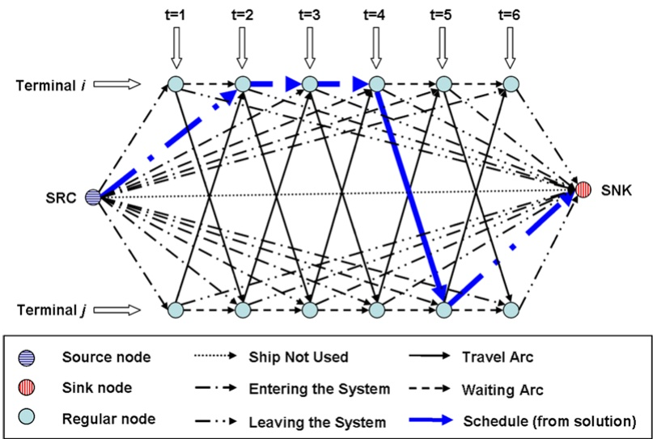
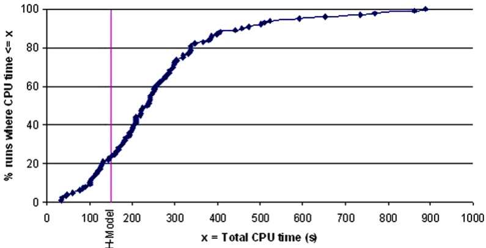

# Large neighborhood search for LNG inventory routing

**Vikas Goel · Kevin C. Furman · Jin-Hwa Song · Amr S. El-Bakry**

Received: 20 February 2012 / Accepted: 16 July 2012 / Published online: 9 November 2012 © Springer Science+Business Media, LLC 2012

**Abstract** Liquefied Natural Gas (LNG) is steadily becoming a common mode for commercializing natural gas. Due to the capital intensive nature of LNG projects, the optimal design of LNG supply chains is extremely important from a profitability perspective. Motivated by the need for a model that can assist in the design analysis of LNG supply chains, we address an LNG inventory routing problem where optimized ship schedules have to be developed for an LNG project. In this paper, we present an arc-flow formulation based on the MIP model of Song and Furman (Comput. Oper. Res., 2010). We also present a set of construction and improvement heuristics to solve this model efficiently. The heuristics are evaluated based on a set of realistic test instances that are very large relative to the problem instances seen in recent literature related to this problem. Extensive computational results indicate that the proposed methods are computationally efficient in finding optimal or near optimal solutions and are substantially faster than state-of-the-art commercial optimization software.

<small>V. Goel (-) · K.C. Furman ExxonMobil Upstream Research Company, 3120 Buffalo Speedway, Houston, TX 77027, USA e-mail: [vikas.goel@exxonmobil.com](mailto:vikas.goel@exxonmobil.com)</small>

<small>K.C. Furman e-mail: [kevin.c.furman@exxonmobil.com](mailto:kevin.c.furman@exxonmobil.com)</small>

<small>J.-H. Song ExxonMobil Research and Engineering, Houston, TX, USA</small>

<small>Present address: J.-H. Song Global Technology SK Innovation, Seoul, Korea e-mail: [jinhwa.song@sk.com](mailto:jinhwa.song@sk.com)</small>

<small>A.S. El-Bakry ExxonMobil Production Company, 800 Bell St., Houston, TX 77002, USA e-mail: [amr.s.el-bakry@exxonmobil.com](mailto:amr.s.el-bakry@exxonmobil.com)</small>

**Keywords** Liquefied natural gas · LNG · Ship schedule optimization · Maritime inventory routing

## 1 Introduction

Natural gas is expected to be the world’s fastest growing fossil fuel with consumption increasing at an average rate of 1.6 % per year from 2008 to 2035 (US Energy Information Administration 2011). In many cases, large reserves of natural gas are located in areas of little or no local demand. As a result, natural gas must be transported over long distances, either via pipelines or shipped as liquefied natural gas (LNG) in specially designed ships. To be transported as LNG, natural gas produced from a reservoir is first processed to remove impurities. The purified natural gas is liquefied by cooling it $\mathrm { t o } \mathrm { - } 1 6 3 ~ ^ { \circ } \mathrm { C }$ at a liquefaction terminal (also referred to as a production terminal). The LNG is stored at dedicated storage facilities at the production terminal before being loaded on LNG ships that transport the LNG to regasification terminals (also referred to as regas terminals). At the regas terminal, LNG is stored before being regasified (i.e.,vaporized) and injected into the local natural gas pipeline grid. For a more thorough introduction to the LNG business, the reader is referred to Tusiana and Shearer (2007).

LNG accounts for a growing share of world natural gas trade with world natural gas liquefaction capacity expected to double between 2009 and 2035 (US Energy Information Administration 2011). However, new LNG production projects are complex and extremely capital intensive. As a result, the optimal design of the supply chain of an LNG project is extremely important from a profitability perspective. From an operations perspective, managing an LNG project involves negotiating a delivery schedule for each customer on an annual basis. This Annual Delivery Program (ADP) is negotiated to best accommodate the expected requirements of each party in a given year. Due to the negotiated nature of the schedule, the ADP can impose inefficiencies in the utilization of the shipping fleet and the overall LNG supply chain.

In this paper we present an optimization model that optimizes the LNG shipping schedule and inventory management for an LNG project. The main motivation behind this model is to provide an objective approach for the analysis of key LNG supply chain design decisions such as LNG fleet size and composition, and terminal infrastructure during the concept and detailed design phases for new LNG projects. The proposed model can also be used to develop ADPs in operational LNG projects and to quantify the inefficiency in a schedule caused by the negotiation process. The model can also be used to conduct “what-if” analysis to test how robust a schedule is to disruption events.

LNG inventory routing can be considered as a special case of maritime inventory routing problems (MIRP). MIRP combines inventory management and ship routing, which are typically treated separately in industrial practice. The reader is referred to the papers by Christiansen et al. (2004, 2007) and Andersson et al. (2010a) for a thorough review of maritime inventory routing literature. Christiansen and Fagerholt (2009) define a basic maritime inventory routing problem as the transportation of a single product that is produced at loading ports and consumed at unloading ports where each port has a given inventory storage capacity and a production or consumption rate. The number of visits to a port and the quantity of product to be loaded or unloaded are not predetermined. As discussed by Andersson et al. (2010a), nearly every paper concerning combined inventory management and routing addresses a new version of the problem. This is in contrast to the work on classical routing problems such as the vehicle routing problem (VRP) that have widely accepted definitions and assumptions. The LNG inventory routing problem (LNG IRP) studied in this article is based on a real-world application and shares the fundamental properties of a single product MIRP. However, the LNG IRP addressed here includes several variations including variable production and consumption rates, LNG specific contractual obligations, and berth constraints. Most importantly, the LNG IRP seeks to generate schedules where each ship makes several voyages over a time horizon with both the number of voyages and the time horizon being considerably larger than those considered by a typical MIRP. Andersson et al. (2010b) provide an excellent overview of the business cases and common characteristics for LNG inventory routing.

Grønhaug and Christiansen (2009) develop discrete time arc-flow and path-flow models for operational LNG inventory routing and test these models on a number of operational planning cases with time horizons of up to 60 days. Grønhaug et al. (2010) develop a branch-and-price method for the discrete time path-flow formulation of the LNG IRP and apply it to an extended set of test cases with time horizons of up to 75 days with improved computational performance over the previous effort (Grønhaug and Christiansen 2009). While the above work focuses on optimizing inventory management at production terminals only together with the ship schedules, Fodstad et al. (2008) develop a discrete-time arc-flow model for LNG IRP that also considers optimizing decisions related to sales downstream of the regas terminals. Although atypical of the LNG industry, they also include the capability for split loads in their model. The model presented by Fodstat et al. is implemented in the LNGScheduler software (Fodstad et al. 2011) and shows improved run times compared to those reported by Grønhaug et al. (2010) over the same test set. Fodstad et al. (2011) apply this model to a set of instances with a time horizon of 181 days.

There has recently been some development of software applications for combined inventory management and ship scheduling for the LNG supply chain. van de Broecke and Adams (2007) and Stremersch et al. (2008) describe the design of such decision support tools. Fodstad et al. (2008, 2011) discuss the model, implementation and some computational testing for LNGScheduler.

The paper by Rakke et al. (2011) appears to be a first attempt to address problems of developing ADPs for large LNG projects. In this paper an arc-flow model and rolling horizon heuristic method are applied to problems with up to 46 ships and a one year planning horizon. Halvorsen-Weare and Fagerholt (2011) develop a decomposition-based heuristic method to solve an arc-flow model of the LNG IRP, and address instances with a moderate number of ships and terminals with a time horizon ranging from 30 to 360 days. While these authors have addressed larger problems than previously reported in literature, their work limits optimization of ship schedules together with inventory management at the production terminals only. In this paper, we address large scale LNG IRPs where ship schedules are optimized together with inventory management on both the production and regas terminals. This approach provides the ability to analyze supply chain designs and develop ship schedules from a broader general-interest perspective.

Christiansen et al. (2011) develop a greedy construction heuristic and a solution improving genetic algorithm for an MIRP from the cement industry. They note that efficient neighborhood operators for improvement heuristics remain a challenge. The methods described in this paper are inspired by the fundamental modeling and algorithmic concepts developed by Song and Furman (2010) for the MIRP problem defined by Furman et al. (2011). The “two ship” neighborhood operator proposed by Song and Furman (2010) is inspired by the classical 2-opt neighborhood search where the shipping schedules of a pair of ships are optimized at each iteration of the search. In this article, we study the application of the two-ship neighborhood operator and a new neighborhood operator to extremely large-scale instances of the LNG inventory routing problem. We also propose approaches to improve the efficiency of the two-ship search operator. Although the solution techniques presented here have been developed and tested in the context of this specific LNG IRP, these can be generally applied to a wide variety of combined inventory management and routing problems. For a review of very large neighborhood search (VLNS) methods, the reader is referred to the excellent survey by Ahuja et al. (2002).

The rest of the paper is organized as follows. The formal problem description is introduced in Sect. 2. Section 3 presents a mixed-integer programming model for the problem. Section 4 discusses various solution techniques used in the large scale neighborhood search procedure. In Sect. 5, computational results are presented for various algorithms described in this paper. Section 6 illustrates how various practical analyses are enabled by such a model. Finally, in Sect. 7 the conclusions and future research directions are discussed.

## 2 Problem description

We consider an LNG IRP from the perspective of a vertically integrated oil and gas company. The goal of the problem is to find an optimal schedule for a heterogeneous pool of ships that deliver LNG from a set of production terminals to a set of regasification terminals such that constraints related to inventory storage, port operations and contractual obligations are satisfied. While the problem aims at finding an optimal schedule for a given supply chain design that specifies fleet composition and size, terminal storage and berth facilities, the main motivation for solving this problem is based on a need to develop a model that can assist in analyzing alternate supply chain designs.

Formally, the problem considers a set of production and regas terminals with fixed storage capacities. Each production terminal has a given production profile. On the other hand, operations at the regas terminals are more flexible such that regasification rates can be adjusted within specified bounds on a daily basis. Profiles for the minimum and maximum regas rates over the planning horizon are specified for each regas terminal. In addition, total LNG demand over the planning horizon at each regas terminal is specified. Finally, each terminal has a limited number of berths to load and unload cargoes. Each loading or unloading activity spans over one time period and occupies a berth for that duration.

The supply chain includes a set of heterogeneous ships. We restrict our attention to full load, full discharge problems. In other words, we consider the case where each ship will fully load at a single production terminal and fully discharge at a single regas terminal (i.e.,there is no partial unloading a.k.a. split delivery). Several previous papers have considered split delivery of LNG cargoes (Fodstad et al. 2008, 2011; Grønhaug and Christiansen 2009; Grønhaug et al. 2010; Andersson et al. 2010b). From a planning and design analysis perspective, our assumption is reasonable since this is typically considered the preferred mode of operation within the LNG industry.

Due to its low boiling point, the LNG loaded on a ship gradually boils-off (vaporizes) while the ship travels or while it waits at a terminal. The boil-off gas is commonly burnt as fuel and causes the volume delivered to be less than the volume loaded on the ship. We refer to the volumes loaded and discharged by a ship as the load and discharge capacities, respectively, for the ship. The difference between these capacities represents the average boil-off loss based on a typical voyage between two terminals. While actual boil-off amounts experienced during operations may differ from the above approximation, we consider our approximation reasonable since boiloff amounts represent a small fraction of the total cargo size and minor deviations from this approximation are not expected to significantly impact long term supply chain design analysis.

We consider the terminal storage and contractual demand constraints to be soft constraints. In other words, production in excess of storage capacity at a production terminal is considered as lost production. Similarly, regasification in excess of existing inventory levels at a regas terminal is considered as a stockout where the excess has to be purchased from the spot market. The objective is to minimize the total penalties associated with lost production, stockouts, and unmet contractual demands at regas terminals.

This problem has several complicating characteristics including: heterogeneous fleets, seasonal travel times, limited berth availability at terminals, seasonality in production rates, and variable regas rates. As mentioned above, a solution to the above problem can support key capital decisions regarding the sizing of terminal infrastructure and fleets. A solution to the above problem can also be used to evaluate the effects of pooling shipping fleets, to quantify key operations metrics including fleet utilization, and evaluate the ability of a supply chain design to meet contractual obligations.

In defining the mathematical model in the next section, all of the characteristics of the problem description are fully developed.

## 3 Model

The proposed mathematical model is formulated as a mixed integer programming (MIP) problem.

## 3.1 Sets and parameters

We first define a number of sets and parameters that are used in the mathematical model.

$L$ Production terminals. $L = \{ 1 , 2 , \ldots , | L | \}$

$R$ Regas terminals. $R = \{ 1 , 2 , \ldots , | R | \} .$

$J$ All terminals. $J = L \cup R .$

$V$ Vessels (Ships). $v = \{ 1 , 2 , \ldots , | V | \} .$

$J _ { v }$ Set of terminals that ship v can visit.

$T$ Planning horizon. $T = \{ 1 , 2 , \ldots , | T | \}$

$c _ { j }$ Storage capacity at terminal $j .$

$c _ { v , j }$ Volume loaded (discharged) by ship v at production (regas) terminal $j .$

$D _ { r }$ Demand for LNG over planning horizon at regas terminal $r .$

$b _ { j }$ Number of berths at terminal $j .$

$p _ { l , t }$ Production rate during time period t at production terminal l.

$I _ { j } ^ { 0 }$ Initial inventory at terminal $j .$

$J _ { \vec { V } }$ $\dot { i }$ Initial destination terminal for ship v.

$\hat { t } _ { \nu } ^ { \hat { 0 } }$ Arrival date at initial destination terminal for $v .$

$d _ { r , t } ^ { L }$ Minimum regas rate of regas terminal $r .$

$d _ { r , t } ^ { U }$ Maximum regas rate of regas terminal $r .$

$\tau _ { j , j ^ { \prime } , t }$ travel time (including berth time) from terminal j to terminal $j ^ { \prime }$ for voyage starting at time t .

$w _ { j , t }$ Weight for penalizing lost production (stockout) at production (regas) terminal $j .$

$w _ { r } ^ { D }$ Weight for penalizing unmet demand at regas terminal $r .$

## 3.2 Network

This section describes the time-space network formulation for the LNG IRP described above. This network model is closely related to the model of Song and Furman (2010). As presented by Savelsbergh and Song (2008), a time-space network formulation can be viewed as an integer multi-commodity network flow formulation where a ship is a commodity and a node represents a possible visit to a terminal at a particular time.

The time-space network in Fig. 1 includes source (SRC) and sink (SNK) nodes to represent initial and final locations for the ships. The network also includes nodes (referred to as “regular” nodes) that represent each terminal at a given time period. For each ship v, there are five types of arcs; an arc from the SRC to SNK node represents the situation that a ship is not utilized; an arc from SRC to a regular node represents the arrival of a ship to its initial destination; an arc from a regular node to SNK represents the final departure of the ship; waiting arcs allow a ship to wait at a terminal without occupying a berth. These arcs connect regular nodes corresponding to the terminal at successive time periods. Finally, a travel arc from a regular node $n _ { 1 }$ to a regular node $n _ { 2 }$ represents the loading (or unloading) activity at the terminal corresponding to node $n _ { 1 }$ immediately followed by travel to the terminal corresponding to node $n _ { 2 }$

If the schedule for a ship has enough slack, the ship can either wait at a production terminal after loading a cargo, or travel to the destination regas terminal and wait before it unloads a cargo, or split the waiting time between the two terminals. From a ship scheduling perspective, these are symmetric solutions. Using a travel arc to represent a loading or unloading activity immediately followed by travel eliminates this symmetry. The formal node and arc definitions are presented below.

Fig. 1 Example of time-space network structure

N Set of nodes. $N = \{ ( j , t ) | j \in J _ { v } \} \cup \{ \mathit { S R C } \} \cup \{ \mathit { S N K } \}$

$\bar { N }$ Set of regular nodes. $\bar { N } = N \backslash \{ S R C , S N K \}$

$A _ { v } ^ { \phi }$ Arc from SRC node to SNK node for ship v. $\{ v , ( \mathit { S R C } ) , ( \mathit { S N K } ) \}$

$A _ { v } ^ { I }$ Set of arcs from source to initial destination for ship $v . = \{ v , ( S R C ) , ( j _ { v } ^ { 0 } , t _ { v } ^ { 0 } ) \}$

$A _ { v } ^ { \tilde { D } }$ Set of waiting arcs for ship $\begin{array} { r } { \boldsymbol { v } . = \{ \boldsymbol { v } , ( j , t ) , ( j , t + 1 ) | j \in J _ { \boldsymbol { v } } \} } \end{array}$

$A _ { v } ^ { T }$ Set of travel arcs for ship $v . = \{ v , ( l , t ) , ( r , t + \tau _ { l , r , t } ) | l \in J _ { v } \cap L , r \in J _ { v } \cap R \} \cup$

$$
\{v, (r, t), (l, t + \tau_ {r, l, t}) | l \in J _ {v} \cap L, r \in J _ {v} \cap R \}
$$

$A _ { \nu } ^ { F }$ Set of arcs from regular nodes to SNK node for ship $\boldsymbol { v } . = \{ \boldsymbol { v } , ( j , t ) , ( \mathit { S N K } ) \}$ $j \in J _ { v } \}$

$A _ { v }$ Set of arcs for ship $v . = A _ { v } ^ { \phi } \cup A _ { v } ^ { I } \cup A _ { v } ^ { D } \cup A _ { v } ^ { T } \cup A _ { v } ^ { F }$

$A$ Set of arcs. $\textstyle A = \bigcup _ { v } A _ { v }$

$\delta _ { n } ^ { + }$ Set of outgoing arcs from node n.

$\delta _ { n } ^ { - }$ Set of incoming arcs to node n.

Note that to ensure consistency, we assume that the travel times satisfy the following condition

$$
\tau_ {j, j ^ {\prime}, t} \leq \tau_ {j, j ^ {\prime}, t + 1} + 1 \quad \forall t \in T, \forall j, j ^ {\prime} \in J, j \neq j ^ {\prime}
$$

This condition ensures that the network does not allow a ship to arrive at its destination terminal earlier by delaying its departure.

## 3.2.1 Decision variables

A feasible schedule for this LNG IRP specifies whether a ship travels on any particular arc within the network model. The solution also specifies the regas rates at each regas terminal during each time period. All of the other variables can be considered state variables as their values will be a direct result of the binary variables on the arcs and the regas rates. The following variables have been defined in the mixed integer programming formulation presented below.

$I _ { j , i }$ t Inventory level at terminal j at the end of time period t.

$d _ { r , t }$ Regas rate during time period t at regas terminal r.

$o _ { l , t }$ Lost production at production terminal l during time period t.

$s _ { r , t }$ Stockout at regas terminal r during time period t.

$\delta _ { r } ^ { D }$ Unmet demand at regas terminal r during planning horizon;

$x _ { a }$ Binary variable for arc a.

## 3.3 MIP formulation

The mixed integer programming formulation which we will refer to as model P follows.

$$
\min \sum_ {(l, t) \in \tilde {N} | l \in L} w _ {l, t} o _ {l, t} + \sum_ {(r, t) \in \tilde {N} | r \in R} w _ {r, t} s _ {r, t} + \sum_ {r \in R} w _ {r} ^ {D} \delta_ {r} ^ {D}\tag{1}
$$

$$
\text {s.t.} \quad \sum x _ {a} - \sum x _ {a} = 0, \quad \forall v \in V, n \in \bar {N},\tag{2}
$$

$$
a \in A _ {v} \cap \delta_ {n} ^ {+} \quad a \in A _ {v} \cap \delta_ {n} ^ {-}
$$

$$
\sum \quad x _ {a} = 1, \quad \forall v \in V,\tag{3}
$$

$$
a \in A _ {v} \cap \delta_ {S R C} ^ {+}
$$

$$
\sum \quad x _ {a} = 1, \quad \forall v \in V,\tag{4}
$$

$$
a \in A _ {v} \cap \delta_ {S N K} ^ {-}
$$

$$
I _ {l, t} = I _ {l, t - 1} + p _ {l, t} - \sum_ {v} \sum_ {a \in (A _ {v} ^ {T} \cup A _ {v} ^ {F}) \cap \delta_ {(l, t)} ^ {+}} c _ {v, l} x _ {a} - o _ {l, t} \quad \forall l \in L, t \in T\tag{5}
$$

$$
I _ {r, t} = I _ {r, t - 1} - d _ {r, t} + \sum_ {v} \sum_ {a \in \left(A _ {v} ^ {T} \cup A _ {v} ^ {F}\right) \cap \delta_ {(r, t)} ^ {+}} c _ {v, r} x _ {a} + s _ {r, t} \quad \forall r \in R, t \in T,\tag{6}
$$

$$
\sum_ {v} \sum_ {a \in \left(A _ {v} ^ {T} \cup A _ {v} ^ {F}\right) \cap \delta_ {n} ^ {+}} x _ {a} \leq b _ {j}, \quad \forall j \in J, t \in T, n = (j, t) \in \bar {N}\tag{7}
$$

$$
\left| \delta_ {r} ^ {D} \geq D _ {r} - \sum_ {t} \sum_ {v} \sum_ {a \in (A _ {v} ^ {T} \cup A _ {v} ^ {F}) \cap \delta_ {(r, t)} ^ {+}} c _ {v, r} x _ {a}, \quad \forall r \in R \right|\tag{8}
$$

$$
d _ {r} ^ {L} \leq d _ {r, t} \leq d _ {r} ^ {U}, \quad \forall r \in R, \forall t \in \{1, 2, \dots , | T | \},\tag{9}
$$

$$
0 \leq I _ {j, t} \leq c _ {j}, \quad \forall j \in J, t \in T\tag{10}
$$

$$
o _ {l, t} \geq 0 \quad \forall l \in L\tag{11}
$$

$$
s _ {r, t} \geq 0 \quad \forall r \in R\tag{12}
$$

$$
\delta_ {r} ^ {D} \geq 0 \quad \forall r \in R\tag{13}
$$

$$
x _ {a} \in \{0, 1 \} \quad \forall a \in A\tag{14}
$$

The objective is to minimize the sum of weighted lost production, stockout, and unmet demands. Constraints 2–4 are network-flow conservation constraints for each ship. Constraints 5 and 6 model the inventory balance at the production and regas terminals, respectively. Lost production and stockout variables provide slack for these constraints. Constraint 7 ensures that the number of ships loading or unloading a cargo at a terminal within a time period does not exceed the number of berths. Note that a ship can wait at a terminal without occupying a berth. Constraint 8 enforces a lower bound on the unmet demand variable based on total deliveries scheduled for a regas terminal. Since the objective function seeks to minimize the total unmet demand, this constraint will be tight in every optimal solution that has a positive unmet demand. The final set of constraints 9–14 ensures that all the variables satisfy their specific bounds.

It should be noted that for the above model to calculate the lost production and stockout amounts correctly, the penalty parameters for lost production and stockouts should be monotonically decreasing in time, i.e., $w _ { j , t } > w _ { j , t + 1 }$ . This ensures that a solution will not involve lost production (stockout) until the inventory reaches capacity (falls to zero). In other words, without this condition the model could report solutions where lost production or stockouts are reported in advance of the actual event. For example, consider a solution where production terminal l experiences a loss of  units in time period t . If $w _ { l , t - 1 } = w _ { l , t }$ , an equivalent solution can be constructed where the loss is distributed over periods t and t − 1. This would be unrealistic if the terminal inventory at t − 1 is lower than the storage capacity. A monotonically decreasing penalty weight ensures that the lost production and stockout calculations are correct.

In its present form, the model is generic with respect to the length of the planning horizon and the time discretization. Based on planning conventions in the LNG industry and typical loading and discharging durations, a year-long planning horizon with one day time discretization is expected to be a reasonable scale for the problem. An important characteristic of this formulation is that it is easy to accommodate various practical constraints of the problem. Many of these constraints can be handled by adding, removing, and/or fixing nodes and arcs. For example, planned maintenance at a terminal that disallows any loading or unloading activities can be accounted for by removing all travel arcs from that terminal for the duration of the activity.

Due to the complex nature of the above problem, commercially available Mixed Integer Programming solvers cannot solve our real world problems within a reasonable amount of time. In the following section, we discuss some of the solution methods developed in order to overcome this obstacle.

## 4 Solution methods

We develop local neighborhood search heuristics with the goal of finding good solutions to the proposed model in a short amount of time. This approach can also be used to provide a warm-start for an exact solution method. Algorithm 1 proposes a three-step heuristic method for the above model. The first step of the heuristic uses a construction heuristic to build an initial feasible solution to the model. The construction heuristic builds a feasible solution by iteratively scheduling ship departures for the entire fleet on a daily basis. Ship departures on any given day are scheduled using an urgency-based greedy heuristic. Two improvement heuristics that employ different neighborhood structures are then used in sequence to improve this solution. The Time-Window Improvement Heuristic seeks to improve the solution obtained from the construction heuristic by allowing for departure dates for each voyage in the current solution to change within a small time-window defined around the current departure dates. The Two-Ship Improvement Heuristic seeks to improve the existing solution by allowing a subset of the ships to change schedules over the entire horizon. The subproblems generated by both improvement heuristics can be solved as Mixed-integer programs (MIPs) and solved using a commercial solver.

| Algorithm 1 Solution Heuristic |
| --- |
| Build initial solution using Construction Heuristic (CH) |
| Improve solution using Time window improvement heuristic (TWIH) |
| Improve solution using Two-ship improvement heuristic (2SIH) |

## 4.1 Construction heuristic (CH)

The construction heuristic is based on a greedy approach that seeks to deliver as much LNG as possible and as soon as possible from the production terminals to the regas terminals. In addition, the construction heuristic seeks to minimize lost production and stockouts by prioritizing voyages to terminals that have the most urgent demand for shipping capacity during the next few time periods. The heuristic uses this approach to schedule ship departures at all terminals on a daily basis. A feasible solution is generated by fixing daily ship departure decisions iteratively over the entire planning horizon.

The construction heuristic (shown in Algorithm 2) begins by initializing the terminal inventory levels at the beginning of the planning horizon, and setting the initial arrival dates and locations for each ship. The heuristic builds a solution where the daily regas rate at any regas terminal is equal to the mean regas rate for the terminal on the respective day.

The construction heuristic then iterates over the time periods to fix ship departures from each terminal in any given time period. The heuristic uses a similar approach for scheduling departures from production and regas terminals. We present the explanation for scheduling departures from production terminals. Variations for scheduling departures from regas terminals are presented parenthetically.

In order to schedule departures at terminal k during time period t, the heuristic first calculates the closing inventory level at terminal k for time period t using Eq. 5 (Eq. 6 for regas terminals) if no ship departures were to take place from terminal k during time period t. The closing inventory is used to identify the set of ships $V _ { k }$ that can be dispatched from terminal k during time period t. The set $V _ { k }$ includes ships that are located at production (regas) terminal k at period t and that can be loaded (discharged) based on their load (discharge) capacities and the closing inventory at terminal k in period t.

The heuristic schedules departures of ships in set $V _ { k }$ from production (regas) terminal k as long as a berth is available at terminal k, and the terminal inventory permits loading (discharging) some ship in $V _ { k }$ . In scheduling the next departure, the heuristic first identifies the destination terminal with the most urgent need for shipping capacity. The need for shipping capacity at a production (regas) terminal is quantified as the difference between the total planned production (regasification) at the terminal during a future time horizon, and the total shipping capacity already scheduled to reach that terminal during that time horizon. The terminal $\bar { \hat { k } }$ with the most urgent need for shipping capacity is selected as the destination for the next departure from terminal k. Note that not all ships may be allowed to travel to all terminals. Further, our model restricts ships to travel from a production (regas) terminal to a regas (production) terminal only. Therefore, the selection of the next destination is restricted to terminals such that at least one ship in $V _ { k }$ can travel from terminal k to terminal $\hat { k }$

Algorithm 2 Construction Heuristic
Initialize ship locations and terminal inventory levels
Fix daily regas rates to $\frac{d_{r,t}^{L} + d_{r,t}^{U}}{2}$ for all regas terminals $r$
for $t = 1, 2, \ldots, T$ do
    for all terminals $k$ do
        Evaluate closing inventory level for period $t$ assuming no ship departures at terminal $k$ during period $t$
        $V_k :=$ Set of ships that are located at terminal $k$ in period $t$ and that can be dispatched based on ship capacity and terminal inventory
    while another berth is available and $V_k$ is not empty do
        $K' :=$ Set of terminals $k'$ such that at least one ship in $V_k$ can be dispatched from terminal $k$ to terminal $k'$
        Select destination terminal $\hat{k} \in K'$ that has the most urgent demand for shipping capacity
        Select ship $\hat{v}$ that has the largest capacity among ships that can be dispatched from $k$ to $\hat{k}$
        Schedule departure of ship $\hat{v}$ from terminal $k$ to $\hat{k}$ in period $t$
        Update closing inventory for period $t$ based on scheduled departure
    end while
    Evaluate stockout or lost production at $k$ at $t$
end for
end for

In order to maximize the delivery of LNG, the heuristic selects the ship vˆ with the largest loading (discharging) capacity among all ships in $V _ { k }$ that can travel from production (regas) terminal $k$ to terminal $\hat { k }$ . The heuristic then schedules a departure for ship $\hat { v }$ from terminal $k$ to terminal $\hat { k }$ in period t and the closing inventory level at terminal k is updated accordingly. This approach is repeated until no more departures can be scheduled from terminal k in period t. A complete schedule for the entire time horizon is built by applying this approach for all terminals over all time periods.

Finally, lost production (stockout) volumes for all production (regas) terminals can be calculated based on the production (regasification) profiles together with the shipping schedule.

## 4.2 Time-window improvement heuristic (TWIH)

The time-window improvement heuristic is a large neighborhood search method. This heuristic searches in the neighborhood consisting of all solutions in which any voyage departure is delayed or advanced by at most m days, compared to the departure date for that voyage in the input solution. An optimal solution in this neighborhood can be obtained by solving a modified version of Model P that excludes travel arcs for all voyages that depart outside the time windows defined by the above neighborhood. This modified version of model P can be solved using a commercial MIP solver.

## 4.3 Two-ship improvement heuristic (2SIH)

The two-ship improvement heuristic (described in Algorithm 3) is based on the variable neighborhood search method. At each iteration, the heuristic selects a pair of ships and defines the search neighborhood to consist of the set of feasible schedules for these ships. Schedules for all other ships are considered fixed. A subproblem is solved to optimize schedules within this neighborhood. The algorithm iteratively selects pairs of ships and solves the corresponding subproblems for the defined neighborhoods. The heuristic is terminated when a better solution is not found for $\textstyle { \binom { \widetilde { V } | } { 2 } }$ successive iterations. Since the objective function for this problem is lower bounded by zero, the heuristic can also be terminated as soon as a solution with a zero objective value is obtained. From an implementation perspective, the optimal solution for a subproblem induced by a pair of ships can be obtained by solving a reduced version of Model P where variables for all other ships are fixed based on the current solution. We refer to the reduced model as a two-ship subproblem.

## 4.3.1 Ship-pair selection

The efficiency of the two-ship improvement heuristic depends on the sequence of two-ship subproblems solved during the algorithm. By selecting ship-pairs that are most likely to lead to a better solution, the number of subproblems solved and the overall CPU time can be minimized. We present three schemes for selecting two-ship subproblems during the two-ship improvement heuristic.

Algorithm 3 Two Ship Improvement Heuristic
Initialize solution; $UB :=$ objective value of solution
$count := 0$
while $count \leq \binom{|V|}{2}$ and $UB &gt; 0$ do
    Select ships $v$ and $v'$
    Fix schedules for all ships other than $v$ and $v'$
    Solve two-ship subproblem
    if better solution is found then
        Update solution; $UB :=$ objective value of solution
        $count := 0$
    else
        $count := count + 1$
    end if
end while

Lexicographic selection For a problem where the fleet of ships is represented by the ordered set $\{ v _ { 1 } , v _ { 2 } , v _ { 3 } , \ldots , v _ { | V | } \}$ , we consider the selection scheme to be lexicographic if it selects two-ship subproblems in the following order: $( s _ { 1 } , s _ { 2 } ) , ( s _ { 1 } , s _ { 3 } ) , \ldots ,$ $( s _ { 1 } , s _ { | V | } ) , ( s _ { 2 } , s _ { 3 } ) , \ldots , ( s _ { | V | - 1 } , s _ { | V | } )$ . The lexicographic ordering scheme may be effective in a practical setting where the relative importance of ships is inherent in the order in which they are included in the fleet.

Metrics based selection In this method, we use the current solution together with problem specific insights to identify the two-ship subproblem that is likely to achieve the largest improvement in objective function. Specifically, we define two metrics based on the current solution for each ship-pair for which a subproblem can be solved next. These metrics represent estimates for the maximum potential reduction and for the likelihood of achieving that reduction in the objective function if the corresponding two-ship subproblem were optimized. The ship-pair that has the highest likelihood of achieving a reduction among the ship-pairs that have the largest potential for reduction is selected.

Algorithm 4 provides a detailed specification for the selection method. Let $\pi _ { v } ^ { 1 }$ represent the improvement in the objective function if the schedule for ship v is reoptimized. We estimate $\pi _ { v } ^ { 1 }$ as the total production and stockouts that would be eliminated if ship v could be rescheduled such that the sequence of terminals visited by v remains unchanged but the ship arrives at all terminals as soon as possible; i.e.,the re-optimized schedule does not involve any waiting. The estimate for reduction in the objective function by solving the two-ship subproblem for ship-pair $( v _ { 1 } , v _ { 2 } )$ (represented by $\varPi _ { ( v _ { 1 } , v _ { 2 } ) } ^ { 1 } )$ is estimated as the greater of $\pi _ { v _ { 1 } } ^ { 1 }$ and $\pi _ { v _ { 2 } } ^ { 1 }$

We evaluate the likelihood of achieving a reduction in the objective function by solving the two-ship subproblem for ship-pair $( v _ { 1 } , v _ { 2 } )$ assuming that the sequence of terminals visited by $v _ { 1 }$ and $v _ { 2 }$ in the re-optimized solution will remain unchanged compared to the current solution. However, departure dates for the two ships from a terminal might be swapped or re-ordered in order to reduce overall lost production and stockouts. In order to quantify this likelihood, we evaluate $\pi _ { ( v _ { 1 } , v _ { 2 } ) } ^ { 2 }$ as the number of times in the current solution where the departure for ship v1 is delayed due to the departure for $v _ { 2 }$ from the same terminal. In evaluating $\pi _ { ( v _ { 1 } , v _ { 2 } ) } ^ { 2 }$ , we count cases where ship $v _ { 1 }$ is forced to wait at a terminal while ship $v _ { 2 }$ departs from that terminal. Cases where ship $v _ { 2 }$ is the last ship to depart from a terminal before $v _ { 1 }$ arrives at that terminal and is forced to wait are also included in the calculation of $\pi _ { ( v _ { 1 } , v _ { 2 } ) } ^ { 2 }$ Finally, the likelihood of achieving a reduction in the objective function by solving the two-ship subproblem for ship-pair $( v _ { 1 } , v _ { 2 } )$ (represented by $\mathit { \Pi } _ { ( v _ { 1 } , v _ { 2 } ) } ^ { 2 } )$ is approximated as the number of times the ship that is estimated to lead to bigger reduction in objective function is delayed due to the other ship in the pair. Note that since $\varPi _ { ( v _ { 1 } , v _ { 2 } ) } ^ { 1 }$ and $\varPi _ { ( v _ { 1 } , v _ { 2 } ) } ^ { 2 }$ are symmetric with respect to $( v _ { 1 } , v _ { 2 } )$ , an arbitrary ordering of ships is assumed such that $v _ { 1 } < v _ { 2 }$ can be defined.

Algorithm 4 Metrics based two-ship subproblem selection
for all ships $v$ do
    $\pi_v^1 := \text{total lost production and stockouts that would be eliminated if all waiting in current schedule for ship } v$ were eliminated with the sequence of terminals visited by ship $v$ remained unchanged
end for
for all ship pairs $(v_1, v_2)$ such that $v_1 &lt; v_2$ do
    $\Pi_{(v_1, v_2)}^1 := \max\{\pi_{v_1}^1, \pi_{v_2}^1\}$
end for
for all ship pairs $(v_1, v_2)$ do
    $\pi_{(v_1, v_2)}^2 := \text{number of times in current solution where departure for } v_1 \text{ is delayed due to departure for } v_2 \text{ from the same terminal}$
end for
for all ship pairs $(v_1, v_2)$ such that $v_1 &lt; v_2$ do
    $\Pi_{(v_1, v_2)}^2 := \begin{cases} \pi_{(v_1, v_2)}^2 &amp; \text{if } \pi_{v_1}^1 \leq \pi_{v_2}^1 \\ \pi_{(v_2, v_1)}^2 &amp; \text{if } \pi_{v_1}^1 &gt; \pi_{v_2}^1 \end{cases}$
end for
$\Pi^{1,max} := \max_{(v_1, v_2)} \Pi_{(v_1, v_2)}^1, \Pi^{1,min} := \min_{(v_1, v_2)} \Pi_{(v_1, v_2)}^1$
$\mathcal{P} := \{(v_1, v_2) | \Pi_{(v_1, v_2)}^1 \in [\Pi^{1,max} - \frac{\alpha}{100} (\Pi^{1,max} - \Pi^{1,min}), \Pi^{1,max}] \}$
$(v_1^*, v_2^*) := \arg\max_{(v_1, v_2) \in \mathcal{P}} \Pi_{(v_1, v_2)}^2$
return $(v_1^*, v_2^*)$

The set $\mathcal { P }$ consists of ship-pairs $( v _ { 1 } , v _ { 2 } )$ for which $\varPi _ { ( v _ { 1 } , v _ { 2 } ) } ^ { 1 }$ is within the top α percent of the range of $\mathit { \Pi } _ { ( \cdot , \cdot ) } ^ { 2 }$ . The ship-pair in $\mathcal { P }$ that has the largest estimated likelihood of achieving a reduction in the objective function is selected.

Model based selection The restriction that at most two ships can change their schedules can be represented by constraints 15–17. Binary variable $y _ { v }$ represents whether or not ship v can change schedule. Constraint 15 restricts at most two ships to change their schedule. Constraint 16 determines the value of $y _ { v }$ based on whether the schedule for ship v in solution represented by variable x is different from that in a given solution $\tilde { x }$

$$
\sum_ {v} y _ {v} \leq 2\tag{15}
$$

$$
y _ {v} = 1 \quad \Leftrightarrow \quad \exists a \in A _ {v} | x _ {a} \neq \tilde {x} _ {a} \quad \forall v\tag{16}
$$

$$
y _ {v} \in \{0, 1 \} \quad \forall v\tag{17}
$$

We define a restricted version of model P (referred to as rP) by incorporating constraints 15–17. The solution to rP will identify the two-ship subproblem that will lead to the biggest improvement in the objective function relative to the existing solution x˜. The model based selection approach involves selecting the two ships that are associated with the largest values for $y ( \cdot )$ in the solution of the linear relaxation of model rP.

For large problems, solving the linear relaxation for model rP can be expensive. It is easy to see that the constraint set for Model rP includes a network-substructure that is separable over the set of ships. However, the constraints representing terminal inventory and berth limits, together with constraints that limit the number of ships that can change schedule cause the model to be coupled over the set of ships. Decomposition methods, such as Dantzig-Wolfe or Lagrangean decomposition can be employed for solving the linear relaxation of rP efficiently when solution in the full space is inefficient.

## 5 Computational results

In this section, we present computational results to demonstrate the performance of the proposed heuristic. The results are based on an implementation of the model in AIMMS. All optimization models have been solved with CPLEX 11.1 on a Dell 7500 Windows PC with a 2.93 GHz dual-quad core processor and 24 GB RAM.

## 5.1 Problem set

Table 1 shows the sizes of the 14 problems on which the proposed heuristics were evaluated. The table reports the dimensions $( | L | , | R | , | V | )$ for each problem where $| L | , | R |$ and $| V |$ represent the number of production terminals, regas terminals and ships, respectively. All the problems are defined over a one year planning horizon. These problems are realistic test cases allowing for a limited amount of pooling of the shipping fleet among multiple shipping lanes restricted via the allowed arcs in the network. The number of continuous and binary variables, the number of constraints and the best known solution for each problem are also reported. We classify the problems in to three categories based on the ease of finding good solutions using CPLEX.

Table 1 Problem instances

| Problem | Dimensions (\|L\|,\|R\|,\|V\|) | Cont. Variables | 0-1 Variables | Constraints | Best known solution |
| --- | --- | --- | --- | --- | --- |
| P1 | (2, 1, 6) | 2557 | 12812 | 6504 | 1172 |
| P2 | (1, 3, 8) | 4019 | 16988 | 8635 | 294 |
| P3 | (2, 1, 10) | 2557 | 21029 | 9303 | 5650 |
| P4 | (3, 1, 13) | 2922 | 27547 | 12196 | 0 |
| P5 | (1, 4, 15) | 5115 | 31449 | 14269 | 1701 |
| P6 | (4, 1, 4) | 3652 | 8377 | 6406 | 151 |
| P7 | (1, 6, 6) | 5117 | 18335 | 10812 | 1565 |
| P8 | (1, 1, 14) | 1827 | 28830 | 11205 | 116 |
| P9 | (1, 2, 17) | 2558 | 35142 | 14061 | 126 |
| P10 | (1, 4, 27) | 5115 | 95788 | 32744 | 29388 |
| P11 | (1, 5, 14) | 6228 | 34438 | 15625 | 0 |
| P12 | (1, 4, 18) | 3655 | 37752 | 16491 | 631 |
| P13 | (1, 8, 40) | 6579 | 132995 | 47364 | 1453 |
| P14 | (1, 10, 69) | 11691 | 232856 | 79425 | 53240 |

• easy problems: includes P1, P2, P3, P4, P5. CPLEX generates the best known solutions for these problems in less than 1 CPU hour

• medium problems: includes P6, P7, P8, P9, P10. CPLEX generates a “good” (within 15 % of best known) solution for these problems within 1–5 CPU hours

• hard problems: includes P11, P12, P13, P14. CPLEX cannot generate a good solution for these problems within 10 CPU hours

## 5.2 CPLEX vs. proposed heuristic

We first compare the performances of CPLEX and the proposed heuristic. For this comparison, the results presented for the heuristic are based on randomly selecting the next two-ship subproblem to be solved at each iteration of the two-ship improvement heuristic (2SIH). The proposed heuristic is therefore referred to as H-Randm. To account for the effect of randomization, results for H-Randm are based on 100 runs for problems P1–P12 and 50 runs for problems P13–P14.

Our implementation for the time-window improvement heuristic (TWIH) is based on defining a time-window that allows each ship departure to be delayed or advanced by at most four time-periods. Each two-ship subproblem is solved with a node-limit of 1000 nodes. The time-window improvement heuristic is solved with a node-limit of 5 nodes. Results for CPLEX are based on runs with CPU time limits of 5 hours, 10 hours and 20 hours for easy, medium and hard problems, respectively.

Table 2 compares the solutions generated by CPLEX with those generated by H-Randm. For ease of exposition, we report the solution quality in terms of the percent gap of a solution with respect to the best known solution. Specifically, for a solution X and best known solution $\hat { X }$ , the gap is computed as $\begin{array} { r } { \frac { X - \hat { X } } { \hat { X } } \times 1 0 0 . } \end{array}$ Since the best known solutions for problems P4 and P11 have a zero objective value, the solution quality for these cases is reported in terms of the actual objective values.

Table 2 reports the percent gaps relative to the best known solution for the first feasible (FF) and the best feasible solutions (BF) found by CPLEX, together with the percent gap between BF and the best bound when CPLEX terminates. The table also reports percent gaps relative to the best known solution for the solutions found by H-Randm at the end of the three stages in the H-Randm; i.e.,construction heuristic (CH), time-window improvement heuristic (TWIH) and two ship improvement heuristic (2SIH). Since 2SIH involves randomization, the minimum, maximum and average percent gaps relative to the best known solution are reported at the end of 2SIH.

Table 3 compares the CPU times required by CPLEX with those required by H-Randm. The CPU times reported in columns that are marked as scld are scaled by the average CPU time taken by H-Randm. Columns that report actual CPU times are marked as act. The table reports CPU times taken by CPLEX to generate the first feasible (TFF) and the best feasible (TBF) solutions, time required to generate a feasible solution better than the average solution for H-Randm (TRH), and the total run time for CPLEX. The table also reports the cumulative CPU time taken to complete the three stages of H-Randm, including the minimum, maximum and average CPU times for the overall heuristic.

Table 2 Solution quality comparison: CPLEX vs H-Randm

<table><tbody><tr><td rowspan="2">Problem</td><td colspan="2">CPLEX</td><td colspan="6">H-Randm</td></tr><tr><td>FF(%)</td><td>BF(%)</td><td>CPLEX Ga(%)</td><td>p CH(%)</td><td>CH+TWIH(%)</td><td>CH + T Min(%)</td><td>WIH + 2 Avg(%)</td><td>SIH Max(%)</td></tr><tr><td>P1</td><td>9.87</td><td>0.00</td><td>5.26</td><td>4.81</td><td>2.28</td><td>1.24</td><td>1.25</td><td>1.26</td></tr><tr><td>P2</td><td>290.40</td><td>0.00</td><td>16.34</td><td>133.15</td><td>61.16</td><td>8.53</td><td>8.53</td><td>8.53</td></tr><tr><td>P3</td><td>0.59</td><td>0.00</td><td>0.69</td><td>6.51</td><td>4.82</td><td>0.81</td><td>0.81</td><td>0.81</td></tr><tr><td>P4*</td><td>[1831.07]</td><td>[0.00]</td><td>0.00</td><td>[399.17]</td><td>[288.24]</td><td>[0.00]</td><td>[0.00]</td><td>[0.00]</td></tr><tr><td>P5</td><td>16.97</td><td>0.00</td><td>1.61</td><td>84.34</td><td>69.37</td><td>7.19</td><td>15.70</td><td>25.62</td></tr><tr><td>P6</td><td>1450.64</td><td>0.00</td><td>63.88</td><td>0.00</td><td>0.00</td><td>0.00</td><td>0.00</td><td>0.00</td></tr><tr><td>P7</td><td>117.95</td><td>11.84</td><td>51.11</td><td>168.03</td><td>168.02</td><td>0.04</td><td>10.04</td><td>26.27</td></tr><tr><td>P8</td><td>160.28</td><td>0.00</td><td>0.00</td><td>0.00</td><td>0.00</td><td>0.00</td><td>0.00</td><td>0.00</td></tr><tr><td>P9</td><td>789.72</td><td>0.00</td><td>0.00</td><td>0.00</td><td>0.00</td><td>0.00</td><td>0.00</td><td>0.00</td></tr><tr><td>P10</td><td>12.75</td><td>6.89</td><td>7.34</td><td>5.52</td><td>3.21</td><td>0.00</td><td>0.96</td><td>1.94</td></tr><tr><td>P11*</td><td>[9580.88]</td><td>[4012.99]</td><td>100.00</td><td>[504.34]</td><td>[504.34]</td><td>[0.00]</td><td>[2.62]</td><td>[130.87]</td></tr><tr><td>P12</td><td>2471.06</td><td>466.62</td><td>99.71</td><td>3.95</td><td>3.95</td><td>0.01</td><td>0.09</td><td>0.47</td></tr><tr><td>P13</td><td>449.88</td><td>449.88</td><td>82.79</td><td>352.74</td><td>347.40</td><td>2.46</td><td>13.11</td><td>29.90</td></tr><tr><td>P14</td><td>522.23</td><td>522.23</td><td>85.12</td><td>26.64</td><td>24.70</td><td>0.00</td><td>1.42</td><td>2.91</td></tr></tbody></table>

Table 2 shows that CPLEX can prove optimality for only 3 problems and generate the best known solution for 8 problems within the CPU time limits. We compare the performance of CPLEX with H-Randm for the three problem classes individually.

For the easy problems, CPLEX is able to generate the best known solutions for all problems. For problems P1, P3 and P4, H-Randm generates solutions within 1.26 % of the best known solution. However, CPLEX is much slower (2.55× to 70×) in generating its best solution than the average CPU time taken by H-Randm. Further, CPLEX is 1.78×–19.02× slower in generating a solution that is at least as good as that generated by H-Randm.

For problems P2 and P5, H-Randm generates solutions with objective value 8.5 % to 25.6 % worse than the best known solution and CPLEX. However, CPLEX is much slower in generating its best solution (14.4×–25.3×) for these problems than H-Randm. Further, in the case of P2, CPLEX is 17.1× slower than H-Randm in generating a solution that is at least as good as that generated by H-Randm. Overall, it can be concluded that for the easy problems, CPLEX generates better solutions within the time limit provided but H-Randm generates good solutions much faster. Note that although the speed-up factors above are based on the average performance of H-Randm, similar conclusions can be drawn based on the worst case performance of H-Randm.

For 3 out of 5 medium problems, both CPLEX and H-Randm are able to generate the best known solutions. However, CPLEX is 68.6× to 131.9× slower than H-

Table 3 CPU time comparison: CPLEX vs H-Randm

<table><tbody><tr><td rowspan="2">Problem</td><td colspan="3">CPLEX</td><td colspan="6">H-Randm</td></tr><tr><td>TFF (scld)</td><td>TBF (scld)</td><td>TRH (scld)</td><td>Total (act)</td><td>CH (scld)</td><td>CH+TWIH (scld)</td><td>CH + T Min (scld)</td><td>WIH + 2S Avg (act)</td><td>IH Max (scld)</td></tr><tr><td>P1</td><td>0.45</td><td>70.04</td><td>2.60</td><td>18000</td><td>0.01</td><td>0.02</td><td>0.64</td><td>254</td><td>1.61</td></tr><tr><td>P2</td><td>1.45</td><td>25.28</td><td>17.14</td><td>18000</td><td>0.04</td><td>0.25</td><td>0.72</td><td>69</td><td>1.26</td></tr><tr><td>P3</td><td>1.78</td><td>2.55</td><td>1.78</td><td>18000</td><td>0.04</td><td>0.24</td><td>0.91</td><td>76</td><td>1.20</td></tr><tr><td>P4</td><td>1.75</td><td>18.68</td><td>19.02</td><td>2985</td><td>0.03</td><td>0.07</td><td>0.19</td><td>157</td><td>3.13</td></tr><tr><td>P5</td><td>0.83</td><td>14.39</td><td>0.87</td><td>18000</td><td>0.01</td><td>0.08</td><td>0.54</td><td>340</td><td>1.95</td></tr><tr><td>P6</td><td>0.18</td><td>151.58</td><td>131.94</td><td>36000</td><td>0.01</td><td>0.01</td><td>1.00</td><td>235</td><td>1.00</td></tr><tr><td>P7</td><td>0.21</td><td>17.47</td><td>-</td><td>36000</td><td>0.00</td><td>0.01</td><td>0.48</td><td>1515</td><td>2.42</td></tr><tr><td>P8</td><td>2.29</td><td>68.59</td><td>68.59</td><td>7589</td><td>0.03</td><td>0.04</td><td>1.00</td><td>111</td><td>1.00</td></tr><tr><td>P9</td><td>3.12</td><td>98.72</td><td>98.72</td><td>18145</td><td>0.03</td><td>0.03</td><td>1.00</td><td>184</td><td>1.00</td></tr><tr><td>P10</td><td>3.31</td><td>3.31</td><td>-</td><td>36001</td><td>0.01</td><td>0.04</td><td>0.43</td><td>2666</td><td>2.99</td></tr><tr><td>P11</td><td>5.15</td><td>143.70</td><td>-</td><td>72000</td><td>0.02</td><td>0.03</td><td>0.13</td><td>264</td><td>3.36</td></tr><tr><td>P12</td><td>1.43</td><td>55.63</td><td>-</td><td>72001</td><td>0.01</td><td>0.15</td><td>0.61</td><td>829</td><td>1.73</td></tr><tr><td>P13</td><td>1.03</td><td>1.03</td><td>-</td><td>72001</td><td>0.00</td><td>0.01</td><td>0.44</td><td>18804</td><td>2.51</td></tr><tr><td>P14</td><td>2.76</td><td>2.76</td><td>-</td><td>72003</td><td>0.00</td><td>0.01</td><td>0.63</td><td>26115</td><td>1.93</td></tr></tbody></table>

Randm. In the case of P10, H-Randm always generates a better solution than CPLEX although CPLEX requires 3.3× more CPU time than the average run-time of H-Randm. Finally, the solutions reported by H-Randm for P7 demonstrate significant variance in quality (0.04 %–26.27 % gap) although 67 % runs of H-Randm generates a better solution than CPLEX.

For the hard problems, the best feasible solutions generated by CPLEX are clearly poor compared to the best known solutions (466.62 % to 522.23 % gap for P12, P13 and P14) and also much worse than the average (and worst) solutions generated by H-Randm. Further, CPLEX is slower (1.03× to 143.7×) in generating its best feasible solution than the average CPU time required the H-Randm. In fact, for 3 out of 4 problems, CPLEX is slower in generating its best feasible solution than the worst performance of H-Randm.

Note that comparing TBF or TRH with the total CPU time for H-Randm gives a conservative estimate of the speedup delivered by H-Randm since the total CPU time for H-Randm also includes the time required to prove convergence in addition to the time required to find the best solution.

Table 2 also shows that CH and TWIH together (referred to as CH + TWIH) form a very effective heuristic for generating initial solutions. The CH + TWIH method provides better solutions than the first feasible solution generated by CPLEX for 11 out of 14 problems. For 3 problems, CH + TWIH generates the best known solution while for all hard problems that method generates better solutions than the best solution generated by CPLEX. Further, CH + TWIH is much faster than CPLEX in generating feasible solutions.

Finally, it is worth noting the large variations in CPU time for H-Randm for cases where the heuristic returns the same solution across all runs. Specifically, the ratio of maximum and minimum CPU time taken by H-Randm ranges from 1.00 (problem P6) to 16.6 (problem P4). This variation is amplified for problems where the heuristic finds a solution with a zero objective value since the heuristic can stop immediately without having to complete a full cycle of solves of two ship subproblems to prove that no further improvements can be achieved. These large variations indicate the potential for reducing overall CPU time through an intelligent ordering of two ship subproblems during 2SIH.

## 5.3 Sub-problem selection in 2SIH

Next we evaluate the effectiveness of the three schemes presented in Sect. 4.3.1 for selecting the next two-ship subproblem during 2SIH. We refer to the heuristic when combined with the lexicographic, metrics-based and model-based selection schemes as H-Lexic, H-Mtrcs, and H-Model, respectively. The performance of these two-ship selection schemes is compared against H-Randm. The same parameters and termination criteria for the construction heuristic, the TWIH, and the two-ship subproblems as those presented above are used for all versions of the heuristic. In addition, we partition the set of iterations (twoship subproblems solved) during 2SIH in to a set of cycles, where each cycle refers to a set of $\textstyle { \binom { | { \dot { V } } | } { 2 } }$ successive iterations. To achieve search diversification during 2SIH, we do not allow for a subproblem for the same ship-pair to be solved more than once during any cycle. This restriction is applied for all versions of the heuristic. For H-Model, this constraint is included explicitly in model rP.

In order to reduce the overall CPU time used for selecting two-ship subproblems in H-Model, we solve the relaxation of model rP only when a new solution is obtained. Similarly, in the case of H-Mtrcs, metrics for quantifying the improvement that a two-ship subproblem will yield are re-used until a better solution is obtained. We use α = 20 % for identifying the candidate ship-pairs for selection during H-Mtrcs.

Note that results for P6, P8 and P9 are not included in this analysis since the best known solutions for these problems are generated by (CH + TWIH) itself. Also, results reported for the three largest problems (P10, P14 and P13) with H-Model are based on the use of Dantzig-Wolfe decomposition to solve the linear relaxation of rP for selecting two-ship subproblems during 2SIH. Results reported for H-Model for all other problems are obtained by solving rP using CLPEX.

Table 4 compares the quality of solutions obtained by the heuristic method with the four ordering schemes. Solution quality is reported in terms of the % gap of the objective value relative to the best known solution (except in the case of P4 and P11 since the best known solutions have zero objective values. The solution qualities for these cases are reported in terms of the actual objective values).

Based on the variance in the quality of solutions generated by the heuristic with the four ordering schemes, we partition the cases in to two sets.

Table 4 Solution quality comparison: Heuristic with different ordering schemes for 2SIH

<table><tr><td rowspan="2">Problem</td><td colspan="3">H-Randm</td><td rowspan="2">H-Lexic (%)</td><td rowspan="2">H-Mtrcs (%)</td><td rowspan="2">H-Model (%)</td></tr><tr><td>Min (%)</td><td>Avg (%)</td><td>Max (%)</td></tr><tr><td>P1</td><td>1.24</td><td>1.25</td><td>1.26</td><td>1.26</td><td>1.24</td><td>1.24</td></tr><tr><td>P2</td><td>8.53</td><td>8.53</td><td>8.53</td><td>8.53</td><td>8.53</td><td>8.53</td></tr><tr><td>P3</td><td>0.81</td><td>0.81</td><td>0.81</td><td>0.81</td><td>0.81</td><td>0.81</td></tr><tr><td>P4*</td><td>[0.00]</td><td>[0.00]</td><td>[0.00]</td><td>[0.00]</td><td>[0.00]</td><td>[0.00]</td></tr><tr><td>P10</td><td>0.00</td><td>0.96</td><td>1.94</td><td>0.58</td><td>0.96</td><td>1.11</td></tr><tr><td>P11*</td><td>[0.00]</td><td>[2.62]</td><td>[130.87]</td><td>[0.00]</td><td>[0.00]</td><td>[0.00]</td></tr><tr><td>P12</td><td>0.01</td><td>0.09</td><td>0.47</td><td>0.00</td><td>0.01</td><td>0.01</td></tr><tr><td>P14</td><td>0.00</td><td>1.42</td><td>2.91</td><td>0.52</td><td>1.24</td><td>2.48</td></tr><tr><td>P5</td><td>7.19</td><td>15.70</td><td>25.62</td><td>15.29</td><td>17.91</td><td>15.86</td></tr><tr><td>P7</td><td>0.04</td><td>10.04</td><td>26.27</td><td>0.00</td><td>6.91</td><td>5.46</td></tr><tr><td>P13</td><td>2.46</td><td>13.11</td><td>29.90</td><td>18.51</td><td>20.24</td><td>0.00</td></tr></table>

• Set 1 includes P1, P2, P3, P4, P10, P11, P12, P14. As shown in Table 4, the solutions returned by the heuristic with all four ordering methods are fairly similar (the % gap relative to the best known solution ranges between 0 % to 2.91 %). Note that the optimal solution for P11 has a zero objective value and 99 out of 100 runs of H-Randm returned this solution. Since only one run returns a non-optimal solution, we consider the solutions generated by H-Randm for P11 to be almost as good as the deterministic ordering schemes. P11 is thus include in Set 1.

• Set 2 includes P5, P7, P13: solutions returned by the heuristic with different ordering schemes differ significantly.

## 5.3.1 Set 1: deterministic schemes vs. average performance of H-Randm

We focus on comparing the effectiveness of the selection schemes in reducing CPU time for problems in Set 1 since all selection schemes generate similar solutions for these problems. Data for cases in Set 2 is reported for completeness.

Table 5 compares the number of two-ship subproblems solved by the heuristic method with the four selection schemes. Columns that are marked as scld report the number of two ship subproblems solved scaled by the minimum number of two ship subproblems that need to be solved in the ideal case (also reported in Table 5). For a problem that has a solution with a non-zero objective value, at least $\textstyle { \binom { | V | } { 2 } }$ subproblems have to be solved, where V is the number of ships in the problem. For a case that has a solution with a zero objective value, at least one sub-problem has to be solved (assuming 2SIH does not start with the optimal solution).

Table 6 compares the total CPU times taken by the heuristic method with the four ordering schemes. As before, columns that are marked as scld in Table 6 report CPU times scaled by total CPU time taken on average by H-Randm.

Table 5 Comparison of number of two ship subproblems solved: Heuristic with different ordering schemes for 2SIH

| Problem | H-Randm |  |  | H-Lexic | H-Mtrcs | H-Model | Min solves |
| --- | --- | --- | --- | --- | --- | --- | --- |
|  | Min | Avg | Max | (scld) | (scld) | (scld) | (act) |
|  | (scld) | (scld) | (scld) |  |  |  |  |
| P1 | 1.00 | 1.34 | 1.87 | 1.00 | 1.00 | 1.00 | 15 |
| P2 | 1.00 | 1.52 | 1.96 | 1.89 | 1.39 | 1.14 | 28 |
| P3 | 1.00 | 1.07 | 1.36 | 1.09 | 1.11 | 1.00 | 45 |
| P4 | 1.00 | 15.80 | 70.00 | 8.00 | 6.00 | 2.00 | 1 |
| P10 | 1.00 | 1.07 | 1.91 | 1.10 | 1.01 | 1.00 | 351 |
| P11 | 6.00 | 19.32 | 107.00 | 21.00 | 35.00 | 6.00 | 1 |
| P12 | 1.24 | 2.06 | 3.61 | 1.62 | 2.55 | 2.82 | 153 |
| P14 | 1.05 | 1.63 | 2.84 | 1.83 | 1.11 | 1.00 | 2346 |
| P5 | 1.06 | 2.07 | 4.29 | 2.16 | 1.43 | 1.28 | 105 |
| P7 | 1.20 | 2.51 | 5.00 | 3.20 | 2.33 | 1.67 | 15 |
| P13 | 1.37 | 2.34 | 4.60 | 1.65 | 1.71 | 2.33 | 780 |

Table 6 CPU time comparison: Heuristic with different ordering schemes for 2SIH

<table><tr><td rowspan="2">Problem</td><td colspan="3">H-Randm</td><td rowspan="2">H-Lexic (scld)</td><td rowspan="2">H-Mtrcs (scld)</td><td rowspan="2">H-Model (scld)</td></tr><tr><td>Min (scld)</td><td>Avg (act)</td><td>Max (scld)</td></tr><tr><td>P1</td><td>0.64</td><td>254</td><td>1.61</td><td>0.78</td><td>0.64</td><td>0.67</td></tr><tr><td>P2</td><td>0.72</td><td>69</td><td>1.26</td><td>1.07</td><td>0.89</td><td>0.92</td></tr><tr><td>P3</td><td>0.91</td><td>76</td><td>1.20</td><td>0.97</td><td>1.02</td><td>1.14</td></tr><tr><td>P4</td><td>0.19</td><td>157</td><td>3.13</td><td>1.25</td><td>1.20</td><td>0.41</td></tr><tr><td>P10</td><td>0.43</td><td>2666</td><td>2.99</td><td>0.99</td><td>0.47</td><td>1.11</td></tr><tr><td>P11</td><td>0.13</td><td>264</td><td>3.36</td><td>1.69</td><td>0.63</td><td>0.57</td></tr><tr><td>P12</td><td>0.61</td><td>829</td><td>1.73</td><td>0.89</td><td>1.36</td><td>1.57</td></tr><tr><td>P14</td><td>0.63</td><td>26115</td><td>1.93</td><td>1.06</td><td>0.66</td><td>0.71</td></tr><tr><td>P5</td><td>0.54</td><td>340</td><td>1.95</td><td>0.98</td><td>0.80</td><td>0.91</td></tr><tr><td>P7</td><td>0.48</td><td>1515</td><td>2.42</td><td>1.37</td><td>0.91</td><td>0.70</td></tr><tr><td>P13</td><td>0.44</td><td>18804</td><td>2.51</td><td>0.72</td><td>0.95</td><td>1.04</td></tr></table>

Table 5 shows that H-Lexic, H-Mtrcs and H-Model solve fewer two-ship subproblems than the average number of subproblems solved by H-Randm for 3, 5 and 7 problems, respectively, out of 8 problems in Set 1. H-Model solves the minimal number of subproblems for 4 problems and seems to be most robust in terms of solving the fewest subproblems.

However, as can be seen in Table 6, H-Model is faster than the average performance of H-Randm in only 5 out of 8 problems in Set 1. The overhead of solving the LP relaxation of rP mitigates the benefits of better subproblem selection on 2 (P3 and P10) of the 7 the problems where H-Model solves fewer subproblems than H-Randm. Table 7 shows the % of overall CPU time that is used by H-Model in solving the LP models for selecting the next two-ship subproblem during 2SIH. Since H-Lexic and H-Mtrcs do not have significant overhead for selecting the subproblems, their performance in reducing CPU time is similar to that in reducing number of two ship subproblems solved.

Table 7 % CPU time used in different stages of 2SIH for H-Model

<table><tbody><tr><td rowspan="2">Problem</td><td rowspan="2">Total CPU time (s)</td><td rowspan="2">Subproblem selection(%)</td></tr><tr></tr><tr><td>P1</td><td>171</td><td>4</td></tr><tr><td>P2</td><td>63</td><td>15</td></tr><tr><td>P3</td><td>87</td><td>18</td></tr><tr><td>P4</td><td>64</td><td>14</td></tr><tr><td>P10</td><td>2960</td><td>35</td></tr><tr><td>P11</td><td>150</td><td>20</td></tr><tr><td>P12</td><td>1297</td><td>8</td></tr><tr><td>P14</td><td>18501</td><td>8</td></tr><tr><td>P5</td><td>311</td><td>29</td></tr><tr><td>P7</td><td>1061</td><td>4</td></tr><tr><td>P13</td><td>19648</td><td>14</td></tr></tbody></table>

Table 8 Geometric mean for speedup in CPU time and reduction in number of two-ship subproblems solved compared to average performance of H-Randm on problems in Set 1

|  | Speed-up in CPU time | Reduction in number of subproblems |
| --- | --- | --- |
| H-Lexic | 0.94 | 1.10 |
| H-Mtrcs | 1.23 | 1.13 |
| H-Model | 1.22 | 1.68 |
| H-Randm (Min) | 2.22 | 2.05 |

Table 8 reports the geometric means for speedup in CPU time and for reduction in number of two-ship subproblems solved for H-Lexic, H-Mtrcs and H-Model relative to the average performance of H-Randm over problems in Set 1. The table also reports the speedup in CPU time (reduction in number of subproblems solved) that would be achieved if we could pick for each problem individually a selection scheme that leads to the least CPU time (fewest subproblems solved) among all runs of H-Randm. This metric provides an estimate of the upper-bound on the speedup (reduction in subproblems solved) that can be obtained by selecting the optimal ordering scheme.

## 5.3.2 Set 1: deterministic schemes vs. performance range of H-Randm

As reflected in Table 6, the performance of H-Randm varies significantly across the randomized runs. Figure 2 shows a cumulative frequency distribution for the total

Fig. 2 Cumulative frequency distribution for total CPU time for H-Randm on P11. CPU time for H-Model is indicated by vertical line

Table 9 % runs of H-Randm where deterministic ordering schemes require less CPU time and the number of two ship subproblems than H-Randm

<table><tr><td rowspan="2">Problem</td><td colspan="2">H-Lexic</td><td colspan="2">H-Mtrcs</td><td colspan="2">H-Model</td></tr><tr><td>time</td><td>iter</td><td>time</td><td>iter</td><td>time</td><td>iter</td></tr><tr><td>P1</td><td>79</td><td>90</td><td>93</td><td>90</td><td>86</td><td>90</td></tr><tr><td>P2</td><td>34</td><td>11</td><td>74</td><td>64</td><td>67</td><td>87</td></tr><tr><td>P3</td><td>68</td><td>29</td><td>28</td><td>22</td><td>2</td><td>78</td></tr><tr><td>P4</td><td>29</td><td>60</td><td>31</td><td>71</td><td>88</td><td>95</td></tr><tr><td>P10</td><td>39</td><td>22</td><td>90</td><td>73</td><td>30</td><td>91</td></tr><tr><td>P11</td><td>11</td><td>27</td><td>74</td><td>9</td><td>77</td><td>97</td></tr><tr><td>P12</td><td>67</td><td>84</td><td>3</td><td>14</td><td>1</td><td>3</td></tr><tr><td>P14</td><td>32</td><td>30</td><td>94</td><td>96</td><td>88</td><td>100</td></tr><tr><td>P5</td><td>46</td><td>39</td><td>73</td><td>80</td><td>53</td><td>87</td></tr><tr><td>P7</td><td>16</td><td>17</td><td>50</td><td>52</td><td>73</td><td>86</td></tr><tr><td>P13</td><td>76</td><td>86</td><td>52</td><td>84</td><td>40</td><td>42</td></tr></table>

CPU time for runs of H-Randm on P11 . The total CPU time taken by H-Modelis also shown for reference. The figure clearly emphasizes that a large fraction (77 %) of runs of H-Randm take more CPU time than H-Model. We compare the performance of the deterministic ordering schemes against the performance range of H-Randm. We consider an ordering scheme to be effective in reducing CPU time (number of two ship subproblems solved) if at least 50 % runs of the H-Randm require more CPU time (two ship subproblems solved) than the ordering scheme. We restrict the analysis to cases in Set 1 since all ordering schemes return similar solutions for these problems.

Table 9 displays the % of runs of H-Randm where the total CPU time and the number of two-ship subproblems solved is greater than that for H-Lexic, H-Mtrcs and H-Model. This table confirms the conclusions from Tables 5 and 6 that H-Lexic, H-Mtrcs and H-Model are effective in reducing the number of two-ship subproblems solved for 3, 5 and 7 problems, respectively, and in reducing overall CPU time for 3, 5 and 5 problems respectively.

Table 10 % runs of H-Randm where deterministic ordering schemes generate solution at least as good as H-Randm

| Problem | H-Lexic | H-Mtrcs | H-Model |
| --- | --- | --- | --- |
| P5 | 43 | 24 | 36 |
| P7 | 100 | 76 | 86 |
| P13 | 22 | 18 | 100 |

The three problems where H-Model is unable to outperform more than 50 % runs of H-Randm in terms of total CPU time give interesting insights in to the trade-offs of designing the heuristic.

• P12: the run with H-Model sees an extremely small improvement towards the end of 2SIH which delays termination until another full cycle of two ship subproblem solves has been completed without any further improvement. If looser termination criteria were used such that the minor improvement were ignored in determining convergence, 38 % (instead of 3 %) runs of H-Randm would have required more subproblem solves than H-Model.

P10: H-Model outperforms 91 % runs of H-Randm in terms of number of two ship subproblems solved but can only outperform 30 % of runs in terms of total CPU time (Table 9). This is because the two ship subproblems identified by H-Model are much more difficult. The average CPU time for solving the two ship subproblems during H-Model is 6.6 s compared to 1.98 s with H-Mtrcs.

• P3: H-Model outperforms 78 % runs of H-Randm in terms of the number of two ship subproblems solved but can only outperform 2 % of runs in terms of total CPU time. Interestingly, H-Model solves the minimum number of two ship subproblems for this problem. However, the overhead of determining the optimal ordering worsens its performance in terms of total CPU time relative to H-Randm.

## 5.3.3 Set 2: solution quality for deterministic selection schemes vs. H-Randm

As shown in Table 4, H-Randm has a large variance in terms of quality of solutions produced for problems in Set 2. Since Set 2 includes only 3 problems, we cannot make strong conclusions regarding which scheme for two-ship subproblem selection leads to better solution. Further, as shown in Table 4, none of the deterministic ordering schemes is able to generate better solutions than H-Randm for all problems in Set 2. However, Table 4 does show that solutions generated by H-Lexic and H-Model lie in the lower to middle range of objective values generated by H-Randm.

Also, Table 10 shows that H-Model generates better solutions than more than 50 % runs of H-Randm in 2 out of 3 problems. H-Lexic and H-Mtrcs, on the other hand, are able to achieve that for 1 problem only.

Table 11 Speed-up for each deterministic version of heuristic relative to CPLEX

| Problem | Heur-Lexic | Heur-Random (Avg) | Heur-Metrics | Heur-LP |
| --- | --- | --- | --- | --- |
| P1 | 3.32 | 2.60 | 4.04 | 3.88 |
| P2 | 16.06 | 17.14 | 19.23 | 18.62 |
| P3 | 1.83 | 1.78 | 1.74 | 1.56 |
| P4 | 15.19 | 19.02 | 15.90 | 46.85 |
| P5 | 0.89 | 0.87 | 1.03 | 0.95 |
| P6 | 131.94 | 131.94 | 131.34 | 130.79 |
| P7 | N/A | N/A | N/A | N/A |
| P8 | 68.59 | 68.59 | 67.30 | 62.85 |
| P9 | 98.72 | 98.72 | 97.57 | 90.74 |
| P10 | N/A | N/A | N/A | N/A |
| P11 | N/A | N/A | N/A | N/A |
| P12 | N/A | N/A | N/A | N/A |
| P13 | N/A | N/A | N/A | N/A |
| P14 | N/A | N/A | N/A | N/A |
| Geometric Mean | 13.61 | 13.60 | 14.47 | 15.72 |

## 5.4 Overall comparison

In summary, Table 11 reports the ratio of CPU time taken by CPLEX to generate a solution at least as good as that generated by one of the proposed heuristics, relative to the CPU time taken by that heuristic. Problems for which CPLEX could not find an equivalent or better solution than the heuristics are marked as “N/A”. The table illustrates that for nearly all instances, all of the heuristic methods case are either substantially faster than CPLEX, or find solutions better than CPLEX. The table reports the geometric mean of the speed-up attained by each heuristic over CPLEX for problems where CPLEX finds a solution at least as good as the one found by the heuristic method. Based on the geometric means, H-Model has a slight edge over the other methods.

We have shown that the methods developed in this paper can address large-scale instances. Since the problem set presented here has not been used in published literature, we cannot provide a direct comparison of the solution quality reported by our methods with that reported by other authors. However, based on the CPU times reported above, we can conclude that the performance of the proposed methods appear to be very computationally efficient such that much larger cases are tractable compared to those addressed by Grønhaug and Christiansen (2009) and Grønhaug et al. (2010) and Fodstad et al. (2008, 2011). The 2SIH also seems to be very competitive in terms of CPU time with the rolling horizon heuristic of Rakke et al. (2011), except in instances of size comparable to instances P13 and P14. The CPU times for the decomposition technique of Halvorsen-Weare and Fagerholt (2011) are comparable to those for the methods presented here in most of their test instances of a similar scale. However, it must be noted that unlike the proposed method, their decomposition method does not guarantee a feasible schedule.

## 6 Practical considerations

The model and algorithms described in previous sections are the core elements of an advanced decision support tool. However in the course of application of this technology, some additional considerations have been adopted for use in practice.

## 6.1 Inventory smoothening

The inventory profiles at terminals are good indicators of the robustness of an optimized ship schedule. Specifically, low inventory levels at production terminals and high inventory levels at regas terminals provide flexibility to allow the system to return to the plan without disrupting production and regas operation when ships get delayed. A schedule with this kind of inventory profile is considered robust.

We present an optimization model to develop a robust schedule from a solution of model P. Given a solution to model P with objective function value $\hat { z } ^ { * }$ , constraint 18 limits the search to solutions where the weighted sum of lost production, stockout, and unmet demands is within a range of $g$ (referred to as “give-up”) units of $\hat { z } ^ { * }$

$$
\overline {{\sum_ {(l , t) | l \in L} w _ {l , t} o _ {l , t} + \sum_ {(r , t) | r \in R} w _ {r , t} s _ {r , t} + \sum_ {r \in R} w _ {r} ^ {D} \delta_ {r} ^ {D} \leq \hat {z} ^ {*} + g}}\tag{18}
$$

The inventory smoothening model consists of minimizing the objective function shown in 19 subject to constraints 2–14 and 18. $w _ { l } ^ { I }$ and $\bar { w } _ { r } ^ { I }$ are weight factors for inventory levels at production and regas terminals.

$$
\min \sum_ {(l, t) | l \in L} w _ {l} ^ {I} I _ {l, t} - \sum_ {(r, t) | r \in R} w _ {r} ^ {I} I _ {r, t} + \sum_ {(l, t) | l \in L} w _ {l, t} o _ {l, t} + \sum_ {(r, t) | r \in R} w _ {r, t} s _ {r, t} + \sum_ {r \in R} w _ {r} ^ {D} \delta_ {r} ^ {D}\tag{19}
$$

In practice, it is sufficient to find a good solution to the inventory smoothening model. The two-ship improvement heuristic algorithm can be used to solve this model.

## 6.2 Boundary effects

It is obvious that the inventory profiles in a solution to the LNG IRP are highly sensitive to the initial inventory levels and the initial locations of ships. From an operational perspective it is perfectly reasonable to assume that initial inventory levels at terminals and starting locations for ships are input parameters to an optimization model. However, from a supply chain design analysis perspective, this operational data is not explicitly known. In this situation, the initial inventory levels and the initial locations of ships can be included as optimization variables in the model. The resulting solution will provide an optimistic estimate of the ability of a supply chain design to avoid losses at production and regas terminals.

## 7 Conclusions

A new variation of the LNG IRP is defined for the purpose of design and analysis of LNG supply chains. Unlike previously published literature, the proposed model optimizes ship schedule decisions together with inventory management at both production and regas terminals. Practical features such as seasonality in production, consumption and travel time are incorporated into the model, and a new feature related to variable regas rates is introduced.

An arc-flow formulation based on the MIP model of Song and Furman (2010) is proposed for this LNG IRP. In addition to the adaptation of the 2-ship improvement heuristic scheme developed by Song and Furman (2010), new construction and improvement heuristics are proposed to address this LNG IRP. Further several sophisticated 2-ship selection methods are developed.

The set of realistic test instances are very large relative to those problem instances seen in recent LNG IRP literature. Extensive computational results indicate that these methods are computationally efficient in finding the optimal or near optimal solutions substantially faster than commercial optimization software.

Future research directions could include the development of more detailed models for use in operational planning and improved methods and analytical techniques for decision-making under uncertainty. Continuing research in advanced modeling and algorithm is necessary to address the largest test instances within practical time limits.

## References

Ahuja, R.K., Ergun, Ö., Orlin, J.B., Punnen, A.P.: A survey of very large-scale neighborhood search techniques. Discrete Appl. Math. 123, 75–102 (2002)

Andersson, H., Christiansen, M., Fagerholt, K.: Transportation planning and inventory management in the LNG supply chain. Energy Syst. 3, 427–439 (2010a)

Andersson, H., Hoff, A., Christiansen, M., Hasle, G., Løkketangen, A.: Industrial aspects and literature survey: Combined inventory management and routing. Comput. Oper. Res. 37(9), 1515–1536 (2010b)

Christiansen, M., Fagerholt, K.: Maritime inventory routing problems. In: Floudas, C.A., Pardalos, P.M. (eds.) Encyclopedia of Optimization, pp. 1947–1955. Springer, Berlin (2009)

Christiansen, M., Fagerholt, K., Ronen, D.: Ship routing and scheduling: Status and perspectives. Transp. Sci. 38(1), 1–18 (2004)

Christiansen, M., Fagerholt, K., Nygreen, B., Ronen, D.: Maritime transportation. In: Barnhart, C., Laporte, G. (eds.) Transportation. Handbooks in Operations Research and Management Science, pp. 189–284. Elsevier, Amsterdam (2007). Chapter 4

Christiansen, M., Fagerholt, K., Flatberg, T., Haugen, Ø., Kloster, O., Lund, E.H.: Maritime inventory routing with multiple products: A case study from the cement industry. Eur. J. Oper. Res. 208, 86–94 (2011)

Fodstad, M., Uggen, K.T., Rømo, F., Lium, A.-G., Stremersch, G., Hecq, S.: Profit maximization in the LNG-value chain by combining market prices and ship routing. In: APIEMS 2008—the 9th Asia Pacific Industrial Engineering & Management Systems Conference, pp. 2782–2793 (2008)

Fodstad, M., Uggen, K.T., Rømo, F., Lium, A.-G., Stremersch, G., Hecq, S.: Lngscheduler: A rich model for coordinating vessel routing, inventories and trade in the liquefied natural gas supply chain. J. Energy Mark. 3(4), 31–64 (2011)

Furman, K.C., Song, J.-H., Kocis, G.R., McDonald, M.K., Warrick, P.H.: Feedstock routing in the Exxonmobil downstream sector. Interfaces 41(2), 149–163 (2011)

Grønhaug, R., Christiansen, M.: Supply chain optimization for the liquefied natural gas business. In: Bertazzi, L., van Nunen, J., Speranza, M.G. (eds.) Innovation in Distribution Logistics. Lecture Notes in Economics and Mathematical Systems, vol. 619, pp. 195–218. Springer, Berlin (2009)

Grønhaug, R., Christiansen, M., Desaulniers, G., Desrosiers, J.: A branch-and-price method for a liquefied natural gas inventory routing problem. Transp. Sci. 44(3), 400–415 (2010)

Halvorsen-Weare, E.E., Fagerholt, K.: Routing and scheduling in a liquefied natural gas shipping problem with inventory and berth constraints. Ann. Oper. Res. (2011, to appear)

Rakke, J.G., Stålhane, M., Moe, C.R., Christiansen, M., Andersson, H., Fagerholt, K., Norstad, I.: A rolling horizon heuristic for creating a liquefied natural gas annual delivery program. Transp. Res., Part C, Emerg. Technol. (2011, to appear)

Savelsbergh, M.W.P., Song, J.-H.: An optimization algorithm for the inventory routing problem with continuous moves. Comput. Oper. Res. 35(7), 2266–2282 (2008)

Song, J.-H., Furman, K.C.: A maritime inventory routing problem: Practical approach. Comput. Oper. Res. (2010, in press). Corrected Proof

Stremersch, G., Michalek, J., Hecq, S.: Decision Support Software Tools for LNG Supply Chain Management. Gastech, Richmansworth (2008)

Tusiana, M.D., Shearer, G.: LNG: a Nontechnical Guide. PennWell, Tulsa (2007)

US Energy Information Administration. International energy outlook 2011. [http://www.eia.gov/forecasts/ieo/nat\_gas.cfm](http://www.eia.gov/forecasts/ieo/nat_gas.cfm) (2011)

van de Broecke, A., Adams, D.: Optimising the LNG supply chain. Pet. Rev. 61(725), 30–32, 48 (2007)