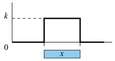
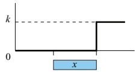
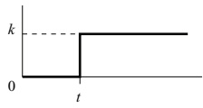
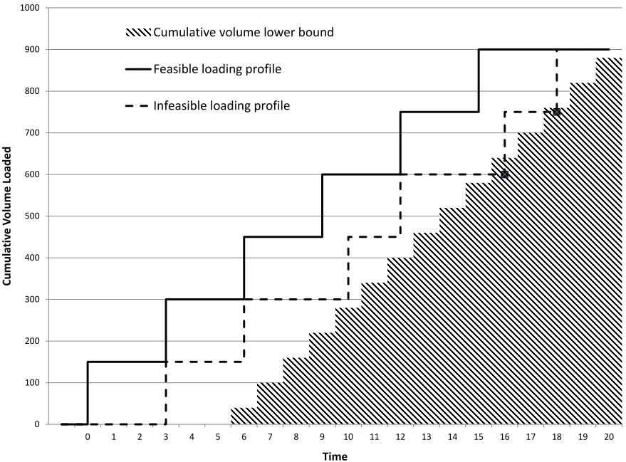

# Constraint programming for LNG ship scheduling and inventory management

V. Goel a, M. Slusky b, W.-J. van Hoeve c,∗, K. C. Furman d, Y. Shao a

a ExxonMobil Upstream Research Company

b Department of Mathematical Sciences

c Tepper School of Business, Carnegie Mellon University, 5000 Forbes Avenue, Pittsburgh, PA 15213, USA

d ExxonMobil Research and Engineering

## a r t i c l e i n f o

Article history: Received 23 January 2014 Accepted 20 September 2014 Available online 22 October 2014

Keywords: Routing Inventory Constraint programming

## a b s t r a c t

We propose a constraint programming approach for the optimization of inventory routing in the liquefied natural gas industry. We present two constraint programming models that rely on a disjunctive scheduling representation of the problem. We also propose an iterative search heuristic to generate good feasible solutions for these models. Computational results on a set of large-scale test instances demonstrate that our approach can find better solutions than existing approaches based on mixed integer programming, while being 4–10 times faster on average.

© 2014 Elsevier B.V. All rights reserved.

## 1. Introduction

Natural gas, which is primarily composed of methane, is a relatively clean burning fuel for a number of outlets including electricity generation and heating. Traditionally natural gas projects were developed near local markets or near major pipelines. However, liquefied natural gas (LNG) provides the ability to develop a natural gas project in an isolated area of the world and yet efficiently deliver that gas to market. The technology has been available for several decades, and it accounts for meeting a rapidly growing share of natural gas market demand. One of the most important advantages of LNG tanker ship over pipelines is the access it provides to markets overseas.

The focus of this work is on a central operational issue in the LNG industry: designing schedules for the ships to deliver LNG from the production (liquefaction) terminals to the demand (regasification) terminals. Operationally, a delivery schedule for each customer in the LNG supply chain is negotiated on an annual basis. The supply and demand requirements of the sellers and purchasers are accommodated through the development of this annual delivery schedule, which is a detailed schedule of LNG loadings, deliveries and ship movements for the planning year. Developing and updating this schedule is a complex problem because it combines ship routing with inventory management at the terminals.

A solution to the inventory routing problem can be used in two primary ways: (1) to analyze LNG supply chain design decisions such as LNG fleet size and composition, and terminal infrastructure during the concept and detailed design phases for new LNG projects, and (2) to develop the delivery schedules for operations of these LNG projects, quantify schedule inefficiency, and conduct “what-if” analysis to test how robust a schedule is to disruption events.

In this paper, we address the problem introduced by Goel, Furman, Song, and El-Bakry (2012) for supporting supply chain design analysis for new projects. Typically, new LNG projects require building not only the natural gas production and treatment facilities, but also constructing the ships and the production-side terminals, berths and storage tanks. Goel et al. (2012) first introduced an LNG-IRP for developing LNG ship schedules for supply chain design analysis. They proposed a mixed integer programming (MIP) model as well as an MIP-based heuristic for finding good solutions to this problem. Yet, both the MIP model and the MIP heuristic suffered from scalability issues for larger instances. This was one of the main motivations for studying constraint programming in the present work as an alternative method for solving this problem.

The LNG inventory routing problem is a special case of the maritime inventory routing problem. The basic maritime inventory routing problem (see Christiansen & Fagerholt, 2009) involves the transportation of a single product from loading ports to unloading ports, with each port having a given inventory storage capacity and a production or consumption rate, therefore combining inventory management and ship routing. These are typically treated separately in much of the maritime transportation industry. In such problems, the number of visits to a port and the quantity of product to be loaded or unloaded are not predetermined. Christiansen, Fagerholt, Nygreen, and Ronen (2013) provide a recent survey in ship routing and scheduling research over the last decade. LNG inventory routing business cases and common problem characteristics are discussed by Andersson, Hoff, Christiansen, Hasle, and Løkketangen (2010).

<small>∗ Corresponding author. Tel.: +1 412 268 9655; fax: +1 412 268 7345.</small>

<small>E-mail addresses: [vikas.goel@exxonmobil.com](mailto:vikas.goel@exxonmobil.com) (V. Goel), [mslusky@andrew.cmu.edu](mailto:mslusky@andrew.cmu.edu) (M. Slusky), [vanhoeve@andrew.cmu.edu](mailto:vanhoeve@andrew.cmu.edu) (W.-J. van Hoeve), [kevin.c.furman@exxonmobil.com](mailto:kevin.c.furman@exxonmobil.com) (K. C. Furman), [yufen.shao@exxonmobil.com](mailto:yufen.shao@exxonmobil.com) (Y. Shao).</small>

Constraint Programming (CP) has been applied before to industrial routing and scheduling problems, and most CP solvers offer a specific modeling interface for representing these problems (Baptiste, Pape, & Nuijten, 2001; Baptiste, Laborie, Pape, & Nuijten, 2006). In particular, it is common to represent routing problems as disjunctive scheduling problems, in which a visit to a location becomes a task to be scheduled, and the distance between two locations is modeled as a ‘sequencedependent set-up time’ between tasks. CP models can be particularly effective when the schedule is subject to time windows, when additional precedence relations are imposed between tasks, and when finding good feasible solutions is more important than proving optimality of a solution. One major benefit of CP over MIP models is that CP scales much better when the time granularity is increased; the CP model and associated algorithms are dependent on the number of tasks and resources rather than the number of time points.

Our CP models will use the basic structure described above, based on disjunctive scheduling. In our case, however, the number of (optional) tasks is proportional to the number of time points, and consequently our CP models may potentially still have scalability issues. Nonetheless, our CP models are still much smaller than the corresponding MIP models. As we are mostly interested in finding good solutions in a reasonable amount of time, with provable optimality as secondary goal, the investigation of the performance of CP models on this challenging problem domain seems warranted. In fact, our experimental results will demonstrate that our CP models are competitive with a dedicated heuristic for this problem, while in some cases it can find superior solutions. Moreover, when we apply our dedicated search heuristic, our CP approach can outperform the existing MIP-based heuristic both in terms of solution quality and solving time.

This paper is organized as follows. In the next section, we present a description of the problem under consideration. In Section 3, we present an overview of the CP terminology used in the paper. In Sections 4 and 5 we present two CP models. Our heuristic search algorithm is presented in Section 6. Computational results to highlight the effectiveness of the proposed models and algorithm over existing methods on a set of large realistic test instances are presented in Section 7. Finally, conclusions and directions for future research are presented in Section 8.

## 2. Problem description

Every year, LNG producers develop an annual delivery schedule for each of their customers. A delivery schedule specifies in detail when each cargo will be delivered and by what ship throughout the planned year. The annual delivery schedule attempts to best accommodate the expected requirements of each party for the planned year. During the plan year, the producers and customers seek to adhere to the agreed upon delivery schedule as closely as possible.

In this paper, we address the combined inventory management and cargo routing problem for the delivery of LNG that was presented by Goel et al. (2012). The problem can be described as follows. There is a set of liquefaction terminals with fixed storage capacities. Each liquefaction terminal has a given production profile for the planning horizon, as well as a limited number of berths for ships to load cargo on each day. At the other end of the supply chain, there is a set of regasification (regas) terminals that have fixed storage capacities and a limited number of berths for ships to unload cargoes. Each regas terminal has an overall contractual LNG demand that has to be delivered over the planning horizon, and a given baseline consumption profile (regas rate).

The LNG is delivered using a heterogeneous fleet of ships. We restrict our attention to problems where ships always load fully to capacity at a production terminal, and unload fully (except for a pre-specified small amount left to boil-off on the return trip, as explained later) at a regas terminal. As a result, ships alternate between production and regas terminals. This is consistent with operating practice in majority of the LNG business, and is driven by safety considerations. Due to safety and qualification restrictions, each ship can only visit a select (pre-specified) set of terminals. Loading and unloading an LNG ship is assumed to require one day of operation during which a berth has to be occupied. Ships are allowed to wait outside a production (regas) terminal only before loading (discharging) their cargo. Ships do not occupy a berth during this process.

A special feature that complicates the operation of LNG projects is related to LNG boiling off during voyages. Since LNG is stored at −163C on a ship, heat transfer from the surroundings can cause some of the LNG to boil off during a voyage. On the loaded voyage from a production terminal to a regas terminal, it is common to approximate the daily boil-off amount as a pre-specified fraction of the ship size. On the ballast voyage from a regas terminal to a production terminal, some LNG is usually left on the ship so that the boil-off process can ensure that the ship is cool when it arrives back at a production terminal. This ensures that the ship will not have to spend extra time in port to cool down, which is required before the next cargo can be loaded. As a result of the boil off during the loaded and the ballast voyages, the discharge size of a cargo can be less than the load size of that cargo. The amount of boil off depends on various factors including the ship (some ships use the boil-off for power while others can reliquefy the LNG), the travel time for the loaded and ballast voyages, ambient temperatures, whether or not the ship operator decides for the ship to arrive cold at the production terminal, ship speed, etc. Including all of these dependencies can make the problem scheduling LNG ships extremely complex.

Since the focus of this paper is to develop a planning-level model for analysis of supply-chain designs, similar to Goel et al. (2012), we use a simplified model for boil-off calculations. Specifically, we assume that the discharge volume for each ship at each regas terminal can be pre-specified. In practice, this pre-specified discharge volume can be calculated as the difference between the cargo load size and a “nominal” boil-off for the ship and regas terminal.

Given the illiquid nature of the LNG market, companies rarely operate LNG projects in a portfolio where ships travel from a production terminal to a regas terminal, and then to a different production terminal. Further, most LNG suppliers own/lease dedicated shipping resources that service a specific production terminal. Given these facts, we assume that the boil-off associated with a cargo delivery to a regas terminal can nominally be estimated based on a roundtrip voyage between a representative production terminal (typically, the only production terminal under consideration) and the regas terminal. This approximation can be exact in several scenarios e.g., the scenario involves only one production terminal; or each ship is dedicated to a specific production terminal; or each ship that is allowed to go to multiple production terminals reliquefies all boil-off; or the production and regas terminals are geographically located such that the boil-off amounts do not vary significantly across different routes. Given the nature of the LNG shipping business, and the focus on developing a planning model for supply chain design, we see this approximation as sufficient.

The problem has the following goals: delivering the contracted amount of gas to each customer and minimizing the interruptions to operations on both sides of the supply chain during the planning horizon. Interruptions include lost production stemming from running out of storage on the production side, and stock-outs due to the lack of inventory for consumption on the demand side.

In this paper, we assume that the travel time between terminals is an integer multiple of days and does not have seasonality. Also, we do not consider variability in the regas rates.

## 3. Scheduling terminology

As mentioned before, our CP models are based on applying a resource scheduling analogy to the IRP. As we will formulate our CP model using concepts from IBM ILOG CPOptimizer, we next briefly introduce those concepts using the terminology from Laborie (2009). Specifically, we will apply ‘interval variables’, ‘sequence variables’ and ‘cumul functions’.

An interval variable x is a decision variable that can be used to represent a task to be scheduled over time. The domain of an interval variable is a subset of $\{ \bot \} \cup \{ [ s , e ) \mid s , e \in \mathbb { Z } , s \leq e \}$ . An interval variable is fixed if its domain is reduced to a singleton, i.e., either $X = \bot$ which reflects that x is absent, or x is present and $x = [ s , e )$ for some fixed s, e. Interval variables can thus naturally represent optional tasks to be scheduled: s represents the start time, e the end time, and $e - s$ the length of the task if it is present. In our application, we use interval variables to represent the loading and discharging of ships at the terminals.

We will apply the following expressions for interval variables. Here, x represents an interval variable and A a set of interval variables.

• lengthOf (x) returns the length of x, i.e., $e - s { \mathrm { ~ i f ~ } } x = [ s , e ) ,$

• presenceOf (x)returns whether x is present (true) or absent (false),

• startOf (x, t) returns the start of x if it is present, and value t if x is absent,

• Alternative $( x , A )$ models an exclusive alternative among elements in A. If x is present, then exactly one element of A is present and x starts and ends together with this specific element. Interval variable x is absent if and only if all elements in A are absent.

The expressions lengthOf (x), presenceOf $( x ) ,$ and startOf (x, t) can be used in a model to define or constrain the respective attributes of x. They can also be used to impose conditions on other constraints. The expression Alternative $( x , A )$ represents an ‘alternative resource constraint that can be used, for example, to identify the machine at which a task is to be executed.

A sequence variable p is defined on a set of interval variables A. A value for p is a permutation of all present intervals of A. It can be used to represent a disjunctive resource, for which tasks cannot overlap in time. The no-overlap requirement also allows us to model sequencedependent setup times between tasks. To this end, we associate each interval $a \in A$ with an integer $\operatorname { \mathsf { { ^ { \prime } t y p e } } } \theta ( p , a ) ,$ and define the transition distance between two types as a function $M : \mathbb { N } \times \mathbb { N } \to \mathbb { Z }$ . That is, for two interval variables a and $b ,   M ( \theta ( p , a ) , \theta ( p , b ) )$ expresses the minimal distance between the end of a and the start of b relative to the sequence variable $p .$ For example, types may represent the color of a paint activity for a painting machine (in which case the transition time represents the cleaning time between different colors), or the geographic location of an activity in routing problems (in which case the transition time represents the distance between two activities). The no-overlap constraint can then be defined as NoOverlap (p, M). In our application, we use sequence variables to represent the sequence of tasks, and hence the route, to be performed by a ship.

We will apply the following expressions for sequence variables. Here, $p$ represents a sequence variable, x represents an interval variable, and A a set of interval variables.

• SequenceVar $( A , \theta )$ defines a sequence variable over A with type map $\theta ,$ 1

a. pulse(x, k)

b. stepAtEnd(x, k)

c. step(t, k)

Fig. 1. Example of three elementary cumul functions. Here, x is an interval variable, and k, t are integers.

• First $( p , x )$ constrains x to be the first interval variable of $p ,$ if present,

• typeOfNext $( p , x , j _ { 1 } , j _ { 2 } )$ returns the type of the interval variable that is next to x in sequence $p ,$ value $j _ { 1 }$ if x is the last interval variable of $p ,$ and value $j _ { 2 }$ if x is absent (argument $j _ { 2 }$ is optional and can be omitted if x is always present).

A cumul function can be used to represent (and constrain) the usage level of a resource over time. It aggregates individual contributions of interval variables, which are represented by elementary cumul functions. In this work, we apply the elementary functions pulse , stepAtEnd , and step . These are illustrated in Fig. 1. For an interval variable x, the function pulse (x, k)(Fig. 1a) changes the resource level by k during the duration of x if it is present. This function is used to represent cumulative resources. The function stepAtEnd (x, k) (Fig. 1b) can be used to represent resource production or consumption. It indefinitely changes the level of the resource by k at the end of x if it is present. It can also have three arguments: stepAtEnd (x, $k _ { \mathrm { m i n } } , k _ { \mathrm { m a x } } ) .$ In this case the level of the resource is changed by a value k such that $k _ { \mathrm { m i n } } \leq k \leq k _ { \mathrm { m a x } }$ . In this case, k is introduced as a decision variable to the problem. The ‘constant’ function step (t, k) (Fig. 1c) changes the level of the resource by k at time point t. In our application, we use cumul functions to represent the inventory at the terminals.

Constraints on the resource level of a cumul function ˜f can be set via the following expressions:

• alwaysIn $( \tilde { f } , t _ { 1 } , t _ { 2 } , l , u )$ ensures that the level of $\tilde { f }$ remains in the range $[ l , u ]$ for any point in the time interval $[ t _ { 1 } , t _ { 2 } ) ,$ or

• alwaysEqual $( \tilde { f } , x , k )$ ensures that the level of ˜f is equal to a given integer value k for any point between the start and end of interval variable x, if x is present.

Lastly, for a cumul function ˜f and interval variable x, the expression heightAtEnd (x, $\tilde { f } )$ returns the total contribution of x to $\tilde { f }$ at the end of x. It returns 0 if x is not present. Note that in this paper we will follow the convention that all symbols representing cumul functions will have a tilde sign on top $( e . g . , \tilde { f } )$

## 4. CP1: Constraint programming model with terminal cargo enumeration

In our first CP model, the tasks to be scheduled will correspond to the cargoes to be loaded at the production terminals, and the cargoes to be discharged at the regas terminals. We will collectively refer to these tasks as cargoes, and to both production and regas terminals simply as terminals. Each ship defines a disjunctive resource (tasks cannot overlap in time), as well as a production/consumption resource representing its inventory. Likewise, the inventory for each terminal is represented by a production/consumption resource.

Each terminal is seeking for its tasks to be executed (scheduled), while each task can be executed by at most one ship. This leads to a CP model with optional tasks (the cargoes) and alternative resources. Namely, we need to allocate each cargo to at most one ship, and we do not know in advance how many cargoes will be executed in total. We note that cargo sizes are determined implicitly through the assignment of cargoes to ships.

This model is perhaps the most natural CP representation for our problem, as it resembles the structure that is normally applied to model classical vehicle routing problems with CP. As a consequence, CPOptimizer may take advantage of this (known) structure when solving the problem.

<small>1 We note that both CPOptimizer and OPL do not have a compact definition for sequence variables. We therefore introduce the shorthand SequenceVar, to concisely represent our models.</small>

We next introduce the notation that will be used in our models.

## 4.1. Sets and parameters

$L$ Set of production (liquefaction) terminals (integer)
$R$ Set of regasification terminals (integer)
$J$ Set of all terminals, $J = L \cup R$
$T$ Set of days (planning horizon), $T = \{1, 2, \dots, |T|\}$
$D_j$ Total demand for LNG over planning horizon at terminal $j \in R$
$I_j$ Set of possible cargoes to be loaded/discharged at terminal $j$
$V$ Set of ships (vessels)
$p_{j,t}$ Daily production rate at terminal $j \in L$ at time $t$
$d_{j,t}$ Daily regasification rate at terminal $j \in R$ at time $t$
$g_j^0$ Initial inventory at terminal $j$
$\gamma_j$ Storage capacity at terminal $j$
$\gamma_{v,j}^V$ Volume loaded/discharged by ship $v$ at terminal $j$
$t_{j,i}^{EC}, t_{j,i}^{LC}$ ith cargo at terminal $j$ has time window $\left[t_{j,i}^{EC}, t_{j,i}^{LC}\right]$
$t_{j,i,v}^{ECV}, t_{j,i,v}^{LCV}$ ith cargo at terminal $j$ for ship $v$ has time window $\left[t_{j,i,v}^{ECV}, t_{j,i,v}^{LCV}\right]$
$\tau_j$ Minimum delay between successive cargoes at terminal $j$
$M(j, j')$ Travel time from terminal $j$ to terminal $j'$, including port time
$j_v^0$ Initial terminal of ship $v$
$t_v^0$ Time from which ship $v$ is available
$b_j$ Number of berths at terminal $j$
$J_{j,v}^D$ Terminals that ship $v$ can depart to after visiting terminal $j$
$w_j^D$ Penalty for unmet demand at terminal $j \in R$
$w_{j,t}^T$ Penalty for lost production/stockout at terminal $j$ at time $t$

We define Ij as an integer set, $I _ { j } : = \{ 1 , 2 , \ldots \}$ , for representing the possible cargoes for terminal j. The size of this set depends on the production rate (resp. regasification rate) of the terminal and the time horizon. In our model, we will assume that if cargo i is scheduled, then also cargo i − 1 is scheduled $( \operatorname { f o r } i > 1 ) .$ Therefore, the time windows for the cargoes $i \in I _ { j }$ are preprocessed so that $t _ { j , i } ^ { E C } , t _ { j , i } ^ { L C } \leq | T |$ and $t _ { j , i , \nu } ^ { E C V } , t _ { j , i , \nu } ^ { L C V } \leq | T |$ for all $j , i \in I _ { j } , \nu \in V .$

## 4.2. Variables and cumul functions

Interval variables:

c Jj i ith cargo at terminal j, for i ∈ Ij

, JV $c _ { j , i , v } ^ { j \; \bullet }$ ith cargo at terminal j using ship v, for i $i \in I _ { j }$

$a _ { V }$ Unavailability of ship v before arrival at its initial destination

$s l t _ { j , t }$ Loss in time slot t at terminal j (present if there is loss at t)

$s l t 2 _ { j , t }$ Present i $\mathrm { f }   s l t _ { j , t }$ is present, and it immediately succeeds sltj,t

Here, loss refers to lost production for liquefaction terminals or stockout for regas terminals. The interval variable $s l t 2 _ { j , t }$ will be used in our model to represent that whenever a loss occurs, the resource must be at its bound in the next time slot.

All these interval variables except av are optional, i.e., they can be either present or absent, and have a fixed size of 1 (one time slot). Interval variable $a _ { V }$ is always present for each ship $v \in V ;$ it will be the first activity for ship v, with fixed length $[ 1 , t _ { y } ^ { 0 } )$

Sequence variables and parameters:

$s e q _ { v }$ Collects interval variables assigned to ship v

$\theta$ Type function $\theta \left( s e q _ { \nu } , c _ { j , i , \nu } ^ { J V } \right) = j , \theta \left( s e q _ { \nu } , a _ { \nu } \right) = j _ { \nu } ^ { 0 }$

Here, the type $\theta$ of an interval variable is its location, i.e., the function θ maps each interval to the location of its terminal. The type of interval $a _ { V }$ is the vessel’s starting position $j _ { y } ^ { 0 } .$ j

Integer variables:

$l _ { j , t }$ Loss at terminal j in time slot t

Recall that loss refers to lost production for liquefaction terminals or stockout for regas terminals.

Cumul functions:

$\tilde { p } _ { j }$ Cumulative production over time at terminal $j \in L$

$$
\begin{array}{c} P \\ \tilde {\mathcal {J}} \end{array}
$$

$\tilde { d } _ { j }$ Cumulative regasification over time at terminal $j \in R$

$\tilde { z } _ { j }$ Cumulative volume loaded (discharged) over time at terminal $j \in J$

$\tilde { l } _ { j }$ Cumulative loss (lost production or stockout) over time at termina $1 j \in J$

## 4.3. Constraints

We first introduce constraints to represent the cargoes at each terminal, and the ships to handle them:

$$
c _ {j, i} ^ {J} \in \left[ t _ {j, i} ^ {E C}, t _ {j, i} ^ {L C} + 1\right) \quad \forall j, i \in I _ {j}\tag{1}
$$

$$
c _ {j, i, v} ^ {J V} \in \left[ t _ {j, i, v} ^ {E C V}, t _ {j, i, v} ^ {L C V} + 1\right) \quad \forall j, i \in I _ {j}, v\tag{2}
$$

$$
\text {Alternative} \left(c _ {j, i} ^ {J}, \left\{c _ {j, i, v} ^ {I V} \right\} _ {v}\right) \quad \forall j, i \in I _ {j}\tag{3}
$$

$$
\text {presence0f} \left(c _ {j, i} ^ {J}\right) \Rightarrow \text {presence0f} \left(c _ {j, i - 1} ^ {J}\right) \quad \forall j, i \in I _ {j}\tag{4}
$$

$$
\text {start0f} \left(c _ {j, i - 1} ^ {J}, | T |\right) + \tau_ {j} \leq \text {start0f} \left(c _ {j, i} ^ {J}, | T | + \tau_ {j}\right) \quad \forall j, i \in I _ {j}\tag{5}
$$

$$
\sum_ {i} \text {pulse} \left(c _ {j, i} ^ {J}, 1\right) \leq b _ {j} \quad \forall j\tag{6}
$$

Constraints (1) and (2) define the domains of the variables $c _ { j , i } ^ { J }$ and $c _ { j , i , v } ^ { J V }$ respectively. Constraints (3) represent the assignment of terminal cargoes to ships, i.e., exactly one ship will execute cargo $c _ { j , i } ^ { J } ,$ i f present. Constraints (4) ensure that if the ith cargo is present at terminal $j ,$ so is the (i − 1)th cargo. Constraints (5) ensure the proper ordering, and minimum delay $\tau _ { j } ,$ for all consecutive cargoes at terminal j. Recall that the second argument in the function startOf is the value returned if the interval variable is absent. Lastly, constraints (6) ensure that the number of cargoes scheduled at each time point at a terminal does not exceed the number of berths.

$$
a _ {v} \in \left[ 1, t _ {v} ^ {0}\right) \quad \forall v
$$

The following set of constraints represent the ship schedules:

(7)

$$
\text {length0f} (a _ {v}) = t _ {v} ^ {0} - 1 \quad \forall v\tag{8}
$$

$$
\text {seq}_{v} = \text {SequenceVar} \left(a_{v}\cup \{c_{j,i,v}^{JV}\}_{j,i\in l_{j}},\theta\right)\quad \forall v\tag{9}
$$

$$
\text {First} \left(s e q _ {v}, a _ {v}\right) \quad \forall v\tag{10}
$$

$$
\text {typeOfNext} \left(\operatorname{seq} _ {v}, a _ {v}, \phi^ {1}\right) \text {in} \left\{j _ {v} ^ {0}, \phi^ {1} \right\} \quad \forall v\tag{11}
$$

$$
\mathsf {t y p e 0 f N e c t} \left(\operatorname{seq} _ {v}, c _ {j, i v}, \phi^ {1}, \phi^ {2}\right) \text {in} J _ {j, v} ^ {D} \cup \{\phi^ {1}, \phi^ {2} \} \quad \forall j, i \in I _ {j}, v\tag{12}
$$

NoOverlap seqv, M ∀v

(13)

Constraints (7) define the domains of variables $a _ { \nu } ,$ while constraints (8) define the associated sizes. Constraints (9) define the sequence variable seqv over its associated interval variables and types, for each ship v. The first activity of ship v must be $a _ { \mathcal { V } } ,$ as defined by constraints (10). The next two sets of constraints (11) and (12) limit the locations that can be visited after the initial location $j _ { \nu } ^ { 0 } .$ respectively cargo at location j. Here, $\phi ^ { 1 }$ is a dummy value returned by typeOfNext for a last task completed by a ship, and $\phi ^ { 2 }$ is a dummy value returned by typeOfNext for absent interval variables. The last constraints set (13) ensures that the interval variables do not overlap in time, and respect the transition times (distance) between locations.

Formally, by introducing types $\phi ^ { 1 }$ and $\phi ^ { 2 }$ , we need to extend the definition of the transition matrix M. We do this as $M ( j , \phi ^ { 1 } ) = 1$ $M ( j , \phi ^ { 2 } ) = 0 .$

The following set of constraints represent the terminal inventory and unmet demand:

$$
s l t _ {j, t} \in [ t, t + 1) \quad \forall j \in J, t \in T\tag{14}
$$

$$
\tilde {p} _ {j} = \sum_ {t} \operatorname{step} (t + 1, p _ {j, t}) \quad \forall j \in L\tag{15}
$$

$$
\tilde {d} _ {j} = \sum_ {t} \operatorname{step} \left(t + 1, d _ {j, t}\right) \quad \forall j \in R\tag{16}
$$

$$
\tilde {z} _ {j} = \sum_ {v} \sum_ {i \in I _ {j}} \text {stepAtEnd} \left(c _ {j, i, v} ^ {J V}, \gamma_ {v, j} ^ {V}\right) \quad \forall j \in J\tag{17}
$$

$$
\tilde {l} _ {j} = \sum_ {t} \text {stepAtEnd} \left(s l t _ {j, t}, 1, l _ {j, t}\right) \quad \forall j \in J\tag{18}
$$

$$
\text {alwaysIn} \left(\operatorname{step} \left(1, g _ {j} ^ {0}\right) + \tilde {p} _ {j} - \tilde {z} _ {j} - \tilde {l} _ {j}, 1, | T |, 0, \gamma_ {j}\right) \quad \forall j \in L\tag{19}
$$

$$
\text {alwaysIn} \left(\operatorname{step} \left(1, g _ {j} ^ {0}\right) - \tilde {d} _ {j} + \tilde {z} _ {j} + \tilde {l} _ {j}, 1, | T |, 0, \gamma_ {j}\right) \quad \forall j \in R\tag{20}
$$

Constraints (14) define the domain of the interval variable s $l { { t } _ { j , t } }$ that represents the loss at terminal j in time slot t. Constraints $(15) - (17)$ define cumul functions for the daily production, daily demand, and loading/discharge of cargo at the terminals. Constraints (18) represent the cumul function for the loss over time at terminal j. These are all added together, with the starting inventory $g _ { j } ^ { 0 }$ , to form the overall inventory level of each terminal; in constraints (19) and (20) these levels are constrained to be in the range $[ 0 , \gamma _ { j } ]$ for each terminal j. Note that the production and regasification terminals are handled separately.

In principle, the constraints (14)–(20) are sufficient to define the inventory aspect of the problem. However, the constraint propagation related to the interval variables representing the loss can be improved by adding the following redundant ‘complementarity’ constraints. These constraints represent that whenever a loss occurs, the resource must be at its lower bound (for regasification terminals) or its upper bound (for liquefaction terminals). To this end, we introduce a new optional interval variable $s l t 2 _ { j , t }$ that will represent that during time slot t + 1 following a loss in slot t, the resource level is at its respective bound:

$$
s l t 2 _ {j, t} \in [ t + 1, t + 2) \quad \forall j \in J, t \in T\tag{21}
$$

$$
\text {presence0f} (s l t _ {j, t}) = \text {presence0f} (s l t 2 _ {j, t}) \quad \forall j \in J, t \in T\tag{22}
$$

$$
\text {alwaysEqual} \left(\operatorname{step} \left(1, g _ {j} ^ {0}\right) + \tilde {p} _ {j} - \tilde {z} _ {j} - \tilde {l} _ {j}, \operatorname{slt2} _ {j, t}, \gamma_ {j}\right) \quad \forall j \in L\left. \right.\tag{23}
$$

$$
\text {alwaysEqual} \left(\text {step} \left(1, g _ {j} ^ {0}\right) - \tilde {d} _ {j} + \tilde {z} _ {j} + \tilde {l} _ {j}, s l t 2 _ {j, t}, 0\right) \quad \forall j \in R\tag{24}
$$

Constraints (21) define the domain and size of the interval variable $s l t 2 _ { j , t }$ . Constraints (22) ensure that variables $s l t _ { j , t }$ and $s l t 2 _ { j , t }$ are both present or absent. Constraints (23) and $( 2 4 )$ ensure that the resource level ofj is equal to $\gamma _ { j }$ for liquefaction terminals and 0 for regasification terminals whenever a loss occurs at time slot t.

Lastly, we state the objective function as follows:

$$
\begin{array}{l} \text {minimize} \sum_ {j \in R} w _ {j} ^ {D} \cdot \max \left(0, D _ {j} - \sum_ {v, i \in I _ {j}} \gamma_ {v, j} ^ {V} \cdot \text {presenceOf} \left(c _ {j, i, v} ^ {J V}\right)\right) \\ + \sum_ {j \in J} \sum_ {t} w _ {j, t} ^ {T} \cdot \text {heightAtEnd} (s l t _ {t}, \tilde {l} _ {j}) \end{array} \tag {1}\tag{25}
$$

Here, the first term represents the penalty for under-delivery, weighted by $w _ { j } ^ { D }$ for regasification terminal $j \in R .$ The second term represents the penalty for lost production and stockout, weighted by $w _ { j , t } ^ { T }$ for terminal $j \in J$ and time point $t \in T ,$

## 5. CP2: Constraint programming model with ship visit enumeration

In the previous section, we defined cargoes from the perspective of the terminals. Here, we present an alternative CP model following from a ‘dual’ perspective, that of the ships. For each ship, we enumerate a maximal set of terminal visits that it can execute within the planning horizon. Each visit to a terminal corresponds to a task in a scheduling problem. The terminals correspond to resources. Each ship is seeking for its tasks to be executed. The constraint that a ship should travel from a production terminal to a regas terminal and vice versa is implicitly captured by restricting the domains of the variables. Cargo sizes are determined implicitly based on the ship for the associated task.

The motivation for this alternative model is that in our problem, the routes have a very specific structure since ships must alternate between production and regas terminals. The dual perspective of enumerating ship visits rather than terminal visits as in model CP1 allows us to expose this structure to the CP solver directly, which may be helpful during the solving process.

## 5.1. Sets and parameters

We will re-apply the sets and parameters from Section 4.1. In addition, we need the following:

JVv Set of terminals compatible with ship v

$$
\int_ {V, i} ^ {V I} \quad \text {If visit} i = 1, J _ {V, i} ^ {\prime} = \{J _ {0} ^ {\prime} \},
$$

If i is odd ≥ 1 and $j _ { \nu } ^ { 0 }$ is a production terminal,

$$
J _ {v, i} ^ {V I} = J _ {v} ^ {V} \cap L
$$

If i is odd $\geq 1$ and $j _ { \nu } ^ { 0 }$ is regas terminal, $J _ { v , i } ^ { V I } = J _ { v } ^ { V } \cap R$

If i is even and $j _ { y } ^ { 0 }$ is a production terminal,

$$
J _ {v, i} ^ {V I} = J _ {v} ^ {V} \cap R
$$

If i is even and $j _ { y } ^ { 0 }$ is a regas terminal, $J _ { v , i } ^ { V I }   =   J _ { v } ^ { V } \cap L$

$t _ { v , i } ^ { E V }$ Earliest time ith terminal visit for ship v can take place

Latest time ith terminal visit for ship v can take place

Minimum travel time between any production and any regas terminal at which ship v is allowed

## 5.2. Variables and cumul functions

The main change from the model in Section 4 is the definition of the interval variables. We now apply the following interval variables:

$$
\begin{array}{c l} c _ {v, i} ^ {V} & \text {ith terminal visit for ship v, for i\in J_{v} ^{V}} \\ c _ {v, i, j} ^ {V I} & \text {ith terminal visit for ship v at terminal j, for i\in J_{v} ^{V}}, \\ & j \in J _ {v, i} ^ {V I} \end{array}
$$

All these interval variables are optional and have a fixed size of 1 (one time slot). In addition, the model will apply interval variables $s l t _ { j , t }$ and $s l t 2 _ { j , t }$ as defined in Section 4. The model will also apply sequence variable seqv from Section 4. Consequently, we redefine type function θ to operate on the interval variables $\widehat { c _ { \nu , i , j } ^ { V J } , \mathrm { a s }   \theta \left( s e q _ { \nu } , c _ { \nu , i , j } ^ { V J } \right) } = j .$ Lastly, the model will apply the cumul functions as defined in Section 4.

## 5.3. Constraints

We first present the constraints that represent the terminal visits for each ship, and their allocation to the terminals:

$$
c _ {v, i} ^ {V} \in \left[ t _ {v, i} ^ {E V}, t _ {v, i} ^ {L V}\right) \quad \forall v, i \in J _ {v} ^ {V}\tag{26}
$$

$$
c _ {v, i, j} ^ {V J} \in \left[ t _ {v, i} ^ {E V}, t _ {v, i} ^ {L V}\right) \quad \forall v, i \in J _ {v} ^ {V}, j \in J _ {v, i} ^ {V I}\tag{27}
$$

$$
\text {Alternative} \left(c _ {v, i} ^ {V}, \left\{c _ {v, i, j} ^ {V J} \right\} _ {j \in J _ {v, i} ^ {V}}\right) \quad \forall v, i \in J _ {v} ^ {V}\tag{28}
$$

$$
\text {presence0f} \left(c _ {v, i} ^ {V}\right) \Rightarrow \text {presence0f} \left(c _ {v, i - 1} ^ {V}\right) \quad \forall v, i \in J _ {v} ^ {V}\tag{29}
$$

$$
\text {start0f} \left(c _ {v, i - 1} ^ {V}, | T |\right) + t _ {v} ^ {\min} \leq \text {start0f} \left(c _ {v, i} ^ {V}, | T |\right) \quad \forall v, i \in J _ {v} ^ {V}\tag{30}
$$

$$
\sum_ {v, i} \text {pulse} \left(c _ {v, i, j} ^ {V J}, 1\right) \leq b _ {j} \quad \forall j\tag{31}
$$

Constraints (26) and (27) define the domain of interval variables $c _ { \nu , i } ^ { V }$ and $c _ { v , i , j } ^ { V } ,$ respectively. Constraints (28) represent the assignment of ship visits to terminals, i.e., visit $c _ { \nu , i } ^ { V }$ will be assigned to exactly one terminal j $\in J _ { \gamma , i } ^ { V I }$ , if present. Constraints (29) make sure that if visit i + 1 takes place, so does visit i for ship v. Constraints (30) ensure that visits i and i − 1 respect a minimum time interval. Lastly, constraints (31) represent the berth capacity.

The following set of constraints represent the ship schedules:

$$
\text {seq} _ {v} = \text {SequenceVar} \left(\left\{c _ {v, i, j} ^ {V I} \right\} _ {i \in J _ {v} ^ {V}, j \in J _ {v, i} ^ {V I}}, \theta\right) \quad \forall v\tag{32}
$$

$$
\text {NoOverlap} (s e q _ {v}, M) \quad \forall v\tag{33}
$$

Since in this model the interval variables $c _ { v , i , j } ^ { V }$ are defined from the ship’s perspective, these constraints are more compact than the corresponding set of constraints (7)–(13).

The constraints representing the terminal inventory and unmet demand are equivalent to those from Section 4, apart from the substitution of ${ [ c _ { v , i , j } ^ { V } { ^ - } }$ in the cumul function definition of $: \tilde { z } _ { j } :$

$$
s l t _ {j, t} \in [ t, t + 1) \quad \forall j \in J, t \in T\tag{34}
$$

$$
\tilde {p} _ {j} = \sum_ {t} \operatorname{step} \left(t + 1, p _ {j, t}\right) \quad \forall j \in L\tag{35}
$$

$$
\tilde {d} _ {j} = \sum_ {t} \operatorname{step} \left(t + 1, d _ {j, t}\right) \quad \forall j \in R\tag{36}
$$

$$
\tilde {z} _ {j} = \sum_ {v} \sum_ {i \in I _ {j}} \text {stepAtEnd} \left(C _ {v, i, j} ^ {V J}, \gamma_ {v, j} ^ {V}\right) \quad \forall j \in J\tag{37}
$$

$$
\tilde {l} _ {j} = \sum_ {t} \text {stepAtEnd} \left(s l t _ {j, t}, 1, l _ {j, t}\right) \quad \forall j \in J\tag{38}
$$

$$
\text {alwaysIn} \left(\operatorname{step} \left(1, g _ {j} ^ {0}\right) + \tilde {p} _ {j} - \tilde {z} _ {j} - \tilde {l} _ {j}, 1, | T |, 0, \gamma_ {j}\right) \quad \forall j \in L\tag{39}
$$

$$
\text {alwaysIn} \left(\operatorname{step} \left(1, g _ {j} ^ {0}\right) - \tilde {d} _ {j} + \tilde {z} _ {j} + \tilde {l} _ {j}, 1, | T |, 0, \gamma_ {j}\right) \quad \forall j \in R\tag{40}
$$

Similar to the previous model, we can apply the complementarity constraints $(21) - (24)$ to improve the propagation of the loss variables.

The objective function is stated as:

$$
\left| \begin{array}{l} \text {minimize} \sum_ {j \in R} w _ {j} ^ {D} \cdot \max \left(0, D _ {j} - \sum_ {(v, i) | j \in J _ {v, i} ^ {V I}} \gamma_ {v, j} ^ {V} \cdot \text {presenceOf} \left(c _ {v, i, j} ^ {V J}\right)\right) \\ + \sum_ {j \in J} \sum_ {t} w _ {j, t} ^ {T} \cdot \text {heightAtEnd} \left(s l t _ {t}, \tilde {l} _ {j}\right) \end{array} \right. \tag {41}
$$

## 6. Cumulative volume lower bound based search

In this section, we present a heuristic method to generate good feasible solutions for models CP1 and CP2. The proposed algorithm is based on the insight that the overall objective for the problem will be minimized if we maximize loadings at the production terminal, and discharges at the regas terminals such that the loads and discharges take place at regular intervals. Such a schedule will minimize the likelihood of violating inventory constraints, and maximize the likelihood of delivering the contractual volumes to the regas terminals.

We use the following notation to describe the proposed search algorithm.

$$
z _ {i, t} ^ {t} \quad \text {Cumulative volume loaded (discharged) at}
$$

$$
g _ {i, t} ^ {T} \quad \text {Inventory at terminal} j \text {at time} t
$$

$$
\lambda_ {j} \quad \text {Total lost production (stockout) over entire}
$$

planning horizon at production (regas) terminal j

Based on an inventory balance at production terminal j at time t, we have

$$
g _ {j, t} ^ {T} = g _ {j} ^ {0} + \sum_ {t ^ {\prime} \leq t} (p _ {j, t ^ {\prime}} - l _ {j, t ^ {\prime}}) - z _ {j, t} ^ {T} \quad \forall j \in L, t \in T\tag{42}
$$

Based on the definition of $\left( \lambda _ { j } , \right.$ we have

$$
\sum_ {t ^ {\prime} \leq t} l _ {j, t ^ {\prime}} \leq \lambda_ {j} \quad \forall j \in L, t \in T.\tag{43}
$$

Together with the inventory capacity constraints $g _ { j , t } ^ { T } \leq \gamma _ { j } , \forall j \in L , t \in$ $T ,$ it follows that

$$
z _ {j, t} ^ {T} \geq g _ {j} ^ {0} - \gamma_ {j} + \sum_ {t ^ {\prime} \leq t} p _ {j, t ^ {\prime}} - \lambda_ {j} \quad \forall j \in L, t \in T\tag{44}
$$

In the context of our constraint programming models, inequality (44) can be modeled as follows

$$
\tilde {z} _ {j} \geq \operatorname{step} \left(1, g _ {j} ^ {0} - \gamma_ {j} - \lambda_ {j}\right) + \tilde {p} _ {j} \quad \forall j \in L\tag{45}
$$

Observe that the time dependency is implicit in the CP formulation, since $\tilde { z } _ { j }$ and $\tilde { p } _ { j }$ are cumul functions over the time horizon T.

Similarly, for regas terminal j, we can show that

$$
z _ {j, t} ^ {T} \geq - g _ {j} ^ {0} + \sum_ {t ^ {\prime} \leq t} d _ {j, t ^ {\prime}} - \lambda_ {j} \quad \forall j \in R, t \in T\tag{46}
$$

Inequality (46) can be modeled in our CP models as follows

$$
\tilde {z} _ {j} \geq \operatorname{step} \left(1, - g _ {j} ^ {0} - \lambda_ {j}\right) + \tilde {d} _ {j} \quad \forall j \in R\tag{47}
$$

Fig. 2. A feasible and an infeasible loading schedule based on constraint (45) for illustrative example.

As we will demonstrate with Theorem 1, constraints (45) and (47) not only limit the total losses at terminal j to be no greater than $\lambda _ { j } ,$ but also force the model to limit the search to solutions where loadings and discharges at a terminal take place at “regular” intervals by enforcing a lower limit on the volume loaded or discharged at each terminal at each time period. Fig. 2 illustrates the cumulative lower bound implied by constraint (45) on the volume loaded at a production terminal for a notional example with $p _ { j , t } = 6 0 , g _ { j } ^ { 0 } = 0 , \gamma _ { j } = 3 2 0 , \lambda _ { j } = 0 .$ The shaded region represents the infeasible space defined by the constraint. This constraint will restrict the search to solutions where the cumulative function representing volume loaded at this terminal does not fall below curve shown. The figure also shows two loading profiles that each load 900 units with a different schedule. One of the loading profiles is feasible for constraint (45), while the other one is infeasible since it intersects with the infeasible space twice.

The tightness of constraints (45) and (47) can be controlled by adjusting (increasing) the parameter λ, which represents the vector of lost production at production terminals and stockouts at regas terminals. In the rest of this paper, we refer to λ as the loss vector. The term loss at a terminal represents the lost production for production terminals, and stockout for regas terminals.

Theorem 1 shows that for given loss vector $\lambda ^ { * } ,$ constraints (45) and (47) when applied to CP1 or CP2 restrict the feasible region to solutions where the lost production or stockout at any terminal at any time is no greater than that in the solution defined by $\lambda ^ { * }$

**Theorem 1.** Let $\lambda ^ { * }$ represent the loss vector for a solution to model CP1 (or CP2). There does not exist a feasible solution to CP1 (or CP2) with loss vector $\lambda ^ { s }$ such that $\exists j \in ( L \cup \dot { R } ) , \lambda _ { j } ^ { s } > \lambda _ { j } ^ { * }$ and that satisfies constraints (45) and (47) as defined $\mathit { f o r } \: \lambda = \lambda ^ { * } .$

Proof. We prove the theorem for CP1 by contradiction. The proof for CP2 is similar. Suppose there exists a solution to CP1 that satisfies constraints (45) and (47) defined for $\lambda = \lambda^{*}$ . Further, suppose that the solution has a loss vector $\lambda ^ { s } ,$ , such that for terminal $j \in L , \lambda _ { j } ^ { s } > \lambda _ { j } ^ { * }$ (the proof for the case where j ∈ R is similar).

Let $\lambda _ { j } ^ { s } = \lambda _ { j } ^ { * } + \epsilon$ where $\epsilon > 0 ,$ Let $\tilde { z } _ { j } ^ { s }$ and $\tilde { l } _ { j } ^ { \tilde { s } }$ represent the values for the cumulative functions $\tilde { z } _ { j }$ and $\tilde { l } _ { j } ,$ respectively, in the solution under consideration.

From (45) we have

$$
\tilde {z} _ {j} ^ {s} \geq \text {step} \left(1, g _ {j} ^ {0} - \gamma_ {j} - \lambda_ {j} ^ {*}\right) + \tilde {p} _ {j}
$$

Equivalently, we have

$$
\tilde {z} _ {j} ^ {s} \geq \text {step} \left(1, g _ {j} ^ {0}\right) - \text {step} \left(1, \gamma_ {j}\right) - \text {step} \left(1, \lambda_ {j} ^ {*}\right) + \tilde {p} _ {j}\tag{48}
$$

Let us define the cumulative function $\tilde { \mathcal { E } } _ { j } ^ { S }$ to represent the inventory in tank for terminal j in the solution under consideration. By definition

$$
\tilde {g} _ {j} ^ {s} = \mathrm{step} \left(1, g _ {j} ^ {0}\right) + \tilde {p} _ {j} - \tilde {z} _ {j} ^ {s} - \tilde {l} _ {j} ^ {s}\tag{49}
$$

Combining (48) and (49), we get

$$
\tilde {g} _ {j} ^ {s} + \tilde {l} _ {j} ^ {s} \leq \text {step} (1, \gamma_ {j}) + \text {step} (1, \lambda_ {j} ^ {*})\tag{50}
$$

We use the notation $F _ { \parallel _ { t } }$ to indicate the value of a cumul function F at time t. Let

$$
t ^ {s} = \min \left\{t \mid \left. \tilde {l} _ {j} ^ {s} \right| _ {t} = \lambda_ {j} ^ {s} \right\}.\tag{51}
$$

By definition of $\left. \widetilde { l } _ { j } ^ { s } ,   \widetilde { l } _ { j } ^ { s } \right| _ { \left| T \right| } = \lambda _ { j } ^ { s }$ . Hence, such $t ^ { S }$ exists.

Considering (50) at $t ^ { \dot { S } } ,$ , we have

$$
\begin{array}{c} \tilde {g} _ {j} ^ {s} \Big | _ {t ^ {s}} + \tilde {l} _ {j} ^ {s} \Big | _ {t ^ {s}} \leq \gamma_ {j} + \lambda_ {j} ^ {*} \\ \text {Since} \left. \tilde {l} _ {j} ^ {s} \right| _ {t ^ {s}} = \lambda_ {j} ^ {s} = \lambda_ {j} ^ {*} + \epsilon , \text {we get} \\ \hline \tilde {g} _ {j} ^ {s} \Big | _ {t ^ {s}} \leq \gamma_ {j} - \epsilon \end{array}\tag{52}
$$

By definition of $t ^ { s } ,$ we have $\left. \widetilde { l } _ { j } ^ { s } \right| _ { t ^ { s } - 1 } < \left. \widetilde { l } _ { j } ^ { s } \right| _ { t ^ { s } } .$ Thus, from (18) we get presenceOf $\left( s l t _ { j , t ^ { s } } \right) = T r u e .$   Then from (22) we get presenceOf $\left( s l t 2 _ { j , t ^ { s } } \right) = T r u e$ . Next, from (23) we get

$$
g _ {j} ^ {0} + \left(\tilde {p} _ {j} - \tilde {z} _ {j} - \tilde {l} _ {j}\right) \bigg | _ {t ^ {s}} = \gamma_ {j}
$$

Combining this with (49), we get

$$
\tilde {g} _ {j} ^ {\mathrm{s}} \bigg | _ {t ^ {\mathrm{s}}} = \gamma_ {j}\tag{53}
$$

(52) and (53) are contradictory since $\epsilon > 0 . \quad \Box$

The proposed cumulative volume lower bound based search is a four phase algorithm. In phase 0, the algorithm finds a first feasible solution by solving the model in full space until a feasible solution is generated. At each iteration of phases 1 and 2, the algorithm limits the search to solutions such that the total loss at any terminal is smaller than a specified maximum value. This maximum loss at any terminal is set to be no greater than the loss at that terminal in the incumbent solution. In phase 1, we set the maximum loss at each terminal to be a fraction of the total loss at the terminal in the incumbent solution. This fraction is chosen to be the same for all terminals. At each iteration in phase 2 on the other hand, we reduce the maximum loss for only one terminal at a time. Therefore phase 1 seeks to reduce the losses across all terminals simultaneously while phase 2 involves seeking reduction in loss at one terminal at a time. Finally, in phase 3 the algorithm continues to search in the region where it found the best solution until a stopping criterion is met.

As mentioned above, in phases 1 and 2 we seek to find progressively better solutions by monotonically decreasing the total loss at each terminal. If at any iteration we are unable to find a solution in the reduced space defined by the maximum loss vector, we backtrack by choosing a less aggressive value for the maximum loss vector. This is achieved by setting the maximum loss vector to be a bigger fraction of the loss vector in the incumbent solution.

Note that the overall objective involves minimizing the total unmet demand at the regas terminals in addition to minimizing loss production and stockouts. Progressively tightening constraints (45) and (47) by choosing monotonically increasing values for λ ensures that the lost production and stockouts are monotonically decreasing, but not the overall objective. Hence, we introduce constraint (54) into the model at each iteration to exclude solutions that have a worse objective value than that of the incumbent (represented by ).

$$
\begin{array}{l} \sum_ {j \in R} w _ {j} ^ {D} \cdot \max \left(0, D _ {j} - \sum_ {v, i \in I _ {j}} \gamma_ {v, j} ^ {V} \cdot \text {presenceOf} \left(c _ {j, i, v} ^ {I V}\right)\right) \\ \quad + \sum_ {j \in J} \sum_ {t} w _ {j, t} ^ {T} \cdot \text {heightAtEnd} \left(s l t _ {t}, \tilde {l} _ {j}\right) \leq \Phi \end{array}\tag{54}
$$

The cumulative volume lower bound based search is presented in Algorithm 1. This algorithm can be applied to both models CP1 and CP2. We refer to the selected model simply as CP. Let $\mathrm { C P } ^ { \prime } ( \lambda , \Phi )$ represent the model obtained by adding constraints (45), (47) and (54) to model CP, where λ and  represent the loss vector and the objective value, respectively, in the incumbent solution.

In Algorithm 1, we use the following notation.

$\Phi^{\mathrm{inc}}$ Objective value of the incumbent solution  
$\lambda^{\mathrm{inc}}$ Loss vector in the incumbent solution  
$\lambda^{\mathrm{max}}$ Maximum loss vector used to define the search space  
$\lambda^{\mathrm{prev}}$ Maximum loss vector used in last search that generated a new incumbent  
$\xi_k^\rho$ Scale factor used in phase $\rho$ to calculate $\lambda^{\mathrm{max}}$ based on $\lambda^{\mathrm{inc}}$  
$k^{\mathrm{max}}$ Number of scale factors to consider in phases 1 and 2

## 7. Computational results

In this section, we present computational results to compare the performance of the CP models and the proposed search algorithm with the MIP based approaches of Goel et al. (2012), which represent the state of the art. All results have been obtained on a 64-bit Windows PC with two Intel Xeon quad core processors and 24 GB RAM. All MIP models are solved using CPLEX 11.1 while all CP models are solved using CPOptimizer 12.1. All runs on constraint programming models involved partitioning the search into two phases. The first search phase involved branching on the cargo interval variables $( c _ { j , i , v } ^ { J V }$ for model CP1 and $c _ { v , i , j } ^ { V }$ for model CP2), while the second search phase involved branching on the remaining variables. Note that given our extensive previous research on using MIP based on methods for this problem, the parameters for the MIP based methods that we present have been fairly well tuned. The parameters selected for the CP based methods are relatively less fine-tuned.

Algorithm 1 Cumulative volume lower bound based search
{Phase 0}
Generate initial feasible solution to (CP)
Update $\lambda^{inc}$, $\Phi^{inc}$; $\lambda^{prev} := \lambda^{inc}$
{Phase 1}
$k := 1$
while $k \leq k^{\max}$ do
    $\lambda^{\max} := \lambda^{inc} \cdot \xi_k^1$
    solve CP'($\lambda^{\max}$, $\Phi^{inc}$)
    if found solution then
        update $\lambda^{inc}$, $\Phi^{inc}$
        $\lambda^{prev} := \lambda^{\max}$
    else
        $k := k + 1$
    end if
end while
{Phase 2}
for all terminals $j$ do
    $k := 1$
    while $k \leq k^{\max}$ do
        $\lambda_j^{\max} := \lambda_j^{inc} \cdot \xi_k^2$
        for all terminals $j' \neq j$ do
            $\lambda_{j'}^{\max} := \lambda_{j'}^{inc}$
        end for
        solve CP'($\lambda^{\max}$, $\Phi^{inc}$)
        if found solution then
            update $\lambda^{inc}$, $\Phi^{inc}$
            $\lambda^{prev} := \lambda^{\max}$
        else
            $k := k + 1$
        end if
    end while
end for
{Phase 3}
$\lambda^{\max} := \lambda^{\text{prev}}$
solve CP'($\lambda^{\max}$, $\Phi^{inc}$)

Table 1 reports the specifications for the instances used in the study. These instances reflect realistic data. Instances P1–P14 are based on the instances presented by Goel et al. (2012). The data on some of these instances have minor differences compared to the instances presented by Goel et al. (2012) since we assume fixed regas rates and non-seasonal travel times in this paper. The remaining instances are newer and in most cases, larger instances. Table 1 reports the number of production terminals (|P|), regas terminals (|R|), ships (|V|); the number of continuous and integer variables, and the number of constraints in the MIP model; the number of variables and constraints, and the memory usage for the constraint programming models CP1 and CP2 at the end of a 5 hour solve. We also report the best-known solution (BKS) for each instance. BKS represents the best solution for an instance generated during all experiments as described below using commercial MIP and CP solvers, the MIP based heuristic presented by Goel et al. (2012), and the proposed CP-based search algorithm. Note that two instances have more than one production terminal. However, in both instances, all ships considered fully reliquefy the boil-off. Hence, the approximation introduced by using a nominal boil-off amount is exact in these instances.

In order to make a fair assessment of the proposed approach, we have designed this instance set based on realistic data. We have also designed the set to ensure that existing business scenarios, as well as some future business scenarios are adequately represented in terms of scale and features. For example, the range of ships in the instance set (6–100) is representative of the number of ships in actual LNG projects. Note that the largest instance in terms of number of ships is representative of the largest currently practical scenario. Also, we have included instances with multiple production terminals, and those where ships are pooled across regas terminals. These features are rare in current practice but expected to get more common in the future.

Our approach of testing the proposed method on a reasonablysided instance set based on realistic data (rather than a large artificial data set) is consistent with publications related to problems in maritime transportation. As noted by Christiansen, Fagerholt, Nygreen, and Ronen (2007), while a large share of the research in transportation planning is based on artificially generated data, the majority of problems discussed in papers on maritime transportation are based on real data. Further, as explained by Andersson et al. (2010), the large variety of aspects and assumptions that can arise in combined inventory management and routing makes the problem very hard to classify and leads to almost one new version of the problem for every paper published in this area. As a consequence of this, we have analyzed the performance of the proposed approach on the instance set shown in Table 1.

The table clearly emphasizes the growth in the size of the MIP model with instance size. Note that it is not meaningful to directly compare the sizes of the constraint programming models with those of the MIP model since the variable and constraint constructs in constraint programming internally contain much heavier data structures than the MIP model. However, it is clear that CP2 is significantly smaller in size than CP1 in terms of the number of variables in constraints. This explains the scalability of CP2 compared to CP1 in terms of memory usage.

The large difference in memory usage can be explained largely based on the fact that in CP2, the constraint that a ship has to alternate between production and regas terminals due to the full load-full discharge constraint is captured implicitly in the definition of set $J _ { \nu , i } ^ { V I }$ (see page 6). As a result of this definition, variables $c _ { v , i , j } ^ { V }$ in CP2 have to be instantiated for fewer j for a given (v, i). Also as a result of this definition, we do not need an explicit constraint in CP2 to replicate constraint (12) in CP1. The potential drawback of CP2 is that it relies heavily on the assumption of single load and single discharge per cargo. It will be difficult to extend this model to other applications that have the flexibility to allow for split delivery or split loads.

Tables 2 and 3 compare the performance of MIP and CP-based approaches in solving these instances. Specifically, we compare the performance of solving the MIP model using CPLEX (referred to as MIP) with that of solving CP1 and CP2 with CPOptimizer. All these methods are run to a 5 hour CPU limit. We also present the performance of the MIP-based heuristic (referred to as MIP-Heur) presented by Goel et al. (2012). We use the lexicographic ordering method presented by those authors. This algorithm is run to completion.

Table 2 presents the first feasible (FF) and the time to first feasible (TFF) solution for each of the four methods. Clearly we can observe that first feasible solutions generated by MIP are fairly poor, especially for the larger instances. First feasible solutions generated by the CP models are of similar or better quality than MIP-Heur. For three of the largest instances, CP1 is unable to find a feasible solution. The time to first feasible for the CP models (for all instances in the case of CP2, and for the smaller instances in the case of CP1) is also comparable or smaller than the time to first feasible for MIP-Heur. This is significant considering that MIP-Heur uses a problem specific heuristic to generate the first feasible solution.

Table 3 presents the best feasible (BF), and the time to best feasible (TBF) solution for each of the four methods. The best feasible solutions generated by the CP models are comparable to, and in some cases significantly better than those generated by MIP-Heur. For the smaller instances, the time to best feasible for the CP models is significantly higher than MIP-Heur. For the larger instances, MIP-Heur and CP approaches have mixed performance in terms of getting to their best feasible solutions faster.

Instance specifications. For each instance, we report the number of production terminals |P|, the number of regasification terminals |R|, the fleet size |V|. For the MIP model we report the number of continuous variables, binary variables, and constraints. For the CP models we report the number of variables and constraints as well as the memory usage at the end of a 5-hour solving process. The last column reports the best known solution (BKS).

<table><tr><td rowspan="2">Instance</td><td rowspan="2">|P|</td><td rowspan="2">|R|</td><td rowspan="2">|V|</td><td colspan="3">MIP</td><td colspan="3">CP1</td><td colspan="3">CP2</td><td rowspan="2">BKS</td></tr><tr><td>Cont. vars.</td><td>0-1 vars.</td><td>Constr.</td><td>Vars.</td><td>Constr.</td><td>Memory</td><td>Vars.</td><td>Constr.</td><td>Memory</td></tr><tr><td>P1</td><td>1</td><td>2</td><td>6</td><td>2192</td><td>12,812</td><td>6504</td><td>4328</td><td>4503</td><td>42.5 MB</td><td>2595</td><td>3087</td><td>30.3 MB</td><td>1722</td></tr><tr><td>P2</td><td>1</td><td>3</td><td>8</td><td>2924</td><td>16,980</td><td>8635</td><td>6936</td><td>6563</td><td>67.2 MB</td><td>3575</td><td>4372</td><td>38.7 MB</td><td>1087</td></tr><tr><td>P3</td><td>2</td><td>1</td><td>10</td><td>2192</td><td>21,029</td><td>9303</td><td>7330</td><td>7507</td><td>72.7 MB</td><td>2761</td><td>3447</td><td>32.4 MB</td><td>8029</td></tr><tr><td>P4</td><td>3</td><td>1</td><td>13</td><td>2922</td><td>27,547</td><td>12,196</td><td>9836</td><td>9940</td><td>93.8 MB</td><td>3974</td><td>5256</td><td>48.0 MB</td><td>0</td></tr><tr><td>P5</td><td>1</td><td>4</td><td>15</td><td>3655</td><td>31,449</td><td>14,269</td><td>13,874</td><td>11,558</td><td>134.4 MB</td><td>4719</td><td>6011</td><td>54.2 MB</td><td>2736</td></tr><tr><td>P7</td><td>1</td><td>6</td><td>6</td><td>5117</td><td>18,335</td><td>10,812</td><td>6768</td><td>6744</td><td>63.2 MB</td><td>5618</td><td>6142</td><td>53.9 MB</td><td>1510</td></tr><tr><td>P10</td><td>1</td><td>4</td><td>27</td><td>3655</td><td>95,788</td><td>32,744</td><td>38,905</td><td>29,158</td><td>338.7 MB</td><td>7967</td><td>11,695</td><td>108.5 MB</td><td>32,362</td></tr><tr><td>P11</td><td>1</td><td>5</td><td>14</td><td>4398</td><td>34,438</td><td>15,625</td><td>13,752</td><td>11,569</td><td>134.1 MB</td><td>5906</td><td>7655</td><td>69.2 MB</td><td>345</td></tr><tr><td>P12</td><td>1</td><td>4</td><td>18</td><td>3655</td><td>37,752</td><td>16,491</td><td>15,258</td><td>12,222</td><td>136.7 MB</td><td>4502</td><td>5514</td><td>50.5 MB</td><td>631</td></tr><tr><td>P13</td><td>1</td><td>8</td><td>40</td><td>6579</td><td>132,995</td><td>47,364</td><td>54,588</td><td>39,332</td><td>503.3 MB</td><td>10,077</td><td>13,454</td><td>140.6 MB</td><td>1438</td></tr><tr><td>P14</td><td>1</td><td>10</td><td>69</td><td>8041</td><td>232,856</td><td>79,425</td><td>215,290</td><td>132,118</td><td>1.9 GB</td><td>15,375</td><td>22,089</td><td>203.1 MB</td><td>62,090</td></tr><tr><td>P16</td><td>1</td><td>5</td><td>29</td><td>4398</td><td>81,558</td><td>30,217</td><td>29,630</td><td>21,783</td><td>280.9 MB</td><td>6848</td><td>9526</td><td>95.5 MB</td><td>1009</td></tr><tr><td>P18</td><td>1</td><td>13</td><td>56</td><td>10,262</td><td>320,988</td><td>101,387</td><td>128,152</td><td>85,333</td><td>1.2 GB</td><td>19,112</td><td>25,932</td><td>272.3 MB</td><td>6253</td></tr><tr><td>P20</td><td>1</td><td>18</td><td>100</td><td>13927</td><td>476,426</td><td>152,261</td><td>337,155</td><td>206,676</td><td>3.0 GB</td><td>26,783</td><td>37,401</td><td>379.9 MB</td><td>7354</td></tr><tr><td>P22</td><td>1</td><td>8</td><td>32</td><td>6597</td><td>141,134</td><td>47,954</td><td>37,443</td><td>28,588</td><td>354.6 MB</td><td>12,552</td><td>17,572</td><td>166.1 MB</td><td>3263</td></tr><tr><td>P23</td><td>1</td><td>8</td><td>32</td><td>6597</td><td>382,592</td><td>108,836</td><td>50,535</td><td>41,680</td><td>470.6 MB</td><td>39,012</td><td>53,686</td><td>599.2 MB</td><td>2914</td></tr><tr><td>P24</td><td>1</td><td>9</td><td>42</td><td>7330</td><td>179,916</td><td>60,320</td><td>71,428</td><td>49,573</td><td>690.0 MB</td><td>11,364</td><td>15,025</td><td>150.4 MB</td><td>3426</td></tr><tr><td>P25</td><td>1</td><td>9</td><td>42</td><td>7330</td><td>277,351</td><td>84,931</td><td>79,929</td><td>58,251</td><td>747.6 MB</td><td>12,734</td><td>16,499</td><td>178.0 MB</td><td>2907</td></tr></table>

Table 2

First feasible solutions generated by MIP and CP based approaches. For each instance we report the objective value of the first feasible solution (FF) found by MIP, MIP-Heur, CP1, and CP2. We also report the solving time (in seconds) to the first feasible solution (TFF) for MIP, MIP-Heur, CP1, and CP2.

|  | FF |  |  |  | TFF |  |  |  |
| --- | --- | --- | --- | --- | --- | --- | --- | --- |
| Instance | MIP | MIP-Heur | CP1 | CP2 | MIP | MIP-Heur | CP1 | CP2 |
| P1 | 39,726 | 1797 | 1781 | 1774 | 3 | 2 | 1 | 1 |
| P2 | 75,063 | 1296 | 1411 | 1567 | 5 | 2 | 1 | 1 |
| P3 | 75,670 | 8389 | 8166 | 8085 | 5 | 2 | 1 | 1 |
| P4 | 83,815 | 400 | 655 | 647 | 12 | 2 | 1 | 1 |
| P5 | 114,396 | 3773 | 3878 | 4475 | 32 | 3 | 1 | 1 |
| P7 | 41,966 | 4195 | 1510 | 1510 | 4 | 2 | 1 | 1 |
| P10 | 188,535 | 32,715 | 32,929 | 32,670 | 48 | 6 | 6724 | 2 |
| P11 | 96,776 | 505 | 570 | 570 | 15 | 3 | 5 | 1 |
| P12 | 105,989 | 656 | 631 | 676 | 16 | 4 | 24 | 1 |
| P13 | 183,048 | 8176 | 5025 | 5543 | 101 | 11 | 1138 | 7 |
| P14 | 494,236 | 70,474 | inf | 63,352 | 2395 | 18 | inf | 4 |
| P16 | 138,856 | 2676 | 4412 | 4443 | 43 | 7 | 223 | 1 |
| P18 | 320,962 | 11,382 | inf | 10,266 | 821 | 22 | inf | 12 |
| P20 | 525,058 | 19,596 | inf | 18,123 | 1905 | 34 | inf | 22 |
| P22 | 214,438 | 13,591 | 6163 | 6847 | 70 | 10 | 327 | 2 |
| P23 | 214,438 | 7135 | 3658 | 3862 | 590 | 22 | 1117 | 132 |
| P24 | 245,312 | 10,350 | 5601 | 5319 | 266 | 12 | 2001 | 2 |
| P25 | 245,312 | 7743 | 5932 | 5633 | 344 | 17 | 2133 | 2 |

Table 3

Best feasible solutions generated by MIP and CP based approaches. For each instance we report the objective value of the best feasible solution (BF) found by MIP, MIP-Heur, CP1, and CP2. We also report the solving time (in seconds) to the best feasible solution (TBF) for MIP, MIP-Heur, CP1, and CP2.

<table><tbody><tr><td colspan="3">BF</td><td colspan="6">TBF</td></tr><tr><td>Instance</td><td>MIP</td><td>MIP-Heur</td><td>CP1</td><td>CP2</td><td>MIP</td><td>MIP-Heur</td><td>CP1</td><td>CP2</td></tr><tr><td>P1</td><td>1743</td><td>1743</td><td>1743</td><td>1743</td><td>17,901</td><td>60</td><td>558</td><td>117</td></tr><tr><td>P2</td><td>1087</td><td>1132</td><td>1157</td><td>1157</td><td>16,369</td><td>45</td><td>12,418</td><td>15,334</td></tr><tr><td>P3</td><td>8029</td><td>8077</td><td>8029</td><td>8029</td><td>282</td><td>40</td><td>13,137</td><td>3256</td></tr><tr><td>P4</td><td>0</td><td>0</td><td>14</td><td>0</td><td>7522</td><td>79</td><td>17,387</td><td>1135</td></tr><tr><td>P5</td><td>2736</td><td>3628</td><td>3017</td><td>2736</td><td>10,108</td><td>115</td><td>16,394</td><td>3757</td></tr><tr><td>P7</td><td>1622</td><td>1919</td><td>1510</td><td>1510</td><td>17,630</td><td>1453</td><td>379</td><td>1</td></tr><tr><td>P10</td><td>37,076</td><td>32,520</td><td>32,620</td><td>32,437</td><td>18,001</td><td>825</td><td>15,810</td><td>3986</td></tr><tr><td>P11</td><td>6269</td><td>375</td><td>360</td><td>345</td><td>6459</td><td>2332</td><td>1382</td><td>6075</td></tr><tr><td>P12</td><td>5481</td><td>631</td><td>631</td><td>631</td><td>17,753</td><td>540</td><td>24</td><td>16,837</td></tr><tr><td>P13</td><td>14,621</td><td>1656</td><td>4475</td><td>1438</td><td>9439</td><td>27,076</td><td>5699</td><td>11,885</td></tr><tr><td>P14</td><td>356,087</td><td>62,090</td><td>inf</td><td>62,962</td><td>13,570</td><td>15,916</td><td>inf</td><td>17,241</td></tr><tr><td>P16</td><td>10,405</td><td>1762</td><td>3991</td><td>1738</td><td>10,633</td><td>3164</td><td>17,620</td><td>17,910</td></tr><tr><td>P18</td><td>320,962</td><td>7441</td><td>inf</td><td>6253</td><td>821</td><td>25,297</td><td>inf</td><td>17,813</td></tr><tr><td>P20</td><td>283,826</td><td>11,167</td><td>inf</td><td>11,655</td><td>2450</td><td>81,299</td><td>inf</td><td>16,515</td></tr><tr><td>P22</td><td>87,606</td><td>5612</td><td>5532</td><td>3263</td><td>109</td><td>3386</td><td>17,804</td><td>16,330</td></tr><tr><td>P23</td><td>135,069</td><td>4599</td><td>3308</td><td>3232</td><td>821</td><td>9121</td><td>17,351</td><td>14,623</td></tr><tr><td>P24</td><td>121,513</td><td>5600</td><td>5550</td><td>3499</td><td>5069</td><td>4728</td><td>16,759</td><td>17,801</td></tr><tr><td>P25</td><td>113,970</td><td>4678</td><td>5311</td><td>3341</td><td>5980</td><td>8816</td><td>17,885</td><td>16,581</td></tr></tbody></table>

In summary, it can be concluded from Tables 2 and 3 that within the time limits provided, the CP models have significantly better performance than solving the model as an MIP when all sets of models are solved simply using commercials solvers. Furthermore, by formulating the problem as a CP model and using a commercial CP solver we can generate solutions of comparable or better quality than the specialized heuristic (MIP-Heur) presented by Goel et al. (2012). Given that we are comparing an off-the-shelf CP solver with a problem specific MIP heuristic, the success rate of CP solver is highly remarkable.

Next, we evaluate the performance of the CP-based search algorithm presented in this paper. We compare the performance of this method against MIP-Heur since that is the best algorithm among the existing methods. In the results presented, the sub-problems solved in phases 1 and 2 of the proposed algorithm are terminated based on optimality, infeasibility, branch limit and/or a solution limit, whichever comes first. At the beginning of phase 2, we order the set of terminals in decreasing order of the corresponding losses in the incumbent solution. In phase 2, we iterate through the set of terminals in this sorted order starting from the terminal that has the largest total loss in the solution found at the end of phase 1. This enables us to search early in the regions with the maximum potential for improvement. For instances where the first feasible solution has an objective value greater than 10,000, we choose $k ^ { \mathrm { m a x } } = 5$ . We choose $\tilde { \boldsymbol { \xi } } ^ { 1 } = \boldsymbol { \xi } ^ { 2 } = \tilde { [ 0 . 9 , 0 . 9 5 , 0 . 9 7 , 0 . 9 9 , 0 . 9 9 9 ] } ^ { T }$ for these instances. For all other instances we choose $k ^ { \mathrm { m a x } } = 4$ and $\xi ^ { 1 } = \xi ^ { 2 } = \left[ 0 . 9 , 0 . 9 5 , 0 . 9 7 , 0 . 9 9 \right] ^ { T }$ . This approach sets the desired accuracy level at 0.1 percent for instances with a large objective value, and at 1 percent for instances with a relatively smaller objective value.

Table 4

Speed-up of CP based algorithms relative to MIP-Heur in reaching a common solution.

|  | CP2 | CP-Heur-4x-1sol | CP-Heur-32x |
| --- | --- | --- | --- |
| P1 | 0.31 | 7.2 | 9 |
| P2 | 0.0 | 1.18 | 0.39 |
| P3 | 11 | 11 | 11 |
| P4 | 0.07 | 1.8 | 0.24 |
| P5 | 0.53 | 25.5 | 25.5 |
| P7 | 916 | 916 | 916 |
| P10 | 1.10 | 3.88 | 1.29 |
| P11 | 384.67 | 76.93 | 72.13 |
| P12 | 2.82 | 0.78 | 0.97 |
| P13 | 2.30 | 1.21 | 6.35 |
| P14 | 0.46 | 3.56 | 6.11 |
| P16 | 0.25 | 15.84 | 2.25 |
| P18 | 22.09 | 3.51 | 1.09 |
| P20 | 2.02 | 1.97 | 6.08 |
| P22 | 260.67 | 2.65 | 1.83 |
| P23 | 50.42 | 48.58 | 47.54 |
| P24 | 1300 | 1300 | 1300 |
| P25 | 5.51 | 33.74 | 10.31 |
| Geo mean | 4.55 | 10.5 | 7.86 |

We report solutions for the proposed search algorithm based on two different configurations of the termination criteria. CP-Heur-nxksol refers to the configuration of the algorithm where sub-problems are solved with a branch limit of $\begin{array} { r } { ( n \cdot \sum _ { y } \left| J _ { y } ^ { V } \right| ) } \end{array}$ and a solution limit of k. Similarly, CP-Heur-nx refers to the configuration of the algorithm where sub-problems are solved with a branch limit of $\begin{array} { r } { ( n \cdot \sum _ { v } \left| J _ { v } ^ { V } \right| } \end{array}$ ) but without a solution limit.

Since the CP-based algorithms are terminated with an ad hoc timelimit whereas MIP-Heur has a convergence based stopping criterion, we have designed a methodology to compare the quality of solutions obtained by the proposed search algorithm, and its speed in generating the solutions. For each instance, we define $B C S _ { a , b }$ as the best common solution obtained by algorithms a and b. Specifically, $B C S _ { a , b } = \max \left( B F _ { a } , B F _ { b } \right)$ . The speed-up of algorithm a versus b is defined in terms of the times taken by the two algorithms to get a solution at least as good as $B C S _ { a , b }$

Similarly, for each instance we define $M C T T _ { a , b }$ as the Maximum Common Total Time elapsed for algorithms a and b. Specifically, $MCTT_{a,b} = \min \left( TBF_{a},TBF_{b} \right)$ . We quantify the quality of solutions obtained by algorithms a and b as the difference in the best solutions obtained by these algorithms at this common time relative to the best known solution for the instance. Specifically, we report the gap in quality of solutions as $\frac{100{\cdot}(S_a-S_b)}{BKS}$ , where $S _ { a }$ and $S _ { b }$ represent the best solutions obtained by algorithms a and b respectively at $M C T T _ { a , b }$

In Table 4 we report the speed-ups for each of the CP based methods relative to MIP-Heur. Speed-ups greater than 1 indicate that the CP based method is faster than MIP-Heur in getting to a solution of similar quality. Simply solving CP2 using CPOptimizer achieves an average speed-up of factor 4.55. Our dedicated search algorithm achieves a speed-up of factor 7–10 on average.

In Table 5 we report the percentage gap in solution objective for each of the CP based methods relative to MIP-Heur at the maximum common total time defined above. Gaps are evaluated relative to the best known solution for the instance. A positive gap indicates that the CP based method finds a better solution than MIP-Heur at the given time limit. $\mathrm{An\ ``imf''}$ value indicates that MIP-Heur cannot find any solution by the time (which coincides with MCTT) the CP based method terminates after successfully finding a solution. Clearly, we can see that at MCTT, solving CP2 with CPOptimizer, and the two configurations of the proposed search algorithm provide significantly better solutions than MIP-Heur for the larger instances. Specifically, solving CP2 with CPoptimizer generates better solutions than MIP-Heur in 13 out of 18 instances. again, we find this highly remarkable given that we are comparing an off-the-shelf CP solver with a problem specific MIP heuristic. The two CP based search heuristics produce better solutions than MIP-Heur in 17 and 16 instances, respectively, out of 18. The instances where the CP based search heuristics produce worse solutions are relatively smaller. And in two out of these three cases, the gaps are fairly small (about 1 percent). Note that BKS for P4 is 0. Hence the gaps are reported as absolute numbers.

Table 5

Percentage gap in solution quality of specified algorithm and MIP-Heur relative to best known solution (BKS) after a common solve time.

<table><tr><td rowspan="2"></td><td colspan="3">Percentage gap relative to BKS</td></tr><tr><td>CP2</td><td>CP-Heur-4x-1sol</td><td>CP-Heur-32x</td></tr><tr><td>P1</td><td>-1.34</td><td>0.41</td><td>0.93</td></tr><tr><td>P2</td><td>-24.2</td><td>4.14</td><td>-1.1</td></tr><tr><td>P3</td><td>0.31</td><td>inf</td><td>inf</td></tr><tr><td>P4</td><td>-350</td><td>244</td><td>-393</td></tr><tr><td>P5</td><td>3.76</td><td>34.32</td><td>27.81</td></tr><tr><td>P7</td><td>inf</td><td>inf</td><td>inf</td></tr><tr><td>P10</td><td>0.21</td><td>0.32</td><td>0.47</td></tr><tr><td>P11</td><td>4.35</td><td>39.13</td><td>42.03</td></tr><tr><td>P12</td><td>0</td><td>-0.32</td><td>0</td></tr><tr><td>P13</td><td>17.59</td><td>45.55</td><td>101.11</td></tr><tr><td>P14</td><td>-1.83</td><td>2.51</td><td>13.17</td></tr><tr><td>P16</td><td>-1.78</td><td>66.2</td><td>65.21</td></tr><tr><td>P18</td><td>20.28</td><td>11.23</td><td>4.65</td></tr><tr><td>P20</td><td>16</td><td>26.52</td><td>57.33</td></tr><tr><td>P22</td><td>12.2</td><td>61.26</td><td>23.14</td></tr><tr><td>P23</td><td>46.6</td><td>47.53</td><td>25.29</td></tr><tr><td>P24</td><td>43.67</td><td>54.79</td><td>50.55</td></tr><tr><td>P25</td><td>30.44</td><td>15.65</td><td>60.92</td></tr></table>

## 8. Conclusions

In this paper, we have addressed the problem of optimal LNG inventory routing. Most of the previous work in this area has used a mixed integer programming based approach. We have presented two CP models, based on a disjunctive scheduling representation, as an alternative approach to solving this problem. In addition, we have proposed an iterative heuristic search algorithm to generate good feasible solutions. We have shown that when using leading commercial solvers, the CP-based approach generates good solutions much faster than an MIP based approach. Specifically, given the same amount of time, the CP model when solved using a commercial solver has been shown to generate solutions of significantly higher quality than a specialized MIP based heuristic. Alternatively, for a given solution quality, the CP model when solved using a commercial solver is on average 4.55 times faster than the specialized MIP based heuristic. The CP based iterative heuristic is able to achieve even further improvements in speed (up to a factor 10.5 on average) and solution quality over the MIP based specialized heuristic.

## References

[Andersson, H., Hoff, A., Christiansen, M., Hasle, G., & Løkketangen, A. (2010). Industrial aspects and literature survey: Combined inventory management and routing. Computers and Operations Research, 37(9), 1515–1536.](http://refhub.elsevier.com/S0377-2217%2814%2900787-5/bib001)

[Baptiste, P., Le Pape, C., & Nuijten, W. (2001). Constraint-based scheduling: Applying constraint programming to scheduling problems. Kluwer Academic Publishers.](http://refhub.elsevier.com/S0377-2217%2814%2900787-5/bib002)

[Baptiste, P., Laborie, P., Le Pape, C., & Nuijten, W. (2006). Constraint-based scheduling and planning. In F. Rossi, P. van Beek, and T. Walsh (Eds.), Handbook of constraint programming, chapter 22. (pp. 761–799). Elsevier.](http://refhub.elsevier.com/S0377-2217%2814%2900787-5/bib003)

[Christiansen, M. & Fagerholt, K. (2009). Maritime inventory routing problems. In C. A. Floudas and P. M. Pardalos (Eds.), Encyclopedia of optimization (pp. 1947–1955). Springer.](http://refhub.elsevier.com/S0377-2217%2814%2900787-5/bib004)

[Christiansen, M., Fagerholt, K., Nygreen, B., & Ronen, D. (2007). Maritime transportation. In C. Barnhart & G. Laporte (Eds.), Transportation, Handbooks in operations research and management science, Vol. 14, (chapter 4, pp. 189–284). Elsevier.](http://refhub.elsevier.com/S0377-2217%2814%2900787-5/bib005)

[Christiansen, M., Fagerholt, K., Nygreen, B., & Ronen, D. (2013). Ship routing and scheduling in the new millenium. European Journal of Operational Research, 228, 467–483.](http://refhub.elsevier.com/S0377-2217%2814%2900787-5/bib006)

Goel, V., Furman, K. C., Song, J.-H., & El-Bakry, A. S. (2012) Large neighborhood search for lng inventory routing. Journal of Heuristics, 18, 821–848. doi:10.1007/s10732-012-9206-6.

[Laborie, P. (2009). Ibm ilog cp optimizer for detailed scheduling illustrated on three problems. In: Proceedings of CPAIOR, LNCS, Vol. 5547 (pp. 148–162). Springer.](http://refhub.elsevier.com/S0377-2217%2814%2900787-5/bib008)