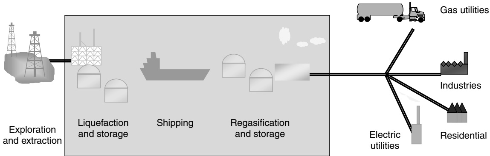
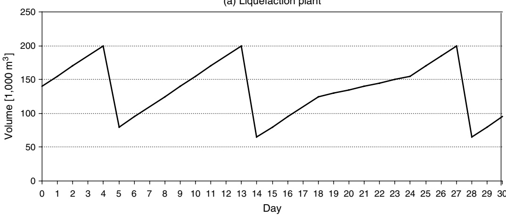
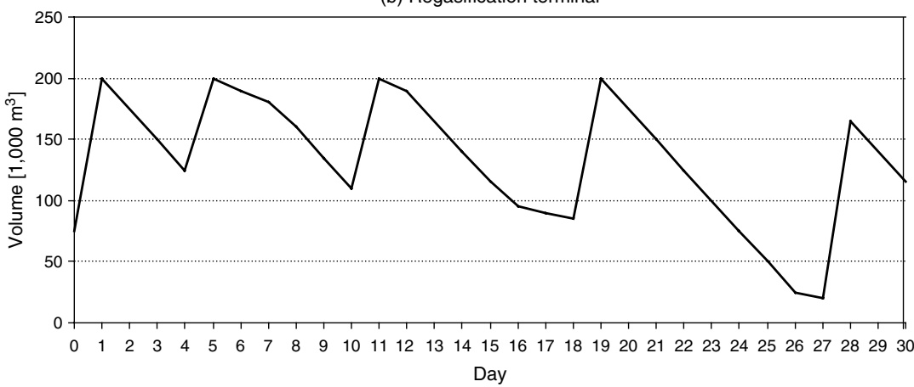
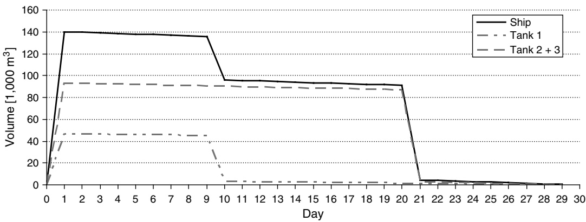
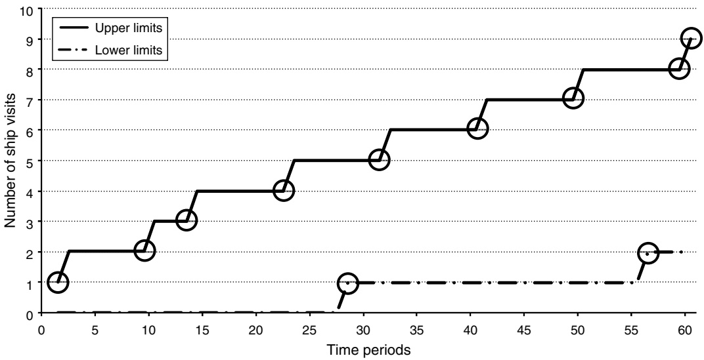
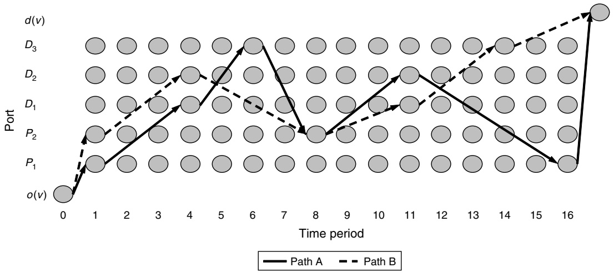
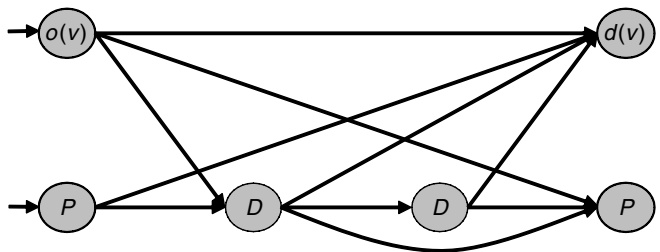
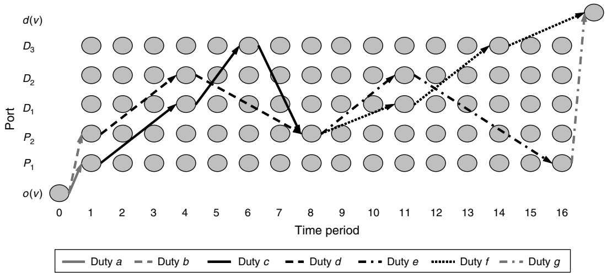

# A Branch-and-Price Method for a Liquefied Natural Gas Inventory Routing Problem

**Roar Grønhaug, Marielle Christiansen Norwegian University of Science and Technology, NO-7491 Trondheim, Norway {roar.gronhaug@iot.ntnu.no, marielle.christiansen@iot.ntnu.no}**

**Guy Desaulniers**

**GERAD, École Polytechnique de Montréal, Montréal, Québec H3T 1J4, Canada, guy.desaulniers@gerad.ca**

**Jacques Desrosiers GERAD, HEC Montréal, Montréal, Québec H3T 2A7, Canada, jacques.desrosiers@hec.ca**

**inventory routing problem (LNG-IRP). Here, an actor is responsible for the routing of the fleet of special purpose ships, and the inventories both at the liquefaction plants and the regasification terminals. Compared to many other maritime inventory routing problems, the LNG-IRP includes some complicating aspects such as (1) a constant rate of the cargo evaporates each day and is used as fuel during transportation; (2) variable production and consumption of LNG, and (3) a variable number of tanks unloaded at the regasification terminals. The problem is solved by a branch-and-price method. In the column generation approach, the master problem handles the inventory management and the port capacity constraints, while the subproblems generate the ship route columns. Different accelerating strategies are implemented. The proposed method is tested on instances inspired from realworld problems faced by a major energy company.**

Key words**: branch-and-price; column generation; maritime transportation**

History**: Received: May 2009; revision received: November 2009; accepted: January 2010. Published online in** Articles in Advance **March 18, 2010.**

## 1. Introduction

**Natural gas (NG) is an important source of energy. World demand for NG is projected to increase by 70% between 2002 and 2025 (Energy Information Adminstration (EIA) 2005). NG has traditionally been transported in pipelines, but transportation by ship is more efficient for long distances. One way of transporting NG by ship is to cool down the gas to a liquid state, i.e., liquefied natural gas (LNG), before loading it into specially designed tankers. Because the demand and production of LNG have increased, the total fleet of LNG tankers has expanded. It is expected that from 2007 to 2015, the number of LNG tankers will almost double from 220 to about 400 (International Energy Agency (IEA) 2007). The growth of the LNG market results in more complex routing and scheduling of such ships. Hence, there is a need for advanced decision support planning systems for actors in the LNG industry.**

**We consider the tactical planning problem in the LNG supply chain that consists of production, transportation, storage, and sales of LNG. Here, a single type of LNG is considered. The NG is cooled down at the liquefaction plants, stored at given pickup** **(loading) ports, and transported by LNG tankers to inventories at delivery (unloading) ports before regasification to NG which is sold. Inventory storage capacities are given in all ports. The production and consumption are variable at all terminals, and may vary from day to day. To transport the LNG between the pickup and delivery ports, the planners control a heterogeneous fleet of LNG tankers. The cargo hold of each ship is separated into several cargo tanks. Although ship is always fully loaded when it leaves the pickup port, it is possible to unload a variable number of tanks at each regasification terminal. During a voyage some of the LNG evaporates and this gas, called boil-off, is used as fuel. The planning problem is to design routes and schedules for the fleet including determining the production and consumption at all terminals that maximize the profit without exceeding the capacities of the LNG tankers and the inventory limits at storage. We call this the LNG inventory routing problem (LNG-IRP).**

**In general, ship routing problems have a structure that can be well exploited in path-based models. Often the sailing times are long compared to the** **total planning period, such that the paths include relatively few legs. In addition, such problems normally have many constraints. The advantages of path-based models are that the intricate and nonlinear constraints and costs can easily be incorporated when generating the paths. Finally, some ship scheduling problems are tightly constrained, and in such cases it is possible to enumerate all paths. We can find numerous ship scheduling applications where this approach is used; see for instance Bausch, Brown, and Ronen (1998), Christiansen and Fagerholt (2002), and Brønmo, Christiansen, and Nygreen (2007).**

**However, for some case studies described in the literature and many real complex ship routing problems, the ship routing and scheduling problem instances are so large that all paths cannot be enumerated. In such cases, column generation approaches have been used to solve path-based models. The pioneering research within column generation and ship routing was performed by Appelgren (1969, 1971) for a real-world ship scheduling problem. This problem included both contracted and optional cargoes to transport between pickup and delivery ports. Thirty years later, another complex ship routing problem was studied by Christiansen (1999). This is a combined inventory management and ship routing and scheduling problem, called** the inventory ship routing problem**. Christiansen (1999) considers a supply chain for ammonia consisting of several locations that either produce or consume ammonia and the transportation network between those locations. The shipping operator has a fleet of ships available for transporting ammonia between these ports, and is responsible for keeping the inventory levels between predetermined lower and upper bounds. The overall problem is solved by column generation (Christiansen and Nygreen 1998a) with two types of subproblems; one for each port (inventory management) and one for each ship (routing). The two types of subproblems are solved by dynamic programming (DP) algorithms (Christiansen and Nygreen 1998b). Persson and Göthe-Lundgren (2005) have studied another combined ship routing problem that is solved by the use of a column generation approach. This planning problem integrates both the shipment planning of petroleum products from refineries to depots and the production scheduling at the refineries. In the survey paper on ship routing and scheduling by Christiansen, Fagerholt, and Ronen (2004), around 40% of the reviewed papers use path-based models. These models are either solved by column generation, or the columns are enumerated in advance and the models are solved by branch-and-bound.**

**The LNG-IRP was introduced in Grønhaug and Christiansen (2009). The authors describe the problem and its relevance to the industry and provide** **an arc-flow and a path-flow formulation of the LNG-IRP. For the path-flow formulation, they enumerate all paths in advance and solve the problem by branchand-bound. Furthermore, they present computational results for small instances including a comparison of the formulations. To solve larger, more realistic instances of the planning problem, other methods must be developed.**

**Hence, the objective of this paper is to present a branch-and-price method for the LNG-IRP. This method relies on a decomposition of the LNG-IRP into a master problem that handles the inventory management and port capacity constraints, and hardto-solve subproblems generating ship routes. The outcome is a tailor made column generation method with branching decisions implemented at both the master problem and the subproblems levels. In addition, some accelerating techniques are developed. In particular, a heuristic column generator is used for solving the subproblems as long as columns can be generated, before turning over to an exact algorithm. The proposed branch-and-price method is tested on instances inspired by an actor in the LNG business. The main contribution of this paper is a solution method to the LNG-IRP that performs much faster (more than one order of magnitude for our test instances) than a commercial optimization software and that can solve larger instances than presented earlier. Furthermore, we develop an ad hoc label-setting algorithm for solving the subproblems that is capable of dealing with the boil-off.**

**The rest of the paper is organized as follows: Section 2 describes the planning problem in detail. The problem is formulated as a path-flow model in §3. Some valid inequalities are also presented in this section. Section 4 is devoted to the solution method. Real-world cases based on planning problems from a major energy company are described in §5 and computational results for these cases are also reported. Concluding remarks and suggestions for future research follow in §6.**

## 2. Problem Description

**The LNG supply chain starts with the exploration to find NG in the earth’s crust and continues with the production of the gas for delivery to gas users. The gas that is to be sent by ship is converted into a liquid state at liquefaction plants. Then, the LNG is transported in special purpose ships from ports close to the liquefaction plants to ports close to the storage and regasification terminals. There, the LNG is converted from the liquefied phase to the gaseous phase, ready to be moved to the final destination through an NG pipeline system. In this study, we consider the**

Figure 1 The LNG Supply Chain Highlighting the Parts of the Chain Included in the Study

**LNG supply chain except for exploration and extraction, and the transportation to the end customers. Figure 1 shows the LNG supply chain and highlights the parts of the chain considered here. An example of the supply chain for a real actor in the LNG business is described in Grønhaug and Christiansen (2009).**

**The tactical planning problem in the LNG business in this part of the supply chain includes inventory management, production, and sales management as well as ship routing and scheduling.**

**The production of LNG at the liquefaction plants is normally at a maximum level. However, it is possible to regulate the production within certain limits. At each plant there are given capacities of the storage. These capacities may vary throughout the planning period because of other time dependent contracts at the production terminal. Production costs depend on volume, plant, and time. Figure 2(a) illustrates the inventory level at a liquefaction plant during the planning period, where the associated port has 3 ship calls (visits). The production at the liquefaction plant is at its maximum during the first 18 days of the planning horizon. Then, the production is reduced to its minimum level for 6 days, before it is raised back to the maximum on the 25th day. This production level is kept for the rest of the planning horizon.**

**At the other end of the supply chain, the regasification terminals, the gas is unloaded from the ships and stored in storage tanks with specified capacities. Figure 2(b) gives an example of the inventory level at a regasification plant that has 5 ship calls during the planning horizon. Here we see that the consumption level and the unloading quantity vary considerably throughout the planning period. Related to the regasification terminals, there are numerous customers with different contracts. These contracts make it possible to specify lower and upper limits of demand for gas and an associated revenue per day for each port.**

**At the liquefaction plants and regasification terminals, neither the production nor the sales of LNG should be interrupted. Hence, there must be sufficient LNG in storage at the regasification terminals, and the** **quantities in the liquefaction plants cannot exceed the storage capacities. The planning problem, the LNG-IRP, is to design routes and schedules for a fleet of LNG ships and determine loading quantities, production, and sales that maximize the profit from the LNG operations without exceeding the cargo capacities of the ships or the inventory limits at the storage.**

**The maritime transportation part of this supply chain is deep sea shipping, i.e., sailing long distances on the high seas. For this, a fleet of LNG tankers with different operating costs, load capacity, and other specific characteristics is used. The cargo hold of such a ship is separated into several tanks, and each of these tanks has a specified capacity. During a voyage some of the LNG is vaporized and this gas, called boil-off, is used as fuel. A constant rate of the cargo capacity in each cargo tank is boiling off each day during a voyage at sea. It is the cargo itself that keeps the tanks cool. Thus, if a cargo tank runs empty, the temperature gradually increases. It is costly and time consuming to recool the cargo tanks before loading. Hence, some LNG should always be left in the tanks to keep them cool except just before loading. No boiloff is assumed for the active tanks during loading and unloading in a port, while boil-off is considered for the tanks not affected at delivery ports. For our tests, the loading and unloading of a ship is assumed to take one day independent of the quantity loaded or unloaded. The load aboard an LNG tanker can be illustrated similarly to the inventory at a delivery port, see Figure 3. In this example, three tanks are loaded on the first day of the planning horizon. Then tank 1 is unloaded on the 9th day, while the two other tanks are unloaded on the 20th day. The ship is empty just when it arrives at a pick-up port on day 30.**

**The sailing time from one port to another is calculated based on the speed of the ship and the distance, but does not depend on the load aboard. Furthermore, there might be several paths between two ports with different time consumptions and costs. Typically this results from the possibility to use the Suez canal or sailing around Africa.**

(a) Liquefaction plant

(b) Regasification terminal

Figure 2 Inventory Levels at a Liquefaction Plant and a Regasification Terminal

**The ports have limited capacity, such that a given maximum number of ships can visit each port in each time period. However, it is possible to wait outside a port before loading and unloading, and the maximum number of waiting days outside each port is given. Normal boil-off is assumed during such waiting days.**

**Because of business practice, we assume the following: (1) successive calls at liquefaction plants are not allowed; (2) an LNG tanker always arrives at a pickup port just when it is empty such that it does not need a recooling process before it can start loading; and (3) a tanker always receives a full ship load at a pickup port (that is, all tanks are filled). On the** **other hand, partial unloading can occur at delivery ports. This means that several regasification terminals might be called in sequence, and a maximum number of consecutive delivery ports is given. In practice, this number is not ship-dependent and is set to two. We use the term** duty **for a sequence of ports that starts in a pickup port, visits one or more delivery ports, and ends in a pickup port. A more detailed description of the term is given in §4.1. Because of sloshing problems for some types of LNG tankers, it is assumed that it is impossible to unload partial tanks. Hence, a number of full tanks adjusted for the boil-off between pickup ports in a duty must be unloaded at each delivery port. Moreover, LNG tankers can have cargo tanks of equal or different sizes. Here, we assume that all cargo tanks of a specific LNG tanker have equal size.**

Figure 3 The Inventory of an LNG Tanker During a Voyage

**Consider an example with the following port call** sequence (duty): $P _ { 1 } - \bar { D } _ { 2 } - D _ { 3 } - P _ { 4 } ,$ **where** $P _ { 1 }$ **and** $P _ { 4 }$ **are pickup ports, and** $D _ { 2 }$ **and** $D _ { 3 }$ **are delivery ports. The** corresponding schedule is $\vec { T _ { 1 } } - T _ { 2 } - T _ { 3 } - \vec { T _ { 4 } } ,$ **where** $T _ { i }$ **i**s the arrival time at port i. There are two tanks in **the ship and the tank capacity is** $L ,$ **while the boil-off** rate is B. For this duty, quantity 2 · L is loaded in $P _ { 1 } ,$ while $L - L \cdot B \cdot (T_4 - \widehat{T_1 - 2})$ **is unloaded at each of the delivery ports. Because of boil-off, the delivered quantity can only be decided when the arrival time** $\hat { T } _ { 4 }$ **is known.**

**There is no natural depot for the ships. The initial position of a ship may be at a port or a point at sea. Thus, the ship might be empty or loaded, and there is a set of first port call candidates in its route. Furthermore, there is no requirement for a specified position for any ship at the end of the planning period.**

**LNG tankers are very specialized ships with no other area of application. In the short-term, we assume that there is no option to change the fleet size, thus we can disregard fixed cost for the fleet. The variable sailing costs consist of daily operating costs such as fuel and diesel oil costs. In addition, LNG tankers are charged port and canal tolls when visiting ports and passing canals. These costs depend on the size of the ship.**

**In contrast to the pickup and delivery problem (Desaulniers et al. 2002), the number of visits to a port is not known, and there exist no pickup and delivery pairs. Moreover, the quantities loaded or unloaded at the ports are not known for the LNG-IRP as the volumes loaded at the pickup and unloaded at the delivery ports depend on the ships’ capacities. In addition, the quantities unloaded depend on both the number of cargo tanks unloaded and the boil-off in the actual duty. To summarize, in the LNG-IRP we have to design the ship routes and schedules for a given planning period which must ensure that the inventories at the ships are within their lower and upper limits** **at all time. Calculating the delivered quantities is not straightforward because of the boil-off that depends on the length of the entire duty. Furthermore, we have to decide the production of LNG and determine the level of demand fulfillment. Both the production and sales can be adjusted when needed or beneficial throughout the planning horizon. Finally, the inventories at the ports must be within the lower and upper limits. Compared to Christiansen (1999), we have some complicating aspects concerning the boiloff and the variable production and consumption.**

## 3. Mathematical Formulation

## 3.1. Path-Flow Model

**The LNG-IRP is formulated as a path-flow model, where the paths represent possible routes for the LNG tankers. In the mathematical description of the problem each port is represented by an index** $i ,$ **and the set of pickup ports (liquefaction plants) is given by** $\mathcal { N } ^ { P } ,$ **while the set of delivery ports (regasification terminals) is given by** $\mathcal { N } ^ { D }$ **. Then,** $\mathcal { N } = \widetilde { \mathcal { N } ^ { P } \cup \mathcal { N } ^ { D } }$ **is the set of all ports in the network. The set of time periods in the planning horizon is given by** $\mathcal { T }$ **and indexed by t. Furthermore,** $\mathcal { V } ,$ **indexed by** $v ,$ **is the set of available** ships, while $\mathcal { R } _ { v }$ **is the set of paths for ship v. In this context a** path **contains the geographical route and the schedule with information about the arrival times and the amount of cargo loaded or unloaded at port calls for a ship in the planning horizon. A path r for ship v starts in the ship’s (artificial) origin node and ends in the (artificial) destination node.**

**The sales and production of LNG at the ports are** bounded by the interval $[ \underline { { Y } } _ { i t } ,   \bar { Y } _ { i t } ] ,$ , and the correspond**ing unit sales revenues and production costs are given by** $R E V _ { i t }$ **and** $C O S T _ { i t } ,$ **respectively. Furthermore, the inventory levels at the ports should be within given** lower and upper limits, $[ S _ { i } , \bar { S } _ { i } ]$ . In addition, to ease the readability we use the parameter $I _ { i } ,$ which is equal to −1 for pickup ports and 1 for delivery ports. Parameter $X _ { i j v t r }$ equals 1 if ship v (un)loads at port i in time period t before it immediately starts sailing towards port j when sailing path $r ,$ and 0 otherwise. Moreover, the parameter $Z _ { i v t r }$ equals 1 if ship v visits port i in time period t on path $r ,$ and 0 otherwise, while the corresponding (un)loading volume is given by the parameter $Q _ { i v t r }$ . The number of tanks unloaded from ship $v$ at delivery port i in time period t when sailing path $r$ **i**s represented by the parameter $L _ { i v t r } ,$ and $\tilde { W } _ { v } ^ { \mathrm { \tilde { M } } \mathrm { X } }$ **i**s the number of cargo tanks in the ship. The parameter $C _ { v r }$ represents the cost of sailing path r for ship v. The cost parameters are composed of ship **operations cost, port fees, and any canal fees. Furthermore, the number of berths in a port limits the total number of ships that can load or unload simultane**ously. This port capacity is denoted $N _ { i } ^ { \mathrm { C A P } }$

**The sales and production of LNG are given by** the continuous variables $y _ { i t } , ~ i \in \mathcal { N } , t \in \mathcal { T } ,$ **while the inventory levels at the ports are given by the contin**uous variables $s _ { i t } , \; i \in \mathcal { N } ,   t \in \mathcal { T }$ . Note that $s _ { i 0 } , \; i \in \mathcal { N }$ **is a parameter representing the initial inventory at the beginning of the planning horizon. Finally, the continuous variable** $\lambda _ { v r }$ **r**epresents the amount of path r sailed by ship $v ,   v \in \mathcal { V } ,   r \in \mathcal { R } _ { v }$

**Then, a path-flow formulation of the problem is as follows:**

$$
\begin{array}{c} \max \sum_ {i \in \mathcal {N} ^ {D}} \sum_ {t \in \mathcal {T}} R E V _ {i t} y _ {i t} - \sum_ {i \in \mathcal {N} ^ {P}} \sum_ {t \in \mathcal {T}} C O S T _ {i t} y _ {i t} \\ - \sum_ {v \in \mathcal {V}} \sum_ {r \in \mathscr {R} _ {v}} C _ {v r} \lambda_ {v r}, \end{array}\tag{1}
$$

**subject to**

$$
s _ {i t} - s _ {i (t - 1)} - \sum_ {v \in \mathscr {V}} \sum_ {r \in \mathscr {R} _ {v}} I _ {i} Q _ {i v t r} \lambda_ {v r} + I _ {i} y _ {i t} = 0,
$$

$$
\forall i \in \mathcal {N}, t \in \mathcal {T},\tag{2}
$$

$$
\sum_ {v \in \mathscr {V}} \sum_ {r \in \mathscr {R} _ {v}} Z _ {i v t r} \lambda_ {v r} \leq N _ {i} ^ {\mathrm{CAP}}, \quad \forall   i \in \mathscr {N},   t \in \mathscr {T},\tag{3}
$$

$$
\underline {{S}} _ {i} \leq s _ {i t} \leq \overline {{S}} _ {i}, \quad \forall i \in \mathcal {N},   t \in \mathcal {T},\tag{4}
$$

$$
\underline {{Y}} _ {i t} \leq y _ {i t} \leq \bar {Y} _ {i t}, \quad \forall i \in \mathcal {N}, t \in \mathcal {T},\tag{5}
$$

$$
\sum_ {r \in \mathcal {R} _ {v}} \lambda_ {v r} = 1, \quad \forall v \in \mathcal {V},\tag{6}
$$

$$
\sum_ {r \in \mathcal {R} _ {v}} L _ {i v t r} \lambda_ {v r} \in \{0, 1, \dots , W _ {v} ^ {\mathrm{MX}} \},
$$

$$
\forall i \in \mathcal {N} ^ {D}, v \in \mathscr {V}, t \in \mathscr {T},\tag{7}
$$

$$
\sum_ {r \in R _ {v}} X _ {i j v t r} \lambda_ {v r} \in \{0, 1 \}, \quad \forall i \in \mathcal {N}, j \in \mathcal {N}, v \in \mathscr {V}, t \in \mathscr {T},\tag{8}
$$

$$
\lambda_ {v r} \geq 0, \quad \forall v \in \mathcal {V}, r \in \mathscr {R} _ {v}.\tag{9}
$$

**The objective function (1) maximizes total profit from the LNG supply chain, which consists of sales revenues minus the production and transportation costs. Constraints (2) are the inventory balance constraints for each port, while the berth capacity constraints (3) limit the number of simultaneous ships in a port. Constraints (4) give lower and upper bounds on the storage variables, while the lower and upper bounds for the production and sales variables are given by constraints (5). Constraints (6) are the convexity constraints. An integer number of cargo tanks unloaded at the delivery ports is provided by constraints (7), while constraints (8) make sure that a feasible solution yields a feasible geographical route for the ships. Finally, constraints (9) ensure nonnegativity** for the path variables, $\lambda _ { v r } .$

**For real-world LNG-IRP instances, involving more than a few ships and a long planning horizon, the number of** $\lambda _ { v r }$ **variables in model (1)–(9) can be very large. Consequently, for such instances, it is not** **possible to enumerate all these variables and their corresponding coefficient columns. To overcome this difficulty, we propose to use column generation that allows to generate these variables as needed.**

**Note that Christiansen (1999) also developed a column generation approach for a maritime inventory routing problem. However, she decomposed the problem such that there is one subproblem for each ship and one subproblem for each port with inventory management considerations. Here, the inventory management part of the problem is kept in the master problem because of the challenges concerning the synchronization of quantities in the different subproblem types because of boil-off. In addition, Christiansen (1999) presented a time continuous model, while a time discrete model is used here because of the variable production and consumption.**

## 3.2. Valid Inequalities

**We can tighten the berth capacity constraints (3) by analyzing the combination of the storage capacity at a port, its production or sales, the berth constraints, the ship capacities, and the shortest roundtrip for the ships starting from that port.**

**For example, consider a pickup port with a storage capacity of** $2 5 0 { , } 0 0 0 \mathrm { ~ m } ^ { 3 }$ **and with a daily LNG production in the interval [12,000, 15,000] m**<strong>3</strong>**. Hence, during a 15-day period, the maximum amount of** LNG produced is $^ { \mathrm { ~ \scriptsize ~ \dot { ~ } ~ } } 2 2 5 { , } 0 0 0   \mathrm { ~ m } ^ { 3 }$ **. Let the berth capacity be 1, so the port can have one ship visiting each** day. The minimum ship capacity is $1 2 0 , 0 0 0 ~ \mathrm { m } ^ { 3 } .$ Dur**ing this 15-day planning period, the total amount of LNG loaded aboard the ships cannot exceed the storage inventory capacity plus the maximum amount of LNG produced. Then, during the 15-day period the number of ships that visit this port cannot exceed** $( 2 2 5   +   2 5 0 ) / 1 2 0 \stackrel { \circ } { = } 3 . 5 4$ **. Hence, the upper limit on the number of ships visiting this port during a 15-day period is 3.**

**For each time period** $t \in T$ **we can calculate all lower and upper limits on the number of ships visiting a given port for all possible time intervals starting in t. Figure 4 illustrates these limits for a port during time intervals ranging from 1 to 60 time periods. When the lines in the figure has zero slope we have some redundant limits. The circles in Figure 4 show which of the lower and upper limits are not redundant and can be added to the restricted master problem (RMP) as valid inequalities.**

**For a formal description of the valid inequalities we need the following additional notation: Let** $\mathcal { B } _ { i t }$ **and** $\bar { \mathcal { B } } _ { i t }$ **denote the set of valid inequalities for the lower and upper limits on ship visits at port i in time intervals starting in time period t, and let b be the cor**responding index for these sets. The parameters $\underline { { \boldsymbol { \Lambda } } } _ { i t b } ^ { \mathrm { V I } }$ and $\bar { N } _ { i t b } ^ { \mathrm { V I } }$ are the lower and upper limits on the num**ber of ships visiting port i in time interval b starting** in time period t. Moreover, let the parameter $\underline { { T } } _ { i t b } ^ { \mathrm { V I } }$ rep**resent the length (in number of time periods) of the time interval b starting in time period t for port i for** the lower limit, and let $\bar { T } _ { i t b } ^ { \mathrm { { W I } } }$ represent the correspond**ing parameter for the upper limit. Then, the valid inequalities are given by**

Figure 4 Illustration of the Lower and Upper Limits on the Number of Ship Visits for a Port

$$
\sum_ {\tau = t} ^ {t + \underline {{T}} _ {i t b} ^ {\mathrm{VI}}} \sum_ {v \in \mathcal {V}} \sum_ {r \in \mathcal {R} _ {v}} Z _ {i v \tau r} \lambda_ {v r} \geq \underline {{N}} _ {i t b} ^ {\mathrm{VI}}, \quad \forall i \in \mathcal {N},   t \in \mathcal {T},   b \in \underline {{\mathcal {B}}} _ {i t},\tag{10}
$$

$$
\sum_ {\tau = t} ^ {t + \overline {{T}} _ {i t b} ^ {\mathrm{VI}}} \sum_ {v \in \mathcal {V}} \sum_ {r \in \mathcal {R} _ {v}} Z _ {i v \tau r} \lambda_ {v r} \leq \overline {{N}} _ {i t b} ^ {\mathrm{VI}}, \quad \forall i \in \mathcal {N}, t \in \mathcal {T}, b \in \bar {\mathcal {B}} _ {i t}.\tag{11}
$$

**Constraints (10) and (11) are valid inequalities that can be added to the problem when they are violated. Note that the berth capacity constraints (3) are special cases of the upper limits valid inequalities (11).**

**When the number of ports is relatively small and the time horizon not too long (as is the case in our test instances), enumeration can be used to separate these valid inequalities. The effectiveness of these inequalities depends, however, on the storage capacity, the difference between the minimum and maximum production (or consumption) rates at the corresponding port, and the difference in the ship capacities. For the test instances that we considered (see §5), these inequalities were not very effective: Preliminary tests showed that they could help to close no more than 5% of the integrality gap. Consequently, the final version of the proposed method does not try to generate them as in a cutting plane method, but only includes a priori a specific subset of them. This subset is defined as follows. First, the planning horizon is divided into disjoint time intervals of equal length (15 periods for our tests), except maybe for the last interval that can have a shorter length. Then, for each time interval** **and each port, a pair of constraints (10) and (11) spanning the time interval is defined. These constraints are, however, expressed in a different form to allow branching on their slack variables. Let ℬ be the set of** time intervals, $T _ { b } ^ { \mathrm { V I } }$ the length of time interval $b ,$ and $t _ { b }$ its first period. Furthermore, denote by $\underline { { N } } _ { i b } ^ { \mathrm { { W } } }$ and $\bar { N } _ { i b } ^ { \mathrm { \check { V I } } }$ **the lower and upper limits on the number of ships that can visit port i in time interval** $b ,$ **respectively. The predefined subset of valid inequalities is given by:**

$$
\sum_ {\tau = t _ {b}} ^ {t _ {b} + T _ {b} ^ {\mathrm{VI}}} \sum_ {v \in \mathcal {V}} \sum_ {r \in \mathscr {R} _ {v}} Z _ {i v \tau r} \lambda_ {v r} - a _ {i b} ^ {\mathrm{VI}} = 0, \quad \forall i \in \mathcal {N}, b \in \mathscr {B},\tag{12}
$$

$$
\underline {{N}} _ {i b} ^ {\mathrm{VI}} \leq a _ {i b} ^ {\mathrm{VI}} \leq \overline {{N}} _ {i b} ^ {\mathrm{VI}}, \quad \forall i \in \mathcal {N}, b \in \mathcal {B},\tag{13}
$$

where the variables $a _ { i b } ^ { \mathrm { V I } }$ **compute the total number of ships visiting each port i in each time interval b. These variables must, therefore, take an integer value and can be used to impose branching decisions (see §4.4.4).**

## 4. Solution Approach

**In this section we present a branch-and-price method (Barnhart et al. 1998) for the LNG-IRP. Such a method consists of a branch-and-bound algorithm where the upper bounds in the search tree (for a maximization problem) are computed by column generation. Column generation is thus used to solve the linear relaxation of model (1)–(9) and (12)–(13) (possibly modified by branching decisions) which is called the master problem. In particular, the master problem constraints (7) and (8) can be disregarded when solving the linear relaxation of the model because of the convexity constraints (6). Column generation is an iterative method that starts with no or a few initial columns** $( \lambda _ { v r }$ **variables) in the master problem,** **and gradually adds new columns until the optimal linear relaxation (LP) solution of the master problem is found. At each iteration, the linear problem restricted to a subset of columns, called the RMP, is solved by the simplex algorithm to yield a primal and a dual solution. To generate columns, subproblems (one per ship) corresponding to longest path problems with complicating side constraints are solved by DP. The solution of the subproblem for ship v corresponds to a feasible path with corresponding quantities loaded and unloaded at the ports for this ship that yields the highest reduced cost according to the dual solution of the current RMP. If no subproblems can identify columns with a positive reduced cost, the column generation process stops and the current RMP primal solution is optimal for the linear relaxation of the master problem. Otherwise, positive reduced cost columns are added to the RMP and another iteration is performed. To find integer solutions, we impose branching decisions either by modifying the constraints in the master problem or by manipulating the subproblems. For an introduction to column generation, see Desrosiers and Lübbecke (2005). For a survey on this topic with a bias toward solving integer problems, see Lübbecke and Desrosiers (2005).**

**The rest of this section is organized as follows: In §4.1 we describe the subproblems and their networks, while §4.2 presents a solution algorithm for the subproblems. In §4.3 accelerating techniques for the column generation procedure are introduced. Finally, in §4.4 we present the branching decisions imposed to derive integer solutions.**

## 4.1. The Subproblem Description

**As mentioned above, the objective of a subproblem is** to find a path with the highest reduced cost. Let $\bar { C } _ { v r }$ denote the reduced cost of variable $\lambda _ { v r }$ **. Furthermore,** let $\alpha _ { i t } , \; \beta _ { i t } , \; \theta _ { v } ,$ and $\sigma _ { i b }$ be the dual variables for con**straints** $(2),   (3),   (6)$ **, and (12), respectively. Then, the reduced cost of the path variable** $\lambda _ { v r }$ **is given by**

$$
\bar {C} _ {v r} = - C _ {v r} + \sum_ {i \in \mathcal {N}} \sum_ {t \in \mathcal {T}} (I _ {i} Q _ {i v t r} \alpha_ {i t} - Z _ {i v t r} \eta_ {i t}) - \theta_ {v},\tag{14}
$$

**where**

$$
\eta_ {i t} = \beta_ {i t} + \sum_ {b \in \mathscr {B}: t \in [ t _ {b}, t _ {b} + T _ {b} ^ {\mathrm{VI}} ]} \sigma_ {i b}.\tag{15}
$$

**Any path with a positive reduced cost is a candidate for entering the RMP. The subproblem network for ship v is a time-space network where there is one node for each port-time combination, and an origin node,** $o ( v )$ **, and a destination node,** $d ( v )$ **. The ship starts its sailing from** $o ( v )$ **. This node can either be at sea or at a physical port, depending on the ship’s location at the beginning of the planning horizon. The path ends in** $d ( v \bar { ) }$ **. Let the index k represent a node in the time-space network, and** $( k , l )$ **represent an arc. Hence, k and l are combinations of port and time,** $( i , t )$ **and** $( j ,   t + \tau _ { i j } )$ **, where** $\tau _ { i j }$ **is the time to load or unload at port i plus the sailing time between port i** and j plus any waiting in front of port j. Let $( \bar { \mathcal { N } } _ { v } , \mathcal { A } _ { v } )$ **be the total network associated with ship v. Here, the set** $\mathcal { N } _ { v }$ includes all nodes in the time-space network feasible for ship $v ,$ in addition to the origin and destination nodes, and the set ${ \mathcal { A } } _ { v }$ contains all feasible arcs for ship v. The set $\mathcal { N } _ { v } ^ { P }$ (resp. $\mathcal { N } _ { v } ^ { D } )$ includes all pickup (resp. delivery) nodes in the network that ship v may visit. Moreover, the set $\mathcal { N } _ { v } ^ { P }$ is topologically sorted. To ease the presentation of the algorithm we assume that arc $( k , l ) ^ { \vec { } }$ includes any waitings in front of node l. Hence, for a sailing from port i to port $j$ **t**hat starts in **time period t there will be one arc for each possible waiting.**

**Figure 5 shows an example of two paths in the time-space network for a subproblem with one origin** node, $o ( v ) ,$ , two pickup ports $( P _ { 1 } , \; P _ { 2 } )$ **, three delivery** ports $(D_{1},~D_{2},~D_{3})$ **and one destination node,** d(v**). These paths start in the origin node, then visit several of the ports in different time periods before ending in the destination node. In path** B **there is a roundtrip** $P _ { 2 } - D _ { 2 } - P _ { 2 }$ **that starts in time period 1 and ends in time period 8 where the second sailing is longer than the first one. This is because we have one time period with waiting in front of port P**<strong>2</strong> **from time period 7 to 8.**

Figure 5 Two Paths in a Subproblem Network

**The cost of traversing arc** $( k , l )$ **for ship v is given by** $c _ { k l v }$ **. The cost parameter** $C _ { v r }$ **from the objective function (1) is compounded of these arc costs. Because we do not know the exact quantities unloaded at the delivery ports when the ship visits these ports, we do not transform all (reduced) costs to arc costs. Instead, we separate between arc costs and node costs for the subproblems as follows. The reduced costs for the arcs** are represented by $\bar { c } _ { k l v } ^ { A }$ **and the reduced costs on the** nodes are represented by $\bar { c } _ { k v } ^ { N }$ **. For a node k associated** with a port i and a time t, we define $i _ { k } = i$ and $t _ { k } = t .$ **Then, these reduced costs are given by**

$$
\bar {c} _ {k l v} ^ {A} = \left\{ \begin{array}{l} c _ {k l v} - \theta_ {v}, \quad \forall v \in \mathscr {V}, (k, l) \in \mathscr {A} _ {v} \mid k = o (v), \\ c _ {k l v} - \eta_ {i _ {k} t _ {k}}, \quad \forall v \in \mathscr {V}, (k, l) \in \mathscr {A} _ {v} \mid k \neq o (v), \end{array} \right.\tag{16}
$$

$$
\bar {c} _ {k v} ^ {N} = \left\{ \begin{array}{l l} 0, & \forall v \in \mathscr {V}, k = o (v), \\ I _ {i _ {k}} Q _ {i _ {k} v t _ {k}} \alpha_ {i _ {k}, t _ {k}}, & \forall v \in \mathscr {V}, k \in \mathscr {N} _ {v} \backslash \{o (v) \}, \end{array} \right.\tag{17}
$$

where $Q _ { i _ { k } v t _ { k } }$ **is a decision variable indicating the quan**tity (un)loaded at port $i _ { k }$ in period $t _ { k } .$

**Formulas (16) provide the reduced cost components on the arcs. These are the costs related to ship operations and sailings, and the dual variables for the convexity constraints and for the berth constraints. On the other hand, formulas (17) provide the reduced cost for visiting a node in the time-space network which depend on the quantity loaded or unloaded at** the node and the corresponding dual variable $\alpha _ { i _ { k } t _ { k } }$

**The subproblem for ship v corresponds to a longest path problem with side constraints where the objec**tive is to maximize $\bar { C } _ { v r } .$ **. To ease the presentation of the side constraints and the DP algorithm we use the notion of** duty **briefly introduced in §2. A detailed description of this notion is as follows. A duty is a journey that starts in either a pickup port or the origin node, and ends in a pickup port or the destination node. Figure 6 gives an illustration of all possible duties for a ship when there is an upper limit of two consecutive visits to delivery ports. The figure shows that a duty starts in either a pickup port (P) or the origin node, visits either zero, one, or two delivery ports (D), before ending in a pickup port or the destination node. To ease the illustration, Figure 6 does not** **show any waiting or when the different cargo tanks are loaded and unloaded.**

Figure 6 Illustration of the Duties in a Network with a Maximum of Two Consecutive Visits at Delivery Ports

**The side constraints on the longest path problem are caused by the restrictions on the unloadings of the ships at the delivery ports and the boil-off. The ship should always load a full ship load of cargo at the pickup port, and unload a discrete number of cargo tanks at each visited delivery node, just leaving enough cargo to cover the boil-off from the cargo tank(s) until the next pickup port. There is an upper limit on the number of consecutive visits to delivery nodes before the ship must sail to a pickup node.**

## 4.2. A Dynamic Programming Algorithm for the Subproblem

**Because of the side constraints mentioned above, it is not possible to use a standard DP algorithm for solving this longest path subproblem. Another complicating issue for a DP algorithm is that the exact amount of cargo unloaded at the delivery ports in a duty cannot be known until the ship returns to a pickup node. Hence, in contrast to a standard longest path algorithm, partial paths ending in a same delivery node cannot be compared because of the lack of information on the (un)loading quantities. Thus, we propose in this section an ad hoc DP algorithm for solving the subproblem associated with ship v. In this algorithm, partial paths are compared only at the pickup nodes and the destination node.**

**To present the algorithm some additional notation is needed. The boil-off from ship v is given by the** parameter $B _ { v } ^ { F }$ that specifies the amount of cargo evaporating in each time period. In fact, $B _ { v } ^ { F }$ is a percentage of the total ship capacity. Furthermore, the initial load onboard the ship is represented by $V _ { v } ^ { \mathrm { { m m } } }$ , and the capacity of ship v is given by $V _ { v } ^ { \mathrm { C A P } }$

During the course of the DP algorithm, a label $E _ { k v }   =$ $( \widehat { C } _ { k v } ^ { R } , \stackrel { \circ } { T _ { k v } } , \stackrel { \circ } { d _ { k v } } , \widehat { Q } _ { k v } , \widehat { L } _ { k v } )$ **is associated with each partial** path from ov to any node k. Here, $\bar { C } _ { k v } ^ { R }$ **is a scalar representing the reduced cost of a partial path starting in** $o ( v )$ **a**nd ending in $k$ for ship $v ,$ and $T _ { k v }$ is a **scalar that keeps track of the elapsed time since the time of visit of the last pickup port (or the start of the route). The set** $d _ { k v }$ **is an ordered list of the nodes visited in the current duty: It contains the duty start** **node (either the origin node or a pick up node) and all delivery nodes visited since the beginning of the duty. The maximum cardinality of** $d _ { k v }$ **is given by the** parameter $D ^ { M X }$ , which is equal to the maximum num**ber of consecutive delivery ports a ship is allowed to** visit plus one. Furthermore, the sets $\hat { Q } _ { k v }$ and $\hat { L } _ { k v }$ **are corresponding ordered lists that indicate the quantity (un)loaded and the number of tanks (un)loaded at** each node in $d _ { k v } ,$ respectively. Because the total boil**off in a duty is unknown until it is completely built,** the values in $\hat { Q } _ { k v }$ **are computed only when k is the end node of a duty. In addition, because the number of tanks to deliver at each delivery port in** $d _ { k v }$ **depends on the dual variables of the constraints** $( 2 )$ **associated** with these ports, the values in the list $\hat { L } _ { k v }$ **are also updated at the end node of a duty. Consequently, at a delivery node, labels contain partial information and cannot be compared. On the other hand, labels are compared at each pickup node and at the destination** node using the following dominance rule. Let $E _ { k v } ^ { 1 }$ **and** $E _ { k v } ^ { 2 }$ be two such labels. If $\begin{array} { r } { \bar { C } _ { k v } ^ { R 1 } \geq \bar { C } _ { k v } ^ { R 2 } , } \end{array}$ **,** then $E _ { k v } ^ { 2 }$ is dominated by $E _ { k v } ^ { 1 }$ and, thus, can be discarded (at equality, **one of the two labels must be kept).**

**The pseudo-codes for the DP algorithm are pre-sented in Algorithms 1–3. Algorithm 1 sets the initial conditions. Then, for the origin node and for each pickup node it starts searching for the duties originating from these nodes by calling Algorithm 2. Remember that the set** $\mathcal { N } _ { v } ^ { P }$ is topologically sorted. Algorithm 2 handles the expansion of all duties and the testing of the partial paths that ends in the pickup nodes and the destination node. When the DP algorithm visits **any delivery node, the number of cargo tanks and the exact amount of LNG unloaded are unknown, and thus the reduced cost of the corresponding partial path ending in this node is unknown. Instead the DP algorithm keeps track of the nodes in a duty.**

Algorithm 1 (Subproblem algorithm)
$\bar{C}_{kv}^{R*} = -\infty, \quad \forall k \in \mathcal{N}_v^P \cup \{d(v)\}$
$\bar{C}_{o(v)v}^{R*} = 0$
for all $k \in \{o(v)\} \cup \mathcal{N}_v^P$ do
    $\bar{C}_{kv}^R = \bar{C}_{kv}^{R*}$
    $T_{kv} = 0$
    $d_{kv} = \varnothing$
    for each $(k, l) \in A_v$ do
        $\bar{C}_{lv}^R = \bar{C}_{kv}^R + \bar{c}_{klv}^A$
        $T_{lv} = T_{kv} + \tau_{kl}$
        $d_{lv} = d_{kv} \cup \{k\}$
        $E_{lv} = (\bar{C}_{lv}^R, T_{lv}, d_{lv}, \varnothing, \varnothing)$
        if $l \in \mathcal{N}_v^D$ then call FindDuty$(l, E_{lv})$
        else call EndDuty$(l, E_{lv})$
        end if
    end for
end for

Algorithm 2 (FindDuty($k$, $E_{kv}$))
    $d_{kv} = d_{kv} \cup \{k\}$
    for each ($k, l \in A_v$ do
        if $l \in \mathcal{N}_v^P \cup \{d(v)\}$ or $|d_{kv}| &lt; D^{MX}$ Then
            $\bar{C}_{lv}^R = \bar{C}_{kv}^R + \bar{c}_{klv}^A$
            $T_{lv} = T_{kv} + \tau_{kl}$
            $d_{lv} = d_{kv}$
            $E_{lv} = (\overline{C}_{lv}^R, T_{lv}, d_{lv}, \varnothing, \varnothing)$
            if $l \in \mathcal{N}_v^D$ then call FindDuty($l$, $E_{lv}$)
            else call EndDuty($l$, $E_{lv}$)
            end if
        end if
    end for

**When a duty is completed in Algorithm 2, it calls Algorithm 3 which calculates the exact quantities unloaded at the delivery nodes visited in the duty before computing the reduced cost of traversing this duty. Note however that, because of branching decisions on the number of tanks delivered (see §4.4.2), this duty might be infeasible as not all loaded tanks can be delivered or too many tanks may be requested at the delivery ports. In this case, the current label** $E _ { k v }$ **is** not completed and is simply abandoned. In this **algorithm, T and** $Q$ **are temporary variables used for the computations. When the duty is feasible, the following rule is used to calculate the cargo unloaded at each visited port: If the duty starts with a pickup node, all cargo tanks are fully loaded at that node. Because it is beneficial to assign as large cargo as possible to the delivery node with the highest unit node** cost $( \bar { c } _ { k v } ^ { N } )$ **in the duty, the algorithm assigns one cargo tank to all delivery nodes in the duty except to this highest cost node, which receives the rest of the cargo tanks. By using this fact, we avoid enumerating all possible load states for the cargo tanks. This rule can be altered by imposing branching decisions during the search tree (see §4.4.2). When the algorithm has decided the number of cargo tanks to unload at the delivery nodes in the duty and has calculated the boiloff, it computes the quantities unloaded at the delivery ports in the duty. Note that there exists boil-off for each cargo tank in all time periods, except when the ship loads or unloads.**

Algorithm 3 (EndDuty(k, Ekv))
$\hat{Q}_{kv} = \varnothing$
if the duty is feasible according to the applicable branching decisions then
    Determine $\hat{L}_{kv} = \{\hat{L}_{lv}\}_{l \in d_{kv}}$ according to these decisions, the categories of the ports in $d_{kv}$, and the dual variables $\alpha_{i_l t_l}$.
    for all $l \in d_{kv}$ do
        if $l = o(v)$ then
            $\hat{Q}_{lv} = V_v^{\text{INIT}}$
            $Q = V_v^{\text{INIT}}$

$$
\begin{array}{l} T = T _ {k v} \\ \text {else if} l \in \mathcal {N} _ {v} ^ {P} \text {then} \\ \hat {Q} _ {l v} = V _ {v} ^ {\mathrm{CAP}} \\ T = T _ {k v} - 1 \\ Q = V _ {v} ^ {\mathrm{CAP}} \\ \text {else} \hat {Q} _ {l v} = \frac {\hat {L} _ {l v}}{W _ {v} ^ {\mathrm{MX}}} [ Q - V _ {v} ^ {\mathrm{CAP}} B _ {v} ^ {F} (T - 1) ] \\ \text {end if} \\ \hat {Q} _ {k v} = \hat {Q} _ {k v} \cup \{\hat {Q} _ {l v} \} \\ \text {if} l \neq o (v) \text {then} \bar {C} _ {k v} ^ {R} = \bar {C} _ {k v} ^ {R} + I _ {i _ {l}} \hat {Q} _ {l v} \alpha_ {i _ {l} t _ {l}} \\ \text {end if} \\ \text {end for} \\ \text {if} \bar {C} _ {k v} ^ {R} > \bar {C} _ {k v} ^ {R *} \text {then} \\ \bar {C} _ {k v} ^ {R *} = \bar {C} _ {k v} ^ {R} \\ E _ {k v} ^ {*} = (\bar {C} _ {k v} ^ {R *}, T _ {k v}, d _ {k v}, \hat {Q} _ {k v}, \hat {L} _ {k v}) \\ \text {end if} \\ \text {end if} \end{array}
$$

**When the quantities are corrected, the accumulated reduced cost of a partial path ending with that duty can be calculated and partial paths can be eliminated according to the dominance test described earlier. At each node in the time-space network representing a pickup port or the destination node, the DP** algorithm stores the label $E _ { k v } ^ { * }$ representing the par**tial path with the highest accumulated reduced cost through the network. When the algorithm has covered all duties, it ends up in the destination node with** a label $E _ { d ( v ) v } ^ { * }$ **associated with a path that has the largest** reduced cost. Backtracking from $E _ { d ( v ) v } ^ { * }$ **through the memorized duties provides the optimal path through the network.**

**The following example illustrates some aspects of the DP algorithm for solving the subproblem. Figure 7 shows the same network as in Figure 5, but with the paths replaced by duties. To simplify the example we** **assume that the arcs in the figure represent all possible arcs in the network. The two paths from Figure** $5$ **are here transformed to seven duties. The DP algorithm first identifies the two duties leaving from** the origin node, one ending in $P _ { 1 }$ **in time period 1,** while the other ends in $P _ { 2 }$ **in time period 1. Because the duties are the only ones ending in their respective end nodes, both are memorized by the DP algorithm.** From $P _ { 1 }$ **in time period 1, duty** c **starts. This duty vis**its two delivery ports, $D _ { 1 }$ **in** time period 4 and $D _ { 3 }$ **in time** period $6 ,$ before it ends in pickup port $P _ { 2 }$ in time **period 8. Because this is the first visit to this port in** that time period, this duty is also chosen. In duty $d ,$ the ship starts from port $\dot { P _ { 2 } ^ { i } }$ in time period 1, waits one time period outside port $D _ { 2 }$ before it unloads at that port and returns to $\bar { P } _ { 2 }$ in time period 8. Because both duty c and duty d end in port $P _ { 2 }$ in time period 8, the DP algorithm chooses to memorize the duty with the highest reduced cost. The DP algorithm continues through the network until it reaches the destination node $d ( v )$ . In the destination node $d ( v ) ,$ , the DP **algorithm chooses among the two duties ending there based on their accumulated costs. Then it backtracks to find the optimal solution, i.e., the longest path.**

## 4.3. Accelerating Techniques

**In this section we discuss how the column generation method is enhanced by reducing the size of the RMP, the use of a heuristic column generator, and by adding several columns to RMP before it is reoptimized.**

**4.3.1. Reducing the Size of the RMP. In an integer solution to the LNG-IRP most of the berth capacity constraints (3) are nonbinding. Ideally, only the binding berth constraints should be present in the RMP because reducing the size of the RMP may reduce the time needed for the simplex algorithm to** **solve it to optimality. Because we do not know in advance which of these constraints should be present in the RMP, we have relaxed the problem by removing all of them. If any of constraints (3) are violated by the computed solution of a linear relaxation in the search tree, they are added to the RMP as cuts. Testing to find any violated berth constraints can also be carried out when an integer solution to the relaxed problem is found. With this strategy, the search for integer solutions continues if any berth constraint is included as a cut when we have found an integer solution to the relaxed problem.**

Figure 7 A Network Showing Seven Duties

**4.3.2. A Heuristic Column Generator. Any path with a positive reduced cost might improve the objective function of the RMP, if the path’s corresponding column is added to it. Thus, there is no need to always find the column with the largest reduced cost. Hence, we propose to use a heuristic column generator that uses a reduced subproblem network to enhance the column generation method. This algorithm assumes full unloading in any delivery port visited. Thus, a ship only unloads once before it returns to a pickup port to reload. This means that the exact amount of cargo unloaded at the delivery ports in a duty could be calculated on the arc emanating from the delivery port. However, we have chosen to introduce a heuristic element and to post-calculate the boil-off and the adjusted unloading quantities when the algorithm has found a path with a positive reduced cost. If the reduced cost of the path remains positive after the quantity adjustments, the column is added to the RMP. This heuristic could also have been applied on the original network. Consequently, the heuristic column generator uses an acyclic network without any complicating side constraints. On such networks, we can solve the longest path problem by a simple labelsetting algorithm, e.g., see Ahuja, Magnanti, and Orlin (1993). When the heuristic column generator stops generating improving columns for a subproblem, we switch to the exact DP algorithm presented in §4.2 for that subproblem.**

**4.3.3. Adding Several Columns to RMP. A commonly used accelerating technique is to add several columns to the RMP in each iteration (Desrosiers and Lübbecke 2005). Furthermore, there might be many paths that are similar to each other. For instance, if the longest path in a subproblem includes one waiting day for a ship outside one specific port in a given time period, changing that waiting day to another port some time periods later might not change the (reduced) cost. We want to avoid adding too many similar columns to the RMP in each iteration of the column generation. To try to get as many different columns as possible we run the heuristic column generator for the subproblems several times at** **each iteration of the column generation with different cost parameters. When the heuristic column generator finds an improving solution, we change the cost of that path so the reduced cost becomes zero. This is done by decreasing the reduced costs on each node in the computed optimal path in the reduced subproblem network, except the origin and destination nodes, with the reduced cost of the path divided by the number of nodes in the path less two. Then, the heuristic column generator searches for another improving path based on the new reduced costs of the subproblem network. The procedure continues as long as it can find improving paths or until an upper limit on the number of runs is reached. For our tests, this limit was set to five.**

## 4.4. Integer Solutions

**To obtain integer solutions, we use a tailor made branch-and-price method. At each node in the search tree all existing feasible columns are kept in the RMP and new columns are generated to obtain an optimal solution to the RMP. We do not branch directly on the routing variables because forcing a routing variable to zero will not help the solution process as the column will be regenerated in the next iteration. Instead, we branch on the underlying structure, i.e., alter the subproblem networks to generate feasible columns with respect to a branching decision. Another possibility is** to branch on the variables $a _ { i b } ^ { \mathrm { V I } }$ **appearing in the RMP. In the rest of this section we present the branching strategies in detail.**

**4.4.1. Branching on an Arc. A straightforward strategy is to branch on the arcs in the subproblems. This strategy ensures integer solutions with respect to the routing. Hence, it seeks to fulfill constraints (8), but it will not guarantee an integer solution with respect to an integer number of cargo tanks unloaded at the delivery nodes. The drawback of this branching strategy is that it gives an unbalanced search tree. The decision to fix the flow on an arc to 1 gives a strong decision, while fixing it to 0 results in a very weak decision that has little impact on the upper bound. Such decisions are implemented by modifying the network structure.**

**4.4.2. Branching on a Number of Tanks Delivered. Branching on the number of cargo tanks that a specific ship unloads at a delivery port on a given day provides us with integer solutions on this matter. Using this strategy we will satisfy constraints (7). This strategy combined with the branching on an arc strategy will lead to an integer solution. This branching strategy also has the drawback that it gives an unbalanced search tree. For this strategy, the decisions are imposed directly in the subproblems and dealt with in Algorithm 3 when assigning the number of tanks to each delivery port visited in a duty.**

**4.4.3. Branching on a Node. A more balanced branching strategy is to branch on the nodes in the subproblem networks. With this strategy we remove a node from the network of a subproblem to branch in one direction, and force a visit to this node in the other direction. Thus, both decisions involve several variables. This branching strategy alone does not guarantee integer solutions. As for the branching on an arc strategy, branching decisions on nodes are imposed by altering the subproblem network structures.**

**4.4.4. Branching on a Number of Visits. The three previous branching strategies impose local decisions. A more global branching approach is to study the noninteger solutions with respect to the total number of visits to a port during a specified time interval. To do so, we limit the inspected time intervals to the set ℬ defined in §3.2 and we branch directly in the** RMP on the variables $a _ { i b } ^ { \mathrm { V I } }$ whose values give the num**ber of visits to each port i ∈**  **in each time interval b ∈ ℬ. These values are computed through the constraints (12). This branching strategy alone cannot guarantee finding integer solutions for the routing variables.**

**4.4.5. Search Strategy and Choice of Branching Strategy. We have implemented a depth-first strategy with backtracking to achieve integer solutions. In the search tree, we test the chosen branching strategies hierarchically to find a branching decision. If several branching decisions are possible within a branching strategy, we choose the one where the fractional part is closer to** $1 / 2 .$ **The branching on a number of visits strategy is the primary branching strategy. If the problem is integer with respect to this strategy, we turn to the secondary strategy, which is to branch on a node. The tertiary strategy is to branch on an arc. The last branching strategy tested is to branch on a number of tanks delivered.**

## 5. Computational Results

**In this section we present computational results for the LNG-IRP obtained using the branch-and-price method introduced in §4. The solution method was programmed in C++, and relied on the XPRESS Optimizer v. 17!1 for solving the RMP. Furthermore, all tests were conducted on a computer with a 3 GHz processor and 8 GB RAM, running under the Rock Cluster v. 4!2!1 operating system.**

**For our test, we consider 27 LNG-IRP instances with different characteristics that were derived from real-world planning problems, where the first 21 instances correspond to the instances tested in Grønhaug and Christiansen (2009). Some of the instances share most of the characteristics, except the planning horizon. These instances are put together in groups denoted A, B, etc. Details about the instance** **groups, number of ships, number of cargo tanks, number of ports, number of time periods, and the total number of arcs in the subproblems are presented in Table 1. The number of ships ranges from 2 to 5 and the number of cargo tanks is either 1 or 2, depending on the instance. Furthermore, the number of ports is between 4 and** $6 ,$ **while the number of time periods is between 30 and 75 (days). For all instances, the maximum number of time periods to wait outside a port is restricted to 1 time period for each port call, and the ports all have 1 berth available for this shipping operator in all time periods.**

Table 1 The Size of the Instances

| Id | Group | Ships | Tanks | Ports (P,D) T | ime perio | ds Arcs |
| --- | --- | --- | --- | --- | --- | --- |
| 1 | A | 1 | 2 | 41-3 | 30 | 474 |
| 2 | A | 1 | 2 | 41-3 | 45 | 999 |
| 3 | A | 1 | 2 | 41-3 | 60 | 1-524 |
| 4 | B | 2 | 2 | 31-2 | 30 | 508 |
| 5 | B | 2 | 2 | 31-2 | 45 | 1-244 |
| 6 | B | 2 | 2 | 31-2 | 60 | 1-994 |
| 7 | C | 2 | 2 | 42-2 | 30 | 1-054 |
| 8 | C | 2 | 2 | 42-2 | 45 | 2-314 |
| 9 | C | 2 | 2 | 42-2 | 60 | 3-574 |
| 10 | D | 2 | 1 | 52-3 | 30 | 257 |
| 11 | D | 2 | 1 | 52-3 | 45 | 647 |
| 12 | D | 2 | 1 | 52-3 | 60 | 1-144 |
| 13 | E | 2 | 2 | 52-3 | 30 | 722 |
| 14 | E | 2 | 2 | 52-3 | 45 | 1-617 |
| 15 | E | 2 | 2 | 52-3 | 60 | 2-617 |
| 16 | F | 3 | 1 | 42-2 | 30 | 429 |
| 17 | F | 3 | 1 | 42-2 | 45 | 1-213 |
| 18 | F | 3 | 1 | 42-2 | 60 | 2-110 |
| 19 | G | 5 | 1 | 63-3 | 30 | 859 |
| 20 | G | 5 | 1 | 63-3 | 45 | 2-815 |
| 21 | G | 5 | 1 | 63-3 | 60 | 5-613 |
| 22 | A | 1 | 2 | 41-3 | 75 | 2-049 |
| 23 | B | 2 | 2 | 31-2 | 75 | 2-744 |
| 24 | C | 2 | 2 | 42-2 | 75 | 4-834 |
| 25 | D | 2 | 1 | 52-3 | 75 | 1-681 |
| 26 | E | 2 | 2 | 52-3 | 75 | 3-691 |
| 27 | F | 3 | 1 | 42-2 | 75 | 3-010 |

**Table 2 summarizes some of the results for the 21 test instances when all columns are enumerated a priori for the path-flow formulation. Additional test results can be found in Grønhaug and Christiansen (2009). The table gives information about total running times in seconds for the instances (Sol Time(s)), the best (mixed) integer solution found (MIP\*), and the best upper bound on the solution from the optimizer (Bound). The results can be compared directly as both models and solutions approaches have been tested on the same architecture. The maximum running time for the path-flow formulation with a priori path enumeration was set to 10 hours, and default parameter settings were used for the XPRESS Optimizer. Note that the optimizer ran out of memory when trying to enumerate all paths for instances 9 and 15 (Grønhaug and Christiansen 2009).**

Table 2 Results from the Path-Flow Formulation with A Priori Enumeration of Paths from Grønhaug and Christiansen (2009)

| Id | Sol time (s) | MIP∗ | Bound |
| --- | --- | --- | --- |
| 1 | 0 | 8870 | 8870 |
| 2 | 27 | 1-3147 | 1-3147 |
| 3 | 36-000 | 13315 | 1-8712 |
| 4 | 1 | 6810 | 6810 |
| 5 | 423 | 9408 | 9408 |
| 6 | 36-000 | 1-0953 | 1-3173 |
| 7 | 43 | 1-0186 | 1-0186 |
| 8 | 1-761 | 1-4926 | 1-4926 |
| 9 | - | - | - |
| 10 | 0 | 2-1700 | 2-1700 |
| 11 | 973 | 2-5448 | 2-5448 |
| 12 | 36-000 | 2-7456 | 3-7426 |
| 13 | 5 | 2-1700 | 2-1700 |
| 14 | 36-000 | 2-5910 | 3-0549 |
| 15 | - | - | - |
| 16 | 14 | 1-1180 | 1-1180 |
| 17 | 13-625 | 1-4354 | 1-4354 |
| 18 | 36-000 | 1-5797 | 2-1807 |
| 19 | 39 | 1-6976 | 1-6976 |
| 20 | 36-000 | 2-0113 | 2-3953 |
| 21 | 36-000 | 1-6845 | 2-9525 |

Source. Modified from Gronhaug and Christiansen (2009.)

**Computational times and solution values that were obtained with the branch-and-price method for all instances are presented in Table 3. For each instance, the table gives the computational times in seconds needed to solve the LP, to find the first integer solution (MIP**<strong>1</strong>**), to find the best integer solution (MIP\*), and the total running time (Total). Furthermore, the table reports the optimal value of the LP, the value of the first integer solution (MIP**<strong>1</strong>**), that of the best integer solution (MIP\*), and the computed upper bound on the optimal value at the end of the search (Bound). When optimality was reached and proven, this upper bound equals the best integer solution value.**

**The branch-and-price method solves the LP within a second for all instances. For most of the instances, we can also find the first integer solution within a few minutes. Four of the instances were stopped before proven optimality. When we compare the 21 first results in Table 3 with the results in Table 2 we can see that the branch-and-price method is much faster, and the path-flow formulation did not beat the branchand-price method for any of the instances. Furthermore, the branch-and-price method found the optimal solution for 6 of the 9 instances where the path-flow formulation failed. For these 6 instances, the computational time reduction is at least 96% ( =** **6 · 26****000 − 8****848****/6 · 36****000****), that is, our algorithm is around 25 times faster. Moreover, the computational times are reduced by 92% (=** **16****911−1****388****/16****911) in Table 3 for the 12 instances solved to optimality with both** **solution methods. For instances 18, 20, and 21 where both methods failed to find an optimal solution, the branch-and-price method found poorer integer solutions and had higher upper bounds than the pathflow formulation. One reason for this is the depthfirst strategy for the branch-and-price method where the upper bound on the optimal value is updated infrequently. In fact, for these three instances, the branch-and-price method did not explore the second child node of the tree root node so that the upper bound remained equal to the optimal value of the LP throughout the entire search.**

Table 3 Running Times and Solution Values

<table><tr><td colspan="5">Sol time (s)</td><td colspan="4">Sol values</td></tr><tr><td>Id</td><td>LP</td><td>MIP1</td><td>MIP*</td><td>Total</td><td>LP</td><td>MIP1</td><td>MIP*</td><td>Bound</td></tr><tr><td>1</td><td>0</td><td>0</td><td>0</td><td>0</td><td>1,032.2</td><td>887.0</td><td>887.0</td><td>887.0</td></tr><tr><td>2</td><td>0</td><td>0</td><td>0</td><td>3</td><td>1,473.8</td><td>1,314.7</td><td>1,314.7</td><td>1,314.7</td></tr><tr><td>3</td><td>0</td><td>11</td><td>15</td><td>32</td><td>1,896.6</td><td>1,496.7</td><td>1,533.0</td><td>1,533.0</td></tr><tr><td>4</td><td>0</td><td>0</td><td>1</td><td>1</td><td>760.9</td><td>386.0</td><td>681.0</td><td>681.0</td></tr><tr><td>5</td><td>0</td><td>0</td><td>13</td><td>26</td><td>1,044.6</td><td>660.8</td><td>940.8</td><td>940.8</td></tr><tr><td>6</td><td>0</td><td>4</td><td>1,393</td><td>1,580</td><td>1,326.8</td><td>412.4</td><td>1,191.8</td><td>1,191.8</td></tr><tr><td>7</td><td>0</td><td>4</td><td>9</td><td>10</td><td>1,264.4</td><td>918.9</td><td>1,018.6</td><td>1,018.6</td></tr><tr><td>8</td><td>0</td><td>4</td><td>77</td><td>91</td><td>1,762.5</td><td>873.9</td><td>1,492.6</td><td>1,492.6</td></tr><tr><td>9</td><td>0</td><td>487</td><td>3,540</td><td>3,696</td><td>2,256.8</td><td>1,246.0</td><td>1,784.2</td><td>1,784.2</td></tr><tr><td>10</td><td>0</td><td>0</td><td>0</td><td>0</td><td>2,403.1</td><td>1,492.8</td><td>2,170.0</td><td>2,170.0</td></tr><tr><td>11</td><td>0</td><td>0</td><td>7</td><td>9</td><td>3,354.9</td><td>1,895.5</td><td>2,544.8</td><td>2,544.8</td></tr><tr><td>12</td><td>0</td><td>2</td><td>178</td><td>338</td><td>3,920.2</td><td>2,323.5</td><td>2,920.3</td><td>2,920.3</td></tr><tr><td>13</td><td>0</td><td>2</td><td>5</td><td>5</td><td>2,403.1</td><td>2,079.5</td><td>2,170.0</td><td>2,170.0</td></tr><tr><td>14</td><td>0</td><td>2</td><td>63</td><td>95</td><td>3,354.9</td><td>2,081.9</td><td>2,591.0</td><td>2,591.0</td></tr><tr><td>15</td><td>0</td><td>69</td><td>1,599</td><td>3,107</td><td>3,920.2</td><td>1,677.9</td><td>2,920.3</td><td>2,920.3</td></tr><tr><td>16</td><td>0</td><td>0</td><td>10</td><td>10</td><td>1,287.4</td><td>547.8</td><td>1,118.0</td><td>1,118.0</td></tr><tr><td>17</td><td>0</td><td>65</td><td>1,216</td><td>1,219</td><td>1,772.1</td><td>589.5</td><td>1,435.4</td><td>1,435.4</td></tr><tr><td>18</td><td>0</td><td>114</td><td>31,360</td><td>36,000</td><td>2,229.3</td><td>722.1</td><td>1,463.4</td><td>2,229.3</td></tr><tr><td>19</td><td>0</td><td>1</td><td>5</td><td>14</td><td>1,916.1</td><td>974.6</td><td>1,697.6</td><td>1,697.6</td></tr><tr><td>20</td><td>0</td><td>2,348</td><td>33,139</td><td>36,000</td><td>2,550.9</td><td>748.8</td><td>1,435.8</td><td>2,550.9</td></tr><tr><td>21</td><td>1</td><td>8,454</td><td>22,268</td><td>36,000</td><td>3,058.9</td><td>705.9</td><td>951.0</td><td>3,058.9</td></tr><tr><td>22</td><td>0</td><td>104</td><td>112</td><td>233</td><td>2,317.3</td><td>1,683.6</td><td>1,853.4</td><td>1,853.4</td></tr><tr><td>23</td><td>0</td><td>4</td><td>18,657</td><td>26,527</td><td>1,599.6</td><td>858.6</td><td>1,403.8</td><td>1,403.8</td></tr><tr><td>24</td><td>0</td><td>1,877</td><td>19,285</td><td>19,707</td><td>2,662.2</td><td>1,691.0</td><td>2,200.9</td><td>2,200.9</td></tr><tr><td>25</td><td>0</td><td>2</td><td>1,756</td><td>2,889</td><td>4,391.7</td><td>2,584.5</td><td>3,237.9</td><td>3,237.9</td></tr><tr><td>26</td><td>0</td><td>11</td><td>4,148</td><td>18,315</td><td>4,391.7</td><td>2,470.2</td><td>3,340.8</td><td>3,340.8</td></tr><tr><td>27</td><td>0</td><td>10,826</td><td>33,342</td><td>36,000</td><td>2,602.2</td><td>369.3</td><td>917.2</td><td>2,602.2</td></tr></table>

**For the larger instances 22–27, the branch-and-price approach found optimal solutions to five of these instances, while it failed to do so for one of them. As reported in Table 3, for all of these instances, except 21 and 27, the approach found integer solutions within one hour. For the instance not solved to optimality, the upper bound is poor for the same reason mentioned earlier.**

**Table 4 gives details on the number of integer solutions found, the total number of nodes explored in the search tree, and the total numbers of rows (3) and columns generated. Furthermore, it presents details of total running time for solving the master problem including the row generation (MP), for the calls to the heuristic column generator (hSP), and for the calls to the exact subproblem algorithm (eSP). The time used** **for administration is omitted here, but can easily be calculated because the total solution time is given in Table 3. As we can see from Table 4, the search tree is large for most of the instances. In fact, for 6 of the instances the number of nodes explored in the search tree exceeds 100,000. The number of integer solutions found is also large, up to 52 for instance 6. Moreover, the number of columns generated through the search is also considerable for some of the instances. More than 1 million columns were generated for 7 of the instances. On the other hand, the number of rows (3) generated is limited. For instances 6 and 15 there were 19 and 7 rows, respectively, while no rows were generated for the other instances. Most of the time is spent in solving the master problem. The heuristic column generator is especially efficient, and only a fraction of the solution time is spent on that algorithm. Hence, any effort toward further improvement of the branch-and-price approach should aim to reduce the size of the search tree and the time spent in the master problem.**

Table 4 Size of the Search Trees and Running Times

<table><tr><td colspan="5">Number of</td><td colspan="3">Sol time (s)</td></tr><tr><td>Id</td><td>MIP sol</td><td>Nodes</td><td>Rows</td><td>Columns</td><td>MP</td><td>hSP</td><td>eSP</td></tr><tr><td>1</td><td>1</td><td>24</td><td>0</td><td>108</td><td>0.2</td><td>0.0</td><td>0.0</td></tr><tr><td>2</td><td>1</td><td>122</td><td>0</td><td>637</td><td>2.3</td><td>0.0</td><td>0.7</td></tr><tr><td>3</td><td>4</td><td>503</td><td>0</td><td>3,716</td><td>24.0</td><td>0.2</td><td>8.0</td></tr><tr><td>4</td><td>7</td><td>270</td><td>0</td><td>551</td><td>1.1</td><td>0.0</td><td>0.2</td></tr><tr><td>5</td><td>14</td><td>1,618</td><td>0</td><td>6,132</td><td>18.0</td><td>0.1</td><td>6.8</td></tr><tr><td>6</td><td>52</td><td>42,438</td><td>19</td><td>236,289</td><td>1,044.8</td><td>5.8</td><td>491.5</td></tr><tr><td>7</td><td>4</td><td>1,062</td><td>0</td><td>2,349</td><td>7.8</td><td>0.1</td><td>2.6</td></tr><tr><td>8</td><td>11</td><td>2,088</td><td>0</td><td>11,299</td><td>50.1</td><td>0.4</td><td>38.9</td></tr><tr><td>9</td><td>11</td><td>27,420</td><td>0</td><td>335,723</td><td>1,875.3</td><td>23.2</td><td>1,746.2</td></tr><tr><td>10</td><td>7</td><td>117</td><td>0</td><td>195</td><td>0.7</td><td>0.0</td><td>0.1</td></tr><tr><td>11</td><td>8</td><td>516</td><td>0</td><td>1,489</td><td>7.7</td><td>0.1</td><td>1.1</td></tr><tr><td>12</td><td>22</td><td>8,283</td><td>0</td><td>43,379</td><td>282.8</td><td>3.5</td><td>45.0</td></tr><tr><td>13</td><td>2</td><td>501</td><td>0</td><td>1,034</td><td>4.1</td><td>0.0</td><td>1.0</td></tr><tr><td>14</td><td>12</td><td>3,062</td><td>0</td><td>11,084</td><td>63.0</td><td>0.5</td><td>30.1</td></tr><tr><td>15</td><td>20</td><td>54,791</td><td>7</td><td>292,640</td><td>2,039.1</td><td>17.3</td><td>989.3</td></tr><tr><td>16</td><td>9</td><td>1,116</td><td>0</td><td>3,546</td><td>9.1</td><td>0.1</td><td>1.0</td></tr><tr><td>17</td><td>32</td><td>43,391</td><td>0</td><td>292,576</td><td>1,010.3</td><td>11.2</td><td>168.5</td></tr><tr><td>18</td><td>45</td><td>435,875</td><td>0</td><td>6,064,786</td><td>29,787.8</td><td>337.5</td><td>5,292.2</td></tr><tr><td>19</td><td>14</td><td>1,089</td><td>0</td><td>4,696</td><td>11.6</td><td>0.2</td><td>2.5</td></tr><tr><td>20</td><td>30</td><td>709,518</td><td>0</td><td>6,568,845</td><td>27,721.5</td><td>348.2</td><td>7,176.4</td></tr><tr><td>21</td><td>15</td><td>364,576</td><td>0</td><td>4,908,954</td><td>26,804.6</td><td>387.3</td><td>8,124.8</td></tr><tr><td>22</td><td>4</td><td>2,242</td><td>0</td><td>22,257</td><td>170.0</td><td>1.4</td><td>57.4</td></tr><tr><td>23</td><td>29</td><td>305,230</td><td>0</td><td>3,001,961</td><td>18,332.8</td><td>81.4</td><td>7,600.8</td></tr><tr><td>24</td><td>13</td><td>76,472</td><td>0</td><td>1,339,251</td><td>10,394.1</td><td>134.5</td><td>8,979.8</td></tr><tr><td>25</td><td>12</td><td>30,174</td><td>0</td><td>239,690</td><td>2,437.3</td><td>24.1</td><td>384.4</td></tr><tr><td>26</td><td>13</td><td>107,363</td><td>0</td><td>1,077,638</td><td>11,363.7</td><td>90.9</td><td>6,632.0</td></tr><tr><td>27</td><td>14</td><td>255,552</td><td>0</td><td>5,239,348</td><td>29,793.2</td><td>322.5</td><td>5,272.9</td></tr></table>

## 6. Concluding Remarks

**In this paper we have presented a solution method for the** liquefied natural gas inventory routing problem **(LNG-IRP). The problem consists of designing routes and schedules for a heterogeneous fleet of LNG ships,** **while simultaneously managing the production and sales of LNG and handling the inventory levels at the different locations in each time period. LNG-IRP is more complex than traditional maritime inventory routing problems because of the complicating side constraints for the routing of the ships, and because of the variable production and sales at the ports that must be chosen in each time period.**

**For solving this LNG-IRP, we have proposed a branch-and-price method that includes an ad hoc DP algorithm for solving the longest path subproblem with side constraints. This solution method is promising as it found good integer solutions to most of the instances tested. Furthermore, the solution method gives much better results (on average, more than one order of magnitude faster) than earlier reported in Grønhaug and Christiansen (2009). The LNG-IRP is hard to solve. Thus, the proposed solution method was unable to verify if the optimal solution was found for all instances tested within 10 hours of computational time.**

**Several directions are possible for further research within a column generation framework. A different decomposition of the LNG-IRP resulting in another master problem and subproblems might improve the running time. Moreover, developing valid inequalities is also an interesting research direction as these will tighten the LP helping the solution method to close the integrality gap.**

## Acknowledgments

**Work by the first and second authors was carried out with financial support from the Research Council of Norway. The first author also received funding from Bernt Fossum’s Fund for Research within Applied Engineering Economics at Norwegian University of Science and Technology. Work by the third and fourth authors was supported by grants from the National Sciences and Engineering Research Council of Canada. The authors also thank Chief Analyst Stephane Hecq and Senior LNG Analyst Geert Stremersch from the Suez Corporation for their involvement in the project.**

## References

Ahuja, R. K., T. L. Magnanti, J. B. Orlin. 1993. Network Flows: Theory, Algorithms, and Applications. Prentice-Hall, Englewood Cliffs, NJ.

Appelgren, L. H. 1969. A column generation algorithm for a ship scheduling problem. Transportation Sci. 3(1) 53–68.

Appelgren, L. H. 1971. Integer programming methods for a vessel scheduling problem. Transportation Sci. 5(1) 64–78.

Barnhart, C., E. L. Johnson, G. L. Nemhauser, M. P. W. Savelsbergh, P. H. Vance. 1998. Branch-and-price: Column generation for solving huge integer programs. Oper. Res. 46(3) 316–329.

Bausch, D. O., G. G. Brown, D. Ronen. 1998. Scheduling short-term marine transport of bulk products. Maritime Policy Management 25(4) 335–348.

Brønmo, G., M. Christiansen, B. Nygreen. 2007. Ship routing and scheduling with flexible cargo sizes. J. Oper. Res. Soc. 58(9) 1167–1177.

Christiansen, M. 1999. Decomposition of a combined inventory and time constrained ship routing problem. Transportation Sci. 33(1) 3–14.

Christiansen, M., K. Fagerholt. 2002. Robust ship scheduling with multiple time windows. Naval Res. Logist. 49(6) 611–625.

Christiansen, M., B. Nygreen. 1998a. A method for solving ship routing problems with inventory constraints. Ann. Oper. Res. 81 357–378.

Christiansen, M., B. Nygreen. 1998b. Modelling path flows for a combined ship routing and inventory management problem. Ann. Oper. Res. 82 391–413.

Christiansen, M., K. Fagerholt, D. Ronen. 2004. Ship routing and scheduling: Status and perspectives. Transportation Sci. 38(1) 1–18.

Desaulniers, G., J. Desrosiers, A. Erdmann, M. M. Solomon, F. Soumis. 2002. VRP with pickup and delivery. P. Toth, D. Vigo, eds. The Vehicle Routing Problem, SIAM Monographs on Discrete Mathematics and Applications, Vol. 9. Society for Industrial and Applied Mathematics, Philadelphia, 225–242.

Desrosiers, J., M. E. Lübbecke. 2005. A primer in column generation. G. Desaulniers, J. Desrosiers, M. M. Solomon, eds. Column Generation. Springer, Berlin, 1–32.

Energy Information Adminstration (EIA). 2005. International Energy Outlook 2005. Energy Information Administration, U.S. Department of Energy, Washington, DC.

Grønhaug, R., M. Christiansen. 2009. Supply chain optimization for the liquefied natural gas business. L. Bertazzi, J. van Nunen, M. G. Speranza, eds. Innovations in Distribution Logistics, Lecture Notes in Economics and Mathematical Systems. Springer, Berlin, 195–218.

International Energy Agency (IEA). 2007. Natural Gas Market Review 2007: Security in a Globalising Market to 2015. International Energy Agency, Paris.

Lübbecke, M. E., J. Desrosiers. 2005. Selected topics in column generation. Oper. Res. 53(6) 1007–1023.

Persson, J. A., M. Göthe-Lundgren. 2005. Shipment planning at oil refineries using column generation and valid inequalities. Eur. J. Oper. Res. 163(3) 631–652.