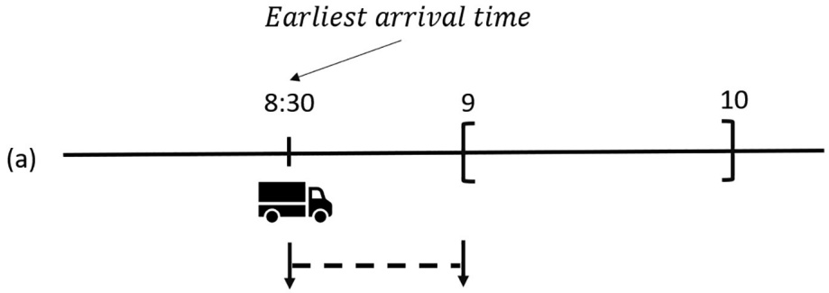
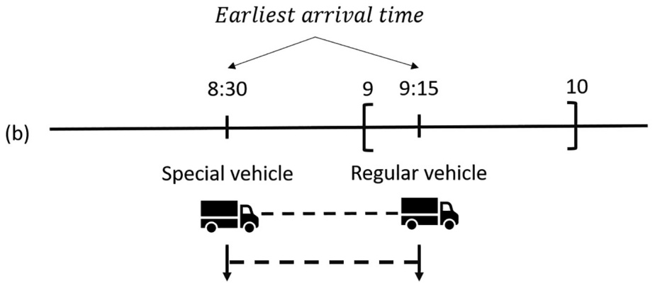
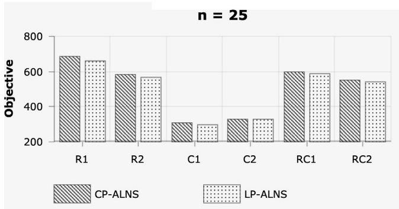
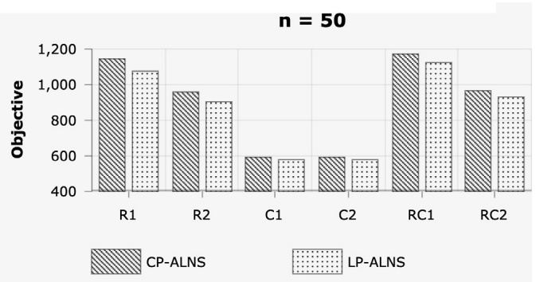
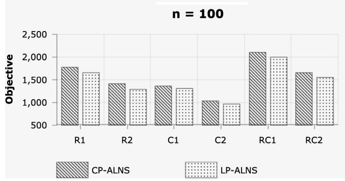
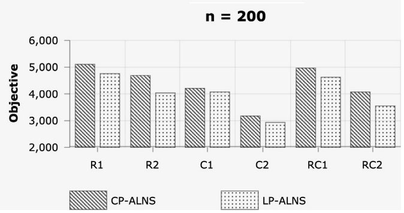
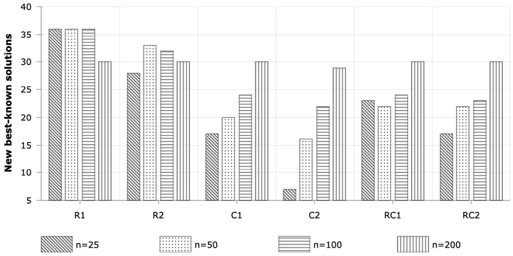

# A new constraint programming model and a linear programming-based adaptive large neighborhood search for the vehicle routing problem with synchronization constraints

Minh Hoàng Hà a,⇑, Tat Dat Nguyen b, Thinh Nguyen Duy c, Hoang Giang Pham c, Thuy Do c, Louis-Martin Rousseau d

a ORLab, Faculty of Computer Science, Phenikaa University, Hanoi, Viet Nam

b ORLab, Faculty of Information Technology, VNU University of Engineering and Technology, Hanoi, Viet Nam

c Department of Computer Science, FPT University, Hanoi, Viet Nam

d École Polytechnique de Montréal and CIRRELT, Montréal, Canada

## a r t i c l e i n f o

Article history: Received 18 October 2019 Revised 9 August 2020 Accepted 9 August 2020 Available online 18 August 2020

Keywords: Vehicle routing problem Time window Synchronization constraint Constraint programming Adaptive large neighborhood search

## a b s t r a c t

We consider a vehicle routing problem which seeks to minimize cost subject to time window and synchronization constraints. In this problem, the fleet of vehicles is categorized into regular and special vehicles. Some customers require both vehicles’ services, whose service start times at the customer are synchronized. Despite its important real-world application, this problem has rarely been studied in the literature. To solve the problem, we propose a Constraint Programming (CP) model and an Adaptive Large Neighborhood Search (ALNS) in which the design of insertion operators is based on solving linear programming (LP) models to check the insertion feasibility. A number of acceleration techniques is also proposed to significantly reduce the computational time. The computational experiments show that our new CP model finds better solutions than an existing CP-based ALNS, when used on small instances with 25 customers and with a much shorter running time. Our LP-based ALNS dominates the CP-based ALNS, in terms of solution quality, when it provides solutions with better objective values, on average, for all instance classes. This demonstrates the advantage of using linear programming instead of constraint programming when dealing with a variant of vehicle routing problems with relatively tight constraints, which is often considered to be more favorable for CP-based methods. We also adapt our algorithm to solve a well-studied variant of the problem, and the obtained results show that the algorithm provides good solutions as state-of-the-art approaches and improves four best known solutions.

Crown Copyright  2020 Published by Elsevier Ltd. All rights reserved.

## 1. Introduction

Most of the requirements related to our daily routines are made by a service provider coming to our premises. These types of services can be home care delivery, maintenance operations, public utilities, etc. In such services, efficient delivery and timely service play important roles. This is why the class of the Vehicle Routing Problem, coupled with the Scheduling Problem, comprises a large class of problems with many variations and applications. The main focus of this research is to study the Vehicle Routing Problem with Synchronization Constraints (VRPSC), where both time window and synchronization constraints are present. In the latter constraints, some customers may require the service of two vehicles whose service start times at the customer must be synchronized.

In a recent industrial project with an Internet Service Provider (ISP) in Vietnam, the authors witnessed several contexts where synchronization constraints arose. The ISP company has to perform installation services for new subscribers and maintenance services for subscribed clients. Both services are performed by technicians who mainly use motorbikes for travelling. In many cases, a customer asks for services by two technicians belonging to two different teams: one being the ‘‘physical” team, which takes charge of the hardware (cable wire, modem, etc.); while the other team manages the signal. To further illustrate the problem, when a customer requires a service from the physical team, two technicians must be mobilized as one helps the other with equipment set-up, such as installing a ladder and other protective gear. In addition, an intern technician, who is in a probationary period, needs to be coupled with an experienced technician at customer locations. When servicing a customer, the company requires that the service start time of both technicians be as close as possible in order to reduce their waiting time and to limit the disruption to the customer. In the case of our ISP partner, a delay of no more than 15 min is permitted. The problem was initially introduced in Hojabri et al. (2018) and can be used to model other real world applications such as home care delivery, aircraft fleet assignment, ground handling, and forest operations (see Rousseau et al., 2013 for more information).

<small>⇑ Corresponding author. E-mail address: [hoang.haminh@phenikaa-uni.edu.vn](mailto:hoang.haminh@phenikaa-uni.edu.vn) (M.H. Hà).</small>

Hojabri et al. (2018) proposed a constraint programming-based Adaptive Large Neighborhood Search (cp-ALNS) with insertion operators exploiting constraint propagation capabilities to guarantee the feasibility of a new generated solution. Different from the popular ALNS proposed in Pisinger and Ropke (2007) to solve VRPs, the cp-ALNS does not try to add all unserved requests one by one but, rather, adds all of them at once to create a new complete solution. Several removal operators were specifically designed for the problem. Numerical results are reported on instances derived from Vehicle Routing Problem with Time Window (VRPTW) benchmark instances, with up to 200 customers and 100 synchronizations.

A dynamic version of the problem was introduced in Rousseau et al. (2013) where customer requests were not foreseen, but arrived one-by-one in real time. The problem was modeled as a CP program from which a metaheuristic was designed. We note that the methods proposed in Rousseau et al. (2013) and Hojabri et al. (2018) were based on the same CP model which uses variables representing the successor of a node, AllDifferent and subtour elimination constraints introduced in Pesant et al. (1998). However, no result of the pure CP model has been reported.

Dohn et al. (2011) consider synchronization constraints defined in the same way as in the VRPSC. Their problem is called the vehicle routing problem with time windows and temporal dependencies (VRPTWTD). Unlike the VRPSC, there is only one type of vehicle in the VRPTWTD. Two compact formulations of the problem are proposed and the Dantzig–Wolfe decomposition of these formulations are used to develop a column generation-based solution approach. Four different master problem formulations are proposed and a tailored time window branching is used to force feasibility of the relaxed master problems. A computational experiment is performed to quantitatively access strengths and weaknesses of the proposed formulations.

Several VRPSC variants in which a customer can require services from more than two vehicles are also studied in the literature. Labadie et al. (2014) study a VRPSC variant with simultaneous synchronization constraints where a service center (the depot) offers several types of services and customers may demand more than one service to be provided simultaneously. To solve this problem, a mixed integer programming model and a local search-based metaheuristic are developed. In the local search procedure, the service start time at the customers requiring synchronized visits is fixed to the values in the input solution.

Several articles Bredström and Rönnqvist (2008), Rasmussen et al. (2012), Afifi et al. (2016), Liu et al. (2019) and Parragh and Doerner (2018) study a different variant of the VRPSC in which the synchronized customers must be serviced at exactly the same time and the fleet of vehicles is homogeneous (only one type of vehicles). In the following, we call this variant as the VRP with time windows and synchronized visits (VRPTWSyn). Bredström and Rönnqvist (2008) consider the problem arising in the context of home care crew scheduling. The problem is first formulated as a mixed integer programming (MIP) model that sets pairwise synchronization and pairwise temporal precedence between customer visits. It is then solved through a MIP-based heuristic. Rasmussen et al. (2012) solve a similar problem with an exact branch-and-price algorithm. Due to the application context, there is no capacity constraint and specific issues about home care crews are taken into account, in addition to the synchronization requirements, like care giver preferences, customer priority, and the ability of a particular care giver to serve a given customer. Also, not all customers must be serviced because visits can be rescheduled or canceled.

Based on the special requirement that synchronized customers must be serviced at exactly the same time, several authors design metaheuristics with efficient components to tackle the problem. To handle this special version of the synchronization constraint, they prohibit cross-synchronization, e.g. visiting u then v by a vehicle, visiting i then j by another vehicle, and finally realizing that u and j are the same customer as well as v and i. Afifi et al. (2016) propose a simulated annealing algorithm with dedicated local searches (SA-ILS). They use a reduced solution that contains only the synchronization visits to filter out cross synchronizations from the set of possible positions for insertions during solution construction and local search phases. Based on a similar idea, Liu et al. (2019) propose an ALNS and use a square matrix to record the visit sequence among each pair of visited special customers. Applying the cross-synchronization idea to the VRPSC to handle its more general synchronization constraint can remove feasible good neighborhoods, decreasing the performance of our metaheuristics. Thus, the adaptation of the metaheuristics proposed in Afifi et al. (2016) and Liu et al. (2019) for the VRPSC problem would not be efficient. Recently, Parragh and Doerner (2018) evaluate several different ways to deal with pairwise synchronization constraints in the context of two problems: the VRPTW with pairwise synchronization, and the service technician routing and scheduling problem. They propose three ways to address the synchronization requirement: individual synchronized timing optimization; global synchronized timing optimization; and adaptive time window. The idea of the first two approaches is to keep the ALNS untouched, while the last one makes some modifications to the insertion scheme in order to identify good service start times for synchronized visits.

In Fink et al. (2019), a new variant arising in the context of airport ground handling, named abstract vehicle routing problem with worker and vehicle synchronization (AVRPWVS), is studied. The AVRPWVS deals with routing workers to ground handling jobs such as unloading baggage or refuelling an aircraft. Each job has a time window and can be performed by a variable number of workers. A worker can use vehicles to travel between locations or can be moved with other workers by a driver. Two mathematical multi-commodity flow formulations based on time–space networks are proposed to model synchronization constraints including movement and load synchronization. Moreover, the authors develop a branch-and-price heuristic that employs both conventional variable branching and a novel variable fixing strategy. More recently, Sarasola and Doerner (2020) consider a variant of the VRP with synchronization constraints in which multiple depots are considered and a customer can require more than two deliveries. The problem requires that the allowed amount of non-service time between the first and last delivery to a customer does not exceed a given value. This synchronization constraint can be seen to be more general than the one considered in the VRPSC because a customer can request the service of more than two vehicles. However, there is no time window associated with either customers or deliveries.

Pillac et al. (2018) introduce a Dynamic Technician Routing and Scheduling Problem (D-TRSP) which deals with a limited crew of technicians serving a set of requests. In the D-TRSP, each technician has a set of skills, tools and spare parts required by each request. In addition to designing a route at the beginning of each day, two types of decisions must be managed in real time. First, whenever a new request appears, we must decide whether it is accepted or not. And second, whenever a technician finishes serving a request, we need to find the next request to serve. For a survey on further synchronization issues in the context of vehicle routing problems, we refer the readers to Drexl (2012).

Our main contributions are as follows: we propose a new CP model to address the VRP with time windows and synchronization constraints, as well as a linear programming-based ALNS. Different from the CP model in the literature, our CP uses sequence and interval variables of IBM ILOG CP Optimizer (IBM Software, 2015) to formulate the problem. The most notable feature of our metaheuristic is that we use linear programming and a number of acceleration techniques to quickly check the feasibility of insertion operations integrated in the popular ALNS (Pisinger and Ropke, 2007). This is the first time LP models are used instead of CP to design the ALNS algorithm for the VRP with synchronization constraints. The computational experiments carried on the benchmark data show the good performance of our methods. More precisely, our CP model can provide better solutions on small-size instances than the cp-ALNS of Hojabri et al. (2018) in a much shorter running time. Our lp-ALNS dominates the cp-ALNS in terms of solution quality, as it improves 620 out of 681 best known solutions. When being adapted to solve the VRPTWSyn, it is competitive to state-of-the-art metaheuristics in terms of solution quality and find four new best known solutions.

The remainder of the paper is organized as follows: Section 2 introduces the problem definition and our new CP model; the detailed description of lp-ALNS is provided in Section 4; experimental results are reported in Section 5; and finally, we conclude our work in Section 6.

## 2. Problem definition and a mixed integer programming model

The problem may be formally defined as follows. We have a directed graph $G = ( V , A )$ , where $V = \{ \nu _ { 0 } \} \cup V _ { s } \cup \overline { { V } }$ is the set of vertices representing customer locations and A is the set of arcs. The vertex $v _ { 0 }$ is the depot where a set of vehicles K is located. Vehicles in set K are again divided into two sub-sets: regular vehicles (set $K _ { r } )$ and special vehicles (set $K _ { s } )$ . All regular vehicles have capacity Q. V is the set of regular customers which are visited by regular vehicles only while $V _ { s }$ is the set of special customers, where each requires the visits of both types of vehicle. Let $V _ { s } ^ { c }$ be the set of vertices that are copies of special customers $V _ { s } .$ Let $V _ { r }$ be defined as $V _ { r } = \overline { { V } } \cup V _ { s } ^ { c } ,$ which is the set of customer vertices that must be visited by regular vehicles. Each vertex i in $V _ { s }$ is associated with a demand $q _ { i } .$ Let $\nu _ { 0 } ^ { b }$ and $\nu _ { 0 } ^ { e }$ be the vertices where the vehicle starts and ends its route. Note that these two vertices have the same location as $v _ { 0 }$ . Additionally, we define $V _ { r } ^ { + } = V _ { r } \cup \left\{ v _ { 0 } ^ { b } \right\} \cup \left\{ v _ { 0 } ^ { e } \right\}$ the set of vertices appearing on routes of regular vehicles; and $V _ { s } ^ { + } = V _ { s } \cup \{ v _ { 0 } ^ { b } \} \cup \widetilde { \{ v _ { 0 } ^ { e } \} }$ the set of vertices visited by special vehicles. A service time $\dot { h } _ { i } ^ { l }$ is associated with vertex $i \in V _ { l } ^ { + } , l \in \{ r , s \}$ Note that the service times at the depot and its copies are set to 0. A time window $[ o _ { i } , u _ { i } ]$ is imposed on each vertex $i \in V _ { r } ^ { + } \setminus \left\{ v _ { 0 } ^ { b } \right\}$ Finally, each arc $( i , j ) \in A$ is associated with non-negative values $c _ { i j } ^ { l }$ and $t _ { i j } ^ { l }$ representing the travel cost, which can be estimated by distance or all moving expenses, and travel time from vertex i to vertex j for a vehicle of type l.

The problem then consists in constructing routes for the fleet of vehicles such that the total travel cost incurred by the fleet of vehicles is minimized and the following constraints are satisfied:

\- Each vehicle must begin its route at the depot, deliver services to customers and finally return to the depot.

\- Each regular customer is served by exactly one regular vehicle.

\- Each special customer is served by exactly one regular vehicle and one special vehicle.

\- The total demand serviced by a regular vehicle must not exceed its capacity Q.

\- A regular vehicle must start its service at a vertex $i \in V _ { r } ^ { + } \setminus \left\{ \nu _ { 0 } ^ { b } \right\}$ within the time window oi; ui ½ .

\- The service start time at a special customer $i \in V _ { s }$ visited by a special vehicle must be within a time window $\left[ t _ { m _ { i } } - \alpha _ { i } , t _ { m _ { i } } + \beta _ { i } \right]$ . Here, $\alpha _ { i }$ and $\beta _ { i }$ are given parameters representing a possible delay between regular and special services at customer i, while $t _ { m _ { i } }$ is the service start time at vertex mi (mirror of i in the regular vehicle route).

Several mixed integer programs have been proposed for variants of the VRPSC in Bredström and Rönnqvist (2008), Afifi et al. (2016) and Parragh and Doerner (2018). However, we have not seen any MIP formulation for the VRPSC itself. In the following, we introduce a MIP that can be used to solve small-size VRPSC instances to optimality. There are two types of variables in our formulation as follows:

$x _ { i j } ^ { k } \colon$ binary variables equal to 1 if vehicle $k \in K _ { l }$ travels from vertex i 2 $V _ { l } ^ { + }$ to vertex $j \in V _ { l } ^ { + } , l \in \{ r , s \} ;$ equal to 0 otherwise.

$y _ { i } ;$ service start time at which vertex $i \in V _ { r } ^ { + } \cup V _ { s } ^ { + }$ is serviced.

The VRPSC can be stated as:

$$
\text {Minimize} \quad \sum_ {l \in \{r, s \}} \sum_ {k \in K _ {l}} \sum_ {i \in V _ {i} ^ {*}} \sum_ {j \in V _ {i} ^ {*}: j \neq i} c _ {i j} ^ {l} x _ {i j} ^ {k}\tag{1}
$$

$$
\text {Subject to} \sum_ {k \in K _ {i j}} \sum_ {j \in V _ {l} ^ {+}} x _ {i j} ^ {k} = 1 \quad \forall l \in \{r, s \}, i \in V _ {l} ^ {+}: i \neq j\tag{2}
$$

$$
\sum_ {i \in V _ {0} ^ {j}: j \neq v _ {0} ^ {b}} x _ {v _ {0} ^ {b} j} ^ {k} = 1 \quad \forall l \in \{r, s \}, k \in K _ {l}\tag{3}
$$

$$
\sum_ {i \in V _ {i} ^ {e}: i \neq v _ {0} ^ {e}} x _ {i v _ {0} ^ {e}} ^ {i} = 1
$$

$$
\forall l \in \{r, s \}, k \in K _ {l}\tag{4}
$$

$$
\sum_ {j \in V _ {i} ^ {+} j \neq i} x _ {i j} ^ {k} = \sum_ {j \in V _ {i} ^ {+} j \neq i} x _ {j i} ^ {k}
$$

$$
\forall l \in \{r, s \}, k \in K _ {l}, i \in V _ {l} ^ {+}\tag{5}
$$

$$
\sum_ {i \in V _ {r}} \sum_ {j \in V _ {r} ^ {+}, j \neq i} q _ {i} x _ {i j} ^ {k} \leqslant Q
$$

$$
\forall k \in K _ {r}\tag{6}
$$

$$
y _ {i} + \left(h _ {i} ^ {l} + t _ {i j} ^ {l}\right) x _ {i j} ^ {k} - M \left(1 - x _ {i j} ^ {k}\right) \leqslant y _ {j}
$$

$$
\forall l \in \{r, s \}, k \in K _ {l}, i \in V _ {l} ^ {+}, j \in V _ {l} ^ {+}: i \neq j
$$

$$
o _ {i} \leqslant y _ {i} \leqslant u _ {i} \quad \forall i \in V _ {r} ^ {+} \setminus \left\{v _ {0} ^ {b} \right\}\tag{7}
$$

$$
y _ {m _ {i}} - \alpha_ {i} \leqslant y _ {i} \quad \forall i \in V _ {s}\tag{8}
$$

$$
\left| y _ {i} \leqslant y _ {m _ {i}} + \beta_ {i} \quad \forall i \in V _ {s} \right.\tag{9}
$$

(10)

$$
x _ {i j} ^ {k} \in \{0, 1 \} \quad \forall k \in K _ {l}, l \in \{r, s \}, i \in V _ {l} ^ {+}, j \in V _ {l} ^ {+}: i \neq j\tag{11}
$$

$$
y _ {i} \geqslant 0
$$

$$
\forall i \in V _ {r} ^ {+} \cup V _ {s} ^ {+}\tag{12}
$$

The objective function (1) minimizes the total travel cost. Constraints (2) ensure that each vertex is visited by exactly one vehicle. Constraints (3) and (4) force vehicles to begin and end their route at the depot. The flow conservation is satisfied by Constraints (5) while the capacity requirement of each regular vehicle is found in (6). Constraints $( 7 )$ represent the relationship between variables y and x. More precisely, they compute the service start time at vertex j based on vertex i if the vehicle travels from i to $j .$ Here, M is a very large number, and can set to $M = u _ { v _ { 0 } ^ { e } } .$ Constraints (8) are time window constraints. Synchronization requirements are respected by Constraints (9) and (10). Finally, Constraints (11) and (12) define the variables’ domains.

## 3. A new constraint programming model

We now present the new CP model for the problem. First, it is worth mentioning that unlike MIP formulations, there is no standard in CP formulation because it strongly depends on each CP package. In this study, we formulate the model using generic keywords and syntaxes of IBM ILOG CP Optimizer (IBM Software, 2015) adapted from the CP formulations proposed in Philippe (2009), Ghedira (2013), Vikas et al. (2015) and Ham (2018). Our model uses the following variables:

Itvli interval variable that represents the time interval of size $h _ { i } ^ { l }$ for the visit of vertex $i \in V _ { l } ^ { + } , l \in \{ r , s \} ;$

$I t \nu A l t _ { i k } ^ { l }$ optional interval variable that represents the time interval for the visit of vehicle $k \in K _ { l }$ at vertex $i \in V _ { l } ^ { + } , l \in \{ r , s \} ;$ ;

$S e q _ { k } ^ { l }$ sequence variable that represents all working time intervals of vehicle $k \in K _ { l } , l \in \{ r , s \}$ ;

An interval variable represents the interval of time during which a task can occur. It contains a starting point, an end point, a size, and it can be optional. A decision variable is used to represent whether or not an interval is present. If an interval is marked as optional, it may be absent in the solution. Sequence is a type of variable in IBM ILOG OPL which can be empty or can contain a subset of variables. A sequence represents all intervals that are present in the solution. The constraints in our model are as follows:

1. Function to link each interval to a location.

$$
\textbf {t y p e} \text {function} \theta \left(\operatorname{Seq} _ {k} ^ {l}, \operatorname{It} \nu \operatorname{Alt} _ {i k} ^ {l}\right) = i \quad \forall i \in V _ {l} ^ {+}, k \in K _ {l}, l \in \{r, s \}\tag{13}
$$

A non-negative integer value h is defined for each pair $( S e q _ { k } ^ { l } , I t \nu A l t _ { i k } ^ { l } ) , \quad l \in \{ r , s \}$ , to indicate the type of the interval variable in a sequence. This value will be used in **noOverlap** constraints as shown below.

2. Each customer must be served by one vehicle of the corresponding type.

$$
\text {alternative} \left(I t v _ {i} ^ {l}, I t v A l t _ {i k} ^ {l}: k \in K _ {l}\right) \quad \forall i \in V _ {l} ^ {+}, l \in \{r, s \}\tag{14}
$$

The **alternative** function ensures that exactly one set of intervals $I t \nu A l t _ { i k } ^ { l }$ is present in the solution; and interval variable starts and ends together with the interval variable $I t \nu _ { i } ^ { l } .$

3. Travel time between two customers must be taken into account. In the following, $T _ { l } \in \left\{ t _ { i j } ^ { l } \right\}$ is the matrix representing travel times between two vertices i and j in the set $V _ { l } ^ { + }$

$$
\boldsymbol {\text {noOverlap}} \left(\operatorname{Seq} _ {k} ^ {l}, T _ {l}\right) \quad \forall k \in K _ {l}, l \in \{r, s \}\tag{15}
$$

The **noOverlap** constraint on sequence variable $S e q _ { k } ^ { l }$ states that the sequence defines a chain of non-overlapping intervals, and any interval in the chain is constrained to end before the start of the next interval in the chain. For each **noOverlap** constraint, a transition matrix Tl is used to define the minimal non-negative distance separating consecutive intervals in a sequence. For example, if interval $I t \nu A l t _ { i k } ^ { l }$ appears before interval $I t \nu A l t _ { j k } ^ { l }$ in the sequence $S e q _ { k } ^ { l }$ , a minimal distance $t _ { \theta _ { i } \theta _ { j } } ^ { l }$ must be respected between the end of $I t \nu A l t _ { i k } ^ { l }$ and the start of $I t \nu A l t _ { j k } ^ { l }$ , where $\theta _ { i }$ and $\theta _ { j }$ denote the types of $I t \nu A l t _ { i k } ^ { l }$ and $I t \nu A l t _ { j k } ^ { l }$ in the sequence $S e q _ { k } ^ { l }$

4. All vehicles start their route at the starting depot.

$$
\boldsymbol {\text {first}} \left(\operatorname{Seq} _ {k} ^ {l}, \operatorname{It} v \operatorname{Alt} _ {v _ {0} ^ {b} k} ^ {l}\right) \quad \forall k \in K _ {l}, l \in \{r, s \}\tag{16}
$$

$\pmb { f i r s t } ( p , j )$ function states that if interval j is present, it will be the first interval in the sequence $p .$ These constraints force each vehicle to start it route at vertex $\nu _ { 0 } ^ { b }$ .

5. All vehicles finish their routes at the corresponding ending depot.

$$
\boldsymbol {\text {last}} \left(\operatorname{Seq} _ {k} ^ {l}, \operatorname{It} v \operatorname{Alt} _ {v _ {0} ^ {e} k} ^ {l}\right) \quad \forall k \in K _ {l}, l \in \{r, s \}\tag{17}
$$

Similar to $\mathbf { \mathit { f i r s t } } ( p , j )$ function, last( $[ p , j )$ function states that if interval j is present, it will be the last interval in the sequence $p .$ These constraints are to force each vehicle to finish its route at ending depot $\nu _ { 0 } ^ { e } .$

6. Time window constraints.

$$
\mathrm{o} _ {i} \leqslant \text {startOf} \left(\operatorname{It} v _ {i} ^ {r}\right) \leqslant u _ {i} \quad \forall i \in V _ {+} ^ {r} \setminus \left\{v _ {0} ^ {b} \right\}\tag{18}
$$

**startOf**ð Þj represents the start of interval j whenever the interval variable j is present.

7. Capacity constraints.

$$
\sum_ {i \in V _ {r}} q _ {i}. \text {presenceOf} \left(I t v A l t _ {i k} ^ {r}\right) \leqslant Q \quad \forall k \in K _ {r}\tag{19}
$$

**presenceOf**ð Þj is equal to 1 if interval variable j is present in the solution, 0 otherwise.

8. Synchronization constraints.

$$
\mathbf {s t a r t O f} \left(I t v _ {m _ {i}} ^ {r}\right) - \alpha_ {i} \leqslant \mathbf {s t a r t O f} \left(I t v _ {i} ^ {s}\right) \quad \forall i \in V _ {s}\tag{20}
$$

$$
\text {startOf} \left(\operatorname{It} v _ {i} ^ {s}\right) \leqslant \text {startOf} \left(\operatorname{It} v _ {m _ {i}} ^ {r}\right) + \beta_ {i} \quad \forall i \in V _ {s}\tag{21}
$$

We compute the total cost traveled by a vehicle of type $l \in \{ r , s \}$ as follows:

$$
\text {Cost} _ {k} ^ {l} = \sum_ {i \in V _ {l} ^ {+}} c _ {i j} ^ {l} \forall k \in K _ {l} \text {where} \quad j = \text {typeOfNext} \left(\operatorname{Seq} _ {k} ^ {l}, \operatorname{It} v \operatorname{Alt} _ {i k} ^ {l}, i, i\right)
$$

Then the objective function can be written as:

$$
\text {Minimize} \sum_ {l = \{r, s \}} \sum_ {k \in K _ {l}} \text {Cost} _ {k} ^ {l}\tag{22}
$$

## 4. Linear programming-based adaptive large neighborhood search algorithm

To tackle the VRPSC problem, we designed an Adaptive Large Neighborhood Search (ALNS) heuristic, which is based on the Large Neighborhood Search (LNS) introduced by Paul (1998). At each iteration, LNS explores a large neighborhood, which can rearrange a large part of the current solution, therefore allowing the search to move to other promising regions of the search space.

More precisely, LNS decomposes the original problem by unfixing some decision variables, leading to a partial solution. The unfixed decision variables define a neighborhood of solutions that can be explored by a specific procedure via, possibly, a heuristic or a Mixed Integer Programming (MIP) solver. If the procedure finds an improved solution, it becomes the new current solution and a new large neighborhood is defined around it. This process is repeated until a stopping criterion is reached.

A first key point is the selection of fixed variables to create a partial solution. In fact, the number of fixed variables impacts the size of the neighborhood (the more fixed variables, the narrower the neighborhood). A common strategy is to dynamically vary the number of removed variables. A second key point lies in the selection of fixed/removed variables which can be based on a random choice or a more sophisticated strategy to guide the search. Finally, the procedure that explores the neighborhood should provide good quality solutions in a short amount of time. Adaptive Large Neighborhood Search is an extension of LNS with a number of different insertion and removal operators. In comparison with LNS, a component that adaptively chooses among a set of removal and insertion operators is added to the algorithm. The pseudo-code of a ALNS to solve problems with minimizing objective function is shown in Algorithm 1. At each iteration, a randomly selected pair of operators (with procedures SelectDestruction and SelectRepair, lines 5 and 6) is applied to the current solution (line 7), with probabilities $p ^ { r e m o v e } , p ^ { i n s e r t }$ for the set of removal and insertion operator, respectively. These probabilities are updated by a learning process (line 12). The more an operator i has contributed to the solution quality, the larger its probability $p _ { i }$ of being chosen.

Create an initial solution $sol$
$s_{best} := sol$
Initialize $p^{remove}$ and $p^{insert}$
while the stop-criterion is not met do
    $re := \text{SelectRemoval}(p^{remove})$
    $in := \text{SelectInsertion}(p^{insert})$
    solution $sol' = \text{GenerateNewSolution}(sol, re, in)$
    if $cost(sol') &lt; cost(s_{best})$ then
        $s_{best} := sol'$
    if $accept(sol', sol)$ then
        $sol := sol'$
    update $p^{remove}$ and $p^{insert}$
return $s_{best}$

## 4.1. Insertion operators

## 4.1.1. Cheapest insertion heuristic

The purpose of the insertion operation is to reinsert unserviced requests into the solution. For this task, one can use the cheapest insertion heuristic which inserts the customer into a route at a feasible position making the objective value increase the least. The process is repeated until all customers are serviced or no more customers can be inserted. Note that the customers are considered in the order determined by their cheapest insertion position. The insertion cost of a regular customer j into a regular route positioned between two consecutive vertices i and i þ 1 (denoted by $I C _ { k } ^ { r } )$ is computed as:

$$
IC _ {j} ^ {r} = c _ {i j} ^ {r} + c _ {j (i + 1)} ^ {r} - c _ {i (i + 1)} ^ {r}\tag{23}
$$

Whenever a special customer is considered for insertion, it will be added to two positions: one on a regular route and another on a special route. This must be incorporated when computing the insertion cost of special customers. The average value is used to compute the insertion cost of a special customer j at positions between vertices i and $i + 1$ on a regular route and between vertices i0 and $i ^ { \prime } + 1$ on a special route as follows:

$$
I C _ {j} ^ {s} = \frac {\left(c _ {i m _ {j}} ^ {r} + c _ {m _ {j} (i + 1)} ^ {r} - c _ {i (i + 1)} ^ {r}\right) + \left(c _ {i ^ {\prime} j} ^ {s} + c _ {j \left(i ^ {\prime} + 1\right)} ^ {s} - c _ {i ^ {\prime} \left(i ^ {\prime} + 1\right)} ^ {s}\right)}{2}\tag{24}
$$

It is worth noting that, using the pure summation to compute $I C _ { j } ^ { s }$ could make the insertion cost of the special customers higher than that of the regular customers. Therefore, we use the average value to avoid the situation where the regular customers are always added before the special ones.

## 4.1.2. Regret heuristics

As in Pisinger and Ropke (2007), we also use regret-k heuristics as repair operators. Instead of selecting the customer with the least insertion cost in each construction step, the regret heuristics select the customer with the highest regret-k value, computed as follows: we denote $f _ { i j }$ the insertion cost when inserting customer i at its best position in route j. If this insertion is infeasible w.r.t time window and synchronization constraints, the insertion cost is set to infinity, i.e. $f _ { i j } = \infty$ . Let $r _ { i k }$ be the route where vertex i has the k-th lowest insertion cost. The regret-k value $R V _ { i }$ of customer i is then calculated as:

$$
R V _ {i} = \sum_ {j = 1} ^ {k} \left(f _ {(i, r _ {i j})} - f _ {(i, r _ {i 1})}\right)\tag{25}
$$

The regret-k heuristics chooses the unvisited customer i with the highest regret-k value $R V _ { i }$ and insert it into the feasible position leading the least insertion cost. Ties are broken by selecting customers with the lowest insertion cost $f _ { ( i , r _ { i 1 } ) } .$ Informally speaking, we choose the customer that leads to the largest regret, if it is not inserted right now. If it happens that some vertices can be feasibly inserted in less than k routes in the current solution, then the vertex with the fewest number of feasible routes is selected. This ensures that the vertex which does not have many insertion options in the current solution will be considered first.

It can be observed that the cheapest insertion heuristic, which we mentioned earlier, is a special case of the regret heuristic with $k = 1$ due to the tie-breaking rule. For any $k > 1$ , the regret heuristic looks further into future solutions to decide the choice of insertion. In this research, we use the regret heuristics with k 2 f g 2; 3 to design insertion operators for our ALNS.

## 4.1.3. Checking insertion feasibility of regular customers

When inserting a vertex into a position of the current partial solution, it is required to verify if the insertion satisfies the capacity, time window and synchronization constraints. As the insertion operation is repeated multiple times during the search, designing a quick verification procedure is critical to speed up the overall algorithm. As the capacity constraint is easily checked in $\mathcal { O } ( 1 ) ,$ we focus on the time window and synchronization constraints only. Verifying the feasibility of an insertion operation w.r.t these constraints are more complex because they delay subsequent visits leading to other violations. As proposed in Kindervater and Savelsbergh (1997), the time window constraint can be checked in Oð Þ 1 by pre-computing the maximum delay (push forward) that is allowed at each arc of the current solution, without violating time windows. In this research, we also reuse this idea to handle both time window and synchronization constraints when inserting regular vertices.

Given a partial solution, in order to consider all possible positions to insert an unserved regular customer i into the routes of a partial solution, we calculate the maximum duration of time (also called maximum delay) that can be spared after a vehicle finishes serving vertex j  1 and before it starts to serve next vertex j without violating any constraints at the following vertices. This value is denoted $\delta _ { a } ,$ where $a = ( j - 1 , j )$ represents the arc from j  1 to j. We calculate the maximum delays at all the arcs of the current solution using the following linear programming model:

Let $\overline { { V _ { r } } }$ and $\overline { { V _ { s } } }$ be the set of all vertices visited by regular and special vehicles in current solution sol, respectively. Denote $\overline { { A } } = A _ { r } \cup A _ { s }$ the set of arcs forming the routes in sol; Ar and As are the sets of arcs on regular and special routes, respectively. We use two types of variables: $\tau _ { i }$ is the service start time at vertex i and $\delta _ { a }$ is the maximum delay on arc $a = ( j - 1 , j )$

ð Þ F1 Maximize da

(26)

$$
\text {Subject to} \quad o _ {i} \leqslant \tau_ {i} \leqslant u _ {i} \quad \forall i \in \overline {{V _ {r}}}\tag{27}
$$

$$
- \alpha_ {i} \leqslant \tau_ {i} - \tau_ {m _ {i}} \leqslant \beta_ {i} \quad \forall i \in \overline {{V _ {s}}} \tag {1}\tag{28}
$$

$$
\tau_ {i - 1} + h _ {i - 1} ^ {l} + t _ {(i - 1, i)} ^ {l} \leqslant \tau_ {i} \quad \forall (i - 1, i) \in A _ {l} \setminus \{a \}, l \in \{r, s \}\tag{29}
$$

$$
\tau_ {j - 1} + h _ {j - 1} ^ {r} + t _ {(j - 1, j)} ^ {r} \delta_ {(j - 1, j)} \leqslant \tau_ {j}\tag{30}
$$

$$
\tau_ {i} \geqslant 0 \quad \forall i \in \overline {{V _ {r}}} \cup \overline {{U _ {s}}}
$$

$$
\delta_ {a} \geqslant 0\tag{31}
$$

(32)

Objective (26) is to maximize the maximum delay on arc a. Constraints (27) and (28) respectively ensure time window and synchronization constraints at all vertices of the current solution. Constraints (29) represent the relationship between the starting times at vertices ð Þ i  1 and i when a vehicle travels from ð Þ i  1 to i. Constraint (30) has the same meaning as constraints (29) but is written for arc a. Finally, constraints (31) and (32) define the domain of variables.

After all the maximum delays are available, we check if an unserved regular vertex i can be inserted at the position between vertex j  1 and vertex j by computing the earliest arrival time (arrivalTime) and the waiting time (waitTime) at i as follows:

arrivalTimei ¼ sj1 þ hrj1 þ trð Þ j1 i

waitTimei ¼ max oi  arrivalTimei ð Þ ; 0

Finally, we check if feasibility of the insertion satisfies the following constraints:

$$
t _ {(j - 1) i} ^ {r} + t _ {i j} ^ {r} - t _ {(j - 1) j} ^ {r} + \text {waitTime} _ {i} + h _ {i} ^ {r} \leqslant \delta_ {(j, j)}\tag{33}
$$

$$
\text {arrivalTime} _ {i} \leqslant u _ {i}\tag{34}
$$

Constraint (33) ensures that the insertion does not lead to a violation of time window and synchronization constraints at all the following customers in the current solution. Constraint (34) verifies the time window constraint of vertex i.

Although it is fast to solve a LP model of type (F1), the running time of the insertion operators is still expensive due to the large quantity of LP models solved during the search. Through observation, we note that constructing the model to find the maximum delay on each arc takes more computational time than solving it. Thus, we propose the following model to reduce the running time of the insertion operators:

$$
\text {Maximize} \quad \sum_ {a \in \bar {A}} \varpi_ {a} \delta_ {a} \tag {F2}\tag{35}
$$

Subject to ð Þ 27 ; ð Þ 28 ; ð Þ 31

$$
\tau_ {i - 1} + h _ {i - 1} ^ {l} + t _ {(i - 1, i)} ^ {l} + \delta_ {(i - 1, i)} \quad \leqslant \tau_ {i} \quad \forall (i - 1, i) \in A _ {l}, l \in \{r, s \}\tag{36}
$$

$$
\delta_ {a} \geqslant 0 \quad \forall a \in \overline {{A}}\tag{37}
$$

Objective (35) is to maximize the weighted maximum delay at all arcs of the solution. Here, $\varpi _ { a }$ is a given binary coefficient representing the weight of arc $a \in { \overline { { A } } } ,$ Constraints (36) indicate the relationship between variables d and s. To find the maximum delay on an arc a, we just need to set its weight $\varpi_{a}$ to 1 and weights of other arcs to 0. The proposed model (F2) allows us to save a lot of time by constructing a model once and then creating a new one by changing two coefficients in the objective function only. As a result, we can avoid constructing multiple models from scratch. A preliminary experiment shows that using this method helps reduce the running time of the overall algorithm by at least 30%. After each model calculates the maximum delay of arc $( j - 1 , j )$ , the value of variables $\tau _ { j - 1 } , \tau _ { j } ,$ and $\delta _ { ( j - 1 , j ) }$ are also saved for checking insertion feasibility of special customers, as described in the following section.

## 4.1.4. Checking insertion feasibility of special customers

Whenever a special customer is selected to be added into the current solution, it will be inserted in two positions: one in regular route and the other in a special route. Multiple insertion operations make it impossible to use the maximum delay for feasibility verification purposes. However, we can still utilize the computed maximum delays to quickly filter out infeasible insertions as follows.

As mentioned above, after solving each model to obtain the maximum delay on an arc $( j - 1 , j )$ , the service start times of vertices j  1 and j or, in other words, the values of $\tau _ { j - }$ 1 and $\tau _ { j }$ are saved. $\tau _ { j - 1 }$ can be seen as the earliest time vertex j  1 can be serviced while $\tau _ { j }$ can be seen as the latest time vertex j can be serviced. To avoid misunderstanding these notations, we denote $\tau _ { j - 1 }$ as $e t _ { j - 1 }$ and $\tau _ { j }$ as $l t _ { j } .$ . Using these saved values, we can quickly check if special vertex i and its mirror mi cannot be inserted on arc $\boldsymbol { a } _ { s } = ( \boldsymbol { j } _ { s } - 1 , \boldsymbol { j } _ { s } )$ of a special route and arc $\boldsymbol { a } _ { r } = ( \boldsymbol { j } _ { r } - 1 , \boldsymbol { j } _ { r } )$ of a regular route, respectively. First, the lower bound (denoted by lb) and upper bound (denoted by ub) of arrival times at mi when being inserted on arc ar and i when being inserted on arc as are computed as follows:

$$
\begin{array}{l} l b _ {m _ {i}} = e t _ {j _ {r} - 1} + h _ {j _ {r} - 1} ^ {r} + t _ {j _ {r} - 1, m _ {i}} ^ {r} \\ u b _ {m _ {i}} = l t _ {j _ {r}} - h _ {m _ {i}} ^ {r} - t _ {m _ {i}, j _ {r}} ^ {r} \\ l b _ {i} = e t _ {i} + h _ {j _ {s} - 1} ^ {s} + t _ {j _ {s} - 1, i} ^ {s} \\ u b _ {i} = l t _ {j _ {s}} - h _ {i} ^ {s} - t _ {i, j _ {s}} ^ {s} \end{array}
$$

It can be seen that the synchronization constraints will be violated in the following two cases:

$$
l b _ {i} - u b _ {m _ {i}} > \beta_ {i} \quad \text {or} \quad u b _ {i} - l b _ {m _ {i}} <   - \alpha_ {i}\tag{38}
$$

The insertions of i and $m _ { i }$ also need to satisfy the time window constraint at vertex mi and the maximum delays computed from the model (F2). Thus, we can utilize this property to rapidly verify the feasibility of insertions. Unlike regular vertices, possible waiting times at i and $m _ { i }$ are created not only by time window constraints, but also by synchronization constraints. The lower bounds of waiting times created by time window (waitTimetwj ) and synchronization (waitTimesync) at a vertex j can be computed as follows:

$$
\left| \begin{array}{l} \text {waitTime} _ {m _ {i}} ^ {\mathrm{tw}} = \max \left(0, o _ {m _ {i}} - l b _ {m _ {i}}\right) \\ \text {waitTime} _ {i} ^ {\mathrm{tw}} = 0 \\ \text {waitTime} _ {m _ {i}} ^ {\text {sync}} = \max \left(0, l b _ {i} - \beta_ {i} - l b _ {m _ {i}}\right) \\ \text {waitTime} _ {i} ^ {\text {sync}} = \max \left(0, l b _ {m _ {i}} - \alpha_ {i} - l b _ {i}\right) \end{array} \right|
$$

Fig. 1 illustrates the computation of waiting times when $\alpha = 0$ and $\beta = 1 0 .$ . In Fig. 1a, the vehicle arrives at the customer location before the time window and has to wait 30 min before starting delivery. In Fig. 1b, the special vehicle arrives before the regular vehicle, but it has to wait until the regular vehicle starts to service the customer because the value of a is zero. Thus, the waiting time due to the synchronization constraint, in this case, is 45 min.

Hence, we can calculate the lower bounds of waiting times at vertex j by taking the maximum value between waitTim $e _ { j } ^ { t w }$ and waitTimesync:

$$
\begin{array}{l} \text {waitTime}_{m_{i}} = \max \left(\text {waitTime}_{m_{i}}^{\mathrm{tw}}, \text {waitTime}_{m_{i}}^{\mathrm{sync}}\right) \\ \text {waitTime}_{i} = \max \left(\text {waitTime}_{i}^{\mathrm{tw}}, \text {waitTime}_{i}^{\mathrm{sync}}\right) \end{array}
$$

After all the values above are calculated, we can skip the insertions which violate one of the following constraints:

$$
\tau_ {(j, - 1) m _ {i}} ^ {r} + \tau_ {m _ {j r}} ^ {r} - \tau_ {(j, - 1) j _ {r}} ^ {r} + \text {waitTime} _ {m _ {i}} + h _ {m _ {i}} ^ {r} \leqslant \delta_ {(j, - 1, j _ {r})}\tag{39}
$$

$$
t _ {(j _ {- 1}) i} ^ {s} + t _ {y _ {s}} ^ {s} - t _ {(j _ {- 1}) j _ {s}} ^ {s} + \text {waitTime} _ {i} + h _ {i} ^ {s} \leqslant \delta_ {(j _ {- 1}, j _ {s})}\tag{40}
$$

$$
l b _ {m _ {i}} \leqslant u _ {m _ {i}}\tag{41}
$$

Waiting time due to time window = 30

Waiting time due to synchronization constraint = 45

Fig. 1. Computing waiting times due to time window and synchronization constraints.

Constraints (39) and (40) verify if the insertions satisfy the maximum delays while constraint (41) checks the time window at the regular vertex $m _ { i } .$ In addition, based on the characteristic of the kregret heuristics, we can only consider the insertions if their cost is smaller than the current k-th best insertion cost.

It is worth mentioning that validation procedures (38)–(41), which run in Oð Þ 1 if the values of the variables of each program (F2) are available, can detect plenty of infeasible insertions, thus saving a lot of run time of the algorithm. A preliminary experiment on instances with 50 customers and 25 synchronizations shows that our fast validation procedures help to increase the algorithm’s speed by up to 20 times. This ratio increases on larger instances with more synchronizations. However, if the insertion passes all the validations, we cannot ensure that the insertion is indeed feasible w.r.t the time windows and synchronization constraints. As a consequence, whenever the insertion of a special request passes the checks above, we must still examine if it does not make the solution infeasible. The following LP model (F3), which does not have any objective function, is used to check if a special vertex i can be added in arc $a _ { r } = ( j _ { r } - 1 , j _ { r } )$ on a regular route and arc $\boldsymbol { a } _ { s } = ( \boldsymbol { j } _ { s } - 1 , \boldsymbol { j } _ { s } )$ on a special route:

$$
\text {Subjectto} \quad o _ {p} \leqslant \tau_ {p} \leqslant u _ {p} \quad \forall p \in \overline {{V _ {r}}} \cup \{m _ {i} \} \tag {F3}\tag{42}
$$

$$
- \alpha_ {p} \leqslant \tau_ {p} - \tau_ {m _ {p}} \leqslant \beta_ {p} \quad \forall p \in \overline {{V _ {s}}} \cup \{i \}\tag{43}
$$

$$
\tau_ {p - 1} + h _ {p - 1} ^ {l} + t _ {(p - 1, p)} ^ {l} \leqslant \tau_ {p} \quad \forall (p - 1, p) \in A _ {l} \setminus \{a _ {l} \}, l \in \{r, s \}\tag{44}
$$

$$
\tau_ {j _ {r} - 1} + h _ {j _ {r} - 1} ^ {r} + t _ {(j _ {r} - 1, m _ {i})} ^ {r} \leqslant \tau_ {m _ {i}}\tag{45}
$$

$$
\tau_ {m _ {i}} + h _ {m _ {i}} ^ {\prime} + t _ {(m _ {i}, j _ {r})} ^ {\prime} \leqslant \tau_ {j _ {r}}\tag{46}
$$

$$
\tau_ {j _ {s - 1}} + h _ {j _ {s - 1}} ^ {s} + f _ {(j _ {s - 1}, i)} ^ {s} \leqslant \tau_ {i}\tag{47}
$$

$$
\tau_ {i} + h _ {i} ^ {s} + t _ {(i, j _ {s})} ^ {s} \leqslant \tau_ {j _ {s}}\tag{48}
$$

$$
\tau_ {p} \geqslant 0 \quad \forall p \in \overline {{V _ {r}}} \cup \overline {{V _ {s}}} \cup \{i, m _ {i} \}\tag{49}
$$

The meaning of variables s, other parameters, and constraints (42)–(44) can be derived from (F1) and (F2). Constraints (45)– (48) are similar to (44), but written for 4 new arcs that are added by the insertion of vertices i and its mirror $m _ { i } \mathrm { : } ~ ( j _ { r } - 1 , m _ { i } ) , ( m _ { i } , j _ { r } ) ,$ $( j _ { s } - 1 , i ) ,$ and $( i , j _ { s } )$

## 4.2. Removal operators

The destroy operators remove a fraction of vertices from a complete solution based on different criteria, each guiding the algorithm to another search space. The input of the operators is a complete solution sol and their outputs are $n b _ { r m }$ vertices that have been removed from sol. We use three destroy operators originally proposed by Pisinger and Ropke (2007): random removal, related removal and worst removal.

## 4.2.1. Random removal

This is the simplest removal operator. It randomly selects $n b _ { r m }$ vertices in the solution and removes them. Other vertices remain unchanged. This obviously helps the algorithm diversify the search.

4.2.2. Related removal

The idea of the related removal, as its name indicates, is to remove similar vertices with the expectation that they could interchange their positions to create a better solution. More specifically, to measure the similarity between two vertices i and $j ,$ we use the relatedness $R _ { i j }$ which is calculated as follows:

$$
R _ {i j} = \lambda_ {1} \frac {\left| \tau_ {i} - \tau_ {j} \right|}{\text {maxTime}} + \lambda_ {2} \frac {d _ {i j}}{\text {maxDis}} + \lambda_ {3} \frac {\left| q _ {i} - q _ {j} \right|}{\text {maxDem}} + \lambda_ {4} \left| \text {type} _ {i} - \text {type} _ {j} \right|\tag{50}
$$

To calculate the relatedness of two vertices, we take into account the differences of four characteristics: their service start times (s); the distance between them $( d _ { i j } ) ;$ their demand size; and their type. Note that the value of s is obtained from solving a program of type (F3) whenever a new complete solution is found; and typei is set to 1 if vertex i is special, and to 0 if it is regular. The difference is normalized such that it only takes values from the interval [0, 1]. In this formula, maxTime; maxDis, and maxDem indicate the largest service start time, the largest distance, and the largest demand of all vertices in the solution, respectively. In addition, each characteristic i is associated with a weight $\lambda _ { i }$ to measure its importance.

## 4.2.3. Worst removal

The worst removal operator removes the vertices that are very expensive, with the expectation that these vertices might be located in wrong places. Given a request i served by some vehicle in a solution sol, we define the cost of the vertex $\Delta _ { i }$ as the difference between the cost of sol and the cost of the new solution when vertex i is removed from sol. The worst removal heuristic repeatedly chooses a vertex i with the largest cost $\Delta _ { i }$ until $n b _ { r m }$ vertices have been removed.

In order to add more diversification to our algorithm, the related and worst removal operators will not always remove the most related (or expensive) request. Instead, they are randomized by removing the $\lfloor y ^ { p _ { r } } | R | \rfloor \text {-} \mathsf { t h }$ most related (or expensive) request where R is the set of vertices in the solution and y is a random number in [0, 1], and parameter $p _ { r }$ is used to control the randomization. If $p _ { r }$ is small, the most related (in the case of related removal) or expensive (in the case of worst removal) vertex is selected, while less related (or expensive) vertices may be chosen for larger values of $p _ { r }$ with a probability that decreases with the cost $\Delta _ { i } .$ The values of pr are taken from Pisinger and Ropke (2007).

Finally, our lp-ALNS also uses acceptance criteria embedded in a simulated annealing framework, adaptive score adjustment to select operators in a dynamic fashion, and adding noise to insertion cost to increase diversification. All these components and their parameter settings are taken from Pisinger and Ropke (2007) without any change.

## 5. Computational results

This section aims to 1) compare the effectiveness of the approaches: MIP model, CP model, lp-ALNS, and cp-ALNS on small-instances, 2) compare the performance of lp-ALNS and cp-ALNS on all available instances, and 3) assess the quality of lp-ALNS when it is adapted to solve the VRPTWSyn. For the first and second experiments, we test the methods on the instances proposed in Hojabri et al. (2018) with the number of customer $| V | = 2 5 ,   5 0 ,   1 0 0 .$ , and 200. These instances were generated from the VRPTW instances of Solomon (1987), Homberger and Gehring (1999) and are of three types, depending on the customers’ distribution. The customers are randomly located in the instances of type R, clustered in type C, and both randomly located and clustered in type RC. The instances are also categorized into two classes based on the capacity of vehicles. The first class (which includes C1, R1, RC1) consists of instances with a relatively small capacity Q compared to the total customer demand, while in the second class (C2, R2, RC2), the capacity is relatively large. Note that in the instances of types R and RC, the vertices are identically distributed in classes 1 and 2, while this is not true for type C. The travel time and travel cost between two vertices are set to the Euclidean distance. The original VRPTW instances are transformed into VRPSC instances as follows: the number of special customers jVsj is set to $[ n _ { s } . | V | ]$ where $n _ { s }$ is the percentage of special customers. There are three values for $n _ { s } ;$ 5%, 25%, and 50%. More pre-cisely, the first customer in the VRPTW instances is considered a special customer and the next special customers are selected using a constant interval defined by ${ \frac { 1 } { n _ { S } } } .$ In the case of the synchronization constraint, the values of $\alpha _ { i }$ and $\beta _ { i }$ are set to 0 and 10 for every special customer $i \in V _ { s } .$ , respectively. Finally, we found out from private contact that inexact results were reported in Hojabri et al. (2018) for three instances C101, C105 and C106 with 25 customers and 2 synchronizations, so we removed these instances from our experiments.

For the third experiment, we use the standard instances in Bredström and Rönnqvist (2008). The benchmark which is generated to simulate the scheduling problem in home care services, includes 10 data sets. The number of customers is selected from three values: 20, 50, and 80. There are five types of time windows of increasing sizes: fixed to a single value (F), small (S), medium (M), large (L) and no (arbitrarily large) time windows (A) where a larger time window covers a smaller one. In each instance, about 10% of the customers need to be pairwise synchronized.

The MIP and CP models are coded in IBM OPL 12.8.0 while the lp-ALNS is implemented in C++ using CPLEX 12.8.0 for the solution of the linear programs. All the methods were run on a 2.10 GHz Intel E5-2683. Note that the cp-ALNS in Hojabri et al. (2018) which is used to provide comparison with our algorithm was run on a 3.07 GHz Xeon(R) X5675, which is similar to our processor. Since different CPU speed conversion techniques can provide very different results, we decided to present the raw running times, letting the readers choose their preferred approach. The parameter setting of lp-ALNS is chosen empirically. We have tested many settings and the following setting gives the best performance, in terms of both quality and computational time for our algorithm. The number of removed vertices in the removal operators $n b _ { r m }$ is a random integer between 4 and min 40 ð ; $\left[ 0 . 4 \; * \; \left| V \right| \right] )$ . In related removal operator, the values of $\lambda _ { 1 } , \lambda _ { 2 } , \lambda _ { 3 } ,$ and $\lambda _ { 4 }$ are set to 4, 2, 1, and 4, respectively. The lp-ALNS stops after 25 000 iterations. All the detailed results can be found in[http://www.orlab.com.vn/home/download](http://www.orlab.com.vn/home/download).

5.1. Comparison of CP model, MIP model, lp-ALNS, and cp-ALNS on the small-size instances

In the first experiment, we compare the results obtained by our MIP model, CP model and lp-ALNS with those of cp-ALNS, as reported in Hojabri et al. (2018). Because our CP and MIP models cannot handle the large instances, we only consider instances with 25 customers in this case. The limited running time of the CP approach for each instance is set to 5 min and 3 h. The first value aims to verify the capability of finding good solutions in a short running time while the second value aims to investigate if the method can solve these instances to optimality. Table 1 shows the number of times each one of our methods finds a better solution (Columns ‘‘Better”), an equal solution (Columns ‘‘Equal”), or a worse solution (Columns ‘‘Worse”) compared to cp-ALNS. The columns ‘‘Gap” report the average gaps (in percentage) between the solution costs of our methods and those of cp-ALNS. The negative values in these columns indicate that our methods provide better solutions in terms of objective function values. The results obtained show that although our CP model-based algorithms cannot solve any instance to optimality in 3 h, they do provide quite good solutions. Remarkably, the CP model performs better than cp-ALNS on 56 instances in a much shorter running time (5 min vs a couple of hours of cp-ALNS). It can be observed that CP models work better on the instances of the first class (C1, R1, and RC1) and worse on the instances of second class. The instances with shorter routes tend to be easier for our CP model. The results clearly show that our lp-ALNS is the most efficient. It is the most efficient method in terms of solution quality, as it provides 128 better solutions compared to cp-ALNS and is worse on only 7 out of 165 instances. Moreover, the gaps, on average, are negative on all instance classes (except RC2). Our lp-ALNS can improve the objective values on average by up to 4.59% (class R1).

CP and lp-ALNS vs cp-ALNS on 25-customer instances.

<table><tr><td rowspan="2">Data</td><td rowspan="2">Sync</td><td colspan="4">lp-ALNS</td><td colspan="4">CP (5 min)</td><td colspan="4">CP (3 h)</td></tr><tr><td>Better</td><td>Equal</td><td>Worse</td><td>Gap</td><td>Better</td><td>Equal</td><td>Worse</td><td>Gap</td><td>Better</td><td>Equal</td><td>Worse</td><td>Gap</td></tr><tr><td>R1</td><td>2</td><td>12</td><td>0</td><td>0</td><td>-3.22</td><td>9</td><td>0</td><td>3</td><td>-0.82</td><td>11</td><td>0</td><td>1</td><td>-2.30</td></tr><tr><td>R2</td><td></td><td>11</td><td>0</td><td>0</td><td>-2.49</td><td>1</td><td>0</td><td>10</td><td>10.18</td><td>1</td><td>0</td><td>10</td><td>9.69</td></tr><tr><td>C1</td><td></td><td>6</td><td>0</td><td>0</td><td>-2.16</td><td>6</td><td>0</td><td>0</td><td>-1.45</td><td>5</td><td>0</td><td>1</td><td>-1.33</td></tr><tr><td>C2</td><td></td><td>2</td><td>6</td><td>0</td><td>-0.83</td><td>1</td><td>3</td><td>4</td><td>2.72</td><td>1</td><td>3</td><td>4</td><td>2.72</td></tr><tr><td>RC1</td><td></td><td>7</td><td>1</td><td>0</td><td>-0.79</td><td>3</td><td>0</td><td>5</td><td>5.24</td><td>5</td><td>0</td><td>3</td><td>1.05</td></tr><tr><td>RC2</td><td></td><td>4</td><td>3</td><td>1</td><td>0.12</td><td>0</td><td>0</td><td>8</td><td>9.77</td><td>0</td><td>0</td><td>8</td><td>10.92</td></tr><tr><td>R1</td><td>7</td><td>12</td><td>0</td><td>0</td><td>-4.59</td><td>7</td><td>0</td><td>5</td><td>6.36</td><td>11</td><td>0</td><td>1</td><td>-2.37</td></tr><tr><td>R2</td><td></td><td>8</td><td>0</td><td>3</td><td>-1.98</td><td>0</td><td>0</td><td>11</td><td>13.41</td><td>0</td><td>0</td><td>11</td><td>9.57</td></tr><tr><td>C1</td><td></td><td>6</td><td>3</td><td>0</td><td>-2.25</td><td>5</td><td>0</td><td>4</td><td>-1.68</td><td>5</td><td>0</td><td>4</td><td>-1.95</td></tr><tr><td>C2</td><td></td><td>3</td><td>5</td><td>0</td><td>-0.49</td><td>2</td><td>3</td><td>3</td><td>4.00</td><td>2</td><td>3</td><td>3</td><td>4.00</td></tr><tr><td>RC1</td><td></td><td>8</td><td>0</td><td>0</td><td>-2.80</td><td>5</td><td>0</td><td>3</td><td>3.53</td><td>6</td><td>0</td><td>2</td><td>-0.95</td></tr><tr><td>RC2</td><td></td><td>7</td><td>0</td><td>1</td><td>-2.93</td><td>1</td><td>0</td><td>7</td><td>9.93</td><td>0</td><td>0</td><td>8</td><td>8.95</td></tr><tr><td>R1</td><td>13</td><td>12</td><td>0</td><td>0</td><td>-3.82</td><td>6</td><td>0</td><td>6</td><td>7.10</td><td>8</td><td>0</td><td>4</td><td>-1.02</td></tr><tr><td>R2</td><td></td><td>9</td><td>1</td><td>1</td><td>-2.74</td><td>0</td><td>0</td><td>11</td><td>12.14</td><td>0</td><td>0</td><td>11</td><td>8.60</td></tr><tr><td>C1</td><td></td><td>5</td><td>3</td><td>1</td><td>-1.78</td><td>3</td><td>0</td><td>6</td><td>1.42</td><td>4</td><td>0</td><td>5</td><td>-0.48</td></tr><tr><td>C2</td><td></td><td>2</td><td>6</td><td>0</td><td>-1.84</td><td>4</td><td>0</td><td>4</td><td>3.23</td><td>4</td><td>0</td><td>4</td><td>2.84</td></tr><tr><td>RC1</td><td></td><td>8</td><td>0</td><td>0</td><td>-1.72</td><td>3</td><td>0</td><td>5</td><td>4.58</td><td>4</td><td>0</td><td>4</td><td>3.35</td></tr><tr><td>RC2</td><td></td><td>6</td><td>2</td><td>0</td><td>-2.25</td><td>0</td><td>0</td><td>8</td><td>15.03</td><td>0</td><td>0</td><td>8</td><td>14.60</td></tr></table>

We now compare the solutions of lp-ALNS with those of the exact MIP-based method. The running time of the exact method for each instance is set to 3 h and the default settings of CPLEX are used. Table 2 shows, for each class of instances, the number of instances successfully solved to optimality (Column ‘‘#opt”), the average running time in seconds (Column ‘‘Time”), and the average gap returned by CPLEX (Column ‘‘Gap”) of the MIP method. The next columns report the number of times lp-ALNS finds a better solution (Column ‘‘Better”), an equal solution (Column ‘‘Equal”), or a worse solution (Column ‘‘Worse”) compared to cp-ALNS. The last column ‘‘Gap” shows the average gaps (in percentage) between the solution costs of lp-ALNS and those of MIP. The negative values in these columns indicate that lp-ALNS provides better solutions than MIP in terms of objective function values.

We observe that the MIP model can solve 63 out of 168 instances to optimality. The gap values in the last column of Table 2 are never positive, showing the good performance with regard to solution quality of lp-ALNS compared with the MIP method. More precisely, lp-ALNS provides 67 better solutions and 93 equal solutions while the MIP model performs better on only 8 instances.

5.2. Comparison of lp-ALNS and cp-ALNS on all the instances of Hojabri et al. (2018)

In the second experiment, we investigate the performance of lp-ALNS on all instances. The computational results are summarized in Figs. 2 and 3, and Table 4 in the Appendix. Fig. 2 shows that our algorithm clearly dominates cp-ALNS in terms of solution quality. It provides better average results on all instance classes. Fig. 3 reports the number of new best-known solutions found by lp-ALNS for each class of instances. A total of 620 best-known solutions have been found with our lp-ALNS.

Moreover, Table 4 in the Appendix shows that the improvement on the objective value obtained by lp-ALNS when comparing the initial and final solutions is significant, especially on large instances (up to 16.75 %). The relatively high gap between the final and initial solutions shows the efficiency of construction and deconstruction operators. However, similar to cp-ALNS, the

MIP vs lp-ALNS on 25-customer instances.

<table><tr><td rowspan="2">Data</td><td rowspan="2">Sync</td><td colspan="3">MIP</td><td colspan="4">lp-ALNS</td></tr><tr><td>#opt</td><td>Time (s)</td><td>Gap</td><td>Better</td><td>Equal</td><td>Worse</td><td>Gap</td></tr><tr><td>R1</td><td>2</td><td>3</td><td>4,877</td><td>13.38</td><td>8</td><td>4</td><td>0</td><td>-2.17</td></tr><tr><td>R2</td><td></td><td>3</td><td>8,333</td><td>8.54</td><td>4</td><td>6</td><td>1</td><td>-0.94</td></tr><tr><td>C1</td><td></td><td>6</td><td>5,074</td><td>5.09</td><td>0</td><td>9</td><td>0</td><td>0.00</td></tr><tr><td>C2</td><td></td><td>6</td><td>3,585</td><td>3.24</td><td>0</td><td>8</td><td>0</td><td>0.00</td></tr><tr><td>RC1</td><td></td><td>3</td><td>7,823</td><td>21.47</td><td>1</td><td>7</td><td>0</td><td>-0.03</td></tr><tr><td>RC2</td><td></td><td>3</td><td>7,517</td><td>22.32</td><td>2</td><td>5</td><td>1</td><td>-0.57</td></tr><tr><td>R1</td><td>7</td><td>3</td><td>7,105</td><td>11.30</td><td>9</td><td>3</td><td>0</td><td>-2.33</td></tr><tr><td>R2</td><td></td><td>2</td><td>8,072</td><td>9.52</td><td>5</td><td>3</td><td>3</td><td>-0.75</td></tr><tr><td>C1</td><td></td><td>5</td><td>4,347</td><td>7.81</td><td>2</td><td>7</td><td>0</td><td>-1.33</td></tr><tr><td>C2</td><td></td><td>5</td><td>4,303</td><td>4.78</td><td>2</td><td>6</td><td>0</td><td>-1.70</td></tr><tr><td>RC1</td><td></td><td>3</td><td>7,999</td><td>20.53</td><td>2</td><td>6</td><td>0</td><td>-0.33</td></tr><tr><td>RC2</td><td></td><td>2</td><td>7,607</td><td>22.62</td><td>3</td><td>4</td><td>1</td><td>-0.65</td></tr><tr><td>R1</td><td>13</td><td>3</td><td>6,832</td><td>15.05</td><td>8</td><td>3</td><td>1</td><td>-1.81</td></tr><tr><td>R2</td><td></td><td>2</td><td>9,099</td><td>18.01</td><td>7</td><td>3</td><td>1</td><td>-3.43</td></tr><tr><td>C1</td><td></td><td>5</td><td>4,736</td><td>13.52</td><td>4</td><td>5</td><td>0</td><td>-2.58</td></tr><tr><td>C2</td><td></td><td>6</td><td>4,503</td><td>6.15</td><td>1</td><td>7</td><td>0</td><td>-1.25</td></tr><tr><td>RC1</td><td></td><td>2</td><td>8,412</td><td>33.62</td><td>3</td><td>5</td><td>0</td><td>-0.56</td></tr><tr><td>RC2</td><td></td><td>1</td><td>9,314</td><td>35.09</td><td>6</td><td>2</td><td>0</td><td>-3.98</td></tr></table>

Fig. 2. Comparison between lp-ALNS and cp-ALNS in terms of objective values on average.

Fig. 3. Number of new best-known solutions found by lp-ALNS.

computation time of our algorithm is still high. It depends heavily on the number of customers jVj and the number of special customers jVsj. More specifically, in these cases, the number of variables and constraints in the LP models increase rapidly, leading to larger programs which are harder to solve.

## 5.3. Comparison of lp-ALNS with the state-of-the-art approaches for the VRPTWSyn

Finally, we have also adapted our lp-ALNS to available benchmark instances of the VRPTWSyn from the literature (Bredström and Rönnqvist, 2008) with the number of customers ranging from 20 to 80. Because LP models are flexible to modify or incorporate constraints, the adaptation is simple and does not take much effort in implementation. Also, the algorithm is executed without any modification in settings and parameters. We compare our heuristic method to the current best existing heuristics proposed in Bredström and Rönnqvist (2008) (BR08), Afifi et al. (2016) (ADM16), Parragh and Doerner (2018) (PD18), and Liu et al. (2019) (LTX19). These results are reported in Table 3. It contains the following information for each instance: the number of customers (n), the gaps in percentage between the best solutions produced by each method and those of lp-ALNS as well as the gaps in percentage between the best known solutions over all methods (column BKS) and those of lp-ALNS. A positive gap means that our method provides a better solution than the other, and vice versa. The results as well as the running time in seconds of our method are reported in columns ‘‘Obj.” and ‘‘Time (s), respectively.

Comparison of lp-ALNS with other metaheuristics proposed for the VRPTWSyn.

| Instance | n | BR08 | ADM16 | PD18 | LTX19 | BKS | Obj. | lp-ALNS Time (s) |
| --- | --- | --- | --- | --- | --- | --- | --- | --- |
| 1F | 20 | 0.00 | - | 0.00 | - | 0.00 | 5.13 | 1,337 |
| 1S | 20 | 0.00 | 0.00 | 0.00 | 0.00 | 0.00 | 3.55 | 1,366 |
| 1M | 20 | 0.00 | 0.00 | 0.00 | 0.00 | 0.00 | 3.55 | 1,295 |
| 1L | 20 | 0.00 | 0.00 | 0.00 | 0.00 | 0.00 | 3.39 | 1,332 |
| 1A | 20 | 7.12 | - | 0.00 | - | 0.00 | 2.95 | 1,290 |
| 2F | 20 | 0.00 | - | 0.00 | - | 0.00 | 4.98 | 1,575 |
| 2S | 20 | 0.00 | 0.00 | 0.00 | 0.00 | 0.00 | 4.27 | 1,632 |
| 2M | 20 | 0.00 | 0.00 | 0.00 | 0.00 | 0.00 | 3.58 | 1,365 |
| 2L | 20 | 0.00 | 0.00 | 0.00 | 0.00 | 0.00 | 3.42 | 1,627 |
| 2A | 20 | 15.97 | - | 0.00 | - | 0.00 | 2.88 | 1,443 |
| 3F | 20 | 0.00 | - | 0.00 | - | 0.00 | 5.19 | 1,503 |
| 3S | 20 | 0.00 | 0.00 | 0.00 | 0.00 | 0.00 | 3.63 | 1,371 |
| 3M | 20 | 0.00 | 0.00 | 0.00 | 0.00 | 0.00 | 3.33 | 1,401 |
| 3L | 20 | 0.00 | 0.00 | 0.00 | 0.00 | 0.00 | 3.29 | 1,407 |
| 3A | 20 | 13.14 | - | 0.00 | - | 0.00 | 2.74 | 1,540 |
| 4F | 20 | 0.00 | - | 0.00 | - | 0.00 | 7.21 | 1,357 |
| 4S | 20 | 0.00 | 0.00 | 0.00 | 0.00 | 0.00 | 6.14 | 1,455 |
| 4M | 20 | 1.41 | 0.00 | 0.00 | 0.00 | 0.00 | 5.67 | 1,481 |
| 4L | 20 | 3.31 | 0.00 | 0.00 | 0.00 | 0.00 | 5.13 | 1,422 |
| 4A | 20 | 14.45 | - | 0.00 | - | 0.00 | 4.29 | 1,311 |
| 5F | 20 | 0.00 | - | 0.00 | - | 0.00 | 5.37 | 1,433 |
| 5S | 20 | 0.00 | 0.00 | 0.00 | 0.00 | 0.00 | 3.93 | 1,586 |
| 5M | 20 | 0.00 | 0.00 | 0.00 | 0.00 | 0.00 | 3.53 | 1,696 |
| 5L | 20 | 0.00 | 0.00 | 0.00 | 0.00 | 0.00 | 3.34 | 1,494 |
| 5A | 20 | 16.01 | - | 0.00 | - | 0.00 | 2.81 | 1,583 |
| 6F | 50 | - | - | 0.00 | - | 0.07 | 14.46 | 9,168 |
| 6S | 50 | 68.18 | 0.00 | 0.00 | 0.00 | 0.00 | 8.14 | 9,909 |
| 6M | 50 | 66.23 | 0.00 | 0.13 | 0.00 | 0.00 | 7.70 | 9,637 |
| 6L | 50 | 66.25 | 0.00 | 0.00 | 0.00 | 0.00 | 7.14 | 9,149 |
| 6A | 50 | 104.83 | - | 2.59 | - | 2.59 | 5.80 | 9,313 |
| 7F | 50 | - | - | 0.00 | - | 0.00 | 13.02 | 9,213 |
| 7S | 50 | 79.50 | 0.00 | 0.00 | 0.00 | 0.00 | 8.39 | 11,110 |
| 7M | 50 | 79.81 | 0.00 | 0.00 | 0.00 | 0.00 | 7.48 | 10,723 |
| 7L | 50 | 67.44 | 0.00 | 0.00 | 0.00 | 0.00 | 6.88 | 9,594 |
| 7A | 50 | 117.34 | - | 0.00 | - | 0.00 | 5.71 | 9,186 |
| 8F | 50 | - | - | - | - | - | - | - |
| 8S | 50 | - | 0.42 | 0.42 | 0.42 | 0.42 | 9.58 | 9,889 |
| 8M | 50 | - | 0.00 | 0.00 | 0.00 | 0.00 | 8.54 | 9,841 |
| 8L | 50 | 89.03 | 0.25 | 0.12 | 0.00 | 0.25 | 8.02 | 9,958 |
| 8A | 50 | 99.85 | - | 0.15 | - | 0.15 | 6.51 | 6,413 |
| 9F | 80 | - | - | - | - | - | - | - |
| 9S | 80 | - | 0.17 | 1.00 | 0.00 | 0.17 | 11.95 | 38,787 |
| 9M | 80 | - | 0.36 | 0.00 | 0.36 | 0.36 | 10.96 | 32,461 |
| 9L | 80 | 95.09 | 1.04 | 0.47 | 1.60 | 1.60 | 10.60 | 36,283 |
| 9A | 80 | 172.50 | - | 1.31 | - | 1.31 | 8.40 | 33,710 |
| 10F | 80 | - | - | 0.50 | - | 0.00 | 12.08 | 30,825 |
| 10S | 80 | 88.62 | 0.12 | 0.70 | 0.81 | 0.81 | 8.61 | 30,296 |
| 10M | 80 | 99.87 | 0.65 | 0.00 | 0.52 | 0.65 | 7.67 | 35,538 |
| 10L | 80 | 138.62 | 5.01 | 0.00 | 0.27 | 0.27 | 7.38 | 32,791 |
| 10A | 80 | 179.21 | - | 0.16 | - | 0.16 | 6.30 | 33,667 |
| Average |  | 41.07 | 0.07 | 0.09 | 0.13 | 0.01 |  |  |

In several cases, no results are reported in the literature for some methods on some instances. These cases are indicated by $\text{" } \text{" } \text{— }  \text{" },$ New best known solutions found by lp-ALNS are marked in bold.

Despite the fact that lp-ALNS is designed mainly to solve the VRPSC and not the VRPTWSyn, our method still provides good solutions for the VRPTWSyn. It dominates three approaches: BR08, ADM16, and PD18 with regard to the average gap. It provides slightly worse solutions than LTX19 and BKS. However, the average gaps are quite small (0.13 and 0.01, respectively). In particular, our method provides four new best results for instances 6A, 8A, 9A, and 10A. On the other hand, our method is quite slow as it takes about 10 h to solve the instances with 80 customers.

## 6. Conclusion

In this research, we study an important variant of the vehicle routing problem with synchronization constraints, which has numerous real-world applications. We propose a new CP model and an ALNS algorithm. The most remarkable feature of our ALNS is that we use linear programming to check the feasibility of insertions. A number of acceleration techniques have been proposed to significantly reduce the computation time of the algorithm. The obtained results on benchmark instances from the literature show the good performance of our method. Our CP model can even provide better solutions than a CP-based ALNS for small instances in much shorter running times. Our lp-ALNS dominates cp-ALNS in terms of solution quality, by producing 620 new best-known solutions out of 681 instances, with improvement gaps that are relatively high. We also apply the method to solve the VRPTWSyn, a problem that is well studied in the literature. The tests on benchmark instances show that our metaheuristic provides good solutions as state-of-the-art algorithms. We also improve four best known solutions.

The research perspectives are numerous. First, although our CP model provides very good solutions on small instances, it cannot prove any of them optimal. This observation, combined with the

Comparison between lp-ALNS and cp-ALNS.

<table><tr><td colspan="3">Data</td><td colspan="2">cp-ALNS</td><td colspan="4">lp-ALNS</td><td rowspan="2">gap (%)</td></tr><tr><td>Size</td><td>Class</td><td>Sync</td><td>FinalObj</td><td>RunTime</td><td>InitialObj</td><td>FinalObj</td><td>RunTime</td><td>Imp%</td></tr><tr><td rowspan="6">25</td><td>R1</td><td>2</td><td>544.2487</td><td>8406.7</td><td>667.7745</td><td>526.9739</td><td>1347.8</td><td>20.86%</td><td>-3.22%</td></tr><tr><td>R2</td><td></td><td>458.2109</td><td>9978.2</td><td>594.1048</td><td>446.6154</td><td>1319.3</td><td>24.42%</td><td>-2.49%</td></tr><tr><td>C1</td><td></td><td>246.9088</td><td>9255.3</td><td>371.2795</td><td>241.5390</td><td>1292.7</td><td>32.26%</td><td>-2.16%</td></tr><tr><td>C2</td><td></td><td>286.4098</td><td>7643.6</td><td>342.2520</td><td>283.9314</td><td>1415.9</td><td>16.63%</td><td>-0.83%</td></tr><tr><td>RC1</td><td></td><td>520.1329</td><td>6805.4</td><td>584.4385</td><td>515.7725</td><td>1480.5</td><td>11.23%</td><td>-0.79%</td></tr><tr><td>RC2</td><td></td><td>485.1764</td><td>7672.3</td><td>624.6635</td><td>485.7430</td><td>1650.5</td><td>21.82%</td><td>0.12%</td></tr><tr><td rowspan="6">25</td><td>R1</td><td>7</td><td>692.9658</td><td>7846.3</td><td>888.4291</td><td>661.7204</td><td>2697.3</td><td>25.68%</td><td>-4.59%</td></tr><tr><td>R2</td><td></td><td>587.3948</td><td>10289.6</td><td>753.2626</td><td>575.4996</td><td>3011.7</td><td>22.83%</td><td>-1.98%</td></tr><tr><td>C1</td><td></td><td>318.3507</td><td>8304.2</td><td>485.0793</td><td>311.0783</td><td>2489.7</td><td>34.81%</td><td>-2.25%</td></tr><tr><td>C2</td><td></td><td>325.0070</td><td>7308.5</td><td>411.1374</td><td>323.3936</td><td>2090.1</td><td>20.95%</td><td>-0.49%</td></tr><tr><td>RC1</td><td></td><td>623.5873</td><td>6388.2</td><td>900.0518</td><td>605.3236</td><td>2707.9</td><td>31.69%</td><td>-2.80%</td></tr><tr><td>RC2</td><td></td><td>573.4323</td><td>8828.2</td><td>796.9595</td><td>556.5850</td><td>2987.9</td><td>29.59%</td><td>-2.93%</td></tr><tr><td rowspan="6">25</td><td>R1</td><td>13</td><td>821.1631</td><td>7683.6</td><td>1113.333</td><td>790.7901</td><td>3989.3</td><td>28.71%</td><td>-3.82%</td></tr><tr><td>R2</td><td></td><td>701.3905</td><td>10194.9</td><td>930.8132</td><td>681.8161</td><td>4523.5</td><td>26.21%</td><td>-2.74%</td></tr><tr><td>C1</td><td></td><td>356.2599</td><td>6594.2</td><td>585.0626</td><td>349.7486</td><td>3481.7</td><td>39.33%</td><td>-1.78%</td></tr><tr><td>C2</td><td></td><td>384.0774</td><td>6977.4</td><td>461.5924</td><td>376.7076</td><td>3511.1</td><td>17.86%</td><td>-1.84%</td></tr><tr><td>RC1</td><td></td><td>657.5279</td><td>5892.3</td><td>1009.331</td><td>644.6960</td><td>3844.1</td><td>35.93%</td><td>-1.72%</td></tr><tr><td>RC2</td><td></td><td>600.0163</td><td>8504.3</td><td>905.7041</td><td>586.7275</td><td>4460.4</td><td>33.84%</td><td>-2.25%</td></tr><tr><td rowspan="6">50</td><td>R1</td><td>3</td><td>909.5803</td><td>19518.2</td><td>1143.763</td><td>860.4969</td><td>4508.1</td><td>24.75%</td><td>-5.69%</td></tr><tr><td>R2</td><td></td><td>747.6849</td><td>23888.9</td><td>999.7746</td><td>710.4967</td><td>4496.9</td><td>28.77%</td><td>-5.03%</td></tr><tr><td>C1</td><td></td><td>460.1213</td><td>39268.2</td><td>554.8499</td><td>445.4759</td><td>4532.7</td><td>19.14%</td><td>-3.13%</td></tr><tr><td>C2</td><td></td><td>476.6964</td><td>35246.2</td><td>633.3015</td><td>466.1748</td><td>4804.5</td><td>25.20%</td><td>-2.02%</td></tr><tr><td>RC1</td><td></td><td>959.1396</td><td>17810.0</td><td>1165.249</td><td>932.1801</td><td>4539.8</td><td>19.44%</td><td>-2.98%</td></tr><tr><td>RC2</td><td></td><td>788.3569</td><td>20046.5</td><td>1201.248</td><td>775.9619</td><td>4857.4</td><td>35.07%</td><td>-1.65%</td></tr><tr><td rowspan="6">50</td><td>R1</td><td>13</td><td>1178.034</td><td>19893.2</td><td>1508.424</td><td>1103.480</td><td>10834.1</td><td>26.81%</td><td>-6.57%</td></tr><tr><td>R2</td><td></td><td>991.7101</td><td>23972.1</td><td>1352.777</td><td>931.9242</td><td>13253.3</td><td>30.88%</td><td>-6.03%</td></tr><tr><td>C1</td><td></td><td>625.0501</td><td>18575.3</td><td>951.2536</td><td>607.6679</td><td>9646.9</td><td>35.13%</td><td>-2.70%</td></tr><tr><td>C2</td><td></td><td>610.4964</td><td>22449.2</td><td>907.3918</td><td>603.0134</td><td>13477.1</td><td>31.94%</td><td>-1.20%</td></tr><tr><td>RC1</td><td></td><td>1231.836</td><td>17850.4</td><td>1664.564</td><td>1167.640</td><td>11213.3</td><td>29.66%</td><td>-5.15%</td></tr><tr><td>RC2</td><td></td><td>1014.296</td><td>22600.4</td><td>1629.658</td><td>975.5894</td><td>12489.1</td><td>39.79%</td><td>-3.96%</td></tr><tr><td rowspan="6">50</td><td>R1</td><td>25</td><td>1354.380</td><td>19456.9</td><td>1786.241</td><td>1259.770</td><td>18880.4</td><td>29.63%</td><td>-7.15%</td></tr><tr><td>R2</td><td></td><td>1134.506</td><td>24311.6</td><td>1580.263</td><td>1057.765</td><td>26470.6</td><td>32.82%</td><td>-6.96%</td></tr><tr><td>C1</td><td></td><td>689.7339</td><td>16392.7</td><td>1100.512</td><td>674.8498</td><td>18270.7</td><td>38.23%</td><td>-2.09%</td></tr><tr><td>C2</td><td></td><td>697.0899</td><td>20694.2</td><td>1069.437</td><td>668.8730</td><td>23789.4</td><td>35.90%</td><td>-3.85%</td></tr><tr><td>RC1</td><td></td><td>1331.455</td><td>17536.3</td><td>2064.870</td><td>1270.645</td><td>18259.1</td><td>38.31%</td><td>-4.30%</td></tr><tr><td>RC2</td><td></td><td>1087.594</td><td>23088.4</td><td>1858.651</td><td>1041.364</td><td>21808.5</td><td>43.37%</td><td>-4.50%</td></tr><tr><td rowspan="6">100</td><td>R1</td><td>5</td><td>1429.048</td><td>82716.3</td><td>1847.463</td><td>1349.893</td><td>18128.8</td><td>26.94%</td><td>-5.87%</td></tr><tr><td>R2</td><td></td><td>1114.927</td><td>107910.0</td><td>1587.720</td><td>1038.766</td><td>19082.2</td><td>34.41%</td><td>-6.98%</td></tr><tr><td>C1</td><td></td><td>1017.524</td><td>41401.6</td><td>1493.110</td><td>1005.144</td><td>21153.7</td><td>32.45%</td><td>-1.20%</td></tr><tr><td>C2</td><td></td><td>841.6708</td><td>75868.3</td><td>1156.707</td><td>792.8305</td><td>20527.3</td><td>30.57%</td><td>-5.74%</td></tr><tr><td>RC1</td><td></td><td>1637.621</td><td>73411.3</td><td>2187.973</td><td>1575.960</td><td>19985.8</td><td>27.97%</td><td>-3.86%</td></tr><tr><td>RC2</td><td></td><td>1286.366</td><td>97137.4</td><td>1983.771</td><td>1219.061</td><td>20101.6</td><td>38.63%</td><td>-5.47%</td></tr><tr><td rowspan="6">100</td><td>R1</td><td>25</td><td>1789.477</td><td>80930.0</td><td>2353.730</td><td>1667.065</td><td>39167.0</td><td>29.28%</td><td>-7.01%</td></tr><tr><td>R2</td><td></td><td>1407.660</td><td>106302.7</td><td>2108.117</td><td>1303.016</td><td>55645.6</td><td>37.91%</td><td>-7.66%</td></tr><tr><td>C1</td><td></td><td>1441.884</td><td>74134.6</td><td>2335.434</td><td>1396.531</td><td>38251.0</td><td>39.86%</td><td>-3.13%</td></tr><tr><td>C2</td><td></td><td>1087.373</td><td>70059.3</td><td>1670.794</td><td>1004.834</td><td>39562.4</td><td>38.45%</td><td>-7.24%</td></tr><tr><td>RC1</td><td></td><td>2146.339</td><td>71074.1</td><td>2985.869</td><td>2045.495</td><td>40795.9</td><td>31.44%</td><td>-4.73%</td></tr><tr><td>RC2</td><td></td><td>1709.736</td><td>99529.7</td><td>2594.230</td><td>1610.915</td><td>51314.6</td><td>37.95%</td><td>-6.06%</td></tr><tr><td rowspan="6">100</td><td>R1</td><td>50</td><td>2092.569</td><td>72804.5</td><td>2831.534</td><td>1931.541</td><td>59256.5</td><td>32.07%</td><td>-7.91%</td></tr><tr><td>R2</td><td></td><td>1693.735</td><td>104309.4</td><td>2526.176</td><td>1513.136</td><td>89195.5</td><td>40.16%</td><td>-10.91%</td></tr><tr><td>C1</td><td></td><td>1609.269</td><td>72829.5</td><td>2911.811</td><td>1545.038</td><td>57106.8</td><td>46.57%</td><td>-3.91%</td></tr><tr><td>C2</td><td></td><td>1180.336</td><td>54500.8</td><td>1927.523</td><td>1078.205</td><td>69467.0</td><td>41.82%</td><td>-8.42%</td></tr><tr><td>RC1</td><td></td><td>2522.189</td><td>67991.7</td><td>3650.564</td><td>2361.475</td><td>60008.8</td><td>35.39%</td><td>-6.45%</td></tr><tr><td>RC2</td><td></td><td>1945.313</td><td>95459.4</td><td>3173.071</td><td>1817.931</td><td>63274.9</td><td>42.44%</td><td>-6.83%</td></tr><tr><td rowspan="6">200</td><td>R1</td><td>10</td><td>4144.381</td><td>126805.8</td><td>5674.585</td><td>3893.875</td><td>37843.3</td><td>31.74%</td><td>-6.55%</td></tr><tr><td>R2</td><td></td><td>3713.917</td><td>161933.9</td><td>5317.305</td><td>3320.119</td><td>37547.4</td><td>37.72%</td><td>-11.05%</td></tr><tr><td>C1</td><td></td><td>3391.796</td><td>100174.6</td><td>5108.380</td><td>3299.623</td><td>39677.3</td><td>34.62%</td><td>-2.67%</td></tr><tr><td>C2</td><td></td><td>2578.896</td><td>145855.5</td><td>3861.907</td><td>2364.314</td><td>36008.3</td><td>38.13%</td><td>-8.26%</td></tr><tr><td>RC1</td><td></td><td>4088.110</td><td>138911.3</td><td>5642.754</td><td>3884.939</td><td>38358.8</td><td>31.03%</td><td>-4.95%</td></tr><tr><td>RC2</td><td></td><td>3303.763</td><td>149639.7</td><td>4898.392</td><td>2917.336</td><td>39697.6</td><td>40.55%</td><td>-11.91%</td></tr><tr><td rowspan="6">200</td><td>R1</td><td>50</td><td>5074.646</td><td>136440.0</td><td>7240.237</td><td>4724.183</td><td>74670.6</td><td>35.08%</td><td>-7.46%</td></tr><tr><td>R2</td><td></td><td>4769.591</td><td>163572.0</td><td>6608.872</td><td>4074.128</td><td>93781.0</td><td>38.47%</td><td>-14.99%</td></tr><tr><td>C1</td><td></td><td>4238.077</td><td>120709.5</td><td>7290.512</td><td>4126.756</td><td>74785.5</td><td>43.11%</td><td>-2.65%</td></tr><tr><td>C2</td><td></td><td>3254.876</td><td>161222.8</td><td>5851.064</td><td>3008.252</td><td>81829.4</td><td>48.25%</td><td>-7.49%</td></tr><tr><td>RC1</td><td></td><td>4944.824</td><td>144934.9</td><td>7017.894</td><td>4573.909</td><td>78424.0</td><td>34.65%</td><td>-7.50%</td></tr><tr><td>RC2</td><td></td><td>4039.977</td><td>155597.6</td><td>6108.987</td><td>3539.513</td><td>92402.6</td><td>41.75%</td><td>-12.49%</td></tr><tr><td rowspan="2">200</td><td>R1</td><td>100</td><td>6139.267</td><td>137336.0</td><td>8718.394</td><td>5704.425</td><td>116804.2</td><td>34.72%</td><td>-7.55%</td></tr><tr><td>R2</td><td></td><td>5616.638</td><td>157111.4</td><td>7993.287</td><td>4699.330</td><td>154303.7</td><td>41.40%</td><td>-16.75%</td></tr><tr><td></td><td>C1</td><td></td><td>4964.759</td><td>111991.6</td><td>9117.560</td><td>4757.915</td><td>112905.5</td><td>47.57%</td><td>-4.16%</td></tr><tr><td></td><td>C2</td><td></td><td>3646.121</td><td>132923.9</td><td>6969.890</td><td>3374.519</td><td>146172.7</td><td>50.71%</td><td>-7.31%</td></tr><tr><td></td><td>RC1</td><td></td><td>5836.127</td><td>148733.9</td><td>8265.386</td><td>5395.134</td><td>122680.9</td><td>34.72%</td><td>-7.58%</td></tr><tr><td></td><td>RC2</td><td></td><td>4882.749</td><td>159016.6</td><td>7138.363</td><td>4204.200</td><td>153580.6</td><td>41.12%</td><td>-13.99%</td></tr></table>

fact that there is no efficient exact method so far to solve the VRP with synchronization constraint, indicates that this class of problems is hard to solve. The development of an efficient exact method is still an open question. Second, we believe that our lp-ALNS can be a used as a general framework, since it is easy to incorporate other constraints into the LP models. Thus, applying our method to solve other hard variants of VRPs could be an interesting research direction. Finally, our lp-ALNS is still quite timeconsuming. Other acceleration techniques exploiting the special structures of the LP programs that validate insertion feasibility are required to obtain an efficient general solver for VRPs with rich attributes.

## CRediT authorship contribution statement

Minh Hoàng Hà: Conceptualization, Methodology, Software, Investigation, Supervision, Validation, Writing - original draft. Tat Dat Nguyen: Software, Validation, Methodology, Writing - original draft. Thinh Nguyen Duy: Software, Writing - original draft. Hoang Giang Pham: Software, Validation, Data curation. Thuy Do: Software, Writing - original draft. Louis-Martin Rousseau: Conceptualization, Methodology, Validation, Writing - review & editing, Resources.

## Acknowledgment

This work was supported by Phenikaa University and the Canada Research Chair in Analytics and Logistics. We thank Ngan Ha Duong (ORLab, VNU University of Engineering and Technology) for performing a part of experiments. We also appreciate the two anonymous reviewers for their insightful comments and suggestions.

## Appendix A

Table 4 reports the comparison between lp-ALNS and cp-ALNS in terms of objective values on average. The three first columns represent the size, class name, and the number of special customers of each instance class. Columns 4 and 5 report the objective of solutions (Column ‘‘FinalObj”) and running time in seconds (Column ‘‘RunTime”) on average of the cp-ALNS. Next columns show the results on average for each instance class of our lp-ALNS. More precisely, ‘‘InitialObj” is the objective value of the initial solution constructed by regret-2 heuristic. ‘‘FinalObj” is the objective value of the final solution after the search is stopped. ‘‘RunTime” reports the computational time in seconds. Column ‘‘Imp%” shows the improvement of final solutions compared with initial ones. The final column ‘‘gap%” presents the gap between lp-ALNS and cp-ALNS solutions. A negative value means lp-ALNS provides a better solution.

## References

[Afifi, Sohaib, Dang, Duc-Cuong, Moukrim, Aziz, 2016. Heuristic solutions for the vehicle routing problem with time windows and synchronized visits. Optimization Letters 10 (3), 511–525](http://refhub.elsevier.com/S0305-0548%2820%2930202-1/h0005).

[Bredström, David, Rönnqvist, Mikael, 2008. Combined vehicle routing and scheduling with temporal precedence and synchronization constraints. European Journal of Operational Research 191 (1), 19–31](http://refhub.elsevier.com/S0305-0548%2820%2930202-1/h0010).

[Dohn, Anders, Rasmussen, Matias Sevel, Larsen, Jesper, 2011. The vehicle routing problem with time windows and temporal dependencies. Networks 58 (4), 273–289](http://refhub.elsevier.com/S0305-0548%2820%2930202-1/h0015).

[Drexl, Michael, 2012. Synchronization in vehicle routing – A survey of vrps with multiple synchronization constraints. Transportation Science 46 (3), 297–316](http://refhub.elsevier.com/S0305-0548%2820%2930202-1/h0020).

[Fink, Martin, Desaulniers, Guy, Frey, Markus M., Kiermaier, Ferdinand, Kolisch, Rainer, Soumis, François, 2019. Column generation for vehicle routing problems with multiple synchronization constraints. European Journal of Operational Research 272 (2), 699–711](http://refhub.elsevier.com/S0305-0548%2820%2930202-1/h0025).

[Ghedira, Khaled, 2013. Constraint Satisfaction Problems: CSP Formalisms and Techniques. John Wiley & Sons](http://refhub.elsevier.com/S0305-0548%2820%2930202-1/h0030).

[Ham, Andy M., 2018. Integrated scheduling of m-truck, m-drone, and m-depot constrained by time-window, drop-pickup, and m-visit using constraint programming. Transportation Research Part C: Emerging Technologies 91, 1–14](http://refhub.elsevier.com/S0305-0548%2820%2930202-1/h0035).

[Hojabri, Hossein, Gendreau, Michel, Potvin, Jean-Yves, Rousseau, Louis-Martin, 2018. Large neighborhood search with constraint programming for a vehicle routing problem with synchronization constraints. Computers & Operations Research 92, 87–97](http://refhub.elsevier.com/S0305-0548%2820%2930202-1/h0040).

[Homberger, J., Gehring, H., 1999. Two evolutionary metaheuristics for the vehicle routing problem with time windows. INFOR 37, 297–318](http://refhub.elsevier.com/S0305-0548%2820%2930202-1/h0045).

IBM Software, 2015. Ibm ilog cplex optimization studio v12.6.3..

[Kindervater, G.A.P., Savelsbergh, M.W.P., 1997. Vehicle Routing: Handling Edge Exchanges. John Wiley & Sons, pp. 337–360](http://refhub.elsevier.com/S0305-0548%2820%2930202-1/h0055).

Nacima Labadie, Christian Prins, Yanyan Yang, 2004. Iterated local search for a vehicle routing problem with synchronization constraints. In: Begoña Vitoriano, Eric Pinson, Fernando Valente (Ed.), ICORES 2014 – Proceedings of the 3rd International Conference on Operations Research and Enterprise Systems, Angers, Loire Valley, France, March 6–8, 2014, pages 257–263. SciTePress..

[Liu, Ran, Tao, Yangyi, Xie, Xiaolei, 2019. An adaptive large neighborhood search heuristic for the vehicle routing problem with time windows and synchronized visits. Computer & Operations Research 101, 250–262](http://refhub.elsevier.com/S0305-0548%2820%2930202-1/h0065).

[Parragh, Sophie N., Doerner, Karl F., 2018. Solving routing problems with pairwise synchronization constraints. Central European Journal of Operations Research 26 (2), 443–464](http://refhub.elsevier.com/S0305-0548%2820%2930202-1/h0070).

Paul Shaw, 1998. Using constraint programming and local search methods to solve vehicle routing problems. In: Michael J. Maher, Jean-Francois Puget (Eds.), Principles and Practice of Constraint Programming – CP98, 4th International Conference, Pisa, Italy, October 26–30, 1998, Proceedings, vol. 1520 of Lecture Notes in Computer Science, Springer, pp. 417–431..

[Pesant, Gilles, Gendreau, Michel, Potvin, Jean-Yves, Rousseau, Jean-Marc, 1998. An exact constraint logic programming algorithm for the traveling salesman problem with time windows. Transportation Science 32 (1), 12–29](http://refhub.elsevier.com/S0305-0548%2820%2930202-1/h0080).

Philippe Laborie, 2009. IBM ILOG CP optimizer for detailed scheduling illustrated on three problems. In: Willem Jan van Hoeve, John N. Hooker (Ed.), Integration of AI and OR Techniques in Constraint Programming for Combinatorial Optimization Problems, 6th International Conference, CPAIOR 2009, Pittsburgh, PA, USA, May 27–31, 2009, Proceedings, vol. 5547 of Lecture Notes in Computer Science, Springer. pp. 148–162..

[Pillac, V., Guéret, C., Medaglia, A.L., 2018. A Fast Reoptimization Approach for the Dynamic Technician Routing and Scheduling Problem. Springer International Publishing, Cham, pp. 347–367](http://refhub.elsevier.com/S0305-0548%2820%2930202-1/h0090).

[Pisinger, David, Ropke, Stefan, 2007. A general heuristic for vehicle routing problems. Computer & Operations Research 34 (8), 2403–2435](http://refhub.elsevier.com/S0305-0548%2820%2930202-1/h0095).

[Rasmussen, Matias Sevel, Justesen, Tor, Dohn, Anders, Larsen, Jesper, 2012. The home care crew scheduling problem: Preference-based visit clustering and temporal dependencies. European Journal of Operational Research 219 (3), 598–610](http://refhub.elsevier.com/S0305-0548%2820%2930202-1/h0100).

[Rousseau, Louis-Martin, Gendreau, Michel, Pesant, Gilles, 2013. The synchronized dynamic vehicle dispatching problem. INFOR Information Systems and Operational Research. 51 (2), 76–83](http://refhub.elsevier.com/S0305-0548%2820%2930202-1/h0105).

[Sarasola, Briseida, Doerner, Karl F., 2020. Adaptive large neighborhood search for the vehicle routing problem with synchronization constraints at the delivery location. Networks 75 (1), 64–85](http://refhub.elsevier.com/S0305-0548%2820%2930202-1/h0110).

[Solomon, Marius M., 1987. Algorithms for the vehicle routing and scheduling problems with time window constraints. Operations Research 35 (2), 254–265](http://refhub.elsevier.com/S0305-0548%2820%2930202-1/h0115).

Vikas Goel, M. Slusky, W.-J. van Hoeve, Kevin C. Furman, Yufen Shao, 2015. Constraint programming for LNG ship scheduling and inventory management. European Journal of Operational Research 241 (3), 662–673..