Discrete Optimization

# Mathematical models for the two-dimensional variable-sized cutting stock problem in the home textile industry

Khadija Hadj Salem a,∗, Elsa Silva a, José Fernando Oliveira b, Maria Antónia Carravilla b

a CEGI, INESC TEC, Porto, Portugal

b INESC TEC, Faculty of Engineering, University of Porto, Portugal

## a r t i c l e i n f o

Article history: Received 17 February 2021 Accepted 12 August 2022 Available online 31 August 2022

Keywords: Cutting stock problem Variable-Sized stock Integer linear programming Bi-Objective optimization problem Home textile industry

## a b s t r a c t

In this paper, we consider the two-dimensional Variable-Sized Cutting Stock Problem (2D-VSCSP) with guillotine constraint, applied to the home textile industry. This is a challenging class of real-world problems where, given a set of predefined widths of fabric rolls and a set of piece types, the goal is to decide the widths and lengths of the fabric rolls to be produced, and to generate the cutting patterns to cut all demanded pieces. Each piece type considered has a rectangular shape with a specific width and length and a fixed demand to be respected. The main objective function is to minimize the total amount of the textile materials produced/cut to satisfy the demand. According to Wäscher, Haußner, & Schumann (2007), the addressed problem is a Cutting Stock Problem (CSP), as the demand for each item is greater than one. However, in the real-world application at stake, the demand for each item type is not very high (below ten for all item types). Therefore, addressing the problem as a Bin-Packing Problem (BPP), in which all items are considered to be different and have a unitary demand, was a possibility. For this reason, two approaches to solve the problems were devised, implemented, and tested: (1) a CSP model, based on the well-known Lodi and Monaci (2003) model (3 variants), and (2) an original BPP-based model. Our research shows that, for this level of demand, the new BPP model is more competitive than CSP models. We analyzed these different models and described their characteristics, namely the size and the quality of the linear programming relaxation bound for solving the basic mono-objective variant of the problem. We also propose an -−constraint approach to deal with a bi-objective extension of the problem, in which the number of cutting patterns used must also be minimized. The quality of the models was evaluated through computational experiments on randomly generated instances, yielding promising results.

© 2022 Published by Elsevier B.V.

## 1. Introduction

The Cutting Stock Problem (CSP) is a well-known combinatorial optimization problem, from the family of cutting and packing problems (C&P), that arises in many real-world applications. The standard CSP consists of cutting a given set of small objects, called items, characterized by one or more dimensions (length, width, height) and by demand, from a set of larger objects with predefined dimensions. The classical objective function is to minimize waste. Due to the intrinsic hardness of this problem, different solution approaches arise in the literature, depending on the problem dimensionality and on specific industrial constraints and requirements. In fact, recent studies have explored a variety of exact solution methods to solve this problem, mainly integer linear programming, arc-flow, branch-and-bound and its extensions. Our research emerges from the home textile industry application, and we will explore the trade-off between its several practical constraints/requirements.

## 1.1. The home textile industry

Home textiles include different items such as bed linens (e.g. sheets, pillowcases), other bedding products (e.g. bedspreads, blankets, comforters, pillows), toilet and kitchen linens (e.g. towels, washcloths, aprons), table linens (e.g. tablecloths, cloth napkins, place mats), curtains and draperies. The production process in the home textile industry can generally be divided into 6 phases: weaving, dyeing and/or printing, cutting, sewing and packaging. However, as they do not contribute to the waste of textile material, the last two phases are not considered in this paper. Between each pair of the remaining phases, there is an intermediate stock to be used in a subsequent production phase, arising either from a finished product of an upstream phase or purchased from an external supplier. The basic global process has two steps, the production process and the cutting process.

<small>∗ Corresponding author. E-mail address: [hadj.salem@inestec.pt](mailto:hadj.salem@inestec.pt) (K. Hadj Salem).</small>

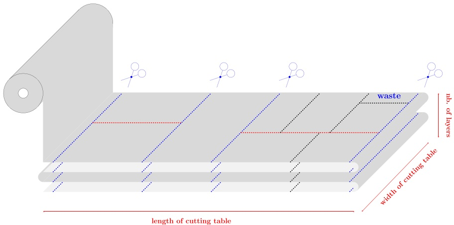

Fig. 1. Fabric roll on the cutting table, and 3 cutting patterns (delimited by blue dotted lines) are produced in each of them. (For interpretation of the references to color in this figure legend, the reader is referred to the web version of this article.)

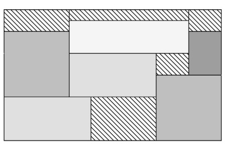

(a)

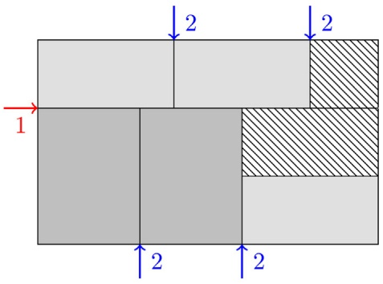

(b)

Fig. 2. Examples of cutting patterns that can be obtained through non-guillotine cuts (a) and two-stage restricted guillotine cuts (b).

The production process includes the first three phases: weaving, dyeing and/or printing. In the weaving phase, the fabric rolls are produced in industrial looms. Then, in the dyeing phase, the rolls are dyed in a bathtub where they acquire the final color. Finally, in the printing phase, drawings of one or more colors are reproduced on the fabric rolls through a serigraphy process. This process is optional as the customer may decide on plain or patterned products.

During this process, any manufactured product must be identified by a reference code in accordance with its characteristics of weaving, dyeing and printing. However, and for the sake of simplicity, we consider a unique reference code to identify these three phases.

In the cutting process, the fabric rolls are unrolled and folded on a cutting table (characterized by a fixed width and length) and are cut according to a cutting pattern (see Fig. 1). A cutting pattern represents the layout of the piece types (items), which is cut manually with a saw.

To characterize a cutting pattern, cuts may require special features. We can enumerate the following:

i) Cuts can be of guillotine type or non-guillotine type: e.g. in a guillotine cut, also called edge-to-edge cutting, pieces are obtained through cuts that are parallel to the sides of the plate (orthogonal cuts) and cross the plate from one border to the other. Fig. 2(a) shows a pattern (cutting scheme) that can be obtained through non-guillotine cuts, and Fig. 2(b) shows a pattern that can be obtained through guillotine cuts, which are the ones this paper focuses on.

ii) Cuts are performed in stages, where each stage consists of a set of parallel cuts (horizontal or vertical) on the shapes obtained in the previous stages. Horizontal cuts are parallel to the length of the cutting table and vertical cuts are orthogonal to the length of the cutting table. The number of stages is frequently limited to two or three, but it is also possible to have multi-stage (k-stage, where $k > 3 )$ cutting patterns. In a two-stage cutting pattern, the pieces are cut through a set of horizontal cuts, dividing the plate in strips, followed by a set of vertical cuts. An additional set of horizontal cuts can be allowed in order to separate the waste from the pieces. Fig. 2(b) exemplifies a two-stage cutting pattern, where the hatched rectangles correspond to waste and the other rectangles correspond to pieces.

iii) Staged patterns can be exact or non-exact. In an exact cut, all the pieces in a given strip have the same width. In a non-exact cut, an additional set of horizontal cuts separating the waste from the piece types, called trimming, is allowed (in a two-stage cutting pattern), while an additional set of vertical cuts is considered in the case of a three-stage cutting pattern. Fig. 3(a) exemplifies an exact two-stage cutting pattern, while Fig. 3(b) shows a non-exact two-stage cutting pattern.

In the home textile industry application at stake, only twostage guillotine cutting patterns are considered (restrictions i) and ii)), and the cuts do not need to be exact (restriction iii)). Furthermore, the cutting stock problems that have to be solved in the cutting phase refer to a single reference of the first three phases of the production process (weaving, dyeing and/or printing), i.e., all piece types and fabric rolls from the same instance have the same reference. Thus, if there are R references in the same instance, solving this instance amounts to solving R sub-instances.

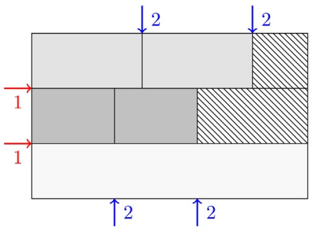

(a)

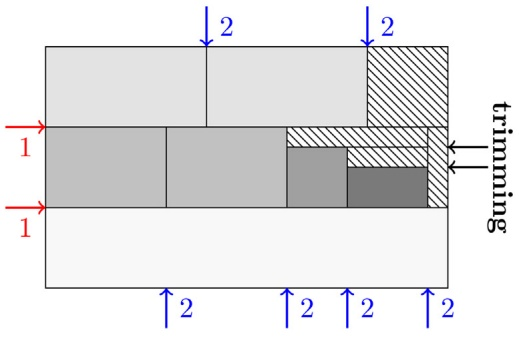

(b)

Fig. 3. Examples of patterns that can be obtained through (a) exact two-stage cuts and (b) non-exact two-stage cuts.

## 1.2. Paper motivation

The motivation behind this work comes from the home textile industry, where fabric rolls must be produced and then cut into pieces to satisfy customer orders. When intermediate stocks and reference-related constraints are disregarded, the decision on the widths and lengths of the fabric rolls to be produced boils down to the classical multiple stock-size cutting stock, as it is indifferent if the raw-material is already in the stock or is going to be produced. Therefore, the focus of this paper is on the problem of generating the cutting patterns to cut all demanded piece types.

However, in this home textile industry, the length of the cutting patterns is not fixed. It can vary between a maximum that corresponds to the length of the cutting table and a minimum that is imposed to guarantee a good production flow, which would be hindered by small cutting patterns. Therefore, this problem has also characteristics that are specific to open dimension problems (Wäscher, Haußner, & Schumann, 2007), as the strip packing problem. For this reason, we defined this problem as a two-dimensional Variable-Sized Cutting Stock Problem (2D-VSCSP). This should not be mistaken with what is called in the literature the variable size bin packing problem, which is, in reality, a multiple bin-size packing problem. The problem could also be regarded as a multiple threestage Strip Packing Problem (SPP) with a first vertical cut and a maximum length equal to the length of the cutting table. However, this SPP should be solved for each roll width.

Existing mathematical models for the two-dimensional CSP (2D-CSP) consider that the size of the cutting patterns is fixed since the width and length of the plate are defined. The generalization of existing models for the 2D-CSP to the 2D-VSCSP is not straightforward since deciding the length of the cutting patterns transforms the formulation into a non-linear one. In a recent survey by Iori, de Lima, Martello, Miyazawa, & Monaci (2021), the main formulations and solution methods for two-dimensional C&P problems are presented. One of the conclusions is that existing models for the classical 2D-CSP performed well, in what concerns finding optimal non-relaxed solutions, only in small instances. Thus, the generalization of existing methods is not expected to achieve a good performance solving a large real-instance from the home-textile industry.

## 1.3. Contributions and overview of the paper

The contributions of this paper are threefold:

(1) Firstly, we propose a new variant of the CSP, the 2D-VSCSP, a problem with characteristics of a strip-packing problem, grounded on a real-world application in the home textile industry.

(2) Secondly, we propose a new Bin Packing Problem (BPP) model, and we show that it is possible to efficiently solve CSP problems with this model when the demand of each item type is not high.

(3) Finally, we incorporate production flow goals in the CSP resolution under a bi-objective framework.

The remainder of the paper is organized as follows. Section 2 presents a formal description of the 2D-VSCSP and outlines the basic assumptions. Section 3 provides an overview of related works from the C&P literature. Section 4 introduces the necessary notations used in this paper for the 2D-VSCSP. Section 5 describes a set of mathematical models used to tackle the mono-objective variant of the 2D-VSCSP. Section 6 assesses the quality of the proposed ILP models through extensive computational experiments. Section 7 provides an --constraint model to solve the bi-objective extension of the 2D-VSCSP and shows the results for the exact Pareto fronts. Finally, Section 8 highlights the main conclusions of this work and recommends some future research directions.

## 2. Problem description

In this section, we first list some assumptions to help clarify the constraints that have to be satisfied. We then present a formal description of the problem under consideration, as well as an illustrative example.

## 2.1. Assumptions

The following assumptions/constraints, related to piece types and the cutting process, were considered for the problem:

• All cuts must be of the guillotine type, so a cut on a rectangle always generates smaller sub-rectangles.

• There is a limit on the maximum number of guillotine stages: two-stage 2D-VSCSP.

• All piece types have a rectangular shape.

• All piece types must be cut to serve at least the demand, i.e. the demand for each piece type has a lower and an upper bound.

• The pieces do not overlap.

• Piece types have a fixed orientation, i.e. they cannot be rotated due to the existence of dyed fabrics with different patterns.

• The model is proposed under deterministic conditions (inputs are deterministic).

• Piece types sorted by non-increasing order of their widths and/or their lengths.

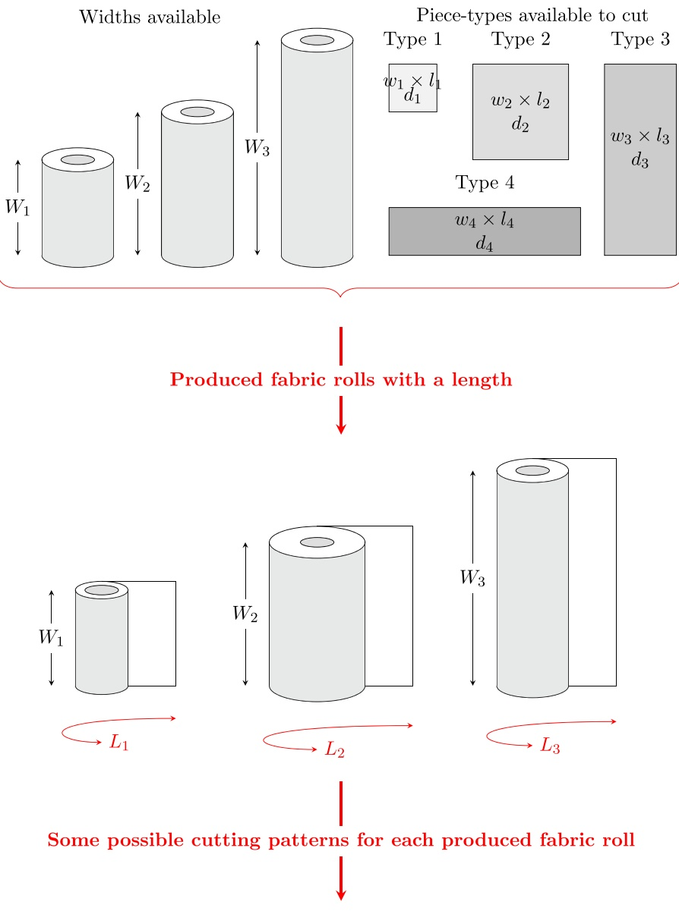

Patterns from $( W _ { 1 } ,   L _ { 1 } )$ Pattern from $( W _ { 2 } ,   L _ { 2 } )$ Pattern from $( W _ { 3 } ,   L _ { 3 } )$

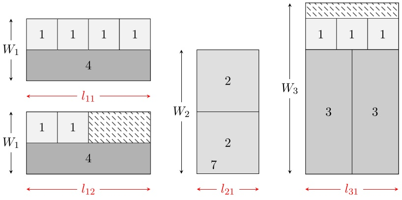

Fig. 4. Home textile: production and cutting processes.

## 2.2. Formal definition

Fig. 4 shows the home textile production and cutting processes considered. In the first phase a set of fabric rolls is produced. All the rolls have a reference that identifies their characteristics. The cutting patterns necessary to cut all demanded pieces are generated in the second phase. As shown in Fig. 4, each produced fabric roll can generate one or more cutting patterns. For example, the first fabric roll, with width $W _ { 1 }$ and length $L _ { 1 } ,$ generates two patterns of width $W _ { 1 }$ and lengths $l _ { 1 1 }$ and $l _ { 1 2 } .$ The first pattern has two strips (one piece of type 4 in the first strip and four pieces of type 1 in the second strip). The latter has two strips (one piece of type 4 in the first strip and only two pieces of type 1 in the second strip) and generates waste (the hatched rectangle). Similarly, the second fabric roll, with dimensions $( W _ { 2 } , L _ { 2 } ) ,$ generates one two-stage guillotine pattern of length $l _ { 2 1 }$ , through exact cuts, and the third fabric roll, with the dimensions $( W _ { 3 } , L _ { 3 } )$ , generates one two-stage guillotine pattern of length $l _ { 3 1 }$

Data on the piece types of the example.

| Piece type i | Width wi (cm) | Length li (cm) | Demand di |
| --- | --- | --- | --- |
| 1 | 140 | 200 | 3 |
| 2 | 65 | 65 | 1 |
| 3 | 110 | 70 | 2 |
| 4 | 160 | 240 | 3 |
| 5 | 75 | 75 | 4 |

To formally define the 2D-VSCSP, we consider the following input/output data and objectives.

I) **Given**:

$\mathcal { I } : = \{ 1 , \ldots , I \} ;$ a set of I piece types have to be cut from one of the produced fabric rolls with predefined widths. Each piece type i has:

• $w _ { i } \mathbf { : a }$ width;

• li: a length;

$d _ { i } ; \mathrm { \bf ~ a ~ }$ positive integer demand.

$W _ { j } ;$ a set of J predefined widths, where each produced fabric roll is indexed by $j \in { \mathcal { T } } .$

II) **Outputs**: to determine:

$L _ { i } ;$ the length of of the produced fabric roll with width $\dot { W } _ { j } , j \in \mathcal { I } .$

$\vec { \mathcal { P } _ { j } } : = \{ 1 , \dots , P _ { j } \}$ : the set of generated cutting patterns to be applied to each produced fabric roll j, where each cutting pattern p has:

$l _ { p } ; \mathtt { a }$ length;

$w _ { p } ;$ a width;

$a _ { i p } \colon$ a number of pieces of type $i \in \mathcal { I } ;$

III) **Objective functions**: several objective functions can be considered in the home textile context. These include the total amount of textile materials used in the production, the total amount of textile material wasted, the total production costs, the cutting costs and/or the number of generated cutting patterns, and the complexity of the generated cutting patterns (number of cuts, number of piece types, etc). These objectives have to be minimized or maximized separately or simultaneously.

In the case of the 2D-VSCSP, we can first consider a monoobjective variant, in which the total amount of textile materials used in the production has to be minimized. We can then consider an extension to deal with multiple objective functions, a bi-objective 2D-VSCSP, in which both the total amount of textile materials used in the production and the total number of cutting patterns have to be simultaneously minimized.

The following example illustrates these concepts. Consider one instance of the 2D-VSCSP with three initial fabric rolls with a pre-defined width equal to 160 cm, 200 cm and 225 cm, and with 5 piece types indexed by i, with width $w _ { i } ,$ length $l _ { i } ,$ and demand $d _ { i }$ given in Table 1.

Fig. 5 shows an optimal solution with a total of used textile materials equal to 252.950 $\mathbf { c m } ^ { 2 }$ . The generated cutting patterns from both fabric rolls with width $W _ { 1 } = 1 6 0$ cm and width $W _ { 3 } = 2 2 5$ cm are of type: exact and non-exact two-stage guillotine cuts. The first fabric roll in Fig. 5(a) produces two exact cutting patterns (cutting pattern 1.1 and cutting pattern 1.2) in the form of a single strip consisting respectively of two pieces of type 4, and of one piece of type 1 and a piece of type 4. Cutting pattern 1.2 has waste. On the other hand, the fabric roll with width $W _ { 3 } = 2 2 5$ cm $( \mathrm { F i g . } ~ 5 ( \mathsf { b } ) )$ produces cutting pattern 3.1 and cutting pattern 3.2, where two strips are created in each of them. In the non-exact cutting pattern 3.1, a strip consists of two pieces of type 1. In the second strip, a set of four pieces of type 5 and one piece of type 2 are cut, where trimming is allowed, and waste is generated. The two strips of cutting pattern 3.2 consist of one piece of type 3 each.

## 3. Literature review

To the best of our knowledge, the most similar problem to the 2D-VSCSP was addressed by Silva, Viães, Oliveira, & Carravilla (2015) as an integrated problem of waste minimization and production planning: Integrated Cutting and Production Planning Problem. In some aspects, the problem addressed in Silva et al. (2015) is more complex than the one presented in this paper, mainly because a reference identifies any manufactured product following its characteristics of weaving, dyeing, and printing, and in each production phase, intermediate stock can be used for each width in each reference. To solve the problem, the authors proposed a mixed-integer programming model combined with a heuristic for the generation of cutting patterns. The model determines the quantity of fabric that should be produced in each production phase, the quantity of fabric that should be used from stock, the respective cutting patterns, and the corresponding frequencies. An alternative solution approach based on column generation is also proposed. However, the main difference to this work is that the length of the cutting patterns was fixed to the maximum length of the cutting table, and therefore the length of the cutting patterns is not a decision variable, as in the 2D-VSCSP. A sensitivity analysis was performed to the different parameters of the problem (e.g., the minimum quantity of production in weaving, the frequency of a cutting pattern, etc.). One can conclude that the proposed heuristic is highly dependent on the different costs considered in the objective function.

Thus, due to the restricted literature addressing this kind of problem, this literature review mainly focuses on the C&P problems.

The study of the C&P problems seems to go back to Brooks, Smith, & Stone (1940) and Kantorovich (1960)1, but an extensive scientific work only started after the latter. Since then, a great number of problems with essentially the same logical structure of the C&P problems have appeared under different names. Some of the highlights are Dyckhoff (1990) and Dyckhoff, Scheithauer, & Terno (1997) for an annotated bibliography on 2D-CSPs, Lodi, Martello, & Monaci (2002) for a survey on mathematical models and lower bounds for the two-dimensional bin packing problems (2BPPs), Wäscher et al. (2007) for an improved typology of the C&P problems, and Faina (1999) and Faina (2000) for a wide discussion about these problems.

In our paper, we focus on the 2D-CSP, an optimization problem that has been well studied in the last 60 years due to its large number of practical applications. Here, we provide only some pointers to a number of relevant results on exact and approximation algorithms (heuristics/ meta-heuristics) for the 2D-CSP and its variants, as a thorough review of these methods is outside the scope of this paper. Additional references can be found in ESICUP (1988). The 2D-CSP was first put forward by Kantorovich (1960) and the most well-known study was conducted by Gilmore & Gomory (1965), who used the column generation technique.

Table 2 gives an overview of the main characteristics of the approaches and models that have been proposed to solve the

<small>1 Kantorovich (1960): is the English translation of the famous 1939 article by L. V. Kantorovich, originally published in Russian.</small>

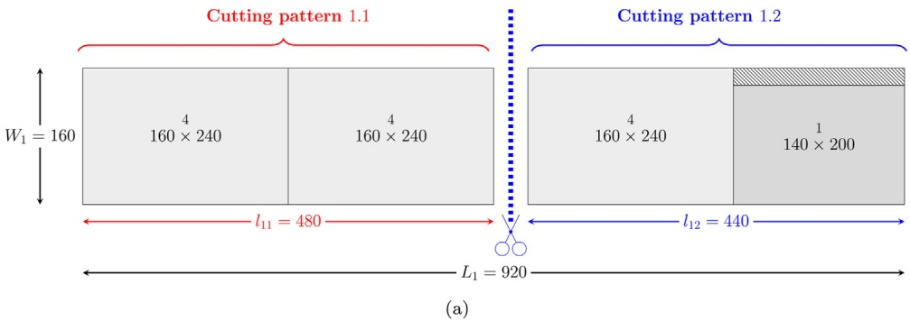

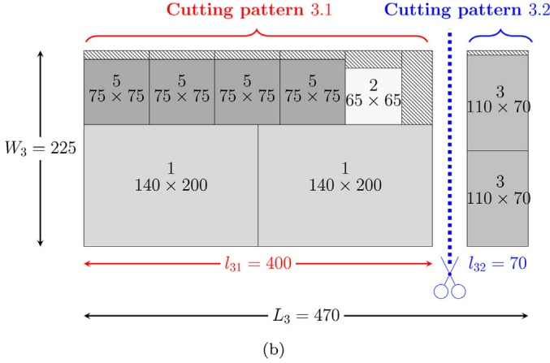

Fig. 5. An optimal solution of the example that contains (a) two cutting patterns from a fabric roll of width $W _ { 1 } = 1 6 0$ cm and (b) two cutting patterns from a fabric roll of width $W _ { 3 } = 2 2 5$ cm.

2D-CSP and its variants since the year 1965. Each paper can be classified according to several aspects: the problem type (mainly Cutting Stock Problem, both in its single stock size – CSP – and multiple stock size – MSSCSP – variants), the dimensions (mainly 2D, 1D), the number of stages (1, 2, Multi:k-stages (k ≥ 3), unlimited) and the trimming notion (considered (-), not considered (✗) or both cases $( { \pmb \sqrt { \pmb \lambda } } ,   { \pmb \lambda } { \pmb \chi } ) )$ in the case of the guillotine cuts, the non-guillotine cuts (considered (-), not considered (✗)), the rotation of items (considered (-), not considered (✗) or both cases $( { \check { \mathsf { v } } } , { \check { \pmb { x } } } ) ) ,$ the type of variables representing the proposed model (continuous (C), discrete (D) or both (C,D)), the objective function (e.g. waste or trim loss, area, costs, cuts, plates, patterns, panels, ”shelves”, production time, material cost & setups, materials used) and, lastly, the solution method (mainly exact methods).

Most of the proposed approaches to solve the standard CSP are of type ILP/MILP (see Furini, Malaguti, Durán, Persiani, & Toth, 2012; Gilmore & Gomory, 1965; Kokten & Sel, 2022; Lodi & Monaci, 2003; Martin, Morabito, & Munari, 2020; Parreño & Alvarez-Valdes, 2021, etc) or branching algorithms, e.g. CG, BB, BC, BP, BCP (see Belov & Scheithauer, 2006; Cintra, Miyazawa, Wakabayashi, & Xavier, 2008; Oliveira & Ferreira, 1994; Puchinger & Raidl, 2007; Silva et al., 2015; Vanderbeck, 2001; Wang, Xiao, Zhou, & Liang, 2020, etc) and also pseudo-polynomial ILP formulations coming from a graph representation of the solution space AF (see Côté & Iori, 2018; Macedo, Alves, & De Carvalho, 2010). Regarding the MSSCSP, the most relevant contributions are on its one-dimensional variant (1D-MSSCSP) and can be found in Belov & Scheithauer (2002), Alves & De Carvalho (2008), Poldi & Arenales (2009). On the other hand, recent studies, such as Furini et al. (2012), Furini & Malaguti (2013), Octarina, Ananda, & Yuliza (2019), Octarina, Juita, Eliyati, & Bangun (2020), Sumetthapiwat, Intiyot, & Jeenanunta (2020), have explored a variety of exact solution methods (MILP, CG, BB, DP, SCM) to solve the 2D-MSSCSP.

More details about the C&P class of problems (problem description & variants, modeling approaches, solution methods) can be obtained in Scheithauer (2017), a recent book that reviews exact and heuristic approaches for these problems and provides a broad overview of the C&P field, and in Iori et al. (2021), a survey on the main formulations and exact solution methods for twodimensional orthogonal C&P problems, where both items and bins are rectangles. In addition, a recent survey on the main exact and heuristic methods for the unstaged guillotine version of the constrained two-dimensional cutting (C2DC) problem was presented by Russo, Boccia, Sforza, & Sterle (2020).

Another stream of literature relevant for this work deals with the reduction of the number of patterns (aka pattern reduction). Foerster & Wäscher (2000) deals with pattern reduction in one-dimensional cutting stock problems. However, waste minimization and pattern reduction are not dealt with simultaneously but in a sequential way, and the paper focus only on the second step. Vanderbeck (2000) proposes a branch-and-priceand-cut procedure again for the one-dimensional variant of the problem. Also, the one-dimensional cutting-stock pattern minimization problem is approached by Umetani, Yagiura, & Ibaraki (2003) but resorts to meta-heuristics methods. Yanasse & Limeira (2006) proposed a method that can be considered independent of the dimensionality of the cutting problem. It is a heuristic process based on a pattern exhaustion usage technique. A similar approach to the same problem is used by Cui, Zhao, Yang, & Yu (2008), but in the iterative process of building patterns and using them until the demand for an item is exhausted, special attention is given to the potential use of a pattern when items are selected to be part of it. This will, of course, hinder the potential of waste minimization of this pattern. Cui & Liu (2011) improve this process. The same heuristic principle is applied by Cui, Yang, Zhao, Tang, & Yin (2013) to the two-dimensional cutting-stock problem. Finally, in Cui, Zhong, & Yao (2015), these same authors revisit the one-dimensional problem and present an integer linear programming model to minimize the sum of material and set-up costs over a given pattern set, resorting to a sequential grouping procedure to generate the patterns in the set. More recently, Goulimis & Olivera (2017) proposed another pattern reduction heuristic for the one-dimensional cutting stock problem. Another stream of literature derived from the one here browsed regards set-ups minimization in cutting stock problems. But, minimizing set-ups is not strictly equivalent to reducing the number of cutting patterns. Therefore, to the best of our knowledge, this paper is the first attempt to explicitly incorporate pattern reduction in an exact approach for the two-dimensional cutting-stock problem under a multi-objective optimization framework.

Review of 2D-CSPs’ approaches in the literature.

<table><tr><td rowspan="2">Authors</td><td colspan="2">Problem</td><td rowspan="2">Dim.</td><td colspan="2">GL.Cuts</td><td rowspan="2">Non-GL.Cuts</td><td rowspan="2">Rotation</td><td rowspan="2">Var.</td><td rowspan="2">Obj.F.</td><td rowspan="2">Sol.</td></tr><tr><td>CSP</td><td>MSSCSP</td><td>Stages</td><td>Trimming</td></tr><tr><td>Gilmore &amp; Gomory (1965)</td><td>✓</td><td></td><td>1D,2D,3D</td><td>2,3,Multi</td><td>✓</td><td>-</td><td>✘</td><td>C</td><td>waste,costs,cuts</td><td>ILP</td></tr><tr><td>Yanasse, Zinober, &amp; Harris (1991)</td><td></td><td>✓</td><td>2D</td><td>2</td><td>✓</td><td>-</td><td>✓</td><td>C</td><td>waste</td><td>H</td></tr><tr><td>Oliveira &amp; Ferreira (1994)</td><td>✓</td><td></td><td>2D</td><td>2,3,Multi</td><td>✓</td><td>-</td><td>✘</td><td>C</td><td>cuts</td><td>LP,CG</td></tr><tr><td>Hifi &amp; Roucairol (2001)</td><td>✓</td><td></td><td>2D</td><td>2</td><td>✓,✘</td><td>✓</td><td>✓</td><td>D</td><td>waste</td><td>DP,H,Approx</td></tr><tr><td>Vanderbeck (2001)</td><td>✓</td><td></td><td>2D</td><td>3</td><td>✓</td><td>-</td><td>✘</td><td>D</td><td>waste</td><td>CG</td></tr><tr><td>Belov &amp; Scheithauer (2002)</td><td></td><td>✓</td><td>1D</td><td>-</td><td>-</td><td>-</td><td>-</td><td>C</td><td>costs</td><td>ILP,CG</td></tr><tr><td>Lodi &amp; Monaci (2003)</td><td>✓</td><td></td><td>2D</td><td>2</td><td>✓</td><td>-</td><td>✘,✓</td><td>D</td><td>waste,profits</td><td>ILP</td></tr><tr><td>Belov &amp; Scheithauer (2006)</td><td>✓</td><td></td><td>1D,2D</td><td>2</td><td>-</td><td>-</td><td>✘</td><td>D</td><td>profits</td><td>BCP</td></tr><tr><td>Pisinger &amp; Sigurd (2007)</td><td>✓</td><td></td><td>2D</td><td>2</td><td>-</td><td>-</td><td>✘</td><td>C,D</td><td>waste</td><td>MIP,CP,CG,H</td></tr><tr><td>Puchinger &amp; Raidl (2007)</td><td>✓</td><td></td><td>2D</td><td>2</td><td>-</td><td>-</td><td>✘</td><td>D</td><td>waste</td><td>CG,BB</td></tr><tr><td>Alves &amp; De Carvalho (2008)</td><td></td><td>✓</td><td>1D</td><td>-</td><td>-</td><td>-</td><td>-</td><td>C</td><td>materials used</td><td>IP,AF,BCP,CG</td></tr><tr><td>Cintra et al. (2008)</td><td>✓</td><td></td><td>2D</td><td>2</td><td>✓</td><td>-</td><td>✓</td><td>D</td><td>cuts</td><td>DP,CG</td></tr><tr><td>Cui (2008)</td><td>✓</td><td></td><td>2D</td><td>3</td><td>✘</td><td>-</td><td>✓</td><td>D</td><td>cuts</td><td>BB,DP,E,H</td></tr><tr><td>Poldi &amp; Arenales (2009)</td><td></td><td>✓</td><td>1D</td><td>-</td><td>-</td><td>-</td><td>-</td><td>C</td><td>waste</td><td>IP,H</td></tr><tr><td>Macedo et al. (2010)</td><td>✓</td><td></td><td>2D</td><td>2</td><td>✓</td><td>-</td><td>✓,✘</td><td>D</td><td>waste</td><td>AF</td></tr><tr><td>Silva, Alvelos, &amp; De Carvalho (2010)</td><td>✓</td><td></td><td>2D</td><td>2,3</td><td>✘,✓</td><td>-</td><td>✓,✘</td><td>D</td><td>plates,waste</td><td>ILP</td></tr><tr><td>Furini et al. (2012)</td><td></td><td>✓</td><td>2D</td><td>2</td><td>✓</td><td>-</td><td>✓,✘</td><td>C,D</td><td>area</td><td>CG,MILP,DP</td></tr><tr><td>Furini &amp; Malaguti (2013)</td><td></td><td>✓</td><td>2D</td><td>2</td><td>✓</td><td>-</td><td>-</td><td>C,D</td><td>area</td><td>MILP</td></tr><tr><td>Mrad, Meftahi, &amp; Haouari (2013)</td><td>✓</td><td></td><td>2D</td><td>2</td><td>✓</td><td>-</td><td>✓</td><td>D</td><td>patterns</td><td>BB</td></tr><tr><td>Malaguti, Durán, &amp; Toth (2014)</td><td>✓</td><td></td><td>2D</td><td>1</td><td>✓</td><td>-</td><td>✓</td><td>D</td><td>trim loss</td><td>ILP,BP,H</td></tr><tr><td>Silva et al. (2015))</td><td>✓</td><td></td><td>2D</td><td>3</td><td>✓</td><td>-</td><td>✘</td><td>D</td><td>costs</td><td>CG</td></tr><tr><td>Furini, Malaguti, &amp; Thomopulos (2016)</td><td>✓</td><td></td><td>2D</td><td>3</td><td>✓</td><td>-</td><td>✓</td><td>C,D</td><td>panels</td><td>MIP</td></tr><tr><td>Delorme, Iori, &amp; Martello (2017)</td><td>✓</td><td></td><td>2D</td><td>3</td><td>-</td><td>-</td><td>✓</td><td>D</td><td>&quot;shelves&quot;</td><td>BD,E</td></tr><tr><td>Bouaine, Lebbar, &amp; Ha (2018)</td><td>✓</td><td></td><td>2D</td><td>2</td><td>-</td><td>-</td><td>-</td><td>C</td><td>waste</td><td>ILP,H</td></tr><tr><td>Côté &amp; Iori (2018)</td><td>✓</td><td></td><td>2D</td><td>2</td><td>-</td><td>-</td><td>-</td><td>C</td><td>waste</td><td>ILP,AF,BB</td></tr><tr><td>Wuttke &amp; Heese (2018)</td><td>✓</td><td></td><td>2D</td><td>2</td><td>-</td><td>-</td><td>✘</td><td>C</td><td>production time</td><td>MILP,H</td></tr><tr><td>Bangun, Octarina, &amp; Pertama (2019)</td><td>✓</td><td></td><td>2D</td><td>2</td><td>-</td><td>-</td><td>-</td><td>D</td><td>trim loss</td><td>BC</td></tr><tr><td>Kokten &amp; Sel (2022)</td><td>✓</td><td></td><td>2D</td><td>2</td><td>-</td><td>-</td><td>-</td><td>D</td><td>waste</td><td>ILP,DA,MH</td></tr><tr><td>Octarina et al. (2019)</td><td></td><td>✓</td><td>2D</td><td>2</td><td>-</td><td>-</td><td>-</td><td>D</td><td>materials used</td><td>BB</td></tr><tr><td>Octarina et al. (2020)</td><td></td><td>✓</td><td>2D</td><td>2</td><td>-</td><td>-</td><td>-</td><td>D</td><td>materials used</td><td>SCM</td></tr><tr><td>Sumeththapiwat et al. (2020)</td><td></td><td>✓</td><td>2D</td><td>2</td><td>-</td><td>-</td><td>-</td><td>D</td><td>waste</td><td>CG</td></tr><tr><td>Wang et al. (2020)</td><td>✓</td><td></td><td>2D</td><td>2</td><td>-</td><td>-</td><td>-</td><td>D</td><td>costs&amp; setups</td><td>IP,CG,H</td></tr><tr><td>Martin et al. (2020)</td><td>✓</td><td></td><td>2D,3D</td><td>unlimited</td><td>-</td><td>-</td><td>✓</td><td>D</td><td>waste</td><td>MILP</td></tr><tr><td>Parreño &amp; Alvarez-Valdes (2021)</td><td>✓</td><td></td><td>2D</td><td>3</td><td>✓</td><td>-</td><td>✓</td><td>D</td><td>waste</td><td>MILP</td></tr><tr><td>Ours</td><td>✓</td><td></td><td>2D</td><td>2</td><td>✓</td><td>✘</td><td>✓</td><td>D</td><td>waste</td><td>MILP,ε-constraint</td></tr></table>

a Dim.: Dimensions (1D, 2D, 3D); Stages: one, two, multiple (≥ 3) or unlimited; Rotation/Trimming: considered $( { \check { v } } ) ,$ not considered $( x )$ or both cases $( { \check { v } } , { \check { x } } ) ;$ Non GL.Cuts: Non-Guillotine Cuts $( { \checkmark } ) ,$ not considered (✗); Var.–Type of decision variables (C–Continuous or D–Discrete); $\mathsf { O b j . F . : }$ Objective Function (waste or trim loss, area, costs, cuts, plates, patterns, panels, ”shelves”, production time, material cost & setups, materials used); Sol.: Solution Method (ILP–Integer Linear Programming, MIP–Mixed-Integer Programming, MILP–Mixed-Integer Linear Programming, IP–Integer Programming, BB–Branch-and-Bound, BC–Branch-and-Cut, BP–Branch-and-Price, BCP–Branchand-Cut-and-Price, DP–Dynamic Programming, CP–Constraint Programming, CG–Column Generation, BD–Benders’ Decomposition, AF–Arc-flow, E–Exact, DA–Decomposition Algorithm, SCM–Set Covering Model, Approx–Approximate Algorithm, H–Heuristic, MH–Meta-heuristic). Note that the problem characteristic is undefined for the table cells with $\text{" } -  \text{" },$

## Where does the problem lie in the literature?

According to the C&P typology of Wäscher et al. (2007), the problem addressed in this paper can be defined as a generalisation of the two-dimensional Multiple Stock Size Cutting Stock Problem (2D-MSSCSP). The 2D-VSCSP generalises the 2D-MSSCSP because while considering stock plates with different discrete widths (the width of the rolls), the length of the plates (the length of the fabric used in each cutting pattern) varies continuously between two given values. On the other hand, the problem could also be regarded as a strip packing problem with a set of possible widths for the large objects and a lower and upper bound for the pattern length. In what concerns the small items, the assortment is weakly heterogeneous. As both the CSP and the 2D-MSSCSP are strongly N P-hard problems (see Garey & Johnson (1979)), the 2D-VSCSP is a strongly N P-hard problem.

## 4. Notations for the 2D-VSCSPs

We used the notations in Table 3 throughout the paper for the two-stage 2D-VSCSP (mono- and bi-objective variants).

## 5. Mathematical models for the mono-objective 2D-VSCSP

Mathematical programming formulation is a natural way to tackle optimization problems. This section provides two families of ILP formulations for solving the 2D-VSCSP.

## 5.1. Position-based ILP formulations

In this section, we propose a CSP-based ILP formulation, which is an extension of the model presented in Lodi & Monaci (2003). The idea of this model is to define the position of each piece type (stage 2), in which strip (stage 1), and in which cutting pattern (stage 0). This model deals with 2D-VSCSP instances with a large demand per item type. Three variants of the ILP formulations are considered, hereafter denoted as ILP-1, ILP-2 and $\mathtt { I L P - } 3 .$ where ILP-2 and ILP-3 are extensions of ILP-1. Formal definitions of ILP-2 and ILP-3 models are provided in Appendix 1.

5.1.1. The 2-stage non-exact $I L P { - } I$ formulation

We present in the following ILP-1, a first formulation for the 2D-VSCSP.

$\alpha _ { j } : \left\{ \begin{aligned} 1 \\ 0 \end{aligned} \right.$ if fabric rollj ∈ J of widthWjis produced otherwise

$x _ { j } ;$ length of fabric roll $j \in { \mathcal { T } } .$

$\beta _ { p } ^ { j } : \left\{ \begin{matrix} { 1 } \\ { 0 } \end{matrix} \right.$ if the $: p ^ { t h }$ cutting pattern of widthWj, $j \in \mathcal { T }$ exists otherwise

$y _ { p } ^ { j } ;$ length of the $p ^ { t h }$ cutting pattern of width $W _ { j } ,   j \in \mathcal { I } .$

$$
a ^ {t h}
$$

$$
| p ^ {t h} |
$$

$\gamma _ { p , a , w } ^ { j }   :$ $W _ { j } ,   j \in \mathcal { I }$ produces a piece type of widthw $\in \{ w _ { i } \} _ { i \in \mathcal { I } }$ ⎪⎩0 otherwise

if the $b ^ { t h } \mathtt { c u t }$ in stage 2 in the $a ^ { t h }$ strip in the $p ^ { t h }$ $\delta _ { p , a , b , i } ^ { j } :$ of widt cutting pattern $\mathsf { h } W _ { j } ,   j \in \mathcal { I }$ produces the piece typei $\in \mathcal { I }$ otherwise

min $1 \sum _ { j \in \mathcal { J } } W _ { j } . x _ { j }$

(1)

s.t.

$$
x _ {j} \geq L _ {\min}. \alpha_ {j}
$$

$$
\forall j \in \mathcal {J}\tag{1.1}
$$

$$
x _ {j} \leq u b _ {p}. \alpha_ {j}
$$

$$
\forall j \in \mathcal {J}\tag{1.2}
$$

Main notation used in the mathematical programming models.

<table><tr><td colspan="2">Pieces</td></tr><tr><td> $i \in \mathcal{I}; \mathcal{I} = \{1, \dots, I\}$ </td><td>index for the piece types</td></tr><tr><td> $w_i, l_i, d_i$ </td><td>width, length and demand of piece type  $i \in \mathcal{I}$ </td></tr><tr><td> $d_i^{lb}$ </td><td>lower bound on the demand for piece type  $i \in \mathcal{I}$ </td></tr><tr><td> $d_i^{ub}$ </td><td>upper bound on the demand for piece type  $i \in \mathcal{I}$ </td></tr><tr><td> $\mathcal{W} := \{1, \dots, W\}$ </td><td>set of widths of piece types  $i \in \mathcal{I}$ .</td></tr><tr><td> $i' \in \mathcal{I}'; \mathcal{I}' = \{1, \dots, I'\}$ </td><td>index for the pieces, where  $I' = \sum_{i \in \mathcal{I}} d_i$ </td></tr><tr><td colspan="2">Fabric rolls</td></tr><tr><td> $j \in \mathcal{J}; \mathcal{J} = \{1, \dots, J\}$ </td><td>index for the fabric rolls</td></tr><tr><td> $W_j, j \in \mathcal{J}$ </td><td>set of predefined widths of the fabric rolls</td></tr><tr><td> $L_{\min}$ </td><td>minimum length of a fabric roll</td></tr><tr><td> $lb_p$ </td><td>lower bound on the total length of the fabric to be produced</td></tr><tr><td> $ub_p$ </td><td>upper bound on the total length of the fabric to be produced</td></tr><tr><td colspan="2">Cutting patterns</td></tr><tr><td> $P_{\min}$ </td><td>minimum length of the cutting patterns</td></tr><tr><td> $P_{\max}$ </td><td>maximum length of the cutting patterns</td></tr><tr><td> $p \in \mathcal{P}; \mathcal{P} = \{1, \dots, P\}$ </td><td>index for the cutting patterns,where  $P$  is an upper bound on the number of cutting patterns</td></tr><tr><td> $lb_c$ </td><td>lower bound on the number of cutting patterns</td></tr><tr><td> $a \in \mathcal{A}; \mathcal{A} = \{1, \dots, A\}$ </td><td>index for the strips (horizontal cuts in stage 1),where  $A$  is an upper bound on the number of strips</td></tr><tr><td> $b \in \mathcal{B}; \mathcal{B} = \{1, \dots, B\}$ </td><td>index for the vertical cuts in stage 2,where  $B$  is an upper bound on the number of vertical cuts in stage 2</td></tr></table>

$$
\beta_ {p} ^ {j} \leq \beta_ {p - 1} ^ {j}
$$

$$
\forall j \in \mathcal {J}, p \in \mathcal {P} \setminus \{1 \}\tag{1.3}
$$

$$
y _ {p} ^ {j} \geq P _ {\min}. \beta_ {p} ^ {j}
$$

$$
\forall j \in \mathcal {J}, p \in \mathcal {P}\tag{1.4}
$$

$$
y _ {p} ^ {j} \leq P _ {\max}. \beta_ {p} ^ {j}\tag{1.5}
$$

$$
\left. \sum_ {p \in \mathcal {P}} y _ {p} ^ {j} \leq x _ {j} \right|
$$

$$
\forall j \in \mathcal {J}\tag{1.6}
$$

$$
\forall j \in \mathcal {J}, p \in \mathcal {P}
$$

$$
\sum_ {w \in \mathcal {W}} \gamma_ {p, a, w} ^ {j} \leq \sum_ {w \in \mathcal {W}} \gamma_ {p, a - 1, w} ^ {j}\tag{1.7}
$$

$$
\left| \forall j \in \mathcal {J}, p \in \mathcal {P}, a \in \mathcal {A} \setminus \{1 \} \right|
$$

$$
\sum_ {w \in \mathcal {W}} \gamma_ {p, a, w} ^ {j} \leq 1\tag{1.8}
$$

$$
\forall j \in \mathcal {J}, p \in \mathcal {P}, a \in \mathcal {A}
$$

$$
\sum_ {w \in \mathcal {V}} \gamma_ {p, 1, w} ^ {j} \geq \beta_ {p} ^ {j}
$$

$$
\forall j \in \mathcal {J}, p \in \mathcal {P}\tag{1.9}
$$

$$
\sum_ {a \in \mathcal {A}} \sum_ {w \in \mathcal {V}} w. \gamma_ {p, a, w} ^ {j} \leq W _ {j}
$$

$$
\forall j \in \mathcal {J}, p \in \mathcal {P}\tag{1.10}
$$

$$
\left| \sum_ {i \in \mathcal {I}} \delta_ {p, a, b, i} ^ {j} \leq \sum_ {i \in \mathcal {I}} \delta_ {p, a, b - 1, i} ^ {j} \quad \forall j \in \mathcal {J}, p \in \mathcal {P}, a \in \mathcal {A}, b \in \mathcal {B} \setminus \{1 \} \right|\tag{1.11}
$$

$$
\sum_ {i \in \mathcal {I}} \delta_ {p, a, b, i} ^ {j} \leq 1
$$

$$
{\forall j \in \mathcal {J}, p \in \mathcal {P}, a \in \mathcal {A}, b \in \mathcal {B}}\tag{1.12}
$$

$$
\sum_ {i \in \mathcal {I}, w _ {i} \leq w} \delta_ {p, a, b, i} ^ {j} \leq \gamma_ {p, a, w} ^ {j} \quad \forall j \in \mathcal {J}, p \in \mathcal {P}, a \in \mathcal {A}, b \in \mathcal {B}, w \in \mathcal {W}\tag{1.13}
$$

$$
\sum_ {i \in \mathcal {I}} \sum_ {b \in \mathcal {B}} l _ {i}. \delta_ {p, a, b, i} ^ {j} \leq y _ {p} ^ {j}\tag{1.14}
$$

$$
\forall j \in \mathcal {J}, p \in \mathcal {P}, a \in \mathcal {A}
$$

$$
\sum_ {j \in \mathcal {J}} \sum_ {p \in \mathcal {P}} \sum_ {a \in \mathcal {A}} \sum_ {b \in \mathcal {B}} \delta_ {p, a, b, i} ^ {j} \geq d _ {i}\tag{1.15}
$$

$$
\forall i \in \mathcal {I}
$$

$$
\sum_ {j \in \mathcal {J}} \sum_ {p \in \mathcal {P}} \sum_ {a \in A} \sum_ {b \in B} \delta_ {p, a, b, i} ^ {j} \leq d _ {i} ^ {u b}
$$

$$
\forall i \in \mathcal {I}\tag{1.16}
$$

$$
\alpha_ {j} \in \{0, 1 \}
$$

$$
\forall j \in \mathcal {J}\tag{1.17}
$$

$$
x _ {j} \geq 0, \text {integer}
$$

$$
\forall j \in \mathcal {J}\tag{1.18}
$$

$$
\beta_ {p} ^ {j} \in \{0, 1 \}
$$

$$
\forall j \in \mathcal {J}, p \in \mathcal {P}\tag{1.19}
$$

$$
y _ {p} ^ {j} \geq 0, \text {integer}
$$

$$
\forall j \in \mathcal {J}\tag{1.20}
$$

$$
\gamma_ {p, a, w} ^ {j} \in \{0, 1 \} \quad \forall j \in \mathcal {J}, p \in \mathcal {P}, a \in \mathcal {A}, w \in \mathcal {W}\tag{1.21}
$$

$$
\delta_ {p, a, b, i} ^ {j} \in \{0, 1 \} \qquad \forall j \in \mathcal {J}, p \in \mathcal {P}, a \in \mathcal {A}, b \in \mathcal {B}, i \in \mathcal {I}\tag{1.22}
$$

The objective function (1) minimizes the total area of the fabric used in the production.

Constraints (1.1)–(1.2) ensure that the total production is at least $L _ { \mathrm { m i n } } ,$ if there exists production of the fabric roll of width $W _ { j }$ $\left( \alpha _ { j } = 1 \right)$

Constraints (1.3)–(1.6) are related to the cutting patterns (cuts in stage 0). Constraints (1.3) guarantee the precedence between cutting patterns, constraints (1.4)–(1.5) impose minimum and maximum limits to the length of the cutting patterns, and constraints (1.6) relate the length of the cutting patterns cut from a fabric roll with the length of the fabric roll.

Constraints (1.7)–(1.10) are related to the strips (cuts in stage 1). Constraints (1.7) guarantee the precedence between strips, constraints (1.8) ensure the existence of at most one width assigned to the first strip, if the cutting pattern p exists, constraints (1.9) guarantee the strip’s existence requirement, and constraints (1.10) ensure that in each cutting pattern, the sum of the widths of the strips does not exceed the width of the fabric roll (width capacity constraints).

Constraints (1.11)–(1.15) are related to the cuts in stage 2. Constraints (1.11) guarantee the precedence between cuts in stage 2, constraints (1.12) ensure that only one length is considered per each second stage, constraints (1.13) ensure the existence requirement of non-exact cuts in stage 2, and constraints (1.14) guarantee that the length of each strip does not exceed the length of its corresponding cutting pattern (length capacity constraints).

Constraints (1.15)–(1.16) guarantee that the production of pieces of each type i is within the predefined minimum and maximum limits.

Constraints (1.17)–(1.22) define the domains of the decision variables.

5.1.2. Strengthening inequalities for the 2-stage non-exact $I L P { - } I$ formulation

The ILP-1 formulation generates several symmetric solutions, and we propose the following valid inequalities to break some of these symmetries.

• (S1) ensure that the generated cutting patterns are sorted by decreasing length.

$$
y _ {p - 1} ^ {j} \geq y _ {p} ^ {j}
$$

$$
\forall j \in \mathcal {J}, p \in \mathcal {P} \setminus \{1 \}\tag{S1}
$$

• (S2) ensure that the strips are sorted by decreasing order of their items’ width.

$$
\sum_{\substack{w^{\prime}\in \mathcal{W}\\ w^{\prime}\geq w}}\gamma_{p,a - 1,w^{\prime}}^{j}\geq \gamma_{p,a,w}^{j}\quad \forall j\in \mathcal{J},  p\in \mathcal{P}\setminus \{1\} ,a\in \mathcal{A}\setminus \{1\} ,w\in \mathcal{W}\tag{S2}
$$

• (S3) ensure that the cuts in stage 2 are sorted by decreasing order of their items’ length.

$$
\sum_{\substack{i^{\prime}\in \mathcal{I}\\ l_{i^{\prime}}\geq l_{i}}}\delta^{j}_{p,a,b - 1,i^{\prime}}\geq \delta^{j}_{p,a,b,i}\quad \forall j\in \mathcal{J},  p\in \mathcal{P}\setminus \{1\} ,a\in \mathcal{A},  b\in \mathcal{B}\setminus \{1\} ,i\in \mathcal{I}\tag{S3}
$$

## 5.2. Bin packing-based ILP formulation

In this section, we propose an ILP formulation based on the symmetry-less formulation described in Hadj Salem & Kieffer (2020) for the classical One-Dimensional Bin Packing Problem (1D-BPP). It should be noted that the 1D-BPP is a $\mathcal { N P } .$ -hard optimization problem (see Martello & Toth, 1990), where a set of weighted items has to be packed into one or more identical capacitated bins. A recent survey on this problem was presented in Delorme, Iori, & Martello $( 2 0 1 6 ) ,$ and codes, benchmarks, and links to the BPPLIB are available in Delorme, Iori, & Martello (2018). The Hadj Salem & Kieffer (2020) model for the 1D-BPP can be adapted to the 2D-VSCSP, considering that the pieces are packed into strips which are themselves packed into cutting patterns. Each piece in $\tau ^ { \prime }$ is equivalent to an item in the 1D-BPP, each cutting pattern is equivalent to a bin, and each strip corresponds to both an item and a bin. This ILP formulation differs from ILP-1 on how the relationship between pieces and cutting patterns is modeled. It directly encodes a partition of the set of pieces to define the set of generated cutting patterns for each fabric roll j.

The proposed ILP formulation is denoted as ILP-4. In $\mathbf { A p } -$ pendix 2 we present the solutions obtained with this formulation for two instances.

5.2.1. The 2-stage non-exact $I L P - \downarrow$ formulation We consider the following decision variables:

$x _ { j } ;$ length of fabric roll $j \in \mathcal { T }$ of width $W _ { j } .$

$y _ { i } ^ { j } ;$ length of the cutting pattern associated with piece i and fabric roll $j .$

if piece i is in the strip (cut in stage 1) associated • α ji,i with the lowest-indexed demanded piece i and rollj 0 otherwise if piece i is the lowest index of a strip (cut in stage 1) associated with the cutting pattern $\beta _ { i , i ^ { \prime } } ^ { j } :$ with the lowest-indexed piece i and roll j ⎪⎩0 otherwise

In this 2-stage non-exact ILP-4 formulation, we assume that the binary variable $\alpha _ { i , i ^ { \prime } } ^ { j }$ is defined, where $i ^ { \prime } < i , w _ { i } \leq w _ { i ^ { \prime } }$ . In the same way, we assume that the binary variable $\beta _ { i , i ^ { \prime } } ^ { j }$ is defined, where $i ^ { \prime } < i , w _ { i } + w _ { i ^ { \prime } } \leq W _ { j }$ . The 2D-VSCSP can be formulated as follows.

$$
\min \sum_ {j \in \mathcal {J}} W _ {j, x _ {j}}\tag{4}
$$

s.t.

$$
\sum_ {j \in \mathcal {J}} \sum_ {i ^ {\prime}, i ^ {\prime} \leq i} \alpha_ {i, i ^ {\prime}} ^ {j} = 1
$$

$$
\left| \forall i \in \mathcal {I} ^ {\prime} \right|\tag{4.1}
$$

$$
\sum_ {j \in \mathcal {J}} \sum_ {i ^ {\prime}, i ^ {\prime} \leq i} \beta_ {i, i ^ {\prime}} ^ {j} \leq 1
$$

$$
\forall i \in \mathcal {I} ^ {\prime}\tag{4.2}
$$

$$
y _ {i} ^ {j} \geq P _ {\min}. \beta_ {i, i} ^ {j}
$$

$$
\forall j \in \mathcal {J}, i \in \mathcal {I} ^ {\prime}\tag{4.3}
$$

$$
y _ {i} ^ {j} \leq P _ {\max}
$$

$$
\forall j \in \mathcal {J}, i \in \mathcal {I} ^ {\prime}\tag{4.4}
$$

$$
x _ {j} \geq L _ {\min}. \beta_ {i, i} ^ {j}
$$

$$
\forall j \in \mathcal {J}, i \in \mathcal {I} ^ {\prime}\tag{4.5}
$$

$$
x _ {j} \leq u b _ {p}. \beta_ {i, i} ^ {j}
$$

$$
\forall j \in \mathcal {J}, i \in \mathcal {I} ^ {\prime}\tag{4.6}
$$

$$
x _ {j} \geq \sum_ {i \in \mathcal {I} ^ {\prime}} y _ {i} ^ {j}
$$

$$
\left| \forall j \in \mathcal {J} \right.\tag{4.7}
$$

$$
\alpha_ {i, i} ^ {j} = \sum_ {i ^ {\prime}, i ^ {\prime} \leq i} \beta_ {i, i ^ {\prime}} ^ {j}
$$

$$
\forall j \in \mathcal {J}, i \in \mathcal {I} ^ {\prime}\tag{4.8}
$$

$$
\sum_ {i, i ^ {\prime} \leq i} l _ {i} * \alpha_ {i, i ^ {\prime}} ^ {j} \leq y _ {i ^ {\prime \prime}} ^ {j} + P _ {\max} * \left(1 - \beta_ {i ^ {\prime}, i ^ {\prime \prime}} ^ {j}\right) \quad \forall j \in \mathcal {J}, (i ^ {\prime}, i ^ {\prime \prime}) \in \mathcal {L} ^ {\prime 2}\tag{4.9}
$$

$$
\sum_ {i, i ^ {\prime} \leq i} l _ {i} * \alpha_ {i, i ^ {\prime}} ^ {j} \leq P _ {\max}. \alpha_ {i ^ {\prime}, i ^ {\prime}} ^ {j}
$$

$$
\forall j \in \mathcal {J}, i ^ {\prime} \in \mathcal {I} ^ {\prime}\tag{4.10}
$$

$$
\sum_ {i, i ^ {\prime} \leq i} w _ {i} * \beta_ {i, i ^ {\prime}} ^ {j} \leq W _ {j} * \beta_ {i ^ {\prime}, i ^ {\prime}} ^ {j}
$$

$$
\forall j \in \mathcal {J}, i ^ {\prime} \in \mathcal {I} ^ {\prime}\tag{4.11}
$$

$$
x _ {j} \geq 0, \text {integer}
$$

$$
\forall j \in \mathcal {J}\tag{4.12}
$$

$$
y _ {i} ^ {j} \geq 0, \text {integer}
$$

$$
\forall j \in \mathcal {J}, i \in \mathcal {I} ^ {\prime}\tag{4.13}
$$

$$
\alpha_ {i, i ^ {\prime}} ^ {j} \in \{0, 1 \}
$$

$$
\forall j \in \mathcal {J}, (i, i ^ {\prime}) \in \mathcal {I} ^ {\prime 2}\tag{4.14}
$$

$$
\beta_ {i, i ^ {\prime}} ^ {j} \in \{0, 1 \}
$$

$$
\forall j \in \mathcal {J}, (i, i ^ {\prime}) \in \mathcal {I} ^ {\prime 2}\tag{4.15}
$$

The objective function (4) minimizes the area of the fabric used in the production.

Constraints (4.1)–(4.2) are the standard bin-packing assignment constraints.

Constraints (4.3)–(4.4) impose minimum and maximum limits to the length of the cutting patterns.

Constraints (4.5)–(4.7) define the fabric roll’s size constraints. Constraints (4.8) represent the “AND” relation between both binary variable (α and $\beta )$ constraints.

Constraints (4.9)–(4.11) ensure that the capacity constraints related to the cutting patterns are respected.

Constraints (4.12)–(4.15) define the domains of the decision variables.

## 5.2.2. Symmetry-breaking inequalities for the 2-stage non-exact ILP-4 formulation

The proposed ILP-4 formulation generates several symmetric solutions, and we propose the following valid inequalities to break some of these symmetries and strengthen the formulation.

Inequalities (S1.α) and $( S 2 . \alpha )$ define the precedence rules between items, and inequalities $( S 1 . \beta )$ define the precedence rules between strips of the same cutting pattern. These inequalities hold if i and i or $i ^ { \prime }$ and $i ^ { \prime \prime } ,$ are pieces of the same type.

$$
\sum_ {j \in \mathcal {J}} \sum_ {i, i ^ {\prime} \leq i} \alpha_ {i, i ^ {\prime}} ^ {j} \geq \sum_ {j \in \mathcal {J}} \sum_ {i, i ^ {\prime} \leq i} \alpha_ {i, i ^ {\prime \prime}} ^ {j} \quad \forall (i ^ {\prime}, i ^ {\prime \prime}) \in \mathcal {I} ^ {2}, i ^ {\prime} <   i ^ {\prime \prime}\tag{S1.α}
$$

$$
\sum_ {j \in \mathcal {J}} \alpha_ {i, i} ^ {j} \geq \sum_ {j \in \mathcal {J}} \alpha_ {i ^ {\prime}, i ^ {\prime}} ^ {j} \quad \forall (i, i ^ {\prime}) \in \mathcal {I} ^ {\prime} 2, i \leq i ^ {\prime} \quad \tag {S2.α}
$$

$$
\sum_ {j \in \mathcal {J}} \sum_ {i, i ^ {\prime} \leq i} \beta_ {i, i ^ {\prime}} ^ {j} \geq \sum_ {j \in \mathcal {J}} \sum_ {i, i ^ {\prime \prime} \leq i} \beta_ {i, i ^ {\prime \prime}} ^ {j} \quad \forall (i ^ {\prime}, i ^ {\prime \prime}) \in \mathcal {I} ^ {' 2}, i ^ {\prime} <   i ^ {\prime \prime}\tag{S1.β}
$$

5.2.3. Cutting planes for the 2-stage non-exact $I L P - \zeta$ formulation

We now introduce two families of cutting planes. The first family is defined by inequalities (C1.α) and $( C 1 . \beta ) ,$ while the second is defined by inequalities (C2.α) and $( C 2 . \beta ) .$

**Proposition 5.1.** Inequality

$$
\sum_ {k = 1} ^ {i ^ {\prime} - 1} \alpha_ {i ^ {\prime}, k} ^ {j} + \alpha_ {i, i ^ {\prime}} ^ {j} \leq 1 \quad \forall j \in \mathcal {J}, (i, i ^ {\prime}) \in \mathcal {I} ^ {\prime 2}, i ^ {\prime} <   i\tag{C1.α}
$$

is valid for the $I L P - \zeta$ (see Proof 2.1 in Appendix 3).

## Proposition 5.2. Inequality

$$
\sum_ {k = 1} ^ {i ^ {\prime} - 1} \beta_ {i ^ {\prime}, k} ^ {j} + \beta_ {i, i ^ {\prime}} ^ {j} \leq 1 \quad \forall j \in \mathcal {J}, (i, i ^ {\prime}) \in \mathcal {I} ^ {\prime 2}, i ^ {\prime} <   i\tag{C1.β}
$$

is valid for the $I L P - \zeta$ (see Proof 2.2 in Appendix 3).

Proposition 5.3. Let $( i , i ^ { \prime } )$ be in $\mathcal { I } ^ { ' 2 } ,$ , where $i ^ { \prime } < i ,$ and k be in $\{ 1 , \ldots , i ^ { \prime } - 1 \}$ for all j in J . Inequality (C1.α) is stronger than inequality (C2.α) and inequality $( C 1 . \beta )$ is stronger than inequality $( C 2 . \beta )$ when considered as reinforcements to the $I L P - \zeta$ (see Proof 2.3 in Appendix 3).

**Proposition 5.4.** Inequality

$$
\alpha_ {i ^ {\prime}, k} ^ {j} + \alpha_ {i, i ^ {\prime}} ^ {j} \leq 1 \quad \forall j \in \mathcal {J}, (i, i ^ {\prime}, k) \in \mathcal {I} ^ {\prime 3}, i ^ {\prime} <   i, k \geq i\tag{C2.α}
$$

is valid for the $I L P - \zeta$ (see Proof 2.4 in Appendix 3).

**Proposition 5.5.** Inequality

$$
\beta_ {i ^ {\prime}, k} ^ {j} + \beta_ {i, i ^ {\prime}} ^ {j} \leq 1 \quad \forall j \in \mathcal {J}, (i, i ^ {\prime}, k) \in \mathcal {I} ^ {\prime 3}, i ^ {\prime} <   i, k \geq i\tag{C2.β}
$$

is valid for the $I L P - \zeta$ (see Proof 2.5 in Appendix 3).

**Proposition 5.6.** There exist fractional solutions of the ILP-4 that are separated by inequalities (C1.α) and (C2.α) (see Proof 2.6 in Appendix 3).

**Proposition 5.7.** There exist fractional solutions of the ILP-4 that are separated by inequalities $( C 1 . \beta )$ and (C2.β) (see Proof 2.6 in Appendix 3).

The number of inequalities in (C2.α) and $( C 2 . \beta ) \; \mathrm { i s } \; O ( I ^ { 3 } )$ , while it is $O ( I ^ { 2 } )$ for both (C1.α) and $( C 1 . \beta ) .$ Since the number of (C1.α) and $( C 1 . \beta )$ inequalities is smaller and they are stronger than (C2.α) and $( C 2 . \beta ) _ { \cdot }$ respectively, their use for performance improvement should be favored over (C2.α) and $( C 2 . \beta ) .$ In Section 6.4, we will give an empirical study on the performance benefits of adding these inequalities.

**Remark 1.** The 2-stage exact extension of the ILP-4 is the same as that described in its 2-stage non-exact extension, i.e. provided that $\forall ( i , i ^ { \prime } ) \in \mathcal { I } ^ { ' 2 } , i ^ { \prime } < i ,$ we have $w _ { i } = w _ { i ^ { \prime } }$

## 5.3. Combinatorial interpretation of the ILP formulations

The proposed ILP formulations are compared in Table 4 according to their size in terms of variables and constraints. It should be noted that the 2-stage exact extension of these models has the same characteristics (variables & constraints).

As shown in Table 4, the $\mathtt { I L P - } 1$ formulation and its variant have more binary variables than the other formulations. On the other hand, both the ILP-2 and ILP-3 and their variants are generally equivalent. They have the same number of integer variables, $\mathcal { O } ( J + J . P . ( 1 + A . I ) )$ , but the ILP-2 and its variant have less binary variables. This means that the ILP-2 can be considered as a symmetry ILP of both the $\mathtt { I L P - } 1$ and $\mathtt { I L P - } 3$ . It should be noted that, in all formulations cited before, there are constraints coming from the home textile application that motivated this work, which act as natural Big-M constraints but are based on industrial parameters.

Comparison of the ILP-1, ILP-2, ILP-3 and ILP-4 formulations and their variants.

<table><tr><td rowspan="2">Models</td><td colspan="2">No. Variables</td><td rowspan="2">No. Constraints</td></tr><tr><td>binary</td><td>integer</td></tr><tr><td>ILP-1</td><td> $J + J.P.(1 + A.|W| + B.I)$ </td><td> $J + J.P$ </td><td> $\mathcal{O}(J.P.A.B.|W|)$ </td></tr><tr><td>ILP-1+S</td><td> $J + J.P.(1 + A.|W| + B.I)$ </td><td> $J + J.P$ </td><td> $\mathcal{O}(J.P.A.B.|W|)$ </td></tr><tr><td>ILP-2</td><td> $J.P.(1 + A.|W|)$ </td><td> $J + J.P.(1 + A.I)$ </td><td> $\mathcal{O}(J.P.A.|W|)$ </td></tr><tr><td>ILP-2+S</td><td> $J.P.(1 + A.|W|)$ </td><td> $J + J.P.(1 + A.I)$ </td><td> $\mathcal{O}(J.P.A.|W|)$ </td></tr><tr><td>ILP-3</td><td> $J.P.(1 + A.I)$ </td><td> $J + J.P.(1 + A.I)$ </td><td> $\mathcal{O}(J.P.A.I^2)$ </td></tr><tr><td>ILP-3+S</td><td> $J.P.(1 + A.I)$ </td><td> $J + J.P.(1 + A.I)$ </td><td> $\mathcal{O}(J.P.A.I^2)$ </td></tr><tr><td>ILP-4</td><td> $2.JI'^2$ </td><td> $J + J.I'$ </td><td> $\mathcal{O}(J.I'^2)$ </td></tr><tr><td>ILP-4+S</td><td> $2.JI'^2$ </td><td> $J + J.I'$ </td><td> $\mathcal{O}(J.I'^2)$ </td></tr><tr><td>ILP-4+S+C1</td><td> $2.JI'^2$ </td><td> $J + J.I'$ </td><td> $\mathcal{O}(J.I'^2)$ </td></tr><tr><td>ILP-4+S+C2</td><td> $2.JI'^2$ </td><td> $J + J.I'$ </td><td> $\mathcal{O}(J.I'^2)$ </td></tr></table>

On the other hand, the ILP-4 and its variants provide $\mathcal { O } ( ( J . I ^ { \prime } ) ^ { 2 } )$ binary variables. Hence, the strengthening of the $\mathtt { I L P - } 4$ by symmetry breaking inequalities and cutting planes seems to be more favorable for effectively reducing the search tree.

## 6. Experiments on the mono-objective 2D-VSCSP: results for ILP formulations

In this section, we analyze the effectiveness and performance of the non-exact extension (with trimming) for the $\mathrm { I L P - k } , k \in$ {1, 2, 3, 4} formulation proposed to solve the mono-objective 2D-VSCSP.

Our experiments were motivated by the following goals: to compare the lower bounds of the $\mathrm { I L P - } \Bbbk , k \in \{ 1 , 2 , 3 , 4 \}$ formulations, and to evaluate the benefits obtained from including the valid inequalities, symmetry-breaking and/or cutting planes previously described. These experiments led us to define the tightest ILP formulation, which can be reused to solve the bi-objective extension of the 2D-VSCSP, as shown in Section 7.2.

## 6.1. Implementation

We implemented the $\mathrm { I L P - } \Bbbk , k \in \{ 1 , 2 , 3 , 4 \}$ formulations and their variants in the Gurobi Optimizer 9.1 ([https://www.gurobi.com/](https://www.gurobi.com/)) solver using Python 3.8, running on a PC equipped with the Windows 7 Professional operating system. It had an Intel(R) Xeon(R) CPU running at 3.47 GHz, and 48 GB of RAM. All executions used a single thread and one core of the CPU.

We considered two implementations of the $\mathrm{ILP}-1,\mathrm{ILP}-2$ and ILP-3 formulations: the basic ones (hereafter denoted as ILP-k, $k \in \{ 1 , 2 , 3 \} )$ and the ones including the symmetry-breaking constraints described in Section 5.1.2 (hereafter denoted as ILP-k+S, k ∈ {1, 2, 3}).

We also considered four implementations of the ILP-4: the basic one (hereafter denoted as ILP-4); one including the symmetry-breaking inequalities described in Section 5.2.2 (hereafter denoted as ILP-4+S) another one including the cutting planes described in Section 5.2.3 (hereafter denoted as $\mathrm{ILP}-4+\mathrm{C1}$ and ILP-4+C2, respectively) and one including both the symmetry-breaking inequalities and cutting planes described in Sections 5.2.2 and 5.2.3 (hereafter denoted as ILP-4+S+C1 and $\mathrm{ILP}-4+\mathrm{S}+\mathrm{C}2$ , respectively). As a default setting, we activated in each implementation the Gurobi optimizer Heuristics (with its default value of 0.05) to generate the first upper bound to the problem. In addition, we set the Presolve parameter (controls the pre-solve level) to the conservative level (with a value of 1), both the Symmetry (MIP symmetric detection) and Cuts (global cut control) parameters to 1, and the NodefileStart parameter (write MIP nodes to disk) to 0.5. Finally, we set 3600 seconds (1 hour) as the maximum run-time (TimeLimit parameter) for each formulation.

## 6.2. Problem instances

The experiments were made using three groups of instances of small (S), medium (M) and large (L) dimension. Groups (S) and (L) contained four classes, and the (M) group contained eight classes.

For each class, we solved 10 instances as outlined in Table 5 (160 instances in total2). The instances from the (S), (M) and (L) groups were randomly generated (RG) based on real-world (RW)3 parameters related to the width and length of piece types as well as the width of fabric rolls. Each instance is characterized by the following parameters:

• Piece type features: $| \mathcal { I } | , ( w _ { i } ^ { \operatorname* { m i n } } , w _ { i } ^ { \operatorname* { m a x } } , l _ { i } ^ { \operatorname* { m i n } } , l _ { i } ^ { \operatorname* { m a x } } , d _ { i } ^ { \operatorname* { m i n } } , d _ { i } ^ { \operatorname* { m a x } } ) _ { i \in \mathcal { I } } ;$

• Fabric roll features: |J |, $( W _ { j } ^ { \mathrm { m i n } } , W _ { j } ^ { \mathrm { m a x } } ) _ { j \in \mathcal { I } } ;$

• Production parameters: $L _ { \operatorname* { m i n } } , l b _ { p } , u b _ { p } , ( d _ { i } ^ { l b } , d _ { i } ^ { u b } ) _ { ( i \in \mathcal { I } ) } ;$

• Cutting parameters: $P_{\min},P_{\max},lb_{c},P,A,\dot{B}.$

The parameter values were generated randomly in the interval range described below: two quantities of piece types I, two quantities of fabric rolls J, i.e. $| \mathcal { I } | \in \{ 5 , 1 0 \}$ and $| \mathcal { I } | \in \{ 3 , 6 \}$ . In addition, four total demands for the pieces were considered, that is, $I ^ { \prime } = \sum _ { i \in \mathcal { I } } ^ { \cdot } d _ { i } \in \{ 1 5 , 2 0 , 2 5 , 3 0 \} .$

In addition, as it was not possible to obtain the values for some required parameters, we defined the remaining parameters as follows (Table 6).

## 6.3. Performance measurement methodology

We used performance profiles, introduced in Dolan & Moré (2002) for solver benchmarking, to compare the ILP-k+S, k ∈ {1, 2, 3, 4}, ILP-4+S+C1 and ILP-4+S+C2 formulations for solving the 2D-VSCSP over four instance groups (based on I, the total number of pieces: 15, 20, 25, 30).

The goal of a performance profile is to rank solvers, ILP formulations in our case, using cumulative distribution functions regarding a performance metric (e.g. iteration count, gap, CPU run time). The y-axis value of a profile represents the proportion of the instance group that has a preference metric value lower than or equal to its corresponding x-axis value. The first rank profile is the one closest to the upper left-hand corner of the plot.

## 6.4. Numerical results and discussion

In our analysis, we used the performance gap metric (defined as the Gurobi solver at the end of the time limit: GGap) to evaluate the quality of the ILPs and we used the CPU run time for timing performance. The efficiency of an ILP formulation is negatively correlated to these two performance metrics. This means that the lower the maximum Gap (i.e. the Gap when the proportion reaches 1), the more efficient the ILP formulation.

In the same way, the greater the proportion at the time limit, the more efficient the formulation.

Data of instances where I is the number of piece types, J is the number of predefined fabric widths, and $\begin{array} { r } { I ^ { \prime } = \sum _ { i \in \mathcal { I } } d _ { i } } \end{array}$ is the total number of pieces.

<table><tr><td>Dimension</td><td colspan="4">Small (S)</td><td colspan="8">Medium (M)</td><td colspan="4">Large (L)</td></tr><tr><td>Class</td><td>1</td><td>2</td><td>3</td><td>4</td><td>5</td><td>6</td><td>7</td><td>8</td><td>9</td><td>10</td><td>11</td><td>12</td><td>13</td><td>14</td><td>15</td><td>16</td></tr><tr><td>I</td><td>5</td><td>5</td><td>10</td><td>10</td><td>5</td><td>5</td><td>10</td><td>10</td><td>5</td><td>5</td><td>10</td><td>10</td><td>5</td><td>5</td><td>10</td><td>10</td></tr><tr><td>J</td><td>3</td><td>6</td><td>3</td><td>6</td><td>3</td><td>6</td><td>3</td><td>6</td><td>3</td><td>6</td><td>3</td><td>6</td><td>3</td><td>6</td><td>3</td><td>6</td></tr><tr><td>I&#x27;</td><td>15</td><td>15</td><td>15</td><td>15</td><td>20</td><td>20</td><td>20</td><td>20</td><td>25</td><td>25</td><td>25</td><td>25</td><td>30</td><td>30</td><td>30</td><td>30</td></tr></table>

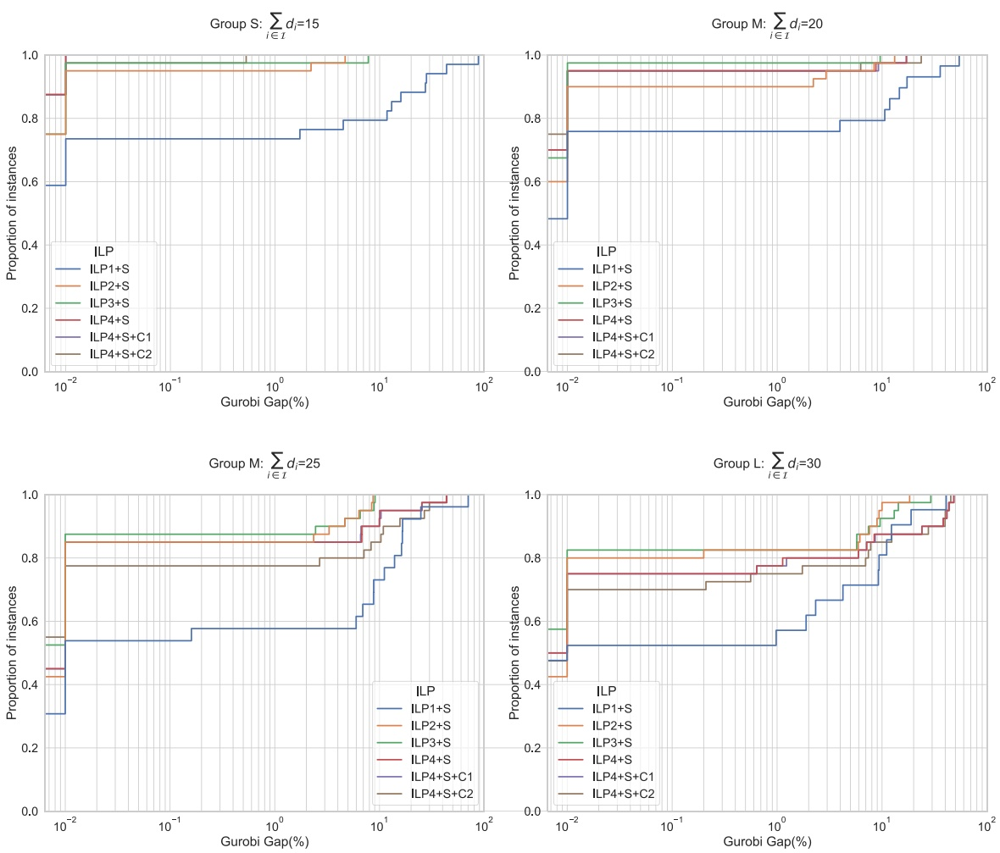

Fig. 6. Gurobi gap GGap profile (expressed in percentage, log10 scale).

Table 6 Instances’ parameters.

| Parameters | Value |
| --- | --- |
| $L_{\min}$ | = 10%. $\sum_{i\in\mathcal{I}}l_i$ |
| $(d_i^{lb})_{(i\in\mathcal{I})}$ | = $(d_i)_{(i\in\mathcal{I})}$ |
| $(d_i^{ub})_{(i\in\mathcal{I})}$ | = 10% * $(d_i)_{(i\in\mathcal{I})} + (d_i)_{(i\in\mathcal{I})}$ |
| $lb_p$ | = $\frac{\sum_{i\in\mathcal{I}}w_i.l_i.d_i}{\max_{j_i\in\mathcal{J}}W_j}$ |
| $ub_p$ | = $\sum_{i\in\mathcal{I}}l_i.d_i + 10\%$ |
| $P_{\min}$ | = $\min_{i\in\mathcal{I}}l_i$ |
| $P_{\max}$ | = 1500 cm (mono-objective 2D-VSCSP) |
| $P_{\max}$ | ∈ {500, 1000, 1500} cm (bi-objective 2D-VSCSP) |
| $lb_c$ | = $\left\lceil \frac{lb_p}{P_{\max}} \right\rceil$ |
| P | = $\left\lfloor \frac{\sum_{i\in\mathcal{I}}(l_i*d_{i,j})}{\min(l_i)} \right\rfloor$, where: $\widetilde{d}_{i,j} = \left\lceil \frac{d_i}{n_{i,j}} \right\rceil$ and $n_{i,j} = \left\lfloor \frac{W_j}{w_i} \right\rfloor$ |
| A | = $\frac{W_j}{\min w_i}$ |
| B | = $\frac{\widetilde{f}_{\max}}{\min l_i}$. |

Analysis of the GGap Fig. 6 shows the GGap profile for all the ILP-k+S, k ∈ {1, 2, 3, 4}, ILP-4+S+C1 and ILP-4+S+C2 formulations in the GGap interval [0, 100], using a $l o g _ { 1 0 }$ scale.

From the results shown in Fig. 6, we can make the following observations:

i) In the case of the (S) group of instances, where $I ^ { \prime } = 1 5 ,$ the ILP-4+S performed better than all the others, with all instances solved with a GGap of less than 0.01%. However, in the case of the (M) group, where I = 20 or = 25, the $\mathrm{ILP}-4+\mathrm{S}$ was overtaken by the ILP-2+S and the $\mathrm{ILP}-3+\mathrm{S}$ . This was particularly noticeable for $I ^ { \prime } = 2 5 ,$ where all instances solved had a GGap of less than 9% for the

<small>2 Data and detailed parameters on the ’RG’ instances can be consulted in the first author’s git-lab repository at: [https://gitlab.com/KhadijaHS/2D-VSCSP.](https://gitlab.com/KhadijaHS/2D-VSCSP)</small>

<small>3 Detailed information about the structure of the original RW benchmarks can be found in the first author’s git-lab repository at: [https://gitlab.com/KhadijaHS/2D-VSCSP.](https://gitlab.com/KhadijaHS/2D-VSCSP)</small>

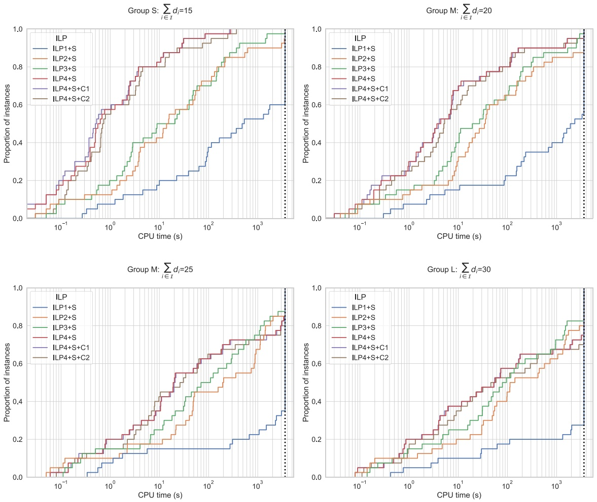

Fig. 7. CPU Time profile (expressed in seconds, log10 scale).

ILP-2+S and ILP-3+S, while the maximum GGap for the ILP-4+S was around 13.5%. On the other hand, in the case of the (L) group, where $I ^ { \prime } = 3 0 ,$ the ILP-2+S formulation had the smallest maximum GGap, with a value of less than 11%;

ii) The ILP-1+S was the worst ILP but had the best bounds overall;

iii) The combination of the ILP-4+S with the cutting plane inequalities did not prove successful, i.e. the ILP-4+S+C1 had the same behavior as the ILP-4+S, and the ILP-4+S+C2 was slightly worse, except in the case of the (L) group.

Analysis of the CPU time profiles Fig. 7 shows the CPU time profiles for all the ILP-k+S, k ∈ {1, 2, 3, 4}, ILP-4+S+C1 and ILP-4+S+C2 formulations in the CPU time interval [1, 3600] (expressed in seconds), using a $l o g _ { 1 0 }$ scale. If the profile reached a proportion of value 1 then all instances were solved within the time limit. Otherwise, the proportion of instances solved was reached when the profile crossed the dotted line, which represents the time limit.

In the CPU time profiles, it is clear that the ILP-4+S and its derived variants (ILP-4+S+C1 and ILP-4+S+C2) were by far the fastest of the ILP formulations for the (S) group. However, with the increase in the total piece type demands, the difference with both the ILP-2+S and ILP-3+S decreased. For $I ^ { \prime } \geq 2 5$ and until around 15 minutes of computation time, the ILP-4+S was still the formulation with the highest proportion of instances solved. In the same way, it was thanks to the remaining available computation time (until the time limit of 1 hour) that both the ILP-2+S and ILP-3 solved more instances than the ILP-4+S, with the ILP-3+S slightly ahead. Finally, in the comparison with all other ILP formulations, the ILP-1+S reached its time limit in a smaller proportion of instances when it did not return any feasible result.

On the other hand, Table 7 reports, for each of the ILP-k+S, k ∈ {1, 2, 3, 4}, ILP-4+S+C1 and ILP-4+S+C2 formulations, the average value of the GGaps and the average of its total CPU time (column 2), the average value of the Gaps (column 3), and the number of instances optimally solved within the time limit (column 4). The GGap is defined as the difference between the best feasible solution and the best lower bound found by the Gurobi optimizer at the end of the CPU time limit (3600 seconds). However, the Gap was calculated using the following formula, where z∗ was the solution value provided by the Gurobi optimizer and the best z was given by the value of the best solution found among all ILPs.

$$
\text {Gap} = \frac {z ^ {*} - \text {best} z}{\text {best} z} * 1 0 0
$$

In the column of nb solved inst.: N gives the number of instances optimally solved for each class of instances: (S), (M) and (L); CPU(s) is the average CPU time; and the TOTAL column computes the total number of instances optimally solved for each of the ILP-k+S, k ∈ {1, 2, 3, 4}, ILP-4+S+C1 and ILP-4+S+C2 formulations (and, in parentheses, the average of total CPU time).

The results from this table confirm the clear superiority of the ILP-4+S and its variants (ILP-4+S+C1 and ILP-4+S+C2) over the other formulations. The the ILP-4+S and ILP-4+S+C1 were able to optimally solve 97 instances, out of 160, in less than 11 seconds on average, while the ILP-4+S+C2 solved 98 in less than 20 seconds on average, all within the time limit. The ILP-2+S and ILP-3+S had the same behavior in terms of the average GGap and the average relative Gap. However, the ILP-3+S was able to optimally solve 90 instances (117.79 seconds on average).

Table 7

Average of GGap(%), Gap(%) and CPU(s) for the non-exact extension of the ILP-k+S, k ∈ {1, 2, 3, 4}, ILP-4+S+C1 and ILP-4+S+C2 formulations. The best values for each metric are in blue, and the darker the better.

<table><tr><td rowspan="2">Models</td><td colspan="6">avg. GGap</td><td colspan="3">avg. Gap</td><td colspan="6">nb solved inst.</td><td></td></tr><tr><td>S</td><td></td><td>M</td><td></td><td>L</td><td></td><td>S</td><td>M</td><td>L</td><td>S</td><td></td><td>M</td><td></td><td>L</td><td></td><td>TOTAL</td></tr><tr><td></td><td>Gap(%)</td><td>CPU(s)</td><td>Gap(%)</td><td>CPU(s)</td><td>Gap(%)</td><td>CPU(s)</td><td></td><td></td><td></td><td>N</td><td>CPU(s)</td><td>N</td><td>CPU(s)</td><td>N</td><td>CPU(s)</td><td></td></tr><tr><td>ILP-1+S</td><td>6.88</td><td>1619.7</td><td>6.33</td><td>2305.85</td><td>5.29</td><td>2748.72</td><td>6.36</td><td>0.24</td><td>0.24</td><td>17</td><td>226.13</td><td>22</td><td>308.69</td><td>7</td><td>573.13</td><td>46 (318.4)</td></tr><tr><td>ILP-2+S</td><td>0.17</td><td>404.86</td><td>0.75</td><td>760.56</td><td>1.66</td><td>1084.27</td><td>0</td><td>0</td><td>0.01</td><td>29</td><td>57.13</td><td>39</td><td>75.78</td><td>12</td><td>91.74</td><td>80 (71.41)</td></tr><tr><td>ILP-3+S</td><td>0.19</td><td>223.99</td><td>0.51</td><td>572.07</td><td>2.12</td><td>883.92</td><td>0</td><td>0</td><td>0.01</td><td>26</td><td>36.02</td><td>42</td><td>90.98</td><td>22</td><td>265.6</td><td>90 (117.79)</td></tr><tr><td>ILP-4+S</td><td>0</td><td>12.83</td><td>1.6</td><td>585.02</td><td>5.47</td><td>1121.7</td><td>0.09</td><td>0.03</td><td>0.22</td><td>35</td><td>2.91</td><td>43</td><td>8.35</td><td>19</td><td>28.45</td><td>97 (10.32)</td></tr><tr><td>ILP-4+S+C1</td><td>0</td><td>12.48</td><td>1.61</td><td>591.91</td><td>5.47</td><td>1122.49</td><td>0.09</td><td>0.03</td><td>0.22</td><td>35</td><td>2.88</td><td>43</td><td>8.58</td><td>19</td><td>28.1</td><td>97 (10.35)</td></tr><tr><td>ILP-4+S+C2</td><td>0</td><td>22.69</td><td>2.31</td><td>619.41</td><td>5.84</td><td>1212.52</td><td>0.09</td><td>0.03</td><td>0.19</td><td>34</td><td>5.85</td><td>47</td><td>11.9</td><td>17</td><td>67.51</td><td>98 (19.44)</td></tr></table>

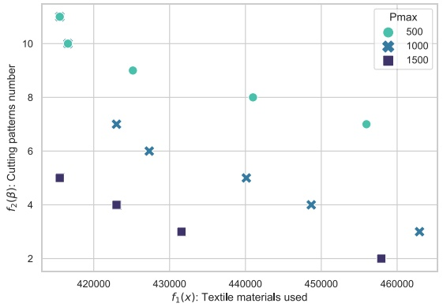

(a)

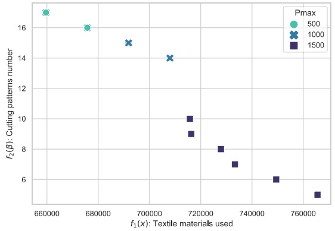

(b)

Fig. 8. Pareto front from the --constraint method (min $f _ { 1 } ( x ) s . t . f _ { 2 } ( \beta ) \leq \epsilon _ { 2 } )$ for instances (a) inst\_3\_5\_15\_9 from class (S)-1 and (b) inst\_6\_5\_20\_1 from class (M)-6.

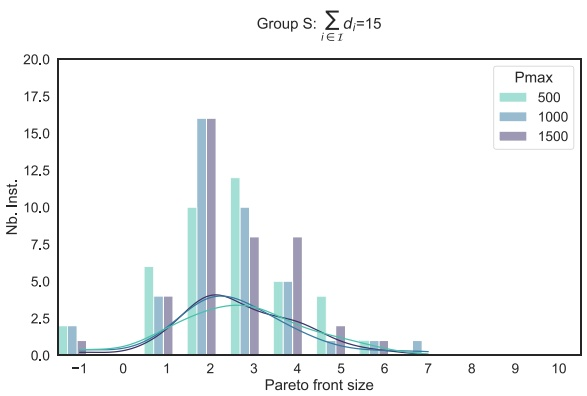

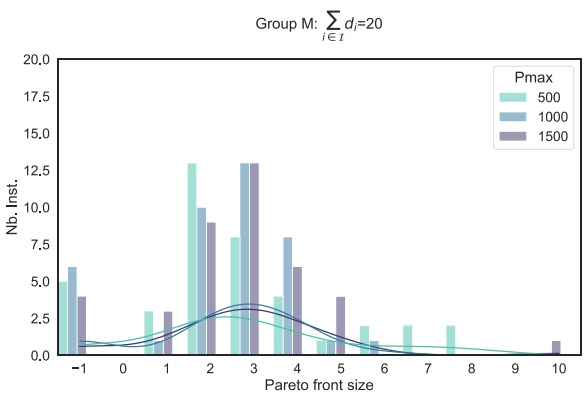

Fig. 9. Pareto front size vs. number of the 40 instances per group (S) or (M).

These ILP formulations results show that it is possible to tackle the 2D-VSCSP in different manners. In fact, when we consider decision variables indexed by piece type width, using the ILP-2+S provides good results for a large group of instances. In the same way, when we consider decision variables indexed by piece type, the ILP-3+S is as good as the ILP-2+S for the (M) group of instances. However, encoding the 2D-VSCSP as a variant of the 1D-BPP, the ILP-4+S and its derived variants remain the most efficient for instances with a big number of piece types and a small demand. In summary, the ILP-4 is the distinct winner and should be used with the --constraint method in the resolution of the biobjective 2D-VSCSP in the next section.

Figs. 3, 4, 5, 6, 7, 8, 9 and 10 from the Appendix 4 provide more detailed information about the numerical results related to the ILP-k+S, k ∈ {1, 2, 3, 4}, $\mathrm{ILP}-4+\mathrm{S}+\mathrm{C}1$ and $\mathrm{ILP}-4+\mathrm{S}+\mathrm{C}2$ formulations by including symmetry-breaking or/and cutting plane inequalities on the ’RG instances.

## 7. A bi-objective variant of the 2D-VSCSP

In general, multi-objective combinatorial optimization (MOCO) problems involve more than one conflicting objective to be optimized and various constraints to be met simultaneously. The goal is to find a set of solutions that do not have any constraint violations and are as good as possible regarding all of their objectives. General MOCO problems are formulated as:

$$
\min z = (f _ {1} (x), f _ {2} (x), \dots , f _ {n} (x) \quad \text {s.t.} \quad x \in \mathcal {X}\tag{5}
$$

where z is the vector of n objective functions; x is the vector of the decision variables; and X is the solution space (set of feasible solutions).

## 7.1. A bi-objective mathematical model for the bi-objective 2D-VSCSP

The simultaneous minimization of the total fabric area used and of the total number of cuts is one of the challenges that the home textile industry faces. In this paper, we consider a bi-objective variant of the 2D-VSCSP to tackle this challenge. The first goal is to minimize the total fabric area used, as described in Section 2 for the mono-objective variant of the 2D-VSCSP. The second goal is to minimize the number of cutting patterns, which substantially impacts the cutting process, which is manual, and the operator controls a cutting machine that needs to be adjusted according to the cutting pattern.

A higher number of cutting patterns requires a higher setup of the cutting machine, resulting in more operational costs.

To describe the bi-objective mathematical model, we assume hereafter the same notations (sets and parameters) used in Section 4. In the same way, we consider all variables and constraints used to define the $\mathtt { I L P - } 4$ , which was the tightest formulation for the mono-objective variant of the 2D-VSCSP, as described in Section 6. However, we define a new set of two objective functions as follows: the first objective function is $f _ { 1 } ,$ which measures the total amount of textile materials used, and the second one is $f _ { 2 } ,$ which measures the number of cutting patterns.

$$
f _ {1} (x) = \sum_ {j \in \mathcal {J}} W _ {j}. x _ {j}\tag{6a}
$$

$$
f _ {2} (\beta) = \sum_ {j \in \mathcal {J}} \sum_ {i \in \mathcal {I} ^ {\prime}} \beta_ {i, i} ^ {j}\tag{6b}
$$

In this case, a valid ILP formulation for the bi-objective 2D-VSCSP, through a 2-stage exact or non-exact cuts, is the following:

$$
\begin{array}{r l} \min z = & (f _ {1} (x), f _ {2} (\beta)) \quad \text {s.t. ILP - 4 constraints} \\ & + (S 1. \alpha) + (S 2. \alpha) + (S 1. \beta) \end{array}\tag{6}
$$

Multi-objective problems have a rich literature, in which several resolution approaches have been proposed. A review of the literature on MOCO problems can be found in Ehrgott & Gandibleux (2003). Among the well-known exact methods, we can find the weighting sum algorithms and the --constraint method, according to Miettinen (2012), Ehrgott & Gandibleux (2003) and Aliano Filho, Moretti, & Pato (2017). These methods consist of finding the Pareto-optimal solutions.4 In this paper, we propose an --constraint method to solve the bi-objective variant of the 2D-VSCSP.

## 7.2. An --constraint method

An --constraint method generates single objective subproblems, called --constraint problems, by transforming all but one objective into constraints and setting an upper bound - for each of them. This means that if we set up the upper bounds in an appropriate manner, it is possible to reach the Pareto-optimal solutions. In this paper, we select the objective function $f _ { 1 } ( x )$ to be minimized, and we convert the objective function $f _ { 2 } ( \beta )$ into the constraint (7a). Thus, (6) becomes:

$$
\min z = f _ {1} (x) \quad \text {s.t. ILP - 4 constraints + + (S1.\alpha) + (S2.\alpha) + (S1.\beta)}
$$

and we include the following inequality in the set of constraints:

$$
f _ {2} (\beta) \leq \epsilon_ {2}\tag{7a}
$$

A systematic variation of $\epsilon _ { 2 }$ can be used to generate a Pareto front (see Hwang & Masud, 2012). This is illustrated in Algorithm 1, which gives the pseudo-code of the --constraint method applied to the bi-objective variant of the 2D-VSCSP. The idea of this implementation is to iteratively increase the constraint bound by a pre-defined constant $\varrho$ (key parameters). To get the exact Pareto front,  should be set to the smallest value, i.e. 1 for integer functions.

<small>4 A solution is Pareto-optimal if no objective function can be improved without degrading at least one of the other objective functions.</small>

Algorithm 1: bi-objective $\epsilon$-constraint method for the 2D-VSCSP.

Input: Objective bounds $f_2, \overline{f_2} \in \mathbb{R}$ and increment $\varrho \in \mathbb{R}$
Output: Set of Pareto-optimal decision vectors $S$
$S \leftarrow \emptyset$ ;
$\epsilon_2 \leftarrow \overline{f_2}$ ;
while $\epsilon_2 \geq f_2$ do
    $s \leftarrow \text{ILP} - 4\text{Bis} ^1(z, \epsilon_2)$ ;
    if $\not\simeq s' \in S$ such that $s' &gt; s$ then
        $S \leftarrow S \cup \{s\}$ ;
    end
    $\epsilon_2 \leftarrow \epsilon_2 - \varrho$ ;
end

## 7.3. Experiments on the --constraint: results for exact Pareto fronts

In this section, we measure the quality and performance of the bi-objective approach. We solved the proposed --constraint using the Gurobi Optimizer 9.1 solver and the code is written in Python 3.8.

To evaluate the performance of the proposed method for the biobjective 2D-VSCSP, we computed the Pareto front obtained by the --constraint approach on the instances described in Section 6.2. We considered only the first eight classes presented in Table 5, where each class contains 10 instances. We also set 360 seconds as the maximum run-time for each iteration when running the --constraint approach. Fig. 8 illustrates Pareto fronts for the two instances that had the highest Pareto front size from both the (S) and (M) groups. By varying the cutting table length $P _ { \mathrm { m a x } }$ in {500, 1000, 1500}, we obtained three Pareto fronts. Each point from each Pareto front represents the values of the objective functions of the corresponding solution, i.e. the total amount of textile material used and the number of cutting patterns.

We chose these instances because they have a significant dimension that provided a sufficient number of points for the Pareto front: instance inst\_3\_5\_15\_9 from group (S)-class 1 has 7 solutions where $P _ { \mathrm { m a x } } = 1 0 0 0 ,$ and instance inst\_6\_5\_20\_1 from group (M)- class 6 has 10 solutions where $P _ { \mathrm { m a x } } = 1 5 0 0 .$ It should be noted that as the number of generated cutting patterns increases, the value of the total amount of textile materials used decreases, and vice versa, demonstrating the trade-off between them. Hence, there are various solutions for the 2D-VSCSP. This behavior was observed in all instance classes. The trade-off noted in the results indicates a negative correlation between the objective functions: the textile materials used and the number of cutting patterns.

(7)

Figs. 9 and 10 illustrate numerical results in terms of the number of instances and $G a p _ { P F } ( \overline { { \% } } )$ for each Pareto front size obtained for instances of groups (S) and (M), except eight instances that were not solved within the time limit of 360 seconds for each iteration. These eight instances are represented in the histogram as having a Pareto front size of -1, two and six instances from the (S) and (M) groups, respectively.

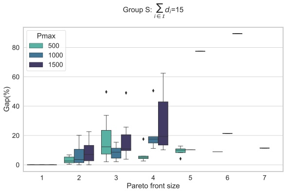

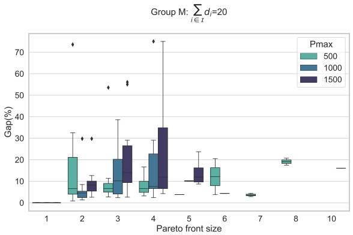

Fig. 10. Pareto front size vs. GapPF (%) for the 40 instances per group (S) or (M).

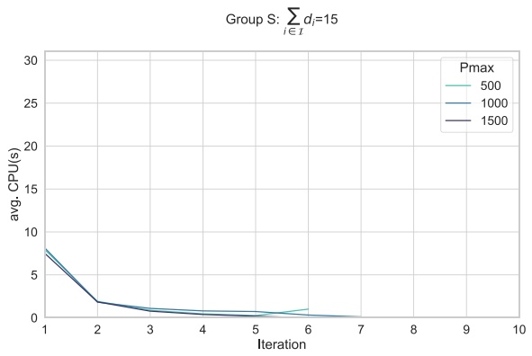

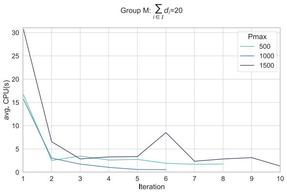

Fig. 11. Iteration vs. average CPU(s) time of the 40 instances per group (S) or (M).

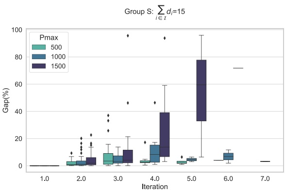

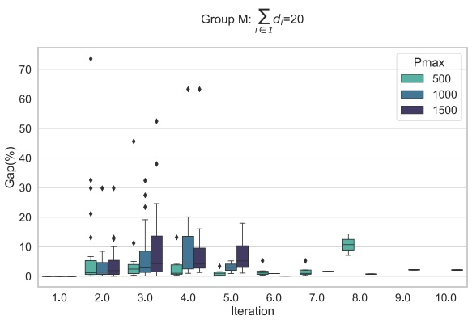

Fig. 12. Iteration vs. $G a p _ { i t e r }$ (%) for the 40 instances per group (S) or (M).

The value of $G a p _ { P F } ( \% )$ is computed by the following formula: $100 * \frac{\max\{f_{1}(x)\} - \min\{f_{1}(x)\}}{\min\{f_{1}(x)\}}$ , where $\operatorname* { m a x } \{ f _ { 1 } ( x ) \}$ and min{f1(x)} are, respectively, the maximum and minimum total amount of textile materials used in the extreme solutions of the Pareto front.

These results show that the majority (around 70∼80% of instances) of the provided Pareto fronts had a size between 2 and 4 regardless of the $P _ { \mathrm { m a x } }$ value. In addition, the number of generated cutting patterns generally varied in the interval of [1,7], except for some instances from the (M) group, where this number reached a maximum value of 10 in the case of $P _ { \mathrm { m a x } } = 5 0 0 \mathrm { o r } 1 5 0 0 .$ This could be due to the fact that the two objectives were weakly in conflict. However, as shown in Fig. 10, even if the average gap between the extreme solutions was less than 20% regardless of the Pareto front sizes with $P _ { \mathrm { m a x } } = 5 0 0$ , 1000, it was correlated to the Pareto front size in the case of $P _ { \mathrm { m a x } } = 1 5 0 0$

On the other hand, Figs. 11 and 12 give, for each iteration from the --constraint method, the average CPU(s) time of the

40 instances per group (S) or (M), and the $G a p _ { i t e r }$ (%), respectively. It should be noted that the $G a p _ { i t e r } ~ ( \% )$ corresponds to a variant of the crowding metric used in multi-objective optimization literature and was computed by the following formula: 100 ∗ $\frac { f _ { 1 } ( x _ { i t e r _ { i + 1 } } )   -   f _ { 1 } ( x _ { i t e r _ { i } } ) } { G a p _ { P F } }$ , where $f _ { 1 } ( x _ { i t e r _ { i } } )$ and $f _ { 1 } ( x _ { i t e r _ { i + 1 } } )$ are, respectively, the solution value at iteration i and the solution value at iteration $i + 1$

The results from Fig. 11 show that overall the average CPU(s) did not exceed 7 seconds, regardless of the Pareto front sizes with $P _ { \mathrm { m a x } } = 5 0 0 , 1 0 0 0 , 1 5 0 0$ and for instances from group (S). However, iterations for instances from group (M) had the highest $\operatorname { C P U } ( s )$ value on average, in particular where $P _ { \mathrm { m a x } } = 1 5 0 0 ,$ and with a slight increase in the other two cases $( P _ { \mathrm { m a x } } = 5 0 0 , 1 0 0 0 )$ In addition, as shown in Fig. 12, the $G a p _ { i t e r } ~ ( \% )$ increased (around 60%). This was clearly observed in the case of $P _ { \mathrm { m a x } } = 1 5 0 0$ , with a Pareto front size of less than 5, and of the instance group (S). Furthermore, iterations of instances from group (M) had approximately the same behavior, in particular where $P _ { \mathrm { m a x } } = 5 0 0 .$

## 8. Conclusion and future work

This paper presented different mathematical models, in terms of integer linear programming, to deal with the two-dimensional Variable-Sized Cutting Stock Problem (2D-VSCSP) arising from the home textile industry. Two variants of the problem were considered: the mono-objective 2D-VSCSP, in which the total amount of textile material used in the production had to be minimized, and the bi-objective 2D-VSCSP, in which the number of generated cutting patterns had to be minimized in addition. The quality of the proposed models was assessed over a range of tests (randomly generated instances) and the results were promising.

With the numerical results presented in this paper, we have shown that dealing with this kind of problem remains challenging in the context of the C&P problems. In fact, minimizing the amount of textile material used has been widely considered, but combining it with minimizing the number of generated cutting patterns is a new challenge. The trade-off between these two problems has the potential to improve industry decisions. This means that in opposition to the mono-objective models, using a multi-objective model provides more opportunities for the decision-maker to plan the production level using the Pareto-optimal solutions. These results can also be useful for other industries (e.g. wood, paper, furniture), which deal with 2D-CSP applications.

Future research lies on the study of the 2D-VSCSP with defects and/or under stochastic demands through the traditional two-stage stochastic programming approach. Robust optimization tools may also be useful to derive robust combined production and cutting stock models to deal with uncertainty parameters. In addition, using Machine Learning (ML) and Data Mining (DM) techniques to assess the quality of solutions for the 2D-VSCSP is also a promising topic for further research.

## Disclosure statement

No potential conflict of interest was reported by the author(s).

## Funding

This work is financed by the ERDF [European Regional Development Fund](https://doi.org/10.13039/501100008530) through the Operational Program for Competitiveness and Internationalization - COMPETE 2020 Program and by National Funds through the Portuguese funding agency, FCT - Fundação para a Ciência e a Tecnologia, I.P., within project POCI-01-0145-FEDER-029609.

## Acknowledgements

The authors would like to thank the editor and anonymous reviewers for their careful reading and useful comments.

## Supplementary material

Supplementary material associated with this article can be found, in the online version, at doi:[10.1016/j.ejor.2022.08.018.](https://doi.org/10.1016/j.ejor.2022.08.018)

## References

[Aliano Filho, A., Moretti, A. C., & Pato, M. V. (2017). A comparative study of exact methods for the bi-objective integer one-dimensional cutting stock problem. Journal of the Operational Research Society, 1–18.](http://refhub.elsevier.com/S0377-2217%2822%2900661-0/sbref0001)

[Alves, C., & De Carvalho, J. V. (2008). A stabilized branch-and-price-and-cut algorithm for the multiple length cutting stock problem. Computers & Operations Research, 35(4), 1315–1328.](http://refhub.elsevier.com/S0377-2217%2822%2900661-0/sbref0002)

[Bangun, P. B., Octarina, S., & Pertama, A. P. (2019). Implementation of branch and cut method on n-sheet model in solving two dimensional cutting stock problem. Journal of Physics: Conference Series, 1282, 012012. IOP Publishing](http://refhub.elsevier.com/S0377-2217%2822%2900661-0/sbref0003)

[Belov, G., & Scheithauer, G. (2002). A cutting plane algorithm for the one-dimensional cutting stock problem with multiple stock lengths. European Journal of Operational Research, 141(2), 274–294.](http://refhub.elsevier.com/S0377-2217%2822%2900661-0/sbref0004)

[Belov, G., & Scheithauer, G. (2006). A branch-and-cut-and-price algorithm for one-dimensional stock cutting and two-dimensional two-stage cutting. European Journal of Operational Research, 171(1), 85–106.](http://refhub.elsevier.com/S0377-2217%2822%2900661-0/sbref0005)

[Bouaine, A., Lebbar, M., & Ha, M. A. (2018). Minimization of the wood wastes for an industry of furnishing: A two dimensional cutting stock problem. Management and Production Engineering Review.](http://refhub.elsevier.com/S0377-2217%2822%2900661-0/sbref0006)

[Brooks, L., Smith, C., & Stone, A. (1940). WT Tutte the dissection of rectangles into squares. Duke Mathematical Journal, 7, 312–340.](http://refhub.elsevier.com/S0377-2217%2822%2900661-0/sbref0007)

[Cintra, G. F., Miyazawa, F. K., Wakabayashi, Y., & Xavier, E. C. (2008). Algorithms for two-dimensional cutting stock and strip packing problems using dynamic programming and column generation. European Journal of Operational Research, 191(1), 61–85.](http://refhub.elsevier.com/S0377-2217%2822%2900661-0/sbref0008)

[Côté, J.-F., & Iori, M. (2018). The meet-in-the-middle principle for cutting and packing problems. INFORMS Journal on Computing, 30(4), 646–661.](http://refhub.elsevier.com/S0377-2217%2822%2900661-0/sbref0009)

[Cui, Y. (2008). Heuristic and exact algorithms for generating homogenous constrained three-staged cutting patterns. Computers & Operations Research, 35(1), 212–225.](http://refhub.elsevier.com/S0377-2217%2822%2900661-0/sbref0010)

Cui, Y., & Liu, Z. (2011). C-sets-based sequential heuristic procedure for the onedimensional cutting stock problem with pattern reduction. Optimization Methods and Software, 26(1), 155–167. [https://doi.org/10.1080/10556780903420531.](https://doi.org/10.1080/10556780903420531)

Cui, Y., Yang, L., Zhao, Z., Tang, T., & Yin, M. (2013). Sequential grouping heuristic for the two-dimensional cutting stock problem with pattern reduction. International Journal of Production Economics, 144(2), 432–439. [https://doi.org/10.1016/j.ijpe.2013.03.011.](https://doi.org/10.1016/j.ijpe.2013.03.011)

Cui, Y., Zhao, X., Yang, Y., & Yu, P. (2008). A heuristic for the one-dimensional cutting stock problem with pattern reduction. Proceedings of the Institution of Mechanical Engineers, Part B: Journal of Engineering Manufacture, 222(6), 677–685. [https://doi.org/10.1243/09544054JEM966.](https://doi.org/10.1243/09544054JEM966)

Cui, Y., Zhong, C., & Yao, Y. (2015). Pattern-set generation algorithm for the onedimensional cutting stock problem with setup cost. European Journal of Operational Research, 243(2), 540–546. [https://doi.org/10.1016/j.ejor.2014.12.015.](https://doi.org/10.1016/j.ejor.2014.12.015)

[Delorme, M., Iori, M., & Martello, S. (2016). Bin packing and cutting stock problems: Mathematical models and exact algorithms. European Journal of Operational Research, 255(1), 1–20.](http://refhub.elsevier.com/S0377-2217%2822%2900661-0/sbref0015)

[Delorme, M., Iori, M., & Martello, S. (2017). Logic based benders’ decomposition for orthogonal stock cutting problems. Computers & Operations Research, 78, 290–298.](http://refhub.elsevier.com/S0377-2217%2822%2900661-0/sbref0016)

[Delorme, M., Iori, M., & Martello, S. (2018). Bpplib: A library for bin packing and cutting stock problems. Optimization Letters, 12(2), 235–250.](http://refhub.elsevier.com/S0377-2217%2822%2900661-0/sbref0017)

[Dolan, E. D., & Moré, J. J. (2002). Benchmarking optimization software with performance profiles. Mathematical Programming, 91(2), 201–213.](http://refhub.elsevier.com/S0377-2217%2822%2900661-0/sbref0018)

[Dyckhoff, H. (1990). A typology of cutting and packing problems. European Journal of Operational Research, 44(2), 145–159.](http://refhub.elsevier.com/S0377-2217%2822%2900661-0/sbref0019)

[Dyckhoff, H., Scheithauer, G., & Terno, J. (1997). Cutting and packing. Annotated bibliographies in combinatorial optimization, 393–412.](http://refhub.elsevier.com/S0377-2217%2822%2900661-0/sbref0020)

[Ehrgott, M., & Gandibleux, X. (2003). Multiobjective combinatorial optimization’ theory, methodology, and applications. In Multiple criteria optimization: State of the art annotated bibliographic surveys (pp. 369–444). Springer.](http://refhub.elsevier.com/S0377-2217%2822%2900661-0/sbref0021)

ESICUP (1988). Euro special interest group on cutting and packing [https://www.euro-online.org/websites/esicup/.](https://www.euro-online.org/websites/esicup/)

[Faina, L. (1999). An application of simulated annealing to the cutting stock problem. European Journal of Operational Research, 114(3), 542–556.](http://refhub.elsevier.com/S0377-2217%2822%2900661-0/sbref0023)

[Faina, L. (2000). A global optimization algorithm for the three-dimensional packing problem. European Journal of Operational Research, 126(2), 340–354.](http://refhub.elsevier.com/S0377-2217%2822%2900661-0/sbref0024)

Foerster, H., & Wäscher, G. (2000). Pattern reduction in one-dimensional cutting stock problems. International Journal of Production Research, 38(7), 1657–1676. [https://doi.org/10.1080/002075400188780.](https://doi.org/10.1080/002075400188780)

[Furini, F., & Malaguti, E. (2013). Models for the two-dimensional two-stage cutting stock problem with multiple stock size. Computers & Operations Research, 40(8), 1953–1962.](http://refhub.elsevier.com/S0377-2217%2822%2900661-0/sbref0026)

[Furini, F., Malaguti, E., Durán, R. M., Persiani, A., & Toth, P. (2012). A column generation heuristic for the two-dimensional two-staged guillotine cutting stock problem with multiple stock size. European Journal of Operational Research, 218(1), 251–260.](http://refhub.elsevier.com/S0377-2217%2822%2900661-0/sbref0027)

[Furini, F., Malaguti, E., & Thomopulos, D. (2016). Modeling two-dimensional guillotine cutting problems via integer programming. INFORMS Journal on Computing, 28(4), 736–751.](http://refhub.elsevier.com/S0377-2217%2822%2900661-0/sbref0028)

[Garey, M. R., & Johnson, D. S. (1979). Computers and intractability: A guide to the theory of NP-completeness: vol. 174. Freeman San Francisco.](http://refhub.elsevier.com/S0377-2217%2822%2900661-0/sbref0029)

[Gilmore, P. C., & Gomory, R. E. (1965). Multistage cutting stock problems of two and more dimensions. Operations Research, 13(1), 94–120.](http://refhub.elsevier.com/S0377-2217%2822%2900661-0/sbref0030)

[Goulimis, C., & Olivera, A. (2017). KBP: A new pattern reduction heuristic for the cutting stock problem. OR 59: OR Society Annual Conference, 25–43.](http://refhub.elsevier.com/S0377-2217%2822%2900661-0/sbref0031)

[Hadj Salem, K., & Kieffer, Y. (2020). New symmetry-less ilp formulation for the classical one dimensional bin-packing problem. In International computing and combinatorics conference (pp. 423–434). Springer.](http://refhub.elsevier.com/S0377-2217%2822%2900661-0/sbref0032)

[Hifi, M., & Roucairol, C. (2001). Approximate and exact algorithms for constrained (un) weighted two-dimensional two-staged cutting stock problems. Journal of Combinatorial Optimization, 5(4), 465–494.](http://refhub.elsevier.com/S0377-2217%2822%2900661-0/sbref0033)

[Hwang, C.-L., & Masud, A. S. M. (2012). Multiple objective decision making’ methods and applications: A state-of-the-art survey: vol. 164. Springer Science & Business Media.](http://refhub.elsevier.com/S0377-2217%2822%2900661-0/sbref0034)

[Iori, M., de Lima, V. L., Martello, S., Miyazawa, F. K., & Monaci, M. (2021). Exact solution techniques for two-dimensional cutting and packing. European Journal of Operational Research, 289(2), 399–415.](http://refhub.elsevier.com/S0377-2217%2822%2900661-0/sbref0035)

[Kantorovich, L. V. (1960). Mathematical methods of organizing and planning production. Management Science, 6(4), 366–422.](http://refhub.elsevier.com/S0377-2217%2822%2900661-0/sbref0036)

[Kokten, E. S., & Sel, Ç. (2022). A cutting stock problem in the wood products industry: A two-stage solution approach. International Transactions in Operational Research, 29(2), 879–907.](http://refhub.elsevier.com/S0377-2217%2822%2900661-0/sbref0037)

[Lodi, A., Martello, S., & Monaci, M. (2002). Two-dimensional packing problems: A survey. European Journal of Operational Research, 141(2), 241–252.](http://refhub.elsevier.com/S0377-2217%2822%2900661-0/sbref0038)

[Lodi, A., & Monaci, M. (2003). Integer linear programming models for 2-staged two-dimensional knapsack problems. Mathematical Programming, 94(2–3), 257–278.](http://refhub.elsevier.com/S0377-2217%2822%2900661-0/sbref0039)

[Macedo, R., Alves, C., & De Carvalho, J. V. (2010). Arc-flow model for the two-dimensional guillotine cutting stock problem. Computers & Operations Research, 37(6), 991–1001.](http://refhub.elsevier.com/S0377-2217%2822%2900661-0/sbref0040)

[Malaguti, E., Durán, R. M., & Toth, P. (2014). Approaches to real world two-dimensional cutting problems. Omega, 47, 99–115.](http://refhub.elsevier.com/S0377-2217%2822%2900661-0/sbref0041)

[Martello, S., & Toth, P. (1990). Knapsack problems: Algorithms and computer implementations. John Wiley & Sons, Inc..](http://refhub.elsevier.com/S0377-2217%2822%2900661-0/sbref0042)

[Martin, M., Morabito, R., & Munari, P. (2020). A top-down cutting approach for modeling the constrained two-and three-dimensional guillotine cutting problems. Journal of the Operational Research Society, 1–15.](http://refhub.elsevier.com/S0377-2217%2822%2900661-0/sbref0043)

[Miettinen, K. (2012). Nonlinear multiobjective optimization: vol. 12. Springer Science & Business Media.](http://refhub.elsevier.com/S0377-2217%2822%2900661-0/sbref0044)

[Mrad, M., Meftahi, I., & Haouari, M. (2013). A branch-and-price algorithm for the two-stage guillotine cutting stock problem. Journal of the Operational Research Society, 64(5), 629–637.](http://refhub.elsevier.com/S0377-2217%2822%2900661-0/sbref0045)

[Octarina, S., Ananda, V., & Yuliza, E. (2019). Gilmore and gomory model on two dimensional multiple stock size cutting stock problem. Journal of physics: Conference series, 1282, 012015. IOP Publishing](http://refhub.elsevier.com/S0377-2217%2822%2900661-0/sbref0046)

[Octarina, S., Juita, D. G., Eliyati, N., & Bangun, P. B. J. (2020). Set covering model in solving multiple cutting stock problem. Science and Technology Indonesia, 5(4), 121–130.](http://refhub.elsevier.com/S0377-2217%2822%2900661-0/sbref0047)

[Oliveira, J. F., & Ferreira, J. S. (1994). A faster variant of the Gilmore and Gomory technique for cutting stock problems. JORBEL, 34(1), 23–38.](http://refhub.elsevier.com/S0377-2217%2822%2900661-0/sbref0048)

[Parreño, F., & Alvarez-Valdes, R. (2021). Mathematical models for a cutting problem in the glass manufacturing industry. Omega, 102432.](http://refhub.elsevier.com/S0377-2217%2822%2900661-0/sbref0049)

[Pisinger, D., & Sigurd, M. (2007). Using decomposition techniques and constraint programming for solving the two-dimensional bin-packing problem. INFORMS Journal on Computing, 19(1), 36–51.](http://refhub.elsevier.com/S0377-2217%2822%2900661-0/sbref0050)

[Poldi, K. C., & Arenales, M. N. (2009). Heuristics for the one-dimensional cutting stock problem with limited multiple stock lengths. Computers & Operations Research, 36(6), 2074–2081.](http://refhub.elsevier.com/S0377-2217%2822%2900661-0/sbref0051)

[Puchinger, J., & Raidl, G. R. (2007). Models and algorithms for three-stage two-dimensional bin packing. European Journal of Operational Research, 183(3), 1304–1327.](http://refhub.elsevier.com/S0377-2217%2822%2900661-0/sbref0052)

[Russo, M., Boccia, M., Sforza, A., & Sterle, C. (2020). Constrained two-dimensional guillotine cutting problem: Upper-bound review and categorization. International Transactions in Operational Research, 27(2), 794–834.](http://refhub.elsevier.com/S0377-2217%2822%2900661-0/sbref0053)

[Scheithauer, G. (2017). Introduction to cutting and packing optimization: Problems, modeling approaches, solution methods: vol. 263. Springer.](http://refhub.elsevier.com/S0377-2217%2822%2900661-0/sbref0054)

[Silva, E., Alvelos, F., & De Carvalho, J. V. (2010). An integer programming model for two-and three-stage two-dimensional cutting stock problems. European Journal of Operational Research, 205(3), 699–708.](http://refhub.elsevier.com/S0377-2217%2822%2900661-0/sbref0055)

[Silva, E., Viães, C., Oliveira, J. F., & Carravilla, M. A. (2015). Integrated cutting and production planning: A case study in a home textile manufacturing company. In Operations research and big data (pp. 213–220). Springer.](http://refhub.elsevier.com/S0377-2217%2822%2900661-0/sbref0056)

[Sumetthapiwat, S., Intiyot, B., & Jeenanunta, C. (2020). A column generation on two-dimensional cutting stock problem with fixed-size usable leftover and multiple stock sizes. International Journal of Logistics Systems and Management, 35(2), 273–288.](http://refhub.elsevier.com/S0377-2217%2822%2900661-0/sbref0057)

Umetani, S., Yagiura, M., & Ibaraki, T. (2003). One-dimensional cutting stock problem to minimize the number of different patterns. European Journal of Operational Research, 146(2), 388–402. [https://doi.org/10.1016/S0377-2217(02)00239-4.](https://doi.org/10.1016/S0377-2217%2802%2900239-4) Cited By 73

Vanderbeck, F. (2000). Exact algorithm for minimizing the number of setups in the one-dimensional cutting stock problem. Operations Research, 48(6), 915–926. [https://doi.org/10.1287/opre.48.6.915.12391.](https://doi.org/10.1287/opre.48.6.915.12391) Cited By 82

[Vanderbeck, F. (2001). A nested decomposition approach to a three-stage, two-dimensional cutting-stock problem. Management Science, 47(6), 864–879.](http://refhub.elsevier.com/S0377-2217%2822%2900661-0/sbref0060)

[Wang, D., Xiao, F., Zhou, L., & Liang, Z. (2020). Two-dimensional skiving and cutting stock problem with setup cost based on column-and-row generation. European Journal of Operational Research.](http://refhub.elsevier.com/S0377-2217%2822%2900661-0/sbref0061)

[Wäscher, G., Haußner, H., & Schumann, H. (2007). An improved typology of cutting and packing problems. European Journal of Operational Research, 183(3), 1109–1130.](http://refhub.elsevier.com/S0377-2217%2822%2900661-0/sbref0062)

[Wuttke, D. A., & Heese, H. S. (2018). Two-dimensional cutting stock problem with sequence dependent setup times. European Journal of Operational Research, 265(1), 303–315.](http://refhub.elsevier.com/S0377-2217%2822%2900661-0/sbref0063)

Yanasse, H., & Limeira, M. (2006). A hybrid heuristic to reduce the number of different patterns in cutting stock problems. Computers and Operations Research, 33(9), 2744–2756. [https://doi.org/10.1016/j.cor.2005.02.026.](https://doi.org/10.1016/j.cor.2005.02.026)

[Yanasse, H. H., Zinober, A. S., & Harris, R. G. (1991). Two-dimensional cutting stock with multiple stock sizes. Journal of the Operational Research Society, 42(8), 673–683.](http://refhub.elsevier.com/S0377-2217%2822%2900661-0/sbref0065)