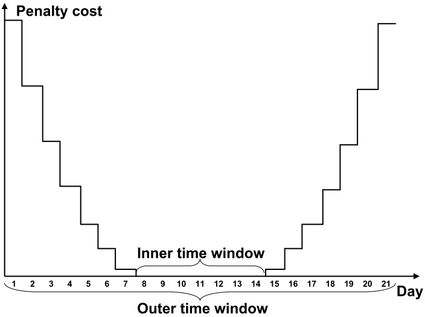
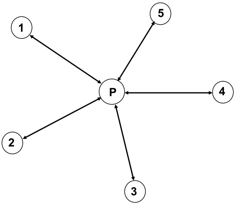
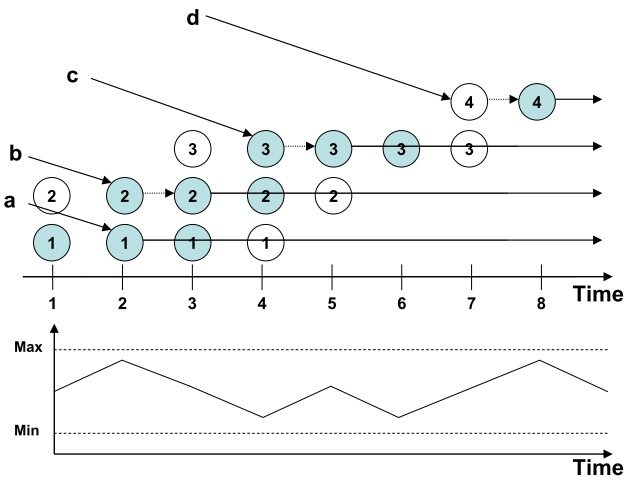
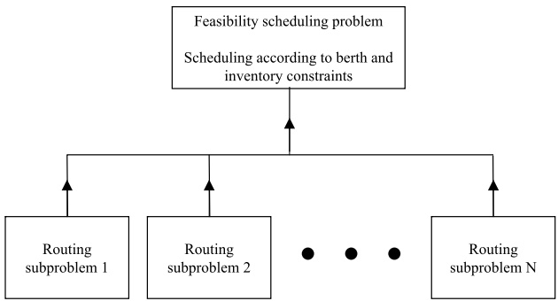
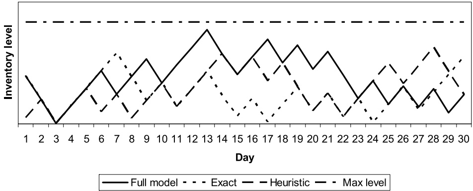
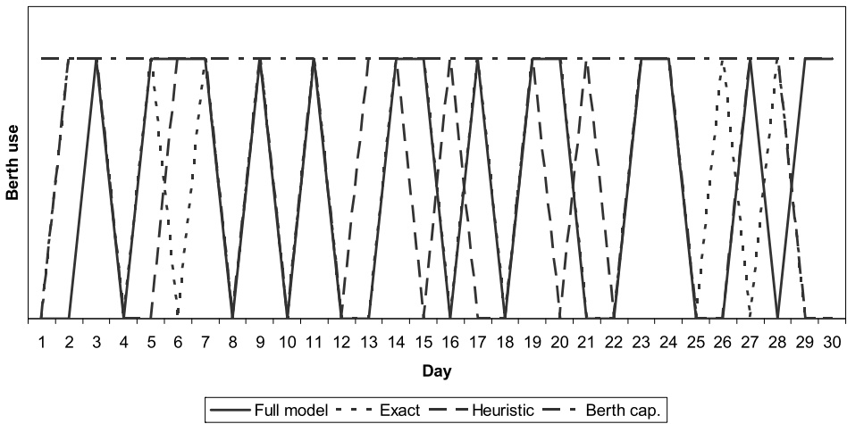

# Routing and scheduling in a liquefied natural gas shipping problem with inventory and berth constraints

**Elin E. Halvorsen-Weare · Kjetil Fagerholt**

Published online: 21 October 2010

© The Author(s) 2010. This article is published with open access at Springerlink.com

**Abstract** Liquefied natural gas (LNG) is natural gas that has been transformed to liquid form for the purpose of transportation, which is mainly done by specially built LNG vessels travelling from the production site to the consumers. We describe a real-life ship routing and scheduling problem from the LNG business, with both inventory and berth capacity constraints at the liquefaction port. We propose a solution method where the routing and scheduling decisions are decomposed. The routing decisions consist of deciding which vessels should service which cargoes and in what sequence. The scheduling decisions are then to decide when to start servicing the cargoes while satisfying inventory and berth capacity constraints. The proposed solution method has been tested on several problem instances based on the real-life problem. The results show that the proposed solution method is well suited to solve this LNG shipping problem.

**Keywords** Maritime transportation · Routing and scheduling · Decomposition · LNG · Inventory constraints

## 1 Introduction

Natural gas is a highly valued energy source. Today it is mainly transported from the production site to consumers in a gaseous state through pipelines, but some production sites are located in remote areas or are otherwise far from the consumers. In these cases, it is not cost efficient to transport the natural gas by pipelines. An option is then to transform the gas into liquefied natural gas (LNG). In this process, the natural gas is liquefied as it is cooled down to a temperature of about −163◦C at atmospheric pressure at a liquefaction port, before it is transported to a regasification port by dedicated LNG vessels.

<small>E.E. Halvorsen-Weare · K. Fagerholt Department of Industrial Economics and Technology Management, Norwegian University of Science and Technology, Alfred Getz veg 3, 7491 Trondheim, Norway</small>

<small>E.E. Halvorsen-Weare (-) Norwegian Marine Technology Research Institute (MARINTEK), Otto Nielsens veg 10, 7052 Trondheim, Norway e-mail: [elin.halvorsen-weare@iot.ntnu.no](mailto:elin.halvorsen-weare@iot.ntnu.no)</small>

The world market for LNG has increased dramatically. The global fleet of LNG vessels has increased from 105 vessels in 1998 to 257 by the start of 2008 (Fearnley 2008). The cost of a new average-sized LNG vessel with carrying capacity of about 145 000 m3 is around USD 200–250 million, and daily time charter rates are around USD 80 000 (depending on the market). There are thus large volumes and high costs involved in this business.

In shipping it is normal to distinguish between three different modes of operations: Industrial, tramp and liner (Lawrence 1972). In industrial shipping the cargo owner also controls a fleet of vessels to transport this cargo. A cargo is a given quantity of product to be shipped from one port to another, often within given time windows. For an industrial shipping problem, all cargoes are mandatory and need to be serviced by the available fleet of vessels, and no optional spot cargoes are considered. The objective is then to minimize transportation costs. Tramp operations are similar to a taxi service where the vessels transport available cargoes. It is normal for an operator in tramp shipping to have some contractual cargoes it is committed to carry and a number of optional cargoes that can be serviced if found profitable. The most common objective is to maximize profit. The liner operations are more like a bus line, where vessels sail prescheduled and published itineraries.

We consider a real industrial ship routing and scheduling problem from the LNG business where cargoes need to be transported from one production/liquefaction port to several consuming/regasification ports. In addition, inventory constraints need to be handled at the liquefaction port to keep inventory levels within minimum and maximum levels. Berth capacity constraints limit the number of vessels that can be at the liquefaction port simultaneously. This planning problem is faced by the world’s largest LNG producer, and involves many LNG vessels and great quantities of LNG to be shipped, and is a large-scale problem compared with most maritime transportation problems due to the number of vessels and cargoes to be shipped. The goal for the LNG producer is to make an annual delivery program (ADP) that specifies deliveries to the customers in the forthcoming year. The producer is contractually committed to make such an annual plan, and it is thus necessary to plan inventory levels and avoid congestion at the liquefaction port many months ahead.

Ship routing and scheduling problems have not received much attention in the literature compared to other similar problems like the vehicle routing problem. The reason for this lack of attention is due to many factors, see the discussion by Christiansen et al. (2004). During the past decade, this trend seems to have turned as more papers on ship routing and scheduling problems and applications have appeared. There are three survey papers on ship routing and scheduling literature: Ronen (1983) considers the earliest years, Ronen (1993) reviews the succeeding decade, while Christiansen et al. (2004) look at the following decade. A comprehensive overview over models used in ship routing and scheduling is given by Christiansen et al. (2007).

The problem we consider can be placed in the category of maritime inventory routing problems. But it differs from a traditional maritime inventory routing problem as we only need to consider the inventory level at the liquefaction (loading) port, and not at the regasification (unloading) ports. In addition, the number of cargoes that are to be shipped are predetermined, while for most maritime inventory routing problems cargoes to pick up and deliver are determined from the inventory levels at both pickup and delivery ports, and port calls and volumes delivered are decided in the planning process. A survey of maritime inventory routing problems is given by Christiansen and Fagerholt (2009).

An inventory constrained maritime routing and scheduling problem was studied by Al-Khayyal and Hwang (2007). The problem considers the transportation of various liquid bulk products from supply ports to demand ports. How much to carry on each vessel is determined by the inventory levels of each product in each port. This problem is thus a complex maritime inventory routing problem and differs from the problem in this paper by considering more than one product, more than one supply port, and having routes visiting more than one demand port. A mixed integer linear programming model was developed for the problem and small problem instances can be solved using a commercial solver. Their model cannot, however, solve large-scale problem instances as the ones we consider.

The LNG supply chain is studied by Andersson et al. (2010). They present two problems, one for a producer and one for a vertically integrated company. The producer’s problem is similar to the one studied in this paper, but it is modeled as a traditional maritime inventory routing problem where cargoes to service are determined from the inventory level at the liquefaction port and the monthly demand at the regasification ports. Andersson et al. (2010) propose a mathematical model for the problem where decision variables consist of deciding which voyages to sail at what time for each vessel. A voyage consists of one return trip to a regasification port from the liquefaction port and thus represents one cargo. The model can be solved for small problem instances only, and the authors point out that real problems need to be solved with specialized solution approaches.

Grønhaug and Christansen (2009) study an inventory routing problem from the LNG business problem. They consider a tactical planning problem for an actor in the LNG business that is responsible for the transportation of LNG and the inventory levels both at liquefaction and regasification ports. This LNG inventory routing problem differs from the problem studied in this paper by considering more than one liquefaction port, and by also handling the sales of LNG and inventory levels at the regasification ports. The problem is formulated both as an arc-flow model and a path flow model with full enumeration of the columns. As the problem is hard to solve, both formulations could only solve small problem instances, and would not be suitable to solve large-scale problems. Grønhaug et al. (2010) propose a branch-and-price-and-cut method for the same problem. A restricted master problem handles the inventory management and port capacity constraints, and vessel routes and schedules are generated in subproblems, one for each vessel. The subproblems correspond to longest path problems with side constraints. Also this method can only find optimal solutions to small problem instances.

The aim of this paper is to present a solution method that can solve an important real-life large-scale ship routing and scheduling problem for the LNG business. The problem consists of creating an ADP for the world’s largest LNG producer. We exploit the structure of the problem to come up with a decomposition scheme where the routing and scheduling decisions are treated separately. A routing decision refers to which vessels are to service which cargoes and in what sequence not considering the inventory and berth capacity constraints. Scheduling decisions refer to when to start servicing the cargoes while ensuring feasibility also with respect to the inventory and berth capacity constraints.

The rest of this paper is organized as follows: First, the LNG ship routing and scheduling problem is described in Sect. 2. Then the proposed solution method is presented in Sect. 3. Section 3.2 presents a mathematical formulation for the ship routing subproblem and Sect. 3.3 provides a mathematical formulation for the corresponding feasibility scheduling problem. The solution method is tested on problem instances derived from the real-life problem in a computational study in Sect. 4. Finally, in Sect. 5 we present some concluding remarks.

## 2 The LNG ship routing and scheduling problem

In this section, we describe the LNG ship routing and scheduling problem. First, a verbal description of the problem is given. The following subsection presents a mathematical formulation for the problem. Finally, the problem is illustrated by a limited example.

## 2.1 Problem description

The problem considered in this paper is a large-scale tactical ship routing and scheduling problem for an LNG producer that involves many vessels and cargoes compared with traditional maritime routing problems. Besides producing LNG, the producer is also responsible for the transportation to customers that are located all over the world. Every year the producer is contractually committed to create and present an annual delivery program (ADP) to the customers. This ADP specifies when customers will receive LNG shipments throughout the year. The problem we describe and solve is the one of creating such an ADP.

The producer controls a heterogeneous fleet of vessels to transport the LNG. The fleet of vessels can be considered fixed during the planning horizon. Each LNG vessel has a given loading capacity and cruising speed, as well as an initial position at the start of the planning horizon that can be a port or a position at sea. They will also have different positions at the end of the planning horizon. Some vessels will be out of service during the planning horizon due to certain preallocated activities, like dry-docking. There will be some vessels that cannot visit certain regasification ports due to the characteristics of the vessels and their compatibility with the ports. In addition, some segments of the fleet are tied to specific contracts. This will be the case when the customers own the vessels, and the contracts specify that the vessels can be used only to service given regasification ports. This is a typical situation in the LNG business. It will therefore be possible to separate the problem into one or more subproblems consisting of the vessels that are restricted to service given customers (and thus also given regasification ports) due to contract specifications or port constraints. The berth capacity and inventory constraints at the liquefaction port will, however, be common for all the subproblems.

The customers’ demands are specified in long-term contracts. These contracts have a duration of several years and specify how much LNG is to be delivered to the customers each year. They also state how the deliveries should be spread throughout the year. This could be that they should be evenly spread, that there should be some seasonal variations or that the deliveries are to be made only during certain months of the year. The actual delivery dates need to be agreed on. This typically takes place as the producer suggests certain delivery dates to a customer, and then the customer either accepts or declines them. The LNG producer may therefore need to make several shipping plans in the process of creating an ADP that all parties can accept. The customers may specify certain dates or time periods where they can or cannot accept a delivery during this process. A customer may have more than one regasification port where LNG should be delivered. Throughout this text, whenever an LNG contract or customer is mentioned, it represents one physical regasification port.

The LNG producer derives an average cargo size based on the LNG vessels’ loading capacities. Time windows for the cargoes are derived from the contractual agreements with the customers. For example, if a contract specifies that deliveries should be evenly spread throughout the year and 12 deliveries are to be made, time windows will be set so that one delivery will be made every month around the same date each month. Thus, what cargoes that should be delivered to what regasification ports and time windows for deliveries will be known. From a time window for delivery, a time window for the corresponding loading can easily be derived by calculating the sailing time from the liquefaction port to the regasification port and the loading time. The sailing time, and thus the time window for loading, will be vessel dependent. The time windows may be considered target dates for delivery as the producer at this stage does not know what delivery days the customers may accept. We therefore define inner and outer time windows, where the inner time window consists of the target dates and the outer time window is given as the inner time window plus/minus some days prior to the start of and after the end of the inner time window. The deliveries must be within the outer time windows that can be considered as hard constraints. If a delivery is made outside the inner time window for a cargo, we impose a penalty to motivate meeting the target dates, as illustrated in Fig. 1. The figure shows an example of what a penalty function may look like, and other shapes may be used. The example illustrates an inner time window of seven days, and an outer time window of additional plus/minus seven days. The penalty function is proportional to the square of number of days before or after the inner time window the delivery is made, and it is a stepwise function as a time discretization of one day is used.

Fig. 1 Example of penalty cost function for inner time window violations

All cargoes will be full shiploads as it is not economically beneficial to visit more than one regasification port on a voyage before returning to the liquefaction port. Figure 2 illustrates the simple network structure for the problem for an example with 5 customers. The LNG vessels load one cargo at the liquefaction port, P , and then visit one regasification port, i, before they return back to the liquefaction port to load a new cargo, possibly for another regasification port, j .

The producer may make an under- or over-delivery according to the volumes specified in the contracts with the customers. The total volume that is to be delivered to a customer can thus be given as an interval between a minimum and maximum level. Because of this, and the heterogeneous fleet of vessels where the loading capacities vary, the approximated cargo sizes may differ from the actual cargoes delivered if vessels with more or less loading capacity are used to transport them. A cargo is thus defined through its regasification port and inner and outer time windows for loading. Its volume will always be a full shipload, but the actual volume will depend on the size of the vessel that services it.

Fig. 2 Illustration of the simple network structure

There is limited berth capacity and limited storage space at the liquefaction port. This means that at a certain point in time, there can be no more vessels at the liquefaction port than there are available berths, and the inventory level of LNG in the storage tanks needs to be within its minimum and maximum levels. It is not possible for vessels to share berths for the LNG loading operations, so one berth cannot accommodate more than one vessel. If a vessel arrives at the liquefaction port when there are no available berths, it must wait at anchor until a berth becomes available. If the production of LNG exceeds the contractual obligations for LNG delivery, spot cargoes of LNG will be sold on the market. Such spot cargoes may be delivered with the producer’s own fleet if there are any idle vessels, or they may be picked up by a vessel from another shipping company. In this paper, it is assumed that the spot cargoes are serviced by vessels that are not a part of the producer’s fleet. This means that spot cargoes only will affect the berth capacity and inventory constraints. The spot cargoes are only considered as a means of controlling the inventory level. Thus, no profit is associated with them. This is done to avoid maximizing the number of spot cargoes as the main objective for the problem is to fulfill the LNG producer’s contractual obligations and create an ADP.

The inventory levels at the regasification ports are not considered in this paper as the LNG producer does not control the inventory levels at these ports. It is assumed that as long as the LNG deliveries are spread throughout the year according to the contractual commitments, the inventory levels of LNG in these ports will be within the storage capacity limits.

## 2.2 Mathematical problem formulation

The problem described in the previous section can be formulated as a mixed integer programming model. In the following, the indices, sets and parameters used are defined. Then we present the mathematical problem formulation and give a description of the constraints in the model.

The problem may be divided into more than one subproblem where each subproblem contains a segment of the fleet of vessels. The set of subproblems, $\mathcal { U } ,$ is indexed by u. Further, V represents the fleet of heterogeneous vessels, indexed by v. Subset $\mathcal { V } ^ { u } \subseteq \mathcal { V }$ contains the vessels in subproblem u. All the subsets $\mathcal { V } ^ { u }$ are disjointed and together they form the set V.

In the underlying network for the mathematical model, a node represents a cargo, a preallocated activity, or an origin or artificial destination node for a given vessel. An origin node can geographically represent either a port or a point at sea, while an artificial destination node represents the corresponding vessel’s final liquefaction port. The nodes are indexed by i or $j ,$ , and the set $\mathcal { N }$ contains all the nodes in the network. Subset $\mathcal { N } ^ { u } \subseteq \mathcal { N }$ consists of all the nodes in subproblem u, and $\mathcal { N } _ { v } \subseteq \mathcal { N }$ contains all the nodes compatible with vessel v. Nodes $o ( v )$ and $d ( v )$ represent the origin and artificial destination nodes for vessel v, respectively. Then the subsets $\mathcal { N } _ { o } ^ { u } \subset \mathcal { N }$ and $\mathcal { N } _ { d } ^ { u } \subset \mathcal { N }$ contain all origin and artificial destination nodes in subproblem $u ,$ respectively. Subset $\mathcal { N } _ { p r e } \subset \mathcal { N } ,$ , indexed by $k ,$ contains preallocated activities that could be, for example, dry-docking for a vessel. Such activities are linked to specific vessels, $v ^ { k }$ . Furthermore, set $\mathcal { A } _ { v }$ contains all feasible arcs $( i , j )$ for vessel v. Thus $( \mathcal { N } _ { v } , \mathcal { A } _ { v } )$ is the total network associated with vessel v.

Set $\mathcal { M } ,$ indexed by $m$ , contains all the contracts that the LNG producer has to fulfill. This set is also defined through the union of the subsets $\mathcal { M } ^ { u } \subseteq \mathcal { M }$ for each subproblem u. Subset $\mathcal { N } _ { C m } \subseteq \mathcal { N }$ contains all the cargoes that represents delivery to fulfill contract m. Then let $D _ { M N m }$ and $D _ { M X m }$ represent the minimum and maximum levels of LNG to be delivered to contract m during the planning horizon.

Set $\tau$ , indexed by t, contains all time periods starting from time 1 to time $T _ { M X }$ , where $T _ { M X }$ represents the end of the planning horizon. Subset $\mathcal { T } _ { v i } \subseteq \mathcal { T }$ contains the time periods where the service of node i may start if it is serviced by vessel v and represents the inner time window for start of loading a cargo. The inner time windows are used as target time periods for when the cargoes should be picked up to ensure somewhat spread deliveries to the customers. They may be violated at a penalty cost. Set $\mathcal { T } _ { H A R D v i }$ forms the union of set $\mathcal { T } _ { v i }$ and the possible inner time window violations, and represents the outer time window.

All costs associated with vessel v in subproblem u servicing node $j$ right after node i are denoted by $C _ { v i j } ^ { u }$ . It includes all the costs of servicing node i (port costs for loading and discharging cargo i and sailing costs from liquefaction port to regasification port for cargo i and thereafter to liquefaction port for cargo $j )$ . The costs of violating the inner time windows are represented by $C _ { P E N v i t } ^ { u }$ , and will be 0 if cargo i in subproblem u is serviced by vessel v in a time period t that is within the inner time window, and will have a value greater than zero otherwise. Further, parameter $T _ { S v i j } ^ { u }$ represents the time it takes for vessel v in subproblem u to service node i and afterwards sail to start the service of node $j$ . In the cases where nodes i and $j$ both represent cargoes, this includes the loading time of LNG at the liquefaction port for cargo $i ,$ sailing time to the regasification port for cargo i, discharging time for cargo i, and sailing time from the regasification port for cargo i and back to the liquefaction port. When $j$ represents an artificial destination node, $d ( v )$ , or a preallocated activity, sailing time from the regasification port for cargo i and back to the liquefaction port is replaced by sailing time from the regasification port to the location of the preallocated activity or the artificial destination point. When i represents an origin node, $T _ { S v i j } ^ { u }$ is the time it takes for vessel v to finish the activity i represents and sail to start service of node $j$ . If i represents a preallocated activity, $T _ { S v i j } ^ { u }$ is the time it takes for vessel v to perform this activity and then sail to start service of node $j$ . B is the number of available berths at the liquefaction port. $S _ { 0 }$ represents the inventory level at the liquefaction port at the start of the planning horizon and $S _ { M N }$ and $S _ { M X }$ give the minimum and maximum inventory levels of LNG allowed in the storage facilities at the liquefaction port. $P _ { t } ,   t \in \mathcal { T }$ , is the production of LNG in time period t. $Q _ { v }$ is the loading capacity of vessel v, while $Q _ { s }$ is the quantity of a spot cargo of LNG, and represents the size of a typical LNG vessel.

The binary flow variable $x _ { v i j t } ^ { u } ,   u \in \mathcal { U } ,   v \in \mathcal { V } ^ { u } ,   ( i ,   j ) \in \mathcal { A } _ { v } ,   t \in \mathcal { T } _ { H A R D v i }$ , equals 1 if vessel v in subproblem u services node $j$ right after servicing node i starting in time period t, and 0 otherwise. If a vessel, v, does not service any cargoes during the planning horizon, the variable $x _ { v o ( v ) d ( v ) t } ^ { u }$ will equal 1 for a t. The continuous variable $s _ { t } ,   t \in \mathcal { T }$ , represents the inventory level at the liquefaction port at time period t. At the start of the time horizon, $s _ { 0 }$ is defined as $S _ { 0 }$ . The integer variable $z _ { t } ,   t \in \mathcal { T }$ represents the number of spot cargoes that are being loaded in time period t.

The mathematical problem formulation for the LNG ship routing and scheduling problem with inventory and berth capacity constraints at the liquefaction port is defined as follows:

$$
\min \sum_ {u \in \mathcal {U}} \sum_ {v \in \mathcal {V} ^ {u}} \sum_ {(i, j) \in \mathcal {A} _ {v}} \sum_ {t \in \mathcal {T} _ {H A R D v i}} (C _ {v i j} ^ {u} x _ {v i j t} ^ {u} + C _ {P E N v i t} ^ {u} x _ {v i j t} ^ {u}),\tag{1}
$$

subject to

$$
\sum_ {v \in \mathcal {V} ^ {u}} \sum_ {j \in \mathcal {N} _ {v} \setminus \{o (v) \}} \sum_ {t \in \mathcal {T} _ {H A R D v i}} x _ {v i j t} ^ {u} = 1, \quad u \in \mathcal {U}, i \in \mathcal {N} ^ {u} \setminus \{\mathcal {N} _ {p r e}, \mathcal {N} _ {o} ^ {u}, \mathcal {N} _ {d} ^ {u} \},\tag{2}
$$

$$
\sum_ {j \in \mathcal {N} _ {v} \setminus \{o (v) \}} \sum_ {t \in \mathcal {T} _ {H A R D v k}} x _ {v ^ {k} k j t} ^ {u} = 1, \quad u \in \mathcal {U}, k \in \mathcal {N} _ {p r e}, v ^ {k} \in \mathcal {V} ^ {u},\tag{3}
$$

$$
\sum_ {j \in \mathcal {N} _ {v} \setminus \{o (v) \}} \sum_ {t \in \mathcal {T} _ {H A R D v o (v)}} x _ {v o (v) j t} ^ {u} = 1, \quad u \in \mathcal {U}, v \in \mathcal {V} ^ {u},\tag{4}
$$

$$
\sum_ {i \in \mathcal {N} _ {v} \setminus \{d (v) \}} \sum_ {t \in \mathcal {T} _ {H A R D v i}} x _ {v i j t} ^ {u} - \sum_ {i \in \mathcal {N} _ {v} \setminus \{o (v) \}} \sum_ {t \in \mathcal {T} _ {H A R D v j}} x _ {v j i t} ^ {u} = 0,
$$

$$
u \in \mathcal {U}, v \in \mathcal {V} ^ {\mu}, j \in \mathcal {N} _ {v} \setminus \{o (v), d (v) \},\tag{5}
$$

$$
\sum_ {i \in \mathcal {N} _ {v} \backslash \{d (v) \}} \sum_ {t \in \mathcal {T} _ {H A R D v i}} x _ {v i d (v) t} ^ {u} = 1, \quad u \in \mathcal {U}, v \in \mathcal {V} ^ {u},\tag{6}
$$

$$
\sum_ {t \in \mathcal {T} _ {H A R D v i}} (t + T _ {S v i j} ^ {u}) x _ {v i j t} ^ {u} - \sum_ {t \in \mathcal {T} _ {H A R D v j}} \sum_ {l \in \mathcal {N} _ {v} \setminus \{o (v) \}} t x _ {v j l t} ^ {u} \leq 0,
$$

$$
u \in \mathcal {U}, v \in \mathcal {V} ^ {u}, (i, j) \in \mathcal {A} _ {v} | j \neq d (v),\tag{7}
$$

$$
\sum_ {u \in \mathcal {U}} \sum_ {v \in \mathcal {V} ^ {u}} \sum_ {(i, j) \in \mathcal {A} _ {v} | i \neq o (v)} x _ {v i j t} ^ {u} + z _ {t} \leq B, \quad t \in \mathcal {T},\tag{8}
$$

$$
D _ {M N m} \leq \sum_ {v \in \mathcal {V} ^ {u}} \sum_ {i \in \mathcal {N} _ {C m}} \sum_ {j \in \mathcal {N} _ {v} \setminus \{o (v) \}} \sum_ {t \in \mathcal {T} _ {H A R D v i}} Q _ {v} x _ {v i j t} ^ {u} \leq D _ {M X m},
$$

$$
u \in \mathcal {U}, m \in \mathcal {M} _ {u},\tag{9}
$$

$$
s _ {t} = s _ {t - 1} + P _ {t} - \sum_ {u \in \mathcal {U}} \sum_ {v \in \mathcal {V} ^ {u}} \sum_ {(i, j) \in \mathcal {A} _ {v} | i \neq o (v)} Q _ {v} x _ {v i j t} - Q _ {s} z _ {t}, \quad t \in \mathcal {T},\tag{10}
$$

$$
S _ {M N} \leq s _ {t} \leq S _ {M X}, \quad t \in \mathcal {T},\tag{11}
$$

$$
x _ {v i j t} ^ {u} \in \{0, 1 \}, \quad u \in \mathcal {U}, v \in \mathcal {V} ^ {u}, (i, j) \in \mathcal {A} _ {v}, t \in \mathcal {T} _ {H A R D v i},\tag{12}
$$

$$
z _ {t} \leq B \text {   and   integer,   } \quad t \in \mathcal {T}.\tag{13}
$$

The objective function (1) minimizes the costs of servicing all the nodes in the underlying network for the problem, and the costs of violating the inner time windows. These penalty costs may not represent any actual costs for the producer, as the inner time window is only defined to be some target time window. The profit of selling spot cargoes of LNG is not a part of the objective function, see the discussion in Sect. 2.1. Constraints (2) ensure that all nodes representing cargoes in the problem are serviced, while constraints (3) ensure that all preallocated activities for the vessels are completed. Constraints (4) ensure that vessel v leaves its origin node, while constraints (5) are the flow conservation constraints for the network. Then constraints (6) ensure that vessel v ends in its artificial destination node. Further, constraints (7) make sure that a vessel does not start to service a new cargo before it is finished with servicing the previous one. Constraints (8) are the berth capacity constraints, ensuring that the number of vessels at the liquefaction port is not greater than the number of berths in any time period. In the formulation above, it is assumed that each time period has a length of one day (24 hours), which is also the time it takes to load one cargo of LNG for all vessels. With shorter time periods, constraints (8) need to be changed according to the length of the time periods. For example, with time periods of eight hours, still assuming that it takes 24 hours to load a cargo, the constraints are to be replaced by:

$$
\sum_ {u \in \mathcal {U}} \sum_ {v \in \mathcal {V} ^ {u}} \sum_ {(i, j) \in \mathcal {A} _ {v} | i \neq o (v)} \sum_ {\tau = t} ^ {t + 2} x _ {v i j \tau} ^ {u} + \sum_ {\tau = t} ^ {t + 2} z _ {\tau} \leq B, \quad t \in \mathcal {T} \backslash \{T _ {M X}, T _ {M X} - 1 \}.\tag{14}
$$

Constraints (9) define the minimum and maximum amounts of LNG to deliver in contract m during the planning horizon. Further, constraints (10) give the inventory level at the liquefaction port in time period t. Constraints (11) give lower and upper bounds on the inventory variables. Finally, constraints (12) set the binary requirements for the flow variables and constraints (13) are the integer requirements for the spot cargo variables.

The time window for the start of servicing a node is not expressed explicitly, but is ensured by the use of the set $\mathcal { T } _ { H A R D v i }$ in constraints (2) and (3), and by only defining the binary variables $x _ { v i j t } ^ { u }$ for the time periods that are a part of the outer time window for node i.

It is assumed that the evenly spread requirements for deliveries are ensured by the time windows. But in the case where these alone do not manage to spread the deliveries properly, additional constraints may be added. For example, for a contract, $m _ { 1 }$ , in a given subproblem, $u _ { 1 }$ , it is possible to enforce at least H days between each delivery by adding the following constraints:

$$
\sum_ {v \in \mathcal {Y} ^ {u _ {1}}} \sum_ {i \in \mathcal {N} _ {C m _ {1}}} \sum_ {j \in \mathcal {N} _ {v} \setminus \{o (v) \}} \sum_ {\tau = t} ^ {t + H} x _ {v i j \tau} ^ {u _ {1}} \leq 1, \quad t \in \mathcal {T}.\tag{15}
$$

The constraints ensure that during a period of H days, not more than one delivery can be made.

## 2.3 Example

Figure 3 illustrates a small-scale example with four vessels, a, b, c and $d ,$ that are going to load four cargoes at the liquefaction port during a time period of eight days. There is one berth at the liquefaction port, the production of LNG is constant, and the vessels’ loading capacities are equal. The lower part of the figure shows the inventory level of LNG at the liquefaction port as a function of time. The maximum and minimum inventory levels are given by the dotted lines. One node is defined for each day the four cargoes can be loaded, shaded nodes represent the inner time windows, shaded and non-shaded nodes represent the outer time windows. The loading time for a cargo is one day.

In the example, vessel a arrives at the liquefaction port on day 2 and immediately starts to load cargo 1. It leaves the liquefaction port as soon as the cargo has been loaded, heading towards the regasification port of cargo 1. Vessel b also arrives at the liquefaction port on

Fig. 3 Example with four vessels, four cargoes, eight time periods

day 2, but since vessel a is loading a cargo at this point in time, there are no idle berths. The vessel therefore waits on anchor until day 3 when it starts to load cargo 2 and continues towards the regasification port of that cargo. Vessel c arrives at the liquefaction port on day 4. On this day there is an available berth, and cargo 3 can be loaded. However, the inventory level in the storage tanks is too low to load a whole cargo. The vessel then waits until day 5 before loading the cargo. Vessel d arrives at the port on day 7. On this day, cargo 4 can be loaded, but as this is not within the inner time window for that cargo, vessel d waits until day 8 to load the cargo, assuming that this is also feasible with respect to subsequent cargo time windows.

## 3 Solution method

The arc-flow formulation that was presented in Sect. 2.2 can only be solved to optimality for small problem instances when implemented and solved by commercially available mixed integer linear programming (MILP) solvers. We therefore choose to solve the problem using a decomposition scheme where the problem is divided into one or more routing subproblems and a feasibility scheduling problem. First, we will present the decomposition scheme. Then we give a mathematical formulation for the routing subproblem and also propose a multi-start local search heuristic for solving it. Finally, we describe the feasibility scheduling problem.

## 3.1 Decomposition of the routing and scheduling decisions

It can be seen that when there is more than one subproblem, most of the constraints in the arc-flow formulation from Sect. 2.2 are defined separately for each one of them. Only constraints (8) and (10)–(11), representing the berth capacity constraints and the inventory level constraints, involve all subproblems. This means that if these constraints are disregarded, one separate problem can be defined for each subproblem.

This problem structure opens for a decomposition scheme where the constraints ensuring feasibility according to berth and inventory constraints are treated separately. When these constraints are removed a routing problem remains. In this setting a route is a sequence of port visits for a vessel and thus defines the whole movement for the vessel over the planning horizon.

Fig. 4 Decomposition scheme

We have chosen to solve a routing problem for each subproblem and then use the routing decisions to find scheduling decisions that are feasible according to the berth capacity and inventory constraints by solving a feasibility scheduling problem. The feasibility scheduling problem can be formulated as an MILP model.

Figure 4 illustrates the decomposition scheme. There could be one or more routing subproblems. For each of these, a routing problem is solved. Then the routing information, that is which vessel should service which cargoes and the travel time for servicing the cargoes (including loading time for the cargo, sailing time from liquefaction port to regasification port, discharging time, and the return sailing time to the liquefaction port), is used in a feasibility scheduling problem. This feasibility problem is then solved using the slack of the routes to adjust the scheduling decisions searching for a solution that is feasible according to berth capacity and inventory constraints.

## 3.2 Routing subproblem

The routing subproblem consists of deciding which vessels are to service which cargoes and in what sequence during the planning horizon. It is a minimization problem, as all cargoes need to be serviced and the objective is to do this at minimum cost. It can be viewed as an extension of the industrial shipping problem with full shiploads as it is described by Christiansen et al. (2007, p. 226). The times for loading the cargoes are also preliminary decided. We are not interested in this information since we want to decide this when finding schedules that are feasible according to the berth capacity and inventory constraints. However, we still need to take it into account since we need to find solutions that are feasible according to the time windows for when to start loading the cargoes and to ensure that a vessel has time to finish the service of a cargo before it starts to service next cargo.

Let all sets, indices, parameters and variables be as described before, except that we do not use the subproblem index, u, since the problem is defined for each subproblem. The LNG ship routing problem with full shiploads and contractual agreements for volume delivered to each customer can then be formulated as follows:

$$
\min \sum_ {v \in \mathcal {V}} \sum_ {(i, j) \in \mathcal {A} _ {v}} \sum_ {t \in \mathcal {T} _ {v i}} C _ {v i j} x _ {v i j t},\tag{16}
$$

subject to

$$
\sum_ {v \in \mathcal {V}} \sum_ {j \in \mathcal {N} _ {v} \setminus \{o (v) \}} \sum_ {t \in \mathcal {T} _ {v i}} x _ {v i j t} = 1, \quad i \in \mathcal {N} \setminus \{\mathcal {N} _ {p r e}, \mathcal {N} _ {o}, \mathcal {N} _ {d} \},\tag{17}
$$

$$
\sum_ {j \in \mathcal {N} _ {v} \setminus \{o (v) \}} \sum_ {t \in \mathcal {T} _ {v k}} x _ {v ^ {k} k j t} = 1, \quad k \in \mathcal {N} _ {p r e}, v ^ {k} \in \mathcal {V},\tag{18}
$$

$$
\sum_ {j \in \mathcal {N} _ {v} \setminus \{o (v) \}} \sum_ {t \in \mathcal {T} _ {v o (v)}} x _ {v o (v) j t} = 1, \quad v \in \mathcal {V},\tag{19}
$$

$$
\sum_ {i \in \mathcal {N} _ {v} \setminus \{d (v) \}} \sum_ {t \in \mathcal {T} _ {v i}} x _ {v i j t} - \sum_ {i \in \mathcal {N} _ {v} \setminus \{o (v) \}} \sum_ {t \in \mathcal {T} _ {v j}} x _ {v j i t} = 0, \quad v \in \mathcal {V}, j \in \mathcal {N} _ {v} \setminus \{o (v), d (v) \},\tag{20}
$$

$$
\sum_ {i \in \mathcal {N} _ {v} \setminus \{d (v) \}} \sum_ {t \in \mathcal {T} _ {v d (v)}} x _ {v i d (v) t} = 1, \quad v \in \mathcal {V},\tag{21}
$$

$$
\sum_ {t \in \mathcal {T} _ {v i}} (t + T _ {S v i j}) x _ {v i j t} - \sum_ {t \in \mathcal {T} _ {v j}} \sum_ {l \in \mathcal {N} _ {v} \setminus \{o (v) \}} t x _ {v j l t} \leq 0,
$$

$$
v \in \mathcal {V}, (i, j) \in \mathcal {A} _ {v |} j \neq d (v),\tag{22}
$$

$$
D _ {M N m} \leq \sum_ {v \in \mathcal {V}} \sum_ {i \in \mathcal {N} _ {C m}} \sum_ {j \in \mathcal {N} _ {v} \setminus \{o (v) \}} Q _ {v} x _ {v i j t} \leq D _ {M X m}, \quad m \in \mathcal {M},\tag{23}
$$

$$
x _ {v i j t} \in \{0, 1 \}, \quad v \in \mathcal {V}, (i, j) \in \mathcal {A} _ {v}, t \in \mathcal {T} _ {v i}.\tag{24}
$$

The mathematical formulation for the routing subproblem is quite similar to the mathematical problem formulation from Sect. 2.2. The objective functions for the two formula tions are the same, except that for the routing subproblem only one subproblem is considered at a time. In addition, we do not allow for violation of the inner time windows. This is because we want routing decisions where it is possible that the loading will take place in the inner time windows also after the feasibility scheduling problem is solved, and this will not be possible if the inner time windows are violated. Constraints (17)–(22) are equivalent to constraints (2)–(7), except for the subproblem index. Then, constraints (23) and (24) are in the same way equivalent to constraints (9) and (12), respectively.

The routing subproblem as it is formulated here can be solved by MILP solvers that are commercially available. Larger problem instances can then be handled than by the full model presented in Sect. 2.2, but not all real-life problems that are of interest can be solved. Therefore, we use a heuristic method when the computational time of solving the routing subproblem exactly by commercial solvers becomes too high. This method is an adapted version of the multi-start local search heuristic described by Brønmo et al. (2007). The search is diversified by generating a number of different initial solutions. They are created using a biased random insertion procedure. In this procedure, a percentage of the cargoes (RANDOM\_P) is randomly selected from the list of all cargoes, and assigned in the best feasible insertion for a randomly selected vessel.

The heuristic procedure consists of inter-route local search operators. This problem involves full shiploads and time windows for loading them. Since the time window widths are small compared with the sailing time of a voyage, the sequence for a given set of cargoes to be serviced by a vessel is given. Therefore, intra-route operators are not of interest.

Three inter-route local search operators are used:

1. Reassign

2. 2-interchange

3. 3-interchange

In reassign, a cargo, i, is removed from vessel v’s schedule, and is assigned to another vessel. If there are any cargoes that have not been assigned to a vessel, one of these is inserted into the schedule of vessel v if a feasible insertion is found. 2-interchange is a swap with two cargoes, i and j , from two vessels, v and w. 3-interchange is similar to 2-interchange, but involves three vessels and three cargoes. More information about the multi-start local search heuristic can be found in the paper by Brønmo et al. (2007).

## 3.3 Feasibility scheduling problem

The routing subproblems with full shiploads give the answer to which vessels should service which cargoes and in what sequence. They also suggest a time for the start of loading each cargo, but in most cases this will not be feasible according to the berth capacity constraints and/or the inventory level constraints at the liquefaction port as they are defined in the mathematical problem formulation in Sect. 2.2.

The purpose of the feasibility scheduling problem is to use the routing decisions to find a scheduling plan that is feasible according to the berth capacity and inventory constraints. This is done by considering the vessels and the visiting sequence of their cargoes, and then establish loading dates for the cargoes that satisfy these constraints. This is a feasibility problem since the routing costs are only affected by the sailing distance and port costs that will approximately be the same independent of when a cargo is serviced.

Let all sets, indices, parameters and variables be as before, but let $n \in \mathcal { N } _ { v } \subseteq \mathcal { N }$ define a node that is serviced by vessel v. This set also includes preallocated activities for the vessels. Then node $n   +   1$ represents the node that is serviced directly after node n. Further, let $T _ { S v n }$ be the time it takes for vessel v to service node n. This parameter replaces $T _ { S v i j }$ in the routing subproblem. There is no longer any need to consider what node is visited after node n as this is now known and thus the value $T _ { S v n }$ will now be unique. The binary variable $y _ { v n t } ,   v \in \mathcal { V } ,$ $n \in \mathcal { N } _ { v } ,   t \in \mathcal { T } _ { H A R D v n }$ , equals 1 if vessel v starts to service cargo n in time period t, and 0 otherwise. The feasibility scheduling problem can then be formulated as follows:

$$
\min \sum_ {v \in \mathcal {V}} \sum_ {n \in \mathcal {N} _ {v}} \sum_ {t \in \mathcal {T} _ {H A R D v n}} C _ {P E N v n t} y _ {v n t},\tag{25}
$$

subject to

$$
\sum_ {v \in \mathcal {V}} \sum_ {t \in \mathcal {T} _ {H A R D v n}} y _ {v n t} = 1, \quad n \in \mathcal {N},\tag{26}
$$

$$
\sum_ {v \in \mathcal {V}} \sum_ {n \in \mathcal {N} _ {v}} y _ {v n t} + z _ {t} \leq B, \quad t \in \mathcal {T},\tag{27}
$$

$$
\sum_ {t \in \mathcal {T} _ {H A R D v n}} (t + T _ {S v n}) y _ {v n t} \leq \sum_ {t \in \mathcal {T} _ {H A R D v, n + 1}} t y _ {v, n + 1, t}, \quad v \in \mathcal {V}, n \in \mathcal {N} _ {v},\tag{28}
$$

$$
S _ {M N} \leq s _ {t} \leq S _ {M X}, \quad t \in \mathcal {T},\tag{29}
$$

$$
s _ {t} = s _ {t - 1} + P _ {t} - \sum_ {v \in \mathcal {V}} \sum_ {n \in \mathcal {N} _ {v}} Q _ {v} y _ {v n t} - Q _ {s} z _ {t}, \quad t \in \mathcal {T},\tag{30}
$$

$$
y _ {v n t} \in \{0, 1 \}, \quad v \in \mathcal {V}, n \in \mathcal {N} _ {v}, t \in \mathcal {T} _ {H A R D v n},\tag{31}
$$

$$
z _ {t} \leq B \text {and integer,} \quad t \in \mathcal {T}.\tag{32}
$$

The objective function (25) minimizes the penalty costs of violating the inner time windows. If the value of the objective function equals 0, no inner time windows are violated.

Constraints (26) state that all cargoes should be serviced. The berth constraints are described by constraints (27), that ensure that no more vessels are loading LNG in the same time period than there are available berths. Constraints (28) make sure that the time between the loading of two consecutive cargoes is at least as great as the time it takes to load the first cargo, sail to the regasification port, discharge the cargo and return to the liquefaction port. Further, constraints (29) state that the inventory level at the liquefaction port at all times should be within its minimum and maximum levels. Then constraints (30) give the inventory level at the liquefaction port at time t as the inventory level in the previous time period adjusted by production and cargoes leaving the liquefaction port in time period t. For time period 1, $s _ { t - 1 }$ is given by the initial inventory level, $S _ { 0 }$ . Constraints (31) set the binary requirements for the $y _ { v n t }$ variables, and constraints (32) are the integer requirements for the $z _ { t }$ variables.

## 4 Computational study

The proposed solution method has been tested through a computational study of 12 problem instances. These are derived from three different test problems based on real data from a major LNG producer.

In the following, the 12 problem instances are described, followed by results with discussions.

## 4.1 Description of the problem instances

Three independent test problems based on real-life data from a major LNG producer were developed. Time horizons of 30, 90, 180 and 360 days were defined for each test problem so that in total 12 problem instances were created. An overview of them can be found in Table 1. Here, $\mathcal { T } _ { M X }$ is the length of the time horizon, and B/C ratio is the berth to cargo ratio. This ratio is calculated as number of berths multiplied by number of days in the time horizon divided by the number of cargoes to be serviced. When the production of LNG is higher than what is required by the contractual cargoes that have to be serviced, a spot cargo is sold on the market. Such cargoes will also need berth capacity. The number of spot cargoes is low compared with the number of contractual cargoes, so this berth demand is not evaluated in the B/C ratio. I/P ratio is the inventory to production ratio, and is given as maximum inventory level divided by the average daily production, and gives an indication of how many days the inventory stays in storage before it is shipped out. For example, for problem instance 11 with an I/P ratio of 5.98, the inventory level will reach its maximum level after six days (if empty at day zero) if no shipments are made. Low B/C and I/P ratios indicate that the problem instance is tightly constrained with regards to the berth capacity and inventory constraints, respectively.

Problem instances 1–4 are based on an LNG shipping problem with only one subproblem. This test case has the least amount of cargoes to be serviced, and has berth capacity of two vessels at the liquefaction port. These problem instances have the highest B/C ratios, and are therefore not so constrained with respect to berth capacity. The vessels are heterogeneous, the largest vessel has about 50% more loading capacity than the smallest vessel. They all sail at the same service speed, but their fuel consumption varies. There are 4 different regasification ports, and the return times for a trip to a regasification port vary from 8 days to 30 days. There is one dominating regasification port that receives more than 50% of all the cargoes.

Problem instances 5–8 can be divided into two subproblems that both share the same berths and inventory storage at the liquefaction port. The subproblems contain different contracts, and the vessels are tied up to these. For subproblem 1, the vessels are homogeneous, and 6 different regasification ports are visited, all with return times of 29 or 30 days. The subproblem has one dominating regasification port that receives more than 50% of all the cargoes. Subproblem 2 contains 4 heterogeneous vessels with loading capacities that do not vary much, but with different service speeds and fuel consumptions. There are two regasification ports that both receive the same number of cargoes, and return times are 23 and 25 days.

Table 1 Problem instances

<table><tr><td rowspan="2"></td><td rowspan="2"> $T_{MX}$ </td><td rowspan="2">No.sub</td><td rowspan="2">No.berths</td><td colspan="4">No. vessels</td><td colspan="4">No. cargoes</td><td rowspan="2">B/C ratio</td><td rowspan="2">I/P ratio</td></tr><tr><td>sub 1</td><td>sub 2</td><td>sub 3</td><td>Total</td><td>sub1</td><td>sub2</td><td>sub 3</td><td>Total</td></tr><tr><td>1</td><td>30</td><td>1</td><td>2</td><td>12</td><td>-</td><td>-</td><td>12</td><td>8</td><td>-</td><td>-</td><td>8</td><td>7.50</td><td>8.17</td></tr><tr><td>2</td><td>90</td><td>1</td><td>2</td><td>12</td><td>-</td><td>-</td><td>12</td><td>24</td><td>-</td><td>-</td><td>24</td><td>7.50</td><td>9.24</td></tr><tr><td>3</td><td>180</td><td>1</td><td>2</td><td>12</td><td>-</td><td>-</td><td>12</td><td>52</td><td>-</td><td>-</td><td>52</td><td>6.92</td><td>9.05</td></tr><tr><td>4</td><td>360</td><td>1</td><td>2</td><td>12</td><td>-</td><td>-</td><td>12</td><td>104</td><td>-</td><td>-</td><td>104</td><td>6.92</td><td>9.11</td></tr><tr><td>5</td><td>30</td><td>2</td><td>1</td><td>10</td><td>4</td><td>-</td><td>14</td><td>8</td><td>4</td><td>-</td><td>12</td><td>2.50</td><td>13.06</td></tr><tr><td>6</td><td>90</td><td>2</td><td>1</td><td>10</td><td>4</td><td>-</td><td>14</td><td>25</td><td>12</td><td>-</td><td>37</td><td>2.43</td><td>11.50</td></tr><tr><td>7</td><td>180</td><td>2</td><td>1</td><td>10</td><td>4</td><td>-</td><td>14</td><td>50</td><td>24</td><td>-</td><td>74</td><td>2.43</td><td>9.42</td></tr><tr><td>8</td><td>360</td><td>2</td><td>1</td><td>10</td><td>4</td><td>-</td><td>14</td><td>100</td><td>48</td><td>-</td><td>148</td><td>2.43</td><td>5.33</td></tr><tr><td>9</td><td>30</td><td>3</td><td>1</td><td>8</td><td>2</td><td>1</td><td>11</td><td>7</td><td>7</td><td>1</td><td>15</td><td>2.00</td><td>5.81</td></tr><tr><td>10</td><td>90</td><td>3</td><td>1</td><td>8</td><td>2</td><td>1</td><td>11</td><td>23</td><td>20</td><td>3</td><td>46</td><td>1.96</td><td>5.38</td></tr><tr><td>11</td><td>180</td><td>3</td><td>1</td><td>8</td><td>2</td><td>1</td><td>11</td><td>39</td><td>40</td><td>7</td><td>86</td><td>2.09</td><td>5.98</td></tr><tr><td>12</td><td>360</td><td>3</td><td>1</td><td>8</td><td>2</td><td>1</td><td>11</td><td>78</td><td>80</td><td>13</td><td>171</td><td>2.11</td><td>6.11</td></tr></table>

For problem instances 9–12 there are three subproblems. The smallest one of these consists of only one vessel and one regasification port. For that subproblem the routing decisions are given so that no time is spent on solving the routing subproblem, but the routing decisions are used in the feasibility scheduling problem. Subproblem 2 has about the same amount of cargoes to be serviced as subproblem 1, but only two vessels compared with eight. This is due to shorter travel distances between the liquefaction port and the regasification port in subproblem 2. Both subproblems 1 and 2 contain only one regasification port, and vessels with similar loading capacities and with equal service speeds. Problem instances 9–12 have the lowest B/C and I/P ratios, and are therefore also the most constrained ones regarding berth capacity and inventory constraints.

For all problem instances the inner time window widths for loading the cargoes are seven days. The outer time window widths are 21 days, and consist of the inner time windows in addition to seven days before the start of the inner time window and seven days after the end of the inner time window. We use a quadratic step function, like the one presented in Fig. 1, if a cargo is serviced outside the inner time window (but within the outer time window). The penalty costs are then computed as number of days outside the inner time window the cargo is serviced $( t _ { V I O L } )$ squared multiplied with a scaling factor (α):

$$
C _ {P E N} = t _ {V I O L} ^ {2} * \alpha .\tag{33}
$$

The scaling factor α is only relevant when the objective function contains other costs than the penalty costs, and are thus only used when solving the full model.

## 4.2 Numerical results

The problem instances described above were tested using three different solution methods:

1. Full model

2. Exact routing

3. Heuristic routing

Full model refers to the mathematical problem formulation presented in Sect. 2.2. This formulation was directly implemented in Xpress-IVE 1.19.00 with Xpress-Mosel 2.4.0 and solved by Xpress-Optimizer 19.00.00. For exact routing, we use the decomposition scheme suggested in Sect. 3 and solve the routing subproblems exactly by Xpress-MP. Then heuristic routing refers to the case where we use the same decomposition method and the routing subproblems are solved using the multi-start local search procedure. For the heuristic, the number of start solutions was set to maximum 100, and RANDOM\_P was 15. For both exact and heuristic routing, the feasibility scheduling problem was implemented and solved by Xpress-MP. CPU time for each run was set to maximum 10 000 seconds. This means that for the full model, maximum CPU time was 10 000 seconds, while for both exact and heuristic routing, the 10 000 seconds limit was applied to both the feasibility scheduling problem and each subproblem. The results referred to in this section were all obtained on a 2.16 GHz Intel Core 2 Duo PC with 2 GB RAM.

Table 2 shows the results from solving the problem instances using the three different solution methods. For each problem instance, CPU times in seconds are reported. For the exact and heuristic routing methods, CPU times are also shown for each subproblem and the feasibility scheduling problem (FP). Integer solutions were found only for the smaller problem instances 1, 2, 5, 6, 9 and 10 for the full model within a CPU time of 10 000 seconds, and for the larger problem instances 4, 8 and 12 only the heuristic routing method found an integer solution within the CPU time limit.

For the majority of the problem instances, the cost of the solutions reported from the three different solution methods were equal, but the routing decisions could sometimes differ. This happens because many of the vessels have a similar cost structure, so when the objective is to minimize the costs there may exist several alternative solutions with the same cost but different routing decisions. It was only for problem instance 5 that a slightly higher objective value (0.48% higher) was observed for the heuristic routing method compared with the exact routing and full model methods.

Problem instance 7 could not be proven optimal for the feasibility scheduling problem using the heuristic routing method with a CPU time of 10 000 seconds, with a maximum gap from optimal solution of 7.5%. The same refers to problem instance 11 for the exact method with a maximum gap from optimal solution of 63.6%. The gaps are caused by the artificial inner time window violation costs as the objective function for the feasibility scheduling problem only consists of these.

Table 3 shows inner time window violations (given as number of cargoes where inner time windows were violated and total number of days inner time windows were violated by). There were no inner time window violations for the problem instances solved by the full model.

As observed, only one problem instance had a slightly higher objective value when solved using the heuristic routing method compared with the full model and exact routing methods. This indicates that there is not much to gain by solving the subproblems exactly compared with the heuristic method. As there are several alternative routing decisions that have the same cost, the routing decisions were different for the two methods. This is why we in Table 3 observe a variation in inner time window violations for the solutions to the feasibility scheduling problem as some routing decisions will lead to more or less violations than others. We observe that there are more time window violations for the heuristic routing method compared with the exact routing method. This is accidental as there are no incentives in the exact routing method for achieving more beneficial routing decisions with respect to time window feasibility than the heuristic routing method.

Table 2 Results

<table><tr><td rowspan="2"></td><td rowspan="2">Full ModelCPU (s)</td><td colspan="4">Exact routingCPU (s)</td><td colspan="4">Heuristic routingCPU (s)</td></tr><tr><td>sub 1</td><td>sub 2</td><td>FP</td><td>Total</td><td>sub 1</td><td>sub 2</td><td>FP</td><td>Total</td></tr><tr><td>1</td><td>0.1</td><td>0.0</td><td>-</td><td>0.0</td><td>0.0</td><td>0.7</td><td>-</td><td>0.5</td><td>1.2</td></tr><tr><td>2</td><td>28.0</td><td>0.4</td><td>-</td><td>0.3</td><td>0.7</td><td>70.3</td><td>-</td><td>0.0</td><td>70.3</td></tr><tr><td>3</td><td>-</td><td>200.2</td><td>-</td><td>0.5</td><td>200.7</td><td>160.8</td><td>-</td><td>1.0</td><td>161.8</td></tr><tr><td>4</td><td>-</td><td>-</td><td>-</td><td>-</td><td>-</td><td>1449.7</td><td>-</td><td>0.8</td><td>1450.5</td></tr><tr><td>5</td><td>0.1</td><td>1.6</td><td>0.0</td><td>0.1</td><td>1.7</td><td>0.3</td><td>0.1</td><td>0.1</td><td>0.5</td></tr><tr><td>6</td><td>251.5</td><td>0.3</td><td>0.0</td><td>0.4</td><td>0.7</td><td>10.8</td><td>2.3</td><td>0.2</td><td>13.3</td></tr><tr><td>7</td><td>-</td><td>41.6</td><td>1.0</td><td>0.8</td><td>43.4</td><td>48.0</td><td>14.2</td><td>10 000</td><td>&gt;10 000</td></tr><tr><td>8</td><td>-</td><td>-</td><td>-</td><td>-</td><td>-</td><td>382.6</td><td>98.8</td><td>2.3</td><td>483.7</td></tr><tr><td>9</td><td>0.4</td><td>0.0</td><td>0.0</td><td>0.2</td><td>0.2</td><td>0.2</td><td>0.2</td><td>0.1</td><td>0.5</td></tr><tr><td>10</td><td>349.9</td><td>0.8</td><td>0.3</td><td>0.3</td><td>1.4</td><td>2.0</td><td>0.7</td><td>0.6</td><td>3.3</td></tr><tr><td>11</td><td>-</td><td>30.2</td><td>8.9</td><td>10 000</td><td>&gt;10 000</td><td>13.0</td><td>3.1</td><td>64.8</td><td>80.9</td></tr><tr><td>12</td><td>-</td><td>-</td><td>-</td><td>-</td><td>-</td><td>96.3</td><td>35.0</td><td>26.7</td><td>158.0</td></tr></table>

Table 3 Time window violations

<table><tr><td rowspan="2"></td><td colspan="2">Exact routing</td><td colspan="2">Heuristic routing</td></tr><tr><td># cargoes</td><td># days</td><td># cargoes</td><td># days</td></tr><tr><td>1</td><td>0</td><td>0</td><td>0</td><td>0</td></tr><tr><td>2</td><td>0</td><td>0</td><td>0</td><td>0</td></tr><tr><td>3</td><td>0</td><td>0</td><td>1</td><td>1</td></tr><tr><td>4</td><td>-</td><td>-</td><td>4</td><td>4</td></tr><tr><td>5</td><td>0</td><td>0</td><td>0</td><td>0</td></tr><tr><td>6</td><td>0</td><td>0</td><td>0</td><td>0</td></tr><tr><td>7</td><td>10</td><td>22</td><td>12</td><td>26</td></tr><tr><td>8</td><td>-</td><td>-</td><td>12</td><td>17</td></tr><tr><td>9</td><td>0</td><td>0</td><td>0</td><td>0</td></tr><tr><td>10</td><td>0</td><td>0</td><td>0</td><td>0</td></tr><tr><td>11</td><td>3</td><td>5</td><td>4</td><td>7</td></tr><tr><td>12</td><td>-</td><td>-</td><td>1</td><td>1</td></tr></table>

Figure 5 shows the inventory levels of LNG at the liquefaction port for problem instance 5 for the different solution methods, and Fig. 6 shows the berth capacity utilization for problem instance 9.

Fig. 5 Inventory levels of LNG for problem instance 5

Fig. 6 Berth capacity utilization for problem instance 9

## 5 Concluding remarks

In this paper we have considered a ship routing and scheduling problem from the LNG business. This is a large-scale tactical problem that has a simple network structure, and a compatibility between vessels and ports structure that make it possible to divide it into one or more subproblems with common berth and inventory constraints at the liquefaction port.

We have proposed a solution method, based on the special structure of the problem, which consists of a decomposition scheme where the routing and scheduling decisions are treated separately. It consists of a routing subproblem where cargoes are assigned to vessels and their delivery sequence is determined, and a feasibility scheduling problem where the time for loading the cargoes are adjusted according to berth capacity and inventory level constraints. The routing subproblem can be solved to optimality by a commercial solver for smaller problem instances, and by heuristic methods for larger, more realistic problem instances.

The computational study shows that the solution method can be used to solve realistic sized problem instances within reasonable computational time. There was little or no cost benefit from using an exact compared with a heuristic method when solving the routing subproblem due to the structure of the real-life problem, where several routing solutions exist with same cost quality.

Given the relationship to a real-world problem, there will always exist at least one feasible solution to the overall problem. But, given a feasible solution to the routing problem, there may not exist a feasible scheduling solution. As the solution method consists of two phases where there is no direct information exchange between the routing and scheduling problems, there may exist a suboptimal solution to the routing problem that results in better scheduling decisions. In the cases where no feasible scheduling solution is found, or the one found is not favorable, it would be possible to generate other different routing solutions in an iterative process until a feasible or favorable scheduling solution is obtained.

Inner and outer time windows for deliveries were defined, where inner time windows were target dates that could be violated at a penalty cost. In the computational study, the widths of the inner and outer time windows were the same for all cargoes. In a real planning situation this will not necessarily be the case. Some customers will be very flexible when it comes to deliveries, and others will be rather rigid. In the planning situation the planner will have some idea about what time windows for deliveries may be acceptable for a customer. From that, some initial suggestion for target time windows can be made. The model can then be used where the inner time windows are the target time windows, and these may be violated at a penalty cost in outer time windows. Then, a delivery plan can be made, and customers contacted according to when the suggested delivery dates are. From this process, the planner will get more information about acceptable delivery dates. A new plan can then be made, where certain delivery dates are fixed, others may have wide time windows, and yet others again may have some target days when it is preferred that the delivery is made, but other days may be used, with some penalty. During the planning process, it may thus be necessary to reschedule many times before an ADP is achieved that both the producer and the customers are satisfied with.

The solution method developed may easily be used by a planner when determining an ADP. The real-life problem studied involves many cargoes and vessels. With a planning horizon of a year, it will be complex and difficult to create the ADP by traditional spreadsheet methods. The solutions from the proposed solution method seem to give good decision support and better plans than what is possible using today’s methods.

Robustness is an important factor in maritime transportation. Non-controllable factors, like for instance weather conditions, may induce delays to planned schedules. The goal for this paper was to create sound feasible schedules for the LNG shipping problem studied, but the solution method does not consider unforeseen events. Unforeseen events may cause delays that can be transferred to later planned shipments in a schedule. Failed deliveries to customers, or delayed deliveries can again induce major costs for the LNG producer. It will therefore be preferable to make schedules that are resistant to smaller changes to the plan. Future research should focus on making plans that are not only feasible, but also robust. This can involve making the berth scheduling more robust or always having an extra buffer on the inventory level so that maximum and minimum levels are less likely to be reached.

**Acknowledgements** This work was financially supported by the projects DESIMAL and MARRISK partly funded by the Research Council of Norway. The authors would like to thank Inge Norstad and Trond Johnsen at MARINTEK for providing real-life data sets. Special thanks go to Jarl Korsvik at MARINTEK for help with the adjustments to the multi-start local search heuristic. Thanks go also to three anonymous referees whose comments have helped improve the presentation of this paper.

**Open Access** This article is distributed under the terms of the Creative Commons Attribution Noncommercial License which permits any noncommercial use, distribution, and reproduction in any medium, provided the original author(s) and source are credited.

## References

Al-Khayyal, F., & Hwang, S.-J. (2007). Inventory constrained maritime routing and scheduling for multi-commodity liquid bulk, Part I: Applications and model. European Journal of Operational Research, 176(1), 106–130.

Andersson, H., Christiansen, M., & Fagerholt, K. (2010). Transportation planning and inventory management in the LNG supply chain. In E. Bjørndal M. Bjørndal, P. M. Pardalos, & M. Rönnqvist (Eds.), Energy, natural resources and environmental economics (pp. 427–439). Berlin: Springer.

Brønmo, G., Christiansen, M., Fagerholt, K., & Nygreen, N. (2007). A multi-start local search heuristic for ship scheduling—a computational study. Computers & Operations Research, 34(3), 900–917.

Christiansen, M., & Fagerholt, K. (2009). Maritime inventory routing problems. In C. A. Floudas & P. M. Pardalos (Eds.), Encyclopedia of optimization (2nd edn.) (pp. 1947–1955). Berlin: Springer.

Christiansen, M., Fagerholt, K., & Ronen, D. (2004). Ship routing and scheduling: Status and perspectives. Transportation Science, 38(1), 1–18.

Christiansen, M., Fagerholt, K., Nygreen, B., & Ronen, D. (2007). Maritime transportation. In C. Barnhart & G. Laporte (Eds.), Handbooks in operations research & management science: Vol. 14. Transportation (pp. 189–284). Amsterdam: Elsevier B.V.

Fearnley (2008). Fearnleys review 2007. Oslo: Fearnresearch.

Grønhaug, R., & Christansen, M. (2009). Supply chain optimization for the liquefied natural gas business. In L. Bertazzi, J. van Nunen, & M. G. Speranza (Eds.), Lecture notes in economics and mathematical systems: Vol. 619. Innovations in distribution logistics (pp. 195–218). Berlin: Springer.

Grønhaug, R., Christiansen, M., Desaulniers, G., & Desrosiers, J. (2010). A branch-and-price method for a liquefied natural gas inventory routing problem. Transportation Science, 44(3), 400–415.

Lawrence, S. A. (1972). International sea transport: the years ahead. Lexington: Lexington Books.

Ronen, D. (1983). Cargo ship routing and scheduling: Survey of models and problems. European Journal of Operational Research, 12(2), 119–126.

Ronen, D. (1993). Ship scheduling: The last decade. European Journal of Operational Research, 71(3), 325–333.