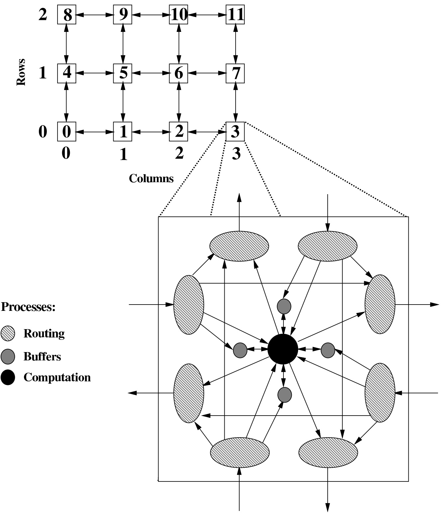

# Leximin Approximation: From Single-Objective to Multi-Objective

**Eden Hartman**<strong>a</strong>**;**<strong>\*</strong>**, Avinatan Hassidim**<strong>a,b</strong>**, Yonatan Aumann**<strong>a</strong> **and Erel Segal-Halevi**<strong>c</strong>

<strong>a</strong>**Bar-Ilan University, Israel**

<strong>b</strong>**Google, Israel**

<strong>c</strong>**Ariel University, Israel**

**Abstract. Leximin is a common approach to multi-objective optimization, frequently employed in fair division applications. In leximin optimization, one first aims to maximize the smallest objective value; subject to this, one maximizes the second-smallest objective; and so on. Often, even the single-objective problem of maximizing the smallest value cannot be solved accurately. What can we hope to accomplish for leximin optimization in this situation? Recently, Henzinger et al. (2022) defined a notion of** approximate **leximin optimality. Their definition, however, considers only an additive approximation.**

In this work, we first define the notion of approximate leximin optimality, allowing both multiplicative and additive errors. We then show how to compute, in polynomial time, such an approximate leximin solution, using an oracle that finds an approximation to a singleobjective problem. The approximation factors of the algorithms are closely related: an $( \alpha , \epsilon )$ **-**approximation for the single-objective problem (where $\alpha \in ( 0 , 1 ]$ and $\epsilon \geq 0$ are the multiplicative and ad**ditive factors respectively) translates into an** $\textstyle \left( \frac { \alpha ^ { 2 } } { 1 - \alpha + \alpha ^ { 2 } } , \frac { \epsilon } { 1 - \alpha + \alpha ^ { 2 } } \right)$ approximation for the multi-objective leximin problem, regardless of **the number of objectives.**

## 1 Introduction

**Many real life scenarios involve more than one objective. These situations are often modeled as** multi-objective optimization problems. **These are defined by the set of possible decisions, along with functions that describe the different objectives. As a concrete example, we use the context of social choice, in which the objective functions represent people’s utilities. Different criteria can be used to determine optimality when considering multi-objectives. For example, the** utilitarian **criterium aims to maximize the sum of utilities, whereas the** egalitarian **criterium aims to maximize the least utility. This paper focuses on the** leximin **criterium, according to which one aims to maximize the least utility, and, subject to this, maximize the secondsmallest utility, and so on. In the context of social choice, the leximin criterium is considered a criterium of fairness, as strives to benefit, as much as possible, the least fortunate in society.**

**Common algorithms for finding a leximin optimal solution are iterative, optimizing one or more single-objective optimization problems at each iteration (for example [1, 2, 4, 15, 16, 19]). Often, these single-objective problems cannot be solved exactly (e.g. when they are computationally hard, or when there are numeric inaccuracies in** **the solver), but can be solved approximately. In this work, we define an approximate variant of leximin and show how such an approximation can be computed, given approximate single-objective solvers.**

**The Challenge When single-objective solvers only** approximate **the optimal value, existing methods for extending the solvers to leximin optimally may fail, as we illustrate next.**

**A common algorithm, independently proposed many times, e.g. [1, 15, 16, 19], is based on the notion of** saturation**. It operates roughly as follows. In the first iteration, the algorithm looks for the maximum value that all objective functions can achieve simultaneously, denoted** $z _ { 1 }$ **. Then, it determines which of the objective functions are saturated — that is, cannot achieve more than** $z _ { 1 }$ **given** that the others achieve at least $z _ { 1 }$ . Afterwards, in each iteration $t ,$ given that for any $i < t$ **the objective-functions that were determined** saturated in the i’th iteration achieve at least $z _ { i } ,$ it looks for the max**imum value that all other objective-functions can achieve simultaneously, denoted** $z _ { t } ,$ **and then determines which of those functions are saturated. When all functions become saturated, the algorithm ends.**

**The following simple example demonstrates the problem that may arise when the individual solver may return sub-optimal results. Consider the following problem:**

$$
\begin{array}{l l} \text {lex max min} & \{f _ {1} (x) = x _ {1}, f _ {2} (x) = x _ {2} \} \\ s. t. & (1) x _ {1} + x _ {2} \leq 1, \quad (2) x \in \mathbb {R} _ {+} ^ {2} \end{array}
$$

**As** $f _ { 1 }$ **and** $f _ { 2 }$ **are symmetric, the leximin optimal solution in this case is (0.5, 0.5). Now suppose that rather than finding the exact value 0.5, the solver returns the value 0.49. The optimal value of** $f _ { 1 }$ **given that** $f _ { 2 }$ **a**chieves at least 0.49 is 0.51, and vice versa for $f _ { 2 } .$ A s a **consequence, none of the objective functions would be determined saturated, and the algorithm may not terminate. One could perhaps define an objective as ”saturated” if its maximum attainable value is close to the maximum** $z _ { t } ,$ **but there is no guarantee that this would** lead to a good approximation

**Contributions This paper studies the problem of leximin optimization in multi-objective optimization problems, focusing on problems for which even the single-objective problems cannot be solved exactly in polynomial time. Our contribution is twofold.**

**First, a new definition of leximin approximation is presented. It captures both multiplicative and additive errors. The definition has several desirable properties, including that a leximin optimal solution** **is always approximately-optimal, and that the definition is equivalent to the original one in the absence of errors.**

<small>∗ Contact information: eden.r.hartman@gmail.com, avinatan@cs.biu.ac.il, aumann@cs.biu.ac.il, erelsgl@gmail.com.</small>

<small>1 An example will be given on request.</small>

**Second, an algorithm is provided that, given an approximation** algorithm for a single-objective problem, computes a leximin approximation to the multi-objective problem. The algorithm was first presented by Ogryczak and Sliwi ´ nski [17] for exact leximin- ´ optimization. In contrast to the saturation-based algorithm described in the Introduction, this algorithm always terminates, even when the single-objective solver is inaccurate. Moreover, the accuracy of the returned solution is closely correlated with the accuracy of the single-objective solver — given an $( \alpha , \epsilon )$ **-**approximation algorithm for the single-objective problem (where α and ǫ describe the multi-plicative and additive factors respectively), the returned solution is a**n** $\textstyle \left( \frac { \alpha ^ { 2 } } { 1 - \alpha + \alpha ^ { 2 } } , \frac { \epsilon } { 1 - \alpha + \alpha ^ { 2 } } \right)$ **-**approximation of leximin. Import**an**tly, this **holds for any number of objectives.**

**Our algorithm is applicable whenever a single-objective solver is inaccurate due to numerical issues, such as floating-point rounding errors, or stopping an iterative solution procedure before complete convergence.**

**Organization Section 2 gives preliminary knowledge and basic definitions. Section 3 presents the definition of leximin approximation. An algorithm for computing such an approximation is presented in Section 4. Section 5 concludes with some future work directions.**

## 1.1 Related Work

**This paper is related to a large body of research, which can be classified into three main fields: multi-objective optimization problems, approximation variants of known solution concepts, and algorithms for finding optimal leximin solutions.**

**In general multi-objective**<strong>2</strong>**optimization problems, finding a leximin**<strong>3</strong>**optimal solution is quite common goal [8], which is still an open challenge. Studies on this topic are usually focused on a specific problem and leverages its special characteristics — the structure of the** feasible region **and** objective-functions **that describe the concrete problem at hand. In this paper, we focus on the widely studied domain of resource allocation problems [14]. In that context, as leximin maximization is an extension of egalitarian welfare maximization, it is usually mentioned when fairness is desired.**

**There are cases where a leximin optimal solution can be calculated in polynomial time, for example in: fair allocation of divisible items [19], giveaway lotteries [2], portioning with ordinal preferences [1], cake sharing [4], multi-commodity flow networks [15], and location problems [18]. However, even when algorithms are theoretically polynomial, they can still be inaccurate in practice, for example due to numeric round-off errors.**

**In other cases, calculating a leximin optimal solution is NP-hard, for example in: representative cohort selection [10], fair combinatorial auctions [5], package upgrade-ability [7], and allocating papers to referees [9, 13]. However, to our knowledge, studies of this kind typically suggest non-polynomial algorithms and heuristics for solving small instances of the general problem and empirically evaluate their efficiency, rather than suggesting polynomial-time approximation algorithms.**

**Another approach to leximin optimization is to represent the leximin ordering by an aggregation function. Such a function takes a** **utility vector and returns a number, such that a solution is leximinpreferred over another if-and-only-if its aggregate number is higher. Finding such a function will of course reduce the problem to solving only one single-objective optimization problem. Unfortunately, it is known that no aggregate function can represent the leximin ordering in** all **problems [14, 16]. Still, there are interesting cases in which such functions can be found. For example, Yager [20] suggested that the** ordered weighted averaging (OWA) **technique can be used when there is a lower bound on the difference between any two possible utilities. However, it is unclear how (and whether) approximating the aggregate function would translate to approximating leximin.**

**To the best of our knowledge, other general approximations of leximin exist but they are less common. They are usually mentioned in the context of robustness or noise (e.g. [10, 11]) and lack characteristics that we emphasize within the context of errors.**

**Most similar to our work is the recent paper by Henzinger et al. [10]. This paper presents several approximation variants of leximin for the case of** additive **errors in the single-objective problems. Their motivation is different than ours — they use approximation as a method to improve efficiency and ensure robustness to noise. However, one of their definitions, (ǫ**-tradeoff Leximax**) fits our motivation of achieving the best possible leximin-approximation in the presence of errors. In fact, our approximation definition can be viewed as a generalization of their definition to include both multiplicative and additive errors. It should also be noted that the authors mention multiplicative approximation in the their Future Work Section.**

## 2 Preliminaries

We denote the set $\{ 1 , \ldots , n \}$ by [n] for $n \in \mathbb { N } .$

**Single-objective optimization** A single-objective maximization (resp. minimization) problem **is a tuple** $( S , f )$ **where S is the set** of all feasible solutions to the problem (usually $S \subseteq \mathbb { R } ^ { m }$ **for some** $m   \in   \mathbb { N } )$ **and** $f \colon S   \to   \mathbb { R } _ { \geq 0 }$ **is a function describing the objective value of a solution** $x   \in   S$ **. The goal in such problems is to find an** optimal solution, that is, a feasible solution $x ^ { * } \in S$ that has the maximum (resp. minimum) objective value, that is $f ( x ^ { * } ) \geq f ( x )$ **(resp.** $f ( x ^ { * } ) \leq f ( x ) )$ for any other solution $x \in S .$

$\mathrm { ~  ~ A ~ } ( \alpha , \epsilon )$ -approximation algorithm for a single-objective maximization problem $( S , f )$ is one that returns a solution $x \in S .$ **which** approximates the optimal solution $x ^ { * }$ **from below. That is,** $f ( x ) \; \geq \; \alpha \cdot   f ( x ^ { * } )   -   \epsilon$ **for** $\alpha   \in   ( 0 , 1 ]$ **and** $\epsilon \geq 0$ **(that describe the multiplicative and additive approximation factors respectively).**

**A p**-randomized **approximation algorithm, for** $p   \in   ( 0 , 1 ]$ **, is one** that returns a solution x $\in S$ such that, with probability p, the objec**tive value** $f ( x )$ **is approximately-optimal.**

**The term "with high probability"** $( \mathrm { w . h . p . } )$ **is used when the success probability is at least** $\textstyle { \left( 1 - { \frac { 1 } { p o l y ( I ) } } \right) }$ **where I describes the input size.**

**Multi-objective optimization** A multi-objective maximization **problem [6] can be described as follows:**

$$
\begin{array}{l l} \text {max} & \{f _ {1} (x), f _ {2} (x), \ldots f _ {n} (x) \} \\ \text {s.t.} & x \in S \end{array}
$$

Where $S \subseteq \mathbb { R } ^ { m }$ **for some** $m \in \mathbb { N }$ **is the** feasible region **and** $f _ { 1 } , f _ { 2 } , \ldots , f _ { n }$ are n objective-functions $f _ { i } \colon S \to { \mathbb { R } _ { \geq 0 } } ^ { 4 } .$ **An example** **application is group decision making: some n people have to decide** on an issue that affects all of them. The set of possible decisions is $S ,$ and the utility each person i derives from a decision x $\in S \mathrm { ~ i s ~ } f _ { i } ( x )$

<small>2 Multi-objective is also called multi-criteria (for example in [8]).</small>

<small>3 Leximin is also called Max-Min fairness (for example in [15]), Lexicographic Min-Max (for example in [17]), Lexicographic max-ordering (for example in [8]) and Leximax (for example in [10]).</small>

<small>4 Note that the number of objectives in multi-objective optimization is commonly assumed to be constant. However, in this paper, we use a more general setting in which the number of objectives is a parameter of the problem.</small>

**Ordered outcomes notation** The $j ^ { \ast }$ th smallest objective value obtained by a solution $x \in S$ is denoted by $\mathcal { V } _ { j } ^ { \uparrow } ( x ) , \mathrm { i . e . }$

$$
v _ {1} ^ {\uparrow} (x) \leq v _ {2} ^ {\uparrow} (x) \leq \dots \leq v _ {n} ^ {\uparrow} (x).
$$

**The corresponding** sorted utility vector is denoted by $\mathbf { V } ^ { \uparrow } ( x ) =$ $( \mathcal { V } _ { 1 } ^ { \uparrow } ( x ) , \dot { \dots , \mathcal { V } _ { n } ^ { \uparrow } ( x ) } )$ **.**

**The leximin order A solution** $y$ **is considered** leximin-preferred over a solution $x ,$ denoted $y \succ x ,$ **,** if there exists an integer $1 \leq k \leq n$ such that the smallest $( k \mathrm { ~ - ~ } 1 )$ objective values of both are equal, **whereas the k’th smallest objective value of y is higher:**

$$
\begin{array}{r l} \forall j <   k: & \mathcal {V} _ {j} ^ {\uparrow} (y) = \mathcal {V} _ {j} ^ {\uparrow} (x) \\ & \mathcal {V} _ {k} ^ {\uparrow} (y) > \mathcal {V} _ {k} ^ {\uparrow} (x) \end{array}
$$

Two solutions, $x , y ,$ are leximin equivalent if $\mathbf { V } ^ { \uparrow } ( x ) = \mathbf { V } ^ { \uparrow } ( y )$ **. The leximin order is a** total **order, and strict between any two solutions** that yield $d i f f e$ rent sorted utility vectors $( \mathbf { V } ^ { \uparrow } ( x ) \neq \dot { \mathbf { V } } ^ { \uparrow } ( y ) )$ . A maximum **element of the leximin order is a solution over which** no **solution is preferred (including solutions that yield the same utilities).**

**Leximin optimal A** leximin optimal **solution is a maximum element of the leximin order. Given a feasible region** $S ,$ **as the order is determined only by the utilities, we denote this optimization problem as follows.**

$$
\begin{array}{c l} \text {lex max min} & \{f _ {1} (x), f _ {2} (x), \ldots f _ {n} (x) \} \\ s. t. & x \in S \end{array}
$$

## 3 Approximate Leximin Optimality

**In this section, we present our definition of leximin approximation in the presence of multiplicative and additive errors, in the context of multi-objective optimization problems.**

## 3.1 Motivation: Unsatisfactory Definitions

**Which solutions should be considered approximately-optimal in terms of leximin? Several definitions appear intuitive at first glance. As an example, suppose we are interested in approximations with an allowable multiplicative error of 0.1. Denote the utilities in the** leximin-optimal solution by $( u _ { 1 } , \ldots , u _ { n } )$ . A first potential defini**tion is that any solution in which the sorted utility vector is at least** $( 0 . 9 \cdotp u _ { 1 } , \ldots , 0 . 9 \cdotp u _ { n } )$ **should be considered approximately-optimal. For example, if the utilities in the optimal solution are (1, 2, 3), then a solution with utilities (0.9, 1.8, 2.7) is approximately-optimal. However, allowing the smallest utility to take the value 0.9 may substantially increase the maximum possible value of the second (and third) smallest utility** $- \mathbf { e . g . }$ **a solution that yields utilities (0.9, 1000, 1000) might exist. In that case, a solution with utilities (0.9, 1.8, 2.7) is very far from optimal. We expect a good approximation notion to consider the fact that an error in one utility might change the optimal value of the others.**

**The following, second attempt at a definition, captures this requirement. An approximately-optimal solution is one that yields utilities at least** $( 0 . 9 { \cdot } m _ { 1 } , 0 . 9 { \cdot } m _ { 2 } , \ldots , 0 . 9 { \cdot } m _ { n } )$ **, where m1 is the** **maximum value of the smallest utility, m2 is the maximum value of the second-smallest utility** among all solutions whose smallest utility is at least $0 . 9 \cdot m _ { 1 } ; m _ { 3 }$ **is the maximum value of the third-smallest utility among all solutions whose smallest utility is at least 0.9 · m1 and their second-smallest utility is at least** $0 . 9 \cdot m _ { 2 } ;$ **and so on. In the above example, to be considered approximately-optimal, the smallest utility should be at least 0.9 and the second-smallest should be at least 900. Thus, a solution with utilities (0.9, 1.8, 2.7) is not considered approximately-optimal. Unfortunately, according to this defini**tion, even the leximin-optimal solution — with utilities $(1,2,3) \text{— }$ **is not considered approximately-optimal. We expect a good approximation notion to be a relaxation of leximin-optimality.**

## 3.2 Our Definition

Let $\alpha \in ( 0 , 1 ]$ and $\epsilon \geq 0$ be multiplicative and additive approxima**tion factors, respectively.**

**Comparison of values As we focus on maximization problems, given two values v2** $\geq \; v _ { 1 } \; \geq \; 0 ,$ **we say that** $v _ { 1 }$ **approximates v2** if $v _ { 1 } \geq \alpha \cdot \: v _ { 2 } \: - \: \epsilon .$ In this case, v1 is an approximate replacement for $v _ { 2 } .$ However, when $v _ { 1 } \: < \: \alpha \: \cdot \: v _ { 2 } \: - \: \epsilon ,$ we say that v2 is $( \alpha , \epsilon )$ **-**substantially-higher than $v _ { 1 }$ . In this case, $v _ { 1 }$ **is** smaller than **any** $( \alpha , \epsilon )$ **-approximation of** $v _ { 2 }$ **.**

The approximate leximin order The first step is defining the following partial order5: a solution y is $( \alpha , \epsilon )$ **-**leximin-preferred **over a** solution $x ,$ denoted $y \succ _ { ( \alpha , \epsilon ) } x ,$ , if there exists an integer $1 \leq k \leq n$ such that the smallest $( k - 1 )$ **objective values of y are** at least **those of x, and the k’th smallest objective value of y is** $( \alpha , \epsilon )$ **-**substantially**higher than the k’th smallest objective value of** $x ,$ **that is:**

$$
\begin{array}{l l} \forall j <   k: & \mathcal {V} _ {j} ^ {\uparrow} (y) \geq \mathcal {V} _ {j} ^ {\uparrow} (x) \\ & \mathcal {V} _ {k} ^ {\uparrow} (y) > \frac {1}{\alpha} \left(\mathcal {V} _ {k} ^ {\uparrow} (x) + \epsilon\right) \end{array}
$$

**A maximal element of this order is a solution over which no solution is** $( \alpha , \epsilon )$ **-leximin-preferred. For clarity, we define the corresponding relation set as follows:**

$$
\mathcal {R} _ {(\alpha , \epsilon)} = \{(y, x) \mid x, y \in S, y \succ_ {(\alpha , \epsilon)} x \}
$$

**Before describing the approximation definition, we present two observations about this relation that will be useful later, followed by an example to illustrate how it works. The proofs are straightforward and are omitted.**

**The first observation is that the leximin order is equivalent to the approximate leximin order for** $\alpha   =   1$ **and** $\epsilon \; = \; 0$ **(that is, in the absence of errors).**

**Lemma 1.** Let $x , y \in S .$ Then, $y \succ x \iff y \succ _ { ( 1 , 0 ) } x$

**The second observation relates different approximate leximin orders according to their** error **factors. Notice that, for additive errors, ǫ also describes the error size; whereas for multiplicative errors, one minus α describes it. Throughout the remainder of this section, we denote the multiplicative** error factor by $\overline { { \alpha } } = 1 - \alpha$

**Observation 2.** Let $0   \leq   \overline { { \alpha _ { 1 } } }   \leq   \overline { { \alpha _ { 2 } } }   <   1$ and $0   \leq   \epsilon _ { 1 }   \leq   \epsilon _ { 2 }$ . Then, $y \succ _ { ( \alpha _ { 2 } , \epsilon _ { 2 } ) } x \Rightarrow y \succ _ { ( \alpha _ { 1 } , \epsilon _ { 1 } ) } x .$

<small>5 A proof that the approximate leximin order is a strict partial order can be found in Appendix A.</small>

**One can easily verify that it follows directly from the definition as** $\begin{array} { r } { \frac { 1 } { \alpha _ { 2 } } \geq \frac { 1 } { \alpha _ { 1 } } } \end{array}$ **. Accordingly, by considering the relation sets** $\mathcal { R } _ { ( \alpha _ { 1 } , \epsilon _ { 1 } ) }$ **and** $\mathcal { R } _ { ( \alpha _ { 2 } , \epsilon _ { 2 } ) } ^ { ^ { 2 } } ,$ , we can conclude that $\mathcal { R } _ { ( \alpha _ { 2 } , \epsilon _ { 2 } ) } \: \subseteq \: \mathcal { R } _ { ( \alpha _ { 1 } , \epsilon _ { 1 } ) } .$ **This means that as the** error **parameters** $\overline { { \alpha } }$ **and ǫ increase, the relation becomes** more partial**: when** $\overline { { \alpha } }   =   0$ **and** $\epsilon   =   0$ **it is a total order, any two elements that yield different utilities appear as a pair in** $\mathcal { R } _ { ( 1 , 0 ) } ;$ **but as they increase, the set** $\mathcal { R } _ { ( \alpha , \epsilon ) }$ **potentially becomes smaller, as fewer pairs are comparable.**

**Example To illustrate, consider a group of 3 agents, that has to select one out of three options** $x , y , z ,$ **with sorted utility vectors** $\mathbf { V } ^ { \uparrow } ( x )   =   ( 1 , 1 0 , 1 5 ) , \mathbf { V } ^ { \uparrow } ( y )   =   ( 1 , 4 0 , 6 0 ) , \mathbf { V } ^ { \uparrow } ( z )   =   ( \stackrel { \cdot } { 2 } , 2 0 , 3 0 )$

$$
\mathcal {R} _ {(\alpha , \epsilon)}
$$

**It is easy to verify that, indeed,** $\mathcal { R } _ { ( 1 , 0 ) }$ **is a total order —** $( z , x ) , ( z , y ) \in \mathcal { R } _ { ( 1 , 0 ) }$ since $2 > 1$ and $( y , x ) \in \mathcal { R } _ { ( 1 , 0 ) }$ since $1 = 1$ and 40 $> 1 0 .$

**In accordance with Observation 2, the relation set remains the same or becomes smaller as either α decreases (and the error factor α increases) or ǫ increases. As an example, we provide a partial** calculation of $\mathcal { R } _ { ( 0 . 7 5 , 1 ) }$

**First, by Observation** $^ { 2 , }$ **we know that** $\mathcal { R } _ { ( 0 . 7 5 , 1 ) } \subseteq \mathcal { R } _ { ( 1 , 0 ) }$ **,** and so, it is sufficient to consider only the pairs in $\mathcal { R } _ { ( 1 , 0 ) }$

**Consider the pair** $( z , x )$ **. In order to be included in the relation set,** there must be a $1 \leq k \leq 3$ that meets the requirements. For $k = 1$ as $2 $\not \approx \frac { 1 } { 0 . 7 5 } ( 1 + 1 )$$ **,** the requirement for k does not hold. However, for $k   =   2 ,$ it does. As $2 \geq 1$ **,** the requirement **for** $i \; < \; k$ **holds;** and as $\textstyle 2 0   >   { \frac { 1 } { 0 . 7 5 } } ( 1 0 + 1 )$ **,** the requirement for k holds. Therefore, $( z , x ) \in \mathcal { R } _ { ( 0 . 7 5 , 1 ) }$ **.** Similarly, one can check that $( y , x ) \in \mathcal { R } _ { ( 0 . 7 5 , 1 ) } .$ Next, consider the pair $( z , y )$ . For $k   =   1$ , as before, since $2 \not \gg$ $\textstyle { \frac { 1 } { 0 . 7 5 } } ( 1 + 1 )$ , the requirement for k does not hold. For $k = 2$ and $k =$ 3, it is sufficient to notice that $2 0 < 4 0$ **, therefore the requirements** for both does not hold. And so, $( z , y ) \notin \mathcal { R } _ { ( 0 . 7 5 , 1 ) }$

Table 1: Different relation sets result from different choices of α and ǫ in the example above. Each cell contains the corresponding relation set $\mathcal { R } _ { ( \alpha , \epsilon ) }$

| $\alpha\epsilon$ | 0 | 1 | 15 | 45 |
| --- | --- | --- | --- | --- |
| 1 | $\{(z,x),(z,y),(y,x)\}$ | $\{(z,x),(y,x)\}$ | $\{(y,x)\}$ | $\{\}$ |
| 0.75 | $\{(z,x),(z,y),(y,x)\}$ | $\{(z,x),(y,x)\}$ | $\{(y,x)\}$ | $\{\}$ |
| 0.5 | $\{(y,x)\}$ | $\{(y,x)\}$ | $\{\}$ | $\{\}$ |
| 0.25 | $\{\}$ | $\{\}$ | $\{\}$ | $\{\}$ |

The leximin approximation can now be defined.

**Leximin approximation** We say that a solution $x \in S { \mathrm { ~ i s ~ } } ( \alpha , \epsilon ) \cdotp$ approximately leximin-optimal **if it is a maximum element of the** order $\succ _ { } ( \alpha , \epsilon )$ in S for $\alpha   \in   ( 0 , 1 ]$ **and** $\epsilon \geq 0$ **. That is, if there is** no **solution in** $S$ **that is (α, ǫ)-leximin-preferred over it. For brevity, we use the term** leximin approximation **to describe an approximately leximin-optimal solution.**

**This definition has some important properties. Lemma 3 proves that in the absence of errors** $( \overline { { \alpha } } = \epsilon = 0 )$ **it is equivalent to the exact** leximin optimal definition. Then, Lemma 4 shows that an $( \alpha _ { 1 } , \epsilon _ { 1 } )$ leximin-approximation is also an $( \alpha _ { 2 } , \epsilon _ { 2 } )$ **-**leximin-approximation **when** $0 \leq \overline { { \alpha _ { 1 } } } \leq \overline { { \alpha _ { 2 } } } < 1$ **and** $0 \leq \epsilon _ { 1 } \leq \epsilon _ { 2 }$ **. Finally, Lemma 5 proves that a leximin optimal solution is also a leximin approximation for all factors.**

**Lemma 3.** A solution is a **(1, 0)**-leximin-approximation if and only if it is leximin optimal.

Proof. By definition, a solution $x ^ { * }$ is $\mathfrak { a } \left( 1 , 0 \right)$ **-leximin-approximation if and only if x** $\neq _ { ( 1 , 0 ) }   x ^ { * }$ for any solution $x \in S .$ **This holds if and** only if $x \neq x ^ { * }$ for any solution $x \in S ( \mathsf { b y }$ **Lemma 1). Thus, by** definition, $x ^ { * }$ **is also leximin optimal.** □

**Lemma 4.** Let $0 \leq \overline { { \alpha _ { 1 } } } \leq \overline { { \alpha _ { 2 } } } < 1 , 0 \leq \epsilon _ { 1 } \leq \epsilon _ { 2 } ,$ and $x \in S$ be an **(α1, ǫ**<strong>1</strong>**)**-leximin-approximation. Then x is also an $( \alpha _ { 2 } , \epsilon _ { 2 } ) \text {-} l e x i m i n$ approximation.

Proof. **Since x is an** $( \alpha _ { 1 } , \epsilon _ { 1 } )$ **-leximin-approximation, by definition,** $y \nearrow _ { ( \alpha _ { 1 } , \epsilon _ { 1 } ) }$ **x for any solution** $y   \in   S$ **. Observation 2 implies that** $y \neq _ { ( \alpha _ { 2 } , \epsilon _ { 2 } ) }$ **x for any solution** $y \in S .$ **This means, by definition, that x is an** $( \alpha _ { 2 } , \epsilon _ { 2 } )$ **-leximin-approximation.** □

**Lemma 5.** Let $x ^ { * }   \in   S$ be a leximin optimal solution. Then $x ^ { * }$ is also an $( \alpha , \epsilon )$ -leximin-approximation for any $\overline { { \alpha } } \in [ 0 , 1 )$ and $\epsilon \geq 0 .$

Proof. By Lemma $3 ,   x ^ { * }$ is an $( 1 , 0 )$ **-leximin-approximation. Thus,** according to Lemma $4 ,   x ^ { * }$ is also an $( \alpha , \epsilon )$ **-leximin-approximation** for any $0 \leq \overline { { \alpha } } < 1$ and $\epsilon \geq 0 .$ □

**Using the example given previously, we shall now demonstrate that as the error parameters α and ǫ increase, the quality of the approximation decreases. Consider table 1 once again.**

**If the corresponding relation set for α and ǫ is the total order** $\{ ( z , x ) , ( z , y ) , ( y , x ) \}$ , the only solution over which no other solution is (α, ǫ)-leximin-preferred is z. Therefore, z is the only $( \alpha , \epsilon ) \cdot$ **leximin-approximation for these factors. Indeed, it is the only group decision that maximizes the welfare of the agent with the smallest utility.**

**If the corresponding relation set is either** $\{ ( z , x ) , ( y , x ) \}$ **or** $\{ ( y , x ) \}$ **,** as no solution is $( \alpha , \epsilon )$ -leximin-preferred over z and y, both are $( \alpha , \epsilon )$ -leximin-approximations. For example, for $\alpha   =   0 . 5$ and $\epsilon \; = \; 0 , \; .$ **z still maximizes the utility of the poorest agent (2), and y gives the poorest agent a utility of 1, which is acceptable as it is half the maximum possible value (2), and subject to giving the poorest agent at least 1, maximizes the second-smallest utility (40).** In contrast, while x, too, gives the poorest agent utility 1, its secondsmallest utility is 10, which is less than half the maximum possible in this case (40), and therefore, x is not a $( \alpha , \epsilon )$ **-**leximin-approximation.

**Lastly, if the relation set is the empty set, then no solution is** $( \alpha , \epsilon )$ **-**leximin-preferred over the other, and all are $( \alpha , \epsilon )$ -leximin**approximations.**

**Egalitarian generalization Another property of our definition is that a leximin-approximation also approximates the optimal egalitarian welfare to the same approximation factors. Formally:**

**Observation 6.** Let x be an $( \alpha , \epsilon )$ -leximin-approximation. Then, the egalitarian value of $\textit { x } ( i . e .$ $\begin{array} { r c l } { \operatorname* { m i n } _ { i \in [ n ] } f _ { i } ( x ) } & { = } & { \mathcal { V } _ { 1 } ^ { \uparrow } ( x ) ) } \\ \end{array}$ is an $( \alpha , \epsilon )$ -approximation of the optimal egalitarian value $( i . e . ,$ $\operatorname { m a x } _ { y \in S } \operatorname { m i n } _ { i \in [ n ] } f _ { i } ( y ) )$

## 4 Approximation Algorithm

**We now present an algorithm for computing a leximin approximation. The algorithm is an adaptation of one of the algorithms of Ogryczak and Sliwi** ´ **nski [17] for finding exact leximin optimal so-** ´ **lutions.**

Algorithm 1 The Ordered Outcomes Algorithm
for $t = 1$ to $n$ do
    $(x_t, z_t) \leftarrow \text{OP}(z_1, \ldots, z_{t-1})$
end for
return $x_n$ (with objective values $f_1(x_n), \ldots, f_n(x_n)$).

## 4.1 Preliminary: exact leximin-optimal solution

**Following the definition of leximin, the core algorithm for finding a leximin optimal solution is iterative, wherein one first maximizes the least objective function, then the second, and so forth. In each iteration,** $t = 1 , \ldots , n ,$ **it looks for the value that maximizes the t-th** smallest objective, $z _ { t } ,$ given that for any $i <$ t the i-th smallest objec**tive is at least** $z _ { i }$ **(the value that was computed in the i-th iteration). The core, single-objective optimization problem is thus:**

$$
\begin{array}{l l l} \text {max} & z _ {t} \\ s. t. & (\text {P1.1}) x \in S \\ & (\text {P1.2}) \mathcal {V} _ {\ell} ^ {\uparrow} (x) \geq z _ {\ell} & \forall \ell \in [ t - 1 ] \\ & (\text {P1.3}) \mathcal {V} _ {t} ^ {\uparrow} (x) \geq z _ {t} \end{array}\tag{P1}
$$

**where the variables are the scalar** $z _ { t }$ **and the vector** $x ,$ **whereas** $z _ { 1 } , \ldots z _ { t - 1 }$ **are constants (computed in previous iterations).**

**Suppose we are given a procedure** $\mathsf { O P } ( z _ { 1 } , \ldots , z _ { t - 1 } )$ **,** which, **given** $z _ { 1 } , \ldots , z _ { t - 1 }$ **, outputs** $( x , z _ { t } )$ **that is the exact optimal solution to (P1). Then, the** leximin **optimal solution is obtained by iterating** this process for $t = 1 , \ldots , n ,$ as described in Algorithm 1. The algorithm first maximizes the smallest objective $\bar { \mathcal { V } } _ { 1 } ^ { \uparrow } ( x )$ **, and puts the** result in $z _ { 1 } .$ Then it maximizes the second-smallest objective $\left[ \nu _ { 2 } ^ { \uparrow } ( x ) \right.$ subject to $\mathcal { V } _ { 1 } ^ { \uparrow } ( x )$ being at least $z _ { 1 }$ , and puts the result in z2; and so **on.**

**Since constraints (P1.2) and (P1.3) are not linear with respect to the objective-functions, it is difficult to solve the program (P1) as is. Thus, [17] suggests a way to “linearize“ the program in two steps.**

**First, we replace (P1) with the following program, that considers** sums instead of individual values (where again the variables are $z _ { t }$ **and x):**

$$
x \in S\tag{P2}
$$

$$
\begin{array}{l l l} \text {(P2.2)} & \sum_ {i \in F ^ {\prime}} f _ {i} (x) \geq \sum_ {i = 1} ^ {| F ^ {\prime} |} z _ {i} & \forall F ^ {\prime} \subseteq [ n ], | F ^ {\prime} | <   t \\ \text {(P2.3)} & \sum_ {i \in F ^ {\prime}} f _ {i} (x) \geq \sum_ {i = 1} ^ {t - 1} z _ {i} + z _ {t} & \forall F ^ {\prime} \subseteq [ n ], | F ^ {\prime} | = t \end{array}
$$

**Here, constraints (P1.2) and (P1.3) are replaced with constraints (P2.2) and (P2.3), respectively. Constraint (P2.2) says that for any** $\ell < t ,$ **the sum of any ℓ objectives is at least the sum of the first ℓ constants** $z _ { i }$ **(equivalently: the sum of the smallest ℓ objectives is at** least the sum of the first ℓ constants $z _ { i } { } ^ { 6 } )$ **. Similarly, (P2.3) says that the sum of any t objectives (equivalently: the sum of the smallest t objectives) is at least the sum of the first t − 1 constants** $z _ { i } ,$ **plus the** variable $z _ { t } .$

**Suppose (P1) is replaced with (P2) in Algorithm1. Then, in the first iteration, the algorithm still maximizes the smallest objective** $\mathcal { V } _ { 1 } ^ { \uparrow } ( x )$ , and puts the result in $z _ { 1 } .$ . In the second iteration, it maxi**mizes the** difference **between the sum of the two smallest objectives** $\mathcal { V } _ { 1 } ^ { \uparrow } ( x ) + \mathcal { V } _ { 2 } ^ { \uparrow } ( x )$ and $z _ { 1 } ,$ subject to $\mathcal { V } _ { 1 } ^ { \uparrow } ( x )$ being at least $z _ { 1 } .$ , and puts the result in $z _ { 2 } .$ . Since z1 is the maximum value of $\mathcal { V } _ { 1 } ^ { \uparrow } ( x )$ , being at least $z _ { 1 }$ becomes being exactly $z _ { 1 } ,$ which means that, as was for (P1), the algorithm actually maximizes $\mathcal { V } _ { 2 } ^ { \uparrow } ( x )$ , subject to $\mathcal { V } _ { 1 } ^ { \uparrow } ( x )$ being at least $z _ { 1 }$ . Similarly for any iteration 1 $< t \leq n ,$ as the sum $\Sigma _ { i = 1 } ^ { \ell }$ zi is the maximum value of $\textstyle \sum _ { i = 1 } ^ { \ell } \mathcal { V } _ { i } ^ { \uparrow } ( x )$ for all $1 \leq \ell < t ,$ it can be concluded that the algorithm actually maximizes $\mathcal { V } _ { t } ^ { \uparrow } ( x )$ , subject to $\mathcal { V } _ { \ell } ^ { \uparrow } ( x )$ **being at** least $z _ { \ell }$ for $1 \leq \ell < t$ (as if (P1) was used). Accordingly, the algorithm still finds a leximin-optimal solution.

**While (P2) is linear with respect to the objective-functions, it has an exponential number of constraints. To overcome this challenge, auxiliary variables were used in the second program** $( y _ { \ell }$ **and** $m _ { \ell , j }$ **for** all $1 \leq \ell \leq t$ and $1 \leq j \leq n )$

$$
\begin{array}{l l} \max & z _ {t} \\ \text {s.t.} & (\mathrm{P3.1}) x \in S \\ & (\mathrm{P3.2}) \ell y _ {\ell} - \sum_ {j = 1} ^ {n} m _ {\ell , j} \geq \sum_ {i = 1} ^ {\ell} z _ {i} \quad \forall \ell \in [ t - 1 ] \\ & (\mathrm{P3.3}) t y _ {t} - \sum_ {j = 1} ^ {n} m _ {t, j} \geq \sum_ {i = 1} ^ {t - 1} z _ {i} + z _ {t} \\ & (\mathrm{P3.4}) m _ {\ell , j} \geq y _ {\ell} - f _ {j} (x) \quad \forall \ell \in [ t ], \forall j \in [ n ] \\ & (\mathrm{P3.5}) m _ {\ell , j} \geq 0 \quad \forall \ell \in [ t ], \forall j \in [ n ] \end{array} \tag {P3}
$$

**The meaning of the auxiliary variables in (P3) is explained in the proof of Lemma 7 below.**

**The importance of the programs (P2) and (P3) for leximin is shown by the following theorem (that combines Theorem 4 in [16] and Theorem 1 in [17]):**

**Theorem.** If Algorithm 1 is applied with a solver for $( \mathrm { P } 2 ) \; o r \; ( \mathrm { P } 3 ) ^ { 7 }$ (instead of for **(P1)**), the algorithm still outputs a leximin-optimal solution.

**We shall later see that our main result (Theorem 9) extends and implies their theorem.**

## 4.2 Using an approximate solver

**Now we assume that, instead of an exact solver in Algorithm 1, we only have an approximate solver. In this case, the constants** $z _ { 1 } , \ldots , z _ { t - 1 }$ are only approximately-optimal solutions for the previ**ous iterations. It is easy to see that if** $\mathsf { O P }$ **is an (α, ǫ)-approximation algorithm to (P1), then Algorithm 1 outputs an (α, ǫ)-leximinapproximation**<strong>8</strong>.

**In contrast, for (P2) and (P3), we shall see that Algorithm 1 may output a solution that is** not **an** $( \alpha , \epsilon )$ **-**leximin-approximation. How**ever, we will prove that it is not too far from that — in this case, the output is always an** $\textstyle \left( \frac { \alpha ^ { 2 } } { 1 - \alpha + \alpha ^ { 2 } } , \frac { \epsilon } { 1 - \alpha + \alpha ^ { 2 } } \right)$ **-leximin-approximation.**

**To demonstrate both claims more clearly, we start by proving that the programs (P2) and (P3) are** equivalent **in the following sense:**

**Lemma 7.** Let $1 \leq t \leq n$ and let $z _ { 1 } , \dots z _ { t - 1 } \in \mathbb { R }$ . Then, $( x , z _ { t } )$ is feasible for **(P2)** if and only if there exist yℓ and $m _ { \ell , j }   f _ { } { o r }   1 \leq \ell \leq t$ and $1   \leq   j   \leq   n$ such that $( x , z _ { t } , ( y _ { 1 } , \ldots , y _ { t } ) , ( m _ { 1 , 1 } , \ldots m _ { t , n } ) )$ is feasible for **(P3)**.

<small>6 A formal proof of this claim is given in Appendix B.2.</small>

<small>7If the algorithm uses a solver for (P3), it takes only the assignment of the variables x and zt , ignoring the auxiliary variables.</small>

<small>8 A formal proof is given in Appendix B.1.</small>

**The proof is provided in Appendix B.2.**

**Since both (P2) and (P3) have the same objective function (max zt), the lemma implies that** $( x , z _ { t } )$ **is an** $( \alpha , \epsilon )$ **-**approximate so**lution for (P2) if and only** $\operatorname { i f } \left( x , z _ { t } \right)$ **is a part of an** $( \alpha , \epsilon )$ **-approximate solution for (P3). Thus, it is sufficient to prove the theorems for only one of the problems. We will prove them for (P2).**

**Theorem 8.** There exist $\alpha \in ( 0 , 1 ] ,   \epsilon \geq 0$ and $O P$ that is an $( \alpha , \epsilon )$ approximation procedure to **(P2)**, such that if Algorithm 1 is applied with this procedure, it might return a solution that is not an $( \alpha , \epsilon )$ leximin-approximation.

Proof. **Consider the following multi-objective optimization problem** with $n = 2 ;$

$$
\begin{array}{l l} \max & \left\{f _ {1} (x) := x _ {1}, f _ {2} (x) := x _ {2} \right\} \\ \text {s.t.} & (1. 1) x _ {1} \leq 1 0 0, \quad (1. 2) x _ {1} + x _ {2} \leq 2 0 0, \quad (1. 3) x \in \mathbb {R} _ {+} ^ {2} \end{array}
$$

**In the corresponding (P2), constraint (P2.1) will be replaced with constraints (1.1)-(1.3). The following is a possible run of the algorithm with** OP **that is a (0.9, 0)-approximate solver.**

**• In iteration** $t = 1$ **, condition (P2.2) is empty, and the optimal value of z1 is 100, so** OP may output $z_{1} = 0.9 \cdot 100 = 90$

**• In iteration** $t = 2 ,$ **given** $z _ { 1 } = 9 0$ **, condition (P2.2) says that each of** $x _ { 1 }$ **and x2 must be at least 90; the optimal value of** $z _ { 2 }$ **under these constraints is** $1 1 0 ,   \mathrm { s o }   \mathsf { O P }$ **may output** $z _ { 2 } = 9 9$ **, for example** with $x _ { 1 } = x _ { 2 } = 9 4 . 5$

${ \mathrm {  ~ { ~ \sf ~ { S i n c e ~ } ~ } ~ } } n \quad = \quad 2 ,$ **the algorithm ends and returns the solution** $( 9 4 . 5 , 9 4 . 5 )$

**But** $( x _ { 1 } , x _ { 2 } ) \: = \: ( 9 4 . 5 , 1 0 5 . 5 )$ **is** also a feasible solution, and it is $( 0 . 9 , 0 )$ -leximin-preferred since $\textstyle 1 0 5 . 4 > { \frac { 1 } { 0 . 9 } } \cdot 9 4 . 5 = 1 0 5$ . Hence, the returned solution is not a (**0.9**, 0)-leximin-approximation.

**Note that, while the above solution is not a** $( 0 . 9 , 0 )$ **-**leximin**approximation, it is for** $\alpha = 0 . 8 9 6$ **. Our main theorem below shows that this is not a coincidence: using an approximate solver to (P2) or (P3) in Algorithm 1 guarantees a non-trivial leximin approximation.**

Theorem 9. Let $\alpha \quad \in \quad ( 0 , 1 ] , \quad \epsilon \quad \geq \quad 0 ,$ and $O P$ be an $( \alpha , \epsilon )$ approximation procedure to $( \mathsf { P } 2 ) \; o r \; ( \mathsf { P } 3 )$ . Then Algorithm 1 outputs an $\textstyle \left( \frac { \alpha ^ { 2 } } { 1 - \alpha + \alpha ^ { 2 } } , \frac { \epsilon } { 1 - \alpha + \alpha ^ { 2 } } \right)$ -leximin-approximation.

For the above example, it guarantees an $( { \textstyle \frac { 8 1 } { 9 1 } } , 0 ) \approx ( 0 . 8 9 , 0 ) \cdot$ **leximin-approximation.**

**A complete proof of Theorem 9 is given in Appendix B.3. Here we provide a high level overview of the main steps.**

First, we note that the value of the variable $z _ { t }$ is completely determined by the variable $x .$ This is because the program aims to max**imize** $z _ { t }$ **t**hat appears only in constraint (P2.3), which is equivalent to $z _ { t } { \leq } \textstyle \sum _ { i = 1 } ^ { t } \widehat { \mathcal { V } } _ { i } ^ { \uparrow } ( x ) - \textstyle \sum _ { i = 1 } ^ { t - 1 } z _ { i }$ **. Thus, this constraint will always** P**hold with equality.**

Next, we show that the returned solution, $x ^ { * }$ **, is feasible to all single-objective problems that were solved during the algorithm run.** This allows us to relate the objective values attained by $x ^ { * }$ **and the constants zi values. Specifically, for each iteration** $t = 1 , \ldots , n ,$ **the solver used in iteration t is** $( \alpha , \epsilon )$ **-approximately-optimal. Therefore,** we know that the optimal value of this program is at most $\scriptstyle { \frac { 1 } { \alpha } } \left( z _ { t } + \epsilon \right)$ where $z _ { t }$ is the approximation obtained to that problem. It then follows that the objective value attained by $x ^ { * }$ **for this program is also** is at most $\scriptstyle { \frac { 1 } { \alpha } } ( z _ { t } + \epsilon )$

We then assume for contradiction that $x ^ { * }$ **is** not **a leximin approximation as claimed in the theorem. This means, by definition,** that there exits a solution $y \in S$ and an integer $1 \leq k \leq n$ such that $\mathcal { V } _ { i } ^ { \uparrow } ( y ) \quad \geq \quad \mathcal { V } _ { i } ^ { \uparrow } ( x ^ { * } )$ for any $\begin{array} { r l r } { i } & { { } < } & { k , } \end{array}$ while $\mathcal { V } _ { k } ^ { \uparrow } ( y )$ is $\textstyle \left( \frac { \alpha ^ { 2 } } { 1 - \alpha + \alpha ^ { 2 } } , \frac { \epsilon } { 1 - \alpha + \alpha ^ { 2 } } \right)$ –substantially-higher9than $\mathcal { V } _ { k } ^ { \uparrow } ( x ^ { * } )$ . Accordingly, we prove that y is feasible to the program that was solved in the k-th iteration, and that the objective value it attains in this problem is strictly higher than the optimal value $z _ { k } ^ { * }$ , which is a contradiction.

**Theorem 9 implies that if** OP **only has a multiplicative error** $( \epsilon = 0 )$ **, the solution returned by Algorithm 1 will only have a multi-plicative error as well, and if** OP only has an additive error $( \alpha = 1 )$ **the solution returned by Algorithm 1 will have only the same additive error ǫ.**

## 4.3 Using a randomized solver

**Next, we assume that the solver is not only approximate but also** randomized **— it always returns a feasible solution, but only with probability** $p \in [ 0 , 1 ]$ **the solution is also approximately-optimal. As Algorithm 1 activates the solver n times overall, assuming the success events of different activations are independent, there is a proba**bility of $[ p ^ { n }$ **that the solver returns an approximately-optimal solution in every iteration and so, Algorithm 1 performs as in the previous subsection. This leads to the following conclusion:**

**Corollary 10.** Let $\alpha \; \in \; ( 0 , 1 ] , \; \epsilon \; \geq \; 0 , \; p \; \in \; ( 0 , 1 ]$ , and $O P$ be a **p-randomized (α, ǫ)**-approximation procedure to **(P2)** or **(P3)**. Then Algorithm 1 outputs an $\textstyle \left( \frac { \alpha ^ { 2 } } { 1 - \alpha + \alpha ^ { 2 } } , \frac { \epsilon } { 1 - \alpha + \alpha ^ { 2 } } \right)$ -leximin-approximation with probability $p ^ { n }$

**Notice that, since the procedure** $\mathsf { O P }$ always returns a feasible so**lution to the single-objective problem, Algorithm 1 always returns a feasible solution as well.**

**Further, it is easy to see that one can increase the success probability of Algorithm 1 if, in each iteration,** OP **will be operated more times, and the solution with the highest objective will be used.**

## 5 Conclusion and Future Work

**We presented a practical solution to the problem of leximin optimization when only an approximate single-objective solver is available. The algorithm is guaranteed to terminate in polynomial time, and its approximation ratio degrades gracefully as a function of the approximation ratio of the single-objective solver.**

**Currently, our algorithm handles two main settings. First, when inaccuracies in the single-objective solver stem from numeric errors. Second, when the problem is convex and satisfy several assumptions. It may be interesting to study more settings in which the inaccuracies stem from computational hardness of the single-objective problem.**

**In particular, to approximate the egalitarian welfare, it is common to model the problem as an integer program or as an exponential sized linear program (e.g., [3, 12]) and then approximate the program using different techniques. Can these algorithms be generalized to consider the additional constraints described in Section 4? This will allow approximating leximin using the approach in this paper.**

Another question is whether it is possible to obtain a better approximation factor for leximin, given an $( \alpha , \epsilon )$ **-**approximation algorithm for the single-objective problem. Specifically, can an $( \alpha , \epsilon ) \cdot$ **approximation to leximin can be obtained in polynomial time? If not, what would be the best possible approximation in this case?**

<small>9 See Section 3.2 for formal definition.</small>

## Acknowledgements

**This research is partly supported by the Israel Science Foundation grants 712/20 and 2697/22. We are grateful to Sylvain Bouveret for suggesting several alternative definitions and helpful insights. We sincerely appreciate Arkadi Nemirovski, Nikhil Bansal, Shaddin Dughmi, and Tom Tirer for providing helpful answers and clarifications. We are also grateful to the following members of the stack exchange network for their very helpful answers to our technical questions: Neal Young,**<strong>10</strong> **1Rock,**<strong>11</strong> **Mark L. Stone**<strong>12</strong> **and Rob Pratt.**<strong>13</strong> **Lastly, we would like to thank the reviewers in COMSOC 2023 and ECAI 2023 for their helpful comments.**

## References

[1] Stéphane Airiau, Haris Aziz, Ioannis Caragiannis, Justin Kruger, Jérôme Lang, and Dominik Peters, ‘Portioning Using Ordinal Preferences: Fairness and Efficiency’, in Proceedings of the Twenty-Eighth International Joint Conference on Artificial Intelligence, pp. 11–17, Macao, China, (August 2019). International Joint Conferences on Artificial Intelligence Organization.

[2] Tal Arbiv and Yonatan Aumann, ‘Fair and Truthful Giveaway Lotteries’, Proceedings of the AAAI Conference on Artificial Intelligence, 36(5), 4785–4792, (June 2022).

[3] Nikhil Bansal and Maxim Sviridenko, ‘The santa claus problem’, in Proceedings of the thirty-eighth annual ACM symposium on Theory of computing, pp. 31–40, (2006).

[4] Xiaohui Bei, Xinhang Lu, and Warut Suksompong, ‘Truthful Cake Sharing’, Proceedings of the AAAI Conference on Artificial Intelligence, 36(5), 4809–4817, (June 2022).

[5] Sylvain Bouveret and Michel Lemaître, ‘Computing leximin-optimal solutions in constraint networks’, Artificial Intelligence, 173(2), 343–364, (2009).

[6] Multiobjective Optimization: Interactive and Evolutionary Approaches, eds., Jürgen Branke, Kalyanmoy Deb, Kaisa Miettinen, and Roman Słowinski, volume 5252 of ´ Lecture Notes in Computer Science, Springer Berlin Heidelberg, Berlin, Heidelberg, 2008.

[7] Miguel Cabral, Mikoláš Janota, and Vasco Manquinho, ‘SAT-Based Leximax Optimisation Algorithms’, in 25th International Conference on Theory and Applications of Satisfiability Testing (SAT 2022), eds., Kuldeep S. Meel and Ofer Strichman, volume 236 of Leibniz International Proceedings in Informatics (LIPIcs), pp. 29:1–29:19, Dagstuhl, Germany, (2022). Schloss Dagstuhl – Leibniz-Zentrum für Informatik.

[8] Matthias Ehrgott, Multicriteria optimization, Springer, Berlin ; New York, 2nd ed edn., 2005.

[9] Naveen Garg, Telikepalli Kavitha, Amit Kumar, Kurt Mehlhorn, and Julián Mestre, ‘Assigning Papers to Referees’, Algorithmica, 58(1), 119–136, (September 2010).

[10] Monika Henzinger, Charlotte Peale, Omer Reingold, and Judy Hanwen Shen, ‘Leximax Approximations and Representative Cohort Selection’, in 3rd Symposium on Foundations of Responsible Computing (FORC 2022), ed., L. Elisa Celis, volume 218 of Leibniz International Proceedings in Informatics (LIPIcs), pp. 2:1–2:22, Dagstuhl, Germany, (2022). Schloss Dagstuhl – Leibniz-Zentrum für Informatik.

[11] Rim Kalaı¨, Claude Lamboray, and Daniel Vanderpooten, ‘Lexicographic α-robustness: An alternative to min–max criteria’, European Journal of Operational Research, 220(3), 722–728, (August 2012).

[12] Yasushi Kawase and Hanna Sumita, ‘On the Max-Min Fair Stochastic Allocation of Indivisible Goods’, Proceedings of the AAAI Conference on Artificial Intelligence, 34(02), 2070–2078, (April 2020).

[13] Jing Wu Lian, Nicholas Mattei, Renee Noble, and Toby Walsh, ‘The Conference Paper Assignment Problem: Using Order Weighted Averages to Assign Indivisible Goods’, Proceedings of the AAAI Conference on Artificial Intelligence, 32(1), (April 2018).

[14] Hervé Moulin, Fair division and collective welfare, MIT press, 2004.

[15] Dritan Nace and Michal Pioro, ‘Max-min fairness and its applications to routing and load-balancing in communication networks: a tutorial’, IEEE Communications Surveys & Tutorials, 10(4), 5–17, (2008).

[16] Wlodzimierz Ogryczak, Michał Pióro, and Artur Tomaszewski, ‘Telecommunications network design and max-min optimization problem’, Journal of telecommunications and information technology, 4, 43–53, (2004).

[17] Włodzimierz Ogryczak and Tomasz Sliwi ´ nski, ‘On direct methods for ´ lexicographic min-max optimization’, in Computational Science and Its Applications - ICCSA 2006, eds., Marina Gavrilova, Osvaldo Gervasi, Vipin Kumar, C. J. Kenneth Tan, David Taniar, Antonio Laganá, Youngsong Mun, and Hyunseung Choo, pp. 802–811, Berlin, Heidelberg, (2006). Springer Berlin Heidelberg.

[18] Włodzimierz Ogryczak, ‘On the lexicographic minimax approach to location problems’, European Journal of Operational Research, 100(3), 566–585, (1997).

[19] Stephen J. Willson, ‘Fair division using linear programming’. preprint, Departement of Mathematics, Iowa State University, 1998.

[20] R.R. Yager, ‘On ordered weighted averaging aggregation operators in multicriteria decisionmaking’, IEEE Transactions on Systems, Man, and Cybernetics, 18(1), 183–190, (February 1988).

## A The Approximate Leximin Order

**Unlike the leximin order, ≻, which is a total order, the approximate leximin order,** $\succ _ { ( \alpha , \epsilon ) }$ **for** $\alpha \in ( 0 , 1 ]$ **and** $\epsilon \geq 0$ **is a partial order. The difference is that in partial orders, not all vectors are comparable. Consider for example the sorted vectors (1, 2) and (1, 3). According** to the leximin order, (1, 3) is clearly preferred $( \mathrm { a s ~ 3 ~ > ~ 2 } )$ , but ac**cording to many approximate leximin orders neither one is preferred over the other, for example according to the orders** $\succ_{(0.6,0)}, \succ_{(1,1)}$ **or** $\succ _ { ( 0 . 8 , 0 . 5 ) }$

**An order is a strict partial order if it is irreflexive, transitive and asymmetric. Lemma 11 proves that the order is irreflexive, Lemma 12 proves it is transitive, and Lemma 13 proves that it is asymmetric.**

Let $\alpha \in ( 0 , 1 ]$ and $\epsilon \geq 0$

## Lemma 11. The approximate leximin order $\succ _ { } ( \alpha , \epsilon )$ is irreflexive.

Proof. **Let x be a solution. We will show that** $x \not \sim _ { ( \alpha , \epsilon ) } x .$ **As the definition requires that one component be** strictly greater **than the other, it is trivial.** □

## Lemma 12. The approximate leximin order $\succ _ { } ( \alpha , \epsilon )$ is transitive.

Proof. Let $x , y$ and z be solutions such that $x \succ _ { ( \alpha , \epsilon ) }$ y and $y \succ _ { ( \alpha , \epsilon ) }$ **z.** We will prove that x $\succ _ { ( \alpha , \epsilon ) } z .$

**Since** $x \succ _ { ( \alpha , \epsilon ) } y ,$ **there exists an integer** $k _ { 1 } \in [ n ]$ **such that:**

$$
\begin{array}{c} \forall j <   k _ {1} \colon \mathcal {V} _ {j} ^ {\uparrow} (x) \geq \mathcal {V} _ {j} ^ {\uparrow} (y) \\ \mathcal {V} _ {k _ {1}} ^ {\uparrow} (x) > \frac {1}{\alpha} \left(\mathcal {V} _ {k _ {1}} ^ {\uparrow} (y) + \epsilon\right) \end{array}
$$

**And since** $y \succ _ { ( \alpha , \epsilon ) }$ **z, there exists an integer** $k _ { 2 } \in [ n ]$ **such that:**

$$
\begin{array}{c} \forall j <   k _ {2} \colon \mathcal {V} _ {j} ^ {\uparrow} (y) \geq \mathcal {V} _ {j} ^ {\uparrow} (z) \\ \mathcal {V} _ {k _ {2}} ^ {\uparrow} (y) > \frac {1}{\alpha} \left(\mathcal {V} _ {k _ {2}} ^ {\uparrow} (z) + \epsilon\right) \end{array}
$$

**As** $\alpha \in ( 0 , 1 ]$ **and** $\epsilon \geq 0 ,$ **, it follows that:**

$$
\nu_ {k _ {1}} ^ {\uparrow} (x) > \nu_ {k _ {1}} ^ {\uparrow} (y), \nu_ {k _ {2}} ^ {\uparrow} (y) > \nu_ {k _ {2}} ^ {\uparrow} (z)\tag{1}
$$

Let k = min $\{ k _ { 1 } , k _ { 2 } \}$

If $k \: = \: k _ { 1 }$ , by the definition of $\textstyle k _ { 1 } , \; \mathcal { V } _ { k } ^ { \uparrow } ( x ) \; > \; \frac { 1 } { \alpha } \left( \mathcal { V } _ { k } ^ { \uparrow } ( y ) + \epsilon \right)$ However, $\mathcal { V } _ { k } ^ { \uparrow } ( y ) \geq   \mathcal { V } _ { k } ^ { \uparrow } ( z )$ , by definition if $k < k _ { 2 }$ and by Equation (1) if $k = k _ { 2 } .   2$ Therefore, $\begin{array} { r } { \mathcal { V } _ { k } ^ { \uparrow } ( x ) > \frac { 1 } { \alpha } \left( \mathcal { V } _ { k } ^ { \uparrow } ( z ) + \epsilon \right) } \end{array}$

Otherwise, if $\textit { \textbf { k } } = \textit { \textbf { k } } _ { 2 }$ , by the definition of $k _ { 2 } , \quad \mathcal { V } _ { k } ^ { \uparrow } ( y ) \quad >$ $\begin{array} { r } { \frac { 1 } { \alpha } \left( \mathcal { V } _ { k } ^ { \uparrow } ( z ) + \epsilon \right) } \end{array}$ . But, $\mathcal { V } _ { k } ^ { \uparrow } ( x ) \; \geq \; \mathcal { V } _ { k } ^ { \uparrow } ( y )$ , by definition if $k ~ < ~ k _ { 1 }$ and by Equation (1) if $k \quad = \quad k _ { 1 }$ **. Again, we can conclude that** $\begin{array} { r } { \mathcal { V } _ { k } ^ { \uparrow } ( x ) > \frac { 1 } { \alpha } \left( \mathcal { V } _ { k } ^ { \uparrow } ( z ) + \epsilon \right) } \end{array}$

**In addition, for each** ${ \dot { j } } < k ,$ **since** $j < k _ { 1 }$ **and** $j < k _ { 2 }$ **, by definition the following holds:**

$$
\nu_ {j} ^ {\uparrow} (x) \geq \nu_ {j} ^ {\uparrow} (y) \geq \nu_ {j} ^ {\uparrow} (z)\tag{2}
$$

$\mathrm { S o } ,$ k is an integer that satisfy all the requirements, and so, x $\mathcal { C } \succ _ { ( \alpha , \epsilon ) }$ **z .** 口

**Lemma 13.** The approximate leximin order $\succ _ { } ( \alpha , \epsilon )$ is asymmetric.

Proof. **Let x and** $y$ **be solutions such that x** $\succ _ { ( \alpha , \epsilon ) }$ **y. We will show that** $y \nearrow _ { ( \alpha , \epsilon ) } x$ **. Assume by contradiction that** $y \succ _ { ( \alpha , \epsilon ) }$ **x. From Lemma 12, this relation is transitive. Therefore, since** $x \succ _ { ( \alpha , \epsilon ) }$ **y and** $y \succ _ { ( \alpha , \epsilon ) } x$ **, also** $x \succ _ { ( \alpha , \epsilon ) }$ **x. But, from Lemma 11, this relation is irreflexive — a contradiction.**

## B Proofs Omitted From Section 4

## B.1 Using an approximate solver for (P1)

**Recall that (P1) is described as follows:**

**(P1)**

**max zt s.t.** (P1.1) $x \in S$ **(P1.2) V↑**ℓ **(x) ≥ zℓ ∀ℓ ∈ [t − 1]** (P1.3) $\mathcal { V } _ { t } ^ { \uparrow } ( x ) \geq z _ { t }$

**This section proves the following lemma:**

Lemma 14. Let $\alpha \quad \in \quad ( 0 , 1 ] , \quad \epsilon \quad \geq \quad 0 ,$ and $O P$ be an $( \alpha , \epsilon ) \cdot$ approximation procedure $t o \quad ( \mathrm { P 1 } ) .$ . Then Algorithm 1 outputs an $( \alpha , \epsilon )$ -leximin-approximation.

Proof. Let $x ^ { * }$ **be the returned solution and assume by contradiction that it is** not $( \alpha , \epsilon )$ **-approximately leximin-optimal. This means that there exists a** $y \in S$ **that is** $( \alpha , \epsilon )$ **-leximin-preferred over it. That is, there exists an integer** $k \in [ n ]$ **such that:**

$$
\begin{array}{r l} \forall i <   k: & \mathcal {V} _ {i} ^ {\uparrow} (y) \geq \mathcal {V} _ {i} ^ {\uparrow} (x ^ {*}) \\ & \mathcal {V} _ {k} ^ {\uparrow} (y) > \frac {1}{\alpha} \left(\mathcal {V} _ {k} ^ {\uparrow} (x ^ {*}) + \epsilon\right) \end{array}
$$

Since $x ^ { * }$ is a solution to (P1) that was solved in the iteration $t = n .$ **it must satisfy all its constraints, and therefore:**

$$
\forall i \in [ n ]: \quad \mathcal {V} _ {i} ^ {\uparrow} (x ^ {*}) \geq z _ {i}\tag{3}
$$

by constraint (P1.2) for $i < n$ and by constraint (P1.3) for $i = n .$

As $y ^ { \flat } \mathbf { s }$ smallest k values are at least as those of $x ^ { * }$ **, we can con**clude that for each $i   \leq   k$ the i-th smallest value of y is at least $z _ { i } .$ Therefore, y is feasible to (P1) that was solved in the iteration $t = k$

During the algorithm run, zk was obtained as an $( \alpha , \epsilon ) \cdot$ approximation to (P1) that was solved in the iteration $t   =   k$ **, and** therefore, the optimal value of this problem is at most $\scriptstyle { \frac { 1 } { \alpha } } ( z _ { k } + \epsilon )$ But, the objective value y yields in this problem is $\mathcal { V } _ { k } ^ { \uparrow } ( y )$ **, which is higher than this value:**

$$
\begin{array}{r l} \mathcal {V} _ {k} ^ {\uparrow} (y) & > \frac {1}{\alpha} \left(\mathcal {V} _ {k} ^ {\uparrow} (x ^ {*}) + \epsilon\right) \\ & \geq \frac {1}{\alpha} \left(z _ {k} + \epsilon\right) \quad \text {(By Equation (3) for i = k)} \end{array}
$$

**This is a contradiction.**

□

## B.2 Equivalence of (P2) and (P3)

**Recall the problems’ descriptions:**

**max zt**

**(P2)**

**s.t.** (P2.1) $x \in S$

**(P2.2)**

$$
\left| \sum_ {i \in F ^ {\prime}} f _ {i} (x) \geq \sum_ {i = 1} ^ {| F ^ {\prime} |} z _ {i} \quad \forall F ^ {\prime} \subseteq [ n ], | F ^ {\prime} | <   t \right|
$$

$$
\text {P2.3)} \quad \sum_ {i \in F ^ {\prime}} f _ {i} (x) \geq \sum_ {i = 1} ^ {t - 1} z _ {i} + z _ {t} \quad \forall F ^ {\prime} \subseteq [ n ], | F ^ {\prime} | = t
$$

**max zt**

**(P3)**

**s.t.** (P3.1) $x \in S$

$$
\ell y _ {\ell} - \sum_ {j = 1} ^ {n} m _ {\ell , j} \geq \sum_ {i = 1} ^ {\ell} z _ {i} \quad \forall \ell \in [ t - 1 ]\tag{P3.2}
$$

(P3.3) $t y _ { t } - \sum _ { j = 1 } ^ { n } m _ { t , j } \geq \sum _ { i = 1 } ^ { t - 1 } z _ { i } + z _ { t } .$

$$
\begin{array}{l l} \text {(P3.4)} m _ {\ell , j} \geq y _ {\ell} - f _ {j} (x) & \forall \ell \in [ t ], \forall j \in [ n ] \\ \text {(P3.5)} m _ {\ell , j} \geq 0 & \forall \ell \in [ t ], \forall j \in [ n ] \end{array}
$$

**We use another equivalent representation of (P2), which is more compact and will simplify the proofs, also introduced by [17]:**

**max zt**

**(P2-Comp)**

**s.t. (P2-Comp.1) x ∈ S**

$$
\left| \begin{array}{l l} (\text {P2 - Comp. 2}) & \sum_ {i = 1} ^ {\ell} \mathcal {V} _ {i} ^ {\uparrow} (x) \geq \sum_ {i = 1} ^ {\ell} z _ {i} \quad \forall \ell \in [ t - 1 ] \\ (\text {P2 - Comp. 3}) & \sum_ {i = 1} ^ {t} \mathcal {V} _ {i} ^ {\uparrow} (x) \geq \sum_ {i = 1} ^ {t - 1} z _ {i} + z _ {t} \end{array} \right|
$$

In this problem, constraints (P2.2) and (P2.3) are replaced by $( \mathrm { P 2 } -$ Comp.2) and (P2-Comp.3), respectively. (P2.2) gives, for each $\ell , \mathrm { ~ a ~ }$ **lower bound on the sum for** any **set of ℓ objective functions; whereas (P2-Comp.2) only considers the sum of the ℓ** smallest **such values, and similarly for (P2.3) and (P2-Comp.3).**

**This section proves that these** three **problems are** equivalent **in the following sense:**

**Lemma 15.** Let $t   \in   [ n ]$ and let $z _ { 1 } , \ldots z _ { t - 1 } \in \mathbb { R } .$ . Then, $( x , z _ { t } )$ is feasible for **(P2)** if and only $\mathit { i f } \left( x , z _ { t } \right)$ is feasible for **(P2-Comp)** if and only if there exist $y \ell$ and $m _ { \ell , j }   f _ { } { o r }   \ell \in [ t ]$ and $j \in [ n ]$ such that $( x , z _ { t } , ( y _ { 1 } , \ldots , y _ { t } ) , ( m _ { 1 , 1 } , \ldots m _ { t , n } ) )$ is feasible for **(P3)**.

**It is clear that this lemma implies Lemma 7, which only claims a part of it.**

**We start by proving that (P2) and (P2-Comp) are equivalent. That is,** $( x , z _ { t } )$ **is feasible for** (P2) if and only if $( x , z _ { t } )$ is feasible for $(P2-Comp)$ **. First, it is clear that x satisfies constraint (P2.1) if and only if it satisfies constraint (P2-Comp.1) (as both constraints are the same,** $x   \in   S )$ **. To prove the other requirements, we start with the following lemma:**

**Lemma 16.** For any $x \in S ,$ , any $\ell \in [ n ]$ and a constant $c \in \mathbb { R }$ the following two conditions are equivalent:

$$
\begin{array}{c} \forall F ^ {\prime} \subseteq [ n ], | F ^ {\prime} | = \ell \colon \sum_ {i \in F ^ {\prime}} f _ {i} (x) \geq c \\ \sum_ {i = 1} ^ {\ell} \mathcal {V} _ {i} ^ {\uparrow} (x) \geq c \end{array}\tag{4}
$$

**(5)**

Proof. **For the first direction, recall that the values** $\mathcal { V } _ { 1 } ^ { \uparrow } ( x ) , \ldots , \mathcal { V } _ { \ell } ^ { \uparrow } ( x )$ were obtained from ℓ objective functions **(those who yield the smallest value). By the assumption, the sum of any set of function with size ℓ is at least** $c ;$ **therefore, it is true in** particular for the functions corresponding to the values $( \mathcal { V } _ { 1 } ^ { \uparrow } ( x ) ) _ { i = 1 } ^ { \ell }$ For the second direction, assume that $\textstyle \sum _ { i = 1 } ^ { \ell } \mathcal { V } _ { i } ^ { \uparrow } ( x ) \stackrel { \tiny { { \tiny ~ ( ~ { \bf ~ 1 } ~ ) ~ } } } { \geq } c .$ **Since** $\mathcal { V } _ { 1 } ^ { \uparrow } ( x ) , \ldots , \mathcal { V } _ { \ell } ^ { \uparrow } ( x )$ are the ℓ smallest objective values, we get that:

$$
\forall F ^ {\prime} \subseteq [ n ], | F ^ {\prime} | = \ell : \quad \sum_ {i \in F ^ {\prime}} f _ {i} (x) \geq \sum_ {i = 1} ^ {s} \mathcal {V} _ {i} ^ {\uparrow} (x) \geq c.
$$

口

Accordingly, x satisfies constraint (P2.2) — for any $\ell \in [ t - 1 ]$

$$
\forall F ^ {\prime} \subseteq [ n ], | F ^ {\prime} | = \ell \colon \sum_ {i \in F ^ {\prime}} f _ {i} (x) \geq \sum_ {i = 1} ^ {\ell} z _ {i}
$$

if and only if it satisfies $\textstyle \sum _ { i = 1 } ^ { \ell } \mathcal { V } _ { i } ^ { \uparrow } ( x ) \: \geq \: \sum _ { i = 1 } ^ { \ell } z _ { i }$ **, which is con-**Pstraint (P2-Comp.2). Similarly, x and $z _ { t }$ Psatisfy constraint (P2.3),

$$
\forall F ^ {\prime} \subseteq [ n ], | F ^ {\prime} | = t: \sum_ {i \in F ^ {\prime}} f _ {i} (x) \geq \sum_ {i = 1} ^ {t} z _ {i}
$$

if and only if $\textstyle \sum _ { i = 1 } ^ { t } \mathcal { V } _ { i } ^ { \uparrow } ( x ) \; \geq \; \sum _ { i = 1 } ^ { t } z _ { i }$ **, which is constraint (P2-** PComp.3). That is, x ans $z _ { t }$ Psatisfy all the constraints of (P2) if and **only if they satisfy all the constraints of (P2-Comp).**

**Now, we will prove that that (P2-Comp) and (P3) are equivalent, that is,** $( x , z _ { t } )$ **is feasible for (P2-Comp) if and only if there exist y**<strong>ℓ</strong> **and** $m _ { \ell , j }$ **for** $\ell \in [ t ]$ **and** $j \in [ n ]$ **such that** $( x , z _ { t } , ( y _ { 1 } , \ldots , y _ { t } ) , ( m _ { 1 , 1 } , \ldots m _ { t , n } ) )$ **is feasible for (P3).**

**Lemma 17.** For any $x \in S$ and any constant $c \in \mathbb { R }$ (where c does not depend on j),

$$
\sum_ {j = 1} ^ {n} \max (0, c - f _ {j} (x)) = \sum_ {j = 1} ^ {n} \max (0, c - \mathcal {V} _ {j} ^ {\uparrow} (x)).
$$

Proof. **Let** $( \pi _ { 1 } , \ldots , \pi _ { n } )$ **be a permutation of** $\{ 1 , \ldots , n \}$ **such that** $f _ { \pi _ { i } } ( x ) = \mathcal { V } _ { i } ^ { \uparrow } ( x )$ for any $i \in [ n ]$ (notice that such permutation exists by the definition of $\dot { \mathcal { V } ^ { \uparrow } ( ) ) }$ . That is, the value that $f _ { \pi _ { i } }$ obtains is the i-th smallest one. Since each element in the sum $\textstyle \sum _ { j = 1 } ^ { n } \operatorname* { m a x } ( 0 , c -$ $f _ { j } ( x ) )$ is affected by $j$ only through $f _ { j } ( x )$ P, the permutation π allows **us to conclude the following:**

$$
\begin{array}{l} \sum_ {j = 1} ^ {n} \max (0, c - f _ {j} (x)) = \sum_ {j = \pi_ {1}} ^ {\pi_ {n}} \max (0, c - f _ {j} (x)) \\ = \sum_ {j = 1} ^ {n} \max (0, c - f _ {\pi_ {i}} (x)) = \sum_ {j = 1} ^ {n} \max (0, c - \mathcal {V} _ {j} ^ {\uparrow} (x)). \end{array}
$$

□

**Lemma 18 below proves the first direction of the equivalence between (P2-Comp) and (P3):**

**Lemma 18.** Let $( x , z _ { t } )$ be a feasible solution to **(P2-Comp)**. Then there exist **y**<strong>ℓ</strong> and $m _ { \ell , j }$ for $\ell \quad \in \quad [ t ]$ and $j \in [ n ]$ such that $( x , z _ { t } , ( y _ { 1 } , \ldots , y _ { t } ) , ( m _ { 1 , 1 } , \ldots m _ { t , n } ) )$ is feasible for **(P3)**.

Proof. **For any** $\ell \in [ t ]$ **and** $j \in [ n ]$ **define** $y \ell$ **and** $m _ { \ell , j }$ **as follows:**

$$
\begin{array}{c} \hline y _ {\ell} := \mathcal {V} _ {\ell} ^ {\uparrow} (x) \\ m _ {\ell , j} := \max (0, \mathcal {V} _ {\ell} ^ {\uparrow} (x) - f _ {j} (x)) \end{array}
$$

**First, since x satisfies constraint (P2-Comp.1), it is also satisfies constraint (P3.1) of (as both constraints are the same and include only x).**

In addition, based on the choice of y and $m ,$ it is clear that $m _ { \ell , j } \geq$ 0 and $m _ { \ell , j } \: \geq \: \mathcal { V } _ { \ell } ^ { \uparrow } ( x ) - f _ { j } ( x ) \: = \: y _ { \ell } - f _ { j } ( x )$ **for any** $\ell   \in   [ n ]$ **and** $j   \in   [ n ]$ **. Therefore, this assignment satisfies constraints (P3.4) and (P3.5).**

**To show that this assignment also satisfies constraints (P3.2) and (P3.3), we first prove that for any** $\ell   \in   [ n ]$ **this assignment satisfies the following equation:**

$$
\ell y _ {\ell} - \sum_ {j = 1} ^ {n} m _ {\ell , j} = \sum_ {i = 1} ^ {\ell} \mathcal {V} _ {i} ^ {\uparrow} (x)\tag{6}
$$

**By the choice of m,** $\textstyle \sum _ { j = 1 } ^ { n } m _ { \ell , j } = \sum _ { j = 1 } ^ { n }$ max $( 0 , \mathcal { V } _ { \ell } ^ { \uparrow } ( x ) - f _ { j } ( x ) )$ and therefore, by Lemma 17, it equals to $\Sigma _ { j = 1 } ^ { n }$ max $( 0 , \mathcal { V } _ { \ell } ^ { \uparrow } ( x ) -$ $\mathcal { V } _ { j } ^ { \uparrow } ( x ) )$ . Since $\mathcal { V } _ { \ell } ^ { \uparrow } ( x )$ is the ℓ-th smallest objective, it is clear that $\dot { \mathcal { V } } _ { \ell } ^ { \uparrow } ( x ) - \mathcal { V } _ { j } ^ { \uparrow } ( x )   \leq   0$ **for** any $j > \ell ,$ and $\mathcal { V } _ { \ell } ^ { \uparrow } ( x ) - \mathcal { V } _ { j } ^ { \uparrow } ( x )   \geq   0$ for any $j \leq \ell .$ And so, $\textstyle \sum _ { j = 1 } ^ { n } m _ { \ell , j } = \ell \cdot \mathcal { V } _ { \ell } ^ { \uparrow } ( x ) - \sum _ { i = 1 } ^ { \ell } \mathcal { V } _ { i } ^ { \uparrow } ( x ) { : }$

$$
\begin{array}{l} \sum_ {j = 1} ^ {n} m _ {\ell , j} = \sum_ {j = 1} ^ {n} \max (0, \mathcal {V} _ {\ell} ^ {\uparrow} (x) - \mathcal {V} _ {j} ^ {\uparrow} (x)) \\ = \sum_ {j = 1} ^ {\ell} \max (0, \mathcal {V} _ {\ell} ^ {\uparrow} (x) - \mathcal {V} _ {j} ^ {\uparrow} (x)) + \sum_ {j = \ell + 1} ^ {n} \max (0, \mathcal {V} _ {\ell} ^ {\uparrow} (x) - \mathcal {V} _ {j} ^ {\uparrow} (x)) \\ = \sum_ {j = 1} ^ {\ell} (\mathcal {V} _ {\ell} ^ {\uparrow} (x) - \mathcal {V} _ {j} ^ {\uparrow} (x)) + \sum_ {j = \ell + 1} ^ {n} 0 = \ell \cdot \mathcal {V} _ {\ell} ^ {\uparrow} (x) - \sum_ {i = 1} ^ {\ell} \mathcal {V} _ {i} ^ {\uparrow} (x) \end{array}
$$

**We can now conclude Equation (6):**

$$
\begin{array}{c} \ell y _ {\ell} - \sum_ {j = 1} ^ {n} m _ {\ell , j} = \ell \cdot \mathcal {V} _ {\ell} ^ {\uparrow} (x) - \ell \cdot \mathcal {V} _ {\ell} ^ {\uparrow} (x) + \sum_ {i = 1} ^ {\ell} \mathcal {V} _ {i} ^ {\uparrow} (x) \\ = \sum_ {i = 1} ^ {\ell} \mathcal {V} _ {i} ^ {\uparrow} (x). \end{array}
$$

Now, since x satisfies constraint (P2-Comp.2), $\textstyle \sum _ { i = 1 } ^ { \ell } \mathcal { V } _ { i } ^ { \uparrow } ( x ) \; \geq$ $\textstyle \sum _ { i = 1 } ^ { \ell } z$ i for any $\ell   \in   [ t \mathrm { ~ - ~ } 1 ]$ . Therefore, by Equation $( 6 ) ,   \ell \cdot y _ { \ell } -$ $\textstyle \sum _ { j = 1 } ^ { n } m _ { \ell , j } \; \geq \; \sum _ { i = 1 } ^ { \ell } z _ { i }$ **for any** $\ell   \in   [ t   -   1 ]$ **and this assignment** P P**satisfies constraint** $(\mathrm { P } 3 . 2 )$ **. Similarly, as x and** $z _ { t }$ **satisfy constraint** $( \mathrm { P 2 - C o m p . 3 } ) , \; \textstyle \sum _ { i = 1 } ^ { t } \mathcal { V } _ { i } ^ { \uparrow } ( x ) \geq \sum _ { i = 1 } ^ { t } z _ { i }$ , and so by Equation (6), $\textstyle t \cdot \: y _ { t } \: - \: \sum _ { j = 1 } ^ { n } m _ { t , j } \; \geq \; \sum _ { i = 1 } ^ { t } z _ { i }$ P. This means that it also satisfies P**constraints (P3.3).**

**Finally, Lemma 19 below proves the second direction of the equivalence:**

**Lemma 19.** Let $( x , z _ { t } , ( y _ { 1 } , \ldots , y _ { t } ) , ( m _ { 1 , 1 } , \ldots m _ { t , n } ) )$ be a feasible solution to **(P3)**. Then, $( x , z _ { t } )$ is feasible for **(P2-Comp)**.

Proof. **It is easy to see that since x satisfies constraint (P3.1), it is also satisfies constraint (P2-Comp.1) (as both are the same). To show that it also satisfies constraints (P2-Comp.2) and (P2-Comp.3), we** start by proving that for any $\ell \in [ n ] !$

$$
\sum_ {i = 1} ^ {\ell} \mathcal {V} _ {i} ^ {\uparrow} (x) \geq \ell y _ {\ell} - \sum_ {j = 1} ^ {n} m _ {\ell , j}\tag{7}
$$

Suppose by contradiction that $\textstyle \sum _ { i = 1 } ^ { \ell } \mathcal { V } _ { i } ^ { \uparrow } ( x ) < \ell y _ { \ell } - \sum _ { j = 1 } ^ { n } m _ { \ell , j } .$ For any $j \in [ n ]$ and any $\ell \in [ n ] , m _ { \ell , j } \geq y _ { \ell } - f _ { j } ( x )$ by constraint $(\mathrm{P}3.4)$ , and also $m _ { \ell , j }   \geq   0$ by constraint (P3.5). Therefore, $m _ { \ell , j } \geq$ max $( 0 , y _ { \ell } - f _ { j } ( x ) )$ **.** And so, by Lemma 17, for any $\ell \in [ t ]$ **, the sum of** $m _ { \ell , j }$ **over all** $j \in [ n ]$ **can be described as follows:**

$$
\sum_ {j = 1} ^ {n} m _ {\ell , j} \geq \sum_ {j = 1} ^ {n} \max (0, y _ {\ell} - f _ {j} (x)) = \sum_ {j = 1} ^ {n} \max (0, y _ {\ell} - \mathcal {V} _ {j} ^ {\uparrow} (x))\tag{8}
$$

Therefore, $\textstyle \sum _ { i = 1 } ^ { \ell } \mathcal { V } _ { i } ^ { \uparrow } ( x ) < \ell y _ { \ell } { - } { \sum } _ { j = } ^ { n }$ =1 max( $( 0 , y _ { \ell }   -   \mathcal { V } _ { j } ^ { \uparrow } ( x ) )$ . Which **means that:**

$$
\left| \ell y _ {\ell} - \sum_ {i = 1} ^ {\ell} \mathcal {V} _ {i} ^ {\uparrow} (x) - \sum_ {j = 1} ^ {n} \max \left(0, y _ {\ell} - \mathcal {V} _ {j} ^ {\uparrow} (x)\right) > 0 \right|
$$

**However, we will now see that the value of this expression is at most 0, which is a contradiction:**

$$
\begin{array}{l} \ell y _ {\ell} - \sum_ {i = 1} ^ {\ell} \mathcal {V} _ {i} ^ {\uparrow} (x) - \sum_ {j = 1} ^ {n} \max (0, y _ {\ell} - \mathcal {V} _ {j} ^ {\uparrow} (x)) \\ = \sum_ {i = 1} ^ {\ell} y _ {\ell} - \sum_ {i = 1} ^ {\ell} \mathcal {V} _ {i} ^ {\uparrow} (x) - \sum_ {j = 1} ^ {n} \max (0, y _ {\ell} - \mathcal {V} _ {j} ^ {\uparrow} (x)) \end{array}
$$

**Since max with 0 is at least 0:**

$$
\left| \begin{array}{l} \leq \sum_ {i = 1} ^ {\ell} (y _ {\ell} - \mathcal {V} _ {i} ^ {\uparrow} (x)) - \sum_ {j = 1} ^ {\ell} \max (0, y _ {\ell} - \mathcal {V} _ {j} ^ {\uparrow} (x)) - \sum_ {j = \ell + 1} ^ {n} 0 \\ = \sum_ {j = 1} ^ {\ell} \left((y _ {\ell} - \mathcal {V} _ {j} ^ {\uparrow} (x)) - \max (0, y _ {\ell} - \mathcal {V} _ {j} ^ {\uparrow} (x))\right) \\ \text {Since each element of this sum is at most 0:} \\ \leq 0 \end{array} \right|
$$

**This is a contradiction; so (7) is proved.** Now, by constraint (P3.2), $\textstyle \ell y _ { \ell } - \sum _ { j = 1 } ^ { n } m _ { \ell , j } \geq \sum _ { i = 1 } ^ { \ell } z _ { i }$ i for any $\ell \in [ t - 1 ]$ . Therefore, by (7), also $\textstyle \sum _ { i = 1 } ^ { \ell } \mathcal { V } _ { i } ^ { \uparrow } ( x ) \geq \sum _ { i = 1 } ^ { \ell } z _ { i }$ **, which** P Pmeans that x satisfies constraint (P2-Comp.2). Similarly, by constraint $( \mathsf { P } 3 . 3 ) , \: t y _ { t } \: - \: \textstyle \sum _ { j = 1 } ^ { n } m _ { t , j } \; \geq \; \textstyle \sum _ { i = 1 } ^ { t } z _ { i } ,$ **and so by (7), also** $\textstyle \sum _ { i = 1 } ^ { t } \mathcal { V } _ { i } ^ { \uparrow } ( x ) \geq \sum _ { i = 1 } ^ { t } \overset { \circ } { z _ { i } }$ . This means that x and $z _ { t }$ **satisfy constraint** P**(P2-Comp.3).** □

## B.3 Proof of Theorem 9

**This section is dedicated to proving Theorem 9: let** $\alpha \in (0,1]$ $\epsilon \geq 0 ,$ **,** and OP be an $( \alpha , \epsilon )$ **-approximation procedure to (P2) or (P3). Then Algorithm 1 outputs an** $\textstyle \left( \frac { \alpha ^ { 2 } } { 1 - \alpha + \alpha ^ { 2 } } , \frac { \epsilon } { 1 - \alpha + \alpha ^ { 2 } } \right)$ **-**leximin**approximation.**

**Based on Lemma 15, it is sufficient to prove the theorem for (P2-Comp).**

**We start by observing that the value of the variable** $z _ { t }$ **is completely determined by the variable** $x .$ **This is because** $z _ { t }$ **only appears in the** last constraint, which is equivalent to $\begin{array} { r } { z _ { t } \leq \sum _ { i = 1 } ^ { t } \mathcal { V } _ { i } ^ { \uparrow } \overset { \frown } { ( x ) } - \sum _ { i = 1 } ^ { t - 1 } } \end{array}$ zi. P PTherefore, for every x that satisfies the first two constraints, it is possible to satisfy the last constraint by setting $z _ { t }$ **t**o any value which is at most $\begin{array} { r } { \widetilde { \sum _ { i = 1 } ^ { t } \mathcal { V } _ { i } ^ { \uparrow } ( x ) } - \sum _ { i = 1 } ^ { t - 1 } z _ { i } } \end{array}$ **.** Moreover, as the program aims to P Pmaximize zt, it will necessarily set $z _ { t }$ to be equal to that expression, since $z _ { t }$ **is** maximized when the constraint holds with equality. This **is summarized in the observation below:**

**Observation 20.** For any $t \geq 1$ and any constants $z _ { 1 } , \ldots , z _ { t - 1 } ,$ , every vector x that satisfies constraints (P2-Comp.1) and $(P2-Comp.2)$ is a part of a feasible solution $( x , z _ { t } )$ for $\textstyle z _ { t } \; = \; \sum _ { i = 1 } ^ { t } \mathcal { V } _ { i } ^ { \uparrow } ( x ) \; -$ $\textstyle \sum _ { i = 1 } ^ { t - 1 } z _ { i }$ P. Moreover, the objective value obtained by a feasible so-Plution x to the problem **(P2-Comp)** solved in iteration $t i s z _ { t } =$ $\textstyle \sum _ { i = 1 } ^ { t } \mathcal { V } _ { i } ^ { \uparrow } ( x ) - \sum _ { i = 1 } ^ { t - 1 } z _ { i }$

Based on Observation $2 0 ,$ we can now slightly abuse the terminol**ogy and say that a solution x is “feasible“ in iteration t if it satisfies** **constraints (P2-Comp.1) and (P2-Comp.2) of the program solved in iteration t.**

We denote $x ^ { * } \; : = \; x _ { ^ { n } } \; = \;$ the solution x attained at the last iteration $( t   =   n )$ of the algorithm. Since $x ^ { * }$ **is a feasible solution of** $(P2-Comp)$ in iteration n, and as each iteration only adds new constraints to (P2-Comp.2), it follows that $x ^ { * }$ **is also a feasible solution** of (P2-Comp) in any iteration $1 \leq t \leq n .$

Observation 21. $x ^ { * }$ is a feasible solution of **(P2-Comp)** in any iteration $1 \leq t \leq n$

**Lastly, as the value obtained as** $( \alpha , \epsilon )$ **-**approximation for this prob**lem is the** constant $z _ { t } .$ the optimal value is at most $\scriptstyle { \frac { 1 } { \alpha } } ( z _ { t } + \epsilon )$ . Con**sequently, the objective value of any feasible solution is at most this** value. Since $x ^ { * }$ **is feasible for any iteration t (Observation 21) and** since the objective value corresponding to $x ^ { * }$ is $$\textstyle \sum _ { i = 1 } ^ { t } \mathcal { V } _ { i } ^ { \uparrow } ( x ^ { * } )$ -$ $\textstyle \sum _ { i = 1 } ^ { t - 1 } z _ { i }$ **(Observation 20), we can conclude:**

**Observation 22.** The objective value obtained by $x ^ { * }$ to the problem **(P2-Comp)** that was solved in iteration t is at most $\scriptstyle { \frac { 1 } { \alpha } } \left( z _ { t } \; + \; \epsilon \right)$ . That is:

$$
\sum_ {i = 1} ^ {t} \mathcal {V} _ {i} ^ {\uparrow} (x ^ {*}) - \sum_ {i = 1} ^ {t - 1} z _ {i} \leq \frac {1}{\alpha} \left(z _ {t} + \epsilon\right).
$$

We start with Lemmas 23-25, which establish a relationship between the k-th least objective value obtained by $x ^ { * }$ and the difference between the sum of the $( k - 1 )$ least objective values obtained by $x ^ { * }$ and the sum of the $( k - 1 )$ first $z _ { i }$ values. Theorem 9 then uses this relation to prove that the existence of another solution that would be $\textstyle \left( \frac { \alpha ^ { 2 } } { 1 - \alpha + \alpha ^ { 2 } } , \frac { \epsilon } { 1 - \alpha + \alpha ^ { 2 } } \right)$ **-**leximin-preferred over $x ^ { * }$ **would** lead to a **contradiction.**

**For clarity, throughout the proofs, we denote the multiplicative** $e r -$ ror factor by $\beta = 1 - \alpha$

**Lemma 23.** For any $1 \leq k \leq n ,$

$$
\beta \sum_ {i = 1} ^ {k} \mathcal {V} _ {i} ^ {\uparrow} (x ^ {*}) - \beta \sum_ {i = 1} ^ {k - 1} z _ {i} \geq \sum_ {i = 1} ^ {k} \mathcal {V} _ {i} ^ {\uparrow} (x ^ {*}) - \sum_ {i = 1} ^ {k} z _ {i} - \epsilon
$$

Proof. **By Observation 22,**

$$
\begin{array}{l} \sum_ {i = 1} ^ {k} \mathcal {V} _ {i} ^ {\uparrow} (x ^ {*}) - \sum_ {i = 1} ^ {k - 1} z _ {i} \leq \frac {1}{\alpha} \left(z _ {k} + \epsilon\right) = \frac {1}{1 - \beta} \left(z _ {k} + \epsilon\right) \\ \Rightarrow (1 - \beta) \left(\sum_ {i = 1} ^ {k} \mathcal {V} _ {i} ^ {\uparrow} (x ^ {*}) - \sum_ {i = 1} ^ {k - 1} z _ {i}\right) \leq z _ {k} + \epsilon \\ \Rightarrow \sum_ {i = 1} ^ {k} \mathcal {V} _ {i} ^ {\uparrow} (x ^ {*}) - \sum_ {i = 1} ^ {k - 1} z _ {i} - \beta \sum_ {i = 1} ^ {k} \mathcal {V} _ {i} ^ {\uparrow} (x ^ {*}) + \beta \sum_ {i = 1} ^ {k - 1} z _ {i} \leq z _ {k} + \epsilon \\ \Rightarrow \sum_ {i = 1} ^ {k} \mathcal {V} _ {i} ^ {\uparrow} (x ^ {*}) - \sum_ {i = 1} ^ {k} z _ {i} - \epsilon \leq \beta \sum_ {i = 1} ^ {k} \mathcal {V} _ {i} ^ {\uparrow} (x ^ {*}) - \beta \sum_ {i = 1} ^ {k - 1} z _ {i}. \end{array}
$$

**Lemma 24.** For any $1 \leq k \leq n$

$$
\sum_ {i = 1} ^ {k} \beta^ {i} \mathcal {V} _ {k - i + 1} ^ {\uparrow} (x ^ {*}) \geq \sum_ {i = 1} ^ {k} \mathcal {V} _ {i} ^ {\uparrow} (x ^ {*}) - \sum_ {i = 1} ^ {k} z _ {i} - \frac {1}{1 - \beta} \epsilon
$$

Proof. **The proof is by induction on k. For** $k = 1$ **the claim follows directly from Lemma 23 as** $\begin{array} { r } { \frac { 1 } { 1 - \beta } \geq 1 } \end{array}$ **for any** $\beta \in [ 0 , 1 )$ **. Assuming the claim is true for** $1 , \dots k - { \hat { 1 } }$ **, we show it is true for k:**

$$
\left| \begin{array}{l} \sum_ {i = 1} ^ {k} \beta^ {i} \mathcal {V} _ {k - i + 1} ^ {\uparrow} (x ^ {*}) = \beta \mathcal {V} _ {k} ^ {\uparrow} (x ^ {*}) + \sum_ {i = 2} ^ {k} \beta^ {i} \mathcal {V} _ {k - i + 1} ^ {\uparrow} (x ^ {*}) \\ = \beta \mathcal {V} _ {k} ^ {\uparrow} (x ^ {*}) + \sum_ {i = 1} ^ {k - 1} \beta^ {i + 1} \mathcal {V} _ {k - (i + 1) + 1} ^ {\uparrow} (x ^ {*}) \\ = \beta \mathcal {V} _ {k} ^ {\uparrow} (x ^ {*}) + \beta \sum_ {i = 1} ^ {k - 1} \beta^ {i} \mathcal {V} _ {(k - 1) - i + 1} ^ {\uparrow} (x ^ {*}) \end{array} \right|
$$

**By induction assumption:**

$$
\begin{array}{l} \geq \beta \mathcal {V} _ {k} ^ {\uparrow} (x ^ {*}) + \beta \left(\sum_ {i = 1} ^ {k - 1} \mathcal {V} _ {i} ^ {\uparrow} (x ^ {*}) - \sum_ {i = 1} ^ {k - 1} z _ {i} - \frac {1}{1 - \beta} \epsilon\right) \\ = \beta \sum_ {i = 1} ^ {k} \mathcal {V} _ {i} ^ {\uparrow} (x ^ {*}) - \beta \sum_ {i = 1} ^ {k - 1} z _ {i} - \frac {\beta}{1 - \beta} \epsilon \end{array}
$$

**By Lemma 23:**

$$
\begin{array}{l} \geq \sum_ {i = 1} ^ {k} \mathcal {V} _ {i} ^ {\uparrow} (x ^ {*}) - \sum_ {i = 1} ^ {k} z _ {i} - \epsilon - \frac {\beta}{1 - \beta} \epsilon \\ = \sum_ {i = 1} ^ {k} \mathcal {V} _ {i} ^ {\uparrow} (x ^ {*}) - \sum_ {i = 1} ^ {k} z _ {i} - \frac {1}{1 - \beta} \epsilon \end{array}
$$

□

**Lemma 25.** For all $1 < k \leq n _ { i }$

$$
\frac {\beta}{1 - \beta} \mathcal {V} _ {k} ^ {\uparrow} (x ^ {*}) \geq \sum_ {i = 1} ^ {k - 1} \mathcal {V} _ {i} ^ {\uparrow} (x ^ {*}) - \sum_ {i = 1} ^ {k - 1} z _ {i} - \frac {1}{1 - \beta} \epsilon
$$

Proof. First, notice that since $k \geq ( k - 1 ) - i + 1$ for any $1 \leq i \leq k$ and as the function $\mathcal { V } _ { i } ^ { \uparrow } ( )$ **represents the i-th smallest objective value, also:**

$$
\forall 1 \leq i \leq k: \quad \mathcal {V} _ {k} ^ {\uparrow} (x ^ {*}) \geq \mathcal {V} _ {(k - 1) - i + 1} ^ {\uparrow} (x ^ {*})\tag{9}
$$

**In addition, consider the geometric series with a first element 1, a ratio** $\beta ,$ **and a length** $(k - 1). \;  As  \; \beta < 1$ **, its sum can be bounded in the following way:**

$$
\sum_ {i = 1} ^ {k - 1} \beta^ {i - 1} = \frac {1 - \beta^ {k - 1}}{1 - \beta} <   \lim _ {k \to \infty} \frac {1 - \beta^ {k - 1}}{1 - \beta} = \frac {1}{1 - \beta}\tag{10}
$$

**Now, the claim can be concluded as follows:**

$$
\begin{array}{l} \frac {\beta}{1 - \beta} \mathcal {V} _ {k} ^ {\uparrow} (x ^ {*}) = \beta \left(\frac {1}{1 - \beta} \mathcal {V} _ {k} ^ {\uparrow} (x ^ {*})\right) \\ \text {By Equation (10):} \\ > \beta \left(\sum_ {i = 1} ^ {k - 1} \beta^ {i - 1} \mathcal {V} _ {k} ^ {\uparrow} (x ^ {*})\right) \\ \text {By Equation (9):} \\ \geq \beta \left(\sum_ {i = 1} ^ {k - 1} \beta^ {i - 1} \mathcal {V} _ {(k - 1) - i + 1} ^ {\uparrow} (x ^ {*})\right) \\ = \sum_ {i = 1} ^ {k - 1} \beta^ {i} \mathcal {V} _ {(k - 1) - i + 1} ^ {\uparrow} (x ^ {*}) \\ \text {By Lemma 24 for (k - 1) \geq 1:} \\ \geq \sum_ {i = 1} ^ {k - 1} \mathcal {V} _ {i} ^ {\uparrow} (x ^ {*}) - \sum_ {i = 1} ^ {k - 1} z _ {i} - \frac {1}{1 - \beta} \epsilon \end{array}
$$

口

**We are now ready to prove the Theorem 9.**

Proof of Theorem 9. Recall that the claim is that $x ^ { * }$ **is a** $\textstyle \left( \frac { \alpha ^ { 2 } } { 1 - \alpha + \alpha ^ { 2 } } , \frac { \epsilon } { 1 - \alpha + \alpha ^ { 2 } } \right)$ **-leximin-approximation.**

**For brevity, we define the following constant:**

$$
\left| \Delta (\alpha) = \frac {1}{1 - \alpha + \alpha^ {2}} \right|
$$

Accordingly, we need to prove that $x ^ { * }$ **is a** $\left( \alpha ^ { 2 } \cdot \Delta ( \alpha ) , \epsilon \cdot \Delta ( \alpha ) \right)$ **approximation.**

**As** $\alpha = 1 - \beta ,$ **it is easy to verify that:**

$$
\Delta (\alpha) = \frac {1}{1 - \beta + \beta^ {2}}\tag{11}
$$

**Now, suppose by contradiction that** $x ^ { * }$ **is** not $\big ( \alpha ^ { 2 } \cdot \Delta ( \alpha ) , \overset { \cdots } { \epsilon \cdot \Delta } ( \alpha ) \big )$ **-approximately leximin-optimal. By def-** inition, this means there exists a solution $\begin{array} { r l r } { y } & { { } \in } & { S } \end{array}$ **that is** $\left( \alpha ^ { 2 } \cdot \Delta ( \alpha ) , \epsilon \cdot \Delta ( \alpha ) \right)$ **-leximin-preferred over it. That is, there** **exists an integer** $1 \leq \dot { k } \leq n$ **such that:**

$$
\begin{array}{c} \forall j <   k \colon \mathcal {V} _ {j} ^ {\uparrow} (y) \geq \mathcal {V} _ {j} ^ {\uparrow} (x ^ {*}); \\ \mathcal {V} _ {k} ^ {\uparrow} (y) > \frac {1}{\alpha^ {2} \cdot \Delta (\alpha)} \left(\mathcal {V} _ {k} ^ {\uparrow} (x ^ {*}) + \epsilon \cdot \Delta (\alpha)\right). \end{array}
$$

Since $x ^ { * }$ **was obtained in (P2-Comp) that was solved in the last** iteration n, it is clear that $\textstyle \sum _ { i = 1 } ^ { \widetilde { k } } \mathcal { V } _ { i } ^ { \uparrow } ( x ^ { * } ) { \geq } \sum _ { i = 1 } ^ { k } z _ { i }$ **(by constraint** (P2-Comp.2) if $k <$ P P n and (P2-Comp.3) otherwise). Which implies:

$$
\sum_ {i = 1} ^ {k} \mathcal {V} _ {i} ^ {\uparrow} (x ^ {*}) - \sum_ {i = 1} ^ {k - 1} z _ {i} \geq z _ {k}\tag{12}
$$

**Now, consider (P2-Comp) that was solved in iteration k. By Ob**servation $2 1 , x ^ { * }$ is feasible to this problem. As the $( k - 1 )$ **smallest** objective values of y are at least as high as those of $x ^ { * }$ **, it is easy to conclude that y also satisfies constraints (P2-Comp.2) of this prob**lem; since, for any $\ell < k$

$$
\sum_ {i = 1} ^ {\ell} \mathcal {V} _ {i} ^ {\uparrow} (y) \geq \sum_ {i = 1} ^ {\ell} \mathcal {V} _ {i} ^ {\uparrow} (x ^ {*}) \geq \sum_ {i = 1} ^ {\ell} z _ {i}
$$

**Therefore, by Observation** $2 0 , y$ **is also feasible to this problem.**

**The value obtained during the algorithm run as an approximation for this problem is** $z _ { k } .$ **This means that the optimal value is at most** $\begin{array} { r } { \frac { 1 } { \alpha } \left( z _ { k } + \epsilon \right) } \end{array}$ **. As y is feasible in this problem, and since the objective** value obtained by $y$ in this problem is $\textstyle \sum _ { i = 1 } ^ { k } \mathcal { V } _ { i } ^ { \uparrow } ( y ) - \sum _ { i = 1 } ^ { k - 1 } z _ { i }$ **(by** P**Observation 20), this implies the following:**

$$
\sum_ {i = 1} ^ {k} \mathcal {V} _ {i} ^ {\uparrow} (y) - \sum_ {i = 1} ^ {k - 1} z _ {i} \leq \frac {1}{(1 - \beta)} \left(z _ {k} + \epsilon\right)\tag{13}
$$

I $\mathbf { \nabla } ; k = 1$ , we get that the objective value obtained by y is $\mathcal { V } _ { 1 } ^ { \uparrow } ( y )$ . In addition, $\mathcal { V } _ { 1 } ^ { \uparrow } ( x ^ { * } ) \geq z _ { 1 }$ by Equation (12). However, as $0 < \alpha \leq 1$ then $\Delta ( \alpha ) \geq 1$ **but** $\alpha \cdot \Delta ( \alpha ) \leq 1$ **. It follows that:**

$$
\nu_ {1} ^ {\uparrow} (y) > \frac {1}{\alpha^ {2} \cdot \Delta (\alpha)} \left(\nu_ {1} ^ {\uparrow} (x ^ {*}) + \epsilon \cdot \Delta (\alpha)\right) \geq \frac {1}{\alpha} (z _ {1} + \epsilon)
$$

**In contradiction to Equation (13).**

**Therefore,** $k > 1$ **. We start by showing that the following holds:**

$$
\left. \mathcal {V} _ {k} ^ {\uparrow} (y) > \frac {1}{1 - \beta} \left(\mathcal {V} _ {k} ^ {\uparrow} \left(x ^ {*}\right) + \beta \sum_ {i = 1} ^ {k - 1} \mathcal {V} _ {i} ^ {\uparrow} \left(x ^ {*}\right) - \beta \sum_ {i = 1} ^ {k - 1} z _ {i} + \epsilon\right) \right\}\tag{14}
$$

Consider $\mathcal { V } _ { k } ^ { \uparrow } ( y )$ , by the definition of y for k we get that:

$$
\begin{array}{l} \mathcal {V} _ {k} ^ {\uparrow} (y) > \frac {1}{\alpha^ {2} \cdot \Delta (\alpha)} \left(\mathcal {V} _ {k} ^ {\uparrow} (x ^ {*}) + \epsilon \cdot \Delta (\alpha)\right) \\ \text {Since} \alpha = 1 - \beta \text {and by Equation (11), this equals to:} \\ = \frac {1}{\alpha} \left(\frac {1 - \beta + \beta^ {2}}{1 - \beta} \mathcal {V} _ {k} ^ {\uparrow} (x ^ {*}) + \frac {1}{\alpha} \epsilon\right) \\ = \frac {1}{\alpha} \left(\mathcal {V} _ {k} ^ {\uparrow} (x ^ {*}) + \frac {\beta^ {2}}{1 - \beta} \mathcal {V} _ {k} ^ {\uparrow} (x ^ {*}) + \frac {1}{\alpha} \epsilon\right) \\ \text {By Lemma 25 we can conclude that:} \\ \geq \frac {1}{\alpha} \left(\mathcal {V} _ {k} ^ {\uparrow} (x ^ {*}) + \beta \Big [ \sum_ {i = 1} ^ {k - 1} \mathcal {V} _ {i} ^ {\uparrow} (x ^ {*}) - \sum_ {i = 1} ^ {k - 1} z _ {i} - \frac {1}{1 - \beta} \epsilon \Big ] + \frac {1}{\alpha} \epsilon\right) \\ \text {As} \alpha = 1 - \beta : \\ \frac {1}{1 - \beta} \left(\mathcal {V} _ {k} ^ {\uparrow} (x ^ {*}) + \beta \sum_ {i = 1} ^ {k - 1} \mathcal {V} _ {i} ^ {\uparrow} (x ^ {*}) - \beta \sum_ {i = 1} ^ {k - 1} z _ {i} + \epsilon\right) \end{array}
$$

But, we shall now prove that this means, once again, that the objective value of $y ,$ which is $\textstyle \sum _ { i = 1 } ^ { k } \mathcal { V } _ { i } ^ { \uparrow } ( y ) - \textstyle \sum _ { i = 1 } ^ { k - 1 } \stackrel { \circ } { z _ { i } }$ **, is higher than** $\begin{array} { r } { \frac { 1 } { 1 - \beta } \left( z _ { k } + \epsilon \right) } \end{array}$ , in contradiction to Equation (13):

$$
\sum_ {i = 1} ^ {k} \mathcal {V} _ {i} ^ {\uparrow} (y) - \sum_ {i = 1} ^ {k - 1} z _ {i} = \sum_ {i = 1} ^ {k - 1} \mathcal {V} _ {i} ^ {\uparrow} (y) - \sum_ {i = 1} ^ {k - 1} z _ {i} + \mathcal {V} _ {k} ^ {\uparrow} (y)
$$

By the definition of y for $i < k$

$$
\geq \sum_ {i = 1} ^ {k - 1} \mathcal {V} _ {i} ^ {\uparrow} (x ^ {*}) - \sum_ {i = 1} ^ {k - 1} z _ {i} + \mathcal {V} _ {k} ^ {\uparrow} (y)
$$

**By Equation (14):**

$$
\begin{array}{r l} & > \sum_ {i = 1} ^ {k - 1} \mathcal {V} _ {i} ^ {\uparrow} (x ^ {*}) - \sum_ {i = 1} ^ {k - 1} z _ {i} + \frac {1}{1 - \beta} \mathcal {V} _ {k} ^ {\uparrow} (x ^ {*}) \\ & \qquad + \frac {\beta}{1 - \beta} \sum_ {i = 1} ^ {k - 1} \mathcal {V} _ {i} ^ {\uparrow} (x ^ {*}) - \frac {\beta}{1 - \beta} \sum_ {i = 1} ^ {k - 1} z _ {i} + \frac {1}{1 - \beta} \cdot \epsilon \end{array}
$$

Since $1 + \frac{\beta}{1 - \beta} = \frac{1}{1 - \beta}$ **, this equals to:**

$$
\left| \begin{array}{l} = \frac {1}{1 - \beta} \sum_ {i = 1} ^ {k - 1} \mathcal {V} _ {i} ^ {\uparrow} (x ^ {*}) - \frac {1}{1 - \beta} \sum_ {i = 1} ^ {k - 1} z _ {i} + \frac {1}{1 - \beta} \mathcal {V} _ {k} ^ {\uparrow} (x ^ {*}) + \frac {1}{1 - \beta} \epsilon \\ = \frac {1}{1 - \beta} \left(\sum_ {i = 1} ^ {k} \mathcal {V} _ {k} ^ {\uparrow} (x ^ {*}) - \sum_ {i = 1} ^ {k - 1} z _ {i} + \epsilon\right) \end{array} \right|
$$

**By Equation (12):**

$$
\geq \frac {1}{1 - \beta} \left(z _ {k} + \epsilon\right).
$$

**This is a contradiction, so Theorem 9 is proved.** □

## Grid of Transputers

Structure of processes running on each transputer