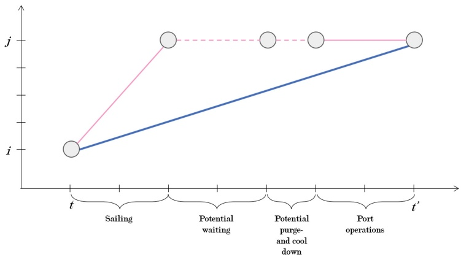
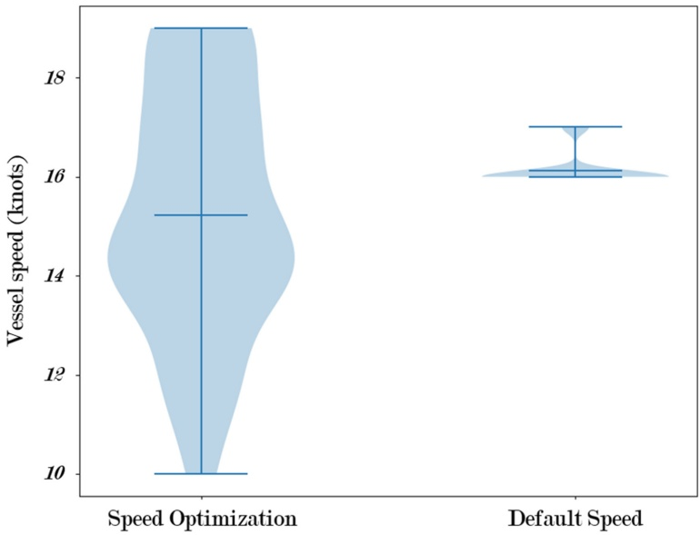

# Planning LNG Annual Delivery Programs with Speed Optimization and Multiple Loading Ports

Helle V. Haug1, Sigrid H. Solum1, Sanna B. Warholm1, Kjetil Fagerholt1(B), Mingyu Li2, and Inge Norstad2

1 Department of Industrial Economics and Technology, Norwegian University of Science and Technology, Trondheim, Norway kjetil.fagerholt@ntnu.no 2 Quorum Software, Houston, TX, USA inge.norstad@quoromsoftware.com

**Abstract.** We study the planning problem of creating Annual Delivery Programs (ADPs) in the Liquefied Natural Gas Industry (LNG), in which an LNG producer must fulfill a series of long-term contracts for LNG deliveries with customers all over the world with a given fleet of LNG vessels. We expand existing models in the literature by also considering speed optimization and multiple loading ports. We denote this planning problem as the LNG-ADP with Speed Optimization and Multiple Load Ports (LNG-ADP-SO-MLP). We propose a novel and efficient mixed integer programming (MIP) model for the LNG-ADP-SO-MLP. The model is solved using a commercial MIP-solver on a number of realistic instances for two different LNG producers. It is shown that the solver obtains solutions with less than 1% optimality gaps within one hour for instances with a planning horizon of up to 180 days. This indicates that the model can efficiently be embedded within a rolling horizon heuristic to solve instances with longer planning horizons.

**Keywords:** Liquefied Natural Gas · Annual Delivery Program · Ship Routing · Inventory Management · Speed Optimization

## 1 Introduction

The earth contains enormous amounts of natural gas, which are often located far from where the gas is needed. For long distances the gas must be transported by sea. To make transportation volume-efficient and safe, the natural gas is cooled down and condensed to its liquid form, i.e., into Liquefied Natural Gas (LNG), at liquefaction plants, before being loaded onto specially designed LNG vessels for transportation to its destination where the LNG is boiled to natural gas at a regasification port.

The demand for LNG has steadily been increasing and today there are liquidation and regasification ports organized for shipping of LNG in large parts of the world. Countries in some areas, especially the Middle East, USA, and Australia, are net exporters of LNG, while countries in areas including China, Japan, and Europe are net importers. Large geographical distances between suppliers and customers create a high demand for shipping LNG by sea.

<small>-c The Author(s), under exclusive license to Springer Nature Switzerland AG 2023 J. R. Daduna et al. (Eds.): ICCL 2023, LNCS 14239, pp. 170–184, 2023. [https://doi.org/10.1007/978-3-031-43612-3\_10](https://doi.org/10.1007/978-3-031-43612-3_10)</small>

The average charter rate (rental price) for a 160 000 cubic meter LNG vessel in 2021 was around 89 000 USD/day, up from around 59 300 USD/day in 2020 [4]. However, the spot charter rate reached as high as 400 000 USD/day during 2022, mainly due to political tensions related to Russia being at war and cutting off gas supplies to Europe, as well as the sabotage of two pipelines in the Baltic Sea [3]. Although this is an unusual situation, it highlights the current importance of optimizing LNG transportation to maximize the utilization of the vessel fleet.

In this paper, we study a special case of the maritime inventory routing problem for an LNG producer, which is the planning of so-called Annual Delivery Programs (ADPs). We denote this planning problem as the LNG-ADP, in which the producer must fulfill a series of long-term contracts with customers all over the world while also having the option to sell LNG in the spot market. The producer is in charge of the inventory of LNG at its liquefaction plant(s), the loading port with a limited number of berths, and the routing and scheduling of a heterogeneous fleet of LNG vessels. The LNG-ADP describes the customer deliveries of LNG cargoes for the next 12 months. In the LNG-ADP, the LNG producer aims at maximizing the profits, which consists of the revenue from the sales of LNG less the sailing and vessel chartering costs.

The LNG-ADP is, due to its importance, well studied. An important pioneering study was published by Rakke et al. [10], who proposed a Rolling Horizon Heuristic (RHH) for this planning problem. Later, Stålhane et al. [11] used a construction and improvement heuristic that makes a set of solutions with a greedy insertion procedure, improves them with a first-descent neighborhood search and/or branch-and-bound on a mathematical formulation. Al Haidous et al. [1] base their model on the same assumptions as [10], but consider the specific case of using a homogeneous fleet of LNG-delivery vessels, with the goal of minimizing fleet size. Andersson et al. [2] also model the LNG-ADP problem in the same way as [10], but add four families of valid inequalities to improve the lower bounds on the problem’s optimal value.

The study by Mutlu et al. [8] stands out by including two extensions: 1) the production of LNG is a decision variable and not an input parameter, and 2) allowing split deliveries, where a vessel can unload partial cargoes in more than one unloading port. Li et al. [6] were the first to include transshipment in the LNG-ADP problem, motivated by the Yamal LNG case where a transshipment port helps the producer to avoid longer-than-necessary voyages with ice-breaking LNG vessels, as normal LNG vessels can take over the LNG and deliver it to the customers. Li et al. [6] introduce a continuous-time formulation for this problem, while Li et al. [5] later proposes a time-discrete model for the same problem. Both models are embedded into and solved with an RHH.

In this paper, we expand previous models of the LNG-ADP by including optimization of the vessels’ sailing speeds. In contrast to currently existing models from the literature, our models also allows for multiple loading ports, which is becoming relevant for some producers as the industry develops. Hence, we refer to our version of the LNG-ADP with Speed Optimization and Multiple Loading Ports (LNG-ADP-SO-MLP). Speed optimization in ship routing has been widely studied, e.g., [9,12], although not in the context of LNG-ADP planning. We propose a novel Mixed Integer Programming (MIP) model for the LNG-ADP-SO-MLP. We generate a number of realistic instances based on data from two LNG producers and show that our MIP model can be efficiently solved with low optimality gaps for instances with a planning horizon of up to 180 days using a commercial MIP-solver. Furthermore, the results show that including speed optimization in the planning can improve the profits and make the planning more flexible.

The remaining of this paper is organized as follows. Section 2 gives a formal definition of the LNG-ADP-SO-MLP, while our MIP model for this problem is introduced in Sect. 3. The computational study is presented in Sect. 4, before we conclude in Sect. 5.

## 2 Problem Definition

The LNG-ADP-SO-MLP considers an LNG producer’s planning of the supply of LNG to customers over a planning horizon with a given vessel fleet. The producer controls one or more loading (liquefaction) ports where the LNG is produced (liquefied). Each loading port has a given daily production, which may vary throughout the year. Furthermore, each loading port has a given set of berths from which the vessels load LNG. The number of available berths may also vary over time, e.g., due to maintenance. In addition, each loading port has storage tanks with a given maximum and minimum storage capacity.

There is a given set of customers, which either require LNG Delivered Ex-Ship (DES), where the LNG producer transports the cargo to the customer with its own vessels, or Free-On-Board (FOB), where the customers pick up the cargo at an agreed loading port with their own vessels. Each DES contract has an associated unloading port, where the vessels unload the LNG cargoes. Since the customer decides when it wants the LNG delivered, we assume there is always available inventory capacity and berth capacity at the unloading ports. Both DES and FOB customers define their demand in advance for specific subsets of the planning horizon, hereby referred to as partitions. A customer typically has annual, quarterly, and/or monthly partitions with an associated delivery requirement. The customers’ required contract volumes are satisfied by one or more deliveries in each partition. For a DES customer, the minimum demand within each partition must be satisfied, and a revenue is associated with deliveries above this minimum up to a specified maximum demand within the partition. For FOB contracts, each delivery must be the size of the vessel picking it up. In addition to these contract deliveries, it is also possible to have optional one-time deliveries of spot cargoes with associated customer destinations and revenues. These have to be delivered either using the LNG producer’s vessels (like DES) or by using the customer’s own vessel (like FOB).

Each vessel in the LNG producer’s fleet has a given fuel consumption depending (non-linearly) on the sailing speed, as well as a maximum and minimum sailing speed. The distances between ports are known in advance. If the LNG producer is short on vessels, additional vessels can be chartered at a given daily rate. Each vessel has a specific loading capacity and is always loaded up to capacity due to physical limitations. It is also required to unload the entire load at the unloading port, except for a minimum tank volume share that is needed to keep the tanks cool due to the boil-off effect, which means that a fraction of the LNG that is transported will evaporate during a voyage, typically at a rate of 0.10–0.12% per day [7]. The actual delivery volume of each delivery is therefore defined by the capacity of the vessel and the boil-off, which depends on the sailing distance. Each vessel has a given start position at the beginning of the planning horizon. A vessel becomes available for a new voyage when it returns to a loading port, and may therefore become available some days into the beginning of the planning horizon.

Some vessels might be scheduled for maintenance during the planning horizon. This must take place at a pre-defined maintenance port and start within a given time window. After maintenance, the vessel has to go through a purge and a cool-down procedure, which must be done at a loading port and is assumed to take a given amount of time. All vessels are assumed to have the same specified time associated with loading and unloading (i.e., one day).

The main decisions of the LNG-ADP-SO-MLP are where to send each vessel at what times and at what speeds, i.e., the vessel routes and schedules, while making sure that all customer delivery requirements are satisfied and that the inventory levels at the loading ports are kept within its limits at all times. Not all vessels can visit all ports, and some vessels cannot serve all customers due to their properties not being compatible with the customer’s unloading port. Also, some vessels are restricted to serving specific customer contracts. Furthermore, no more vessels than there are available berths can load on a given day at a given production port. Additional decisions include how much spot cargo to sell within certain demand and revenue specifications.

The planning objective of the LNG-ADP-SO-MLP is to maximize the gross margin less the transportation costs (hereby referred to as the “profit”). The revenue comes from spot cargoes transported DES and FOB, from long-term contracted LNG deliveries (DES and FOB), and lastly from the value of the remaining LNG at the end of the planning period. The costs are the (speeddependent) sailing costs for the producer’s fleet of vessels, as well as the chartering costs. The resulting plan is an Annual Delivery Program, describing the routes and schedules for the vessels in the fleet over the given planning horizon.

## 3 Mathematical Model

In the following, we explain the modeling assumptions and generation of the underlying network in Sect. 3.1. We introduce the notation in Sect. 3.2, before the model is presented in Sect. 3.3.

## 3.1 Modeling Assumptions and Network Generation

The proposed MIP model is time-discrete where an arc represents a one-way sailing between two ports in a time-space network. Each time period is one day, which is a reasonable resolution for the LNG-ADP-SO-MLP. Before running the MIP model, an arc generation procedure generates feasible arcs, which are given as input to the MIP model. The arcs are generated so that we allow that the LNG vessels can wait at a port before loading/unloading for up to a specified number of days. This makes the model more flexible when it comes to handling both inventory constraints at the loading ports and contract delivery requirements for the customers.

A node in the time-space network is a combination of a port and a time period, denoted $( i , t )$ or $( j , t ^ { \prime } )$ , where i and j denote ports, and t and $t ^ { \prime }$ denote time periods. Each port represents one of five port types: 1) a loading port, where LNG is stored before being loaded onto the vessels before transportation; 2) an unloading (customer) port, where LNG is unloaded from the vessel and regasified; 3) a maintenance port, which the vessels that require maintenance must visit within the specified time winodws; 4) a spot unloading port, which is similar to an unloading port, except that only optional cargoes can be unloaded here; 5) the artificial initialization and destination ports for the vessels.

An arc in the network $( ( i , t ) , ( j , t ^ { \prime } ) )$ for a vessel links two nodes. The start time of an arc is defined by the point in time when the vessel starts sailing from the start port. The end time of an arc is the start time of the arc, plus the time it takes to complete four vessel activities: 1) sailing; 2) potential waiting; 3) potential purge and cool-down procedure; 4) the port operations, i.e., the time for loading/unloading. An example of an arc in the time-space network is shown in Fig. 1. The blue line represents the arc $( ( i , t ) , ( j , t ^ { \prime } ) )$ , and the pink lines represent the actual processes included in the arc. Waiting is relevant when the sailing distance and times of an arc imply a speed lower than the minimum speed of the vessel. The vessel will then sail at its minimum speed and wait outside the port in order to fulfill the time requirement. The purge and cool-down process is only relevant when a vessel comes from a maintenance port.

As shown in Fig. 1, the arcs are defined so that the sailing precedes the other activities. This modeling choice is made to simplify the berth constraints at the loading port and to reduce symmetry. In the case of purge and cool-down, a vessel requires more time in the loading port after maintenance. An arc provides information about what type of node a vessel came from (the i in $( ( i , t ) , ( j , t ^ { \prime } ) ) )$ Therefore, we know if a purge-and-cool down is necessary, and thus how long a berth is busy before the next vessel can arrive.

Artificial nodes and their associated arcs are included for two purposes. First, this makes sure only one journey is started for each vessel. This is done by having only one electable arc from the artificial origin node to the time and location where the vessel first becomes available. The artificial origin node is located in $( i , t )   =   ( 0 , 0 )$ . The arcs from the artificial origin node have 0 associated costs. Second, it easily allows for not using a vessel at all, represented by an arc going from the artificial origin node in $( i , t ) = ( 0 , 0 )$ to the artificial destination node in $( i , t ) = ( 0 { , } | \mathcal { T } |   +   1 )$ , where $| T |$ is the length of the planning horizon. These arcs also have 0 associated costs.

Fig. 1. Illustration of an arc $( ( i , t ) , ( j , t ^ { \prime } ) )$ and the vessel activities it represents

Since there is always an option to either shut down production or accept potential additional spot contracts for the LNG producer throughout the year, an assumption about defining an artificial spot FOB contract is made. This artificial spot FOB contract has zero revenue and allows surplus LNG to potentially be sold throughout the planning period. Each cargo loaded by the artificial spot FOB contract in the final ADP represents a possibility for the LNG producer to find a corresponding real-life spot contract for the given cargo’s pick-up interval.

Following this, we generate the network that is used as input to the MIP model. Note that each arc has a calculated cost and also represents a given associated sailing speed, and hence fuel cost. As an example, consider the two arcs $( ( i , t ) , ( j , t ^ { \prime } ) )$ and $( ( i , t ) , ( j , t ^ { \prime } + 1 ) )$ , the latter arc allows for spending an additional day than the former on the sailing between the ports $i$ and $j .$ This allows for sailing at a lower speed and sailing cost.

## 3.2 Notation

**Sets**

V Set of producer-operated vessels that are available during the planning horizon

$\mathcal { V } ^ { M }$ Set of vessels that require maintenance during the planning horizon, $\mathcal { V } ^ { M } \subset \mathcal { V }$

$\mathcal { V } _ { i }$ Set of vessels that can serve node i, $\mathcal { V } _ { i } \in \mathcal { V }$

$\mathcal { N }$ Set of ports

$\mathcal { N } ^ { L }$ Set of loading ports, $\mathcal { N } ^ { L } \subset \mathcal { N }$

$\mathcal { N } ^ { U }$ Set of unloading ports, $\mathcal { N } ^ { U } \subset \mathcal { N }$

$\mathcal { N } ^ { S }$ Set of spot unloading ports, $\mathcal { N } ^ { S } \subseteq \mathcal { N }$

$\mathcal { N } ^ { M }$ Set of maintenance ports, $\mathcal { N } ^ { M } \subset \mathcal { N }$

$\mathcal { A } _ { v }$ Set of feasible arcs vessel v can sail

$\mathcal { A } _ { \ast } ^ { M }$ Set of feasible maintenance arcs vessel v can sail to start maintenance, $\mathcal { A } _ { v } ^ { M } \subset \mathcal { A } _ { v }$

$\mathcal { A } _ { \ast } ^ { \mathring { U } }$ Set of feasible arcs ship v can sail to deliver a DES long-term contracted $\mathrm { c a r g o } ,   \mathcal { A } _ { v } ^ { U } \subset \mathcal { A } _ { v }$

$\mathcal { A } _ { v } ^ { \tilde { S } }$ Set of feasible arcs ship v can sail to deliver a DES spot cargo, $\mathcal { A } _ { v } ^ { S } \subset \mathcal { A } _ { v }$

$\mathcal { F } _ { i }$ Set of FOB cargoes of LNG that want to be picked up at loading port i

$\mathcal { F } _ { i } ^ { U }$ Set of long-term contracted FOB cargoes of LNG that must be picked up at loading port $i ,   \mathcal { F } _ { i } ^ { U } \subset \mathcal { F } _ { i }$

$\mathcal { F } _ { i } ^ { S }$ Set of Spot FOB cargoes who’s load can be picked up by a FOB vessel at loading

port $i ,$ also including the artificial FOB-pickup $( f = 1 ) ,   \mathcal { F } _ { i } ^ { S } \subset \mathcal { F }$

$\mathcal { P } _ { j }$ Set of time partitions where customer j has DES delivery requirements

$\tau$ Set of time periods (days) in the planning horizon

$\tau ^ { L }$ Set of time periods in loading days, where the vessels can lift $\mathrm { L N G \hat { A } }$ from a loading port, $\mathcal { T } ^ { L } \subset \mathcal { T }$

$\tau ^ { U }$ Set of time periods in unloading days, where vessels can deliver LNGA to a customer, ˆ $\mathcal { T } ^ { U } \subset \mathcal { T }$

$$
\begin{array}{c} \mathcal {T} _ {j p} \\ \mathcal {T} _ {f} ^ {F O B} \end{array}
$$

Set of time periods within partition p for customer j, $\mathcal { T } _ { j p } \subset \mathcal { T }$

Set of time periods where FOB cargo f can be picked up, $\mathcal { T } _ { f } ^ { F O B } \subset \mathcal { T }$

$\mathcal { T } _ { v }$ Set of time periods where vessel v is available to be scheduled, $\mathcal { T } _ { v } \subset \mathcal { T }$

$\mathcal { T } _ { v } ^ { M }$ The time period where maintenance of vessel v is scheduled to start, $\mathcal { T } _ { v } ^ { M } \subset \mathcal { T } _ { v }$

## Parameters

$C _ { \underbrace { v i t j t ^ { \prime } } _ { \leq } } ^ { S }$ Sailing cost of each feasible arc $( ( i , t ) , ( j , t ^ { \prime } ) )$ for vessel v

$C _ { i t j } ^ { C }$ Costs of using a charter vessel to deliver a cargo at port $j ,$ loading the cargo at loading port i at time t

$\mathcal { N } _ { \cdot \cdot } ^ { S T A R T }$ Start port of vessel v

$T ^ { \stackrel { \mathcal { G } } { S } T A R T }$ First time period where vessel v is available to be scheduled

$_ { T } \stackrel { v } { _ { O } }$ T vij Operational time associated with sailing from port location i to port location j for vessel v

$T _ { i j } ^ { C }$ Sailing time for a charter vessel sailing from loading port i to unloading port j

$T _ { f i } ^ { \mathcal { I } _ { \mathcal { I } _ { F O B } } }$ Operational time associated to port location j for FOB cargo f

$L _ { v }$ Capacity of vessel v

$\overline { { L } } ^ { C }$ Upper limit for capacity of a charter vessel

$\underline { { L } } ^ { C }$ Lower limit for capacity of a charter vessel

$\overline { { L } } _ { f } ^ { F O B }$ Loading quantity of FOB cargo f

$\overline { { D } } _ { j p }$ Maximum demand of unloading port j in partition $p$

Dj Minimum demand of unloading port j in partition $p$

$\overline { { R _ { \ell } ^ { S _ { F O B } ^ { P } } } }$ Revenue per volume unit of LNG loaded for FOB spot contract $f$

$R _ { f } ^ { \not U F O B }$ Revenue per volume unit of LNG loaded for long-term FOB contract $f$

$R _ { \therefore \iota \prime } ^ { \stackrel { \prime } { D } _ { E S } }$ Revenue per volume unit of LNG for delivering DES contract to customer j at time $t ^ { \prime }$

$R _ { i } ^ { \stackrel { \mathcal { H } } { E } N D }$ Unit value of LNG left in storage tanks at loading port i at the end of the planning horizon

$B _ { j t ^ { \prime } }$ Berth capacity at port $j$ at time $t ^ { \prime }$

$Q _ { i t } ^ { \mathcal { P } }$ Produced quantity of LNG in loading port i in time period t

$\overline { { S } } _ { i }$ Maximum storage level of LNG at loading port i

$\underline { { S } } _ { i }$ Minimum storage level of LNG at loading port i

E Boil-off rate in percent of total vessel capacity

$S _ { i }$ Initial storage level of LNG at the start of the planning horizon at loading port i

## Variables

$x _ { v i t j t ^ { \prime } }$ 1 if vessel v sail arc ((i, t), (j, t-)), and 0 otherwise

$z _ { f t ^ { \prime } }$ 1 if a cargo from FOB contract f is done loading in time period $t ^ { \prime } ,$ and 0 otherwise $w _ { i t j }$ 1 if a charter vessel starts sailing from loading port i at time t to deliver a cargo at $j ,$ and 0 otherwise

$g _ { i t j }$ Amount loaded by a charter vessel in loading port i at time t to deliver in unloading port $j$

$s _ { i t }$ Remaining storage at loading port i at the end of time period t

## 3.3 Mathematical Model

**Objective Function.** The Objective function (1) maximizes profit, which is represented by revenue less vessel sailing costs. The first seven terms represent 1) the revenue from the long-term DES contracts served by own vessels, 2) the long-term DES contract shipments shipped by charter vessels, 3) the DES spot contracts served by own vessels, 4) the DES spot contract served by charter vessels, 5) the long-term FOB contracts, 6) the revenue from the spot FOB contracts, and 7) the value of the remaining LNG at the end of the planning horizon, respectively. Note that the boil-off effect is accounted for by including the boil-off rate E in terms 1 to 4. The last two terms are the cost terms. The first cost term is the cost of sailing the producer-operated vessels, while the last term represents the cost of using charter vessels.

$$
\begin{array}{r l} & m a x z = \sum_ {v \in \mathcal {V}} \sum_ {((i, t), (j, t ^ {\prime})) \in \mathcal {A} _ {v} ^ {U}} R _ {j t ^ {\prime}} ^ {D E S} L _ {v} (1 - (t ^ {\prime} - t) E) x _ {v i t j t ^ {\prime}} \\ & + \sum_ {i \in \mathcal {N} ^ {L}} \sum_ {t \in \mathcal {T} ^ {L}} \sum_ {j \in \mathcal {N} ^ {U}} R _ {j, t + T _ {i j} ^ {C}} ^ {D E S} (1 - T _ {i j} ^ {C} E) g _ {i t j} + \sum_ {v \in \mathcal {V}} \sum_ {((i, t), (j, t ^ {\prime})) \in \mathcal {A} _ {v} ^ {S}} R _ {j t ^ {\prime}} ^ {D E S} L _ {v} (1 - (t ^ {\prime} - t) E) x _ {v i t j t ^ {\prime}} \\ & + \sum_ {i \in \mathcal {N} ^ {L}} \sum_ {t \in \mathcal {T} ^ {L}} \sum_ {j \in \mathcal {N} ^ {S}} R _ {j, t + T _ {i j} ^ {C}} ^ {D E S} (1 - T _ {i j} ^ {C} E) g _ {i t j} + \sum_ {i \in \mathcal {N} ^ {L}} \sum_ {f \in \mathcal {F} _ {i} ^ {U}} \sum_ {t ^ {\prime} \in \mathcal {T}} R _ {f} ^ {U F O B} L _ {f} ^ {F O B} z _ {f t ^ {\prime}} \\ & + \sum_ {i \in \mathcal {N} ^ {L}} \sum_ {f \in \mathcal {F} _ {i} ^ {S}} \sum_ {t ^ {\prime} \in \mathcal {T}} R _ {f} ^ {S F O B} L _ {f} ^ {F O B} z _ {f t ^ {\prime}} + \sum_ {i \in \mathcal {N} ^ {L}} R _ {i} ^ {E N D} s _ {i, | \mathcal {T} |} \\ & - \sum_ {v \in \mathcal {V}} \sum_ {((i, t), (j, t ^ {\prime})) \in \mathcal {A} _ {v}} C _ {v i t j t ^ {\prime}} ^ {S} x _ {v i t j t ^ {\prime}} - \sum_ {i \in \mathcal {N} ^ {L}} \sum_ {t \in \mathcal {T}} \sum_ {j \in \mathcal {N} ^ {U}} C _ {i t j} ^ {C} w _ {i t j} \end{array}\tag{1}
$$

**Inventory Constraints.** Constraints (2) to (4) handle the inventory at the loading ports. Constraints (2) initialize the constraint for each loading node, while Constraints (3) make sure that the inventory requirement is fulfilled for each day afterwards. Constraints (4) ensure that the inventory level is always within its limits.

$$
\begin{array}{c} s _ {i 1} = S _ {i} + Q _ {i 1} ^ {P} - \sum_ {j \in \mathcal {N} ^ {U}} \sum_ {t ^ {\prime} \in \mathcal {T}} \sum_ {v \in \mathcal {V} _ {i}} L _ {v} x _ {v i 1 j t ^ {\prime}} - \sum_ {j \in \mathcal {N} ^ {U}} g _ {i 1 j} \\ - \sum_ {f \in \mathcal {F} _ {i}} \sum_ {t ^ {\prime} \in \mathcal {T} _ {f} ^ {F O B}} L _ {f} ^ {F O B} z _ {f t ^ {\prime}}, \qquad i \in \mathcal {N} ^ {L} \end{array}\tag{2}
$$

$$
\begin{array}{c} s _ {i t} = s _ {i, t - 1} + Q _ {i t} ^ {P} - \sum_ {j \in \mathcal {N} ^ {U}} \sum_ {t ^ {\prime} \in \mathcal {T}} \sum_ {v \in \mathcal {V} _ {i}} L _ {v} x _ {v i t j t ^ {\prime}} - \sum_ {j \in \mathcal {N} ^ {U}} g _ {i t j} \\ - \sum_ {f \in \mathcal {F} _ {i}} \sum_ {t ^ {\prime} \in \mathcal {T} _ {f} ^ {F O B}} L _ {f} ^ {F O B} z _ {f t ^ {\prime}}, \qquad i \in \mathcal {N} ^ {L}, t \in \mathcal {T} ^ {L} \backslash \{1 \} \end{array}\tag{3}
$$

$$
\underline {{S}} _ {i} \leq s _ {i t} \leq \overline {{S _ {i}}}, \quad i \in \mathcal {N} ^ {L}, t \in \mathcal {T} ^ {L}\tag{4}
$$

**Maintenance and Vessel Flow Constraints.** Constraints (5) state that the vessels in need of maintenance perform this exactly one time. Constraints (6) ensure that each vessel either starts at its start position at its first available day or is not used at all. Constraints (7) are vessel flow conservation constraints.

$$
\sum_ {((i, t), (j, t ^ {\prime})) \in \mathcal {A} _ {v} ^ {M}} x _ {v i t j t ^ {\prime}} = 1, \quad v \in \mathcal {V} ^ {M}\tag{5}
$$

$$
x _ {v, 0, 0, N _ {v} ^ {S T A R T}, T _ {v} ^ {S T A R T}} + x _ {v, 0, 0, 0, | \mathcal {T} | + 1} = 1, \quad v \in \mathcal {V}\tag{6}
$$

$$
\sum_ {i \in \mathcal {N}} \sum_ {t = 0} ^ {t ^ {\prime} - 1} x _ {v i t j t ^ {\prime}} = \sum_ {i \in \mathcal {N}} \sum_ {t = t ^ {\prime} + 1} ^ {| \mathcal {T} |} x _ {v j t ^ {\prime} i t}, \qquad v \in \mathcal {V}, j \in \mathcal {N}, t ^ {\prime} \in \mathcal {T}\tag{7}
$$

**Demand Constraints.** Constraints (8) are demand constraints ensuring that demand is satisfied for each DES long-term contract in each time partition. The constraints account for the difference in loading and unloading volumes by subtracting the boil-off.

$$
\begin{array}{l} \underline {{D}} _ {j p} \leq \sum_ {v \in \mathcal {V} _ {i}} \sum_ {i \in \mathcal {N} ^ {L}} \sum_ {t \in \mathcal {T} _ {v}} \sum_ {t ^ {\prime} \in \mathcal {T} _ {j p}} L _ {v} (1 - (t ^ {\prime} - t) E) x _ {v i t j t ^ {\prime}} \\ \qquad + \sum_ {i \in \mathcal {N} ^ {L}} \sum_ {t \in (\mathcal {T} _ {j p} - T _ {i j} ^ {C})} g _ {i t j} (1 - T _ {i j} ^ {C} E) \leq \overline {{D}} _ {j p}, \quad j \in \mathcal {N} ^ {U} \cup \mathcal {N} ^ {S}, \quad p \in \mathcal {P} _ {j} \end{array}\tag{8}
$$

Constraints (9) and (10) are the FOB contract constraints. Constraints (9) make sure that each long-term FOB cargo contract is fulfilled once within its time window, while Constraints (10) make sure each that spot FOB cargo contract is fulfilled at most once in the relevant time window, except for the artificial spot FOB contracts (contract 1), which can be fulfilled as many times as wanted.

$$
\sum_ {t ^ {\prime} \in \mathcal {T} _ {f} ^ {F O B}} z _ {f t ^ {\prime}} = 1, \qquad j \in \mathcal {N} ^ {L}, f \in \mathcal {F} _ {j} ^ {U}\tag{9}
$$

$$
\sum_ {t ^ {\prime} \in \mathcal {T} _ {f} ^ {F O B}} z _ {f t ^ {\prime}} \leq 1, \qquad j \in \mathcal {N} ^ {L}, f \in \mathcal {F} _ {j} ^ {S} \backslash \{1 \}\tag{10}
$$

**Berth and Charter Constraints.** Constraints (11) are the berth capacity constraints. Constraints (12) ensure that if a charter vessel loads a cargo, the amount loaded is bounded within an upper and lower limit. This allows for some flexibility in the capacities of the charter vessels.

$$
\begin{array}{c} \sum_ {v \in \mathcal {V} ^ {P}} \sum_ {i \in \mathcal {N}} \sum_ {t \in \mathcal {T}} \sum_ {\tau = t ^ {\prime} + 1} ^ {t ^ {\prime} + T _ {v i j} ^ {O}} x _ {v i t j \tau} + \sum_ {j ^ {\prime} \in \mathcal {N} ^ {U}} w _ {j t ^ {\prime} j ^ {\prime}} \\ + \sum_ {f \in \mathcal {F} _ {j}} \sum_ {\tau = t ^ {\prime} + 1} ^ {t ^ {\prime} + T _ {f j} ^ {O F O B}} z _ {f \tau} \leq B _ {j t ^ {\prime}}, \qquad j \in \mathcal {N} ^ {L}, \quad t ^ {\prime} \in \mathcal {T} ^ {U} \end{array}\tag{11}
$$

$$
\underline {{L}} ^ {C} w _ {i t j} \leq g _ {i t j} \leq \overline {{L}} ^ {C} w _ {i t j}, \qquad i \in \mathcal {N} ^ {L}, t \in \mathcal {T} ^ {L}, j \in \mathcal {N} ^ {U} \cup N ^ {S}\tag{12}
$$

**Variable Domains.** Constraints (13) to (17) specify the domains of our three binary variables $x _ { v i t j t ^ { \prime } } , z _ { f t ^ { \prime } }$ and $w _ { v i t j t ^ { \prime } }$ as well as the continuous variables $g _ { i t j }$ and $s _ { i t }$ . The binary variable $z _ { f t ^ { \prime } }$ is only defined for loading ports and the relevant time periods. The binary decision variable for using a charter vessel, variable $w _ { i t j }$ , is only defined for arcs that go from a loading node to an unloading node.

$$
x _ {v i t j \nu} \quad \in \quad \{0, 1 \}, \qquad v \in \mathcal {V}, ((i, t), (j, t ^ {\prime})) \in \mathcal {A} _ {v}\tag{13}
$$

$$
z _ {f t ^ {\prime}} \quad \in \quad \{0, 1 \}, \qquad j \in \mathcal {N} ^ {L}, f \in \mathcal {F} _ {j}, t ^ {\prime} \in \mathcal {T} _ {f} ^ {F O B}\tag{14}
$$

$$
w _ {i t j} \quad \in \quad \{0, 1 \}, \qquad i \in \mathcal {N} ^ {L}, t \in \mathcal {T} ^ {L}, j \in \mathcal {N} ^ {U} \cup N ^ {S}\tag{15}
$$

$$
g _ {i t j} \geq 0, \quad i \in \mathcal {N} ^ {L}, t \in \mathcal {T} ^ {L}, j \in \mathcal {N} ^ {U} \cup N ^ {S}\tag{16}
$$

$$
s _ {i t} \geq 0, \quad i \in \mathcal {N}, t \in \mathcal {T} ^ {L}\tag{17}
$$

## 4 Computational Study

The MIP model (including the network generation) was implemented in Python and solved by Gurobi (version 10.0.0) on a Dell Optiplex 7780 computer with an Intel Core i7-10700 @ 2.90 GHz. In the following, we describe the test instances used in Sect. 4.1, before we present the computational results in Sect. 4.2 and provide some managerial insights in Sect. 4.3.

## 4.1 Input Data and Test Instances

A number of realistic test instances are generated based on data for two different LNG producers, one with only one liquefaction (loading) port, and one with two. Table 1 presents the different configurations of test instances, varying in the number of loading- and unloading ports $| \mathcal { N } ^ { L } |$ and $| \mathcal { N } ^ { U } |$ , long-term FOB contracts $| \mathcal { F } ^ { U } |$ , vessels |V|, and time periods |T |. Three different test instances were generated for each configuration, slightly differing in the number of unloading ports (customer ports) and long-term FOB contracts.

The black horizontal line in Table 1 splits the configurations into two sets, where the upper set of configurations (with a prefix $\mathrm { ^ { \circ } n ^ { \circ } ) }$ is based on data for the LNG producer with one loading port, while the set at the bottom (with a prefix $^ { \circ } \mathbf { a } ^ { \prime } )$ is based on data from the producer with two loading ports. The leftmost column represents the configuration ID, where each of the numbers indicates the corresponding size of the set on the corresponding position in the instance ID. For example, configuration **n-2-6-12-11-60** has two loading ports, six unloading ports, 12 FOB long-term contracts, 11 vessels, and 60 time periods of one day.

## 4.2 Computational Results

A summary of the configurations’ optimality gaps and objective function values are presented in Table 2 (averaged over the three instances for each configuration). Columns 2–4 show the optimality gaps after 300, 3600, and the maximum run time of 10 800 s, respectively. A gap of 0.0% means that a guaranteed optimal solution was found. The next column presents the instances’ average objective function values after running the commercial solver to the maximum time limit of 10 800 s. The rightmost column, TTFFS, indicates how much time it takes for the solver to find the first feasible solution. Note that we were not able to find any feasible solution within the time limit for instance n-1-17-75-23-365.

We see from the results in Table 2 that once the solver finds a feasible solution to an instance, the corresponding optimality gap gets reasonably small after a relatively short amount of time. Furthermore, we see that the solver is able to find good feasible solutions with small optimality gaps to instances with planning horizons up to 180 days within minutes, which is very promising. To make some comparison, test instance B4 in [10] (16 vessels, 121 days) is close in size to instances in our configuration **n-1-7-27-23-120**. [10] obtains a gap of 10.63% for instance B4 after 24 h. It should be noted though that [10] minimizes the sum of costs minus revenues from the sale of spot, leading to a relatively lower objective value than our model for same-sized problems. The optimality gaps thereby seem larger measured in percent. Due to the time-varying LNG prices in our model, we were not able to remove revenues from long-term DES and FOB contracts in our objective function to better compare the gaps with ones in [10]. Furthermore, it is worth mentioning that the both MIP solvers and computers have improved over the last 12 years since [10], which also can explain some of the differences in gaps.

Table 1. Overview of the different test instances’ problem sizes, differing in the number of loading ports $| { \cal N } ^ { L } | ,$ average number of unloading ports $| \dot { N } ^ { U } |$ , average number of long-term FOB contracts $| \mathcal { F } ^ { \tilde { U _ { \parallel } } } |$ , number of vessels |V| and number of time periods |T |.

| Configuration ID | \|NL\| | \|NU\| | \|FU\| | \|V\| | \|T\| |
| --- | --- | --- | --- | --- | --- |
| n-1-2-2-18-30n-1-6-16-18-45n-1-6-16-18-60n-1-6-10-18-75n-1-7-21-18-90n-1-7-27-23-120n-1-7-40-23-180n-1-17-75-23-365 | 11111111 | 266677717 | 216162021234075 | 1818181818232323 | 3045607590120180365 |
| a-1-6-12-11-60a-2-6-12-11-60a-2-6-38-15-180 | 122 | 666 | 121238 | 111115 | 6060180 |

Table 2. Summary of the configurations’ optimality gaps and objective function values averaged over three instances for each configuration.

<table><tr><td rowspan="2">Configuration ID</td><td colspan="3">Optimality Gap [%]</td><td rowspan="2">Objective value [mill. USD]</td><td rowspan="2">TTFFS [s]</td></tr><tr><td>300 s</td><td>3600 s</td><td>10 800 s</td></tr><tr><td>n-1-2-2-18-30</td><td>0.0</td><td>0.0</td><td>0.0</td><td>73.1</td><td>0</td></tr><tr><td>n-1-6-16-18-45</td><td>0.40</td><td>0.30</td><td>0.27</td><td>426.3</td><td>3</td></tr><tr><td>n-1-6-16-18-60</td><td>0.39</td><td>0.23</td><td>0.23</td><td>668.1</td><td>12</td></tr><tr><td>n-1-6-10-18-75</td><td>0.37</td><td>0.26</td><td>0.19</td><td>675.7</td><td>12</td></tr><tr><td>n-1-7-21-18-90</td><td>0.34</td><td>0.21</td><td>0.17</td><td>867.7</td><td>23</td></tr><tr><td>n-1-7-27-23-120</td><td>0.71</td><td>0.51</td><td>0.48</td><td>1 168</td><td>58</td></tr><tr><td>n-1-7-40-23-180</td><td>1.55</td><td>0.42</td><td>0.22</td><td>1 615</td><td>240</td></tr><tr><td>n-1-17-75-23-365</td><td>-</td><td>-</td><td>-</td><td>-</td><td>-</td></tr><tr><td>a-1-6-12-11-60</td><td>1.63</td><td>1.32</td><td>1.30</td><td>263.1</td><td>33</td></tr><tr><td>a-2-6-12-11-60</td><td>2.27</td><td>1.70</td><td>1.48</td><td>294.4</td><td>26</td></tr><tr><td>a-2-6-38-15-180</td><td>1.11</td><td>1.10</td><td>0.42</td><td>1 400</td><td>154</td></tr></table>

Even though one should be careful with comparisons like this, the low gaps from running our model indicates that our modeling approach is efficient and can be used to find good solutions for all practical purposes. It should be noted though that we were not able to find feasible solutions for the largest test instance with 365 days planning horizon. However, the results show that our model could be embedded in a rolling horizon heuristic, e.g., like in [5, 10], for obtaining practical solutions also for instances with longer planning horizons.

## 4.3 Managerial Insights: Effect of Speed Optimization

To test the effect of speed optimization, we compare the solutions obtained when including speed optimization and when using only the vessels’ service speeds. When running these tests, we noticed that the number of binary variables more than doubled when including speed optimization since it generates more arcs in the network. As a representative example, Table 3 shows the breakdown of the objective function for two cases of an instance from configuration **n-1-7-27-23-120**, i.e., without (1) and with (2) speed optimization. The objective function is broken down into six terms. Our objective function 1 has nine terms but since there were no spot contracts in this particular instance, three terms have been omitted from further study in this section.

Table 3. Objective function breakdown for an instance of configuration n-1-7-27-23-120 (run time 1800 s, optimality gap 0.24% for case 1 and 0.19% for case 2).

| Configuration ID | 1: With default speed | 2: With speed optimization | Change [%] |
| --- | --- | --- | --- |
| Revenue, DES long-term contracts, own vessels Revenue, DES long-term contracts, chartered Revenue, FOB long-term contracts Revenue, tank left-over LNG Costs, own vessels Costs, chartering vessels | 747.7181.8304.31.679.938.9 | 815.8116.8304.32.190.122.9 | +9.1-35.70+23.1+12.9-41.2 |
| Total profit | 1 117 | 1 126 | +0.83 |

We know that each of the two cases in Table 3 has the same lower demand limits and LNG prices regardless of speed configuration. Therefore, the increase in DES revenue comes from delivering amounts of LNG that are closer to the upper demand limits of the customers. Overall, the DES revenue (the first two terms) increase by 3.1 mill. USD compared to the configuration without speed optimization, which is an increase of 0.34%. This is possible including speed optimization allows for sailing at higher speeds so that the producer can deliver somewhat larger volumes of LNG to the customers. The higher sailing speeds also results in higher fuel costs for the own vessels (increase of 12.9%). Charter costs decrease by 35.7% in the case of speed optimization since the producer’s own fleet is able to transport more due to the higher sailing speeds. This indicates that if the charter rates were to increase, speed optimization could turn out even more valuable than it does in the current test instances.

It should be noted that our test instances do not include spot contracts, nor does our model place a value on artificial FOB. The effect of speed optimization is expected to become even stronger if these elements are included since there would be more potential to exploit additional revenue sources. The additional cost that any extra revenue would imply is often relatively low, so exploiting more revenue opportunities is likely to be beneficial.

Figure 2 shows the distribution of the speeds of the vessels in the optimal solution of instance **n-1-7-27-23-120-a**. The left violin plot is the case with speed optimization, while the right plot is the case with default speeds. The plots show that the speed optimization model uses the whole spectrum of allowed vessel speeds, with a slight peak at around 14 and 15 knots. The average is slightly lower than the default service speeds, which are concentrated around 16 and 17 knots. This would imply a lower fuel cost per distance traveled on average.

Fig. 2. Distribution of vessel speeds with- and without speed optimization for instance $n - 1 - 7 - 2 7 - 2 3 - 1 2 0 - a$ . The central horizontal line denotes the average speed of the vessels.

## 5 Concluding Remarks

We have considered the planning Annual Delivery Programs (ADPs) in the Liquefied Natural Gas (LNG) industry, in which an LNG producer must fulfill a series of long-term contracts with customers all over the world with a given fleet of LNG vessels. We have expanded previous definitions and models for this problem by including speed optimization and the possibility of having multiple loading ports, which is becoming relevant for some producers as the industry develops. We denote this planning problem as the LNG-ADP with Speed Optimization and Multiple Load Ports (LNG-ADP-SO-MLP).

Our contribution to the literature is a rich formulation of the LNG-ADP planning problem, modeled as a mixed-integer programming (MIP) model. The model is designed to handle each leg of a voyage separately (because of the multiple loading ports), rather than a round trip (as in the previous models in the literature). This also allows for efficient modeling of vessel maintenance, as the vessel can sail directly to a maintenance port after unloading without returning to a loading port.

We used a commercial MIP-solver to test our model on a number of realistic instances for two different LNG producers (one with two loading ports). The computational study showed that the commercial solver was able to find feasible solutions with less than 1% optimality gaps within one hour for instances with a planning horizon of up to 180 days. It was also shown that including speed optimization brings some extra flexibility and increases the profit. The commercial solver did not find a feasible solution for the largest instance with a full planning horizon of a year. However, the promising results for the instances with shorter planning horizons show that our model can be embedded into a Rolling Horizon Heuristic (RHH) in order provide practical solutions also for instances with longer planning horizons.

## References

1. Al-Haidous, S., Msakni, M.K., Haouari, M.: Optimal planning of liquefied natural gas deliveries. Transp. Res. Part C: Emerg. Technol. 69, 79–90 (2016)

2. Andersson, H., Christiansen, M., Desaulniers, G., Rakke, J.G.: Creating annual delivery programs of liquefied natural gas. Optim. Eng. 18(1), 299–316 (2017)

3. FreightWaves: LNG shipping rates ‘shooting for the stars’ at \$500,000 per day. [https://www.freightwaves.com/news/lng-shipping-rates-shooting-for-the-stars-at-500000-per-day](https://www.freightwaves.com/news/lng-shipping-rates-shooting-for-the-stars-at-500000-per-day)

4. GIIGNL: GIIGNL Annual Report 2022. The International Group of Liquefed Natural Gas Importers, Neuilly-sur-Seine, France. [https://giignl.org/resources2/](https://giignl.org/resources2/) (2022)

5. Li, M., Fagerholt, K., Schütz, P.: Maritime inventory routing with transshipment: the case of Yamal LNG. Flex. Serv. Manuf. J. (2022). [https://doi.org/10.1007/s10696-022-09476-5](https://doi.org/10.1007/s10696-022-09476-5)

6. Li, M., Schütz, P.: Planning annual LNG deliveries with transshipment. Energies 13(6), 1490 (2020)

7. Msakni, M.K., Haouari, M.: Short-term planning of liquefied natural gas deliveries. Transp. Res. Part C: Emerg. Technol. 90, 393–410 (2018)

8. Mutlu, F., Msakni, M.K., Yildiz, H., Sönmez, E., Pokharel, S.: A comprehensive annual delivery program for upstream liquefied natural gas supply chain. Eur. J. Oper. Res. 250(1), 120–130 (2016)

9. Norstad, I., Fagerholt, K., Laporte, G.: Tramp ship routing and scheduling with speed optimization. Transp. Res. Part C: Emerg. Technol. 19(5), 853–865 (2011)

10. Rakke, J., et al.: A rolling horizon heuristic for creating a liquefied natural gas annual delivery program. Transp. Res. Part C: Emerg. Technol. 19(5), 896–911 (2011)

11. Stålhane, M., Rakke, J.G., Moe, C.R., Andersson, H., Christiansen, M., Fagerholt, K.: A construction and improvement heuristic for a liquefied natural gas inventory routing problem. Comput. Ind. Eng. 62(1), 245–255 (2012)

12. Wen, M., Ropke, S., Petersen, H.L., Larsen, R., Madsen, O.B.G.: Full-shipload tramp ship routing and scheduling with variable speeds. Comput. Oper. Res. 70, 1–8 (2016)