# The I ntu ition Beh i nd B lack- Litte rman Model Portfol ios

■ I n th is arti cl e and as ou r titl e su ggests , we demo nstrate a method fo r u nde rstand i n g the i ntu ition be h i nd the B lack- Litte rman asset al location mode l .

■ To do th is , we use exam pl es to show the d iffe ren ce betwee n the t rad itio nal m ean - variance opti m izatio n p rocess and the Black- Litte rman p rocess . We show that the mean-va riance opti m ization p rocess , wh i le academ ical ly sou nd , can p rod u ce resu lts that are extreme and not parti cu larly i ntu itive . I n contrast , we show that the opti mal po rtfol ios gene rated by th e Black- Litte rman p rocess have a si m ple , i n t u i t i ve p ro p e rty :

The u nconstrai ned opti mal po rtfol io is the m arket eq u i l i b ri u m po rtfol i o pl us a we i g hted su m of po rtfol ios rep resenti ng an i nvesto r’s vi ews .

The we i g ht on a po rtfol io rep resenti n g a vi ew is positive when the vi ew is m o re b u l l ish than the on e i m p l i ed by the eq u i l i b ri u m an d othe r views .

The wei g ht i ncreases as the i nvesto r becom es mo re bu l l ish o n the view as wel l as when the i nvesto r becomes mo re confident about the vi ew .

# Investment Management Research Goldman S achs Quantitative Resources Group

Guangliang He (2 1 2) 3 57 -3 2 1 0

Robert Litterman (2 1 2) 902- 1 677

Copyright 1 999 Goldman, Sachs & Co. All rights reserved.

The information in this publication is for your private information and is not intended as an offer or solicitation to buy or sell any securities .

The information in this publication is for your private information and should not be construed as financial advice and it is not intended as an offer or solicitation to buy or sell any securities . The sole purpose of this publication is to inform the reader about the intuition behind the B lack-Litterman model portfolios and is not intended as a solicitation for any Goldman Sachs product or service.

**Executive Summary**

Since publication in 1990, the Black-Litterman asset allocation model has gained wide application in many financial institutions. As developed in the original paper, the Black-Litterman model provides the flexibility to combine the market equilibrium with additional market views of the investor. In the Black-Litterman model, the user inputs any number of views or statements about the expected returns of arbitrary portfolios, and the model combines the views with equilibrium, producing both the set of expected returns of assets as well as the optimal portfolio weights.

In contrast to the Black-Litterman model, in the traditional mean-variance approach the user inputs a complete set of expected returns1, and the portfolio optimizer generates the optimal portfolio weights. However, users of the standard portfolio optimizers often find that their specification of expected returns produces output portfolio weights which may not make sense (due to the complex mapping between expected returns and portfolio weights and the absence of a natural starting point for the expected return assumptions).

In this article, we use examples to illustrate the difference between the traditional mean-variance optimization process and the Black-Litterman process. In so doing, we demonstrate how the Black-Litterman approach2 provides both a reference point for expected return assumptions as well as a systematic approach to deviating from this point to express one’s market views.

## The Traditional Mean-Variance Approach

The Markowitz formulation of the portfolio optimization problem is a brilliant quantification of the two basic objectives of investing: maximizing expected return and minimizing risk. Having formed the foundation of portfolio theory for the nearly half a century since its publication, this framework has stood the test of time in the academic world. Unfortunately, in the practical world of investment management, the Markowitz framework has had surprisingly little impact. Why is that the case? We cite two reasons.

First, investment managers tend to focus on small segments of their potential investment universe—picking stocks and other assets that they feel are undervalued, finding assets with positive momentum, or identifying relative value trades. Unfortunately, the Markowitz formulation unrealistically requires expected returns to be specified for every component of the relevant universe, which in practice is typically defined by a broad benchmark.

<small>1 Throughout this paper for simplicity we use the phrase ‘expected return’ to refer to ‘expected excess return over the one-period riskfree rate.’</small>

<small>2 The Black-Litterman model starts with equilibrium expected returns (as derived via the Capital Asset Pricing Model). This set of expected returns is the neutral reference point of the Black-Litterman model.</small>

Second, investment managers tend to think in terms of weights in a portfolio rather than balancing expected returns against the contribution to portfolio risk—the relevant margin in the Markowitz framework. When managers try to optimize using the Markowitz approach, they usually find that the portfolio weights returned by the optimizer (when not overly constrained) tend to appear to be extreme and not particularly intuitive. In practice most managers find that the effort required to specify expected returns and constraints that lead to reasonable answers does not lead to a commensurate benefit. Indeed this was the original motivation for Black and Litterman to develop their approach.

The following example demonstrates the unstable behavior of the optimal weights that can occur when using optimizers . In Chart 1 A, we assume the investor has only one view about the markets : German equity will outperform European equities by 5 % per year. Since our investor does not have a complete set of expected returns for all markets , she starts by setting the expected returns for all countries equal to 7 percent. To incorporate her view, she then shifts the expected return for Germany up by 2. 5 % and shifts the expected return for France and the United Kingdom down by 2 . 5 percent.

What this investor finds is that using equal means does not compensate for the different levels of risk in assets of different countries and tends to generate very extreme portfolios . Chart 1 A shows that using the equal expected returns as the starting point results in optimal weights of -3 3 . 5 % in Germany and 7 1 .4% in Australia. A small shift in the expected returns for the European equities (2. 5 % for Germany, -2. 5 % for France and the United Kingdom) causes huge swings in the weights for these countries . The weight for France now is -94 . 8 percent !

Chart 1A. Optimal Weights, Traditional Mean-Variance Approach Starting from Equal Expected Returns

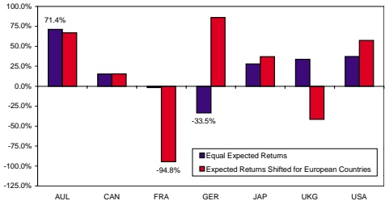

Thi s chart i s to be used for illu strative purposes only.

Black and Litterman also demonstrated the shortcomings of several other methods for specifying a starting point for expected returns. They pointed out that a better choice for the neutral expected returns is to use the equilibrium expected returns as developed by Black. A major advantage of this approach is that it results in market capitalization portfolio weights being optimal for an investor using the mean-variance approach. Now, armed with the equilibrium expected returns as the neutral starting point, the investor translates her view into expected returns.

There are many different ways to translate the view to expected returns. For example, the investor could simply shift the expected return for Germany to be 5% higher than the weighted average equilibrium expected returns for the rest of Europe, but this approach may suggest that Germany outperforms the rest of the world. To be precise in expressing her view, she sets the expected return for Germany 5% higher than the (market capitalization) weighted average of the expected returns of France and the United Kingdom. She sets the sum of market capitalization-weighted expected returns for the European countries as unchanged from the equilibrium value. She keeps the difference between the expected returns of France and the United Kingdom unchanged from the equilibrium difference in value. Chart 1B demonstrates that since the equilibrium already implies that Germany will outperform the rest of Europe, the change in the expected returns is actually quite small.

Chart 1B. Expected Returns, Traditional Mean-Variance Approach Starting from Equilibrium Expected Returns

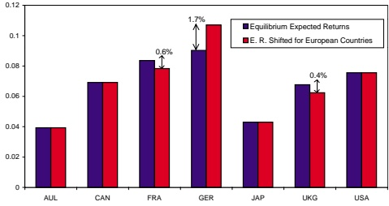

This chart is to be used for illustrative purposes only.

<small>3 Throughout our examples, we use = 2 5. as the risk aversion parameter representing the world average risk tolerance.</small>

Chart 1 C shows the optimal portfolio weights computed by solving the mean-variance problem. Using the equilibrium expected returns, the optimal portfolio weights are the market portfolio weights . However, when the view about Germany versus the rest of Europe is incorporated, even though the changes of the expected returns from the equilibrium expected returns are small and are limited for European countries only, the optimal portfolio is quite different from what one would have expected: the increased weight in the German market and the decreased weights in the United Kingdom and France markets are expected, but the reduced weights in Australia and Canada and the increased weights in Japan and the United States are very puzzling . Since the investor does not have any view on these countries , why should she adj ust the weight in these countries ? Presumably it is because of the way the views are being translated into expected returns . As we can see, the investor has already tried to translate the view into the expected returns . Can she possibly do better?

Chart 1 C. Optimal Portfolio Weights, Traditional Mean-Variance Approach Starting from Equilibrium Expected Returns

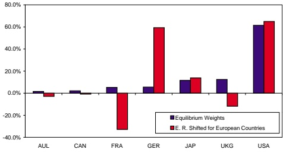

Thi s chart i s to be used for illu strative purposes only.

The Black-Litterman asset allocation model addresses those practical issues in using the Markowitz framework by allowing the portfolio manager to express views about portfolios, rather than a complete vector of expected returns on all as sets . In the simplest of contexts—when there i s no benchmark or constraints—the optimal portfolio is very intuitive . It is simply a set of deviations from market capitalization weights in the directions of portfolios about which views are expressed. Here the Black-Litterman model provides the appropriate weights on the portfolios, based on stated expected returns on the portfolios and degrees of confidence in these views . The model balances the contribution to expected return of each of the portfolios about which a view is expres sed against its contribution to overall portfolio risk. These results are transparent and intuitive .

The real power of the Black-Litterman model arises when there is a benchmark, a risk or beta target, or other constraints. In these contexts, the optimal weights are no longer obvious or intuitive. Nonetheless, the manager can be confident that the same tradeoff of risk and return—which leads to intuitive results that match the manager’s intended views in the unconstrained case—remains operative when there are constraints.

The Black-Litterman model starts with equilibrium expected returns. According to the Capital Asset Pricing Model (CAPM), prices will adjust until the expected returns of all assets in equilibrium are such that if all investors hold the same belief, the demand for these assets will exactly equal the outstanding supply. This set of expected returns is the neutral reference point of the Black-Litterman model. The investor then can express her views about the markets.

In the Black-Litterman model, a view is a general statement about the expected return for any portfolio.4 These views are combined with the market equilibrium expected returns.5 In the case when the investor does not have any views about the markets, the expected returns from the Black-Litterman model match the equilibrium, and the unconstrained optimal portfolio is the market equilibrium (capitalization weights) portfolio. In the case when the investor has one or more views about the market, the Black-Litterman approach combines the information from the equilibrium and tilts the optimal portfolio away from the market portfolio in the direction of the investor’s views.

The view that German equity will outperform the rest of Europe is now precisely expressed as an expected return of 5% for the portfolio of a long position in German equity and short positions of market capitalization weights for the rest of the European markets. The Black-Litterman model uses these inputs to generate a set of expected returns6.

In contrast to the traditional approach, the Black-Litterman model adjusts all of the expected returns away from their starting values in a manner consistent with the view being expressed. Because the view is expressed on the portfolio of a long position in German equity and short positions in the rest of the European markets, the expected return on this portfolio is raised from the value implied by the equilibrium—but is still below the 5% expressed in the view. This is quite natural because the view includes a degree of uncertainty associated with it, and thus the Black-Litterman model is averaging the view with the equilibrium.

<small>p q µ</small>

<small>Mathematically, a view is expressed as  = + , where  is the vector of the expected returns, p is the weights of the portfolio representing the view, q is the expected return of the portfolio. The uncertainty of the view is represented by the presence of a normally distributed random variable  with variance being . The confidence level of the view is 1 .</small>

<small>5 See Appendix B for the formula used to compute the expected returns of the Black-Litterman model.</small>

<small>p p ′ .</small>

<small>6 Except otherwise noted, throughout this article, the confidence level on a view is calibrated so that the ratio between the parameters, (defined in footnote 3) and  (defined in Appendix B, number 2) is equal to the variance of the portfolio in the view, Σ There is no need to separately specify the value of  since only the ratio  enters the Black-Litterman expected returns formula.</small>

From the graph of the expected returns in Chart 2A, it seems counterintuitive to see that the expected returns for both France and the United Kingdom are raised. On the contrary, the view expressed does not say France or the United Kingdom will go down, it only says that they will under-perform Germany. Since both France and the United Kingdom are po sitively correlated with the view portfolio and the view raises the expected return of this portfolio , it is natural to see the expected returns on France and the United Kingdom increase as well. The same intuition applies to the other countries in Chart 2A.

Chart 2A. Expected Returns, Black-Litterman Model One View on Germany versus Rest of Europe

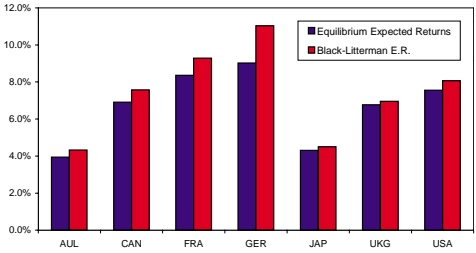

Thi s chart i s to be used for illu strative purposes only.

The optimal portfolio weights in Chart 2B are computed by solving the maximization problem. Compared to the equilibrium weights, the optimal portfolio increases the weight in Germany and decreases the weights in both France and the United Kingdom. One can see that the deviations from the equilibrium weights are proportional to the portfolio of long Germany and short France and the United Kingdom—exactly the portfolio representing the investor’ s view . This result i s very intuitive . Since the investor has a view about thi s portfolio , she simply invests in thi s portfolio on top of her neutral weights , the equilibrium weights .

Chart 2B. Optimal Portfolio Weights, Black-Litterman Model One View on Germany versus the Rest of Europe

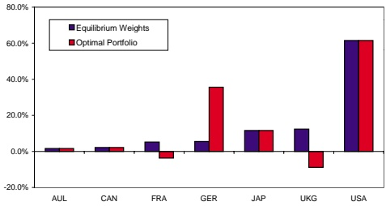

This chart is to be used for illustrative purposes only.

In Chart 2C, one can see that the deviations of the optimal portfolio from the equilibrium weights are exactly proportional to the portfolio of a long position in Germany and a short position of market capitalization-weighted France and the United Kingdom. This result is not coincidental, as it illustrates a very important property of the Black-Litterman model. In general, the unconstrained optimal portfolio from the Black-Litterman model is the market equilibrium portfolio plus a weighted sum of the portfolios about which the investor has views.

Chart 2C. Optimal Deviations from Equilibrium Weights Black-Litterman Model One View on Germany versus Rest of Europe

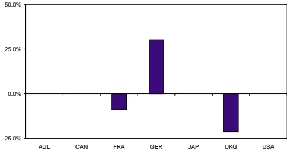

This chart is to be used for illustrative purposes only.

**Two Market Views**

In Chart 3 A, in addition to the original view that German equity will outperform the rest of the European markets, the investor has another view that the Canadian equity market will outperform the US equity market by 3 % per annum. The deviations of optimal portfolio weights from equilibrium weights show an overweight in Germany and underweight in a market capitalization-weighted portfolio of France and the United Kingdom, which is the direct result of the first view . It also show s an overweight in Canada and underweight in the United States, which is the direct result of the second view . The weights are shown in Chart 3B .

Chart 3A. Weights of Portfolios in the Views and Optimal Deviations Black-Litterman Model with Two Views

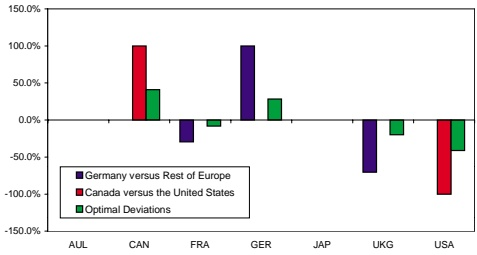

Thi s chart i s to be used for illu strative purposes only.

Chart 3B. Portfolio Weights, Black-Litterman Model with Two Views

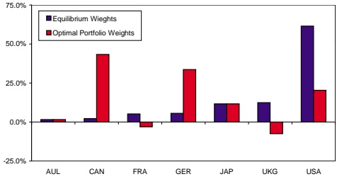

This chart is to be used for illustrative purposes only.

The next question is : how does the weight on a portfolio change when the view changes ? What will happen if the investor’ s view on Canada versus the United States is more bullish? For example, the expected return on the portfolio changes from 3 % to 4% , while everything else stays the same. Inputting all these parameters into the Black-Litterman model, the weight on the Canada versus the United States increases . In general, keeping everything else fixed, the weight on a portfolio increases as the expected return of the view increases. This property is quite intuitive, since it is natural for the investor to invest more in the portfolio when she believes the return on the portfolio is higher.

One of the features of the Black-Litterman model is that the investor can express different degrees of confidence about the views . What will happen to the weight on a portfolio when the investor becomes less confident about the view on the portfolio ? Suppose now the investor still believes Germany will outperform the rest of Europe by 5 % per annum, but she has les s confidence in the view. Suppose she is only half as confident as in the previous example. In addition, we assume the investor’ s view on the portfolio of Canada versus USA is unchanged at 4% expected return. The magnitude of the weight on the portfolio of Germany versus the rest of Europe decreases , which is also very intuitive . If the investor has les s confidence in a view, she would take less risk in the view, everything else remaining the same . These effects are illustrated in chart 4 .

When will the weight on a portfolio be positive, negative, or zero ? It turns out that the sign of the weight on a portfolio also has a very intuitive meaning. If the expected return of the portfolio is identical to the expected return on the same portfolio generated by the Black-Litterman model without the view, the view has no impact at all. Since we already know that the weight on a portfolio is an increasing function of the strength of the view, we can deduce that the weight on the portfolio is positive, if and only if, the view is more bullish than implied by using the Black-Litterman model without this particular view .

Chart 4. Weights on Portfolios in the Views

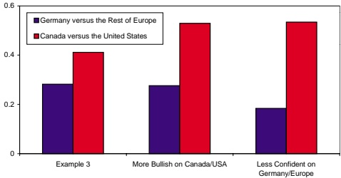

Thi s chart i s to be used for illu strative purposes only.

**Risk Constraint**

All these examples display a very important property of the Black-Litterman model: an unconstrained investor using the model will invest first in the market portfolio, then in the portfolios representing the views. She will never deviate from the market capitalization-weighted portfolio on the assets about which she does not have views.

Arriving at the optimal portfolio is somewhat more complex in the presence of constraints. In general, when there are constraints, the easiest way to find the optimal portfolio is to use the Black-Litterman model to generate the expected returns for the assets, and then use a mean-variance optimizer to solve the constrained optimization problem. In these situations, the intuition of the Black-Litterman model is more difficult to see. However, one can see the intuition in slightly modified forms in a few special constrained cases.7 Again, the portfolios about which the investor has views play a critical role in the optimal portfolio construction, even in the constrained case.

In the case of having a risk constraint, the investor’s objective of selecting the optimal portfolio is to maximize the expected return while keeping the volatility of the portfolio under the given level. In this case, the optimal portfolio can be found by scaling the solution of the unconstrained optimization problem to the desired risk level. In Chart 3A, the investor has two views. If the investor is targeting a risk level of 20% per annum, she can calculate the constrained optimal portfolio weights by taking the unconstrained optimal weights, multiplying it by the ratio of the targeted risk level of 20% and the volatility of the unconstrained optimal portfolio. However, because of the scaling, the deviation from the equilibrium is no longer a weighted sum of the Germany/Europe portfolio and the Canada/USA portfolio only. It has additional exposure coming from the scaling of the market equilibrium portfolio (Chart 5).

Chart 5. Black-Litterman Model with Two Views, Risk Constrained

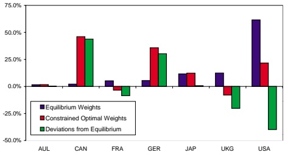

This chart is to be used for illustrative purposes only.

<small>7 The solutions to the unconstrained optimization problem as well as to several special constrained optimization problems are given in Appendix C.</small>

In many cases , in addition to the risk constraint, the investor faces a budget constraint which forces the sum of the total portfolio weights to be one . With this constraint, there is a special ‘ global minimum-variance portfolio ’ which minimizes the variance among all pos sible portfolios satisfying the budget constraint. Under both the budget constraint and the risk constraint, the optimal portfolio is a linear combination of the unconstrained optimal portfolio and the global minimum variance portfolio . The parameters are chosen in the way that the combination satisfies both the risk constraint and the budget constraint (Chart 6) .

Chart 6. Black-Litterman Model with Two Views Risk and Budget Constrained

Thi s chart i s to be used for illu strative purposes only.

In the last example, a beta constraint is added to the budget and risk constraints . A beta constraint forces the beta of the portfolio with respect to the market portfolio to be one . It can be shown that the optimal portfolio under all three constraints—risk, budget, and beta—is a linear combination of the unconstrained optimal portfolio, the minimum-variance portfolio, and the market equilibrium portfolio . The parameters are adjusted in a way that all three constraints are s ati sfied (Chart 7 ) .

Chart 7. Black-Litterman Model with Two Views Risk, Budget, and Beta Constrained

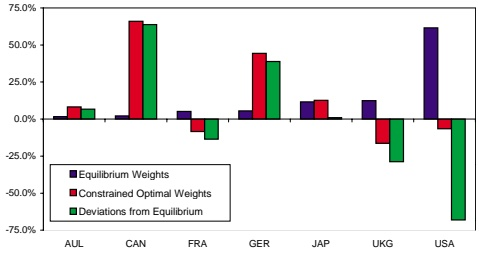

This chart is to be used for illustrative purposes only.

In the Quantitative Strategies group8 at Goldman Sachs Asset Management, we develop quantitative models and use these models to manage portfolios. The Black-Litterman model is the central framework for our modeling process. Our process starts with finding a set of views that are profitable. For example, it is well known that portfolios based on certain value factors and portfolios based on momentum factors are consistently profitable. We forecast the expected returns on portfolios which incorporate these factors and construct a set of views. The Black-Litterman model takes these views and constructs a set of expected returns on each asset. Although we manage many portfolios for many clients, using different benchmarks, different targeted risk levels, and different constraints on the portfolios, the same set of expected returns from the Black-Litterman model is used throughout. Even though the final portfolios may look different due to the differences in benchmarks, targeted risk levels and constraints, all portfolios are constructed to be consistent with the same set of views, and all will have exposures to the same set of historically profitable return-generating factors.

<small>8 This group is part of the Quantitative Resources Group and was formerly known as Quantitative Research.</small>

## Conclusion

Instead of treating the Black-Litterman asset allocation model as a “black box” which generates expected returns in some mysterious way, we have presented a method to understand the intuition of the model. With the new method, investing using the Black-Litterman model becomes very intuitive The investor should invest in the market portfolio first, then deviate from market weights by adding weights on portfolios representing her views The Black-Litterman model gives the optimal weights for these portfolios . When the investor has constraints , or a different risk tolerance level from the world average, she can always use the expected returns (generated by the Black-Litterman model along with the covariance matrix) in a portfolio optimization package to obtain the optimal portfolio . Unlike a standard mean-variance optimization, the Black-Litterman model, if properly implemented, will always generate an optimal portfolio whose weights are relatively easy to understand.

## General

This presentation does not constitute an offer or solicitation to any person in any jurisdiction in which such offer or solicitation is not authorized or to any person to whom it would be unlawful to make such offer or solicitation. It is the responsibility of any person or persons in possession of this material to inform themselves of and to observe all applicable laws and regulations of any relevant jurisdiction. Prospective investors should inform themselves and take appropriate advice as to any applicable legal requirements and any applicable taxation and exchange control regulations in the countries of their citizenship, residence or domicile which might be relevant to the subscription, purchase, holding, exchange, redemption or disposal of any investments.

Information contained herein is believed to be reliable but no warranty is given as to its completeness or accuracy and views and opinions, whilst given in good faith, are subject to change without notice. Members of the Goldman Sachs Asset Management group of companies and their affiliates, connected persons and employees may from time to time deal, hold or act as market-makers, advisers or brokers in relation to any investments, or derivatives thereof, or be otherwise interested therein.

Past performance is not a guide to future performance and the value of investments and the income derived from them can go down as well as up. Future returns are not guaranteed and a loss of principal may occur. Changes in exchange rates may cause the value of an investment to increase or decrease. Some investments may be restricted or illiquid, there may be no readily available market and there may be difficulty in obtaining reliable information about their value and the extent of the risks to which such investments are exposed. Certain investments, including warrants and similar securities, often involve a high degree of gearing or leverage so that a relatively small movement in price of the underlying security or benchmark may result in a disproportionately large movement, unfavourable as well as favourable, in the price of the warrant or similar security. In addition, certain investments, including futures, swaps, forwards, certain options and derivatives, whether on or off exchange, may involve contingent liability resulting in a need for the investor to pay more than the amount originally invested and may possibly result in unquantifiable further loss exceeding the amount invested. Transactions in over-the-counter derivatives involve additional risks as there is no market on which to close out an open position; it may be impossible to liquidate an existing position, to assess the value of a position or to assess the exposure to risk. Investors should carefully consider whether such investments are suitable for them in light of their experience, circumstances and financial resources.

Opinions expressed are current opinions as of the date appearing in this material only. No part of this material may be i) copied, photocopied or duplicated in any form, by any means, or ii) redistributed without Goldman Sachs Asset Management's prior written consent.

## Appendix A

Table 1 : Annualized volatilities, market-capitalization weights, and equilibrium expected returns for the equity markets in the seven countries .

| 6.7 | 5. 1 6 | 7.8 1 | ASU |
| --- | --- | --- | --- |
| 8.6 | 4.2 1 | 0.02 | KU |
| 3.4 | 6. 1 1 | 0. 1 2 | napaJ |
| 0.9 | 5. 5 | 1 .72 | ynamreG |
| 4.8 | 2. 5 | 8.42 | ecnarF |
| 9.6 | 2.2 | 3.02 | adanaC |
| 9. 3 | 6. 1 | 0.6 1 | ailartsuA |
| )% ( snruteR | )% ( thgieW | )% ( ytilitaloV | yrtnuoC |
| detcepx E muirbiliuqE | oiloftro P muirbiliuqE | xedn I ytiuqE |  |

Table 2 : Correlations among the equity index returns .

| 256.0 | 603.0504.0 | 356.0777.0453.0 | 866.0387.0553.01 68.0 | 977.0806.00 1 3.0556.0466.0 | 1 94.02 1 5.0934.05 1 5.0874.0884.0 | ASU KU napaJ ynamreG ecnarF adanaC |
| --- | --- | --- | --- | --- | --- | --- |
| KU | napaJ | ynamreG | ecnarF | adanaC | ailartsuA |  |

## Appendix B

1. There are N assets in the market. The market portfolio (equilibrium portfolio) is $w _ { e q }$ . The covariance of the returns is $\Sigma$ . The expected returns: $\mu$ is a vector of normally distributed random variables with mean $\overline { { \mu } }$

2. The average risk tolerance of the world is represented by the risk-aversion parameter $\delta$ . The equilibrium expected returns are $\Pi = \delta \Sigma _ { W _ { e q } }$ . The CAPM prior distribution for the expected returns is $\mu   =   \Pi   +   \varepsilon ^ { ( e ) }$ , where $\varepsilon ^ { ( \epsilon ) }$ is normally distributed with mean zero and covariance $\tau \Sigma$ . The parameter  is a scalar measuring the uncertainty of the CAPM prior.

3. The user has K views about the market, expressed as $P \mu = Q + \varepsilon ^ { ( \nu ) }$ , where P is a $K   \times   N$ matrix and $Q$ is K -vector, and $\varepsilon ^ { ( \mathrm { v } ) }$ is normally distributed with mean zero and covariance Ω . The user’s views are independent of the CAPM prior and independent of each other.

4. The mean of the expected returns is $\bar { \boldsymbol { \mu } } = \left[ \left( \tau \boldsymbol { \Sigma } \right) ^ { - 1 } + \boldsymbol { P } ^ { \prime } \boldsymbol { \Omega } ^ { - 1 } \boldsymbol { P } \right] ^ { - 1 } \left[ \left( \tau \boldsymbol { \Sigma } \right) ^ { - 1 } \boldsymbol { \Pi } + \boldsymbol { P } ^ { \prime } \boldsymbol { \Omega } ^ { - 1 } \boldsymbol { Q } \right]$

5. The investor has the world average risk tolerance. The objective of the investor is to maximize the utility $w ^ { \prime } \overline { { \mu } } - \delta w ^ { \prime } \Sigma w / 2$ The unconstrained optimal portfolio is $w ^ { ^ { * } } = \Sigma ^ { ^ { - 1 } } \overline { { \mu } } \big / \delta$ , which can be written as $w ^ { ^ { * } } = w _ { e q } + P ^ { \prime } \times \Lambda$ . Since the columns of matrix $P ^ { \prime }$ are the portfolios in the user’s view, this means that the unconstrained optimal portfolio is the market portfolio plus a weighted sum of the portfolios in the user’s views. The weights for these portfolios are given by the elements of the vector Λ , which is given by the formula $\boldsymbol { \Lambda } = \boldsymbol { \tau } \boldsymbol { \Omega } ^ { - 1 } \boldsymbol { Q } \big / \delta - \left[ \boldsymbol { \Omega } \big / \boldsymbol { \tau } + \boldsymbol { P } \boldsymbol { \Sigma } \boldsymbol { P } ^ { \prime } \right] ^ { - 1 } \boldsymbol { P } \boldsymbol { \Sigma } \boldsymbol { w } _ { e q } - \left[ \boldsymbol { \Omega } \big / \boldsymbol { \tau } + \boldsymbol { P } \boldsymbol { \Sigma } \boldsymbol { P } ^ { \prime } \right] ^ { - 1 } \boldsymbol { P } \boldsymbol { \Sigma } \boldsymbol { P } ^ { \prime } \boldsymbol { \tau } \boldsymbol { \Omega } ^ { - 1 } \boldsymbol { Q } \big / \delta$

6. LetP , Q , and Ω represent the K views held by the investor initially, $\overline { { \mu } }$ be the expected returns by using these views in the Black-Litterman model, Λ be the weight vector defined above. Assume the investor now has one additional view, represented by $p   ,   q$ , and $\omega$ For the new case of $K + 1$ views, the new weight vector $\hat { \Lambda }$ is given by the following formula $\hat { \Lambda } = \left( \begin{matrix} \Lambda - \left( q - p ^ { \prime } \overline { \mu } \right) A ^ { - 1 } b \Big / \left( \delta \left( c - b ^ { \prime } A ^ { - 1 } b \right) \right) \\ \left( q - p ^ { \prime } \overline { \mu } \right) \Big / \left( \delta \left( c - b ^ { \prime } A ^ { - 1 } b \right) \right) \end{matrix} \right)$ where $A = \Omega / \tau + P \Sigma P ^ { \prime } , \quad b = P \Sigma p , \quad c = \omega / \tau + p ^ { \prime } \Sigma p .$ Since $c - b ^ { \prime } A ^ { - 1 } b > 0$ , the expression of $\hat { \Lambda }$ shows the additional view will have a positive (negative) weight if $q - p ^ { \prime } \overline { { \mu } } > 0 \left( q - p ^ { \prime } \overline { { \mu } } < 0 \right)$ , this corresponds to the case where the new view on the portfolio $p$ is more bullish (bearish) than implied by the old expected return $\overline { { \mu } }$ . The additional view will have a zero weight if $q = p ^ { \prime } \overline { { \mu } }$ , this corresponds to the case where the new view is implied by the old expected returns already. In this case, the new view has no impact at all.

7. For a particular view k , its weight $\lambda _ { k }$ is an increasing function of its expected return $q _ { k }$ . The absolute value of $\lambda _ { k }$ is an increasing function of its confidence level $\omega _ { k } ^ { - 1 }$

## Appendix C

1 . Given the expected returns µ and the covariance matrix Σ , the unconstrained maximization problem max $w ^ { \prime } \mu   -   \delta w ^ { \prime } \Sigma w / 2$ has a solution of $w ^ { * }   =   \left( \delta \Sigma \right) ^ { - 1 } \mu$

2. Given the covariance matrix Σ , the minimum variance portfolio is $\boldsymbol { w } ^ { ( m ) } = \boldsymbol { \Sigma } ^ { - 1 } \boldsymbol { \imath } \Big / \Big ( \boldsymbol { \imath } ^ { \prime } \boldsymbol { \Sigma } ^ { - 1 } \boldsymbol { \imath } \Big )$ where ι is a vector with all elements being one.

3 . The solution to the risk constrained optimization problem, max $w ^ { \prime } \mu$ subj ect to $w ^ { \prime } \Sigma w   \leq   \sigma ^ { 2 }$ can be expressed as $w^{(r)} = \sigma w * / \sqrt{w * \sum_{W} w}$ , where $w ^ { * }   =   \left( \delta \Sigma \right) ^ { - 1 } \mu$ is the solution of the unconstrained problem.

4. The risk and budget constrained optimization problem can be formulated as max $w ^ { \prime } \mu$ , subj ect to $w ^ { \prime } \Sigma w \leq \sigma ^ { 2 }$ and $w ^ { \prime } \iota   =   1$ . Its solution has the form $w^{(b)} = a w^* + b w^{(m)}$ where a and b are chosen in the way both risk and budget constraints are satisfied.

5 . The risk-, budget-, and beta-constrained optimization problem can be formulated as max $w ^ { \prime } \mu$ subj ect to $w ^ { \prime } \Sigma w \leq \sigma ^ { 2 } , w ^ { \prime } \iota = 1$ , and $w ^ { \prime } \Sigma w _ { e q } = w _ { e q } ^ { \prime } \Sigma w _ { e q }$ where $w _ { e q }$ is the market portfolio . The solution to the problem has the form of $w ^ { ( \beta ) } = a w ^ { * } + b w ^ { ( m ) } + c w _ { e q }$ , where a , b , and c are chosen in the way all three constraints are s ati sfied.

## References

[ 1 ] Black, Fischer and Robert Litterman, Asset Allocation: Combining Investor Views With Market Equilibrium, Goldman, S achs & Co . , Fixed Income Research, September 1 990.

[2] Black, Fischer and Robert Litterman, Global Portfolio Optimization, Financial Analysts Journal, pages 28-43 , September-October 1 992.

[3 ] Black, Fischer, Universal Hedging: Optimizing Currency Risk and Reward in International Equity Portfolios, Financial Analysts Journal, pages 1 6-22, July-August 1 9 89 .

[4] Litterman, Robert, Hot Spots and Hedges, The Journal of Portfolio Management, pages 52-75 , December 1 9 9 6 .

[5 ] Markowitz, Harry, Portfolio Selection, Journal of Finance, pages 77-9 1 , March 1 952.