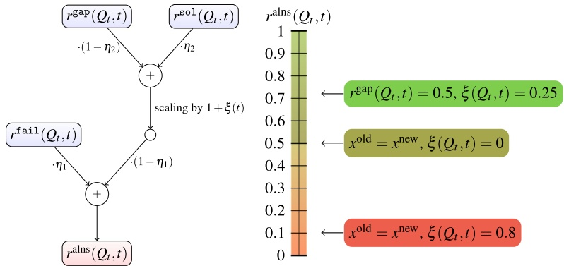
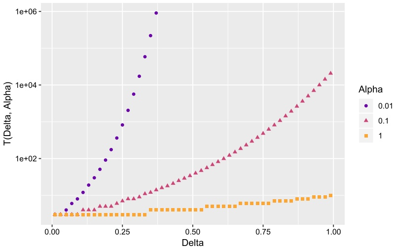
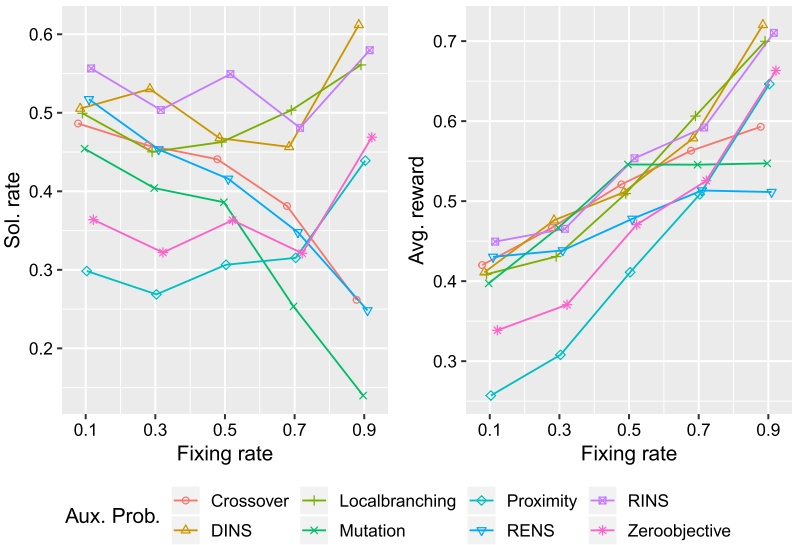
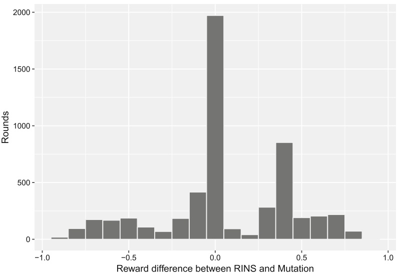
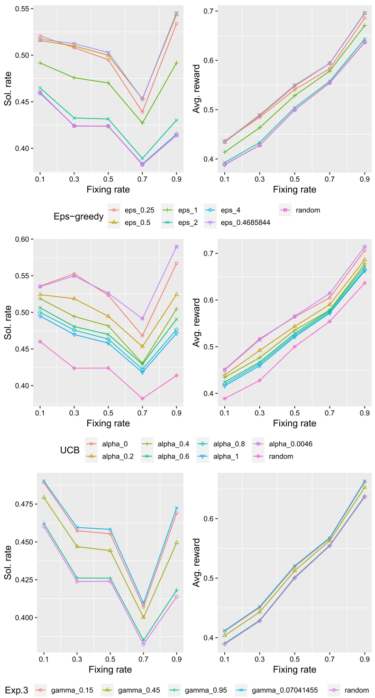
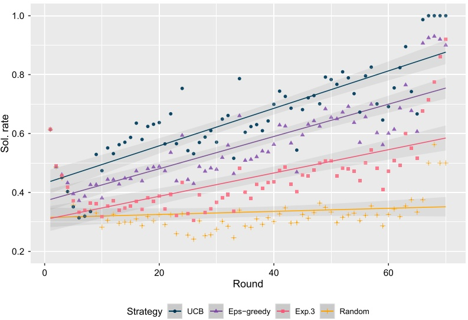

**FULL LENGTH PAPER**

# Adaptive large neighborhood search for mixed integer programming

**Gregor Hendel**<strong>1</strong>

Received: 13 March 2018 / Accepted: 9 August 2021 / Published online: 8 November 2021 © The Author(s) 2021

## Abstract

Large Neighborhood Search (LNS) heuristics are among the most powerful but also most expensive heuristics for mixed integer programs (MIP). Ideally, a solver adaptively concentrates its limited computational budget by learning which LNS heuristics work best for the MIP problem at hand. To this end, this work introduces Adaptive Large Neighborhood Search (ALNS) for MIP, a primal heuristic that acts as a framework for eight popular LNS heuristics such as Local Branching and Relaxation Induced Neighborhood Search (RINS). We distinguish the available LNS heuristics by their individual search spaces, which we call auxiliary problems. The decision which auxiliary problem should be executed is guided by selection strategies for the multi armed bandit problem, a related optimization problem during which suitable actions have to be chosen to maximize a reward function. In this paper, we propose an LNS-specific reward function to learn to distinguish between the available auxiliary problems based on successful calls and failures. A second, algorithmic enhancement is a generic variable fixing prioritization, which ALNS employs to adjust the subproblem complexity as needed. This is particularly useful for some LNS problems which do not fix variables by themselves. The proposed primal heuristic has been implemented within the MIP solver SCIP. An extensive computational study is conducted to compare different LNS strategies within our ALNS framework on a large set of publicly available MIP instances from the MIPLIB and Coral benchmark sets. The results of this simulation are used to calibrate the parameters of the bandit selection strategies. A second computational experiment shows the computational benefits of the proposed ALNS framework within the MIP solver SCIP.

**Keywords** Mixed integer programming · Primal heuristics · Large neighborhood search · Multi armed bandit problem

**Mathematics Subject Classification** 90C11 · 90C10 · 90C90

<small>B Gregor Hendel hendel@zib.de</small>

<small>1 Zuse Institute Berlin, Takustr. 7, 14195 Berlin, Germany</small>

## 1 Introduction

Mixed integer programming (MIP) is a powerful modeling paradigm with numerous relevant industrial applications in scheduling, production planning, traffic optimization [1] and countless more. For solving their models, many practitioners rely on state-of-the-art commercial or noncommercial general purpose MIP solvers such as CBC [2], CPLEX [3], Gurobi [4], SCIP [5,6], or XPress [7], all of which employ a variant of the branch-and-bound algorithm [8,9]. As the branch-and-bound algorithm by itself may be quite slow to provide good solutions, a rich set of primal heuristic algorithms has been proposed to improve the primal convergence [10] of the solvers. Primal heuristics can be further classified [11] into rounding algorithms, diving and objective diving heuristics and feasibility-pump [11,12] procedures, and finally Large Neighborhood Search (LNS) heuristics such as Relaxation Induced Neighborhood Search (RINS) [13]. LNS heuristics typically restrict the search space of an input MIP instance to a particular neighborhood of interest. The resulting auxiliary problem (cf. Definition 2.1) is again a MIP, which is then partially solved by a branch-and-bound algorithm under reasonable working limits, and eventual solutions are kept for the main search process. Many different LNS techniques have been proposed in recent years [13–18]. Their computational effort makes it impractical to apply all of them frequently within the solver. Since a priori it is unclear which approach might work best for a concrete problem instance, the solver ideally learns during the solving process which LNS heuristics should be applied, and more importantly, which ones can be deactivated.

Following this line of thought, we propose Adaptive Large Neighborhood Search (ALNS) for MIP. We address in particular the question how to select from the set of available auxiliary problems, which are introduced in Sect. 2. In Sect. 3, we propose a suitable reward function for LNS heuristics to learn to discriminate between the auxiliary problems during the search. We also propose a generic variable fixing scheme that can be used to extend the set of fixed variables within a selected neighborhood to reach a target fixing rate. This has a particular impact on LNS heuristics that do not fix variables by themselves and may hence be too expensive on larger problems, such as, e.g., Local Branching [14] (cf. Sect. 2.2).

The framework is obliged to trade off between exploration and exploitation, because only one auxiliary problem is selected and evaluated at a specific call. Such a selection scenario is also referred to as multi armed bandit problem, in which a player tries to maximize their reward by playing one available action at a time and observing the particular reward of this action only. We review three selection algorithms for the multi-armed bandit problem in Sect. 4. Two numerical experiments are presented in Sect. 5, a first one to tune the selection process of the ALNS heuristic, and a second experiment to show that ALNS improves the MIP performance of SCIP on a large set of publicly available benchmark instances from the collections of MIPLIB [19–21] and Cor@l [22].

## 1.1 Related work

The notion of an Adaptive Large Neighborhood Search has already been coined in the literature, particularly in the context of Constraint Programming, where ALNS is usually tailored to a particular application. The authors of [23] were the first to describe an adaptive LNS technique for single-mode scheduling problems, which selects from a finite set of so-called search operators, which are a CP analogue to the auxiliary problems for MIP (see Sect. 2). Building upon their method, ALNS has also been applied for different types of Vehicle Routing Problems, see [24] for an overview. Throughout the remainder of this article, we will shortly write “ALNS” to denote our proposed “ALNS for MIP”.

A different, MIP specific approach to learn how to run heuristics has been recently proposed in [25]. Their work uses logistic regression to predict the probability of success for different diving heuristics. The prediction is based on state information about the current node and the overall search. Their approach is fundamentally different from our proposed method in that it learns one regression for each individual diving heuristic, but does not attempt to prioritize between them.

The selection strategies presented here are truly online learners. They do not use any information that was collected offline before the search. The only feedback that the selection method receives is the reward of the selected action. Attempts with popular ML technology may consider additional features of the problem instance or search statistics to train a more informed selection method.

Focusing on the feature-independent setup of the bandit selection strategies has several advantages over an ML approach that uses features: First, the number of LNS executions in a MIP solver is typically small and may not suffice to collect enough training data for a feature based ML approach, whereas our simulation in Sect. 5.2 shows that the bandit strategies already learn useful information within a “typical” number of calls of an LNS heuristic. An alternative may be to collect the data only once to then train the ML approach offline and apply the learned model during the search, but this violates the “online” scope of this paper.

Finally, an ML approach may lack explainability why it prefers certain auxiliary problems in certain situations. In contrast, especially the α-UCB bandit strategy provides a simple explanation, namely the UCB-score, why it prefers one auxiliary problem over another.

The first use of bandit related ideas inside MIP solvers concerns the integration of a node selection rule [26] into CPLEX. This node selection approach balances exploration and exploitation of the search tree. It is inspired by a successful method for game search trees, which is related to the Upper Confidence Bounds (UCB) selection algorithm [27] explained in Sect. 4.

## 2 Large neighborhood search heuristics for MIP

We propose Adaptive Large Neighborhood Search in the context of mixed-integer programs (MIPs). A MIP P is an optimization problem of the form

$$
\begin{array}{l l} \text {min} & c ^ {T} x \\ \text {s.t.} & A x \geq b \\ & l \leq x \leq u \\ & x \in \{0, 1 \} ^ {n ^ {\text {bin}}} \times \mathbb {Z} ^ {n ^ {\text {int}} - n ^ {\text {bin}}} \times \mathbb {Q} ^ {n - n ^ {\text {int}}} \end{array}\tag{MIP}
$$

in n variables and m linear constraints, which are defined by a matrix $A \in \mathbb { Q } ^ { m , n }$ and a right hand side $b \in \mathbb { Q } ^ { m }$ . Every variable $x _ { j } , j \in \{ 1 , \ldots , n \}$ has an objective coefficient $c _ { j } \in \mathbb { Q }$ and lower and upper bounds $l _ { j } \in \dot { \mathbb { Q } } \cup \{ - \infty \}$ and $u _ { j } \in \mathbb { Q } \cup \{ + \infty \}$ , respectively. Finally, without loss of generality, the first $n ^ { \mathrm { i n t } }$ variables are further constrained that they must take integer solution values. These are called the integer variables of P. An important subset of the integer variables are the $n ^ { \mathrm { b i n } } \; \leq \; n ^ { \mathrm { i n t } }$ binary variables with a {0, 1}-domain. The shorthand notations for binary variables and nonbinary integer variables, which are called general integer variables, are $M ^ { \mathrm { b i n } } : = \{ 1 , \dots , n ^ { \mathrm { b i n } } \}$ and $M ^ { \mathrm { i n t } } : = \{ n ^ { \mathrm { b i n } } + 1 , \ldots , n ^ { \mathrm { i n t } } \}$ , respectively. Binary variables are often used to encode highly relevant yes/no-decisions in an optimization scenario such as, e.g., if a facility should be built at a certain location. Therefore, binary variables often receive a prioritized treatment by the neighborhoods in Sects. 2.1 and 2.2 . Every point of $\mathbb { Q } ^ { n }$ satisfying all of the above constraints is called a solution of P, and the set of all solutions of P is denoted by $S _ { P }$

Dropping all integrality restrictions yields the LP relaxation of P. It is well known that (MIP) in the presented general form is $\mathcal { N P }$ -hard to solve, which is why all modern MIP solvers employ some form of branch-and-bound algorithm [8,9]. In essence a clever enumeration, the branch-and-bound algorithm repeatedly partitions the search space of an input MIP P, mainly guided by integer variables with noninteger (fractional) values in the solution $x ^ { \mathrm { l p } }$ to its LP relaxation. Since the LP relaxation has fewer constraints than P and hence a broader feasible region, its optimal objective value $c ^ { T } x ^ { \mathrm { l p } }$ is a lower bound to the optimal value $c ^ { * }$ of P. If, in addition, the LP solution satisfies the integrality requirements $x _ { j } ^ { \mathrm { l p } }   \in   \mathbb { Z } \forall j   \in   \{ 1 , \dots , n ^ { \mathrm { i n t } } \}$ , then $c ^ { T } x ^ { \mathrm { l p } }   =   c ^ { * }$ and $x ^ { \mathrm { l p } }$ is an optimal solution for P. The minimum lower bound of all unprocessed subproblems is called the dual bound and denoted by $c ^ { \mathrm { d u a l } }$

In practice, however, the LP relaxation mostly provides feasible solutions only at deeper levels, ie. later stages of the branch-and-bound search. Many different primal heuristic algorithms have been proposed to overcome this weakness, which are highly diverse in the computational effort they require. Starting from simple and fast heuristics [28] that attempt to construct feasible solutions by rounding the LP solution, a higher computational effort is usually required by diving or feasibility-pump [12] like procedures, which solve sequences of modified LP relaxations. At the most expensive end of the scale lies the class of Large Neighborhood Search (LNS) heuristics that solve an auxiliary problem with branch-and-bound techniques.

**Definition 2.1** (Auxiliary problem) Let P be a MIP with n variables. For a polyhedron $N \subseteq \mathbb { Q } ^ { n }$ and objective coefficients $c _ { \mathrm { a u x } } \in \mathbb { Q } ^ { n }$ , a MIP $Q$ defined as

$$
\left| \min \left\{c _ {\text {aux}} ^ {T} x \mid x \in S _ {P} \cap N \right\} \right|\tag{2.1}
$$

is called an auxiliary problem of P. The polyhedron N associated with Q is called its neighborhood.

In other words, Q has the same number of variables (columns) as the original MIP P and its solution set $s _ { Q }$ is a subset of $S _ { P }$ by construction. Definition 2.1 requires N to be a polyhedron, ie., it should be expressed by a finite set of inequalities. The definition includes $N   =   \mathbb { Q } ^ { n }$ . The auxiliary objective function $c _ { \mathrm { a u x } }$ can be different from the objective function of $P$

There are only a few different types of neighborhoods typically used. All LNS heuristics have in common that they solve auxiliary problems around a set of reference points. One of the most common classes of neighborhoods is derived by fixing those integer variables whose solution values agree on a set of reference points.

**Definition 2.2** (Fixing neighborhood) Let P be a MIP with n variables and $n ^ { \mathrm { i n t } }$ integer variables. Let $M   \subseteq   \{ 1 , \ldots , n ^ { \mathrm { i n t } } \}$ and $x ^ { * }   \in   \mathbb { Q } ^ { n }$ denote a reference point. A fixing neighborhood

$$
N ^ {\text {fix}} (M, x ^ {*}) := \left\{x \in \mathbb {Q} ^ {n} \mid x _ {j} = x _ {j} ^ {*} \forall j \in M \right\}
$$

fixes the variables in M to their values in $x ^ { * }$

**Definition 2.3** (Matching set) For $k \geq 1$ , let $X = \{ x ^ { 1 } , \ldots , x ^ { k } \} \subset \mathbb { Q } ^ { n }$ with $x ^ { i } \neq x ^ { i ^ { \prime } }$ $\forall i \neq i ^ { \prime } \in \{ 1 , \ldots , k \}$ . The matching set

$$
M ^ {=} (X) := \left\{j \in \{1, \dots , n ^ {\mathrm{int}} \} \mid x _ {j} ^ {i} = x _ {j} ^ {1} \forall i \in \{1, \dots , k \} \right\}
$$

describes all integer variable indices whose values agree on X. We call X the set of reference points.

Definitions 2.2 and 2.3 admit the use of reference points such as LP solutions, which are not (integer) feasible. Note that whenever a set of reference points X contains at least one solution $x ^ { \prime } \in S _ { P }$ , the auxiliary MIP defined by the fixing neighborhood of the matching set is feasible because $X \subseteq N ^ { \mathrm { f i x } } ( M ^ { = } ( X ) , x ^ { \prime } )$

The task of finding an improving solution can be easily incorporated into Definition 2.1. Assume that an incumbent solution $x ^ { \mathrm { i n c } }   \in   S _ { P }$ and a dual bound $c ^ { \mathrm { d u a l } }$ are already available. For $\delta \in ( 0 , 1 )$ , every solution $x ^ { \prime } \in S _ { P }$ that satisfies

$$
\begin{array}{l} c ^ {T} x ^ {\prime} \leq (1 - \delta) \cdot c ^ {T} x ^ {\text {inc}} + \delta \cdot \underbrace {c ^ {\text {dual}}} _ {<   c ^ {T} x ^ {\text {inc}}} <   c ^ {T} x ^ {\text {inc}} \\ \hline \end{array}
$$

is clearly an improving solution. The set of solutions that are better than $x ^ { \mathrm { i n c } }$ by at least $\delta$ is contained in the improvement neighborhood

$$
\left| N ^ {\mathrm{obj}} \left(\delta , x ^ {\text {inc}}\right) := \left\{x \in \mathbb {Q} ^ {n} \mid c ^ {T} x \leq (1 - \delta) \cdot c ^ {T} x ^ {\text {inc}} + \delta \cdot c ^ {\text {dual}} \right\}. \right.\tag{2.2}
$$

Therefore, whenever an incumbent solution is available, our auxiliary problems are always defined over the combination $N ^ { \prime }$ of a neighborhood N with an improvement neighborhood,

$$
| N ^ {\prime} = N \cap N ^ {\mathrm{obj}} \left(\delta , x ^ {\mathrm{inc}}\right), |
$$

to filter out all nonimproving solutions regardless of the choice of $c _ { \mathrm { a u x } }$ . The choice of δ is an important control parameter to weigh between the difficulty (and feasibility) of the auxiliary problem and the desired amount of improvement. The above neighborhood notions suffice to describe several popular LNS heuristics.

## 2.1 Fixing neighborhood LNS heuristics

Combining Definitions 2.2 and 2.3 is very popular for constructing auxiliary problems. Starting from a set of reference points $X = \{ x ^ { 1 } , \ldots , x ^ { k } \}$ , a fixing neighborhood is obtained with the help of the matching set of X. Since all points in X agree on their matching set $M ^ { = } ( X )$ , the same fixing neighborhood is obtained regardless of the anchor point

$$
\left| N ^ {\text {fix}} \left(M ^ {=} (X), x ^ {1}\right) = N ^ {\text {fix}} \left(M ^ {=} (X), x ^ {i}\right) \quad \forall i \in \{1, \dots , k \}. \right.
$$

RINS [13] Relaxation Induced Neighborhood Search (RINS) is one of the first generally applicable LNS approaches. The idea of RINS is to fix integer variables whose solution values agree in the solution $x ^ { \mathrm { l p } }$ of the LP relaxation at the current, local node, and the current incumbent solution $x ^ { \mathrm { i n c } }$ . The neighborhood of the auxiliary MIP of RINS is

$$
N _ {\mathrm{RINS}} := N ^ {\text {fix}} \left(M ^ {=} \left(\left\{x ^ {\text {lp}}, x ^ {\text {inc}} \right\}\right), x ^ {\text {inc}}\right).
$$

Crossover [15] Another improvement heuristic is the Crossover heuristic, which is inspired by the recombination of solutions within genetic algorithms. Crossover selects $k \geq 2$ already known, feasible solutions $X = \{ x ^ { 1 } , \ldots , x ^ { k } \} \subseteq S _ { P }$ as reference points. X does not necessarily contain $x ^ { \mathrm { i n c } }$ . The crossover neighborhood fixes

$$
N _ {\text {Cross}} := N ^ {\text {fix}} \left(M ^ {=} (X), x ^ {1}\right).
$$

The authors suggest to use $k = 2$ solutions that are randomly selected from all available solutions, using a bias towards solutions with better objective.

Mutation [15] Furthermore, the authors of Crossover suggest a second LNS heuristic called Mutation that fixes a random subset of integer variables of the incumbent solution. For a randomly chosen subset $M ^ { \mathrm { r a n d } } \subseteq \{ 1 , \dots , n ^ { \mathrm { i n t } } \}$ , the mutation neighborhood is defined as

$$
N _ {\text {Muta}} := N ^ {\text {fix}} \left(M ^ {\text {rand}}, x ^ {\text {inc}}\right).
$$

Mutation is the only LNS heuristic for which the difficulty of the auxiliary problem can be directly controled, namely by a number or percentage of integer variables that should be fixed. In contrast, all previous neighborhoods depend on the cardinality of their matching set.

RENS [17] Starting from an LP relaxation solution $x ^ { \mathrm { l p } }$ , the Relaxation Enforced Neighborhood Search (RENS) neighborhood focusses on the feasible roundings of $x ^ { \mathrm { l p } }$ and can be written as

$$
N _ {\text {RENS}} := \left\{x \in \mathbb {Q} ^ {n} \mid \left\lfloor x _ {j} ^ {\mathrm{lp}} \right\rfloor \leq x _ {j} \leq \left\lceil x _ {j} ^ {\mathrm{lp}} \right\rceil , j \in \{1, \dots , n ^ {\text {int}} \} \right\}.\tag{2.3}
$$

Similarly to the RINS heuristic, the aim of RENS is to construct feasible solutions that are close to the LP relaxation solution and therefore have a near-optimal solution value.

## 2.2 LNS Heuristics Using Constraints and Auxiliary Objective Functions

All approaches presented so far fix a set of integer variables using one or several reference points. Local Branching [14] is the first LNS heuristic that uses a different neighborhood.

Local Branching [14] Instead of fixing a set of variables and solving for improving solution values on the remaining variables, the neighborhood of Local Branching is restricted to a ball around the current incumbent solution. More formally, Let $P$ be a MIP with $n ^ { \mathrm { b i n } } \geq 1$ binary variables. Based on the Manhattan metric for $x \in \mathbb { Q } ^ { n }$ , the binary norm1 of x is defined as

$$
\| x \| _ {b} := \sum_ {j = 1} ^ {n ^ {\mathrm{bin}}} | x _ {j} |.
$$

Let $x ^ { \mathrm { i n c } }   \in   S _ { P }$ be an incumbent solution for $P ,$ and let $d _ { \mathrm { m a x } }   >   0$ denote a distance cutoff parameter. The local branching neighborhood is the restriction

$$
N _ {\mathrm{LBranch}} := \left\{x \in \mathbb {Q} ^ {n} \mid \left\| x - x ^ {\text {inc}} \right\| _ {b} \leq d _ {\max} \right\}
$$

The reason for preferring the binary norm over the regular norm or the norm taking all integer variables is practicality. The binary norm can be expressed as a linear constraint without introducing auxiliary variables.

Proximity Search [18] A dual version of Local Branching has been introduced as Proximity Search. Using the binary norm, Proximity seeks to minimize the binary norm $\left\| \dot { x - x ^ { \mathrm { i n c } } } \right\| _ { b }$ through an auxiliary objective coefficient vector $c _ { \mathrm { P r o x i } }$ defined as

<small>1 Strictly speaking, ·b is a seminorm because nonzero vectors can have binary norm of 0.</small>

$$
(c _ {\text {Proxi}}) _ {j} := \left\{ \begin{array}{l l} 0 & \text {if} j \notin M ^ {\text {bin}} \\ 1 & \text {if} j \in M ^ {\text {bin}} \text {and} x _ {j} ^ {\text {inc}} = 0 \\ - 1 & \text {if} j \in M ^ {\text {bin}} \text {and} x _ {j} ^ {\text {inc}} = 1 \end{array} \right.
$$

over the entire set of improving solutions:

$$
N _ {\mathrm{Proxi}} := N ^ {\mathrm{obj}} (\delta , x ^ {\mathrm{inc}}).
$$

Zero Objective The second LNS heuristic that uses an auxiliary objective function different from the original objective function is Zero Objective. As its name suggests, it uses $c _ { \mathrm { Z e r o o b j } } : = 0$ as auxiliary objective function. Zero Objective thereby reduces the search for an (improving) solution to a feasibility problem. If an incumbent solution $x ^ { \mathrm { i n c } }$ is available, Zero Objective searches the set of improving solutions $N _ { \mathrm { Z e r o o b j } } : =$ $N ^ { \mathrm { o b j } } ( \delta , x ^ { \mathrm { i n c } } )$ , and $N _ { \mathrm { Z e r o o b j } } = \mathbb { Q } ^ { n }$ otherwise.

DINS [16] Distance Induced Neighborhood Search (DINS) combines elements of the Crossover, Local Branching, and RINS heuristics. Similarly to RINS, the intuition is that improving solutions are located between the current incumbent solution $x ^ { \mathrm { i n c } }$ and the solution to the node LP relaxation $x ^ { \mathrm { l p } }$ . With the intention of reducing their integer distance

$$
\left\| x ^ {\mathrm{inc}} - x ^ {\mathrm{lp}} \right\| _ {i} := \sum_ {j = 1} ^ {n ^ {\mathrm{int}}} | x _ {j} ^ {\mathrm{inc}} - x _ {j} ^ {\mathrm{lp}} |,
$$

let $J : = \{ j \in M ^ { \mathrm { i n t } }   |   | x _ { j } ^ { \mathrm { i n c } }   -   x _ { j } ^ { \mathrm { l p } } | \geq 0 . 5 \}$ denote the index set of general integer variables with a difference of at least 0.5 between the two reference points. The J -neighborhood of DINS is

$$
N _ {J} := \{x \in \mathbb {Q} ^ {n} \mid | x _ {j} - x _ {j} ^ {\mathrm{lp}} | \leq | x _ {j} ^ {\mathrm{inc}} - x _ {j} ^ {\mathrm{lp}} |, j \in J \}.
$$

This neighborhood restricts lower and upper bounds of the general integer variables. Let $X ^ { \mathrm { D I N S } } \subseteq S _ { P }$ denote a subset of currently available solutions, containing $x ^ { \mathrm { i n c } }$ , to the MIP at hand. The DINS neighborhood can be written as a combination of a total of four neighborhoods

$$
\begin{array}{l} N _ {\text {DINS}} := N _ {J} \\ \qquad \cap N ^ {\text {fix}} \left(M ^ {\text {int}} \setminus J, x ^ {\text {inc}}\right) \\ \qquad \cap N ^ {\text {fix}} \left(M ^ {\text {bin}} \cap M ^ {=} (\{x ^ {\text {lp}}, x ^ {\text {root - lp}} \} \cup X ^ {\text {DINS}}), x ^ {\text {inc}}\right) \\ \qquad \cap N _ {\text {LBranch}}. \end{array}
$$

The set of general integer variables outside of J is fixed to the values in the incumbent solution. Binary variables that have not changed between the root LP relaxation solution $x ^ { \mathrm { r o o t - l p } }$ and $x ^ { \mathrm { l p } }$ are fixed if they have taken the same value in all solutions in

$X ^ { \mathrm { D I N S } }$ . In our implementation of DINS, we use between $1 \leq | X ^ { \mathrm { D I N S } } | \leq 5$ available solutions with best objective, depending on how many solutions are available. Finally, the search is further restricted to a certain binary distance around the current incumbent solution through an additional local branching neighborhood.

Remarks There is further work on LNS approaches that are not covered here. Note that the only heuristics that do not use an incumbent solution are RENS and Zero Objective. In [29], an extension of Local Branching has been proposed that starts from an infeasible reference point. Such points are quickly produced by rounding or with a few iterations of the Feasibility Pump [12]. In addition to the local branching constraint, the auxiliary problem of [29] is extended by additional variables to model and penalize the violation of constraints, inspired by the phase 1 of the Simplex algorithm. A recent approach called Alternating Criteria Search [30] also starts from infeasible reference points, and alternates between auxiliary problems with artificial feasibility objective and the original objective function of the input MIP in a parallel setting. The necessary diversification is obtained by fixing subsets of integer variables indexed by a random consecutive index set, which is a variant of Mutation [15] discussed in Sect. 2.1. The heuristics presented in [31] formulate and solve auxiliary problems only for the general integer variables as a final post processing step after fixing all binary variables based on available, global problem structures such as cliques and implications between binary and integer variables.

## 3 Adaptive large neighborhood search for MIP

The proposed Adaptive Large Neighborhood Search heuristic governs the execution of a set $\mathcal { Q }$ of 8 available auxiliary problems from Sect. 2, which has been chosen as a representative set of diverse LNS heuristics from the literature. Table 1 gives a quick overview of the auxiliary problems used, as well as their individual preconditions. ALNS is executed periodically during the main search. The execution schedule is itself dynamic and explained in Sect. 3.2. In each round t = 1, 2, . . . , ALNS basically performs the following steps.

1. Select an auxiliary problem $Q _ { t } \in \mathcal { D }$ via a bandit selection strategy.

2. Apply generic (un-)fixing of integer variables depending on the target fixing rate of $Q _ { t }$ . Stop if generic fixing cannot be applied.

3. Setup and solve the auxiliary problem $Q _ { t }$

4. Reward the auxiliary problem and update the bandit selection strategy based on the outcome of $Q _ { t }$

Different bandit selection strategies and their individual update procedures are subject of Sect. 4. The solution process of the auxiliary problem uses a strict limit on the number of branch-and-bound nodes to keep the overall computational effort small. It may still be very expensive to solve auxiliary problems if the corresponding neighborhood is large, especially since some neighborhoods do not fix integer variables directly. In Sect. 3.1, a generic approach is explained for fixing additional variables to reach any desired target fixing rate and hence reduce the complexity of the auxiliary problem. Details on the dynamic adjustment of the target fixing rate and node limit are given in Sect. 3.2. Finally, Sect. 3.3 introduces the scoring mechanism for rewarding $Q _ { t }$

## 3.1 Fixing and unfixing variables

Many of the neighborhood definitions in Sect. 2 consist in the fixing of a subset of integer variables to their values in a solution $x ^ { \mathrm { s o l } } \in S _ { P }$ , which can be the incumbent or an inferior solution for $P$ at step t and depends on the selected auxiliary problem $Q _ { t }$ . The fixed set of $Q _ { t }$ and its corresponding neighborhood $N _ { Q _ { t } }$ is defined as

$$
\left| M _ {Q _ {t}} ^ {\text {fix}} := \left\{j \in M ^ {\text {bin}} \cup M ^ {\text {int}} \mid N _ {Q _ {t}} \subseteq \left\{x \in \mathbb {Q} ^ {n} \mid x _ {j} = x _ {j} ^ {\text {sol}} \right\} \right\}. \right.
$$

The size of the fixed set is denoted by $n _ { Q _ { t } } ^ { \mathrm { f i x } } : = | M _ { Q _ { t } } ^ { \mathrm { f i x } } |$ . Every auxiliary problem (action) $Q \in { \mathcal { Q } }$ operated by ALNS has a target fixing rate $\dot { [ } \phi _ { Q , t } \in [ 0 , 1 )$ that changes between rounds as explained in Sect. 3.2. It may happen that $Q _ { t }$ does not reach its specified target fixing rate, ie.

$$
n _ {Q _ {t}} ^ {\text {fix}} <   \phi_ {Q _ {t}, t} \cdot n ^ {\text {int}}.
$$

For example, the neighborhoods of Zero Objective, Proximity and Local Branching do not fix any variables. It may also happen that $\phi _ { Q _ { t } , t }$ is exceeded, which unnecessarily restricts the search space. ALNS treats both cases very similarly by using a generic variable fixing prioritization to sort the set of possible (un)fixings.

In the first case, $\phi _ { \mathcal { Q } _ { t } , t }   \cdot   n ^ { \mathrm { i n t } }   -   n _ { \mathcal { Q } _ { t } } ^ { \mathrm { f i x } }$ additional integer variables from $M _ { Q _ { t } } ^ { \mathrm { f i x } } =$ $\{ 1 , \ldots , n ^ { \mathrm { i n t } } \} \setminus M _ { Q _ { t } } ^ { \mathrm { f i x } }$ have to be selected. For two variables $x _ { j } , x _ { j ^ { \prime } }   \in   M _ { Q _ { t } } ^ { \mathrm { f i x } }$ with reference solution values $x _ { j } ^ { \mathrm { s o l } } , x _ { j ^ { \prime } } ^ { \mathrm { s o l } }$ , the fixing $x _ { j } = x _ { j } ^ { \mathrm { s o l } }$ is preferred over $x _ { j ^ { \prime } } ^ { \simeq \prime } = x _ { j ^ { \prime } } ^ { \mathrm { s o l } } , \mathrm { i f } ,$ in decreasing order of priority,

1. $x _ { j }$ has a smaller distance than $x _ { j ^ { \prime } }$ from $M _ { Q _ { t } } ^ { \mathrm { f i x } }$ in the variable constraint graph (see below).

2. The reduced costs for fixing $x _ { j } = x _ { j } ^ { \mathrm { s o l } }$ are smaller than those for fixing $x _ { j ^ { \prime } } = x _ { j ^ { \prime } } ^ { \mathrm { s o l } }$

$$
c _ {j} ^ {\text {red}} \cdot \left(x _ {j} ^ {\text {sol}} - x _ {j} ^ {\text {root - lp} (j)}\right) <   c _ {j ^ {\prime}} ^ {\text {red}} \cdot \left(x _ {j ^ {\prime}} ^ {\text {sol}} - x _ {j ^ {\prime}} ^ {\text {root - lp} (j ^ {\prime})}\right)
$$

3. The pseudo costs (see below) for fixing $x _ { j } = x ^ { \mathrm { s o l } }$ are smaller than for $x _ { j ^ { \prime } } = x _ { j ^ { \prime } } ^ { \mathrm { s o l } }$

$$
\Psi_ {j} \left(x _ {j} ^ {\text {sol}} - x _ {j} ^ {\text {root - lp}}\right) <   \Psi_ {j ^ {\prime}} \left(x _ {j ^ {\prime}} ^ {\text {sol}} - x _ {j ^ {\prime}} ^ {\text {root - lp}}\right).
$$

## 4. Randomly.

Variable constraint graph The idea behind the variable constraint graph is to maintain several unfixed variables together in some constraints to increase the likelihood that the auxiliary problem contains an improving solution. Intuitively, finding improving solutions requires to alter several solution values per constraint. For a constraint with

Table1OverviewoftheauxiliaryproblemsusedinALNS

| Auxiliary Problem | Description | Preconditions |
| --- | --- | --- |
| RINS | Fixes matching values in incumbent and LP relaxation solution | Feasible LP relaxation at current node, incumbent solution |
| Crossover | Fixes matching values in 2 or more randomly chosen, available solutions | Sufficiently many solutions |
| Mutation | Fixes random subset of variables to values in incumbent | Incumbent solution |
| RENS | Restricts the auxiliary problem to the feasible roundings around the current LP solution | Feasible LP relaxation at current node |
| Local Branching | Limits the maximal binary distance from the incumbent | Incumbent solution, MIP with binary variables |
| Proximity Search | Minimizes the binary distance from the incumbent | Incumbent solution, MIP with binary variables |
| Zero Objective | Reduces search for an (improving) solution to a feasibility problem | nonzero objective function |
| DINS | Sophisticated combination of RINS, Crossover, and Local Branching | Incumbent solution, feasible LP relaxation at current node |

SeeSect.2forinformationandreferences

only a single unfixed variable in the auxiliary problem, it is unlikely that the reference solution value of this variable can be altered in the direction of an improving solution.

For a given MIP P, the variable constraint graph $G _ { P }$ is a bipartite graph with one node for each variable and constraint of P, $V ( G _ { P } ) = \{ v _ { j } \mid j \in \{ 1 , \ldots , n \} \} \cup \{ w _ { j } \mid j \in$ $\{ 1 , \ldots , m \} \}$ . Its edges $E ( G _ { P } )   : =   \{ ( v _ { j } , w _ { i } )   |   A _ { i j } \; \neq \; \vec { 0 } \}$ correspond to the nonzero entries of the matrix A. Distances in $G _ { P }$ are breadth first distances. First of all, each node has a distance of 0 to itself. Starting from a variable node $v _ { j }$ , all variables with an edge to one of the constraint nodes adjacent to $v _ { j }$ have a distance of 2 from $v _ { j }$

All variables which are reachable via another constraint from any of the nodes with distance 2 have a distance of 4, and so on. Since all distances between variables in $G _ { P }$ are even, we divide all breadth-first distances by two.

The distance of a variable node $v _ { j }$ from the nodes corresponding to $M _ { Q _ { t } } ^ { \mathrm { f i x } }$ Mfix is the minimum distance to any of the variable nodes in $M _ { Q _ { t } } ^ { \mathrm { f i x } }$ . It is determined by queuing all variable nodes in $M _ { Q _ { t } } ^ { \mathrm { f i x } }$ into the initial queue for breadth first search.

If the original problem has block structure, the variable prioritization concentrates additional fixings on those blocks with a nonempty intersection in $M _ { Q _ { t } } ^ { \mathrm { f i x } }$ . Related ideas are used, e.g., in presolving for detecting independent components of a MIP [32], or within Graph-Induced Neighborhood Search (GINS) [33].

Reduced cost score The cost based scores used as tie breakers in steps 2 and 3 both penalize a deviation of the potential fixing from an LP solution at the root node of the branch-and-bound search. After the initial LP relaxation at the root of the search, most MIP solvers solve a sequence of further LP relaxations during their cut separation loop.

The first associated penalty uses reduced costs. Reduced costs are part of every optimal simplex tableau. At the root node, reduced costs during the LP relaxations are stored per variable, to enable so-called root reduced-cost strengthening during the search. For each variable $x _ { j }$ , we initialize its associated root reduced costs to those observed in the initial optimal LP solution. At each subsequent LP, each time we encounter higher reduced costs than the recorded reduced costs for $x _ { j }$ , they are stored together with the corresponding LP solution value $x _ { j } ^ { \mathrm { r o o t - l p } ( j ) }$ . Therefore, the LP solution values used to compare the potential fixings of $j$ and $j ^ { \prime }$ may come from different LP solutions. Ties in the reduced cost comparison can occur if, for example, both variables have a corresponding score of 0, which is always the case if both variables are basic in all LP solutions at the root node.

Reduced costs are 0 for all basic variables in the optimal simplex tableau. The LP solution $x _ { j } ^ { \mathrm { r o o t - l p } ( j ) }$ of each nonbasic variable $x _ { j }$ is either $l _ { j }$ or $u _ { j }$ . Nonbasic variables at their lower bound have a reduced cost coefficient $c _ { j } ^ { \mathrm { r e d } } \geq 0$ and variables at their upper bound have $c _ { j } ^ { \mathrm { r e d } }   \leq   0$ . In both cases, the product $c _ { j } ^ { \mathrm { r e d } } \cdot \left( x _ { j } ^ { \mathrm { s o l } } - x _ { j } ^ { \mathrm { r o o t - l p } ( j ) } \right)$ is nonnegative. It is a lower bound on the objective deterioration by fixing $x _ { j } = \dot { x } _ { j } ^ { \mathrm { s o l } }$ hence the preference for variable fixings with smaller reduced cost scores.

Pseudo cost score Pseudo costs [34] are a common aggregate of branching information on the variables. The pseudo cost score estimates the potential dual bound degradation after fixing $x _ { j } = x _ { j } ^ { \mathrm { s o l } }$ . As reference serves the final root LP solution $x ^ { \mathrm { r o o t - l p } }$ on which the solution process started branching. Given the average dual bound increase $\varPsi _ { j } ^ { + }$ $( \varPsi _ { j } ^ { - } )$ per unit fractionality after branching upwards (downwards) on a variable $x _ { j }$ for $j \stackrel { \circ } { \in } \{ 1 , \ldots , n ^ { \mathrm { i n t } } \}$ , the pseudo cost score is computed as

$$
\begin{array}{l} \Psi_ {j}: \mathbb {Q} \to \mathbb {Q} _ {\geq 0} \\ \quad z \mapsto \left\{ \begin{array}{l l} \Psi_ {j} ^ {+} \cdot z, & \text {if} z \geq 0 \\ - \Psi_ {j} ^ {-} \cdot z, & \text {if} z <   0. \end{array} \right. \end{array}\tag{3.1}
$$

Computing $\psi _ { j } ( x _ { j } ^ { \mathrm { s o l } } - x _ { j } ^ { \mathrm { r o o t - l p } } )$ considers fixing $x _ { j }   =   x _ { j } ^ { \mathrm { s o l } }$ as a branching restriction from $x _ { j } ^ { \mathrm { r o o t - l p } } \notin \vec { \mathbb { Z } }$ in the direction of $x _ { j } ^ { \mathrm { s o l } }$ , upwards if $x _ { j } ^ { \mathrm { \dot { s o l } } }   >   x _ { j } ^ { \mathrm { r o o t - l p } }$ and downwards otherwise. The pseudo cost score estimates the increase in the dual bound after fixing j. As an example, assume that a binary variable $x _ { j }$ has an LP solution value $x _ { j } ^ { \mathrm { r o o t - l p } } = 0 . 4$ and a reference solution value of $x _ { j } ^ { \mathrm { s o l } } = 1$ . Assume that the average dual bound increase has been $\varPsi _ { j } ^ { - }   =   1 0$ for branching down on $x _ { j }$ and $\psi _ { j } ^ { + } = 5$ for branching up. The pseudo costs for the fixing $x _ { j } = x _ { j } ^ { \mathrm { s o l } }$ is calculated as $\Psi _ { j } ( x _ { j } ^ { \mathrm { s o l } }   -   x _ { j } ^ { \mathrm { r o o t - l p } } ) = \Psi _ { j } ^ { + }   \cdot   0 . 6 = 3$ If the solution value had been 0 instead of one, the corresponding pseudo cost score is $\Psi _ { j } ( 0 - x _ { j } ^ { \mathrm { r o o t - l p } } ) = - \varPsi ^ { - } \cdot ( - 0 . 4 ) = 4$ for branching down on $x _ { j }$

The pseudo cost score summarizes the branching history of a variable. Like reduced cost scores, pseudo costs are always nonnegative. The pseudo cost score $\psi _ { j } ( x _ { j } ^ { \mathrm { s o l } } -$ $x _ { j } ^ { \mathrm { r o o t - l p } } )$ of a fixing is only an estimate of the impact of the fixing of $x _ { j }$ on the objective, in contrast to reduced cost scores. As for reduced costs, we prefer additional fixings with smaller pseudo cost scores to increase the likelihood of good solutions in the remaining auxiliary problem.

Unfixing variables Only slight details are changed if the neighborhood was too restrictive, such that $n _ { \mathcal { Q } _ { t } } ^ { \mathrm { f i x } } - \vec { \phi _ { \mathcal { Q } _ { t } , t } } \cdot \boldsymbol { n } ^ { \mathrm { i n t } }$ variables from $M _ { Q _ { t } } ^ { \mathrm { f i x } }$ should be selected and unfixed <u>(rela</u>xed). Distances are now computed in the va<u>riabl</u>e constraint graph starting from $\overline { { M _ { Q _ { t } } ^ { \mathrm { f i x } } } }$ , and variables with a small distance from $\overline { { M _ { Q _ { t } } ^ { \mathrm { f i x } } } }$ are preferably relaxed to keep the auxiliary problem connected. Since we use the cost tie breakers as estimate of the objective degradation of a fixing in the auxiliary problem, variables are relaxed preferably if they have a large reduced cost score or, in case a tie occurs, a large pseudo cost score. Finally, if none of the scores discriminate between two variables, the preference is given by a random score assigned to each variable. Generic (un-)fixing within ALNS is only applied if the target fixing rate $\phi _ { Q _ { t } , t }$ is missed by a tolerance of 10 %, i.e. only if $n_{Q_{t}}^{\mathrm{fix}} \notin \left[ \left( \phi_{Q_{t},t} - 0.1 \right) \cdot n^{\mathrm{int}}, \left( \phi_{Q_{t},t} + 0.1 \right) \cdot n^{\mathrm{int}} \right]$ . As the fixings of the RENS neighborhood depend solely on the LP solution, it is the only auxiliary problem for which there is no suitable integer feasible reference solution to use for generic fixings. Generic unfixings, however, are always possible, even for RENS.

## 3.2 Dynamic limits

Good limits on the computational budget of an LNS heuristic are essential to make it useful inside a MIP solver. To this end, a tradeoff must be made between the intensity of the search inside the auxiliary problem and the runtime. For ALNS, the complexity of the auxiliary problem and the budget are adapted dynamically between the individual calls to ALNS.

All of the following dynamic decisions consider the auxiliary problem $Q _ { t }$ at the t-th round of ALNS $( t = 0 , 1 , \dots )$ and its solution status stat $( Q _ { t } )$ which can be one of

– inf , if $Q _ { t }$ was infeasible,

$opt,  if   Q_t$ was solved to optimality

– sol, if $Q _ { t }$ provided an improving solution for $P$

– nosol, if no improving solution was found searching $Q _ { t }$

Target fixing rate $\phi _ { Q , t }$ The first dynamic adjustment of the auxiliary problem complexity over time is described in [15], together with the introduction of the Crossover and Mutation LNS heuristics (cf. Sect. 2), which are available in ALNS. The authors of [15] control the complexity of an auxiliary problem $Q _ { t }$ by specifying the amount of integer variables that should be fixed before solving the auxiliary problem $Q _ { t }$ . The intuition is that the difficulty of $Q _ { t }$ decreases with increasing fixing rate. In the notation of the present work, the target amount of fixed integer variables at round t is specified by a target fixing rate $\phi _ { Q , t } \in [ 0 , 1 )$ for each $Q \in { \mathcal { Q } }$ of ALNS.

For $Q \in { \mathcal { Q } } ,$ , let $T _ { Q } ( t )$ denote the number of times that $Q$ has been selected, including round t. The fixing rate is modified according to the status in round t as

$$
\phi_ {Q, t + 1} = \left\{ \begin{array}{l l} \phi_ {Q, t}, & \text {if} Q \neq Q _ {t} \text {or} \operatorname{stat} (Q _ {t}) = s o l, \\ \max \{0. 1, \phi_ {Q, t} - 0. 7 5 ^ {T _ {Q} (t)} \cdot 0. 2 \}, & \text {if} \operatorname{stat} (Q _ {t}) \in \{i n f, o p t \} \\ \min \{0. 9, \phi_ {Q, t} + 0. 7 5 ^ {T _ {Q} (t)} \cdot 0. 2 \} & \text {if} \operatorname{stat} (Q _ {t}) = n o s o l \end{array} \right.
$$

If $Q _ { t }$ was too easy for the solver, ie. it could be solved to optimality or infeasibility within a given node budget, the fixing rate for the next iteration is decreased. If no new solution was found, the target fixing rate is increased. If a solution was found, but the search could not be completed, the fixing rate is kept. The additive change of the fixing rate is 0.2 initially, which is multiplied with 0.75 after every update step, exactly as in [15]. The use of max and min ensures that the target fixing rate stays within 10 % and 90 %. In our implementation, those two values are parametrized and can be individually set for every auxiliary problem. Every target fixing rate is initialized by $\phi _ { Q , 1 } = 0 . 9$ , which represents the most conservative value in the allowed range of the fixing $\mathrm { r a t e } ^ { 2 }$ , see Sect. 5 for details.

Stall node limit $\nu _ { t } ^ { \mathrm { l i m } }$ The main budget limitation of ALNS is a limit on the number of consecutive branch-and-bound nodes during which no improving solution is found, the so-called stall node limit. The stall node limit $\nu _ { t + 1 } ^ { \mathrm { l i m } }$ for the next round of ALNS is adjusted based on the results of the auxiliary problem of round t as follows.

$$
\nu_ {t + 1} ^ {\lim} = \left\{ \begin{array}{l l} \nu_ {t} ^ {\lim}, & \text {if stat} (Q _ {t}) \in \{o p t, i n f, s o l \} \\ \min \{\lfloor \nu_ {t} ^ {\lim} \cdot 1. 0 5 \rfloor + 1, 5 0 0 0 \}, & \text {if stat} (Q _ {t}) = n o s o l \end{array} \right.
$$

<small>2 controled via 8 user parameters heuristics/alns/\*/maxfixingrate all defaulting to 0.9.</small>

ALNS uses an affine linear function of the branch-and-bound nodes $\nu ^ { \mathrm { b b } }$ in the main search to limit the search effort inside auxiliary problems. Let $\nu _ { Q _ { i } }$ denote the amount of nodes used for searching the auxiliary problem $Q _ { i }$ at round $1 \leq i \leq t - 1$ , and let $s ( t - 1 )$ denote the total number of improving solutions found by ALNS until round $t - 1$ inclusively. Concretely, the next round t of ALNS is called as soon as the main search nodes $\nu ^ { \mathrm { { \dot { b } } \dot { b } } }$ have progressed such that

$$
\kappa_ {0} + \frac {s (t - 1) + 1}{(t - 1) + 1} \cdot \kappa_ {1} \cdot \nu^ {\mathrm{bb}} - \sum_ {i = 1} ^ {t - 1} (1 0 0 + \nu_ {Q _ {i}}) \geq \nu_ {t} ^ {\lim}.\tag{3.2}
$$

Here, $\kappa _ { 0 }$ is an initial budget of ALNS and $\kappa _ { 1 }$ is the node budget relative to $\nu ^ { \mathrm { b b } }$ . The initial budget $\kappa _ { 0 }$ allows to execute ALNS already early during the tree search when $\nu ^ { \mathrm { b b } }$ is small. When the search progresses and the initial budget $\kappa _ { 0 }$ has been spent after a (usually small) number of ALNS rounds, the relative node budget $\kappa _ { 1 }$ is the main parameter to control ALNS resources relative to the main search. In (3.2), the relative budget is increased or decreased based on the total number of improving solutions that ALNS contributed. With this strategy, ALNS slowly fades out if it does not find improving solutions. The last term expresses the total resources used so far by ALNS, with an additional 100 nodes per round to account for the setup costs of each $Q _ { i }$

In SCIP, each primal heuristic is executed according to its frequency parameter $f \geq 0$ that determines the depth levels of the search tree at which the heuristic is called. For example, a heuristic with frequency $f   =   1$ is called at every branchand-bound node, whereas a heuristic with a frequency of 5 is only called when the search focuses nodes in depth 0, 5, 10, etc. In our experiments in Sect. 5, our ALNS implementation has its frequency set to 20. Because of the budget computation in Eq. (3.2), ALNS is not statically called at every depth 0, 20, 40, etc., but only when, in addition, the budget computation (3.2) allows for the next round. This is true for the standalone LNS heuristics RINS and Crossover, as well.

In contrast to the target fixing rate, the stall node limit $\nu _ { t } ^ { \mathrm { l i m } }$ is a global limit independent of the selected auxiliary problem. This design choice has been made because the target fixing rate is supposed to be the main driver to adjust auxiliary problem difficulty.

## 3.3 A reward function for auxiliary problems

All of the bandit selection strategies presented in Sect. 4 require the definition of a suitable reward function. Intuitively, the reward should always be higher for auxiliary problems that lead to improvements over the current incumbent solution and also depend on the achieved objective quality. Furthermore, between unsuccessful auxiliary problems, the reward should still distinguish if the solution process failed fast or if it required a lot of computational resources. In order for some of the selection strategies in the following Sect. 4 to work correctly, we require that a reward should be in the interval [0, 1]. A reward of 0 is the worst possible score, i.e., the maximum penalty.

Let $Q _ { t } \in \mathcal { D }$ denote the selected auxiliary problem in round $t > 0$ , and let $c ^ { \mathrm { o l d } } : =$ $c ^ { T } x ^ { \mathrm { i n c } }$ denote the incumbent value before $Q _ { t }$ is solved, if an incumbent solution $x ^ { \mathrm { i n c } } \in S _ { P }$ is available, or $c ^ { \mathrm { o l d } } : = \infty$ otherwise. Similarly, $c ^ { \mathrm { n e w } }$ is the objective of the best known solution after $Q _ { t }$ has been solved. As before, let $\nu _ { t } ^ { \mathrm { l i m } }$ and $\nu _ { Q _ { t } }$ denote the stall node limit and amount of nodes used by $Q _ { t }$ , respectively.

Two reward functions are combined to reward both the presence of a new incumbent solution and the objective improvement. The former is expressed by the solution reward

$$
r ^ {\mathrm{sol}} (Q _ {t}, t) := \left\{ \begin{array}{l l} 1, & \text {if stat} (Q _ {t}) \in \{o p t, s o l \}, \\ 0, & \text {else.} \end{array} \right.
$$

The improvement in solution quality is measured by the closed gap reward

$$
r ^ {\text {gap}} (Q _ {t}, t) := \frac {c ^ {\text {old}} - c ^ {\text {new}}}{c ^ {\text {old}} - c ^ {\text {dual}}},
$$

which evaluates to $0$ if no improving solution could be found, and to 1 if the new solution has an objective that is equal to the dual bound (and hence optimal for $P )$ As a convention, the closed gap reward is 1 if $Q$ contributes the first solution to the problem. Since most neighborhoods require a known solution as input (cf. Table 1), this is only possible with RENS and Zero Objective.

Since the time measurement in some MIP solvers including SCIP is not deterministic, we use the number of nodes to introduce the $e f f o r t \; \xi ( t )$ as

$$
\xi (t) = \left(1 - \phi_ {Q _ {t}, t}\right) \frac {\nu_ {Q _ {t}}}{\nu_ {t} ^ {\lim}}.\tag{3.3}
$$

The effort $\xi ( t )$ serves as a deterministic approximation of run time spent on the search in the auxiliary problem. In order to compensate for different target fixing rates, $\xi ( t )$ uses a scaling by the remaining number of free integer variables. The generic (un)fixing based on the variable prioritization from Sect. 3.1 ensures that the fraction of fixed integer variables in the subproblem is approximately equal to the current target fixing rate. The effort is $\geq 1$ if the stall node limit was exhausted $( \nu _ { Q _ { t } } \geq \nu _ { t } ^ { \mathrm { l i m } } )$ and no integer variables were fixed by the neighborhood of $Q _ { t }$ . If solving $Q _ { t }$ fails to produce a better solution, the last of the three individual reward functions is the failure reward

$$
r ^ {\text {fail}} (Q _ {t}, t) := \left\{ \begin{array}{l l} 1, & \text {if stat} (Q _ {t}) \in \{o p t, s o l \}, \\ 1 - \min \{\xi (t), 1 \}, & \text {else}, \end{array} \right.
$$

which becomes smaller depending on the effort spent in an auxiliary problem, if no improving solution was found.

With two additional convex combination parameters $\eta _ { 1 } , \eta _ { 2 }   \in   [ 0 , 1 ]$ , the reward function of ALNS combines all three rewards into

$$
r ^ {\text {alns}} (Q _ {t}, t) := \eta_ {1} r ^ {\text {fail}} (Q _ {t}, t) + (1 - \eta_ {1}) \cdot \frac {\eta_ {2} r ^ {\text {sol}} (Q _ {t} , t) + (1 - \eta_ {2}) r ^ {\text {gap}} (Q _ {t} , t)}{1 + \xi (t)}\tag{3.4}
$$

The first control parameter $\eta _ { 1 }$ separates the reward between runs that were successful and runs that failed to improve the incumbent solution. The second parameter $\eta _ { 2 }$ adjusts between the solution and the closed gap rewards. The result, which is again a reward in the interval [0, 1], is scaled by the effort involved to reward fast auxiliary problems more. For the remainder of this work, we propose to use values $\eta _ { 1 } = 0 . 5$ and $\eta _ { 2 } = 0 . 8$ as an intuitive choice which reserves the bottom half of the reward interval [0, 1] for unsuccessful LNS executions, and the upper half for improvements.

The left part of Fig. 1 depicts the individual elements of the ALNS reward function visually. The right part of the figure illustrates three reward examples of hypothetical outcomes after an auxiliary problem has been solved. Starting from the bottom, assume the measured effort (3.3) was 0.8, for example because $8 0   \%$ of the integer variables were fixed and the entire node budget was exhausted. Since no new solution has been found $( x ^ { \mathrm { o l d } }   =   x ^ { \mathrm { n e w } } )$ , the two other rewards $r ^ { \mathrm { s o l } } ( Q _ { t } , t ) , r ^ { \mathrm { g a p } } ( Q _ { t } , t )$ are both zero, which yields a reward of $r ^ { \mathrm { a l n s } } ( Q _ { t } , t ) = 0 . 1$ . The middle example does not contribute a new solution, but achieves an effort of 0 and was therefore much faster than the first example. An effort of zero can only be attained if the auxiliary problem could be solved within 0 nodes, i.e. during presolving. Such a case most likely occurs when the auxiliary problem is proven infeasible because of the improvement neighborhood 2.2, which restricts the search space to solutions that improve the primal bound by at least $0 < \delta < 1$ . Note that this infeasibility does not mean that no solution for the original MIP P within the improvement neighborhood exists, it only means that the targeted objective improvement cannot be achieved by the fixings in the current auxiliary problem. Therefore, the adaptive fixing rate will be lowered to broaden the search space for the next round in which $Q _ { t }$ is selected again. This outcome receives a reward of 0.5, which is best possible for rounds of ALNS that do not contribute a new solution.

The last hypothetical outcome contributes a new incumbent solution which closes the gap by 50 % and therefore achieves a gap reward of 0.5. Every round with a new incumbent solution automatically achieves a solution reward of 1, which has been omitted from the figure for a better readability. In combination with an effort of 0.25, this round achieves a reward of 0.72.

## 4 Selection strategies for multi armed bandit problems

The goal of the present work is a framework that selects among the LNS heuristics presented in Sect. 2 and that tries to maximize their utility under a shared computing budget. Such a sequential decision process from a finite set of actions (auxiliary problems) with unknown outcome appears in the literature as Multi Armed Bandit Problem [27].

The basic multi armed bandit problem can be described as a game, which is played over multiple rounds. In every round $t   =   1 , 2 , \ldots ,$ the player chooses one action

Fig. 1 Left: Diagram of the proposed reward function. Right: Three hypothetical outcomes and their reward on the [0, 1]-scale

$Q _ { t }   \in   \mathcal { D }$ from a finite set of available actions. In return for playing $Q _ { t }$ , the player observes a reward $r ( Q _ { t } , t ) \in [ 0 , 1 ]$ for the selected action. The aim for the player is to maximize their total revenue $\textstyle \sum _ { t } r ( Q _ { t } , t )$ . Since only the reward of the selected action can be observed at a time, every suitable algorithmic strategy must find a good balance between exploration across all actions and exploitation of the best action seen so far.

Let $\begin{array} { r } { T _ { \mathcal { Q } } ( t )   : =   \sum _ { i = 1 } ^ { t } \mathbb { 1 } _ { \mathcal { Q } _ { i } = \mathcal { Q } } } \end{array}$ denote the number of times that action $Q$ has been selected until round t. The average reward of $Q$ is

$$
\bar {r} _ {Q} (t) := \frac {1}{T _ {Q} (t)} \sum_ {i = 1} ^ {t} \mathbb {1} _ {Q _ {i} = Q} r (Q, i),
$$

where we define $\bar { r } _ { Q } ( t )   =   0$ as long as $T _ { Q } ( t )   =   0 .$ The selection strategies below ensure that during the first rounds, all reward averages are meaningfully initialized by playing each action once in randomized order.

Algorithm 1: $\varepsilon$-greedy [35]
Input: Set of actions $\mathcal{Q}$, parameter $\varepsilon \geq 0$
$t \leftarrow 0$
while not stopped do
    $t \leftarrow t + 1$
    $\varepsilon_t \leftarrow \varepsilon \cdot \sqrt{\frac{|\mathcal{Q}|}{t}}$
    Draw $e_t \sim \mathbb{U}([0, 1])$ /* drawn from uniform distribution */
    if $e_t \leq \varepsilon_t$ /* Selection of next action */
    then
        Draw $Q_t \sim \mathbb{U}(\mathcal{Q})$
    else
        $Q_t \leftarrow \underset{Q \in \mathcal{Q}}{\text{argmax}} \bar{r}_Q(t - 1)$
        Update $\bar{r}_{Q_t}(t)$ by the observed reward $r(Q_t, t)$

Algorithm 1 [35] is a very simple, randomized selection strategy for the multi armed bandit problem. It uses the short notation U (X) to denote the uniform distribution over a set X. The initial lack of reward information is compensated by a randomized selection of the first few actions. The amount of random selections decreases at the speed of $\frac { 1 } { \sqrt { t } }$ and can be controled by the input parameter $\epsilon   .$ With increasing t, it therefore becomes less and less likely to choose an action at random, whereas the probability of greedily exploiting the best action increases.

A different, more deterministic approach [36] uses Upper Confidence Bounds (UCB) based on the principle of optimism at the face of uncertainty. Assume that $\mathcal { L }$ is an ordered |Q|-uple $( Q _ { 1 } , Q _ { 2 } , \ldots , Q _ { | \mathcal { D } | } )$ . The selection strategy α-UCB selects

$$
Q _ {t} = \left\{ \begin{array}{l l} \underset {Q \in \mathcal {Q}} {\operatorname{argmax}} \left\{\bar {r} _ {Q} (t - 1) + \sqrt {\frac {\alpha \ln (1 + t)}{T _ {Q} (t - 1)}} \right\} & \text {if} t > | \mathcal {Q} |, \\ Q _ {t} & \text {if} t \leq | \mathcal {Q} |. \end{array} \right.\tag{4.1}
$$

With the goal to ultimately find the action $Q ^ { * }$ with maximum expected reward, the UCB algorithm selects the action that maximizes the sum of the average reward observed so far and its associated confidence bound, which depends on the number of times that $Q$ has been selected in proportion to the (logarithmic) overall number of rounds. The rationale behind this is that also inferior actions become more attractive to the algorithm after they have not been selected for a while.

The case distinction in Eq. 4.1 is necessary to obtain a meaningful initialization of all sample means and because $T _ { Q } ( | \mathcal { D } | )   \geq   1$ for all $Q   \in   \mathcal { D }$ is required for the confidence bound in Eq. 4.1 to be well defined. The width of the confidence bound around the average reward is further controlled by a parameter $\alpha   \geq   0$ . The special case of $\alpha = 0$ yields a completely greedy exploration strategy that does not take into account the upper confidence bound. In the first case of Eq. 4.1, eventual occuring ties are broken uniformly at random.

A visual impression of the influence of the parameter $\alpha$ in the α-UCB Eq. (4.1) is given in Fig. 2. Assume there are only two actions $\mathcal { D } = ( Q _ { 1 } , Q _ { 2 } )$ available, both of which return a constant reward every time they are played, $r ( Q _ { 1 } , t )   =   \mu _ { 1 }$ and $r ( Q _ { 2 } , t ) = \mu _ { 2 }$ . We assume that $\mu _ { 1 } > \mu _ { 2 }$ such that after the two required rounds to initialize the average reward of each available action, $Q _ { 1 }$ will be selected in round 3 because of its better average reward $\bar { r } _ { Q _ { 1 } } ( 2 ) = \mu _ { 1 }$ . The question is after how many rounds the weaker action $Q _ { 2 }$ is played by α-UCB for the second time, which happens when its UCB score exceeds the UCB score of $Q _ { 1 }$ . As already mentioned, for a value of $\alpha = 0 , \alpha -  UCB$ continues to play $Q _ { 1 }$ without considering $Q _ { 2 }$ again. For positive values of $\alpha , Q _ { 2 }$ will be reconsidered depending on the reward difference $\varDelta : = \mu _ { 1 } - \mu _ { 2 }$ . We denote by $T ( \varDelta , \alpha )$ the round in which $Q _ { 2 }$ will be played the second time. Figure 2 shows how this function looks like for different values of $\varDelta$ between 0 and 1 at three distinct values $\alpha \in \{ 0 . 0 1 , 0 . 1 , 1 \}$ . The y-axis uses a logarithmic scale. Values of $T ( \cdot , \cdot )$ that exceed $1 0 ^ { 6 }$ have been removed. In general, all three curves are increasing with increasing reward difference $\varDelta .$ At the smallest $\alpha = 0 . 0 1 ,   Q _ { 2 }$ will be selected within the first 100 rounds only if the reward difference $\varDelta$ is smaller than 0.2, whereas for reward differences larger than 0.35, $Q _ { 2 }$ will not be selected within the first 1 million rounds. At a value of $\alpha   =   1 ,   Q _ { 2 }$ will be selected again within the first ten rounds even for $\varDelta = 0 . 9 9$ . In the LNS setting, the situation is more complicated than in this example since we have eight actions to select from and expect nonconstant rewards.

Fig. 2 Rounds until α-UCB reconsiders the weaker of two actions as a function of the reward difference Δ and the confidence width α

Algorithm 2 [37] is a third approach for the multi armed bandit problem. It is briefly called Exp.3, which is an abbreviation of “Exponential Weight Algorithm for Exploration and Exploitation”. In each round t, the next action is selected randomly from a probability distribution defined by marginal probabilities (weights) $p _ { Q , t }$ for each $Q \in { \mathcal { Q } } .$ . After receiving the reward $r ( Q _ { t } , t )$ , the weight update is performed in two steps. First, the cumulative reward $R _ { Q _ { t } }$ of the selected action $Q _ { t }$ is updated in line 7. The cumulative reward divides the observed reward by the probability to select $Q _ { t }$ , thereby emphasizing actions with a high reward compared to their current selection probability. Second, the probabilities for the next iteration $t + 1$ are computed as a convex combination of two probability distributions based on the choice of $\gamma \in [ 0 , 1 ]$ In the two extreme cases, the algorithm either draws from a uniform distribution $( \gamma = 1 )$ in the next iteration, or from a distribution defined over the cumulative rewards $( \gamma = 0 )$ , using a softmax normalization. This normalization assigns the largest weights to actions with high cumulative reward, while the probabilities on actions with low cumulative reward vanish fast.

Remarks Depending on the nature of the reward distribution, two main scenarios of multi armed bandit problems are distinguished, see, e.g., [27]. In the stochastic scenario, the observable rewards $r ( Q , t )$ for every action $Q \in { \mathcal { Q } }$ are independent, identically distributed (i.i.d.) random draws over time from a probability distribution with unknown expected reward $\mu _ { Q } \in [ 0 , 1 ]$ . In the stochastic scenario, a good strategy should play an action $Q ^ { * }$ with maximum expected reward $\mu _ { Q ^ { * } } \geq \mu _ { Q ^ { \prime } }   \forall Q ^ { \prime } \in \mathcal { D }$ as often as possible.

In the adversarial scenario, the player faces an opponent that chooses the rewards with the goal to maximize the player’s regret–the discrepancy between the player’s reward and the best possible reward. The opponent may take into account all choices previously made by the player, but does not know the selected action at time t. After the player and the opponent have each made their decisions, the player receives the reward $r ( Q _ { t } , t )$ for the selected action only, while the opponent is informed about the player’s choice $Q _ { t }$ . It is noteworthy that in the adversarial scenario, the opponent has an incentive to play rewards different from 0 in every round of the game because the player’s regret is minimal in every round t where all actions have a reward of 0. For a player in the adversarial scenario, a good strategy must necessarily be randomized in some way because every deterministic algorithm is easily fooled by the opponent, who can minimize the player’s total reward by assigning a reward of 0 to the player’s deterministic next action, and 1 to all other actions.

Algorithm 2: Exp.3
Input: Set of actions $\mathcal{Q}$, convex combination parameter $\gamma \in [0,1]$
$p_{Q,1} \leftarrow \frac{1}{|\mathcal{Q}|}, R_Q \leftarrow 0 \forall Q \in \mathcal{Q}$
$t \leftarrow 0$
while not stopped do
    $t \leftarrow t + 1$
    Draw $Q_t$ according to probability distribution $p_{Q,t}$
    Observe reward $r(Q_t, t)$
    $R_{Q_t} \leftarrow R_{Q_t} + \frac{r(Q_t, t)}{p_{Q,t}}$
    foreach $Q \in \mathcal{Q}$ do
        $p_{Q,t+1} \leftarrow (1 - \gamma) \frac{\exp(R_Q)}{\sum_{Q'} \exp(R_{Q'})} + \frac{\gamma}{|\mathcal{Q}|}$

Intuitively, the adversarial scenario seems much harder to approach than the stochastic scenario because the latter is indifferent to choices made by the player, and estimates of the expected rewards can be built over time. It turns out that it is possible, even for the adversarial scenario, to create strategies that yield an asymptotically optimal reward in their respective scenario. While the ε-greedy and α-UCB strategies can be made asymptotically optimal for the stochastic scenario, the Exp.3 selection strategy and its variants are a state-of-the-art strategy for the adversarial scenario. The reader is referred to the survey [27] for more information about and variants of the discussed selection strategies.

Both ε-greedy and α-UCB address the stochastic scenario, in which the distribution of rewards is fixed across all rounds. This assumption is violated for the proposed reward function (3.4) for LNS auxiliary problems because some ALNS rounds may be executed after an optimal solution has already been found, such that no auxiliary problem can contribute an improving solution and receive a reward of 0.5 or higher anymore. But even after an optimal solution has been found, the proposed reward function prefers quicker fails, preferably detected during the presolving of the auxiliary problem, over actions that consume a lot of resources that may be invested in improving the dual bound at this stage of the main search. Therefore, at each stage of the search, we seek to maximize the reward of the selected actions, although the potential payoff may change over time. An LNS auxiliary problem that was not successful at its first attempt may become useful later during the search, if initialized from a different reference solution. In particular α-UCB and Exp.3 try to choose inferior actions from time to time, which is desirable in the context of MIP primal heuristics to diversify the search. The advantage of α-UCB in this respect is its explainability. In contrast to Exp.3, α-UCB has a deterministic explanation, the UCB score itself, why it prefers which action in each round.

## 5 Computational results

The proposed ALNS framework has been implemented and tested as an additional plugin on top of SCIP 5.0, using CPLEX 12.7.1 as the underlying LP solver. All 8 auxiliary problems listed in Table 1 and their corresponding neighborhoods have been incorporated into ALNS. As instance set, we use the union of three MIPLIB collections 3.0, 2003, and 2010, [19–21] and the Coral [22] instance set, totaling to 666 instances. The computational experiments for the present work are split into two parts. The first part is an offline simulation that uses reward information about all auxiliary problems in each call to ALNS. This information is used to compare the performance of auxiliary problems, and to calibrate the parameters of the bandit selection strategies from Sect. 4. Section 5.3 describes the results that we obtained with the ALNS framework inside of SCIP using the readily calibrated α-UCB selection strategy. Since a lot of parameters have been introduced in the previous sections, Table 2 summarizes the parameter settings used for the simulation and the performance experiments in this section.

## 5.1 Auxiliary problem comparison

The first part aims at providing a fair comparison between the auxiliary problems in the ALNS framework. Instead of choosing a single auxiliary problem, all of them are executed one after another at each call to ALNS, and their individual rewards are recorded. In order to ensure fairness, every found improving solution is only used to compute the reward function. However, SCIP does not store these solutions as they could potentially impact the neighborhoods of the subsequent auxiliary problems at this call. All dynamic decisions from Sect. 3 are deactivated for this experiment. The target fixing rate is kept fixed at {0.1, . . . , 0.9} in steps of 0.2, with a tolerance of ±0.1. Also the stall node limit is kept fixed at 50 nodes. The budget computation (3.2) skips the dynamic adjustment based on the number of solutions that ALNS found, such that ALNS is executed more statically according to its frequency schedule as soon as the budget computation allows another run. Recall that the additional generic fixings/unfixings are only applied if the obtained fixing rate lies outside of the tolerance interval. The experiments have been conducted on a Linux cluster using Ubuntu 16.04, with a time limit of 5h for each instance. All runs are single threaded.

Not all neighborhoods are applicable to all MIP instances. For example, Local Branching and Proximity require instances with binary variables. Zero Objective requires a nonzero objective function. For this simulation experiment, we focus on those instances with binary variables and nonzero objective function such that all neighborhoods are applicable. Furthermore, on an instance which meets those require-

Table2OverviewofinvolvedparametersandvaluesforthesimulationandtheMIPexperiments

<table><tr><td>Symbol</td><td>SCIP parameter(s)</td><td>Section Ref.</td><td>Simulation</td><td>MIP</td></tr><tr><td> $\delta$ </td><td>minimprov{low,high}</td><td>2</td><td>0.01</td><td>0.01</td></tr><tr><td>k</td><td>crossover/nsols</td><td>2.1</td><td>2</td><td>2</td></tr><tr><td> $d_{\text{max}}$ </td><td>not parameterized</td><td>2.2</td><td> $0.2 \cdot n_b$ </td><td> $0.2 \cdot n_b$ </td></tr><tr><td> $|X^{\text{DINS}}|$ </td><td>dins/npoolsols</td><td>2.2</td><td>5</td><td>5</td></tr><tr><td> $\phi_{Q_t,t}$ </td><td>*/{min,max}fixingrate</td><td>3.1</td><td>{0.1, 0.3, ..., 0.9}</td><td>dynamic in [0.3, 0.9]</td></tr><tr><td> $v_1^{\text{lim}}$ </td><td>minnodes</td><td>3.2</td><td>50</td><td>50</td></tr><tr><td> $\kappa_0$ </td><td>nodesofs</td><td>3.2</td><td>500</td><td>500</td></tr><tr><td> $\kappa_1$ </td><td>nodesquot</td><td>3.2</td><td>0.1</td><td>0.5</td></tr><tr><td> $\eta_1$ </td><td>rewardbaseline</td><td>3.3</td><td>0.5</td><td>0.5</td></tr><tr><td> $\eta_2$ </td><td>rewardcontrol</td><td>3.3</td><td>0.8</td><td>0.8</td></tr><tr><td> $\epsilon$ </td><td>epsilon</td><td>4</td><td>∈[0, 4]</td><td>-</td></tr><tr><td> $\alpha$ </td><td>alpha</td><td>4</td><td>∈[0, 1]</td><td>0.0016</td></tr><tr><td> $\gamma$ </td><td>gamma</td><td>4</td><td>∈[0, 1]</td><td>-</td></tr><tr><td>-</td><td>banditalgo</td><td>4</td><td>{ε-greedy, UCB,Exp.3}</td><td>UCB</td></tr><tr><td colspan="5">All SCIP parameters are preceded by heuristics/alns/. The placeholder * must be substituted by the name of a neighborhood, e.g., rens</td></tr></table>

Table 3 Number of (successful) rounds of ALNS on 494 instances

<table><tbody><tr><td colspan="4">Total across instances</td><td colspan="4">Instances with …rounds</td></tr><tr><td>Fixing rate</td><td>Rounds</td><td>Success</td><td>Rate</td><td>&gt; 10</td><td>&gt; 20</td><td>&gt; 30</td><td>&gt; 40</td></tr><tr><td>0.1</td><td>9037</td><td>841</td><td>0.093</td><td>227</td><td>169</td><td>124</td><td>93</td></tr><tr><td>0.3</td><td>9233</td><td>975</td><td>0.106</td><td>234</td><td>172</td><td>131</td><td>92</td></tr><tr><td>0.5</td><td>9789</td><td>1005</td><td>0.103</td><td>237</td><td>182</td><td>140</td><td>103</td></tr><tr><td>0.7</td><td>9925</td><td>1196</td><td>0.121</td><td>241</td><td>189</td><td>138</td><td>97</td></tr><tr><td>0.9</td><td>10085</td><td>1337</td><td>0.133</td><td>246</td><td>187</td><td>142</td><td>101</td></tr></tbody></table>

ments, Crossover requires at least 2 available solutions. Furthermore, RENS and RINS require a feasible LP relaxation at the local node. We wait until enough solutions have been found during the main search before ALNS is executed. Recall from Sect. 3.1 that RENS is special in that generic fixing cannot be applied to RENS because its neighborhood relies solely on the LP solution at the current node, but no feasible reference solution is involved. Whenever RENS does not attain its targeted fixing rate during the simulation, RENS obtains a reward of 0.

In total, our data set comprises 48k records over 494 instances at five tested fixing rates. Table 3 shows the number of ALNS rounds for every tested fixing rate, where each round consists in searching all eight available auxiliary problems once. The rounds range from 9037 at a fixing rate of 0.1 to 10085 at a fixing rate of 0.9. The number of executed rounds is different for every fixing rate because the auxiliary problems become simpler with increasing fixing rate, such that more rounds of ALNS can be executed during the search. The total number of rounds where at least one of the tested auxiliary problems contributes a solution is shown in the column “Success” and the corresponding proportion in column “Rate”. Across the tested fixing rates, the success rate ranges from 9.3% to 13.3% and increases with the fixing rate. In a round in which none of the auxiliary problems contribute a solution, the selection process is only required to select an auxiliary problem that fails fast, but cannot contribute to the overall search process with an incumbent solution. Therefore, we will report all simulation results on the data set restricted to the successful rounds shown in the column “Success”.

Furthermore, Table 3 also shows the numbers of instances for which more than 10, 20, 30, and 40 ALNS rounds were executed during the data collection. For example, more than 90 instances admit at least 40 rounds of ALNS. A certain number of rounds is necessary for the bandit selection strategies. The selection strategy α-UCB, for example, tries every action once during the first eight rounds to initialize the average reward. This α-UCB initialization phase is completed for more than 220 instances for all different fixing rates as shown in the table. On average, ALNS was executed between 18.3 and 20.4 times per instance, depending on the fixing rate.

The left part of Fig. 3 shows the average solution rate of each auxiliary problem at the different tested fixing rates. The solution rate is the fraction of successful executions of an auxiliary problem/selection strategy. In this section, we show the solution rate as additional measure of the quality. When we compare auxiliary problems across fixing rates, the solution rate does not depend on the fixing rate like the reward (3.4). For each fixing rate, we compute the solution rate and average rewards on the subset of records on which at least one of the possible auxiliary problems finds a solution, as shown in the column “Success” of Table 3. At the smallest fixing rate of 0.1, RINS has the highest solution rate of approximately 0.56, which means that RINS contributes a solution in 56 % of the 841 cases at this fixing rate in which any auxiliary problem is successfully applied.

Fig. 3 Solution rates (left) and average rewards (right) at different fixing rates

In Fig. 3, we try to detect trends for individual auxiliary problems when the fixing rate is varied. At the same time, these charts allow for comparisons between different LNS techniques. For example, it can be observed that RINS, DINS, and Local Branching are almost consistently the top three methods across all tested fixing rates. All three achieve their highest solution rate at the highest tested fixing rate of 0.9, where DINS has the highest solution rate of 0.62 across all tested techniques and fixing rates. In contrast, the depicted solution rates of Crossover, RENS, and Mutation clearly exhibit a decreasing trend towards higher fixing rates.

The ranking between the auxiliary problems is similar regarding the obtained average rewards shown in the right part of Fig. 3. As before, we restrict ourselves to the rounds counted as “Success” in Table 3. A higher average reward results from an increased solution frequency, a better solution quality, and/or less effort to solve the corresponding auxiliary problems. In the figure, the average rewards of most auxiliary problems clearly increase with the fixing rate. This is partly because the reward definition (3.4) penalizes neighborhoods of auxiliary problems with a high fixing rate less strictly. At a particular fixing rate, the different rewards can be compared well.

RINS, Local Branching, and DINS also achieve high average rewards. The highest increase in average reward can be observed for Proximity and Zero Objective. At a high fixing rate of 0.9, RENS achieves the smallest average reward. The reward for

Fig. 4 Reward comparison of RINS and mutation

Mutation only increases up to a fixing rate of 50%. Its reward is almost constant for all fixing $rates  \geq 50\%$ . RENS lacks a reference solution for additional, generic fixings, which is why it can run less frequently than others. A possible explanation for the decreasing solution rate of Crossover is the random selection of reference solutions. Searching a narrow auxiliary problem around a reference solution far away from the incumbent may lower its chances to find a better solution. The lower solution rates of Mutation are remarkable because RINS and Mutation use the same reference solution, namely the incumbent. RINS may even need additional generic fixings to reach higher target fixing rates, whereas the Mutation scheme always fixes the targeted percentage of integer variables. The large discrepancy in their solution rates indicates that more informed approaches such as the LP driven neighborhoods of RINS or DINS are the most important fixing schemes.

One may ask the question whether a well-performing auxiliary problem such as RINS entirely dominates the less performant auxiliary problems such as Mutation. Figure 4 illustrates the measured rewards for RINS and Mutation in a histogram, which shows the distribution of their reward difference $r ^ { \mathrm { a l n s } } ( Q _ { \mathrm { R I N S } } , t ) - r ^ { \mathrm { a l n s } } ( Q _ { \mathrm { M u t a t i o n } } , t )$ regardless of the fixing rate at which these rewards were recorded. For consistency, only rounds are shown that are marked as “Success” in Table 3. If the reward difference is positive, RINS achieves a higher reward than Mutation. RINS has a clear tendency to score higher. However, also the execution of Mutation can be beneficial. Mutation reaches a higher reward in about 30% of the cases. Analogous comparisons for other pairs of neighborhoods yield similar results. Based on these observations, it is reasonable to enable all available auxiliary problems by default, and to rely on the selection mechanism.

## 5.2 Simulation of the selection process

The data set from the previous section is now used for an offline calibration of the three bandit selection strategies from Sect. 4. Recall that each of the three bandit selection methods has a single parameter that can be calibrated for the use inside the ALNS selection process. The parameter $\varepsilon \geq 0$ of the ε-greedy strategy controls how long the selection strategy selects uniformly among the auxiliary problems before transitioning into a greedy selection based on the largest average reward observed. The $\alpha \geq 0$ parameter controls the width of the confidence band around the observed average rewards in α-UCB (4.1). Recall that a larger value of $\alpha$ forces α-UCB to select actions with inferior average reward more frequently. Finally, the parameter $0   \leq   \gamma   \leq   1$ controls the mass of the uniform distribution in the mixed probability density from which Exp.3 makes its selection. All three α-UCB, Exp.3, and ε-greedy are calibrated on the entire data set of 48000 rounds, i.e., including those rounds in which no auxiliary problem contributes a solution.

Since each selection strategy involves some randomized choices, average rewards are computed over 100 repetitions of the experiment. This simulation of the selection routines has been implemented in the programming language R. For the calibration, we call the R function optimize and obtain optimal values of $\varepsilon   =   0 . 4 6 8 5 8 4 4$ $\alpha = 0 . 0 0 4 6$ , and $\gamma = 0 . 0 7 0 4 1 4 5 5$ . Ideally, the selection performs better than a pure random selection for instances that allow for a certain number of rounds to initialize the selection process. Note that certain parameter choices of the Exp.3 $( \gamma = 1 )$ and ε-greedy bandits are equivalent to a uniform random selection.

Figure 5 shows the selection quality for each bandit selection strategy in terms of both their solution rate on the left and average reward on the right. While the reward (3.4) is the immediate feedback that the selection strategies receive to adjust their respective ranking of the auxiliary problems and depends in particular on the fixing rate, the solution rate computation is not biased towards higher fixing rates. As in the previous section, the figures in this section summarize only the subset of rounds from the column “Success” in Table 3 ranging from 841–1337 depending on the fixing rate. This means that the solution rate of an optimal selection strategy would be a horizontal line with value 1.0 across all fixing rates. As a reference curve, each of the six plots of Fig. 5 shows the expected solution rate/reward of a completely randomized selection strategy “random”. This reference curve is computed as the sample average across all eight measured solution rates/rewards at each round. Therefore, it represents the expected solution rate of a uniform random selection strategy.

The first part of the figure shows the solution rate (left) and average reward (right) at every tested fixing rate for the ε-greedy selection strategy shown in Algorithm 1. The best choice for $\varepsilon$ computed by R is 0.4685844, which has the largest average reward across all tested fixing rates. Some other manually selected choices of ε are also shown. Recall from Algorithm 1 that at larger values of $\varepsilon ,$ the selection strategy tends to uniformly select among the actions more frequently. In particular, as long as the quantity $\varepsilon _ { t }$ , which decreases with the number of rounds, is larger than 1, every selection is a uniform random selection. In the figure, the results for $\varepsilon = 4$ are indistinguishable from “random” sampling considering both solution rate and average reward. The

Fig. 5 Comparison of selection performance for different parameter choices

reason is the limited number of rounds per instance/fixing rate in our data, which is at most 71. At an initial choice of $\varepsilon = 4$ , the quantity $\varepsilon _ { t }$ is larger than 1 for all rounds of our simulation data such that only random sampling is applied by the ε-greedy bandit. At all smaller choices of the ε-parameter, ε-greedy always improves upon the reference curve “random”.

In the middle row of Fig. 5, we show solution rate and average reward of the $\alpha -$ UCB bandit for different choices of the α parameter. The average reward of the α-UCB selection strategy has been maximized for the parameter choice of $\alpha = 0 . 0 0 4 6$ . With this choice of α, α-UCB achieves the highest solution rate and average reward of all three tested bandit strategies. Other choices of $\alpha$ are detrimental especially with respect to the solution rate compared to the calibrated parameter value, but clearly achieve a better solution rate than the reference curve “random”.

The last two plots depict the selection quality of Exp.3 at different values of the $\gamma$ parameter. Some hand-picked values {0.15, 0.45, 0.95} are compared to $\gamma =$ 0.07041455, the optimal value for $\gamma$ as computed by the R function optimize, and the reference line “random”. At all tested values of the γ -parameter, the selection quality of Exp.3 is better than purely randomized selection. Furthermore, the experiment reveals that higher values of γ decrease the selection quality across all tested fixing rates. The choice of $\gamma   = 0 . 9 5$ shows, as expected, almost the same selection quality as a pure random selection. Note that the average selection quality is higher for α-UCB and ε-greedy than for Exp.3.

The improvements in solution rate and average reward of all bandit selection strategies suggest that it is clearly beneficial to incorporate observed rewards into the selection process. The optimal values for the different parameters can be interpreted as follows. The optimal value for the γ -parameter is very close to a purely weight based Exp.3 selection strategy. The optimal value of the α-parameter shows a higher selection quality than the nearby value of $\alpha = 0 .$ , a purely greedy selection. This is seconded by the optimal value of the ε-parameter. The “near-greedy” optimal values of all three parameters indicate that it suffices to revisit inferior actions only if the reward difference to the best action is small. This shows that learning from past observations clearly helps the selection process at later stages.

Another observation is that the plots of Fig. 5 seldomly cross, i.e. the ranking between different parameter choices is the same for different fixing rates. This indicates that the selection strategies can be safely combined with an adaptive fixing rate.

Finally, the learning success of the bandit selection methods is depicted in Fig. 6, in which we draw the solution rate as a function of the number of rounds within the ALNS framework for each selection strategy. Each bandit selection strategy uses its optimized parameter value. As a comparison serves the strategy “random”, which represents, as before, the expected solution rate of a uniformly randomized selection strategy at each round over the entire duration of the search. In order to aid the visual distinction between the solution rates of the strategies, the figure also shows a straight line as the result of a linear regression between round and solution rate. Throughout all rounds, the solution rate of the reference strategy “random” stays relatively constant around 0.3, whereas the solution rate of each bandit selection strategy shows an increasing trend.

Fig. 6 Average solution rate as a function of the individual round

The ε-greedy selection strategy shown uses the optimized value of ε. Its margin from the baseline solution rate is already visible at rounds 6–8, and keeps improving. As an example, the (arbitrary) mark of a solution rate of 0.6 is first reached after 24 rounds, and reliably surpassed after 40 rounds to the selection routine, as can be seen by the corresponding regression line. The solution rate of the calibrated α-UCB selection strategy reaches the mark of 0.6 after 17 rounds for the first time, and almost consistently after 30 rounds. The regression line of α-UCB is clearly the highest across all strategies. The price for this selection performance is that the first 8 observations must be spread over the 8 auxiliary problems to select from, which is why α-UCB achieves exactly average performance at this early stage. At a later stage, α-UCB reaches a solution rate of 1.0 for the four rightmost observations, i.e., α-UCB can reliably identify and select a well performing auxiliary problem at this stage. Recall that these plots represent average solution rates over 100 repetitions of the experiment. Also for Exp.3, the solution rate for the choice of $\gamma = 0 . 0 7 0 4 1 4 5 5$ is better than the reference curve “random” after a small number of rounds and has a clear tendency to increase with the number of rounds. Still, Exp.3 is clearly the weakest of the three bandit selection strategies even with an optimized choice of its γ -parameter.

As a conclusion, all three bandit selection algorithms achieve an above average selection performance, as desired. With an increasing initialization time, the learning effect becomes more pronounced. α-UCB achieves the best solution rate, followed by ε-greedy and Exp.3. Arguably, the good solution rate is an indication that the designed reward function, which the bandits actually receive as feedback, captures the ranking between the neighborhoods sufficiently well within the ALNS framework.

## 5.3 MIP Performance

This section examines the impact of ALNS in a real setting where only one auxiliary problem is called at each round.

By the time we finished the original technical report on ALNS [38] leading to this article, a new benchmark set has been released: MIPLIB 2017 [39], a substantially harder set of benchmark instances than its predecessor, MIPLIB 2010. The benchmark set MIPLIB 2017 consists of 240 instances in total and 150 instances that were not part of any of the four existing sets that we used for calibration of the bandit selection strategies.

For the results in this section, we test the newest version of SCIP by the time of this writing, SCIP 7.0.2 [40], in which ALNS is active by default. We made a couple of minor modifications to the released version of the code:

We generalize the RENS neighborhood 2.3. As mentioned in Section 3.1, RENS is the only neighborhood without a reference solution for generic variable fixings. If RENS does not reach its (tight) target fixing rate of 90 % at its first call, it will be penalized with a reward of 0, which seemed unfair. We introduced fractionality based fixing for the RENS neighborhood, such that RENS continues to fix variables to their (rounded) LP solution value in the order of least fractionality until it reaches its target fixing rate.

We implemented a multiple root initialization: In SCIP 7.0.2, ALNS is only called (at most) once at the end of the root node. With the goal of initializing more than one neighborhood early during the search, we allow for multiple calls of ALNS during the root node processing of SCIP.

We use local reduced costs and pseudo-costs for generic variable fixing: Instead of reduced costs and pseudo-costs relative to the root LP solution, we use local LP solutions (at the nodes where ALNS is called) for generic variable fixings with the goal to diversify the search neighborhoods.

We modified the computational budget of ALNS: Currently, the budget computation of ALNS (and other LNS heuristics in SCIP) aims at calling the heuristic less and less frequently if it does not find improving solutions. For ALNS, however, the number of target nodes for the auxiliary problems are increased each time the search of an auxiliary problem stalled without finding an improving solution, as explained in Sect. 3.2. These two effects combined led to a very infrequent call strategy for ALNS. In our revised implementation, we remedy this by introducing a lower threshold on the relative number of branch-and-bound nodes that ALNS may spend regardless of its success. In the budget computation (3.2), the ALNS node budget relative to the number of nodes in the main search tree is computed as $\scriptstyle { \frac { s ( t - 1 ) + 1 } { ( t - 1 ) + 1 } } \cdot \kappa _ { 1 }$ , which can converge to zero. In our revised implementation, we use a lower threshold of 0.1 on the above factor, which is equal to the value of κ1 used for the simulation. As a result, we still use an adaptive budget allocation for ALNS as described in 3.2, but allow at least 10 % of the main search nodes to be additionally spent inside ALNS.

– We introduce a maximum number of calls to ALNS on the same incumbent solution, which we set equal to the number of neighborhoods that are active on an instance. A neighborhood is inactive if the structural information of the MIP (binary variables and/or nonzero objective function) does not admit the neighborhood’s fixing scheme. After ALNS has been called with the same incumbent solution (including no solution) once for each of its active neighborhoods, it will immediately return and wait for new input before it attempts to solve the next auxiliary problem.

The simulation in the previous section revealed that α-UCB (4.1) with a suitable choice of its selection parameter α is the best performing bandit selection strategy among the three tested strategies from Sect. 4. Recall that a larger α results in a higher frequency of choosing inferior actions. Besides the good simulation performance, α- UCB also provides the easiest explanation, namely the UCB value itself (4.1), why an auxiliary problem has been selected.

All parameters values (and their SCIP names) for this experiment can be found in Table 2. Besides the use of α-UCB as a selection strategy, generic (un-)fixing using the variable prioritization from Sect. 3.1 is enabled, and a dynamic target fixing rate is used. All auxiliary problems have 0.9 as initial, conservative fixing rate, which is only reduced if the auxiliary problem was too easy or too restrictive (if proven infeasible) as explained in Sect. 3.2. The stall node limit is dynamically adjusted as explained in Sect. 3.2, and the budget computation (3.2) considers the number of found solutions by ALNS, such that the execution schedule is more dynamic than during the simulation in the previous sections.

We compare against the setting ALNS off, which uses default settings of SCIP 7.0, but deactivates ALNS.

The existing standalone LNS heuristics RENS, RINS, and Crossover are active independently from ALNS also in the ALNS setting, as this combination of ALNS and the standalone LNS heuristics represents the default settings of SCIP 7.0. Standalone RENS is only used at the (end of the) root node of the search. Preliminary experiments have shown that deactivating this single RENS call at the end of the root is detrimental to performance.

ALNS using α-UCB has two places where randomized decisions are used, The first random decision concerns the selection process during the first eight rounds of ALNS where α-UCB tests one previously unseen action per round in a randomized initial order. The second random decision is the use of a randomized score as last tie-breaker in the variable fixing prioritization.

We test both settings using the default plus two nondefault initial random seeds for SCIP to better cope with the huge performance variability that some instances may exhibit. The experiment in this section has been conducted on a Linux cluster of 48 computing nodes equipped with Intel Xeon Gold 5122 at 3.60GHz and 96 GB. The time limit was 1 hour for every instance and seed. In order to measure time as accurately as possible, every job has been scheduled exclusively. As before, all jobs are single threaded.

Table 4 shows aggregated results for three performance measures, the solving time to optimality in column **Time** and the primal integral **Integral**, as well as the total number of solved instance/seed combinations. We treat every instance/seed combination as an individual record. This table has been prepared using the Interactive Performance

Table 4 Performance results of ALNS compared with ALNS off

<table><tr><td rowspan="2">Group</td><td rowspan="2">Instances</td><td colspan="3">ALNS</td><td colspan="3">ALNS off</td></tr><tr><td>Time</td><td>Integral</td><td>Solve</td><td>TimeQ</td><td>IntegralQ</td><td>Solve</td></tr><tr><td>All</td><td>720</td><td>781</td><td>7814</td><td>340</td><td>1.01</td><td>1.16</td><td>344</td></tr><tr><td>Diff</td><td>195</td><td>171</td><td>1110</td><td>185</td><td>1.06</td><td>1.37</td><td>189</td></tr><tr><td>Equal</td><td>155</td><td>136</td><td>2468</td><td>155</td><td>0.98</td><td>0.98</td><td>155</td></tr><tr><td>Timeouts</td><td>370</td><td>32972</td><td>34018</td><td>0</td><td>1.00</td><td>1.14</td><td>0</td></tr><tr><td>[0,3600]</td><td>350</td><td>155</td><td>1589</td><td>340</td><td>1.02</td><td>1.18</td><td>344</td></tr><tr><td>[100,3600]</td><td>219</td><td>614</td><td>3493</td><td>209</td><td>1.05</td><td>1.20</td><td>213</td></tr></table>

Numbers in bold font indicate where one setting was strictly better than the other

Evaluation Tools [41] on the raw SCIP log file output. The two measures are presented as shifted geometric mean time using a shift of 1 second and shifted geometric mean primal integral [10] with respect to the known optimal solution values using a shift of 100, which corresponds to a gap of 100 % for 1 second.

For a better quantitative assessment, the table shows the relative performance for ALNS off in columns **TimeQ** and **IntegralQ**. Factors larger than 1 in these columns indicate an improvement using ALNS.

Using three random seeds, our benchmark consists of 720 records in total. Table 4 summarizes the performance for the entire test bed in the first row (group All) as well as several interesting subgroups. The subgroup Diff contains all instance/seed pairs for which the two settings have a different solution path. A change in the path is detected by a change in the number of LP iterations of the main solution process. On the complementary group Equal, ALNS does not alter the solving process. We call a record solvable if it could be solved by at least one setting. Both groups drop all unsolvable records. This is particularly interesting for the results regarding runtime, which is otherwise partially leveled out by records for which all settings time out and hence contribute equally to the shifted geometric mean time.

As a fourth row, we also show the group Timeouts. On this group both ALNS and ALNS off timed out, such that only the primal integral can be different between settings.

The last two rows use the standard bracket notation [x,3600] for $x \in \{ 0 , 1 0 0 \}$ . A bracket [x,3600] consists of all solvable records where the slower setting required at least x seconds of solving time. The first bracket [0,3600] therefore consists of all solvable records. The second bracket [100,3600] consists of 219 harder but still solvable instances.

We first focus on the differences regarding runtime and primal integral. Overall, ALNS achieves a speedup of 1 % and an improvement in primal integral by 17 %.

On the 195 instances from the group Diff, ALNS shows a time improvement by 6 % and an improvement in primal integral by 37 %. The group Equal is the only group where ALNS off is faster than ALNS, reducing the time and primal integral by 2 %. This is not surprising since for this group, ALNS only causes overhead, but does not contribute to the solution process.

On the bracket groups, we see a time improvement by 2 % for all solvable instances and 5 % for the harder bracket [100,3600]. The primal integral improvements are 18 % and 20 %, respectively.

We see that ALNS achieves substantial integral improvements in all except the Equal group. Overall, its overhead on this group is neglible compared to its benefits on the larger group Diff.

However, there are still four records solved less with ALNS enabled on the four groups All, Diff, [0,3600], and [100,3600]. The number of instances solved exclusively by ALNS is 6, compared to 10 records solved exclusively by ALNS off. In total, the 16 records that were exclusively solved by one of the two settings are split across 14 instances. This is a first indication that ALNS does not introduce a systematic deterioration that could explain the discrepancy in solved instances.

One may think that ALNS has a significant overhead on those instances, but this is actually never the case. There are cases such as the one of assign1-5-8, which can be solved by ALNS off eight seconds before the time limit. However, ALNS being called 13 times only spends 0.3 seconds of runtime in this case.

We tested these 14 instances with another seven different random seeds. In this setup, ALNS solves 3 records more than ALNS off. Therefore, we consider performance variability as the main reason that we observe this discrepancy in solved instances. The effects of new solutions found during the root node, for example, can trigger additional separation rounds in SCIP, which may change the LP solution on which the first branching is performed. Such effects cannot be completely avoided in a realistic experimental setup, but are beyond the scope of ALNS.

We conclude that ALNS achieves the main goal of a MIP primal heuristic, namely the improvement of the primal integral, very effectively. On the set of solvable instances, we see a time improvement by 2 %, which is amplified to 5 % on the set of harder instances.

## 6 Conclusion

This article introduces Adaptive Large Neighborhood Search for MIP, a framework around eight well-known LNS heuristics from the literature. It has been implemented as a primal heuristic in SCIP and is publicly available since SCIP 5.0. The framework combines a selection procedure, which is governed by strategies for the multi armed bandit problem, and the idea of generic additional variable fixings to adjust the complexity of the auxiliary problems as needed. To rank between auxiliary problems, we propose a reward function that combines the important aspects of solution quality and effort into a single number. We have used a simulation experiment to calibrate each bandit algorithm individually. Training the bandit strategies with this reward function shows a clear trend to improve the solution rate with an increasing number of rounds. As a byproduct of this simulation, we saw clear differences between the auxiliary problems regarding the number of solutions they produce. Two of the auxiliary problems that were most successful in our experiments, DINS and Local Branching, have been previously inactive in SCIP. ALNS with an α-UCB bandit selection strategy has been activated by default in addition to the standalone LNS heuristics RENS, RINS, and Crossover since SCIP 5.0. Because of generic variable (un-)fixing, it represents an extension of these powerful standalone LNS heuristics. Besides, previously disabled techniques such as DINS, Localbranching, and Proximity are activated within ALNS for the first time by default, thereby enriching SCIP’s default heuristic strategies. Before ALNS, it was not clear how to best integrate five disabled LNS heuristics into the mix. One of the key points is that all techniques within ALNS share a common computational budget, which makes it possible to easily adjust the overall computational budget spent inside of LNS heuristics.

We see several future perspectives for this work. Adaptive algorithm selection may also be beneficial in other parts of the solver where the choice between similar methods largely affects the overall performance. In a recent article [42], promising results are presented for diving heuristics, and for dynamic switching between different pricing strategies of the dual simplex procedure to maximize the node throughput during the search. Second, we hope that the software design of the introduced ALNS framework proves useful as a development platform for incorporating novel LNS-related heuristic ideas and algorithmic enhancements into SCIP more easily in the future. Finally, it would be interesting to see how the bandit selection strategies compete against other selection mechanisms from the ML community. Attempts with popular ML technology may consider additional features of the problem instance or search statistics to train a more informed selection method.

**Acknowledgements** The work for this article has been conducted within the Research Campus MODAL funded by the German Federal Ministry of Education and Research (BMBF grant number 05M14ZAM). The author would like to thank his colleagues Timo Berthold, Thomas Schlechte, and three anonymous referees for their helpful comments and constructive criticism on earlier versions of this manuscript.

**Funding** Open Access funding enabled and organized by Projekt DEAL.

**Data Availability Statement** The data and scripts for the auxiliary problem reward simulation in Sect. 5.1 are available from the public Github repository [https://github.com/GregorCH/scripts-alns.](https://github.com/GregorCH/scripts-alns)

**Open Access** This article is licensed under a Creative Commons Attribution 4.0 International License, which permits use, sharing, adaptation, distribution and reproduction in any medium or format, as long as you give appropriate credit to the original author(s) and the source, provide a link to the Creative Commons licence, and indicate if changes were made. The images or other third party material in this article are included in the article’s Creative Commons licence, unless indicated otherwise in a credit line to the material. If material is not included in the article’s Creative Commons licence and your intended use is not permitted by statutory regulation or exceeds the permitted use, you will need to obtain permission directly from the copyright holder. To view a copy of this licence, visit [http://creativecommons.org/licenses/by/4.0/.](http://creativecommons.org/licenses/by/4.0/)

## References

1. Borndörfer, R., Hoppmann, H., Karbstein, M.: A configuration model for the line planning problem. In: D. Frigioni and S. Stiller, (eds), ATMOS 2013 - 13th Workshop on Algorithmic Approaches for Transportation Modeling, Optimization, and Systems, volume 33, pp. 68 – 79, (2013)

2. COIN-OR branch-and-cut MIP solver, (2016). [https://projects.coin-or.org/Cbc](https://projects.coin-or.org/Cbc)

3. IBM ILOG CPLEX Optimizer, (2020). [http://www-01.ibm.com/software/integration/optimization/cplex-optimizer/](http://www-01.ibm.com/software/integration/optimization/cplex-optimizer/)

4. GUROBI Optimizer, (2020). [http://www.gurobi.com/products/gurobi-optimizer/gurobi-overview](http://www.gurobi.com/products/gurobi-optimizer/gurobi-overview)

5. Achterberg, T.: SCIP: Solving constraint integer programs. Math. Program. Comput. 1(1), 1–41 (2009)

6. Gleixner, A., Bastubbe, M., Eifler, L., Gally, T., Gamrath, G., Gottwald, R. L., Hendel, G., Hojny, C., Koch, T., Lübbecke, M. E., Maher, S. J., Miltenberger, M., Müller, B., Pfetsch, M. E., Puchert, C., Rehfeldt, D., Schlösser, F., Schubert, C., Serrano, F., Shinano, Y., Viernickel, J. M., Walter, M., Wegscheider, F., Witt, J. T., Witzig, J.: The scip optimization suite 6.0. Technical Report 18-26, ZIB, Takustr. 7, 14195 Berlin, (2018)

7. Xpress. FICO Xpress-Optimizer, (2016). [http://www.fico.com/en/Products/DMTools/xpress-overview/Pages/Xpress-Optimizer.aspx](http://www.fico.com/en/Products/DMTools/xpress-overview/Pages/Xpress-Optimizer.aspx)

8. Dakin, R.J.: A tree-search algorithm for mixed integer programming problems. Comput. J. 8(3), 250–255 (1965)

9. Land, A.H., Doig, A.G.: An automatic method of solving discrete programming problems. Econometrica 28(3), 497–520 (1960)

10. Berthold, T.: Measuring the impact of primal heuristics. Op. Res. Lett. 41(6), 611–614 (2013)

11. Achterberg, T., Berthold, T., Hendel, G.: Rounding and propagation heuristics for mixed integer programming. In: Klatte, D., Lüthi, H.-J., Schmedders, K. (eds.) Operations Research Proceedings 2011, pp. 71–76. Springer, Berlin (2012)

12. Fischetti, M., Salvagnin, D.: Feasibility pump 2.0. Math. Program. Comput. 1(2), 201–222 (2009)

13. Danna, E., Rothberg, E., Pape, C.L.: Exploring relaxation induced neighborhoods to improve MIP solutions. Math. Program. 102(1), 71–90 (2005)

14. Fischetti, M., Lodi, A.: Local branching. Math. Program. 98(1–3), 23–47 (2003)

15. Rothberg, E.: An evolutionary algorithm for polishing mixed integer programming solutions. INFORMS J. Comput. 19(4), 534–541 (2007)

16. Ghosh, S.: DINS, a MIP Improvement Heuristic. In: M. Fischetti and D. P. Williamson (eds). Integer Programming and Combinatorial Optimization: 12th International IPCO Conference, Ithaca, NY, USA, June 25-27, 2007. Proceedings, pages 310–323, Berlin, Heidelberg, 2007. Springer Berlin Heidelberg

17. Berthold, T.: RENS-the optimal rounding. Math. Program. Comput. 6(1), 33–54 (2014)

18. Fischetti, M., Monaci, M.: Proximity search for 0–1 mixed-integer convex programming. J. Heuristics 20(6), 709–731 (2014)

19. Bixby, R.E., Ceria, S., McZeal, C.M., Savelsbergh, M.W.: An updated mixed integer programming library: MIPLIB 3.0. Optima 58, 12–15 (1998)

20. Achterberg, T., Koch, T., Martin, A.: MIPLIB 2003. Op. Res. Lett. 34(4), 1–12 (2006)

21. Koch, T., Achterberg, T., Andersen, E., Bastert, O., Berthold, T., Bixby, R.E., Danna, E., Gamrath, G., Gleixner, A.M., Heinz, S., Lodi, A., Mittelmann, H., Ralphs, T., Salvagnin, D., Steffy, D.E., Wolter, K.: MIPLIB 2010. Math. Program. Comput. 3(2), 103–163 (2011)

22. Coral MIP benchmark library, (2016). [http://coral.ise.lehigh.edu/data-sets/mixed-integer-instances](http://coral.ise.lehigh.edu/data-sets/mixed-integer-instances)

23. Laborie, P., Godard, D.: Self-adapting large neighborhood search: Application to single-mode scheduling problems. In P. Baptiste, G. Kendall, A. Munier, and F. Sourd (eds.), MISTA-07, 08 (2007)

24. Pisinger, D., Ropke, S.: A general heuristic for vehicle routing problems. Comput. Op. Res. 34(8), 2403–2435 (2007)

25. Khalil, E. B., Dilkina, B., Nemhauser, G., Ahmed, S., Shao, Y.: Learning to run heuristics in tree search. In: 26th International Joint Conference on Artificial Intelligence (IJCAI), (2017)

26. Sabharwal, A., Samulowitz, H., Reddy, C.: Guiding combinatorial optimization with UCT. In: N. Beldiceanu, N. Jussien, and E. Pinson (eds)., CPAIOR, volume 7298 of Lecture Notes in Computer Science, pp. 356–361. Springer, (2012)

27. Bubeck, S., Cesa-Bianchi, N.: Regret analysis of stochastic and nonstochastic multi-armed bandit problems. CoRR, abs/1204.5721, (2012)

28. Hendel, G.: New rounding and propagation heuristics for mixed integer programming. Bachelor thesis, (2011)

29. Fischetti, M., Lodi, A.: Repairing MILP infeasibility through local branching. Comput. Op. Res. 35(05), 1436–1445 (2008)

30. Munguía, L.-M., Ahmed, S., Bader, D.A., Nemhauser, G.L., Shao, Y.: Alternating criteria search: a parallel large neighborhood search algorithm for mixed integer programs. Comput. Optim. Appl. 69(1), 1–24 (2018)

31. Gamrath, G., Berthold, T., Heinz, S., Winkler, M.: Structure-based primal heuristics for mixed integer programming. Optim. Real World 13, 37–53 (2015)

32. Gamrath, G., Koch, T., Martin, A., Miltenberger, M., Weninger, D.: Progress in presolving for mixed integer programming. Math. Program. Comput. 7(4), 367–398 (2015)

33. Maher, S. J., Fischer, S. J., Gally, T., Gamrath, G., Gleixner, A., Gottwald, R. L., Hendel, G., Koch, G., Lübbecke, M. E., Miltenberger, M., Müller, B., Pfetsch, M. E., Puchert, C., Rehfeldt, D., Schenker, S., Schwarz, R., Serrano, F., Shinano, Y., Weninger, D., Witt, J. T., Witzig, J. T.: The scip optimization suite 4.0. Technical Report 17-12, ZIB, Takustr. 7, 14195 Berlin, (2017)

34. Bénichou, M., Gauthier, J.-M., Girodet, P., Hentges, G., Ribière, G., Vincent, O.: Experiments in mixed-integer programming. Math. Program. 1, 76–94 (1971)

35. Sutton, R.S., Barto, A.G.: Reinforcement Learning: An Introduction. The MIT Press, Cambridge (2018)

36. Auer, P., Cesa-Bianchi, N., Fischer, P.: Finite-time analysis of the multiarmed bandit problem. Mach. Learn. 47(2–3), 235–256 (2002)

37. Auer, P., Cesa-Bianchi, N., Freund, Y., Schapire, R.E.: The nonstochastic multiarmed bandit problem. SIAM J. Comput. 32(1), 48–77 (2003)

38. Hendel, G.: Adaptive large neighborhood search for mixed integer programming. ZIB-Report 18-60, Zuse Institute Berlin, (2018)

39. Gleixner, A., Hendel, G., Gamrath, G., Achterberg, T., Bastubbe, M., Berthold, T., Christophel, P.M., Jarck, K., Koch, T., Linderoth, J., Lübbecke, M., Mittelmann, H.D., Ozyurt, D., Ralphs, T.K., Salvagnin, D., Shinano, Y.: MIPLIB 2017: Data-driven compilation of the 6th mixed-integer programming library. Math. Program. Comput. 13, 443–490 (2020)

40. Gamrath, G., Anderson, D., Bestuzheva, K., Chen, W.-K., Eifler, L., Gasse, M., Gemander, P., Gleixner, A., Gottwald, L., Halbig, K., Hendel, G., Hojny, C., Koch, T., Le Bodic, P., Maher, S. J., Matter, F., Miltenberger, M., Mühmer, E., Müller, B., Pfetsch, M. E., Schlösser, F., Serrano, F., Shinano, Y., Tawfik, C., Vigerske, S., Wegscheider, F., Weninger, D., Witzig, J.: The SCIP Optimization Suite 7.0. ZIB-Report 20-10, Zuse Institute Berlin, (2020)

41. Hendel, G.: IPET interactive performance evaluation tools. [https://github.com/GregorCH/ipet](https://github.com/GregorCH/ipet)

42. Hendel, G., Miltenberger, M., Witzig, J.: Adaptive algorithmic behavior for solving mixed integer programs using bandit algorithms. Technical Report 18-36, ZIB, Takustr. 7, 14195 Berlin, (2018)

**Publisher’s Note** Springer Nature remains neutral with regard to jurisdictional claims in published maps and institutional affiliations.