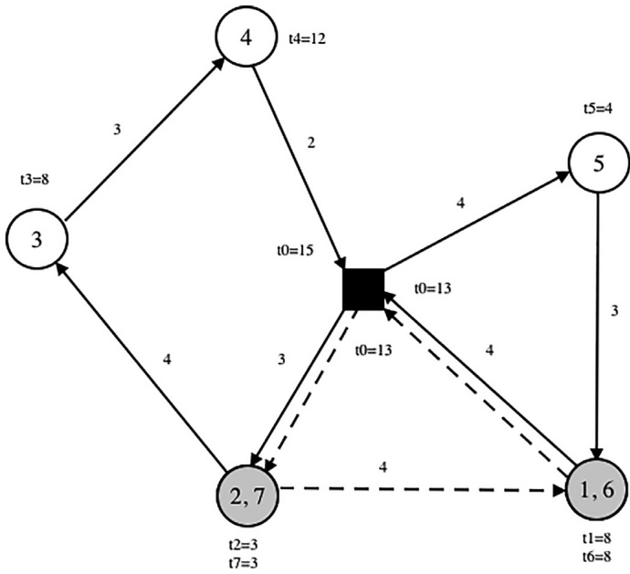

# Large neighborhood search with constraint programming for a vehicle routing problem with synchronization constraints

Hossein Hojabri a,c, Michel Gendreau b,c, Jean-Yves Potvin a,c,∗, Louis-Martin Rousseau b,c

a Département d’informatique et de recherche opérationnelle, Université de Montréal, C.P. 6128, succ. Centre-Ville, Montréal, Québec, H3C 3J7, Canada b Département de mathématiques et de génie industriel, École Polytechnique de Montréal, C.P. 6079, succ. Centre-Ville, Montréal, Québec, H3C 3A7, Canada c Centre interuniversitaire de recherche sur les réseaux d’entreprise, la logistique et le transport, Université de Montréal, C.P. 6128, succ. Centre-Ville, Montréal, Québec, H3C 3J7, Canada

## a r t i c l e i n f o

Article history: Received 8 June 2016 Revised 20 November 2017 Accepted 21 November 2017 Available online 8 December 2017

Keywords: Vehicle routing Synchronization Large neighborhood search Constraint programming

## a b s t r a c t

This paper considers an extension of the vehicle routing problem with time windows, where the arrival of two vehicles at different customer locations must be synchronized. That is, one vehicle has to deliver some product to a customer, like a home theater system, while the crew on another vehicle must install it. This type of problem is often encountered in practice and is very challenging due to the interdependency among the vehicle routes, but has received little attention in the literature. A constraint programming-based adaptive large neighborhood search is proposed to solve this problem. The search abilities of the large neighborhood search and the constraint propagation abilities of constraint programming are combined to determine the feasibility of any proposed modification to the current solution. Numerical results are reported on instances derived from benchmark instances for the vehicle routing problem with time windows with up to 200 customers.

© 2017 Elsevier Ltd. All rights reserved.

## 1. Introduction

The Vehicle Routing Problem with Multiple Synchronization constraints (VRPMS) can be used to model many real-world applications, like home care delivery, aircraft fleet assignment, vehicle routing and scheduling, and forest operations, as reported in Rousseau et al. (2013). The problem considered in this paper comes from a software development company that produces vehicle routing solutions for large retailers involved in the delivery of large items to their customers, like furniture, appliances, home theater systems, etc. In the case of electronics equipment, the crew in the delivery vehicle simply unload the goods, while another crew with the required capabilities takes charge of the installation. In this case, the routes of two different types of vehicles must be synchronized at a certain number of customer locations. A dynamic version of a similar problem for pickup vehicles (i.e., goods are collected at customer locations rather than being delivered) is addressed in Rousseau et al. (2013). The authors consider a problem where new customer requests are inserted one by one into the current routes, as they occur. Constraint programming (CP), a computational paradigm based on constraint propagation, is used to determine if an insertion is feasible or not. Since only one customer is considered at a time, this approach proved to be viable. Surprisingly and to the best of our knowledge, no solution approach, neither exact nor heuristic, has been proposed for the static version of the problem where all customers are known in advance. This a priori knowledge is required in the case of delivery applications, because the vehicles are loaded before they depart from the depot. The goal of this paper is thus to provide a contribution in this regard. In particular, we exploit the constraint propagation capabilities of CP in a context where many customers must be handled at the same time, through a proper integration within the Adaptive Large Neighborhood Search (ALNS) framework.

Apart from the paper of Rousseau et al. (2013), a problem quite similar to ours is addressed in Bredström and Rönnqvist (2008) in the domain of home care crew scheduling. The authors formally state their problem as a mixed integer programming (MIP) model that accounts for temporal precedence and synchronization constraints. The problem is then solved through an optimization-based heuristic. Rasmussen et al. (2012) solve the same problem exactly with a branch-and-price algorithm. Due to the application context, there is no capacity constraint and specific issues about home care crews are taken into account, in addition to the synchronization requirements, like care giver preferences, customer priority and ability of a particular care giver to serve a given customer. Also, there is no need to serve all customers (i.e., visits can be rescheduled or canceled).

<small>∗ Corresponding author. E-mail address: [potvin@iro.umontreal.ca](mailto:potvin@iro.umontreal.ca) (J.-Y. Potvin).</small>

Schmid et al. (2010) report a MIP for the delivery of concrete to construction sites from several plants by a fleet of heterogeneous vehicles. Two hybrid approaches are introduced to solve the problem by combining an exact algorithm with a variable neighborhood search (VNS). El Hachemi et al. (2013) consider an application in the forest industry where trucks and log-loaders must be synchronized. A decomposition approach is presented to solve a weekly problem in two phases. The first phase determines the assignment of forest areas to wood mills. Then, the daily routing and scheduling for the transportation of logs is done with either a constraintbased local search alone or a hybrid method consisting of CP coupled with the constraint-based local search. Other types of synchronization requirements are also found in urban mass transit systems where drivers must change buses at relief points (Freling et al., 2003; Haase et al., 2001) or in public transit rail systems where passengers must transfer several times to reach their destination (Wong et al. 2008).

Ioachim et al. (1999) propose a column generation approach for an aircraft fleet assignment and routing problem where a number of flight subsets during the weekdays must depart at the same time. The master problem is a set partitioning problem with synchronization constraints, while the subproblem is a shortest path problem with time windows and linear costs on the time variables. An extension of this work for a periodic airline fleet assignment with time windows is also reported in Bélanger et al. (2006).

Li et al. (2005) report an integer programming model for a manpower allocation problem with time windows and job-teaming constraints. To perform a job, the required workers must show up together at the job location before it can be executed. Furthermore, nobody can leave before the job is completed. The authors propose two construction heuristics embedded within a simulated annealing framework. They provide comparisons with optimal solutions produced by a commercial solver and lower bounds obtained with a network flow model on their own set of test instances. Dohn et al. (2009) also solve the problem with a branch-and-price algorithm where branching on the time variables automatically imposes synchronization.

The interested reader will find in Drexl (2012) a comprehensive survey on synchronization, with a particular emphasis on vehicle routing applications. In this survey, different types of synchronization requirements are presented (spatial, temporal, etc.), as well as different applications (dial-a-ride, school bus routing, truck-and-trailer, etc.), but nothing quite similar to our problem.

The remainder of this paper is organized as follows. Our problem is first introduced in Section 2. A description of the solution methodology is provided in Sections 3 and 4. A few refinements to this methodology are proposed in Section 5. Then, numerical results are reported in Section 6. Finally, concluding remarks are made in Section 7.

## 2. Problem definition and formulation

Our problem can be seen as an extension of the Vehicle Routing Problem with Time Windows (VRPTW) with the addition of synchronization requirements. In a standard VRPTW, the routes are independent, in the sense that a modification to a given route has no impact on the other routes. This is not the case for the VRPMS because the routes are interdependent due to the synchronization requirements at certain customer locations.

Let us assume that two different types of vehicles are available, called regular (delivery) and special vehicles. The regular vehicles deliver goods to customers and have limited capacity. The special vehicles do not deliver goods but rather provide a service related to the goods delivered by the regular vehicles. The set of customers is divided into two subsets: regular customers visited only by regular vehicles, and special customers visited by both a regular and a special vehicle. A regular customer is represented by a single vertex in the transportation network, while a special customer is represented by two vertices, one for the delivery by the regular vehicle and another for the service provided by the special vehicle.

A regular vertex has a demand and a time window, while a special vertex has only a time window, which is defined relative to the delivery time of the regular vehicle. More precisely, if t is the delivery time at the regular vertex of a special customer, then the service of the special vertex must begin within the time window $[ t - \delta , ~ t + \gamma ]$ , where δ and γ are parameters. Different synchronization requirements can be represented with different values of δ and $\gamma .$ For example, if the service of the special vehicle cannot start before the delivery, then the time window’s lower bound of the special vertex is set to t $( \mathrm { i . e . , ~ } \delta = 0 ) ;$ if the service of the special vehicle cannot start before the end of the delivery, then the time window’s lower bound of the special vertex is set to t plus the service time of the regular vehicle (i.e., δ is set to minus the service time of the regular vehicle), etc.

The problem then consists of constructing routes for the two types of vehicles such that:

1. Each route begins and ends at a single depot;

2. Each regular customer is served in the route of exactly one regular vehicle;

3. Each special customer is served in the route of exactly one regular vehicle and one special vehicle;

4. The total demand on the route of a regular vehicle cannot exceed its capacity;

5. A regular vehicle must start its delivery at a regular or special customer within the time window of the corresponding regular vertex;

6. A special vehicle must start its service at a special customer within the time window of the corresponding special vertex, which is defined relative to the delivery time of the regular vehicle at the regular vertex;

7. A regular (special) vehicle is allowed to wait up to the lower bound of the time window of the regular (special) vertex if it arrives earlier.

The objective is to minimize the total distance traveled by all vehicles (regular and special).

In the following, a small example is given before providing a more formal CP-based formulation of our problem.

## 2.1. Example

We consider a small example where the load and time window constraints of the regular vehicles are relaxed in order to focus on the synchronization issue. We have two regular vehicles $\{ v _ { 1 } ^ { r } , v _ { 2 } ^ { r } \} ,$ one special vehicle $\{ v _ { 1 } ^ { s } \}$ , a single depot 0 and 5 customers {1, 2, 3, 4, 5}, two of which are special customers, namely {1, 2}. In the underlying network, vertex 0 is the depot, vertices 1–5 correspond to regular vertices, while vertices 6 and 7 correspond to the special vertices of customers 1 and 2. Therefore, the vertex pairs (1,6) and (2,7) require synchronization. In Fig. 1, each pair is aggregated into a single gray circle. Without loss of generality, we assume that the service or dwell time is equal to 1 and $\delta = \gamma = 0$ for every special vertex.

In the solution shown, solid arcs are used to represent the routes of regular vehicles and dashed arcs for the route of the special vehicle. Each arc is labeled with its travel time and each vertex i is labeled with the vehicle’s arrival time ti. The return time of each vehicle to the depot, denoted $t _ { 0 } ,$ is also indicated on the last arc of the corresponding route. The routing plan is the following:

$$
v _ {1} ^ {r}: 0, 5, 1, 0
$$

$$
v _ {2} ^ {r}: 0, 2, 3, 4, 0
$$

Fig. 1. VRPMS example.

$$
v _ {1} ^ {s}: 0, 7, 6, 0
$$

$$
t _ {1} = 8, t _ {2} = 3, t _ {3} = 8, t _ {4} = 1 2, t _ {5} = 4, t _ {6} = 8.
$$

To better understand the synchronization requirements, we follow the route of regular vehicle $\nu _ { 1 } ^ { r } ,$ . Its route starts with regular customer 5 where the delivery begins at $t _ { 5 } = 4 .$ After spending 1 time unit to serve the customer, it takes 3 more time units to arrive at special customer 1 where a special vehicle is also needed. The special vehicle arrives at the same time $t _ { 1 } = t _ { 6 } = 8 .$ . Thus, vehicle $\nu _ { 1 } ^ { r }$ is perfectly synchronized with the special vehicle $\nu _ { 1 } ^ { s } .$ Then, vehicle $\nu _ { 1 } ^ { r }$ departs from special customer 1 at time 9 for the depot. Finally, it arrives at the depot at time 13. Note that the special vehicle $\nu _ { 1 } ^ { s }$ is already synchronized with the regular vehicle $\nu _ { 2 } ^ { r }$ at special customer 2 at time $t _ { 2 } = t _ { 7 } = 3$

## 2.2. Model

In this section, a CP-based formulation of the problem is proposed. This formulation is at the core of the reconstruction operator of our ALNS (see Section 3). Some familiarity with constraint programming is assumed, otherwise the reader is referred to Rousseau et al. (2013).

Let $G = ( N , A )$ be a complete and directed graph with vertex set $N = V _ { r } \cup V _ { s } \cup V _ { r } ^ { + } \cup V _ { s } ^ { + } \cup V _ { r } ^ { - } \cup V _ { s } ^ { - }$ , where $V _ { r }$ and $V _ { s }$ are the sets of regular and special vertices, respectively, with $V _ { r } \cup V _ { s } = V .$ . We recall that one vertex is associated with each regular customer and two vertices with each special customer, namely a regular vertex in $V _ { r }$ and a special vertex in $V _ { S } .$ Also, $V _ { r } ^ { + }$ and $V _ { r } ^ { - }$ contain multi-ple copies of the depot, one for the start and end of the route of each regular vehicle. That is, $| V _ { r } ^ { + } |$ and $| V _ { r } ^ { - } |$ are both equal to the number of regular vehicles. Similarly, $V _ { s } ^ { + }$ and $V _ { s } ^ { - }$ contain multiple copies of the depot for the start and end of the route of each special vehicle. Again, $| V _ { s } ^ { + } |$ and $| V _ { s } ^ { - } |$ are both equal to the number of special vehicles. We also define $V _ { r } ^ { + } \cup V _ { s } ^ { + } = V ^ { + }$ and $V _ { r } ^ { - } \cup V _ { s } ^ { - } = V ^ { - }$ Finally, with each arc $( i , j )   \in   A$ is associated a non-negative distance $d _ { i j }$ and travel time $t _ { i j } .$ The notation for the CP model is summarized below.

Sets and parameters:

$d _ { i j } ;$ Distance between vertices i and j, $i , j \in N , \; i \neq j ;$

$t _ { i j } ;$ Travel time between vertices i and $j ,   i , j   \in   N ,   i   \neq   j ;$

$q _ { i } ;$ Demand of vertex $i \in V _ { r } ;$

di: Service or dwell time at vertex $i \in V ;$

ai: Lower bound of the time window at regular vertex $i \in V _ { r }$

$b _ { i } ;$ Upper bound of the time window at regular vertex $i \in V _ { T } ;$

$\delta _ { i } ;$ Decrement to derive the lower bound of the time window at special vertex $i   \in   V _ { S } ;$

γ i: Increment to derive the upper bound of the time window at special vertex $i   \in   V _ { S } ;$

ri: Regular vertex associated with special vertex $i   \in V _ { S } ;$

Vr: Set of regular vertices;

Vs: Set of special vertices;

V: set of regular and special vertices;

$K _ { r } ;$ Set of regular vehicles;

$K _ { s } ;$ Set of special vehicles;

K: Set of regular and special vehicles;

Q: Capacity of each regular vehicle $k   \in   K _ { r }$

Note that $d _ { i j }$ and $t _ { i j }$ are fixed to ∞ when arc $( i , j )$ connects two copies of the depot (except when the two copies stand for the start and end of the same vehicle route, in which case $d _ { i j } = 0 ;$ these arcs are used when there are empty vehicle routes in the solution). Also, the demand and the service or dwell time at each copy of the depot are set to 0

Variables:

si: Successor of vertex $i \in V \cup V ^ { + }$

ki: Vehicle visiting vertex $i   \in   N ;$

ti: Start time of service at vertex i ∈ N;

li: Vehicle load after serving vertex i ∈ $V _ { r } \cup V _ { r } ^ { + } \cup V _ { r } ^ { - }$

## Constraints:

The constraints of the problem are modeled as follows:

General constraints:

AllDifferent(si:i∈V∪V + )

$$
\text {SubTour} (s _ {i: i \in V \cup V ^ {+}})\tag{1}
$$

$$
i \in V _ {r} \cup V _ {r} ^ {+} \Rightarrow s _ {i} \in V _ {r} \cup V _ {r} ^ {-}\tag{2}
$$

(3)

$$
i \in V _ {s} \cup V _ {s} ^ {+} \Rightarrow s _ {i} \in V _ {s} \cup V _ {s} ^ {-}\tag{4}
$$

$$
i \in V _ {r} \cup V _ {r} ^ {+} \cup V _ {r} ^ {-} \Rightarrow k _ {i} \in K _ {r}\tag{5}
$$

$$
i \in V _ {s} \cup V _ {s} ^ {+} \cup V _ {s} ^ {-} \Rightarrow k _ {i} \in K _ {s}
$$

$$
s _ {i} = j \Rightarrow k _ {j} = k _ {i}, \quad i \in V \cup V ^ {+}\tag{6}
$$

$$
\text {Capacity constraints:}\tag{7}
$$

$$
l _ {i} = 0, \qquad i \in V _ {r} ^ {-}\tag{8}
$$

$$
l _ {i} \leq Q, \quad i \in V _ {r} \cup V _ {r} ^ {+}\tag{9}
$$

$$
s _ {i} = j \Rightarrow l _ {j} = l _ {i} - q _ {j}, \quad i \in V _ {r} \cup V _ {r} ^ {+}\tag{10}
$$

Time window and synchronization constraints:

$$
t _ {i} = 0, \qquad i \in V ^ {+}\tag{11}
$$

$$
a _ {i} \leq t _ {i} \leq b _ {i}, \quad i \in V _ {r}\tag{12}
$$

$$
\left| t _ {r _ {i}} - \delta_ {i} \leqslant t _ {i} \leqslant t _ {r _ {i}} + \gamma_ {i}, \quad i \in V _ {s} \right.\tag{13}
$$

$$
s _ {i} = j \Rightarrow t _ {i} \leq t _ {j} - t _ {i j} - d _ {i}, \quad i \in V \cup V ^ {+}\tag{14}
$$

**Objective function**:

$$
\min \sum_ {i \in V \cup V ^ {+}} d _ {i, s _ {i}}\tag{15}
$$

In a solution, each vertex must have exactly one predecessor and one successor. The nature of variables $s _ { i }$ is such that any vertex i can only have one successor, but we must also ensure that it has only one predecessor. To do so, it must be forbidden for two different vertices to have the same successor, which corresponds to Constraint (1) called AllDifferent. Constraint (2) prohibits subtours, see the detailed description in Pesant et al. (1998). Constraints (3)– (6) define variables $s _ { i }$ and $k _ { i }$ for regular and special vertices. Constraint (7) states that a vertex and its successor must be served by the same vehicle. Constraints (8)–(10) impose load and capacity restrictions. Without loss of generality, vehicles are assumed to start their routes at the depot at time 0 through constraint (11). Constraint (12) imposes time window constraints on regular vertices. The synchronization requirements between regular and special vehicles at special vertices is stated in Constraint (13). Constraint (14) imposes the coherence of each route schedule. Finally, the objective function (15) minimizes the total distance traveled by all vehicles.

## 3. ALNS

The ALNS of Pisinger and Ropke (2007) extends the large neighborhood search framework of Shaw (1998), a problem-solving approach which can also be related to the ruin-and-recreate principle of Schrimpf et al. (2000). The basic idea is to search for a better solution at each iteration by destroying a part of the current solution and by reconstructing it in a different way. When solving VRPs, a new solution is obtained by first removing a number of vertices and then by reinserting these vertices into the solution. Typically, a number of different operators are available and the adaptive extension chooses an operator in a randomized, but informed, way at each iteration. That is, the selection probability of an operator is derived from its associated weight, which is adjusted during the search depending on the operator’s previous successes and failures.

A noteworthy feature of our ALNS is the use of CP to reinsert the removed customers. Thus, a systematic exploration of feasible ways to reinsert the vertices is performed.

The ALNS algorithm can be described as follows.

1. Generate an initial solution s

2. $s ^ { * } \leftarrow s$

3. While a stopping criterion is not met do:

3.1 Adaptively select a destruction operator and apply it to s 3.2 Reinsert customers with CP

3.3 If a new solution $s ^ { \prime }   \neq   s$ is returned by CP then

$$
S \leftarrow S ^ {\prime}
$$

If $s ^ { \prime }$ is better than $s ^ { * }$ then $s ^ { * } \gets s ^ { \prime }$

4. Return best solution $s ^ { * }$

The main components of this algorithm will be detailed in the following. Note that we basically follow the implementation of Pisinger and Ropke (2007), except for the CP-based insertion operator (including a number of adjustments required by its integration within ALNS) and some destruction operators that are specifically designed for our problem.

## 3.1. Initial solution

The routes of the delivery vehicles are first created by inserting regular vertices using the well-know I1 insertion heuristic of Solomon (1987), originally developed for the VRPTW. Then, the time windows for the special vertices are defined through the delivery times in the regular routes. Solomon’s insertion heuristic is reapplied on the special vertices to create routes for the special vehicles. At this point a complete solution is obtained. Note that the number of vehicles in this initial solution will tend to decrease as the ALNS is executed due to the minimization of the total distance (although minimizing total distance is not equivalent to minimizing the number of vehicles).

## 3.2. Adaptive operator selection

A destruction operator removes a number of vertices from the current solution at each iteration of the ALNS. Since more than one destruction operator is typically available, the adaptive mechanism is aimed at choosing the destruction operator in a way that accounts for its previous outcomes. A weight is associated with each operator for this purpose. Let us assume that we have h operators, each with a weight $w _ { j } ,   j = 1 , \ldots , h .$ The removal operator i is then selected with probability

$$
\frac {w _ {i}}{\sum_ {j = 1} ^ {h} w _ {j}}, i = 1, \dots , h.
$$

That is, the probability of selecting a given operator increases with its weight. Starting with a unit weight for each operator, the weights are updated after a number of consecutive iterations called a segment. The weight of operator i at the start of a given segment sg is based on the one used in the previous segment $s g - 1$ and is computed as follows:

$$
w _ {i} ^ {\mathrm{sg}} = \gamma \cdot w _ {i} ^ {\mathrm{sg-1}} + (1 - \gamma) \cdot \frac {\pi_ {i} ^ {\mathrm{sg-1}}}{n _ {i} ^ {\mathrm{sg-1}}},
$$

where $n _ { i } ^ { \mathrm { s g - 1 } }$ is the number of times operator i was used in segment $s g - 1 , \gamma$ is a value between 0 and 1 and $\pi _ { i } ^ { s \mathrm { g } - 1 }$ is the score of operator i at the end of segment sg − 1. Parameter γ controls the inertia in the weight update equation. When $\gamma$ is close to 1, the history prevails and the weights do not change much. Conversely, when $\gamma$ is close to 0, the update is driven by the most recent score.

The score, which is reset to zero at the beginning of each segment, is incremented when operator i is used at a given iteration t to produce a new solution. More precisely, the new score at iteration t + 1 becomes

$\pi_{i}^{t + 1} = \pi_{i}^{t} + \begin{cases} \sigma_{1} \\ \sigma_{2} \end{cases}$ if a new best solution has been produced, if the solution produced is better than the current solution,

where $\sigma _ { 1 }$ and $\sigma _ { 2 }$ are parameters.

## 3.3. Destruction operators

A total of 10 destruction operators were considered in this study, but only two were kept at the end, called Route removal and Historical node-pair removal, after the results of an experiment reported in Section 6. The reader is referred to Pisinger and Ropke (2007) and Shaw (1998) for a description of the eight previously reported operators that were excluded from the final implementation, namely Cluster removal, Random removal, Worst removal, Historical route-pair removal, Distance-oriented related removal and Time-oriented related removal. In the following, we describe Route removal, Historical node-pair removal, Synchro Vertex removal and Synchro Route removal, because they were specifically designed for our problem (although the last two were excluded from the final implementation). They are all based on a parameter which is the number of vertices to be removed. To simplify the description, this parameter is always denoted NV, but it is clear that a different parameter value can be associated with each operator.

## 3.3.1. Route removal

This operator removes vertices in the same route(s). First, a route is randomly selected and all its vertices are removed. If NV is not reached yet, all remaining vertices are sorted according to their distance to a randomly chosen vertex among the previously removed ones. Then, one of the closest vertices is selected, using a randomization factor $r ^ { D } ,$ . More precisely, the vertex in position $\lfloor r ^ { D * } L i s t S i z e \rfloor$ in the sorted list is selected, where ListSize is the number of vertices in the list, r is a random number between 0 and 1, and D is a parameter. The selected vertex, as well as the other vertices in the same route, are then removed. This procedure is repeated until NV vertices are removed. The randomization factor provides a form of diversification but, more importantly, when one of the two vertices of a special customer is randomly selected, the closest vertex is necessarily the other vertex from the pair (at distance 0). Thus, without randomization, the operator would behave like the Synchro Route removal operator (see below). In the computational results, Route removal proved to be the best performing operator.

## 3.3.2. Historical node-pair removal

This operator removes vertices based on historical information. That is, a score g(i, j) (initially set to infinity) is assigned to each arc (i, j). This score corresponds to the objective value of the best solution found up to now in which vertices i and j are visited consecutively. Then, for each vertex i, we consider the value $g _ { i , \mathrm { s u c c } _ { i } } + g _ { \mathrm { p r e d } _ { i } , i } ,$ , where succi and predi are the predecessor and successor of vertex i in the current solution, respectively. The NV vertices with the largest values are then removed.

## 3.3.3. Synchro Vertex removal

First, NV/2 special vertices are randomly selected and removed with their corresponding regular vertices. If the number of special vertices is less than NV/2, then the remaining vertices are randomly chosen among the regular ones. Given that a special vertex must be synchronized with a regular vertex, the idea is that better insertion places are more likely to be found in the following reinsertion phase if both vertices are removed together. Unfortunately, this operator did not provide good results and was not kept in the final implementation.

## 3.3.4. Synchro Route removal

This operator focuses on the routes of special vehicles. First, a route is randomly selected among all the routes served by special vehicles. Then, the route is emptied by removing all its (special) vertices along with their corresponding regular vertices. This is repeated until NV vertices are removed. Like Synchro Vertex removal, this operator did not perform well and was not kept at the end.

The following section is devoted to the reinsertion of the removed vertices.

## 4. CP-based reinsertion

Here, a partially destroyed solution is reconstructed using CP, as initially proposed in Pesant and Gendreau (1996, 1999) and Rousseau et al. (2002), using the model presented in Section 2.2. CP has proven useful for a number of routing variants and the presence of synchronization constraints make our problem even more suitable for a CP-based approach, see Rousseau et al. (2013). For example, the insertion of a special vertex in the route of a special vehicle causes a delay not only to the special vertices that are visited later along this route, but also to the regular vertices which are associated with these special vertices. That is, the schedule of regular vehicles is also modified. The constraint propagation capabilities of CP can thus be exploited here to further restrict the feasible region of the search space. In the computational results reported in Section 6, the ILOG CP Optimizer was used for this purpose.

In the reconstruction phase, only a subset of vertices needs to be reinserted in the solution, which restricts the domain of feasible values for each variable. For example, if vertex i is part of the partial solution (it has not been removed), then the value of the successor variable $s _ { i }$ in the model of Section 2.2 can only be chosen among the current successor in the partial solution or one of the removed vertices. Once the domain of each variable is appropriately set, CP then implicitly considers all feasible ways to reinsert the removed vertices in the solution. However, due to the propagation and pruning abilities of CP, the number of possibilities can be drastically reduced using appropriate variable and value selection heuristics to guide the reinsertion. In our implementation, we instantiate first the more constrained variables with their less constraining value. Here, a variable $s _ { i }$ associated with a removed vertex has a smaller number of possible successors, and is more constrained, if it is associated with a vertex far from the other vertices. The value of the selected variable is then set to the closest vertex in the current partial solution. This approach proved to be slightly better than the autosearch feature of the ILOG CP Optimizer.

## 5. Further refinements

To improve the performance of our ALNS, additional refinements have been introduced. They are described in the following.

## 5.1. Constrained objective function

Since CP looks for the optimal reinsertion of the removed vertices at each iteration of ALNS, very long run times are to be expected. To alleviate this problem, the minimization of the objective function is taken off from the CP model and introduced as a constraint, to produce a pure constraint satisfaction problem:

$$
\text {NewObj} <   \alpha \times \text {CurrObj}\tag{16}
$$

where CurrObj and NewObj are the values of the current and new solutions, respectively, and α has a positive value which must be less than or equal to 1. The value of α is very important. If too small, CP might run for a long time for nothing because there is no feasible solution. If too large, CP will return a solution just a bit better than the current solution. After some experiments, α was defined as $( 1 - 0 . 0 2 / ( n b I t e r ^ { \lambda } + 1 . 1 ) )$ with $\lambda = 0 . 5$ . This formula depends on the iteration number nbIter, because larger improvements are expected to be found at the start. As the search progresses, smaller improvements are looked for.

## 5.2. Solution acceptance

It is known that the search process of ALNS can be enhanced by allowing worse solutions to be accepted, see Pisinger and Ropke (2007). Similarly, we force CP to look for a worse solution with some probability Prob. This probability increases with the number of consecutive CP failures (a failure occurs when CP cannot find a feasible and improved reinsertion of the removed vertices). The formula is the following, where p is a parameter:

$$
P r o b = (n b F a i l / (n b F a i l + 1)) ^ {p}
$$

In practice, the following constraint replaces constraint (16) with probability Prob (where w and r are parameters):

$$
\text {CurrObj} <   \text {NewObj} <   \text {CurrObj} \times \left(1 + \frac {\text {nbFail} ^ {w}}{r}\right)\tag{17}
$$

It should be noted that CP searches for increasingly worse solutions as the number of consecutive failures nbFail increases. If a solution is returned, NbFail is reset to 0.

| Parameter |  |  |  |  |  |  |  |  |
| --- | --- | --- | --- | --- | --- | --- | --- | --- |
| γ | 0.1 | 0.3 | 0.5 | 0.7 | 0.85 | 0.9 | 0.95 |  |
| λ | 0.2 | 0.25 | 0.3 | 0.35 | 0.4 | 0.45 | 0.5 | 0.55 0.6 0.65 0.7 |
| Segment length | 30 | 50 | 70 | 100 | 150 | 200 | 250 | 300 |
| D | 0 | 1 | 2 | 3 | 4 | 5 |  |  |
| p | 1 | 2 | 3 | 4 | 5 | 6 | 7 | 8 9 10 11 12 13 14 |
| w | 0.25 | 0.5 | 0.75 | 1 | 1.5 | 2 |  |  |
| r | 100 | 500 | 1K | 5K | 10K | 100K |  |  |
| σ1 | 1 | 2 | 3 | 5 | 10 | 20 | 30 |  |
| σ2 | 1 | 2 | 3 | 4 | 5 | 6 | 10 |  |
| MinNV-MaxNV | 6-16 | 8-18 | 10-20 | 12-22 | 13-23 | 14-24 | 16-26 |  |
| MinCPLimit-MaxCPLimit | 1-3 | 1-4 | 1-5 | 1-6 | 2-4 | 2-5 | 2-6 | 2-7 |

## 5.3. Variable neighborhood size

To help intensify the search, the number of vertices to be removed NV is increased by one each time the reinsertion through CP fails. Conversely, NV is decreased by one each time the reinsertion succeeds. However, the NV value must stay within the bounds of the interval $[ M i n _ { N V } , ~ M a x _ { N V } ] ,$ where $M i n _ { N V }$ and $M a x _ { N V }$ are parameters. The initial value of NV is randomly selected within that interval.

## 5.4. CP search time

Experimentally, we found that our ALNS is more efficient when CP is stopped after a given time limit CPlimitTime (i.e., if CP has not returned a solution after that amount of time, it is unlikely that it will find one if it runs longer). This approach leads to much shorter run times and also produces better solutions because ALNS can explore a larger fraction of the search space. CPlimitTime is allowed to vary in the interval [MinCPlimit, MaxCPlimit] (in seconds). The time limit is initially equal to MinCPlimit and is incremented by one when CP fails to find a solution and the current value is not MaxCPlimit. It is decremented by one when CP returns a solution and the current value is not MinCPlimit.

## 6. Computational experiments

This section first describes our test instances. This is followed by a parameter sensitivity analysis and the description of an experiment aimed at identifying the best destruction operators. Then, numerical results are reported.

## 6.1. Test instances

Given that the static version of our VRPMS is addressed for the first time, we generated test instances with n = 25, 50, 100 and 200 customers from the VRPTW instances of Solomon (1987) and Homberger and Gehring (1999). In these Euclidean instances, the travel time is the same as the distance. There are also different classes of instances. The customers are randomly located in the instances of type R, clustered in the instances of type C, and both randomly located and clustered in the instances of type RC. Furthermore, instances of type 1 have a short scheduling horizon, while those of type 2 have a long one. Overall, there are six different classes of instances: R1, R2, C1, C2, RC1 and RC2. A variable number of instances is found in each class, for a total of 56 instances for each size.

Some additional parameters are required to transform the original VRPTW instances into VRPMS instances: ${ \mathcal { S } } p ,$ which is the percentage of special customers; $\delta _ { i }$ and $\gamma _ { i }$ which are used to define the time window of each special vertex $i \in V _ { S }$

Test instances were created from the VRPTW instances by setting parameter Sp to 5%, 25% and 50%. More precisely, the number of special customers is equal to $\lceil S p \times n \rceil$ . Then, the first customer is a special customer and the following special customers are chosen using a constant interval defined by 1/Sp. For example, if n = 100 and $S p = 5 \%$ , then $1 / S p = 2 0$ and the five special customers are 1, 21, 41, 61, and 81.

The VRPTW instances are designed in such a way that the instances of larger size are obtained by adding customers to the instances of smaller size. For example, the instances of size 50 are obtained by adding 25 customers to the instances of size 25. For a given Sp value, the same applies to the special customers in the VRPMS instances. That is, all special customers in the instances of size 25 are also found in the corresponding instances of size 50. With regard to synchronization, $\delta _ { i }$ and $\gamma _ { i }$ were set to 0 and 10, respectively, for each special vertex $i \in V _ { s }$ (as in Rousseau et al. (2013)). The test instances can be found in the Mendeley dataset repository at: [https://doi.org/10.17632/v5hf63zxk2.1.](https://doi.org/10.17632/v5hf63zxk2.1)

## 6.2. Parameter sensitivity analysis

We adjusted the parameter values by considering a subset of 18 instances of size 100, that is, one instance for each class and Sp value. The values considered for the various parameters are shown in Table 1, with the best values in bold. Default values in italic were taken from the literature or were determined after a few pre-liminary experiments. When the default and best values coincide, the entry is in italic bold. Since it was not possible to consider all combinations of values, we proceeded as follows. The parameters were processed one by one in the order shown in the table. When the different values of the current parameter were tested, all parameters not yet tested were set at their default value. Then, the current parameter was fixed to the value leading to the best average objective value, before the next parameter was considered.

## 6.3. Operator selection

Another experiment was performed to select a good combination of operators among the 10 available destruction operators. For this purpose, we ran the ALNS on the subset of instances of size 100 using the parameter setting identified in Table 1. Let us denote LB the average solution value obtained with the original ALNS implementation with $h = 1 0$ operators. Then, at each iteration, ALNS is run h times with $h - 1$ operators by removing each operator in turn. The best among the h runs is then compared with LB. If the average solution value is better than LB, the missing operator is detrimental because an improvement is observed without it. Consequently, this operator is put aside and the procedure is repeated with the $h - 1$ remaining operators with LB reset to the improved average solution value. Otherwise, when the average solution value of the best among the h runs is worse than LB, each missing operator degrades solution quality and the procedure is stopped. In our

Table 2

Re s ults fo r 2 5 - , 5 0- , 1 0 0- and 2 0 0- custo me r i nstance s .

<table><tr><td rowspan="3">Size</td><td rowspan="3">Class</td><td rowspan="3">nbSyn</td><td colspan="6">Objective values</td><td colspan="4">Number of vehicles</td><td rowspan="2" colspan="5">Literature</td></tr><tr><td colspan="3">Initial solution</td><td colspan="3">Final solution</td><td colspan="2">Initial solution</td><td colspan="2">Final solution</td></tr><tr><td>InObj</td><td>InRgObj</td><td>InSpObj</td><td>FnObj</td><td>FnRgObj</td><td>FnSpObj</td><td>InNbrgV</td><td>InNbSpV</td><td>FnNbRgV</td><td>FnNbSpV</td><td>RunTime</td><td>LitBestObj</td><td>LitBestnbVeh</td><td>Imp %</td><td>Gap%</td></tr><tr><td rowspan="6">25</td><td>R1</td><td>2</td><td>621.66</td><td>559.13</td><td>62.53</td><td>555.22</td><td>492.69</td><td>62.53</td><td>5.92</td><td>1</td><td>5.5</td><td>1</td><td>16,848.22</td><td>463.45</td><td>4.92</td><td>10.69</td><td>5.93</td></tr><tr><td>R2</td><td></td><td>577.89</td><td>515.35</td><td>62.53</td><td>463.96</td><td>401.43</td><td>62.53</td><td>4.18</td><td>1</td><td>3.09</td><td>1</td><td>25,191.24</td><td>350.25</td><td>2.73</td><td>19.71</td><td>12.75</td></tr><tr><td>C1</td><td></td><td>279.27</td><td>227.3</td><td>51.97</td><td>246.19</td><td>195.37</td><td>50.81</td><td>3.17</td><td>1.17</td><td>3</td><td>1</td><td>17,418.74</td><td>190.59</td><td>3.00</td><td>11.85</td><td>2.45</td></tr><tr><td>C2</td><td></td><td>356.23</td><td>287.77</td><td>68.46</td><td>288.69</td><td>220.23</td><td>68.46</td><td>2.38</td><td>1</td><td>2</td><td>1</td><td>19,849.75</td><td>214.45</td><td>2</td><td>18.96</td><td>2.62</td></tr><tr><td>RC1</td><td></td><td>572.33</td><td>407.01</td><td>165.32</td><td>520.39</td><td>355.49</td><td>164.89</td><td>3.88</td><td>1.5</td><td>3.38</td><td>1.25</td><td>12,699.54</td><td>350.24</td><td>3.25</td><td>9.08</td><td>1.48</td></tr><tr><td>RC2</td><td></td><td>558.28</td><td>393.8</td><td>164.47</td><td>489.61</td><td>325.14</td><td>164.47</td><td>3</td><td>1</td><td>2.88</td><td>1</td><td>17,660.31</td><td>319.28</td><td>3</td><td>12.3</td><td>1.8</td></tr><tr><td rowspan="6">25</td><td>R1</td><td>7</td><td>832.64</td><td>559.13</td><td>273.51</td><td>704.14</td><td>496.44</td><td>207.7</td><td>5.92</td><td>3.83</td><td>5.42</td><td>3.08</td><td>16,273.53</td><td>463.45</td><td>4.92</td><td>15.43</td><td>6.65</td></tr><tr><td>R2</td><td></td><td>779.83</td><td>515.35</td><td>264.48</td><td>597.14</td><td>408.47</td><td>188.67</td><td>4.18</td><td>2.09</td><td>3.18</td><td>1.45</td><td>24,096.96</td><td>350.25</td><td>2.73</td><td>23.43</td><td>14.25</td></tr><tr><td>C1</td><td></td><td>360.15</td><td>215.47</td><td>144.68</td><td>323.1</td><td>203.23</td><td>119.87</td><td>3.11</td><td>2.89</td><td>3</td><td>1.89</td><td>15,498.12</td><td>190.59</td><td>3.00</td><td>10.29</td><td>6.22</td></tr><tr><td>C2</td><td></td><td>402.83</td><td>287.77</td><td>115.06</td><td>330.33</td><td>222.68</td><td>107.65</td><td>2.38</td><td>1</td><td>2</td><td>1</td><td>16,121.23</td><td>214.45</td><td>2</td><td>18</td><td>3.7</td></tr><tr><td>RC1</td><td></td><td>698.27</td><td>407.01</td><td>291.25</td><td>638.79</td><td>373.71</td><td>265.08</td><td>3.88</td><td>3</td><td>3.63</td><td>2.88</td><td>11,861.81</td><td>350.24</td><td>3.25</td><td>8.52</td><td>6.28</td></tr><tr><td>RC2</td><td></td><td>693.4</td><td>393.8</td><td>299.59</td><td>568.34</td><td>332.19</td><td>236.16</td><td>3</td><td>2</td><td>2.88</td><td>1.63</td><td>17,520.55</td><td>319.28</td><td>3</td><td>18.04</td><td>3.89</td></tr><tr><td rowspan="6">25</td><td>R1</td><td>13</td><td>950.12</td><td>559.13</td><td>390.99</td><td>828.41</td><td>492.49</td><td>335.92</td><td>5.92</td><td>4.67</td><td>5.33</td><td>3.83</td><td>14,218.83</td><td>463.45</td><td>4.92</td><td>12.81</td><td>5.9</td></tr><tr><td>R2</td><td></td><td>913.19</td><td>515.35</td><td>397.84</td><td>706.96</td><td>407.85</td><td>299.12</td><td>4.18</td><td>2.55</td><td>3</td><td>2.27</td><td>256,156</td><td>350.25</td><td>2.73</td><td>22.58</td><td>14.12</td></tr><tr><td>C1</td><td></td><td>389.5</td><td>215.47</td><td>174.03</td><td>353.3</td><td>196.74</td><td>156.56</td><td>3.11</td><td>3</td><td>3</td><td>2.56</td><td>12,988.41</td><td>190.59</td><td>3.00</td><td>9.29</td><td>3.13</td></tr><tr><td>C2</td><td></td><td>476.72</td><td>287.77</td><td>188.95</td><td>385.81</td><td>223.92</td><td>161.89</td><td>2.38</td><td>1.13</td><td>2</td><td>1</td><td>13,118.35</td><td>214.45</td><td>2</td><td>19.07</td><td>4.23</td></tr><tr><td>RC1</td><td></td><td>731.55</td><td>407.01</td><td>324.54</td><td>667.17</td><td>366.92</td><td>300.24</td><td>3.88</td><td>3.38</td><td>3.5</td><td>3.13</td><td>9407.29</td><td>350.24</td><td>3.25</td><td>8.8</td><td>4.55</td></tr><tr><td>RC2</td><td></td><td>709.59</td><td>393.8</td><td>315.78</td><td>603.24</td><td>330.68</td><td>272.57</td><td>3</td><td>2.25</td><td>2.88</td><td>2.13</td><td>16,984.06</td><td>319.28</td><td>3</td><td>14.99</td><td>3.45</td></tr><tr><td rowspan="6">50</td><td>R1</td><td>3</td><td>1056.21</td><td>949.14</td><td>107.07</td><td>902.23</td><td>814.25</td><td>87.98</td><td>10.67</td><td>1.58</td><td>8.83</td><td>1</td><td>31,527.45</td><td>766.13</td><td>7.75</td><td>14.58</td><td>5.91</td></tr><tr><td>R2</td><td></td><td>893.48</td><td>796.94</td><td>96.53</td><td>733.14</td><td>645.57</td><td>87.57</td><td>5.73</td><td>1.18</td><td>4.73</td><td>1</td><td>46,639.5</td><td>634.03</td><td>4.11</td><td>17.95</td><td>1.79</td></tr><tr><td>C1</td><td></td><td>526.62</td><td>442.08</td><td>84.54</td><td>457.94</td><td>378.03</td><td>79.91</td><td>5.5</td><td>1.33</td><td>5.17</td><td>1</td><td>24,692.47</td><td>361.69</td><td>4.56</td><td>13.04</td><td>4.32</td></tr><tr><td>C2</td><td></td><td>603.43</td><td>494.47</td><td>108.96</td><td>471.02</td><td>368.77</td><td>102.25</td><td>3.57</td><td>1.57</td><td>3</td><td>1</td><td>42,906.69</td><td>357.50</td><td>2.75</td><td>21.94</td><td>3.06</td></tr><tr><td>RC1</td><td></td><td>117.91</td><td>903.25</td><td>214.66</td><td>980.16</td><td>783.15</td><td>197.02</td><td>8.5</td><td>2.5</td><td>7.5</td><td>1</td><td>26,264.02</td><td>730.31</td><td>6.50</td><td>12.32</td><td>6.75</td></tr><tr><td>RC2</td><td></td><td>900.77</td><td>710.5</td><td>190.28</td><td>785.82</td><td>595.75</td><td>190.07</td><td>4.75</td><td>1.13</td><td>4.75</td><td>1</td><td>32,023.15</td><td>568.65</td><td>4.33</td><td>12.76</td><td>4.55</td></tr><tr><td rowspan="6">50</td><td>R1</td><td>13</td><td>1383.4</td><td>949.14</td><td>434.26</td><td>1157.59</td><td>818.93</td><td>338.66</td><td>10.67</td><td>5.58</td><td>8.92</td><td>3.58</td><td>31,164.96</td><td>766.13</td><td>7.75</td><td>16.32</td><td>6.45</td></tr><tr><td>R2</td><td></td><td>1234.54</td><td>796.94</td><td>437.6</td><td>973.28</td><td>658.23</td><td>315.05</td><td>5.73</td><td>2.64</td><td>4.91</td><td>2.09</td><td>45,965.2</td><td>634.03</td><td>4.11</td><td>21.16</td><td>3.68</td></tr><tr><td>C1</td><td></td><td>710.67</td><td>415.8</td><td>294.87</td><td>621.69</td><td>375.17</td><td>246.52</td><td>5.33</td><td>4.78</td><td>5.11</td><td>3.67</td><td>28,163.37</td><td>361.69</td><td>4.56</td><td>12.52</td><td>3.59</td></tr><tr><td>C2</td><td></td><td>779.74</td><td>494.47</td><td>285.27</td><td>648.13</td><td>402.91</td><td>245.21</td><td>3.57</td><td>2.29</td><td>3.18</td><td>1.86</td><td>39,479.04</td><td>357.50</td><td>2.75</td><td>16.88</td><td>11.27</td></tr><tr><td>RC1</td><td></td><td>1426.83</td><td>903.25</td><td>523.58</td><td>1236.84</td><td>787.11</td><td>449.73</td><td>8.5</td><td>5.38</td><td>7.38</td><td>4.38</td><td>25,993.75</td><td>730.31</td><td>6.50</td><td>13.32</td><td>7.22</td></tr><tr><td>RC2</td><td></td><td>1268.13</td><td>710.5</td><td>557.64</td><td>1014.09</td><td>613.48</td><td>400.61</td><td>4.75</td><td>3.13</td><td>4.75</td><td>2</td><td>35,686.48</td><td>568.65</td><td>4.33</td><td>20.03</td><td>7.31</td></tr><tr><td rowspan="6">50</td><td>R1</td><td>25</td><td>1615.13</td><td>949.14</td><td>665.99</td><td>1348.59</td><td>834.31</td><td>514.28</td><td>10.67</td><td>7.83</td><td>9.33</td><td>5.33</td><td>283,212</td><td>766.13</td><td>7.75</td><td>16.5</td><td>8.17</td></tr><tr><td>R2</td><td></td><td>1469.22</td><td>796.94</td><td>672.28</td><td>1107.87</td><td>663.17</td><td>444.7</td><td>5.73</td><td>3.64</td><td>4.73</td><td>2.82</td><td>44,380.65</td><td>634.03</td><td>4.11</td><td>24.59</td><td>4.39</td></tr><tr><td>C1</td><td></td><td>786.88</td><td>415.8</td><td>371.08</td><td>682.03</td><td>369.55</td><td>312.48</td><td>5.33</td><td>5</td><td>4.44</td><td>21,976.72</td><td>361.69</td><td>4.56</td><td>13.32</td><td>2.13</td><td></td></tr><tr><td>C2</td><td></td><td>850.11</td><td>477.88</td><td>372.22</td><td>702.8</td><td>391.26</td><td>311.54</td><td>3.5</td><td>2.88</td><td>3.25</td><td>32,853.62</td><td>357.50</td><td>2.75</td><td>17.33</td><td>8.63</td><td></td></tr><tr><td>RC1</td><td></td><td>1626.42</td><td>903.25</td><td>723.17</td><td>1316.64</td><td>764.13</td><td>552.5</td><td>8.5</td><td>7</td><td>7</td><td>5.25</td><td>25,843.36</td><td>730.31</td><td>6.50</td><td>19.05</td><td>4.43</td></tr><tr><td>RC2</td><td></td><td>1316.27</td><td>710.5</td><td>605.77</td><td>1082.22</td><td>610.59</td><td>471.63</td><td>4.75</td><td>4.13</td><td>4.75</td><td>3.25</td><td>36,624.92</td><td>568.65</td><td>4.33</td><td>17.78</td><td>6.87</td></tr><tr><td rowspan="6">100</td><td>R1</td><td>5</td><td>1716.51</td><td>1533.15</td><td>183.36</td><td>1429.05</td><td>1269.83</td><td>159.22</td><td>17.17</td><td>2.83</td><td>15</td><td>2.25</td><td>82,716.31</td><td>1201.34</td><td>11.92</td><td>16.75</td><td>5.39</td></tr><tr><td>R2</td><td></td><td>1425.63</td><td>1241.35</td><td>184.28</td><td>1114.93</td><td>969.61</td><td>145.32</td><td>7.09</td><td>2</td><td>6.64</td><td>1.27</td><td>107,910</td><td>951.03</td><td>2.73</td><td>21.79</td><td>1.92</td></tr><tr><td>C1</td><td></td><td>1228.52</td><td>1032.97</td><td>195.55</td><td>1017.52</td><td>841.86</td><td>175.67</td><td>11.44</td><td>1.89</td><td>10.11</td><td>1.44</td><td>41,401.64</td><td>828.38</td><td>10</td><td>17.18</td><td>1.6</td></tr><tr><td>C2</td><td></td><td>999.41</td><td>784.54</td><td>214.87</td><td>841.67</td><td>646.73</td><td>194.94</td><td>5</td><td>2</td><td>4</td><td>1.63</td><td>75,868.33</td><td>589.86</td><td>3</td><td>15.78</td><td>8.79</td></tr><tr><td>RC1</td><td></td><td>1949.66</td><td>1720.98</td><td>228.68</td><td>1637.62</td><td>1432.95</td><td>204.67</td><td>16</td><td>2.75</td><td>14.5</td><td>2</td><td>73,411.25</td><td>1384.16</td><td>11.5</td><td>16</td><td>3.4</td></tr><tr><td>RC2</td><td></td><td>1643.43</td><td>1427.36</td><td>216.07</td><td>1286.37</td><td>1087.85</td><td>198.51</td><td>7.63</td><td>2.38</td><td>6.88</td><td>1.38</td><td>97,137.41</td><td>1119.24</td><td>3.25</td><td>21.73</td><td>-2.89</td></tr></table>

( continued on next page )

Table 2 ( con tinued )

<table><tr><td rowspan="3">Size</td><td rowspan="3">Class</td><td rowspan="3">nbSyn</td><td colspan="5">Objective values</td><td colspan="5">Number of vehicles</td><td colspan="5">Literature</td></tr><tr><td colspan="3">Initial solution</td><td colspan="2">Final solution</td><td colspan="2">Initial solution</td><td colspan="2">Final solution</td><td></td><td colspan="5"></td></tr><tr><td>InObj</td><td>InRgObj</td><td>InSpObj</td><td>FnObj</td><td>FnRgObj</td><td>FnSpObj</td><td>InNRgV</td><td>InNBSpV</td><td>FinNRgV</td><td>FinNBSpV</td><td>Runtime</td><td>LitBestObj</td><td>LitBestnbVeh</td><td>Innp %</td><td>Gap%</td></tr><tr><td rowspan="6">100</td><td>R1</td><td>25</td><td>2190.18</td><td>1533.15</td><td>657.03</td><td>1789.48</td><td>1304.3</td><td>485.17</td><td>17.17</td><td>8.83</td><td>15.42</td><td>5.67</td><td>80,930.04</td><td>1201.34</td><td>11.92</td><td>18.3</td><td>7.89</td></tr><tr><td>R2</td><td></td><td>1856.53</td><td>1241.35</td><td>615.18</td><td>1407.66</td><td>986.86</td><td>420.8</td><td>7.09</td><td>3.91</td><td>6.45</td><td>3</td><td>106,302.71</td><td>951.03</td><td>2.73</td><td>24.18</td><td>3.63</td></tr><tr><td>C1</td><td></td><td>1749.11</td><td>1032.97</td><td>716.13</td><td>1441.88</td><td>887.41</td><td>554.47</td><td>11.44</td><td>7.78</td><td>10.78</td><td>5.67</td><td>74,134.63</td><td>828.38</td><td>10</td><td>17.56</td><td>6.65</td></tr><tr><td>C2</td><td></td><td>1331.89</td><td>784.54</td><td>547.35</td><td>1087.37</td><td>674.94</td><td>412.44</td><td>5</td><td>3.25</td><td>4.38</td><td>2.88</td><td>70,059.29</td><td>589.86</td><td>3</td><td>18.36</td><td>12.61</td></tr><tr><td>RC1</td><td></td><td>2667.44</td><td>1720.98</td><td>946.47</td><td>2146.34</td><td>1483.63</td><td>662.72</td><td>16</td><td>10.5</td><td>14.88</td><td>5.5</td><td>71,074.11</td><td>1384.16</td><td>11.5</td><td>19.54</td><td>6.7</td></tr><tr><td>RC2</td><td></td><td>2222.07</td><td>1427.36</td><td>794.71</td><td>1709.74</td><td>1117.81</td><td>591.93</td><td>7.63</td><td>4.75</td><td>6.88</td><td>3.38</td><td>99529.68</td><td>1119.24</td><td>3.25</td><td>23.06</td><td>-0.13</td></tr><tr><td rowspan="6">100</td><td>R1</td><td>50</td><td>2564.23</td><td>1533.15</td><td>1031.08</td><td>2092.57</td><td>1312.76</td><td>779.81</td><td>17.17</td><td>12.58</td><td>15.25</td><td>9</td><td>72804.48</td><td>1201.34</td><td>11.92</td><td>18.39</td><td>8.49</td></tr><tr><td>R2</td><td></td><td>2201.18</td><td>1241.35</td><td>959.83</td><td>1693.74</td><td>1041.13</td><td>652.61</td><td>7.09</td><td>5.27</td><td>6.55</td><td>4.36</td><td>104309.41</td><td>951.03</td><td>2.73</td><td>23.05</td><td>8.65</td></tr><tr><td>C1</td><td></td><td>1937.9</td><td>1032.97</td><td>904.92</td><td>1609.27</td><td>889.06</td><td>720.21</td><td>11.44</td><td>10.11</td><td>10.89</td><td>8.67</td><td>72829.52</td><td>828.38</td><td>10</td><td>16.96</td><td>6.83</td></tr><tr><td>C2</td><td></td><td>1386.88</td><td>803.45</td><td>583.44</td><td>1180.34</td><td>693.28</td><td>487.06</td><td>5.13</td><td>3.63</td><td>4.38</td><td>3</td><td>54500.81</td><td>589.86</td><td>3</td><td>14.89</td><td>14.92</td></tr><tr><td>RC1</td><td></td><td>3045.9</td><td>1720.98</td><td>1324.93</td><td>2522.19</td><td>1500.18</td><td>1022.01</td><td>16</td><td>13.75</td><td>14.63</td><td>10</td><td>67991.74</td><td>1384.16</td><td>11.5</td><td>17.19</td><td>7.73</td></tr><tr><td>RC2</td><td></td><td>2545.56</td><td>1427.36</td><td>1118.2</td><td>1945.31</td><td>1124.47</td><td>820.84</td><td>7.63</td><td>6</td><td>7.13</td><td>4.75</td><td>95459.43</td><td>1119.24</td><td>3.25</td><td>23.58</td><td>0.47</td></tr><tr><td rowspan="6">200</td><td>R1</td><td>10</td><td>5512.69</td><td>4948.78</td><td>563.91</td><td>4176.82</td><td>3705.66</td><td>471.16</td><td>19.5</td><td>3.1</td><td>18.3</td><td>2.6</td><td>100459.46</td><td>3612.36</td><td>18.2</td><td>24.23</td><td>2.52</td></tr><tr><td>R2</td><td></td><td>4878.61</td><td>4104.26</td><td>774.35</td><td>3766.29</td><td>3176.27</td><td>590.02</td><td>8.7</td><td>2.3</td><td>8.6</td><td>2.1</td><td>139470.8</td><td>2929.41</td><td>4</td><td>22.8</td><td>7.77</td></tr><tr><td>C1</td><td></td><td>4190.81</td><td>3282.92</td><td>907.89</td><td>3386.98</td><td>2735.42</td><td>651.57</td><td>20.4</td><td>4.5</td><td>19.8</td><td>3.1</td><td>84088.73</td><td>2718.41</td><td>18.9</td><td>19.18</td><td>0.62</td></tr><tr><td>C2</td><td></td><td>3117.46</td><td>2452.38</td><td>665.07</td><td>2619.39</td><td>2120.54</td><td>498.85</td><td>9.4</td><td>3.3</td><td>9.1</td><td>2.3</td><td>113850.28</td><td>1831.59</td><td>6</td><td>15.98</td><td>13.63</td></tr><tr><td>RC1</td><td></td><td>5031.35</td><td>4177.94</td><td>853.41</td><td>4155.34</td><td>3523.9</td><td>631.45</td><td>23</td><td>4.8</td><td>21.4</td><td>3</td><td>11918.09</td><td>3178.68</td><td>18</td><td>17.41</td><td>9.8</td></tr><tr><td>RC2</td><td></td><td>4147.28</td><td>3410.05</td><td>737.23</td><td>3368.65</td><td>2753.92</td><td>614.73</td><td>8.9</td><td>2.1</td><td>8.6</td><td>1.5</td><td>133396.96</td><td>2536.2</td><td>4.3</td><td>18.77</td><td>7.91</td></tr><tr><td rowspan="6">200</td><td>R1</td><td>50</td><td>6745.06</td><td>4948.78</td><td>1796.28</td><td>5125.27</td><td>3801.74</td><td>1323.52</td><td>19.5</td><td>9</td><td>18.4</td><td>6.8</td><td>115745.39</td><td>3612.36</td><td>18.2</td><td>24.01</td><td>4.98</td></tr><tr><td>R2</td><td></td><td>6123.93</td><td>4104.26</td><td>2019.67</td><td>4823.3</td><td>3373.7</td><td>1449.6</td><td>8.7</td><td>4.9</td><td>8.5</td><td>3.9</td><td>143181.64</td><td>2929.41</td><td>4</td><td>21.24</td><td>13.17</td></tr><tr><td>C1</td><td></td><td>5381.98</td><td>3282.92</td><td>2099.06</td><td>4304.88</td><td>2850.36</td><td>1454.52</td><td>20.4</td><td>13.2</td><td>20.2</td><td>9.1</td><td>106649.1</td><td>2718.41</td><td>18.9</td><td>20.01</td><td>4.63</td></tr><tr><td>C2</td><td></td><td>3838.84</td><td>2452.38</td><td>1386.45</td><td>3364.55</td><td>2241.36</td><td>1123.19</td><td>9.4</td><td>6.8</td><td>9.3</td><td>5.5</td><td>134227.53</td><td>1831.59</td><td>6</td><td>12.36</td><td>18.28</td></tr><tr><td>RC1</td><td></td><td>6249.5</td><td>4177.94</td><td>2071.56</td><td>4994.12</td><td>3628.75</td><td>1365.38</td><td>23</td><td>11.7</td><td>21.9</td><td>7</td><td>126426.44</td><td>3178.68</td><td>18</td><td>20.09</td><td>12.4</td></tr><tr><td>RC2</td><td></td><td>5122.37</td><td>3422.53</td><td>1699.84</td><td>4092.32</td><td>2868.57</td><td>1223.74</td><td>9</td><td>5</td><td>9</td><td>4.4</td><td>138902.36</td><td>2536.2</td><td>4.3</td><td>20.11</td><td>11.59</td></tr><tr><td rowspan="6">200</td><td>R1</td><td>100</td><td>8141.25</td><td>4948.78</td><td>3192.47</td><td>6320.33</td><td>3931.83</td><td>2388.5</td><td>19.5</td><td>14</td><td>18.4</td><td>11.5</td><td>111237.11</td><td>3612.36</td><td>18.2</td><td>22.37</td><td>8.13</td></tr><tr><td>R2</td><td></td><td>6943.14</td><td>4104.26</td><td>2838.88</td><td>5791.46</td><td>3541.39</td><td>2250.06</td><td>8.7</td><td>6.2</td><td>8.7</td><td>5.7</td><td>136609.31</td><td>2929.41</td><td>4</td><td>16.59</td><td>17.28</td></tr><tr><td>C1</td><td></td><td>6232.89</td><td>3282.92</td><td>2949.96</td><td>4957.71</td><td>2830.42</td><td>2127.29</td><td>20.4</td><td>17.6</td><td>20.3</td><td>14.7</td><td>97884.35</td><td>2718.41</td><td>18.9</td><td>20.46</td><td>3.96</td></tr><tr><td>C2</td><td></td><td>4439.16</td><td>2452.38</td><td>1986.78</td><td>3794.25</td><td>2287.9</td><td>1506.35</td><td>9.4</td><td>7.2</td><td>9.3</td><td>6.2</td><td>106821.47</td><td>1831.59</td><td>6</td><td>14.53</td><td>19.94</td></tr><tr><td>RC1</td><td></td><td>7520.83</td><td>4177.94</td><td>3342.89</td><td>6049.63</td><td>3813.01</td><td>2236.62</td><td>23</td><td>18.2</td><td>22.2</td><td>11.9</td><td>133298.68</td><td>3178.68</td><td>18</td><td>19.56</td><td>16.64</td></tr><tr><td>RC2</td><td></td><td>5865.87</td><td>3410.05</td><td>2455.81</td><td>5114.34</td><td>3093.92</td><td>2020.42</td><td>8.9</td><td>7.4</td><td>8.6</td><td>6.4</td><td>145371.98</td><td>2536.2</td><td>4.3</td><td>12.81</td><td>18.03</td></tr></table>

Table 3 Results for 2 5 - and 2 0 0-customer instances with specialized parameter settings.

<table><tr><td colspan="9">Objective values</td><td colspan="4">Number of vehicles</td><td colspan="4">Literature</td><td></td></tr><tr><td colspan="3"></td><td colspan="3">Initial solution</td><td colspan="3">Final solution</td><td colspan="2">Initial solution</td><td colspan="2">Final solution</td><td colspan="4"></td><td></td></tr><tr><td>Size</td><td>Class</td><td>nbSyn</td><td>InObj</td><td>InRgObj</td><td>InSpObj</td><td>FnObj</td><td>FnRgObj</td><td>FnSpObj</td><td>InNbRgV</td><td>InNbSpV</td><td>FnNbRgV</td><td>FnNbSpV</td><td>RunTime</td><td>LitBestObj</td><td>LitBestnbVeh</td><td>Imp %</td><td>Gap%</td></tr><tr><td rowspan="6">25</td><td>R1</td><td>2</td><td>621.66</td><td>559.13</td><td>62.53</td><td>544.25</td><td>481.71</td><td>62.53</td><td>5.92</td><td>1</td><td>5.25</td><td>1</td><td>8406.73</td><td>463.45</td><td>4.92</td><td>12.45</td><td>3.79</td></tr><tr><td>R2</td><td></td><td>577.89</td><td>515.35</td><td>62.53</td><td>458.21</td><td>395.68</td><td>62.53</td><td>4.18</td><td>1</td><td>3</td><td>1</td><td>9978.15</td><td>350.25</td><td>2.73</td><td>20.71</td><td>11.48</td></tr><tr><td>C1</td><td></td><td>279.66</td><td>228.07</td><td>51.58</td><td>246.64</td><td>195.83</td><td>50.81</td><td>3.11</td><td>1.11</td><td>3</td><td>1</td><td>12,728.32</td><td>190.59</td><td>3.00</td><td>11.81</td><td>2.68</td></tr><tr><td>C2</td><td></td><td>356.23</td><td>287.77</td><td>68.46</td><td>286.41</td><td>217.95</td><td>68.46</td><td>2.38</td><td>1</td><td>2</td><td>1</td><td>7643.58</td><td>214.45</td><td>2</td><td>19.6</td><td>1.61</td></tr><tr><td>RC1</td><td></td><td>572.33</td><td>407.01</td><td>165.32</td><td>520.13</td><td>355.45</td><td>164.68</td><td>3.88</td><td>1.5</td><td>3.25</td><td>1.13</td><td>6805.36</td><td>350.24</td><td>3.25</td><td>9.12</td><td>1.47</td></tr><tr><td>RC2</td><td></td><td>558.28</td><td>393.8</td><td>164.47</td><td>485.18</td><td>320.7</td><td>164.47</td><td>3</td><td>1</td><td>2.88</td><td>1</td><td>7672.25</td><td>319.28</td><td>3</td><td>13.09</td><td>0.44</td></tr><tr><td rowspan="6">25</td><td>R1</td><td>7</td><td>832.64</td><td>559.13</td><td>273.51</td><td>692.97</td><td>487.86</td><td>205.1</td><td>5.92</td><td>3.83</td><td>5.33</td><td>2.83</td><td>7846.29</td><td>463.45</td><td>4.92</td><td>16.77</td><td>5</td></tr><tr><td>R2</td><td></td><td>779.83</td><td>515.35</td><td>264.48</td><td>587.39</td><td>402.48</td><td>184.91</td><td>4.18</td><td>2.09</td><td>3</td><td>1.64</td><td>10,289.56</td><td>350.25</td><td>2.73</td><td>24.68</td><td>12.98</td></tr><tr><td>C1</td><td></td><td>360.15</td><td>215.47</td><td>144.68</td><td>318.35</td><td>197.04</td><td>121.31</td><td>3.11</td><td>2.89</td><td>3</td><td>2</td><td>8304.22</td><td>190.59</td><td>3.00</td><td>11.61</td><td>3.27</td></tr><tr><td>C2</td><td></td><td>402.83</td><td>287.77</td><td>115.06</td><td>325.01</td><td>216.82</td><td>108.19</td><td>2.38</td><td>1</td><td>2</td><td>1</td><td>7308.46</td><td>214.45</td><td>2</td><td>19.32</td><td>1.09</td></tr><tr><td>RC1</td><td></td><td>698.27</td><td>407.01</td><td>291.25</td><td>623.59</td><td>366.09</td><td>257.49</td><td>3.88</td><td>3</td><td>3.38</td><td>2.5</td><td>6388.25</td><td>350.24</td><td>3.25</td><td>10.7</td><td>4.33</td></tr><tr><td>RC2</td><td></td><td>693.4</td><td>393.8</td><td>299.59</td><td>573.43</td><td>337.15</td><td>236.28</td><td>3</td><td>2</td><td>3</td><td>1.63</td><td>8828.17</td><td>319.28</td><td>3</td><td>17.3</td><td>5.3</td></tr><tr><td rowspan="6">25</td><td>R1</td><td>13</td><td>950.12</td><td>559.13</td><td>390.99</td><td>821.16</td><td>488.94</td><td>332.22</td><td>5.92</td><td>4.67</td><td>5.33</td><td>3.75</td><td>7683.6</td><td>463.45</td><td>4.92</td><td>13.57</td><td>5.21</td></tr><tr><td>R2</td><td></td><td>913.19</td><td>515.35</td><td>397.84</td><td>701.39</td><td>405.41</td><td>295.98</td><td>4.18</td><td>2.55</td><td>2.82</td><td>2.09</td><td>10,194.92</td><td>350.25</td><td>2.73</td><td>23.19</td><td>13.61</td></tr><tr><td>C1</td><td></td><td>389.5</td><td>215.47</td><td>174.03</td><td>356.26</td><td>200.63</td><td>155.63</td><td>3.11</td><td>3</td><td>3</td><td>2.56</td><td>6594.24</td><td>190.59</td><td>3.00</td><td>8.53</td><td>5</td></tr><tr><td>C2</td><td></td><td>476.72</td><td>287.77</td><td>188.95</td><td>384.08</td><td>223.37</td><td>160.7</td><td>2.38</td><td>1.13</td><td>2</td><td>1</td><td>6977.36</td><td>214.45</td><td>2</td><td>19.43</td><td>3.99</td></tr><tr><td>RC1</td><td></td><td>731.55</td><td>407.01</td><td>324.54</td><td>657.53</td><td>357.33</td><td>300.2</td><td>3.88</td><td>3.38</td><td>3.13</td><td>3.13</td><td>5892.33</td><td>350.24</td><td>3.25</td><td>10.12</td><td>1.98</td></tr><tr><td>RC2</td><td></td><td>709.59</td><td>393.8</td><td>315.78</td><td>600.02</td><td>332.03</td><td>267.99</td><td>3</td><td>2.25</td><td>2.88</td><td>2.13</td><td>8504.33</td><td>319.28</td><td>3</td><td>15.44</td><td>3.84</td></tr><tr><td rowspan="6">200</td><td>R1</td><td>10</td><td>5512.69</td><td>4948.78</td><td>563.91</td><td>4144.38</td><td>3679.06</td><td>465.32</td><td>19.5</td><td>3.1</td><td>18.6</td><td>2.5</td><td>126,805.79</td><td>3612.36</td><td>18.2</td><td>24.82</td><td>1.81</td></tr><tr><td>R2</td><td></td><td>4878.61</td><td>4104.26</td><td>774.35</td><td>3713.92</td><td>3112.7</td><td>601.22</td><td>8.7</td><td>2.3</td><td>8.6</td><td>2.2</td><td>161,933.9</td><td>2929.41</td><td>4</td><td>23.87</td><td>5.89</td></tr><tr><td>C1</td><td></td><td>4190.81</td><td>3282.92</td><td>907.89</td><td>3391.8</td><td>2751.12</td><td>640.68</td><td>20.4</td><td>4.5</td><td>19.8</td><td>3</td><td>100,174.6</td><td>2718.41</td><td>18.9</td><td>19.07</td><td>1.19</td></tr><tr><td>C2</td><td></td><td>3117.46</td><td>2452.38</td><td>665.07</td><td>2578.9</td><td>2078.57</td><td>500.33</td><td>9.4</td><td>3.3</td><td>9</td><td>2.3</td><td>145,855.5</td><td>1831.59</td><td>6</td><td>17.28</td><td>11.88</td></tr><tr><td>RC1</td><td></td><td>5031.35</td><td>4177.94</td><td>853.41</td><td>4088.11</td><td>3458.5</td><td>629.6</td><td>23</td><td>4.8</td><td>21.6</td><td>3</td><td>138,911.3</td><td>3178.68</td><td>18</td><td>18.75</td><td>8.09</td></tr><tr><td>RC2</td><td></td><td>4147.28</td><td>3410.05</td><td>737.23</td><td>3303.76</td><td>2689.92</td><td>613.85</td><td>8.9</td><td>2.1</td><td>8.6</td><td>2</td><td>149,639.7</td><td>2536.2</td><td>4.3</td><td>20.34</td><td>5.71</td></tr><tr><td rowspan="6">200</td><td>R1</td><td>50</td><td>6745.06</td><td>4948.78</td><td>1796.28</td><td>5074.65</td><td>3729.01</td><td>1345.63</td><td>19.5</td><td>9</td><td>18.3</td><td>6.7</td><td>136,439.97</td><td>3612.36</td><td>18.2</td><td>24.76</td><td>3.13</td></tr><tr><td>R2</td><td></td><td>6123.93</td><td>4104.26</td><td>2019.67</td><td>4769.59</td><td>3300.61</td><td>1468.99</td><td>8.7</td><td>4.9</td><td>8.3</td><td>4.6</td><td>163,572</td><td>2929.41</td><td>4</td><td>22.12</td><td>11.25</td></tr><tr><td>C1</td><td></td><td>5381.98</td><td>3282.92</td><td>2099.06</td><td>4238.08</td><td>2767.45</td><td>1470.62</td><td>20.4</td><td>13.2</td><td>19.9</td><td>9.2</td><td>120,709.5</td><td>2718.41</td><td>18.9</td><td>21.25</td><td>1.77</td></tr><tr><td>C2</td><td></td><td>3838.84</td><td>2452.38</td><td>1386.45</td><td>3254.88</td><td>2122.86</td><td>1132.02</td><td>9.4</td><td>6.8</td><td>9</td><td>5.7</td><td>161,222.8</td><td>1831.59</td><td>6</td><td>15.21</td><td>13.72</td></tr><tr><td>RC1</td><td></td><td>6249.5</td><td>4177.94</td><td>2071.56</td><td>4944.82</td><td>3557.28</td><td>1387.55</td><td>23</td><td>11.7</td><td>21.9</td><td>7.1</td><td>144,934.9</td><td>3178.68</td><td>18</td><td>20.88</td><td>10.64</td></tr><tr><td>RC2</td><td></td><td>5137.58</td><td>3447.64</td><td>1689.93</td><td>4039.98</td><td>2782.35</td><td>1257.63</td><td>9.11</td><td>5.11</td><td>8.78</td><td>4.56</td><td>155,597.56</td><td>2536.2</td><td>4.3</td><td>21.36</td><td>8.85</td></tr><tr><td rowspan="6">200</td><td>R1</td><td>100</td><td>8141.25</td><td>4948.78</td><td>3192.47</td><td>6139.27</td><td>3777.69</td><td>2361.58</td><td>19.5</td><td>14</td><td>18.6</td><td>11.7</td><td>137,336.07</td><td>3612.36</td><td>18.2</td><td>24.59</td><td>4.38</td></tr><tr><td>R2</td><td></td><td>6943.14</td><td>4104.26</td><td>2838.88</td><td>5616.64</td><td>3424.85</td><td>2191.78</td><td>8.7</td><td>6.2</td><td>8.6</td><td>5.6</td><td>157,111.4</td><td>2929.41</td><td>4</td><td>19.11</td><td>14.47</td></tr><tr><td>C1</td><td></td><td>6232.89</td><td>3282.92</td><td>2949.96</td><td>4964.76</td><td>2816.49</td><td>2148.27</td><td>20.4</td><td>17.6</td><td>20</td><td>15.1</td><td>111,991.63</td><td>2718.41</td><td>18.9</td><td>20.35</td><td>3.48</td></tr><tr><td>C2</td><td></td><td>4439.16</td><td>2452.38</td><td>1986.78</td><td>3646.12</td><td>2144.27</td><td>1501.85</td><td>9.4</td><td>7.2</td><td>9.2</td><td>6.3</td><td>132,923.86</td><td>1831.59</td><td>6</td><td>17.86</td><td>14.58</td></tr><tr><td>RC1</td><td></td><td>7520.83</td><td>4177.94</td><td>3342.89</td><td>5836.13</td><td>3628.99</td><td>2207.14</td><td>23</td><td>18.2</td><td>22</td><td>11.8</td><td>148,733.9</td><td>3178.68</td><td>18</td><td>22.4</td><td>12.41</td></tr><tr><td>RC2</td><td></td><td>5865.87</td><td>3410.05</td><td>2455.81</td><td>4882.75</td><td>2908.89</td><td>1973.86</td><td>8.9</td><td>7.4</td><td>8.5</td><td>6.6</td><td>159,016.6</td><td>2536.2</td><td>4.3</td><td>16.76</td><td>12.81</td></tr></table>

case, the procedure ran until all operators were dismissed except Route removal and Historical node-pair removal.

An incremental approach was then considered. First, ALNS was run 10 times with a single destruction operator each time. The best operator proved to be Route removal and this operator was kept. Then, ALNS was run 9 times by adding a different operator to Route removal. At this point, Historical node-pair removal with Route removal proved to be the best pair and the average solution value was also better than the one obtained with Route removal alone. Thus, Historical node-pair removal was kept. The next step showed that the addition of a third operator always led to a degradation in solution quality. Thus, we stopped again with Route removal and Historical node-pair removal.

## 6.4. Numerical results

For the computational experiments, our algorithm was run on a 3.07GHz Xeon(R) X5675 using the best parameter setting identified in Table 1 and keeping only the destruction operators Route removal and Historical node-pair removal. To allow convergence, the number of iterations was set to 5000, 10,000, 25,000 and 35,000 on instances of size 25, 50, 100 and 200, respectively. For verification purposes, we first tested our algorithm on Solomon’s instances, that is, the classical VRPTWs of size 100 with no special customer. We performed three independent experiments and observed average gaps with the best known solutions of 1.5%, 1.6% and 1.8%, although in non competitive computation times (as indicated by the runtimes reported in the following tables of results). Solution quality is acceptable, but our approach is not meant for such instances because the computationally expensive constraint propagation properties of CP are particularly indicated in the presence of many inter-related constraints, as those found in the VRPMS.

Table 2 now reports the results obtained on the VRPMS instances. In this table, the following abbreviations are used:

• Size: Number of customers

• Class: Class identifier

• nbSyn: Number of special customers

• InObj: Total distance traveled by the regular and special vehicles in the initial solution

• InRgObj: Total distance traveled by the regular vehicles in the initial solution

• InSpObj: Total distance traveled by the special vehicles in the initial solution

• FnObj: Total distance traveled by the regular and special vehicles in the final solution

• FnRgObj: Total distance traveled by the regular vehicles in the final solution

• FnSpObj: Total distance traveled by the special vehicles in the final solution

• InNbRgV: Number of regular vehicles used in the initial solution

• InNbSpV: Number of special vehicles used in the initial solution

• FnNbRgV: Number of regular vehicles used in the final solution

• FnNbSpV: Number of special vehicles used in the final solution

• RunTime: Computation time in seconds

• LitBestObj: Objective value (total distance) of the best known VRPTW solution in the literature

• LitBestnbVeh: Number of vehicles used in the best known VRPTW solution in the literature

Each number corresponds to an average taken over all instances in a given class (between 8 and 12 instances). Column Gap% reports the gap in percentage between FnRgObj, when only the total distance of the regular routes is accounted for, and the best VRPTW solution reported in the literature LitBestObj that is:

$$
G a p \% = 1 0 0 \times ((F n R g O b j - L i t B e s t O b j) / F n R g O b j).
$$

Column Imp% reports the percentage of improvement in total distance from the initial to the final solution. Due to the synchronization constraints, the total distance traveled by the regular vehicles in our solutions is typically larger than the one observed in the best known VRPTW solutions. But, in a few cases, our algorithm provides an improvement, as indicated by a negative gap in Table 2. This is a surprise, but the best known solutions are based on a hierarchical objective where the number of vehicles is minimized first and, for the same number of vehicles, the total distance is minimized. Although reducing the number of vehicles often leads to reducing total distance, this is not always the case, as illustrated in these cases.

Admittedly, the gap is sometimes larger than expected for instances with only a few special customers. On the other hand, the gap does not increase that much with a larger number of special customers (in some cases, it even decreases). For example, if we consider the instances of size 100 in class R1, the gap with 5 special customers is 5.39%, but it only increases to 7.89% and 8.49% with 25 and 50 special customers, respectively. Thus, it appears that only a few special customers with synchronization requirements is enough to break the structure of the VRPTW solutions, although additional special customers can then be easily accommodated. The percentage of improvement over the initial solution also indicates that the ALNS performs well. Again, this is the first time that CP is used to solve VRPMS instances of that size. It should be noted that (Rousseau et al., 2013) address the dynamic version of VRPMS, so that CP handles only a few customers at a time (i.e., customers who have already been visited or those who have not called yet for service are not part of the current solution).

Table 3 finally reports the results obtained when the parameter settings are adjusted to each problem size, using the procedure reported in Section 6.2. This table only reports results on the instances of size 25 and 200. The results are obviously the same for the instances of size 100; but it turned out that the parameter setting used to produce the results in Table 1 is also the best for the instances of size 50. Additional improvements are observed when comparing the corresponding numbers for the instances of size 25 and 200 in Tables 1 and 2, but the attractiveness of a single parameter setting applied to all test instances is lost.

## 7. Conclusion

In this work, a VRPTW variant incorporating synchronization constraints between two different types of vehicles was addressed. The ALNS framework was coupled with CP to solve the problem. Under this hybrid scheme, CP was used to reconstruct partially destroyed solutions. Numerical results on instances derived from standard VRPTW benchmark instances empirically demonstrated the optimization capability of the proposed algorithm. New developments will now look at ways to increase the efficiency of CP through finer adjustments within the ALNS framework (e.g., adaptive CP time limit). We also want to get closer to the real-world by considering the integration of time-dependent travel times that would account for rush hours, for example.

## Acknowledgments

Financial support was provided by the [Canadian Natural Sciences and Engineering Research Council.](https://doi.org/10.13039/501100002790) This support is gratefully acknowledged.

## References

[Bélanger, N., Desaulniers, G., Soumis, F., Desrosiers, J., 2006. Periodic airline fleet assignment with time windows, spacing constraints and time dependent revenues. Eur. J. Oper. Res. 175, 1754–1766.](http://refhub.elsevier.com/S0305-0548%2817%2930288-5/sbref0001)

[Bredström, D., Rönnqvist, M., 2008. Combined vehicle routing and scheduling with temporal precedence and synchronization constraints. Eur. J. Oper. Res. 191, 19–29.](http://refhub.elsevier.com/S0305-0548%2817%2930288-5/sbref0002)

[Dohn, A., Kolind, E., Clausen, J., 2009. The manpower allocation problem with time windows and job-teaming constraints: a branch-and-price approach. Comput. Oper. Res. 36, 1145–1157.](http://refhub.elsevier.com/S0305-0548%2817%2930288-5/sbref0003)

[Drexl, M., 2012. Synchronization in vehicle routing: a survey of VRPs with multiple synchronization constraints. Transp. Sci. 46, 297–316.](http://refhub.elsevier.com/S0305-0548%2817%2930288-5/sbref0004)

[El Hachemi, N., Gendreau, M., Rousseau, L.-M., 2013. A heuristic to solve the synchronized log-truck scheduling problem. Comput. Oper. Res. 40, 666–673.](http://refhub.elsevier.com/S0305-0548%2817%2930288-5/sbref0005)

[Freling, R., Huisman, D., Wagelmans, A.P.M., 2003. Models and algorithms for integration of vehicle and crew scheduling. J. Scheduling 6, 63–85.](http://refhub.elsevier.com/S0305-0548%2817%2930288-5/sbref0006)

[Homberger, J., Gehring, H., 1999. Two evolutionary metaheuristics for the vehicle routing problem with time windows. INFOR 37, 297–318.](http://refhub.elsevier.com/S0305-0548%2817%2930288-5/sbref0008)

[Ioachim, I., Desrosiers, J., Soumis, F., Bélanger, N., 1999. Fleet assignment and routing with schedule synchronization constraints. Eur. J. Oper. Res. 119, 75–90.](http://refhub.elsevier.com/S0305-0548%2817%2930288-5/sbref0009)

[Li, Y., Lim, A., Rodrigues, B., 2005. Manpower allocation with time windows and job-teaming constraints. Nav. Res. Logist. 52, 302–311.](http://refhub.elsevier.com/S0305-0548%2817%2930288-5/sbref0010)

[Pesant, G., Gendreau, M., 1996. A view of local search in constraint programming. In: Freuder, E.C. (Ed.), Principles and Practice of Constraint Programming. In: Lecture Notes in Computer Science, vol. 1118. Springer, Berlin, pp. 353–366.](http://refhub.elsevier.com/S0305-0548%2817%2930288-5/sbref0011)

[Pesant, G., Gendreau, M., 1999. A constraint programming framework for local search methods. J. Heuristics 5, 255–279.](http://refhub.elsevier.com/S0305-0548%2817%2930288-5/sbref0012)

[Pesant, G., Gendreau, M., Potvin, J.-Y., Rousseau, J.-M., 1998. An exact constraint logic programming algorithm for the traveling salesman problem with time windows. Transp. Sci. 32, 12–29.](http://refhub.elsevier.com/S0305-0548%2817%2930288-5/sbref0013)

[Pisinger, D., Ropke, S., 2007. A general heuristic for vehicle routing problem. Comput. Oper. Res. 34, 2403–2435.](http://refhub.elsevier.com/S0305-0548%2817%2930288-5/sbref0014)

[Rasmussen, M.S., Justesen, T., Dohn, A., Larsen, J., 2012. The home care crew scheduling problem: preference-based visit clustering and temporal dependencies. Eur. J. Oper. Res. 219, 598–610.](http://refhub.elsevier.com/S0305-0548%2817%2930288-5/sbref0015)

[Rousseau, L.-M., Gendreau, M., Pesant, G., 2002. Using constraint-based operators to solve the vehicle routing problem with time windows. J. Heuristics 8, 43–58.](http://refhub.elsevier.com/S0305-0548%2817%2930288-5/sbref0016)

[Rousseau, L.-M., Gendreau, M., Pesant, G., 2013. The synchronized vehicle dispatching problem. INFOR 51, 76–83.](http://refhub.elsevier.com/S0305-0548%2817%2930288-5/sbref0017)

[Schmid, V., Doerner, K., Hartl, R., Salazar-González, J., 2010. Hybridization of very large neighborhood search for ready-mixed concrete delivery problems. Comput. Oper. Res. 37, 559–574.](http://refhub.elsevier.com/S0305-0548%2817%2930288-5/sbref0019)

[Schrimpf, G., Schneider, J., Stamm-Wilbrandt, H., Dueck, G., 2000. Record breaking optimization results using the ruin and recreate principle. J. Comput. Phys. 159, 139–171.](http://refhub.elsevier.com/S0305-0548%2817%2930288-5/sbref0020)

[Shaw, P., 1998. Using constraint programming and local search methods to solve vehicle routing problems. In: Goos, G., Hartmanis, J., van Leeuwen, J. (Eds.), Principles and Practice of Constraint Programming, vol. 1520. Springer, Berlin, pp. 417–431. Lecture Notes in Computer Science.](http://refhub.elsevier.com/S0305-0548%2817%2930288-5/sbref0021)

[Solomon, M.M., 1987. Algorithms for the vehicle routing and scheduling problems with time window constraints. Oper. Res. 35, 254–265.](http://refhub.elsevier.com/S0305-0548%2817%2930288-5/sbref0022)

[Wong, R.C.W., Yuen, T.M.Y., Fung, K.W., Leung, J.M.Y., 2008. Optimizing timetable synchronization for rail mass transit. Transp. Sci. 42 (1), 57–69.](http://refhub.elsevier.com/S0305-0548%2817%2930288-5/sbref0023a)