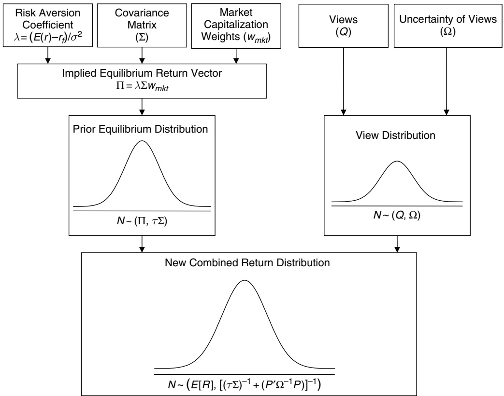
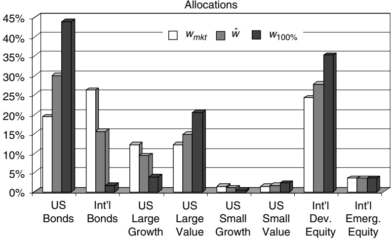

# 2 A step-by-step guide to the Black–Litterman model

**Incorporating user-specified confidence levels**

Thomas Idzorek

## Abstract

The Black–Litterman model enables investors to combine their unique views regarding the performance of various assets with the market equilibrium in a manner that results in intuitive, diversified portfolios. This paper consolidates insights from the relatively few works on the model, and provides step-by-step instructions that enable the reader to implement this complex model. A new method for controlling the tilts and the final portfolio weights caused by views is introduced. The new method asserts that the magnitude of the tilts should be controlled by the user-specified confidence level, based on a 0% to 100% confidence level. This is an intuitive technique for specifying one of most abstract mathematical parameters of the Black–Litterman model.

Having attempted to decipher many of the articles about the Black–Litterman model, none of the relatively few articles provide enough step-by-step instructions for the average practitioner to derive the new vector of expected returns.1 This article touches on the intuition of the Black–Litterman model, consolidates insights contained in the various works on the Black–Litterman model, and focuses on the details of actually combining market equilibrium expected returns with ‘investor views’ to generate a new vector of expected returns. Finally, I make a new contribution to the model by presenting a method for controlling the magnitude of the tilts caused by the views that is based on an intuitive 0% to 100% confidence level, which should broaden the usability of the model beyond quantitative managers.

## 2.1 Introduction

The Black–Litterman asset allocation model, created by Fischer Black and Robert Litterman, is a sophisticated portfolio construction method that overcomes the problem of unintuitive, highly-concentrated portfolios, input-sensitivity, and estimation error maximization. These three related and well-documented problems with mean-variance optimization are the most likely reasons that more practitioners do not use the Markowitz paradigm, in which return is maximized for a given level of risk. The Black–Litterman model uses a Bayesian approach to combine the subjective views of an investor regarding the expected returns of one or more assets with the market equilibrium vector of expected returns (the prior distribution) to form a new, mixed estimate of expected returns. The resulting new vector of returns (the posterior distribution) leads to intuitive portfolios with sensible portfolio weights. Unfortunately, the building of the required inputs is complex and has not been thoroughly explained in the literature.

<small>1The one possible exception to this is Robert Litterman’s book Modern Investment Management: An Equilibrium Approach, published in July 2003 (the initial draft of this paper was written in November 2001), although I believe most practitioners will find it difficult to tease out enough information to implement the model. Chapter 6 of Litterman (2003) details the calculation of global equilibrium expected returns, including currencies; Chapter 7 presents a thorough discussion of the Black–Litterman model; and Chapter 13 applies the Black–Litterman framework to optimum active risk budgeting.</small>

The Black–Litterman asset allocation model was introduced in Black and Litterman (1990), expanded in Black and Litterman (1991, 1992), and discussed in greater detail in Bevan and Winkelmann (1998), He and Litterman (1999) and Litterman (2003).2 The Black–Litterman model combines the CAPM (see Sharpe, 1964), reverse optimization (see Sharpe, 1974), mixed estimation (see Theil, 1971, 1978), the universal hedge ratio/Black’s global CAPM (see Black, 1989a, 1989b; Litterman, 2003), and mean-variance optimization (see Markowitz, 1952).

Section 2.2 illustrates the sensitivity of mean-variance optimization and how reverse optimization mitigates this problem, while the following section presents the Black– Litterman model and the process of building the required inputs. Section 2.4 develops an implied confidence framework for the views. This framework leads to a new, intuitive method for incorporating the level of confidence in investor views that helps investors control the magnitude of the tilts caused by views. Section 2.5 concludes the chapter.

## 2.2 Expected returns

The Black–Litterman model creates stable, mean-variance efficient portfolios, based on an investor’s unique insights, which overcome the problem of input-sensitivity. According to Lee (2000), the Black–Litterman model also ‘largely mitigates’ the problem of estimation error-maximization (see Michaud, 1989) by spreading the errors throughout the vector of expected returns.

The most important input in mean-variance optimization is the vector of expected returns; however, Best and Grauer (1991) demonstrate that a small increase in the expected return of one of the portfolio’s assets can force half of the assets from the portfolio. In a search for a reasonable starting point for expected returns, Black and Litterman (1992), He and Litterman (1999) and Litterman (2003) explore several alternative forecasts: historical returns, equal ‘mean’ returns for all assets, and risk-adjusted equal mean returns. They demonstrate that these alternative forecasts lead to extreme portfolios – when unconstrained, portfolios with large long and short positions; and, when subject to a long only constraint, portfolios that are concentrated in a relatively small number of assets.

<small>2Other important works on the model include Lee (2000), Satchell and Scowcroft (2000) and, for the mathematically inclined, Christodoulakis (2002).</small>

## 2.2.1 Reverse optimization

The Black–Litterman model uses ‘equilibrium’ returns as a neutral starting point. Equilibrium returns are the set of returns that clear the market. The equilibrium returns are derived using a reverse optimization method in which the vector of implied excess equilibrium returns is extracted from known information using equation (2.1):3

$$
\Pi = \lambda \Sigma w _ {m k t}\tag{2.1}
$$

where - is the implied excess equilibrium return vector $\left( N \times 1 \right.$ column vector),  is the risk-aversion coefficient,  is the covariance matrix of excess returns $\left( N \times N \right.$ matrix), and $w _ { m k t }$ is the market capitalization weight (N × 1 column vector) of the assets.4

The risk-aversion coefficient  characterizes the expected risk-return tradeoff. It is the rate at which an investor will forego expected return for less variance. In the reverse optimization process, the risk-aversion coefficient acts as a scaling factor for the reverse optimization estimate of excess returns; the weighted reverse optimized excess returns equal the specified market risk premium. More excess return per unit of risk (a larger lambda) increases the estimated excess returns.5

To illustrate the model, I present an eight asset example in addition to the general model. To keep the scope of the paper manageable, I avoid discussing currencies.6

Table 2.1 presents four estimates of expected excess return for the eight assets – US Bonds, International Bonds, US Large Growth, US Large Value, US Small Growth, US Small Value, International Developed Equity and International Emerging Equity. The first CAPM excess return vector in Table 2.1 is calculated relative to the UBS Global Securities Markets Index (GSMI), a global index and a good proxy for the world market portfolio. The second CAPM excess return vector is calculated relative to the market capitalization-weighted portfolio using implied betas, and is identical to the implied equilibrium return vector -.7

<small>3Many of the formulas in this paper require basic matrix algebra skills. A sample spreadsheet is available from the author. Readers unfamiliar with matrix algebra will be surprised at how easy it is to solve for an unknown vector using Excel’s matrix functions (MMULT, TRANSPOSE and MINVERSE). For a primer on Excel matrix procedures, go to http://www.stanford.edu/∼wfsharpe/mia/mat/mia\_mat4.htm.</small>

<small>4Possible alternatives to market capitalization weights include a presumed efficient benchmark and float-adjusted capitalization weights.</small>

<small>5The implied risk-aversion coefficient  for a portfolio can be estimated by dividing the expected excess return by the variance of the portfolio (Grinold and Kahn, 1999):</small>

<small>f</small>

<small> = Er − rf 2</small>

<small> = w w kt</small>

<small>where Er is the expected market (or benchmark) total return, r is the risk-free rate, and 2 Tmkt m the variance of the market (or benchmark) excess returns.</small>

<small>6Those who are interested in currencies are referred to Black (1989a, 1989b), Black and Litterman (1991, 1992), Grinold (1996), Meese and Crownover (1999), Grinold and Meese (2000), and Litterman (2003).</small>

Table 2.1 Expected excess return vectors

<table><tbody><tr><td rowspan="2">Asset class</td><td rowspan="2">Historical -Hist</td><td rowspan="2">CAPM GSMI -GSMI</td><td rowspan="2">CAPM portfolio -P</td><td rowspan="2">Implied equilibrium return vector -</td></tr><tr></tr><tr><td>US Bonds</td><td>315%</td><td>002%</td><td>008%</td><td>008%</td></tr><tr><td>Int'l Bonds</td><td>175%</td><td>018%</td><td>067%</td><td>067%</td></tr><tr><td>US Large Growth</td><td>-639%</td><td>557%</td><td>641%</td><td>641%</td></tr><tr><td>US Large Value</td><td>-286%</td><td>339%</td><td>408%</td><td>408%</td></tr><tr><td>US Small Growth</td><td>-675%</td><td>659%</td><td>743%</td><td>743%</td></tr><tr><td>US Small Value</td><td>-054%</td><td>316%</td><td>370%</td><td>370%</td></tr><tr><td>Int'l Dev. Equity</td><td>-675%</td><td>392%</td><td>480%</td><td>480%</td></tr><tr><td>Int'l Emerg. Equity</td><td>-526%</td><td>560%</td><td>660%</td><td>660%</td></tr><tr><td>Weighted average</td><td>-197%</td><td>241%</td><td>300%</td><td>300%</td></tr><tr><td>Standard deviation</td><td>373%</td><td>228%</td><td>253%</td><td>253%</td></tr><tr><td>High</td><td>315%</td><td>659%</td><td>743%</td><td>743%</td></tr><tr><td>Low</td><td>-675%</td><td>002%</td><td>008%</td><td>008%</td></tr></tbody></table>

All four estimates are based on 60 months of excess returns over the risk-free rate. The two CAPM estimates are based on a risk premium of 3. Dividing the risk premium by the variance of the market (or benchmark) excess returns $\left( \sigma ^ { 2 } \right)$ results in a risk-aversion coefficient  of approximately 3.07.

The historical return vector has a larger standard deviation and range than the other vectors. The first CAPM return vector is quite similar to the implied equilibrium return vector - (the correlation coefficient is 99.8%).

Rearranging equation (2.1) and substituting $\mu$ (representing any vector of excess return) for - (representing the vector of implied excess equilibrium returns) leads to equation (2.2), the solution to the unconstrained maximization problem: max $w ^ { \prime } \mu   -   \lambda w ^ { \prime } \Sigma w / 2$ w

$$
w = (\lambda \Sigma) ^ {- 1} \mu\tag{2.2}
$$

If $\mu$ does not equal -w will not equal $w _ { m k t }$

<small>7Literature on the Black–Litterman model often refers to the reverse optimized implied equilibrium return vector - as the CAPM returns, which can be confusing. CAPM returns based on regression-based betas can be significantly different from CAPM returns based on implied betas. I use the procedure in Grinold and Kahn (1999) to calculate implied betas. Just as it is possible to use the market capitalization weights and the covariance matrix to infer the implied equilibrium return vector, one can extract the vector of implied betas. The implied betas are the betas of the N assets relative to the market capitalization-weighted portfolio. As might be expected, the market capitalization-weighted beta of the portfolio is 1.</small>

<small>wmkt wmkt = = wTmk twmkt 2</small>

<small>β</small>

<small>where  is the vector of implied betas,  is the covariance matrix of excess returns, w is the market mkt capitalization weights, and  = mkt mkt   is the variance of the market (or benchmark) excess σ2 = T w w = 1 T −1 returns.</small>

<small>The vector of CAPM returns is the same as the vector of reverse optimized returns when the CAPM returns are based on implied betas relative to the market capitalization-weighted portfolio.</small>

Table 2.2 Recommended portfolio weights

| Asset class | Weight based on historical wHist | Weight based on CAPM GSMI wGSMI | Weight based on implied equilibrium return vector | Market capitalization weight wmkt |
| --- | --- | --- | --- | --- |
| US Bonds | 114432% | 2133% | 1934% | 1934% |
| Int'l Bonds | -10459% | 519% | 2613% | 2613% |
| US Large Growth | 5499% | 1080% | 1209% | 1209% |
| US Large Value | -529% | 1082% | 1209% | 1209% |
| US Small Growth | -6052% | 373% | 134% | 134% |
| US Small Value | 8147% | -049% | 134% | 134% |
| Int'l Dev. Equity | -10436% | 1710% | 2418% | 2418% |
| Int'l Emerg. Equity | 1459% | 214% | 349% | 349% |
| High | 114432% | 2133% | 2613% | 2613% |
| Low | -10459% | -049% | 134% | 134% |

In Table 2.2, equation (2.2) is used to find the optimum weights for three portfolios based on the return vectors from Table 2.1. The market capitalization weights are presented in the final column of Table 2.2.

Not surprisingly, the historical return vector produces an extreme portfolio. Those not familiar with mean-variance optimization might expect two highly correlated return vectors to lead to similarly correlated vectors of portfolio holdings. Nevertheless, despite the similarity between the CAPM GSMI return vector and the implied equilibrium return vector -, the return vectors produce two rather distinct weight vectors (the correlation coefficient is 66%). Most of the weights of the CAPM GSMI-based portfolio are significantly different than the benchmark market capitalization-weighted portfolio, especially the allocation to international bonds. As would be expected (since the process of extracting the implied equilibrium returns using the market capitalization weights is reversed), the implied equilibrium return vector - leads back to the market capitalization-weighted portfolio. In the absence of views that differ from the implied equilibrium return, investors should hold the market portfolio. The implied equilibrium return vector - is the marketneutral starting point for the Black–Litterman model.

## 2.3 The Black–Litterman model

## 2.3.1 The Black–Litterman formula

Prior to advancing, it is important to introduce the Black–Litterman formula and provide a brief description of each of its elements. Throughout this article, K is used to represent the number of views and N is used to express the number of assets in the formula. The formula for the new combined return vector ER is

$$
E [ R ] = \left[ (\tau \Sigma) ^ {- 1} + P ^ {\prime} \Omega^ {- 1} P \right] ^ {- 1} \left[ (\tau \Sigma) ^ {- 1} \Pi + P ^ {\prime} \Omega^ {- 1} Q \right]\tag{2.3}
$$

where ERis the new (posterior) combined return vector $\left( N \times 1 \right.$ column vector),  is a scalar,  is the covariance matrix of excess returns $\left( N \times N \right.$ matrix), P is a matrix that identifies the assets involved in the views (K × N matrix or 1 × N row vector in the special case of 1 view),  is a diagonal covariance matrix of error terms from the expressed views representing the uncertainty in each view (K × K matrix), - is the implied equilibrium return vector (N × 1 column vector), and Q is the view vector (K × 1 column vector).

## 2.3.2 Investor views

More often than not, investment managers have specific views regarding the expected return of some of the assets in a portfolio, which differ from the implied equilibrium return. The Black–Litterman model allows such views to be expressed in either absolute or relative terms. Below are three sample views expressed using the format of Black and Litterman (1990).

• View 1: International developed equity will have an absolute excess return of 5.25% (confidence of view = 25%)

• View 2: International bonds will outperform US Bonds by 25 basis points (confidence of view = 50%)

• View 3: US Large Growth and US Small Growth will outperform US Large Value and US Small Value by 2% (confidence of view = 65%).

View 1 is an example of an absolute view. From the final column of Table 2.1, the implied equilibrium return of International Developed Equity is 4.80%, which is 45 basis points lower than the view of 5.25%.

Views 2 and 3 represent relative views. Relative views more closely approximate the way investment managers feel about different assets. View 2 says that the return of International Bonds will be 0.25% greater than the return of US Bonds. In order to gauge whether View 2 will have a positive or negative effect on International Bonds relative to US Bonds, it is necessary to evaluate the respective implied equilibrium returns of the two assets in the view. From Table 2.1, the implied equilibrium returns for International Bonds and US Bonds are 0.67% and 0.08%, respectively, for a difference of 0.59%. The view of 0.25%, from View 2, is less than the 0.59% by which the return of International Bonds exceeds the return of US Bonds; thus, one would expect the model to tilt the portfolio away from International Bonds in favour of US Bonds. In general (and in the absence of constraints and additional views), if the view is less than the difference between the two implied equilibrium returns, the model tilts the portfolio toward the underperforming asset, as illustrated by View 2. Likewise, if the view is greater than the difference between the two implied equilibrium returns, the model tilts the portfolio toward the outperforming asset.

View 3 demonstrates a view involving multiple assets, and that the terms ‘outperforming’ and ‘underperforming’ are relative. The number of outperforming assets need not match the number of assets underperforming. The results of views that involve multiple assets with a range of different implied equilibrium returns can be less intuitive. The assets of the view form two separate mini-portfolios – a long portfolio and a short portfolio. The relative weighting of each nominally outperforming asset is proportional to that asset’s market capitalization divided by the sum of the market capitalization of the other nominally outperforming assets of that particular view. Likewise, the relative weighting of each nominally underperforming asset is proportional to that asset’s market capitalization divided by the sum of the market capitalizations of the other nominally underperforming assets. The net long positions less the net short positions equal 0. The mini-portfolio that actually receives the positive view may not be the nominally outperforming asset(s) from the expressed view. In general, if the view is greater than the weighted average implied equilibrium return differential, the model will tend to overweight the ‘outperforming’ assets.

Table 2.3a View 3 – nominally ‘outperforming’ assets

| Asset class | Market capitalization (billions) | Relative weight | Implied equilibrium return vector II | Weighted excess return |
| --- | --- | --- | --- | --- |
| US Large Growth | $5174 | 90.00% | 6.41% | 5.77% |
| US Small Growth | $575 | 10.00% | 7.43% | 0.74% |
|  | $5749 | 100.00% | Total | 6.52% |

Table 2.3b View 3 – nominally ‘underperforming’ assets

| Asset class | Market capitalization (billions) | Relative weight | Implied equilibrium return vector II | Weighted excess return |
| --- | --- | --- | --- | --- |
| US Large Value | $5174 | 90.00% | 4.08% | 3.67% |
| US Small Value | $575 | 10.00% | 3.70% | 0.37% |
|  | $5749 | 100.00% | Total | 4.04% |

From View 3, the nominally ‘outperforming’ assets are US Large Growth and US Small Growth, and the nominally ‘underperforming’ assets are US Large Value and US Small Value. From Table 2.3a, the weighted average implied equilibrium return of the miniportfolio formed from US Large Growth and US Small Growth is 6.52%; from Table 2.3b, the weighted average implied equilibrium return of the mini-portfolio formed from US Large Value and US Small Value is 4.04%. The weighted average implied equilibrium return differential is 2.47%.

Because View 3 states that US Large Growth and US Small Growth will outperform US Large Value and US Small Value by only 2% (a reduction from the current weighted average implied equilibrium differential of 2.47%), the view appears to actually represent a reduction in the performance of US Large Growth and US Small Growth relative to US Large Value and US Small Value. This point is illustrated later in the chapter, in the final column of Table 2.6, where the nominally outperforming assets of View 3 – US Large Growth and US Small Growth – receive reductions in their allocations, and the nominally underperforming assets – US Large Value and US Small Value – receive increases in their allocations.

## 2.3.3 Building the inputs

One of the more confusing aspects of the model is moving from the stated views to the inputs used in the Black–Litterman formula. First, the model does not require that investors specify views on all assets. In the eight-asset example, the number of views k is $3 ;$ thus, the view vector Q is a $3 \times 1$ column vector. The uncertainty of the views results in a random, unknown, independent, normally-distributed error term vector  with a mean of 0 and covariance matrix . Thus, a view has the form $Q   +   \varepsilon$

General case:

Example:

$$
Q + \varepsilon = \left[ \begin{array}{c} Q _ {1} \\ \vdots \\ Q _ {k} \end{array} \right] + \left[ \begin{array}{c} \varepsilon_ {1} \\ \vdots \\ \varepsilon_ {k} \end{array} \right] \qquad Q + \varepsilon = \left[ \begin{array}{c} 5. 2 5 \\ 0. 2 5 \\ 2 \end{array} \right] + \left[ \begin{array}{c} \varepsilon_ {1} \\ \vdots \\ \varepsilon_ {k} \end{array} \right]\tag{2.4}
$$

Except in the hypothetical case, in which a clairvoyant investor is 100% confident in the expressed view, the error term  is a positive or negative value other than 0. The error term vector  does not directly enter the Black–Litterman formula. However, the variance of each error term , which is the absolute difference from the error term’s  expected value of 0, does enter the formula. The variances of the error terms  form, where  is a diagonal covariance matrix with 0s in all of the off-diagonal positions. The off-diagonal elements of  are 0s because the model assumes that the views are independent of one another. The variances of the error terms  represent the uncertainty of the views. The larger the variance of the error term , the greater the uncertainty of the view.

General case:

$$
\Omega = \left[ \begin{array}{c c c} \omega_ {1} & 0 & 0 \\ 0 & \ddots & 0 \\ 0 & 0 & \omega_ {k} \end{array} \right]\tag{2.5}
$$

Determining the individual variances of the error terms  that constitute the diagonal elements of  is one of the most complicated aspects of the model. It is discussed in greater detail below, and is the subject of Section 2.4.

The expressed views in column vector Q are matched to specific assets by matrix P. Each expressed view results in a $1 \times N$ row vector. Thus, K views result in a $K \times N$ matrix. In the three-view example presented in Section 2.2, in which there are 8 assets, P is a $3 \times 8$ matrix.

General case:

Example (based on Satchell and Scowcroft, 2000):

$$
P = \left[ \begin{array}{c c c} p _ {1, 1} & \dots & p _ {1, n} \\ \vdots & \ddots & \vdots \\ p _ {k, 1} & \dots & p _ {k, n} \end{array} \right] \qquad P = \left[ \begin{array}{c c c c c c c c} 0 & 0 & 0 & 0 & 0 & 0 & 1 & 0 \\ - 1 & 1 & 0 & 0 & 0 & 0 & 0 & 0 \\ 0 & 0 & . 5 & -. 5 & . 5 & -. 5 & 0 & 0 \end{array} \right]\tag{2.6}
$$

The first row of matrix P represents View 1, the absolute view. View 1 only involves one asset: International Developed Equity. Sequentially, International Developed Equity is the seventh asset in this eight-asset example, which corresponds with the ‘1’ in the seventh column of Row 1. View 2 and View 3 are represented by Row 2 and Row 3, respectively. In the case of relative views, each row sums to 0. In matrix P, the nominally outperforming assets receive positive weightings, while the nominally underperforming assets receive negative weightings.

Methods for specifying the values of matrix P vary. Litterman (2003: 82) assigns a percentage value to the asset(s) in question. Satchell and Scowcroft (2000) use an equal weighting scheme, which is presented in Row 3 of equation (2.6). Under this system, the weightings are proportional to 1 divided by the number of respective assets outperforming or underperforming. View 3 has two nominally underperforming assets, each of which receives a −5 weighting. View 3 also contains two nominally outperforming assets, each receiving a +5 weighting. This weighting scheme ignores the market capitalization of the assets involved in the view. The market capitalizations of the US Large Growth and US Large Value asset classes are nine times the market capitalizations of US Small Growth and Small Value asset classes, yet the Satchell and Scowcroft method affects their respective weights equally, causing large changes in the two smaller asset classes. This method may result in undesired and unnecessary tracking error.

Contrasting with the Satchell and Scowcroft (2000) equal weighting scheme, I prefer to use a market capitalization weighting scheme. More specifically, the relative weighting of each individual asset is proportional to the asset’s market capitalization divided by the total market capitalization of either the outperforming or underperforming assets of that particular view. From the third columns of Tables 2.3a and 2.3b, the relative market capitalization weights of the nominally outperforming assets are 0.9 for US Large Growth and 0.1 for US Small Growth, while the relative market capitalization weights of the nominally underperforming assets are −9 for US Large Value and −1 for US Small Value. These figures are used to create a new matrix $P ,$ which is used for all of the subsequent calculations.

Matrix P (Market capitalization method):

$$
P = \left[ \begin{array}{c c c c c c c c} 0 & 0 & 0 & 0 & 0 & 0 & 1 & 0 \\ - 1 & 1 & 0 & 0 & 0 & 0 & 0 & 0 \\ 0 & 0 & . 9 & -. 9 & . 1 & -. 1 & 0 & 0 \end{array} \right]\tag{2.7}
$$

Once matrix P is defined, the variance of each individual view portfolio can be calculated. The variance of an individual view portfolio is $p _ { k } \Sigma p _ { k } ^ { \prime } ,$ where $p _ { k }$ is a single $1 \times N$ row vector from matrix P that corresponds to the kth view and  is the covariance matrix of excess returns. The variances of the individual view portfolios $\langle p _ { k } \Sigma p _ { k } ^ { \prime } \rangle$ are presented in Table 2.4. The respective variance of each individual view portfolio is an important source of information regarding the certainty, or lack thereof, of the level of confidence that should be placed on a view. This information is used shortly to revisit the variances of the error terms  that form the diagonal elements of .

Table 2.4 Variance of the view portfolios

| View | Formula | Variance |
| --- | --- | --- |
| 1 | p1p1 | 2836% |
| 2 | p2p2 | 0563% |
| 3 | p3p3 | 3462% |

Conceptually, the Black–Litterman model is a complex, weighted average of the implied equilibrium return vector - and the view vector Q, in which the relative weightings are a function of the scalar  and the uncertainty of the views . Unfortunately, the scalar and the uncertainty in the views are the most abstract and difficult to specify parameters of the model. The greater the level of confidence (certainty) in the expressed views, the closer the new return vector will be to the views. If the investor is less confident in the expressed views, the new return vector should be closer to the implied equilibrium return vector -.

The scalar  is more or less inversely proportional to the relative weight given to the implied equilibrium return vector -. Unfortunately, guidance in the literature for setting the scalar’s value is scarce. Both Black and Litterman (1992) and Lee (2000) address this issue: since the uncertainty in the mean is less than the uncertainty in the return, the scalar  is close to zero. One would expect the equilibrium returns to be less volatile than the historical returns.8

Lee, who has considerable experience working with a variant of the Black–Litterman model, typically sets the value of the scalar  between 0.01 and 0.05, and then calibrates the model based on a target level of tracking error (Dr Wai Lee, personal communication). Conversely, Satchell and Scowcroft (2000) say the value of the scalar  is often set to 1.9 Finally, Blamont and Firoozy (2003) interpret  as the standard error of estimate of the implied equilibrium return vector -; thus, the scalar  is approximately 1 divided by the number of observations.

In the absence of constraints, the Black–Litterman model only recommends a departure from an asset’s market capitalization weight if it is the subject of a view. For assets that are the subject of a view, the magnitude of their departure from their market capitalization weight is controlled by the ratio of the scalar  to the variance of the error term  of the view in question. The variance of the error term  of a view is inversely related to the investor’s confidence in that particular view. Thus, a variance of the error term  of 0 represents 100% confidence (complete certainty) in the view. The magnitude of the departure from the market capitalization weights is also affected by other views. Additional views lead to a different combined return vector ER, which leads to a new vector of recommended weights.

The easiest way to calibrate the Black–Litterman model is to make an assumption about the value of the scalar . He and Litterman (1999) calibrate the confidence of a view so that the ratio of $\omega / \tau$ is equal to the variance of the view portfolio $\langle p _ { k } \Sigma p _ { k } ^ { \prime } \rangle$ Assuming $\tau = 0 . 0 2 5$ and using the individual variances of the view portfolios $( p _ { k } \Sigma p _ { k } ^ { \prime } )$ from Table 2.4, the covariance matrix of the error term  has the following form:

<small>p2 2 2,</small>

<small>2 IntlBonds USBonds .</small>

<small>∼ Q22</small>

<small></small>

<small>8The intuitiveness of this is illustrated by examining View 2, a relative view involving two assets of equal size. View 2 states that · E R = Q +  where Q = E R  − E R  View 2 is N . In the absence of additional information, it can be assumed that the uncertainty of the view is proportional to the covariance matrix . However, since the view is describing the mean return differential rather than a single return differential, the uncertainty of the view should be considerably less than the uncertainty of a single return (or return differential) represented by the covariance matrix . Therefore, the investor’s views are represented by a distribution with a mean of Q and a covariance structure  .</small>

<small>9Satchell and Scowcroft (2000) include an advanced mathematical discussion of one method for establishing a conditional value for the scalar .</small>

$$
\begin{array}{l l} \text {General case:} & \text {Example:} \\ \Omega = \left[ \begin{array}{c c c} \left(p _ {1} \Sigma p _ {1} ^ {\prime}\right) * \tau & 0 & 0 \\ 0 & \ddots & 0 \\ 0 & 0 & \left(p _ {k} \Sigma p _ {k} ^ {\prime}\right) * \tau \end{array} \right] & \Omega = \left[ \begin{array}{c c c} 0. 0 0 0 7 0 9 & 0 & 0 \\ 0 & 0. 0 0 0 1 4 1 & 0 \\ 0 & 0 & 0. 0 0 0 8 6 6 \end{array} \right] \end{array}\tag{2.8}
$$

When the covariance matrix of the error term  is calculated using this method, the actual value of the scalar  becomes irrelevant because only the ratio $\omega / \tau$ enters the model. For example, changing the assumed value of the scalar  from 0.025 to 15 dramatically changes the value of the diagonal elements of , but the new combined return vector ER is unaffected.

## 2.3.4 Calculating the new combined return vector

Having specified the scalar  and the covariance matrix of the error term , all of the inputs are then entered into the Black–Litterman formula and the new combined return vector ER is derived. The process of combining the two sources of information is depicted in Figure 2.1. The new recommended weights w ˆ are calculated by solving the unconstrained maximization problem, equation (2.2). The covariance matrix of historical excess returns  is presented in Table 2.5.

\* The variance of the New Combined Return Distribution is derived in Satchell and Scowcroft (2000).

Figure 2.1 Deriving the New Combined Return Vector ER.

Even though the expressed views only directly involved seven of the eight asset classes, the individual returns of all the assets changed from their respective implied equilibrium returns (see column 4 of Table 2.6). A single view causes the return of every asset in the portfolio to change from its implied equilibrium return, since each individual return is linked to the other returns via the covariance matrix of excess returns .

The new weight vector w ˆ in column 5 of Table 2.6 is based on the new combined return vector ER. One of the strongest features of the Black–Litterman model is illustrated in the final column of Table 2.6. Only the weights of the seven assets for which views were expressed changed from their original market capitalization weights and the directions of the changes are intuitive.10 No views were expressed on International Emerging Equity and its weights are unchanged.

From a macro perspective, the new portfolio can be viewed as the sum of two portfolios, where Portfolio 1 is the original market capitalization-weighted portfolio, and Portfolio 2 is a series of long and short positions based on the views. As discussed earlier, Portfolio 2 can be subdivided into mini-portfolios, each associated with a specific view. The relative views result in mini-portfolios with offsetting long and short positions that sum to 0. View 1, the absolute view, increases the weight of International Developed Equity without an offsetting position, resulting in portfolio weights that no longer sum to 1.

The intuitiveness of the Black–Litterman model is less apparent with added investment constraints, such as constraints on unity, risk, beta, and short selling. He and Litterman (1999) and Litterman (2003) suggest that, in the presence of constraints, the investor input the new combined return vector ER into a mean-variance optimizer.

## 2.3.5 Fine tuning the model

The Black–Litterman model can be fine tuned by studying the new combined return vector ER, calculating the anticipated risk-return characteristics of the new portfolio, and then adjusting the scalar  and the individual variances of the error term  that form the diagonal elements of the covariance matrix of the error term .

Bevan and Winkelmann (1998) offer guidance in setting the weight given to the view vector Q. After deriving an initial combined return vector ER and the subsequent optimum portfolio weights, they calculate the anticipated information ratio of the new portfolio. They recommend a maximum anticipated information ratio of 2.0. If the information ratio is above 2.0, decrease the weight given to the views (decrease the value of the scalar and leave the diagonal elements of  unchanged).

Table 2.7 compares the anticipated risk-return characteristics of the market capitalization-weighted portfolio with the Black–Litterman portfolio (the new weights

<small>10The fact that only the weights of the assets that are subjects of views change from the original market capitalization weights is a criticism of the Black–Litterman model. Critics argue that the weight of assets that are highly (negatively or positively) correlated with the asset(s) of the view should change. I believe that the factors which lead to one’s view would also lead to a view for the other highly (negatively or positively) correlated assets, and that it is better to make these views explicit.</small>

Table 2 . 5 Covariance matrix of excess returns 

| Asset class | US Bonds | Int'l Bonds | US Large Growth | US Large Value | US Small Growth | US Small Value | Int'l Dev. Equity | Int'l Emerg. Equity |
| --- | --- | --- | --- | --- | --- | --- | --- | --- |
| US Bonds | 0.001005 | 0.001328 | -0.000579 | -0.000675 | 0.000121 | 0.000128 | -0.000445 | -0.000437 |
| Int'l Bonds | 0.001328 | 0.007277 | -0.001307 | -0.000610 | -0.002237 | -0.000989 | 0.001442 | -0.001535 |
| US Large Growth | -0.000579 | -0.001307 | 0.059852 | 0.027588 | 0.063497 | 0.023036 | 0.032967 | 0.048039 |
| US Large Value | -0.000675 | -0.000610 | 0.027588 | 0.029609 | 0.026572 | 0.021465 | 0.020697 | 0.029854 |
| US Small Growth | 0.000121 | -0.002237 | 0.063497 | 0.026572 | 0.102488 | 0.042744 | 0.039943 | 0.065994 |
| US Small Value | 0.000128 | -0.000989 | 0.023036 | 0.021465 | 0.042744 | 0.032056 | 0.019881 | 0.032235 |
| Int'l Dev. Equity | -0.000445 | 0.001442 | 0.032967 | 0.020697 | 0.039943 | 0.019881 | 0.028355 | 0.035064 |
| Int'l Emerg. Equity | -0.000437 | -0.001535 | 0.048039 | 0.029854 | 0.065994 | 0.032235 | 0.035064 | 0.079958 |

Table 2 . 6 Return vectors and resulting portfolio weights

| Asset class | New combined return vector E[R] | Implied equilibrium return vector II | Difference E[R]-II | New weight $\hat{w}$ | Market capitalization weight $w_{mkt}$ | Difference $\hat{w} - w_{mkt}$ |
| --- | --- | --- | --- | --- | --- | --- |
| US Bonds | 0.07% | 0.08% | -0.02% | 29.88% | 19.34% | 10.54% |
| Int'l Bonds | 0.50% | 0.67% | -0.17% | 15.59% | 26.13% | -10.54% |
| US Large Growth | 6.50% | 6.41% | 0.08% | 9.35% | 12.09% | -2.73% |
| US Large Value | 4.32% | 4.08% | 0.24% | 14.82% | 12.09% | 2.73% |
| US Small Growth | 7.59% | 7.43% | 0.16% | 1.04% | 1.34% | -0.30% |
| US Small Value | 3.94% | 3.70% | 0.23% | 1.65% | 1.34% | 0.30% |
| Int'l Dev. Equity | 4.93% | 4.80% | 0.13% | 27.81% | 24.18% | 3.63% |
| Int'l Emerg. Equity | 6.84% | 6.60% | 0.24% | 3.49% | 3.49% | 0.00% |
|  |  |  | Sum | 103.63% | 100.00% | 3.63% |

Table 2.7 Portfolio statistics

|  | Market capitalization-weighted portfolio wmkt | Black-Litterman portfolio wˆ |
| --- | --- | --- |
| Excess return | 3000% | 3101% |
| Variance | 000979 | 001012 |
| Standard deviation | 9893% | 10058% |
| Beta | 1 | 101256 |
| Residual return | - | 0063% |
| Residual risk | - | 0904% |
| Active return | - | 0101% |
| Active risk | - | 0913% |
| Sharpe ratio | 03033 | 03083 |
| Information ratio | - | 00699 |

produced by the new combined return vector).11 Overall, the views have very little effect on the expected risk-return characteristics of the new portfolio. However, both the Sharpe ratio and the information ratio increased slightly. The ex ante information ratio is well below the recommended maximum of 2.0.

Next, the results of the views should be evaluated to confirm that there are no unintended results. For example, investors confined to unity may want to remove absolute views, such as View 1.

Investors should evaluate their ex post information ratio for additional guidance when setting the weight on the various views. An investment manager who receives ‘views’ from a variety of analysts or sources could set the level of confidence of a particular view based in part on that particular analyst’s information coefficient. According to Grinold and Kahn (1999), a manager’s information coefficient is the correlation of forecasts with the actual results. This gives greater relative importance to the more skilful analysts.

Most of the examples in the literature, including the eight-asset example presented here, use a simple covariance matrix of historical returns. However, investors should use the best possible estimate of the covariance matrix of excess returns. Litterman and Winkelmann (1998) and Litterman (2003) outline the methods they prefer for estimating the covariance matrix of returns, as well as several alternative methods of estimation. Qian and Gorman (2001) extends the Black–Litterman model, enabling investors to express views on volatilities and correlations in order to derive a conditional estimate of the covariance matrix of returns. They assert that the conditional covariance matrix stabilizes the results of mean-variance optimization.

<small>11The data in Table 2.7 are based on the implied betas (see Note 7) derived from the covariance matrix of historical excess returns and the mean-variance data of the market capitalization-weighted benchmark portfolio. From Grinold and Kahn (1999):</small>

<small>Residual return  = ER −  ∗ ER P P P B</small>

<small>Residual risk  =  − ∗  P  2P 2P 2B</small>

<small>Active return ER  = ER − ER PA P B</small>

<small>Active risk P  2P 2PA 2B =  + ∗</small>

<small>Active portfolio beta PA = P − 1</small>

<small>ERp</small>

<small>P</small>

<small>ERB</small>

<small>ER B</small>

<small>where is the expected return of the portfolio, is the expected return of the benchmark market capitalization-weighted portfolio based on the new combined expected return vector is the variance of the benchmark portfolio, and  is the variance of the portfolio.</small>

## 2.4 A new method for incorporating user-specified confidence levels

As the discussion above illustrates,  is the most abstract mathematical parameter of the Black–Litterman model. Unfortunately, according to Litterman (2003), how to specify the diagonal elements of , representing the uncertainty of the views, is a common question without a ‘universal answer.’ Regarding , Herold (2003) says that the major difficulty of the Black–Litterman model is that it forces the user to specify a probability density function for each view, which makes the Black–Litterman model only suitable for quantitative managers. This section presents a new method for determining the implied confidence levels in the views and how an implied confidence level framework can be coupled with an intuitive 0% to 100% user-specified confidence level in each view to determine the values of , which simultaneously removes the difficulty of specifying a value for the scalar .

## 2.4.1 Implied confidence levels

Earlier, the individual variances of the error term  that form the diagonal elements of the covariance matrix of the error term  were based on the variances of the view portfolios $\langle p _ { k } \Sigma p _ { k } ^ { \prime } \rangle$ multiplied by the scalar . However, it is my opinion that there may be other sources of information in addition to the variance of the view portfolio $( p _ { k } \Sigma p _ { k } ^ { \prime } )$ that affect an investor’s confidence in a view. When each view was stated, an intuitive level of confidence (0% to 100%) was assigned to each view. Presumably, additional factors can affect an investor’s confidence in a view, such as the historical accuracy or score of the model, screen, or analyst that produced the view, as well as the difference between the view and the implied market equilibrium. These factors, and perhaps others, should be combined with the variance of the view portfolio $\langle p _ { k } \Sigma p _ { k } ^ { \prime } \rangle$ to produce the best possible estimates of the confidence levels in the views. Doing so will enable the Black–Litterman model to maximize an investor’s information.

Setting all of the diagonal elements of  equal to zero is equivalent to specifying 100% confidence in all of the K views. Ceteris paribus, doing so will produce the largest departure from the benchmark market capitalization weights for the assets named in the views. When 100% confidence is specified for all of the views, the Black–Litterman formula for the new combined return vector under 100% certainty $\left( E [ R _ { 1 0 0 \% } ] \right)$ is

$$
E\left[R_{100\%}\right] = \Pi +\tau \Sigma P'\left(P\tau \Sigma P'\right)^{-1}\left(Q - P\Pi\right)\tag{2.9}
$$

To distinguish the result of this formula from the first Black–Litterman formula (equation (2.3)), the subscript 100% is added. Substituting $E[R_{100\%}]$ for $\mu$ in equation (2.2) leads to $w _ { 1 0 0 \% }$ , the weight vector based on 100% confidence in the views. $w _ { m k t }$ 9 $\hat { w } ,$ and $w _ { 1 0 0 \% }$ are illustrated in Figure 2.2.

Figure 2.2 Portfolio allocations based on $w _ { m k t }$ $\hat { w }$ and $w _ { 1 0 0 \% }$

When an asset is only named in one view, the vector of recommended portfolio weights based on $1 0 0 \%$ confidence $\left( w _ { 1 0 0 \% } \right)$ enables calculation of an intuitive 0% to 100% level of confidence for each view. In order to do so, the unconstrained maximization problem must be solved twice: once using ERand once using $E [ R _ { 1 0 0 \% } ]$ . The new combined return vector $\langle E [ R ] \rangle$ based on the covariance matrix of the error term  leads to vector $\hat { w } ,$ while the new combined return vector $\langle E [ R _ { 1 0 0 \% } ] \rangle$ based on 100% confidence leads to vector $w _ { 1 0 0 \% }$ . The departures of these new weight vectors from the vector of market capitalization weights $\left< w _ { m k t } \right>$ are $\hat { w }   -   w _ { m k t }$ and $w _ { 1 0 0 \% } - w _ { m k t } ,$ , respectively. It is then possible to determine the implied level of confidence in the views by dividing each weight difference $\left( \hat { \boldsymbol { \omega } } - \boldsymbol { \omega } _ { m k t } \right)$ by the corresponding maximum weight difference $\left( w _ { 1 0 0 \% } - w _ { m k t } \right)$

The implied level of confidence in a view, based on the scaled variance of the individual view portfolios derived in Table 2.4, is in the final column of Table 2.8. The implied confidence levels of View 1, View 2 and View 3 in the example are 32.94%, 43.06% and 33.02%, respectively. Only using the scaled variance of each individual view portfolio to determine the diagonal elements of  ignores the stated confidence levels of 25%, 50% and 65%.

Given the discrepancy between the stated confidence levels and the implied confidence levels, it is possible to experiment with different s, and recalculate the new combined return vector ER and the new set of recommended portfolio weights. I believe there is a better method.

## 2.4.2 The new method – an intuitive approach

I propose that the diagonal elements of  be derived in a manner that is based on the user-specified confidence levels and that results in portfolio tilts, which approximate $w _ { 1 0 0 \% } - w _ { m k t }$ multiplied by the user-specified confidence level C.

$$
T i l t _ {k} \approx (w _ {1 0 0 \%} - w _ {m k t}) * C _ {k}\tag{2.10}
$$

Table 2 . 8 Implied confidence level of views

| Asset class | Market capitalization weights $w_{mkt}$ | New weight $\hat{w}$ | Difference (based on 100% confidence) $\hat{w}_{100\%}$ | New weights difference $\hat{w}_{100\%} - w_{mkt}$ | Implied confidence level $\frac{\hat{w}_{100\%} - w_{mkt}}{\hat{w}_{100\%} - w_{mkt}}$ |
| --- | --- | --- | --- | --- | --- |
| US Bonds | 19.34% | 29.88% | 10.54% | 43.82% | 24.48% |
| Int'l Bonds | 26.13% | 15.59% | -10.54% | 1.65% | -24.48% |
| US Large Growth | 12.09% | 9.35% | -2.73% | 3.81% | -8.28% |
| US Large Value | 12.09% | 14.82% | 2.73% | 20.37% | 8.28% |
| US Small Growth | 1.34% | 1.04% | -0.30% | 0.42% | -0.92% |
| US Small Value | 1.34% | 1.65% | 0.30% | 2.26% | 0.92% |
| Int'l Dev. Equity | 24.18% | 27.81% | 3.63% | 35.21% | 11.03% |
| Int'l Emerg. Equity | 3.49% | 3.49% | - | 3.49% | - |

where $T i l t _ { k }$ is the approximate tilt caused by the kth view $( N \times 1$ column vector), and $C _ { k }$ is the confidence in the kth view.

Furthermore, in the absence of other views, the approximate recommended weight vector resulting from the view is:

$$
w _ {k, \%} \approx w _ {m k t} + T i l t _ {k}\tag{2.11}
$$

where $w _ { k , \% }$ is the target weight vector based on the tilt caused by the kth view $\left( N \times 1 \right.$ column vector).

The steps of the procedure are as follows.

1. For each view $( k ) ,$ calculate the new combined return vector $( E [ R _ { k , 1 0 0 \% } ] )$ using the Black–Litterman formula under 100% certainty, treating each view as if it was the only view.

$$
E \left[ R _ {k, 100 \%} \right] = \Pi + \tau \Sigma p _ {k} ^ {\prime} \left(p _ {k} \tau \Sigma p _ {k} ^ {\prime}\right) ^ {- 1} \left(Q _ {k} - p _ {k} \Pi\right)\tag{2.12}
$$

where $E [ R _ { 1 0 0 \% } ]$ is the expected return vector based on 100% confidence in the kth view $\left( N \times 1 \right.$ column vector), $p _ { k }$ identifies the assets involved in the kth view $( 1 \times N$ row vector), and $Q _ { k }$ is the kth View $( 1 \times 1 )$

**Note**: If the view in question is an absolute view and the view is specified as a total return rather than an excess return, subtract the risk-free rate from $Q _ { k }$

2. Calculate $w _ { k , 1 0 0 \% } ,$ the weight vector based on 100% confidence in the kth view, using the unconstrained maximization formula.

$$
w_{k,100\%} = (\lambda \Sigma)^{-1}E[R_{k,100\%}]\tag{2.13}
$$

3. Calculate (pair-wise subtraction) the maximum departures from the market capitalization weights caused by 100% confidence in the kth view.

$$
D _ {k, 1 0 0 \%} = w _ {k, 1 0 0 \%} - w _ {m k t}\tag{2.14}
$$

where $D _ { k , 1 0 0 \% }$ is the departure from market capitalization weight based on 100% confidence in kth view $( N \times 1$ column vector).

**Note**: The asset classes of $w _ { k , 1 0 0 } \%$ that are not part of the kth view retain their original weight leading to a value of 0 for the elements of $D _ { k , 1 0 0 \% }$ that are not part of the kth view.

4. Multiply (pair-wise multiplication) the N elements of $D _ { k , 1 0 0 \% }$ by the user-specified confidence $\left( C _ { k } \right)$ in the kth view to estimate the desired tilt caused by the kth view.

$$
T i l t _ {k} = D _ {k, 100 \%} * C _ {k}\tag{2.15}
$$

where $T i l t _ { k }$ is the desired tilt (active weights) caused by the kth view $\left( N \times 1 \right.$ column vector), and $C _ { k }$ is an $N \times 1$ column vector where the assets that are part of the view receive the user-specified confidence level of the kth view and the assets that are not part of the view are set to 0.

5. Estimate (pair-wise addition) the target weight vector $( w _ { k , \% } )$ based on the tilt.

$$
w _ {k, \%} = w _ {m k t} + T i l t _ {k}\tag{2.16}
$$

6. Find the value of $\omega _ { k }$ (the kth diagonal element of ), representing the uncertainty in the kth view, that minimizes the sum of the squared differences between $w _ { k , \% }$ and $w _ { k } .$

$$
\min \sum \left(w _ {k, \%} - w _ {k}\right) ^ {2}\tag{2.17}
$$

subject to $\omega _ { k } > 0$ where

$$
w _ {k} = [ \lambda \Sigma ] ^ {- 1} \left[ (\tau \Sigma) ^ {- 1} + p _ {k} ^ {\prime} \omega_ {k} ^ {- 1} p _ {k} \right] ^ {- 1} \left[ (\tau \Sigma) ^ {- 1} \Pi + p _ {k} ^ {\prime} \omega_ {k} ^ {- 1} Q _ {k} \right]\tag{2.18}
$$

**Note**: If the view in question is an absolute view and the view is specified as a total return rather than an excess return, subtract the risk-free rate from $\stackrel { - } { Q } _ { k ^ { * } } { } ^ { 1 2 }$

7. Repeat steps 1–6 for the K views, build a $K \times K$ diagonal  matrix in which the diagonal elements of  are the $\omega _ { k }$ values calculated in step $^ { 6 , }$ and solve for the new combined return vector $( E [ R ] )$ using equation (2.3), which is reproduced here as equation (2.20).

$$
E [ R ] = \left[ (\tau \Sigma) ^ {- 1} + P ^ {\prime} \Omega^ {- 1} P \right] ^ {- 1} \left[ (\tau \Sigma) ^ {- 1} \Pi + P ^ {\prime} \Omega^ {- 1} Q \right]\tag{2.20}
$$

Throughout this process, the value of the scalar $( \tau )$ is held constant and does not affect the new combined return vector $\langle E [ R ] \rangle$ , which eliminates the difficulties associated with specifying it. Despite the relative complexities of the steps for specifying the diagonal elements of $\Omega ,$ the key advantage of this new method is that it enables the user to determine the values of  based on an intuitive $0 \%$ to 100% confidence scale. Alternative methods for specifying the diagonal elements of  require that these abstract values be specified directly.13 With this new method for specifying what was previously a very abstract mathematical parameter, the Black–Litterman model should be easier to use and more investors should be able to reap its benefits.

## 2.5 Conclusion

This chapter details the process of developing the inputs for the Black–Litterman model, which enables investors to combine their unique views with the implied equilibrium return vector to form a new combined return vector. The new combined return vector leads to intuitive, well-diversified portfolios. The two parameters of the Black–Litterman model that control the relative importance placed on the equilibrium returns vs the view returns, the scalar  and the uncertainty in the views , are very difficult to specify. The Black–Litterman formula with 100% certainty in the views enables determination of the implied confidence in a view. Using this implied confidence framework, a new method for controlling the tilts and the final portfolio weights caused by the views is introduced. The method asserts that the magnitude of the tilts should be controlled by the userspecified confidence level based on an intuitive 0% to 100% confidence level. Overall, the Black–Litterman model overcomes the most-often cited weaknesses of mean-variance optimization (unintuitive, highly concentrated portfolios, input-sensitivity, and estimation error maximization), helping users to realize the benefits of the Markowitz paradigm. Likewise, the proposed new method for incorporating user-specified confidence levels should increase the intuitiveness and the usability of the Black–Litterman model.

<small>wk</small>

<small>=wTAwA</small>

<small>(2.19)</small>

<small>A k mkt</small>

<small>12Having just determined the weight vector associated with a specific view in Step 6, it may be useful to calculate the active risk associated with the specific view in isolation.</small>

<small>where w = w − w is the active portfolio weights,    - wk =  −1 −1 + pk−1k pk−1 −1 + pk−1k Qk</small>

<small></small>

<small>Active Risk created from kth view</small>

<small>is the weight vector of the portfolio based on the kth view and user-specified confidence level, and is the covariance matrix of excess returns.</small>

<small>13Alternative approaches are explained in Fusai and Meucci (2003), Litterman (2003) and Zimmermann et al. (2002).</small>

## Acknowledgements

I am grateful to Robert Litterman, Wai Lee, Ravi Jagannathan, Aldo Iacono, and Marcus Wilhelm for helpful comments; to Steve Hardy, Campbell Harvey, Chip Castille and Barton Waring, who made this article possible and to the many others who provided me with helpful comments and assistance – especially my wife. Of course, all errors and omissions are my responsibility.

## References

Best, M. J. and Grauer, R. R. (1991). On the sensitivity of mean-variance-efficient portfolios to changes in asset means: some analytical and computational results. Review of Financial Studies, 4(2):315–342.

Bevan, A. and Winkelmann, K. (1998). Using the Black–Litterman Global Asset Allocation Model: three years of practical experience. Fixed Income Research, Goldman, Sachs & Company, December.

Black, F. (1989a). Equilibrium exchange rate hedging. NBER Working Paper No. 2947.

Black, F. (1989b). Universal hedging: optimizing currency risk and reward in international equity portfolios. Financial Analysts Journal, 45:16–22.

Black, F. and Litterman, R. (1990). Asset allocation: combining investors views with market equilibrium. Fixed Income Research, Goldman, Sachs & Company, September.

Black, F. and Litterman, R. (1991). Global asset allocation with equities, bonds, and currencies. Fixed Income Research, Goldman, Sachs & Company, October.

Black, F. and Litterman, R. (1992). Global portfolio optimization. Financial Analysts Journal, 48(5):28–43.

Blamont, D. and Firoozy, N. (2003). Asset allocation model. Global Markets Research: Fixed Income Research, Deutsche Bank, July.

Christodoulakis, G. A. (2002). Bayesian optimal portfolio selection: the Black–Litterman approach. Unpublished paper (available online at http://www.staff.city.ac.uk/∼gchrist/Teaching/QAP/optimalportfoliobl.pdf).

Fusai, G. and Meucci, A. (2003). Assessing views. Risk, 16(3):s18–21.

Grinold, R. C. (1996). Domestic grapes from imported wine. Journal of Portfolio Management, 26(Special issue):29–40.

Grinold, R. C. and Kahn, R. N. (1999). Active Portfolio Management, 2nd edn. New York, NY: McGraw-Hill.

Grinold, R. C. and Meese, R. (2000). The bias against international investing: strategic asset allocation and currency hedging. Investment Insights, Barclays Global Investors, August.

He, G. and Litterman, R. (1999). The intuition behind Black–Litterman model portfolios. Investment Management Research, Goldman, Sachs & Company, December.

Herold, U. (2003). Portfolio construction with qualitative forecasts. Journal of Portfolio Management, 29:61–72.

Lee, W. (2000). Advanced Theory and Methodology of Tactical Asset Allocation. New York, NY: John Wiley & Sons.

Litterman, R. and the Quantitative Resources Group, Goldman Sachs Asset Management. (2003). Modern Investment Management: An Equilibrium Approach. Princeton, NJ: John Wiley & Sons.

Litterman, R. and Winkelmann, K. (1998). Estimating covariance matrices. Risk Management Series, Goldman Sachs & Company, January.

Markowitz, H. M. (1952). Portfolio selection. Journal of Finance, 7(1):77–91.

Meese, R. and Crownover, C. (1999). Optimal currency hedging. Investment Insights, Barclays Global Investors, April.

Michaud, R. O. (1989). The Markowitz optimization enigma: is optimized optimal? Financial Analysts Journal, 45:31–42.

Qian, E. and Gorman, S. (2001). Conditional distribution in portfolio theory. Financial Analysts Journal, 57(2):44–51.

Satchell, S. and Scowcroft, A. (2000). A demystification of the Black–Litterman model: managing quantitative and traditional construction. Journal of Asset Management, 1:138–150.

Sharpe, W. F. (1964). Capital asset prices: a theory of market equilibrium. Journal of Finance, 19(3):425–442.

Sharpe, W. F. (1974). Imputing expected security returns from portfolio composition. Journal of Financial and Quantitative Analysis, 9(3):463–472.

Theil, H. (1971). Principles of Econometrics. New York, NY: Wiley & Sons.

Zimmermann, H., Drobetz, W. and Oertmann, P. (2002). Global Asset Allocation: New Methods and Applications. New York, NY: John Wiley & Sons.

Theil, H. (1978). Introduction to Econometrics. Englewood Cliffs, NJ: Prentice-Hall.