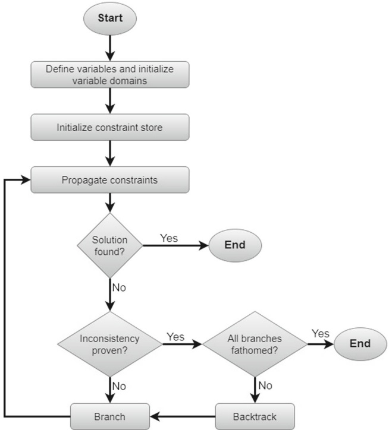
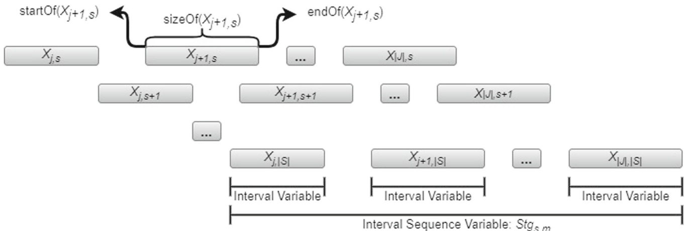
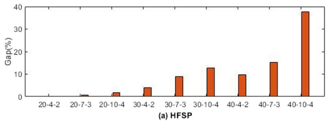
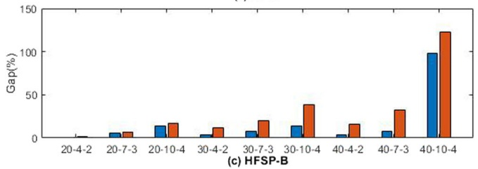
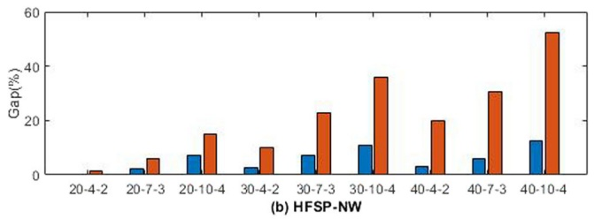
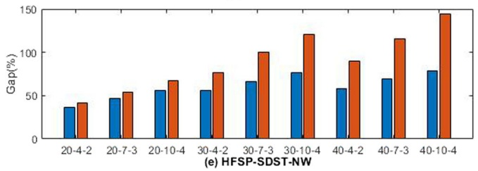
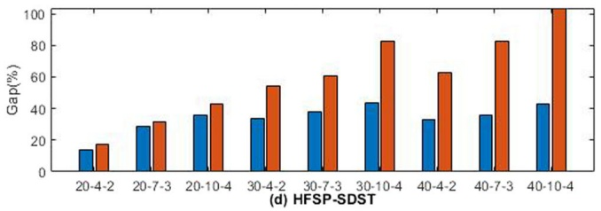
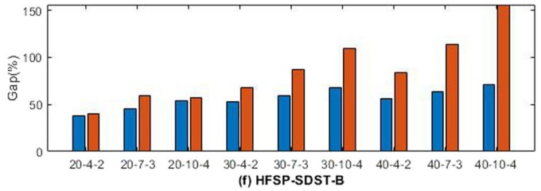

# Constraint programming models for the hybrid flow shop scheduling problem and its extensions

Eyü p Ensar Işık1 • Seyda Topaloglu Yildiz2 • Ö zge Ş atır Akpunar3

Accepted: 1 August 2023 / Published online: 31 August 2023

\- The Author(s), under exclusive licence to Springer-Verlag GmbH Germany, part of Springer Nature 2023

## Abstract

Proper scheduling of jobs is essential for modern production systems to work effectively. The hybrid flow shop scheduling problem is a scheduling problem with many applications in the industry. The problem has also attracted much attention from researchers due to its complexity. This study addresses the hybrid flow shop scheduling problem (HFSP), which considers unrelated parallel machines at each stage and the machine eligibility constraints. HFSP is a well-known NP-hard problem with the aim of minimizing the makespan. Owing to the complexity of the problem, this study develops constraint programming (CP) models for the HFSP and its extensions: the no-wait HFSP, the blocking HFSP, the HFSP with sequence-dependent setup times, the no-wait HFSP with sequence-dependent setup times, and the blocking HFSP with sequence-dependent setup times. We also propose two mixed-integer linear programming models (MILP) for no-wait and blocking HSFPs with sequence-dependent setup times. The performances of the CP models were tested against their MILP counterparts using randomly generated instances and benchmark instances from the literature. The computational results indicated that the proposed CP model outperformed the best MILP solutions for benchmark instances. It is also more effective for finding high-quality solutions for larger problem instances.

Keywords Hybrid flow shop scheduling - Constraint programming - Mixed-integer linear programming - Sequencedependent setup time - Blocking - No-wait

## 1 Introduction

Scheduling is one of the most crucial research issues in various manufacturing fields. Effective scheduling reduces production costs and times and improves enterprises economic efficiency (Liu et al. 2023). The flow shop scheduling problem is a complex combinatorial optimization problem widely studied recently (Maciel et al. 2022). The problem involves sequencing all operations performed on all jobs with the same machine order. With the development of production systems, the flow shop environment has evolved to fulfill the increased demand for products and balance the production capacity, and the hybrid flow shop environment has emerged with parallel machines at each stage of production. Therefore, the hybrid flow shop scheduling problem (HFSP) has become prominent, which is a generalization of the classical flow shop.

The HFSP was first addressed by Arthanari and Ramamurthy (1971). The HFSP extends the flow shop scheduling problem by processing a job on any machine in a given stage. In the HFSP, j jobs are to be processed in a series of s stages, each comprising several parallel machines. This type of layout increases the production capacity and achieves flexibility (Ribas et al. 2010). The HFSP can be classified based on the characteristics of the parallel machines used; the HFSP with identical parallel machines, the HFSP with uniform parallel machines, and the HFSP with unrelated parallel machines (Meng et al. 2020a). The main difference between identical and uniform machines is the processing speed. While identical machines process the jobs at the same speed, uniform machines process the jobs at different speeds at a given rate.

<small>& Seyda Topaloglu Yildiz seyda.topaloglu@deu.edu.tr</small>

<small>Department of Industrial Engineering, Yildiz Technical University, 34349 Istanbul, Turkey</small>

<small>2 Department of Industrial Engineering, Dokuz Eylul University, 35397 Izmir, Turkey</small>

<small>3 Department of Industrial Engineering, Manisa Celal Bayar University, 45140 Manisa, Turkey</small>

However, unrelated machines have different speeds for different jobs. If the machines are identical, the particular machine that processes a job is not significant; however, for unrelated machines, assigning jobs to specific machines must be explicitly modeled (Ü nal et al. 2020). Within the context of this study, we handle the HFSP with unrelated parallel machines and its extended problems, namely, the no-wait HFSP (HFSP-NW), the HFSP with blocking (HFSP-B), the HFSP with sequence-dependent setup times (HFSP-SDST), the no-wait HFSP with sequence-dependent setup times (HFSP-SDST-NW) and the blocking HFSP with sequence-dependent setup times (HFSP-SDST-B). Machine eligibility restrictions are also considered in all problem types. In this way, the knowledge that not all machines can perform each operation, i.e., that specific machines cannot be used for certain tasks, is included in the problem.

HFSP appears in various industries: Sherali et al. (1990) considered the HFSP-SDST for a two-stage paper products plant. Tsubone et al. (1993) studied a two-stage HFSP for photographic film manufacturing industries. Grabowski and Pempera (2000) considered a production problem of concrete blocks in a building factory. They modeled the problem as an HFSP-NW. Kurz and Askin (2004) examined the HFSP-SDST in the electronics and automobile industries. Ruiz and Maroto (2006) presented an HFSP including unrelated parallel machines at each stage, sequence-dependent setup times, and machine eligibility restrictions for the ceramic tile manufacturing sector. Chen et al. (2006, 2007) considered a three-stage HFSP with unrelated parallel machines, precedence constraints, sequence-dependent setup times, and blocking for container handling systems. Pan et al. (2013) provided a realworld HFSP application in the iron and steel industry in another study. This study considered a complex hybrid flow shop including multi-stages with multiple parallel machines. Their proposed model also involved the setup time and transfer time of jobs.

The contributions of this paper can be stated as follows:

1. For the first time, three new constraint programming (CP) models have been developed for the HFSP-B, HFSP-SDST-NW, and HFSP-SDST-B with unrelated machines and eligibility constraints.

2. For the first time, two new MILP models have been proposed for the HFSP-SDST-NW and HFSP-SDST-B with unrelated machines and eligibility constraints.

3. Alternative CP models for the HFSP and HFSP-SDST have also been developed for comparison purposes.

4. A comprehensive analysis of all CP models for all mentioned versions of the HFSP has been performed against the recently developed MILP models by Meng et al. (2020a), using small-scale benchmark instances from the literature and newly generated 90 larger-size problem instances. In this regard, this study is novel in that it has incorporated many variants of the HFSP that have not previously been studied in one paper.

5. The optimality of benchmark instances has been verified, providing novel confirmation in the field and yielding new optimal solutions for diverse variants of the HFSP.

6. The computational results can be used for comparison purposes in designing new solution techniques because we share all the instances, codes, and solutions obtained.

The remainder of this paper is organized as follows. Section 2 presents the literature review of the HFSP and its extensions. The developed MILP models for the HFSP-SDST-B and HFSP-SDST-NW are described in Sect. 3. Section 4 provides an in-depth explanation of the proposed CP models. Section 5 gives the computational results for evaluating the efficiency of the CP models. Finally, Sect. 6 presents concluding remarks and further research directions.

## 2 Literature review

In the existing literature, many exact and approximate solution methods have been proposed for the HFSP. For a comprehensive review of models and solution algorithms in general HFSPs, readers can refer to the survey papers of Ribas et al. (2010), Ruiz and Vázquez-Rodrı´guez (2010), Lin and Gen (2018) and Ç olak and Aydın Keskin (2022).

Exact solution methods include MILP (Meng et al. 2019, 2020a), branch-and-cut method (Naderi et al. 2014), Lagrangian relaxation-based algorithms (Brah et al. 1991; Martello et al. 1997) and CP (Oztop et al. 2019; Meng et al. 2021). The effectiveness of the CP method on the HFSP problem has been proven by Oztop et al. (2019). In the related study, they used CP to optimize the makespan and energy consumption of the HFSP. Meng et al. (2022) focused on a distributed version of the HFSP. The authors proposed three new MILP models and a CP model to solve the problem. Naderi et al. (2023) highlighted the development of CP in recent years. The authors compared 12 scheduling problems to reveal the advantages and disadvantages of the new developments in comparison with the MILP model. Oujana et al. (2023) formulated the scheduling of production orders in a packaging plant as a hybrid flexible flow shop scheduling problem. The authors presented MILP, CP, and a novel dedicated heuristic to solve the defined problem.

Gupta (1988) has proved that a two-stage flow shop scheduling problem with multiple processors is NP-hard even when one of the two stages contains a single machine. Other studies in the literature also prove that HFSP is an NP-hard problem, such as Pessoa et al. (2019), Shao et al. (2020), Zhang et al. (2022), and Liu et al. (2023). Due to the NP-hard nature of the problem, exact solution methods can only solve small-sized instances efficiently (Carlier and Neron 2000; Néron et al. 2001). Therefore, many approximate solution methods were proposed to solve large-size HFSP instances efficiently. However, they do not guarantee the optimal solution. Approximate methods mainly include heuristic methods and metaheuristic algorithms. Since 1996, several heuristic algorithms have been proposed according to the characteristics of the HFSP. These algorithms can be divided into two categories: local search (Piersma and Van Dijk 1996; Fanjul-Peyro and Ruiz 2010) and heuristic strategies (Kim and Lee 2009; Yang-Kuei and Chi-Wei 2013) are commonly used.

Metaheuristic algorithms are more efficient methods for solving the HFSP, such as tabu search (Shahvari and Logendran 2016), genetic algorithm (GA) (Cui et al. 2005; Jungwattanakit et al. 2008; Zhou and Tang 2009; Yu et al. 2018; Meng et al. 2019), simulated annealing (Low 2005), ant colony optimization algorithm (Lin et al. 2013; Qin et al. 2018), discrete differential evolution algorithm (Zhang and Chen 2018), differential evolution with local search algorithm (Xu and Wang 2011), artificial bee colony algorithm (Wang et al. 2012), particle swarm optimization algorithm (Torabi et al. 2013), fruit fly optimization algorithm (Zheng and Wang 2016) and neighborhood search algorithms (Lei and Zheng 2017; de Siqueira et al. 2020).

Additionally, non-classical methods such as intelligence/learning algorithms and neural network methods exist. For example, Lei et al. (2018) presented a teaching– learning-based optimization algorithm to solve the energyefficient HFSP with unrelated machines. Han et al. (2019) developed a reinforcement learning method, whereas Zacharias et al. (2019) applied a machine learning-based approach to the HFSP with unrelated machines considering makespan minimization. Another study was carried out by Cao et al. (2020) that proposed an improved gravitational search algorithm for the HFSP with unrelated parallel machines. Gil and Lee (2022) pointed out that some conditions critical to the material scheduling problem are not considered in practice, which is challenging for learning. The authors proposed deep Q-network and proximal policy optimization as deep reinforcement learning approaches for solving the HFSP.

## 2.1 Literature review on the HFSP-SDST

The best-known extension of the HFSP is the inclusion of sequence-dependent setup times into the problem. The HFSP-SDST is based on the idea that a particular preparation time passes between different job types successively processed on the same machine. Scheduling with setup times is vital in a manufacturing environment where highquality products are guaranteed and delivered on time. The studies of Allahverdi et al. (2008) and Allahverdi and Soroush (2008) emphasized the importance of consideration of setup times in scheduling problems, including the HFSPs.

In the related literature, various solution approaches have been proposed for the HFSP-SDST. Solution approaches developed for the HFSP-SDST with identical machines are mostly heuristics (Lin and Liao 2003; Tang and Zhang 2005; Zandieh et al. 2006; Mousavi et al. 2011; Naderi and Yazdani 2014; Wang et al. 2019; Fernandez-Viagas et al. 2020; Zhang et al. 2020), metaheuristics (Davoudpour and Ashrafi 2009; Gholami et al. 2009; Naderi et al. 2009; Zandieh et al. 2009; Karimi et al. 2011; Gómez-Gasquet et al. 2012; Javadian et al. 2012; Pargar and Zandieh 2012; Ebrahimi et al. 2014; Pan et al. 2017; Zhang et al. 2019) and simulation-based solution approaches (Gheisariha et al. 2021).

For solving the HFSP-SDST considering unrelated parallel machines, different solution approaches such as the linear programming approach (Oujana et al. 2021), constructive and iterative-based heuristics (Jungwattanakit et al. 2009; Urlings et al. 2010), metaheuristics (Ruiz and Maroto 2006; Jungwattanakit et al. 2008; Yaurima et al. 2009; Zandieh et al. 2010; Garavito-Hernández et al. 2019; Qin et al. 2019; Aqil and Allali 2020), and hybrid algorithms (Shahvari and Logendran 2018) have been developed. In addition, these studies (Ruiz and Maroto 2006; Yaurima et al. 2009; Urlings et al. 2010; Zandieh et al. 2010; Shahvari and Logendran 2018; Oujana et al. 2021) also considered the machine eligibility restrictions. Some studies employ exact solution methods. For instance, Ruiz et al. (2008) presented a MILP model for a more realistic version of the HFSP-SDST to fill the gap between theory and practice. Meng et al. (2020a) presented many MILP models with different characteristics for the HFSP-SDST and its extensions. Later, Meng et al. (2021) applied CP to the HFSP-SDST; however, their computational analysis did not provide a comparison with the MILP solutions. Yong et al. (2022) proposed NEH-based constructive heuristic algorithms to solve the HFSP-SDST. The authors considered two cases of the problem and aimed to minimize the total energy consumption cost. Missaoui and Ruiz (2022) focused on the HFSP-SDST with due date windows and presented an algorithm; the parameter-less iterated greedy method, that combined the ideas of local search methods and iterated greedy.

## 2.2 Literature review on the HFSP-NW and HFSP-SDST-NW

Another extension is achieved by adding no-wait constraints to the HFSP. In some real-life applications, jobs must be processed without delay so that the products manufactured in industries like steel, food, chemicals, and plastic molding are not damaged or spoiled. Sriskandarajah (1993) was among the early researchers to study this problem and employed a sorting algorithm that considers worst-case bounds for its solution.

The HFSP-NW has been studied in a two-stage environment (Liu et al. 2003; Xie et al. 2004; Haouari et al. 2006; Cheng et al. 2000; Huang et al. 2009; Carpov et al. 2012; Moradinasab et al. 2013; Wang and Liu 2013; Rabiee et al. 2014; Wang et al. 2015, 2020; Zhong and Shi 2018).

The HFSP-NW has also been studied in a multi-stage environment. Chang et al. (2006) proposed a heuristic approach to minimize makespan. Later, Jolai et al. (2009) addressed the problem with due window constraints and job rejection options and presented a GA for its solution. Zhang and Chen (2014) developed a hybridized solution approach based on the particle swarm optimization and Nawaz, Enscor, and Ham algorithms to minimize makespan. Meng et al. (2020a) proposed a MILP model for the HFSP-NW.

The HFSP-SDST-NW version has been studied in past research. Jolai et al. (2012) developed a population-based simulated annealing, an imperialist competitive algorithm, and hybridization of these algorithms to minimize makespan. Asefi et al. (2014) simultaneously considered makespan and tardiness objectives and proposed a hybrid non-dominated sorting GA II and variable neighbourhood search algorithm. Ramezani et al. (2015) handled the HFSP-SDST-NW with uniform machines to minimize makespan. They hybridized invasive weed optimization, variable neighbourhood search, and simulated annealing algorithms to solve the problem. Rabiee et al. (2016) proposed a biogeography-based optimization algorithm to solve the HFSP-SDST-NW considering unrelated parallel machines at each stage, machine eligibility restrictions, and different ready times to minimize the mean tardiness. In another study, Harbaoui et al. (2017) studied the HFSP-SDST-NW motivated by a real industrial application.

## 2.3 Literature review on the HFSP-B and HFSP-SDST-B

A finite intermediate buffer (limited buffer) always exists in realistic flow shop scheduling problems. A finished part remains on a machine and blocks it until a downstream machine becomes available when limited intermediate buffers exist between the stages. The HFSP-B is a typical scheduling problem with a solid industrial background in many industries, such as steel.

In the literature, fewer studies have focused on the HFSP-B. Sawik (2002) proposed a MILP model, and Tang and Xuan (2006) developed a Lagrangian relaxation algorithm as an exact solution approach for the HFSP-B with identical machines. Wang and Tang (2009) proposed a hybrid algorithm combining the tabu search and scatter search algorithms as an approximate solution to solve the same problem. Tavakkoli-Moghaddam et al. (2009) solved the same problem using a memetic algorithm combined with nested variable neighbourhood search. Later, Tao et al. (2014) developed a hybrid algorithm for the HFSP-B with unrelated machines based on GA and simulated annealing, and Li and Pan (2015) hybridized the Artificial Bee Colony and tabu search algorithms. Tao and Zhou (2017) addressed an HFSP-B with unrelated parallel machines. They proposed a multi-objective GA to obtain the optimal solutions. Missaoui and Boujelbene (2021) recently proposed an iterated greedy approach for the HFSP-B with identical parallel machines. Zhang et al. (2021) proposed a discrete whale swarm algorithm for HFSP-B with uniform machines and two process routes. They validated the effectiveness of the proposed algorithm in a real-world industrial case. Wang et al. (2023) also presented a heuristic algorithm to solve the HFSP-B. The authors integrated a variant of an iterated greedy algorithm with various decoding rules. Unlike other studies, Elmi and Topaloglu (2013, 2014) considered the HFSP-B with robots as transport resources. They modeled a MILP model for the problem considering unrelated parallel machines at each stage, multiple part types, and machine eligibility constraints to minimize the makespan. Then, they proposed two simulated annealing-based algorithms to obtain goodquality solutions.

The problem is also studied with the HFSP-SDST-B version. Chen et al. (2007) considered a three-stage HFSP-SDST-B with unrelated parallel machines and precedence constraints for container handling systems. They improved the coordination among the equipment and increased the terminal’s productivity. They proposed a tabu search-based algorithm to solve the related problem. Rezaie et al. (2009) presented a MILP model for the HFSP-SDST-B with unrelated parallel machines for fuzzy due dates, while

Yaurima et al. (2009) considered the problem with eligi bility constraints. They proposed a modified and extended version of the GA approach developed for a real-world problem for a television production line with limited buffers. Zandieh and Rashidi (2009) studied the HFSP-SDST with processor blocking. They proposed a hybrid GA to solve the problem. Rashidi et al. (2010) addressed the HFSP-SDST-B with unrelated parallel machines to minimize the makespan and maximum tardiness criteria. They proposed a GA algorithm to tackle the problem. Fereidoonian and Mirzazadeh (2012) proposed a GA algorithm for solving the HFSP-SDST-B with unrelated parallel machines, precedence relationships, and machine eligibility as additional constraints. Moccellin et al. (2018) proposed heuristic algorithms and priority rules based on the traditional shortest processing time and longest processing time rules for the HFSP-B, considering sequence-independent and independent setup times.

Mollaei et al. (2019) studied the HFSP-B considering uncertain sequence-dependent setup times. They presented a bi-objective mathematical model and proposed a robust possibilistic programming approach for the problem. Qin et al. (2020) tackled the scheduling problem of the container unloading/loading process as an HFSP-SDST-B. They proposed a hybrid MIP/CP solution method that combines the strengths of the branch-and-cut algorithm for MIP and the branch-and-prune algorithm for CP. Aqil and Allali (2021) recently presented the HFSP-SDST-B to minimize tardiness and earliness with uniform parallel machines. They proposed two nature-inspired metaheuristics based on the migratory bird and water wave optimization algorithms. Maciel et al. (2022) recently addressed the HFSP-SDST-B, considering identical parallel machines per stage. They proposed a hybrid GA to obtain feasible solutions for large-sized problems.

## 3 Problem definition and mathematical model

The HFSP can be defined as follows; there are s stages in sequence, where $s > 1$ . For stage $s ( s = 1 ,   2 ,   . . . ,   S )$ , there are $\left| M _ { s } \right| ( \left| M _ { s } \right| { \geq } 1 )$ unrelated parallel machines. A set of $| J |$ jobs should be sequentially processed in these stages following the same production flow. Each job $j \in J$ has a non-negative processing time $\mathbf { P t } _ { j , m }$ for each machine $m \in M . \mathrm { ~ A ~ }$ machine can process only one job, and a job can be processed by only one machine. All machines and jobs can be processed at zero; job preemption is prohibited. Related to the eligibility aspect, describing $E _ { j , m }$ , each job cannot be processed on any parallel machine of a stage. If machine m is capable of processing job $j ,$ the parameter $E _ { j , m }$ takes one.

For the extensions of the HFSP, we consider the following assumptions. For the HFSP-SDST, setup times must be considered. $\mathbf { S t } _ { j , j ^ { \prime } , m }$ indicates the setup time of job $j ^ { \prime }$ on machine $m ,$ where $j$ indicates the immediately preceding job. For another extension of the HFSP, the HFSP-NW, we assume that there is no idle time between each $\mathbf { j o b ^ { \circ } s }$ operations at two consecutive stages. For the last extension, the HFSP-B, we assume no intermediate buffer between two adjacent processing stages. The HFSP finds a schedule that optimizes a given objective. This study considers minimizing the maximum completion time (makespan).

## 3.1 Mathematical model

This section gives the sets, parameters, decision variables, and deterministic MILP models developed for the HFSP-SDST-NW and HFSP-SDST-B. The MILP models for other variants studied of the HFSP are taken from Meng et al. $\mathrm { ~ \bf ~ \cdot ~ } _ { \bf S }$ (2020a) study and used for comparative computational analysis. These models are given in Appendix.

## 3.1.1 Indices and sets

| j;j0 | Index for jobs |
| --- | --- |
| s;s0 | Index for stages |
| m | Index for machines |
| t | Index for positions |
| J | Set of jobs where j;j0 2 f1;...;jJjg |
| S | Set of stages where s;s0 2 f1;...;jSjg |
| M | Set of machines where m 2 f1;...;jMjg |
| Ms | Set of parallel machines that belong to stage s where m 2 f1;...;jMsjg |
| Pm | Set of positions for machine m where t 2 f1;...;jJjg |

## 3.1.2 Parameters

| Oj;s | sth operation of job j |
| --- | --- |
| Ptj;m | Processing time of job j on machine m |
| Stj;j0;m | Setup time from job j to job j0 on machine m |
| Ej;m | Equals to one if machine m is capable of processing jobj and 0 otherwise |
| BigM | A very large positive integer |

## 3.1.3 Decision variables

$X _ { j , m }$ The binary variable that is equal to one if job j is processed on machine m and 0 otherwise

$Y _ { j , m , t }$ The binary variable that is equal to one if job j occupies position t of machine m and 0 otherwise

$B _ { j , s }$ The continuous decision variable that represents the starting time of operation $O _ { j , s }$

$Y _ { j , j ^ { \prime } , s }$ The binary decision variable equals one if job j is processed (directly or indirectly) before $\left[ \mathrm { j o b }   j   ^ { \prime } \right.$ at stage s, and 0 otherwise, where $j   <   j ^ { \prime }$

$C _ { \mathrm { m a x } }$ Makespan

## 3.1.4 Objective function

Min $Z = C _ { \operatorname* { m a x } }$

(1)

The objective function (1) minimizes the $C _ { \mathrm { m a x } }$

## 3.1.5 Constraints of the HFSP-SDST-NW model

$$
\sum_ {m \in M _ {s}, E _ {j, m} = 1} X _ {j, m} = 1 \quad \forall j \in J, m \in M\tag{2}
$$

$$
\sum_ {t \in P _ {m}} Y _ {j, m, t} = X _ {j, m} \quad \forall j \in J, m \in M, E _ {j, m} = 1\tag{3}
$$

$$
C _ {\max} \geq B _ {j, S} + \sum_ {m \in M _ {S}, E _ {j, m} = 1} \sum_ {t \in P _ {m}} \mathrm{Pt} _ {j, m} Y _ {j, m, t} \quad \forall j \in J\tag{4}
$$

$$
B _ {j, s} + \sum_ {m \in M _ {s}, E _ {j, m} = 1} \mathrm{Pt} _ {j, m} X _ {j, m} + \mathrm{St} _ {j, j ^ {\prime}, m}
$$

$$
\begin{array}{c} \leq B _ {j ^ {\prime}, s} + \operatorname{Big} M \big (3 - Y _ {j, j ^ {\prime}, s} - X _ {j, m} - X _ {j ^ {\prime}, m} \big) \\ \forall j, j ^ {\prime} \in J,   j <   j ^ {\prime},   s \in S,   m \in M _ {s},   E _ {j, m} = 1 \end{array}\tag{5}
$$

$$
B _ {j ^ {\prime}, s} + \sum_ {m \in M _ {s}, E _ {j ^ {\prime}, m} = 1} \mathrm{Pt} _ {j ^ {\prime}, m} X _ {j ^ {\prime}, m} + \mathrm{St} _ {j ^ {\prime}, j, m} \leq B _ {j, s} + \operatorname{Big} M \left(2 + Y _ {j, j ^ {\prime}, s} - X _ {j, m} - X _ {j ^ {\prime}, m}\right),
$$

$$
\forall j, j ^ {\prime} \in J, j <   j ^ {\prime}, s \in S, m \in M _ {s}, E _ {j ^ {\prime}, m} = 1\tag{6}
$$

$$
B _ {j, s} + \sum_ {m \in M _ {s}, E _ {j, m} = 1} \sum_ {t \in P _ {m}} \mathrm{Pt} _ {j, m} Y _ {j, m, t} = B _ {j, s + 1}\tag{7}
$$

$$
\forall j \in J, s \in \{1, \dots , S - 1 \}
$$

$$
B _ {j, s}, C _ {\max} \geq 0 \quad \forall j \in J, s \in S\tag{8}
$$

$$
X _ {j, m}, Y _ {j, m, t}, Y _ {j, j ^ {\prime}, s} \in \{0, 1 \}
$$

$$
\forall j, j ^ {\prime} \in J, s \in S, m \in M _ {j}, t \in P _ {m}.\tag{9}
$$

Constraint (2) enforces that each job at each stage is assigned to exactly one machine considering eligibility aspects. Constraint (3) ensures the relationship between two binary decision variables. Constraint (4) calculates makespan. Constraints (5) and (6) guarantee that if two jobs are assigned to the same machine at a stage, the starting time of the latter job is no less than the sum of the starting time of the former job, the processing time of the former job and the setup time between these two jobs. Constraint (7) provides equality, guaranteeing that each job operation can only be started when its preceding operation is finished at the previous stage. Constraints (8) and (9) define integer and binary decision variables.

## 3.1.6 Constraints of the HFSP-SDST-B model

$$
\sum_ {m \in M _ {s}, E _ {j, m} = 1} X _ {j, m} = 1 \quad \forall j \in J, m \in M\tag{10}
$$

$$
\sum_ {t \in P _ {m}} Y _ {j, m, t} = X _ {j, m} \quad \forall j \in J, m \in M, E _ {j, m} = 1\tag{11}
$$

$$
B _ {j, s} + \sum_ {m \in M _ {s}, E _ {j, m} = 1} \sum_ {t \in P _ {m}} \mathrm{Pt} _ {j, m} Y _ {j, m, t} \leq B _ {j, s + 1}
$$

$$
\forall j \in J, s \in \{1, \dots , S - 1 \}\tag{12}
$$

$$
C _ {\max} \geq B _ {j, S} + \sum_ {m \in M _ {S}, E _ {j, m} = 1} \sum_ {t \in P _ {m}} \mathrm{Pt} _ {j, m} Y _ {j, m, t} \quad \forall j \in J\tag{13}
$$

$$
B _ {j, s} + \sum_ {m \in M _ {s}, E _ {j, m} = 1} \mathrm{Pt} _ {j, m} X _ {j, m} + \mathrm{St} _ {j, j ^ {\prime}, m}
$$

$$
\leq B _ {j ^ {\prime}, s} + \operatorname{Big} M \left(3 - Y _ {j, j ^ {\prime}, s} - X _ {j, m} - X _ {j ^ {\prime}, m}\right),\tag{14}
$$

$$
\forall j, j ^ {\prime} \in J, j <   j ^ {\prime}, s \in S, m \in M _ {s}, E _ {j, m} = 1
$$

$$
B _ {j ^ {\prime}, s} + \sum_ {m \in M _ {s}, E _ {j ^ {\prime}, m} = 1} \mathrm{Pt} _ {j ^ {\prime}, m} X _ {j ^ {\prime}, m} + \mathrm{St} _ {j ^ {\prime}, j, m} \leq B _ {j, s}
$$

$$
+ \operatorname{Big} M \big (2 + Y _ {j, j ^ {\prime}, s} - X _ {j, m} - X _ {j ^ {\prime}, m} \big),\tag{15}
$$

$$
\forall j, j ^ {\prime} \in J, j <   j ^ {\prime}, s \in S, m \in M _ {s}, E _ {j ^ {\prime}, m} = 1
$$

$$
B _ {j, s + 1} \leq B _ {j ^ {\prime}, s} + \operatorname{Big} \left(3 - Y _ {j, j ^ {\prime}, s} - X _ {j, m} - X _ {f ^ {\prime}, m}\right),
$$

$$
\forall j, j ^ {\prime} \in J, j <   j ^ {\prime}, s \in \{1, \dots , S - 1 \}, m \in M _ {s}, E _ {j, m} = 1\tag{16}
$$

$$
B _ {J ^ {\prime}, s + 1} \leq B _ {j, s} + \operatorname{Big} \left(2 + Y _ {j, j ^ {\prime}, s} - X _ {j, m} - X _ {J ^ {\prime}, m}\right),
$$

$$
\forall j, j ^ {\prime} \in J, j <   j ^ {\prime}, s \in \{1, \dots , S - 1 \}, m \in M _ {s}, E _ {j ^ {\prime}, m} = 1\tag{17}
$$

$$
B _ {j, s}, C _ {\max} \geq 0 \quad \forall j \in J, s \in S\tag{18}
$$

$$
X _ {j, m}, Y _ {j, m, t}, Y _ {j, j ^ {\prime}, s} \in \{0, 1 \}
$$

$$
\forall j, j ^ {\prime} \in J, s \in S, m \in M _ {j}, t \in P _ {m}.\tag{19}
$$

The model minimizes makespan. Constraint (10) represents that each job at each stage is assigned to exactly one machine considering eligibility aspects. Constraint (11) ensures the relationship between two binary decision variables. Constraint (12) describes the precedence relations for successive operations of a job. It guarantees that an operation of each job can only be started when the preceding operation is finished at the previous stage. Constraint (13) calculates makespan. Constraint sets (14) and (15) ensure that if two jobs are assigned to the same machine at a stage, the starting time of the latter job is no less than the sum of the starting time of the former job, the processing time of the former job and setup time between these two jobs. Constraint sets (16) and (17) represent the blocking constraints. They also guarantee the precedence relation of two jobs on the same machine; each machine can process only one job at any time, except for the last stage. Constraint sets (18) and (19) define integer and binary decision variables.

## 4 Proposed constraint programming models

## 4.1 An overview of constraint programming

CP, also called constraint logic programming, is a technique used for solving constraint satisfaction problems. CP provides a flexible solution environment for developing efficient and specific solution strategies by carrying information between the constraints and variables through constraint propagation algorithms. With constraint propagation, when a value is assigned to a variable, the domain of that variable is modified through all the constraints related to that variable. When all the variables in a constraint are updated, the values from the domains of the variables are removed if any inconsistencies between the variables’ domains are detected, known as domain reduction. CP constructs a search tree in which each node represents a decision variable while each branch indicates the value of a variable. CP allows us to define the search tree employing variable and variable and value ordering strategies specific to the problem. When the domain of a variable is empty, the search backtracks to the recently instantiated variable and assigns another value for it. When constraint propagation terminates with unfixed variables, CP backtracks through the search tree and tries another node that has not been branched yet (Lustig and Puget 2001). If all the nodes have been branched and fathomed, then an infeasibility is detected.

The algorithms that CP uses vary according to variable types and constraint structures, and a general framework can be drawn for the CP solution approach, as given in Fig. 1.

A CP formulation represents the problem domain features by variables, constraints, and performance measures. Moreover, complex constraints can be expressed with global constraints and effective domain-filtering algorithms to improve computational efficiency (Yunusoglu and Topaloglu Yildiz 2021). In CP, we can define decision variables as binary or integer, but we can also define specialized interval and interval sequence variables for scheduling problems. The interval variable represents a task with starting and ending times over the planning horizon and the length of the task. Once an interval variable is declared, we can specify whether it is optional or mandatory. The mandatory variable has to be in the solution, but if we define it as optional, it can be either in the solution or not. Note that for this specification, we need an additional constraint in MILP (IBM 2017). The order of the interval variables is stored in the interval sequence variables. Variable definitions can be shown visually, as in Fig. 2.

Fig. 1 Flow chart of a general algorithm for CP (Kanet et al. 2004)

Recently, CP techniques have received increasing attention from researchers, specifically for scheduling problems. Scheduling is one of CP’s most successful application areas (Laborie et al. 2018). It has been successfully applied to a variety of scheduling problems, such as job shop scheduling (Meng et al. 2020b; Naderi et al. 2023; Ham and Cakici 2016), unrelated parallel machine scheduling with SDST (Yunusoglu and Topaloglu Yildiz 2021; Gedik et al. 2017), project scheduling (Kreter et al. 2018), employee scheduling (Topaloglu and Ozkarahan 2011), among others.

This study aims to achieve high-quality solutions in less computation time by enhancing constraint propagation using new CP model characterizations. No research has been conducted on CP modeling to solve all these variants of the HFSP. A CP model is developed for each problem to fulfill this gap, and the advantages of the CP solution approach to solve these scheduling problems are explored.

Fig. 2 Visual representation of interval and interval sequence variables

## 4.2 Formulations of the proposed CP models

In this section, the developed CP models are described in detail. The notation used for indices, sets, and parameters is identical to the MILP models. First, the decision variables and then the objective function and constraints are described.

## 4.2.1 Decision variables

$X _ { j , s }$ Interval variable for job j at stage s that must be present in the solution

$Y _ { j , s , m }$ Optional interval variable indicating whether job j is assigned to machine m at stage s

$\mathrm { S t g } _ { s , m }$ Interval sequence variable for each machine m that includes the interval variables $Y _ { j , s , m }$ assigned to machine m at stage s

## 4.2.2 Objective function

$$
\operatorname{Min} Z = C _ {\max}.\tag{1}
$$

## 4.2.3 Constraints of the HFSP-CP model

$$
C _ {\max} = \max _ {j \in J} \left\{\operatorname{endOf} \left(X _ {j, | S |}\right) \right\}\tag{20}
$$

$$
\text {alternative} \left(X _ {j, s}, \{Y _ {j, s, m} | m \in M: E _ {j, s, m} = 1 \}\right),
$$

$$
\forall j \in J, s \in S\tag{21}
$$

$$
\text {endBeforeStart} \left(X _ {j, s}, X _ {j, s + 1}\right), \quad \forall j \in J, s \in 1.. S: s \neq | S |\tag{22}
$$

$$
\text {noOverlap} \left(\operatorname{Stg} _ {s, m}\right) \quad \forall s \in S, m \in M: E _ {j, s, m} = 1\tag{23}
$$

$$
\text {Cumulative} \left(X _ {j, s} | j \in J, s \in S, 1, | M _ {s} |\right).\tag{24}
$$

## 4.2.4 Constraints of the HFSP-NW-CP model

$$
C _ {\max} = \max _ {j \in J} \left\{\operatorname{endOf} \left(X _ {j, | S |}\right) \right\}\tag{25}
$$

$$
\begin{array}{c} \text {alternative} \big (X _ {j, s}, \big \{Y _ {j, s, m} | m \in M: E _ {j, s, m} = 1 \big \} \big), \\ \forall j \in J, s \in S \end{array}\tag{26}
$$

$$
\text {endAtStart} \left(X _ {j, s}, X _ {j, s + 1}\right), \quad \forall j \in J, s \in 1 \dots S: s \neq | S |\tag{27}
$$

$$
\text {noOverlap} \left(\operatorname{Stg} _ {s, m}\right) \quad \forall s \in S, m \in M: E _ {j, s, m} = 1
$$

$$
\text {Cumulative} \left(X _ {j, s} | j \in J, s \in S, 1, | M _ {s} |\right).\tag{28}
$$

(29)

## 4.2.5 Constraints of the HFSP-B-CP model

$$
C _ {\max} = \max _ {j \in J} \left\{\operatorname{endOf} \left(X _ {j, | S |}\right) \right\}\tag{30}
$$

$$
\begin{array}{c} \text {alternative} \big (X _ {j, s}, \big \{Y _ {j, s, m} | m \in M: E _ {j, s, m} = 1 \big \} \big), \\ \forall j \in J, s \in S \end{array}\tag{31}
$$

$$
\text {endBeforeStart} \left(X _ {j, s}, X _ {j, s + 1}\right), \quad \forall j \in J, s \in 1 \dots S: s \neq | S |\tag{32}
$$

$$
\text {noOverlap} \left(\operatorname{Stg} _ {s, m}\right) \quad \forall s \in S, m \in M: E _ {j, s, m} = 1\tag{33}
$$

$$
\sum_ {m \in M: E _ {j, s, m} = 1} \text {startOfNext} \left(\operatorname{Stg} _ {s, m}, Y _ {j, s, m}, \operatorname{Big} M, 0\right)
$$

$$
\geq \sum_ {m \in M: E _ {j, s + 1, m} = 1} \operatorname{startOf} \left(Y _ {j, s + 1, m}, 0\right), \quad \forall j \in J, s \in 1 \dots S: s \neq | S |\tag{34}
$$

$$
\text {Cumulative} \left(X _ {j, s} | j \in J, s \in S, 1, | M _ {s} |\right).\tag{35}
$$

## 4.2.6 Constraints of the HFSP-SDST-CP model

$$
C _ {\max} = \max _ {j \in J} \left\{\operatorname{endOf} \left(X _ {j, | S |}\right) \right\}\tag{36}
$$

$$
\begin{array}{c} \text {alternative} \big (X _ {j, s}, \big \{Y _ {j, s, m} | m \in M: E _ {j, s, m} = 1 \big \} \big), \\ \forall j \in J, s \in S \end{array}\tag{37}
$$

$$
\text {endBeforeStart} \left(X _ {j, s}, X _ {j, s + 1}\right), \quad \forall j \in J, s \in 1 \dots S: s \neq | S |\tag{38}
$$

$$
\text {noOverlap} \left(\operatorname{Stg} _ {s, m}, \operatorname{St} _ {s, m, j, j ^ {\prime}}\right) \quad \forall s \in S, m \in M: E _ {j, s, m} = 1\tag{39}
$$

$$
\text {Cumulative} \left(X _ {j, s} | j \in J, s \in S, 1, | M _ {s} |\right).\tag{40}
$$

## 4.2.7 Constraints of the HFSP-SDST-NW-CP model

$$
C _ {\max} = \max _ {j \in J} \left\{\operatorname{endOf} \left(X _ {j, | S |}\right) \right\}\tag{41}
$$

$$
\text {alternative} \big (X _ {j, s}, \left\{Y _ {j, s, m} \mid m \in M: E _ {j, s, m} = 1 \right\} \big),
$$

$$
\forall j \in J, s \in S\tag{42}
$$

$$
\text {endAtStart} \left(X _ {j, s}, X _ {j, s + 1}\right), \quad \forall j \in J, s \in 1 \dots S: s \neq | S |\tag{43}
$$

$$
\text {noOverlap} \left(\operatorname{Stg} _ {s, m}, \operatorname{St} _ {s, m, j, j ^ {\prime}}\right) \quad \forall s \in S, m \in M: E _ {j, s, m} = 1\tag{44}
$$

$$
\text {Cumulative} \left(X _ {j, s} | j \in J, s \in S, 1, | M _ {s} |\right).\tag{45}
$$

## 4.2.8 Constraints of the HFSP-SDST-B-CP model

$$
C _ {\max} = \max _ {j \in J} \left\{\operatorname{endOf} \left(X _ {j, | S |}\right) \right\}\tag{46}
$$

$$
\text {alternative} \left(X _ {j, s}, \left\{Y _ {j, s, m} \mid m \in M: E _ {j, s, m} = 1 \right\}\right),
$$

$$
\forall j \in J, s \in S\tag{47}
$$

$$
\text {endBeforeStart} \left(X _ {j, s}, X _ {j, s + 1}\right), \quad \forall j \in J, s \in 1 \dots S: s \neq | S |\tag{48}
$$

$$
\text {noOverlap} \left(\mathrm{Stg} _ {s, m}, \mathrm{St} _ {s, m, j, j ^ {\prime}}\right) \quad \forall s \in S, m \in M: E _ {j, s, m} = 1\tag{49}
$$

$$
\sum_ {m \in M: E _ {i, s, m} = 1} \text {startOfNext} \left(\operatorname{Stg} _ {s, m}, Y _ {j, s, m}, \operatorname{Big} M, 0\right)
$$

$$
\geq \sum_ {m \in M: E _ {j, s + 1, m} = 1} \operatorname{startOf} \left(Y _ {j, s + 1, m}, 0\right), \quad \forall j \in J, s \in 1 \dots S: s \neq | S |\tag{50}
$$

$$
\text {Cumulative} \left(X _ {j, s} | j \in J, s \in S, 1, | M _ {s} |\right).\tag{51}
$$

The objective function (1) minimizes the $C _ { \mathrm { m a x } }$ . Constraints (20), (25), (30), (36), (41), and (46) calculate $C _ { \mathrm { m a x } }$ using the endOf function to obtain the ending time of an interval variable. The maximum of all ends of job intervals presents the $C _ { \mathrm { m a x } }$ . In the proposed CP models, $C _ { \mathrm { m a x } }$ is identified as a decision expression in terms of the interval decision variables $X _ { j , s }$ . This expression reduces the number of variables and constraints, improves CP engine solution time, and reduces memory consumption (Yunusoglu and Topaloglu Yildiz 2021). Constraints (21), (26), (31), (37), (42), and (47) ensure that each job at each stage is assigned to precisely one eligible machine. Thanks to this constraint, the relationship between decision variables $X _ { j , s }$ and $Y _ { j , s , m }$ is established. In Constraints (22), (32), (38), and (48), the endBeforeStart function ensures that a job at a stage, $X _ { j , s + 1 } ,$ cannot start before its preceding operation, $X _ { j , s }$ , at the previous stage, is completed. Since the stages must follow each other in the HFSP, this relationship is established between the $X _ { j , s }$ and $X _ { j , s + 1 }$ variables by these constraints. Constraints (23), (28), and (33) prevent the interval sequence variables $\mathrm { S t g } _ { s , m }$ assigned to a machine at a stage from overlapping. Constraints (24), (29), (35), (40), (45), and (51) are redundant constraints restricting that the total usage of machines cannot exceed the total number of available machines at each stage, $| M _ { s } |$ . Once a machine is used, the number of machines is increased by one via the pulse function. Constraints (27) and (43) are the no-wait constraints, which provide that the job interval of any given job j at stage s will end at the starting time of the same job j at the next stage $s + I .$ For this purpose, the endAtStart function is used, guaranteeing that a job must start immediately after the preceding job is completed.

Constraints (34) and (50) provide the blocking structure. In the first part of the constraints, the startOfNext function is used. This function gives the start time of the optional interval variable that comes after the optional interval variable in the given interval sequence variable. When an optional interval variable is present and is the last of the given interval sequence variable, it returns the big M value. When the optional interval variable is absent, it returns 0. In the second part of the constraints, the startOf function is used. The startOf $( a ,   b )$ function returns the start time of interval variable a. If the interval variable is absent, the function returns the b value. To ensure the constraint is valid for an optional interval variable $Y _ { j , s , m }$ that is absent, and the b value is set equal to 0. Therefore, Constraints (34) and (50) guarantee that the start time of the optional interval variable $Y _ { j , s , m }$ that comes after the optional interval variable in the sequence is greater than or equal to the start time of the optional interval variable $Y _ { j , s + 1 , m } .$ Constraints (39), (44), and (49) assure a feasible sequence of non-overlapping interval variables $Y _ { j , s , m }$ on machine m at stage s and embed setup times, $\mathbf { S t } _ { s , m , j , j ^ { \prime } }$ , between each consecutive time interval pair.

## 5 Computational study

All MILP and CP models are coded in the CPLEX Optimization Studio 12.10.0 environment, and OPL codes are given at ([http://dx.doi.org/10.17632/n4g8cfjg87.1](http://dx.doi.org/10.17632/n4g8cfjg87.1)). The CPLEX and CP Optimizer solvers are used for their solutions, respectively. The models are run on a PC with an Intel Core i5-7200U 2.50 GHz processor and 8.00 GB RAM for up to 600 s for all problem instances.

Given that CP is an exact solution method, there are only a few parameters to set. In our preliminary studies, we tried many tree search strategies and numerous variable and value ordering strategies and their combinations. However, for each problem type and instance size, these strategies did not improve our solutions. We also tried changing parameters such as restart fail limit in conducting the tree search, but they also did not give an advantage to the performance of the models. Therefore, we decided to proceed with the default settings of the CP optimizer; Search type is ‘‘Auto,’’ Restart fail limit is ‘‘100’’, Restart growth factor is ‘‘1.15,’’ and there are no explicitly defined variable and value ordering strategies.

## 5.1 Experimental design

Our experiment consists of two phases. In the first phase, we used instances from the literature. We compare our results with 12 benchmark cases presented by Meng et al. (2020a) and instances from Cao et al.’s (2020) study, including two benchmarks and two real case studies. However, the comparison between their enhanced gravitational search (IGS) algorithm and the developed CP models for other variants of the HFSP has not been conducted in the first phase, as their algorithm has only been applied to solve the basic form of the HFSP problem.

The size of the problems used in the first phase is given in a coding scheme; the first digit specifies the number of jobs to be scheduled, and the following digits indicate the number of machines at each stage. For example, $\text{" }6\_3\_3\_3 \text{" }$ represents an instance with six jobs, three stages, and three machines per stage. These instances can be considered small-sized instances. The first 12 benchmark instances taken from Meng et al.’s (2020a) study are given in the first part of Table 1, and they include six, nine, and twelve jobs with two, three, and four stages, respectively. In the second part of Table 1, Cao et al.’s (2020) instances are given with 12 and 50 jobs.

Although the benchmark instances allow comparison with other previous studies, diversity and the size of the problems are insufficient. For this reason, new problem instances were produced to analyze the performance of the developed models in a more detailed manner. The second phase includes newly generated test problems to analyze the developed models in more detail and question their performance for large problems. For comparison, the bestperforming Model 2.1 among the MILP models proposed by Meng et al. (2020a) is used and given for all available extensions in Appendix.

The newly generated dataset contains 90 instances; the instances are divided into 20, 30, and 40-job groups. Ten instances were provided for each group with two, three, and four stages. At each stage, the number of machines is (2\_2) for two-, (2\_2\_3) for three- and (3\_2\_2\_3) for four stage instances, respectively, and the processing times are generated from a uniform distribution in the range (1,99). The probability that the machine is eligible for a job is 0.25. The generated problem instances are given at [http://dx.doi.org/10.17632/n4g8cfjg87.1](http://dx.doi.org/10.17632/n4g8cfjg87.1).

The same coding system used for the benchmark instances is employed. Setup times are generated from uniform distributions within ranges (1,50) and (1,99) for instances specified with letters A and B, respectively. The models are again run for 600 s for each instance, and the results are analyzed accordingly. As the number of instances is high and the resulting tables are large, the summary tables of the results will be provided here. The detailed outcomes of all instances are presented at [http://dx.doi.org/10.17632/n4g8cfjg87.1](http://dx.doi.org/10.17632/n4g8cfjg87.1).

The first column of the summary table shows the job number of the instance group, the total number of machines, and the number of stages, respectively. The results of the CP model include the number of optimal solutions achieved, the number of feasible solutions, the average objective value, the average of the initial times the optimum/best solution is found, the average total solution time, and finally, the average optimality gap for the instance group. The results of the MILP contain the same information as the CP model except for the First Time information. The average values for the j-number job instances are given at the end of each instance group. Moreover, the overall average and total values are summarized at the end

Table1ComparisonofCPandMILPmodelsfortheHFSPproblemaccordingtobenchmarkinstances

<table><tr><td rowspan="2" colspan="2">Instance</td><td colspan="2">Lower bound</td><td colspan="2">Objective value</td><td colspan="2">#Cons</td><td colspan="2">#Var</td><td colspan="3">Solve time</td><td colspan="2">Gap%</td></tr><tr><td>CP</td><td>MILP</td><td>CP</td><td>MILP</td><td>CP</td><td>MILP</td><td>CP</td><td>MILP</td><td> $CP^b$ </td><td>CP</td><td>MILP</td><td>CP</td><td>MILP</td></tr><tr><td>Ex1-6</td><td>6_3_3_3</td><td>13</td><td>13.000</td><td>13</td><td>13</td><td>91</td><td>360</td><td>81</td><td>442</td><td>0.083</td><td>0.087</td><td>0.390</td><td>0.000</td><td>0.000</td></tr><tr><td>Ex1-9</td><td>9_3_3_3</td><td>16</td><td>16.000</td><td>16</td><td>16</td><td>133</td><td>783</td><td>117</td><td>946</td><td>0.321</td><td>0.494</td><td>3.700</td><td>0.000</td><td>0.000</td></tr><tr><td>Ex1-12</td><td>12_3_3_3</td><td>21</td><td>17.000</td><td>21</td><td>21</td><td>175</td><td>1368</td><td>153</td><td>1639</td><td>1.346</td><td>1.892</td><td>243.490</td><td>0.000</td><td>0.000</td></tr><tr><td>Ex2-2-6</td><td>6_3_3</td><td>125</td><td>125.000</td><td>125</td><td>125</td><td>60</td><td>240</td><td>54</td><td>295</td><td>0.043</td><td>0.058</td><td>2.360</td><td>0.000</td><td>0.000</td></tr><tr><td>Ex2-2-9</td><td>9_3_3</td><td>168</td><td>168.000</td><td>168</td><td>168</td><td>87</td><td>522</td><td>78</td><td>631</td><td>0.141</td><td>0.422</td><td>455.188</td><td>0.000</td><td>0.000</td></tr><tr><td>Ex2-2-12</td><td>12_3_3</td><td>213</td><td>121.000</td><td>213</td><td> $213^a$ </td><td>114</td><td>912</td><td>102</td><td>1093</td><td>0.354</td><td>0.413</td><td>600.000</td><td>0.000</td><td>0.000</td></tr><tr><td>Ex2-3-6</td><td>6_3_3_2</td><td>181</td><td>181.000</td><td>181</td><td>181</td><td>85</td><td>324</td><td>74</td><td>400</td><td>0.234</td><td>0.899</td><td>102.150</td><td>0.000</td><td>0.000</td></tr><tr><td>Ex2-3-9</td><td>9_3_3_2</td><td>230</td><td>179.000</td><td>230</td><td>230</td><td>124</td><td>702</td><td>107</td><td>856</td><td>0.307</td><td>14.181</td><td>407.650</td><td>0.000</td><td>0.000</td></tr><tr><td>Ex2-3-12</td><td>12_3_3_2</td><td>273</td><td>152.040</td><td>273</td><td> $273^a$ </td><td>163</td><td>1224</td><td>140</td><td>1483</td><td>1.140</td><td>26.241</td><td>600.000</td><td>0.000</td><td>0.000</td></tr><tr><td>Ex2-4-6</td><td>6_3_3_2_2</td><td>208</td><td>205.000</td><td>208</td><td> $208^a$ </td><td>110</td><td>408</td><td>94</td><td>505</td><td>0.327</td><td>1.566</td><td>600.000</td><td>0.000</td><td>0.000</td></tr><tr><td>Ex2-4-9</td><td>9_3_3_2_2</td><td>254</td><td>208.000</td><td>254</td><td> $254^a$ </td><td>161</td><td>882</td><td>136</td><td>1081</td><td>0.491</td><td>11.649</td><td>600.000</td><td>0.000</td><td>0.000</td></tr><tr><td>Ex2-4-12</td><td>12_3_3_2_2</td><td>288</td><td>170.000</td><td>297</td><td>298</td><td>212</td><td>1536</td><td>178</td><td>1873</td><td>0.229</td><td>600.000</td><td>600.000</td><td>3.125</td><td>3.472</td></tr><tr><td>Average</td><td></td><td></td><td></td><td>166.583</td><td>166.667</td><td></td><td></td><td></td><td></td><td>0.418</td><td>54.825</td><td>351.244</td><td>0.260</td><td>0.289</td></tr><tr><td>BenCase1</td><td>12_3_2_4</td><td>23</td><td>16.000</td><td>23</td><td> $23^a$ </td><td>175</td><td>1368</td><td>153</td><td>1639</td><td>0.388</td><td>0.711</td><td>600.000</td><td>0.000</td><td>0.000</td></tr><tr><td>BenCase2</td><td>12_3_3_2_2</td><td>288</td><td>171.000</td><td>297</td><td>298</td><td>212</td><td>1536</td><td>178</td><td>1873</td><td>0.230</td><td>600.000</td><td>600.000</td><td>3.125</td><td>3.472</td></tr><tr><td>RealCase1</td><td>12_3_2_3_2</td><td>479</td><td>331.110</td><td>479</td><td>492</td><td>212</td><td>1536</td><td>178</td><td>1873</td><td>16.928</td><td>27.106</td><td>600.000</td><td>0.000</td><td>2.714</td></tr><tr><td>RealCase2</td><td>50_3_5_5_3_3_3</td><td>1849</td><td>-</td><td>1901</td><td>-</td><td>1660</td><td>-</td><td>1422</td><td>-</td><td>489.264</td><td>600.000</td><td>-</td><td>2.812</td><td>-</td></tr><tr><td colspan="15"> $^a$ The optimal solution is found; however, the search is not completed within 600 s</td></tr></table>

time the CP solver finds the best/optima aTheoptimalsolutionisfound;however,thesearchisnotcompletedwithin600s

of each table. The findings are described in the following sections.

## 5.2 Experimental results for the benchmark instances

Tables 1 and 2 present the results achieved for the HFSP problem, relying on the benchmark instances mentioned above. The first two columns in the tables have the name and characteristics of the instance under consideration. The Lower Bound column contains the lower bound information obtained from the solvers, while the Objective Value column contains the best results obtained within the specified time limit. The #Cons and #Var columns contain the number of constraints and variables in the models. The Solve Time column includes two different solution times for the CP model: the first indicates the first time reaching the best or optimum solution, whereas the second shows the total solution time. Finally, the optimality gap values of the models are presented in the Gap% column. The gap values are obtained by calculating the percentage of deviation of the model result from the highest lower bound value obtained from any model. The formula used for the calculation is given in Eq. (52).

$$
\text {Gap} (\%) = \frac {\text {Objective Value} - \max (\text {Lower Bound})}{\max (\text {Lower Bound})} * 100.\tag{52}
$$

Table 1 compares the CP model results against the best results from Meng et al.’s (2020a) study. In Table 2, the CP model results for the Cao et al. (2020) instances are also compared with the results of the IGS algorithm proposed in their study. The numbers in bold indicate the optimal objective values in the tables.

As shown in Table 1, the CP model finds optimal solutions for 13 of 16 problems, whereas the MILP model confirms the optimality of only seven problems. For the first 12 problems, the models found the same objective values. The MILP model found three worse objective values for the other three problems and did not find a feasible solution for the RealCase2 instance. The CP model has found solutions much faster than the MILP model. For all instances provided by Meng et al. (2020a), the best or optimal solution is recorded within one second or less. The CP model has much fewer constraints and variables than the MILP model.

As illustrated in Table 2, both the CP model and the IGS algorithm reached the optimal solutions for BenCase1 and RealCase1 problems. The same solutions are obtained with both approaches for the BenCase2 problem; however, optimality could not be confirmed. While similar results are obtained for the instances with 12 jobs, the CP model reaches a better solution than the IGS algorithm within the specified period for the RealCase2 instance with 50 jobs. CP demonstrates its superiority over the IGS algorithm for this large-size problem. The solutions times of the models are comparable to each other. However, note that the minimum solution value among the different runs of the IGS algorithm is selected. The solution time for the IGS algorithm is much more prolonged than the CP model due to these runs.

The comparative analysis of the models for the solution of the HFSP-NW is given in Table 3. Both models find feasible/optimal solutions to all 16 problems. The CP model found confirmed optimum solutions for 15 instances, except for the RealCase2 problem, whereas the MILP model reached an optimal objective value for 11 instances, and for four of these, the optimality has not been confirmed within the runtime. The CP model found three optimal solutions for Cao et al.’s (2020) instances, except for the RealCase2 instance, whereas the MILP found worse solutions for these solutions. While the CP model has a 6.33% gap for the RealCase2 instance, the MILP model has a 167.171% gap. The solutions can be reached much faster with the CP model.

Table 4 provides a comparative analysis of the models utilized for solving the HFSP-B. While the CP model achieved optimal results for 15 in 16 instances, this number remains at 11 with the MILP model. Besides, the optimality was not confirmed within the specified time for four

Table 2 Comparison of the CP model and IGS algorithm for the HFSP problem according to Cao et al.’s (2020) benchmark instances

<table><tr><td rowspan="2">Instance</td><td rowspan="2"></td><td>Lower bound</td><td colspan="2">Objective value</td><td colspan="3">Solve time</td><td colspan="2">Gap%</td></tr><tr><td>CP</td><td>CP</td><td>IGS</td><td> $CP^a$ </td><td>CP</td><td>IGS</td><td>CP</td><td>IGS</td></tr><tr><td>BenCase1</td><td>12_3_2_4</td><td>23</td><td>23</td><td>23</td><td>0.388</td><td>0.711</td><td>30.212</td><td>0.000</td><td>0.000</td></tr><tr><td>BenCase2</td><td>12_3_3_2_2</td><td>288</td><td>297</td><td>297</td><td>0.230</td><td>600.000</td><td>74.814</td><td>3.125</td><td>3.125</td></tr><tr><td>RealCase1</td><td>12_3_2_3_2</td><td>479</td><td>479</td><td>479</td><td>16.928</td><td>27.106</td><td>25.362</td><td>0.000</td><td>0.000</td></tr><tr><td>RealCase2</td><td>50_3_5_5_3_3_3</td><td>1849</td><td>1901</td><td>1948</td><td>489.264</td><td>600.000</td><td>215.39</td><td>2.812</td><td>5.082</td></tr></table>

aThe first time the CP solver finds the best/optimal solution

Table3ComparisonofCPandMILPmodelsfortheHFSP-NWproblemaccordingtobenchmarkinstances

<table><tr><td rowspan="2">Instance</td><td rowspan="2"></td><td colspan="2">Lower bound</td><td colspan="2">Objective value</td><td colspan="2">#Cons</td><td colspan="2">#Var</td><td colspan="3">Solve time</td><td colspan="2">Gap%</td></tr><tr><td>CP</td><td>MILP</td><td>CP</td><td>MILP</td><td>CP</td><td>MILP</td><td>CP</td><td>MILP</td><td> $CP^b$ </td><td>CP</td><td>MILP</td><td>CP</td><td>MILP</td></tr><tr><td>Ex1-6</td><td>6_3_3_3</td><td>13</td><td>13.000</td><td>13</td><td>13</td><td>91</td><td>360</td><td>81</td><td>442</td><td>0.062</td><td>0.081</td><td>0.420</td><td>0.000</td><td>0.000</td></tr><tr><td>Ex1-9</td><td>9_3_3_3</td><td>16</td><td>16.000</td><td>16</td><td>16</td><td>133</td><td>783</td><td>117</td><td>946</td><td>0.702</td><td>0.780</td><td>2.840</td><td>0.000</td><td>0.000</td></tr><tr><td>Ex1-12</td><td>12_3_3_3</td><td>21</td><td>18.000</td><td>21</td><td> $21^a$ </td><td>175</td><td>1368</td><td>153</td><td>1639</td><td>0.830</td><td>1.235</td><td>600.000</td><td>0.000</td><td>0.000</td></tr><tr><td>Ex2-2-6</td><td>6_3_3</td><td>125</td><td>125.000</td><td>125</td><td>125</td><td>60</td><td>240</td><td>54</td><td>295</td><td>0.059</td><td>0.094</td><td>0.610</td><td>0.000</td><td>0.000</td></tr><tr><td>Ex2-2-9</td><td>9_3_3</td><td>168</td><td>168.000</td><td>168</td><td>168</td><td>87</td><td>522</td><td>78</td><td>631</td><td>0.160</td><td>0.623</td><td>78.500</td><td>0.000</td><td>0.000</td></tr><tr><td>Ex2-2-12</td><td>12_3_3</td><td>213</td><td>102.263</td><td>213</td><td> $213^a$ </td><td>114</td><td>912</td><td>102</td><td>1093</td><td>0.428</td><td>0.524</td><td>600.000</td><td>0.000</td><td>0.000</td></tr><tr><td>Ex2-3-6</td><td>6_3_3_2</td><td>181</td><td>181.000</td><td>181</td><td>181</td><td>85</td><td>324</td><td>74</td><td>400</td><td>0.442</td><td>2.331</td><td>39.390</td><td>0.000</td><td>0.000</td></tr><tr><td>Ex2-3-9</td><td>9_3_3_2</td><td>230</td><td>176.000</td><td>230</td><td> $230^a$ </td><td>124</td><td>702</td><td>107</td><td>856</td><td>0.842</td><td>1.177</td><td>600.000</td><td>0.000</td><td>0.000</td></tr><tr><td>Ex2-3-12</td><td>12_3_3_2</td><td>273</td><td>143.000</td><td>273</td><td>277</td><td>163</td><td>1224</td><td>140</td><td>1483</td><td>10.351</td><td>112.452</td><td>600.000</td><td>0.000</td><td>1.444</td></tr><tr><td>Ex2-4-6</td><td>6_3_3_2_2</td><td>208</td><td>208.000</td><td>208</td><td>208</td><td>110</td><td>408</td><td>94</td><td>505</td><td>0.515</td><td>4.535</td><td>37.350</td><td>0.000</td><td>0.000</td></tr><tr><td>Ex2-4-9</td><td>9_3_3_2_2</td><td>254</td><td>198.000</td><td>254</td><td> $254^a$ </td><td>161</td><td>882</td><td>136</td><td>1081</td><td>1.575</td><td>16.026</td><td>600.000</td><td>0.000</td><td>0.000</td></tr><tr><td>Ex2-4-12</td><td>12_3_3_2_2</td><td>297</td><td>184.928</td><td>297</td><td>305</td><td>212</td><td>1536</td><td>178</td><td>1873</td><td>28.606</td><td>407.816</td><td>600.000</td><td>0.000</td><td>2.623</td></tr><tr><td>Average</td><td></td><td></td><td></td><td>166.583</td><td>167.583</td><td></td><td></td><td></td><td></td><td>3.714</td><td>45.640</td><td>313.259</td><td>0.000</td><td>0.339</td></tr><tr><td>BenCase1</td><td>12_3_2_4</td><td>23</td><td>23.000</td><td>23</td><td>23</td><td>175</td><td>1368</td><td>153</td><td>1639</td><td>1.488</td><td>1.606</td><td>386.203</td><td>0.000</td><td>0.000</td></tr><tr><td>BenCase2</td><td>12_3_3_2_2</td><td>297</td><td>184.056</td><td>297</td><td>306</td><td>212</td><td>1536</td><td>178</td><td>1873</td><td>29.077</td><td>425.771</td><td>600.000</td><td>0.000</td><td>3.030</td></tr><tr><td>RealCase1</td><td>12_3_2_3_2</td><td>485</td><td>335.000</td><td>485</td><td>507</td><td>212</td><td>1536</td><td>178</td><td>1873</td><td>7.648</td><td>33.965</td><td>600.000</td><td>0.000</td><td>4.536</td></tr><tr><td>RealCase2</td><td>50_3_5_5_3_3_3</td><td>1849</td><td>550.000</td><td>1966</td><td>4940</td><td>1660</td><td>55,600</td><td>1422</td><td>63,751</td><td>542.630</td><td>600.073</td><td>600.000</td><td>6.328</td><td>167.170</td></tr><tr><td colspan="15"> $^a$ The optimal solution is found; however, the search is not completed within 600 s</td></tr></table>

time the CP solver finds the best/optima aTheoptimalsolutionisfound;however,thesearchisnotcompletedwithin600s

instances. For only the RealCase2 problem, the CP model found a feasible solution with only a gap of 6.41%, whereas the MILP model did not even obtain a feasible solution.

The comparative analysis of the models for the solution of the HFSP-SDST can be found in Table 5. While the CP model achieved optimal results for 12 in 16 instances, this number remained at 10 with the MILP model. Besides, the optimality was not confirmed within the specified computation time for four instances. The CP model found better solutions for Cao et al.’s (2020) instances than the MILP model; the optimality of the two instances was also confirmed. The MILP model failed to achieve a feasible solution for the RealCase2 problem.

The results obtained for the HFSP-SDST-NW and HFSP-SDST-B are presented in Tables 6 and 7. The CP model for the HFSP-SDST-NW achieved a feasible solution in all instances and guaranteed an optimum solution in 12 of 16 instances. The MILP model obtained a feasible solution in 15 instances, found the optimum solution value for 10, and confirmed the optimality in six. The CP model found better solutions for Cao et al.’s (2020) instances and two optimally confirmed solutions. For the RealCase2 problem, a feasible solution was not even attained by the MILP model. The CP model found solutions almost three times faster than the MILP model regarding solution time.

For the HFSP-SDST-B, the CP model obtained a feasible solution in all instances except for the RealCase2 problem. It guaranteed an optimum solution in 12 of 15 instances. The MILP model obtained a feasible solution in 15 instances, found the optimum solution value for 10, and only confirmed the optimality in three.

For the 16 benchmark instances discussed in this section, the CP model provides better results than the MILP model in all problem types regarding the number of optimal solutions found, objective value, solution time, and optimality gap. The optimality gap increases slightly with the insertion of sequence-dependent setup times in the other problem types with both the CP and MILP models; however, the CP model outperformed the MILP models in all these problem types. The only problem is that the CP model did not find a feasible solution is the RealCase2 for the HFSP-SDST-B. Table 8 compares the MILP and CP models for the number of test problems verified as optimal in the benchmark data sets for each problem type. Accordingly, the superiority of the CP model performance can be observed easily.

Additionally, we found that the CP model has outperformed the recently proposed IGS heuristic algorithm for the benchmark instances in Cao et al. (2020). The first-time solution information specific to the CP model shows how fast the model reaches the best/optimum solution. Thus, the

CP model can be used in cases where the optimal solution is not guaranteed, but good solutions are sought quickly.

## 5.3 Experimental results for generated instances

In this section, we present our results for our generated instances. Here the summary tables are presented and interpreted separately for all problem types. First, Table 9 summarizes the results obtained from solving the HFSP problem. Accordingly, the CP model found the optimum solution for all instances, whereas the MILP model only reached the optimum solution for one 20-job instance out of 90 problems. The difference between the CP and MILP models’ solutions increases as the number of jobs and stages in each instance group increases. The CP model finds the optimum solution within 14.151 s compared to 594.122 s for the MILP model.

Table 10 summarizes the computational results for the HFSP-NW problem. While the CP model obtained 26 optimum solutions, the MILP model found only two in 90 instances. It is noticeable that the CP model outperforms the MILP model in terms of the optimality gap values (5.77% compared to 21.634%) and solution times. The CP and MILP model results for this problem are worse than those obtained for the HFSP.

Table 11 provides a summary of the computational results for the HFSP-B problem. The CP model found 13 optimal solutions, whereas the MILP model found only one in 90 instances. The CP Model has halved the number of optimum solutions obtained compared to the HFSP-NW. Nevertheless, it performs better regarding the optimality gap (17.319% compared to 29.486%) and solution time concerning the MILP model. In this problem, the difference between the mean objective values of the CP and MILP models increases for all instances. The difficulty of the HFSP-B problem can also be observed from the solution times. The first time and the total solution time are higher than the CP model’s other problems. A similar effect can be seen in the MILP model, albeit lesser.

Table 12 compares the results obtained with the CP and MILP models. Considering all the criteria, the CP model provides better results than the MILP model. While the MILP model could not provide an optimal solution, the CP model found nine optimal solutions. The difference between the optimality gap values of the CP and MILP models has widened more than the HFSP-NW.

Tables 13 and 14 present the results for the HFSP-SDST-NW and HFSP-SDST-B, respectively. The models have the most difficulty solving these two problems among all problems. The CP model can obtain only one optimum solution, while the MILP could not find any. The difference between the optimality gap values of the CP and MILP models has widened more than the HFSP-B. The solution

Table4ComparisonofCPandMILPmodelsfortheHFSP-Bproblemaccordingtobenchmarkinstances

<table><tr><td rowspan="2">Instance</td><td rowspan="2"></td><td colspan="2">Lower bound</td><td colspan="2">Objective value</td><td colspan="2">#Cons</td><td colspan="2">#Var</td><td colspan="3">Solve time</td><td colspan="2">Gap%</td></tr><tr><td>CP</td><td>MILP</td><td>CP</td><td>MILP</td><td>CP</td><td>MILP</td><td>CP</td><td>MILP</td><td> $CP^b$ </td><td>CP</td><td>MILP</td><td>CP</td><td>MILP</td></tr><tr><td>Ex1-6</td><td>6_3_3_3</td><td>13</td><td>13</td><td>13</td><td>13</td><td>104</td><td>360</td><td>81</td><td>442</td><td>1.197</td><td>1.213</td><td>0.500</td><td>0.000</td><td>0.000</td></tr><tr><td>Ex1-9</td><td>9_3_3_3</td><td>16</td><td>16</td><td>16</td><td>16</td><td>152</td><td>783</td><td>117</td><td>946</td><td>1.530</td><td>2.201</td><td>9.420</td><td>0.000</td><td>0.000</td></tr><tr><td>Ex1-12</td><td>12_3_3_3</td><td>21</td><td>17</td><td>21</td><td> $21^a$ </td><td>200</td><td>1368</td><td>153</td><td>1639</td><td>2.559</td><td>2.750</td><td>600.000</td><td>0.000</td><td>0.000</td></tr><tr><td>Ex2-2-6</td><td>6_3_3</td><td>125</td><td>125</td><td>125</td><td>125</td><td>67</td><td>240</td><td>54</td><td>295</td><td>0.043</td><td>0.066</td><td>0.500</td><td>0.000</td><td>0.000</td></tr><tr><td>Ex2-2-9</td><td>9_3_3</td><td>168</td><td>168</td><td>168</td><td>168</td><td>97</td><td>522</td><td>78</td><td>631</td><td>0.205</td><td>1.091</td><td>276.734</td><td>0.000</td><td>0.000</td></tr><tr><td>Ex2-2-12</td><td>12_3_3</td><td>213</td><td>121</td><td>213</td><td> $213^a$ </td><td>127</td><td>912</td><td>102</td><td>1093</td><td>0.537</td><td>0.645</td><td>600.000</td><td>0.000</td><td>0.000</td></tr><tr><td>Ex2-3-6</td><td>6_3_3_2</td><td>181</td><td>181</td><td>181</td><td>181</td><td>98</td><td>324</td><td>74</td><td>400</td><td>0.339</td><td>1.191</td><td>109.470</td><td>0.000</td><td>0.000</td></tr><tr><td>Ex2-3-9</td><td>9_3_3_2</td><td>230</td><td>156</td><td>230</td><td> $230^a$ </td><td>143</td><td>702</td><td>107</td><td>856</td><td>0.950</td><td>1.255</td><td>600.000</td><td>0.000</td><td>0.000</td></tr><tr><td>Ex2-3-12</td><td>12_3_3_2</td><td>273</td><td>139</td><td>273</td><td>275</td><td>188</td><td>1224</td><td>140</td><td>1483</td><td>1.958</td><td>98.783</td><td>600.000</td><td>0.000</td><td>0.733</td></tr><tr><td>Ex2-4-6</td><td>6_3_3_2_2</td><td>208</td><td>208</td><td>208</td><td>208</td><td>129</td><td>408</td><td>94</td><td>505</td><td>0.133</td><td>2.626</td><td>63.850</td><td>0.000</td><td>0.000</td></tr><tr><td>Ex2-4-9</td><td>9_3_3_2_2</td><td>254</td><td>201</td><td>254</td><td> $254^a$ </td><td>189</td><td>882</td><td>136</td><td>1081</td><td>1.757</td><td>26.064</td><td>600.000</td><td>0.000</td><td>0.000</td></tr><tr><td>Ex2-4-12</td><td>12_3_3_2_2</td><td>297</td><td>146</td><td>297</td><td>302</td><td>249</td><td>1536</td><td>178</td><td>1873</td><td>2.811</td><td>156.798</td><td>600.000</td><td>0.000</td><td>0.017</td></tr><tr><td>Average</td><td></td><td></td><td></td><td>166.583</td><td>167.167</td><td></td><td></td><td></td><td></td><td>1.168</td><td>24.557</td><td>338.373</td><td>0.000</td><td>0.062</td></tr><tr><td>BenCase1</td><td>12_3_2_4</td><td>23</td><td>23</td><td>23</td><td>23</td><td>200</td><td>1368</td><td>153</td><td>1639</td><td>3.404</td><td>3.486</td><td>351.375</td><td>0.000</td><td>0.000</td></tr><tr><td>BenCase2</td><td>12_3_3_2_2</td><td>297</td><td>146</td><td>297</td><td>307</td><td>249</td><td>1536</td><td>178</td><td>1873</td><td>3.028</td><td>165.792</td><td>600.000</td><td>0.000</td><td>3.367</td></tr><tr><td>RealCase1</td><td>12_3_2_3_2</td><td>480</td><td>354</td><td>480</td><td>502</td><td>249</td><td>1536</td><td>178</td><td>1873</td><td>40.826</td><td>51.87</td><td>600.000</td><td>0.000</td><td>4.583</td></tr><tr><td>RealCase2</td><td>50_3_5_5_3_3_3</td><td>1849</td><td>-</td><td>1969</td><td>-</td><td>1911</td><td>-</td><td>1422</td><td>-</td><td>536.313</td><td>600.000</td><td>-</td><td>6.410</td><td>-</td></tr><tr><td colspan="15"> $^a$ The optimal solution is found; however, the search is not completed within 600 s</td></tr></table>

time the CP solver finds the best/optima aTheoptimalsolutionisfound;however,thesearchisnotcompletedwithin600s

ComparisonofCPandMILPmodelsfortheHFSP-SDSTproblemaccordingtobenchmarkinstances able 5

<table><tr><td rowspan="2">Instance</td><td rowspan="2"></td><td colspan="2">Lower bound</td><td colspan="2">Objective value</td><td colspan="2">#Cons</td><td colspan="2">#Var</td><td colspan="3">Solve time</td><td colspan="2">Gap%</td></tr><tr><td>CP</td><td>MILP</td><td>CP</td><td>MILP</td><td>CP</td><td>MILP</td><td>CP</td><td>MILP</td><td> $CP^b$ </td><td>CP</td><td>MILP</td><td>CP</td><td>MILP</td></tr><tr><td>Ex1-6</td><td>6_3_3_3</td><td>144</td><td>144.000</td><td>144</td><td>144</td><td>91</td><td>360</td><td>81</td><td>442</td><td>0.121</td><td>0.129</td><td>0.760</td><td>0.000</td><td>0.000</td></tr><tr><td>Ex1-9</td><td>9_3_3_3</td><td>186</td><td>186.000</td><td>186</td><td>186</td><td>133</td><td>783</td><td>117</td><td>946</td><td>0.922</td><td>1.896</td><td>36.141</td><td>0.000</td><td>0.000</td></tr><tr><td>Ex1-12</td><td>12_3_3_3</td><td>256</td><td>204.000</td><td>256</td><td>258</td><td>175</td><td>1368</td><td>153</td><td>1639</td><td>2.191</td><td>17.648</td><td>600.000</td><td>0.000</td><td>0.781</td></tr><tr><td>Ex2-2-6</td><td>6_3_3</td><td>1430</td><td>1430.000</td><td>1430</td><td>1430</td><td>60</td><td>240</td><td>54</td><td>295</td><td>0.136</td><td>0.196</td><td>0.690</td><td>0.000</td><td>0.000</td></tr><tr><td>Ex2-2-9</td><td>9_3_3</td><td>2046</td><td>1404.000</td><td>2046</td><td>2046</td><td>87</td><td>522</td><td>78</td><td>631</td><td>0.189</td><td>1.225</td><td>185.410</td><td>0.000</td><td>0.000</td></tr><tr><td>Ex2-2-12</td><td>12_3_3</td><td>2676</td><td>1389.879</td><td> $2676^a$ </td><td> $2676^a$ </td><td>114</td><td>912</td><td>102</td><td>1093</td><td>0.951</td><td>12.56</td><td>600.000</td><td>0.000</td><td>0.000</td></tr><tr><td>Ex2-3-6</td><td>6_3_3_2</td><td>2112</td><td>2112.000</td><td>2112</td><td>2112</td><td>85</td><td>324</td><td>74</td><td>400</td><td>0.478</td><td>1.983</td><td>225.000</td><td>0.000</td><td>0.000</td></tr><tr><td>Ex2-3-9</td><td>9_3_3_2</td><td>2792</td><td>2320.615</td><td> $2792^a$ </td><td> $2792^a$ </td><td>124</td><td>702</td><td>107</td><td>856</td><td>0.725</td><td>316.072</td><td>600.000</td><td>0.000</td><td>0.000</td></tr><tr><td>Ex2-3-12</td><td>12_3_3_2</td><td>2640</td><td>1987.728</td><td>3396</td><td>3410</td><td>163</td><td>1224</td><td>140</td><td>1483</td><td>1.564</td><td>600.000</td><td>600.000</td><td>28.636</td><td>29.167</td></tr><tr><td>Ex2-4-6</td><td>6_3_3_2_2</td><td>2386</td><td>2367.226</td><td>2386</td><td>2386</td><td>110</td><td>408</td><td>94</td><td>505</td><td>0.165</td><td>2.235</td><td>365.540</td><td>0.000</td><td>0.000</td></tr><tr><td>Ex2-4-9</td><td>9_3_3_2_2</td><td>3036</td><td>2240.000</td><td> $3036^a$ </td><td> $3036^a$ </td><td>161</td><td>882</td><td>136</td><td>1081</td><td>0.861</td><td>18.634</td><td>600.000</td><td>0.000</td><td>0.000</td></tr><tr><td>Ex2-4-12</td><td>12_3_3_2_2</td><td>2880</td><td>1872.000</td><td>3638</td><td>3676</td><td>212</td><td>1536</td><td>178</td><td>1873</td><td>4.984</td><td>600.000</td><td>600.000</td><td>26.319</td><td>27.639</td></tr><tr><td>Average</td><td></td><td></td><td></td><td>2008.167</td><td>2012.667</td><td></td><td></td><td></td><td></td><td>1.107</td><td>131.048</td><td>367.795</td><td>4.580</td><td>4.799</td></tr><tr><td>BenCase1</td><td>12_3_2_4</td><td>298</td><td>256.000</td><td>298</td><td> $298^a$ </td><td>175</td><td>1368</td><td>153</td><td>1639</td><td>3.171</td><td>19.773</td><td>600.000</td><td>0.000</td><td>0.000</td></tr><tr><td>BenCase2</td><td>12_3_3_2_2</td><td>2880</td><td>1870.000</td><td>3638</td><td>3678</td><td>212</td><td>1536</td><td>178</td><td>1873</td><td>4.941</td><td>600.000</td><td>600.000</td><td>26.319</td><td>27.708</td></tr><tr><td>RealCase1</td><td>12_3_2_3_2</td><td>5872</td><td>3728.522</td><td>5872</td><td>5954</td><td>212</td><td>1536</td><td>178</td><td>1873</td><td>12.878</td><td>96.703</td><td>600.000</td><td>0.000</td><td>1.396</td></tr><tr><td>RealCase2</td><td>50_3_5_5_3_3_3</td><td>18,490</td><td>-</td><td>24,534</td><td>-</td><td>1660</td><td>-</td><td>1422</td><td>-</td><td>472.605</td><td>600.000</td><td>-</td><td>32.688</td><td>-</td></tr><tr><td colspan="15"> $^a$ The optimal solution is found; however, the search is not completed within 600 s</td></tr></table>

bThefirsttimetheCPsolverfindsthebest/optimalsolution aTheoptimalsolutionisfound;however,thesearchisnotcompletedwithin600s

Table6ComparisonofCPandMILPmodelsfortheHFSP-SDST-NWaccordingtobenchmarkinstances

<table><tr><td rowspan="2">Instance</td><td rowspan="2"></td><td colspan="2">Lower bound</td><td colspan="2">Objective value</td><td colspan="2">#Cons</td><td colspan="2">#Var</td><td colspan="3">Solve time</td><td colspan="2">Gap%</td></tr><tr><td>CP</td><td>MILP</td><td>CP</td><td>MILP</td><td>CP</td><td>MILP</td><td>CP</td><td>MILP</td><td> $CP^b$ </td><td>CP</td><td>MILP</td><td>CP</td><td>MILP</td></tr><tr><td>Ex1-6</td><td>6_3_3_3</td><td>144</td><td>144.000</td><td>144</td><td>144</td><td>91</td><td>360</td><td>81</td><td>442</td><td>0.146</td><td>0.165</td><td>2.125</td><td>0.000</td><td>0.000</td></tr><tr><td>Ex1-9</td><td>9_3_3_3</td><td>186</td><td>186.000</td><td>186</td><td>186</td><td>133</td><td>783</td><td>117</td><td>946</td><td>0.851</td><td>2.185</td><td>141.625</td><td>0.000</td><td>0.000</td></tr><tr><td>Ex1-12</td><td>12_3_3_3</td><td>260</td><td>192.649</td><td>260</td><td>274</td><td>175</td><td>1368</td><td>153</td><td>1639</td><td>13.678</td><td>21.814</td><td>600.000</td><td>0.000</td><td>5.385</td></tr><tr><td>Ex2-2-6</td><td>6_3_3</td><td>1430</td><td>1430.000</td><td>1430</td><td>1430</td><td>60</td><td>240</td><td>54</td><td>295</td><td>0.074</td><td>0.081</td><td>1.344</td><td>0.000</td><td>0.000</td></tr><tr><td>Ex2-2-9</td><td>9_3_3</td><td>2046</td><td>2046.000</td><td>2046</td><td>2046</td><td>87</td><td>522</td><td>78</td><td>631</td><td>0.220</td><td>1.091</td><td>96.281</td><td>0.000</td><td>0.000</td></tr><tr><td>Ex2-2-12</td><td>12_3_3</td><td>2676</td><td>1249.659</td><td> $2676^a$ </td><td> $2676^a$ </td><td>114</td><td>912</td><td>102</td><td>1093</td><td>0.779</td><td>32.332</td><td>600.000</td><td>0.000</td><td>0.000</td></tr><tr><td>Ex2-3-6</td><td>6_3_3_2</td><td>2112</td><td>2112.000</td><td>2112</td><td>2112</td><td>85</td><td>324</td><td>74</td><td>400</td><td>0.373</td><td>1.748</td><td>62.750</td><td>0.000</td><td>0.000</td></tr><tr><td>Ex2-3-9</td><td>9_3_3_2</td><td>2792</td><td>2072.000</td><td>2792</td><td> $2792^a$ </td><td>124</td><td>702</td><td>107</td><td>856</td><td>0.899</td><td>18.860</td><td>600.000</td><td>0.000</td><td>0.000</td></tr><tr><td>Ex2-3-12</td><td>12_3_3_2</td><td>2640</td><td>1623.869</td><td>3398</td><td>3478</td><td>163</td><td>1224</td><td>140</td><td>1483</td><td>10.963</td><td>600.000</td><td>600.000</td><td>28.712</td><td>31.742</td></tr><tr><td>Ex2-4-6</td><td>6_3_3_2_2</td><td>2386</td><td>2386.000</td><td>2386</td><td>2386</td><td>110</td><td>408</td><td>94</td><td>505</td><td>0.409</td><td>3.270</td><td>139.453</td><td>0.000</td><td>0.000</td></tr><tr><td>Ex2-4-9</td><td>9_3_3_2_2</td><td>3036</td><td>1822.000</td><td>3036</td><td> $3036^a$ </td><td>161</td><td>882</td><td>136</td><td>1081</td><td>3.342</td><td>23.654</td><td>600.000</td><td>0.000</td><td>0.000</td></tr><tr><td>Ex2-4-12</td><td>12_3_3_2_2</td><td>2880</td><td>1764.000</td><td>3638</td><td>3762</td><td>212</td><td>1536</td><td>178</td><td>1873</td><td>369.031</td><td>600.000</td><td>600.000</td><td>26.319</td><td>30.625</td></tr><tr><td>Average</td><td></td><td></td><td></td><td>2008.667</td><td>2026.833</td><td></td><td></td><td></td><td></td><td>33.397</td><td>108.767</td><td>336.965</td><td>4.586</td><td>5.646</td></tr><tr><td>BenCase1</td><td>12_3_2_4</td><td>298</td><td>260.000</td><td>298</td><td> $298^a$ </td><td>175</td><td>1368</td><td>153</td><td>1639</td><td>3.649</td><td>18.333</td><td>600.000</td><td>0.000</td><td>0.000</td></tr><tr><td>BenCase2</td><td>12_3_3_2_2</td><td>2880</td><td>1764.000</td><td>3638</td><td>3762</td><td>212</td><td>1536</td><td>178</td><td>1873</td><td>371.938</td><td>600.000</td><td>600.000</td><td>26.319</td><td>30.625</td></tr><tr><td>RealCase1</td><td>12_3_2_3_2</td><td>5982</td><td>3835.799</td><td>5982</td><td>6028</td><td>212</td><td>1536</td><td>178</td><td>1873</td><td>178.943</td><td>252.313</td><td>600.000</td><td>0.000</td><td>0.769</td></tr><tr><td>RealCase2</td><td>50_3_5_5_3_3_3</td><td>18,490</td><td>-</td><td>25,484</td><td>-</td><td>1660</td><td>-</td><td>1422</td><td>-</td><td>586.687</td><td>600.000</td><td>-</td><td>37.826</td><td>-</td></tr><tr><td colspan="15"> $^a$ The optimal solution is found; however, the search is not completed within 600 s</td></tr></table>

time the CP solver finds the best/optima aTheoptimalsolutionisfound;however,thesearchisnotcompletedwithin600s

Table7ComparisonofCPandMILPmodelsfortheHFSP-SDST-Baccordingtobenchmarkinstances

<table><tr><td rowspan="2" colspan="2">Instance</td><td colspan="2">Lower bound</td><td colspan="2">Objective value</td><td colspan="2">#Cons</td><td colspan="2">#Var</td><td colspan="3">Solve time</td><td colspan="2">Gap%</td></tr><tr><td>CP</td><td>MILP</td><td>CP</td><td>MILP</td><td>CP</td><td>MILP</td><td>CP</td><td>MILP</td><td> $CP^b$ </td><td>CP</td><td>MILP</td><td>CP</td><td>MILP</td></tr><tr><td>Ex1-6</td><td>6_3_3_3</td><td>144</td><td>144.000</td><td>144</td><td>144</td><td>104</td><td>540</td><td>81</td><td>442</td><td>0.428</td><td>0.436</td><td>2.000</td><td>0.000</td><td>0.000</td></tr><tr><td>Ex1-9</td><td>9_3_3_3</td><td>186</td><td>186.000</td><td>186</td><td>186</td><td>152</td><td>1215</td><td>117</td><td>946</td><td>0.739</td><td>2.978</td><td>116.469</td><td>0.000</td><td>0.000</td></tr><tr><td>Ex1-12</td><td>12_3_3_3</td><td>256</td><td>154.000</td><td>256</td><td>280</td><td>200</td><td>2160</td><td>153</td><td>1639</td><td>9.878</td><td>19.947</td><td>600.000</td><td>0.000</td><td>9.375</td></tr><tr><td>Ex2-2-6</td><td>6_3_3</td><td>1430</td><td>1430.000</td><td>1430</td><td>1430</td><td>67</td><td>330</td><td>54</td><td>295</td><td>0.116</td><td>0.223</td><td>1.344</td><td>0.000</td><td>0.000</td></tr><tr><td>Ex2-2-9</td><td>9_3_3</td><td>2046</td><td>1872.000</td><td>2046</td><td> $2046^a$ </td><td>97</td><td>738</td><td>78</td><td>631</td><td>0.370</td><td>1.277</td><td>600.000</td><td>0.000</td><td>0.000</td></tr><tr><td>Ex2-2-12</td><td>12_3_3</td><td>2676</td><td>1392.000</td><td>2676</td><td> $2676^a$ </td><td>127</td><td>1308</td><td>102</td><td>1093</td><td>1.183</td><td>10.712</td><td>600.000</td><td>0.000</td><td>0.000</td></tr><tr><td>Ex2-3-6</td><td>6_3_3_2</td><td>2112</td><td>2064.000</td><td>2112</td><td> $2112^a$ </td><td>98</td><td>504</td><td>74</td><td>400</td><td>0.863</td><td>2.501</td><td>600.000</td><td>0.000</td><td>0.000</td></tr><tr><td>Ex2-3-9</td><td>9_3_3_2</td><td>2792</td><td>1626.000</td><td>2792</td><td> $2792^a$ </td><td>143</td><td>1134</td><td>107</td><td>856</td><td>0.879</td><td>37.775</td><td>600.000</td><td>0.000</td><td>0.000</td></tr><tr><td>Ex2-3-12</td><td>12_3_3_2</td><td>2640</td><td>1795.242</td><td>3396</td><td>3420</td><td>188</td><td>2016</td><td>140</td><td>1483</td><td>1.711</td><td>600.000</td><td>600.000</td><td>28.636</td><td>29.545</td></tr><tr><td>Ex2-4-6</td><td>6_3_3_2_2</td><td>2386</td><td>2268.000</td><td>2386</td><td> $2386^a$ </td><td>129</td><td>648</td><td>94</td><td>505</td><td>0.114</td><td>3.111</td><td>600.000</td><td>0.000</td><td>0.000</td></tr><tr><td>Ex2-4-9</td><td>9_3_3_2_2</td><td>3036</td><td>2286.000</td><td>3036</td><td> $3036^a$ </td><td>189</td><td>1458</td><td>136</td><td>1081</td><td>1.268</td><td>21.029</td><td>600.000</td><td>0.000</td><td>0.000</td></tr><tr><td>Ex2-4-12</td><td>12_3_3_2_2</td><td>2880</td><td>1557.289</td><td>3638</td><td>3664</td><td>249</td><td>2592</td><td>178</td><td>1873</td><td>7.316</td><td>600.000</td><td>600.000</td><td>26.319</td><td>27.222</td></tr><tr><td>Average</td><td></td><td></td><td></td><td>2008.167</td><td>2014.333</td><td></td><td></td><td></td><td></td><td>2.072</td><td>108.332</td><td>459.984</td><td>4.580</td><td>5.512</td></tr><tr><td>BenCase1</td><td>12_3_2_4</td><td>298</td><td>228.192</td><td>298</td><td> $298^a$ </td><td>200</td><td>2028</td><td>153</td><td>1639</td><td>16.542</td><td>38.079</td><td>600.000</td><td>0.000</td><td>0.000</td></tr><tr><td>BenCase2</td><td>12_3_3_2_2</td><td>2880</td><td>1552.446</td><td>3638</td><td>3664</td><td>249</td><td>2592</td><td>178</td><td>1873</td><td>7.265</td><td>600.000</td><td>600.000</td><td>26.319</td><td>27.222</td></tr><tr><td>RealCase1</td><td>12_3_2_3_2</td><td>5872</td><td>3866.000</td><td>5872</td><td>6200</td><td>249</td><td>2592</td><td>178</td><td>1873</td><td>77.242</td><td>119.380</td><td>600.000</td><td>0.000</td><td>5.586</td></tr><tr><td>RealCase2</td><td>50_3_5_5_3_3_3</td><td>-</td><td>-</td><td>-</td><td>-</td><td>-</td><td>-</td><td>-</td><td>-</td><td>-</td><td>-</td><td>-</td><td>-</td><td>-</td></tr><tr><td colspan="15"> $^a$ The optimal solution is found: however, the search is not completed within 600 s</td></tr></table>

time the CP solver finds the best/optima aTheoptimalsolutionisfound;however,thesearchisnotcompletedwithin600s

Table 8 Comparison of MILP and CP models for the number of instances verified as optimal

<table><tbody><tr><td>Problem type</td><td colspan="2">Benchmark instances</td><td></td><td></td></tr><tr><td></td><td colspan="2">Meng et al. (2020a)</td><td colspan="2">Cao et al. (2020)</td></tr><tr><td></td><td>MILP</td><td>CP</td><td>MILP</td><td>CP</td></tr><tr><td>HFSP</td><td>11</td><td>11</td><td>1</td><td>2</td></tr><tr><td>HFSP-NW</td><td>10</td><td>12</td><td>1</td><td>3</td></tr><tr><td>HFSP-B</td><td>10</td><td>12</td><td>1</td><td>3</td></tr><tr><td>HFSP-SDST</td><td>9</td><td>10</td><td>1</td><td>2</td></tr><tr><td>HFSP-SDST-NW</td><td>9</td><td>10</td><td>1</td><td>2</td></tr><tr><td>HFSP-SDST-B</td><td>9</td><td>10</td><td>1</td><td>2</td></tr><tr><td>Total</td><td>58</td><td>65</td><td>6</td><td>14</td></tr></tbody></table>

time and optimality gap values are higher than those obtained in all other problems for the CP and MILP models.

In summary, for all instances discussed, the CP model performs better than the MILP model in terms of optimality, objective value, solution time, and optimality gap. However, as the number of jobs to be scheduled increases, the solution time and optimality gap values increase. The models have the most difficulty solving the HFSP-SDST-NW and HFSP-SDST-B, and the best solutions are found for the HFSP, which is the simplest version of the problem.

The difference between the CP and MILP model solutions increases as the problem size grows. The variation of the optimality gap values for both models according to the problem size and type is shown in Fig. 3. The red and blue columns show the MILP and CP optimality gap values. The superiority of the CP models over the MILP models can be noted easily. The difference between the optimality gaps of the CP and MILP models increases as the number of jobs increases for the same configuration and the number of stages increases for the same job number. This figure also gives an idea of the difficulty levels of the problem types. The HFSP-SDST-NW and HFSP-SDST-B graphs (Fig. 3e and f) show that higher gap values have emerged in almost all problem dimensions compared to other problem types. This situation reveals that both models have more difficulties solving these problem types.

One must notice that as the problem size increases, CP can reach the solution quickly, looking at the overall results. However, it cannot guarantee the optimality of the solution. This occurs in almost all problem instances for the HFSP-SDST-NW and HFSP-SDST-B. CP is ineffective in ensuring optimality since it cannot use the powers of relaxation in the objective function, generating inefficient bounds that make it difficult to guarantee optimality (Lustig and Puget 2001). On the other hand, CP is quite effective at generating feasible solutions. Yet, as mentioned in Sect. 4.1, CP is an exact solution method, so in contrast to heuristics, it examines the entire solution space restricted by constraints, with increased solution time for big instances.

In summary, CP is an excellent alternative approach for solving the HFSP as it solves all instances in seconds. It is also useful for the extensions of the problem. Modern production systems need quick and reliable solutions for

Table 9 Summary table for the HFSP solutions for newly generated instances

<table><tr><td colspan="3">Instance</td><td colspan="6">CP</td><td colspan="5">MILP</td></tr><tr><td>n</td><td>m</td><td>s</td><td>#Opt</td><td>#Feas</td><td>Mean objective</td><td>First time (s)</td><td>Total time (s)</td><td>Gap%</td><td>#Opt</td><td>#Feas</td><td>Mean objective</td><td>Total time (s)</td><td>Gap%</td></tr><tr><td>20</td><td>4</td><td>2</td><td>10</td><td>10</td><td>488.700</td><td>0.479</td><td>1.112</td><td>0.000</td><td>0</td><td>10</td><td>489.100</td><td>600.000</td><td>0.081</td></tr><tr><td></td><td>7</td><td>3</td><td>10</td><td>10</td><td>484.100</td><td>0.923</td><td>1.805</td><td>0.000</td><td>1</td><td>10</td><td>486.900</td><td>547.097</td><td>0.591</td></tr><tr><td></td><td>10</td><td>4</td><td>10</td><td>10</td><td>489.900</td><td>7.684</td><td>26.464</td><td>0.000</td><td>0</td><td>10</td><td>498.100</td><td>600.000</td><td>1.734</td></tr><tr><td colspan="3">Average</td><td> $\sum 30$ </td><td> $\sum 30$ </td><td>487.567</td><td>3.028</td><td>9.794</td><td>0.000</td><td> $\sum 1$ </td><td> $\sum 30$ </td><td>491.367</td><td>582.366</td><td>0.802</td></tr><tr><td>30</td><td>4</td><td>2</td><td>10</td><td>10</td><td>659.500</td><td>2.318</td><td>5.456</td><td>0.000</td><td>0</td><td>10</td><td>684.200</td><td>600.000</td><td>3.960</td></tr><tr><td></td><td>7</td><td>3</td><td>10</td><td>10</td><td>707.800</td><td>4.216</td><td>8.099</td><td>0.000</td><td>0</td><td>10</td><td>771.400</td><td>600.000</td><td>8.931</td></tr><tr><td></td><td>10</td><td>4</td><td>10</td><td>10</td><td>701.000</td><td>9.046</td><td>13.611</td><td>0.000</td><td>0</td><td>10</td><td>790.900</td><td>600.000</td><td>12.815</td></tr><tr><td colspan="3">Average</td><td> $\sum 30$ </td><td> $\sum 30$ </td><td>689.433</td><td>5.193</td><td>9.055</td><td>0.000</td><td> $\sum 0$ </td><td> $\sum 30$ </td><td>748.833</td><td>600.000</td><td>8.568</td></tr><tr><td>40</td><td>4</td><td>2</td><td>10</td><td>10</td><td>878.100</td><td>4.829</td><td>8.819</td><td>0.000</td><td>0</td><td>10</td><td>963.500</td><td>600.000</td><td>9.783</td></tr><tr><td></td><td>7</td><td>3</td><td>10</td><td>10</td><td>883.000</td><td>5.398</td><td>8.675</td><td>0.000</td><td>0</td><td>10</td><td>1015.800</td><td>600.000</td><td>15.187</td></tr><tr><td></td><td>10</td><td>4</td><td>10</td><td>10</td><td>923.000</td><td>20.507</td><td>53.324</td><td>0.000</td><td>0</td><td>10</td><td>1267.600</td><td>600.000</td><td>37.539</td></tr><tr><td colspan="3">Average</td><td> $\sum 30$ </td><td> $\sum 30$ </td><td>894.700</td><td>10.244</td><td>23.606</td><td>0.000</td><td> $\sum 0$ </td><td> $\sum 30$ </td><td>1082.300</td><td>600.000</td><td>20.836</td></tr><tr><td colspan="3">Mean avg.</td><td></td><td></td><td>690.567</td><td>6.155</td><td>14.151</td><td>0.000</td><td>0.111</td><td>10</td><td>774.167</td><td>594.122</td><td>10.069</td></tr></table>

Table 10 Summary table for the HFSP-NW solutions for newly generated instances

<table><tr><td colspan="3">Instance</td><td colspan="6">CP</td><td colspan="5">MILP</td></tr><tr><td>n</td><td>m</td><td>s</td><td>#Opt</td><td>#Feas</td><td>Mean objective</td><td>First time (s)</td><td>Total time (s)</td><td>Gap%</td><td>#Opt</td><td>#Feas</td><td>Mean objective</td><td>Total time (s)</td><td>Gap%</td></tr><tr><td>20</td><td>4</td><td>2</td><td>10</td><td>10</td><td>491.200</td><td>27.292</td><td>36.264</td><td>0.000</td><td>1</td><td>10</td><td>498.500</td><td>544.825</td><td>1.486</td></tr><tr><td></td><td>7</td><td>3</td><td>8</td><td>10</td><td>504.100</td><td>136.448</td><td>198.033</td><td>2.268</td><td>1</td><td>10</td><td>522.700</td><td>585.563</td><td>6.106</td></tr><tr><td></td><td>10</td><td>4</td><td>4</td><td>10</td><td>519.200</td><td>337.306</td><td>453.950</td><td>7.259</td><td>0</td><td>10</td><td>557.300</td><td>600.000</td><td>15.121</td></tr><tr><td colspan="3">Average</td><td> $\sum_{22}$ </td><td> $\sum_{30}$ </td><td>504.833</td><td>167.015</td><td>229.415</td><td>3.176</td><td> $\sum_{2}$ </td><td> $\sum_{20}$ </td><td>526.167</td><td>576.796</td><td>7.571</td></tr><tr><td>30</td><td>4</td><td>2</td><td>2</td><td>10</td><td>671.500</td><td>273.030</td><td>503.143</td><td>2.496</td><td>0</td><td>10</td><td>720.000</td><td>600.000</td><td>10.121</td></tr><tr><td></td><td>7</td><td>3</td><td>0</td><td>10</td><td>750.500</td><td>120.353</td><td>600.000</td><td>7.287</td><td>0</td><td>10</td><td>856.900</td><td>600.000</td><td>22.908</td></tr><tr><td></td><td>10</td><td>4</td><td>0</td><td>10</td><td>766.500</td><td>202.524</td><td>600.000</td><td>10.936</td><td>0</td><td>10</td><td>939.600</td><td>600.000</td><td>36.038</td></tr><tr><td colspan="3">Average</td><td> $\sum_{2}$ </td><td> $\sum_{30}$ </td><td>729.500</td><td>198.636</td><td>567.714</td><td>6.906</td><td> $\sum_{0}$ </td><td> $\sum_{30}$ </td><td>838.833</td><td>600.000</td><td>23.022</td></tr><tr><td>40</td><td>4</td><td>2</td><td>2</td><td>10</td><td>899.700</td><td>210.064</td><td>502.336</td><td>3.237</td><td>0</td><td>10</td><td>1044.100</td><td>600.000</td><td>19.958</td></tr><tr><td></td><td>7</td><td>3</td><td>0</td><td>10</td><td>927.500</td><td>264.342</td><td>600.000</td><td>5.909</td><td>0</td><td>10</td><td>1142.100</td><td>600.000</td><td>30.547</td></tr><tr><td></td><td>10</td><td>4</td><td>0</td><td>10</td><td>1022.000</td><td>406.175</td><td>600.000</td><td>12.537</td><td>0</td><td>10</td><td>1384.100</td><td>600.000</td><td>52.422</td></tr><tr><td colspan="3">Average</td><td> $\sum_{2}$ </td><td> $\sum_{30}$ </td><td>949.733</td><td>293.527</td><td>567.445</td><td>7.228</td><td> $\sum_{0}$ </td><td> $\sum_{30}$ </td><td>1190.100</td><td>600.000</td><td>34.309</td></tr><tr><td colspan="3">Mean avg.</td><td></td><td></td><td>728.022</td><td>219.726</td><td>454.858</td><td>5.770</td><td>0.222</td><td>10</td><td>851.700</td><td>592.265</td><td>21.634</td></tr></table>

Table 11 Summary table for the HFSP-B solutions for newly generated instances

<table><tr><td colspan="3">Instance</td><td colspan="6">CP</td><td colspan="5">MILP</td></tr><tr><td>n</td><td>m</td><td>s</td><td>#Opt</td><td>#Feas</td><td>Mean objective</td><td>First time (s)</td><td>Total time (s)</td><td>Gap%</td><td>#Opt</td><td>#Feas</td><td>Mean objective</td><td>Total time (s)</td><td>Gap%</td></tr><tr><td>20</td><td>4</td><td>2</td><td>9</td><td>10</td><td>491.200</td><td>104.724</td><td>140.325</td><td>0.705</td><td>1</td><td>10</td><td>495.800</td><td>545.870</td><td>1.695</td></tr><tr><td></td><td>7</td><td>3</td><td>2</td><td>10</td><td>509.700</td><td>276.037</td><td>492.329</td><td>5.983</td><td>0</td><td>10</td><td>515.300</td><td>600.000</td><td>7.157</td></tr><tr><td></td><td>10</td><td>4</td><td>0</td><td>10</td><td>536.200</td><td>222.906</td><td>600.000</td><td>14.289</td><td>0</td><td>10</td><td>547.900</td><td>600.000</td><td>16.712</td></tr><tr><td colspan="3">Average</td><td> $\sum_{11}$ </td><td> $\sum_{30}$ </td><td>512.367</td><td>201.222</td><td>410.885</td><td>6.992</td><td> $\sum 1$ </td><td> $\sum_{30}$ </td><td>519.667</td><td>581.957</td><td>8.521</td></tr><tr><td>30</td><td>4</td><td>2</td><td>2</td><td>10</td><td>678.400</td><td>153.267</td><td>499.103</td><td>3.675</td><td>0</td><td>10</td><td>728.500</td><td>600.000</td><td>11.590</td></tr><tr><td></td><td>7</td><td>3</td><td>0</td><td>10</td><td>756.800</td><td>263.772</td><td>600.000</td><td>7.990</td><td>0</td><td>10</td><td>837.300</td><td>600.000</td><td>19.524</td></tr><tr><td></td><td>10</td><td>4</td><td>0</td><td>10</td><td>786.100</td><td>394.242</td><td>600.000</td><td>13.730</td><td>0</td><td>10</td><td>954.500</td><td>600.000</td><td>38.111</td></tr><tr><td colspan="3">Average</td><td> $\sum 2$ </td><td> $\sum_{30}$ </td><td>740.433</td><td>270.427</td><td>566.368</td><td>8.465</td><td> $\sum 0$ </td><td> $\sum_{30}$ </td><td>840.100</td><td>600.000</td><td>23.075</td></tr><tr><td>40</td><td>4</td><td>2</td><td>0</td><td>10</td><td>903.100</td><td>332.559</td><td>600.000</td><td>3.632</td><td>0</td><td>10</td><td>1010.500</td><td>600.000</td><td>16.011</td></tr><tr><td></td><td>7</td><td>3</td><td>0</td><td>10</td><td>945.000</td><td>363.019</td><td>600.000</td><td>7.932</td><td>0</td><td>10</td><td>1156.000</td><td>600.000</td><td>31.961</td></tr><tr><td></td><td>10</td><td>4</td><td>0</td><td>10</td><td>1177.100</td><td>536.270</td><td>600.000</td><td>97.937</td><td>0</td><td>10</td><td>1403.700</td><td>600.000</td><td>122.612</td></tr><tr><td colspan="3">Average</td><td> $\sum 0$ </td><td> $\sum_{30}$ </td><td>1008.400</td><td>410.616</td><td>600.000</td><td>36.500</td><td> $\sum 0$ </td><td> $\sum_{30}$ </td><td>1190.067</td><td>600.000</td><td>56.861</td></tr><tr><td colspan="3">Mean avg.</td><td></td><td></td><td>753.733</td><td>294.088</td><td>525.751</td><td>17.319</td><td>0.111</td><td>10</td><td>849.944</td><td>593.986</td><td>29.486</td></tr></table>

problems like the HFSP. Volatility in demand and other parameters makes it necessary to produce schedules continuously. Managers should make quick decisions in these situations, which should be close to the optimum. While the related literature generally focuses on heuristics and metaheuristics to help managers, our results suggest that CP is also worth considering.

## 6 Conclusion

This paper considered the unrelated HFSP and its extended versions; HFSP-NW, HFSP-B, HFSP-SDST, HFSP-SDST-NW, and HFSP-SDST-B. The problem studied, and its extensions have very active fields of research, and the results of this research will lead to the building of more efficient solution approaches in these fields. We developed new CP models to solve these problems to minimize makespan and presented new MILP models for the HFSP-SDST-B and HFSP-SDST-NW. The performance of the proposed CP models was tested with benchmark and randomly generated instances against the MILP counterparts. While the MILP models performed well in small instances, the CP models outperformed the MILP models for all problem types in medium and large instances in addition to small instances. The effectiveness and efficiency of the CP approach for the HFSP and its variants were verified by extensive computational analysis, as summarized below.

Table 12 Summary table for the HFSP-SDST solutions for newly generated instances

<table><tr><td colspan="3">Instance</td><td colspan="6">CP</td><td colspan="5">MILP</td></tr><tr><td>n</td><td>m</td><td>s</td><td>#Opt</td><td>#Feas</td><td>Mean objective</td><td>First time (s)</td><td>Total time (s)</td><td>Gap%</td><td>#Opt</td><td>#Feas</td><td>Mean objective</td><td>Total time (s)</td><td>Gap%</td></tr><tr><td>20</td><td>4</td><td>2</td><td>6</td><td>10</td><td>625.200</td><td>167.419</td><td>334.443</td><td>14.041</td><td>0</td><td>10</td><td>643.000</td><td>600.000</td><td>17.377</td></tr><tr><td></td><td>7</td><td>3</td><td>2</td><td>10</td><td>675.500</td><td>118.633</td><td>513.909</td><td>29.035</td><td>0</td><td>10</td><td>691.300</td><td>600.000</td><td>31.860</td></tr><tr><td></td><td>10</td><td>4</td><td>1</td><td>10</td><td>708.000</td><td>234.150</td><td>591.238</td><td>36.201</td><td>0</td><td>10</td><td>742.500</td><td>600.000</td><td>43.056</td></tr><tr><td colspan="3">Average</td><td> $\sum 9$ </td><td> $\sum 30$ </td><td>669.567</td><td>173.400</td><td>479.863</td><td>26.425</td><td> $\sum 0$ </td><td> $\sum 30$ </td><td>692.267</td><td>600.000</td><td>30.764</td></tr><tr><td>30</td><td>4</td><td>2</td><td>0</td><td>10</td><td>877.000</td><td>192.562</td><td>600.000</td><td>33.453</td><td>0</td><td>10</td><td>1010.100</td><td>600.000</td><td>53.971</td></tr><tr><td></td><td>7</td><td>3</td><td>0</td><td>10</td><td>965.000</td><td>199.910</td><td>600.000</td><td>37.765</td><td>0</td><td>10</td><td>1124.200</td><td>600.000</td><td>60.998</td></tr><tr><td></td><td>10</td><td>4</td><td>0</td><td>10</td><td>997.100</td><td>179.428</td><td>600.000</td><td>43.835</td><td>0</td><td>10</td><td>1265.300</td><td>600.000</td><td>82.671</td></tr><tr><td colspan="3">Average</td><td> $\sum 0$ </td><td> $\sum 30$ </td><td>946.367</td><td>190.633</td><td>600.000</td><td>38.351</td><td> $\sum 0$ </td><td> $\sum 30$ </td><td>1133.200</td><td>600.000</td><td>65.880</td></tr><tr><td>40</td><td>4</td><td>2</td><td>0</td><td>10</td><td>1155.500</td><td>310.137</td><td>600.000</td><td>33.335</td><td>0</td><td>10</td><td>1410.200</td><td>600.000</td><td>62.585</td></tr><tr><td></td><td>7</td><td>3</td><td>0</td><td>10</td><td>1190.200</td><td>295.678</td><td>600.000</td><td>35.712</td><td>0</td><td>10</td><td>1599.900</td><td>600.000</td><td>82.493</td></tr><tr><td></td><td>10</td><td>4</td><td>0</td><td>10</td><td>1300.400</td><td>419.888</td><td>600.000</td><td>42.720</td><td>0</td><td>10</td><td>1854.600</td><td>600.000</td><td>103.653</td></tr><tr><td colspan="3">Average</td><td> $\sum 0$ </td><td> $\sum 30$ </td><td>1215.367</td><td>341.901</td><td>600.000</td><td>37.256</td><td> $\sum 0$ </td><td> $\sum 30$ </td><td>1621.567</td><td>600.000</td><td>82.910</td></tr><tr><td colspan="3">Mean avg.</td><td></td><td></td><td>943.767</td><td>235.312</td><td>559.954</td><td>34.011</td><td>0</td><td>10</td><td>1149.011</td><td>600.000</td><td>59.852</td></tr></table>

Table 13 Summary table for the HFSP-SDST-NW solutions for newly generated instances

<table><tr><td colspan="3">Instance</td><td colspan="6">CP</td><td colspan="5">MILP</td></tr><tr><td>n</td><td>m</td><td>s</td><td>#Opt</td><td>#Feas</td><td>Mean objective</td><td>First time (s)</td><td>Total time (s)</td><td>Gap%</td><td>#Opt</td><td>#Feas</td><td>Mean objective</td><td>Total time (s)</td><td>Gap%</td></tr><tr><td>20</td><td>4</td><td>2</td><td>1</td><td>10</td><td>718.200</td><td>94.751</td><td>559.350</td><td>36.018</td><td>0</td><td>10</td><td>743.800</td><td>600.000</td><td>41.154</td></tr><tr><td></td><td>7</td><td>3</td><td>0</td><td>10</td><td>780.100</td><td>108.582</td><td>600.000</td><td>47.220</td><td>0</td><td>10</td><td>815.800</td><td>600.000</td><td>54.133</td></tr><tr><td></td><td>10</td><td>4</td><td>0</td><td>10</td><td>821.100</td><td>215.113</td><td>600.000</td><td>56.267</td><td>0</td><td>10</td><td>879.200</td><td>600.000</td><td>67.455</td></tr><tr><td colspan="3">Average</td><td> $\sum 1$ </td><td> $\sum 30$ </td><td>773.133</td><td>139.482</td><td>586.450</td><td>46.501</td><td> $\sum 0$ </td><td> $\sum 30$ </td><td>812.933</td><td>600.000</td><td>54.247</td></tr><tr><td>30</td><td>4</td><td>2</td><td>0</td><td>10</td><td>1028.200</td><td>162.745</td><td>600.000</td><td>56.470</td><td>0</td><td>10</td><td>1160.400</td><td>600.000</td><td>76.882</td></tr><tr><td></td><td>7</td><td>3</td><td>0</td><td>10</td><td>1161.200</td><td>191.955</td><td>600.000</td><td>66.314</td><td>0</td><td>10</td><td>1394.400</td><td>600.000</td><td>100.372</td></tr><tr><td></td><td>10</td><td>4</td><td>0</td><td>10</td><td>1223.200</td><td>252.498</td><td>600.000</td><td>76.417</td><td>0</td><td>10</td><td>1530.600</td><td>600.000</td><td>120.849</td></tr><tr><td colspan="3">Average</td><td> $\sum 0$ </td><td> $\sum 30$ </td><td>1137.533</td><td>202.399</td><td>600.000</td><td>66.400</td><td> $\sum 0$ </td><td> $\sum 30$ </td><td>1361.800</td><td>600.000</td><td>99.368</td></tr><tr><td>40</td><td>4</td><td>2</td><td>0</td><td>10</td><td>1372.800</td><td>218.828</td><td>600.000</td><td>58.486</td><td>0</td><td>10</td><td>1648.500</td><td>600.000</td><td>90.156</td></tr><tr><td></td><td>7</td><td>3</td><td>0</td><td>10</td><td>1483.300</td><td>185.511</td><td>600.000</td><td>69.185</td><td>0</td><td>10</td><td>1887.800</td><td>600.000</td><td>115.714</td></tr><tr><td></td><td>10</td><td>4</td><td>0</td><td>10</td><td>1627.000</td><td>279.932</td><td>600.000</td><td>78.788</td><td>0</td><td>10</td><td>2216.700</td><td>600.000</td><td>144.069</td></tr><tr><td colspan="3">Average</td><td> $\sum 0$ </td><td> $\sum 30$ </td><td>1494.367</td><td>228.090</td><td>600.000</td><td>68.820</td><td> $\sum 0$ </td><td> $\sum 30$ </td><td>1917.667</td><td>600.000</td><td>116.646</td></tr><tr><td colspan="3">Mean avg.</td><td></td><td></td><td>1135.011</td><td>189.990</td><td>595.483</td><td>60.574</td><td>0</td><td>10</td><td>1364.133</td><td>600.000</td><td>90.087</td></tr></table>

Initially, the CP models outperformed the MILP models recently developed by Meng et al.’s (2020a) in all benchmark instances ranging from four jobs and two stages to 12 jobs and four stages in size, concerning solution time, objective value, and optimality gap. Moreover, with the CP models, the optimality of 20 instances, whose optimality has not yet been confirmed, has been confirmed across all HFSP variants. CP cannot always ensure optimality as a solution approach, but its effectiveness is significant in large instances.

Table 14 Summary table for the HFSP-SDST-B solutions for newly generated instances

<table><tr><td colspan="3">Instance</td><td colspan="6">CP</td><td colspan="5">MILP</td></tr><tr><td>n</td><td>m</td><td>s</td><td>#Opt</td><td>#Feas</td><td>Mean objective</td><td>First time (s)</td><td>Total time (s)</td><td>Gap%</td><td>#Opt</td><td>#Feas</td><td>Mean objective</td><td>Total time (s)</td><td>Gap%</td></tr><tr><td>20</td><td>4</td><td>2</td><td>0</td><td>10</td><td>701.300</td><td>156.646</td><td>600.000</td><td>37.930</td><td>0</td><td>10</td><td>713.300</td><td>600.000</td><td>40.333</td></tr><tr><td></td><td>7</td><td>3</td><td>0</td><td>10</td><td>743.600</td><td>121.548</td><td>600.000</td><td>45.066</td><td>0</td><td>10</td><td>815.400</td><td>600.000</td><td>58.880</td></tr><tr><td></td><td>10</td><td>4</td><td>0</td><td>10</td><td>794.200</td><td>212.137</td><td>600.000</td><td>54.052</td><td>0</td><td>10</td><td>811.900</td><td>600.000</td><td>57.547</td></tr><tr><td colspan="3">Average</td><td> $\sum 0$ </td><td> $\sum 30$ </td><td>746.367</td><td>163.444</td><td>600.000</td><td>45.682</td><td> $\sum 0$ </td><td> $\sum 30$ </td><td>780.200</td><td>600.000</td><td>52.253</td></tr><tr><td>30</td><td>4</td><td>2</td><td>0</td><td>10</td><td>1001.600</td><td>239.181</td><td>600.000</td><td>52.615</td><td>0</td><td>10</td><td>1103.600</td><td>600.000</td><td>68.327</td></tr><tr><td></td><td>7</td><td>3</td><td>0</td><td>10</td><td>1114.800</td><td>261.899</td><td>600.000</td><td>59.770</td><td>0</td><td>10</td><td>1308.100</td><td>600.000</td><td>87.470</td></tr><tr><td></td><td>10</td><td>4</td><td>0</td><td>10</td><td>1161.300</td><td>218.844</td><td>600.000</td><td>67.513</td><td>0</td><td>10</td><td>1448.200</td><td>600.000</td><td>109.021</td></tr><tr><td colspan="3">Average</td><td> $\sum 0$ </td><td> $\sum 30$ </td><td>1092.567</td><td>239.975</td><td>600.000</td><td>59.966</td><td> $\sum 0$ </td><td> $\sum 30$ </td><td>1286.633</td><td>600.000</td><td>88.272</td></tr><tr><td>40</td><td>4</td><td>2</td><td>0</td><td>10</td><td>1356.600</td><td>239.219</td><td>600.000</td><td>56.605</td><td>0</td><td>10</td><td>1592.100</td><td>600.000</td><td>83.844</td></tr><tr><td></td><td>7</td><td>3</td><td>0</td><td>10</td><td>1434.900</td><td>245.924</td><td>600.000</td><td>63.687</td><td>0</td><td>10</td><td>1867.700</td><td>600.000</td><td>113.590</td></tr><tr><td></td><td>10</td><td>4</td><td>0</td><td>10</td><td>1553.800</td><td>354.586</td><td>600.000</td><td>70.771</td><td>0</td><td>10</td><td>2315.800</td><td>600.000</td><td>155.961</td></tr><tr><td colspan="3">Average</td><td> $\sum 0$ </td><td> $\sum 30$ </td><td>1448.433</td><td>279.910</td><td>600.000</td><td>63.688</td><td> $\sum 0$ </td><td> $\sum 30$ </td><td>1925.200</td><td>600.000</td><td>117.798</td></tr><tr><td colspan="3">Mean avg.</td><td></td><td></td><td>1095.789</td><td>227.776</td><td>600.000</td><td>56.445</td><td>0</td><td>10</td><td>1330.678</td><td>600.000</td><td>86.108</td></tr></table>

Fig. 3 The variation of the optimality gap value of MILP and CP models

Secondly, the performance of CP was also measured against the IGS heuristic algorithm developed for the HFSP for another benchmark instance set by Cao et al. (2020). The smallest instance contains 12 jobs and 3 stages; the largest contains 50 jobs and 6 stages. The comparisons were made over the MILP model results for the other HFSP variants. The results for these instances also show that the CP models are superior to the MILP models and the IGS algorithm in solution time, objective value, and optimality gap.

Lastly, the CP models were also tested across all HFSP variants in newly generated 90 larger-size problem instances that contain 20, 30, and 40 jobs with 2, 3, and 4 stages. Likewise, the CP models gave better results for all problem types and sizes than the MILP models.

As a result, this paper shows that compared to existing MILP models in the literature, our CP models improve the potential of exact approaches to address problems on an industrial scale in shorter time frames. Moreover, the obtained results for newly generated instances will aid other researchers in comparing the results of their solution approaches.

Alternative CP models can be developed for other extensions of the HFSP variants in future studies, including resource constraints, batching machines, preemption, or stage skipping. Additionally, matheuristic solution approaches using CP can be devised for more effective solutions.

## Appendix: MILP models taken from Meng et al. (2020a)

## The HFSP

$$
\text {Min} Z = C _ {\max}\tag{53}
$$

$$
\sum_ {m \in M _ {s, E _ {j, m} = 1}} X _ {j, m} = 1, \quad \forall j \in J, m \in M\tag{54}
$$

$$
\sum_ {t \in P _ {m}} Y _ {j, m, t} = X _ {j, m}, \quad \forall j \in J, m \in M, E _ {j, m} = 1\tag{55}
$$

$$
B _ {j, s} + \sum_ {m \in M _ {s}, E _ {j, m} = 1} \sum_ {t \in P _ {m}} \mathrm{Pt} _ {j, m} Y _ {j, m, t} \leq B _ {j, s + 1},
$$

$$
\forall j \in J, s \in \{1, \dots , S - 1 \}\tag{56}
$$

$$
C _ {m a x} \geq B _ {j, S} + \sum_ {m \in M _ {S}, E _ {j, m} = 1} \sum_ {t \in P _ {m}} \mathrm{Pt} _ {j, m} Y _ {j, m, t}, \quad \forall j \in J\tag{57}
$$

$$
B _ {j, s} + \sum_ {m \in M _ {s}, E _ {j, m} = 1} \mathrm{Pt} _ {j, m} X _ {j, m} \leq B _ {j ^ {\prime}, s}
$$

$$
+ \operatorname{Big} M \left(3 - Y _ {j, j ^ {\prime}, s} - X _ {j, m} - X _ {j ^ {\prime}, m}\right),\tag{58}
$$

$$
\forall j, j ^ {\prime} \in J, j <   j ^ {\prime}, s \in S, m \in M _ {s}, E _ {j, m} = 1
$$

$$
B _ {j ^ {\prime}, s} + \sum_ {m \in M _ {s}, E _ {j ^ {\prime}, m} = 1} \mathrm{Pt} _ {j ^ {\prime}, m} X _ {j ^ {\prime}, m} + \mathrm{St} _ {j ^ {\prime}, j, m} \leq B _ {j, s}
$$

$$
+ \operatorname{Big} M \left(2 + Y _ {j, j ^ {\prime}, s} - X _ {j, m} - X _ {j ^ {\prime}, m}\right),\tag{59}
$$

$$
\forall j, j ^ {\prime} \in J, j <   j ^ {\prime}, s \in S, m \in M _ {s}, E _ {j ^ {\prime}, m} = 1
$$

$$
B _ {J, s}, C _ {\max} \geq 0, \quad \forall j \in J, s \in S\tag{60}
$$

$$
\begin{array}{c} X _ {j, m}, Y _ {j, m, t}, Y _ {j, j ^ {\prime}, s} \in \{0, 1 \}, \\ \forall j, j ^ {\prime} \in J, s \in S, m \in M _ {j}, t \in P _ {m}. \end{array}\tag{61}
$$

## The HFSP-SDST

$$
\text {Min} Z = C _ {\max}\tag{62}
$$

$$
\sum_ {m \in M _ {s, E _ {j, m} = 1}} X _ {j, m} = 1, \quad \forall j \in J, m \in M\tag{63}
$$

$$
\sum_ {t \in P _ {m}} Y _ {j, m, t} = X _ {j, m}, \quad \forall j \in J, m \in M, E _ {j, m} = 1\tag{64}
$$

$$
B _ {j, s} + \sum_ {m \in M _ {s}, E _ {j, m} = 1} \sum_ {t \in P _ {m}} \mathrm{Pt} _ {j, m} Y _ {j, m, t} \leq B _ {j, s + 1},\tag{65}
$$

$$
\forall j \in J, s \in \{1, \dots , S - 1 \}
$$

$$
C _ {\max} \geq B _ {j, S} + \sum_ {m \in M _ {S}, E _ {j, m} = 1} \sum_ {t \in P _ {m}} \mathrm{Pt} _ {j, m} Y _ {j, m, t}, \forall j \in J\tag{66}
$$

$$
B _ {j, s} + \sum_ {m \in M _ {s}, E _ {j, m} = 1} \mathrm{Pt} _ {j, m} X _ {j, m} + \mathrm{St} _ {j, j ^ {\prime}, m} \leq B _ {j ^ {\prime}, s}
$$

$$
+ \operatorname{Big} M \big (3 - Y _ {j, j ^ {\prime}, s} - X _ {j, m} - X _ {j ^ {\prime}, m} \big),\tag{67}
$$

$$
\forall j, j ^ {\prime} \in J, j <   j ^ {\prime}, s \in S, m \in M _ {s}, E _ {j; m} = 1
$$

$$
B _ {j ^ {\prime}, s} + \sum_ {m \in M _ {s}, E _ {j ^ {\prime}, m} = 1} \mathrm{Pt} _ {j ^ {\prime}, m} X _ {j ^ {\prime}, m} + \mathrm{St} _ {j ^ {\prime}, j, m} \leq B _ {j, s}
$$

$$
+ \operatorname{Big} M \left(2 + Y _ {j, j ^ {\prime}, s} - X _ {j, m} - X _ {j ^ {\prime}, m}\right),\tag{68}
$$

$$
\forall j, j ^ {\prime} \in J, j <   j ^ {\prime}, s \in S, m \in M _ {s}, E _ {J ^ {\prime}, m} = 1
$$

$$
B _ {J, s}, C _ {\max} \geq 0, \quad \forall j \in J, s \in S\tag{69}
$$

$$
X _ {j, m}, Y _ {j, m, t}, Y _ {j, j ^ {\prime}, s} \in \{0, 1 \},
$$

$$
\forall j, j ^ {\prime} \in J, s \in S, m \in M _ {j}, t \in P _ {m}.\tag{70}
$$

## The HFSP-NW

$$
\text {Min} Z = C _ {\max}\tag{71}
$$

$$
\sum_ {m \in M _ {s}, E _ {j, m} = 1} X _ {j, m} = 1, \quad \forall j \in J, m \in M\tag{72}
$$

$$
\sum_ {t \in P _ {m}} Y _ {j, m, t} = X _ {j, m}, \quad \forall j \in J, m \in M, E _ {j, m} = 1\tag{73}
$$

$$
B _ {j, s} + \sum_ {m \in M _ {s}, E _ {j, m} = 1} \sum_ {t \in P _ {m}} \mathrm{Pt} _ {j, m} Y _ {j, m, t} = B _ {j, s + 1},\tag{74}
$$

$$
\forall j \in J, s \in \{1, \dots , S - 1 \}
$$

$$
C _ {\max} \geq B _ {j, S} + \sum_ {m \in M _ {S}, E _ {j, m} = 1} \sum_ {t \in P _ {m}} \mathrm{Pt} _ {j, m} Y _ {j, m, t}, \quad \forall j \in J\tag{75}
$$

$$
B _ {j, s} + \sum_ {m \in M _ {s}, E _ {j, m} = 1} \mathrm{Pt} _ {j, m} X _ {j, m} \leq B _ {j ^ {\prime}, s}
$$

$$
\mathrm{+Big} M \big (3 - Y _ {j, j ^ {\prime}, s} - X _ {j, m} - X _ {j ^ {\prime}, m} \big),\tag{76}
$$

$$
\left| \forall j, j ^ {\prime} \in J, j <   j ^ {\prime}, s \in S, m \in M _ {s}, E _ {j, m} = 1 \right|
$$

$$
B _ {j ^ {\prime}, s} + \sum_ {m \in M _ {s}, E _ {j ^ {\prime}, m} = 1} \mathrm{Pt} _ {j ^ {\prime}, m} X _ {j ^ {\prime}, m} \leq B _ {j, s}
$$

$$
+ \operatorname{Big} M \big (2 + Y _ {j, j ^ {\prime}, s} - X _ {j, m} - X _ {f ^ {\prime}, m} \big),\tag{77}
$$

$$
\forall j, j ^ {\prime} \in J, j <   j ^ {\prime}, s \in S, m \in M _ {s}, E _ {j ^ {\prime}, m} = 1
$$

$$
B _ {J, s}, C _ {\max} \geq 0, \quad \forall j \in J, s \in S\tag{78}
$$

$$
X _ {j, m}, Y _ {j, m, t}, Y _ {j, j ^ {\prime}, s} \in \{0, 1 \},
$$

$$
\forall j, j ^ {\prime} \in J, s \in S, m \in M _ {j}, t \in P _ {m}.\tag{79}
$$

## The HFSP-B

Min Z ¼ Cmax

(80)

$$
\sum_ {m \in M _ {s}, E _ {j, m} = 1} X _ {j, m} = 1, \quad \forall j \in J, m \in M\tag{81}
$$

$$
\sum_ {t \in P _ {m}} Y _ {j, m, t} = X _ {j, m}, \quad \forall j \in J, m \in M, E _ {j, m} = 1\tag{82}
$$

$$
B _ {j, s} + \sum_ {m \in M _ {s}, E _ {j, m} = 1} \sum_ {t \in P _ {m}} \mathrm{Pt} _ {j, m} Y _ {j, m, t} \leq B _ {j, s + 1},\tag{83}
$$

$$
\forall j \in J, s \in \{1, \dots , S - 1 \}
$$

$$
C _ {\max} \geq B _ {j, S} + \sum_ {m \in M _ {S}, E _ {j, m} = 1} \sum_ {t \in P _ {m}} \mathrm{Pt} _ {j, m} Y _ {j, m, t}, \quad \forall j \in J\tag{84}
$$

$$
B _ {j, s} + \sum_ {m \in M _ {s}, E _ {j, m} = 1} \mathrm{Pt} _ {j, m} X _ {j, m} \leq B _ {j ^ {\prime}, s}
$$

$$
+ \operatorname{Big} M \big (3 - Y _ {j, j ^ {\prime}, s} - X _ {j, m} - X _ {j ^ {\prime}, m} \big),\tag{85}
$$

$$
\forall j, j ^ {\prime} \in J, j <   j ^ {\prime}, s \in S, m \in M _ {s}, E _ {j, m} = 1
$$

$$
B _ {j ^ {\prime}, s} + \sum_ {m \in M _ {s}, E _ {j ^ {\prime}, m} = 1} \mathrm{Pt} _ {j ^ {\prime}, m} X _ {j ^ {\prime}, m} \leq B _ {j, s}
$$

$$
+ \operatorname{Big} M \big (2 + Y _ {j, j ^ {\prime}, s} - X _ {j, m} - X _ {j ^ {\prime}, m} \big),\tag{86}
$$

$$
\forall j, j ^ {\prime} \in J, j <   j ^ {\prime}, s \in S, m \in M _ {s}, E _ {j ^ {\prime}, m} = 1
$$

$$
B _ {j, s + 1} \leq B _ {j ^ {\prime}, s} + \operatorname{Big} M \left(3 - Y _ {j, j ^ {\prime}, s} - X _ {j, m} - X _ {j ^ {\prime}, m}\right),
$$

$$
\forall j, j ^ {\prime} \in J, j <   j ^ {\prime}, s \in \{1, \dots , S - 1 \}, m \in M _ {s}, E _ {j, m} = 1\tag{87}
$$

$$
B _ {J _ {j ^ {\prime}, s + 1}} \leq B _ {j, s} + \operatorname{Big} M \left(2 + Y _ {j, j ^ {\prime}, s} - X _ {j, m} - X _ {j ^ {\prime}, m}\right),
$$

$$
\forall j, j ^ {\prime} \in J, j <   j ^ {\prime}, s \in \{1, \dots , S - 1 \}, m \in M _ {s}, E _ {j ^ {\prime}, m} = 1\tag{88}
$$

$$
B _ {j, s}, C _ {\max} \geq 0, \quad \forall j \in J, s \in S\tag{89}
$$

$$
X _ {j, m}, Y _ {j, m, t}, Y _ {j, j ^ {\prime}, s} \in \{0, 1 \},
$$

$$
\forall j, j ^ {\prime} \in J, s \in S, m \in M _ {j}, t \in P _ {m}.\tag{90}
$$

Author contributions EEI: conceptualization, methodology, software, validation, data curation, writing—original draft. STY: supervision, methodology, validation, writing—review and editing. Ö Ş A: methodology, software, validation, data curation, writing—original draft.

Funding No funds, grants, or other support were received.

Data availability statement All models, data sets, and solution results are available on Mendeley Data at [http://dx.doi.org/10.17632/n4g8cfjg87.1](http://dx.doi.org/10.17632/n4g8cfjg87.1).

## Declarations

Conflict of interest No potential conflict of interest was reported by the author(s).

## References

Allahverdi A, Soroush HM (2008) The significance of reducing setup times/setup costs. Eur J Oper Res 187(3):978–984. [https://doi.org/10.1016/j.ejor.2006.09.010](https://doi.org/10.1016/j.ejor.2006.09.010)

Allahverdi A, Ng CT, Cheng TCE, Kovalyov MY (2008) A survey of scheduling problems with setup times or costs. Eur J Oper Res 187(3):985–1032. [https://doi.org/10.1016/j.ejor.2006.06.060](https://doi.org/10.1016/j.ejor.2006.06.060)

Aqil S, Allali K (2020) Local search metaheuristic for solving hybrid flow shop problem in slabs and beams manufacturing. Expert Syst Appl 162:113716. [https://doi.org/10.1016/j.eswa.2020.113716](https://doi.org/10.1016/j.eswa.2020.113716)

Aqil S, Allali K (2021) Two efficient nature inspired meta-heuristics solving blocking hybrid flow shop manufacturing problem. Eng Appl Artif Intell 100:104196. [https://doi.org/10.1016/j.engappai.2021.104196](https://doi.org/10.1016/j.engappai.2021.104196)

Arthanari TS, Ramamurthy KG (1971) An extension of two machines sequencing problem. Opsearch 8:10–22

Asefi H, Jolai F, Rabiee M, Tayebi Araghi ME (2014) A hybrid NSGA-II and VNS for solving a bi-objective no-wait flexible flowshop scheduling problem. Int J Adv Manuf Technol 75(5–8):1017–1033

Brah S, Hunsucker J, Shah J (1991) Mathematical modeling of scheduling problems. J Inf Optim Sci 12(1):113–137

Cao C, Zhang Y, Gu X, Li D, Li J (2020) An improved gravitational search algorithm to the hybrid flowshop with unrelated parallel machines scheduling problem. Int J Prod Res 59(18):5592–5608. [https://doi.org/10.1080/00207543.2020.1788732](https://doi.org/10.1080/00207543.2020.1788732)

Carlier J, Neron E (2000) An exact method for solving the multi-processor flow-shop. RAIRO Oper Res Recherche Opérationnelle 34(1):1–25

Carpov S, Carlier J, Nace D, Sirdey R (2012) Two-stage hybrid flow shop with precedence constraints and parallel machines at second stage. Comput Oper Res 39(3):736–745. [https://doi.org/10.1016/j.cor.2011.05.020](https://doi.org/10.1016/j.cor.2011.05.020)

Chang J, Ma G, Ma X (2006) A new heuristic for minimal makespan in no-wait hybrid flowshops. In: Chinese control conference, Harbin, China, pp 1352–1356. [https://doi.org/10.1109/CHICC.2006.280673](https://doi.org/10.1109/CHICC.2006.280673)

Chen L, Xi LF, Cai JG, Bostel N, Dejax P (2006) Integrated approach for modeling and solving the scheduling problem of container handling systems. J Zhejiang Univ Sci 7(2):234–239

Chen L, Bostel N, Dejax P, Cai J, Xi L (2007) A tabu search algorithm for the integrated scheduling problem of container handling systems in a maritime terminal. Eur J Oper Res 181(1):40–58

Cheng TCE, Sriskandarajah C, Wang G (2000) Two- and three-stage flowshop scheduling with no-wait in process. Prod Oper Manag 9(4):367–378

Ç olak M, Aydın Keskin G (2022) An extensive and systematic literature review for hybrid flowshop scheduling problems. Int J Ind Eng Comput 13:185–222. [https://doi.org/10.5267/j.ijiec.2021.12.001](https://doi.org/10.5267/j.ijiec.2021.12.001)

Cui J, Li T, Zhang W (2005) Hybrid flowshop scheduling model and its genetic algorithm. [In Chinese]. J Univ Sci Technol Beijing 27(5):623–626. [https://doi.org/10.13374/j.issn1001-053x.2005.05.058](https://doi.org/10.13374/j.issn1001-053x.2005.05.058)

Davoudpour H, Ashrafi M (2009) Solving multi-objective SDST flexible flow shop using GRASP algorithm. Int J Adv Manuf Technol 44(7–8):737–747

de Siqueira EC, Souza MJF, de Souza SR (2020) An MO-GVNS algorithm for solving a multiobjective hybrid flow shop scheduling problem. Int Trans Oper Res 27(1):614–650

Ebrahimi M, Fatemi Ghomi SMT, Karimi B (2014) Hybrid flow shop scheduling with sequence dependent family setup time and uncertain due dates. Appl Math Model 38(9–10):2490–2504. [https://doi.org/10.1016/j.apm.2013.10.061](https://doi.org/10.1016/j.apm.2013.10.061)

Elmi A, Topaloglu S (2013) A scheduling problem in blocking hybrid flow shop robotic cells with multiple robots. Comput Oper Res 40(10):2543–2555. [https://doi.org/10.1016/j.cor.2013.01.024](https://doi.org/10.1016/j.cor.2013.01.024)

Elmi A, Topaloglu S (2014) Scheduling multiple parts in hybrid flow shop robotic cells served by a single robot. Int J Comput Integr Manuf 27(12):1144–1159. [https://doi.org/10.1080/0951192X.2013.874576](https://doi.org/10.1080/0951192X.2013.874576)

Fanjul-Peyro L, Ruiz R (2010) Iterated greedy local search methods for unrelated parallel machine scheduling. Eur J Oper Res 207(1):55–69. [https://doi.org/10.1016/j.ejor.2010.03.030](https://doi.org/10.1016/j.ejor.2010.03.030)

Fereidoonian F, Mirzazadeh A (2012) A genetic algorithm for the integrated scheduling model of a container-handling system in a maritime terminal. Proc Inst Mech Eng Part M J Eng Marit Environ 226(1):62–77

Fernandez-Viagas V, Costa A, Framinan JM (2020) Hybrid flow shop with multiple servers: a computational evaluation and efficient divide-and-conquer heuristics. Expert Syst Appl 153:113462. [https://doi.org/10.1016/j.eswa.2020.113462](https://doi.org/10.1016/j.eswa.2020.113462)

Garavito-Hernández EA, Peña-Tibaduiza E, Perez-Figueredo LE, Moratto-Chimenty E (2019) A meta-heuristic based on the Imperialist Competitive Algorithm (ICA) for solving Hybrid Flow Shop (HFS) scheduling problem with unrelated parallel machines. J Ind Prod Eng 36(6):362–370. [https://doi.org/10.1080/21681015.2019.1647299](https://doi.org/10.1080/21681015.2019.1647299)

Gedik R, Kirac E, Bennet Milburn A, Rainwater C (2017) A constraint programming approach for the team orienteering problem with time windows. Comput Ind Eng 107:178–195. [https://doi.org/10.1016/j.cie.2017.03.017](https://doi.org/10.1016/j.cie.2017.03.017)

Gheisariha E, Tavana M, Jolai F, Rabiee M (2021) A simulation– optimization model for solving flexible flow shop scheduling problems with rework and transportation. Math Comput Simul 180:152–177. [https://doi.org/10.1016/j.matcom.2020.08.019](https://doi.org/10.1016/j.matcom.2020.08.019)

Gholami M, Zandieh M, Alem-Tabriz A (2009) Scheduling hybrid flow shop with sequence-dependent setup times and machines with random breakdowns. Int J Adv Manuf Technol 42(1–2):189–201

Gil CB, Lee JH (2022) Deep reinforcement learning approach for material scheduling considering high-dimensional environment of hybrid flow-shop problem. Appl Sci. [https://doi.org/10.3390/app12189332](https://doi.org/10.3390/app12189332)

Gómez-Gasquet P, Andrés C, Lario FC (2012) An agent-based genetic algorithm for hybrid flowshops with sequence dependent setup times to minimise makespan. Expert Syst Appl 39(9):8095–8107

Grabowski J, Pempera J (2000) Sequencing of jobs in some production system. Eur J Oper Res 125(3):535–550

Gupta JND (1988) Two-stage, hybrid flowshop scheduling problem. J Oper Res Soc 39(4):359–3641

Ham AM, Cakici E (2016) Flexible job shop scheduling problem with parallel batch processing machines: MIP and CP approaches.

Comput Ind Eng 102:160–165. [https://doi.org/10.1016/j.cie.2016.11.001](https://doi.org/10.1016/j.cie.2016.11.001)

Han W, Guo F, Su X (2019) A reinforcement learning method for a hybrid flow-shop scheduling problem. Algorithms 12(11):222. [https://doi.org/10.3390/a12110222](https://doi.org/10.3390/a12110222)

Haouari M, Hidri L, Gharbi A (2006) Optimal scheduling of a twostage hybrid flow shop. Math Methods Oper Res 64(1):107–124

Harbaoui H, Khalfallah S, Bellenguez-Morineau O (2017) A case study of a hybrid flow shop with no-wait and limited idle time to minimize material waste. In: IEEE 15th international symposium on intelligent systems and informatics (SISY), Subotica, Serbia, pp 207–212. [https://doi.org/10.1109/SISY.2017.8080554](https://doi.org/10.1109/SISY.2017.8080554)

Huang RH, Yang CL, Huang YC (2009) No-wait two-stage multi-processor flow shop scheduling with unit setup. Int J Adv Manuf Technol 44(9–10):921–927

IBM (2017) IBM ILOG CPLEX optimization studio CP optimizer user’s manual, 12th edn. IBM

Javadian N, Fattahi P, Farahmand-Mehr M, Amiri-Aref M, Kazemi M (2012) An immune algorithm for hybrid flow shop scheduling problem with time lags and sequence-dependent setup times. Int J Adv Manuf Technol 63(1–4):337–348

Jolai F, Sheikh S, Rabbani M, Karimi B (2009) A genetic algorithm for solving no-wait flexible flow lines with due window and job rejection. Int J Adv Manuf Technol 42(5–6):523–532

Jolai F, Rabiee M, Asefi H (2012) A novel hybrid meta-heuristic algorithm for a no-wait flexible flow shop scheduling problem with sequence dependent setup times. Int J Prod Res 50(24):7447–7466

Jungwattanakit J, Reodecha M, Chaovalitwongse P, Werner F (2008) Algorithms for flexible flow shop problems with unrelated parallel machines, setup times, and dual criteria. Int J Adv Manuf Technol 37(3–4):354–370

Jungwattanakit J, Reodecha M, Chaovalitwongse P, Werner F (2009) A comparison of scheduling algorithms for flexible flow shop problems with unrelated parallel machines, setup times, and dual criteria. Comput Oper Res 36(2):358–378

Kanet JJ, Ahire SL, Gorman MF (2004) Constraint programming for scheduling. In: Handbook of scheduling: algorithms, models, and performance analysis. University of Dayton MIS/OM/DS Faculty Publications Department, pp 1–22. [http://ecommons.udayton.edu/mis\_fac\_pub/1](http://ecommons.udayton.edu/mis_fac_pub/1)

Karimi N, Zandieh M, Najafi AA (2011) Group scheduling in flexible flow shops: a hybridised approach of imperialist competitive algorithm and electromagnetic-like mechanism. Int J Prod Res 49(16):4965–4977

Kim HW, Lee DH (2009) Heuristic algorithms for re-entrant hybrid flow shop scheduling with unrelated parallel machines. Proc Inst Mech Eng Part B J Eng Manuf 223(4):433–442

Kreter S, Schutt A, Stuckey PJ, Zimmermann J (2018) Mixed-integer linear programming and constraint programming formulations for solving resource availability cost problems. Eur J Oper Res 266(2):472–486. [https://doi.org/10.1016/j.ejor.2017.10.014](https://doi.org/10.1016/j.ejor.2017.10.014)

Kurz ME, Askin RG (2004) Scheduling flexible flow lines with sequence-dependent setup times. Eur J Oper Res 159(1):66–82

Laborie P, Rogerie J, Shaw P, Vilı´m P (2018) IBM ILOG CP optimizer for scheduling: 20? years of scheduling with constraints at IBM/ILOG. Constraints 23(2):210–250

Lei D, Zheng Y (2017) Hybrid flow shop scheduling with assembly operations and key objectives: a novel neighborhood search. Appl Soft Comput J 61:122–128. [https://doi.org/10.1016/j.asoc.2017.07.058](https://doi.org/10.1016/j.asoc.2017.07.058)

Lei D, Gao L, Zheng Y (2018) A novel teaching-learning-based optimization algorithm for energy-efficient scheduling in hybrid flow shop. IEEE Trans Eng Manag 65(2):330–340

Li JQ, Pan QK (2015) Solving the large-scale hybrid flow shop scheduling problem with limited buffers by a hybrid artificial bee colony algorithm. Inf Sci (NY) 316:487–502. [https://doi.org/10.1016/j.ins.2014.10.009](https://doi.org/10.1016/j.ins.2014.10.009)

Lin L, Gen M (2018) Hybrid evolutionary optimisation with learning for production scheduling: state-of-the-art survey on algorithms and applications. Int J Prod Res 56(1–2):193–223. [https://doi.org/10.1080/00207543.2018.1437288](https://doi.org/10.1080/00207543.2018.1437288)

Lin HT, Liao CJ (2003) A case study in a two-stage hybrid flow shop with setup time and dedicated machines. Int J Prod Econ 86(2):133–143

Lin CW, Lin YK, Hsieh HT (2013) Ant colony optimization for unrelated parallel machine scheduling. Int J Adv Manuf Technol 67(1–4):35–45

Liu Z, Xie J, Li J, Dong J (2003) Heuristic for two-stage no-wait hybrid flowshop scheduling with a single machine in either stage. Tsinghua Sci Technol 8(1):43–48

Liu H, Zhao F, Wang L, Cao J, Tang J, Jonrinaldi J (2023) An estimation of distribution algorithm with multiple intensification strategies for two-stage hybrid flow-shop scheduling problem with sequence-dependent setup time. Appl Intell 53(5):5160–5178

Low C (2005) Simulated annealing heuristic for flow shop scheduling problems with unrelated parallel machines. Comput Oper Res 32(8):2013–2025

Lustig IJ, Puget J-F (2001) Program does not equal program: constraint programming and its relationship to mathematical programming. Interfaces (providence) 31(6):29–53. [https://doi.org/10.1287/inte.31.7.29.9647](https://doi.org/10.1287/inte.31.7.29.9647)

Maciel ISF, de Athayde Prata B, Nagano MS, de Abreu LR (2022) A hybrid genetic algorithm for the hybrid flow shop scheduling problem with machine blocking and sequence-dependent setup times. J Proj Manag 7(4):201–216. [https://doi.org/10.5267/j.jpm.2022.5.002](https://doi.org/10.5267/j.jpm.2022.5.002)

Martello S, Soumis F, Toth P (1997) Exact and approximation algorithms for makespan minimization on unrelated parallel machines. Discret Appl Math 75(2):169–188

Meng L, Zhang C, Shao X, Ren Y, Ren C (2019) Mathematical modelling and optimisation of energy-conscious hybrid flow shop scheduling problem with unrelated parallel machines. Int J Prod Res 57(4):1119–1145

Meng L, Zhang C, Ren Y, Zhang B, Lv C (2020a) Mixed-integer linear programming and constraint programming formulations for solving distributed flexible job shop scheduling problem. Comput Ind Eng 142(2020):106347. [https://doi.org/10.1016/j.cie.2020.106347](https://doi.org/10.1016/j.cie.2020.106347)

Meng L, Zhang C, Shao X, Zhang B, Ren Y, Lin W (2020b) More MILP models for hybrid flow shop scheduling problem and its extended problems. Int J Prod Res 58(13):3905–3930

Meng L, Lu C, Zhang B, Ren Y, Lv C, Sang H, Li J, Zhang C (2021) Constraint programming for solving four complex flexible shop scheduling problems. IET Collab Intell Manuf 3(2):147–160

Meng L, Gao K, Ren Y, Zhang B, Sang H, Chaoyong Z (2022) Novel MILP and CP models for distributed hybrid flowshop scheduling problem with sequence-dependent setup times. Swarm Evol Comput 71(2022):101058. [https://doi.org/10.1016/j.swevo.2022.101058](https://doi.org/10.1016/j.swevo.2022.101058)

Missaoui A, Ruiz R (2022) A parameter-Less iterated greedy method for the hybrid flowshop scheduling problem with setup times and due date windows. Eur J Oper Res 303(1):99–113. [https://doi.org/10.1016/j.ejor.2022.02.019](https://doi.org/10.1016/j.ejor.2022.02.019)

Missaoui A, Boujelbene Y (2021) An effective iterated greedy algorithm for blocking hybrid flow shop problem with due date window. RAIRO Oper Res 55(3):1603–1616

Moccellin JV, Nagano MS, Pitombeira Neto AR, de Athayde Prata B (2018) Heuristic algorithms for scheduling hybrid flow shops with machine blocking and setup times. J Braz Soc Mech Sci Eng 40(2):1–11

Mollaei A, Mohammadi M, Naderi B (2019) A bi-objective MILP model for blocking hybrid flexible flow shop scheduling problem: robust possibilistic programming approach. Int J Manag Sci Eng Manag 14(2):137–146. [https://doi.org/10.1080/17509653.2018.1505565](https://doi.org/10.1080/17509653.2018.1505565)

Moradinasab N, Shafaei R, Rabiee M, Ramezani P (2013) No-wait two stage hybrid flow shop scheduling with genetic and adaptive imperialist competitive algorithms. J Exp Theor Artif Intell 25(2):207–225

Mousavi SM, Zandieh M, Amiri M (2011) An efficient bi-objective heuristic for scheduling of hybrid flow shops. Int J Adv Manuf Technol 54(1–4):287–307

Naderi B, Yazdani M (2014) A model and imperialist competitive algorithm for hybrid flow shops with sublots and setup times. J Manuf Syst 33(4):647–653. [https://doi.org/10.1016/j.jmsy.2014.06.002](https://doi.org/10.1016/j.jmsy.2014.06.002)

Naderi B, Zandieh M, Khaleghi Ghoshe Balagh A, Roshanaei V (2009) An improved simulated annealing for hybrid flowshops with sequence-dependent setup and transportation times to minimize total completion time and total tardiness. Expert Syst Appl 36(6):9625–9633. [https://doi.org/10.1016/j.eswa.2008.09.063](https://doi.org/10.1016/j.eswa.2008.09.063)

Naderi B, Gohari S, Yazdani M (2014) Hybrid flexible flowshop problems: models and solution methods. Appl Math Model 38(24):5767–5780. [https://doi.org/10.1016/j.apm.2014.04.012](https://doi.org/10.1016/j.apm.2014.04.012)

Naderi B, Ruiz R, Roshanaei V (2023) Mixed-integer programming versus constraint programming for shop scheduling problems: new results and outlook. INFORMS J Comput. [https://doi.org/10.1287/ijoc.2023.1287](https://doi.org/10.1287/ijoc.2023.1287)

Néron E, Baptiste P, Gupta JND (2001) Solving hybrid flow shop problem using energetic reasoning and global operations. Omega 29(6):501–511

Oujana S, Yalaoui F, Amodeo L (2021) A linear programming approach for hybrid flexible flow shop with sequence-dependent setup times to minimise total tardiness. IFAC-PapersOnLine 54(1):1162–1167. [https://doi.org/10.1016/j.ifacol.2021.08.207](https://doi.org/10.1016/j.ifacol.2021.08.207)

Oujana S, Amodeo L, Yalaoui F, Brodart D (2023) Mixed-integer linear programming, constraint programming and a novel dedicated heuristic for production scheduling in a packaging plant. Appl Sci 13(10):1–21. [https://doi.org/10.3390/app13106003](https://doi.org/10.3390/app13106003)

Oztop H, Fatih Tasgetiren M, Eliiyi DT, Pan QK (2019) Metaheuristic algorithms for the hybrid flowshop scheduling problem. Comput Oper Res 111:177–196

Pan QK, Wang L, Mao K, Zhao JH, Zhang M (2013) An effective artificial bee colony algorithm for a real-world hybrid flowshop problem in steelmaking process. IEEE Trans Autom Sci Eng 10(2):307–322

Pan QK, Gao L, Li XY, Gao KZ (2017) Effective metaheuristics for scheduling a hybrid flowshop with sequence-dependent setup times. Appl Math Comput 303:89–112. [https://doi.org/10.1016/j.amc.2017.01.004](https://doi.org/10.1016/j.amc.2017.01.004)

Pargar F, Zandieh M (2012) Bi-criteria SDST hybrid flow shop scheduling with learning effect of setup times: water flow-like algorithm approach. Int J Prod Res 50(10):2609–2623

Pessoa R, Maciel I, Moccellin J, Pitombeira-Neto A, Prata B (2019) Hybrid flow shop scheduling problem with machine blocking, setup times and unrelated parallel machines per stage. Investig Oper

Piersma N, Van Dijk W (1996) A local search heuristic for unrelated parallel machine scheduling with efficient neighborhood search. Math Comput Model 24(9):11–19

Qin W, Zhang J, Song D (2018) An improved ant colony algorithm for dynamic hybrid flow shop scheduling with uncertain processing time. J Intell Manuf 29(4):891–904

Qin W, Zhuang Z, Liu Y, Tang O (2019) A two-stage ant colony algorithm for hybrid flow shop scheduling with lot sizing and calendar constraints in printed circuit board assembly. Comput Ind Eng 138:106115. [https://doi.org/10.1016/j.cie.2019.106115](https://doi.org/10.1016/j.cie.2019.106115)

Qin T, Du Y, Chen JH, Sha M (2020) Combining mixed integer programming and constraint programming to solve the integrated scheduling problem of container handling operations of a single vessel. Eur J Oper Res 285(3):884–901

Rabiee M, Sadeghi Rad R, Mazinani M, Shafaei R (2014) An intelligent hybrid meta-heuristic for solving a case of no-wait two-stage flexible flow shop scheduling problem with unrelated parallel machines. Int J Adv Manuf Technol 71(5–8):1229–1245

Rabiee M, Jolai F, Asefi H, Fattahi P, Lim S (2016) A biogeographybased optimisation algorithm for a realistic no-wait hybrid flow shop with unrelated parallel machines to minimise mean tardiness. Int J Comput Integr Manuf 29(9):1007–1024. [https://doi.org/10.1080/0951192X.2015.1130256](https://doi.org/10.1080/0951192X.2015.1130256)

Ramezani P, Rabiee M, Jolai F (2015) No-wait flexible flowshop with uniform parallel machines and sequence-dependent setup time: a hybrid meta-heuristic approach. J Intell Manuf 26(4):731–744. [https://doi.org/10.1007/s10845-013-0830-2](https://doi.org/10.1007/s10845-013-0830-2)

Rashidi E, Jahandar M, Zandieh M (2010) An improved hybrid multi-objective parallel genetic algorithm for hybrid flow shop scheduling with unrelated parallel machines. Int J Adv Manuf Technol 49(9–12):1129–1139

Rezaie N, Tavakkoli-Moghaddam R, Torabi SA (2009) A new mathematical model for fuzzy flexible flow shop scheduling of unrelated parallel machines maximizing the weighted satisfaction level. IFAC 42(4):798–803. [https://doi.org/10.3182/20090603-3-RU-2001.0239](https://doi.org/10.3182/20090603-3-RU-2001.0239)

Ribas I, Leisten R, Framiñan JM (2010) Review and classification of hybrid flow shop scheduling problems from a production system and a solutions procedure perspective. Comput Oper Res 37(8):1439–1454

Ruiz R, Maroto C (2006) A genetic algorithm for hybrid flowshops with sequence dependent setup times and machine eligibility. Eur J Oper Res 169(3):781–800

Ruiz R, Vázquez-Rodrı´guez JA (2010) The hybrid flow shop scheduling problem. Eur J Oper Res 205(1):1–18. [https://doi.org/10.1016/j.ejor.2009.09.024](https://doi.org/10.1016/j.ejor.2009.09.024)

Ruiz R, Ş erifoǧlu FS, Urlings T (2008) Modeling realistic hybrid flexible flowshop scheduling problems. Comput Oper Res 35(4):1151–1175

Sawik T (2002) An exact approach for batch scheduling in flexible flow lines with limited intermediate buffers. Math Comput Model 36(4–5):461–471

Shahvari O, Logendran R (2016) Hybrid flow shop batching and scheduling with a bi-criteria objective. Int J Prod Econ 179:239–258. [https://doi.org/10.1016/j.ijpe.2016.06.005](https://doi.org/10.1016/j.ijpe.2016.06.005)

Shahvari O, Logendran R (2018) A comparison of two stage-based hybrid algorithms for a batch scheduling problem in hybrid flow shop with learning effect. Int J Prod Econ 195:227–248. [https://doi.org/10.1016/j.ijpe.2017.10.015](https://doi.org/10.1016/j.ijpe.2017.10.015)

Shao W, Shao Z, Pi D (2020) Modeling and multi-neighborhood iterated greedy algorithm for distributed hybrid flow shop scheduling problem. Knowl Based Syst 194:105527. [https://doi.org/10.1016/j.knosys.2020.105527](https://doi.org/10.1016/j.knosys.2020.105527)

Sherali HD, Sarin SC, Kodialam MS (1990) Models and algorithms for a two-stage production process. Prod Plan Control 1(1):2

Sriskandarajah C (1993) Performance of scheduling algorithms for no-wait flowshops with parallel machines. Eur J Oper Res 70(3):365–378

Tang L, Zhang Y (2005) Heuristic combined artificial neural networks to schedule hybrid flow shop with sequence dependent setup times. In: Wang J, Liao X, Yi Z (eds) Advances in neural networks—ISNN 2005. Lecture notes in computer science, vol 3496. Springer, Berlin, Heidelberg, pp 788–793. [https://doi.org/10.1007/11427391\_126](https://doi.org/10.1007/11427391_126)

Tang L, Xuan H (2006) Lagrangian relaxation algorithms for realtime hybrid flowshop scheduling with finite intermediate buffers. J Oper Res Soc 57(3):316–324

Tao Z, Zhou Q (2017) Study on MS-BHFSP with multi-objective. In: 13th international conference on natural computation, fuzzy systems and knowledge discovery (ICNC-FSKD), Guilin, China, pp 319–323. [https://doi.org/10.1109/FSKD.2017.8393286](https://doi.org/10.1109/FSKD.2017.8393286)

Tao Z, Liu X, Zeng P (2014) Study on hybrid flow shop scheduling problem with blocking based on GASA. Open Autom Control Syst J 6(1):593–600

Tavakkoli-Moghaddam R, Safaei N, Sassani F (2009) A memetic algorithm for the flexible flow line scheduling problem with processor blocking. Comput Oper Res 36(2):402–414

Topaloglu S, Ozkarahan I (2011) A constraint programming-based solution approach for medical resident scheduling problems. Comput Oper Res 38(1):246–255. [https://doi.org/10.1016/j.cor.2010.04.018](https://doi.org/10.1016/j.cor.2010.04.018)

Torabi SA, Sahebjamnia N, Mansouri SA, Bajestani MA (2013) A particle swarm optimization for a fuzzy multi-objective unrelated parallel machines scheduling problem. Appl Soft Comput J 13(12):4750–4762. [https://doi.org/10.1016/j.asoc.2013.07.029](https://doi.org/10.1016/j.asoc.2013.07.029)

Tsubone H, Ohba M, Takamuki H, Miyake Y (1993) A production scheduling system for a hybrid flow shop-a case study. Omega 21(2):205–214

Ü nal AT, Ağralı S, Taşkın ZC (2020) A strong integer programming formulation for hybrid flowshop scheduling. J Oper Res Soc 71(12):2042–2052. [https://doi.org/10.1080/01605682.2019.1654414](https://doi.org/10.1080/01605682.2019.1654414)

Urlings T, Ruiz R, Stützle T (2010) Shifting representation search for hybrid flexible flowline problems. Eur J Oper Res 207(2):1086–1095. [https://doi.org/10.1016/j.ejor.2010.05.041](https://doi.org/10.1016/j.ejor.2010.05.041)

Wang S, Liu M (2013) A genetic algorithm for two-stage no-wait hybrid flow shop scheduling problem. Comput Oper Res 40(4):1064–1075. [https://doi.org/10.1016/j.cor.2012.10.015](https://doi.org/10.1016/j.cor.2012.10.015)

Wang X, Tang L (2009) A tabu search heuristic for the hybrid flowshop scheduling with finite intermediate buffers. Comput Oper Res 36(3):907–918

Wang L, Zhou G, Xu Y, Wang S (2012) An artificial bee colony algorithm for solving hybrid flow-shop scheduling problem with unrelated parallel machines. Control Theory Appl 29(12):1551–1556

Wang S, Liu M, Chu C (2015) A branch-and-bound algorithm for two-stage no-wait hybrid flow-shop scheduling. Int J Prod Res 53(4):1143–1167. [https://doi.org/10.1080/00207543.2014.949363](https://doi.org/10.1080/00207543.2014.949363)

Wang S, Kurz M, Mason SJ, Rashidi E (2019) Two-stage hybrid flow shop batching and lot streaming with variable sublots and sequence-dependent setups. Int J Prod Res 57(22):6893–6907. [https://doi.org/10.1080/00207543.2019.1571251](https://doi.org/10.1080/00207543.2019.1571251)

Wang S, Wang X, Yu L (2020) Two-stage no-wait hybrid flow-shop scheduling with sequence-dependent setup times. Int J Syst Sci Oper Logist 7(3):291–307

Wang Y, Wang Y, Han Y (2023) A variant iterated greedy algorithm integrating multiple decoding rules for hybrid blocking flow shop scheduling problem. Mathematics. [https://doi.org/10.3390/math11112453](https://doi.org/10.3390/math11112453)

Xie J, Xing W, Liu Z, Dong J (2004) Minimum deviation algorithm for two-stage no-wait flowshops with parallel machines. Comput Math Appl 47(12):1857–1863

Xu Y, Wang L (2011) Differential evolution algorithm for hybrid flow-shop scheduling problems. J Syst Eng Electron 22(5):794–798

Yang-Kuei L, Chi-Wei L (2013) Dispatching rules for unrelated parallel machine scheduling with release dates. Int J Adv Manuf Technol 67(1–4):269–279

Yaurima V, Burtseva L, Tchernykh A (2009) Hybrid flowshop with unrelated machines, sequence-dependent setup time, availability constraints and limited buffers. Comput Ind Eng 56(4):1452–1463. [https://doi.org/10.1016/j.cie.2008.09.004](https://doi.org/10.1016/j.cie.2008.09.004)

Yong L, Zhantao L, Xiang L, Chenfeng P (2022) Heuristics for the hybrid flow shop scheduling problem with sequence-dependent setup times. Math Probl Eng 2022:1–16. [https://doi.org/10.1155/2022/8682203](https://doi.org/10.1155/2022/8682203)

Yu C, Semeraro Q, Matta A (2018) A genetic algorithm for the hybrid flow shop scheduling with unrelated machines and machine eligibility. Comput Oper Res 100:211–229. [https://doi.org/10.1016/j.cor.2018.07.025](https://doi.org/10.1016/j.cor.2018.07.025)

Yunusoglu P, Topaloglu Yildiz S (2021) Constraint programming approach for multi-resource-constrained unrelated parallel machine scheduling problem with sequence-dependent setup times. Int J Prod Res 60(7):1–18. [https://doi.org/10.1080/00207543.2021.1885068](https://doi.org/10.1080/00207543.2021.1885068)

Zacharias M, Tonnius A, Gottschling J (2019) Machine learning in hybrid flow shop scheduling with unrelated machines. In: Proceedings of the 2019 international conference on industrial engineering and systems management IESM 2019, Shanghai, China, pp 1–6. [https://doi.org/10.1109/IESM45758.2019.8948113](https://doi.org/10.1109/IESM45758.2019.8948113)

Zandieh M, Rashidi E (2009) An effective hybrid genetic algorithm for hybrid flow shops with sequence dependent setup times and processor blocking. J Ind Eng [Internet] 4(Issue 4):51–58. [http:// www.qjie.ir/article\_32.html](http://www.qjie.ir/article_32.html)

Zandieh M, Fatemi Ghomi SMT, Moattar Husseini SM (2006) An immune algorithm approach to hybrid flow shops scheduling with sequence-dependent setup times. Appl Math Comput 180(1):111–127

Zandieh M, Dorri B, Khamseh AR (2009) Robust metaheuristics for group scheduling with sequence-dependent setup times in hybrid flexible flow shops. Int J Adv Manuf Technol 43(7–8):767–778

Zandieh M, Mozaffari E, Gholami M (2010) A robust genetic algorithm for scheduling realistic hybrid flexible flow line problems. J Intell Manuf 21(6):731–743

Zhang Q, Chen Y (2014) Hybrid PSO-NEH algorithm for solving nowait flexible flow shop scheduling problem. Syst Eng | Theory Pract 34(3):802–809

Zhang XY, Chen L (2018) A re-entrant hybrid flow shop scheduling problem with machine eligibility constraints. Int J Prod Res 56(16):5293–5305. [https://doi.org/10.1080/00207543.2017.1408971](https://doi.org/10.1080/00207543.2017.1408971)

Zhang B, Pan Q, Gao L, Li X, Meng L, Peng K (2019) A multiobjective evolutionary algorithm based on decomposition for hybrid flowshop green scheduling problem. Comput Ind Eng 136(2019):325–344. [https://doi.org/10.1016/j.cie.2019.07.036](https://doi.org/10.1016/j.cie.2019.07.036)

Zhang B, Pan QK, Gao L, Meng LL, Li XY, Peng KK (2020) A threestage multiobjective approach based on decomposition for an energy-efficient hybrid flow shop scheduling problem. IEEE Trans Syst Man Cybern Syst 50(12):4984–4999

Zhang C, Tan J, Peng K, Gao L, Shen W, Lian K (2021) A discrete whale swarm algorithm for hybrid flow-shop scheduling problem with limited buffers. Robot Comput Integr Manuf 68:102081. [https://doi.org/10.1016/j.rcim.2020.102081](https://doi.org/10.1016/j.rcim.2020.102081)

Zhang B, Pan Q, Meng L, Lu C, Mou J, Li J (2022) An automatic multi-objective evolutionary algorithm for the hybrid flowshop scheduling problem with consistent sublots. Knowl Based Syst 238:107819. [https://doi.org/10.1016/j.knosys.2021.107819](https://doi.org/10.1016/j.knosys.2021.107819)

Zheng X, Wang L (2016) A two-stage adaptive fruit fly optimization algorithm for unrelated parallel machine scheduling problem with additional resource constraints. Expert Syst Appl 65:28–39. [https://doi.org/10.1016/j.eswa.2016.08.039](https://doi.org/10.1016/j.eswa.2016.08.039)

Zhong W, Shi Y (2018) Two-stage no-wait hybrid flowshop scheduling with inter-stage flexibility. J Comb Optim 35(1):108–125

Zhou HR, Tang WS (2009) Optimise flexible flow-shop scheduling using genetic algorithm. [In Chinese]. Comput Eng Appl 45(30):224–227. [https://doi.org/10.3778/j.issn.1002-8331.2009.30.066](https://doi.org/10.3778/j.issn.1002-8331.2009.30.066)

Publisher’s Note Springer Nature remains neutral with regard to jurisdictional claims in published maps and institutional affiliations.

Springer Nature or its licensor (e.g. a society or other partner) holds exclusive rights to this article under a publishing agreement with the author(s) or other rightsholder(s); author self-archiving of the accepted manuscript version of this article is solely governed by the terms of such publishing agreement and applicable law.