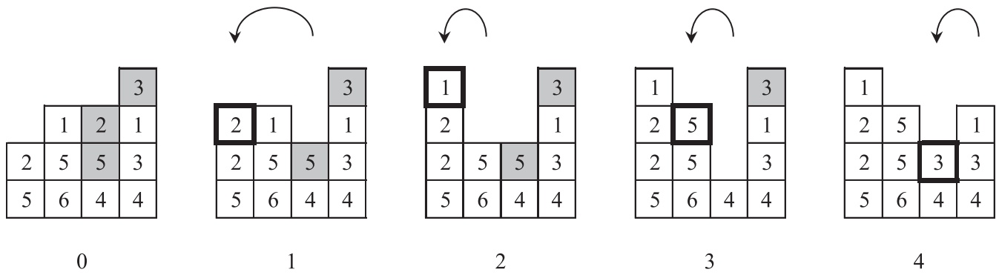

# Production, Manufacturing, Transportation and Logistics A constraint programming approach for the premarshalling problem Celia Jiménez-Piqueras a,∗, Rubén Ruiz a, Consuelo Parreño-Torres b, Ramon Alvarez-Valdes b

a Grupo de Sistemas de Optimización Aplicada, Instituto Tecnológico de Informática, Ciudad Politécnica de la Innovación, Edifico 8G, Acc. B. Universitat Politècnica de València, Camino de Vera s/n, València 46021, Spain

b Department of Statistics and Operations Research, Valencia University, Doctor Moliner 50, Burjassot, Valencia 46100, Spain

## a r t i c l e i n f o

Article history: Received 11 October 2021 Accepted 22 July 2022 Available online 26 July 2022

Keywords: Logistics Container terminal optimization Premarshalling problem Constraint programming

## a b s t r a c t

The enormous amount of containers handled at ports hampers the efficiency of terminal operations. The optimization of crane movements is crucial for speeding up the loading and unloading of vessels. To this end, the premarshalling problem aims to reorder a set of containers placed in adjacent stacks with a minimum number of crane movements, so that a container with an earlier retrieval time is not below one with a later retrieval time. In this study, we present a series of constraint programming models to optimally solve the premarshalling problem. Extensive computational comparisons show that the best proposed constraint programming formulation yields better results than the state-of-the-art integer programming approach. A salient finding in this paper is that the logic behind the model construction in constraint programming is radically different from that of more traditional mixed integer linear programming models.

© 2022 The Authors. Published by Elsevier B.V.

This is an open access article under the CC BY-NC-ND license ([http://creativecommons.org/licenses/by-nc-nd/4.0/](http://creativecommons.org/licenses/by-nc-nd/4.0/))

## 1. Introduction

In recent decades, container transportation of goods has seen enormous growth. According to UNCTAD (2020), in 2019, world container port throughput was about 811.2 million TEUs1 whereas in 1990, the throughput reported was just under 85.6 million TEUs (UNCTAD, 1992). These figures translate into an increasing difficulty in operating the terminals efficiently. Furthermore, not only has the amount of containers handled in ports greatly increased, but also the average size of ships has significantly grown: the first ships had a capacity of 600 to 900 TEUs, they reached 4000 TEUs in the 1980s, and at present the largest containerships are above 23,000 TEUs, (Hoffmann & Hoffmann, 2021; UNCTAD, 2018). The arrival of these huge vessels at a port leads to demand peaks that may exceed a terminal’s capacity and result in long wait times.

The more operating inefficiencies there are in terminals, the more it costs for ports, shippers and the environment. Hence, it is really advantageous to search for the best strategies to optimize port operations. One possibility is to extend port terminals in order to deal with demand peaks. However, this approach is hugely expensive and there would be significant underutilization times. Moreover, it is hard to implement due to land limitations and additionally it has a negative environmental impact. Alternatively, in the literature there are many optimization problems with the objective of finding solutions that enable the full exploitation of the available resources in ports.

Port terminals are a connection between different means of transport, thus large numbers of containers need to be temporarily stored in the port yard. Due to space limitations, containers have to be placed in stacks, and hence, they follow a Last In, First Out structure. This means that when a container has to be retrieved, if there are containers above it, they have to be moved to a different stack first and this is very time consuming. In this work, we consider the container premarshalling problem, CPMP for short, which aims to find a most efficient sequence of crane movements to enable the reordering of a bay (set of containers placed in adjacent stacks) in a way that no container is above another with an earlier retrieval time. When a bay is fully “ordered” a retrieval is carried out without additional relocations or reshuffles, greatly increasing crane utilization and reducing the time to load large vessels, which in turn eliminates the need to increase the capacity of the port.

The objective of this study is to explore the constraint programming technique for solving the relocation problem with a black-box solver. The use of standard solvers has many advantages. Firstly, they usually include a language or API to facilitate the construction of the model. This allows to easily reproduce the model and easily add or remove constraints to meet the specific requirements of the problem. Another advantage is that solvers improve over time, and the improvements are independent of the increase in computational power. According to Bixby (2002) or Achterberg & Wunderling (2013), since 1991 solvers have become 1.3 million times faster, or about 1.8 times faster per year. Lastly, they might be an ideal approach for practical applications, since companies only need a license to use them.

<small>∗ Corresponding author.</small>

<small>E-mail addresses: [cejipi@upvnet.upv.es](mailto:cejipi@upvnet.upv.es) (C. Jiménez-Piqueras), [rruiz@eio.upv.es](mailto:rruiz@eio.upv.es) (R. Ruiz), [Consuelo.Parreno@uv.es](mailto:Consuelo.Parreno@uv.es) (C. Parreño-Torres), [Ramon.Alvarez@uv.es](mailto:Ramon.Alvarez@uv.es) (R. Alvarez-Valdes).</small>

<small>1 TEU, Twenty-foot Equivalent Unit, it refers to the nominal capacity of a standard-size 20-foot-long container.</small>

It has to be noted that dealing with a black-box solver is also a challenging task since one does not have the source codes and/or detailed algorithms. Our strategy has consisted of building a series of four constraint programming models adding a new group of decision variables to the previous one. The results show that each of our models improves on the previous one in the series, which is a salient finding in this work: by adding additional decision variables, we significantly improve the performance of the proposed constraint programming models, unlike more traditional mixed integer linear programming model construction, where this is not a common strategy. The experiments carried out also reveal that the best of our constraint programming formulations performs significantly better than the mathematical programming models for the CPMP existing in the literature, where the state-of-the-art is the IPS6 model proposed by Parreño-Torres, Alvarez-Valdes, & Ruiz (2019).

This paper is structured as follows. First, in Section 2, we provide a review of the literature related to our work. Then, the pre-marshalling problem is defined (Section 3). After that, the models proposed in this study and the solution procedure are presented in Section 4. The computational study is described in Section 5. Finally, the conclusions are outlined and some future lines of investigation are suggested (Section 6).

## 2. Previous work

The literature on the premarshalling problem contains numerous heuristic and exact approaches.

## 2.1. Exact approaches for the premarshalling problem

To the best of our knowledge, the first mathematical programming model designed for the premarshalling problem was that of Lee & Hsu (2007), specifically, an integer multicommodity flow model. The nodes and arcs of the network embedded in the model represent the bay slots and the possible container movements between them, respectively, and they are indexed by time points. A heuristic based on the integer model is also presented. In de Melo da Silva, Toulouse, & Calvo (2018) a unified integer programming model for the premarshalling and block relocation problem is proposed. The formulation contains three groups of decision variables; one of them describes the layout of the bay and the others the movements. Time is discretized and just one movement is allowed at each time step. An upper bound for the number of movements is needed and it is obtained by a heuristic. Parreño-Torres et al. (2019) explore eight different integer programming formulations for the premarshalling problem, varying the groups of decision variables and their indexes. Time is divided into segments where, at most, one movement is performed and an iterative solution procedure is developed in order to avoid the difficulty in calculating a tight upper bound for the number of movements.

We also find other exact approaches for premarshalling in the literature, apart from mathematical models. Expósito-Izquierdo, Melián-Batista, & Moreno-Vega (2012) implement an A∗ algorithm for the problem. The optimal solutions obtained are used to check the performance of the Lowest Priority First Heuristic presented in the article. Tierney, Pacino, & Voß (2016) propose an iterative deepening A∗. They use the lower bound for the number of movements presented in Bortfeldt & Forster (2012) and multiple symmetry breaking and branching rules. A branch and price technique is proposed by van Brink & van der Zwaan (2014), who also prove that the problem is NP-hard. There are also several branch and bound algorithms for the premarshalling problem. Zhang, Jiang, & Yun (2015) develop a heuristic-guided branch and bound that uses a lower bound to determine which branches are explored first. A similar approach is the iterative deepening branch and bound of Tanaka & Tierney (2018) with new branching and dominance rules and a tighter lower bound that improves upon that of Bortfeldt & Forster (2012). This strategy is enhanced by Tanaka, Tierney, Parreño-Torres, Alvarez-Valdes, & Ruiz (2019) and they provide another refinement of the lower bound.

Although constraint programming has been successfully applied to a wide range of combinatorial optimization problems, such as assembly line balancing (Bukchin & Raviv, 2018), job shop scheduling (Meng, Zhang, Ren, Zhang, & Lv, 2020), vehicle routing (Ham, 2018) or assignment and scheduling operations in container terminals (Kizilay, Hentenryck, & Eliiyi, 2020). To the best of our knowledge, just one constraint programming approach has been described so far for the premarshalling problem by Rendl & Prandtstetter (2013). They propose an iterative procedure to solve the problem where they use the lower bound for the number of movements and the heuristic presented by Bortfeldt & Forster (2012). In contrast with Rendl & Prandtstetter (2013), our proposed constraint programming models do not require the implementation of an adhoc heuristic, as we simply employ a commercial solver, and hence they are much easier to use and to reproduce.

## 2.2. Heuristic approaches for the premarshalling problem

Regarding heuristic methods, the state-of-the-art approach corresponds to the deep learning assisted heuristic tree search pre-sented by Hottung, Tanaka, & Tierney (2020). Other recent proposals are: target-guided approaches, such as those developed by Wang, Jin, & Lim (2015) and Wang, Jin, Zhang, & Lim (2017), genetic algorithms such as the biased random-key genetic algorithm by Hottung & Tierney (2016) and the multi-heuristic approach presented by Jovanovic, Tuba, & Voß (2017) which develops the Lowest Priority First Heuristic of Expósito-Izquierdo et al. (2012). Also, in previous work we find the tree search procedure proposed by Bortfeldt & Forster (2012), a labelling algorithm developed by Huang & Lin (2012), the neighborhood search process by Lee & Chao (2009) and the algorithm described by Caserta & Voß (2009) that is based on the corridor method.

## 2.3. Related problems

In the literature we can find some variants of the premarshalling problem that try to deal with the uncertainty that may appear in retrieval times, such as the robust CPMP (Boge, Goerigk, & Knust, 2020; Tierney & Voß, 2016) or the stochastic premarshalling of warehouses (Maniezzo, Boschetti, & Gutjahr, 2021).

There are also some variants that take into account the time spent by the crane to perform the premarshalling movements: the CPMP with a crane time minimization objective (Parreño-Torres, Alvarez-Valdes, Ruiz, & Tierney, 2020) and the Stochastic Container Relocation Problem with Constrained Pre-processing (Zweers, Bhulai, & van der Mei, 2020), which contains a phase similar to pre-marshalling, but where the reorganization of the bay is partially performed as the available time is limited.

The block relocation problem, BRP for short, is similar to the CPMP but there is an important difference between them: in the former, containers are retrieved from the bay, while in the pre-marshalling problem no container leaves the bay. In the literature, some recent exact approaches for the block relocation problem are branch and bound (Tanaka & Mizuno, 2018), branch and cut (Bacci, Mattia, & Ventura, 2020), mixed integer programming (Lu, Zeng, & Liu, 2020) and iterative deepening $\mathbb { A } ^ { * }$ algorithm (Jin, 2020; Quispe, Lintzmayer, & Xavier, 2018). We can also find multiple heuristic methods, some of the most recent approaches for several variants of BRP are: ant colony optimization algorithm (Jovanovic, Tuba, & Voß, 2019b), GRASP (Jovanovic, Tanaka, Nishi, & Voß, 2019a; da Silva Firmino, de Abreu Silva, & Times, 2019) and beam search (Bacci, Mattia, & Ventura, 2019; Ting & Wu, 2017).

## 3. Premarshalling problem

Containers are temporarily stored in the port yard until they are loaded on to a vessel or other means of transport such as a train or a truck. In this area, containers are arranged in parallel lines of stacks and there are groups of adjacent lines called blocks. Thus, each block consists of several lines and multiple rows which we refer to as bays. Since containers are stacked, when one has to be retrieved, every container above it blocks its removal and needs to be reshuffled. We will refer as a blocking container to a container that is placed on top of another with an earlier retrieval time and to every container above it. The aim of the premarshalling problem is to identify the minimum number of crane movements to transform a bay layout into one without blocking containers, considering that no container can leave the bay during the movements. Therefore, no temporary storage outside the bay is allowed. Boge et al. (2020) describe the conditions a bay must satisfy so that it can be rearranged by premarshalling.

We consider that all the containers in the bay are of the same size and the only distinction between them is the priority group. These groups are defined according to the expected retrieval times of the containers and each one is identified by a number: containers in group number 1 will be retrieved first, then it will be the turn of those with priority 2 and so on until group $\bar { p } ,$ where $\bar { p }$ is the number of priority groups. We assume that there is full information about the priorities and each group $p \in \mathcal { P } = \{ 1 , \dots ,   \bar { p } \}$ where $\mathcal { P }$ is the set of priority groups, has a fixed number of containers $m _ { p } .$

The dimensions of a bay are limited by $\bar { \bar { S } } ,$ the maximum number of stacks, and t¯, the maximum number of tiers or maximum height of every stack. The position of a container is represented by a pair $( s , t )   \in   \mathcal { S } \times \mathcal { T } ,$ , where $\mathcal { S } = \{ 1 , 2 , \ldots , \bar { s } \}$ is the set of stacks and $\mathcal { T } = \{ 1 , 2 , \ldots , \bar { t } \}$ , the set of tiers. The input of the problem is a bay configuration, i.e., the priority group of the container placed in slot $( s , t )$ , for all pairs in $\mathcal { S } \times \mathcal { T }$ , which is denoted by $f _ { s , t } .$ This parameter takes values in the set $\mathcal { P } ^ { 0 } = \mathcal { P } \cup \{ 0 \} = \{ 0 , \ldots ,   \bar { p } \}$ , where 0 is for empty slots. Accordingly, the number of empty slots is represented by $m _ { 0 }$

A solution to the problem is determined by a sequence of movements $\{ \langle s _ { 1 } ^ { \prime } , s _ { 1 } ^ { \prime \prime } \rangle ,   \langle \bar { s _ { 2 } ^ { \prime } } , s _ { 2 } ^ { \prime \prime } \rangle ,   \dots ,   \langle s _ { m } ^ { \prime } , s _ { m } ^ { \prime \prime } \rangle \}$ , where m is the total number of movements and $\langle \mathsf { s } ^ { \prime } , \mathsf { s } ^ { \prime \prime } \rangle$ means that the topmost container of stack $s ^ { \prime }$ is placed at the top of stack $s ^ { \prime \prime } ,$ . All movements are performed inside the bay, i.e., no container is removed from the bay nor added to it.

Fig. 1 shows an example of an optimal solution. We can see five bay configurations, the initial one, 0, and the result of each one of the four movements that define the solution, {3, 1, 2, 1, 3, 2, 4, 3}. Containers are represented as boxes with the number of its priority group inside and blocking containers are shaded.

## 4. Constraint programming models

In this section, we present a series of four feasibility constraint programming models and we detail the iterative algorithm developed to obtain optimal solutions from them. The models are named CPX, where X is the number of groups of decision variables in the formulation. The first one has two sets of variables, CP2, and CP3 to CP5 are built from the previous one, adding a new group of decision variables and the corresponding constraints.

## 4.1. Iterative algorithm and lower bound

The solution procedure employed in this work is an iterative algorithm (Parreño-Torres et al., 2019; Rendl & Prandtstetter, 2013). Each iteration of the algorithm consists of solving the problem given a set of stages $\mathcal { K } = \{ 1 , \dots , \bar { k } \}$ and searching for a feasible solution with $\bar { k }$ movements, one per stage. In the first iteration, k¯ is equal to a lower bound for the number of movements, lb. If the problem is infeasible, a new iteration is performed with $\bar { k } = l b + 1$ The algorithm iterates increasing k¯ by one when the problem is infeasible and solves it again for that number of stages, until a feasible solution is found.

A key difference with previously published models is that the constraint programming formulations presented here do not have an objective function as it is not needed. The structure of the iterative algorithm ensures optimality whenever a feasible solution is found. Therefore, our models are designed to solve a feasibility problem given a fixed number of movements and stages. The configuration of the bay at stage k corresponds to the layout after performing the kth movement (to simplify, we say that the kth movement is performed at stage k). We consider a stage number 0 for the initial layout of the bay and the set of stages including it is denoted by $\mathcal { K } ^ { 0 } = \{ 0 , 1 , \ldots , \bar { k } \}$

As mentioned, the iterative algorithm requires a lower bound for the number of movements. In this work, we use the lower bound presented by Tanaka et al. (2019), which, to the best of our knowledge, is the best one in the literature at the moment and it has been shown to be very tight in previous studies. Note that this lower bound is a refinement of the one developed by Tanaka & Tierney (2018), which is based on the lower bound proposed by Bortfeldt & Forster (2012).

An alternative to the iterative algorithm is the solution procedure proposed by de Melo da Silva et al. (2018): defining a set of stages, allowing at most one movement per stage and including an objective function that minimizes the number of movements. However, in that case, the number of stages has to be an upper bound for the number of movements. The larger the number of stages, the bigger the resulting model, so a tight upper bound is desirable. However, obtaining a tight upper bound is not easy, as it requires using complex metaheuristic algorithms. For this reason, together with some tests that we have performed in order to select the best solution procedure for our models, we have chosen the iterative algorithm explained above. Another option for the iterative procedure could have been using a binary search to look for the optimal number of movements, but in this case, it is unlikely that a binary search speeds the algorithm, given the existence of a tight lower bound and the absence of any good upper bound.

## 4.2. CP2: Constraint programming model with 2 groups of variables

At least two groups of variables are needed to formulate the problem as, for each stage, the configuration of the bay and the movement performed have to be determined. The basic model CP2 is built using only these two types of variables, $x _ { s , t } ^ { k }$ and $y _ { s , t } ^ { k }$

$$
x _ {s, t} ^ {k} = \left\{ \begin{array}{l l} 0 & \text {If the slot (s,t) is empty during stage k} \\ p & \text {If a container with priority p is placed in (s,t)} \\ & \text {during stage k} \end{array} \right.
$$

$$
\forall s \in \mathcal {S}, \forall t \in \mathcal {T}, \forall k \in \mathcal {K} ^ {0}
$$

Fig. 1. Example of an optimal solution for the problem. Blocking containers are shaded and the container moved at each stage is indicated with a thick border.

$$
\begin{array}{c} y _ {s, t} ^ {k} = \left\{ \begin{array}{l l} 1 & \text {If a container is moved to slot (s,t)} \\ & \text {during stage k} \\ 0 & \text {Otherwise} \end{array} \right. \\ \forall s \in \mathcal {S}, \forall t \in \mathcal {T}, \forall k \in \mathcal {K} \end{array}
$$

These two groups of variables are the same as those described in Rendl & Prandtstetter (2013) on which the CP2 model is loosely based. In contrast with the mathematical programming formulations of de Melo da Silva et al. (2018) and Parreño-Torres et al. (2019), the variables that describe the configuration of the bay are integer here, as they take values in the set of priorities instead of including the priority as an index of binary variables.

The CP2 model is formulated as follows.

$$
x _ {s, t} ^ {0} = f _ {s, t}
$$

$$
\forall s \in \mathcal {S}, t \in \mathcal {T}\tag{1}
$$

$$
\left| \left\{x _ {s, t} ^ {k}: s \in \mathcal {S}, t \in \mathcal {T}, x _ {s, t} ^ {k} = p \right\} \right| = m _ {p} \quad \forall p \in \mathcal {P} ^ {0}, k \in \mathcal {K}\tag{2}
$$

$$
x _ {s, t + 1} ^ {\bar {k}} \leq x _ {s, t} ^ {\bar {k}}
$$

$$
\forall s \in \mathcal {S}, t \in \mathcal {T} \setminus \{\tilde {t} \}\tag{3}
$$

$$
x _ {s, t + 1} ^ {k} \leq \bar {p} \cdot x _ {s, t} ^ {k} \quad s \in \mathcal {S}, t \in \mathcal {T} \setminus \{\bar {t} \}, k \in \mathcal {K} \setminus \{\bar {k} \}\tag{4}
$$

$$
x _ {s, t} ^ {k - 1} \leq x _ {s, t} ^ {k} + \bar {p} \cdot h \left(x _ {s, t} ^ {k}\right) \quad s \in \mathcal {S}, t \in \mathcal {T}, k \in \mathcal {K}\tag{5}
$$

$$
x _ {s, t} ^ {k} \leq x _ {s, t} ^ {k - 1} + \bar {p} \cdot h \left(x _ {s, t} ^ {k - 1}\right) \quad s \in \mathcal {S}, t \in \mathcal {T}, k \in \mathcal {K}\tag{6}
$$

$$
\sum_ {s \in \mathcal {S}, t \in \mathcal {T}} y _ {s, t} ^ {k} = 1
$$

$$
\forall k \in \mathcal {K}\tag{7}
$$

$$
y _ {s, t} ^ {k} \leq x _ {s, t} ^ {k}
$$

$$
\forall s \in \mathcal {S}, t \in \mathcal {T}, k \in \mathcal {K}\tag{8}
$$

$$
x _ {s, t} ^ {k} \leq \bar {p} \left(y _ {s, t} ^ {k} + x _ {s, t} ^ {k - 1}\right)
$$

$$
s \in \mathcal {S}, t \in \mathcal {T}, k \in \mathcal {K}\tag{9}
$$

$$
x _ {s, t} ^ {k - 1} \leq \bar {p} \left(1 - y _ {s, t} ^ {k}\right)
$$

$$
s \in \mathcal {S}, t \in \mathcal {T}, k \in \mathcal {K}\tag{10}
$$

$$
y _ {s, t} ^ {k} \leq x _ {s, t} ^ {k + 1}
$$

$$
s \in \mathcal {S}, t \in \mathcal {T}, k \in \mathcal {K} \setminus \{\bar {k} \}\tag{11}
$$

The initial layout of the bay is assigned to the variables by (1). Constraints (2) ensure that the multiplicities of the priority groups and the number of empty slots are invariant. In a feasible solution, there are no blocking containers in the final layout, this is imposed by (3). Constraints (4) ensure that there are no empty slots between containers in the same stack. When a slot is occupied during two consecutive stages, the container in the slot has to be the same at both stages, in other words, the priority group assigned to the slot has to be the same. That is expressed in (5) and (6), where h(x) takes value 1 when x = 0 and 0 when x is positive. Since the priority groups of the containers that are not moved are fixed by constraints (5) and (6), and constraints (2) ensure that the number of containers in each priority group is constant, it is guaranteed that the priority group of the container being moved is not altered during the movement.

The condition that exactly one movement has to be performed at each stage corresponds with (7). Constraints (8) ensure that when a container is moved to a certain slot in stage k, the slot is then occupied by a container in that stage. If there is a container in a slot in stage $k ,$ either the container was there during the previous stage or it has been moved to that slot in stage k, this is imposed by (9). Constraints (10) express that a container can be moved to a certain slot in stage k only if it was empty during the previous stage. Finally, Eq. (11) are included in order to discard solutions faster in the search process. Eq. (11) impose that when a container is moved to a slot, this slot has to remain occupied in the next stage, that is, the same container cannot be moved in two consecutive stages (because it could be reduced to just one movement). The rule expressed in (11) is known as “transitive move avoidance” (Tierney et al., 2016).

## 4.3. CP3: Constraint programming model with 3 groups of variables

In the previous model CP2, the configuration of the bay at each stage is given by variables $x _ { s , t } ^ { k } ,$ which take integer values in the set of priorities $\mathcal { P } ^ { 0 } ,$ Integer-valued variables are useful in some constraints but cumbersome in others. Also, variables $x _ { s , i } ^ { k }$ and $y _ { s , t } ^ { k }$ are weakly related in CP2. Model CP3 is built from CP2, complementing variables $x _ { s , i } ^ { k }$ with a new group of binary variables, $\delta _ { s , t } ^ { k }$ , that do not contain information about the priority group of the container occupying a position, but only indicate whether a slot is empty or not.

$$
\delta_ {s, t} ^ {k} = \left\{ \begin{array}{l l} 0 & \text {If the slot (s,t) is empty during stage k} \\ 1 & \text {If there is a container in slot (s,t) during stage k} \end{array} \right.
$$

$$
\forall s \in \mathcal {S}, \forall t \in \mathcal {T}, \forall k \in \mathcal {K} ^ {0}
$$

In recent integer models, such as de Melo da Silva et al. (2018) and Parreño-Torres et al. (2019), the layout is represented by 4-index binary variables. Here, in contrast, two groups of 3-index variables, one binary and the other integer, are used. There are far fewer variables, but the relationship between the two groups must be established.

Model CP3 contains constraints (1), (2), (3) and (7) of model CP2, and the following, where (12) and (13) are new constraints, and (14) to (20) are modified constraints of the CP2 model.

$$
x _ {s, t} ^ {k} \leq \bar {p} \cdot \delta_ {s, t} ^ {k}
$$

$$
\forall s \in \mathcal {S}, t \in \mathcal {T}, k \in \mathcal {K} ^ {0}\tag{12}
$$

$$
\delta_ {s, t} ^ {k} \leq x _ {s, t} ^ {k}
$$

$$
\forall s \in \mathcal {S}, t \in \mathcal {T}, k \in \mathcal {K} ^ {0}\tag{13}
$$

$$
x _ {s, t} ^ {k - 1} \leq x _ {s, t} ^ {k} + \bar {p} \left(1 - \delta_ {s, t} ^ {k}\right)
$$

$$
\forall s \in \mathcal {S}, t \in \mathcal {T}, k \in \mathcal {K}\tag{14}
$$

$$
x _ {s, t} ^ {k} \leq x _ {s, t} ^ {k - 1} + \bar {p} \left(1 - \delta_ {s, t} ^ {k - 1}\right)
$$

$$
\forall s \in \mathcal {S}, t \in \mathcal {T}, k \in \mathcal {K}\tag{15}
$$

$$
y _ {s, t} ^ {k} \leq \delta_ {s, t} ^ {k}
$$

$$
\forall s \in \mathcal {S}, t \in \mathcal {T}, k \in \mathcal {K}\tag{16}
$$

$$
\delta_ {s, t} ^ {k} \leq y _ {s, t} ^ {k} + \delta_ {s, t} ^ {k - 1}
$$

$$
\forall s \in \mathcal {S}, t \in \mathcal {T}, k \in \mathcal {K}\tag{17}
$$

$$
y _ {s, t + 1} ^ {k} + \delta_ {s, t + 1} ^ {k - 1} \leq \delta_ {s, t} ^ {k - 1}
$$

$$
\forall s \in \mathcal {S}, t \in \mathcal {T} \setminus \{\tilde {t} \}, k \in \mathcal {K}\tag{18}
$$

$$
y _ {s, 1} ^ {k} + \delta_ {s, 1} ^ {k - 1} \leq 1
$$

$$
\forall s \in \mathcal {S}, k \in \mathcal {K}\tag{19}
$$

$$
y _ {s, t} ^ {k} \leq \delta_ {s, t} ^ {k + 1}
$$

$$
\forall s \in \mathcal {S}, t \in \mathcal {T}, k \in \mathcal {K} \setminus \{\bar {k} \}\tag{20}
$$

Constraints (12) and (13) are added to define the relationship between variables $\delta _ { s , t } ^ { k }$ and $x _ { s , t } ^ { k } ,$ that is, $\delta _ { s , t } ^ { k }$ takes value 0 when $x _ { s , t } ^ { k }$ is 0, and 1 when the latter is positive.

The constraints that have changed from CP2 to CP3 are those that use the information about whether a slot is occupied or not and it is easier and more precise to write them in terms of variables $\delta _ { s , i } ^ { k }$ instead of $x _ { s , t } ^ { k } .$ Following this idea, we have substituted (5) and (6) for (14) and (15), respectively, (8) for (16), (9) for (17), (10) for (18) and (19) and (11) for (20). In constraints (18) not only have variables $x _ { s , t } ^ { k }$ been substituted for $\delta _ { s , t } ^ { k }$ but also the term $\delta _ { s , t } ^ { k - 1 }$ has been added in order to improve the constraints: (18) impose that a container can only be moved to a slot (s, t) which was empty during the previous stage, as in (10), but it also requires that the slot (s, t − 1) was occupied. Obviously, the new term cannot be added to the constraints for the first tier, so we have (19) in that case.

In CP2, (4) was included in order to avoid having empty slots between containers of the same tier. Constraints (18) from CP3, ensure that condition, so (4) is no longer necessary.

## 4.4. CP4: Constraint programming model with 4 groups of variables

In the previous models, we have described variables $y _ { s , t } ^ { k }$ that determine the slot to which a container is moved. In CP4, the definition of the movements is more precise as we add a new group of decision variables that indicates the slot from which the container is removed:

$$
\begin{array}{c} z _ {s, t} ^ {k} = \left\{ \begin{array}{l l} 1 & \text {If a container is removed from slot (s,t)} \\ & \text {during stage k} \\ 0 & \text {Otherwise} \end{array} \right. \\ \forall s \in \mathcal {S}, \forall t \in \mathcal {T}, \forall k \in \mathcal {K} \end{array}
$$

The addition of the new variables $z _ { s , i } ^ { k }$ allows for a stronger relationship between variables that describe the configuration of the bay and those that determine the movements. This type of variables has already been used in the integer models of de Melo da Silva et al. (2018) and Parreño-Torres et al. (2019).

Model CP4 includes constraints (1), (2), (3), (12), (13), (14), (15) involving variables $x _ { s , t } ^ { k }$ and $\delta _ { s , t } ^ { k }$ , and constraints (7), (19) and (20) involving variables $y _ { s , t } ^ { k }$ and $\delta _ { s , t } ^ { k }$ . In addition, the formulation of CP4 contains the constraints below.

$$
\sum_ {s \in \mathcal {S}, t \in \mathcal {T}} z _ {s, t} ^ {k} = 1
$$

$$
\forall k \in \mathcal {K}\tag{21}
$$

$$
\delta_ {s, t} ^ {k} + z _ {s, t} ^ {k} = y _ {s, t} ^ {k} + \delta_ {s, t} ^ {k - 1}
$$

$$
\forall s \in \mathcal {S}, t \in \mathcal {T}, k \in \mathcal {K}\tag{22}
$$

$$
y _ {s, t + 1} ^ {k} + \delta_ {s, t + 1} ^ {k - 1} + z _ {s, t} ^ {k} \leq \delta_ {s, t} ^ {k - 1} \quad \forall s \in \mathcal {S}, t \in \mathcal {T} \setminus \{\bar {t} \}, k \in \mathcal {K}\tag{23}
$$

$$
z _ {s, \tilde {t}} ^ {k + 1} + y _ {s, \tilde {t}} ^ {k} \leq \delta_ {s, \tilde {t}} ^ {k}
$$

$$
\forall s \in \mathcal {S}, k \in \mathcal {K} \setminus \{\widehat {k} \}\tag{24}
$$

$$
z _ {s, \bar {t}} ^ {1} \leq \delta_ {s, \bar {t}} ^ {0}
$$

$$
\forall s \in \mathcal {S}\tag{25}
$$

$$
\left| \sum_ {t \in \mathcal {T}} y _ {s, t} ^ {k} + \sum_ {t \in \mathcal {T}} z _ {s, t} ^ {k + 1} \leq 1 \right|
$$

$$
\forall s \in \mathcal {S}, k \in \mathcal {K} \setminus \{\bar {k} \}\tag{26}
$$

$$
\sum_ {t \in \mathcal {T}} \left(z _ {s, t} ^ {k} + y _ {\nu , t} ^ {k} + z _ {u, t} ^ {k + 1} + y _ {r, t} ^ {k + 1}\right) \leq 3 \quad \forall s \in \mathcal {S},   \nu \in \mathcal {S} \setminus \{s \},
$$

$$
\begin{array}{l} u \in \mathcal {S}: u <   s \land u \neq v, \\ r \in \mathcal {S} \setminus \{s, v, u \}, k \in \mathcal {K} \setminus \{\bar {k} \} \end{array}\tag{27}
$$

A new group of constraints analogous to (7) is added for variables $z _ { s , t } ^ { k } ,   ( 2 1 )$ , which expresses that exactly one container has to be removed from the slot where it is placed at each stage.

Including variables $z _ { s , t } ^ { k }$ in the model allows for the strengthening of some of the constraints such as (17) and (18), that are substituted with (22) and (23), respectively. (19), which complemented (18) for the first tier, is maintained and the analogous constraints for variables $z _ { s , t } ^ { k }$ are included in the formulation, namely (24) and (25). In (24), the term $y _ { s , t } ^ { k }$ is not necessary, but it helps to reduce the range of possible values for $z _ { s , t } ^ { k + 1 }$ . Without $y _ { s , \bar { t } } ^ { k } ,$ these constraints only impose that a container cannot be removed from an empty slot and, including $y _ { s , t ^ { \prime } } ^ { k }$ they also express that a container which has been placed in a slot in stage k, cannot be removed during stage k + 1. The term $y _ { s , t } ^ { k }$ cannot be included in the constraints for the initial stage, so we have (25) in that case.

Constraints (16) are not included in CP4 because this condition is already imposed by (22), (23), (19), (24) and (25) together.

Two new groups of constraints are added in order to remove symmetries and infeasible solutions more quickly. (26) impose that when a container is moved to a certain stack, no container can be removed from that stack in the next stage. Constraints (27) break symmetries. If r, s, u, v are four different stacks, sequences r, s, u, v and u, v, r, s produce the same solution, and constraints (27) only allow the first sequence.

## 4.5. CP5: Constraint programming model with 5 groups of variables

In CP5 we include a new group of variables, $w _ { s , t } ^ { k }$ that collect information about the blocking containers at each stage. More pre-cisely, these variables indicate whether there is a blocking container in a slot or not.

$$
\begin{array}{c} w _ {s, t} ^ {k} = \left\{ \begin{array}{l l} 1 & \text {If there is a blocking container in slot (s,t)} \\ & \text {in stage k} \\ 0 & \text {Otherwise} \end{array} \right. \\ \forall s \in \mathcal {S}, \forall t \in \mathcal {T}, \forall k \in \mathcal {K} \end{array}
$$

The information about where and how many blocking containers there are is very valuable since the target of the premarshalling problem is to relocate this kind of container. Moreover, the number of blocking containers is a basic lower bound for the number of movements necessary to reorder a bay. As we have described before, the solution to the problem is built step by step, performing one movement after another, and so, at each stage, we can calculate a lower bound for the number of movements needed to complete the reordering of the bay from the layout in that stage. Therefore, the new variables allow us to obtain a lower bound to the number of movements at each stage. Consequently, those solutions where the lower bound is greater than the number of movements that remain to be conducted, which are clearly infeasible, can be discarded more quickly. To the best of our knowledge, this type of variables has never been used in previous models.

The formulation of CP5 contains all the constraints of the CP4 model, except for (3), and the following.

$$
x _ {s, t + 1} ^ {k} \leq x _ {s, t} ^ {k} + \bar {p} \cdot w _ {s, t + 1} ^ {k} \quad \forall s \in \mathcal {S}, t \in \mathcal {T} \setminus \{\bar {t} \}, k \in \mathcal {K}\tag{28}
$$

$$
w _ {s, t} ^ {k} + \delta_ {s, t + 1} ^ {k} \leq w _ {s, t + 1} ^ {k} + 1 \quad \forall s \in \mathcal {S}, t \in \mathcal {T} \setminus \{\bar {t} \}, k \in \mathcal {K}\tag{29}
$$

$$
w _ {s, t} ^ {k} \leq \delta_ {s, t} ^ {k}
$$

$$
\forall s \in \mathcal {S}, t \in \mathcal {T}, k \in \mathcal {K}\tag{30}
$$

$$
w _ {s, 1} ^ {k} = 0
$$

$$
\forall s \in \mathcal {S}, k \in \mathcal {K}\tag{31}
$$

$$
x _ {s, t} ^ {k} + 1 \leq x _ {s, t + 1} ^ {k} + (\tilde {p} + 1) \cdot (1 - w _ {s, t + 1} ^ {k} + w _ {s, t} ^ {k}) \quad \forall s \in \mathcal {S}, t \in \mathcal {T} \setminus \{\tilde {t} \}, k \in \mathcal {K}\tag{32}
$$

$$
\sum_ {s \in \mathcal {S}, t \in \mathcal {T}} w _ {s, t} ^ {k} + k \leq \bar {k}
$$

$$
\forall k \in \mathcal {K}\tag{33}
$$

Constraints (28)–(32) specify when there is a blocking container in a slot or not. Eq. (28) express that when there is a container placed on top of another container with an earlier retrieval time, it is a blocking container. Eq. (29) impose that if there is a blocking container in slot (s, t) and slot (s, t + 1) is occupied, then there is a blocking container in slot (s, t + 1). In the first tier, there are no blocking containers, nor in the empty slots, this is included in the formulation by (31) and (30) respectively. Constraints (32) ensure that when there is not a blocking container in slot (s, t) and there is not a container with a higher priority in the slot on top of it, then there is also no blocking container in slot (s, t + 1).

The aim of adding variables $w _ { s , t } ^ { k }$ is to force the number of blocking containers at each stage to be less than or equal to the number of movements that have not been performed yet. Otherwise, the solution is not feasible, so this strategy allows for a reduction in the range of possible solutions to explore. Constraints (33) impose that the number of blocking containers at each stage cannot be greater than the number of following stages.

Constraints (3), that indicate there should not be any blocking container in the last stage, are not included in the CP5 model. This condition is already ensured by constraints (28) and (33), which identify the blocking containers and limit the number of them at each stage, respectively.

## 5. Computational experiments

The models presented in this work have been analysed through an extensive computational study carried out on a set of virtual machines with four virtual processors and eight GBytes of RAM memory each. The virtual machines run Windows 10 Enterprise 64 bits. Virtual machines are run on an OpenStack virtualization platform supported by several blade servers, each one with two

18-core Intel Xeon Gold 5220 processors running at 2.2 gigahertz. and 384 GBytes of RAM. All the experiments have been executed with a time limit of 3600 seconds. The models tested are solved with the IBM solvers CPLEX and CP Optimizer, for the mathematical programming models and constraint programming models respectively. We have used the latest version available at the time of the writing of this paper, i.e., version 20.1.0.

The computational experiments have been performed using four well-known datasets from the literature. These data enable us to verify the formulations presented in this paper and to compare them with the integer programming model proposed by Parreño-Torres et al. (2019) (IPS6). Moreover, we compare the best of our four constraint programming models with the closest possible mathematical programming model formulation $( C P 5 ^ { I P } )$ , and IPS6 with its constraint programming version $( I P S 6 ^ { C P } )$ , in order to investigate how solving a similar formulation with these two different techniques (constraint programming and mathematical programming) affects the results.

## 5.1. Datasets

The **BZ dataset** from van Brink & van der Zwaan (2014) contains instances with 3, 5, 7 or 9 stacks, 4 or 6 tiers and a fill percentage of 50% or 70%. In total, there are 960 instances.

The **ZJY dataset** was generated by Zhang et al. (2015). It consists of 100 instances where there are bays with 4 tiers and 6, 7, 8 or 9 stacks, or 5 tiers and 6 stacks.

The **EMM dataset** was originally generated by Expósito-Izquierdo et al. (2012), and then by Tierney et al. (2016), as the first one was lost. We have considered bays with 4 tiers, 4, 7 or 10 stacks and fill percentages of 50% and 75%. From this group of 450 instances, we have used the ones which are not already ordered, 417 in total.

In the instances from the **CV dataset** of Caserta & Voß (2009) all containers have different priorities in the bay. All stacks are filled with the same number of containers and two additional empty top tiers are considered. These characteristics make this dataset the most difficult of the four employed here. In this study, we use those instances where the dimensions of the bay range from 3 to 8 stacks and 5 tiers, and from 4 to 7 stacks and 6 tiers. There is a total of 400 instances, but we exclude one of them because the bay is already ordered.

Bays with 5, 6 tiers and 7, 8 stacks, such as those in these datasets, are representative of most actual container terminal yards.

## 5.2. Size of the CP models

The number of variables and constraints for each CP model pre-sented in this work, depends on the number of stacks and tiers of the bay, the number of stages, and the number of priority groups. Table 1 shows these figures for the instances with the largest dimensions in each dataset. Regarding the number of stages, we have considered the lower bound for the number of movements, i.e. the number of stages in the first iteration. Therefore, in Table 1, the number of stages considered is the largest lower bound, for the instances with the same values for the other parameters.

We can observe there is a gradual increase in the number of variables from one model to the next one in the series. However, the number of constraints experiences a sharp increase from model CP3 to CP4. This is due to the addition of constraints (27). It should be noted that, in spite of increasing the size of the model, Eq. (27) help to break symmetries and accelerate the search.

Table 1

Number of variables and constraints for the instances with the largest dimensions in each dataset, namely the number of stacks, s¯, and tiers, t¯, the number of priority groups, p¯, and the number of stages, k¯ .

<table><tr><td rowspan="2">Dataset</td><td rowspan="2"> $\bar{s}$ </td><td rowspan="2"> $\bar{t}$ </td><td rowspan="2"> $\bar{k}$ </td><td rowspan="2"> $\bar{p}$ </td><td colspan="4">#Variables</td><td colspan="4">#Constraints</td></tr><tr><td>CP2</td><td>CP3</td><td>CP4</td><td>CP5</td><td>CP2</td><td>CP3</td><td>CP4</td><td>CP5</td></tr><tr><td>BZ</td><td>9</td><td>6</td><td>27</td><td>6</td><td>2970</td><td>4482</td><td>5940</td><td>7398</td><td>10,179</td><td>12,033</td><td>50,391</td><td>55,719</td></tr><tr><td>ZJY</td><td>9</td><td>4</td><td>17</td><td>10</td><td>1260</td><td>1908</td><td>2520</td><td>3132</td><td>4335</td><td>5199</td><td>29,093</td><td>31,225</td></tr><tr><td>EMM</td><td>10</td><td>4</td><td>28</td><td>8</td><td>2280</td><td>3440</td><td>4560</td><td>5680</td><td>7840</td><td>9350</td><td>76,848</td><td>80,766</td></tr><tr><td>CV</td><td>7</td><td>6</td><td>27</td><td>28</td><td>2310</td><td>3486</td><td>4620</td><td>5754</td><td>8559</td><td>10,001</td><td>20,185</td><td>24,335</td></tr></table>

Number of instances from the BZ dataset (optimally) solved by each model and the average running time for each model for the instances that are solved by all the models (column “All”). Best values are in bold and the instances are divided into groups by the number of stacks, s¯, the number of tiers, t¯, and the fill percentage (%) of the bay, #Inst. refers to the number of instances in each group.

|  |  |  |  | #Opti | mal |  |  |  | Average | time (se | conds) |  |
| --- | --- | --- | --- | --- | --- | --- | --- | --- | --- | --- | --- | --- |
| s¯ | t¯ | % | #Inst. | CP2 | CP3 | CP4 | CP5 | All | CP2 | CP3 | CP4 | CP5 |
| 3 | 4 | 50 | 60 | 60 | 60 | 60 | 60 | 60 | 0.3 | 0.3 | 0.3 | 0.3 |
| 3 | 4 | 70 | 60 | 60 | 60 | 60 | 60 | 60 | 1.5 | 1.0 | 0.6 | 0.7 |
| 3 | 6 | 50 | 60 | 60 | 60 | 60 | 60 | 60 | 7.2 | 2.1 | 0.8 | 0.7 |
| 3 | 6 | 70 | 60 | 60 | 60 | 60 | 60 | 60 | 248.4 | 28.0 | 9.0 | 9.9 |
| 5 | 4 | 50 | 60 | 60 | 60 | 60 | 60 | 60 | 0.5 | 0.4 | 0.3 | 0.3 |
| 5 | 4 | 70 | 60 | 60 | 60 | 60 | 60 | 60 | 8.4 | 3.9 | 1.3 | 0.9 |
| 5 | 6 | 50 | 60 | 56 | 57 | 60 | 60 | 56 | 77.1 | 20.9 | 2.0 | 1.0 |
| 5 | 6 | 70 | 60 | 32 | 34 | 46 | 51 | 30 | 454.2 | 118.2 | 8.9 | 6.0 |
| 7 | 4 | 50 | 60 | 60 | 60 | 60 | 60 | 60 | 2.0 | 1.5 | 0.6 | 0.6 |
| 7 | 4 | 70 | 60 | 59 | 59 | 60 | 60 | 59 | 64.2 | 17.2 | 4.3 | 2.3 |
| 7 | 6 | 50 | 60 | 50 | 50 | 56 | 60 | 48 | 196.2 | 63.6 | 4.1 | 2.1 |
| 7 | 6 | 70 | 60 | 19 | 25 | 33 | 42 | 18 | 420.3 | 109.7 | 14.5 | 8.7 |
| 9 | 4 | 50 | 60 | 60 | 60 | 60 | 60 | 60 | 17.6 | 9.4 | 1.9 | 1.8 |
| 9 | 4 | 70 | 60 | 50 | 50 | 60 | 60 | 47 | 153.6 | 109.3 | 28.3 | 6.0 |
| 9 | 6 | 50 | 60 | 39 | 43 | 58 | 60 | 36 | 107.9 | 87.9 | 9.3 | 8.1 |
| 9 | 6 | 70 | 60 | 5 | 10 | 25 | 33 | 5 | 164.0 | 178.9 | 13.3 | 9.3 |
| Total |  |  | 960 | 790 | 808 | 878 | 906 | 779 | 87.0 | 29.2 | 4.8 | 2.8 |

Number of instances from the ZJY dataset (optimally) solved by each model and the average running time for each model for the instances that are solved by all the models (column “All”). Best values are in bold and the instances are divided into groups by the number of stacks, s¯, and tiers, t¯, of the bay, #Inst. refers to the number of instances in each group.

<table><tr><td rowspan="2"> $\bar{s}$ </td><td rowspan="2"> $\bar{t}$ </td><td rowspan="2">#Inst.</td><td colspan="5">#Optimal</td><td colspan="4">Average time (seconds)</td></tr><tr><td>CP2</td><td>CP3</td><td>CP4</td><td>CP5</td><td>All</td><td>CP2</td><td>CP3</td><td>CP4</td><td>CP5</td></tr><tr><td>6</td><td>4</td><td>20</td><td>9</td><td>14</td><td>19</td><td>20</td><td>9</td><td>452.1</td><td>78.1</td><td>7.1</td><td>4.0</td></tr><tr><td>6</td><td>5</td><td>20</td><td>1</td><td>2</td><td>9</td><td>15</td><td>1</td><td>2201.2</td><td>343.2</td><td>17.0</td><td>22.3</td></tr><tr><td>7</td><td>4</td><td>20</td><td>6</td><td>10</td><td>17</td><td>19</td><td>6</td><td>1622.6</td><td>426.5</td><td>12.4</td><td>5.5</td></tr><tr><td>8</td><td>4</td><td>20</td><td>8</td><td>10</td><td>14</td><td>20</td><td>8</td><td>295.0</td><td>324.4</td><td>10.1</td><td>5.2</td></tr><tr><td>9</td><td>4</td><td>20</td><td>2</td><td>6</td><td>9</td><td>19</td><td>2</td><td>197.8</td><td>323.5</td><td>8.1</td><td>6.1</td></tr><tr><td colspan="2">Total</td><td>100</td><td>26</td><td>42</td><td>68</td><td>93</td><td>26</td><td>721.6</td><td>263.4</td><td>9.7</td><td>5.6</td></tr></table>

## 5.3. Performance of the proposed models, CP2, CP3, CP4 and CP5

Results from the four datasets reveal that each of the proposed models outperforms the previous one in the series. In other words, when adding each one of the new groups of decision variables, and the new constraints that are written using them, the constraint programming model improves. InTables 2–5 we can observe the progression of both a rise in the total number of instances solved and a decrease in the average running times (calculated on the instances that are solved by all the four models, column “All”). Although the total number of instances solved increases following the series from CP2 to CP5, the dominance of the models is not strict for all instances. For example, in the BZ dataset it can be seen that the number of instances solved by all models is lower than the number of instances solved by CP2, 779 vs. 790, and the same applies to the EMM dataset, 308 vs. 313.

In particular, for the CV dataset, which contains the most difficult instances, CP2 solves fewer than 25% of the instances and

CP5 solves more than 70% of the instances within an hour, (see Table 5). There is also a great difference in the ZJY dataset, as we can observe in Table 3, the most basic model solves 26% of the instances and the last one in the series solves 93%.

The running time for the instances that are solved by the four models experiences an enormous decrease from the first model in the series to the fourth one. The time is more than 75 times greater for CP2 than for CP5 for the datasets ZJY and CV, and more than 20 times for BZ and EMM. Note that the datasets BZ and EMM contain some groups of instances that are easily solved by the first model in the series, and hence, there is not much room for improvement in the corresponding running times.

The cumulative effect of the improved models, from CP2 to CP5, can be seen in Table 6, which summarizes part of the results of the previous tables, showing the percentages of optimal solutions found by each model on the different datasets. The results vary depending on the difficulty of the datasets, being BZ the easiest one and CV the hardest one. The values in column CP2 indicate that, although the model is correct, the relation between the integer variables that describe the bay configuration, $x _ { s , t } ^ { k } ,$ and the binary variables that refer to the destination slot of each movement, $y _ { s , t } ^ { k } ,$ , is rather loose and the model cannot be efficiently solved in many cases. By adding a new group of binary variables for identifying the occupied slots, $\delta _ { s , t } ^ { k }$ , in model CP3, the relationship between variables is strengthened and the results improve on all datasets, with an average improvement of 7.5% more optimal solutions. In the CP4 model, variables $z _ { s , t } ^ { k }$ are added to indicate the origin of each movement, and that makes much stronger the relationship between container positions and movements, producing on average 13.2% more optimal solutions. The CP5 model includes a new set of variables to identify the blocking containers, $w _ { s , t } ^ { k } ,$ and that allows for detecting infeasible solutions much earlier, improving the performance of the constraint programming solver, with an average of 13% more optimal solutions.

Number of instances from the EMM dataset (optimally) solved by each model and the average running time for each model for the instances that are solved by all the models (column “All”). Best values are in bold and the instances are divided into groups by the number of stacks, s¯, and the fill percentage (%) of the bay, #Inst. refers to the number of instances in each group.

<table><tr><td rowspan="2"> $\bar{s}$ </td><td rowspan="2">%</td><td rowspan="2">#Inst.</td><td colspan="5">#Optimal</td><td colspan="4">Average time (seconds)</td></tr><tr><td>CP2</td><td>CP3</td><td>CP4</td><td>CP5</td><td>All</td><td>CP2</td><td>CP3</td><td>CP4</td><td>CP5</td></tr><tr><td>4</td><td>50</td><td>58</td><td>58</td><td>58</td><td>58</td><td>58</td><td>58</td><td>0.3</td><td>0.3</td><td>0.3</td><td>0.3</td></tr><tr><td>4</td><td>75</td><td>65</td><td>65</td><td>65</td><td>65</td><td>65</td><td>65</td><td>147.2</td><td>31.7</td><td>12.5</td><td>15.0</td></tr><tr><td>7</td><td>50</td><td>69</td><td>69</td><td>69</td><td>69</td><td>69</td><td>69</td><td>7.9</td><td>4.0</td><td>1.4</td><td>1.0</td></tr><tr><td>7</td><td>75</td><td>75</td><td>33</td><td>39</td><td>50</td><td>55</td><td>32</td><td>265.4</td><td>68.4</td><td>13.7</td><td>9.6</td></tr><tr><td>10</td><td>50</td><td>75</td><td>73</td><td>70</td><td>75</td><td>75</td><td>70</td><td>168.4</td><td>87.5</td><td>6.8</td><td>4.0</td></tr><tr><td>10</td><td>75</td><td>75</td><td>15</td><td>19</td><td>27</td><td>40</td><td>14</td><td>391.9</td><td>97.9</td><td>15.2</td><td>10.3</td></tr><tr><td>Total</td><td></td><td>417</td><td>313</td><td>320</td><td>344</td><td>362</td><td>308</td><td>116.6</td><td>39.1</td><td>6.7</td><td>5.8</td></tr></table>

Number of instances from the CV dataset (optimally) solved by each model and the average running time for each model for the instances that are solved by all the models (column $\text{" } A \Pi  \text{" )}.$ Best values are in bold and the instances are divided into groups by the number of stacks, s¯, and tiers, t¯, of the bay, #Inst. refers to the number of instances in each group.

|  |  |  | #Opti | mal |  |  |  | Average | time (seco | nds) |  |
| --- | --- | --- | --- | --- | --- | --- | --- | --- | --- | --- | --- |
| s¯ | t¯ | #Inst. | CP2 | CP3 | CP4 | CP5 | All | CP2 | CP3 | CP4 | CP5 |
| 3 | 5 | 39 | 39 | 39 | 39 | 39 | 39 | 76.0 | 13.6 | 5.4 | 3.8 |
| 4 | 5 | 40 | 35 | 40 | 40 | 40 | 35 | 316.8 | 54.3 | 7.3 | 4.1 |
| 5 | 5 | 40 | 17 | 31 | 37 | 39 | 17 | 731.4 | 122.5 | 10.0 | 4.7 |
| 6 | 5 | 40 | 4 | 11 | 28 | 39 | 4 | 519.3 | 137.0 | 15.5 | 4.4 |
| 7 | 5 | 40 | 2 | 5 | 12 | 36 | 2 | 1852.3 | 136.4 | 11.5 | 5.8 |
| 8 | 5 | 40 | 0 | 2 | 9 | 30 | 0 | - | - | - | - |
| 4 | 6 | 40 | 5 | 16 | 32 | 31 | 5 | 284.7 | 45.6 | 8.6 | 6.7 |
| 5 | 6 | 40 | 0 | 1 | 7 | 17 | 0 | - | - | - | - |
| 6 | 6 | 40 | 0 | 0 | 1 | 10 | 0 | - | - | - | - |
| 7 | 6 | 40 | 0 | 0 | 0 | 0 | 0 | - | - | - | - |
| Total |  | 399 | 102 | 145 | 205 | 281 | 102 | 330.3 | 54.5 | 7.5 | 4.3 |

Percentage of optimal solutions obtained solving the models CP2, CP3, CP4 and CP5 on the four datasets.

<table><tr><td rowspan="2">Dataset</td><td colspan="4">Percentage of optimal solutions</td></tr><tr><td>CP2</td><td>CP3</td><td>CP4</td><td>CP5</td></tr><tr><td>BZ</td><td>82</td><td>84</td><td>91</td><td>94</td></tr><tr><td>ZJY</td><td>26</td><td>42</td><td>68</td><td>93</td></tr><tr><td>EMM</td><td>75</td><td>77</td><td>82</td><td>87</td></tr><tr><td>CV</td><td>26</td><td>36</td><td>51</td><td>70</td></tr></table>

The average number of iterations performed by the algorithm, for the best model, CP5, until a feasible solution is found or the time limit is reached is between 1.2 and 2.1, depending on the dataset, and with a maximum of 6 iterations on CV and 9 on BZ.

As mentioned in Section 4.1, we have conducted some experiments to check whether including an objective function in the CP5 model leads to better results than the iterative algorithm or not. When using an objective function, the number of optimal solutions obtained drastically decreases, and the feasible solutions found are of poor quality in general. Hence, the iterative algorithm is a much better approach.

## 5.4. Comparison with the state-of-the-art integer programming model and between constraint programming and mathematical programming approaches

We have implemented the state-of-the-art integer programming model IPS6 from Parreño-Torres et al. (2019). Moreover, in order to explore the differences between constraint programming and mathematical programming, we have built an integer programming version of our best model, CP5, that will be denoted as $\bar { C } P 5 ^ { I P }$ , and we have adapted the formulation of IPS6 to constraint programming, $I P S 6 ^ { C P }$ . To ensure a fair comparison, all the models have been solved under the same conditions, using the iterative algorithm described in Section 4.1. As well as CP5, $\left[ C P 5 ^ { I P } \right.$ does not consider an objective function. The formulation of the model $C P 5 ^ { I P }$ is the same as that of CP5, except for the set of non-linear constraints (2), that are substituted with (34):

$$
\sum_ {s \in S, t \in \mathcal {T}} x _ {s, t} ^ {k} = \sum_ {s \in S, t \in \mathcal {T}} x _ {s, t} ^ {k - 1}
$$

$$
\forall k \in \mathcal {K}\tag{34}
$$

Constraints (34) ensure that the sum of the priorities assigned to the slots in the bay is the same for two consecutive stages. In particular, they demand that the priority of the container moved at each stage does not change, as constraints (14) and (15) express this condition for the containers which are not moved. As the initial bay layout at stage 0 is known, constraints (34) are equivalent to constraints (2), indicating that the multiplicities of the priority groups are invariant at each stage.

Number of instances from the BZ dataset (optimally) solved by each model and the average running time for each model for the instances that are solved by all the models (column “All”). Best values are in bold and the instances are divided into groups by the number of stacks, s¯, the number of tiers, t¯, and the fill percentage (%) of the bay, #Inst. refers to the number of instances in each group.

|  |  |  |  | #Opti | mal |  |  |  | Averag | e time ( | seconds) |  |
| --- | --- | --- | --- | --- | --- | --- | --- | --- | --- | --- | --- | --- |
| s¯ | t¯ | % | #Inst. | CP5 | IPS6 | CP5IP | IPS6CP | All | CP5 | IPS6 | CP5IP | IPS6CP |
| 3 | 4 | 50 | 60 | 60 | 60 | 60 | 60 | 60 | 0.3 | 0.3 | 0.2 | 0.6 |
| 3 | 4 | 70 | 60 | 60 | 60 | 60 | 60 | 60 | 0.7 | 1.7 | 1.0 | 25.7 |
| 3 | 6 | 50 | 60 | 60 | 60 | 60 | 60 | 60 | 0.7 | 4.0 | 1.6 | 68.4 |
| 3 | 6 | 70 | 60 | 60 | 60 | 60 | 47 | 47 | 2.2 | 10.3 | 6.6 | 573.5 |
| 5 | 4 | 50 | 60 | 60 | 60 | 60 | 60 | 60 | 0.3 | 0.5 | 0.4 | 3.6 |
| 5 | 4 | 70 | 60 | 60 | 60 | 60 | 60 | 60 | 0.9 | 2.0 | 2.9 | 112.9 |
| 5 | 6 | 50 | 60 | 60 | 60 | 60 | 60 | 60 | 1.7 | 11.3 | 35.3 | 516.8 |
| 5 | 6 | 70 | 60 | 51 | 45 | 38 | 30 | 30 | 6.0 | 13.3 | 102.8 | 1915.0 |
| 7 | 4 | 50 | 60 | 60 | 60 | 60 | 60 | 60 | 0.6 | 0.8 | 1.1 | 12.7 |
| 7 | 4 | 70 | 60 | 60 | 60 | 59 | 60 | 59 | 2.3 | 4.7 | 68.2 | 847.3 |
| 7 | 6 | 50 | 60 | 60 | 58 | 54 | 56 | 53 | 3.3 | 10.2 | 209.3 | 1121 |
| 7 | 6 | 70 | 60 | 42 | 39 | 23 | 30 | 23 | 14.2 | 96.4 | 570.5 | 2457.8 |
| 9 | 4 | 50 | 60 | 60 | 60 | 59 | 60 | 59 | 1.6 | 1.0 | 17.2 | 143.9 |
| 9 | 4 | 70 | 60 | 60 | 60 | 48 | 60 | 48 | 5.6 | 16.4 | 414.2 | 1509.3 |
| 9 | 6 | 50 | 60 | 60 | 60 | 41 | 58 | 41 | 7.6 | 29.7 | 355.1 | 2264.6 |
| 9 | 6 | 70 | 60 | 33 | 38 | 3 | 21 | 3 | 6.6 | 4.4 | 52.0 | 3600.2 |
| Total |  |  | 960 | 906 | 900 | 805 | 842 | 783 | 2.5 | 9.2 | 89.1 | 612.2 |

Table 8

Number of instances from the ZJY dataset (optimally) solved by each model and the average running time for each model for the instances that are solved by all the models (column $\text{" }  A \Pi  \text{" )}.$ Best values are in bold and the instances are divided into groups by the number of stacks, s¯, and tiers, t¯, of the bay, #Inst. refers to the number of instances in each group.

<table><tr><td rowspan="2"> $\bar{s}$ </td><td rowspan="2"> $\tilde{t}$ </td><td rowspan="2">#Inst.</td><td colspan="5">#Optimal</td><td colspan="4">Average time (seconds)</td></tr><tr><td>CP5</td><td>IPS6</td><td> $CP5^{IP}$ </td><td> $IPS6^{CP}$ </td><td>All</td><td>CP5</td><td>IPS6</td><td> $CP5^{IP}$ </td><td> $IPS6^{CP}$ </td></tr><tr><td>6</td><td>4</td><td>20</td><td>20</td><td>20</td><td>15</td><td>10</td><td>10</td><td>4.4</td><td>24.6</td><td>291.8</td><td>1642.0</td></tr><tr><td>6</td><td>5</td><td>20</td><td>15</td><td>10</td><td>1</td><td>2</td><td>0</td><td>-</td><td>-</td><td>-</td><td>-</td></tr><tr><td>7</td><td>4</td><td>20</td><td>19</td><td>18</td><td>13</td><td>13</td><td>13</td><td>10.6</td><td>89.8</td><td>725.4</td><td>3148.3</td></tr><tr><td>8</td><td>4</td><td>20</td><td>20</td><td>17</td><td>9</td><td>14</td><td>9</td><td>6.7</td><td>18.1</td><td>617.7</td><td>1658.0</td></tr><tr><td>9</td><td>4</td><td>20</td><td>19</td><td>17</td><td>3</td><td>10</td><td>3</td><td>7.0</td><td>12.2</td><td>1352.0</td><td>1003.6</td></tr><tr><td colspan="2">Total</td><td>100</td><td>93</td><td>82</td><td>41</td><td>49</td><td>35</td><td>7.5</td><td>46.1</td><td>627.5</td><td>2150.9</td></tr></table>

Number of instances from the EMM dataset (optimally) solved by each model and the average running time for each model for the instances that are solved by all the models (column “All”). Best values are in bold and the instances are divided into groups by the number of stacks, s¯, and the fill percentage (%) of the bay, #Inst. refers to the number of instances in each group.

|  |  |  | #Opti | mal |  |  |  | Avera | ge time ( | seconds) |  |
| --- | --- | --- | --- | --- | --- | --- | --- | --- | --- | --- | --- |
| s¯ | % | #Inst. | CP5 | IPS6 | CP5IP | IPS6CP | All | CP5 | IPS6 | CP5IP | IPS6CP |
| 4 | 50 | 58 | 58 | 58 | 58 | 58 | 58 | 0.3 | 0.3 | 0.2 | 0.4 |
| 4 | 75 | 65 | 65 | 65 | 65 | 40 | 40 | 0.7 | 1.7 | 1.6 | 23.2 |
| 7 | 50 | 69 | 69 | 69 | 69 | 69 | 69 | 1.0 | 1.2 | 7.8 | 199.4 |
| 7 | 75 | 75 | 55 | 50 | 38 | 40 | 38 | 7.1 | 240.8 | 364.3 | 1084.4 |
| 10 | 50 | 75 | 75 | 75 | 72 | 75 | 72 | 4.3 | 2.2 | 178.9 | 1176.8 |
| 10 | 75 | 75 | 40 | 43 | 13 | 29 | 13 | 9.4 | 28.0 | 616.4 | 1492.4 |
| Total |  | 417 | 362 | 360 | 315 | 311 | 290 | 2.8 | 33.9 | 121.9 | 551.9 |

Tables 7 –10 show a comparison between the number of instances optimally solved for each of the models mentioned in the previous paragraph and also the average running time for the instances that all four models solve.

We can observe that CP5 solves more instances than IPS6 for the four datasets, especially for the CV dataset (30 percentage points more), which contains the most difficult instances. Regarding the running times, there is a great difference between the two models. For the datasets BZ and ZJY, the average time displayed in Tables 7 and 8 for IPS6, is more than 4 and 6 times, respectively, than that of CP5. For the other datasets the difference is even greater: CP5 is over 12 and 22 times faster on average than

IPS6, on the EMM and CV datasets (see Tables 9 and 10). These results show that the CP5 model outperforms IPS6.

In Tables 7–10 we can observe that $C P 5 ^ { I P }$ solves significantly fewer instances than CP5, 52% fewer in the case of $\mathrm { Z } [ \mathrm { Y } ]$ and around 35% for CV. Also, the average running times for the instances that are solved by all the models are considerably higher for $C P 5 ^ { I P }$ than for CP5. This shows that the procedure followed to build the constraint programming model is not suitable for an integer linear programming model.

The differences in number of instances solved and running times between IPS6 and $I P S 6 ^ { C P }$ are smaller than between CP5 and $C P 5 ^ { I P } ,$ but still significantly, $I P S 6 ^ { C P }$ clearly performs worse than IPS6. The difference in the number of instances solved ranges from 6% for the BZ dataset to 33% for the ZJY dataset. We can observe in Tables 7–10 that $I P S 6 ^ { C P }$ has the longest average time of the four models for every dataset. In relation to IPS6, $\tilde { I P S 6 ^ { C P } }$ is more than 16 times slower for the datsets EMM and CV, almost 39 times for the BZ datset and over 46 times for the ZJY dataset. These results reveal that the formulation designed for mathematical programming does not succeed in the constraint programming paradigm.

Table 10

Number of instances from the CV dataset (optimally) solved by each model and the average running time for each model for the instances that are solved by all the models (column $\text{" } A \Pi  \text{" )}.$ Best values are in bold and the instances are divided into groups by the number of stacks, s¯, and tiers, t¯, of the bay, #Inst. refers to the number of instances in each group.

<table><tr><td rowspan="2"> $\tilde{s}$ </td><td rowspan="2"> $\tilde{t}$ </td><td rowspan="2">#Inst.</td><td colspan="5">#Optimal</td><td colspan="4">Average time (seconds)</td></tr><tr><td>CP5</td><td>IPS6</td><td> $CP5^{IP}$ </td><td> $IPS6^{CP}$ </td><td>All</td><td>CP5</td><td>IPS6</td><td> $CP5^{IP}$ </td><td> $IPS6^{CP}$ </td></tr><tr><td>3</td><td>5</td><td>39</td><td>39</td><td>38</td><td>39</td><td>35</td><td>34</td><td>2.4</td><td>33.5</td><td>8.0</td><td>953.2</td></tr><tr><td>4</td><td>5</td><td>40</td><td>40</td><td>38</td><td>39</td><td>33</td><td>33</td><td>3.0</td><td>65.1</td><td>30.7</td><td>1383.4</td></tr><tr><td>5</td><td>5</td><td>40</td><td>39</td><td>32</td><td>32</td><td>23</td><td>23</td><td>6.1</td><td>122.0</td><td>79.2</td><td>2314.2</td></tr><tr><td>6</td><td>5</td><td>40</td><td>39</td><td>26</td><td>17</td><td>13</td><td>12</td><td>9.7</td><td>291.9</td><td>495.0</td><td>2716.5</td></tr><tr><td>7</td><td>5</td><td>40</td><td>36</td><td>12</td><td>6</td><td>6</td><td>5</td><td>12.6</td><td>360.1</td><td>1693.6</td><td>3600.6</td></tr><tr><td>8</td><td>5</td><td>40</td><td>30</td><td>5</td><td>1</td><td>3</td><td>1</td><td>17.3</td><td>220.8</td><td>1489.5</td><td>3600.3</td></tr><tr><td>4</td><td>6</td><td>40</td><td>31</td><td>7</td><td>5</td><td>4</td><td>4</td><td>5.5</td><td>95.7</td><td>63.4</td><td>2731.1</td></tr><tr><td>5</td><td>6</td><td>40</td><td>17</td><td>3</td><td>3</td><td>0</td><td>0</td><td>-</td><td>-</td><td>-</td><td>-</td></tr><tr><td>6</td><td>6</td><td>40</td><td>10</td><td>1</td><td>0</td><td>0</td><td>0</td><td>-</td><td>-</td><td>-</td><td>-</td></tr><tr><td>7</td><td>6</td><td>40</td><td>0</td><td>0</td><td>0</td><td>0</td><td>0</td><td>-</td><td>-</td><td>-</td><td>-</td></tr><tr><td colspan="2">Total</td><td>399</td><td>281</td><td>162</td><td>142</td><td>117</td><td>112</td><td>4.8</td><td>107.2</td><td>171.9</td><td>1753.7</td></tr></table>

## 6. Conclusions and future work

The premarshalling problem has been widely studied in the literature, but a competitive constraint programming model had not been proposed so far. In this paper we have presented a constraint programming model, CP5, that is comparable to the mathematical programming approaches existing for this problem.

The CP5 model has been built in four steps. First, we have developed CP2, which has two groups of decision variables, and then, we have obtained the models CP3 to CP5 by adding a new set of variables and the corresponding constraints to the previous formulation.

The models presented in this paper have been tested on more than 1800 instances from four well-known datasets and they have been compared to the integer programming model IPS6 by Parreño-Torres et al. (2019), which have been implemented and run under the same conditions. The experiments show that the best of the models presented in this work significantly outperforms the state-of-the-art integer programming model.

In addition, we have adapted our best constraint programming model to become an integer linear programming model $( C P 5 ^ { I P } )$ and the IPS6 to become a constraint programming one $( I P S 6 ^ { C P } ) ,$ in order to explore the performance of the formulations using the other technique. Results reveal that $C P 5 ^ { I P }$ and $I P S 6 ^ { C P }$ solve considerably fewer instances than CP5 and IPS6 and they spend much more time on the same instances. These experiments show that the strategies that improve a formulation for constraint programming or mathematical programming are not generally effective for the other paradigm.

Future avenues of research include exploring other ways of strengthening the constraint programming formulation proposed in this work, as well as developing tighter upper and lower bounds that allow for more effective solution procedures. Another interesting direction would be extending the approach presented in this paper to different variants of premarshalling or other close relocation problems.

## Acknowledgements

This study has been partially supported by the Spanish Ministry of Science and Innovation under predoctoral grant PRE2019-

087706 and the project “OPTEP-Port Terminal Operations Optimization” (No. RTI2018-094940-B-I00) financed with FEDER funds.

## References

[Achterberg, T., & Wunderling, R. (2013). Mixed integer programming: Analyzing 12 years of progress. In M. Jünger, & G. Reinelt (Eds.), Facets of combinatorial optimization (pp. 449–481). Berlin, Heidelberg: Springer. chapter 18](http://refhub.elsevier.com/S0377-2217%2822%2900609-9/sbref0001)

[Bacci, T., Mattia, S., & Ventura, P. (2019). The bounded beam search algorithm for the block relocation problem. Computers and Operations Research, 103, 252–264.](http://refhub.elsevier.com/S0377-2217%2822%2900609-9/sbref0002)

[Bacci, T., Mattia, S., & Ventura, P. (2020). A branch-and-cut algorithm for the restricted block relocation problem. European Journal of Operational Research, 287, 452–459.](http://refhub.elsevier.com/S0377-2217%2822%2900609-9/sbref0003)

[Bixby, R. E. (2002). Solving real-world linear programs: A decade and more of progress. Operations Research, 50, 3– 15.](http://refhub.elsevier.com/S0377-2217%2822%2900609-9/sbref0004)

[Boge, S., Goerigk, M., & Knust, S. (2020). Robust optimization for premarshalling with uncertain priority classes. European Journal of Operational Research, 287, 191–210.](http://refhub.elsevier.com/S0377-2217%2822%2900609-9/sbref0005)

[Bortfeldt, A., & Forster, F. (2012). A tree search procedure for the container pre-marshalling problem. European Journal of Operational Research, 217, 531–540.](http://refhub.elsevier.com/S0377-2217%2822%2900609-9/sbref0006)

van Brink, M., & van der Zwaan, R. (2014). A branch and price procedure for the container premarshalling problem. [arXiv:1406.7107v1](http://arxiv.org/abs/1406.7107v1)

[Bukchin, Y., & Raviv, T. (2018). Constraint programming for solving various assembly line balancing problems. Omega, 78, 57–68.](http://refhub.elsevier.com/S0377-2217%2822%2900609-9/sbref0008)

[Caserta, M., . . . Voß, S. (2009). A corridor method-based algorithm for the pre– marshalling problem. In M. Giacobini, A. Brabazon, S. Cagnoni, G. A. D. Caro, A. Ekárt, A. I. Esparcia-Alcázar, . . . P. Machado (Eds.), Applications of evolutionary computing (pp. 788–797). Springer, Berlin, Heidelberg.](http://refhub.elsevier.com/S0377-2217%2822%2900609-9/sbref0009)

[Expósito-Izquierdo, C., Melián-Batista, B., & Moreno-Vega, M. (2012). Pre-marshalling problem: Heuristic solution method and instances generator. Expert Systems with Applications, 39, 8337–8349.](http://refhub.elsevier.com/S0377-2217%2822%2900609-9/sbref0010)

[Ham, A. M. (2018). Integrated scheduling of m-truck, m-drone, and m-depot constrained by time-window, drop-pickup, and m-visit using constraint programming. Transportation Research Part C, 91, 1–14.](http://refhub.elsevier.com/S0377-2217%2822%2900609-9/sbref0011)

Hoffmann, J., & Hoffmann, J. (2021). Bigger ships and fewer companies - two sides of the same coin. Article No. 70, UNCTAD Transport and Trade Facilitation Newsletter No. 89 - First Quarter 2021,.

[Hottung, A., Tanaka, S., & Tierney, K. (2020). Deep learning assisted heuristic tree search for the container pre-marshalling problem. Computers and Operations Research, 113, 104781.](http://refhub.elsevier.com/S0377-2217%2822%2900609-9/sbref0013)

[Hottung, A., & Tierney, K. (2016). A biased random-key genetic algorithm for the container pre-marshalling problem. Computers and Operations Research, 75, 83–102.](http://refhub.elsevier.com/S0377-2217%2822%2900609-9/sbref0014)

[Huang, S.-H., & Lin, T.-H. (2012). Heuristic algorithms for container pre-marshalling problems. Computers and Industrial Engineering, 62, 13–20.](http://refhub.elsevier.com/S0377-2217%2822%2900609-9/sbref0015)

[Jin, B. (2020). A note on “An exact algorithm for the blocks relocation problem with new lower bounds”. Computers and Operations Research, 124, 105082.](http://refhub.elsevier.com/S0377-2217%2822%2900609-9/sbref0016)

[Jovanovic, R., Tanaka, S., Nishi, T., & Voß, S. (2019a). A grasp approach for solving the blocks relocation problem with stowage plan. Flexible Services and Manufacturing Journal, 31, 702–729.](http://refhub.elsevier.com/S0377-2217%2822%2900609-9/sbref0017)

[Jovanovic, R., Tuba, M., & Voß, S. (2017). A multi-heuristic approach for solving the pre-marshalling problem. Central European Journal of Operations Research, 25, 1–28.](http://refhub.elsevier.com/S0377-2217%2822%2900609-9/sbref0018)

[Jovanovic, R., Tuba, M., & Voß, S. (2019b). An efficient ant colony optimization algorithm for the blocks relocation problem. European Journal of Operational Research, 274, 78–90.](http://refhub.elsevier.com/S0377-2217%2822%2900609-9/sbref0019)

[Kizilay, D., Hentenryck, P. V., & Eliiyi, D. T. (2020). Constraint programming mod](http://refhub.elsevier.com/S0377-2217%2822%2900609-9/sbref0020)els for integrated container terminal operations. European Journal of Operationa [Research, 286, 945–962.](http://refhub.elsevier.com/S0377-2217%2822%2900609-9/sbref0020)

[Lee, Y., & Chao, S.-L. (2009). A neighborhood search heuristic for pre-marshalling export containers. European Journal of Operational Research, 196, 468–475.](http://refhub.elsevier.com/S0377-2217%2822%2900609-9/sbref0021)

[Lee, Y., & Hsu, N.-Y. (2007). An optimization model for the container pre-marshalling problem. Computers and Operations Research, 34, 3295–3313.](http://refhub.elsevier.com/S0377-2217%2822%2900609-9/sbref0022)

[Lu, C., Zeng, B., & Liu, S. (2020). A study on the block relocation problem: Lower bound derivations and strong formulations. IEEE Transactions on Automation Science and Engineering, 17, 1829–1853.](http://refhub.elsevier.com/S0377-2217%2822%2900609-9/sbref0023)

[Maniezzo, V., Boschetti, M. A., & Gutjahr, W. J. (2021). Stochastic premarshalling of block stacking warehouses. Omega, 102, 102336.](http://refhub.elsevier.com/S0377-2217%2822%2900609-9/sbref0024)

[de Melo da Silva, M., Toulouse, S., & Calvo, R. W. (2018). A new effective unified model for solving the pre-marshalling and block relocation problems. European Journal of Operational Research, 271, 40–56.](http://refhub.elsevier.com/S0377-2217%2822%2900609-9/sbref0025)

[Meng, L., Zhang, C., Ren, Y., Zhang, B., & Lv, C. (2020). Mixed-integer linear programming and constraint programming formulations for solving distributed flexible job shop scheduling problem. Computers and Industrial Engineering, 142, 106347.](http://refhub.elsevier.com/S0377-2217%2822%2900609-9/sbref0026)

[Parreño-Torres, C., Alvarez-Valdes, R., & Ruiz, R. (2019). Integer programming models for the pre-marshalling problem. European Journal of Operational Research, 274, 142–154.](http://refhub.elsevier.com/S0377-2217%2822%2900609-9/sbref0027)

[Parreño-Torres, C., Alvarez-Valdes, R., Ruiz, R., & Tierney, K. (2020). Minimizing crane times in pre-marshalling problems. Transportation Research Part E: Logistics and Transportation Review, 137, 101917.](http://refhub.elsevier.com/S0377-2217%2822%2900609-9/sbref0028)

[Quispe, K. E. Y., Lintzmayer, C. N., & Xavier, E. C. (2018). An exact algorithm for the blocks relocation problem with new lower bounds. Computers and Operations Research, 99, 206–217.](http://refhub.elsevier.com/S0377-2217%2822%2900609-9/sbref0029)

[Rendl, A., & Prandtstetter, M. (2013). Constraint models for the container pre– marshaling problem. In G. Katsirelos, & C.-G. Quimper (Eds.), The twelfth international workshop on constraint modelling and reformulation (ModRef 2013) (pp. 44–56).](http://refhub.elsevier.com/S0377-2217%2822%2900609-9/sbref0030)

[da Silva Firmino, A., de Abreu Silva, R. M., & Times, V. C. (2019). A reactive GRASP metaheuristic for the container retrieval problem to reduce crane’s working time. Journal of Heuristics, 25, 141–173.](http://refhub.elsevier.com/S0377-2217%2822%2900609-9/sbref0031)

[Tanaka, S., & Mizuno, F. (2018). An exact algorithm for the unrestricted block relocation problem. Computers and Operations Research, 95, 12–31.](http://refhub.elsevier.com/S0377-2217%2822%2900609-9/sbref0032)

[Tanaka, S., & Tierney, K. (2018). Solving real-world sized container pre-marshalling problems with an iterative deepening branch-and-bound algorithm. European Journal of Operational Research, 264, 165–180.](http://refhub.elsevier.com/S0377-2217%2822%2900609-9/sbref0033)

[Tanaka, S., Tierney, K., Parreño-Torres, C., Alvarez-Valdes, R., & Ruiz, R. (2019). A branch and bound approach for large pre-marshalling problems. European Journal of Operational Research, 278, 211–225.](http://refhub.elsevier.com/S0377-2217%2822%2900609-9/sbref0034)

[Tierney, K., Pacino, D., & Voß, S. (2016). Solving the pre-marshalling problem to optimality with A∗ and IDA∗. Flexible Services and Manufacturing Journal, 29, 223–259.](http://refhub.elsevier.com/S0377-2217%2822%2900609-9/sbref0035)

[Tierney, K., & Voß, S. (2016). Solving the robust container pre-marshalling problem. In A. Paias, M. Ruthmair, & S. Voß (Eds.), Lecture notes in computer science: vol. 9855 (pp. 131–145). Springer, Cham.](http://refhub.elsevier.com/S0377-2217%2822%2900609-9/sbref0036)

[Ting, C.-J., & Wu, K.-C. (2017). Optimizing container relocation operations at container yards with beam search. Transportation Research Part E, 103, 17–31.](http://refhub.elsevier.com/S0377-2217%2822%2900609-9/sbref0037)

[UNCTAD (1992). Review of maritime transport 1992. Technical report. United Nations Conference on Trade and Development.](http://refhub.elsevier.com/S0377-2217%2822%2900609-9/sbref0038)

[UNCTAD (2018). 50 years of review of maritime transport, 1968–2018: Reflecting on the past, exploring the future. Technical report. Transport and Trade Facilitation Newsletter, Series No. 10, United Nations Conference on Trade and Development.](http://refhub.elsevier.com/S0377-2217%2822%2900609-9/sbref0039)

[UNCTAD (2020). Review of maritime transport 2020. Technical report. United Nations Conference on Trade and Development.](http://refhub.elsevier.com/S0377-2217%2822%2900609-9/sbref0040)

[Wang, N., Jin, B., & Lim, A. (2015). Target-guided algorithms for the container pre– marshalling problem. Omega, 53, 67–77.](http://refhub.elsevier.com/S0377-2217%2822%2900609-9/sbref0041)

[Wang, N., Jin, B., Zhang, Z., & Lim, A. (2017). A feasibility-based heuristic for the container pre-marshalling problem. European Journal of Operational Research, 256, 90–101.](http://refhub.elsevier.com/S0377-2217%2822%2900609-9/sbref0042)

[Zhang, R., Jiang, Z.-Z., & Yun, W. Y. (2015). Stack pre-marshalling problem: A heuristic-guided branch-and-bound algorithm. International Journal of Industrial Engineering : Theory Applications and Practice, 22, 509–523.](http://refhub.elsevier.com/S0377-2217%2822%2900609-9/sbref0043)

[Zweers, B. G., Bhulai, S., & van der Mei, R. D. (2020). Pre-processing a container yard under limited available time. Computers and Operations Research, 123, 105045.](http://refhub.elsevier.com/S0377-2217%2822%2900609-9/sbref0044)