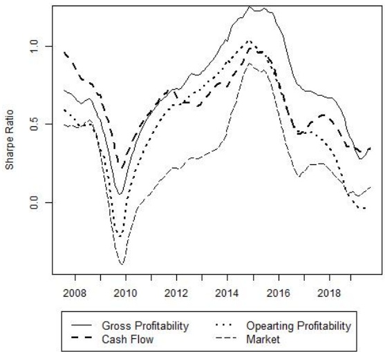

# Empirical evidence of profitability anomaly in the Thai stock market

**Yosuke Kakinuma**

International College, Panyapiwat Institute of Management,

Thailand

[yosukekak@pim.ac.th](mailto:yosukekak@pim.ac.th)

Journal of International Studies

© Foundation of International Studies, 2020 © CSR, 2020

**Abstract**. This study presents empirical evidence of profitability anomaly in the Stock Exchange of Thailand. The effects of gross profitability, operating profitability, and cash flow-to-price (C/P) on the subsequent stock returns are examined using the data from 2002 to 2019. The results of Fama-Macbeth (1973) regression and Carhart (1997) four-factor model indicate that gross profitability and C/P have significant explanatory power for future returns but not operating profitability. Further analysis confirms that gross profitability-sorted portfolio generates the largest risk-adjusted return and C/P-sorted portfolio presents the best consistency to outperform the market. Investing in the portfolios consisted of stocks with high gross profitability and C/P provides protection from the market downside.

**Keywords:** profitability anomaly, gross profitability, operating profitability, cash flowto-price, emerging market.

**JEL Classification:** G12, G15, G17

**Received:** December, 2019 **1st Revision:** September, 2020 **Accepted:** December, 2020

DOI: 10.14254/2071-8330.2020/13-4/6

## 1. INTRODUCTION

The primary purpose of this study is to test profitability anomaly in the Thai stock market. Prior researches generally support the effect of three profitability measures: gross profitability (Novy-Marx, 2013), operating profitability (Fama and French, 2015; Ball, Gerakos, Linnainmaa, and Nikolaev, 2015) and cash flow-to-price (C/P) (Lakonishok, Shleifer, and Robert, 1994). Profitability anomalies are a relatively new field of study in developing markets as size, value and momentum are the focus of interest in terms of investment style factor (Rouwenhorst, 1999; Barry, Goldreyer, Lockwood, and Rodriguez, 2002; van der Hart, Slagter, and van Dijk, 2003; van der Hart, de Zwart, and van Dijk, 2005; Cakici, Fabozzi, and Tan, 2013). Although there is an ongoing debate about which profitability measure represents the best proxy for future returns, scholars affirm the validity of profitability effect in developed markets. Jacobs (2016) states that the alpha from investment strategy based on 11 anomalies is more likely to be larger in developed markets than emerging markets. However, there are opposing views on whether the profitability effect exists in emerging markets due to their unique characteristics of being less sophisticated and less efficient (Plastun,

Kozmenko, Plastun, and Filatova, 2019). Hanauer and Lauterbach (2019) provide evidence for the anomalous returns associated with gross profitability and $\mathrm { C / P }$ along with composite issuance and momentum using the emerging market stocks. The results of cross-sectional regression by Hou, Karolyi, and Kho (2011) also indicate $\mathrm { C / P ^ { \prime } s }$ predictive power in emerging countries. On the contrary, Chen, Sun, Wei, and Xie (2018) conclude that the profitability effect is less prominent at the aggregate level in emerging markets.

This paper aims to fill the gap in the existing literature regarding the existence of the profitability anomaly in emerging markets. This research provides empirical evidence in Thailand, which is the 2nd largest capital market in Southeast Asia with the highest average daily turnover in the region. Moreover, this study highlights which profitability measure leads to the largest alpha after controlling size, value, and momentum factors. The results contribute to the following three novel findings to the existing literature. First, analysis of individual stocks by Fama-Macbeth (1973) regression and portfolio examination by Carhart (1997) fourfactor model reveal that gross profitability and C/P have significant predictive power for future returns, but not operating profitability. Second, gross profitability presents the highest risk-adjusted returns while C/P has the greatest consistency to generate excess returns over the Thai market index. Third, investing in the most profitable quintile of the gross profitability and C/P-sorted portfolios gives investors protection with their 5-year moving average Sharpe Ratios never falling below 0. The theoretical implication of the results is that Thai market is still immature to be efficient, and the investors are less sophisticated (Zhang, 2017). The practical implication is that fund managers and investors should form a portfolio of the firms with high gross profitability and C/P. The remainder of the paper proceeds as follows. Section 2 reviews the prior literature on profitability anomaly. Section 3 describes the data and the methodology of research. Section 4 presents the empirical results, and Section 5 concludes.

## 2. LITERATURE REVIEW

Gross profitability, claimed as the cleanest economic profitability measure by Novy-Marx (2013), features significant predictability of future returns, and it is as powerful as book-to-market (B/M). One of the critical characteristics of profitable firms is that they are growth firms with low B/M, so that they provide a hedging instrument for value investors. Novy-Marx (2013) presents that the trailing five-year Sharpe ratios of a 50/50 mix of long-short gross profitability and value-sorted portfolios never drop below 0 in the tested 42 years. Barillas and Shanken (2018) argue that models that include value and profitability along with momentum show dominance over the five-factor model (Fama and French, 2015) and the q-factor model (Hou, Chen, and Zhang, 2015). Akbas, Jiang, and Koch (2017) add that the trend in gross profitability also predicts a firm's future returns. Both increasing and decreasing drifts in gross profitability in the most recent eight quarters have a significant effect on the succeeding stock prices. Asness, Farazzini, and Pedersen (2019) define quality in terms of profitability, growth, and safety, and the long-short quality portfolio generates a significant risk-adjusted return in the US as well as 24 international markets. Gross profitability is a part of their profitability component. Outside the US market, Ng and Shen (2019) find that gross profitability is significantly linked with the subsequent stock returns in the developed Asian markets. Institutional investors demand quality stocks that have high gross profitability. While Novy-Marx (2013) shows that gross profitability is able to price the excess returns based on an investment strategy sorted by Return on Equity (ROE) in the US market, Chen et al. (2018) finds that Hou et al.'s (2015) ROE strategy is stronger than gross profitability in the 33 international markets.

Ball et al. (2015) argue that operating profitability is the better measurement than gross profitability to forecast expected returns. Shareholders have a claim on net profit, but not on gross profit. Moreover, expenses taken into account in operating profit such as research and development (Chan, Lakonishok, and

Sougiannis, 2001) and selling, general, and administrative costs (SG&A) (Eisfeldt and Papanikolaou, 2013) are predictive indicators of future returns. Lev and Radhakrishnan (2015) argue that any spending to increase a firm's organization capital is included in SG&A. Investors demand higher risk premiums in firms with high organization capital because the value of such firms decreases in times of restructuring (Eisfeldt and Papanikolaou, 2013). Fama and French (2015) admit that their original three-factor model (Fama and French, 1993) is incomplete and incorporate operating profitability in the five-factor asset pricing model. In the global market, the five-factor model works well on the regional portfolios only when local models are applied (Fama and French, 2017).

Lakonishok et al. (1994) discover that C/P, a contrarian value strategy, demonstrates significant explanatory power for expected returns even after controlling size and B/M. Hou et al. (2011) test C/P in 47 different markets in the world and confirm its reliability in the global market. Their multifactor model with the market, C/P, and momentum, captures common variations in the international stock prices. Comparison of profitability measurements in the emerging market by Hanauer and Lauterbach (2019) indicates C/P as well as gross profitability are significant factors for future returns. The inferiority of operating profitability is notable in their study of developing markets. C/P is the only profitability assessment in this study that strips accruals, and Ball, Gerakos, Linnainmaa, and Nikolaev (2016) argue that only cash-based operating income matters in cross-sectional returns. Adding cash-based profitability to popular investment styles including market, size, value, and momentum improves Shape ratios of such style-sorted portfolios. Chen et al. (2018) conclude that the profitability effect exists in developed markets but not in the emerging markets, which is consistent with the investment CAPM (Zhang, 2017) but contradictory to the behavioral finance theory.

Recent studies concerning behavioral finance in the context of emerging markets include Jongadsayakul (2019). The results indicate a bilateral causality between stock market volatility and derivative market liquidity in Thailand. An increase in the market volatility spurs the demand for the derivative market while more appetite for speculation in the derivative market destabilizes the underlying market. With an international CAPM theory, Najmudin, Syarif, Wahyudi, and Muharam (2017) find herding behavior in the China and Philippines stock markets. Herding behavior aggravates volatility and leads to market instability. While investing in the markets with herding behavior reduces the benefits of international diversification, negative covariance between returns of two assets is an effective risk management characteristic. Cayón and Sarmiento (2020) identify that returns on oil negatively impact emerging markets and reduce the systematic risk of emerging markets. The results also support the decoupling hypothesis (Dooley & Hutchison, 2009), which states that the connection between developed and emerging markets tends to be non-synchronous at the beginning of the financial crisis.

## 3. DATA AND METHODOLOGY

The sample universe is all the stocks listed on the Stock Exchange of Thailand from June 2002 to June 2019 for 17 years. The year 2002 is chosen to ensure the availability of a reasonable number of sample firms. The data is extracted from Thomson Reuters Datastream. Total return index which takes dividends and stock splits into account is used to calculate returns. Following Novy-Marx (2013), Hou et al. (2015), Hanauer and Lauterbach. (2019) and others, the following selection criteria are enforced to be included in the dataset. First, all the financial firms which start with 8 in the Industrial Classification Benchmark (ICB) are excluded. However, firms in the Real Estate Investment and Services with the ICB code of 863 are included. Second, property funds, REITs, investment trust funds, infrastructure funds are eliminated. Third, microcap firms that consist of the smallest 3% of the aggregate market capitalization are excluded. A lack of liquidity of microcap stocks makes anomalies impossible to be exploited in practice (Hou et al., 2015).

Micro stocks on average account for 60% of the total number of stocks while they make up only 3% of the market capitalization of the Thai market. Forth, if any values are missing with NA sign, such firms are removed. Fifth, all the variables are winsorized at 0.1% and 99.9% levels.

The following equation is tested with Fama-Macbeth (1973) regression:

$$
R _ {j, t} = \beta_ {0} + \beta^ {\prime} x _ {j, t} + \beta_ {2} L n (M E) _ {j, t} + \beta_ {3} L n (B / M) _ {j, t} + \beta_ {4} r _ {1, 0 _ {j, t}} + \beta_ {4} r _ {1 2, 1 _ {j, t}} + \varepsilon_ {j, t}\tag{1}
$$

where $R _ { j , t }$ is an annual return for stock j from month t to month t+12 in the following year, x is profitability variables which include gross profitability (gross profit scaled by total assets), operating profit (operating income scaled by total assets), and free cash flow (operating free cash flow divided by market capitalization), $L n ( M E )$ is a log of market capitalization, $L n ( B / M )$ is a log of book-to-market, $r _ { 1 , 0 }$ is the most recent 1- month return, and $r _ { 1 2 , 2 }$ is a 12-month return excluding the most recent 1-month return. To avoid lookahead bias and ensure that the accounting data is available to the general public, the financial data at the end of the previous year are matched with returns that are calculated from the price on the last trading date of June in the present year to that of June in the following year. Thus, the first returns in the data are from June 2002 to June 2003 and the accounting data of the year 2001 are used in the regression. The control variables are included in the regression in order to control size and value effects (Fama and French, 1993) as well as momentum effect (Jegadeesh and Titman, 1993). These control variables are important to test the existence of profitability anomaly because they are well-documented investment styles. Returns to small firms are higher than large firms (Fama and French, 1992). In other words, there is a negative relationship between stock returns and firm size. Thus, the coefficient of $L n ( M E )$ is expected to be negative. The value effect, represented by $L n ( B / M )$ , is the most powerful expected-return variable (Fama and French, 1992). $B / M$ is possibly a proxy for relative distress risk as firms’ stock prices fall when the market judges them to have poor prospects, resulting in high B/M. Firms with high B/M are risky. Therefore, their expected returns are high. Momentum strategy that buys stocks with high past returns realizes excess returns (Jegadeesh and Titman, 1993). Ahmed and Safdar (2018) explain that the future return behavior of stocks with high past returns is dependent upon to the extent that the past performance is consistent with the firms’ fundamentals.

Fama-Macbeth (1973) regression has become a standard methodology in the finance literature for its merits of simplicity and clarity. This regression model is employed in other profitability anomaly studies (Novy-Marx, 2013; Ball et al., 2015; and others). The two-step estimation of factor loadings is especially effective for a multifactor model because it can be easily modified to accommodate additional risk variables (Pasquariello, 1999). As this study employs multiple variables for parameter estimation, the regression model suits the purpose. Despite the popularity of Fama-Macbeth (1973) regression in finance research, Khalaf and Schaller (2012) argue the model can lead to econometric problems. Weak identification causes size distortion in tests of risk parameters, overall tests of asset pricing models, and biased point estimates. Alternative regression models using panel data include fixed-effect and random-effect regression.

Table 1 reports the summary statistics of the variables. Stock returns show a typical right-skewed characteristic with the maximum annual returns exceeding 700%. Gross profitability is higher than operating profitability, which makes economic sense because operating profits are after deducting deducting selling, general, and administrative expenses. Of the three profitability measures, free cash flow exhibits the most extensive variation with a standard deviation of 17.1%.

Summary Statistics

Table 1

|  | Mean | SD | Min | Q1 | Median | Q3 | Max |
| --- | --- | --- | --- | --- | --- | --- | --- |
| Stock Return | 0.165 | 0.573 | -0.948 | -0.154 | 0.052 | 0.343 | 7.663 |
| Gross Profitability | 0.197 | 0.146 | -0.186 | 0.096 | 0.164 | 0.264 | 0.946 |
| Operating Profit | 0.079 | 0.091 | -0.575 | 0.027 | 0.071 | 0.122 | 0.574 |
| Free Cash Flow | 0.090 | 0.171 | -1.479 | 0.029 | 0.085 | 0.153 | 1.351 |
| Log (ME) | 5.164 | 0.966 | 0.693 | 4.787 | 5.429 | 5.844 | 6.155 |
| Log (B/M) | -0.583 | 0.836 | -6.561 | -1.054 | -0.519 | -0.030 | 1.661 |
| 𝑟1,0 | 0.013 | 0.110 | -0.471 | -0.040 | 0.002 | 0.056 | 0.808 |
| 𝑟12,1 | 0.255 | 0.706 | -0.944 | -0.101 | 0.099 | 0.421 | 10.667 |

Note: This table reports summary statistics of all the variables in the equation (1). The data is from June 2002 to June 2019. Stock return is an annual return for stock j from a month in the year t to the same month of the following year t+1, gross profitability is gross profit scaled by total assets, operating profit is operating income scaled by total assets, free cash flow is operating free cash flow divided by market capitalization, 𝐿𝑛(𝑀𝐸) is a log of market capitalization, 𝐿𝑛(𝐵/𝑀) is a log of book-to-market, $r _ { 1 , 0 }$ is the most recent 1-month return, and $r _ { 1 2 , 2 }$ is a 12-month return excluding the most recent 1-month return.

Source: own caclulation

Table 2 reports the correlation between the variables in the equation (1). Except for operating profitability, stock returns are significantly correlated with the variables. Log of ME and the last 11-month returns indicate negative correlations, which are expected with size effect and long-term reversal effect (Jegadeesh and Titman, 2001). Among the profitability measures, free cash flow possesses the highest correlation with stock returns, which is consistent with the theoretical valuation principle that the present firm value depends on the future cash flows (Lau and Mahat, 2019). All three profitability measures are highly correlated to each other with significance. To avoid multicollinearity, each profitability variable is tested independently in a regression. In line with Novy-Marx (2013) and Ball et al. (2015), gross profit and operating profit are negatively correlated with B/M. Profitable firms are growth firms which have low B/M and unprofitable firms are value firms which have high B/M (Novy-Marx, 2013).

Given the skewed distribution and some extreme observations for both stock returns and profitability measures, portfolio tests possibly provide more robust and practical results to see the predictive ability of the profitability measures. Using the Carhart (1997) four-factor model, the following regression is examined:

$$
R _ {i, t} - R _ {F, t} = \alpha + \beta_ {1} (M K T - R _ {F}) _ {t} + \beta_ {2} S M B _ {t} + \beta_ {3} H M L _ {t} + \beta_ {4} W M L _ {t} + \varepsilon_ {i, t}\tag{2}
$$

where $R _ { i , t }$ is an annual return of equal-weighted quintile portfolios sorted by gross profitability, operating profit, and free cash flow, from month t to month t+12 in the following year, $R _ { F , t }$ is 1-month Thai government bond in month t, 𝑀𝐾𝑇 is a market return calculated from the SET Total Return Index, 𝑆𝑀𝐵 is a portfolio return that longs small stocks and shorts large stocks using the median market capitalization as the size breakpoint, 𝐻𝑀𝐿 is a portfolio return that longs high B/M stocks (value) and shorts low B/M stocks (growth) using the median B/M ratio as the value breakpoint, 𝑊𝑀𝐿 is a portfolio return that longs winner stocks with high 1-month returns and shorts loser stocks with low 1-month returns using the median 1-month return as the momentum breakpoint.

Person Correlation Matrix

Table 2

|  | Stock Return | Gross Profitability | Operating Profit | Free Cash Flow | Log(M/E) | Log(B/M) | 𝑟1,0 |
| --- | --- | --- | --- | --- | --- | --- | --- |
| Gross Profitability | 0.024(0.00) | 1.00 |  |  |  |  |  |
| Operating Profit | 0.007(0.41) | 0.673(0.00) | 1.00 |  |  |  |  |
| Free Cash Flow | 0.104(0.00) | 0.156(0.00) | 0.220 (0.00) | 1.00 |  |  |  |
| Log (M/E) | -0.009(0.00) | 0.007(0.47) | -0.067 (0.00) | 0.010 (0.00) | 1.00 |  |  |
| Log (B/M) | 0.185(0.00) | -0.362(0.00) | -0.244 (0.00) | 0.166 (0.00) | 0.106(0.00) | 1.00 |  |
| 𝑟1,0 | 0.055(0.00) | 0.009(0.16) | 0.003 (0.69) | -0.001(0.98) | -0.003(0.36) | -0.050(0.00) | 1.00 |
| 𝑟12,1 | -0.019(0.00) | 0.027(0.00) | 0.007 (0.04) | -0.002(0.00) | -0.006(0.23) | -0.171(0.00) | 0.026(0.00) |

Note: The table presents Person correlation between the variables in the equation (1). The data range and descriptions are the same as Table 1. P-values are shown in the parentheses. Source: own caclulation

## 4. EMPIRICAL RESULTS AND DISCUSSION

The results of the equation (1) are reported in Table 3. All three profitability measures display strong positive significance to forecast expected returns. Of the three, the gross profitability has the largest t-values, indicating the most powerful explanatory power. The parameters of the three profitability measures still show the significance even after the controlling well-documented Fama and French's (1993) size and value and Jegadeesh and Titman's (1993) momentum factors. This suggests the validity of the profitability effect in the Thai market and conforms to the prior studies in the other markets such as Novy-Marx (2013), Ball et al. (2015), and Hou et al. (2011). The signs of the control variables, which are negative for Ln(ME) and $r _ { 1 2 , 2 : }$ , positive for $L n ( B / M )$ and $r _ { 1 , 0 }$ , are as expected because they represent size, long-term reversal, value, and short-term momentum effects (Zaremba, 2019) respectively.

Table 3

Fama and Macbeth Regression of Stock Returns on Profitability

| Independent Variable | (1) | (2) | (3) | (4) |
| --- | --- | --- | --- | --- |
| Gross Profitability |  | 0.399***(32.33) |  |  |
| Operating Profit |  |  | 0.324***(23.96) |  |
| Free Cash Flow |  |  |  | 0.226***(7.75) |
| Log (ME) | -0.017***(-14.45) | -0.019***(-14.47) | -0.016***(-13.70) | -0.017***(-14.23) |
| Log (B/M) | 0.131***(20.09) | 0.157***(22.55) | 0.138***(21.36) | 0.121***(17.28) |
| 𝑟1,0 | 0.357*(2.32) | 0.363*(2.46) | 0.362*(2.41) | 0.359***(2.37) |
| 𝑟12,1 | 0.013(1.13) | 0.016(1.38) | 0.015(1.37) | 0.013(1.16) |
| Adjusted 𝑅2 | 0.054 | 0.062 | 0.056 | 0.059 |

Note: The table reports the results of the following Fama and Macbeth (1973) regression:

$$
R _ {j, t} = \beta_ {0} + \beta^ {\prime} x _ {j, t} + \beta_ {2} L n (M E) _ {j, t} + \beta_ {3} L n (B / M) _ {j, t} + \beta_ {4} r _ {1, 0 j, t} + \beta_ {4} r _ {1 2, 1 j, t} + \varepsilon_ {j, t}
$$

where $R _ { j , t }$ is an annual return for stock j from month t to the same month t of the following year, x is profitability variables which include gross profitability (gross profit scaled by total assets), operating profit (operating income scaled by total assets), free cash flow (operating free cash flow divided by total market capitalization), 𝐿𝑛(𝑀𝐸) is a log of market capitalization, 𝐿𝑛(𝐵/𝑀) is a log of book-to-market, $r _ { 1 , 0 }$ is the most recent 1-month return, and $r _ { 1 2 , 2 }$ is a 12- month return excluding the most recent 1-month return. T-statistics are shown in the parentheses. \*, \*\*, and \*\*\* indicate significance at 0.05, 0.01, and 0.001 level respectively. The data is from June 2002 to June 2019. Source: own caclulation

Table 4 reports the result of the equation (2) of the four-factor model. The focus of this model is the alpha which represents the excess returns after controlling the market, size, value, and momentum factors. The alphas increase monotonically for the quintile portfolios sorted by gross profitability and C/F, but not by operating profitability. For the gross profitability and C/F-sorted portfolios, the portfolios with the most profitable firms provide the highest alphas with significance, whereas the portfolios with the least profitable firms yield the lowest alphas. The alpha for the lowest profitable quintile portfolio sorted by gross profitability is significantly negative. The long-short portfolios, which buy the highest quintile portfolios and sell the lowest, by gross profitability and C/F also produce significant positive alphas. This is clear evidence that supports the profitability effect by gross profitability and C/F. The results affirm that gross profitability strategies generate significant abnormal returns (Novy-Marx, 2013), and risk loadings on C/P factor mimicking portfolio are associated with an economically large and statistically significant return premium (Hou et al., 2011). Although the alphas for operating profitability-sorted portfolios are positive for those with higher profitability, the effect is somewhat spurious. The alpha of the highest quintile portfolio is the second smallest in the quintile. The contradicting results between Table 3 and Table 4 for the operating profitability are probably due to some extreme samples in the data. When tested individually in the equation (1), the effect appears to be valid. Nonetheless, consistent with Hanauer and Lauterbach (2019), the portfolio analysis in the equation (2) does not support the anomaly.

The results in Table 3 and Table 4 confirm the existence of profitability anomaly and question the efficiency of the Thai market. In an efficient market, past information cannot predict future prices because prices follow random walk. This makes it difficult to realize abnormal returns (Tiwari, Aye, and Gupta, 2019). In contrast to this theory, investing in firms with high gross profit and C/P earns excess returns in the Thai capital market. An inefficient market creates opportunities for arbitrage profits. It also discourages firms from raising capital because they fail to receive a fair value. Improvement in information flow, trading technology, and regulatory governance will increase the level of market efficiency (Tiwari et al., 2019).

Table 4

Four-Factor Model on Profitability-sorted Portfolios

<table><tbody><tr><td></td><td colspan="5">Four-Factor Model</td></tr><tr><td>Portfolio</td><td>α</td><td>β𝑀𝐾𝑇-𝑅𝑓</td><td>β𝑆𝑀𝐵</td><td>β𝐻𝑀𝐿</td><td>β𝑊𝑀𝐿</td></tr><tr><td colspan="6">Gross Profitability</td></tr><tr><td>1 (Low)</td><td>-0.034***(-3.36)</td><td>1.115***(29.83)</td><td>0.750***(9.93)</td><td>0.233*(2.10)</td><td>-0.105(-1.44)</td></tr><tr><td>2</td><td>0.025**(3.05)</td><td>1.140***(37.675)</td><td>0.872***(14.26)</td><td>0.181*(2.01)</td><td>0.081(1.36)</td></tr><tr><td>3</td><td>0.049***(5.47)</td><td>1.139***(34.42)</td><td>0.359***(5.38)</td><td>0.438***(4.44)</td><td>-0.016(-0.25)</td></tr><tr><td>4</td><td>0.054***</td><td>1.419***</td><td>1.018***</td><td>-0.642***</td><td>-0.278***</td></tr><tr><td></td><td>(5.16)</td><td>(37.07)</td><td>(13.17)</td><td>(-5.63)</td><td>(-3.70)</td></tr><tr><td>5 (High)</td><td>0.065***(8.29)</td><td>0.880***(30.78)</td><td>0.489***(8.48)</td><td>-0.077(-0.91)</td><td>-0.152**(-2.71)</td></tr><tr><td>High - Low</td><td>0.074***(5.98)</td><td>-0.222***(-4.88)</td><td>-0.245**(-2.70)</td><td>-0.301*(-2.26)</td><td>-0.013(-0.15)</td></tr><tr><td colspan="6">Operating Profit</td></tr><tr><td>1 (Low)</td><td>0.015(1.33)</td><td>1.417***(33.35)</td><td>1.005***(11.72)</td><td>-0.440***(-3.49)</td><td>-0.324***(-3.89)</td></tr><tr><td>2</td><td>0.035***(4.54)</td><td>0.897***(32.20)</td><td>0.563***(9.66)</td><td>0.421***(4.96)</td><td>0.155**(2.79)</td></tr><tr><td>3</td><td>0.056***(8.31)</td><td>1.068***(42.88)</td><td>0.638***(12.69)</td><td>-0.157*(-2.12)</td><td>-0.140**(-2.86)</td></tr><tr><td>4</td><td>0.055***(7.03)</td><td>1.215***(41.76)</td><td>0.588***(10.25)</td><td>-0.095(-1.13)</td><td>-0.117*(-2.11)</td></tr><tr><td>5 (High)</td><td>0.024**(2.89)</td><td>1.191***(38.36)</td><td>0.665***(10.61)</td><td>0.092(1.00)</td><td>-0.121*(-1.99)</td></tr><tr><td>High - Low</td><td>-0.015(-1.19)</td><td>-0.215***(-4.42)</td><td>-0.323**(-3.33)</td><td>0.540***(3.80)</td><td>0.234*(2.49)</td></tr><tr><td colspan="6">Free Cash Flow</td></tr><tr><td>1 (Low)</td><td>-0.018(-1.88)</td><td>1.211***(34.39)</td><td>0.604***(8.48)</td><td>-0.435***(-4.14)</td><td>-0.258***(-3.79)</td></tr><tr><td>2</td><td>0.026**(2.89)</td><td>1.161***(34.45)</td><td>0.411***(6.04)</td><td>-0.366***(-3.64)</td><td>-0.088(-1.32)</td></tr><tr><td>3</td><td>0.055***(5.17)</td><td>0.890***(22.89)</td><td>0.499***(6.35)</td><td>-0.119(-1.02)</td><td>0.130(0.08)</td></tr><tr><td>4</td><td>0.052***(5.91)</td><td>1.070***(33.50)</td><td>0.569***(8.82)</td><td>0.336***(3.53)</td><td>0.044(0.70)</td></tr><tr><td>5 (High)</td><td>0.071***(9.38)</td><td>1.218***(43.76)</td><td>1.014***(18.05)</td><td>0.340***(4.12)</td><td>-0.179**(-3.27)</td></tr><tr><td>High - Low</td><td>0.066***(6.01)</td><td>0.008(0.19)</td><td>0.437***(5.40)</td><td>0.780***(6.58)</td><td>0.107(1.37)</td></tr></tbody></table>

Note: The table reports the results of the following Carhart (1997) four-factor model:

$$
R _ {i, t} - R _ {F, t} = \alpha + \beta_ {1} (M K T - R _ {F}) _ {r} + \beta_ {2} S M B _ {t} + \beta_ {3} H M L _ {t} + \beta_ {4} W M L _ {t} + \varepsilon_ {i, t}
$$

where $R _ { i , t }$ is an annual return of equal-weighted quintile portfolios sorted by gross profitability, operating profit, and free cash flow, from month t to month t+12 in the following year, $R _ { F , t }$ is a 1-month Thai government bond in month $\ell ,$ 𝑀𝐾𝑇 is a market return calculated from the SET Total Return Index, 𝑆𝑀𝐵 is a portfolio return that longs small stocks and shorts large stocks using the median market capitalization as the size breakpoint, 𝐻𝑀𝐿 is a portfolio return that high B/M stocks (value) and shorts low B/M stocks (growth) using the median B/M ratio as the value breakpoint, 𝑊𝑀𝐿 is a portfolio return that longs winner stocks with high 1-month returns and shorts loser stocks with low 1- month returns using the median 1-month return as the momentum breakpoint. The data is from June 2002 to June 2019.

## Source: own caclulation

It is necessary to evaluate an investment from the point of view of risk and performance as compared to the market benchmark. Table 5 presents various return and risk measures for the highest quintile portfolios of the gross profitability, operating profitability, and $\mathrm { C / P . }$ This framework of return and risk measurements is from Hanauer et al. (2019). Sharpe ratio is the largest and the maximum drawdown is the lowest for the gross profitability portfolio. Thus, investing in a portfolio with the high gross profitability generates the highest risk-adjusted return and provides the best protection against the downside risk. The average return of the C/P portfolio is the highest, but its volatility is also the largest, which leads to a slightly lower Sharpe ratio than the gross profitability. $\mathrm { C / P ^ { \prime } s }$ maximum drawdown is the highest among the three variables. In terms of outperforming the market, the $\mathrm { C / P }$ portfolio exhibits the best consistency with the greatest tracking error and information ratio. This indicates that $\mathrm { C / P }$ is less prone to the market movement because operating cash flow is fundamentally valuable and a better estimate for true intrinsic value (Foerster, Tsagarelis, and Wang, 2018). Operating profitability is inferior to the other two variables when assessing risk-adjusted returns and performance compared to the market benchmark.

Table 5

Portfolio Return and Risk Measurements

| Portfolio | Average Return % | Standard Deviation % | Shape Ratio | Maximum Drawdown % | Tracking Error % | Information Ratio % |
| --- | --- | --- | --- | --- | --- | --- |
| Market Index | 10.80 | 26.60 | 0.32 | 43.77 | - | - |
| Gross Profitability | 18.34 | 25.75 | 0.62 | 17.06 | 29.09 | 1.68 |
| Operating Profit | 18.69 | 34.26 | 0.48 | 24.87 | 24.88 | 1.34 |
| Free Cash Flow | 25.41 | 37.49 | 0.61 | 26.63 | 46.17 | 2.45 |

Note: The table presents performance and risk metrics for the highest quintile portfolios for each profitability measure reported in Table 4. All the figures are annualized as a percentage. The data is from June 2002 to June 2019. Source: own calculation

Figure 1 displays the trailing five-year Sharpe ratios for the highest quintile portfolios for each profitability measure reported in Table 4. The Sharpe ratios for the gross profitability and C/P-sorted portfolios never fall below 0. During the global financial crisis in 2008, all the portfolio's Sharpe ratios significantly drop. However, the gross profitability and C/P show resistance while the Shape ratios of the operating profitability portfolio and the market dip into the negative level. Investment in firms with high gross profitability and C/P offers protection in the time of market downturn. It is the C/P portfolio that excels in the first half of the sample period, whereas the gross profitability-sorted portfolio overperforms in the 2nd half including the period when the market peaks in 2014 and 2015. The economic explanation for this pattern is that, during the market downturn, investors become risk-off and value firms with high cash flows. Thus, when the market return is negative, firms with high C/P become defensive stocks. During the market upturn, growth firms outperform the market, and profitable firms are growth firms (Novy-Marx, 2013). Hence, when the market condition improves in the 2nd half of the sample period, the gross profitability-sorted portfolio outmatches the other portfolios.

Figure 1 Trailing Five-Year Trailing Sharpe Ratios

The figure illustrates the trailing five-year Sharpe ratio for the highest quintile portfolios for each profitability measure reported in Table 4. The data is from June 2007 to June 2019.

## 5. CONCLUSION

This paper provides empirical evidence of the profitability effect in the Thai market. Gross profitability (Novy-Marx, 2013), operating profitability (Fama and French, 2015, Ball et al., 2015), and cash flow-to-price (C/P) (Lakonishok et al., 1994) are examined. Some scholars such as Chen et al. (2018) question the existence of profitability anomalies in the emerging market. The analysis of the cross-sectional returns of individual firms by Fama-Macbeth (1973) regression and the portfolio performance by Carhart (1997) fourfactor model confirm that gross profitability and C/P are significant indicators for future returns, but not operating profitability. The portfolios consisted of firms with high gross profitability present the highest risk-adjusted returns while those with high C/P provide the best consistency to outperform the market benchmark index. Moreover, holding in the portfolios composed of stocks with high gross profitability and C/P protects investors from the market downside. The unfavorable quality of operating profitability in this study is in line with the results of Hanauer and Lauterbach (2019). The anonymous returns by gross profitability and C/P imply the inefficiency of the Thai market. As in Bartram & Grinblattcd (2020), emerging markets are less efficient in incorporating widely available fundamental information. Market efficiency can be improved by implementing measures for more effective information flow, trading technology, and regulatory governance (Tiwari et al., 2019).

The limitation of this study includes a rather small size of a sample dataset. Due to the fact that the Thai capital market is still in a development stage, microcap stocks, which are eliminated from this study, dominate the number of listed companies. As a result, the sample size became considerably small. As the Thai market gets more matured in the future and more firms grow to be large-cap stocks, a better-tested outcome can be expected in terms of solidity. Recent studies find international evidence of other anomalies such as sticky expectations (Bouchaud, Kruger, Landier, and Thesmar, 2019), day-of-the-week (Chiah and Zhong, 2019), advertising (Chemmanur and Yan, 2019) and oil price (Cheema and Scrimgeour, 2019). Future works can be done whether profitability anomaly is able to price these newly discovered anomalies.

## REFERENCES

Ahmed, A. S., & Safdar, I. (2018). Dissecting stock price momentum using financial statement analysis. Accounting and Finance, 58, 3–43. https://doi.org/10.1111/acfi.12358

Akbas, F., Jiang, C., & Koch, P. D. (2017). The trend in firm profitability and the cross-section of stock returns. Accounting Review, 92(5), 1–32. https://doi.org/10.2308/accr-51708

Asness, C., Frazzini, A., & Pedersen, L. (2019). Quality Minus Junk Discussion. Review of Accounting Studies, 24(1), 34-112ba. https://doi.org/10.2139/ssrn.2312432

Ball, R., Gerakos, J., Linnainmaa, J. T., & Nikolaev, V. (2016). Accruals, cash flows, and operating profitability in the cross section of stock returns. Journal of Financial Economics, 121(1), 28–45. https://doi.org/10.1016/j.jfineco.2016.03.002

Ball, R., Gerakos, J., Linnainmaa, J. T., & Nikolaev, V. V. (2015). Deflating profitability. Journal of Financial Economics, 117(2), 225–248. https://doi.org/10.1016/j.jfineco.2015.02.004

Barillas, F., & Shanken, J. (2018). Comparing Asset Pricing Models. Journal of Finance, 73(2), 715–754. https://doi.org/10.1111/jofi.12607

Barry, C. B., Goldreyer, E., Lockwood, L., & Rodriguez, M. (2002). Robustness of size and value effects in emerging equity markets, 1985-2000. Emerging Markets Review, 3(1), 1-30.

Bartram, S., & Grinblattcd, M. (2020). Global market inefficiencies. Journal of Financial Economics, In Presss. https://doi.org/https://doi.org/10.1016/j.jfineco.2020.07.011

Bouchaud, J. P., Krüger, P., Landier, A., & Thesmar, D. (2019). Sticky Expectations and the Profitability Anomaly. Journal of Finance, 74(2), 639–674. https://doi.org/10.1111/jofi.12734

Cakici, N., Fabozzi, F. J., & Tan, S. (2013). Size, value, and momentum in emerging market stock returns. Emerging Markets Review, 16, 46–65. https://doi.org/10.1016/j.ememar.2013.03.001

Carhart, M. (1997). On Persistence in Mutual Fund Performance. Journal of Finance, 52(1), 57–82. https://doi.org/10.2307/2329556

Cayón, E., & Sarmiento, J. (2020). Testing for contagion from oil and developed markets to emerging markets : An empirical analysis using systemic risk parameter. Journal of International Studies, 13(2), 98–108. https://doi.org/10.14254/2071-8330.2020/13-2/7

Chan, L., Lakonishok, J., & Sougiannis, T. (2001). The Stock Market Valuation of Research and Development Cost. The Journal of Finance, 56(6), 2431–2456. https://doi.org/10.1111/0022-1082.00411

Cheema, M. A., & Scrimgeour, F. (2019). Oil Prices and Stock Market Anomalies. Energy Economics. https://doi.org/10.2139/ssrn.3200162

Chemmanur, T. J., & Yan, A. (2019). Advertising, Attention, and Stock Returns. Quarterly Journal of Finance, 9(3), 1950009. https://doi.org/10.1142/s2010139219500095

Chen, T. F., Sun, L., Wei, K. C. J., & Xie, F. (2018). The profitability effect: Insights from international equity markets. European Financial Management, 24(4), 545–580. https://doi.org/10.1111/eufm.12189

Chiah, M., & Zhong, A. (2019). Day-of-the-week effect in anomaly returns: International evidence. Economics Letters, 182, 90–92. https://doi.org/10.1016/j.econlet.2019.05.042

Dooley, M., & Hutchison, M. (2009). Transmission of the U.S. subprime crisis to emerging markets: Evidence on the decoupling–recoupling hypothesis. Journal of International Money and Finance, 28(8), 1331–1349. https://doi.org/https://doi.org/10.1016/j.jimonfin.2009.08.004

Eisfeldt, A. L., & Papanikolaou, D. (2013). Organization capital and the cross-section of expected returns. Journal of Finance, 68(4), 1365–1406. https://doi.org/10.1111/jofi.12034

Fama, Eugene F., Macbeth, D. (1973). Risk, Return, and Equilibrium: Empirical Tests. Journal of Political Economy, 81(3), 607–636. https://doi.org/10.1086/260061

Fama, E., & French, K. (1992). The Cross‐ Section of Expected Stock Returns. The Journal of Finance, 47(2), 427–465. https://doi.org/10.1111/j.1540-6261.1992.tb04398.x

Fama, E., & French, K. (1993). Common risk factors in the returns stocks and bonds. Journal of Financial Economics, 33(1), 3–56. https://doi.org/10.1016/0304-405X(93)90023-5

Fama, E., & French, K. (2015). A five-factor asset pricing model. Journal of Financial Economics, 116(1), 1–22.

Fama, E., & French, K. (2017). International tests of a five-factor asset pricing model. Journal of Financial Economics,

123(3), 441–463. https://doi.org/10.1016/j.jfineco.2016.11.004

Foerster, S., Tsagarelis, J., & Wang, G. (2018). Are Cash Flows Better Stock Return Predictors Than Profits ? Financial Analysts Journal, 73(1), 73–99. https://doi.org/10.2469/faj.v73.n1.2

Hanauer, M. X., & Lauterbach, J. G. (2019). The cross-section of emerging market stock returns. Emerging Markets Review, 38(November 2018), 265–286. https://doi.org/10.1016/j.ememar.2018.11.009

Hou, K., Karolyi, G. A., & Kho, B. (2011). What Factors Drive Global Stock Returns? Review of Financial Studies, 24(8), 2527–2574. https://doi.org/10.1093/rfs/hhrO13

Hou, K., Xue, C., & Zhang, L. (2015). Digesting Anomalies: An Investment Approach. Review of Financial Studies, 28(3), 650–705. https://doi.org/10.1093/rfs/hhu068

Jacobs, H. (2016). Market maturity and mispricing. Journal of Financial Economics. https://doi.org/10.1016/j.jfineco.2016.01.030

Jegadeesh, N., & Titman, S. (1993). Efficiency Returns to Buying Winners and Selling Losers : Implications for Stock Market Efficiency. The Journal of Finance, 48(1), 65–91. https://doi.org/10.1111/j.1540-6261.1993.tb04702.x

Jegadeesh, N., & Titman, S. (2001). Profitability of Momentum Strategies : An Evaluation of Alternative Explanations. The Journal of Finance, 56(2), 699–720. https://doi.org/10.1111/0022-1082.00342

Jongadsayakul, W. (2019). Determinants of investor behavior in SET50 index futures and options markets: Evidence from Thailand futures exchange. Journal of International Studies, 12(3), 22–30. https://doi.org/10.14254/2071-8330.2019/12-3/2

Khalaf, L., & Schaller, H. (2012). How Fama-MacBeth Can Go Wrong – And an Informative Solution. SSRN, (613). https://doi.org/10.2139/ssrn.1785858

Lakonishok, J., Shleifer, A., & Robert, W. V. (1994). Investment, Extrapolation, and Risk. The Journal of Finance, 49(5), 1541–1578. https://doi.org/10.1177/0022002705277551

Lau, W. T., & Mahat, F. B. (2019). Robustness of cash flow value: Investment in ASEAN. Journal of Asian Finance, Economics and Business, 6(2), 247–255. https://doi.org/10.13106/jafeb.2019.vol6.no2.247

Lev, B., & Radhakrishnan, S. (2015). The Valuation of Organization Capital. In Measuring Capital in the New Economy (pp. 73–110). Retrieved from http://www.nber.org/chapters/c10619

Najmudin, Syarif, D. H., Wahyudi, S., & Muharam, H. (2017). Applying an international CAPM to herding behaviour model for integrated stock markets. Journal of International Studies, 10(4), 47–62. https://doi.org/10.14254/2071-8330.2017/10-4/3

Ng, C. C. A., & Shen, J. (2019). Quality investing in Asian stock markets. Accounting and Finance. https://doi.org/10.1111/acfi.12446

Novy-Marx, R. (2013). The other side of value: The gross profitability premium. Journal of Financial Economics, 108(1), 1–28. https://doi.org/10.1016/j.jfineco.2013.01.003

Pasquariello, P. (1999). The Fama-MacBeth approach revisited. Stern School of Business, New York University.Working Paper. Retrieved from http://webuser.bus.umich.edu/ppasquar/famamacbeth.pdf

Plastun, A., Kozmenko, S., Plastum, V., & Filatova, H. (2019). Market anomalies and data persistence: The case of the day-of-the-week effect. Journal of International Studies, 12(3), 122–130. https://doi.org/10.14254/2071-8330.2019/12-3/10

Rouwenhorst, K. G. (1999). Local return factors and turnover in emerging stock markets. Journal of Finance, 54(4), 1439–1464. https://doi.org/10.1111/0022-1082.00151

Tiwari, A. K., Aye, G. C., & Gupta, R. (2019). Stock market efficiency analysis using long spans of data: A multifractal detrended fluctuation approach. Finance Research Letters, 28, 398–411. https://doi.org/https://doi.org/10.1016/j.frl.2018.06.012

van der Hart, J., de Zwart, G., & van Dijk, D. (2005). The success of stock selection strategies in emerging markets: Is it risk or behavioral bias? Emerging Markets Review, 6(3), 238–262. https://doi.org/10.1016/j.ememar.2005.05.002

Zaremba, A. (2019). Performance Persistence in Anomaly Returns: Evidence from Frontier Markets. Emerging Markets Finance and Trade, 0(00), 1-22. https://doi.org/10.1080/1540496X.2019.1605594

Zhang, L. (2017). The Investment CAPM. European Financial Management, 23(4), 545–603.