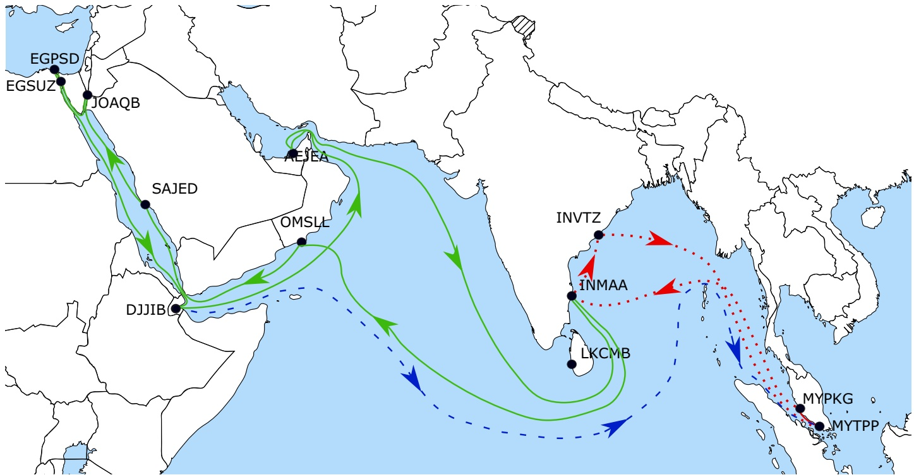
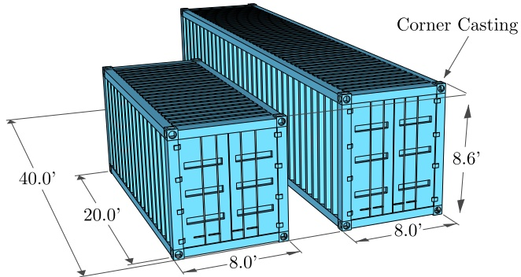

Invited Review

# Uncertainty in maritime ship routing and scheduling: A Literature review

Jana Ksciuk a,∗, Stefan Kuhlemann b, Kevin Tierney b, Achim Koberstein a

a Europa-Universität Viadrina, Große Scharrnstraße 59, Frankfurt (Oder) 15230, Germany

b Universität Bielefeld, Universitätsstraße 25, Bielefeld 33615, Germany

## a r t i c l e i n f o

Article history: Received 18 January 2022 Accepted 5 August 2022 Available online 10 August 2022

Keywords: Stochastic programming Literature review Maritime optimization Optimization under uncertainty

## a b s t r a c t

The area of maritime transportation optimization has recently begun to achieve increasing success at solving large scale models, and industry is steadily adopting operations research-based models and algorithms. However, the parameters of models in the maritime domain, like many others, are beset with uncertainty. The travel times of ships, the handling times at port, the amounts of demand available at ports, fuel prices and more are all unknown and highly variable inputs to optimization methods. Recently, the maritime literature has started to address sources of uncertainty to provide higher quality decision making. We review this nascent area of the literature and provide a unifying view of different types of uncertainty across the main areas of maritime transport and varying problem types.

© 2022 The Authors. Published by Elsevier B.V.

This is an open access article under the CC BY license ([http://creativecommons.org/licenses/by/4.0/](http://creativecommons.org/licenses/by/4.0/))

## 1. Introduction

“A ship in harbor is safe, but that is not what ships are built $f o r . -$ John A. Shedd. Uncertainty and risk have always been a feature of maritime transportation, with mariners being caught between the winds and waves of the ocean and the boom and bust cycles of international trade. Modern ocean shipping, while thankfully significantly safer than ever before, is still rife with variability in terms of demand, travel and port times, and associated costs, like bunker fuel. Even today, the planners of shipping fleets, routes and networks have to rely on their experience to take the unknown into account when making decisions. However, the difficulty of planning is constantly increasing due to the growth in international maritime trade volumes, which reached 11 billion tons in 2018 (UNCTAD RMT 2019), and growth in fleet sizes, which increased by 2.61% just from 2018 to 2019. In response to these trends, an increasing number of automatic decision support approaches can now handle uncertain parameters, ensuring more robust planning.

Compared to other industries, the maritime sector has been slow to adopt automated planning approaches into their planning procedures (Soegaard & Wheeler, 2019). Nonetheless, optimizationbased decision support systems now play a major role in industry across the entire field of maritime transportation. However, systems including uncertainty or otherwise performing some kind of stochastic or robust optimization remain rare, outside of the weather routing of ships. In addition to the conservative nature of the industry, maritime optimization problems are difficult to solve due to their size and structure (e.g., cyclical components or integrated inventory management), which has led to slow adoption of automated decision support. Including uncertainty only makes solving these already difficult problems even harder.

In the operations research literature, ship routing and scheduling is generally divided into three categories: tramp, industrial and liner (Christiansen, Fagerholt, Nygreen, & Ronen, 2007; Ronen, 1983). Tramp shipping involves no fixed schedule and a shipping operator seeks available cargo to transport. In industrial shipping, the vessels and the cargo are both owned by a single operator who wants to minimize its transportation costs, and potentially production/inventory costs at the same time. Liner shipping has a fixed, pre-planned schedule and cyclical routes. Liner shipping can be thought of as a public bus route, in which cargo, usually in the form of containers or “rollable” vehicles, is carried at scheduled times, tramp shipping is like a taxi that follows demand, and industrial shipping is somewhere in between tramp and liner depending on the business requirements of the company. Tramp and industrial shipping are not restricted to any cargo type, with carriers specializing in different trades. However, tramp and industrial shipping often carry bulk goods like grains, ore or liquids.

The uncertainty faced by carriers is mostly independent of the type of shipping. Hence, in this review, we seek a unifying perspective of uncertainty in various forms of ship routing and scheduling and across optimization problems. We divide the literature not by its shipping form, but by the level of planning: strategic, tactical or operational. At the strategic level, maritime carriers must make decisions lasting for years or even decades that will survive changing regulatory regimes and shifting markets, such as composing their fleet or designing their network. With their tactical decision making, companies plan over the course of several months, determining routes, fixing schedules, or repositioning vessels within their network. Finally, in their day-to-day operations, carriers decide what cargo to load or how to avoid inclement weather. While the sources of uncertainty remain basically the same at all planning levels, the way uncertainty is modeled and the types of recourse actions available changes.

<small>∗ Corresponding author.</small>

<small>E-mail address: [ksciuk@europa-uni.de](mailto:ksciuk@europa-uni.de) (J. Ksciuk).</small>

The scope of our review encompasses work in the field of operations research considering uncertainty for the routing and scheduling of vessels at sea. We thus consider optimization problems at the quay, for example vessel stowage, as out of scope. In this way, we focus on problems with similar types of uncertainty and over similar timescales. We note that some problems in this survey have a quay-side component, e.g., maritime inventory routing, but are included because of their emphasis on routing at sea.

In recent years, considerable progress has been made in the field of optimization under uncertainty both in terms of modeling and solving difficult problems (Govindan & Cheng, 2018). With respect to modeling, the classical stochastic programming and robust optimization approaches have been complemented by hybrid approaches (e.g., distributionally and adjustable robust optimization (Liu, Zhang, & Yuan, 2021; Yanıkoglu, ˘ Gorissen, & den Hertog, 2019)) to utilize the available information on the uncertainties in the computationally most beneficial way. Regarding solving, decomposition has been rediscovered and revised (e.g., the branchand-Benders cut algorithm (Maher, 2021), scenario decomposition) to make the best use of multicore processor architectures. Our goal is to survey the existing knowledge for each planning level about which uncertainties matter, how they are captured in optimization models and which solution approaches have proven to be most efficient. In this way, we seek to identify gaps in the literature, which should be addressed in future research endeavors.

To identify relevant publications related to uncertainty in maritime ship routing and scheduling, we undertake a thorough literature search using the scientific search engine Google Scholar. The keywords for our search include ‘maritime’, ‘optimization’, ‘liner shipping’, ‘tramp shipping’, ‘industrial shipping’, ‘robust’, ‘stochastic’ and ‘uncertainty’ in various combinations. We then, scan the list of references to and from the publications found for further relevant literature. Altogether, this review comprises 99 publications in peer-reviewed scientific journals and conferences.

This review is structured as follows. First, we provide an overview of uncertainty in maritime ship routing and scheduling, describing the maritime domain in detail and the recourse options available to the industry when the unexpected strikes. Second, we examine the literature for planning under uncertainty at the strategic, tactical and operational levels separately. Third, we present the current state of systems considering uncertainty in the maritime industry. Finally, we discuss future research directions for this research field.

## 2. Planning processes in maritime transportation

We provide an overview of planning in the maritime domain in which we discuss the main forms of shipping (liner, tramp and industrial), and analyze sources of uncertainty. For more information about the maritime domain, we refer to well-known reviews, such as Christiansen, Hellsten, Pisinger, Sacramento, & Vilhelmsen (2020), Pantuso, Fagerholt, & Hvattum (2014) and Dulebenets, Pasha, Abioye, & Kavoosi (2021).

## 2.1. Liner shipping

Liner shipping is an essential part of global cargo transport and considered to be one of the cheapest modes (Christiansen et al., 2020). Liner shipping can generally be divided into Roll-on-Roll-off (RoRo) vessels and Lift-on-Lift-off (LoLo) vessels. RoRo ships have ramps and carry cargo that can be rolled on and off the vessel, such as cars and trucks, while LoLo ships use cranes, either on the quay or carried on the vessel, to load and unload their cargo (Christiansen et al., 2020). However, some liner services also carry bulk cargo that is transported loosely or unpacked. This type of cargo, like oil, grains or coal, is (un)loaded by conveyor belts or pumps.

Liner shipping networks consist of services, which are fixed, cyclical routes with a schedule that is published in advance. Therefore, liner shipping networks are commonly compared to a bus network, with the difference that liner shipping services have a significantly longer periodicity (Fagerholt, Christiansen, Hvattum, Johnsen, & Vabø, 2010). Usually ports on a service are visited on a weekly or biweekly basis at the same day within the same time window (although other frequencies are possible, see Giovannini & Psaraftis, 2019), also referred to as a port call. Figure 1 shows a liner shipping network with two services (dotted red line and solid green line) in which Chennai, India, (INMAA) serves as a transshipment point between the services. Note the cyclical structure, which stands in contrast to the dashed, blue route, which is a tramp service that will be described in more detail later. While the service structure shown offers simplified planning for carriers, a downside is that delays can easily propagate forward in services as well as between services.

Most modern liner shipping networks are organized into huband-spoke systems, in which each region contains one or more hubs (Christiansen et al., 2020). Hubs are large ports that consolidate cargo from smaller, regional ports for efficient transport on large vessels. Trunk services connect hubs between geographic regions, such as Singapore in Asia and Rotterdam, Netherlands in Northern Europe. Smaller vessels, also called feeder vessels, transport containers between hubs and smaller ports in the hub’s region. Unloading cargo from one vessel, temporarily storing it at the container terminal, and loading it onto another vessel is called transshipment (Christiansen et al., 2020). Cabotage rules restrict the shipment of cargo between certain ports due to national laws or embargoes (Brouer, Álvarez, Plum, Pisinger, & Sigurd, 2014b; Zheng, Meng, & Sun, 2015). Designing these networks or even just a single service has proven to be difficult optimization problems, involving uncertain container demand, travel times and port stays.

A typical liner fleet comprises vessels of different sizes and configurations, e.g., in terms of the number of refrigerated containers that can be carried. Vessels are becoming larger and larger to increase their unit efficiency, meaning that risk of delay from equipment failure is increasingly concentrated on a few vessels. Container vessels carry standardized containers in a restricted set of sizes and types. Standard containers are called dry and refrigerated reefer. The amount of containers carried is measured using the twenty-foot equivalent unit (TEU), which represents a single twentyfoot container, or the forty-foot equivalent unit (FEU/FFE), with 2 TEU = 1 FEU, as shown in Fig. 2.

Standardization allows for easy and safe stacking of containers on vessels, nonetheless there are now many standardized container types, such as high-cubes, which are a foot taller than the containers in Fig. 2, tank containers, flat racks and so on. Stowing these containers is a significant challenge (Pacino, 2012) that cannot be modeled by simply constraining the total number of containers or total weight of the containers loaded on a vessel. This means that the amount of containers that can be loaded is actually an uncertain parameter, even though this is rarely considered in the literature.

Fig. 1. Illustrative example of a liner shipping network showing two services (solid green line, dotted red line) and a tramp route (blue dashed line). (For interpretation of the references to colour in this figure legend, the reader is referred to the web version of this article.)

Fig. 2. Dimensions of a twenty-foot and forty-foot equivalent unit (Modified from Pacino, 2012).

Liner carriers aim to maximize the profit earned from cargo transport, although recently there is a growing interest in minimizing environmental impact (Christiansen et al., 2020). Fuel, also known as bunker, makes up around a half of the operating costs of liner carriers (Rodrigue, 2020). The fuel consumption of a vessel grows in a cubic relation to the ship’s speed, hence many carriers have resorted to slow steaming, in which ships travel slowly, to reduce fuel consumption. This, in turn, leads to longer transit times, and the need for more vessels (Christiansen et al., 2020). Due to trade imbalances, ships tend to carry more customer cargo in a single direction, called the headhaul. In the other direction, the backhaul, the ship carries mostly empty containers. Slow steaming is usually considered for the backhaul so that the longer transit times have a lower impact on customers. When ships are delayed, vessels can increase their speed to catch up to their schedule, meaning slow-steaming can also build resiliency into the network.

## 2.2. Tramp shipping

Tramp shipping has similar objectives to liner shipping, involving the maximization of profit from transporting cargo while minimizing sailing costs and port fees. However, tramp shipping differs in that there are no pre-determined schedules offered to shippers. The operations of tramp vessels are thus often compared to a taxi service. Tramp ships generally focus on bulk cargo, such as grains, ore or liquids (Fagerholt et al., 2010; Vågen & Nikolaisen, 2019), which is made up of a combination of contractual cargo, that can be considered as mandatory, and spot (or optional) cargo (Fagerholt et al., 2010; Halvorsen-Weare, Fagerholt, & Rönnqvist, 2013). For the long-term contractual cargo, or contracts of affreightment (COA), the quantity of a given product, the ports of origin and destination as well as a specific time frame are specified for an agreed payment per ton (Fagerholt et al., 2010; Yu, Wang, Wang, & Yao, 2017). Compared to the liner shipping segment, the entrepreneurial tramp market does not have high barriers to entry, which leads to high competition and low shipping rates. To compensate for these low rates, tramp operators seek the highest possible utilization of their fleet (Menon, 2021).

Tramp shipping is heavily influenced by uncertain parameters, such as future bunker prices, amount of contractual cargo, and the number of spot contracts. In a COA, the total quantities and transport times are only vaguely specified (Fagerholt et al., 2010). Due to the highly competitive market, freight and ship charter rates are extremely volatile and further increase the degree of uncertainty, making strategic and tactical planning challenging (Pache, Grafelmann, Schwientek, & Jahn, 2020).

## 2.3. Industrial shipping

In industrial shipping, the owner of the cargo also controls the fleet, which is either time chartered or owned (Christiansen et al., 2007). The objective in this type of shipping is cost minimization, under the constraint that all cargo must be carried. Hence, industrial operators always need to ensure sufficient capacity. Should excess capacity be available, surplus vessels can be chartered out, laid-up or scrapped (Christiansen et al., 2007). However, according to Christiansen et al. (2020), industrial operators tend to avoid risk and prefer to size their fleet below strategic needs. Insufficient capacity is then complemented by short-term charters from tramp carriers or liner carriers, if the cargo can be containerized. An exception to this is for highly specialized cargo, for example in the case of liquefied natural gas. The sources of uncertainty in industrial shipping include those of tramp shipping, complemented by uncertainty in production or acquisition of the cargo that is to be shipped. The key difference between this uncertainty and the general uncertainty of demand in tramp and liner shipping is that the carrier has control over production and can plan in an integrated fashion to deal with the uncertainty.

## 3. Strategic planning

Strategic maritime planning encompasses long-term decisions such as the composition and renewal of a fleet or design of a network (Christiansen et al., 2007). The main commonality between strategic problems is large investment costs that must be made up front and are fixed over a long period. Many problems in the literature assume that decisions are taken starting from a clean slate, for example a new company is beginning operations and must decide which types of vessels to purchase. Realistically, very few companies solve these problems starting from nothing, meaning an initial fleet or set of fixed routes ought to be considered as input. As maritime transportation markets are competitive and highly volatile (Christiansen et al., 2007), strategic planning involves significant uncertainty (Fagerholt et al., 2010; Vågen & Nikolaisen, 2019) regarding future demand, charter rates, and sailing times.

## 3.1. Fleet composition/fleet renewal

The maritime fleet size and mix problem, also known as fleet composition, aims to determine the optimal number of vessels of different types for a given market situation. It is called the fleet renewal problem if an existing fleet is provided as input and adjusted to new needs. Fleet renewal is considered continuously by carriers and arise from new long-term contracts or the scrapping of old vessels (Fagerholt et al., 2010; Notteboom, 2006). To expand the fleet, ships are either built from scratch or bought second hand. To reduce the fleet size, vessels are sold or scrapped (Mørch, Fagerholt, Pantuso, & Rakke, 2017; Pantuso, Fagerholt, & Wallace, 2015b). The objective is either to minimize the fixed cost, i.e., the setup cost, and the variable operating cost, such as the charter cost, or to maximize expected profit.

The decisions for these problems can generally be divided into strategic and tactical decisions, depending on the time horizon for which they affect the companies operations (Bakkehaug, Eidem, Fagerholt, & Hvattum, 2014). Strategic decisions encompass the number and type of vessels to buy, sell, scrap, charter in or out, lay-up or upgrade. The tactical decisions encompass the deployment of vessels on services or in specific trades (Christiansen et al., 2007; Patricksson et al. (2015)). Uncertainty about the ship prices or revenues, charter and freight rates, fuel prices and the future demand strongly affect fleet composition and renewal decisions due to the long lifetime of ships and the planning horizon that is considered (Pantuso, Fagerholt, & Wallace, 2017). We include these problems in the strategic section because the overall goals of these models are strategic in nature. However, it is important to note that tactical decisions make up a large portion of these models, and they can also be used for tactical decision making.

Table 1 provides an overview of studies for fleet composition that include uncertainty in their optimization approaches. We use the same structure for all tables in this review. The columns contain information about the most important aspects of the planning problem and have the following meaning.

• Problem: name of the optimization problem

• Model/Sol approach: model type and solution method(s) used

• Decisions: decisions taken

– 1st: first-stage decisions

– Recourse: recourse actions, which are second-stage decisions (or later)

• Obj: objective function

• Uncertainty: lists the uncertainties that are considered in the study. Uncertainties vary in each table as they depend on the problem. Abbreviations are specified in the table captions.

• Data / Dist/ Scen: data source / probability distributions used to the model uncertain parameter / specification of how scenarios are constructed

• Fleet/Mode: specifies the fleet and the mode considered in study

A common theme in most of the works we survey is that the authors assume a high correlation between the various uncertain input factors in a given time period. In this setting, a single stochastic variable, such as the shipping market situation, controls various associated random parameters, such as freight demand, vessel purchase and sale values and charter rates (Alvarez, Tsilingiris, Engebrethsen, & Kakalis, 2011; Bakkehaug et al., 2014; Pantuso et al., 2015b; Wang, Fagerholt, & Wallace, 2018a).

As the number of vessels in the market is limited, favorable market conditions lead to higher demand for ships. This, in turn, leads to higher prices and charter rates (Pantuso, Fagerholt, & Wallace, 2015a). The converse is also true in periods of unfavorable markets. Hence, the majority of the authors include uncertain charter rates and prices in their studies. These studies have similar solution approaches in terms of how scenarios are modeled. A discrete set of scenarios with known probabilities is generally assumed. Six studies use the moment-matching heuristic proposed by Høyland, Kaut, & Wallace (2003) to discretize random parameters and generate the desired number of scenarios. Based on that, Pantuso et al. (2017) investigate the effect of different properties of uncertainty, such as means, variances, correlations, supports and shapes, and analyze their effect on the final results. Their findings include that some properties (e.g., correlations) have less influence on the final decision than others (e.g., the mean). As these properties are only valid for their specific case, they suggest applying this analysis framework each time a model with uncertain parameters is created. Wang et al. (2018a) also show in their study that correlations among stochastic elements affect the stochastic program and should be taken into account. Mørch et al. (2017) generate scenarios by modifying the approach of Høyland et al. (2003). They sample from a marginal distribution instead of describing their discrete distribution by moments (mean, variance, skewness, kurtosis). Bakkehaug et al. (2014) use a different discretization technique. They divide the possible values for the random variable, which lie between 0 and 1, into equally sized subintervals and choose the midpoint of the intervals as a representative point.

Most studies build a scenario tree, where each scenario is represented by a path from the root node to a leaf node, to solve as a two-stage or multistage stochastic program. A multi-stage approach is closer to reality (Skålnes, Fagerholt, Pantuso, & Wang, 2020), as random parameters change continuously when new information about the market status is revealed and fleet renewal decisions are typically made periodically. Nonetheless, most authors use a two-stage approach. Patricksson et al. (2015) argue that it is common practice to simplify complex problems, and that later stages only support the first stage decisions. Skålnes et al. (2020) also simplify the model to a two-stage stochastic program as they mainly study two-stage cases. Nonethe-

Survey of approaches for fleet composition and renewal problems under uncertainty. Abbreviations : 2S/MSSP: two-stage/multi-stage stochastic programming ; Buy: number of vessels to purchase ( new building or second-hand ), Chart I/O: number of ves sels chartered in and chartered out, Cont: number of containers transported ; CR: charter rate, CVaR: conditional value at risk, D: demand, E: environmental regulations, FR: freight rates, Lay: number of lay-up vessels, Opt-Sim: Combined optimization-simulation framework, P: price ( new building and second-hand prices ), Rev: Revenues ( selling and scrapping), RO: robust optimization, Scrap: number of vessels to scrap, Sell: number of vessels to sell,Var: variable cost ( bunkering and port fees ), Voy: number of voyages/loops performed by vessels, VSD: vessel supply and demand ( number of vessels that can be purchased, sold, chartered in and out) W: weather.

<table><tr><td rowspan="2">Problem</td><td rowspan="2">Reference</td><td>Model/Sol</td><td>Decisions</td><td>Obj</td><td rowspan="2" colspan="10">Uncertainty</td><td rowspan="2">Data/Dist /Scen</td><td rowspan="2">Fleet /Mode</td></tr><tr><td>approach</td><td>1st</td><td>Recourse</td></tr><tr><td>Fleet sizing</td><td>Shyshou, Gribkovskaia, &amp; Barceló (2010) Fagerholt et al. (2010)</td><td>Sim</td><td>One stage:Chart 1</td><td></td><td>Min Cost</td><td>✓</td><td></td><td></td><td></td><td></td><td>✓</td><td></td><td></td><td></td><td>Real data,Weibull, Triangular</td><td>Industrial</td></tr><tr><td rowspan="2">Fleet composition deployment</td><td rowspan="2">Alvarez et al. (2011) Schinas &amp; Stefanakos (2012)</td><td rowspan="2">Opt-Sim, rolling horizon RO</td><td>Routing</td><td>Re-Routing</td><td>Min Cost</td><td>✓</td><td></td><td></td><td></td><td></td><td></td><td></td><td></td><td></td><td>Real data,historical, Monte Carlo</td><td>Tramp/ Industrial</td></tr><tr><td>One stage:Chart 1/O,Lay,Buy,Sell,Scrap, Cont</td><td>Max Profit</td><td>✓</td><td></td><td>✓</td><td></td><td></td><td></td><td></td><td></td><td></td><td></td><td>Real data,normal</td><td>Industrial</td></tr><tr><td rowspan="2">Fleet mix</td><td rowspan="2">Bakkehaug et al. (2014)</td><td rowspan="2">MSSP, Sim</td><td>Fleet mix</td><td>No of slots per ship</td><td>Min Cost</td><td>✓</td><td></td><td>✓</td><td></td><td>✓</td><td></td><td></td><td>✓</td><td>Real data</td><td>Tramp/ Industrial</td><td>Liner</td></tr><tr><td>Buy,Sell,Scrap</td><td>Buy,Sell,Scrap,Chart 1/O,Cont, Voy</td><td>Min Cost</td><td>✓</td><td>✓</td><td>✓</td><td>✓</td><td>✓</td><td></td><td></td><td>✓</td><td></td><td>Case Study,Tree / normal</td><td></td></tr><tr><td rowspan="2">Fleet Renewal</td><td rowspan="2">Pantuso et al. (2015a) Pantuso et al. (2015b)</td><td rowspan="2">MSSP</td><td>Buy,Sell,Scrap</td><td>Routing,Chart 1/O</td><td>Min Cost</td><td>✓</td><td></td><td>✓</td><td></td><td></td><td></td><td></td><td></td><td></td><td>Real data,Tree, moment-matching</td><td>All modes</td></tr><tr><td>2S/MSSP</td><td>Buy,Sell</td><td>Min Cost</td><td>✓</td><td>✓</td><td>✓</td><td>✓</td><td>✓</td><td></td><td></td><td></td><td></td><td>Real data,Tree, moment-matching</td><td>Liner</td></tr><tr><td>Fleet Renewal</td><td>Pantuso et al. (2017)</td><td>SP</td><td>Buy,Sell</td><td>Buy,Chart 1/O,Sell</td><td>Min Cost</td><td>✓</td><td>✓</td><td>✓</td><td>✓</td><td>✓</td><td></td><td></td><td></td><td></td><td>Real data,Tree, uniform, moment-matching</td><td>Liner</td></tr><tr><td rowspan="2">Fleet planning</td><td rowspan="2">Meng et al. (2015a) Patricksson et al. (2015)</td><td rowspan="2">MSSP</td><td>Vessel assignment, Voy,Lay</td><td>Cont</td><td>Max Profit</td><td></td><td></td><td>✓</td><td></td><td></td><td></td><td></td><td></td><td></td><td>Real data,Tree</td><td>Liner</td></tr><tr><td>2SSP</td><td>Buy,retrofit deployment</td><td>Min Cost</td><td></td><td></td><td></td><td></td><td></td><td>✓</td><td></td><td></td><td></td><td>Case Study,Tree</td><td>Liner</td></tr><tr><td>Fleet Renewal</td><td>Mørch et al. (2017)</td><td>2SSP</td><td>Buy,Sell</td><td>Buy,Chart 1/O,Sell</td><td>Internal Rate of Return</td><td>✓</td><td>✓</td><td>✓</td><td>✓</td><td>✓</td><td></td><td></td><td></td><td></td><td>Real data,Tree, moment-matching</td><td>Liner</td></tr><tr><td>Fleet composition (2018a)</td><td>Wang et al.</td><td>2SSP</td><td>Voy,Chart Du</td><td>Cont</td><td>Min Cost</td><td>✓</td><td>✓</td><td>✓</td><td></td><td></td><td></td><td></td><td></td><td></td><td>Real data,Triangular,Industrial</td><td>Liner</td></tr><tr><td>Fleet renewal</td><td>Skålnes et al. (2020)</td><td>2SSP</td><td>Buy</td><td>Buy,Sell,Scrap,Lay,Chart 1/O,Voy</td><td>Max Profit,CVaR</td><td>✓</td><td>✓</td><td>✓</td><td>✓</td><td>✓</td><td></td><td></td><td></td><td></td><td>Real data,Tree, moment-matching</td><td>Liner</td></tr></table>

less, their model can be applied to both two-stage or multistage cases. Bakkehaug et al. (2014) additionally evaluate the performance of their multi-stage model with a simulation framework. Pantuso et al. (2015a) present a solution method for large scale instances. They tackle the hierarchical decision structure of stochastic problems with decomposition.

We identify several ways of measuring and constraining the cost in these problems. Three studies set strict requirements on expenditures. That is, they aim to limit risk more effectively than in classic profit maximization or cost minimization approaches. Alvarez et al. (2011) limit the amount of money available for investing in ships. They do not limit the cash flow. Mørch et al. (2017) take the mathematical model developed by Pantuso et al. (2015b) as a basis to propose a model that maximizes the average internal rate of return (AIRR) instead of the profit. Skålnes et al. (2020) extend stochastic programming models for the MFRP by adding the conditional value-at-risk (CVaR) measure to limit negative cash flows. This balances the trade-off between the risk of insolvency and the risk of missed profit due to limited investment options. They also model the payments of new vessels in installments, instead of in a lump sum, to make the model more realistic.

According to Meng, Wang, & Wang (2015a) demand is harder to estimate accurately than revenue or cost. One reason for this is that the demand in the current period depends on the demand of the previous period(s). Another reason is due to partly contracted cargo in industrial shipping. Wang et al. (2018a) state that contracts often only indicate a percentage share of the customers’ production, which can vary according to the current market situation. While in most studies uncertain demand is modeled as a marketdependent random variable, Fagerholt et al. (2010) and Meng et al. (2015a) exclusively consider demand uncertainty. The way Meng et al. (2015a) handle uncertain demand is similar to the studies that consider uncertain charter rates and prices, as they also represent uncertain period demand as a discrete, random variable with known probabilities and depict their scenarios as a scenario tree. Meng et al. (2015a) also take into account transshipment operations. Fagerholt et al. (2010) base their demand distribution on historical data and expert knowledge and combine rolling horizon optimization with simulation. They state that a simulation approach enables the consideration of the underlying routing and scheduling aspects while incorporating stochastic parameters.

A future research suggestion of Mørch et al. (2017) is to use a multi-objective approach to more effectively explore the tradeoff between higher profit and the AIRR. Meng et al. (2015a) also plan to extend their objective and to include the risk that results from the uncertain environment instead of solely optimizing the expected profit. Mørch et al. (2017) further suggest a gametheoretical analysis of the industry to assess how different combinations of profit and AIRR would impact the maritime industry. Skålnes et al. (2020) suggest including cash flow reserves to pre-pare for unfavorable markets. Moreover, Meng et al. (2015a) plan a deeper analysis of the demand seasonality at the operational level to include those findings in their strategic model. This follows the conclusion of Skålnes et al. (2020), who state that the impact of the level of details in operational and tactical decisions on the quality of strategic decisions is a general open research question.

## 3.2. Off-shore maintenance

Offshore installations, such as wind farms or gas/oil platforms, require regular visits from vessels to be maintained. The vessels needed to support maintenance operations are the most expensive component of maintenance costs (Stålhane, Halvorsen-Weare, Nonås, & Pantuso, 2019), as the fleet must be adapted to great distances and harsh weather conditions (Stålhane, Vefsnmo,

Halvorsen-Weare, Hvattum, & Nonås, 2016). Optimizing offshore maintenance operations is thus an essential activity to maximize the profitability of an offshore site.

Optimizing offshore facility maintenance generally involves first determining a mix of vessels (fleet deployment), followed by solving routing problems under uncertainty. While the former problem is strategic, the routing problem is operational. Most of the papers we survey address the strategic problem, but include the routing problem as a subproblem. However, several papers only address the routing problem, which can be solved independently from the fleet deployment problem. We nonetheless include routing problems here.

All studies we identify in this domain consider offshore wind farms1 and a heterogeneous set of vessels that can operate in different weather conditions. Each maintenance task requires a number of technicians for a given number of hours. The vessels have a given capacity with respect to how many technicians and how much equipment they can transport (Bolstad, Joshi, Hvattum, & Stålhane, 2022). While maintenance is performed, turbines must be shut down, which reduces the profit of the installation and is referred to as the downtime cost.

The aim in most studies is to determine an optimal fleet of vessels that minimizes the sum of the charter cost of vessels and the downtime cost of the installations. Long-term uncertainty about future electricity prices and spot rates has an impact on fleet decisions, such as how many vessels of which type to charter or how many offshore bases to build. Short-term uncertainty like weather conditions or turbine failures, can affect the deployment of available vessels and result in changes to the maintenance tasks to be completed.

Maintenance is usually subdivided into preventive and corrective activities. Preventive maintenance can be scheduled, whereas corrective maintenance is needed when unforeseen failures occur and is subject to uncertainty (Stålhane, Bolstad, Joshi, & Hvattum, 2021). Irawan, Eskandarpour, Ouelhadj, & Jones (2021) propose a metaheuristic to solve the deterministic maintenance routing problem and find high-quality routes for crew transfer vessels. They tackle uncertainty using Monte-Carlo simulation to predict the uncertain failure rates. Stålhane et al. (2021) and Gundegjerde, Halvorsen, Halvorsen-Weare, Hvattum, & Nonås (2015) randomly generate failures based on probabilities derived from historical data. Halvorsen-Weare, Norstad, Stålhane, & Nonås (2017) and Stålhane et al. (2019) use uniform and binomial distributions, respectively, to fit the historical data.

Beside seasonal variations, there are several weather parameters that affect the operations of vessels and are subject to uncertainty. Most studies identified in the literature consider historical wave heights and wind speed parameters (Stålhane et al., 2016). We further address uncertain weather conditions in Section 5.1, which discusses weather routing algorithms. Stålhane et al. (2021) assume operational weather scenarios to be independent of the strategic scenarios and embed them, like most studies, into a two-stage stochastic program. Stålhane et al. (2021, 2019); Stålhane et al. (2016) additionally test the in-sample stability and out-of-sample stability to evaluate the quality of their approximated stochastic parameters.

Electrical price uncertainty plays an important role in the fleet composition decisions of offshore operators. Bolstad et al. (2022) and Stålhane et al. (2021) state that most new tenders for offshore wind farms are now won without subsidies, meaning operators must fully consider long-term price uncertainty without relying on the government to mitigate risk. To do this, Stålhane et al.

<small>1 While deterministic models exist for servicing offshore gas and oil platforms (e.g., Gribkovskaia, Laporte, & Shlopak, 2008), to the best of our knowledge there are currently no models considering uncertainty.</small>

(2021) use a standard MIP solver directly on a dual-level stochastic model and thus consider decisions at two different time scales. This new approach accounts for uncertainty at both the strategic and the operational planning levels. Bolstad et al. (2022) apply a metaheuristic to the dual-level stochastic problem of Stålhane et al. (2021) to provide approximate high-quality solutions for large instances.

Future research should focus on making the models more applicable to real-life settings. (Stålhane et al., 2019; Stålhane et al., 2016) suggest to incorporate condition based maintenance tasks and a more detailed representation of tactical planning. Furthermore, Irawan et al. (2021) propose the integration of their models with operation and maintenance models across the three decision levels to get a more holistic view on the problem. They further suggest enhancements for the scheduling and routing of service operation vessels that can stay offshore and serve as basis for transfer vessels and helicopters.

## 3.3. Air emission control

Compliance with emission regulations is an important concern for liner carriers and shippers (Balland, Erikstad, Fagerholt, & Wallace, 2013). Ship owners can choose during the design phase of a vessel among a selection of air emission controls that reduce emissions, which is usually rather expensive. Selecting the controls a priori is difficult, as the actual emissions reductions and effects, as well as future market requirements, are subject to uncertainty (Balland et al., 2013; Gaspar, Balland, Aspen, Ross, & Erikstad, 2015). Despite the importance of emissions-related uncertainty, the problem has not received much attention in literature. We identified only three studies that consider uncertainty, which are briefly outlined in the following.

Balland et al. (2013) examine uncertainty in the actual reduction potential of emission controls. They develop a two-stage stochastic optimization model and model the uncertain reduction effects of the controls by a set of scenarios. The model is then applied in a case study with real data. Gaspar et al. (2015) balance cost and performance of controls in the design phase, taking the total air emissions of an entire vessel life cycle into consideration. They consider possible changes in the vessels future mission as uncertain, such as changing markets and changes in regulations or contract opportunities. Similarly, Jespersen (2015) considers the entire life cycle of a vessel and develop a two-stage stochastic model to decide on the installation of emission controls when a vessel is built. She incorporates uncertainty in future fuel prices using a discrete uniform distribution. A range of additional uncertain problem aspects could be considered in future research, like the cost of controls or the availability of fuel (Balland et al., 2013; Jespersen, 2015).

## 3.4. Network design

Despite liner shipping network design receiving significant attention in the literature, we found only a single approach (Medbøen, Holm, Msakni, Fagerholt, & Schütz, 2020) that considers uncertainty. We nonetheless include this paper here along with some deterministic works to emphasize the potential for considering uncertainty in this problem in the future. Network design consists of two interrelated problems. First, multiple services on which vessels travel must be designed and, second, the container flow over the designed services must be determined (Christiansen et al., 2020). More specifically, the goal is to minimize the cost of transporting a set of containers with origin-destination pairs or maximize the profit of transporting as many containers as possible by constructing a set of services, visiting given sets of ports using a given set of container vessels.2 A key challenge is to maintain the cyclical liner shipping service structure and ensure ports are visited on a weekly or bi-weekly basis without exceeding the capacity of any vessel.

Medbøen et al. (2020) propose an iterative optimization and simulation approach to evaluate the routes determined in the first step with regard to uncertain weather conditions. They penalize solutions that are not performing well to make them less attractive for subsequent iterations. Christiansen et al. (2020) provide a review on deterministic network design studies. The methods of the identified studies include column generation, branch-and bound, decomposition methods, exact solutions, and matheuristics. Decomposition, in combination with column generation or metaheuristics, has seen success in solving the service design and container flow problems semi-independently, for example using matheuristics as in Brouer, Desaulniers, & Pisinger (2014a) and Brouer, Desaulniers, Karsten, & Pisinger (2015). Large-scale network design problems cannot be solved by exact methods, and even metaheuristics struggle with large problems, which is likely the main reason that uncertainty has not yet been considered for this class of problems.

Christiansen et al. (2020) anticipate that carriers will continue focusing on reducing their speed in a bid to reduce their $\mathsf { C O } _ { 2 }$ consumption, in addition to increasing the size of their vessels. The additional aim of energy efficiency increases the need for advanced models and solution methods that can handle uncertainty in new parameters, such as uncertain $\mathsf { C O } _ { 2 }$ emission regulations. Additionally, the way networks are designed could fundamentally change (Christiansen et al., 2020). New propulsion methods will limit vessels’ range and make fueling more challenging. This could result in networks with fewer port calls to save pilot and mooring time, while still enabling compliance with transit time constraints. Uncertainty emerging from this development, such as uncertain fueling time, should be included in future network design approaches. Furthermore, battery powered vessels could require a rethinking of stowage planning in combination with network design, due to the weight of the battery. The authors further see potential in vessel sharing agreements, where more than one company shares the capacity of a vessel. This would serve the general tendency of a more energy-efficient operation, but also makes the problem much more complex, especially with regard to stochastic optimization. More efficient and problem specific methods need to be developed to be able to implement such models in the future.

## 4. Tactical planning

Tactical planning in maritime transportation concentrates on medium-term decisions involving (maritime inventory) routing and scheduling, fleet deployment and bunker management (Christiansen et al., 2007; Meng, Wang, & Wang, 2012; Vågen & Nikolaisen, 2019). The main common elements in these planning problems are fixed networks and an existing fleet, which are determined at the strategic level. Thus, there are no purchasing or sales options, but vessels can be chartered in or out to provide additional flexibility to carriers in adjusting their fleet to fluctuating demand.

The decisions made at the tactical level involve chartering vessels in or out, assigning vessels to services or routes, and setting vessel sailing speeds. The most common type of charter are time charters, which give the charterer the control of the vessel for a specified time period at an agreed daily or monthly rate, similar to the leasing of a car. The challenge here lies in determining the charter duration before knowing future demand and time charter rates are known, as time charter rates in particular are subject to high fluctuation (Arslan & Papageorgiou, 2017). Speed decisions are inherent to all the previously mentioned planning problems. In the case of disruption, speeding up is the main option to compensate for delays, since networks are fixed and routing cannot easily be changed. Nonetheless, in exceptional cases, port calls may be skipped or even entire sailings of liner shipping services cancelled. Ultimately, a common theme in maritime tactical planning under uncertainty is to find a balance between cost-efficient slow steaming and maintaining schedule reliability, while satisfying schedule and customer requirements.

<small>2 Tramp and industrial network problems are considered seperately.</small>

Due to the significant lead time of taking tactical decisions, there is considerable uncertainty in all the optimization problems at this decision level. Common themes of uncertainty include the port stay duration, sailing time, cargo demand and supply, and future bunker prices. Nonetheless, despite the uncertainty, long-term commitments regarding vessel assignments, charters and routes must be fixed during tactical planning without full knowledge of those parameters. Further problem specific challenges are pre-sented in the following sections.

## 4.1. Vessel scheduling

Creating an efficient and reliable schedule is a key challenge for carriers. In liner shipping, schedules are published up to six months in advance to allow shippers, alliance partners, and terminal operators to arrange production, transportation and distribution operations (Dulebenets et al., 2021; Wang & Meng, 2012b). In other forms of shipping, schedules may have shorter lead times. A vessel schedule provides information on planned arrival and departure times at each port of call, often also including the vessel type (Meng, Wang, Andersson, & Thun, 2014). In liner shipping and industrial shipping, vessels usually follow a recurring, cyclical schedule (Kisialiou, Gribkovskaia, & Laporte, 2019), whereas in tramp shipping, vessels are usually allocated to specific shipments (Christiansen et al., 2007).

The most common objective of the vessel scheduling problem is minimizing cost or fuel consumption. Some approaches, in contrast, aim at maximizing carrier profit or service reliability. A number of approaches contain multiple objectives, such as combining minimization of cost and delay penalty or fuel consumption. One approach minimizes cost and fuel consumption while maximizing the service reliability. Uncertainty about the sailing time, port duration, demand and supply, spot rate revenue or weather have a strong impact on decisions regarding cargo flows, vessel capacity, sailing speed and fuel consumption (Dulebenets et al., 2021; Kisialiou et al., 2019). Some studies additionally decide on the routing of vessels in the first stage, which serves as a basis for scheduling decisions in the second stage. Table 3 provides a full overview of solution approaches that address the problem of creating a schedule under uncertain conditions.

According to Notteboom (2006) and Qi & Song (2012), an uncertain duration in port is the main reason for low vessel schedule reliability. Port congestion can be caused by various reasons, such as unexpected waiting times before berthing (Gürel & Shadmand, 2019), longer than expected container handling times at the quay (Qi & Song, 2012), or even a lack of navigation experience of the ship master (Wang & Meng, 2012a). Another important aspect in recent years has been berth planning systems that are insufficient for handling increased container capacities due to their fast growth (Lee, Lee, & Zhang, 2015; Notteboom, 2006; Wang & Meng, 2012a). This, in turn, leads to unexpected waiting times before accessing the port (Gürel & Shadmand, 2019). Further reasons for unexpected waiting time can be mechanical (Notteboom, 2006) or the weather on the route, which forces vessels to wait for better conditions or to slow down operations (Norlund, Gribkovskaia, & Laporte, 2015). Delays caused by port congestion can have a cumulative effect, causing delays in following port calls if carriers are unable to catch up to their schedule by increasing the vessel speed or skipping ports. Furthermore, small delays can become magnified because of the restricted operating hours of ports (Kisialiou, Gribkovskaia, & Laporte, 2018). If a vessel arrives shortly before port closure and cannot finish its loading and unloading on time, it might stay idle overnight or through the weekend (Christiansen & Fagerholt, 2002).

Port duration uncertainty has been addressed for vessel scheduling in a variety of ways. The inclusion of buffer time is a common way to allow for some delays due to longer port duration (Halvorsen-Weare & Fagerholt, 2011). Buffer usually leads to an increase in fleet size, and thus, to higher costs (Le Carrer, Ferson, & Green, 2020), hence the trade-off between schedule cost and robustness of the schedule should be efficiently balanced (Kisialiou et al., 2018). Several studies accept uncertain port time as an input parameter, usually modeled by a uniform (Aydin, Lee, & Mansouri, 2017; Qi & Song, 2012; Wang & Meng, 2012b) or normal (Gürel & Shadmand, 2019; Song, Li, & Drake, 2015) distribution. The methods used for solving these problems vary between dynamic programming (Aydin et al., 2017; Christiansen & Fagerholt, 2002), mixed integer non-linear programming (Gürel & Shadmand, 2019; Wang & Meng, 2012a; Wang, Meng, & Wang, 2012), stochastic approximation (Qi & Song, 2012) and metaheuristics (Song et al., 2015). Many of the aforementioned approaches include recourse in terms of adjusting the sailing speed or the number of container carried.

The main way of avoiding for late arrivals or non-delivered cargo resulting from uncertain port times is to apply a penalty. Christiansen & Fagerholt (2002) penalize arrivals planned shortly before port closure with a linear cost function in a risky time interval. Qi & Song (2012) assume that ports penalize delayed vessels and therefore minimize the deviation from the planned schedule. Wang & Meng (2012b) assume a linear penalty cost function dependent on the arrival time. A completely different approach is taken by Gürel & Shadmand (2019), who ensure a certain overall service level, formulated as a constraint level by inserting buffer times into the schedules. Song et al. (2015) produce Pareto optimal solutions according to a decision makers’ preferences. They first approximate the expected value using simulation and then use a ranking algorithm to categorized the initial population into subsets. Second, their algorithm performs crossovers and mutations until the termination criteria are satisfied. Guan, Peng, Chen, Guo, & Yu (2017) consider uncertain port time in the context of tramp shipping. To account for uncertain port duration, they sample survey data and find it to be subject to a normal distribution. Despite the differences to other types of shipping, vessel scheduling problems in tramp shipping share a number of similarities regarding the way vessels are delayed, as well as in the composition of sailing cost (Tierney, Ehmke, Campbell, & Müller, 2019).

Uncertainty not only exists in the time spent at ports, but also in sailing time. The main reasons for this are port congestion, harsh weather conditions or mechanical problems because delays might have been accumulated, or the vessel is not able to sail at planned speed (Notteboom, 2006). Due to their magnitude, sailing delays are very likely to propagate through a vessel’s schedule even if there are mitigation measures implemented. Halvorsen-Weare et al. (2013) address this issue by developing an optimization simulation framework that is re-routing initial schedules to add robustness to a vessel schedule. They fit the uncertain sailing time to a log logistic probability distribution. Tierney et al. (2019) also find that sailing times fit a log logistic distribution and consider uncertain sailing time in the scope of the liner shipping single service design. In contrast to the previously mentioned approaches, Kuhlemann, Ksciuk, Tierney, & Koberstein (2021) include propaga-

Survey of approaches for off-shore maintenance problems under uncertainty. Abbreviations : 2SSP: two-stage stochastic programing ; Chart I/O: number of ves sel to charter in or out ; CS : computational study; F: occurence of failures ( number and timing of unexpected required maintenance tasks ) ; FSM: fleet size and mix ; LNS: Large Neighborhood Search ; rdm smpl : random sampling ; Sim: Simulation ; SR: spot rate ; ScenTree : Scenario tree ; W: weather.

<table><tr><td rowspan="2">Problem</td><td rowspan="2">Reference</td><td rowspan="2">Model/Sol approach</td><td colspan="2">Decisions</td><td rowspan="2">Obj</td><td colspan="8">Uncertainty</td><td rowspan="2">Data/Dist/Scen</td></tr><tr><td>1st</td><td>Recourse</td><td>W</td><td>F</td><td>EP</td><td>SR</td><td>ST</td><td>TT</td><td>MT</td><td></td></tr><tr><td>Off-shore maintenance</td><td>Gundegjerde et al. (2015)</td><td>3SSP</td><td>FSM</td><td>Vessel deployment</td><td>Min Cost</td><td>✓</td><td>✓</td><td>✓</td><td>✓</td><td>✓</td><td></td><td></td><td></td><td>ScenTree, Real data, uniform (EP), two-parameter Weibull(W)</td></tr><tr><td>Off-shore maintenance</td><td>Stålhane et al. (2016)</td><td>2SSP</td><td>FSM, # offshore base</td><td>Chart I/O, vessel deployment</td><td>Min Cost</td><td>✓</td><td>✓</td><td></td><td></td><td></td><td></td><td></td><td></td><td>Real data, CS, two-parameter Weibull (W)</td></tr><tr><td>Off-shore maintenance</td><td>Halvorsen-Weare et al. (2017)</td><td>2SSP, Meta-heuristic, Sim</td><td>Chart I/O, base selection, vessel deployment</td><td>Mainte-nance pattern</td><td>Min Cost</td><td>✓</td><td>✓</td><td></td><td></td><td></td><td></td><td></td><td></td><td>ScenTree, CS, historical data &amp; rdm snpl (W), uniform (F)</td></tr><tr><td>Off-shore maintenance</td><td>Stålhane et al. (2019)</td><td>2SSP, matheuristic</td><td>Chart I/O</td><td>Vessel deployment</td><td>Min Cost</td><td>✓</td><td>✓</td><td></td><td></td><td></td><td></td><td></td><td></td><td>Real data, rdm snpl (W), inverse sampling, binomial (F)</td></tr><tr><td>Off-shore maintenance</td><td>Irawan et al. (2021)</td><td>LNS, Sim</td><td>Route</td><td># technicians, drop-off/pick-up/return time</td><td>Min Cost</td><td>✓</td><td></td><td></td><td></td><td></td><td>✓</td><td>✓</td><td>✓</td><td>Case study, normal (ST, TT, MT) exponential (F)</td></tr><tr><td>Off-shore maintenance</td><td>Stålhane et al. (2021)</td><td>Dual-level SP, L-shaped method</td><td>Charter length, FSM</td><td>Vessel deployment</td><td>Min Cost</td><td>✓</td><td>✓</td><td>✓</td><td></td><td></td><td></td><td></td><td></td><td>ScenTree, Markov chain (EP), rdm snpl, uniform (W), Poisson (F)</td></tr><tr><td>Off-shore maintenance</td><td>Bolstad et al. (2022)</td><td>Dual-level SP</td><td>FSM</td><td>Vessel deployment</td><td>Min Cost</td><td>✓</td><td>✓</td><td>✓</td><td></td><td></td><td></td><td></td><td></td><td>ScenTree</td></tr></table>

Survey of approaches for vessel scheduling problems under uncertainty. Abbreviations : 3PLL: three parameter log-logistic distribution B: where and how much to bunker; CC: chance constraints, CDF: cumulative distribution function ; CG: column generation ; Cont: number of containers transported ; CVaR: conditional value at risk ; D: demand ; DP: dynamic programming ; FFT: fast Fourier transform ; MI(N)(L)P: mixed integer ( non )-( linear) programming ; Opt-Sim: combined optimization and simulation ; PDT: port departure time ; RO: robust optimization ; SAA: sample average approximation, Sim: Simulation ; SR: spot rate revenue ; ST: sailing time ; S: Supply; VS: vesse schedules ; W: weather.

<table><tr><td rowspan="2">Problem</td><td rowspan="2">Reference</td><td rowspan="2">Model/Sol approach</td><td colspan="2">Decisions</td><td rowspan="2">Obj</td><td colspan="5">Uncertainty</td><td>Data/Dist/Scen</td><td rowspan="2">Fleet/Mode</td><td></td></tr><tr><td>1st</td><td>Recourse</td><td>ST</td><td>PD</td><td>D</td><td>SR</td><td>S</td><td>W</td><td></td></tr><tr><td>Vessel Scheduling</td><td>Christiansen &amp; Fagerholt (2002)</td><td>DP, set partitioning</td><td>VS</td><td>VS</td><td>Min Cost, penalty</td><td>✓</td><td></td><td></td><td></td><td></td><td>✓</td><td>Real data</td><td>Homogeneous, Liner</td></tr><tr><td>Vessel Scheduling</td><td>Hwang, Visoldilokpun, &amp; Rosenberger (2008)</td><td>Branch &amp; Price &amp; Cut</td><td>Candidate VS</td><td>limit variance</td><td>Max Profit</td><td></td><td></td><td></td><td></td><td></td><td>✓</td><td>Derived from real data</td><td>Industrial</td></tr><tr><td>Supply vessel scheduling</td><td>Halvorsen-Wearc &amp; Fagerholt (2011)</td><td>Opt-Sim</td><td>shortest feasible voyages</td><td>VS</td><td>Min Cost, penalty</td><td></td><td></td><td></td><td></td><td></td><td>✓</td><td>Real data, Markov chain</td><td>Industrial</td></tr><tr><td>Vessel Scheduling</td><td>Qi &amp; Song (2012)</td><td>Sim, stoch, approx.</td><td>VS (transit time)</td><td>VS, penalty</td><td>Min Fuel Cost</td><td>✓</td><td></td><td></td><td></td><td></td><td></td><td>Real data, normal, Liner</td><td>Homogeneous, Liner</td></tr><tr><td>Vessel Scheduling</td><td>Wang &amp; Meng (2012a)</td><td>RO, MINLP, cutting plane</td><td>One stage: port arrival time, sailing speed</td><td>Time interval, # vessels</td><td>Min Cost</td><td>✓</td><td></td><td></td><td></td><td></td><td></td><td>Real data, uniform</td><td>Liner</td></tr><tr><td>Vessel Scheduling</td><td>Wang &amp; Meng (2012b)</td><td>Opt-Sim</td><td>Time interval, # vessels</td><td>VS</td><td>Min Cost, penalty</td><td>✓</td><td></td><td></td><td></td><td></td><td></td><td>Real data, uniform</td><td>Homogeneous, Liner</td></tr><tr><td>Supply vessel scheduling</td><td>Halvorsen-Wearc et al. (2013)</td><td>Opt-Sim</td><td>Route, Candidate VS</td><td>VS</td><td>Min Cost, penalty</td><td>✓</td><td></td><td></td><td></td><td></td><td>✓</td><td>Real data, log logistic (ST), discrete (S), sampling</td><td>Heterogeneous, Industrial</td></tr><tr><td>Vessel Scheduling</td><td>Song et al. (2015)</td><td>Sim</td><td>VS, speed, # of vessels</td><td>VS</td><td>Min Cost, Fuel; Max reliability</td><td>✓</td><td></td><td></td><td></td><td></td><td></td><td>Real data, uniform, Liner</td><td>Liner</td></tr><tr><td>Supply vessel scheduling</td><td>Nortund et al. (2015)</td><td>Opt-Sim</td><td>Speed-optimized voyages</td><td>VS</td><td>Min Cost, Fuel</td><td>✓</td><td></td><td></td><td></td><td></td><td></td><td>Real data, log-normal sampling</td><td>Homogeneous, Industrial</td></tr><tr><td>Supply vessel scheduling</td><td>Norlund &amp; Grbkovskaia (2017)</td><td>Opt-Sim</td><td>Speed-optimized voyages</td><td>expected fuel consumption</td><td>Min Cost, Fuel</td><td>✓</td><td></td><td></td><td></td><td></td><td></td><td>Real data, probability transition matrix</td><td>Homogeneous, Industrial</td></tr><tr><td>Vessel Scheduling</td><td>Aydin et al. (2017)</td><td>DP</td><td>B, speed</td><td>B, speed</td><td>Min Fuel</td><td>✓</td><td></td><td></td><td></td><td></td><td></td><td>Real data, uniform</td><td>Liner</td></tr><tr><td>Vessel Scheduling</td><td>Yu et al. (2017)</td><td>MIP, heuristic</td><td>One stage: amount of cargo discarded</td><td>Max Profit</td><td>Max Profit</td><td>✓</td><td></td><td></td><td></td><td></td><td>✓</td><td>empirical study</td><td>Tramp</td></tr><tr><td>Vessel Scheduling</td><td>Guan et al. (2017)</td><td>LP, CC, CG</td><td>One stage: VS, vessel access</td><td>Max Profit</td><td>✓</td><td></td><td></td><td></td><td></td><td></td><td></td><td>Case study, normal,Poisson</td><td>Tramp</td></tr><tr><td>Supply vessel scheduling</td><td>Kisialiou et al. (2018)</td><td>Heuristic, Sim</td><td>VS (multiple)</td><td>Expected VS</td><td>Min Cost</td><td>✓</td><td></td><td></td><td></td><td></td><td></td><td>Real data, sampling, time-series analysis</td><td>Heterogeneous, Industrial</td></tr><tr><td>Supply vessel scheduling</td><td>Kisialiou et al. (2019)</td><td>Heuristic, CC, Sim</td><td>VS (multiple)</td><td>Expected VS</td><td>Min Cost</td><td>✓</td><td></td><td></td><td></td><td></td><td></td><td>Real data, approx. of CDF (FFT)</td><td>Heterogeneous, Industrial</td></tr><tr><td>Vessel Scheduling</td><td>Gürel &amp; Shadmand (2019)</td><td>MINLP, CC</td><td>One stage: PDT, ST, service level</td><td>Min Fuel</td><td>✓</td><td></td><td></td><td></td><td></td><td></td><td></td><td>Real data, normal distribution</td><td>Heterogeneous, Liner</td></tr><tr><td>Service design</td><td>Tierney et al. (2019)</td><td>MLP, CC, Sim</td><td>Route, VS, Cont</td><td>Sailing speed</td><td>Max Profit</td><td>✓</td><td></td><td></td><td></td><td></td><td></td><td>Real data,</td><td>Liner</td></tr><tr><td>Cargo Loading</td><td>Le Carret et al. (2020)</td><td>Opt-Sim</td><td>PDT, Cont</td><td>PDT, Cont</td><td>Min Cost</td><td></td><td></td><td></td><td></td><td></td><td>✓</td><td>Case studies, logistic, Gaussian mixed model</td><td>Real data,</td></tr><tr><td>Fleet repositioning</td><td>Kuhlemann et al. (2021)</td><td>Out-of-sample evaluation</td><td>Routing</td><td>Cont, ST</td><td>Max Profit, CVaR</td><td>✓</td><td></td><td></td><td></td><td></td><td></td><td>Real data, sampling, 3PLL</td><td>Liner</td></tr></table>

tion effects of prolonged sailing times along vessel paths in the second stage of their stochastic programming model and explicitly model recourse actions to avoid lateness. Out-of-sample evaluations are used to analyze large scale instances with many scenarios. In contrast to other works, Kuhlemann et al. (2021) consider the repositioning of vessels in liner shipping networks. The aim is to move vessels between services with minimal sailing cost while avoiding cargo flow disruptions (modeled with a profit maximizing objective).

Uncertain weather conditions play a role in influencing the uncertain port duration and sailing times in seven studies. Except for Christiansen & Fagerholt (2002) and Le Carrer et al. (2020), a two-phase simulation-optimization methodology is used that adds buffer to voyages to ensure schedule reliability. Moreover, all studies identified base their simulation on the same historical weather data, which comprises four different weather states. The methodology generates a set of all shortest feasible voyages which are then simulated to assign a robustness measure. While Halvorsen-Weare & Fagerholt (2011) penalize non-delivered cargo, Norlund et al. (2015) avoid the difficult estimation of a penalty cost and set a robustness parameter for voyage duration, which is a lower bound on the probability of each voyage to be feasible. Norlund et al. (2015) and Norlund & Gribkovskaia (2017) further update the approach of Halvorsen-Weare & Fagerholt (2011) by application of speed optimization strategies to the candidate voyages generated. They reduce speed for legs that already have waiting time to reduce fuel consumption. Kisialiou et al. (2018) state that the approaches of Halvorsen-Weare & Fagerholt (2011), Norlund et al. (2015) and Norlund & Gribkovskaia (2017) can only generate solutions for small- and medium-size instances. They propose an improved methodology that is capable of constructing vessel schedules for large instances. They further integrate a robustness parameter that controls the amount of the slack for both individual voyages, as well as for the overall schedule. We further address uncertain weather conditions in Section 5.1, which covers weather routing algorithms. Le Carrer et al. (2020) consider uncertain weather conditions for robust cargo loading and vessel scheduling in tidal areas. They use a Gaussian mixture model (GMM) distribution, as it performs better in representing long tails compared to single Gaussian or logistic distributions. They solve their model with particle swarm optimization (PSO) as an iterative stochastic optimization approach because they say it is easy to implement and shows good convergence behavior.

Uncertain supply can be caused by fluctuations in production frequency and volume at production sites. This is a particularly important aspect of uncertainty to consider for industrial shippers that carry highly specialized goods to installations. The operator must ensure sufficient capacity, as there may be no charter market for specialized vessels (Christiansen et al., 2007). Guaranteeing supply is modeled by restricting maximum and minimum inventory levels at ports under a limited berth capacity. Halvorsen-Weare et al. (2013) address this problem using the example of a liquefied natural gas supply vessel, and assume a discrete probability distribution for uncertain production rates. They further use target inventory levels and penalize any deviation from the target.

In addition to fluctuations in supply, demand is also subject to uncertainty in industrial shipping. A reason for this could be modified processes and activities at the installation or ad hoc situations (Kisialiou et al., 2019). In liner shipping, demand uncertainty mainly results from non-binding relationships between shippers and shipping lines, as it is common practice that neither of them pays any penalty when deviating from their agreed cargo amount (Song, 2021). Uncertain demand not only affects the revenue of a sailing plan, but also leads to additional costs and a reduced service level (Kisialiou et al., 2019). Excessive cargo flows lead to prolonged loading and unloading times and the need for extra vessels. Kisialiou et al. (2019) address this problem in the context of supply vessel planning, where demand changes due to unpredictable exploration activities. They assume uncorrelated demand at the installations and therefore approximate a cumulative distribution function. Their solution approach first generates candidate vessel schedules heuristically and subsequently incorporates them with chance constraints to account for uncertain demand. Afterwards, they evaluate their solutions by means of simulation which incorporates recourse actions, such as relocation of demand.

Future research efforts concerning the vessel scheduling problem could focus on splitting time factors into more detailed components, for example the modeling of loading and unloading times (Song et al., 2015). Gürel & Shadmand (2019) propose a larger focus on finding more realistic distributions of uncertain waiting and handling time in combination with considering time dependencies. That is, vessels should not arrive at times of the day when waiting and handling times are usually longer. They further recommend including delay propagation at ports. Aydin et al. (2017) suggest to model port swapping and port skipping options, or the possibility of leaving the port earlier than scheduled, as such decisions are frequently taken in practice. Qi & Song (2012) propose an integration of other stochastic decisions, such as routing, empty container repositioning or fleet sizing. This is in line with Aydin et al. (2017), who propose incorporating weather routing studies into vessel scheduling problems, as these lines of research can benefit from each other. In particular, they propose to develop new models that include the effects of changing weather conditions on vessel speed or waiting and handling time at ports. Further insights could be obtained by a detailed study of government policies regarding CO2 emissions, as this may affect the shipping lines objectives in different regions (Song et al., 2015).

## 4.2. Maritime inventory routing

The maritime inventory routing problem (MIRP) involves a ship operator that has the responsibility for both the transportation of a good and its production and/or storage at the ports it is sent from/to (Christiansen et al., 2007; Diz, Hamacher, & Oliveira, 2019; Liu et al., 2021). Generally, a heterogeneous fleet of vessels is considered that deliver a single product from a set of production ports (or loading ports) to a set of consumption ports (or unloading ports) (Le Carrer et al., 2020; Zhang, Nemhauser, Sokol, Cheon, & Keha, 2018). Both dry and liquid bulk products are considered in MIRPs, such as cement, liquified natural gas or crude oil.

The objective of the MIRP is to design the network and schedule routes such that total transportation, port costs, and the penalty for the violation of inventory bounds or delayed deliveries are minimized. Furthermore, the production and consumption of the product should not be interrupted. Berth capacity and storage space are limited and contractual cargo delivery constraints must be respected (Agra, Christiansen, Delgado, & Hvattum, 2015; Halvorsen-Weare et al., 2013; Zhang et al., 2018). At both the loading and unloading ports, there is a maximum inventory capacity that must be respected. At the latter port, a minimum inventory level needs to be satisfied. There are no fixed pickup and delivery port pairs and the number of port calls is not predetermined, either. This high degree of freedom makes the MIRP very difficult to solve, even ignoring uncertainty.

The MIRP contains a number of uncertain components, namely the travel time between ports, duration in port, production and consumption rates and vessel availability. The inclusion of uncertain production and consumption rates makes the MIRP the only problem in our survey directly considering operations on land. However, in the context of the MIRP, these cannot be decomposed, as doing so could lead to stock-out at demand ports or exceeding

Survey of approaches for maritime inventory routing problems under uncertainty. Abbreviations : 2SSP: two-stage stochastic programing ; 3PLL: three parameter log-logistic distribution, Chart I/O: number of ves sels chartered in and chartered out, DP: dynamic programming, IL: inventory level, MIR: maritime inventory routing, Opt-Sim: Combined optimization-simulation framework ; PAT/PDT: port arrival time/port departure time, PD: port duration ; Quant: Quantitie s to load/unload ; R: p roductio n/co ns umptio n rate ; RO : robu st o pti mi zatio n ; SL: stock leve l s , ST: s ai l i ng ti me ; VA: ve s s e l avai labi l ity.

<table><tr><td rowspan="2">Problem</td><td rowspan="2">Reference</td><td rowspan="2">Model/Sol approach</td><td colspan="2">Decisions</td><td rowspan="2">Obj</td><td colspan="4">Uncertainty</td><td rowspan="2">Data/Dist/Scen</td><td rowspan="2">Fleet/ Mode</td></tr><tr><td>1st</td><td>Recourse</td><td>ST</td><td>PD</td><td>R</td><td>VA</td></tr><tr><td>MIR</td><td>Cheng &amp; Duran (2004)</td><td>DP, Sim</td><td colspan="2">One stage:Chart I/O, Routing, IL, Quant, penalty</td><td>Min Cost</td><td>✓</td><td></td><td>✓</td><td></td><td>Generated data, uniform</td><td>Industrial</td></tr><tr><td>MIR</td><td>Christiansen &amp; Nygreen (2005)</td><td>RO, Branch &amp; Bound</td><td colspan="2">One stage:Routing, IL, Quant, Chart I/O, PAT, penalty</td><td>Min Cost</td><td>✓</td><td></td><td></td><td></td><td>Real data, soft constraints</td><td>Heteroge-neous, industrial</td></tr><tr><td>MIR</td><td>Agra et al. (2015)</td><td>2SSP, SAA</td><td>Routing, Quant</td><td>PAT, SL, penalty</td><td>Min Cost</td><td>✓</td><td>✓</td><td></td><td></td><td>Real data, Bernoulli, exponential (PD)</td><td>Heterogeneous, industrial</td></tr><tr><td>MIR</td><td>Agra et al. (2016)</td><td>2SSP, heuristic</td><td>Routing, Quant</td><td>PAT, SL, penalty</td><td>Min Cost</td><td>✓</td><td></td><td></td><td></td><td>Real data, 3PLL</td><td>Heteroge-neous, industrial</td></tr><tr><td>MIR</td><td>Agra et al. (2018)</td><td>RO, heuristic</td><td>Routing, Quant</td><td>PAT, SL, infeasibility</td><td>Min Cost</td><td>✓</td><td></td><td></td><td></td><td>Real data, polytope uncertainty set</td><td>Heterogeneous, industrial</td></tr><tr><td>MIR</td><td>Dong et al. (2018)</td><td>Sim, rolling horizon</td><td colspan="2">One stage:#of vessels, VA, IL, penalty</td><td>Min Cost</td><td>✓</td><td></td><td>✓</td><td>✓</td><td>Normal (CR, PR), uniform (VA)</td><td>Industrial</td></tr><tr><td>MIR</td><td>Zhang et al. (2018)</td><td>2SSP</td><td>Time windows</td><td>VA, ST</td><td>Min Cost</td><td>✓</td><td></td><td></td><td></td><td>Generated data, soft constraints</td><td>Heterogeneous, industrial</td></tr><tr><td>MIR</td><td>Diz et al. (2019)</td><td>RO, mathheuristic</td><td>Routing, Quant</td><td>#vessels</td><td>Min Cost</td><td></td><td>✓</td><td></td><td></td><td>Real data, historical</td><td>Industrial</td></tr><tr><td>MIR</td><td>Vågen &amp; Nikolaisen (2019)</td><td>Opt-Sim</td><td>Loading, vessel type</td><td>Re-Routing, penalty</td><td>Min Cost</td><td>✓</td><td>✓</td><td></td><td></td><td>Real data, derived scenarios, uniform(PAT)</td><td>Heterogeneous, industrial</td></tr><tr><td>MIR</td><td>Rodrigues et al. (2019)</td><td>Det, model with buffer, RO, SP, CVaR</td><td>Routing, Quant</td><td>PAT, PDT, IL, penalty</td><td>Min Cost</td><td>✓</td><td></td><td></td><td></td><td>Real data, 3PLL (SP, CVAR), uncertainty set (RO)</td><td>Heterogeneous, industrial</td></tr><tr><td>MIR</td><td>Liu et al. (2021)</td><td>Two-stage distributionally RO, Benders decomposition</td><td>Routing</td><td>PAT, Quant, IL, penalty</td><td>Min Cost</td><td>✓</td><td>✓</td><td></td><td></td><td>Case Study, Wasserstein ambiguity set, Gamma distribution (PD)</td><td>Industrial</td></tr><tr><td>MIR</td><td>Eriksen, Kristiansen, Fagerholt, &amp; Pantuso (2022)</td><td>Multi-stage SP</td><td>Routing, IL</td><td>Quant</td><td>Max exp. profit</td><td></td><td></td><td>✓</td><td></td><td>Case Study, scenario-tree, Monte-Carlo sampling</td><td>Industrial</td></tr></table>

capacity at supply ports. Table 4 provides a full overview of studies that include uncertainty in the scope of the MIRP.

The sailing time between ports is highly uncertain due to unpredictable weather conditions, such as strong wind, waves or severe fog (Liu et al., 2021). Another reason for delayed trips could be the late arrival of newly chartered vessels (Dong, Maravelias, & Jerome, 2018). To avoid inventory shortage or surplus at the production and consumption ports, uncertain travel time is considered in all studies identified, except for the study of Diz et al. (2019). Independent of the solution method applied, a common approach is the use of an artificial penalty when demand is not satisfied or inventory levels are violated due to enlarged sailing times. This avoids infeasibility. Christiansen & Nygreen (2005) and Rodrigues, Agra, Christiansen, Hvattum, & Requejo (2019) do this using a deterministic model. However, Rodrigues et al. (2019) report that, compared to their stochastic or robust optimization approaches, the deterministic approach produces solutions with a high chance of stock-out and a large amount of delayed cargo. Agra et al. (2015); Agra, Christiansen, Hvattum, & Rodrigues (2016) and Rodrigues et al. (2019) use two-stage stochastic programming approaches, and also include penalties of different values for inventory constraint violations in the second stage. According to Agra et al. (2015, 2016), large penalties make the models hard to solve. Both approaches assume a three parameter log-logistic (3PLL) distribution for uncertain travel times. Rodrigues et al. (2019) replace the 3PLL distribution with a set of discrete scenarios. In a further approach of Rodrigues et al. (2019), a CVaR objective is incorporated to further reduce undesirable outcomes. According to Rodrigues et al. (2019), the CVaR is the most common risk measure included in recent optimization approaches.

Cheng & Duran (2004) also use a penalty for demand shortage and develop a simulation model. They use a stochastic variable to indicate the probability of a vessel arrival. This variable follows a discrete uniform probability distribution to enumerate all possible scenarios. In contrast to the previous studies, Dong et al. (2018) do not apply a penalty for inventory violations. Instead, early or late pick-ups at production ports are penalized. They simulate each period by creating a rolling horizon optimization framework for a discrete-time mixed integer arc-flow model formulation (Vågen & Nikolaisen, 2019).

Most approaches assume, constant production and consumption rates. However, these are in fact an important source of uncertainty. Often they are taken into account by safety stock limits and the previously discussed penalties. Nonetheless, there are approaches in which production and consumption are modeled as uncertain parameters. Dong et al. (2018) assume that differences in two consecutive demand forecasts follow a normal distribution, while Cheng & Duran (2004) assume that uncertain consumption rates for crude oil follows a uniform discrete probability distribution.

An alternative to stochastic approaches with penalization is robust optimization, such as the approaches from Agra, Christiansen, Hvattum, & Rodrigues (2018), Diz et al. (2019), and Rodrigues et al. (2019). Here, feasibility must be ensured for all travel time scenarios in the uncertainty set. Agra et al. (2018) and Rodrigues et al. (2019) use the well-known budget polytope uncertainty set from Bertsimas & Sim (2004) in their two-stage robust formulation. They combine a decomposition procedure that considers a master and a subproblem to check if a solution is feasible for a subset and all scenarios, respectively. Additionally, they use an iterated local search heuristic based on local branching as an improvement strategy. Liu et al. (2021) tackle the problem by proposing a two-stage, distributionally robust optimization approach (TS-DRO) that considers the distributional uncertainty in the form of the Wasserstein ambiguity set. This is a set of candidate distributions that is constructed using the Wasserstein metric, a measure of distance between two probability distributions. They assume a Gamma distribution for uncertain sailing time. TSDRO is capable of capturing distributional characteristics even given a very limited data, which leads to better out-of sample performance and significantly more robust solutions.

Uncertain port duration plays a significant role in the MIRP, since the decision maker controls both land and sea operations. Delays can be caused by poor weather, political issues (Liu et al., 2021), mechanical problems, labor strikes or pilot delays (Agra et al., 2015; Christiansen & Nygreen, 2005). Vessels are usually assigned a time window in which they start loading/unloading operations in ports. The exact time when operations begin is stochastic in nature (Vågen & Nikolaisen, 2019), for example due to tides. The literature has not reached a consensus on how to model port duration. Agra et al. (2015) use a Bernoulli distribution to include uncertainty in the port duration. More specifically, the distribution represents the time between vessel arrival and the start of quay operations. Liu, Liu, Chu, Zhu, & Zheng (2020) use a gamma distribution to sample uncertain port waiting times. Vågen & Nikolaisen (2019) only consider the start time for loading as uncertain and use a uniform distribution. Diz et al. (2019) point out that port time accounts for 75% of the total time in their instances, as the routes and respective sailing time is relatively short. Thus, Diz et al. (2019) is the only study we identified that does not consider uncertain travel times in addition to uncertain port duration. They present a robust programming approach adapted from Bertsimas & Sim (2004) and use a matheuristic to solve the model. They define a probabilistic distribution of the port duration according to historical data.

A further source of uncertainty is the location and time that a charter vessel will be available. Dong et al. (2018) consider this uncertainty in their approach, and assume that the probability of a vessel to be available is higher the earlier the reservation is made. However, no other approaches currently examine this problem aspect.

Future research should include the development of more efficient solution methods, based on decomposition, parallel processing or heuristic approaches, according to Agra et al. (2015), Vågen & Nikolaisen (2019), Diz et al. (2019). This is supported by the statement of Liu et al. (2021), who emphasize the need for more efficient solution algorithms to deal with extremely large TSDRO models. Cheng & Duran (2004) argue that high dimensional, integral, randomized methods should be examined to be able to work with stochastic variables that follow a continuous distribution, in contrast to the discrete distributions often assumed in the literature. This is in line with Diz et al. (2019) and Liu et al. (2021), who suggest to extend models with further uncertain continuous parameters, such as production and consumption rates, vessel speed or vessel availability. Another future research topic suggested by Rodrigues et al. (2019) is to include flexibility in route planning, using a multi-stage stochastic model or a two-stage model in a rolling horizon framework.

## 4.3. Fleet deployment

The fleet deployment problem assigns vessels to the routes of a shipping network (Ng, 2015). Fleet deployment is solved mainly for liner shipping networks, but can also include industrial shipping. In tramp shipping, usually the deployment decisions are implicit in determining the routing of the vessels. The number of vessels and the types of the ships are generally assumed to be given (Meng et al., 2014), however chartering in vessels is often allowed. Furthermore, it is assumed that sufficient capacity is available for transporting the available cargo (Christiansen et al., 2007; Ng, 2014). If necessary, the fleet capacity can be extended by chartering additional vessels (Ng, 2014; 2015; Wang, Liu, & Qu, 2016).

The objective of fleet deployment problems is usually to minimize the total cost, which is made up of the fleet operating cost, voyage cost and charter-in cost, while maintaining a certain service frequency. Profit can additionally be maximized by chartering out all vessels that are not deployed, and through transporting cargo. To guarantee a minimum service frequency, the number of voyages the vessels complete in the planning horizon is often taken into account. Container flows can also be considered, especially the transshipment of containers between services. Transshipment allows for the consolidation of goods and thus more efficient usage of larger vessels. Table 5 provides a full overview.

The goal of fleet deployment is to match vessels to the demand on various trades, thus container demand fluctuation plays a critical role (Arslan & Papageorgiou, 2017; Meng et al., 2012; Wang et al., 2016; Wang, Meng, Wang, & Tan, 2013). Demand uncertainty is caused by altering economic policies and fluctuations in economic growth or oil prices (Zhang, Chu, Wang, Liu, & Sui, 2020). This, in turn, influences the export and import volumes of involved countries (Wang et al., 2016). Changes in customer preferences as well as the influence of weather on crops or production are other factors that cause variations. Therefore, an accurate prediction of demand is difficult and makes optimization challenging.

While all studies consider demand uncertainty, the way it is modeled varies. The works in the literature either apply mathematical programming techniques to explicitly account for uncertainty or make use of simulation to evaluate their decisions (Arslan & Papageorgiou, 2017). A common approach is to assume complete probability distributions for the uncertain demand, as described in Meng & Wang (2010), Meng et al. (2012), Wang et al. (2013) and Dong, Lee, & Song (2015). Wang et al. (2013) use a log-normal distribution and claim it to be well suited for the modeling of stochastic economic variables. Meng et al. (2012) and Dong et al. (2015), on the contrary, observe that the deviation between real demand and its forecast is often normally distributed. Further complicating the view of the underlying distribution is the argument from Ng (2014) that such distributions are hard to estimate due to a lack of historical data and the ever-changing economy.

Consequently, Ng (2014) relaxes the restrictive assumption of a given demand probability distribution and proposes a model for which only the mean, the standard deviation and an upper bound need to be specified. Ng (2015) accounts for stochastic demand with a joint chance constrained model to include the stochastic dependencies between routes. The insight here is that multiple routes may be affected by the same underlying cause of uncertainty, e.g., regulatory changes in a particular country. This approach has the advantage that only a subset of the information needs to be specified, but still guarantees a certain probability of accommodating shipping demand (Ng, 2014). The minimax regret model of Wang et al. (2016) also avoids a probability distribution function and is solved with a dynamic scenario inclusion method. Instead of determining a single distribution, Sui & Zheng (2019) develop a distributionally robust (DR) chance constrained formulation. They use the first two moments to construct an uncertainty set that represents the unknown demand distributions. Zhang et al. (2020) use a similar approach and base their moment-based ambiguity set on log-normal and uniform distributions, which are frequently used in the DR literature. Zhao, Chen, Lim, & Zhang (2022) use mean and dispersion information to hedge against distributional ambiguity and solve their model with a convex optimization algorithm. In a second approach, they solve a mixedinteger linear program based on the Wasserstein ambiguity set, which is commonly used when only limited historical data is available. Bukljaš, Rogic, ´ & Jerebić (2022) create a base of fictive historical data from a preset, unknown distribution using Monte Carlo sampling.

A common solution method for handling fleet deployment problems is either solving a mixed-integer program directly or employing sample average approximation. However, the study by Wang & Meng (2012b) uses a robust optimization approach instead. Wang et al. (2016) use a minimax regret approach with two steps. In the first step, they determine the optimal objective value for each scenario. This is then used in the second step to determine a deployment decision with the minimal maximum regret. It is noteworthy that they include empty container repositioning (ECR) in their model and demonstrate its importance, as one third of the container flows in their solution are empty containers. ECR is analyzed as a standalone problem in Section 5.2.

Just as demand is uncertain, future charter rates are not known at the time when deployment plans are made. Arslan & Papageorgiou (2017) assume a strong positive correlation between high demand and high chartering cost. Therefore, they include charter rate uncertainty in their multistage-stochastic programming model and solve it in a rolling horizon fashion. The aim of their model formulation is to find an optimal balance of long-term time charter commitments and short-term voyage charter acquisitions. A riskneutral approach is chosen over risk-averse approaches, such as robust optimization, because decisions are made every few months and worst case outcomes will not have such severe consequences compared to when decisions are made less frequently (Arslan & Papageorgiou, 2017).

The vessel sequencing problem shares a number of similarities with fleet deployment, thus we present it here. Both problems face the challenge of uncertainty in demand at the tactical level and use the available vessel capacity as a decisive factor for cost savings. The aim of vessel sequencing is to determine the optimal order of vessels in a given liner shipping service. Although services are usually assigned a particular vessel class, in reality each vessel of the class can have significant differences, such as in terms of total size of the vessel or the number of reefer slots (Wang, 2015). In their approach, Wang (2015) avoid the need for a probability distribution function for future demand. Instead, the authors propose three rules to identify optimal or near-optimal sequences of different-sized vessels to reduce the delay of containers that remain in ports due to the shortage of capacity. The advantage of this approach is its cost efficiency compared to the deployment of large ships.

A future research direction suggested by multiple authors is to consider fleet deployment in the context of long-term strategic problems, which implies purchasing new vessels (Arslan & Papageorgiou, 2017; Meng et al., 2012; Wang et al., 2016; Wang et al., 2013). In addition to that, uncertainty in supply, transit times and other parameters, like fluctuating fuel prices, should be further investigated (Arslan & Papageorgiou, 2017; Ng, 2014; Wang et al., 2013). Although some studies already incorporate transshipment options, Ng (2015) suggest making transshipment more realistic. In this context, they suggest to not to assign vessels with different capacities to the same route unless there are significant demand variations. Ng (2015) and Zhang et al. (2020) also see research potential in the exploration of specialized, tailored solution algorithms that go beyond the use of commercial solvers and improved approximation methods. With regard to their determination of a sequence of ships in a service, Wang (2015) suggest incorporating their approach with the phase-in and phase-out process of vessels. Furthermore, the determination of the sequencing of vessels for more than one service at the same time seems promising (Wang, 2015).

## 4.4. Bunker management

Fuel costs make up around half of the total operating costs of a vessel (Notteboom, 2006; Rodrigue, 2020). Thus, reducing the cost

Survey of approaches for fleet deployment problems under uncertainty. Abbreviations : 2S/MSSP: two-stage / multi-stage stochastic programming ; Chart I/O: number of vessels chartered in and chartered out; CC: chance constraints ; Cont: number of containers transported ; CR: charter rate ; D: demand ; FD: number of vessels deployed on route ( owned and chartered ) ; Lay-Up: lay-up days of ships ; MI(L)P: mixed integer ( linear) program ; PHA: progressive hedging algorithm ; RO: robust optimization ; SAA: sample average approximation ; Voy: number of voyages/round-trips.

<table><tr><td rowspan="2">Problem</td><td rowspan="2">Reference</td><td rowspan="2">Model/Sol approach</td><td colspan="2">Decisions</td><td rowspan="2">Obj</td><td colspan="2">Uncertainty</td><td rowspan="2">Data/Dist/ Scen</td><td rowspan="2">Fleet/ Mode</td></tr><tr><td>1st</td><td>Recourse</td><td>CR</td><td>D</td></tr><tr><td>Fleet deployment</td><td>Meng &amp; Wang (2010)</td><td>MIP, CC</td><td colspan="2">One stage: FD, Chart 1/O, Voy, Frequency, Lay-Up</td><td>Min Cost</td><td>✓</td><td></td><td>Real data, normal</td><td>Liner</td></tr><tr><td>Fleet deployment</td><td>Meng et al. (2012)</td><td>2SSP, SAA</td><td colspan="2">FD, Chart 1/O, Voy, Cont vessel type</td><td>Max profit</td><td>✓</td><td></td><td>Real data, normal</td><td>Liner</td></tr><tr><td>Fleet deployment</td><td>Wang et al. (2012)</td><td>RO</td><td colspan="2">One stage: FD, Voy, Cont</td><td>Min Cost</td><td>✓</td><td></td><td>Real data</td><td>Liner</td></tr><tr><td>Fleet deployment</td><td>Wang et al. (2013)</td><td>MIP, CC, SAA</td><td colspan="2">One stage: FD, Chart 1, Voy</td><td>Min Cost</td><td>✓</td><td></td><td>Real data, log-normal</td><td>Liner</td></tr><tr><td>Fleet deployment</td><td>Ng (2014)</td><td>MLP</td><td colspan="2">One stage: FD, Chart 1/O, Voy</td><td>Min Cost</td><td>✓</td><td></td><td>Case study, mean, standard deviation, upper bound</td><td>Liner</td></tr><tr><td>Fleet deployment</td><td>Ng (2015)</td><td>MIP, CC</td><td colspan="2">One stage: FD, Voy, Chart 1/O</td><td>Min Cost</td><td>✓</td><td></td><td>Real data, mean, variance</td><td>Liner</td></tr><tr><td>Service capacity planning</td><td>Dong et al. (2015)</td><td>2SSP, SAA, PHA</td><td>Vessel capacity</td><td>Routing, penalty</td><td>Min Cost</td><td>✓</td><td></td><td>Normal</td><td>Liner</td></tr><tr><td>Vessel Sequencing</td><td>Wang (2015)</td><td>Rule based filtering</td><td colspan="2">One stage: vessel sequence</td><td>Min delayed Cont</td><td>✓</td><td></td><td>generated data, sampling</td><td>Heteroge-neous, Liner</td></tr><tr><td>Fleet deployment</td><td>Wang et al. (2016)</td><td>Minimax regret</td><td>FD, Cont</td><td>Minimax regret</td><td>Min Cost</td><td>✓</td><td></td><td>Real data, random sampling</td><td>Liner</td></tr><tr><td>Fleet deployment</td><td>Arslan &amp; Papageorgiou (2017)</td><td>MSSP, rolling horizon</td><td># time chartered vessels, charter duration</td><td># voyage chartered vessels</td><td>Min Cost</td><td>✓</td><td></td><td>Generated instances, symmetric, bell shaped, scenario tree</td><td>Industrial (Bulk)</td></tr><tr><td>Fleet deployment</td><td>Sui &amp; Zheng (2019)</td><td>Distribution-ally robust CC</td><td colspan="2">One stage: FD, Chart 1/O, Voy</td><td>Min Cost</td><td>✓</td><td></td><td>Moment-based uncertainty set</td><td>Liner</td></tr><tr><td>Fleet deployment</td><td>Zhang et al. (2020)</td><td>Distribution-ally robust CC</td><td colspan="2">One stage: FD, Chart 1/O, Voy</td><td>Min Cost</td><td>✓</td><td></td><td>Log-normal, uniform, moment-based ambiguity set</td><td>Liner</td></tr><tr><td>Fleet deployment</td><td>Zhao et al. (2022)</td><td>Distribution-ally robust CC, sequential convex optimization, MILP</td><td colspan="2">One stage: FD, Chart 1/O, Voy</td><td>Min Cost</td><td>✓</td><td></td><td>Mean, dispersion and Wasserstein ambiguity set</td><td>Liner</td></tr><tr><td>Fleet deployment</td><td>Bukijaš et al. (2022)</td><td>Distribution-ally robust model CC</td><td colspan="2">One stage: FD, Chart 1/O, Voy, Cont</td><td>Min Cost</td><td>✓</td><td></td><td>Case study, Monte Carlo sampling, mean, variance</td><td>Liner</td></tr><tr><td>Fleet deployment</td><td>Lai, Wu, Wang, &amp; Wang (2022)</td><td>2SRO</td><td colspan="2"></td><td>Min Cost</td><td>✓</td><td></td><td>Uncertainty set</td><td>Liner</td></tr></table>

of fueling decisions by even a small amount can result in large savings. Bunkering (or fueling) decisions can be considered at both the tactical and operational levels, and involve decisions about where to bunker, how much fuel to purchase, and which fuel contracts to close in advance. At the tactical level, carriers purchase (forward) contracts, which allow carriers to lock-in fuel prices over a medium to long term timespan to lower the risk of price increases (Ghosh, Lee, & Ng, 2015). At the operational level, ships must decide at exactly which port to procure bunker, either relying on long-term contracts or current spot prices. Further decisions include the speed of the vessel and the number of vessels to deploy, while the number of port calls and the arrival and departure time are usually fixed (Sheng, Lee, & Chew, 2014). We consider both tactical and operational bunker management approaches, since the operational level can be seen as a recourse stage of a two or multi-stage bunker planning problem.

The objective of the studies identified is to minimize fuelrelated costs, except for the one profit maximization approach of Besbes & Savin (2009). Volatile fuel prices have a great influence on bunkering decisions, as uncertain weather conditions affect the sailing speed and consumption rate of vessels. Table 6 provides an overview of studies that consider these random influences on bunker decisions.

Fuel prices display remarkable variability with respect to time and location (Pedrielli, Lee, & Ng, 2015). Since price, quantity and ports of bunkering need to be fixed in forward contracts a long time ahead of operations, considering the stochastic nature of fuel prices is important for carriers. Volatile prices are taken into account by all studies analyzed in this section, except for Wang & Meng (2015) and Aydin et al. (2017). Sheng et al. (2014) assume discrete percentage price changes of bunker that are only dependent on the previous period so they can construct a scenario tree. They solve the resulting multi-stage problem with a modified rolling horizon method. Meng, Wang, & Du (2015b) also use a scenario tree to represent uncertain prices by means of discrete scenarios that are normally distributed. They aim to find an optimal amount of bunker fuel to fix in the forward contracts a long time before bunkering. Ghosh et al. (2015) and Gu, Wallace, & Wang (2019) choose the same approach.

Besbes & Savin (2009) develop a profit maximization model to derive optimal refueling policies under the assumption of a given vessel speed. The uncertain bunker prices are composed of spot crude oil prices, a global price adjustment factor and a local supply correction factor. In addition to the liner shipping model, they develop a model for tramp shipping that combines the refueling and route selection problem. Pedrielli et al. (2015) propose a game theoretical framework to optimize price and quantity conditions for forward contracts, as opposed to optimizing the operations of the vessel. They model uncertainty in price assuming normal, uniform and triangular distributions.

We also identify penalty terms in a number of approaches. Pedrielli et al. (2015) penalizes violated contract terms, Aydin et al. (2017) and De, Choudhary, Turkay, & Tiwari (2021) penalize delays. Ghosh et al. (2015) imposes a penalty if a vessel runs out of fuel in between ports. Gu et al. (2019), Meng et al. (2015b) and Wang, Meng, & Kuang (2018b) additionally use CVaR as a risk measure in their optimization models.

Uncertain consumption rates result from speed decisions at the operational level that are caused by weather conditions, i.e., wind force and direction or sea condition (Pedrielli et al., 2015; Sheng et al., 2014). Unfavorable weather affects not only vessels at sea, but also ports. Extended port durations due to delayed handling times and congestion often leads to vessels sailing faster to maintain their schedule. The dependency between speed and bunker consumption has been modeled in various ways. Sheng et al. (2014) use chance constraints and add a noise term to the bunker consumption rate. This term follows a normal distribution and is a function of the vessel speed. Based on Ronen (2011), De et al. (2021) assume that the bunker consumption is proportional to the vessel speed. Ghosh et al. (2015) assume that uncertain fuel consumption follows a probability distribution with known parameters. They assume that consumption depends on the speed of the vessel and that the random fluctuation follows a normal distribution. In contrast, Pedrielli et al. (2015) propose a uniform distribution for the uncertain consumption rate. Du, Meng, & Wang (2015) state that a distribution for the random fuel consumption is hard to obtain. Instead, they add a value to the fuel consumption calculation that reflects the adverse influence of weather conditions.

Uncertain port duration also plays an important role in bunkering problems. Aydin et al. (2017) assume that the uncertain port duration follows a uniform distribution. They propose a deterministic model that provides lower bounds on the expected value of their dynamic program. De et al. (2021) account for uncertain port durations by penalizing waiting times before starting the operations. Wang & Meng (2015) introduce a value for the range in which the real speed varies from the planned speed. They assume that bunker prices are known and bunker consumption and voyage time are dependent on the real speed. The aim is to determine a planned speed that minimizes the worst-case total cost.

There are several potential avenues for future research for bunker planning. First, weather data can be incorporated in operational planning to better estimate the voyage-dependent fuel consumption (De et al., 2021). At a tactical level climate data could influence the distributions used to model bunker consumption. Another extension would be the inclusion of transaction costs for forward contracts (Meng et al., 2015b). Although Notteboom & Vernimmen (2009) show the dependency of fuel consumption against speed for different vessel sizes, the studies presented only use a single-vessel approach. In future studies, a multiple-vessel approach with different vessel sizes should be considered to fully exploit the advantages of refueling optimization models (Besbes & Savin, 2009).

## 5. Operational planning

Operational planning in maritime transportation addresses short-term decisions including weather routing, empty container repositioning, delay recovery and cargo allocation. It has a time horizon of a few hours up to a few weeks (Vågen & Nikolaisen, 2019). The main commonality between these problem types is that they start from the premise that networks, schedules and vesselservice allocations are fixed. There is a strong interaction between planning problems of the operational and the tactical planning levels, according to Mulder & Dekker (2019), and actions are already taken in the latter to hedge against uncertainty in the former, e.g., including buffer in plans. However, buffer is often insufficient on its own to handle unforeseen events, thus operational planning seeks short-term solutions for disruptions, preferably at minimal cost.

Uncertainty at the operational level often results from unexpected delays due to bad weather, i.e., strong currents, winds and waves. Further uncertain parameters are uncertain demand or supply of empty containers, which must be allocated according to the given vessel capacities. These uncertainties strongly impact decisions regarding sailing speed, fuel consumption, cargo flow, inventory levels and routing.

While some operational problems under uncertainty have a wealth of solution approaches, others, such as the delay recovery problem and the cargo allocation problem, have each only been addressed in a single approach. Therefore, we shortly present these

Survey of approaches for bunker management problems under uncertainty. Abbreviations : B: where and how much to bunker; C: consumption ; DP: dynamic program ; FC: consumption/cost of fuel ; I: inventory costs ; O: o pe rati ng co sts ; P: p rice ; PD : po rt duratio n ; RO : robu st o pti mi zatio n ; S: s pee d ; W: weathe r.

<table><tr><td rowspan="2">Problem</td><td rowspan="2">Reference</td><td rowspan="2">Model/Sol approach</td><td colspan="2">Decisions</td><td rowspan="2">Obj</td><td colspan="4">Uncertainty</td><td rowspan="2">Data/Dist/Scen</td></tr><tr><td>1st</td><td>Recourse</td><td>P</td><td>C</td><td>PD</td><td>S</td></tr><tr><td>Bunkering</td><td>Besbes &amp; Savin (2009)</td><td>Stochastic DP</td><td>B</td><td>Routing</td><td>Max profit</td><td>✓</td><td></td><td></td><td></td><td>Real data (18 ports, 6 months), uniform</td></tr><tr><td>Bunkering, speed opt.</td><td>Sheng et al. (2014)</td><td rowspan="2">Multi-stage dynamic model Game theory</td><td>Speed, B</td><td>Speed, B</td><td>FC, I</td><td>✓</td><td>✓</td><td></td><td></td><td>Real data, scenario tree</td></tr><tr><td>Bunker contract design problem</td><td>Pedrielli et al. (2015)</td><td colspan="2">One stage: Probabilities for strategies of sellers</td><td>FC, profit, penalty</td><td>✓</td><td>✓</td><td></td><td></td><td>Normal (P), uniform (P, C), triangular (P), Consumption scenarios</td></tr><tr><td>Bunkering, speed opt.</td><td>Wang &amp; Meng (2015)</td><td>MINLP</td><td># of vessels, speed</td><td>B</td><td>FC, I, Ship costs</td><td></td><td></td><td></td><td>✓</td><td>Case study</td></tr><tr><td>Ship scheduling</td><td>Du et al. (2015)</td><td>RO, MIP</td><td>Vessel path</td><td>Costs due to bad weather</td><td>FC</td><td></td><td>✓</td><td></td><td></td><td>Combination schedules and fuel consumption scenarios</td></tr><tr><td>Bunkering</td><td>Meng et al.</td><td>LP</td><td>Forward contracts</td><td>Spot</td><td>Mean, variance FC, VaR, CVaR</td><td>✓</td><td></td><td></td><td></td><td>Heteroscedastic Gaussian process, scenario tree</td></tr><tr><td>Bunkering</td><td>(2015b)</td><td>DP</td><td>Forward contracts</td><td>Spot, penalty for running out of fuel Speed, B</td><td>FC</td><td>✓</td><td>✓</td><td></td><td></td><td>Probability distribution</td></tr><tr><td>Bunkering, speed opt.</td><td>Ghosh et al. (2015)</td><td>DP</td><td>Speed, B</td><td>Penalty for high prices</td><td>FC, delay penalty</td><td>✓</td><td></td><td>✓</td><td></td><td>Real data, uniform</td></tr><tr><td>Bunkering, speed opt.</td><td>Aydin et al. (2017)</td><td>DP</td><td>Speed, # of vessels, B</td><td>Forward contracts</td><td>O, FC, CVaR</td><td>✓</td><td></td><td></td><td></td><td>Historical data</td></tr><tr><td>Bunkering, speed opt.</td><td>Wang et al. (2018b)</td><td>MISOCP</td><td>Speed, # of vessels, B</td><td>Spot, routing, speed</td><td>FC, CVaR</td><td>✓</td><td></td><td></td><td></td><td>Real-world case, moment matching</td></tr><tr><td>Bunkering, speed opt.</td><td>Gu et al. (2019)</td><td>MIP</td><td colspan="2">Bunkering policy vessels, B, arrival/ departure times</td><td>FC, I, O, pen. for viol. time windows</td><td>✓</td><td>✓</td><td>✓</td><td>✓</td><td>Bunkering pricing scenarios</td></tr></table>

studies here before continuing with weather routing and empty container repositioning.

Mulder & Dekker (2019) model a discrete stochastic liner shipping disruption recovery problem. Their approach can make short (optimal recovery policy) and medium term (allocation of buffer time) decisions simultaneously. They focus on vessel delay recovery in liner shipping after additional delay occurred, which they sample from a uniform distribution. The solution approach of Mulder & Dekker (2019) includes recovery actions such as speeding up, skipping ports or canceling certain (un)loading operations.

Wang, Meng, Wang, & Qu (2021) consider the liner shipping cargo allocation problem with the goal of maximizing the revenue earned from uncertain spot cargo. They propose a two-stage, stochastic non-linear optimization model that is solved with sample average approximation and a branch-and bound approach. They assume that uncertain spot cargo follows a log-normal distribution and evaluate the model in a case study.

In addition, the problem of determining container pricing can be seen as on the border of the scope of this review. These problems aim to determine the freight rate of a container, and face significant uncertainty regarding i.e. the demand for spot cargo or the exact volume of contracted cargo. For a full review of the topic, we refer to the recent survey from Meng, Zhao, & Wang (2019).

## 5.1. Weather routing

The planning of a route across the ocean for a vessel under consideration of the weather is called weather routing. Not only is weather routing one of the most well-studied operational problems, it is also the focus of quite a few industrial systems. The objective of weather routing in liner, tramp and industrial shipping is usually to minimize fuel consumption of a given vessel sailing between two points subject to ship safety and an arrival time constraint. The problem has mainly been studied by naval architects and hydrodynamics, since an important part of this problem is to consider how different weather states affect a given vessels energy consumption and speed range. In the case of cruise ships, fuel consumption may be only a secondary objective, with the main objective being minimizing rolling or maximizing sunshine. The decisions ships can make include altering their route and adjusting their speed. For a full review of the topic, we refer to the recent survey from Zis, Psaraftis, & Ding (2020).

Surprisingly, many works on weather routing do not consider the weather as an uncertain input. Table 7 gives an overview of the approaches that do treat future weather as uncertain. The level of detail of uncertainty in weather routing is high, with current, waves and wind all being considered by various approaches. However, we note that the effect of these types of uncertainty on the problem are essentially all the same: the fuel consumption is increased or decreased depending on the vector of the current, waves or wind compared to the current course of the ship. In the case of the work of Azaron & Kianfar (2003), the stochastic effects of weather are left generic, and thus it does not specifically model wind, waves or currents the way other techniques do.

A commonality between at least two of the approaches we identify is the recourse of the model. Both Lo & McCord (1998) and Kuhlemann & Tierney (2020) adjust the path in response to higher than expected costs, with currents being considered in the former and waves and wind in the latter. In Hinnenthal & Clauss (2010), the recourse is limited to just detecting infeasibility, which of course is not particularly useful in a production system. Kepaptsoglou, Fountas, & Karlaftis (2015) apply a penalty when the arrival of a vessel is delayed due to weather, but otherwise do not adjust the planned path.

Methodologically, genetic algorithm (GA) variants make up three out of four approaches. That heuristics are the main approach to dealing with weather routing problems is unsurprising given the size of such problems. Furthermore, GAs can easily model path recourse as in Kuhlemann & Tierney (2020), which would be extremely computationally difficult to solve in, e.g., a stochastic programming approach. However, a number of deterministic approaches use variants of the A∗ algorithm (Zis et al., 2020), and perhaps this is an area to be explored for weather routing under uncertainty.

<table><tr><td rowspan="2">Problem</td><td rowspan="2">Reference</td><td rowspan="2">Model/Sol approach</td><td colspan="2">Decisions</td><td rowspan="2">Objective</td><td colspan="3">Uncertainty</td><td rowspan="2">Data/Dist/Scen</td></tr><tr><td>1st</td><td>Recourse</td><td>Cu</td><td>Wa</td><td>Wi</td></tr><tr><td>Weather routing</td><td>Lo &amp; McCord (1998)</td><td>DP</td><td>Path</td><td>Path</td><td>Min Cost</td><td>✓</td><td></td><td></td><td>Derived from historical data</td></tr><tr><td>Weather routing</td><td>Azaron &amp; Kianfar (2003)</td><td>DP</td><td>Path</td><td>Path</td><td>Min ETA</td><td></td><td></td><td></td><td>Exponential dist.</td></tr><tr><td>Weather routing</td><td>Hinnenthal &amp; Clauss (2010)</td><td>Multi-objective GA</td><td>Path, speed</td><td>Infeasibility detection</td><td>Min Cost, ETA</td><td></td><td>✓</td><td></td><td>Historical data, ensemble forecasts</td></tr><tr><td>Weather routing</td><td>Kepaptsoglou, Fountas, &amp; Karlaftis (2015)</td><td>Chance constrained MILP, GA</td><td>Path</td><td>Delay penalty</td><td>Min Cost</td><td></td><td>✓</td><td>✓</td><td>Weibul/Rayleigh derived from real data</td></tr><tr><td>Weather routing</td><td>Kuhlemann &amp; Tierney (2020)</td><td>GA</td><td>Path, speed</td><td>Path, speed</td><td>Min Cost, ETA, SECA/pirate cost</td><td></td><td>✓</td><td>✓</td><td>Historical weather data</td></tr></table>

## 5.2. Empty container repositioning (ECR)

Empty containers have a tendency to accumulate in places with trade deficits, such as North America and Europe, and are generally in demand in places with trade surpluses, such as China. Thus, the goal of empty container repositioning is to move empty containers within an existing transportation network to the places where they are in demand. In addition to the continual imbalance in Asia, Europe and North America, seasonal cargo can create demand for particular container types in specific regions. For example, many refrigerated containers are necessary when a fruit destined for export is ripe, and no longer necessary afterwards. Table 8 provides a full overview of approaches that deal with uncertainty in ECR.

The two stage stochastic programming model of ECR from Crainic, Gendreau, & Dejax (1993) is one of the first considerations of uncertainty in the maritime domain. The model adopted in this work forms a basis for much of the future work in the area: the movement of empty containers is modeled within a time space network in which demand points (ports, inland depots, etc.) are represented by nodes and transportation connections by arcs. The demand and supply of empty containers are considered to be uncertain. In this model, the second stage exists only as a mechanism for pricing the shortfall occurring when empty supply does not equal demand. Shortfall is included in the second stage of six further models and is a relatively realistic way of avoiding infeasible models. Since this second stage is comparatively simple, the two-stage formulation remains tractable, although some work has been performed on trying to improve its solution speed on the ECR (see Cheung & Chen, 1998).

The literature has not converged on a distribution for modeling empty container supply or demand uncertainty, or suggested values from practice. The factorized process used in Lee, Aydin, Choi, Lekhavat, & Irani (2018), which is suggested by Graves (1999), fits well with the weekly cycles present in single services, but lacks seasonality. In fact, most works focus only on one or two container types. In practice, there are many different types of containers and these are often not interchangeable, as pointed out by Hosseini & Sahlin (2018). In this work, dirty containers must be cleaned before they can be used, e.g., for food. Interchangeability is a point of contention, with some works (Crainic et al., 1993) modeling the possibility for substituting one container for another type, e.g., a forty foot for a twenty foot. Container type substitutions could have an impact on vessel stowage (e.g., substituting a forty foot high cube for a forty foot container may result in a stack being too high), thus we do not believe this to be a fruitful avenue for future work without a detailed view of stowage planning.

Several models consider capacity uncertainty of the vessels (VC column). At a high level, the capacity of a liner shipping service appears the same on its fronthaul and backhaul due to its cyclical nature: a ship delivering n TEU at a port ought to have n TEU free for empty containers on its further voyage. The reality is that the empty capacity on the backhaul can vary significantly. It is possible that even more than n TEU is available because empties are so much lighter than laden containers. It is just as possible that the free capacity is less than n, because empty containers, due to their light weight, generally must be stowed at the top of stacks. This could result in empty containers overstowing laden containers that must be unloaded in later port calls, which is expensive. None of the works we consider use real data for the ship capacity. Although Hosseini & Sahlin (2018) use real data in their model, they focus on repositioning empty containers in a distribution network on land. Considering simple stowage models could be one way of making ECR more realistic, a topic we discuss more in Section 7.

Only two models include cost uncertainty. Chou et al. (2010) consider the inventory cost and backorder cost (shortage cost) as fuzzy quantities. Hosseini & Sahlin (2018) model the transportation cost, inventory cost and shortage cost as being uncertain. None of these quantities is easy to compute. The cost of transporting an empty container can be considered as free if residual capacity on an already sailing ship is used, but considering again the stowage planning as already discussed, this may be unrealistic in many cases. The inventory cost is influenced by the length of stay of an empty container at a terminal, and this may be non-linear. Finally, the shortage cost depends on the leasing market and fluctuates.

The final form of uncertainty we see in the literature is uncertain port closures, which appear only in the work from Di Francesco, Lai, & Zuddas (2013). This model assumes that port closures only occur on the sea side (e.g., due to bad weather), thus allowing empty containers to still be distributed inland.

ECR has been overwhelmingly solved with exact approaches, as the problem is generally solved only within a single region or trade, unlike in general cargo allocation (Guericke & Tierney, 2015). For example, Lee & Moon (2020) solve robust optimization models with five ports and 20 time periods to optimality in around 45 min or less using the Xpress solver. The chance constrained approach from Hosseini & Sahlin (2018) examines considerably larger networks with 292 supply nodes, 170 demand nodes and up to 32 time periods that are solvable to optimality within 45 min. Using SAA, Long, Lee, & Chew (2012) and Long, Chew, & Lee (2015) solve problems with 49 ports over a 6 week planning horizon, however, no runtimes are provided. The ECR thus offers a significant degree of methodological flexibility. As a tactical problem, long runtimes are acceptable, and decompositions of the liner shipping network into smaller, regionally/trade focused subproblems is likely possible, although we note that the price of doing in terms of optimality gap so has not yet been assessed.

## 6. Current state of industry

As we have shown, the maritime literature has begun to include uncertainty in practically all the main optimization problems of the field, but the state of the industry stands in sharp contrast. To the best of our knowledge, no advanced stochastic or robust models are in use in any commercial, maritime optimization systems outside of weather routing, although Cheng & Duran (2004) indicates that uncertainty is considered as part of a stochastic optimal control method in crude oil shipping. Given that the industry has only just begun adopting deterministic decision support systems, the lack of systems modeling uncertainty should not come as a surprise. However, just because state-of-the-art research methodologies are not being applied does not mean the industry is ignoring the incredible amount of uncertainty present in their decision making processes.

We asked contacts at several maritime companies, ranging in size from a start-up to an established market leader, whether/how they perform optimization under uncertainty. Note that this is not meant to be a scientific survey, rather a small window into the state of the current industry. We find that two main methods for dealing with uncertainty are being widely used in practice, and there are a number of reasons for not including uncertainty in existing OR models that we detail later.

Survey of approaches for empty container repositioning problems under uncertainty. Abbreviations : C: Costs ; D: Demand ; IC: Inventory cost; LC: loading cost; PC: Port closure ; S: supply; ShP: Shortage penalty; TC: Transport co st ; VC: Ve s sel capacity ; QL: Service quality level.

<table><tr><td rowspan="2">Reference</td><td rowspan="2">Model/Sol approach</td><td colspan="2">Decisions</td><td rowspan="2">Objective</td><td colspan="5">Uncertainty</td><td rowspan="2">Data/Dist/Scen</td></tr><tr><td>1st</td><td>Recourse</td><td>S</td><td>D</td><td>VC</td><td>C</td><td>PC</td></tr><tr><td>Crainic et al. (1993) Cheung &amp; Chen (1998)</td><td>Two stage SP two stage SP; SHAPE</td><td>Flow, inventory Flow, inventory</td><td>Shortfall Shortfall</td><td>TC, IC, ShP TC, IC, ShP</td><td>✓✓</td><td>✓✓</td><td>✓</td><td></td><td></td><td>Inv. cost: Exponential; Other costs: Poisson; Demand/supply: Poisson</td></tr><tr><td>Di Francesco, Crainic, &amp; Zuddas (2009) Erera, Morales, &amp; Savelsergh (2009) Chou et al. (2010)</td><td>Multi-scenario model Robust optimization; MILP Fuzzy decision making; MILP SAA Multi-scenario model Control</td><td>Flow, inventory Flow</td><td>Shortfall</td><td>TC, IC, ShP TC</td><td>✓✓</td><td></td><td></td><td></td><td></td><td>Uniform</td></tr><tr><td>Long et al. (2012) Di Francesco et al. (2013) Zhang, Ng, &amp; Cheng (2014) Di Francesco, Lai, &amp; Zuddas (2014) Tsang &amp; Mak (2015)</td><td>Multi-scenario model Robust optimization; SOCP SAA Chance-constrained MILP Robust optimization MILP Robust optimization</td><td>Flow, inventory Flow, inventory</td><td>Shortfall Shortfall</td><td>TC, IC, SC TC, IC, LC, SC</td><td>✓✓✓</td><td></td><td>✓✓</td><td></td><td>✓✓</td><td>Gaussian Gaussian Normal, discrete-uniform</td></tr><tr><td>Long et al. (2015) Hosseini &amp; Sahlin (2018) Lee &amp; Moon (2020) Najafi &amp; Zolfagharinia (2021)</td><td>Multi-scenario model Robust optimization MILP Robust optimization</td><td>Flow, inventory Flow, inventory, shortfall</td><td>Shortfall</td><td>TC, IC, LC, SC TC, IC, SC</td><td>✓✓</td><td></td><td>✓✓</td><td></td><td></td><td>Normal Real data</td></tr></table>

## 6.1. Methods in practice

In the absence of “advanced” techniques to handle uncertainty, the maritime industry has found other ways of at least mitigating the impact of uncertainty on plans. We identify two approaches that are commonly used, namely adding buffer and decomposition, and provide a brief description of these techniques in practice.

Buffer A standard method of handling uncertainty in the industry is introducing buffer. Buffer can take multiple forms, with time buffer and capacity buffer being the two most common forms. Time buffers involve padding schedules to account for uncertainty, e.g., a vessel must arrive at the Suez Canal at least 12 h before its appointment. Capacity buffers ensure that a restricted resource of a vessel is not overused, such as fuel or storage space. For example, a vessel might be required to have at least 5% of its overall fuel remaining when it reaches its fueling port. Buffer can be directly added to schedules or required as a constraint of an optimization model. Furthermore, there are multiple ways to determine buffer. It can be determined in a data-driven way, thus providing robustness in the face of delays (Tierney et al., 2019). Alternatively, buffer can be determined through rules of thumb, or past experience, as is often the case in the industry today. Finally, buffer is sometimes determined through insurance rules, such as is the case for bunker fuel management, where ships must always plan to have a reserve available before refueling. While buffer is a somewhat unsophisticated way of handling uncertainty, especially when not determined in a data-driven process, it undeniably mitigates uncertainty and is easily explainable.

Decomposition Splitting complex, integrated optimization problems into smaller ones that are solved over time is also a mitigation strategy for uncertainty, as decisions are made closer to when plans are realized. Rolling horizon planning within this context is also a mechanism for handling uncertainty by adjusting decisions close to when they are carried out. Of course, decomposition offers no guarantees and lacks the explainability of adding buffer.

## 6.2. Reasons for not optimizing under uncertainty

We asked our industry contacts why they think optimization under uncertainty has not yet taken hold in an industry subject to such incredible unpredictability. The answers given range from lack of data, to insufficient means to measure the success or failure of implementing these methods, to corporate risk within the company to rely on optimization under uncertainty. We note that nobody assessed their organization as lacking the skills necessary to use advanced techniques for handling uncertainty. We briefly discuss each of the answers given in more detail in the following.

Data Multiple industry insiders pointed to the lack of data in many situations and the need for stronger forecasting models. For example, many liner problems rely on a demand matrix of origindestination (OD) pairs. Some OD pairs may have little or outdated data, furthermore the correlations between the ODs ought to be considered as well. It is not even clear what aggregation level for the ODs is sufficient for tactical planning, as many container types exist and different mixes of these have an impact on the stability of the vessel. In contrast, in industrial shipping these demand issues are less present, allowing this type of uncertainty to be modeled.

Regarding weather uncertainty, a significant amount of historical weather data is needed. It may even make sense to rely on a meteorologist for assistance. Furthermore, considering the travel times between ports, some pairs of ports are never even sailed, meaning there is no good data to assess the distribution of travel times between them. While approaches in the literature have aggregated nearby origins and destinations (Kuhlemann et al., 2021;

Tierney et al., 2019), a thorough evaluation of the accuracy of this approach has not yet been performed. In the shipping market of 2020–2021, reliability may not have been achievable regardless of the optimization model used, given the delays and shutdowns at ports and the hinterland. Nonetheless, many industry players expect the situation to stabilize in the future and reliability may become an industry goal.

Measuring success A further challenge raised is how to measure the success of optimization under uncertainty in practice. While some key performance indicators, such as service reliability and total throughput, can be easily viewed and assessed, it is not necessarily clear what the baseline ought to be. For example, reliability could increase just due to overall favorable weather. That is, it is not possible to perform clean A/B testing. Of course, this is a general problem when applying OR models and not necessarily unique to optimization under uncertainty. With some optimization problems, it may be possible to partition the network into a portion optimized under uncertainty and a portion not (e.g., Pacific trades vs. Asia-Europe trades) to try to assess whether new techniques are providing business benefits.

Corporate risk There is always risk when implementing a new system, for example for the career of the employees suggesting the system. In the case of optimization under uncertainty, there is risk in terms of the method, the data, and the assessment of the result. Risks in terms of the data have already been discussed. Regarding the method, one key question is how well it will scale. The literature on deterministic methods in maritime transportation provides significant guidance regarding what scales and what does not. The same can not be said for all the problems discussed in this review. Many of the methods are computationally intensive and may not be appropriate when used on real data.

Methodological complexity certainly plays a role in the risk of implementing these methods. Even assuming data is available and clean, most methods for optimization under uncertainty have quite a few “moving parts”, and very few can be used “out of the box.” Even a two-stage stochastic model is only simple to set up if the model can be solved as a deterministic equivalent, and this is only possible for small models. We anticipate that until more methods for optimization under uncertainty can be used as part of an existing software package, the complexity of the methods will pose risk for organizations.

Scenario generation Stochastic optimization techniques face the challenge of representing the possibly high-dimensional uncertainty space by a set of discrete scenarios. However, with increasing numbers of scenarios, the computational efficiency of the stochastic methods generally declines. Scenario reduction and tree generation methods can be used to represent the uncertainty space efficiently (see, e.g., Löhndorf, 2016 and Prochazka & Wallace, 2020 and the references therein). To avoid too small or illcomposed sets of scenarios that do not accurately approximate the uncertainty model, in-sample and out-of-sample stability should be ensured, as encouraged by Kaut & Wallace (2003) (whereby the latter is difficult to compute in its genuine form).

The challenges discussed require solutions from researchers. To mitigate the concerns regarding data from the industry, methods are needed that can function with little data or adjust to concept drift as the data changes over time. For example, acknowledging again the unusual shipping market of 2020–2021, having methods that automatically adjust to changing demand and travel times would be highly desirable for industry stakeholders to trust the results of optimization methods. We anticipate that many existing methods can handle concept drift with small adjustments, such as updating distributions used as input. However, little data or missing data is a significant challenge. Especially when carriers want to explore untapped markets, the lack of historical data could prove challenging. Methods are needed that can transfer knowledge from stochastic parameters with significant historical information to those with little or none.

The research community can help to mitigate the corporate risk of colleagues in the industry by using real data and solving real problems. Many techniques that may in fact be highly relevant are evaluated using “made $\mathrm{up}^{\star}$ distributions. Especially uniform and triangle distributions are highly questionable for a number of real world quantities, thus we call on the research community to take a more data-driven approach, both in terms of designing and evaluating stochastic/robust methods.

## 7. Future research directions

We propose some avenues for future research involving uncertainty in maritime optimization. First, we discuss new maritime technologies such as wind-assisted propulsion and sustainable fuels, followed by handling supply chain disruptions. Finally, we discuss what kind of novel methods might improve optimization performance and encourage industry adoption of optimization under uncertainty.

## 7.1. Optimization models for new maritime technologies

The maritime industry is looking towards new fuels and technologies to fight climate change, as well as automated ships to reduce crewing costs. Optimization under uncertainty can play a critical role in the evaluation of fuels, such as ammonia, hydrogen, methanol and liquid natural gas, or of novel propulsion technologies such as rotor sails or wing sails.

Automated ships and platooning offer a particularly rich area for optimization models that has yet to be investigated in the literature. Vessel platooning involves multiple vessels traveling together between ports (Munim, 2019) and is sometimes referred to as a vessel train. Platooning offers potentially lower operational costs through shared crews and partial automation of vessels. Platooning can be performed within a company or horizontally between companies. The horizontal case poses a number of interesting research directions, in particular how to design schedules under uncertainty in coordination with competitors, as well as gametheoretic considerations. Uncertainty plays a central role in these optimization problems, as vessels may need to wait for a platoon to form before they can proceed, or perhaps incur recourse costs for proceeding without the platoon.

While new fuels do not pose much of a challenge for existing maritime models under uncertainty in most settings, novel propulsion technologies could be a viable setting for new optimization models. Rotor sails and wing sails are wind-assisted propulsion mechanisms used in conjunction with the motors of a vessel (see, e.g., Zeldovich, 2020). A wide variety of technologies are being developed, each with different potential fuel savings. The savings are also governed by the weather conditions, which determine whether or to what extent the wind can assist a vessel. In some operational problems, such as disruption management, it may make sense to directly consider vessel weather routing directly in the optimization model when including wind-assisted propulsion. For other levels of abstraction, adjusting the distributions of the uncertain parameters is likely sufficient.

## 7.2. Supply chain disruption

The COVID-19 pandemic has led to extreme supply chain disruptions (El Baz & Ruel, 2021; Nikolopoulos, Punia, Schåfers, Tsinopoulos, & Vasilakis, 2021), both at the initial outbreak of the disease in 2020 and due to other pandemic related factors in 2021. The disruptions are not limited to just land side operations; maritime operations have also been heavily delayed (Mankowska, ´

Plucinski, ´ Kotowska, & Filina-Dawidowicz, 2021). A large portion of the literature we survey uses historical data as a basis for handling uncertainty, but in the current environment this data is likely in many cases to be insufficient. This may indicate that techniques need to be considered that are more robust to the underlying distribution changing, such as distributionally robust optimization (Rahimian & Mehrotra, 2019).

The literature currently partitions optimization problems in the vast majority of cases into sea-side, terminal and landside/hinterland optimization problems. However, the COVID-19 disruptions make clear that the supply chain as a whole is connected, and that considering more parts of it in an integrated fashion could be beneficial. One argument against this is that different organizations are usually responsible for freight on sea and land, and they do not cooperate. Nonetheless, considering more research in this direction could encourage cooperation and handle uncertainty in novel ways, such as responding to potential land delays with actions at sea (different cargo flows or vessel routes), or recourse actions on land for delays at sea.

## 7.3. Operational planning

The operational aspects of some strategic and tactical problems may be best represented through uncertain variables instead of modeling them directly. For example, stowage planning is a central problem of liner shipping; solving this problem determines how many and what types of containers can be carried on a vessel (Pacino, 2012). Solving stowage planning problems, however, is difficult (Tierney, Pacino, & Jensen, 2014), and integrating them in tactical or strategic optimization problems is currently all but impossible. Nonetheless, viewing capacity as an uncertain input could allow for more effective models in practice. Thus, capacity ought to be modeled for each cargo type (or groups of cargo types) and considered as uncertain, as should the amount of demand of the cargo type. This would have the most impact in liner shipping in terms of containers or for RoRo ships in terms of vehicle classes.

A further aspect of operational planning involves the delay entering/exiting a port. Most strategic and tactical models ignore tides, but fully-loaded vessels require adequate depth. Conversely, some ports have low bridges and tall ships can only pass underneath them when the tide is low. More accurately modeling the likelihood of arriving during the correct tide could improve cost calculations in service design, repositioning and fleet deployment.

## 7.4. Novel methods

In the previous section, we discuss the current state of the industry and identify a number of reasons why optimization under uncertainty is not being widely used in the maritime industry. Our goal here is to identify trends and potential research directions that could result in better industry adoption.

As we see in our survey, one of the most important approaches for considering uncertainty is stochastic programming. In most of the identified articles, the focus is on the decision problem. However, to foster the successful application of stochastic programming models, more research might be necessary on the side of the statistical models in maritime planning and how to find good discrete approximations in the form of scenario trees. Recently, some methodological progress has been made that can be transferred to the field of maritime planning; see e.g., Bertsimas & Mundru (2020), Prochazka & Wallace (2020) and Pflug & Pichler (2015). There has also been steady progress towards solving stochastic models faster that could also be exploited for maritime problems; see, e.g., Kannan, Bayraksan, & Luedtke (2020), Bodur, Dash, Günlük, & Luedtke (2017) and Gangammanavar, Liu, & Sen (2021). Finally, a frequent obstacle in applying stochastic programming in practice is the lack of support in modeling languages. Recently, new endeavors have been started to facilitate the implementation and solution of stochastic programming models, such as the PySP module for Python (PySP\_mpi-sppy, 2017) and ScenTrees.jl for Julia (Kirui, Pichler, & Pflug, 2020).

Recently, an increasing number of methods for optimization under uncertainty are incorporating machine learning models for decision making. For example, the smart “predict, then optimize” (SPO) method integrates machine learning with optimization using a specialized loss function (Elmachtoub & Grigas, 2022). SPO offers a way of creating data-driven optimization methods, and while these do not explicitly consider uncertainty in, e.g., a two-stage or robust framework, uncertainty in the input data is implicitly considered through the learned model. This technique has already been applied for ship inspection by Yan, Wang, & Fagerholt (2020). While SPO uses a machine learning method before optimization, the scalable stochastic optimization (Kuhlemann, Sellmann, & Tierney, 2019) method applies machine learning after optimization to select solutions that ought to perform well in the average case. Both of these methods offer a tighter connection of data and optimization model that may result in wider use in industry. Yan, Wang, Zhen, & Laporte (2021) analyze literature in maritime research using machine learning models, indicating that the use of such models is increasingly taking hold.

Robust optimization is traditionally thought of as a highly conservative technique that cannot generate competitive solutions for the maritime industry. While our review does identify quite a few robust optimization approaches, they are greatly outnumbered by other methods. However, this view may be outdated, as new robust optimization approaches are data-driven (Bertsimas, Gupta, & Kallus, 2018) or distributionally robust (see, e.g., Rahimian & Mehrotra, 2019, which creates a more effective uncertainty set. With these techniques, overly conservative solutions can potentially be avoided.

## 8. Conclusion

In this survey, we performed a comprehensive review of the existing literature on planning under uncertainty in maritime transportation. We partition the literature into strategic, tactical and operational problems and provide a taxonomy to compare and contrast optimization approaches for all the problems studied. Finally, we shed light on the current state of industry and emphasize critical gaps in the state-of-the-art that should be addressed in the future.

Our survey shows that uncertainty plays a major role in maritime transportation and that a wide variety of methods have been applied already to try to provide decision support. However, certain problem types, such as network design and vessel rescheduling, have not yet been solved considering uncertainty. Furthermore, there is still significant room for improvement in terms of solving large-scale problems, considering specific probability distributions, and creating more realistic models of uncertainty. We further found that the maritime industry is not yet widely using sophisticated optimization techniques to handle uncertainty. We encourage the research community to work closer with industry to understand their requirements and the remaining challenges facing integrating optimization under uncertainty into real-world decision support systems.

## Acknowledgment

This work is partially supported by Deutsche Forschungsgemeinschaft (DFG) grant 346183302. We thank the anonymous referees for their valuable comments on the first version of this work.

## References

[Agra, A., Christiansen, M., Delgado, A., & Hvattum, L. M. (2015). A maritime inventory routing problem with stochastic sailing and port times. Computers & Operations Research, 61, 18–30.](http://refhub.elsevier.com/S0377-2217%2822%2900649-X/sbref0001)

[Agra, A., Christiansen, M., Hvattum, L. M., & Rodrigues, F. (2016). A MIP based local search heuristic for a stochastic maritime inventory routing problem. In A. Paias, M. Ruthmair, & S. Voß (Eds.), Computational logistics. In Lecture notes in computer science (pp. 18–34). Cham.](http://refhub.elsevier.com/S0377-2217%2822%2900649-X/sbref0002)

[Agra, A., Christiansen, M., Hvattum, L. M., & Rodrigues, F. (2018). Robust optimization for a maritime inventory routing problem. Transportation Science, 52(3), 509–525.](http://refhub.elsevier.com/S0377-2217%2822%2900649-X/sbref0003)

[Alvarez, J. F., Tsilingiris, P., Engebrethsen, E. S., & Kakalis, N. M. (2011). Robust fleet sizing and deployment for industrial and independent bulk ocean shipping companies. INFOR: Information Systems and Operational Research, 49(2), 93–107.](http://refhub.elsevier.com/S0377-2217%2822%2900649-X/sbref0004)

[Arslan, A. N., & Papageorgiou, D. J. (2017). Bulk ship fleet renewal and deployment under uncertainty: A multi-stage stochastic programming approach. Transportation Research Part E: Logistics and Transportation Review, 97, 69–96.](http://refhub.elsevier.com/S0377-2217%2822%2900649-X/sbref0005)

[Aydin, N., Lee, H., & Mansouri, S. A. (2017). Speed optimization and bunkering in liner shipping in the presence of uncertain service times and time windows at ports. European Journal of Operational Research, 259(1), 143–154.](http://refhub.elsevier.com/S0377-2217%2822%2900649-X/sbref0006)

[Azaron, A., & Kianfar, F. (2003). Dynamic shortest path in stochastic dynamic networks: Ship routing problem. European Journal of Operational Research, 144(1), 138–156.](http://refhub.elsevier.com/S0377-2217%2822%2900649-X/sbref0007)

[Bakkehaug, R., Eidem, E. S., Fagerholt, K., & Hvattum, L. M. (2014). A stochastic programming formulation for strategic fleet renewal in shipping. Transportation Research Part E: Logistics and Transportation Review, 72, 60–76.](http://refhub.elsevier.com/S0377-2217%2822%2900649-X/sbref0008)

[Balland, O., Erikstad, S. O., Fagerholt, K., & Wallace, S. W. (2013). Planning vessel air emission regulations compliance under uncertainty. Journal of Marine Science and Technology, 18(3), 349–357.](http://refhub.elsevier.com/S0377-2217%2822%2900649-X/sbref0009)

[Bertsimas, D., Gupta, V., & Kallus, N. (2018). Data-driven robust optimization. Mathematical Programming, 167(2), 235–292.](http://refhub.elsevier.com/S0377-2217%2822%2900649-X/sbref0010)

Bertsimas, D., & Mundru, N. (2020). Optimization-based scenario reduction for datadriven two-stage stochastic optimization, Technical report.

[Bertsimas, D., & Sim, M. (2004). The price of robustness. Operations Research, 52, 35–53.](http://refhub.elsevier.com/S0377-2217%2822%2900649-X/sbref0012)

[Besbes, O., & Savin, S. (2009). Going bunkers: The joint route selection and refueling problem. Manufacturing & Service Operations Management, 11, 694–711.](http://refhub.elsevier.com/S0377-2217%2822%2900649-X/sbref0013)

[Bodur, M., Dash, S., Günlük, O., & Luedtke, J. (2017). Strengthened Benders cuts for stochastic integer programs with continuous recourse. INFORMS Journal on Computing, 29(1), 77–91.](http://refhub.elsevier.com/S0377-2217%2822%2900649-X/sbref0014)

[Bolstad, K. H., Joshi, M., Hvattum, L. M., & Stålhane, M. (2022). Composing vessel fleets for maintenance at offshore wind farms by solving a dual-level stochastic programming problem using grasp. Logistics, 6(1).](http://refhub.elsevier.com/S0377-2217%2822%2900649-X/sbref0015)

[Brouer, B., Desaulniers, G., Karsten, C., & Pisinger, D. (2015). A matheuristic for the liner shipping network design problem with transit time restrictions. In Computational logistics: 6th International conference on computational logistics. In Lecture notes in computer science (pp. 195–208).](http://refhub.elsevier.com/S0377-2217%2822%2900649-X/sbref0016)

[Brouer, B., Desaulniers, G., & Pisinger, D. (2014a). A matheuristic for the liner shipping network design problem. Transportation Research Part E: Logistics and Transportation Review, 72.](http://refhub.elsevier.com/S0377-2217%2822%2900649-X/sbref0017)

[Brouer, B. D., Álvarez, J. F., Plum, C., Pisinger, D., & Sigurd, M. (2014b). A base integer programming model and benchmark suite for liner-shipping network design. Transportation Science, 48, 281–312.](http://refhub.elsevier.com/S0377-2217%2822%2900649-X/sbref0018)

[Bukljaš, M., Rogic, ´ K., & Jerebic, ´ V. (2022). Distributionally robust model and metaheuristic frame for liner ships fleet deployment. Sustainability, 14(9).](http://refhub.elsevier.com/S0377-2217%2822%2900649-X/sbref0019)

[Cheng, L., & Duran, M. A. (2004). Logistics for world-wide crude oil transportation using discrete event simulation and optimal control. Computers & Chemical Engineering, 28(6), 897–911. FOCAPO 2003 Special issue](http://refhub.elsevier.com/S0377-2217%2822%2900649-X/sbref0020)

[Cheung, R. K., & Chen, C.-Y. (1998). A two-stage stochastic network model and solution methods for the dynamic empty container allocation problem. Transportation Science, 32(2), 142–162.](http://refhub.elsevier.com/S0377-2217%2822%2900649-X/sbref0021)

[Chou, C.-C., Gou, R.-H., Tsai, C.-L., Tsou, M.-C., Wong, C.-P., & Yu, H.-L. (2010). Application of a mixed fuzzy decision making and optimization programming model to the empty container allocation. Applied Soft Computing, 10(4), 1071–1079.](http://refhub.elsevier.com/S0377-2217%2822%2900649-X/sbref0022)

[Christiansen, M., & Fagerholt, K. (2002). Robust ship scheduling with multiple time windows. Naval Research Logistics (NRL), 49(6), 611–625.](http://refhub.elsevier.com/S0377-2217%2822%2900649-X/sbref0023)

[Christiansen, M., Fagerholt, K., Nygreen, B., & Ronen, D. (2007). Chapter 4 maritime transportation. In C. Barnhart, & G. Laporte (Eds.), Transportation. In Handbooks in operations research and management science: vol. 14 (pp. 189–284).](http://refhub.elsevier.com/S0377-2217%2822%2900649-X/sbref0024)

[Christiansen, M., Hellsten, E., Pisinger, D., Sacramento, D., & Vilhelmsen, C. (2020). Liner shipping network design. European Journal of Operational Research, 286(1), 1–20.](http://refhub.elsevier.com/S0377-2217%2822%2900649-X/sbref0025)

[Christiansen, M., & Nygreen, B. (2005). Robust inventory ship routing by column generation. In Column generation (pp. 197–224).](http://refhub.elsevier.com/S0377-2217%2822%2900649-X/sbref0026)

[Crainic, T. G., Gendreau, M., & Dejax, P. (1993). Dynamic and stochastic models for the allocation of empty containers. Operations Research, 41(1), 102–126.](http://refhub.elsevier.com/S0377-2217%2822%2900649-X/sbref0027)

[De, A., Choudhary, A., Turkay, M., & Tiwari, M. K. (2021). Bunkering policies for a fuel bunker management problem for liner shipping networks. European Journal of Operational Research, 289(3), 927–939.](http://refhub.elsevier.com/S0377-2217%2822%2900649-X/sbref0028)

[Di Francesco, M., Crainic, T. G., & Zuddas, P. (2009). The effect of multi-scenario policies on empty container repositioning. Transportation Research Part E: Logistics and Transportation Review, 45(5), 758–770.](http://refhub.elsevier.com/S0377-2217%2822%2900649-X/sbref0029)

[Di Francesco, M., Lai, M., & Zuddas, P. (2013). Maritime repositioning of empty containers under uncertain port disruptions. Computers & Industrial Engineering, 64(3), 827–837.](http://refhub.elsevier.com/S0377-2217%2822%2900649-X/sbref0030)

[Di Francesco, M., Lai, M., & Zuddas, P. (2014). A multi-scenario model for empty container repositioning with uncertain demand. International Journal of Services and Operations Management, 19(2), 212–228.](http://refhub.elsevier.com/S0377-2217%2822%2900649-X/sbref0031)

[Diz, G. S. d. S., Hamacher, S., & Oliveira, F. (2019). A robust optimization model for the maritime inventory routing problem. Flexible Services and Manufacturing Journal, 31(3), 675–701.](http://refhub.elsevier.com/S0377-2217%2822%2900649-X/sbref0032)

[Dong, J.-X., Lee, C.-Y., & Song, D.-P. (2015). Joint service capacity planning and dynamic container routing in shipping network with uncertain demands. Transportation Research Part B: Methodological, 78, 404–421.](http://refhub.elsevier.com/S0377-2217%2822%2900649-X/sbref0033)

[Dong, Y., Maravelias, C. T., & Jerome, N. F. (2018). Reoptimization framework and policy analysis for maritime inventory routing under uncertainty. Optimization and Engineering, 19(4), 937–976.](http://refhub.elsevier.com/S0377-2217%2822%2900649-X/sbref0034)

[Du, Y., Meng, Q., & Wang, Y. (2015). Budgeting fuel consumption of container ship over round-trip voyage through robust optimization. Transportation Research Record, 2477(1), 68–75.](http://refhub.elsevier.com/S0377-2217%2822%2900649-X/sbref0035)

[Dulebenets, M. A., Pasha, J., Abioye, O. F., & Kavoosi, M. (2021). Vessel scheduling in liner shipping: A critical literature review and future research needs. Flexible Services and Manufacturing Journal, 33(1), 43–106.](http://refhub.elsevier.com/S0377-2217%2822%2900649-X/sbref0036)

[El Baz, J., & Ruel, S. (2021). Can supply chain risk management practices mitigate the disruption impacts on supply chains’ resilience and robustness? Evidence from an empirical survey in a COVID-19 outbreak era. International Journal of Production Economics, 233, 107972.](http://refhub.elsevier.com/S0377-2217%2822%2900649-X/sbref0037)

[Elmachtoub, A. N., & Grigas, P. (2022). Smart “predict, then optimize”. Management Science, 68(1), 9–26.](http://refhub.elsevier.com/S0377-2217%2822%2900649-X/sbref0038)

[Erera, A. L., Morales, J. C., & Savelsbergh, M. (2009). Robust optimization for empty repositioning problems. Operations Research, 57(2), 468–483.](http://refhub.elsevier.com/S0377-2217%2822%2900649-X/sbref0039)

[Eriksen, U., Kristiansen, J., Fagerholt, K., & Pantuso, G. (2022). Planning a maritime supply chain for liquefied natural gas under uncertainty. Maritime Transport Research, 3, 100061.](http://refhub.elsevier.com/S0377-2217%2822%2900649-X/sbref0040)

[Fagerholt, K., Christiansen, M., Hvattum, L. M., Johnsen, T. A., & Vabø, T. J. (2010). A decision support methodology for strategic planning in maritime transportation. Omega, 38(6), 465–474.](http://refhub.elsevier.com/S0377-2217%2822%2900649-X/sbref0041)

[Gangammanavar, H., Liu, Y., & Sen, S. (2021). Stochastic decomposition for two-stage stochastic linear programs with random cost coefficients. INFORMS Journal on Computing, 33(1), 51–71.](http://refhub.elsevier.com/S0377-2217%2822%2900649-X/sbref0042)

[Gaspar, H. M., Balland, O., Aspen, D. M., Ross, A. M., & Erikstad, S. O. (2015). Assessing air emissions for uncertain life-cycle scenarios via responsive systems comparison method. Proceedings of the Institution of Mechanical Engineers, Part M: Journal of Engineering for the Maritime Environment, 229(4), 350–364.](http://refhub.elsevier.com/S0377-2217%2822%2900649-X/sbref0043)

[Ghosh, S., Lee, L. H., & Ng, S. H. (2015). Bunkering decisions for a shipping liner in an uncertain environment with service contract. European Journal of Operational Research, 244(3), 792–802.](http://refhub.elsevier.com/S0377-2217%2822%2900649-X/sbref0044)

[Giovannini, M., & Psaraftis, H. N. (2019). The profit maximizing liner shipping problem with flexible frequencies: Logistical and environmental considerations. Flexible Services and Manufacturing Journal, 31(3), 567–597.](http://refhub.elsevier.com/S0377-2217%2822%2900649-X/sbref0045)

[Govindan, K., & Cheng, T. C. E. (2018). Advances in stochastic programming and robust optimization for supply chain planning. Computers & Operations Research, 100, 262–269.](http://refhub.elsevier.com/S0377-2217%2822%2900649-X/sbref0046)

[Graves, S. C. (1999). A single-item inventory model for a nonstationary demand process. Manufacturing & Service Operations Management, 1(1), 50–61.](http://refhub.elsevier.com/S0377-2217%2822%2900649-X/sbref0047)

[Gribkovskaia, I., Laporte, G., & Shlopak, A. (2008). A tabu search heuristic for a routing problem arising in servicing of offshore oil and gas platforms. The Journal of the Operational Research Society, 59(11), 1449–1459.](http://refhub.elsevier.com/S0377-2217%2822%2900649-X/sbref0048)

[Gu, Y., Wallace, S. W., & Wang, X. (2019). Integrated maritime fuel management with stochastic fuel prices and new emission regulations. Journal of the Operational Research Society, 70(5), 707–725.](http://refhub.elsevier.com/S0377-2217%2822%2900649-X/sbref0049)

[Guan, F., Peng, Z., Chen, C., Guo, Z., & Yu, S. (2017). Fleet routing and scheduling problem based on constraints of chance. Advances in Mechanical Engineering, 9. 1687814017743026](http://refhub.elsevier.com/S0377-2217%2822%2900649-X/sbref0050)

[Guericke, S., & Tierney, K. (2015). Liner shipping cargo allocation with service levels and speed optimization. Transportation Research Part E: Logistics and Transportation Review, 84, 40–60.](http://refhub.elsevier.com/S0377-2217%2822%2900649-X/sbref0051)

[Gundegjerde, C., Halvorsen, I. B., Halvorsen-Weare, E. E., Hvattum, L. M., & Nonås, L. M. (2015). A stochastic fleet size and mix model for maintenance operations at offshore wind farms. Transportation Research Part C: Emerging Technologies, 52, 74–92.](http://refhub.elsevier.com/S0377-2217%2822%2900649-X/sbref0052)

[Gürel, S., & Shadmand, A. (2019). A heterogeneous fleet liner ship scheduling problem with port time uncertainty. Central European Journal of Operations Research, 27(4), 1153–1175.](http://refhub.elsevier.com/S0377-2217%2822%2900649-X/sbref0053)

[Halvorsen-Weare, E. E., & Fagerholt, K. (2011). Robust supply vessel planning. In International conference on network optimization (pp. 559–573).](http://refhub.elsevier.com/S0377-2217%2822%2900649-X/sbref0054)

[Halvorsen-Weare, E. E., Fagerholt, K., & Rönnqvist, M. (2013). Vessel routing and scheduling under uncertainty in the liquefied natural gas business. Computers & Industrial Engineering, 64(1), 290–301.](http://refhub.elsevier.com/S0377-2217%2822%2900649-X/sbref0055)

[Halvorsen-Weare, E. E., Norstad, I., Stålhane, M., & Nonås, L. M. (2017). A metaheuristic solution method for optimizing vessel fleet size and mix for maintenance operations at offshore wind farms under uncertainty. Energy Procedia, 137, 531–538. 14th Deep Sea Offshore Wind R&D Conference, EERA Deep-Wind’2017](http://refhub.elsevier.com/S0377-2217%2822%2900649-X/sbref0056)

[Hinnenthal, J., & Clauss, G. (2010). Robust Pareto-optimum routing of ships utilising deterministic and ensemble weather forecasts. Ships and Offshore Structures, 5(2), 105–114.](http://refhub.elsevier.com/S0377-2217%2822%2900649-X/sbref0057)

[Hosseini, A., & Sahlin, T. (2018). An optimization model for management of empty containers in distribution network of a logistics company under uncertainty. Journal of Industrial Engineering International, 15(4), 585–602.](http://refhub.elsevier.com/S0377-2217%2822%2900649-X/sbref0058)

[Hwang, H.-S., Visoldilokpun, S., & Rosenberger, J. M. (2008). A branch-and-price-and-cut method for ship scheduling with limited risk. Transportation Science, 42(3), 336–351.](http://refhub.elsevier.com/S0377-2217%2822%2900649-X/sbref0059)

[Høyland, K., Kaut, M., & Wallace, S. (2003). A heuristic for moment-matching scenario generation. Computational Optimization and Applications, 24, 169–185.](http://refhub.elsevier.com/S0377-2217%2822%2900649-X/sbref0060)

[Irawan, C. A., Eskandarpour, M., Ouelhadj, D., & Jones, D. (2021). Simulation-based optimisation for stochastic maintenance routing in an offshore wind farm. European Journal of Operational Research, 289(3), 912–926.](http://refhub.elsevier.com/S0377-2217%2822%2900649-X/sbref0061)

[Jespersen, K. I. (2015). Optimizing the machinery system selection in a ship design process, taking environmental regulations and uncertainty into consideration.](http://refhub.elsevier.com/S0377-2217%2822%2900649-X/sbref0062)

[Kannan, R., Bayraksan, G., & Luedtke, J. R. (2020). Data-driven sample average approximation with covariate information. Optimization Online.](http://refhub.elsevier.com/S0377-2217%2822%2900649-X/sbref0063)

[Kaut, M., & Wallace, S. W. (2003). Evaluation of scenario-generation methods for stochastic programming.](http://refhub.elsevier.com/S0377-2217%2822%2900649-X/sbref0064)

[Kepaptsoglou, K., Fountas, G., & Karlaftis, M. G. (2015). Weather impact on containership routing in closed seas: A chance-constraint optimization approach. Transportation Research Part C: Emerging Technologies, 55, 139–155.](http://refhub.elsevier.com/S0377-2217%2822%2900649-X/sbref0065)

[Kirui, K. B., Pichler, A., & Pflug, G. C. (2020). ScenTrees.jl: A Julia package for generating scenario trees and scenario lattices for multistage stochastic programming. Journal of Open Source Software, 5(46), 1912.](http://refhub.elsevier.com/S0377-2217%2822%2900649-X/sbref0067)

[Kisialiou, Y., Gribkovskaia, I., & Laporte, G. (2018). Robust supply vessel routing and scheduling. Transportation Research Part C: Emerging Technologies, 90, 366–378.](http://refhub.elsevier.com/S0377-2217%2822%2900649-X/sbref0068)

[Kisialiou, Y., Gribkovskaia, I., & Laporte, G. (2019). Supply vessel routing and scheduling under uncertain demand. Transportation Research Part C: Emerging Technologies, 104, 305–316.](http://refhub.elsevier.com/S0377-2217%2822%2900649-X/sbref0069)

[Kuhlemann, S., Ksciuk, J., Tierney, K., & Koberstein, A. (2021). The stochastic liner shipping fleet repositioning problem with uncertain container demands and travel times. EURO Journal on Transportation and Logistics, 10, 100052.](http://refhub.elsevier.com/S0377-2217%2822%2900649-X/sbref0070)

[Kuhlemann, S., Sellmann, M., & Tierney, K. (2019). Exploiting counterfactuals for scalable stochastic optimization. In 25th International conference on principles and practice of constraint programming. In LNCS: vol. 11802 (pp. 690–708). Springer.](http://refhub.elsevier.com/S0377-2217%2822%2900649-X/sbref0071)

[Kuhlemann, S., & Tierney, K. (2020). A genetic algorithm for finding realistic sea routes considering the weather. Journal of Heuristics, 26, 801–825.](http://refhub.elsevier.com/S0377-2217%2822%2900649-X/sbref0072)

[Lai, X., Wu, L., Wang, K., & Wang, F. (2022). Robust ship fleet deployment with shipping revenue management. Transportation Research Part B: Methodological, 161, 169–196.](http://refhub.elsevier.com/S0377-2217%2822%2900649-X/sbref0073)

[Le Carrer, N., Ferson, S., & Green, P. L. (2020). Optimising cargo loading and ship scheduling in tidal areas. European Journal of Operational Research, 280(3), 1082–1094.](http://refhub.elsevier.com/S0377-2217%2822%2900649-X/sbref0074)

[Lee, C.-Y., Lee, H. L., & Zhang, J. (2015). The impact of slow ocean steaming on delivery reliability and fuel consumption. Transportation Research Part E: Logistics and Transportation Review, 76, 176–190.](http://refhub.elsevier.com/S0377-2217%2822%2900649-X/sbref0075)

[Lee, H., Aydin, N., Choi, Y., Lekhavat, S., & Irani, Z. (2018). A decision support system for vessel speed decision in maritime logistics using weather archive big data. Computers & Operations Research, 98, 330–342.](http://refhub.elsevier.com/S0377-2217%2822%2900649-X/sbref0076)

[Lee, S., & Moon, I. (2020). Robust empty container repositioning considering foldable containers. European Journal of Operational Research, 280(3), 909–925.](http://refhub.elsevier.com/S0377-2217%2822%2900649-X/sbref0077)

[Liu, B., Zhang, Q., & Yuan, Z. (2021). Two-stage distributionally robust optimization for maritime inventory routing. Computers & Chemical Engineering, 149, 107307.](http://refhub.elsevier.com/S0377-2217%2822%2900649-X/sbref0078)

[Liu, M., Liu, X., Chu, F., Zhu, M., & Zheng, F. (2020). Liner ship bunkering and sailing speed planning with uncertain demand. Computational and Applied Mathematics, 39(1), 1–23.](http://refhub.elsevier.com/S0377-2217%2822%2900649-X/sbref0079)

[Lo, H. K., & McCord, M. R. (1998). Adaptive ship routing through stochastic ocean currents: General formulations and empirical results. Transportation Research Part A: Policy and Practice, 32(7), 547–561.](http://refhub.elsevier.com/S0377-2217%2822%2900649-X/sbref0080)

[Löhndorf, N. (2016). An empirical analysis of scenario generation methods for stochastic optimization. European Journal of Operational Research, 255(1), 121–132.](http://refhub.elsevier.com/S0377-2217%2822%2900649-X/sbref0082)

[Long, Y., Chew, E. P., & Lee, L. H. (2015). Sample average approximation under non-i.i.d. sampling for stochastic empty container repositioning problem. OR Spectrum, 37(2), 389–405.](http://refhub.elsevier.com/S0377-2217%2822%2900649-X/sbref0083)

[Long, Y., Lee, L. H., & Chew, E. P. (2012). The sample average approximation method for empty container repositioning with uncertainties. European Journal of Operational Research, 222(1), 65–75.](http://refhub.elsevier.com/S0377-2217%2822%2900649-X/sbref0084)

[Maher, S. J. (2021). Implementing the branch-and-cut approach for a general purpose Benders’ decomposition framework. European Journal of Operational Research, 290(2), 479–498.](http://refhub.elsevier.com/S0377-2217%2822%2900649-X/sbref0085)

[Mankowska, ´ M., Plucinski, ´ M., Kotowska, I., & Filina-Dawidowicz, L. (2021). Seaports during the COVID-19 pandemic: The terminal operators’ tactical responses to disruptions in maritime supply chains. Energies, 14(14).](http://refhub.elsevier.com/S0377-2217%2822%2900649-X/sbref0086)

[Medbøen, C. A. B., Holm, M. B., Msakni, M. K., Fagerholt, K., & Schütz, P. (2020). Combining optimization and simulation for designing a robust short-sea feeder network. Algorithms, 13(11).](http://refhub.elsevier.com/S0377-2217%2822%2900649-X/sbref0087)

[Meng, Q., Wang, S., Andersson, H., & Thun, K. (2014). Containership routing and scheduling in liner shipping: Overview and future research directions. Transportation Science, 48(2), 265–280.](http://refhub.elsevier.com/S0377-2217%2822%2900649-X/sbref0088)

[Meng, Q., & Wang, T. (2010). A chance constrained programming model for short--term liner ship fleet planning problems. Maritime Policy & Management, 37(4), 329–346.](http://refhub.elsevier.com/S0377-2217%2822%2900649-X/sbref0089)

[Meng, Q., Wang, T., & Wang, S. (2012). Short-term liner ship fleet planning with container transshipment and uncertain container shipment demand. European Journal of Operational Research, 223(1), 96–105.](http://refhub.elsevier.com/S0377-2217%2822%2900649-X/sbref0090)

[Meng, Q., Wang, T., & Wang, S. (2015). Multi-period liner ship fleet planning with dependent uncertain container shipment demand. Maritime Policy & Management, 42(1), 43–67.](http://refhub.elsevier.com/S0377-2217%2822%2900649-X/sbref0091)

[Meng, Q., Wang, Y., & Du, Y. (2015). Bunker procurement planning for container liner shipping companies: Multistage stochastic programming approach. Transportation Research Record, 2479(1), 60–68.](http://refhub.elsevier.com/S0377-2217%2822%2900649-X/sbref0092)

[Meng, Q., Zhao, H., & Wang, Y. (2019). Revenue management for container liner shipping services: Critical review and future research directions. Transportation Research Part E: Logistics and Transportation Review, 128, 280–292.](http://refhub.elsevier.com/S0377-2217%2822%2900649-X/sbref0093)

Menon, H. (2021). What are liner services and tramp shipping?Accessed: 2021-11-15 [https://www.marineinsight.com/maritime-law/what-are-liner-services-and-tramp-shipping/.](https://www.marineinsight.com/maritime-law/what-are-liner-services-and-tramp-shipping/)

[Mulder, J., & Dekker, R. (2019). Designing robust liner shipping schedules: Optimizing recovery actions and buffer times. European Journal of Operational Research, 272(1), 132–146.](http://refhub.elsevier.com/S0377-2217%2822%2900649-X/sbref0095)

[Munim, Z. H. (2019). Autonomous ships: A review, innovative applications and future maritime business models. In Supply chain forum: An international journal: vol. 20 (pp. 266–279). Taylor & Francis.](http://refhub.elsevier.com/S0377-2217%2822%2900649-X/sbref0096)

[Mørch, O., Fagerholt, K., Pantuso, G., & Rakke, J. (2017). Maximizing the rate of return on the capital employed in shipping capacity renewal. Omega, 67, 42–53.](http://refhub.elsevier.com/S0377-2217%2822%2900649-X/sbref0097)

[Najafi, M., & Zolfagharinia, H. (2021). Pricing and quality setting strategy in maritime transportation: Considering empty repositioning and demand uncertainty. International Journal of Production Economics, 240.](http://refhub.elsevier.com/S0377-2217%2822%2900649-X/sbref0098)

[Ng, M. (2014). Distribution-free vessel deployment for liner shipping. European Journal of Operational Research, 238(3), 858–862.](http://refhub.elsevier.com/S0377-2217%2822%2900649-X/sbref0099)

[Ng, M. (2015). Container vessel fleet deployment for liner shipping with stochastic dependencies in shipping demand. Transportation Research Part B: Methodological, 74, 79–87.](http://refhub.elsevier.com/S0377-2217%2822%2900649-X/sbref0100)

[Nikolopoulos, K., Punia, S., Schåfers, A., Tsinopoulos, C., & Vasilakis, C. (2021). Forecasting and planning during a pandemic: COVID-19 growth rates, supply chain disruptions, and governmental decisions. European Journal of Operational Research, 290(1), 99–115.](http://refhub.elsevier.com/S0377-2217%2822%2900649-X/sbref0101)

[Norlund, E. K., & Gribkovskaia, I. (2017). Environmental performance of speed optimization strategies in offshore supply vessel planning under weather uncertainty. Transportation Research Part D: Transport and Environment, 57, 10–22.](http://refhub.elsevier.com/S0377-2217%2822%2900649-X/sbref0102)

[Norlund, E. K., Gribkovskaia, I., & Laporte, G. (2015). Supply vessel planning under cost, environment and robustness considerations. Omega, 57, 271–281.](http://refhub.elsevier.com/S0377-2217%2822%2900649-X/sbref0103)

[Notteboom, T. E. (2006). The time factor in liner shipping services. Maritime Economics & Logistics, 8(1), 19–39.](http://refhub.elsevier.com/S0377-2217%2822%2900649-X/sbref0104)

[Notteboom, T. E., & Vernimmen, B. (2009). The effect of high fuel costs on liner service configuration in container shipping. Journal of Transport Geography, 17(5), 325–337.](http://refhub.elsevier.com/S0377-2217%2822%2900649-X/sbref0105)

[Pache, H., Grafelmann, M., Schwientek, A. K., & Jahn, C. (2020). Tactical planning in tramp shipping-a literature review. In Data science in maritime and city logistics: Data-driven solutions for logistics and sustainability. Proceedings of the hamburg international conference of logistics (HICL): vol. 30 (pp. 281–308). Berlin: epubli GmbH.](http://refhub.elsevier.com/S0377-2217%2822%2900649-X/sbref0106)

[Pacino, D. R. (2012). Fast generation of container vessel stowage plans: Using mixed integer programming for optimal master planning and constraint based local search for slot planning Ph.D. thesis..](http://refhub.elsevier.com/S0377-2217%2822%2900649-X/sbref0107)

[Pantuso, G., Fagerholt, K., & Hvattum, L. M. (2014). A survey on maritime fleet size and mix problems. European Journal of Operational Research, 235(2), 341–349. Maritime Logistics](http://refhub.elsevier.com/S0377-2217%2822%2900649-X/sbref0108)

[Pantuso, G., Fagerholt, K., & Wallace, S. (2015a). Solving hierarchical stochastic programs: Application to the maritime fleet renewal problem. INFORMS Journal on Computing, 27, 89–102.](http://refhub.elsevier.com/S0377-2217%2822%2900649-X/sbref0109)

[Pantuso, G., Fagerholt, K., & Wallace, S. W. (2015b). Uncertainty in fleet renewal: A case from maritime transportation. Transportation Science, 50(2), 390–407.](http://refhub.elsevier.com/S0377-2217%2822%2900649-X/sbref0110)

[Pantuso, G., Fagerholt, K., & Wallace, S. W. (2017). Which uncertainty is important in multistage stochastic programmes? A case from maritime transportation. IMA Journal of Management Mathematics, 28(1), 5–17.](http://refhub.elsevier.com/S0377-2217%2822%2900649-X/sbref0111)

[Pedrielli, G., Lee, L. H., & Ng, S. H. (2015). Optimal bunkering contract in a buyer–seller supply chain under price and consumption uncertainty. Transportation Research Part E: Logistics and Transportation Review, 77, 77–94.](http://refhub.elsevier.com/S0377-2217%2822%2900649-X/sbref0112)

[Pflug, G. C., & Pichler, A. (2015). Dynamic generation of scenario trees. Computational Optimization and Applications, 62(3), 641–668.](http://refhub.elsevier.com/S0377-2217%2822%2900649-X/sbref0113)

[Prochazka, V., & Wallace, S. W. (2020). Scenario tree construction driven by heuristic solutions of the optimization problem. Computational Management Science, 17(2), 277–307.](http://refhub.elsevier.com/S0377-2217%2822%2900649-X/sbref0114)

PySP\_mpi-sppy (2017). Stochastic programming in pyomo. Accessed: 2021-12-10 [https://pyomo.readthedocs.io/en/stable/modeling\_extensions/stochastic\_programming.html.](https://pyomo.readthedocs.io/en/stable/modeling_extensions/stochastic_programming.html)

[Qi, X., & Song, D.-P. (2012). Minimizing fuel emissions by optimizing vessel schedules in liner shipping with uncertain port times. Transportation Research Part E: Logistics and Transportation Review, 48(4), 863–880.](http://refhub.elsevier.com/S0377-2217%2822%2900649-X/sbref0116)

[Rahimian, H., & Mehrotra, S. (2019). Distributionally robust optimization: A review. arXiv.](http://refhub.elsevier.com/S0377-2217%2822%2900649-X/sbref0117)

Rodrigue, J.-P. (2020). Operating costs of panamax and post-panamax containerships. Accessed: 2021-06-22 [https://transportgeography.org/contents/chapter5/maritime-transportation/containershipsoperating-costs-panamax-post-panamax/.](https://transportgeography.org/contents/chapter5/maritime-transportation/containershipsoperating-costs-panamax-post-panamax/)

[Rodrigues, F., Agra, A., Christiansen, M., Hvattum, L. M., & Requejo, C. (2019). Comparing techniques for modelling uncertainty in a maritime inventory routing problem. European Journal of Operational Research, 277(3), 831–845.](http://refhub.elsevier.com/S0377-2217%2822%2900649-X/sbref0119)

[Ronen, D. (1983). Cargo ships routing and scheduling: Survey of models and problems. European Journal of Operational Research, 12(2), 119–126.](http://refhub.elsevier.com/S0377-2217%2822%2900649-X/sbref0120)

[Ronen, D. (2011). The effect of oil price on containership speed and fleet size. Journal of the Operational Research Society, 62(1), 211–216.](http://refhub.elsevier.com/S0377-2217%2822%2900649-X/sbref0121)

[Patricksson, Ø. S., Fagerholt, K., & Rakke, J. G. (2015). The fleet renewal problem with regional emission limitations: Case study from Roll-on/Roll-off shipping. Transportation Research Part C: Emerging Technologies, 56, 346–358.](http://refhub.elsevier.com/S0377-2217%2822%2900649-X/sbref0122)

[Schinas, O., & Stefanakos, C. N. (2012). Cost assessment of environmental regulation and options for marine operators. Transportation Research Part C: Emerging Technologies, 25, 81–99.](http://refhub.elsevier.com/S0377-2217%2822%2900649-X/sbref0123)

[Sheng, X., Lee, L. H., & Chew, E. P. (2014). Dynamic determination of vessel speed and selection of bunkering ports for liner shipping under stochastic environment. OR spectrum, 36(2), 455–480.](http://refhub.elsevier.com/S0377-2217%2822%2900649-X/sbref0124)

[Shyshou, A., Gribkovskaia, I., & Barceló, J. (2010). A simulation study of the fleet sizing problem arising in offshore anchor handling operations. European Journal of Operational Research, 203(1), 230–240.](http://refhub.elsevier.com/S0377-2217%2822%2900649-X/sbref0125)

[Skålnes, J., Fagerholt, K., Pantuso, G., & Wang, X. (2020). Risk control in maritime shipping investments. Omega, 96, 102087.](http://refhub.elsevier.com/S0377-2217%2822%2900649-X/sbref0126)

Soegaard, K., & Wheeler, I. (2019). Digitalization and data sharing: Making the maritime industry, safer, cleaner and more efficient. Accessed: 2021-12-14 [https://www.globalmaritimeforum.org/news/making-the-maritime-industry-safer-cleaner-andmore-efficient-through-collaboration-on-digitalization-and-data-sharing.](https://www.globalmaritimeforum.org/news/making-the-maritime-industry-safer-cleaner-andmore-efficient-through-collaboration-on-digitalization-and-data-sharing)

[Song, D. (2021). A literature review, container shipping supply chain: Planning problems and research opportunities. Logistics, 5(2), 41.](http://refhub.elsevier.com/S0377-2217%2822%2900649-X/sbref0128)

[Song, D.-P., Li, D., & Drake, P. (2015). Multi-objective optimization for planning liner shipping service with uncertain port times. Transportation Research Part E: Logistics and Transportation Review, 84, 1–22.](http://refhub.elsevier.com/S0377-2217%2822%2900649-X/sbref0129)

[Stålhane, M., Bolstad, K. H., Joshi, M., & Hvattum, L. M. (2021). A dual-level stochastic fleet size and mix problem for offshore wind farm maintenance operations. INFOR: Information Systems and Operational Research, 59(2), 257–289.](http://refhub.elsevier.com/S0377-2217%2822%2900649-X/sbref0130)

[Stålhane, M., Halvorsen-Weare, E. E., Nonås, L. M., & Pantuso, G. (2019). Optimizing vessel fleet size and mix to support maintenance operations at offshore wind farms. European Journal of Operational Research, 276(2), 495–509.](http://refhub.elsevier.com/S0377-2217%2822%2900649-X/sbref0131)

[Stålhane, M., Vefsnmo, H., Halvorsen-Weare, E. E., Hvattum, L. M., & Nonås, L. M. (2016). Vessel fleet optimization for maintenance operations at offshore wind farms under uncertainty. Energy Procedia, 94, 357–366. 13th Deep Sea Offshore Wind R&D Conference, EERA DeepWind’2016](http://refhub.elsevier.com/S0377-2217%2822%2900649-X/sbref0132)

[Sui, Y., & Zheng, F. (2019). Distributionally robust joint chance constrained vessel fleet deployment problem. In 2019 International conference on industrial engineering and systems management (IESM) (pp. 1–6).](http://refhub.elsevier.com/S0377-2217%2822%2900649-X/sbref0133)

[Tierney, K., Ehmke, J. F., Campbell, A. M., & Müller, D. (2019). Liner shipping single service design problem with arrival time service levels. Flexible Services and Manufacturing Journal, 31(3), 620–652.](http://refhub.elsevier.com/S0377-2217%2822%2900649-X/sbref0134)

[Tierney, K., Pacino, D., & Jensen, R. (2014). On the complexity of container stowage planning problems. Discrete Applied Mathematics, 169(0), 225– 230.](http://refhub.elsevier.com/S0377-2217%2822%2900649-X/sbref0135)

[Tsang, H.-T., & Mak, H.-Y. (2015). Robust optimization approach to empty container repositioning in liner shipping. In Handbook of ocean container transport logistics (pp. 209–229).](http://refhub.elsevier.com/S0377-2217%2822%2900649-X/sbref0136)

Vågen, S. S., & Nikolaisen, J. B. (2019). A combined optimization-simulation framework for a maritime inventory routing problem under uncertainty. Master’s thesis. Norwegian University of Science and Technology.

[Wang, S. (2015). Optimal sequence of container ships in a string. European Journal of Operational Research, 246(3), 850–857.](http://refhub.elsevier.com/S0377-2217%2822%2900649-X/sbref0138)

[Wang, S., Liu, Z., & Qu, X. (2016). Minimax regret model for liner shipping fleet deployment with uncertain demand. Transportation Research Record, 2549(1), 45–53.](http://refhub.elsevier.com/S0377-2217%2822%2900649-X/sbref0139)

[Wang, S., & Meng, Q. (2012a). Liner ship route schedule design with sea contingency time and port time uncertainty. Transportation Research Part B: Methodological, 46(5), 615–633.](http://refhub.elsevier.com/S0377-2217%2822%2900649-X/sbref0140)

[Wang, S., & Meng, Q. (2012b). Robust schedule design for liner shipping services. Transportation Research Part E: Logistics and Transportation Review, 48(6), 1093–1106.](http://refhub.elsevier.com/S0377-2217%2822%2900649-X/sbref0141)

[Wang, S., & Meng, Q. (2015). Robust bunker management for liner shipping networks. European Journal of Operational Research, 243(3), 789–797.](http://refhub.elsevier.com/S0377-2217%2822%2900649-X/sbref0142)

[Wang, T., Meng, Q., & Wang, S. (2012). Robust optimization model for liner ship fleet planning with container transshipment and uncertain demand. Transportation Research Record, 2273(1), 18–28.](http://refhub.elsevier.com/S0377-2217%2822%2900649-X/sbref0143)

[Wang, T., Meng, Q., Wang, S., & Qu, X. (2021). A two-stage stochastic nonlinear integer-programming model for slot allocation of a liner container shipping service. Transportation Research Part B: Methodological, 150, 143–160.](http://refhub.elsevier.com/S0377-2217%2822%2900649-X/sbref0144)

[Wang, T., Meng, Q., Wang, S., & Tan, Z. (2013). Risk management in liner ship fleet deployment: A joint chance constrained programming model. Transportation Research Part E: Logistics and Transportation Review, 60, 1–12.](http://refhub.elsevier.com/S0377-2217%2822%2900649-X/sbref0145)

[Wang, X., Fagerholt, K., & Wallace, S. W. (2018a). Planning for charters: A stochastic maritime fleet composition and deployment problem. Omega, 79, 54–66.](http://refhub.elsevier.com/S0377-2217%2822%2900649-X/sbref0146)

[Wang, Y., Meng, Q., & Kuang, H. (2018b). Jointly optimizing ship sailing speed and bunker purchase in liner shipping with distribution-free stochastic bunker prices. Transportation Research Part C: Emerging Technologies, 89, 35–52.](http://refhub.elsevier.com/S0377-2217%2822%2900649-X/sbref0147)

[Yan, R., Wang, S., & Fagerholt, K. (2020). A semi-“smart predict then optimize” (semi-SPO) method for efficient ship inspection. Transportation Research Part B: Methodological, 142, 100–125.](http://refhub.elsevier.com/S0377-2217%2822%2900649-X/sbref0148)

[Yan, R., Wang, S., Zhen, L., & Laporte, G. (2021). Emerging approaches applied to maritime transport research: Past and future. Communications in Transportation Research, 1, 100011.](http://refhub.elsevier.com/S0377-2217%2822%2900649-X/sbref0149)

[Yanıkoglu, ˘ I., Gorissen, B., & den Hertog, D. (2019). A survey of adjustable robust optimization. European Journal of Operational Research, 277, 799–813.](http://refhub.elsevier.com/S0377-2217%2822%2900649-X/sbref0150)

[Yu, B., Wang, K., Wang, C., & Yao, B. (2017). Ship scheduling problems in tramp shipping considering static and spot cargoes. International Journal of Shipping and Transport Logistics, 9, 391.](http://refhub.elsevier.com/S0377-2217%2822%2900649-X/sbref0151)

[Zhang, B., Ng, C. T., & Cheng, T. C. E. (2014). Multi-period empty container repositioning with stochastic demand and lost sales. Journal of the Operational Research Society, 65(2), 302–319.](http://refhub.elsevier.com/S0377-2217%2822%2900649-X/sbref0153)

[Zeldovich, L. (2020). New sails for old ships. Mechanical Engineering, 142(02), 44–49.](http://refhub.elsevier.com/S0377-2217%2822%2900649-X/sbref0152)

[Zhang, C., Nemhauser, G. L., Sokol, J., Cheon, M.-S., & Keha, A. B. (2018). Flexible solutions to maritime inventory routing problems with delivery time windows. Computers & Operations Research, 89, 153–162.](http://refhub.elsevier.com/S0377-2217%2822%2900649-X/sbref0154)

[Zhang, E., Chu, F., Wang, S., Liu, M., & Sui, Y. (2020). Approximation approach for robust vessel fleet deployment problem with ambiguous demands. Journal of Combinatorial Optimization, 1–15.](http://refhub.elsevier.com/S0377-2217%2822%2900649-X/sbref0155)

[Zhao, Y., Chen, Z., Lim, A., & Zhang, Z. (2022). Vessel deployment with limited information: Distributionally robust chance constrained models. Transportation Research Part B: Methodological, 161, 197–217.](http://refhub.elsevier.com/S0377-2217%2822%2900649-X/sbref0156)

[Zheng, J., Meng, Q., & Sun, Z. (2015). Liner hub-and-spoke shipping network design. Transportation Research Part E: Logistics and Transportation Review, 75, 32–48.](http://refhub.elsevier.com/S0377-2217%2822%2900649-X/sbref0157)

[Zis, T. P., Psaraftis, H. N., & Ding, L. (2020). Ship weather routing: A taxonomy and survey. Ocean Engineering, 213, 107697.](http://refhub.elsevier.com/S0377-2217%2822%2900649-X/sbref0158)