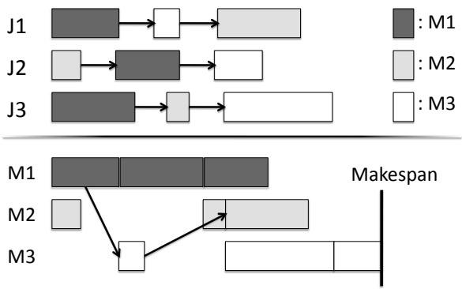
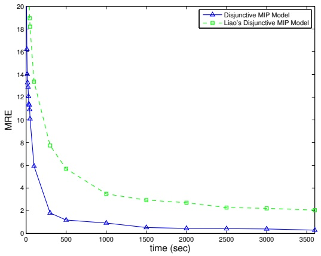
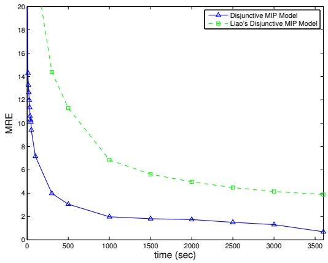
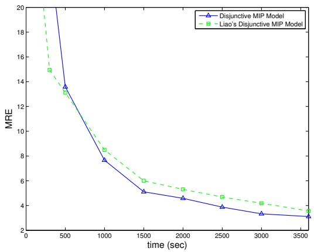
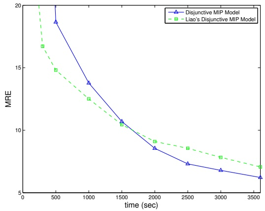
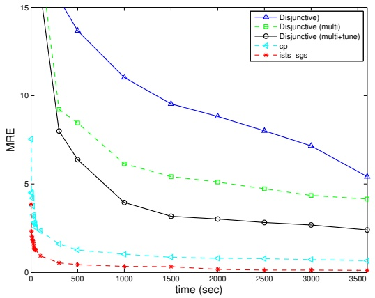
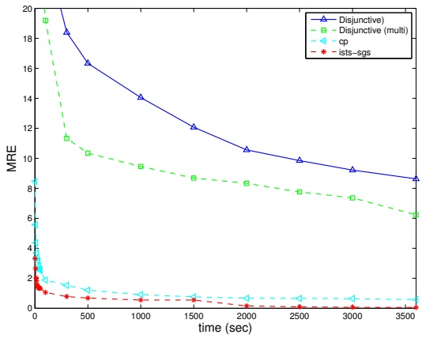

# Mixed Integer Programming Models for Job Shop Scheduling: A Computational Analysis

Wen-Yang Ku, J. Christopher Beck

Department of Mechanical & Industrial Engineering University of Toronto, 5 King’s College Rd. Toronto, ON M5S 3G8

## Abstract

In both industry and the research literature, mixed integer programming (MIP) is often the default approach for solving scheduling problems. In this paper we present and evaluate four MIP formulations for the classical job shop scheduling problem (JSP). While MIP formulations for the JSP have existed since the 1960s, it appears that comprehensive computational studies have not been performed since then. Due to substantial improvements in MIP technology in recent years, it is of interest to compare the standard JSP models using modern optimization software. We perform a fully crossed empirical study of four MIP models using CPLEX, GUROBI and SCIP, focusing on both the number of instances that can be proved optimal and the solution quality over time. Our results demonstrate that modern MIP solvers are able to prove optimality for moderate-sized problems very quickly. Comparing the four MIP models, the disjunctive formulation proposed by Manne performs best on both performance measures. We also investigate the performance of MIP with multi-threading and parameter tuning using CPLEX. Noticeable performance gain is observed when compared to the results using only single thread and default parameter settings. Our results serve as a snapshot of the performance of modern MIP solvers for an important, well-studied scheduling problem. Finally, the results of MIP is compared to constraint programming (CP), another common approach for scheduling, and the best known complete algorithm to provide a broad view among different approaches.

Keywords: Job Shop Scheduling, Mixed Integer Programming, Constraint Programming

## 1. Introduction

Mixed Integer Programming (MIP) has been widely applied to scheduling problems and it is often the initial approach to attack a new scheduling problem. For example, of the 40 research papers published in the Journal of Scheduling in 2014, 14 use MIP, more than any other technology. Given this popularity, together with the improvements in commercial MIP technology [1], it is valuable to understand how various MIP models for scheduling compare with each other in the context of modern solvers.

There are three widely used general MIP formulations for scheduling problems: the time-indexed formulation [2, 3], the rank-based formulation [4], and the disjunctive formulation [5]. A theoretical comparison among these formulations claims that the disjunctive formulation as best and the time-indexed formulation worst [6]. However, despite the long history of these formulations, there does not appear to have been a complete computational study comparing the performance of different formulations using modern MIP solvers. In the most recent computational study we have found (from 1991), Applegate et al. [7] proposed an efficient branch and bound algorithm based on the disjunctive formulation and concluded that the JSP is computationally challenging even for moderate-sized problems.

In this paper, we compare the performance of four MIP models for the classical job shop scheduling problem (JSP). In addition to the three standard JSP formulations, we include a second disjunctive formulation claimed by Liao [8] to be superior to the original one. We perform experiments with three different solvers: IBM ILOG CPLEX v12.6.2 [9], GUROBI v6.0.4 [10], and SCIP v3.1.1 [11]. CPLEX and GUROBI are both regarded as the state-of-the-art commercial MIP solvers [1] while SCIP is the fastest non-commercial solver [12]. Our goal is to provide a complete empirical comparison of the MIP models for the JSP using different MIP solvers and identify the most efficient model.

Our experimental results using CPLEX and GUROBI show, contrary to Pan [6], that the time-indexed model is able to perform better than the rank-based model for small problems but fails to scale to larger problems due to the size of the model. In addition, contrary to Liao’s finding, our results show that the original disjunctive model is more efficient than Liao’s disjunctive model for both CPLEX and GUROBI. However, the experiments using SCIP provide the opposite conclusions: first, the rank-based model outperforms the time-indexed model for small problems and second, while at first glance Liao’s disjunctive formulation seems more efficient than the original disjunctive formulation, careful investigation reveals that these differences are due to different preprocessing techniques undertaken by SCIP, and the phenomenon of erraticism [13] in the search process of MIP solvers. Despite these differences, across all tested solvers the disjunctive model outperforms the rank-based and the time-indexed models.

We then investigate two crucial aspects of modern MIP solvers: multi-threading and parameter tuning. Multi-threading allows the search to be executed in parallel and therefore may drastically improve performance. Parameter tuning aims at finding the best set of parameters for a specific class of problems. We perform experiments with the best MIP model, the disjunctive model, using CPLEX. Results show that running 8 threads in parallel improves the performance by about a factor of three. With multi-threading enabled, CPLEX’s parameter tuning tool can further improve the performance by about a factor of 1.5 for problems that can be proved optimal, which is 4.5 times faster than the single-threaded default search. For the problems for which the optimal solution could not be found and proved within one hour, the solution quality over time is improved by about 30%.

We also provide a comparison of the best MIP results with two complete approaches: constraint programming (CP) [14, 15] and iSTS-SGS [16], with the latter being the state-of-the-art exact algorithm. Our motivations of comparing CP and MIP are twofold. First, since MIP and CP are widely used by practitioners as “out-of-the-box” technology for scheduling, it is valuable to understand the differences between their performance. Second, due to the substantial improvements of MIP and CP solvers over the last decade [1], it is of interest to investigate the advances of MIP and CP, and how they compete with a state-of-the-art algorithm. We perform an empirical study using CPLEX for the disjunctive MIP model, with both multi-threading and parameter tuning and IBM ILOG CP Optimizer for the CP model. Our experimental results demonstrate that MIP performs similarly to CP for problems with moderate size and the goal of proving optimality. However, CP dominates MIP for the larger JSP instances and it is competitive with iSTS-SGS.

In summary, the contribution of this paper lies in the empirical analysis of the MIP models for the job shop scheduling problem. The rest of the paper is organized as follows. In Section 2 we give the definition of the JSP and review relevant literature. Section 3 describes the MIP models. Section 4 presents the computational results and the discussions. We conclude in Section 5.

## 2. Background

## 2.1. Problem Definition

The JSP is defined by a finite set J of n jobs and a finite set M of m machines (Fig. 1). For convenience we refer an $n \times m$ problem. For each job $j \in J ,$ we are given a list $( \sigma _ { 1 } ^ { j } , \ldots , \sigma _ { h } ^ { j } , \ldots , \sigma _ { m } ^ { j } )$ of the machines which represents the processing order of $j$ through the machines. Note that $\sigma _ { h } ^ { j }$ is called the h-th operation of job $j$ and $\sigma _ { m } ^ { j }$ is the last operation of job $j .$ In addition, for each job $j$ and machine $i ,$ we are given a non-negative integer $p _ { i j }$ , which represents the processing time of $j$ on $i .$ Each machine can process at most one job at a time, and once a job starts on a given machine, it must complete processing on that machine without interruption. The objective is to find a schedule of $J$ on M that minimizes the makespan, i.e., the maximum completion time of the last operation of any job in $J .$ Makespan minimization for the JSP is NP-hard for $n \geq 3$ and $m \geq 2 [ 1 7 ]$

## 2.2. Literature Review

As noted, the three standard MIP formulations for scheduling problems are the time-indexed formulation [2, 3], the rank-based formulation [4], and the dis junctive formulation [5]. Other models are typically combinations or variations of these formulations. We define each model formally in the next section.

Pan [6] performed a theoretical comparison of these three models for the JSP, the flow shop scheduling problem, and the permutation flow shop scheduling problem. He concluded that the disjunctive model is most efficient since it has the fewest binary variables, followed by the rank-based model, and then the time-indexed model. While model size is an important aspect of the quality of a formulation, it is well-known that other characteristics such as the tightness of the linear relaxation can be equally or more important. Pan’s evaluation of the models was challenged for the flow shop scheduling problem by Ronconi [18], who empirically compared the performance of two MIP models and showed that a model with half the number binary variables performed much worse that a larger model.

Figure 1: Job Shop Scheduling Problem. Three jobs J1, J2, and J3 are to be scheduled on three machines M1, M2 and M3. The graph on the top represents the precedence constraints. The Gantt Chart on the bottom displays a feasible schedule which satisfies the precedence constraints.

Liao [8] proposed a modified disjunctive formulation and showed empirically that this new model performs better than the original disjunctive model. The reduction in the computation effort was attributed to the fact that the new model had fewer linear constraints. While Liao showed that the computation time is significantly reduced with this new formulation, the experiments used problem instances with fewer than 5 jobs and 10 machines.

The literature on the JSP is vast with Google Scholar returning over 60,000 references (accessed September 28, 2015). Most approaches to optimization have been applied to JSP at some point, including heuristics [19], metaheurstics [20], genetic and evolutionary algorithms [21], customized branch-and-bound [7], constraint programming [22], and decomposition procedures [16].

## 3. MIP Models

In this section, we present the four MIP models considered in this paper.

## 3.1. Disjunctive Model

Our disjunctive model is based on Manne [5]. The decision variables are defined as follows:

$x _ { i j }$ is the integer start time of job $j$ on machine i

$z _ { i j k }$ is equal to 1 if job j precedes job k on machine i.

The disjunctive MIP model is stated in Fig. 2.

$$
\min \quad C _ {m a x}\tag{1}
$$

$$
\begin{array}{l l} \text {s.t.} & x _ {i j} \geq 0, \end{array}
$$

$$
\forall j \in J, i \in M\tag{2}
$$

$$
x _ {\sigma_ {h, j} ^ {i}, j} \geq x _ {\sigma_ {h - 1, j} ^ {i}, j} + p _ {\sigma_ {h - 1, j} ^ {i}, j},
$$

$$
\forall j \in J, h = 2, \dots , m\tag{3}
$$

$$
x _ {i j} \geq x _ {i k} + p _ {i k} - V \cdot z _ {i j k},
$$

$$
\forall j, k \in J, j <   k, i \in M\tag{4}
$$

$$
x _ {i k} \geq x _ {i j} + p _ {i j} - V \cdot (1 - z _ {i j k}),
$$

$$
\forall j, k \in J, j <   k, i \in M\tag{5}
$$

$$
C _ {m a x} \geq x _ {\sigma_ {m} ^ {i}, j} + p _ {\sigma_ {n} ^ {i}, j},
$$

$$
\forall j \in J\tag{6}
$$

$$
z _ {i j k} \in \{0, 1 \},
$$

$$
\forall j, k \in J, i \in M\tag{7}
$$

## Figure 2: Disjunctive model [5].

The objective function is stated in (1). Constraint (2) ensures that the start time of each job is greater or equal to 0. Constraint (3) is the precedence constraint. It ensures that all operations of a job are executed in the given order. The disjunctive constraints (4) and (5) ensure that no two jobs can be scheduled on the same machine at the same time. V has to be assigned to a large enough value to ensure the correctness of (4) and (5). In our model, we assign $\begin{array} { r } { V = \sum _ { j \in J } \sum _ { i \in M } p _ { i j } } \end{array}$ , since the completion time of any operation cannot exceed the summation of the processing times from all the operations. We use the same V value in the rest of the models throughout the paper. Constraint (6) ensures that the makespan is at least the largest completion time of the last operation of all jobs.

We note that modern MIP solvers allow direct modeling of the disjunctive constraints with solvers speciifc constraints. For example, Constraints (4) and (5) can be modeled with the “indicator” constraints in CPLEX. We investigate the performance of the indicator constraints in the experiments section.

## 3.2. Liao’s Disjunctive Model

In his disjunctive model, Liao [8] added continuous, surplus variables $q _ { i j k }$ to constraint (4). Constraints (4) and (5) therefore become:

$$
V \cdot z _ {i j k} + (x _ {i j} - x _ {i k}) - p _ {i k} = q _ {i j k}, \quad \forall j, k \in J, i \in M\tag{8}
$$

$$
q _ {i j k} \leq V - p _ {i j} - p _ {i k},
$$

$$
\forall j, k \in J, i \in M\tag{9}
$$

The addition of the new decision variables reduces the number of linear constraints, but introduces additional variables and upper bounds on these variables. Liao claimed that this transformation can improve performance, since the bounds on the variables are easier to handle than the linear constraints.

## 3.3. Time-Indexed Model

Although the idea of using time-indexed variables was originally proposed by Bowman [2], we adopt Kondili’s model [3] here because our preliminary experiments shows that it is computationally more efficient than Bowman’s model. The decision variable, $x _ { i j t } ,$ is equal to 1 if job j starts at time t at machine i. The time-indexed MIP model can be written as in Fig. 3.

min Cmax

$$
\text {s.t.} \quad \sum_ {t \in H} x _ {i j t} = 1,\tag{10}
$$

$$
\forall j \in J, i \in M\tag{11}
$$

$$
\sum_ {t \in H} (t + p _ {i j}) \cdot x _ {i j t} \leq C _ {m a x},
$$

$$
\forall j \in J, i \in M\tag{12}
$$

$$
\sum_ {j \in J} \sum_ {t ^ {\prime} \in T _ {i j t}} x _ {i j t ^ {\prime}} \leq 1,
$$

$$
\forall i \in M, t \in H, \text {where}\tag{13}
$$

$$
T _ {i j t} = \{t - p _ {i j} + 1, \dots , t \}
$$

$$
\sum_ {t \in H} (t + p _ {\sigma_ {h - 1} ^ {j}, j}) \cdot x _ {\sigma_ {h - 1} ^ {j}, j t} \leq \sum_ {t \in H} t \cdot x _ {\sigma_ {h} ^ {j}, j t}, \quad \forall j \in J, h = 2, \dots , m\tag{14}
$$

$$
x _ {i j t} \in \{0, 1 \},
$$

$$
\forall j \in J, i \in M, t \in H\tag{15}
$$

Figure 3: Time-indexed model [3].

The objective function is stated in (10). Constraint (11) ensures that each job starts exactly once on each machine. Constraint (12) ensures that the makespan is at least the largest completion time of the last operation of all jobs. Constraint (13) ensures that the machine is not over-capacitated at any time point. Constraint (14) is the precedence constraint. It ensures that all operations of a job are executed in the given order.

## 3.4. Rank-based Model

The rank-based model is due to Wagner [4]. The decision variables are defined as follows:

$x _ { i j k }$ is equal to 1 if job j is scheduled at the k-th position on machine i

$h _ { i k }$ denotes the start time of the job at the k-th position of machine i.

The parameter $r _ { i j k }$ is 1 if the k-th operation of job j requires machine i. The rank-based model is given in Fig. 4.

The objective function is stated in (16). Constraint (17) ensures that each position on each machine is assigned to exactly one job. Constraint (18) ensures that each job only gets one position on a machine. Constraint (19) states that the start time of a job on a machine should be larger than the completion time of the job scheduled at the previous position. Constraint (20) is the precedence constraint. It ensures that all operations of a job are executed in the given order.

min $C _ { m a x }$

$$
\text {s.t.} \quad \sum_ {j \in J} x _ {i j k} = 1,\tag{16}
$$

$$
\forall i \in M, k = 1, \ldots , n\tag{17}
$$

$$
\left| \sum_ {k = 1} ^ {n} x _ {i j k} = 1, \right|
$$

$$
\forall j \in J, i \in M\tag{18}
$$

$$
h _ {i k} + \sum_ {j \in J} p _ {i j} x _ {i j k} \leq h _ {i, k + 1},
$$

$$
\forall i \in M, k = 1, \dots , n\tag{19}
$$

$$
\begin{array}{l l} \sum_ {i \in M} r _ {i j l} h _ {i k} + \sum_ {i \in M} r _ {i j l} p _ {i j} \leq V \cdot (1 - \sum_ {i \in M} r _ {i j l} x _ {i j k}) \\ + V \cdot (1 - \sum_ {i \in M} r _ {i j, l + 1} x _ {i j k ^ {\prime}}) + \sum_ {i \in M} r _ {i j, l + 1} h _ {i k ^ {\prime}}, & \forall j \in J, i \in M, k, k ^ {\prime} = 1, \ldots , n, \end{array}
$$

$$
l = 1, \dots , m - 1,\tag{20}
$$

$$
h _ {i n} + \sum_ {j \in J} p _ {i j} x _ {i j k} \leq C _ {m a x},
$$

$$
\forall i \in M\tag{21}
$$

$$
h _ {i k} \geq 0,
$$

$$
\forall i \in M, k = 1, \dots , n \tag {22}
$$

$$
x _ {i j k} \in \{0, 1 \},
$$

$$
\forall j \in J, i \in M, k = 1, \dots , n\tag{23}
$$

Figure 4: Rank-based model [4].

Constraint (21) ensures that the makespan is at least the largest completion time of the last job on all machines. Constraint (22) ensures that the start time of all jobs at all positions are greater or equal to 0.

The number of variables and constraints for each model is summarized in Table 1.

## 4. Experiments and Discussion

All experiments were performed on a Intel Core i7 3.40 GHz machine (in 64 bit mode) with 8GB memory running Red Hat Enterprise 6.2. We perform experiments with CPLEX Optimization Studio v12.6.2, GUROBI v6.0.4, and SCIP v3.1.1. The CPU time limit for each run on each problem instance is 3600 seconds. All the solvers are executed in their default settings with one thread unless specified otherwise.

| Model | Number of binary variables | Number of constraints | Number of other integer variables |
| --- | --- | --- | --- |
| Time-Indexed | \|J\|\|M\|\|H\| | \|M\|\|H\| + 3\|M\|\|J\| - \|J\| | 1 |
| Rank-Based | \|J\|2 \|M\| | \|J\|3 \|M\| + 4\|J\|\|M\| + \|M\| | \|J\|\|M\| |
| Disjunctive | \|J\|2 \|M\| | \|J\|2 \|M\| | \|J\|\|M\| + 1 |

Table 1: Comparison of the MIP models for the JSP. |J|, |M|, and |H| denote the number of jobs, the number of machines, and the number of total time points, respectively.

## 4.1. Problem Instances

The experiments consist of ten problem sets of with problem sizes of $\{ 3 \times$ $3 , \; 4   \times   3 , \; 5   \times   3 , \; 3   \times   6 , \; 3   \times   8 , \; 3   \times   1 0 , \; 5   \times   5 , \; 8   \times   8 , \; 1 0   \times   1 0 , \; 1 5   \times   1 5 , \; 2 0   \times   1 5 , \; 2 0   \times   2 0 \}$ Each set consists of 10 problem instances. In addition to the first six problem sizes that were originally used by Liao, in this paper we generate the $5 \times 5 , ~ 8 \times$ 8, 10× 10, 15× 15, 20 × 15 and $2 0 \times 2 0$ problems, and use Taillard’s $1 5 \times 1 5$ and $2 0 \times 1 5$ benchmark instances [23] for additional comparison (specifically those labeled ta01 through ta20). All instances that we created are generated using Taillard’s JSP problem generator [24]. In accordance with Liao’s experimental setup, the processing times are randomly generated from a discrete uniform distribution over [1, 20]. The order of the operations in each job is assigned randomly.

## 4.2. Comparison of MIP Models

We first reproduce Liao’s experiments [8], adding the time-indexed and the rank-based models. An overview of the results of CPLEX, GUROBI, and SCIP are given in Table 2. For each problem size we report the arithmetic mean CPU running time “arith”, the shifted geometric mean time “geo” of the 10 problem instances and the number of instances proved to optimality $\text{" Opt " }$ . The shifted geometric mean time is computed as follows:

$$
\prod (t _ {i} + s) ^ {1 / n} - s,
$$

where $t _ { i }$ is the actual running time, n is the number of instances, and s is chosen as 10. Using geometric mean can decrease the influence of the outliers of data [25].

Results of CPLEX. The results of the time-indexed model, the rank-based model, and the disjunctive model in Table 2 are partially consistent with Pan’s theoretical analysis [6]. Our results indicate that both disjunctive models perform much better than the rank-based and time-indexed models. They are able to solve the $1 0 \times 1 0$ problems very quickly, whereas the rank-based and time-indexed models cannot solve these problems to optimality in 3600 seconds. Partially contrary to Pan’s conclusion that the rank-based model is more efficient than the time-indexed model, the latter is able to outperform the rankbased model for problems with size less than $8 \times 8 .$ . However, the time-indexed model has great difficulties finding a feasible solution for problems with size

<table><tbody><tr><td colspan="9">CPLEX Results</td></tr><tr><td rowspan="2">Problem</td><td colspan="2">Disjunctive</td><td colspan="2">Disjunctive (Liao)</td><td colspan="2">Rank-based</td><td colspan="2">Time-Indexed</td></tr><tr><td>Time (geo/arith)</td><td>Opt</td><td>Time (geo/arith)</td><td>Opt</td><td>Time (geo/arith)</td><td>Opt</td><td>Time (geo/arith)</td><td>Opt</td></tr><tr><td>3 × 3</td><td>0.01 / 0.01</td><td>10</td><td>0.00 / 0.00</td><td>10</td><td>0.01 / 0.02</td><td>10</td><td>0.04 / 0.04</td><td>10</td></tr><tr><td>4 × 3</td><td>0.01 / 0.01</td><td>10</td><td>0.01 / 0.01</td><td>10</td><td>0.05 / 0.05</td><td>10</td><td>0.07 / 0.07</td><td>10</td></tr><tr><td>5 × 3</td><td>0.02 / 0.02</td><td>10</td><td>0.01 / 0.02</td><td>10</td><td>0.18 / 0.18</td><td>10</td><td>0.22 / 0.22</td><td>10</td></tr><tr><td>3 × 6</td><td>0.01 / 0.01</td><td>10</td><td>0.01 / 0.01</td><td>10</td><td>0.15 / 0.15</td><td>10</td><td>0.16 / 0.17</td><td>10</td></tr><tr><td>3 × 8</td><td>0.01 / 0.01</td><td>10</td><td>0.01 / 0.01</td><td>10</td><td>0.80 / 0.81</td><td>10</td><td>0.23 / 0.24</td><td>10</td></tr><tr><td>3 × 10</td><td>0.01 / 0.01</td><td>10</td><td>0.01 / 0.01</td><td>10</td><td>3.01 / 3.03</td><td>10</td><td>0.55 / 0.56</td><td>10</td></tr><tr><td>5 × 5</td><td>0.02 / 0.02</td><td>10</td><td>0.02 / 0.02</td><td>0</td><td>21.18 / 31.98</td><td>10</td><td>1063.03 / 2003.15</td><td>5</td></tr><tr><td>8 × 8</td><td>0.60 / 0.61</td><td>10</td><td>0.76 / 0.77</td><td>10</td><td>-</td><td>-</td><td>1986.61 / 2518.23</td><td>5</td></tr><tr><td>10 × 10</td><td>3.19 / 3.48</td><td>10</td><td>7.62 / 8.84</td><td>10</td><td>-</td><td>-</td><td>-9</td><td>-</td></tr><tr><td>12 × 12</td><td>99.43 / 212.76</td><td>10</td><td>386.58 / 1041.44</td><td>8</td><td>-</td><td>-</td><td>-10</td><td>-</td></tr><tr><td>15 × 15</td><td>1568.89 / 2272.75</td><td>5</td><td>3463.38 / 3484.45</td><td>1</td><td>-1</td><td>-</td><td>#</td><td>#</td></tr><tr><td>20 × 15</td><td>-</td><td>-</td><td>-</td><td>-</td><td>-5</td><td>-</td><td>#</td><td>#</td></tr><tr><td colspan="9">GUROBI Results</td></tr><tr><td rowspan="2">Problem</td><td colspan="2">Disjunctive</td><td colspan="2">Disjunctive (Liao)</td><td colspan="2">Rank-based</td><td colspan="2">Time-Indexed</td></tr><tr><td>Time (geo/arith)</td><td>Opt</td><td>Time (geo/arith)</td><td>Opt</td><td>Time (geo/arith)</td><td>Opt</td><td>Time (geo/arith)</td><td>Opt</td></tr><tr><td>3 × 3</td><td>0.00 / 0.00</td><td>10</td><td>0.00 / 0.00</td><td>10</td><td>0.02 / 0.02</td><td>10</td><td>0.05 / 0.05</td><td>10</td></tr><tr><td>4 × 3</td><td>0.00 / 0.00</td><td>10</td><td>0.00 / 0.00</td><td>10</td><td>0.04 / 0.05</td><td>10</td><td>0.14 / 0.14</td><td>10</td></tr><tr><td>5 × 3</td><td>0.00 / 0.01</td><td>10</td><td>0.01 / 0.01</td><td>10</td><td>0.06 / 0.06</td><td>10</td><td>0.57 / 0.58</td><td>10</td></tr><tr><td>3 × 6</td><td>0.00 / 0.00</td><td>10</td><td>0.00 / 0.01</td><td>10</td><td>0.19 / 0.19</td><td>10</td><td>0.70 / 0.77</td><td>10</td></tr><tr><td>3 × 8</td><td>0.00 / 0.00</td><td>10</td><td>0.00 / 0.01</td><td>10</td><td>0.54 / 0.54</td><td>10</td><td>0.75 / 0.76</td><td>10</td></tr><tr><td>3 × 10</td><td>0.00 / 0.00</td><td>10</td><td>0.00 / 0.00</td><td>10</td><td>2.04 / 2.06</td><td>10</td><td>1.05 / 1.07</td><td>10</td></tr><tr><td>5 × 5</td><td>0.02 / 0.02</td><td>10</td><td>0.00 / 0.00</td><td>10</td><td>12.82 / 16.50</td><td>10</td><td>117.85 / 188.81</td><td>10</td></tr><tr><td>8 × 8</td><td>0.40/ 0.41</td><td>10</td><td>0.69 / 0.70</td><td>10</td><td>-</td><td>-</td><td>2058.77 / 2722.754</td><td>3</td></tr><tr><td>10 × 10</td><td>2.43 / 2.76</td><td>10</td><td>6.63 / 8.84</td><td>10</td><td>-2</td><td>-</td><td>-10</td><td>-</td></tr><tr><td>12 × 12</td><td>186.52 / 705.90</td><td>10</td><td>375.56 / 1019.21</td><td>8</td><td>-6</td><td>-</td><td>-10</td><td>-</td></tr><tr><td>15 × 15</td><td>2142.14 / 2784.49</td><td>3</td><td>2940.86 / 3287.14</td><td>1</td><td>-6</td><td>-</td><td>#</td><td>#</td></tr><tr><td>20 × 15</td><td>-</td><td>-</td><td>-</td><td>-</td><td>-8</td><td>-</td><td>#</td><td>#</td></tr><tr><td colspan="9">SCIP Results</td></tr><tr><td rowspan="2">Problem</td><td colspan="2">Disjunctive</td><td colspan="2">Disjunctive (Liao)</td><td colspan="2">Rank-based</td><td colspan="2">Time-Indexed</td></tr><tr><td>Time (geo/arith)</td><td>Opt</td><td>Time (geo/arith)</td><td>Opt</td><td>Time (geo/arith)</td><td>Opt</td><td>Time (geo/arith)</td><td>Opt</td></tr><tr><td>3 × 3</td><td>0.00 / 0.00</td><td>10</td><td>0.00 / 0.01</td><td>10</td><td>0.06 / 0.06</td><td>10</td><td>0.43 / 0.43</td><td>10</td></tr><tr><td>4 × 3</td><td>0.04 / 0.04</td><td>10</td><td>0.02 / 0.02</td><td>10</td><td>0.33 / 0.33</td><td>10</td><td>1.93 / 1.95</td><td>10</td></tr><tr><td>5 × 3</td><td>0.08 / 0.08</td><td>10</td><td>0.04 / 0.04</td><td>10</td><td>0.99 / 1.00</td><td>10</td><td>4.64 / 4.81</td><td>10</td></tr><tr><td>3 × 6</td><td>0.01 / 0.01</td><td>10</td><td>0.01 / 0.01</td><td>10</td><td>0.59 / 0.59</td><td>10</td><td>7.69 / 8.48</td><td>10</td></tr><tr><td>3 × 8</td><td>0.01 / 0.01</td><td>10</td><td>0.02 / 0.02</td><td>10</td><td>2.44 / 2.47</td><td>10</td><td>25.26 / 26.72</td><td>10</td></tr><tr><td>3 × 10</td><td>0.01 / 0.01</td><td>10</td><td>0.01 / 0.02</td><td>10</td><td>10.01 / 10.2</td><td>10</td><td>45.24 / 53.98</td><td>10</td></tr><tr><td>5 × 5</td><td>0.17 / 0.17</td><td>10</td><td>0.16 / 0.16</td><td>10</td><td>67.74 / 83.21</td><td>10</td><td>3363.01 / 3422.09</td><td>1</td></tr><tr><td>8 × 8</td><td>4.04 / 4.14</td><td>10</td><td>1.48 / 1.52</td><td>10</td><td>-5</td><td>-</td><td>-8</td><td>-</td></tr><tr><td>10 × 10</td><td>30.45 / 41.54</td><td>10</td><td>18.93 / 28.71</td><td>10</td><td>-8</td><td>-</td><td>-10</td><td>-</td></tr><tr><td>12 × 12</td><td>669.33 / 1202.90</td><td>8</td><td>626.59 / 1156.67</td><td>8</td><td>-10</td><td>-</td><td>-10</td><td>-</td></tr><tr><td>15 × 15</td><td>3498.00 / 3510.04</td><td>1</td><td>3227.29 / 3360.35</td><td>1</td><td>-10</td><td>-</td><td>#</td><td>#</td></tr><tr><td>20 × 15</td><td>-</td><td>-</td><td>-</td><td>-</td><td>-10</td><td>-</td><td>#</td><td>#</td></tr></tbody></table>

Table 2: Comparison of MIP Models for the three solvers used. Bold numbers indicate the best MIP model for each solver for the given problem size. The symbol ‘-’ means that none of the 10 problem instances were solved to optimality within 3600 seconds. The symbol ‘# means the models do not fit into 8 GB memory. The superscript numbers indicate the number of instances for which no feasible solution was found.

(a) 15 × 15 problems

(b) ta01 - ta10

Figure 5: MRE Performance Over Time for the Disjunctive MIP Models using CPLEX.

more than $1 0 \times 1 0$ . The time-indexed model also performs the worst among these four models when problem size reaches $1 5 \times 1 5$ , where the time-indexed model does not fit into 8 GB of memory. The disadvantage of the time-indexed formulation is that the number of variables and constraints is proportional to the number of time-points. The space complexity of the time-indexed model is therefore pseudo-polynomial (i.e., the memory required is proportional to the numeric value of processing time). When the problem scales up or the number of jobs is increased, the modelling time becomes dominant, and the model does not fit into a reasonable amount of memory. However, even for problems where that memory is not an issue, the disjunctive models perform better than the time-indexed model.

Table 2 shows that with CPLEX the performance of Liao’s disjunctive model is worse than the original disjunctive model, contradicting the results of Liao [8], where the performance of the new formulation significantly outperforms the old formulation for problems with size $3 \times 3 ,   4 \times 3 ,   5 \times 3 ,   3 \times 6 ,   3 \times 8$ , and $3 \times 1 0$ . Our results are consistent with Ronconi [18] who found that Liao’s disjunctive model is not better than the original model for the flow shop scheduling problem.

Fig. 5a provides a more detailed look at the $1 5 \times 1 5$ results by plotting the mean relative error (MRE) of the disjunctive MIP models over the run time. The relative error for each instance is computed as

$$
\mathrm{RE} = \frac {\text {best incumbent - best known solution}}{\text {best known solution}} \times 1 0 0,
$$

where the best incumbent is the best solution found at a given time point. MRE is then the arithmetic average of the relative error over the problem instances in the relevant set. Fig. 5a shows that the solution quality of Manne’s model improves much faster than that of Liao’s model.

As neither disjunctive model can solve all of the Taillard’s 15 × 15 problem instances (ta01 through ta10) to optimality, we again compare their solution quality over time. Consistent with the 15 × 15 problems, Fig. 5b shows that Manne’s model finds better feasible solutions much faster than Liao’s model. However, the Taillard’s instances are more difficult: in a given run-time lower MREs are achieved for the randomly generated problem instances. Judging from the flattening of the MIP curves, it seems unlikely that Liao’s model will achieve solution quality equal to Manne’s model at any reasonable run-time. The results of the $2 0 \times 1 5$ problem instances and the Taillard’s $2 0 \times 1 5$ problem instances (ta11 through ta20) show similar trends as the smaller instances, reinforcing our results.

Results of GUROBI. The results of GUROBI are consistent with those of CPLEX, showing that Manne’s disjunctive formulation is most efficient. The timeindexed model is also able to outperform the rank-based model for smaller problems. Detailed results are presented in Table 2. We do not plot the MRE figures as the results have a very similar relative performance as CPLEX.

Results of SCIP. The results of SCIP in Table 2 show different behaviour from CPLEX and GUROBI. Liao’s disjunctive formulation performs better than Manne’s model for small problems up to size 12 × 12. For larger problems there is no clear winner (Fig. 6a and Fig. 6b). The results also show that the rank-based model is more efficient than the time-indexed model for all the problems.

The reason that SCIP performs differently is due to the different presolving techniques compared to CPLEX and GUROBI, and possibly the consequence of erraticism in search. Recall that Liao’s formulation reduces the number of linear constraints at the expense of introducing new variables. We examined Liao’s formulation after presolving and found that SCIP eliminated these introduced variables in the presolving stage, transforming the model into Manne’s formulation. However, although the presolved Liao’s model is mathematically the same as the original disjunctive model, the transformation does not achieve the exact same ordering of the constraints and the coefficients of the constraints are slightly different. This leads to the phenomenon called “erraticism” [13]: that minor changes in the initial condition of a MIP solver can effect the search process, thus resulting in a different search and a differing number of nodes in the search tree.

To further investigate the erraticism phenomenon, we perturbed the order of the constraints of Manne’s model and found that the performance of Liao’s model was within the variance observed, i.e., we were able to achieve better performance than Liao’s model by simply changing the order of the constraints in the original disjunctive model. This demonstrates that the performance gain does not come from Liao’s model (as it is mathematically equivalent to Manne’s model after SCIP’s presolving), but the erraticism phenomenon of MIP solver. Note that CPLEX and GUROBI do not remove the introduced surplus variables from Liao’s model.

(a) 15 × 15 problems

(b) ta01 - ta10

Figure 6: MRE Performance Over Time for the Disjunctive MIP Models using SCIP.

## 4.3. Comparison of Different MIP Optimization Software

The overall performance of CPLEX and GUROBI is very close for the tested problems, with the former performing slightly better. GUROBI is able to prove optimality faster with Liao’s formulation, and it performs better for the rankbased model and the time-indexed model for small problems up to size 5 × 5. SCIP, as the only non-commercial solver, is less efficient than CPLEX and GUROBI.

Comparing our MIP results with that published by Liao in 1992, it is observed, unsurprisingly, that the performance of MIP solvers has been significantly improved. In Liao’s experiments, it takes more than 1000 seconds to solve the 5×3 problems with Manne’s model, whereas these problems are solved almost instantly with modern MIP solvers. This demonstrates the ability and strength of modern MIP solvers and shows that MIP is now a competitive approach for solving scheduling problems.

Summarizing the above results, we conclude that the disjunctive model is the most efficient MIP model for the JSP for all problem sizes. Manne’s original formulation is more efficient for CPLEX and GUROBI, while the preprocessing in SCIP actually transforms Liao’s formulation to Manne’s with the accompanying similar performance. It should be noted that judging the performance of the MIP models based on the number of binary variables and constraints is error prone and should only be taken into account as the first step of analyzing the performance of MIP models. Careful empirical evaluation may be required to fully understand the behaviour of these models, especially when using modern MIP solvers.

## 4.4. Comparison of Disjunctive Constraints

As noted in Section 3.1, we investigate the capability of the modern MIP solver CPLEX to directly handle disjunctions. CPLEX allows modeling the dis junctive constraints directly with its so-called indicator constraints from which CPLEX derives an optimized formulation and search strategy. We investigate two different methods of modeling the indicator constraints as follows:

1. The $`` \mathrm{TF} ''$ formulation: We replace constraints (4) and (5) with IloIfThen $\left( \mathrm{z}_{\mathrm{ijk}} = 0, \mathrm{x}_{\mathrm{ij}} \geq \mathrm{x}_{\mathrm{ik}} + \mathrm{p}_{\mathrm{ik}} \right)$ and IloIfThen $\left( \mathrm{z_{ijk}} = 1, \mathrm{x_{ik}} \geq \mathrm{x_{ij}} + \mathrm{p_{ij}} \right)$

2. The $\text{" OR " }$ formulation: We remove the variable $z _ { i j k }$ and replace constraints (4) and (5) with IloO $\operatorname { r } ( \operatorname { x _ { i j } } \geq \operatorname { x _ { i k } } + \operatorname { p _ { i k } } , \operatorname { x _ { i k } } \geq \operatorname { x _ { i j } } + \operatorname { p _ { i j } } )$

As Table 3 shows, both formulations using the indicator constraints perform worse than the original formulation. The reason may be because that the chosen V value in our model is not too large. As CPLEX’s website [9] suggests: “Use indicator constraints instead of Big $M ^ { 1 }$ when Big M values in the formulation cannot be reduced”. In our case, V is the summation of the processing times from all the operations, which is still well bounded in our experiments.

<table><tbody><tr><td rowspan="2">Problem</td><td colspan="2">Disjunctive</td><td colspan="2">Indicator (OR)</td><td colspan="2">Indicator (IF)</td></tr><tr><td>Time (geo/arith)</td><td>Opt</td><td>Time (geo/arith)</td><td>Opt</td><td>Time (geo/arith)</td><td>Opt</td></tr><tr><td>3 × 3</td><td>0.01 / 0.01</td><td>10</td><td>0.01 / 0.01</td><td>10</td><td>0.00 / 0.00</td><td>10</td></tr><tr><td>4 × 3</td><td>0.01 / 0.01</td><td>10</td><td>0.01 / 0.01</td><td>10</td><td>0.01 / 0.01</td><td>10</td></tr><tr><td>5 × 3</td><td>0.02 / 0.02</td><td>10</td><td>0.02 / 0.02</td><td>10</td><td>0.01 / 0.01</td><td>10</td></tr><tr><td>3 × 6</td><td>0.01 / 0.01</td><td>10</td><td>0.01 / 0.01</td><td>10</td><td>0.01 / 0.01</td><td>10</td></tr><tr><td>3 × 8</td><td>0.01 / 0.01</td><td>10</td><td>0.01 / 0.01</td><td>10</td><td>0.01 / 0.01</td><td>10</td></tr><tr><td>3 × 10</td><td>0.01 / 0.01</td><td>10</td><td>0.01 / 0.01</td><td>10</td><td>0.01 / 0.01</td><td>10</td></tr><tr><td>5 × 5</td><td>0.02 / 0.02</td><td>10</td><td>0.03 / 0.03</td><td>10</td><td>0.04 / 0.04</td><td>10</td></tr><tr><td>8 × 8</td><td>0.60 / 0.61</td><td>10</td><td>1.38 / 1.39</td><td>10</td><td>1.16 / 1.17</td><td>10</td></tr><tr><td>10 × 10</td><td>3.19 / 3.48</td><td>10</td><td>8.97 / 10.99</td><td>10</td><td>7.64 / 9.65</td><td>10</td></tr><tr><td>12 × 12</td><td>99.43 / 212.76</td><td>10</td><td>274.24 / 779.03</td><td>10</td><td>273.36 / 919.04</td><td>8</td></tr><tr><td>15 × 15</td><td>1568.89 / 2272.75</td><td>5</td><td>3593.73 / 3594.47</td><td>1</td><td>-</td><td>-</td></tr></tbody></table>

Table 3: Comparison of the disjunctive formulations using indicator constraints (using CPLEX). Bold numbers indicate the best formulation for each solver for the given problem size. The symbol ‘-’ means that none of the 10 problem instances were solved to optimality within 3600 seconds.

## 4.5. Multi-threading and Parameter Tuning

We investigate the performance gain of the best MIP model, the disjunctive model, by enabling multi-threading and parameter tuning using CPLEX.

Table 4 shows that the performance is improved by about a factor of three with 8 threads compared to that using only one thread.

We use CPLEX’s parameter tuning tool as follows. First, we classified the instances into two categories based on the single-threaded, untuned CPLEX results: 1. Optimality provable in 3600 seconds. 2. Optimality not provable in 3600 seconds. For the second category, we further divide the instances into two sets. The first set consists of the $1 5 \times 1 5 ,   2 0 \times 1 5$ and $2 0 \times 2 0$ instances and the second set consists of the Taillard’s instances. We assume that the problem characteristic are different between these two sets therefore avoiding potential performance loss when using the tuning tool. We set a total tuning time of two days for both categories, with 3600 seconds per run in the first category and 1200 seconds per run in the second category. Since a majority of instances cannot be proven optimal for the second category, we choose a shorter running time per run to balance between the number of runs and the time spent at each run. All the training instances are also used as the testing instances. This is obviously not methodologically sound, but however biases the results in favour of the tuned parameters. We did this as we were seeking to evaluate the maximum improvement we could expect from tuning.

<small>1M corresponds to V in our model.</small>

Table 4 shows that CPLEX’s tuning tool reduces the mean running time for the $1 2 \times 1 2$ instances by a factor of 1.5 on top of multi-threading. For larger instances, Fig. 7b shows that the MRE is reduced by about 30%. However, for the Taillard’s instances, the tuning tool does not find parameter settings different from the default. Therefore, the performance remains unchanged.

Though both multi-threading and parameter tuning are effective techniques, our results indicate that neither, even used together, is likely to make a significant portion of the non-solvable problems solvable.

## 4.6. Comparison of MIP and CP

As another commonly used approach for solving scheduling problems, Constraint Programming (CP) has proven to be successful over the last decade [14, 15]. Constraint-based solving techniques allow CP to outperform MIP in a variety of scheduling problems [14]. In this section we compare the best MIP results using CPLEX (best of the three MIP variations for each individual problem instance in Table 4) with the CP model using one thread only.2 The complete CP model is presented in the Appendix.

Table 4 shows that both MIP and CP solve the problems very quickly up to size 10 × 10. MIP still solves the 12 × 12 problems in a reasonable amount of time but only solves 80% of the 15 × 15 problems, while CP is able to prove optimality for all the 15 × 15 problems. As problems become even bigger, CP is still able to solve 60% of the 20 × 15 problems.

For additional comparison, Fig. 7a and Fig. 7b present results of the 20 × 20 problems and Taillard’s 20 × 15 problem instances (ta11 through ta20). Both figures show that CP finds better feasible solutions much faster than the MIP model, but the solutions improve only marginally with additional run time, plateauing around 500 seconds. The MIP model performs worse than CP throughout the time horizon, though the solutions tend to improve steadily. However, judging from the flattening of the MIP curves, it seems unlikely that the MIP model will achieve performance equal to CP without an impractical run time. Additional comparison on the Taillard’s $2 0   \times   1 5$ problem instances show similar trends with higher MRE for both approaches.

<small>2Using all the 8 threads actually increases the running time of CP by about a factor of 1.6.</small>

<table><tbody><tr><td rowspan="2">Problem</td><td colspan="2">Disjunctive</td><td colspan="2">Disjunctive (multi)</td><td colspan="2">Disjunctive (multi+tune)</td><td colspan="2">CP</td></tr><tr><td>Time (geo/arith)</td><td>Opt</td><td>Time (geo/arith)</td><td>Opt</td><td>Time (geo/arith)</td><td>Opt</td><td>Time (geo/arith)</td><td>Opt</td></tr><tr><td>3 × 3</td><td>0.01 / 0.01</td><td>10</td><td>0.02 / 0.02</td><td>10</td><td>0.02 / 0.02</td><td>10</td><td>0.00 / 0.00</td><td>10</td></tr><tr><td>4 × 3</td><td>0.01 / 0.01</td><td>10</td><td>0.03 / 0.03</td><td>10</td><td>0.13 / 0.13</td><td>10</td><td>0.00 / 0.00</td><td>10</td></tr><tr><td>5 × 3</td><td>0.02 / 0.02</td><td>10</td><td>0.07 / 0.07</td><td>10</td><td>0.03 / 0.03</td><td>10</td><td>0.00 / 0.00</td><td>10</td></tr><tr><td>3 × 6</td><td>0.01 / 0.01</td><td>10</td><td>0.04 / 0.04</td><td>10</td><td>0.02 / 0.02</td><td>10</td><td>0.00 / 0.00</td><td>10</td></tr><tr><td>3 × 8</td><td>0.01 / 0.01</td><td>10</td><td>0.03 / 0.03</td><td>10</td><td>0.07 / 0.07</td><td>10</td><td>0.00 / 0.00</td><td>10</td></tr><tr><td>3 × 10</td><td>0.01 / 0.01</td><td>10</td><td>0.04 / 0.04</td><td>10</td><td>0.07 / 0.07</td><td>10</td><td>0.00 / 0.00</td><td>10</td></tr><tr><td>5 × 5</td><td>0.02 / 0.02</td><td>10</td><td>0.04 / 0.04</td><td>10</td><td>0.07 / 0.08</td><td>10</td><td>0.00 / 0.00</td><td>10</td></tr><tr><td>8 × 8</td><td>0.60 / 0.61</td><td>10</td><td>0.30 / 0.30</td><td>10</td><td>0.32 / 0.32</td><td>10</td><td>0.15 / 0.15</td><td>10</td></tr><tr><td>10 × 10</td><td>3.19 / 3.48</td><td>10</td><td>1.65 / 1.70</td><td>10</td><td>1.72 / 1.76</td><td>10</td><td>0.67 / 0.68</td><td>10</td></tr><tr><td>12 × 12</td><td>99.43 / 212.76</td><td>10</td><td>37.51 / 71.74</td><td>10</td><td>33.19 / 47.67</td><td>10</td><td>3.58 / 3.88</td><td>10</td></tr><tr><td>15 × 15</td><td>1568.89 / 2272.75</td><td>5</td><td>865.29 / 1595.79</td><td>8</td><td>926.83 / 1920.19</td><td>7</td><td>39.57 / 47.71</td><td>10</td></tr><tr><td>20 × 15</td><td>-</td><td>-</td><td>-</td><td>-</td><td>-</td><td>-</td><td>1037.81 / 1924.35</td><td>6</td></tr></tbody></table>

Table 4: Comparison of the best MIP model with multi-threading and parameter tuning (using CPLEX) and the CP model. Bold numbers indicate the best model for the given problem size. The symbol ‘-’ means that none of the 10 problem instances were solved to optimality within 3600 seconds.

In summary, our comparison of MIP and CP for the job shop scheduling problem indicates that for medium size problems (i.e., around size 12 × 12) both MIP and CP can find and prove optimality under a reasonable time limit. However, for larger problems, CP dominates MIP regardless of the time limit.

## 4.7. Comparing to the State of the Art

One argument for using MIP (or CP) models for scheduling as opposed to hand-crafted, specialized algorithms is that the “model and solve” paradigm is less time consuming for users, requires less knowledge of specialized optimization algorithms, and is more flexible in that new constraints can be easily added to existing models.3 The cost of general models, however, is that modeling itself can be challenging and time consuming and the resultant performance is unlikely to match the state-of-the-art specialized algorithms.

While it is difficult to measure the effort of modeling, we can compare the performance of standard models with specialized algorithms. Here, we compare the disjunctive MIP and CP models used above with, iSTS-SGS, a state-of-the-art exact algorithm for JSP [16]. iSTS-SGS is a two-phase hybridization of a JSP-specific tabu search (iSTS) with a specialized CP search (SGS). For SGS, we perform experiments with ILOG Scheduler 6.5, now out-dated software.

On the randomly generated 20 × 20 instances, Fig. 7a shows that MIP finds solutions on average only 2.3% worse than the iSTS-SGS, depending on the time limit. The CP model achieves solutions within about 0.6% of the iSTS-SGS. On the 20 × 15 instances from Taillard’s benchmark set, Fig. 7b shows a larger difference between iSTS-SGS and MIP at about 6.2%, while CP still maintains a relatively small gap at about 0.5%.

<small>3Though unfortunately often the performance of the modified models is not easily pre-dictable.</small>

(a) $2 0   \times   2 0$ problems

(b) ta11 - ta20

Figure 7: MRE Performance Over Time of the MIP Models, CP Model and iSTS-SGS. Note that for the ta11 - ta20 problems, the tuning tool does not find parameter settings different from the default. Therefore we do not plot the curve for multi+tune.

## 5. Conclusion

In this paper, we evaluated four MIP models for the classical job shop scheduling problems and compared their performance using CPLEX, GUROBI and SCIP. The results of CPLEX and GUROBI demonstrated that, first, contrary to the claim of Liao [8], Manne’s original disjunctive model is the best performing MIP model for the JSP. In addition, in partial contradiction to Pan’s claims [6], the time-indexed model is able to outperform the rank-based model for smaller problem instances. In contrast, experimental results using SCIP showed that the rank-based model outperforms the time-indexed model for small problems, while Liao’s formulation is transformed to Manne’s in pre-solving so similar performance is observed. Second, due to the advances of modern MIP solvers, we show that $\mathrm { M I P }$ is now able to solve the JSP with moderate size very quickly. We also demonstrate the effectiveness of multi-threading and parameter tuning. Comparing the best MIP results with that of CP, results show that MIP performs similarly to CP for smaller problems in terms of proving optimality. However, CP dominates MIP for larger problems both in terms of proving optimality and solution quality. Finally, we demonstrate that if the goal is to find a high quality solution within a given time-limit for large problems, the off-the-shelf CP model is highly competitive with the state-of-the-art.

## Appendix A. CP Model

Using the same decision variables as the disjunctive MIP model (3.1), the CP model can be stated in Fig. A.8.

min Cmax

$$
\begin{array}{l l} \text {s.t.} & x _ {i j} \geq 0, \end{array}\tag{A.1}
$$

$$
\forall j \in J, i \in M\tag{A.2}
$$

$$
x _ {\sigma_ {h} ^ {j}, j} \geq x _ {\sigma_ {h - 1, j} ^ {j}} + p _ {\sigma_ {h - 1, j} ^ {j}},
$$

$$
\forall j \in J, h = 2, \dots , m\tag{A.3}
$$

$$
C _ {m a x} \geq x _ {\sigma_ {m, j} ^ {j}} + p _ {\sigma_ {m, j} ^ {j}},
$$

$$
\forall j \in J\tag{A.4}
$$

$$
\text {disjunctive} (\{x _ {i 1}, \dots , x _ {i n} \}, \{p _ {i 1}, \dots , p _ {i n} \}), \forall i \in M\tag{A.5}
$$

Figure A.8: CP model.

The objective function is stated in (A.1). Constraint (A.2) ensures that the start time of each job is greater or equal to 0. Constraint (A.3) is the precedence constraint. It ensures that all operations of a job are executed in order. Constraint (A.4) ensures that the makespan is at least the largest completion time of the last operation of all jobs. Constraint (A.5) is a global constraint which ensures that no two jobs can be scheduled on the same machine at the same time.

## References

[1] T. Koch, T. Achterberg, E. Andersen, O. Bastert, T. Berthold, R. Bixby, E. Danna, G. Gamrath, A. Gleixner, S. Heinz, et al., MIPLIB 2010, Math ematical Programming Computation (2011) 1–61.

[2] E. H. Bowman, The schedule-sequencing problem, Operations Research (1959) 621–624.

[3] E. Kondili, C. Pantelides, R. Sargent, A general algorithm for scheduling batch operations, in: PSE’88: Third International Symposium on Process Systems Engineering: In Affiliation with CHEMECA 88, a Bicentennial Event; Sydney, Australia, 28 August-2 September, 1998; Preprints of Papers, Institution of Engineers, Australia, 1988, p. 62.

[4] H. M. Wagner, An integer linear-programming model for machine scheduling, Naval Research Logistics Quarterly 6 (2) (1959) 131–140.

[5] A. S. Manne, On the job-shop scheduling problem, Operations Research (1960) 219–223.

[6] C.-H. Pan, A study of integer programming formulations for scheduling problems, International Journal of Systems Science 28 (1) (1997) 33–41.

[7] D. Applegate, W. Cook, A computational study of the job-shop scheduling problem, ORSA Journal on computing 3 (2) (1991) 149–156.

[8] C. Liao, C. You, An improved formulation for the job-shop scheduling problem, Journal of the Operational Research Society (1992) 1047–1054.

[9] IBM ILOG CPLEX optimization studio, http://www-01.ibm.com/software/commerce/optimization/cplex-optimizer/index.html(accessed August 20, 2015).

[10] Gurobi optimization, http://www.gurobi.com (accessed August 20, 2015).

[11] Solving constraint integer programs, http://scip.zib.de (accessed August 20, 2015).

[12] H. Mittelmann, Mixed integer linear programming benchmark, http://plato.asu.edu/ftp/milpc.html (accessed August 20, 2015).

[13] M. Fischetti, M. Monaci, Exploiting erraticism in search, Operations Research 62 (1) (2014) 114–122.

[14] P. Baptiste, C. Le Pape, W. Nuijten, Constraint-based scheduling: applying constraint programming to scheduling problems, Vol. 39, Springer, 2001.

[15] R. Barták, M. Salido, F. Rossi, New trends in constraint satisfaction, planning, and scheduling: a survey, The Knowledge Engineering Review 25 (03) (2010) 249–279.

[16] J. C. Beck, T. Feng, J. P. Watson, Combining constraint programming and local search for job-shop scheduling, INFORMS Journal on Computing 23 (1) (2011) 1–14.

[17] M. Garey, D. Johnson, Computers and intractability, Freeman San Francisco, CA, 1979.

[18] D. Ronconi, E. Birgin, Mixed-integer programming models for flowshop scheduling problems minimizing the total earliness and tardiness, Just-in-Time Systems (2012) 91–105.

[19] J. Adams, E. Balas, D. Zawack, The shifting bottleneck procedure for job shop scheduling, Management science 34 (3) (1988) 391–401.

[20] E. Nowicki, C. Smutnicki, An advanced tabu search algorithm for the job shop problem, Journal of Scheduling 8 (2) (2005) 145–159.

[21] F. Della Croce, R. Tadei, G. Volta, A genetic algorithm for the job shop problem, Computers & Operations Research 22 (1) (1995) 15–24.

[22] J. C. Beck, Solution-guided multi-point constructive search for job shop scheduling, Journal of Artificial Intelligence Research (2007) 49–77.

[23] E. Taillard, Taillard’s instances, job shop scheduling problem, http://optimizizer.com/TA.php (accessed August 20, 2015).

[24] E. Taillard, Benchmarks for basic scheduling problems, European Journal of Operational Research 64 (2) (1993) 278–285.

[25] T. Achterberg, Conflict analysis in mixed integer programming, Discrete Optimization 4 (1) (2007) 4–20.