http://www.elsevier.com/locate/jmva

# A well-conditioned estimator for large-dimensional covariance matrices

Olivier Ledoita,b and Michael Wolf c,,1

aAnderson Graduate School of Management, UCLA, USA

b Equities Division, Credit Suisse First Boston, USA cDepartment of Economics and Business, Universitat Pompeu Fabra, Ramon Trias Fargas 25–27, 08005 Barcelona, Spain

Received 26 February 2001

## Abstract

Many applied problems require a covariance matrix estimator that is not only invertible, but also well-conditioned (that is, inverting it does not amplify estimation error). For largedimensional covariance matrices, the usual estimator—the sample covariance matrix—is typically not well-conditioned and may not even be invertible. This paper introduces an estimator that is both well-conditioned and more accurate than the sample covariance matrix asymptotically. This estimator is distribution-free and has a simple explicit formula that is easy to compute and interpret. It is the asymptotically optimal convex linear combination of the sample covariance matrix with the identity matrix. Optimality is meant with respect to a quadratic loss function, asymptotically as the number of observations and the number of variables go to infinity together. Extensive Monte Carlo confirm that the asymptotic results tend to hold well in finite sample.

AMS 2000 subject classifications: 62H12; 62C12; 62J07

Keywords: Condition number; Covariance matrix estimation; Empirical Bayes; General asymptotics; Shrinkage

<small>Corresponding author. Fax: +34-93-542-1746.</small>

<small>E-mail address: michael.wolf@econ.upf.es (M. Wolf).</small>

<small>1Research supported by DGES Grant BEC2001-1270.</small>

## 1. Introduction

Many applied problems require an estimate of a covariance matrix and/or of its inverse, where the matrix dimension is large compared to the sample size. Examples include selecting a mean–variance efficient portfolio from a large universe of stocks (see Markowitz [16]), running generalized least squares (GLS) regressions on large cross-sections (see e.g., Kandel and Stambaugh [12]), and choosing an optimal weighting matrix in the general method of moments (GMM; see Hansen [10]) where the number of moment restrictions is large. In such situations, the usual estimator— the sample covariance matrix—is known to perform poorly. When the matrix dimension $p$ is larger than the number n of observations available, the sample covariance matrix is not even invertible. When the ratio $p / n$ is less than one but not negligible, the sample covariance matrix is invertible but numerically ill-conditioned, which means that inverting it amplifies estimation error dramatically. For large $p ,$ it is difficult to find enough observations to make $p / n$ negligible, and therefore it is important to develop a well-conditioned estimator for large-dimensional covariance matrices. If we want a well-conditioned estimator at any cost, we can always impose some ad hoc structure on the covariance matrix to force it to be well-conditioned, such as diagonality or a factor model. But, in the absence of prior information about the true structure of the matrix, this ad hoc structure will be in general misspecified, and the resulting estimator may be so biased that it bears little resemblance to the true covariance matrix. To the best of our knowledge, no existing estimator is both well-conditioned and more accurate than the sample covariance matrix. The contribution of this paper is to propose an estimator that possesses both these properties asymptotically. One way to get a well-conditioned structured estimator is to impose the condition that all variances are the same and all covariances are zero. The estimator we recommend is a weighted average of this structured estimator and the sample covariance matrix. Our estimator inherits the good conditioning properties of the structured estimator and, by choosing the weight optimally according to a quadratic loss function, we ensure that our weighted average of the sample covariance matrix and the structured estimator is more accurate than either of them. The only difficulty is that the true optimal weight depends on the true covariance matrix, which is unobservable. We solve this difficulty by finding a consistent estimator of the optimal weight, and show that replacing the true optimal weight with a consistent estimator makes no difference asymptotically. Standard asymptotics assume that the number of variables $p$ is finite and fixed, while the number of observations n goes to infinity. Under standard asymptotics, the sample covariance matrix is well-conditioned (in the limit), and has some appealing optimality properties (e.g., it is the maximum likelihood estimator for normally distributed data). However, this is a bad approximation of many real-world situations where the number of variables $p$ is of the same order of magnitude as the number of observations $n ,$ and possibly larger. We use a different framework, called general asymptotics, where we allow the number of variables $p$ to go to infinity too. The only constraint is that the ratio $p / n$ must remain bounded. We see standard asymptotics as a special case where it is optimal to put (asymptotically) all the weight on the sample covariance matrix and none on the structured estimator. In the general case, however, our estimator is asymptotically different from the sample covariance matrix, substantially more accurate, and of course well-conditioned. Note that the framework of general asymptotics is related to the one of Kolmogorov asymptotics, where it is assumed that the ratio $p / n$ tends to a positive, finite constant. Kolmogorov asymptotics is used by, among others, Aivazyan et al. [1] and Girko [5–7]. High-dimensional problems, where the number of variables $p$ is large compared to the sample size $n ,$ are also studied by Läuter [13] and Läuter et al. [14], but from the point of view of testing and inference, not estimation like in the present paper. Extensive Monte-Carlo simulations indicate that: (i) the new estimator is more accurate than the sample covariance matrix, even for very small numbers of observations and variables, and usually by a lot; (ii) it is essentially as accurate or substantially more accurate than some estimators proposed in finite sample decision theory, as soon as there are at least ten variables and observations; (iii) it is betterconditioned than the true covariance matrix; and (iv) general asymptotics are a good approximation of finite sample behavior when there are at least 20 observations and variables. The paper is organized as follows. The next section characterizes in finite sample the linear combination of the identity matrix and the sample covariance matrix which minimizes quadratic risk. Section 3 develops a linear shrinkage estimator with asymptotically uniformly minimum quadratic risk in its class (as the number of observations and the number of variables go to infinity together). In Section 4, Monte-Carlo simulations indicate that this estimator behaves well in finite samples, and Section 5 concludes. Appendix A contains the proofs of the technical results of Section 3.

## 2. Analysis in finite sample

The easiest way to explain what we do is to first analyze in detail the finite sample case. Let $X$ denote a $p \times n$ matrix of n independent and identically distributed (iid) observations on a system of $p$ random variables with mean zero and covariance matrix S: Following the lead of Muirhead and Leung [19], we consider the Frobenius norm: $| | A | | = { \sqrt { \operatorname { t r } ( A A ^ { t } ) / p } }$ : (Dividing by the dimension $p$ is not standard, but it does not matter in this section because $p$ remains finite. The advantages of this convention are that the norm of the identity matrix is simply one, and that it will be consistent with Definition 1 below.) Our goal is to find the linear combination $\Sigma ^ { * } = \rho _ { 1 } I + \rho _ { 2 } S$ of the identity matrix I and the sample covariance matrix $S = X X ^ { t } / n$ whose expected quadratic loss $E [ | | \Sigma ^ { * } - \Sigma | | ^ { 2 } ]$ is minimum. Haff [8] studied this class of linear shrinkage estimators, but did not get any optimality results. The optimality result that we obtain in finite sample will come at a price: $\Sigma ^ { * }$ will not be a bona fide estimator, because it will require hindsight knowledge of four scalar functions of the true (and unobservable) covariance matrix S: This would seem like a high price to pay but, interestingly, it is not: In the next section, we are able to develop a bona fide estimator $S ^ { * }$ with the same properties as $\Sigma ^ { * }$ asymptotically as the number of observations and the number of variables go to infinity together. Furthermore, extensive Monte-Carlo simulations will indicate that 20 observations and variables are enough for the asymptotic approximations to typically hold well in finite sample. Even the formulas for $\Sigma ^ { * }$ and $S ^ { * }$ will look the same and will have the same interpretations. This is why we study the properties of $\Sigma ^ { * }$ in finite sample ‘‘as $\mathrm { i f } ^ { \flat } { } ^ { \flat }$ it was a bona fide estimator.

## 2.1. Optimal linear shrinkage

The squared Frobenius norm $| | \cdot | | ^ { 2 }$ is a quadratic form whose associated inner product is: $\langle A_{1},A_{2}\rangle=\mathrm{tr}(A_{1}A_{2}^{t})/p$ : Four scalars play a central role in the analysis: $\mu = \langle \Sigma , I \rangle , \alpha ^ { 2 } = | | \Sigma - \mu I | | ^ { 2 } , \beta ^ { 2 } = E [ | | S - \Sigma | | ^ { 2 } ]$ ; and $\delta ^ { 2 } = E [ | | S - \mu I | | ^ { 2 } ]$ : We do not need to assume that the random variables in X follow a specific distribution, but we do need to assume that they have finite fourth moments, so that $\beta ^ { 2 }$ and $\delta ^ { 2 }$ are finite. The following relationship holds.

Lemma 2.1. $\alpha ^ { 2 } + \beta ^ { 2 } = \delta ^ { 2 }$

Proof.

$$
E [ | | S - \mu I | | ^ {2} ] = E [ | | S - \Sigma + \Sigma - \mu I | | ^ {2} ]\tag{1}
$$

$$
= E [ | | S - \Sigma | | ^ {2} ] + E [ | | \Sigma - \mu I | | ^ {2} ] + 2 E [ \langle S - \Sigma , \Sigma - \mu I \rangle ]\tag{2}
$$

$$
= E [ | | S - \Sigma | | ^ {2} ] + | | \Sigma - \mu I | | ^ {2} + 2 \langle E [ S - \Sigma ], \Sigma - \mu I \rangle .\tag{3}
$$

Notice that $E [ S ] = \Sigma$ ; therefore, the third term on the right-hand side of Eq. (3) is equal to zero. This completes the proof of Theorem 2.1. &

The optimal linear combination $\Sigma ^ { * } = \rho _ { 1 } I + \rho _ { 2 } S$ of the identity matrix I and the sample covariance matrix S is the standard solution to a simple quadratic programming problem under linear equality constraint.

## Theorem 2.1. Consider the optimization problem:

min $E [ | | \Sigma ^ { * } - \Sigma | | ^ { 2 } ]$ r1;r2

$$
\text {s.t.} \Sigma^ {*} = \rho_ {1} I + \rho_ {2} S,\tag{4}
$$

where the coefficients $\rho _ { 1 }$ and $\rho _ { 2 }$ are nonrandom. Its solution verifies:

$$
\Sigma^ {*} = \frac {\beta^ {2}}{\delta^ {2}} \mu I + \frac {\alpha^ {2}}{\delta^ {2}} S,\tag{5}
$$

$$
E [ | | \Sigma^ {*} - \Sigma | | ^ {2} ] = \frac {\alpha^ {2} \beta^ {2}}{\delta^ {2}}.\tag{6}
$$

Proof. By a change of variables, problem (4) can be rewritten as:

$$
\begin{array}{l} \min _ {\rho , v} E [ | | \Sigma^ {*} - \Sigma | | ^ {2} ] \\ \text {s.t.} \Sigma^ {*} = \rho v I + (1 - \rho) S. \end{array}\tag{7}
$$

With a little algebra, and using $E [ S ] = \Sigma$ as in the proof of Lemma 2.1, we can rewrite the objective as

$$
E [ | | \Sigma^ {*} - \Sigma | | ^ {2} ] = \rho^ {2} | | \Sigma - v I | | ^ {2} + (1 - \rho) ^ {2} E [ | | S - \Sigma | | ^ {2} ].\tag{8}
$$

Therefore, the optimal value of n can be obtained as the solution to a reduced problem that does not depend on $\rho ;$ m inn $| | \Sigma - v I | | ^ { 2 }$ : Remember that the norm of the identity is one by convention, so the objective of this problem can be rewritten as $| | \Sigma - v I | | ^ { 2 } = | | \Sigma | | ^ { 2 } - 2 v \langle \Sigma , I \rangle + v ^ { 2 }$ : The first-order condition is: $- 2 \langle \Sigma , I \rangle + 2 v =$ 0: The solution is: $\boldsymbol { v } = \left\langle \boldsymbol { \Sigma } , \boldsymbol { I } \right\rangle = \boldsymbol { \mu }$ : Replacing n by its optimal value $\mu$ in Eq. (8), we can rewrite the objective of the original problem as $E [ | | \Sigma ^ { * } - \Sigma | | ^ { 2 } ] = \rho ^ { 2 } \alpha ^ { 2 } +$ $( 1 - \rho ) ^ { 2 } \beta ^ { 2 }$ : The first-order condition is: $2 \rho \alpha ^ { 2 } - 2 ( 1 - \rho ) \beta ^ { 2 } = 0$ : The solution is: $\rho = \beta ^ { 2 } / ( \alpha ^ { 2 } + \beta ^ { 2 } ) = \beta ^ { 2 } / \delta ^ { 2 }$ : Note that $1 - \rho = \alpha ^ { 2 } / \delta ^ { 2 }$ : At the optimum, the objective is equal to: ${ \big ( } \beta ^ { 2 } / \delta ^ { 2 } { \big ) } ^ { 2 } \alpha ^ { 2 } + { \big ( } \alpha ^ { 2 } / \delta ^ { 2 } { \big ) } ^ { 2 } \beta ^ { 2 } = \alpha ^ { 2 } \beta ^ { 2 } / \delta ^ { 2 }$ : This completes the proof. &

Note that $\mu I$ can be interpreted as a shrinkage target and the weight $\beta ^ { 2 } / \delta ^ { 2 }$ placed on $\mu I$ as a shrinkage intensity. The percentage relative improvement in average loss (PRIAL) over the sample covariance matrix is equal to

$$
\left| \frac {E [ | | S - \Sigma | | ^ {2} ] - E [ | | \Sigma^ {*} - \Sigma | | ^ {2} ]}{E [ | | S - \Sigma | | ^ {2} ]} = \frac {\beta^ {2}}{\delta^ {2}}, \right.\tag{9}
$$

same as the shrinkage intensity. Therefore, everything is controlled by the ratio $\beta ^ { 2 } / \delta ^ { 2 }$ ; which is a properly normalized measure of the error of the sample covariance matrix S: Intuitively, if $S$ is relatively accurate, then you should not shrink it too much, and shrinking it will not help you much either; if S is relatively inaccurate, then you should shrink it a lot, and you also stand to gain a lot from shrinking.

## 2.2. Interpretations

The mathematics underlying Theorem 2.1 are so rich that we are able to provide four complementary interpretations of it. One is geometric and the others echo some of the most important ideas in finite sample multivariate statistics. First, we can see Theorem 2.1 as a projection theorem in Hilbert space. The appropriate Hilbert space is the space of p-dimensional symmetric random matrices A such that $E [ | | A | | ^ { 2 } ] < \infty$ The associated norm is, of course, $\sqrt { E [ | | \cdot | | ^ { 2 } ] }$ ; and the inner product of two random matrices $A _ { 1 }$ and $A _ { 2 }$ is $E[\langle A_{1},A_{2}\rangle]$ : With this structure, Lemma 2.1 is just a rewriting of the Pythagorean Theorem. Furthermore, formula (5) can be justified as follows: In order to project the true covariance matrix S onto the space spanned by the identity matrix I and the sample covariance matrix $S ,$ we first project it onto the line spanned by the identity, which yields the shrinkage target $\mu I ;$ then we project S onto the line joining the shrinkage target $\mu I$ to the sample covariance matrix S: Whether the projection $\Sigma ^ { * }$ ends up closer to one end of the line $( \mu I )$ or to the other $( S )$ depends on which one of them $\sum$ was closer to. Fig. 1 provides a geometrical illustration.

The second way to interpret Theorem 2.1 is as a trade-off between bias and variance. We seek to minimize mean squared error, which can be decomposed into variance and squared bias:

$$
E [ | | \Sigma^ {*} - \Sigma | | ^ {2} ] = E [ | | \Sigma^ {*} - E [ \Sigma^ {*} ] | | ^ {2} ] + | | E [ \Sigma^ {*} ] - \Sigma | | ^ {2}.\tag{10}
$$

The mean squared error of the shrinkage target $\mu I$ is all bias and no variance, while for the sample covariance matrix S it is exactly the opposite: all variance and no bias. $\Sigma ^ { * }$ represents the optimal trade-off between error due to bias and error due to variance. See Fig. 2 for an illustration. The idea of a trade-off between bias and variance was already central to the original James and Stein [11] shrinkage technique.

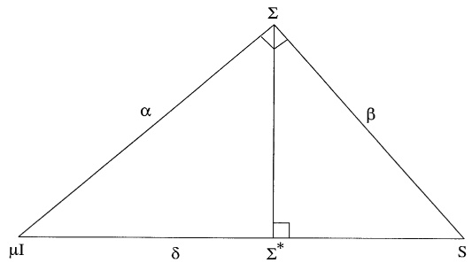

Fig. 1. Theorem 2.1 interpreted as a projection in Hilbert space.

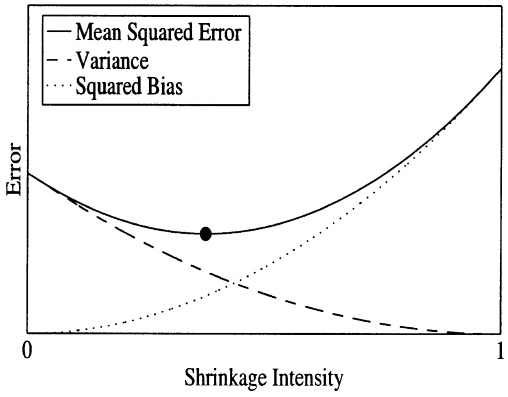

Fig. 2. Theorem 2.1 interpreted as a trade-off between bias and variance: Shrinkage intensity zero corresponds to the sample covariance matrix S: Shrinkage intensity one corresponds to the shrinkage target $\mu I .$ Optimal shrinkage intensity (represented by ) corresponds to the minimum expected loss combination $\Sigma ^ { * }$

The third interpretation is Bayesian. $\Sigma ^ { * }$ can be seen as the combination of two signals: prior information and sample information. Prior information states that the true covariance matrix $\sum$ lies on the sphere centered around the shrinkage target $\mu I$ with radius $\alpha .$ Sample information states that S lies on another sphere, centered around the sample covariance matrix S with radius $\beta .$ Bringing together prior and sample information, $\sum$ must lie on the intersection of the two spheres, which is a circle. At the center of this circle stands $\Sigma ^ { * }$ : The relative importance given to prior vs. sample information in determining $\Sigma ^ { * }$ depends on which one is more accurate. Strictly speaking, a full Bayesian approach would specify not only the support of the distribution of $\Sigma ,$ but also the distribution itself. We could assume that $\sum$ is uniformly distributed on the sphere, but it might be difficult to justify. Thus, $\Sigma ^ { * }$ should not be thought of as the expectation of the posterior distribution, as is traditional, but rather as the center of mass of its support. See Fig. 3 for an illustration. The idea of drawing inspiration from the Bayesian perspective to obtain an improved estimator of the covariance matrix was used by Haff [8].

The fourth and last interpretation involves the cross-sectional dispersion of covariance matrix eigenvalues. Let $\lambda _ { 1 } , \ldots , \lambda _ { p }$ denote the eigenvalues of the true covariance matrix $\Sigma ,$ and $l _ { 1 } , \ldots , l _ { p }$ those of the sample covariance matrix S: We can exploit the Frobenius norm’s elegant relationship to eigenvalues. Note that

$$
\mu = \frac {1}{p} \sum_ {i = 1} ^ {p} \lambda_ {i} = E \left[ \frac {1}{p} \sum_ {i = 1} ^ {p} l _ {i} \right]\tag{11}
$$

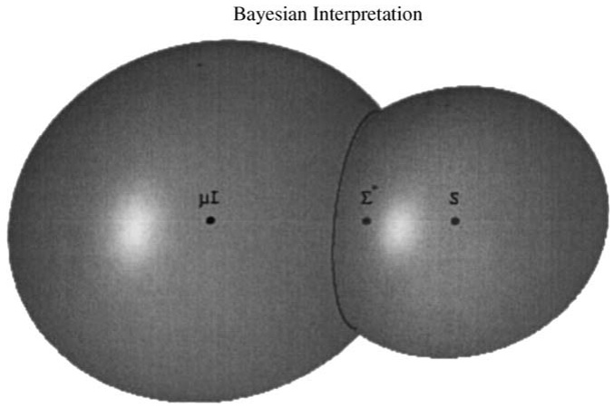

Fig. 3. Bayesian interpretation: The left sphere has center $\mu I$ and radius $\alpha$ and represents prior information. The right sphere has center $S$ and radius $\beta .$ The distance between sphere centers is $\delta$ and represents sample information. If all we knew was that the true covariance matrix S lies on the left sphere, our best guess would be its center: the shrinkage target $\mu I .$ If all we knew was that the true covariance matrix $\Sigma$ lies on the right sphere, our best guess would be its center: the sample covariance matrix $S .$ Putting together both pieces of information, the true covariance matrix $\Sigma$ must lie on the circle where the two spheres intersect; therefore, our best guess is its center: the optimal linear shrinkage $\Sigma ^ { * }$

represents the grand mean of both true and sample eigenvalues. Then Lemma 2.1 can be rewritten as

$$
\frac {1}{p} E \left[ \sum_ {i = 1} ^ {p} (l _ {i} - \mu) ^ {2} \right] = \frac {1}{p} \sum_ {i = 1} ^ {p} (\lambda_ {i} - \mu) ^ {2} + E [ | | S - \Sigma | | ^ {2} ].\tag{12}
$$

In words, sample eigenvalues are more dispersed around their grand mean than true ones, and the excess dispersion is equal to the error of the sample covariance matrix. Excess dispersion implies that the largest sample eigenvalues are biased upwards, and the smallest ones downwards. See Fig. 4 for an illustration. Therefore, we can improve upon the sample covariance matrix by shrinking its eigenvalues towards their grand mean, as in

$$
\forall i = 1, \dots , p \quad \lambda_ {i} ^ {*} = \frac {\beta^ {2}}{\delta^ {2}} \mu + \frac {\alpha^ {2}}{\delta^ {2}} l _ {i}.
$$

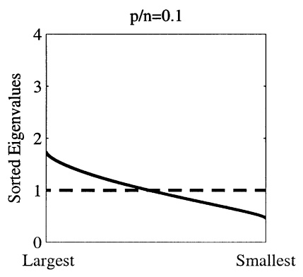

(13)

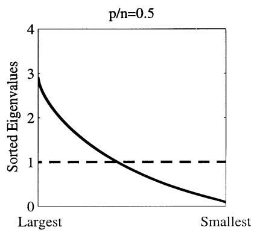

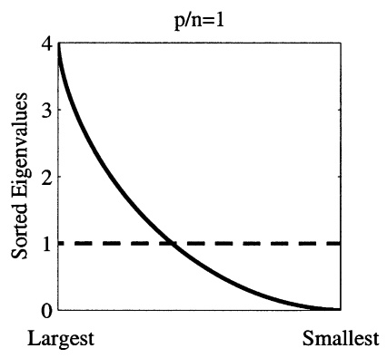

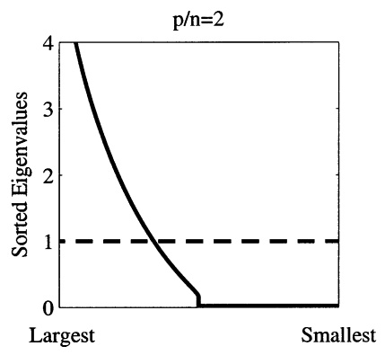

Fig. 4. Sample vs. true eigenvalues: The solid line represents the distribution of the eigenvalues of the sample covariance matrix. Eigenvalues are sorted from largest to smallest, then plotted against their rank. In this case, the true covariance matrix is the identity, that is, the true eigenvalues are all equal to one. The distribution of true eigenvalues is plotted as a dashed horizontal line at one. Distributions are obtained in the limit as the number of observations n and the number of variables $p$ both go to infinity with the ratio $p / n$ converging to a finite positive limit. The four plots correspond to different values of this limit.

Note that $\lambda _ { 1 } ^ { * } , \ldots , \lambda _ { p } ^ { * }$ defined by Eq. (13) are precisely the eigenvalues of $\Sigma ^ { * }$ Surprisingly, their dispersion $\begin{array} { r } { E [ \sum _ { i = 1 } ^ { p } \bigl ( \lambda _ { i } ^ { * } - \mu \bigr ) ^ { 2 } ] / p = \alpha ^ { 2 } / \delta } \end{array}$ is even below the dispersion of true eigenvalues. For the interested reader, the next subsection explains why. The idea that shrinking sample eigenvalues towards their grand mean yields an improved estimator of the covariance matrix was highlighted in Muirhead’s [18] review paper.

## 2.3. Further results on sample eigenvalues

The following paragraphs contain additional insights about the eigenvalues of the sample covariance matrix, but the reader can skip them and go directly to Section 3 if he or she so wishes. We discuss: (1) why the eigenvalues of the sample covariance matrix are more dispersed than those of the true covariance matrix (Eq. (12)); (2) how important this effect is in practice; and (3) why we should use instead an estimator whose eigenvalues are less dispersed than those of the true covariance matrix (Eq. (13)). The explanation relies on a result from matrix algebra.

Theorem 2.2. The eigenvalues are the most dispersed diagonal elements that can be obtained by rotation.

Proof. Let R denote a p-dimensional symmetric matrix and V a p-dimensional rotation matrix: $V V ^ { \prime } = V ^ { \prime } V = I$ : First, note that $( 1 / p ) \mathrm { t r } ( V ^ { \prime } R V ) = ( 1 / p ) \mathrm { t r } ( R )$ The average of the diagonal elements is invariant by rotation. Call it r: Let $v _ { i }$ denote the ith column of V: The dispersion of the diagonal elements of $V ^ { \prime } R V$ is $\begin{array} { r } { ( 1 / p ) \sum _ { i = 1 } ^ { p } ( { v _ { i } } ^ { \prime } R v _ { i } - r ) ^ { 2 } } \end{array}$ : Note that $\begin{array} { r } { \sum _ { i = 1 } ^ { p } ( v _ { i } { } ^ { \prime } R v _ { i } - r ) ^ { 2 } + \sum _ { i = 1 } ^ { p } \sum _ { j = 1 \atop j \neq i } ^ { p } ( v _ { i } { } ^ { \prime } R v _ { j } ) ^ { 2 } = } \end{array}$ $\operatorname { t r } [ \left( V ^ { \prime } R V - r I \right) ^ { 2 } ] = \operatorname { t r } [ \left( R - r I \right) ^ { 2 } ]$ is invariant by rotation. Therefore, the rotation V maximizes the dispersion of the diagonal elements of $V ^ { \prime } R V$ if and only if it minimizes $\textstyle \sum _ { i = 1 } ^ { p } \sum _ { j = 1 \atop j \neq i } ^ { p } ( { v _ { i } } ^ { \prime } R v _ { j } ) ^ { 2 }$ : This is achieved by setting $v _ { i } { } ^ { \prime } R v _ { j }$ to zero for all $i   \neq   j$ In this case, $V ^ { \prime } R V$ is a diagonal matrix, call it D: $V ^ { \prime } R V = D$ is equivalent to $R =$ $V   D   V ^ { \prime }$ : Since V is a rotation and D is diagonal, the columns of $V$ must contain the eigenvectors of R and the diagonal of D its eigenvalues. Therefore, the dispersion of the diagonal elements of $V ^ { \prime } R V$ is maximized when these diagonal elements are equal to the eigenvalues of R: This completes the proof of Theorem 2.2. &

Decompose the true covariance matrix into eigenvalues and eigenvectors: $\Sigma =$ $T ^ { \prime } A T$ ; where L is a diagonal matrix, and G is a rotation matrix. The diagonal elements of L are the eigenvalues $\lambda _ { 1 } , \ldots , \lambda _ { p } ,$ and the columns of $\varGamma$ are the eigenvectors $\gamma _ { 1 } , \ldots , \gamma _ { p } .$ Similarly, decompose the sample covariance matrix into eigenvalues and eigenvectors: $S = G ^ { \prime } L G$ ; where L is a diagonal matrix, and $G$ is a rotation matrix. The diagonal elements of L are the eigenvalues $l _ { 1 } , \ldots , l _ { p } ,$ and the columns of G are the eigenvectors $g _ { 1 } , \ldots , g _ { p }$ : Since S is unbiased and $T$ is nonstochastic, $T ^ { \prime } S T$ is an unbiased estimator of $\varLambda = \varGamma ^ { \prime } \varSigma \varGamma$ : The diagonal elements of

<table><tr><td colspan="3">Table 1Dispersion of diagonal elements</td></tr><tr><td> $\Gamma'S\Gamma$ </td><td> $\prec$ </td><td> $G'SG$ </td></tr><tr><td> $\wr \wr$ </td><td></td><td></td></tr><tr><td> $\Gamma'\Sigma\Gamma$ </td><td> $\succ$ </td><td> $G'\Sigma G$ </td></tr></table>

This table compares the dispersion of the diagonal elements of certain products of matrices. The symbols $\prec , \; \approx$ ; and $\succ$ pertain to diagonal elements, and mean less dispersed than, approximately as dispersed as, and more dispersed than, respectively.

$T ^ { \prime } S T$ are approximately as dispersed as the ones of $T ^ { \prime } \Sigma T$ : For convenience, let us speak as if they were exactly as dispersed. By contrast, $L = G ^ { \prime } S G$ is not at all an unbiased estimator of $T ^ { \prime } \Sigma T$ : This is because the errors of G and S interact. Theorem 2.2 shows us the effect of this interaction: the diagonal elements of $G ^ { \prime } S G$ are more dispersed than those of $T ^ { \prime } S T$ (and hence than those of $T ^ { \prime } \Sigma T )$ . This is why sample eigenvalues are more dispersed than true ones. See Table 1 for a summary.

We illustrate how important this effect is in a particular case: when the true covariance matrix is the identity matrix. Let us sort the eigenvalues of the sample covariance matrix from largest to smallest, and plot them against their rank. The shape of the plot depends on the ratio $p / n ,$ but does not depend on the particular realization of the sample covariance matrix, at least approximately when $p$ and n are very large. Fig. 4 shows the distribution of sample eigenvalues for various values of the ratio $p / n .$ This figure is based on the asymptotic formula proven by Marčenko and Pastur [17]. We notice that the largest sample eigenvalues are severely biased upwards, and the smallest ones downwards. The bias increases in $p / n .$ This phenomenon is very general and is not limited to the identity case. It is similar to the effect observed by Brown [3] in Monte-Carlo simulations. Finally, let us remark that the sample eigenvalues $l _ { i } = g _ { i } { } ^ { \prime } S g _ { i }$ should not be compared to the true eigenvalues $\lambda _ { i } = { \gamma _ { i } } ^ { \prime } \Sigma \gamma _ { i }$ ; but to ${ g _ { i } } ^ { \prime } \Sigma g _ { i }$ : We should compare estimated vs. true variance associated with vector $g _ { i }$ : By Theorem 2.2 again, the diagonal elements of $G ^ { \prime } \Sigma G$ are even less dispersed than those of $T ^ { \prime } \Sigma T$ : Not only are sample eigenvalues more dispersed than true ones, but they should be less dispersed. This effect is attributable to error in the sample eigenvectors. Intuitively: Statisticians should shy away from taking a strong stance on extremely small and extremely large eigenvalues, because they know that they have the wrong eigenvectors. The sample covariance matrix is guilty of taking an unjustifiably strong stance. The optimal linear shrinkage $\Sigma ^ { * }$ corrects for that.

## 3. Analysis under general asymptotics

In the previous section, we have shown that $\Sigma ^ { * }$ has an appealing optimality property and fits well in the existing literature. It has only one drawback: it is not a bona fide estimator, since it requires hindsight knowledge of four scalar functions of the true (and unobservable) covariance matrix $\varSigma : \mu ,   \alpha ^ { 2 } ,   \beta ^ { 2 }$ and $\delta ^ { 2 }$ : We now address this problem. The idea is that, asymptotically, there exists consistent estimators for $\mu ,   \alpha ^ { 2 } ,   \beta ^ { 2 }$ and $\delta ^ { 2 }$ ; hence for $\Sigma ^ { * }$ too. At this point, we need to choose an appropriate asymptotic framework. Standard asymptotics consider $p$ fixed while n tends to infinity, implying that the optimal shrinkage intensity vanishes in the limit. This would be reasonable for situations where $p$ is very small in comparison to n: However, in the problems of interest to us $p$ tends to be of the same order as n and can even be larger. Hence, we consider it more appropriate to use a framework that reflects this condition. This is achieved by allowing the number of variables p to go to infinity at the same speed as the number of observations n: It is called general asymptotics. In this framework, the optimal shrinkage intensity generally does not vanish asymptotically but rather it tends to a limiting constant that we will be able to estimate consistently. The idea then is to use the estimated shrinkage intensity in order to arrive at a bona fide estimator. To the best of our knowledge, the framework of general asymptotics has not been used before to improve over the sample covariance matrix, but only to characterize the distribution of its eigenvalues, as in Silverstein [20]. We are also aware of the work of Girko [5–7] who employed the framework of Kolmogorov asymptotics, where the ratio $p / n$ tends to a positive, finite constant. Girko proves consistency and asymptotic normality of so-called $G -$ estimators of certain functions of the covariance matrix. In particular, he demonstrates the element-wise consistency of a $G _ { 3 } \mathrm { - e s t i m a t o r }$ of the inverse of the covariance matrix.

## 3.1. General asymptotics

Let $n = 1 , 2 , \ldots$ index a sequence of statistical models. For every $n ,   X _ { n }$ is a $p _ { n } \times n$ matrix of n iid observations on a system of $p _ { n }$ random variables with mean zero and covariance matrix $\Sigma _ { n }$ : The number of variables $p _ { n }$ can change and even go to infinity with the number of observations $n ,$ but not too fast.

Assumption 1. There exists a constant $K _ { 1 }$ independent of n such that $p _ { n } / n   \leqslant   K _ { 1 }$

Assumption 1 is very weak. It does not require $p _ { n }$ to change and go to infinity; therefore, standard asymptotics are included as a particular case. It is not even necessary for the ratio $p _ { n } / n$ to converge to any limit. Decompose the covariance matrix into eigenvalues and eigenvectors: $\Sigma _ { n } = \varGamma _ { n } \varLambda _ { n } \varGamma _ { n } ^ { t }$ ; where $\varLambda _ { n }$ is a diagonal matrix, and $T _ { n }$ a rotation matrix. The diagonal elements of $\varLambda _ { n }$ are the eigenvalues $\lambda _ { 1 } ^ { n } , \ldots , \lambda _ { p _ { n } } ^ { n }$ ; and the columns of $T _ { n }$ are the eigenvectors $\gamma _ { 1 } ^ { n } , \ldots , \gamma _ { p _ { n } } ^ { n } . Y _ { n } = \varGamma _ { n } ^ { t } X _ { n }$ is a $p _ { n } \times n$ matrix of n iid observations on a system of $p _ { n }$ uncorrelated random variables that spans the same space as the original system. We impose restrictions on the higher moments of $Y _ { n }$ : Let $( y _ { 1 1 } ^ { n } , \ldots , y _ { p _ { n } 1 } ^ { n } ) ^ { t }$ denote the first column of the matrix $Y _ { n }$

Assumption 2. There exists a constant $K _ { 2 }$ independent of n such that $\scriptstyle { \frac { 1 } { p _ { n } } } \sum _ { i = 1 } ^ { p _ { n } } E \left[ \left( y _ { i 1 } ^ { n } \right) ^ { 8 } \right] \leqslant K _ { 2 }$

Assumption 3.

$$
\lim _ {n \to \infty} \frac {p _ {n} ^ {2}}{n ^ {2}} \times \frac {\sum_ {(i , j , k , l) \in Q _ {n}} (\text {Cov} [ y _ {i 1} ^ {n} y _ {j 1} ^ {n} , y _ {k 1} ^ {n} y _ {l 1} ^ {n} ]) ^ {2}}{\text {Cardinal of} Q _ {n}} = 0,
$$

where $Q _ { n }$ denotes the set of all the quadruples that are made of four distinct integers between 1 and $p _ { n }$

Assumption 2 states that the eighth moment is bounded (on average). Assumption 3 states that products of uncorrelated random variables are themselves uncorrelated (on average, in the limit). In the case where general asymptotics degenerate into standard asymptotics $( p _ { n } / n   \to   0 )$ ; Assumption 3 is trivially verified as a consequence of Assumption 2. Assumption 3 is verified when random variables are normally or even elliptically distributed, but it is much weaker than that. Assumptions $1 { - } 3$ are implicit throughout the paper. We suggest to use a matrix norm based on the Frobenius norm. The idea is that a norm of the $p _ { n }$ -dimensional matrix A can be specified as $\left| \left| A \right| \right|_{n}^{2} = f(p_{n}) \operatorname{tr}(A A^{t})$ ; where $f ( p _ { n } )$ is a scalar function of the dimension. This defines a quadratic form on the linear space of pn-dimensional symmetric matrices whose associated inner product is $\left\langle A_{1}, A_{2} \right\rangle_{n} = f(p_{n}) \mathrm{tr}(A_{1} A_{2}^{t})$ The behavior of $\left\| \cdot \right\| _ { n }$ across dimensions is controlled by the function $f ( \cdot )$ : The norm $\left| \left| \cdot \left| \right| \right| _ { n } \right.$ is used mainly to define a notion of consistency. A given estimator will be called consistent if the norm of its difference with the true covariance matrix goes to zero (in quadratic mean) as n goes to infinity. $\operatorname { I f } p _ { n }$ remains bounded, then all positive functions $f ( \cdot )$ generate equivalent notions of consistency. But this particular case similar to standard asymptotics is not very representative. If $p _ { n }$ (or a subsequence) goes to infinity, then the choice of ${ \mathfrak { i } } f ( \cdot )$ becomes much more important. $\mathrm { I f } f ( p _ { n } )$ is too large (small) as $p _ { n }$ goes to infinity, then it will define too strong (weak) a notion of consistency. $f ( \cdot )$ must define the notion of consistency that is ‘‘just right’’ under general asymptotics. Our solution is to define a relative norm. The norm of a $p _ { n ^ { - } }$ dimensional matrix is divided by the norm of a benchmark matrix of the same dimension $p _ { n }$ : The benchmark must be chosen carefully. For lack of any other attractive candidate, we take the identity matrix as benchmark. Therefore, by convention, the identity matrix has norm one in every dimension. This determines the function $f ( \cdot )$ uniquely as $f ( p _ { n } ) = 1 / p _ { n }$

$$
\text {Definition 1. Our norm of the} p _ {n} \text {-dimensional matrix} A \text {is:} | | A | | _ {n} ^ {2} = \operatorname{tr} (A A ^ {\prime}) / p _ {n}.
$$

Intuitively, it seems that the norm of the identity matrix should remain bounded away from zero and from infinity as its dimension goes to infinity. All choices of $f ( \cdot )$ satisfying this property would define equivalent notions of consistency. Therefore, our particular norm is equivalent to any norm that would make sense under general asymptotics. An example might help familiarize the reader with Definition 1. Let $A _ { n }$ be the $p _ { n } \times p _ { n }$ matrix with one in its top left entry and zeros everywhere else. Let $Z _ { n }$ be the $p _ { n } \times p _ { n }$ matrix with zeros everywhere (i.e. the null matrix). $A _ { n }$ and $Z _ { n }$ differ in a way that is independent of $p _ { n }$ : the top left entry is not the same. Yet their squared distance $\left| \left| A _ { n } - Z _ { n } \right| \right| ^ { 2 } = 1 / p _ { n }$ depends on $p _ { n }$ : This apparent paradox has an intuitive resolution. $A _ { n }$ and $Z _ { n }$ disagree on the first dimension, but they agree on the $p _ { n } - 1$ others. The importance of their disagreement is relative to the extent of their agreement. If $p _ { n } = 1$ ; then $A _ { n }$ and $Z _ { n }$ have nothing in common, and their distance is 1. If $p _ { n }   \to   \infty$ ; then $A _ { n }$ and $Z _ { n }$ have almost everything in common, and their distance goes to 0. Thus, disagreeing on one entry can either be important (if this entry is the only one) or negligible (if this entry is just one among a large number of others).

## 3.2. The behavior of the sample covariance matrix

Define the sample covariance matrix $S_{n} = X_{n}X_{n}^{t} / n$ : We follow the notation of Section 2, except that we add the subscript n to signal that all results hold asymptotically. Thus, we have: $\mu _ { n } = \langle \Sigma _ { n } , I _ { n } \rangle _ { n } , \alpha _ { n } ^ { 2 } = | | \Sigma _ { n } - \mu _ { n } I _ { n } | | _ { n } ^ { 2 } , \beta _ { n } ^ { 2 } = E [ | | S _ { n } - \Sigma _ { n } | | _ { n } ^ { 2 } ]$ and $\delta _ { n } ^ { 2 } = E [ | | S _ { n } - \mu _ { n } I _ { n } | | _ { n } ^ { 2 } ]$ : These four scalars are well behaved asymptotically.

## Lemma 3.1. $\mu _ { n } ,   \alpha _ { n } ^ { 2 } ,   \beta _ { n } ^ { 2 }$ and $\delta _ { n } ^ { 2 }$ remain bounded as $n   \to   \infty$

They can go to zero in special cases, but in general they do not, in spite of the division by $p _ { n }$ in the definition of the norm. The proofs of all the technical results of Section 3 are in Appendix A. The most basic question is whether the sample covariance matrix is consistent under general asymptotics. Specifically, we ask whether $S _ { n }$ converges in quadratic mean to the true covariance matrix, that is, whether $\beta _ { n } ^ { 2 }$ vanishes. In general, the answer is no, as shown below. The results stated in Theorem 3.1 and Lemmata 3.2 and 3.3 are related to special cases of a general result proven by Yin [25]. But we work under weaker assumptions than he does. Also, his goal is to find the distribution of the eigenvalues of the sample covariance matrix, while ours is to find an improved estimator of the covariance matrix.

Theorem 3.1. Define $\begin{array} { r } { \theta _ { n } ^ { 2 } = \mathbf { V a r } [ \frac { 1 } { p _ { n } } { \sum _ { i = 1 } ^ { p _ { n } } } { \left( y _ { i 1 } ^ { n } \right) ^ { 2 } } ] } \end{array}$ $\theta _ { n } ^ { 2 }$ is bounded as $n   \to   \infty$ ; and we have: $\begin{array} { r } { \operatorname* { l i m } _ { n \to \infty } E [ | | S _ { n } - \Sigma _ { n } | | _ { n } ^ { 2 } ] - \frac { p _ { n } } { n } ( \mu _ { n } ^ { 2 } + \theta _ { n } ^ { 2 } ) = 0 } \end{array}$

Theorem 3.1 shows that the expected loss of the sample covariance matrix $E [ | | S _ { n } - \Sigma _ { n } | | _ { n } ^ { 2 } ]$ is bounded, but it is at least of the order of $\scriptstyle { \frac { p _ { n } } { n } }   \mu _ { n } ^ { 2 } ,$ which does not usually vanish. Therefore, the sample covariance matrix is not consistent under general asymptotics, except in special cases. The first special case is when $p _ { n } / n   \to   0$ For example, under standard asymptotics, $p _ { n }$ is fixed, and it is well-known that the sample covariance matrix is consistent. Theorem 3.1 shows that consistency extends to cases where $p _ { n }$ is not fixed, not even necessarily bounded, as long as it is of order $o ( n )$ : The second special case is when $\mu _ { n } ^ { 2 }   \to   0$ and $\theta _ { n } ^ { 2 } { \rightarrow } 0 . \mu _ { n } ^ { 2 } { \rightarrow } 0$ implies that most of the $p _ { n }$ random variables have vanishing variances, i.e. they are asymptotically degenerate. The number of random variables escaping degeneracy must be negligible with respect to n: This is like the previous case, except that the $o ( n )$ nondegenerate random variables can now be augmented with $O ( n )$ degenerate ones. Overall, a loose condition for the consistency of the sample covariance matrix under general asymptotics is that the number of nondegenerate random variables be negligible with respect to the number of observations. If the sample covariance matrix is not consistent under general asymptotics, it is because of its off-diagonal elements. Granted, the error on each one of them vanishes, but their number grows too fast. The accumulation of a large number of small errors off the diagonal prevents the sample covariance matrix from being consistent. By contrast, the contribution of the errors on the diagonal is negligible. This is apparent from the proof of Theorem 3.1. After all, it should in general not be possible to consistently estimate $p _ { n } ( p _ { n } + 1 ) / 2$ parameters from a data set of $n p _ { n }$ random realizations if these two numbers are of the same order of magnitude. For this reason, we believe that there does not exist any consistent estimator of the covariance matrix under general asymptotics. Theorem 3.1 also shows what factors determine the error of $S _ { n }$ : The first factor is the ratio $p _ { n } / n$ : It measures deviation from standard asymptotics. People often figure out whether they can use asymptotics by checking whether they have enough observations, but in this case it would be unwise: it is the ratio of observations to variables that needs to be big. Two hundred observations might seem like a lot, but it is not nearly enough if there are 100 variables: it would be about as bad as using two observations to estimate the variance of 1 random variable! The second factor $\mu _ { n } ^ { 2 }$ simply gives the scale of the problem. The third factor $\theta _ { n } ^ { 2 }$ measures covariance between the squared variables over and above what is implied by covariance between the variables themselves. For example, $\theta _ { n } ^ { 2 }$ is zero in the normal case, but usually positive in the elliptic case. Intuitively, a ‘‘cross-sectional’’ law of large numbers could make the variance of $\textstyle p _ { n } ^ { - 1 } \sum _ { i = 1 } ^ { p _ { n } } y _ { i 1 } ^ { 2 }$ vanish asymptotically as $p _ { n } \to \infty$ if the $y _ { i 1 } ^ { 2 }   ^ { \prime } \mathrm { s }$ were sufficiently uncorrelated with one another. But Assumption 3 is too weak to ensure that, so in general $\theta _ { n } ^ { 2 }$ is not negligible, which might be more realistic sometimes. This analysis enables us to answer another basic question: When does shrinkage matter? Remember that $\beta _ { n } ^ { 2 } = E [ | | S _ { n } - \Sigma _ { n } | | _ { n } ^ { 2 } ]$ denotes the error of the sample covariance matrix, and that $\begin{array} { r } { \delta _ { n } ^ { 2 } = E [ p _ { n } ^ { - 1 } \sum _ { i = 1 } ^ { p _ { n } } ( l _ { i } ^ { n } - \mu _ { n } ) ^ { 2 } ] } \end{array}$ denotes the cross-sectional dispersion of the sample eigenvalues $l _ { 1 } ^ { n } , \ldots , l _ { p _ { n } } ^ { n }$ around the expectation of their grand mean $\begin{array} { r } { \mu _ { n } = E [ \sum _ { i = 1 } ^ { p _ { n } } l _ { i } ^ { n } / p _ { n } ] } \end{array}$ Theorem 2.1 states that shrinkage matters unless the ratio $\beta _ { n } ^ { 2 } / \delta _ { n } ^ { 2 }$ is negligible, but this answer is rather abstract. Theorem 3.1 enables us to rewrite it in more intuitive terms. Ignoring the presence of $\theta _ { n } ^ { 2 }$ ; the error of the sample covariance matrix $\beta _ { n } ^ { 2 }$ is asymptotically close to $\scriptstyle { \frac { p _ { n } } { n } }   \mu _ { n } ^ { 2 } .$ : Therefore, shrinkage matters unless the ratio of variables to observations $p _ { n } / n$ is negligible with respect to $\delta _ { n } ^ { 2 } / \mu _ { n } ^ { 2 }$ ; which is a scale-free measure of cross-sectional dispersion of sample eigenvalues. Fig. 5 provides a graphical illustration.

This constitutes an easy diagnostic test to reveal whether our shrinkage method can substantially improve upon the sample covariance matrix. In our opinion, there are many important practical situations where shrinkage does matter according to this criterion. Also, it is rather exceptional for gains from shrinkage to be as large as $p _ { n } / n$ ; because most of the time ( for example in estimation of the mean) they are of the much smaller order $1 / n .$

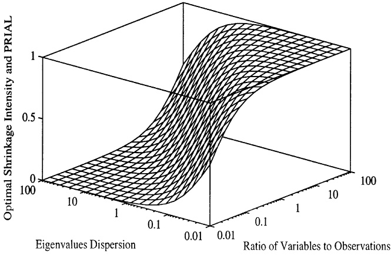

Fig. 5. Optimal shrinkage intensity and PRIAL as function of eigenvalues dispersion and the ratio of variables to observations: Note that eigenvalues dispersion is measured by the scale-free ratio $\delta _ { n } ^ { 2 } / \mu _ { n } ^ { 2 }$

## 3.3. A consistent estimator for $\Sigma _ { n } ^ { * }$

$\Sigma _ { n } ^ { * }$ is not a bona fide estimator because it depends on the true covariance matrix $\Sigma _ { n }$ ; which is unobservable. Fortunately, computing $\Sigma _ { n } ^ { * }$ does not require knowledge of the whole matrix $\Sigma _ { n }$ ; but only of four scalar functions of $\Sigma _ { n } \mathrm { : } \mu _ { n } \mathrm { , ~ } \alpha _ { n } ^ { 2 } \mathrm { , ~ } \beta _ { n } ^ { 2 }$ and $\delta _ { n } ^ { 2 }$ Given the size of the data set $\left( p _ { n } \times n \right)$ ; we cannot estimate all of $\Sigma _ { n }$ consistently, but we can estimate the optimal shrinkage target, the optimal shrinkage intensity, and even $\Sigma _ { n } ^ { * }$ itself consistently. For $\mu _ { n }$ ; a consistent estimator is its sample counterpart.

Lemma 3.2. Define $m _ { n } = \langle S _ { n } , I _ { n } \rangle _ { n }$ : Then $E [ m _ { n } ] = \mu _ { n }$ for all n; and $m _ { n } - \mu _ { n }$ converges to zero in quartic mean ( fourth moment) as n goes to infinity.

It implies that $m _ { n } ^ { 2 } - \mu _ { n } ^ { 2 }   { \stackrel { \mathrm { q . m . } } { \longrightarrow } }   0$ and $m _ { n } - \mu _ { n }   { \stackrel { \mathrm { q . m . } } { \longrightarrow } }   0$ ; where $\xrightarrow { \mathsf { q . m . } }$ denotes convergence in quadratic mean as $n   \rightarrow   \infty$ : A consistent estimator for $\delta _ { n } ^ { 2 } = E [ | | S _ { n } - \mu _ { n } I _ { n } | | _ { n } ^ { 2 } ]$ is also its sample counterpart.

Lemma 3.3. Define $d _ { n } ^ { 2 } = | | S _ { n } - m _ { n } I _ { n } | | _ { n } ^ { 2 } . T h e n d _ { n } ^ { 2 } - \delta _ { n } ^ { 2 } \stackrel { \mathrm { q . m . } } { \longrightarrow } 0 .$

Now let the $p _ { n } \times 1$ vector $x _ { \cdot k } ^ { n }$ denote the kth column of the observations matrix $X _ { n } ,$ for $k = 1 ,   \ldots , n . S _ { n } = n ^ { - 1 } X _ { n } X _ { n } ^ { t }$ can be rewritten as $\begin{array} { r } { S _ { n } = n ^ { - 1 } \sum _ { k = 1 } ^ { n } x _ { \cdot k } ^ { n } \big ( x _ { \cdot k } ^ { n } \big ) ^ { t } } \end{array}$ $S _ { n }$ is the average of the matrices $x _ { \cdot k } ^ { n } ( x _ { \cdot k } ^ { n } ) ^ { t }$ : Since the matrices $x _ { \cdot k } ^ { n } ( x _ { \cdot k } ^ { n } ) ^ { t }$ are iid across $k .$ ; we can estimate the error $\beta _ { n } ^ { 2 } = E [ | | S _ { n } - \Sigma _ { n } | | _ { n } ^ { 2 } ]$ of their average by seeing how far each one of them deviates from the average.

Lemma 3.4. Define $\begin{array} { r } { \bar { b } _ { n } ^ { 2 } = \frac { 1 } { n ^ { 2 } } \sum _ { k = 1 } ^ { n } \left| \left| x _ { \cdot k } ^ { n } \big ( x _ { \cdot k } ^ { n } \big ) ^ { t } - S _ { n } \right| \right| _ { n } ^ { 2 } } \end{array}$ and $b _ { n } ^ { 2 } = \operatorname* { m i n } ( \bar { b } _ { n } ^ { 2 } , d _ { n } ^ { 2 } )$ : Then $\bar { b } _ { n } ^ { 2 } - \beta _ { n } ^ { 2 }   \stackrel { \mathrm { q . m . } } { \longrightarrow }   0$ and $b _ { n } ^ { 2 } - \beta _ { n } ^ { 2 }   \stackrel { \mathrm { q . m . } } { \longrightarrow } 0$

We introduce the constrained estimator $b _ { n } ^ { 2 }$ because $\beta _ { n } ^ { 2 }   \leqslant   \delta _ { n } ^ { 2 }$ by Lemma 2.1. In general, this constraint is rarely binding. But it ensures that the following estimator of $\alpha _ { n } ^ { 2 }$ is nonnegative.

Lemma 3.5. Define $a _ { n } ^ { 2 } = d _ { n } ^ { 2 } - b _ { n } ^ { 2 }$ : Then $a _ { n } ^ { 2 } - \alpha _ { n } ^ { 2 }   { \stackrel { \mathrm { q . m . } } { \longrightarrow } }   0$

The next step of the strategy is to replace the unobservable scalars in the formula defining $\Sigma _ { n } ^ { * }$ with consistent estimators, and to show that the asymptotic properties are unchanged. This yields our bona fide estimator of the covariance matrix:

$$
S _ {n} ^ {*} = \frac {b _ {n} ^ {2}}{d _ {n} ^ {2}} m _ {n} I _ {n} + \frac {a _ {n} ^ {2}}{d _ {n} ^ {2}} S _ {n}.\tag{14}
$$

The next theorem shows that $S _ { n } ^ { * }$ has the same asymptotic properties as $\Sigma _ { n } ^ { * }$ : Thus, we can neglect the error that we introduce when we replace the unobservable parameters $\mu _ { n } ,   \alpha _ { n } ^ { 2 } ,   \beta _ { n } ^ { 2 }$ and $\delta _ { n } ^ { 2 }$ by estimators.

Theorem 3.2. $S _ { n } ^ { * }$ is a consistent estimator of $\Sigma _ { n } ^ { * } ,$ i.e. $| | S _ { n } ^ { * } - \Sigma _ { n } ^ { * } | | _ { n } { \overset { { \mathfrak { q } } . { \mathfrak { m } } . } { \longrightarrow } } 0$ : As a consequence, $S _ { n } ^ { * }$ has the same asymptotic expected loss (or risk) as $\Sigma _ { n } ^ { * } ,$ i.e. $E [ | | S _ { n } ^ { * } - \Sigma _ { n } | | _ { n } ^ { 2 } ] - E [ | | \Sigma _ { n } ^ { * } - \Sigma _ { n } | | _ { n } ^ { 2 } ]   \to   0$

This justifies our studying the properties of $\Sigma _ { n } ^ { * }$ in Section 2 ‘‘as if’’ it was a bona fide estimator. It is interesting to recall the Bayesian interpretation of $\Sigma _ { n } ^ { * }$ (see Section 2.2). From this point of view, $S _ { n } ^ { * }$ is an empirical Bayesian estimator. Empirical Bayesians often ignore the fact that their prior contains estimation error because it comes from the data. Usually, this is done without any rigorous justification, and it requires sophisticated ‘‘judgment’’ to pick an empirical Bayesian prior whose estimation error is ‘‘not too’’ damaging. Here, we treat this issue rigorously instead: We give a set of conditions (Assumptions 1–3) under which it is legitimate to neglect the estimation error of our empirical Bayesian prior. Finally, it is possible to estimate the expected quadratic loss of $\Sigma _ { n } ^ { * }$ and $S _ { n } ^ { * }$ consistently.

Lemma 3.6. $E \left[ \left| \frac{a_n^2 b_n^2}{d_n^2} - \frac{\alpha_n^2 \beta_n^2}{\delta_n^2} \right| \right] \rightarrow 0$

## 3.4. Optimality property of the estimator $S _ { n } ^ { * }$

The final step of our strategy is to demonstrate that $S _ { n } ^ { * }$ ; which we obtained as a consistent estimator for $\Sigma _ { n } ^ { * }$ ; possesses an important optimality property. We already know that $\Sigma _ { n } ^ { * }$ (hence, $S _ { n } ^ { * }$ in the limit) is optimal among the linear combinations of the identity and the sample covariance matrix with nonrandom coefficients (see Theorem 2.1). This is interesting, but only mildly so, because it excludes the other linear shrinkage estimators with random coefficients. In this section, we show that $S _ { n } ^ { * }$ is still optimal within a bigger class: the linear combinations of $I _ { n }$ and $S _ { n }$ with random coefficients. This class includes both the linear combinations that represent bona fide estimators, and those with coefficients that require hindsight knowledge of the true (and unobservable) covariance matrix $\Sigma _ { n }$ : Let $\boldsymbol { \Sigma } _ { n } ^ { * * }$ denote the linear combination of $I _ { n }$ and $S _ { n }$ with minimum quadratic loss. It solves:

$$
\begin{array}{l} \min _ {\rho_ {1}, \rho_ {2}} | | \Sigma_ {n} ^ {* *} - \Sigma_ {n} | | _ {n} ^ {2} \\ \text {s.t.} \Sigma_ {n} ^ {* *} = \rho_ {1} I _ {n} + \rho_ {2} S _ {n}. \end{array}\tag{15}
$$

In contrast to the optimization problem in Theorem 2.1 with solution $\Sigma _ { n } ^ { * } ,$ here we minimize the loss instead of the expected loss, and we allow the coefficients $\rho _ { 1 }$ and $\rho _ { 2 }$ to be random. It turns out that the formula for $\boldsymbol { \Sigma } _ { n } ^ { * * }$ is a function of $\Sigma _ { n } ;$ therefore, $\boldsymbol { \Sigma } _ { n } ^ { * * }$ does not constitute a bona fide estimator. By construction, $\boldsymbol { \Sigma } _ { n } ^ { * * }$ has lower loss than $\Sigma _ { n } ^ { * }$ and $S _ { n } ^ { * }$ almost surely (a.s.), but asymptotically it makes no difference.

Theorem 3.3. $S _ { n } ^ { * }$ is a consistent estimator of $\boldsymbol { \Sigma } _ { n } ^ { * * }$ ; i.e. $| | S _ { n } ^ { * } - \Sigma _ { n } ^ { * * } | | _ { n }   \stackrel { \mathrm { q . m . } } { \longrightarrow } 0$ : As a consequence, $S _ { n } ^ { * }$ has the same asymptotic expected loss (or risk) as $\boldsymbol { \Sigma } _ { n } ^ { * * }$ ; that $i s ,$ $E [ \left| \left| S _ { n } ^ { * } - \Sigma _ { n } \right| \right| _ { n } ^ { 2 } ] - E [ \left| \left| \Sigma _ { n } ^ { * * } - \Sigma _ { n } \right| \right| _ { n } ^ { 2 } ] \rightarrow 0 .$

Both $\Sigma _ { n } ^ { * }$ and $\boldsymbol { \Sigma } _ { n } ^ { * * }$ have the same asymptotic properties as $S _ { n } ^ { * } !$ ; therefore, they also have the same asymptotic properties as each other. The most important result of this paper is the following: The bona fide estimator $S _ { n } ^ { * }$ has uniformly minimum quadratic risk asymptotically among all the linear combinations of the identity with the sample covariance matrix, including those that are bona fide estimators, and even those that use hindsight knowledge of the true covariance matrix.

Theorem 3.4. For any sequence of linear combinations $\hat { \Sigma } _ { n }$ of the identity and the sample covariance matrix, the estimator $S _ { n } ^ { * }$ defined in Eq. (14) verifies:

$$
\lim _ {N \to \infty} \inf _ {n \geqslant N} (E [ | | \hat {\Sigma} _ {n} - \Sigma_ {n} | | _ {n} ^ {2} ] - E [ | | S _ {n} ^ {*} - \Sigma_ {n} | | _ {n} ^ {2} ]) \geqslant 0.\tag{16}
$$

In addition, every $\hat { \Sigma } _ { n }$ that performs as well as $S _ { n } ^ { * }$ is identical to $S _ { n } ^ { * }$ in the limit:

$$
\varliminf_ {n \to \infty} \left(E [ | | \hat {\Sigma} _ {n} - \Sigma_ {n} | | _ {n} ^ {2} ] - E [ | | S _ {n} ^ {*} - \Sigma_ {n} | | _ {n} ^ {2} ]\right) = 0 \Leftrightarrow | | \hat {\Sigma} _ {n} - S _ {n} ^ {*} | | _ {n} \xrightarrow {\text {q.m.}} 0.\tag{17}
$$

Thus, it is legitimate to say that $S _ { n } ^ { * }$ is an asymptotically optimal linear shrinkage estimator of the covariance matrix with respect to quadratic loss under general asymptotics. Typically, only maximum likelihood estimators have such a sweeping optimality property, so we believe that this result is unique in shrinkage theory. Yet another distinctive feature of $S _ { n } ^ { * }$ is that, to the best of our knowledge, it is the only estimator of the covariance matrix to retain a rigorous justification when the number of variables $p _ { n }$ exceeds the number of observations n: Not only that, but $S _ { n } ^ { * }$ is guaranteed to be always invertible, even in the case $p _ { n }   >   n$ ; where rank deficiency makes the sample covariance matrix singular. Estimating the inverse covariance matrix when variables outnumber observations is sometimes dismissed as impossible, but the existence of $\left( S _ { n } ^ { * } \right) ^ { - 1 }$ certainly proves otherwise. The following theorem shows that $S _ { n } ^ { * }$ is usually well-conditioned.

Theorem 3.5. Assume that the condition number of the true covariance matrix $\Sigma _ { n }$ is bounded, and that the normalized variables $y _ { i 1 } / \sqrt { \lambda _ { i } }$ are iid across $i = 1 , \ldots , n .$ Then the condition number of the estimator $S _ { n } ^ { * }$ is bounded in probability.

This result follows from powerful results proven recently by probabilists [2]. If the cross-sectional iid assumption is violated, it does not mean that the condition number goes to infinity, but rather that it is technically too difficult to find out anything about it. Interestingly, there is one case where the estimator $S _ { n } ^ { * }$ is even better-conditioned than the true covariance matrix $\Sigma _ { n } ;$ if the ill-conditioning of $\Sigma _ { n }$ comes from eigenvalues close to zero (multicollinearity in the variables) and the ratio of variables to observations $p _ { n } / n$ is not negligible. In this case, $S _ { n } ^ { * }$ is well-conditioned because the sample observations do not provide enough information to update our prior belief that there is no multi-collinearity.

Remark 3.1. An alternative technique to arrive at an invertible estimator of the covariance matrix is based on an maximum entropy (ME) approach; e.g., see Theil and Laitinen [23] and Vinod [24]. The motivation comes from considering variables subject to ‘‘rounding’’ or other measurement error; the measurement error corresponding to variable i is quantified by a positive number $d _ { i } ,   i = 1 ,   \ldots , p$ : The resulting covariance matrix estimator of Vinod [24], say, is then given by $S _ { n } + D _ { n } ,$ where $D _ { n }$ is a diagonal matrix with ith element $d _ { i } ^ { 2 } / 3$ : While this estimator certainly is invertible, it was not derived having in mind any optimality considerations with respect to estimating the true covariance matrix. For example, if the measurement errors, and hence the $d _ { i } ,$ are small, $S _ { n } + D _ { n }$ will be close to $S _ { n }$ and inherit its illconditioning. Therefore, the Maximum Entropy estimators do not seem very interesting for our purposes.

## 4. Monte-Carlo simulations

The goal is to compare the expected loss (or risk) of various estimators across a wide range of situations. The benchmark is the expected loss of the sample covariance matrix. We report the percentage relative improvement in average loss of $S ^ { * }$ ; defined as: $\mathrm{PRIAL}(S^*) = \left(E[\|S - \Sigma\|^2] - E[\|S^* - \Sigma\|^2]\right) / E[\|S - \Sigma\|^2] \times 100.$ The subscript n is omitted for brevity, since no confusion is possible. If the PRIAL is positive (negative), then $S ^ { * }$ performs better (worse) than S: The PRIAL of the sample covariance matrix $S$ is zero by definition. The PRIAL cannot exceed 100%. We compare the PRIAL of $S ^ { * }$ to the PRIAL of other estimators from finite sample decision theory.

## 4.1. Other estimators

There are many estimators worthy of investigation, and we cannot possibly study all the interesting ones, but we attempt to compose a representative selection.

## 4.1.1. Empirical Bayesian

Haff [8] introduces an estimator with an empirical Bayesian inspiration. Like $S ^ { * } ,$ ; it is a linear combination of the sample covariance matrix and the identity. The difference lies in the coefficients of the combination. Haff’s coefficients do not depend on the observations $X .$ ; only on $p$ and n: If the criterion is the mean squared error, Haff’s approach suggests

$$
\hat {S} _ {\mathrm{EB}} = \frac {p n - 2 n - 2}{p n ^ {2}} m _ {\mathrm{EB}} I + \frac {n}{n + 1} S\tag{18}
$$

with $m _ { \mathrm { E B } } = [ \operatorname* { d e t } ( S ) ] ^ { 1 / p }$ : When $p   >   n$ we take $m _ { \mathrm { E B } } = m$ because the regular formula would yield zero. The initials EB stand for empirical Bayesian.

## 4.1.2. Stein–Haff

Stein [21] proposes an estimator that keeps the eigenvectors of the sample covariance matrix and replaces its eigenvalues $l _ { 1 } , . . . , l _ { p }$ by

$$
nl_{i}\Bigg / \left(n - p + 1 + 2l_{i}\sum_{\substack{j = 1\\ j\neq i}}^{p}\frac{1}{l_{i} - l_{j}}\right)\quad i = 1,\dots ,p.\tag{19}
$$

These corrected eigenvalues need neither be positive nor in the same order as sample eigenvalues. To prevent this from happening, an ad hoc procedure called isotonic regression is applied before recombining corrected eigenvalues with sample eigenvectors. Haff [9] independently obtains a closely related estimator. In any given simulation, we call $\hat { S } _ { \mathrm { S H } }$ the better performing estimator of the two. The other one is not reported. The initials SH stand for Stein and Haff.3

<small>p n</small>

<small>p</small>

<small>\*i 	 \*j</small>

<small>;</small>

<small>ŜSH</small>

<small>2Intuitively, isotonic regression restores the ordering by assigning the same value to a subsequence of corrected eigenvalues that would violate it. Lin and Perlman [15] explain it in detail.</small>

<small>3When 4 some of the terms l l in formula (9) result in a division by zero. We just ignore them. Nonetheless, when  is too large compared to n the isotonic regression does not converge. In this case, does not exist.</small>

## 4.1.3. Minimax

Stein [22] and Dey and Srinivasan [4] both derive the same estimator. Under a certain loss function, it is minimax, which means that no other estimator has lower worst-case error. The minimax criterion is sometimes criticized as overly pessimistic, since it looks at the worst case only. This estimator preserves sample eigenvectors and replaces sample eigenvalues by

$$
\frac {n}{n + p + 1 - 2 i} \tilde {\lambda} _ {i},\tag{20}
$$

where sample eigenvalues $l _ { 1 } , . . . , l _ { p }$ are sorted in descending order. We call this estimator $\hat { S } _ { \mathrm { M X } }$ ; where the initials MX stand for minimax.

## 4.1.4. Computational cost

When the number of variables $p$ is very large, $S ^ { * }$ and S take much less time to compute than $\hat { S } _ { \mathrm { E B } } , \quad \hat { S } _ { \mathrm { S H } }$ and $\hat { S } _ { \mathrm { M X } }$ ; because they do not need eigenvalues and determinants. Indeed the number and nature of operations needed to compute $S ^ { * }$ are of the same order as for S: It can be an enormous advantage in practice. The only seemingly slow step is the estimation of $\beta ^ { 2 }$ ; but it can be accelerated by writing

$$
b ^ {2} = \frac {1}{p n} \sum_ {i = 1} ^ {p} \sum_ {j = 1} ^ {p} \left[ \frac {1}{n} (X ^ {\wedge 2}) (X ^ {\wedge 2}) ^ {t} \right] _ {i j} - \frac {1}{p n} \sum_ {i = 1} ^ {p} \sum_ {j = 1} ^ {p} \left[ \left(\frac {1}{n} X X ^ {t}\right) ^ {\wedge 2} \right] _ {i j},\tag{21}
$$

where $\left[ \cdot \right] _ { i j }$ denotes the entry $( i , j )$ of a matrix and the symbol 4 denotes elementwise exponentiation, that is, $[ A ^ { \wedge 2 } ] _ { i j } = ( [ A ] _ { i j } ) ^ { 2 }$ for any matrix A:

## 4.2. Experiment design

The random variables used in the simulations are normally distributed. The true covariance matrix S is diagonal without loss of generality. Its eigenvalues are drawn according to a log-normal distribution. Their grand mean $\mu$ is set equal to one without loss of generality. The structure of the Monte-Carlo experiment is as follows. We identify three parameters as influential on the results: (1) the ratio $p / n$ of variables to observations, (2) the cross-sectional dispersion of population eigenvalues $\alpha ^ { 2 }$ ; and (3) the product $p \times n$ which measures how close we are to asymptotic conditions. For each one of these three parameters we choose a central value, namely $1 / 2$ for $p / n ,   1 / 2$ for $\alpha ^ { 2 }$ ; and 800 for $p \times n$ : First, we run the simulations with each of the three parameters set to its central value. Then, we run three different sets of simulations, allowing one of the three parameters to vary around its central value, while the two others remain fixed at their central value. This enables us to study the influence of each parameter separately. To get a point of reference for the shrinkage estimator $S ^ { * }$ ; we can compute analytically its asymptotic PRIAL, as implied by Theorems 2.1, 3.1 and 3.2: it is $\scriptstyle { \frac { p / n } { p / n + \alpha ^ { 2 } } } \times 1 0 0$ : This is the ‘‘speed of light’’ that we would attain if we knew the true parameters $\mu , \; \alpha ^ { 2 } , \; \beta ^ { 2 } , \; \delta ^ { 2 }$ ; instead of having to estimate them. In the real world, we can never get this much improvement, and how close we get depends on how valid the asymptotic approximations are.

Table 2

Result of 1000 Monte-Carlo simulations for central parameter values

| Estimator | S | S | SˆEB | SˆSH | SˆMX |
| --- | --- | --- | --- | --- | --- |
| Risk | 0.5372 | 0.2723 | 0.5120 | 0.3076 | 0.3222 |
| Standard error on risk | (0.0033) | (0.0013) | (0.0031) | (0.0014) | (0.0014) |
| PRIAL | 0.0% | 49.3% | 4.7% | 42.7% | 40.0% |

## 4.3. Main results

When all three parameters are fixed at their respective central values, we get the results in Table 2.

‘‘Risk’’ means the average loss over 1000 simulations. For the central values of the parameters, the asymptotic PRIAL of $S ^ { * }$ is equal to 50%, and its simulated PRIAL is 49:3%: Therefore, asymptotic behavior is almost attained in this case for $p = 2 0$ and $n = 4 0 . ~ S ^ { * }$ improves substantially over $S$ and $\hat { S } _ { \mathrm { E B } }$ ; and moderately over $\hat { S } _ { \mathrm { S H } }$ and $\hat { S } _ { \mathrm { M X } }$

## 4.3.1. Influence of ratio $p / n$

When we increase $p / n$ from zero to infinity, the asymptotic PRIAL of $S ^ { * }$ increases from 0 to 100% with an $\mathbf { \nabla } ^ { \circ } \mathbf { S } ^ { \circ }$ shape. Fig. 6 confirms this.4

$S ^ { * }$ always has lower risk than S and $\hat { S } _ { \mathrm { E B } }$ : It usually has slightly lower risk than $\hat { S } _ { \mathrm { S H } }$ and $\hat { S _ { \mathrm { M X } } } . ~ \hat { S _ { \mathrm { S H } } }$ is not defined for high values of $p / n . ~ \hat { S } _ { \mathrm { M X } }$ performs slightly better than $S ^ { * }$ for the highest values of $p / n$ : This may be due to the fact that $S ^ { * }$ does not attain its asymptotic performance for values of n below 10.

## 4.3.2. Influence of dispersion $\alpha ^ { 2 }$

When we increase $\alpha ^ { 2 }$ from zero to infinity, the asymptotic PRIAL of $S ^ { * }$ decreases from 100% to 0% with a reverse $\mathbf { \nabla } ^ { \circ } \mathbf { S } ^ { \circ }$ shape. Fig. 7 confirms this.

$S ^ { * }$ has lower mean squared error than S always, and than $\hat { S } _ { \mathrm { E B } }$ almost always. $S ^ { * }$ always has lower mean squared error than $\hat { S } _ { \mathrm { S H } }$ and $\hat { S } _ { \mathrm { M X } }$ : When $\alpha ^ { 2 }$ gets too large, $\hat { S } _ { \mathrm { S H } }$ and $\hat { S } _ { \mathrm { M X } }$ perform worse than the sample covariance matrix. The reason is that true eigenvalues are very dispersed, and they shrink sample eigenvalues together too much. This may be due to the fact that $\hat { S } _ { \mathrm { S H } }$ and $\hat { S } _ { \mathrm { M X } }$ were originally derived under another loss function than the Frobenius norm. It is very reassuring that, even in a case where some of its competitors perform much worse than $S , S ^ { * }$ performs at least as well as S:

<small>4Corresponding tables of results are available from the authors upon request. Standard errors on simulated risk have the same order of magnitude as in Table 2.</small>

Effect of the Ratio of Variables to Observations

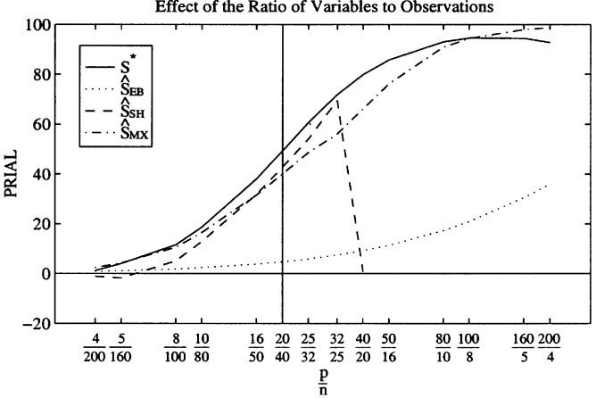

Fig. 6. Effect of the ratio of number of variables to number of observations on the $\mathbf { P R I A L } \colon \hat { S } _ { \mathrm { S H } }$ is not defined when $p / n   >   2$ because the isotonic regression does not converge.

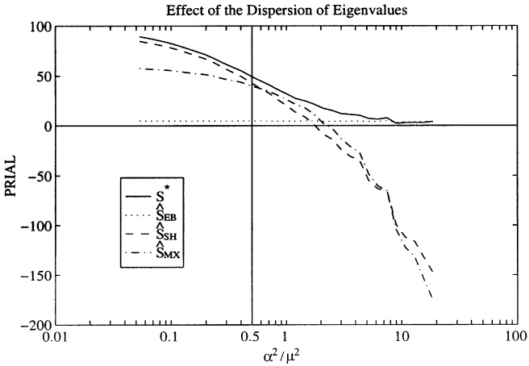

Fig. 7. Effect of the dispersion of eigenvalues on the PRIAL.

## 4.3.3. Influence of product $p \times n$

When we increase pn from zero to infinity, we should see the PRIAL of $S ^ { * }$ converge to its asymptotic value of 50%. Fig. 8 confirms this.

$S ^ { * }$ always has lower risk than S and $\hat { S } _ { \mathrm { E B } }$ : It has moderately lower risk than $\hat { S } _ { \mathrm { S H } }$ and $\hat { S } _ { \mathrm { M X } }$ ; except when n is below 20. When n is below $2 0 , S ^ { * }$ performs slightly worse than $\hat { S } _ { \mathrm { S H } }$ and moderately worse than $\hat { S } _ { \mathrm { M X } }$ ; but still substantially better than S and $\hat { S } _ { \mathrm { E B } }$

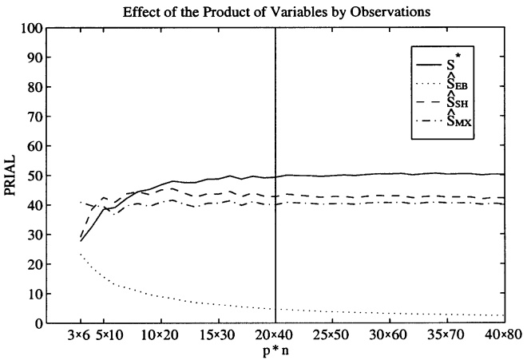

Fig. 8. Effect of the product of variables by observations on the PRIAL.

## 4.3.4. Other simulations

Simulations not reported here study departures from normality. These departures have very little impact on the above results. In relative terms, S and $\hat { S } _ { \mathrm { E B } }$ appear to suffer the most; then $\hat { S } _ { \mathrm { S H } }$ and $\hat { S } _ { \mathrm { M X } } ;$ and $S ^ { * }$ appears to suffer the least.

## 4.3.5. Summary of main results

We draw the following conclusions from these simulations. The asymptotic theory developed in Section 3 approximates finite sample behavior well, as soon as n and $p$ become of the order of 20. $S ^ { * }$ improves over the sample covariance matrix in every one of the situations simulated, and usually by a lot. It also improves over $\hat { S } _ { \mathrm { E B } }$ in almost every situation simulated, and usually by a lot too. $S ^ { * }$ never performs substantially worse than $\hat { S } _ { \mathrm { S H } }$ and $\hat { S } _ { \mathrm { M X } }$ ; often performs about as well or slightly better, and in some cases does substantially better. In the cases where $\hat { S } _ { \mathrm { S H } }$ or $\hat { S } _ { \mathrm { M X } }$ do better, it is attributable to small sample size (less than ten).5

## 4.4. Complementary results on the condition number

This section studies the condition number of the estimator $S ^ { * }$ in finite sample. The procedure for the Monte-Carlo simulations is the same as in Section 4.3, except that we do not compute the other estimators $\hat { S _ { \mathrm { E B } } } , \; \hat { S _ { \mathrm { S H } } }$ and $\hat { S } _ { \mathrm { M X } }$ : Figs. 9–11 plot the behavior of the condition number when $p / n$ varies, when $\alpha ^ { 2 } / \mu ^ { 2 }$ varies, and when pn varies, respectively. The graphs show the average condition number over 1000 replications for the sample covariance matrix S and for the improved estimator $S ^ { * }$ They also show the condition number of the true covariance matrix for comparison.

<small>ˆ</small>

<small>ˆMX</small>

<small>5We acknowledge that SSH and S were designed with another criterion than the Frobenius norm in mind. Our conclusions say nothing about performance under any other criterion. Nonetheless, the Frobenius norm is an important criterion.</small>

Effect of the Ratio of Variables to Observations

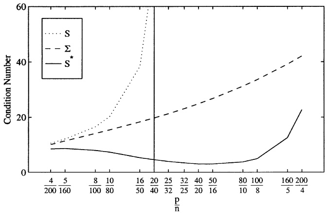

Fig. 9. Effect of the ratio of number of variables to number of observations on the condition number.

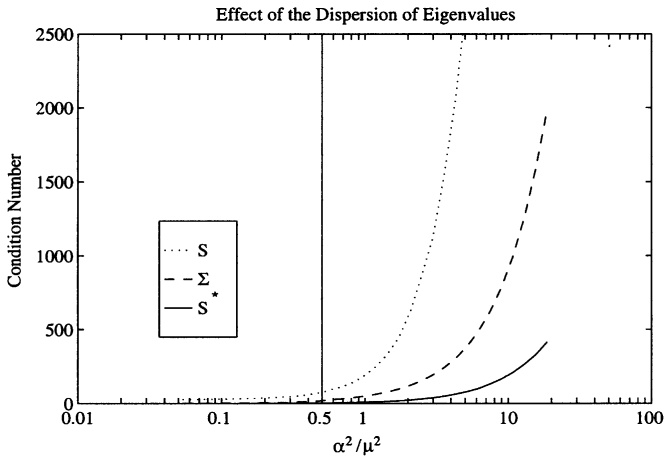

Fig. 10. Effect of the dispersion of eigenvalues on the condition number: Even for small dispersions, the condition number of S is 3–10 times bigger than the true condition number, while the condition number of S is 2–5 times smaller than the true one.

We can see that the sample covariance matrix is always worse-conditioned than the true covariance matrix, while our estimator is always better-conditioned. This suggests that the asymptotic result proven in Theorem 3.5 holds well in finite sample.

## 5. Conclusions

In this paper, we have discussed the estimation of large-dimensional covariance matrices where the number of (iid) variables is not small compared to the sample size. It is well-known that in such situations the usual estimator, the sample covariance matrix, is ill-conditioned and may not even be invertible. The approach suggested is to shrink the sample covariance matrix towards the identity matrix, which means to consider a convex linear combination of these two matrices. The practical problem is to determine the shrinkage intensity, that is, the amount of shrinkage of the sample covariance matrix towards the identity matrix. To solve this problem, we considered a general asymptotics framework where the number of variables is allowed to tend to infinity with the sample size. It was seen that under mild conditions the optimal shrinkage intensity then tends to a limiting constant; here, optimality is meant with respect to a quadratic loss function based on the Frobenius norm. It was shown that the asymptotically optimal shrinkage intensity can be estimated consistently, which leads to a feasible estimator. Both the asymptotic results and the extensive Monte-Carlo simulations presented in this paper indicate that the suggested shrinkage estimator can serve as an all-purpose alternative to the sample covariance matrix. It has smaller risk and is betterconditioned. This is especially true when the dimension of the covariance matrix is large compared to the sample size.

Effect of the Product of Variables by Observations

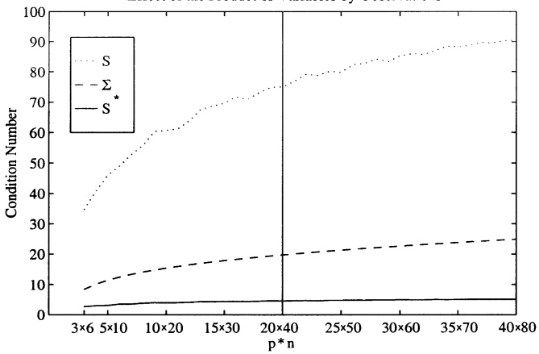

Fig. 11. Effect of the product of variables by observations on the condition number.

## Acknowledgments

We thank Petr Adamek, Dimitri Bertsimas, Minh Chau, Whitney Newey, Firooz Partovi, Pedro Santa-Clara and especially Tim Crack and Jack Silverstein for their valuable feedback. Also, the paper has benefited from seminar participants at MIT, the NBER, UCLA, Washington University in Saint Louis, Yale, Chicago, Wharton and UBC. Last but not least, the helpful comments of anonymous referee have led to an improved presentation. Errors are still our own.

## Appendix A. Proofs of the technical results in Section 3

For brevity, we omit the subscript n; but it is understood that everything depends on n: The notation is as follows. The elements of the true covariance matrix $\Sigma$ are called $\sigma _ { i j }$ : S can be decomposed into $\Sigma = \varGamma \varLambda \varGamma ^ { \prime }$ ; where L is a diagonal matrix, and $\varGamma$ is a rotation matrix. We denote the elements of L by $\lambda _ { i j }$ ; thus $\lambda _ { i j } = 0$ for $i   \neq   j ,$ and the eigenvalues of $\Sigma$ are called $\lambda _ { i i }$ : This differs from the body of the paper, where the eigenvalues are called $\lambda _ { i }$ instead, but no confusion should be possible. We use the matrix $U$ to rotate the data: $Y = U ^ { t } X$ is a $p \times n$ matrix of n iid observations on a system of $p$ random variables with mean zero and covariance matrix L:

## A.1. Proof of Lemma 3.1

Since the Frobenius norm is invariant by rotation, we have

$$
\left| | \Sigma | | ^ {2} = | | \Lambda | | ^ {2} = \frac {1}{p} \sum_ {i = 1} ^ {p} E [ y _ {i 1} ^ {2} ] ^ {2} \leqslant \frac {1}{p} \sum_ {i = 1} ^ {p} E [ y _ {i 1} ^ {4} ] \leqslant \sqrt {\frac {1}{p} \sum_ {i = 1} ^ {p} E [ y _ {i 1} ^ {8} ]} \leqslant \sqrt {K _ {2}}, \right.
$$

where the constant $K _ { 2 }$ is defined by Assumption 2. Therefore, the norm of the true covariance matrix remains bounded as n goes to infinity. This implies that $\mu =$ $\langle   \Sigma , I   \rangle _ { n }   \leqslant   | | \Sigma | |$ is bounded too (remember that Definition 1 assigns norm one to the identity). Also, $\alpha ^ { 2 } = \left| \left| \boldsymbol { \Sigma } - \mu \boldsymbol { I } \right| \right| ^ { 2 } = \left| \left| \boldsymbol { \Sigma } \right| \right| ^ { 2 } - \mu ^ { 2 }$ remains bounded as n goes to infinity. Furthermore, we have:

$$
\begin{array}{r l} E [ | | S - \Sigma | | ^ {2} ] & = \frac {1}{p} \sum_ {i = 1} ^ {p} \sum_ {j = 1} ^ {p} E \left[ \left(\frac {1}{n} \sum_ {k = 1} ^ {n} x _ {i k} x _ {j k} - \sigma_ {i j}\right) ^ {2} \right] \\ & = \frac {1}{p} \sum_ {i = 1} ^ {p} \sum_ {j = 1} ^ {p} E \left[ \left(\frac {1}{n} \sum_ {k = 1} ^ {n} y _ {i k} y _ {j k} - \lambda_ {i j}\right) ^ {2} \right] \\ & = \frac {1}{p} \sum_ {i = 1} ^ {p} \sum_ {j = 1} ^ {p} \text {Var} \left[ \frac {1}{n} \sum_ {k = 1} ^ {n} y _ {i k} y _ {j k} \right] \\ & = \frac {1}{p} \sum_ {i = 1} ^ {p} \sum_ {j = 1} ^ {p} \frac {1}{n} \text {Var} [ y _ {i 1} y _ {j 1} ] \\ & \leqslant \frac {1}{p n} \sum_ {i = 1} ^ {p} \sum_ {j = 1} ^ {p} E [ y _ {i 1} ^ {2} y _ {j 1} ^ {2} ] \end{array}
$$

$$
\begin{array}{l} \leqslant \frac {1}{p n} \sum_ {i = 1} ^ {p} \sum_ {j = 1} ^ {p} \sqrt {E [ y _ {i 1} ^ {4} ]} \sqrt {E [ y _ {j 1} ^ {4} ]} \\ \leqslant \frac {p}{n} \left(\frac {1}{p} \sum_ {i = 1} ^ {p} \sqrt {E [ y _ {i 1} ^ {4} ]}\right) ^ {2} \\ \leqslant \frac {p}{n} \left(\frac {1}{p} \sum_ {i = 1} ^ {p} E [ y _ {i 1} ^ {4} ]\right) \\ \leqslant \frac {p}{n} \sqrt {\frac {1}{p} \sum_ {i = 1} ^ {p} E [ y _ {i 1} ^ {8} ]} \\ \leqslant K _ {1} \sqrt {K _ {2}}, \end{array}
$$

where the constants $K _ { 1 }$ and $K _ { 2 }$ are defined by Assumptions 1 and 2, respectively. It shows that $\beta ^ { 2 }$ remains bounded as n goes to infinity. Finally, by Lemma 2.1, $\delta ^ { 2 } = \alpha ^ { 2 } + \beta ^ { 2 }$ also remains bounded as n goes to infinity. &

## A.2. Proof of Theorem 3.1

We have

$$
\begin{array}{l} \mu^ {2} + \theta^ {2} = \left(E \left[ \frac {1}{p} \sum_ {i = 1} ^ {p} y _ {i 1} ^ {2} \right]\right) ^ {2} + \text {Var} \left[ \frac {1}{p} \sum_ {i = 1} ^ {p} y _ {i 1} ^ {2} \right] \\ \quad = E \left[ \left(\frac {1}{p} \sum_ {i = 1} ^ {p} y _ {i 1} ^ {2}\right) ^ {2} \right] \\ \quad = \frac {1}{p ^ {2}} \sum_ {i = 1} ^ {p} \sum_ {j = 1} ^ {p} E [ y _ {i 1} ^ {2} y _ {j 1} ^ {2} ] \\ \quad \leqslant \frac {1}{p ^ {2}} \sum_ {i = 1} ^ {p} \sum_ {j = 1} ^ {p} \sqrt {E [ y _ {i 1} ^ {4} ]} \sqrt {E [ y _ {j 1} ^ {4} ]} \\ \quad \leqslant \left(\frac {1}{p} \sum_ {i = 1} ^ {p} \sqrt {E [ y _ {i 1} ^ {4} ]}\right) ^ {2} \\ \quad \leqslant \frac {1}{p} \sum_ {i = 1} ^ {p} E [ y _ {i 1} ^ {4} ] \\ \quad \leqslant \sqrt {\frac {1}{p} \sum_ {i = 1} ^ {p} E [ y _ {i 1} ^ {8} ]} \\ \quad \leqslant \sqrt {K _ {2}}. \end{array}
$$

Therefore, $\theta ^ { 2 }$ remains bounded as n goes to infinity. We can rewrite the expected quadratic loss of the sample covariance matrix as

$$
\left| \begin{array}{l} \beta^ {2} = \frac {1}{p} \sum_ {i = 1} ^ {p} \sum_ {j = 1} ^ {p} E \left[ \left(\frac {1}{n} \sum_ {k = 1} ^ {n} y _ {i k} y _ {j k} - \lambda_ {i j}\right) ^ {2} \right] \\ = \frac {1}{p n} \sum_ {i = 1} ^ {p} \sum_ {j = 1} ^ {p} E [ (y _ {i 1} y _ {j 1} - \lambda_ {i j}) ^ {2} ] \\ = \frac {1}{p n} \sum_ {i = 1} ^ {p} \sum_ {j = 1} ^ {p} E [ y _ {i 1} ^ {2} y _ {j 1} ^ {2} ] - \frac {1}{p n} \sum_ {i = 1} ^ {p} \sum_ {j = 1} ^ {p} \lambda_ {i j} ^ {2} \\ = \frac {p}{n} (\mu^ {2} + \theta^ {2}) - \frac {1}{p n} \sum_ {i = 1} ^ {p} \lambda_ {i i} ^ {2}. \end{array} \right|
$$

The last term on the right-hand side of the last equation verifies

$$
\begin{array}{c} \frac {1}{p n} \sum_ {i = 1} ^ {p} \lambda_ {i i} ^ {2} = \frac {1}{n} \left(\frac {1}{p} \sum_ {i = 1} ^ {p} E [ y _ {i 1} ^ {2} ] ^ {2}\right) \leqslant \frac {1}{n} \left(\frac {1}{p} \sum_ {i = 1} ^ {p} E [ y _ {i 1} ^ {4} ]\right) \\ \leqslant \frac {1}{n} \sqrt {\frac {1}{p} \sum_ {i = 1} ^ {p} E [ y _ {i 1} ^ {8} ]} \leqslant \frac {1}{n} \sqrt {K _ {2}}; \end{array}
$$

therefore, the difference $\beta ^ { 2 } - { \textstyle \frac { p } { n } } ( \mu ^ { 2 } + \theta ^ { 2 } )$ converges to zero as n goes to infinity. &

## A.3. Proof of Lemma 3.2

The proof of the first statement is

$$
E [ m ] = E [ \langle S, I \rangle ] = \langle E [ S ], I \rangle = \langle \Sigma , I \rangle = \mu .
$$

Consider the second statement:

$$
\begin{array}{r l} E [ (m - \mu) ^ {4} ] & = E \left[ \left\{\frac {1}{p} \sum_ {i = 1} ^ {p} \frac {1}{n} \sum_ {k = 1} ^ {n} (y _ {i k} ^ {2} - \lambda_ {i i}) \right\} ^ {4} \right] \\ & = E \left[ \left\{\frac {1}{n} \sum_ {k = 1} ^ {n} \frac {1}{p} \sum_ {i = 1} ^ {p} (y _ {i k} ^ {2} - \lambda_ {i i}) \right\} ^ {4} \right] \\ & = \frac {1}{n ^ {4}} \sum_ {k _ {1} = 1} ^ {n} \sum_ {k _ {2} = 1} ^ {n} \sum_ {k _ {3} = 1} ^ {n} \sum_ {k _ {4} = 1} ^ {n} E \left[ \left\{\frac {1}{p} \sum_ {i = 1} ^ {p} (y _ {i k _ {1}} ^ {2} - \lambda_ {i i}) \right\} \left\{\frac {1}{p} \sum_ {i = 1} ^ {p} (y _ {i k _ {2}} ^ {2} - \lambda_ {i i}) \right\} \right. \\ & \quad \times \left. \left\{\frac {1}{p} \sum_ {i = 1} ^ {p} (y _ {i k _ {3}} ^ {2} - \lambda_ {i i}) \right\} \left\{\frac {1}{p} \sum_ {i = 1} ^ {p} (y _ {i k _ {4}} ^ {2} - \lambda_ {i i}) \right\} \right]. \end{array} \tag {A.1}
$$

In the summation on the right-hand side of Eq. $( \mathrm { A . 1 ) }$ , the expectation is nonzero only if $k _ { 1 } = k _ { 2 }$ or $k _ { 1 } = k _ { 3 }$ or $k _ { 1 } = k _ { 4 }$ or $k _ { 2 } = k _ { 3 }$ or $k _ { 2 } = k _ { 4 }$ or $k _ { 3 } = k _ { 4 }$ : Since these six

conditions are symmetric, we have:

$$
\begin{array}{l} E [ (m - \mu) ^ {4} ] \\ \leqslant \frac {6}{n ^ {4}} \sum_ {k _ {1} = 1} ^ {n} \sum_ {k _ {3} = 1} ^ {n} \sum_ {k _ {4} = 1} ^ {n} \Bigg | E \left[ \left\{\frac {1}{p} \sum_ {i = 1} ^ {p} (y _ {i k _ {1}} ^ {2} - \lambda_ {i i}) \right\} ^ {2} \left\{\frac {1}{p} \sum_ {i = 1} ^ {p} (y _ {i k _ {3}} ^ {2} - \lambda_ {i i}) \right\} \right. \\ \quad \times \left. \left\{\frac {1}{p} \sum_ {i = 1} ^ {p} (y _ {i k _ {4}} ^ {2} - \lambda_ {i i}) \right\} \right] \Bigg | \\ \leqslant \frac {6}{n ^ {4}} \sum_ {k _ {1} = 1} ^ {n} \sum_ {k _ {3} = 1} ^ {n} \sum_ {k _ {4} = 1} ^ {n} \sqrt {E \left[ \left\{\frac {1}{p} \sum_ {i = 1} ^ {p} (y _ {i k _ {1}} ^ {2} - \lambda_ {i i}) \right\} ^ {4} \right]} \\ \quad \times \sqrt {E \left[ \left\{\frac {1}{p} \sum_ {i = 1} ^ {p} (y _ {i k _ {3}} ^ {2} - \lambda_ {i i}) \right\} ^ {2} \left\{\frac {1}{p} \sum_ {i = 1} ^ {p} (y _ {i k _ {4}} ^ {2} - \lambda_ {i i}) \right\} ^ {2} \right]} \\ \leqslant \frac {6}{n ^ {4}} \sum_ {k _ {1} = 1} ^ {n} \sum_ {k _ {3} = 1} ^ {n} \sum_ {k _ {4} = 1} ^ {n} \sqrt {E \left[ \left\{\frac {1}{p} \sum_ {i = 1} ^ {p} (y _ {i k _ {1}} ^ {2} - \lambda_ {i i}) \right\} ^ {4} \right]} \\ \quad \times \sqrt [ 4 ]{E \left[ \left\{\frac {1}{p} \sum_ {i = 1} ^ {p} (y _ {i k _ {3}} ^ {2} - \lambda_ {i i}) \right\} ^ {4} \right]} \sqrt [ 4 ]{E \left[ \left\{\frac {1}{p} \sum_ {i = 1} ^ {p} (y _ {i k _ {4}} ^ {2} - \lambda_ {i i}) \right\} ^ {4} \right]} \\ \leqslant \frac {6}{n} E \left[ \left\{\frac {1}{p} \sum_ {i = 1} ^ {p} (y _ {i 1} ^ {2} - \lambda_ {i i}) \right\} ^ {4} \right]. \end{array}
$$

Now we want to eliminate the $\lambda _ { i i } { } ^ { \flat } \mathbf { S }$ from the bound. We can do it by using the inequality:

$$
\begin{array}{l} E \left[ \left\{\frac {1}{p} \sum_ {i = 1} ^ {p} (y _ {i 1} ^ {2} - \lambda_ {i i}) \right\} ^ {4} \right] \\ \quad = \sum_ {q = 0} ^ {4} (- 1) ^ {q} \binom {4} {q} E \left[ \left\{\frac {1}{p} \sum_ {i = 1} ^ {p} y _ {i 1} ^ {2} \right\} ^ {q} \right] E \left[ \frac {1}{p} \sum_ {i = 1} ^ {p} y _ {i 1} ^ {2} \right] ^ {4 - q} \\ \quad \leqslant \sum_ {q = 0} ^ {4} \binom {4} {q} E \left[ \left\{\frac {1}{p} \sum_ {i = 1} ^ {p} y _ {i 1} ^ {2} \right\} ^ {4} \right] ^ {q / 4} E \left[ \left\{\frac {1}{p} \sum_ {i = 1} ^ {p} y _ {i 1} ^ {2} \right\} ^ {4} \right] ^ {(4 - q) / 4} \\ \quad \leqslant 2 ^ {4} E \left[ \left\{\frac {1}{p} \sum_ {i = 1} ^ {p} y _ {i 1} ^ {2} \right\} ^ {4} \right]. \end{array}
$$

Therefore, we have

$$
E [ (m - \mu) ^ {4} ] \leqslant \frac {9 6}{n} E \left[\left\{\frac {1}{p} \sum_ {i = 1} ^ {p} y _ {i 1} ^ {2} \right\} ^ {4} \right] \leqslant \frac {9 6}{n} E \left[ \frac {1}{p} \sum_ {i = 1} ^ {p} y _ {i 1} ^ {8} \right] \leqslant \frac {9 6 K _ {2}}{n} \rightarrow 0.
$$

This shows that the estimator m converges to its expectation $\mu$ in quartic mean. &

## A.4. Proof of Lemma 3.3

We prove this lemma by successively decomposing $d ^ { 2 } - \delta ^ { 2 }$ into terms that are easier to study.

$$
d ^ {2} - \delta^ {2} = (| | S - m I | | ^ {2} - | | S - \mu I | | ^ {2}) + (| | S - \mu I | | ^ {2} - E [ | | S - \mu I | | ^ {2} ]).\tag{A.2}
$$

It is sufficient to show that both terms in parentheses on the right-hand side of Eq. (A.2) converge to zero in quadratic mean. Consider the first term. Since mI is the orthogonal projection for the inner product $\langle \cdot , \cdot \rangle$ of the sample covariance matrix S onto the line spanned by the identity, we have: $\left| \left| S - \mu I \right| \right| ^ { 2 } - \left| \left| S - m I \right| \right| ^ { 2 } =$ $| | \mu I - m I | | ^ { 2 } = ( \mu - m ) ^ { 2 }$ ; therefore, by Lemma 3.2 it converges to zero in quadratic mean. Now consider the second term:

$$
| | S - \mu I | | ^ {2} = \mu^ {2} - 2 \mu m + | | S | | ^ {2}.\tag{A.3}
$$

Again it is sufficient to show that the three terms on the right-hand side of Eq. (A.3) converge to their expectations in quadratic mean. The first term $\mu ^ { 2 }$ is equal to its expectation, so it trivially does. The second term $2 \mu m$ does too by Lemma 3.2, keeping in mind that $\mu$ is bounded by Lemma 3.1. Now consider the third term $| | S | | ^ { 2 } ;$

$$
\begin{array}{l}||S||^{2} = \frac{1}{p}\sum_{i = 1}^{p}\sum_{j = 1}^{p}\left(\frac{1}{n}\sum_{k = 1}^{n}y_{ik}y_{jk}\right)^{2}\\ = \frac{p}{n^{2}}\sum_{k_{1} = 1}^{n}\sum_{k_{2} = 1}^{n}\left(\frac{1}{p}\sum_{i = 1}^{p}y_{ik_{1}}y_{ik_{2}}\right)^{2}\\ = \frac{p}{n^{2}}\sum_{k = 1}^{n}\left(\frac{1}{p}\sum_{i = 1}^{p}y_{ik}^{2}\right)^{2} + \frac{p}{n^{2}}\sum_{k_{1} = 1}^{n}\sum_{\substack{k_{2} = 1\\ k_{2}\neq k_{1}}}^{n}\left(\frac{1}{p}\sum_{i = 1}^{p}y_{ik_{1}}y_{ik_{2}}\right)^{2}. \end{array}\tag{A.4}
$$

Again it is sufficient to show that both terms on the right-hand side of Eq. (A.4) converge to their expectations in quadratic mean. Consider the first term:

$$
\operatorname{Var} \left[ \frac {p}{n ^ {2}} \sum_ {k = 1} ^ {n} \left(\frac {1}{p} \sum_ {i = 1} ^ {p} y _ {i k} ^ {2}\right) ^ {2} \right] = \frac {p ^ {2}}{n ^ {3}} \operatorname{Var} \left[ \left(\frac {1}{p} \sum_ {i = 1} ^ {p} y _ {i 1} ^ {2}\right) ^ {2} \right]
$$

$$
\begin{array}{l} \leqslant \frac {p ^ {2}}{n ^ {3}} E \left[ \left(\frac {1}{p} \sum_ {i = 1} ^ {p} y _ {i 1} ^ {2}\right) ^ {4} \right] \\ \leqslant \left(\frac {1}{n}\right) \left(\frac {p}{n}\right) ^ {2} \left(\frac {1}{p} \sum_ {i = 1} ^ {p} E [ y _ {i 1} ^ {8} ]\right) \\ \leqslant \frac {K _ {1} ^ {2} K _ {2}}{n} \to 0. \end{array}
$$

Therefore, the first term on the right-hand side of Eq. (A.4) converges to its expectation in quadratic mean. Now consider the second term:

$$
\begin{array}{l}\hline \text{Var}\left[\frac{p}{n^{2}}\sum_{k_{1} = 1}^{n}\sum_{\substack{k_{2} = 1\\ k_{2}\neq k_{1}}}^{n}\left(\frac{1}{p}\sum_{i = 1}^{p}y_{ik_{1}}y_{ik_{2}}\right)^{2}\right]\\ = \frac{p^{2}}{n^{4}}\sum_{k_{1} = 1}^{n}\sum_{\substack{k_{2} = 1\\ k_{2}\neq k_{1}}}^{n}\sum_{k_{3} = 1}^{n}\sum_{\substack{k_{4} = 1\\ k_{4}\neq k_{3}}}^{n}\text{Cov}\left[\left(\frac{1}{p}\sum_{i = 1}^{p}y_{ik_{1}}y_{ik_{2}}\right)^{2},\left(\frac{1}{p}\sum_{i = 1}^{p}y_{ik_{3}}y_{ik_{4}}\right)^{2}\right]. \end{array}\tag{A.5}
$$

The covariances on the right-hand side of Eq. (A.5) only depend on $( \{ k _ { 1 } , k _ { 2 } \} \cap \{ k _ { 3 } , k _ { 4 } \} ) ^ { \# }$ ; the cardinal of the intersection of the set $\{ k _ { 1 } , k _ { 2 } \}$ with the set $\{ k _ { 3 } , k _ { 4 } \}$ : This number can be zero, one or two. We study each case separately.

$$
(\{k _ {1}, k _ {2} \} \cap \{k _ {3}, k _ {4} \}) ^ {\#} = 0:
$$

In this case $\scriptstyle { \big ( } { \frac { 1 } { p } } \sum _ { i = 1 } ^ { p } y _ { i k _ { 1 } } y _ { i k _ { 2 } } { \big ) } ^ { 2 }$ and $\scriptstyle { \big ( } { \frac { 1 } { p } } \sum _ { i = 1 } ^ { p } y _ { i k _ { 3 } } y _ { i k _ { 4 } } { \big ) } ^ { 2 }$ are independent, so their covariance is zero.

$$
(\{k _ {1}, k _ {2} \} \cap \{k _ {3}, k _ {4} \}) ^ {\#} = 1:
$$

This case occurs $4n(n - 1)(n - 2)$ times in the summation on the right-hand side of Eq. (A.5). Each time we have

$$
\begin{array}{c} \hline \text {Cov} \left[ \left(\frac {1}{p} \sum_ {i = 1} ^ {p} y _ {i k _ {1}} y _ {i k _ {2}}\right) ^ {2}, \left(\frac {1}{p} \sum_ {i = 1} ^ {p} y _ {i k _ {3}} y _ {i k _ {4}}\right) ^ {2} \right] \\ = \text {Cov} \left[ \left(\frac {1}{p} \sum_ {i = 1} ^ {p} y _ {i 1} y _ {i 2}\right) ^ {2}, \left(\frac {1}{p} \sum_ {i = 1} ^ {p} y _ {i 1} y _ {i 3}\right) ^ {2} \right] \end{array}
$$

$$
\begin{array}{l} \leqslant E \left[ \left(\frac {1}{p} \sum_ {i = 1} ^ {p} y _ {i 1} y _ {i 2}\right) ^ {2} \left(\frac {1}{p} \sum_ {i = 1} ^ {p} y _ {i 1} y _ {i 3}\right) ^ {2} \right] \\ \leqslant E \left[ \frac {1}{p ^ {4}} \sum_ {i = 1} ^ {p} \sum_ {j = 1} ^ {p} \sum_ {k = 1} ^ {p} \sum_ {l = 1} ^ {p} y _ {i 1} y _ {i 2} y _ {j 1} y _ {j 2} y _ {k 1} y _ {k 3} y _ {l 1} y _ {l 3} \right] \\ \leqslant \frac {1}{p ^ {4}} \sum_ {i = 1} ^ {p} \sum_ {j = 1} ^ {p} \sum_ {k = 1} ^ {p} \sum_ {l = 1} ^ {p} E [ y _ {i 1} y _ {j 1} y _ {k 1} y _ {l 1} ] E [ y _ {i 2} y _ {j 2} ] E [ y _ {k 3} y _ {l 3} ] \\ \leqslant \frac {1}{p ^ {4}} \sum_ {i = 1} ^ {p} \sum_ {k = 1} ^ {p} E [ y _ {i 1} ^ {2} y _ {k 1} ^ {2} ] E [ y _ {i 2} ^ {2} ] E [ y _ {k 3} ^ {2} ] \\ \leqslant \frac {1}{p ^ {4}} \sum_ {i = 1} ^ {p} \sum_ {k = 1} ^ {p} \sqrt {E [ y _ {i 1} ^ {4} ]} \sqrt {E [ y _ {k 1} ^ {4} ]} E [ y _ {i 2} ^ {2} ] E [ y _ {k 3} ^ {2} ] \\ \leqslant \frac {1}{p ^ {2}} \left(\frac {1}{p} \sum_ {i = 1} ^ {p} \sqrt {E [ y _ {i 1} ^ {4} ]} E [ y _ {i 1} ^ {2} ]\right) ^ {2} \\ \leqslant \frac {1}{p ^ {2}} \left(\frac {1}{p} \sum_ {i = 1} ^ {p} \sqrt {E [ y _ {i 1} ^ {4} ]} \sqrt {E [ y _ {i 1} ^ {4} ]}\right) ^ {2} \\ \leqslant \frac {1}{p ^ {2}} \left(\frac {1}{p} \sum_ {i = 1} ^ {p} E [ y _ {i 1} ^ {8} ]\right) \\ \leqslant \frac {K _ {2}}{p ^ {2}} \end{array}
$$

and

$$
\begin{array}{l} - \operatorname{Cov} \left[ \left(\frac {1}{p} \sum_ {i = 1} ^ {p} y _ {i k _ {1}} y _ {i k _ {2}}\right) ^ {2}, \left(\frac {1}{p} \sum_ {i = 1} ^ {p} y _ {i k _ {3}} y _ {i k _ {4}}\right) ^ {2} \right] \\ = - \operatorname{Cov} \left[ \left(\frac {1}{p} \sum_ {i = 1} ^ {p} y _ {i 1} y _ {i 2}\right) ^ {2}, \left(\frac {1}{p} \sum_ {i = 1} ^ {p} y _ {i 1} y _ {i 3}\right) ^ {2} \right] \\ \leqslant E \left[ \left(\frac {1}{p} \sum_ {i = 1} ^ {p} y _ {i 1} y _ {i 2}\right) ^ {2} \right] E \left[ \left(\frac {1}{p} \sum_ {i = 1} ^ {p} y _ {i 1} y _ {i 3}\right) ^ {2} \right] \\ \leqslant \left(\frac {1}{p ^ {2}} \sum_ {i = 1} ^ {p} \sum_ {j = 1} ^ {p} E [ y _ {i 1} y _ {j 1} ] ^ {2}\right) ^ {2} \end{array}
$$

$$
\begin{array}{l} \leqslant \frac {1}{p} \left(\frac {1}{p} \sum_ {i = 1} ^ {p} E [ y _ {i 1} ^ {2} ] ^ {2}\right) ^ {2} \\ \leqslant \frac {1}{p ^ {2}} \left(\frac {1}{p} \sum_ {i = 1} ^ {p} E [ y _ {i 1} ^ {8} ]\right) \\ \leqslant \frac {K _ {2}}{p ^ {2}}. \end{array}
$$

Therefore, in this case the absolute value of the covariance on the right-hand side of Eq. (A.5) is bounded by $K _ { 2 } / p ^ { 2 }$

$$
(\{k _ {1}, k _ {2} \} \cap \{k _ {3}, k _ {4} \}) ^ {\#} = 2:
$$

This case occurs $2 n ( n - 1 )$ times in the summation on the right-hand side of Eq. (A.5). Each time we have:

$$
\left| \begin{array}{l} \operatorname{Cov} \left[ \left(\frac {1}{p} \sum_ {i = 1} ^ {p} y _ {i k _ {1}} y _ {i k _ {2}}\right) ^ {2}, \left(\frac {1}{p} \sum_ {i = 1} ^ {p} y _ {i k _ {3}} y _ {i k _ {4}}\right) ^ {2} \right] \\ = \left| \operatorname{Cov} \left[ \left(\frac {1}{p} \sum_ {i = 1} ^ {p} y _ {i 1} y _ {i 2}\right) ^ {2}, \left(\frac {1}{p} \sum_ {i = 1} ^ {p} y _ {i 1} y _ {i 2}\right) ^ {2} \right] \right| \\ \leqslant \frac {1}{p ^ {4}} \sum_ {i = 1} ^ {p} \sum_ {j = 1} ^ {p} \sum_ {k = 1} ^ {p} \sum_ {l = 1} ^ {p} | \operatorname{Cov} [ y _ {i 1} y _ {i 2} y _ {j 1} y _ {j 2}, y _ {k 1} y _ {k 2} y _ {l 1} y _ {l 2} ] |. \end{array} \right|\tag{A.6}
$$

In the summation on the right-hand side of Eq. (A.6), the set of quadruples of integers between 1 and $p$ can be decomposed into two disjoint subsets: $\{ 1 , \ldots , p \} ^ { 4 } = Q \cup R ,$ where $Q$ contains those quadruples that are made of four distinct integers, and R contains the remainder. Thus, we can make the following decomposition:

$$
\begin{array}{l} \left| \operatorname{Cov} \left[ \left(\frac {1}{p} \sum_ {i = 1} ^ {p} y _ {i k _ {1}} y _ {i k _ {2}}\right) ^ {2}, \left(\frac {1}{p} \sum_ {i = 1} ^ {p} y _ {i k _ {3}} y _ {i k _ {4}}\right) ^ {2} \right] \right| \\ \leqslant \frac {1}{p ^ {4}} \sum_ {(i, j, k, l) \in Q} | \operatorname{Cov} [ y _ {i 1} y _ {i 2} y _ {j 1} y _ {j 2}, y _ {k 1} y _ {k 2} y _ {l 1} y _ {l 2} ] | \\ \quad + \frac {1}{p ^ {4}} \sum_ {(i, j, k, l) \in R} | \operatorname{Cov} [ y _ {i 1} y _ {i 2} y _ {j 1} y _ {j 2}, y _ {k 1} y _ {k 2} y _ {l 1} y _ {l 2} ] |. \end{array}
$$

Let us express the first term of this decomposition as a function of the quantity that vanishes under Assumption 3: $v = \frac{p^{2}}{n^{2}} \times \frac{\sum_{(i,j,k,l) \in Q} \left( \operatorname{Cov}\left[ y_{i1} y_{j1}, y_{k1} y_{l1} \right] \right)^{2}}{\operatorname{Cardinal\ of\ Q}}$ : First, notice that the cardinal of Q is $p  (  p - 1  )   (  p - 2  )   (  p - 3  )$ : Also, when $i   \neq   j$ and $k   \neq   l ,$ we have $E[y_{i1}y_{j1}] = E[y_{k1}y_{l1}] = 0;$ therefore,

$$
\begin{array}{l} \left| \operatorname{Cov} [ y _ {i 1} y _ {i 2} y _ {j 1} y _ {j 2}, y _ {k 1} y _ {k 2} y _ {l 1} y _ {l 2} ] \right| \\ \quad = \left| E [ y _ {i 1} y _ {i 2} y _ {j 1} y _ {j 2} y _ {k 1} y _ {k 2} y _ {l 1} y _ {l 2} ] \right. \\ \quad \quad \quad - E [ y _ {i 1} y _ {i 2} y _ {j 1} y _ {j 2} ] E [ y _ {k 1} y _ {k 2} y _ {l 1} y _ {l 2} ] | \\ \quad = \left| E [ y _ {i 1} y _ {j 1} y _ {k 1} y _ {l 1} ] ^ {2} - E [ y _ {i 1} y _ {j 1} ] ^ {2} E [ y _ {k 1} y _ {l 1} ] ^ {2} \right| \\ \quad = E [ y _ {i 1} y _ {j 1} y _ {k 1} y _ {l 1} ] ^ {2} \\ \quad = (\operatorname{Cov} [ y _ {i 1} y _ {j 1}, y _ {k 1} y _ {l 1} ] + E [ y _ {i 1} y _ {j 1} ] E [ y _ {k 1} y _ {l 1} ]) ^ {2} \\ \quad = (\operatorname{Cov} [ y _ {i 1} y _ {j 1}, y _ {k 1} y _ {l 1} ]) ^ {2}. \end{array}
$$

This enables us to express the first term of the decomposition as: $\frac{n^{2}(p - 1)(p - 2)(p - 3)}{p^{5}}v$ Now consider the second term of the decomposition. The summation over R only extends over the quadruples $( i , j , k , l )$ such that $i = j { \mathrm { ~ o r ~ } } i = k { \mathrm { ~ o r ~ } } i = l { \mathrm { ~ o r ~ } } j = k { \mathrm { ~ o r ~ } } j = l$ or $k = l .$ Since these six conditions are symmetric, we have:

$$
\begin{array}{l} \frac {1}{p ^ {4}} \sum_ {(i, j, k, l) \in R} | \operatorname{Cov} [ y _ {i 1} y _ {i 2} y _ {j 1} y _ {j 2}, y _ {k 1} y _ {k 2} y _ {l 1} y _ {l 2} ] | \\ \leqslant \frac {6}{p ^ {4}} \sum_ {i = 1} ^ {p} \sum_ {k = 1} ^ {p} \sum_ {k = 1} ^ {p} | \operatorname{Cov} [ y _ {i 1} y _ {i 2} y _ {i 1} y _ {i 2}, y _ {k 1} y _ {k 2} y _ {l 1} y _ {l 2} ] | \\ \leqslant \frac {6}{p ^ {4}} \sum_ {i = 1} ^ {p} \sum_ {k = 1} ^ {p} \sum_ {k = 1} ^ {p} \sqrt {E [ y _ {i 1} ^ {2} y _ {i 2} ^ {2} y _ {i 1} ^ {2} y _ {i 2} ^ {2} ] E [ y _ {k 1} ^ {2} y _ {k 2} ^ {2} y _ {l 1} ^ {2} y _ {l 2} ^ {2} ]} \\ \leqslant \frac {6}{p ^ {4}} \sum_ {i = 1} ^ {p} \sum_ {k = 1} ^ {p} \sum_ {k = 1} ^ {p} E [ y _ {i 1} ^ {4} ] E [ y _ {k 1} ^ {2} y _ {l 1} ^ {2} ] \\ \leqslant \frac {6}{p ^ {4}} \sum_ {i = 1} ^ {p} \sum_ {k = 1} ^ {p} \sum_ {k = 1} ^ {p} E [ y _ {i 1} ^ {4} ] \sqrt {E [ y _ {k 1} ^ {4} ]} \sqrt {E [ y _ {l 1} ^ {4} ]} \\ \leqslant \frac {6}{p} \left(\frac {1}{p} \sum_ {i = 1} ^ {p} E [ y _ {i 1} ^ {4} ]\right) \left(\frac {1}{p} \sum_ {i = 1} ^ {p} \sqrt {E [ y _ {i 1} ^ {4} ]}\right) ^ {2} \\ \leqslant \frac {6}{p} \left(\frac {1}{p} \sum_ {i = 1} ^ {p} E [ y _ {i 1} ^ {4} ]\right) ^ {2} \\ \leqslant \frac {6}{p} \left(\frac {1}{p} \sum_ {i = 1} ^ {p} E [ y _ {i 1} ^ {8} ]\right) \\ \leqslant \frac {6 K _ {2}}{p}. \end{array}
$$

This completes the study of the decomposition, and also of the three possible cases. We can now bring all the results together to bound the summation on the right-hand side of Eq. (A.5):

$$
\left|\begin{array}{l}\frac {p ^ {2}}{n ^ {4}} \sum_ {k _ {1} = 1} ^ {n} \sum_ {\substack {k _ {2} = 1\\k _ {2} \neq k _ {1}}} ^ {n} \sum_ {k _ {3} = 1} ^ {n} \sum_ {\substack {k _ {4} = 1\\k _ {4} \neq k _ {3}}} ^ {n} \left| \operatorname{Cov} \left[ \left(\frac {1}{p} \sum_ {i = 1} ^ {p} y _ {i k _ {1}} y _ {i k _ {2}}\right) ^ {2}, \left(\frac {1}{p} \sum_ {i = 1} ^ {p} y _ {i k _ {3}} y _ {i k _ {4}}\right) ^ {2} \right] \right|\\\leqslant \frac {p ^ {2}}{n ^ {4}} \left\{4 n (n - 1) (n - 2) \frac {K _ {2}}{p ^ {2}} + 2 n (n - 1) \frac {n ^ {2} (p - 1) (p - 2) (p - 3)}{p ^ {5}} v \right.\\\left. + 2 n (n - 1) \frac {6 K _ {2}}{p} \right\}\\\leqslant \frac {4 K _ {2} (1 + 3 K _ {1})}{n} + 2 v \rightarrow 0.\end{array}\right|
$$

Backing up, the second term on the right-hand side of Eq. (A.4) converges to its expectation in quadratic mean. Backing up again, the third term $| | S | | ^ { 2 }$ on the righthand side of Eq. (A.3) converges to its expectation in quadratic mean. Backing up more, the second term between parentheses on the right-hand side of Eq. (A.2) converges to zero in quadratic mean. Backing up one last time, $d ^ { 2 } - \delta ^ { 2 }$ converges to zero in quadratic mean. For future reference note that, since $| | S - \mu I | | ^ { 2 }$ converges to its expectation $\delta ^ { 2 }$ in quadratic mean and since $\delta ^ { 2 }$ is bounded, $E [ | | S - \mu I | | ^ { 4 } ]$ is bounded. &

## A.5. Proof of Lemma 3.4

We first prove that the unconstrained estimator $\bar { b } ^ { 2 }$ is consistent. As before, we do it by successively decomposing $\bar { b } ^ { 2 } - \beta ^ { 2 }$ into terms that are easier to study.

$$
\begin{array}{l} \bar {b} ^ {2} - \beta^ {2} = \left\{\frac {1}{n ^ {2}} \sum_ {k = 1} ^ {n} | | x _ {\cdot k} x _ {\cdot k} ^ {t} - \Sigma | | ^ {2} - E [ | | S - \Sigma | | ^ {2} ] \right\} \\ \qquad + \left\{\frac {1}{n ^ {2}} \sum_ {k = 1} ^ {n} | | x _ {\cdot k} x _ {\cdot k} ^ {t} - S | | ^ {2} - \frac {1}{n ^ {2}} \sum_ {k = 1} ^ {n} | | x _ {\cdot k} x _ {\cdot k} ^ {t} - \Sigma | | ^ {2} \right\}. \end{array}\tag{A.7}
$$

It is sufficient to show that both bracketed terms on the right-hand side of Eq. (A.7) converge to zero in quadratic mean. Consider the first term:

$$
\begin{array}{c} E [ | | S - \Sigma | | ^ {2} ] = \frac {1}{p} \sum_ {i = 1} ^ {p} \sum_ {j = 1} ^ {p} E \left[ \left(\frac {1}{n} \sum_ {k = 1} ^ {n} x _ {i k} x _ {j k} - \sigma_ {i j}\right) ^ {2} \right] \\ = \frac {1}{p} \sum_ {i = 1} ^ {p} \sum_ {j = 1} ^ {p} \operatorname{Var} \left[ \frac {1}{n} \sum_ {k = 1} ^ {n} x _ {i k} x _ {j k} \right] \end{array}
$$

$$
\begin{array}{l} = \frac {1}{p} \sum_ {i = 1} ^ {p} \sum_ {j = 1} ^ {p} \frac {1}{n ^ {2}} \sum_ {k = 1} ^ {n} \operatorname{Var} [ x _ {i k} x _ {j k} ] \\ = \frac {1}{p n} \sum_ {i = 1} ^ {p} \sum_ {j = 1} ^ {p} \operatorname{Var} [ x _ {i 1} x _ {j 1} ] \\ = \frac {1}{p n} \sum_ {i = 1} ^ {p} \sum_ {j = 1} ^ {p} E [ (x _ {i 1} x _ {j 1} - \sigma_ {i j}) ^ {2} ] \\ = E \left[ \frac {1}{n} | | x _ {\cdot 1} x _ {\cdot 1} ^ {t} - \Sigma | | ^ {2} \right] \\ = E \left[ \frac {1}{n ^ {2}} \sum_ {k = 1} ^ {n} | | x _ {\cdot k} x _ {\cdot k} ^ {t} - \Sigma | | ^ {2} \right]. \end{array}
$$

Therefore, the first bracketed term on the right-hand side of $\mathrm { E q . ~ } ( \mathrm { A } . 7 )$ has expectation zero. For $k = 1 , \ldots , n$ let $y . k$ denote the $p _ { n } \times 1$ vector holding the kth column of the matrix Y:

$$
\begin{array}{l} \operatorname{Var} \left[ \frac {1}{n ^ {2}} \sum_ {k = 1} ^ {n} \left| \left| x _ {\cdot k} x _ {\cdot k} ^ {t} - \Sigma \right| \right| ^ {2} \right] \\ = \frac {1}{n} \operatorname{Var} \left[ \frac {1}{n} \left| \left| x _ {\cdot 1} x _ {\cdot 1} ^ {t} - \Sigma \right| \right| ^ {2} \right] \\ = \frac {1}{n} \operatorname{Var} \left[ \frac {1}{n} \left| \left| y _ {\cdot 1} y _ {\cdot 1} ^ {t} - A \right| \right| ^ {2} \right] \\ = \frac {1}{p ^ {2} n ^ {3}} \sum_ {i = 1} ^ {p} \sum_ {j = 1} ^ {p} \sum_ {k = 1} ^ {p} \sum_ {l = 1} ^ {p} \operatorname{Cov} [ y _ {i 1} y _ {j 1} - \lambda_ {i j}, y _ {k 1} y _ {l 1} - \lambda_ {k l} ] \\ = \frac {1}{p ^ {2} n ^ {3}} \sum_ {i = 1} ^ {p} \sum_ {j = 1} ^ {p} \sum_ {k = 1} ^ {p} \sum_ {l = 1} ^ {p} \operatorname{Cov} [ y _ {i 1} y _ {j 1}, y _ {k 1} y _ {l 1} ] \\ \leqslant \frac {1}{p ^ {2} n ^ {3}} \sum_ {i = 1} ^ {p} \sum_ {j = 1} ^ {p} \sum_ {k = 1} ^ {p} \sum_ {l = 1} ^ {p} \sqrt {E [ y _ {i 1} ^ {2} y _ {j 1} ^ {2} ] E [ y _ {k 1} ^ {2} y _ {l 1} ^ {2} ]} \\ \leqslant \frac {1}{p ^ {2} n ^ {3}} \sum_ {i = 1} ^ {p} \sum_ {j = 1} ^ {p} \sum_ {k = 1} ^ {p} \sum_ {l = 1} ^ {p} \sqrt [ 4 ]{E [ y _ {i 1} ^ {4} ] E [ y _ {j 1} ^ {4} ] E [ y _ {k 1} ^ {4} ] E [ y _ {l 1} ^ {4} ]} \\ \leqslant \frac {p ^ {2}}{n ^ {3}} \left(\frac {1}{p} \sum_ {i = 1} ^ {p} \sqrt [ 4 ]{E [ y _ {i 1} ^ {4} ]}\right) ^ {4} \end{array}
$$

$$
\begin{array}{l} \leqslant \frac {p ^ {2}}{n ^ {3}} \left(\frac {1}{p} \sum_ {i = 1} ^ {p} E [ y _ {i 1} ^ {4} ]\right) \\ \leqslant \frac {p ^ {2}}{n ^ {3}} \sqrt {\frac {1}{p} \sum_ {i = 1} ^ {p} E [ y _ {i 1} ^ {8} ]} \\ \leqslant \frac {K _ {1} ^ {2} \sqrt {K _ {2}}}{n}. \end{array}
$$

Therefore, the first bracketed term on the right-hand side of Eq. (A.7) converges to zero in quadratic mean. Now consider the second term:

$$
\begin{array}{l} \frac {1}{n ^ {2}} \sum_ {k = 1} ^ {n} | | x _ {\cdot k} x _ {\cdot k} ^ {t} - \Sigma | | ^ {2} - \frac {1}{n ^ {2}} \sum_ {k = 1} ^ {n} | | x _ {\cdot k} x _ {\cdot k} ^ {t} - S | | ^ {2} \\ \quad = \left\langle \frac {1}{n ^ {2}} \sum_ {k = 1} ^ {n} 2 (S - \Sigma), \left(x _ {\cdot k} x _ {\cdot k} ^ {t} - \frac {S + \Sigma}{2}\right) \right\rangle \\ \quad = \left\langle \frac {2}{n} (S - \Sigma), \left(\frac {1}{n} \sum_ {k = 1} ^ {n} x _ {\cdot k} x _ {\cdot k} ^ {t} - \frac {S + \Sigma}{2}\right) \right\rangle \\ \quad = \left\langle \frac {2}{n} (S - \Sigma), \left(S - \frac {S + \Sigma}{2}\right) \right\rangle \\ \quad = \frac {1}{n} | | S - \Sigma | | ^ {2}. \end{array}
$$

$E [ | | S - \Sigma | | ^ { 4 } ]$ is bounded since $E [ | | S - \mu I | | ^ { 4 } ]$ and $| | \Sigma - \mu I | |$ are bounded. Therefore, the second term on the right-hand side of $\mathrm { E q . ~ } ( \mathrm { A } . 7 )$ converges to zero in quadratic mean. Backing up once more, $\bar { b } ^ { 2 } - \beta ^ { 2 }$ converges to zero in quadratic mean. Now let us turn to the constrained estimator $b ^ { 2 } = \operatorname* { m i n } ( \bar { b } ^ { 2 } , d ^ { 2 } )$

$$
b ^ {2} - \beta^ {2} = \min (\bar {b} ^ {2}, d ^ {2}) - \beta^ {2} \leqslant \bar {b} ^ {2} - \beta^ {2} \leqslant | \bar {b} ^ {2} - \beta^ {2} | \leqslant \max (| \bar {b} ^ {2} - \beta^ {2} |, | d ^ {2} - \delta^ {2} |)
$$

a.s. Furthermore, using $\delta ^ { 2 }   \geqslant   \beta ^ { 2 }$ ; we have

$$
\begin{array}{r l} b ^ {2} - \beta^ {2} & = \min (\bar {b} ^ {2}, d ^ {2}) - \beta^ {2} \\ & = \min (\bar {b} ^ {2} - \beta^ {2}, d ^ {2} - \beta^ {2}) \\ & \geqslant \min (\bar {b} ^ {2} - \beta^ {2}, d ^ {2} - \delta^ {2}) \\ & \geqslant \min (- | \bar {b} ^ {2} - \beta^ {2} |, - | d ^ {2} - \delta^ {2} |) \\ & \geqslant - \max (| \bar {b} ^ {2} - \beta^ {2} |, | d ^ {2} - \delta^ {2} |) \end{array}
$$

a.s. Therefore,

$$
E [ (b ^ {2} - \beta^ {2}) ^ {2} ] \leqslant E [ \max (| \bar {b} ^ {2} - \beta^ {2} |, | d ^ {2} - \delta^ {2} |) ^ {2} ] \leqslant E [ (\bar {b} ^ {2} - \beta^ {2}) ^ {2} ] + E [ (d ^ {2} - \delta^ {2}) ^ {2} ].
$$

On the right-hand side, the first term converges to zero as we have shown earlier in this section, and the second term converges to zero as we have shown in Lemma 3.3. Therefore, $b ^ { 2 } - \beta ^ { 2 }$ converges to zero in quadratic mean. &

## A.6. Proof of Lemma 3.5

Follows trivially from Lemmata 2.1, 3.3, and 3.4. &

## A.7. Proof of Theorem 3.2

The following lemma will be useful in proving Theorems 3.2 and 3.3 and Lemma 3.6.

Lemma A.1. $\mathit { I f }   u ^ { 2 }$ is a sequence of nonnegative random variables (implicitly indexed by $n _ { \flat }$ as usual) whose expectations converge to zero, and $\tau _ { 1 } , \tau _ { 2 }$ are two nonrandom scalars, and $\frac{u^{2}}{d^{\tau_{1}}\delta^{\tau_{2}}} \leqslant 2(d^{2}+\delta^{2})$ a.s., then

$$
E \left[ \frac {u ^ {2}}{d ^ {\tau_ {1}} \delta^ {\tau_ {2}}} \right] \to 0.
$$

Proof of Lemma A.1. Fix $\varepsilon   >   0$ : Recall that the subscript n has been omitted to make the notation lighter, but is present implicitly. Let $\mathcal { N }$ denote the set of indices n such that $\delta ^ { 2 }   \leqslant   \varepsilon / 8$ : Since, $d ^ { 2 } - \delta ^ { 2 }   \rightarrow   0$ in quadratic mean, there exists an integer $n _ { 1 }$ such that $\forall n \geqslant n _ { 1 } \quad E [ | d ^ { 2 } - \delta ^ { 2 } | ] \leqslant \varepsilon / 4$ : For every $n   \geqslant   n _ { 1 }$ inside the set $\mathcal { N }$ ; we have

$$
E \left[ \frac {u ^ {2}}{d ^ {\tau_ {1}} \delta^ {\tau_ {2}}} \right] \leqslant 2 (E [ d ^ {2} ] + \delta^ {2}) \leqslant 2 (E [ | d ^ {2} - \delta^ {2} | ] + 2 \delta^ {2}) \leqslant 2 \left(\frac {\varepsilon}{4} + 2 \frac {\varepsilon}{8}\right) = \varepsilon .\tag{A.8}
$$

Now consider the complementary of the set $\mathcal { N }$ : Since $E [ u ^ { 2 } ]   \rightarrow   0$ ; there exists an integer $n _ { 2 }$ such that

$$
\forall n \geqslant n _ {2} \quad E [ u ^ {2} ] \leqslant \frac {\varepsilon^ {\tau_ {1} + \tau_ {2} + 1}}{2 ^ {4 \tau_ {1} + 3 \tau_ {2} + 1}}.
$$

Let $\mathbf { 1 } _ { \{ \cdot \} }$ denote the indicator function of an event, and let $\mathbf { P r } ( \cdot )$ denote its probability. From the proof of Lemma 3.1, $\delta ^ { 2 }$ is bounded by $( 1 + K _ { 1 } ) { \sqrt { K _ { 2 } } }$ : Since $d ^ { 2 } - \delta ^ { 2 }$ converges to zero in quadratic mean, hence in probability, there exists an integer $n _ { 3 }$ such that

$$
\forall n \geqslant n _ {3} \quad \Pr \Big (| d ^ {2} - \delta^ {2} | \geqslant \frac {\varepsilon}{1 6} \Big) \leqslant \frac {4 \varepsilon}{1 6 (1 + K _ {1}) \sqrt {K _ {2}} + \varepsilon}.
$$

For every $n   \geqslant$ max $( n _ { 2 } , n _ { 3 } )$ outside the set $\mathcal { N } ,$ ; we have:

$$
\begin{array}{l} E \left[ \frac {u ^ {2}}{d ^ {\tau_ {1}} \delta^ {\tau_ {2}}} \right] = E \left[ \frac {u ^ {2}}{d ^ {\tau_ {1}} \delta^ {\tau_ {2}}} \mathbf {1} _ {\{d ^ {2} \leqslant \varepsilon / 1 6 \}} \right] + E \left[ \frac {u ^ {2}}{d ^ {\tau_ {1}} \delta^ {\tau_ {2}}} \mathbf {1} _ {\{d ^ {2} > \varepsilon / 1 6 \}} \right] \\ \leqslant E \left[ 2 (\delta^ {2} + d ^ {2}) \mathbf {1} _ {\{d ^ {2} \leqslant \varepsilon / 1 6 \}} \right] + \left(\frac {1 6}{\varepsilon}\right) ^ {\tau_ {1}} \left(\frac {8}{\varepsilon}\right) ^ {\tau_ {2}} E [ u ^ {2} \mathbf {1} _ {\{d ^ {2} > \varepsilon / 1 6 \}} ] \end{array}
$$

$$
\begin{array}{l} \leqslant 2 \Big \{(1 + K _ {1}) \sqrt {K _ {2}} + \frac {\varepsilon}{1 6} \Big \} \Pr \Big (| d ^ {2} - \delta^ {2} | \geqslant \frac {\varepsilon}{1 6} \Big) + \left(\frac {1 6}{\varepsilon}\right) ^ {\tau_ {1}} \left(\frac {8}{\varepsilon}\right) ^ {\tau_ {2}} E [ u ^ {2} ] \\ \leqslant 2 \Big \{(1 + K _ {1}) \sqrt {K _ {2}} + \frac {\varepsilon}{1 6} \Big \} \frac {4 \varepsilon}{1 6 (1 + K _ {1}) \sqrt {K _ {2}} + \varepsilon} \\ \quad + \left(\frac {1 6}{\varepsilon}\right) ^ {\tau_ {1}} \left(\frac {8}{\varepsilon}\right) ^ {\tau_ {2}} \frac {\varepsilon^ {\tau_ {1} + \tau_ {2} + 1}}{2 ^ {4 \tau_ {1} + 3 \tau_ {2} + 1}} \\ \leqslant \varepsilon . \end{array} \tag {A.}\tag{A.9}
$$

Bringing together the results inside and outside the set $\mathcal { N }$ obtained in Eqs. (A.8) and (A.9) yields

$$
\forall n \geqslant \max (n _ {1}, n _ {2}, n _ {3}) \quad E \left[ \frac {u ^ {2}}{d ^ {\tau_ {1}} \delta^ {\tau_ {2}}} \right] \leqslant \varepsilon .
$$

This ends the proof of the lemma. &

Consider the first statement of Theorem 3.2:

$$
\begin{array}{l} \left| \left| S ^ {*} - \Sigma^ {*} \right| \right| ^ {2} = \left| \left| \frac {\beta^ {2}}{\delta^ {2}} (m - \mu) I + \left(\frac {a ^ {2}}{d ^ {2}} - \frac {\alpha^ {2}}{\delta^ {2}}\right) (S - m I) \right| \right| ^ {2} \\ \qquad = \frac {\beta^ {4}}{\delta^ {4}} (m - \mu) ^ {2} + \left(\frac {a ^ {2}}{d ^ {2}} - \frac {\alpha^ {2}}{\delta^ {2}}\right) ^ {2} | | S - m I | | ^ {2} \\ \qquad \quad + 2 \frac {\beta^ {2}}{\delta^ {2}} (m - \mu) \left(\frac {a ^ {2}}{d ^ {2}} - \frac {\alpha^ {2}}{\delta^ {2}}\right) \langle S - m I, I \rangle \\ \qquad = \frac {\beta^ {4}}{\delta^ {4}} (m - \mu) ^ {2} + \left(\frac {a ^ {2}}{d ^ {2}} - \frac {\alpha^ {2}}{\delta^ {2}}\right) ^ {2} d ^ {2} \\ \qquad \leqslant (m - \mu) ^ {2} + \frac {(a ^ {2} \delta^ {2} - \alpha^ {2} d ^ {2}) ^ {2}}{d ^ {2} \delta^ {4}}. \end{array}\tag{A.10}
$$

It is sufficient to show that the expectations of both terms on the right-hand side of Eq. (A.10) converge to zero. The expectation of the first term does by Lemma 3.2. Now consider the second term. Since $\alpha ^ { 2 }   \leqslant   \delta ^ { 2 }$ and $a ^ { 2 }   \leqslant   d ^ { 2 }$ ; note that

$$
\frac {(a ^ {2} \delta^ {2} - \alpha^ {2} d ^ {2}) ^ {2}}{d ^ {2} \delta^ {4}} \leqslant d ^ {2} \leqslant 2 (d ^ {2} + \delta^ {2}) \quad \text {a.s.}
$$

Furthermore, since $a ^ { 2 } - \alpha ^ { 2 }$ and $d ^ { 2 } - \delta ^ { 2 }$ converge to zero in quadratic mean, and since $\alpha ^ { 2 }$ and $\delta ^ { 2 }$ are bounded, $a ^ { 2 } \delta ^ { 2 } - \alpha ^ { 2 } d ^ { 2 } = { \big ( } a ^ { 2 } - \alpha ^ { 2 } { \big ) } \delta ^ { 2 } - \alpha ^ { 2 } { \big ( } d ^ { 2 } - \delta ^ { 2 } { \big ) }$ converges to zero in quadratic mean. Therefore, the assumptions of Lemma A.1 are verified by $u^{2} = (a^{2}\delta^{2} - \alpha^{2}d^{2})^{2},   \tau_{1} = 2$ and $\tau _ { 2 } = 4$ : It implies that

$$
E \left[ \frac {\left(a ^ {2} \delta^ {2} - \alpha^ {2} d ^ {2}\right) ^ {2}}{d ^ {2} \delta^ {4}} \right]\rightarrow 0.
$$

The expectation of second term on the right-hand side of Eq. (A.10) converges to zero. Backing up, $| | S ^ { * } - \Sigma ^ { * } | |$ converges to zero in quadratic mean. This completes the proof of the first statement of Theorem 3.2. Now consider the second statement:

$$
\begin{array}{c} E [ | | | S ^ {*} - \Sigma | | ^ {2} - | | \Sigma^ {*} - \Sigma | | ^ {2} | ] = E [ | \langle S ^ {*} - \Sigma^ {*}, S ^ {*} + \Sigma^ {*} - 2 \Sigma \rangle | ] \\ \leqslant \sqrt {E [ | | S ^ {*} - \Sigma^ {*} | | ^ {2} ]} \sqrt {E [ | | S ^ {*} + \Sigma^ {*} - 2 \Sigma | | ^ {2} ]}. \end{array}\tag{A.11}
$$

As we have shown above, the first term on the right-hand side of Eq. (A.11) converges to zero. Given that $E [ | | \Sigma ^ { * } - \Sigma | | ^ { 2 } ]$ is bounded, it also implies that the second term on the right-hand side of Eq. (A.11) is bounded. Therefore, the product of the two terms on the right-hand side of Eq. (A.11) converges to zero. This completes the proof of the second and final statement. &

## A.8. Proof of Lemma 3.6

We have:

$$
\left| \frac {a ^ {2} b ^ {2}}{d ^ {2}} - \frac {\alpha^ {2} \beta^ {2}}{\delta^ {2}} \right| = \frac {\left| a ^ {2} b ^ {2} \delta^ {2} - \alpha^ {2} \beta^ {2} d ^ {2} \right|}{d ^ {2} \delta^ {2}}.
$$

Let us verify that the assumptions of Lemma A.1 hold for $u ^ { 2 } = | a ^ { 2 } b ^ { 2 } \delta ^ { 2 } - \alpha ^ { 2 } \beta ^ { 2 } d ^ { 2 } |$ $\tau _ { 1 } = 2$ and $\tau _ { 2 } = 2$ : Notice that:

$$
\left| \frac {a ^ {2} b ^ {2}}{d ^ {2}} - \frac {\alpha^ {2} \beta^ {2}}{\delta^ {2}} \right| \leqslant \frac {a ^ {2} b ^ {2}}{d ^ {2}} + \frac {\alpha^ {2} \beta^ {2}}{\delta^ {2}} \leqslant a ^ {2} + \alpha^ {2} \leqslant d ^ {2} + \delta^ {2} \leqslant 2 (d ^ {2} + \delta^ {2})
$$

## a.s. Furthermore,

$$
\begin{array}{l} E [ | a ^ {2} b ^ {2} \delta^ {2} - \alpha^ {2} \beta^ {2} d ^ {2} | ] \\ \quad = E [ | (a ^ {2} b ^ {2} - \alpha^ {2} \beta^ {2}) \delta^ {2} - \alpha^ {2} \beta^ {2} (d ^ {2} - \delta^ {2}) | ] \\ \quad = E [ | (a ^ {2} - \alpha^ {2}) (b ^ {2} - \beta^ {2}) \delta^ {2} + \alpha^ {2} (b ^ {2} - \beta^ {2}) \delta^ {2} + (a ^ {2} - \alpha^ {2}) \beta^ {2} \delta^ {2} - \alpha^ {2} \beta^ {2} (d ^ {2} - \delta^ {2}) | ] \\ \quad \leqslant \sqrt {E [ (a ^ {2} - \alpha^ {2}) ^ {2} ]} \sqrt {E [ (b ^ {2} - \beta^ {2}) ^ {2} ]} \delta^ {2} + \alpha^ {2} E [ | b ^ {2} - \beta^ {2} | ] \delta^ {2} + E [ | a ^ {2} - \alpha^ {2} | ] \beta^ {2} \delta^ {2} \\ \quad - \alpha^ {2} \beta^ {2} E [ | d ^ {2} - \delta^ {2} | ]. \end{array}
$$

The right-hand side converges to zero by Lemmata 3.1, 3.3, 3.4, and 3.5. Therefore, $E [ u ^ { 2 } ]   \rightarrow   0$ ; and the assumptions of Lemma A.1 are verified. It implies that

$$
E \left[\left| \frac {a ^ {2} b ^ {2}}{d ^ {2}} - \frac {\alpha^ {2} \beta^ {2}}{\delta^ {2}} \right|\right]\rightarrow 0. \quad \square
$$

## A.9. Proof of Theorem 3.3

Define $\alpha _ { 2 } = \langle \Sigma , S \rangle - \mu m$ : Its expectation is $E [ \alpha _ { 2 } ] = \left| \left| \Sigma \right| \right| ^ { 2 } - \mu ^ { 2 } = \alpha ^ { 2 }$ : We have:

$$
\begin{array}{l} | \alpha_ {2} | = | \langle \Sigma , S \rangle - \mu m | = | \langle \Sigma - \mu I, S - m I \rangle | \\ \leqslant \sqrt {| | \Sigma - \mu I | | ^ {2}} \sqrt {| | S - m I | | ^ {2}} \leqslant \delta d. \end{array}\tag{A.12}
$$

Let us prove that $\alpha _ { 2 } - \alpha ^ { 2 }$ converges to zero in quadratic mean:

$$
\begin{array}{r l} \mathrm{Var} [ \alpha_ {2} ] & = \mathrm{Var} [ \langle \Sigma , S \rangle - \mu m ] \\ & = \mathrm{Var} [ \langle \Sigma , S \rangle ] + \mathrm{Var} [ \mu m ] - 2   \mathrm{Cov} [ \langle \Sigma , S \rangle , \mu m ] \\ & \leqslant 2   \mathrm{Var} [ \langle \Sigma , S \rangle ] + 2   \mathrm{Var} [ \mu m ] \\ & \leqslant 2 \mu^ {2}   \mathrm{Var} [ m ] + 2   \mathrm{Var} [ \langle \Sigma , S \rangle ]. \end{array}\tag{A.13}
$$

The first term on the right-hand side of Eq. (A.13) converges to zero, since $\mu$ is bounded by Lemma 3.1, and since $\operatorname { V a r } [ m ]$ converges to zero by Lemma 3.2. Consider the second term:

$$
\begin{array}{r l} \langle \Sigma , S \rangle & = \frac {1}{p} \operatorname{tr} (\Sigma S ^ {t}) \\ & = \frac {1}{p} \sum_ {i = 1} ^ {p} \sum_ {j = 1} ^ {p} \sigma_ {i j} s _ {i j} \\ & = \frac {1}{p} \sum_ {i = 1} ^ {p} \sum_ {j = 1} ^ {p} \sigma_ {i j} \left(\frac {1}{n} \sum_ {k = 1} ^ {n} x _ {i k} x _ {j k}\right) \\ & = \frac {1}{p} \sum_ {i = 1} ^ {p} \sum_ {j = 1} ^ {p} \lambda_ {i j} \left(\frac {1}{n} \sum_ {k = 1} ^ {n} y _ {i k} y _ {j k}\right) \\ & = \frac {1}{p} \sum_ {i = 1} ^ {p} \lambda_ {i i} \left(\frac {1}{n} \sum_ {k = 1} ^ {n} y _ {i k} ^ {2}\right). \end{array}
$$

Therefore,

$$
\begin{array}{r l} \mathrm{Var} [ \langle \Sigma , S \rangle ] & = \mathrm{Var} \left[ \frac {1}{p} \sum_ {i = 1} ^ {p} \lambda_ {i i} \left(\frac {1}{n} \sum_ {k = 1} ^ {n} y _ {i k} ^ {2}\right) \right] \\ & = \mathrm{Var} \left[ \frac {1}{n} \sum_ {k = 1} ^ {n} \left(\frac {1}{p} \sum_ {i = 1} ^ {p} \lambda_ {i i} y _ {i k} ^ {2}\right) \right] \\ & = \frac {1}{n ^ {2}} \sum_ {k _ {1} = 1} ^ {n} \sum_ {k _ {2} = 1} ^ {n} \mathrm{Cov} \left[ \frac {1}{p} \sum_ {i = 1} ^ {p} \lambda_ {i i} y _ {i k _ {1}} ^ {2}, \frac {1}{p} \sum_ {i = 1} ^ {p} \lambda_ {i i} y _ {i k _ {2}} ^ {2} \right] \end{array}
$$

$$
\begin{array}{l} = \frac {1}{n ^ {2}} \sum_ {k = 1} ^ {n} \operatorname{Var} \left[ \frac {1}{p} \sum_ {i = 1} ^ {p} \lambda_ {i i} y _ {i k} ^ {2} \right] \\ = \frac {1}{n} \operatorname{Var} \left[ \frac {1}{p} \sum_ {i = 1} ^ {p} \lambda_ {i i} y _ {i 1} ^ {2} \right] \\ \leqslant \frac {1}{n} E \left[ \left(\frac {1}{p} \sum_ {i = 1} ^ {p} \lambda_ {i i} y _ {i 1} ^ {2}\right) ^ {2} \right] \\ \leqslant \frac {1}{n} E \left[ \left(\frac {1}{p} \sum_ {i = 1} ^ {p} \lambda_ {i i} ^ {2}\right) \left(\frac {1}{p} \sum_ {i = 1} ^ {p} y _ {i 1} ^ {4}\right) \right] \\ \leqslant \frac {1}{n} \left(\frac {1}{p} \sum_ {i = 1} ^ {p} E [ y _ {i 1} ^ {2} ] ^ {2}\right) \left(\frac {1}{p} \sum_ {i = 1} ^ {p} E [ y _ {i 1} ^ {4} ]\right) \\ \leqslant \frac {1}{n} \left(\frac {1}{p} \sum_ {i = 1} ^ {p} E [ y _ {i 1} ^ {4} ]\right) ^ {2} \\ \leqslant \frac {1}{n} \left(\frac {1}{p} \sum_ {i = 1} ^ {p} E [ y _ {i 1} ^ {8} ]\right) \\ \leqslant \frac {K _ {2}}{n}. \end{array}
$$

It implies that the second term on the right-hand side of Eq. (A.13) converges to zero. Backing up, $\alpha _ { 2 } - \alpha ^ { 2 }$ converges to zero in quadratic mean. Now let us find an explicit formula for the solution $\Sigma ^ { * * }$ to the optimization problem in Eq. (15). This problem is very similar to the one in Theorem 2.1 but, instead of solving it with calculus as we did then, we will give an equivalent treatment based on geometry. The solution is the orthogonal projection according to the inner product $\langle \cdot , \cdot \rangle$ of the true covariance matrix S onto the plane spanned by the identity matrix I and the sample covariance matrix S: Note that $\left\langle S - m I , I \right\rangle = 0 ;$ ; therefore, $( I , \frac { S - m I } { | | S - m I | | } )$ forms an orthonormal basis for this plane. The formula for the projection has a simple expression in terms of the orthonormal basis:

$$
\begin{array}{r l} \Sigma^ {* *} & = \langle \Sigma , I \rangle I + \left\langle \Sigma , \frac {S - m I}{| | S - m I | |} \right\rangle \frac {S - m I}{| | S - m I | |} \\ & = \mu I + \frac {\langle \Sigma , S \rangle - \mu m}{| | S - m I | | ^ {2}} (S - m I) \\ & = \mu I + \frac {\alpha_ {2}}{d ^ {2}} (S - m I). \end{array}
$$

From now on, the proof is the same as for Theorem 32:

$$
| | S ^ {*} - \Sigma^ {* *} | | ^ {2} = \left| \left| m I + \frac {a ^ {2}}{d ^ {2}} (S - m I) - \mu I - \frac {\alpha_ {2}}{d ^ {2}} (S - m I) \right| \right| ^ {2}
$$

$$
\left| \begin{array}{l} = \left\| (m - \mu) I + \frac {a ^ {2} - \alpha_ {2}}{d ^ {2}} (S - m I) \right\| ^ {2} \\ = (m - \mu) ^ {2} + \frac {\left(a ^ {2} - \alpha_ {2}\right) ^ {2}}{d ^ {4}} | | S - m I | | ^ {2} + 2 (m - \mu) \frac {a ^ {2} - \alpha_ {2}}{d ^ {2}} \langle S - m I, I \rangle \\ = (m - \mu) ^ {2} + \frac {\left(a ^ {2} - \alpha_ {2}\right) ^ {2}}{d ^ {2}}. \end{array} \right.\tag {A.14}
$$

It is sufficient to show that the expectations of both terms on the right-hand side of Eq. (A.14) converge to zero. The expectation of the first term does by Lemma 3.2. Now consider the second term:

$$
\begin{array}{r l} \frac {(a ^ {2} - \alpha_ {2}) ^ {2}}{d ^ {2}} & = \frac {a ^ {4} + \alpha_ {2} ^ {2} - 2 a ^ {2} \alpha_ {2}}{d ^ {2}} \\ & \leqslant \frac {2 a ^ {4} + 2 \alpha_ {2} ^ {2}}{d ^ {2}} \\ & \leqslant 2 d ^ {2} + 2 \delta^ {2}, \end{array}
$$

where we have used Eq. (A.12). Furthermore, since $a ^ { 2 } - \alpha ^ { 2 }$ and $\alpha _ { 2 } - \alpha ^ { 2 }$ both converge to zero in quadratic mean, $a ^ { 2 } - \alpha _ { 2 }$ also does. Therefore, the assumptions of Lemma A.1 are verified by $u ^ { 2 } = ( a ^ { 2 } - \alpha _ { 2 } ) ^ { 2 } , \tau _ { 1 } = 2$ and $\tau _ { 2 } = 0$ : It implies that

$$
\left| E \left[ \frac {\left(a ^ {2} - \alpha_ {2}\right) ^ {2}}{d ^ {2}} \right]\rightarrow 0. \right.
$$

The expectation of the second term on the right-hand side of Eq. (A.14) converges to zero. Backing up, $| | S ^ { * } - \Sigma ^ { * * } | |$ converges to zero in quadratic mean. This completes the proof of the first statement of Theorem 3.3. Now consider the second statement:

$$
\left| \begin{array}{c} E [ | | | S ^ {*} - \Sigma | | ^ {2} - | | \Sigma^ {* *} - \Sigma | | ^ {2} | ] = E [ | \langle S ^ {*} - \Sigma^ {* *}, S ^ {*} + \Sigma^ {* *} - 2 \Sigma \rangle | ] \\ \leqslant \sqrt {E [ | | S ^ {*} - \Sigma^ {* *} | | ^ {2} ]} \sqrt {E [ | | S ^ {*} + \Sigma^ {* *} - 2 \Sigma | | ^ {2} ]}. \end{array} \right.\tag{A.15}
$$

As we have shown above, the first term on the right-hand side of Eq. (A.15) converges to zero. Given that $E [ | | S ^ { * } - \Sigma | | ^ { 2 } ]$ is bounded, it also implies that the second term on the right-hand side of Eq. (A.15) is bounded. Therefore, the product of the two terms on the right-hand side of Eq. (A.15) converges to zero. This completes the proof of the second and final statement. &

## A.10. Proof of Theorem 3.4

$$
\begin{array}{r l} \operatorname * {l i m i n f} (E [ | | \hat {\Sigma} - \Sigma | | ^ {2} ] - E [ | | S ^ {*} - \Sigma | | ^ {2} ]) & \geqslant \inf (E [ | | \hat {\Sigma} - \Sigma | | ^ {2} ] - E [ | | \Sigma^ {* *} - \Sigma | | ^ {2} ]) \\ & \quad + \lim (E [ | | \Sigma^ {* *} - \Sigma | | ^ {2} ] - E [ | | S ^ {*} - \Sigma | | ^ {2} ]). \end{array}
$$

By construction of $\Sigma ^ { * * }$ ; we have $| | \hat { \Sigma } - \Sigma | | ^ { 2 } - | | \Sigma ^ { * * } - \Sigma | | ^ { 2 }   \geqslant   0 \mathrm { ~ a . s . }$ ; therefore, the first term on the right-hand side is nonnegative. The second term on the right-hand side is zero by Theorem 3.3. Therefore, the left-hand side is nonnegative. This proves the first statement of Theorem 3.4. Now consider the second statement:

$$
\begin{array}{r l} \lim (E [ | | \hat {\Sigma} - \Sigma | | ^ {2} ] - E [ | | S ^ {*} - \Sigma | | ^ {2} ]) & = 0 \Leftrightarrow \lim (E [ | | \hat {\Sigma} - \Sigma | | ^ {2} ] - E [ | | \Sigma^ {* *} - \Sigma | | ^ {2} ]) = 0 \\ & \quad \Leftrightarrow \lim E [ | | \hat {\Sigma} - \Sigma | | ^ {2} - | | \Sigma^ {* *} - \Sigma | | ^ {2} ] = 0 \\ & \quad \Leftrightarrow \lim E [ | | \hat {\Sigma} - \Sigma^ {* *} | | ^ {2} ] = 0 \\ & \quad \Leftrightarrow \lim E [ | | \hat {\Sigma} - S ^ {*} | | ^ {2} ] = 0. \end{array}
$$

This completes the proof of the second and final statement. &

## A.11. Proof of Theorem 3.5

Let $\lambda _ { \operatorname* { m a x } } ( A ) \left( \lambda _ { \operatorname* { m i n } } ( A ) \right)$ denote the largest (smallest) eigenvalue of the matrix A: The theorem is invariant to the multiplication of all the eigenvalues of S by a positive number. Therefore, we can normalize S so that $\mu = 1$ without loss of generality. Then the assumption that the condition number of S is bounded is equivalent to the existence of two constants $\bar { \lambda }$ and l independent of n such that: $0   <   \underline { { \lambda } }   \leqslant   \lambda _ { \operatorname* { m i n } } ( \varSigma )   \leqslant   \lambda _ { \operatorname* { m a x } } ( \varSigma )   \leqslant   \bar { \lambda }   <   \infty$ : First, let us prove that the largest eigenvalue of $S ^ { * }$ is bounded in probability. Let $Z = \varLambda ^ { - 1 / 2 } Y$ denote the normalized variables that are assumed to be cross-sectionally iid. We have

$$
\begin{array}{r l} \lambda_ {\max} (S ^ {*}) & = \lambda_ {\max} \left(\frac {b ^ {2}}{d ^ {2}} m I + \frac {a ^ {2}}{d ^ {2}} S\right) \\ & = \frac {b ^ {2}}{d ^ {2}} m + \frac {a ^ {2}}{d ^ {2}} \lambda_ {\max} (S) \\ & \leqslant \frac {b ^ {2}}{d ^ {2}} \lambda_ {\max} (S) + \frac {a ^ {2}}{d ^ {2}} \lambda_ {\max} (S) \\ & \leqslant \lambda_ {\max} (S) \\ & \leqslant \lambda_ {\max} \left(\frac {1}{n} \Lambda^ {1 / 2} Z Z ^ {t} \Lambda^ {1 / 2}\right) \\ & \leqslant \lambda_ {\max} \left(\frac {1}{n} Z Z ^ {t}\right) \lambda_ {\max} (\Lambda) \\ & \leqslant \lambda_ {\max} \left(\frac {1}{n} Z Z ^ {t}\right) \bar {\lambda} \end{array}
$$

a.s. Assume with loss of generality, but temporarily, that $p / n$ converges to some limit. Call the limit c: Assumption 1 implies that $c   \leqslant   K _ { 1 }$ : In this case, Yin et al. [26] show that

$$
\lambda_ {\max} \left(\frac {1}{n} Z Z ^ {t}\right)\rightarrow (1 + \sqrt {c}) ^ {2} \quad \text {a.s.}\tag{A.16}
$$

It implies that:

$$
\begin{array}{l} \Pr \bigg \{\lambda_ {\max} \bigg (\frac {1}{n} Z Z ^ {t} \bigg) \leqslant 2 \big (1 + \sqrt {c} \big) ^ {2} \bigg \} \to 1, \\ \Pr \bigg \{\lambda_ {\max} (S ^ {*}) \leqslant 2 \bigg (1 + \sqrt {K _ {1}} \bigg) ^ {2} \bar {\lambda} \bigg \} \to 1. \end{array}\tag{A.17}
$$

Therefore, in the particular case where $p / n$ converges to a limit, the largest eigenvalue of $S ^ { * }$ is bounded in probability. Now consider the general case where $p / n$ need not have a limit. Remember that $p / n$ is bounded by Assumption 1. Take any subsequence along which $p / n$ converges. Along this subsequence, the largest eigenvalue of $S ^ { * }$ is bounded in probability. Notice that the bound in Eq. (A.17) is independent of the particular subsequence. Since Eq. (A.17) holds along any converging subsequence, it holds along the sequence as a whole. This proves that the largest eigenvalue of $S ^ { * }$ is bounded in probability. Now let us prove that the smallest eigenvalue of $S ^ { * }$ is bounded away from zero in probability. A reasoning similar to the one above leads to: $\lambda _ { \operatorname* { m i n } } ( S ^ { * } )   \geqslant   \lambda _ { \operatorname* { m i n } } ( Z Z ^ { t } / n ) \underline { { \lambda } }$ a.s. Again assume with loss of generality, but temporarily, that $p / n$ converges to some limit c: First consider the case $c   \leqslant   1 / 2$ : Bai and Yin [2] show that

$$
\lambda_ {\min} \left(\frac {1}{n} Z Z ^ {t}\right)\rightarrow \left(1 - \sqrt {c}\right) ^ {2} \quad \text {a.s.}\tag{A.18}
$$

It implies that:

$$
\begin{array}{l} \hline \operatorname * {P r} \left\{\lambda_ {\min} \left(\frac {1}{n} Z Z ^ {t}\right) \geqslant \frac {1}{2} (1 - \sqrt {c}) ^ {2} \right\} \to 1, \\ \hline \operatorname * {P r} \left\{\lambda_ {\min} (S ^ {*}) \geqslant \frac {1}{2} \left(1 - \sqrt {\frac {1}{2}}\right) ^ {2} \underline {{\lambda}} \right\} \to 1. \end{array}\tag{A.19}
$$

Now turn to the other case: $c   >   1 / 2$ : In this case, we use

$$
\lambda_ {\min} (S ^ {*}) = \frac {b ^ {2}}{d ^ {2}} m + \frac {a ^ {2}}{d ^ {2}} \lambda_ {\min} (S) \geqslant \frac {b ^ {2}}{d ^ {2}} m.
$$

Fix any $\varepsilon   >   0$ : For large enough n; $p / n   \geqslant   1 / 2 - \varepsilon$ : Also, by Theorem 3.1, for large enough n; $\beta ^ { 2 }   \geqslant   ( p / n ) ( \mu ^ { 2 } + \theta ^ { 2 } ) - \varepsilon   \geqslant   1 / 2 - 2 \varepsilon$ : In particular, $\beta ^ { 2 }   \geqslant   1 / 4$ for large enough n: As a consequence, $\delta ^ { 2 }   \geqslant   1 / 4$ for large enough n: We can make the following decomposition:

$$
\frac {b ^ {2}}{d ^ {2}} m - \frac {\beta^ {2}}{\delta^ {2}} \mu = \frac {\beta^ {2}}{\delta^ {2}} (m - \mu) + \frac {b ^ {2} - \beta^ {2}}{\delta^ {2}} m + b ^ {2} m \left(\frac {1}{d ^ {2}} - \frac {1}{\delta^ {2}}\right).\tag{A.20}
$$

We are going to show that all three terms on the right-hand side of Eq. (A.20) converge to zero in probability. The first term does as a consequence of Lemma 3.2 since $\beta ^ { 2 } / \delta ^ { 2 }   \leqslant   1$ : Now consider the second term. For large enough n:

$$
E \left[ \frac {| b ^ {2} - \beta^ {2} |}{\delta^ {2}} m \right] \leqslant \frac {\sqrt {E [ (b ^ {2} - \beta^ {2}) ^ {2} ]} \sqrt {E [ m ^ {2} ]}}{1 / 4}.
$$

In the numerator on the right-hand side, $E [ ( b ^ { 2 } - \beta ^ { 2 } ) ^ { 2 } ]$ converges to zero by Lemma 3.4, and $E [ m ^ { 2 } ]$ is bounded by Lemmata 3.1 and 3.2. Therefore, the second term on the right-hand side of Eq. (A.20) converges to zero in first absolute moment, hence in probability. Now consider the third and last term. Since $d ^ { 2 } - \delta ^ { 2 }$ converges to zero in probability by Lemma 3.3, and since $\delta ^ { 2 }$ is bounded away from zero, $d ^ { - 2 } - \delta ^ { - 2 }$ converges to zero in probability. Furthermore, m and $b ^ { 2 }$ are bounded in probability by Lemmata 3.1, 3.2, and 3.4. Therefore, the third term on the right-hand side of Eq. (A.20) converges to zero in probability. It implies that the left-hand side of Eq. (A.20) converges to zero in probability. Remember that, in the proof of Lemma 3.1, we have shown that $\delta ^ { 2 }   \leqslant   ( 1 + K _ { 1 } ) \sqrt { K _ { 2 } }$ : For any $\varepsilon   >   0$ ; we have:

$$
\Pr \left\{\frac {b ^ {2}}{d ^ {2}} m \geqslant \frac {\beta^ {2}}{\delta^ {2}} \mu - \varepsilon \right\}\rightarrow 1,
$$

$$
\Pr \left\{\lambda_ {\min} (S ^ {*}) \geqslant \frac {\beta^ {2}}{\delta^ {2}} \mu - \varepsilon \right\}\rightarrow 1,
$$

$$
\Pr \left\{\lambda_ {\min} (S ^ {*}) \geqslant \frac {\beta^ {2}}{(1 + K _ {1}) \sqrt {K _ {2}}} - \varepsilon \right\}\rightarrow 1,
$$

$$
\Pr \left\{\lambda_ {\min} (S ^ {*}) \geqslant \frac {\frac {1}{2} - 2 \varepsilon}{(1 + K _ {1}) \sqrt {K _ {2}}} - \varepsilon \right\}\rightarrow 1.
$$

There exists a particular value of $\varepsilon   >   0$ that yields

$$
\Pr \left\{\lambda_ {\min} (S ^ {*}) \geqslant \frac {1}{4 (1 + K _ {1}) \sqrt {K _ {2}}} \right\}\rightarrow 1.
$$

Bringing together the results obtained in the cases $c   \leqslant   1 / 2$ and $c   >   1 / 2$ ; we have

$$
\Pr \left\{\lambda_ {\min} (S ^ {*}) \geqslant \min \left(\frac {1}{2} \left(1 - \sqrt {\frac {1}{2}}\right) ^ {2} \underline {{\lambda}}, \frac {1}{4 \left(1 + K _ {1}\right) \sqrt {K _ {2}}}\right)\right\}\rightarrow 1.\tag{A.21}
$$

Therefore, in the particular case where $p / n$ converges to a limit, the smallest eigenvalue of $S ^ { * }$ is bounded away from zero in probability. Again notice that the bound in Eq. (A.21) does not depend on $p / n$ : Therefore, by the same reasoning as for the largest eigenvalue, it implies that the smallest eigenvalue of $S ^ { * }$ is bounded away from zero in probability, even in the general case where $p / n$ need not have a limit. Bringing together the results obtained for the largest and the smallest eigenvalue, the condition number of $S ^ { * }$ is bounded in probability. &

## References

[1] S.A. Aivazyan, I.S. Yenukov, L.D. Meshalkin, Applied Statistics, Reference Edition M., Finances and Statistics, 1985 (Russian).

[2] Z.D. Bai, Y.Q. Yin, Limit of the smallest eigenvalue of a large dimensional sample covariance matrix, Ann. Probab. 21 (3) (1993) 1275–1294.

[3] S.J. Brown, The number of factors in security returns, J. Finance 44 (1989) 1247–1262.

[4] D.K. Dey, C. Srinivasan, Estimation of a covariance matrix under Stein’s loss, Ann. Statist. 13 (4) (1985) 1581–1591.

[5] V.L. Girko, G-analysis of observations of enormous dimensionality, Calculative Appl. Math. 60 (1986a) 115–121 (Russian).

[6] V.L. Girko, G2-estimations of spectral functions of covariance matrices, Theor. Probab. Math. Statist. 35 (1986b) 28–31 (Russian).

[7] V.L. Girko, Theory of Random Determinants, Kluwer Academic Publishers, Dordrecht, 1990.

[8] L.R. Haff, Empirical Bayes estimation of the multivariate normal covariance matrix, Ann. Statist. 8 (1980) 586–597.

[9] L.R. Haff, Solutions of the Euler–Lagrange equations for certain multivariate normal estimation problems, Unpublished manuscript, 1982.

[10] L.P. Hansen, Large sample properties of generalized method of moments estimators, Econometrica 50 (4) (1982) 1029–1054.

[11] W. James, C. Stein, Estimation with quadratic loss, in: J. Neyman (Ed.), Proceedings of the Fourth Berkeley Symposium on Mathematical Statistics and Probability, Vol. 1, Univ. of California Press, Berkeley, pp. 361–379.

[12] S. Kandel, R.F. Stambaugh, Porfolio inefficiency and the cross-section of expected returns, J. Finance 50 (1) (1995) 157–184.

[13] J. Läuter, Exact t and F tests for analyzing studies with multiple endpoints, Biometrics 52 (1996) 964–970.

[14] J. Läuter, E. Glimm, S. Kropf, Multivariate tests based on left-spherically distributed linear scores, Ann. Statist. 26 (5) (1998) 1972–1988.

[15] S.P. Lin, M.D. Perlman, A Monte-Carlo comparison of four estimators of a covariance matrix, in: P.R. Krishnaiah (Ed.), Multivariate Analysis, Vol. VI, North-Holland, Amsterdam, 1985, pp. 411–429.

[16] H. Markowitz, Portfolio selection, J. Finance 7 (1) (1952) 77–91.

[17] V.A. Marčenko, L.A. Pastur, Distribution of eigenvalues for some sets of random matrices, Math. USSR—Sbo. 1 (4) (1967) 457–483.

[18] R.J. Muirhead, Developments in eigenvalue estimation, Adv. Multivariate Statist. Anal. (1987) 277–288.

[19] R.J. Muirhead, P.L. Leung, Estimation of parameter matrices and eigenvalues in MANOVA and canonical correlation analysis, Ann. Statist. 15 (4) (1987) 1651–1666.

[20] J.W. Silverstein, Strong convergence of the empirical distribution of eigenvalues of large dimensional random matrices, J. Multivariate Anal. 55 (2) (1995) 331–339.

[21] C. Stein, Estimation of a covariance matrix, Rietz Lecture, 39th Annual Meeting IMS, Atlanta, GA, 1975.

[22] C. Stein, Series of lectures given at the University of Washington, Seattle, 1982.

[23] H. Theil, K. Laitinen, Singular moment matrix in applied econometrics, in: P.R. Krishnaiah (Ed.), Multivariate Analysis, Vol. V, North-Holland, Amsterdam, 1980, pp. 629–649.

[24] H.D. Vinod, Maximum entropy measurement error estimates of singular covariance matrices in undersized samples, J. Econometrics 20 (1982) 163–174.

[25] Y.Q. Yin, Limiting spectral distribution for a class of random matrices, J. Multivariate Anal. 20 (1986) 50–68.

[26] Y.Q. Yin, Z.D. Bai, P.R. Krishnaiah, On the limit of the largest eigenvalue of the large dimensional sample covariance matrix, Probab. Theory Related Fields 78 (4) (1988) 509–521.