# Drone routing problem with swarm synchronization

Hongqi Li , Feilong Wang, Zhuopeng Zhan

School of Transportation Science and Engineering, Beihang University. No. 37 Xueyuan Road, Haidian District, Beijing 100191, China

A R T I C L E I N F O

Keywords: Routing Drone swarm synchronization Time window Mixed-integer linear programming Adaptive large neighborhood search

## A B S T R A C T

The advantages of rotary-wing drone (RWD) delivery modes have already been delineated. However, single-unit RWDs do not completely solve real problems in last-mile parcel deliveries because of limited payload capacity and flight endurance. Currently, drone swarm technology is being rapidly developed. An RWD swarm can deliver heavy or multiple packages to customers; therefore, the RWD swarm strategy can address the payload capacity limitation of RWDs. Herein, an RWD delivery mode that involves dynamic swarms of RWDs in addition to singleunit RWDs is explored. The “dynamic” characteristic permits the RWD members in swarms to vary by coupling/ decoupling operations at nodes. From the routing plan perspective, using RWD swarms for last-mile parcel deliveries is challenging; accordingly, we introduce a swarm synchronization mode that involves interactions among RWD routes. We formally define the drone routing problem with swarm synchronization (DRP-SS) and develop a mixed-integer linear programming model, which considers the decision on RWD swarms and multi trips. An adaptive large neighborhood search heuristic with specific operators is proposed. In the computational experiments, both small- and large-scale instances are used to validate the effectiveness of the mathematical formulation and the heuristic. Several managerial insights are obtained regarding the influence of detours, the utilization of RWD swarms, and the benefits of multi trips. The DRP-SS model and solution method can be used to estimate the performance of the selection of RWD swarms in practical situations.

## 1. Introduction

Drone application fields can be divided into military and civilian. With respect to the fuselage shape, several configurations are generally used in the drone design: fixed-wing, rotary-wing, flapping wing, and hybrid (Macrina et al., 2020). Fixed-wing drones can carry greater payloads over longer distances. Rotary-wing drones (RWDs) can launch and land vertically in a small space. Currently, drone swarm technology is rapidly developing in military and civilian application fields, and we summarize the development and application of drone swarms as follows. First, fixed-wing and rotary-wing drone swarms have many military applications. For example, Russia’s Grom is capable of controlling a swarm of 10 fixed-wing drones in the reconnaissance and strike configurations; Blue Bear Systems’sswarming drone technology can operate a heterogeneous swarm with 20 fixed-wing drones; Paramount Group announced the launching of the swarming fixed-wing drone technology; The Department of Defense’s Strategic Capabilities Office4 demonstrated one microdrone swarm that consisted of 103 drones launched from three F/A-18 Super Hornets; Indian military used a swarm of 75 RWDs to destroy simulated targets and to conduct resupply missions. Second, RWD swarm civilian applications include search and rescue, sky show entertainment, and parcel deliveries. For example, DJI RWD swarms are used by Rantizo’s6 agricultural spraying platform. Intel held a performance of 500 RWD formations in 2016; CollMot

<small>\* Corresponding author.</small>

<small>E-mail address: [lihongqi@buaa.edu.cn](mailto:lihongqi@buaa.edu.cn) (H. Li).</small>

<small>1 [https://tass.com/defense/1265961](https://tass.com/defense/1265961)</small>

<small>2 [https://www.adsadvance.co.uk/blue-bear-demos-collaborative-20-drone-swarm-on-bvlos-ops.html](https://www.adsadvance.co.uk/blue-bear-demos-collaborative-20-drone-swarm-on-bvlos-ops.html)</small>

<small>3 [https://armynow.net/idex-2021-paramount-swarm-drones-uav-technology/](https://armynow.net/idex-2021-paramount-swarm-drones-uav-technology/)</small>

<small>4 [http://www.navaldrones.com/perdix.html](http://www.navaldrones.com/perdix.html)</small>

<small>6 [https://rantizo.com/](https://rantizo.com/)</small>

<small>5 [https://www.forbes.com/sites/davidhambling/2021/01/19/indian-army-shows-off-drone-swarm-of-mass-destruction/?sh=10bd7a1b2384](https://www.forbes.com/sites/davidhambling/2021/01/19/indian-army-shows-off-drone-swarm-of-mass-destruction/?sh=10bd7a1b2384)</small>

<small>7 [https://www.intel.cn/content/www/cn/zh/technology-innovation/shooting-star-system.html](https://www.intel.cn/content/www/cn/zh/technology-innovation/shooting-star-system.html)</small>

Robotics8 developed a technology for autonomously operating an RWD fleet; Icarus Swarms9 is developing a technology for deploying swarms of up to 50 RWDs in response to emergencies; Singapore SwarmX10 is building hardware and software for the complete automation and fleet management of RWDs. Alibaba Cainiao11 used RWD swarms for agricultural product distribution. Georgia Tech12 researchers developed an adaptive control algorithm that would allow teams of small RWDs to collaboratively lift heavy objects.

RWD technologies provide a compelling alternative to the traditional last-mile parcel delivery mode, especially in time-sensitive situations (Boysen et al., 2020). Many companies have been developing RWD delivery modes (Murray and Chu, 2015; Otto et al., 2018; Chung et al., 2020; Macrina et al., 2020). The potential advantages of RWD delivery modes, such as flexible launch/retrieval and fast delivery compared with ground-vehicle delivery, have already been highlighted. There are several challenges in RWD delivery related to payload capacity, flight endurance, and public safety. Since single-unit RWDs do not completely solve the practical problems in last-mile parcel deliveries because of their limited payload capacity, some strategies are expected to address the limited payload capacity of RWDs, such as the RWD swarm mode.

Currently, nearly all mathematical methods for optimizing vehicle routes are based on the vehicle routing problem (VRP) variants that are defined in a single-echelon or multi-echelon network. Among all the VRP variants, one of the most challenging types involves synchronization constraints. In the literature, synchronization generally operates based on intermediate platforms, which are called satellites. Satellite synchronization depends on the selected nodes in the network to select vehicle routes that are dependent on one another; thus, a change in one route can affect other routes (Li et al., 2020b). Despite great advancements in the research field of VRP models and solution methods, many important realistic features are yet to be considered. To the best of our knowledge, no studies have targeted the VRP variant considering swarm synchronization. Herein, swarm synchronization requires RWD routes to interact with each other by one or several arcs included. Thus, we seek a suitable method for tackling the practical difficulties faced by enterprises when using RWD swarms for last-mile parcel deliveries.

The RWD swarm augments the RWD delivery mode and involves a dynamic swarm of RWDs in addition to single-unit RWDs, and the “dynamic” characteristic varies the RWD membership in the swarm via coupling/decoupling operations. Herein, coupling/decoupling operations appear at nodes, which require that the new RWD inclusion in a swarm as well as the existing RWD leaving a swarm only appear at nodes. At selected nodes, an RWD swarm can decouple to form subswarms, single-unit RWDs, or couple with other RWD(s). When an RWD swarm flies along an arc incident on a node where the swarm forms, the RWD members remain unchanged.

The methodological focus of this study is on defining a new VRP variant called the drone routing problem with swarm synchronization (DRP-SS) and proposing a solution method. Although the body of literature on drone routing and truck–drone cooperative routing problems is rapidly growing, few variants have so far involved RWD swarms. Methodological innovations are needed to cater to more advanced and general situations. The contributions of this study are as follows: i) We introduce the DRP-SS, which considers the decision on RWD swarms and multi trips. The RWD swarm mode has a dynamic characteristic that permits the RWD members in the swarm to change by coupling/ decoupling operations at nodes. ii) We develop a mixed-integer linear programming model that can be solved directly using the CPLEX solver.

An adaptive large neighborhood search (ALNS) is provided and several problem-specific operators are designed. iii) A set of instances are generated by referring to the Solomon benchmark instances. We experimentally evaluated the effectiveness of the DRP-SS mathematical formulation and applicability of the ALNS to small-scale and large-scale instances. The heuristic results of large-scale instances indicate that, the number of arcs traveled by the RWD swarms increases when the number of customers whose demand exceeds the RWD capacity increases, and permitting detours provides more opportunities for forming RWD swarms.

The remainder of this paper is organized as follows. In Section 2, we list several studies on routing variants with drones, and drone swarm applications, which do not involve synchronized routes; and we review in detail some literature on VRP variants with synchronization. Section 3 formally defines the DRP-SS. A mixed-integer linear programming model is developed. Section 4 describes the ALNS heuristic. Section 5 describes the test instances, exact and heuristic solutions of small-scale instances, heuristic solutions of large-scale instances, and the corresponding analyses. We conclude the paper in Section 6.

## 2. Literature review

Considering whether the flight dynamics are involved, the drone routing variants can be classified into two types. One considers drone flight dynamics, which include the drone task assignment problem, trajectory optimization problem, and drone path planning problem. Drone routing variants that ignore drone flight dynamics in the literature are based on extending the traveling salesman problem and VRP models to handle drone routing plans without synchronization, for example, Shetty et al. (2008), Guerriero et al. (2014), Coelho et al. (2017), Dorling et al. (2017), Song et al. (2018), Liu (2019), and Cheng et al. (2020). In recent years, truck–drone cooperative routing variants that involve the synchronization of two vehicle types and do not consider drone trajectory planning, have been a rich area of research. For detailed reviews on truck–drone cooperative routing problems, we refer to Chung et al. (2020) and Li et al. (2021).

Extensive literature focuses on topics related to drone formations, drone swarms, and multi-drone systems, encompassing diverse applications. Several studies, such as Shao et al. (2019), Ali and Han (2021), and Nagasawa et al. (2021), have explored the adoption of drone swarms under specific formations and configurations. Additionally, researches by Habib et al. (2013), Dasdemir et al. (2019), Chen et al. (2015), D’Amato et al. (2019), Shao et al. (2020), Ahmed et al. (2020), and Kratky et al. (2021) have delved into path planning for drone formations. However, as these studies are not directly pertinent to the synchronized routing topic, they are not exhaustively reviewed in this section. Currently, studies focusing on swarm-based drone delivery are still in their infancy. Alkouz et al. (2020) proposed a framework for composing swarm-based drone-as-a-service for deliveries. Sequential and parallel designs considered the different behaviors of the drone swarms. The experimental results demonstrated the effect of varying the number of swarm members on improving the delivery time.

The introduced DRP-SS is in essence a VRP variant with synchronization. Drexl (2012) formally defined several types of synchronization, which implies that a change in one route may affect other routes. Sarasola and Doerner (2020) introduced a VRP variant with synchronization constraints that involved a synchronization of the arrival of an arbitrary number of vehicles belonging to different carriers to each customer. A metaheuristic based on an ALNS was provided with two new destroy operators, named proximity-based customer removal and schedule-based customer removal. By contrast, the DRP-SS is more complex because RWDs are responsible for delivering cargoes and have the opportunity to form swarms to save costs, and we introduce a new destroy operator, named Shaw removal considering RWD swarm. Ha \` et al. (2020) considered a VRP with synchronization constraints in which several customers required both regular and special vehicles services and the service starting times must be synchronized. A constraint programming model and a linear programming-based ALNS were proposed. Insertion operators based on solving linear programming models were designed. Hashemi Doulabi et al. (2020) studied VRPs with synchronized visits and stochastic travel and service times. The L-shaped algorithm and branch-and-cut implementation were proposed. Fink et al. (2019) studied VRPs with movement and load synchronous constraints and proposed multi-commodity flow formulas based on time-space networks. Li et al. (2020a) introduced the synchronized VRP with split delivery, proportional service time, and multiple time windows. In Fink et al. (2019) and Li et al. (2020a), branch-price based algorithms were proposed. Compared with VRP variants with synchronization in the literature, the swarm synchronization in the DRP-SS is more complex because of the “dynamic” characteristic.

<small>8 [https://collmot.com/](https://collmot.com/)</small>

<small>9 [https://dronelife.com/2021/01/14/french-drone-maker-unleashes-autonomous-swarm-concept-at-ces-2021/](https://dronelife.com/2021/01/14/french-drone-maker-unleashes-autonomous-swarm-concept-at-ces-2021/)</small>

<small>10 [https://tracxn.com/d/companies/swarmx.co](https://tracxn.com/d/companies/swarmx.co)</small>

<small>11 [http://it.people.com.cn/n1/2017/1108/c1009-29634971.html](http://it.people.com.cn/n1/2017/1108/c1009-29634971.html)</small>

<small>12 [https://dronedj.com/2021/05/06/small-delivery-drone-swarms/](https://dronedj.com/2021/05/06/small-delivery-drone-swarms/)</small>

Besides, the DRP-SS involves the multi-trip and split delivery characteristics, which have been well studied in the literature. We review some recently-published literature on the multi-trip VRP (MTVRP) and split delivery VRP (SDVRP), which may be referred to design the solution method for the DRP-SS. Fazi et al. (2023) modeled the container drayage problem as the MTVRP with empty containers re-usage, and proposed a column-and-row generation approach. Wang et al. (2020) studied the fuel replenishment problem (FRP) with multi-compartment, multi-trip, and split delivery. An ALNS was proposed and some specific operators, e.g., longest route removal, visits in long routes removal, trip reallocation, and greedy with split preference, were designed. The longest route removal and visits in long routes removal operators are also adopted in this paper. The FRP shares some features with the DRP-SS, namely multi-trip and split delivery capabilities, while the most distinguishing characteristic of the DRP-SS lies in forming and dynamically adjusting RWD swarms. For the MTVRP with time windows, the release date of customers’ packages and the time-dependent travel time were considered in Zhen et al. (2020) and Pan et al. (2021). Pan et al. (2021) introduced a closeness measure to account for time-dependent factors, and a trip effectiveness-based method for removing related customers was designed. Khorsi et al. (2022) provided a grouping algorithm for humanitarian MTVRP with multi-period and multi-depot. Lim et al. (2017) developed a multi-trip pickup and delivery problem with time windows and manpower planning. Several operators were used to explore neighborhoods, e.g., request relocation, successive requests relocation, and requests exchange. In the DRP-SS, all customers must be serviced and customer selection decision need not to be made. He and Hao (2023) presented a memetic algorithm for the SDVRP. Bianchessi and Irnich (2019) proposed a relaxed compact model for the SDVRP with time windows and designed a branch-and-cut algorithm. Li et al. (2023) formulated the SDVRP as a pattern-based model. Bortfeldt and Yi (2020) introduced two variants of the SDVRP with three-dimensional loading constraints (3L-SDVRP), i.e., 3L-SDVRP with forced splitting and 3L-SDVRP with optimal splitting. Rajaei et al. (2022) proposed a column generation-based heuristic to solve the 3L-SDVRP. The forced splitting pattern is also involved in the DRP-SS.

To the best of our knowledge, there is no literature related directly to the DRP-SS. In Table 1, we compare some characteristics of the DRP-SS with VRP variants with synchronization, multi-trip, or split delivery, so as to highlight the difference of the DRP-SS.

## 3. DRP-SS definition and mathematical formulation

## 3.1. Problem definition

The DRP-SS is a new variant of the VRP with time windows (VRPTW), which is defined in a network with one depot and a number of customers. The depot is the only source of parcels, and a homogeneous fleet of RWDs is available at the depot. The capacity, maximum flying time of one departure from the depot, fixed cost, and average velocity of each RWD are the same.

Studies related to VRP variants with synchronization, multi-trip, or split delivery.

| Literature | Cou/ de | SpD | MulT | TW | ObjF | Solution method |
| --- | --- | --- | --- | --- | --- | --- |
| Bianchessi and Irnich (2019) |  | Y |  | Y | Min cost | Branch-price-and-cut |
| Bortfeldt and Yi (2020) |  | Y |  |  | Min distance | Genetic algorithm |
| Fazi et al. (2023) |  |  | Y | Y | Min cost | Branch-and-price |
| Fink et al. (2019) |  |  |  | Y | Min job delay | Heuristic branch-and-price |
| Hà et al. (2020) |  |  |  | Y | Min cost | ALNS |
| Hashemi Doulabi et al. (2020) |  |  |  | Y | Min cost | Branch-and-cut |
| He and Hao (2023) |  |  | Y |  | Min cost | Memetic algorithm |
| Khorsi et al. (2022) |  |  | Y |  | Min arrival time | Grouping metaheuristic |
| Li et al. (2023) |  | Y |  |  | Min cost | Branch-price-and-cut |
| Li et al. (2020a) |  | Y |  | Y | Min cost | Branch-price-and-cut |
| Pan et al. (2021) |  |  | Y | Y | Min distance | ALNS and variable neighborhood descend |
| Rajaei et al. (2022) |  | Y |  |  | Min cost | Column generation-based heuristic |
| Sarasola and Doerner (2020) |  |  |  | Y | Min cost | ALNS |
| Wang et al. (2020) |  | Y | Y |  | Min time | ALNS |
| Zhen et al. (2020) |  |  | Y | Y | Min time | Particle swarm optimization and genetic algorithm |
| This paper | Y | Y | Y | Y | Min cost | ALNS |

Note: Column “Cou/de” with “Y” indicates vehicles can be coupled/decoupled freely. Column “SpD” with “Y” indicates customer demand can be split. Column “MulT with “Y” indicates multiple trips are allowed. Column “TW” with “Y” indicates customer time windows are considered. Column “ObjF” shows the objective function. Column “Solution method” shows the provided algorithm.

Multiple trips of each RWD are encouraged to control the number of RWDs at the depot, thus reducing the RWD purchase costs. Each RWD trip originates from, and terminates at, the depot. The number of parcels required by the intended customers in a trip must not exceed the RWD capacity. Between two successive RWD trips, the servicing preparation time is considered constant.

All customer demands must be satisfied and the time windows should be respected. Similar to the assumption in Di Puglia Pugliese et al. (2021) and Li and Wang (2023), it is assumed that RWDs consume energy only when flying along arcs and servicing customers. The customer demand may exceed the RWD capacity, thus each customer can be serviced by one RWD or an RWD swarm. The forced splitting pattern (Bortfeldt & Yi, 2020), i.e., full-load delivery and less-than-full-load delivery, are considered in the DRP-SS. To guarantee the service quality, each customer must be serviced exactly once, which indicates that the customer demand can be split by the members of an RWD swarm, and the RWD members must simultaneously arrive at the customer.

We introduce the concept of swarm synchronization to describe the interactions among the routes traveled by RWDs in a swarm. Swarm synchronization requires the RWD swarm members to launch simultaneously at a node and fly together along one or several arcs. Swarm synchronization results in the DRP-SS being an interdependence problem, in which one arc can be included in more than one routes. After an RWD swarm forms at node i, its members remain unchanged when they fly along the arc originating from node i.

The RWD swarm mode can address the limited payload capacity of single-unit RWDs. Moreover, some companies have found that a largerscale RWD swarm corresponds to more RWDs controlled by each operator on the ground. For example, Intel has developed a controller method: For a 200 RWD show, four operators on the ground are needed; for a 500 RWD show, six operators on the ground are enough. This indicates that the operating cost per RWD included in a swarm is less than the operating cost per RWD excluded from the swarm. For simplicity, we assume that the variable cost for RWD u (included in a swarm) flying along arc $( i , j )$ is affected by the number of RWDs in the swarm, which is estimated as $( b - a N _ { u i j } ) c _ { i j } . ~ c _ { i j }$ is the benchmark cost corresponding to arc $( i \; j ) ,$ which is estimated by referring to the arc distance; a and b are positive constants; $N _ { u i j }$ is the number of RWD members (excluding RWD u) in the swarm. We take three RWDs flying along an arc $( i , j )$ as an example: if no swarm is formed, the variable cost for each RWD flying along the arc is $b c _ { i j } ,$ and the total variable cost of the three RWDs is $3 b c _ { i j } ;$ if there are two RWDs that form a swarm, the variable cost for each RWD included in the swarm is $( b - ~ a ) c _ { i j } ,$ the variable cost for the RWD excluded in the swarm $\mathrm { i } s   b c _ { i j } ,$ and total variable cost of the three RWDs is $( 3 b - 2 a ) c _ { i j } ;$ if the three RWDs form a swarm, the variable cost for each RWD is $( b - 2 a ) c _ { i j } ,$ and the total variable cost of the three RWDs is (3b − 6a)cij.

The DRP-SS aims to minimize fixed and variable costs. The fixed cost is determined by the number of RWDs in use, and the variable cost of each RWD is estimated by swarm composition.

The following assumptions are considered in formulating the DRP-SS. First, the DRP-SS is defined in a two-dimensional network, and RWD launch/retrieval in the third dimension is ignored. Second, the RWD flying time on arcs and service time at customers are considered, whereas the RWD waiting time at nodes for customer time window opening or swarm formation is ignored. It is assumed that there are launch/landing places for RWDs at customer locations. Third, one customer must not be visited more than once using the same RWD. Finally, if an RWD visits a customer to deliver parcels, it should respect the customer time window; if an RWD detours a customer to form a swarm, and no parcel is delivered, the RWD can arrive at the customer without respecting its time window.

We present an illustrative example in Fig. 1 and Table 2 to show the main characteristics of the DRP-SS model, involving one depot (denoted as 0) and 10 customers numbered from 1 to 10. Customer demand and time windows are listed alongside customer numbers. Customer demand is estimated as the times of the RWD capacity, and the RWD capacity is set to 1. The customer service time is assumed to be 5 min. The demand of several customers $( \mathbf { i . e . } ,$ customers $1 ,   2 ,   3 ,$ and 4) exceeds the RWD capacity, and these customers must be serviced by RWD swarms. Three RWDs, numbered $u _ { 1 } ,   u _ { 2 } ,$ and $u _ { 3 } ,$ are in use. Each RWD travels along a route that includes multiple trips, and the RWD routes can interact with each other through the included arcs. For an RWD at the depot, the time required to load parcels and fresh battery units to the RWD, called the servicing preparation time between two successive trips, is assumed to be 10 min. When two or more than two RWDs travel simultaneously on an arc, an RWD swarm is formed, so that the operating cost per RWD included in the swarm is less than the operating cost per single-unit RWD. RWDs can make a detour to form a swarm. A detour indicates that an RWD does not deliver parcel(s) to a customer, but rather joins in a swarm to pursue cost savings. i) RWDs u1 and u2 comprise an RWD swarm at the depot and depart to serve customer 1. After serving customer 1, the swarm is decoupled at customer 1, RWD u1 returns to the depot, and RWD $u _ { 2 }$ returns to the depot after serving customer 8. In this scenario, the trips traveled by RWD u1 and u2 interact on the arc connecting the depot and customer 1. ii) After servicing preparation, RWDs u1 and u2 swarm again at the depot and depart to serve customer 4, where the swarm, including RWDs u1 and $u _ { 2 } ,$ couples with RWD $u _ { 3 }$ to constitute a new swarm. The swarm including RWDs $u _ { 1 } , \; u _ { 2 } ,$ and $u _ { 3 }$ leaves customer 4 and flies to customer 6. Afterward, the swarm, including RWDs $u _ { 1 } ,   u _ { 2 } ,$ and $u _ { 3 } ,$ returns to the depot. In this scenario, RWDs u1 and u2 make a detour to visit customer $6 ;$ thus $u _ { 1 } ,   u _ { 2 } ,$ and u3 form a swarm flying along the arcs connecting customers 4 and $^ { 6 , }$ and customer 6 and the depot. The trips traveled by RWDs $u _ { 1 }$ and $u _ { 2 }$ interact on the arc connecting the depot and customer 4, and the trips traveled by RWDs $u _ { 1 } , u _ { 2 } ,$ and u3 interact on the arcs connecting customers 4 and $^ { 6 , }$ and customer 6 and the depot. iii) After servicing preparation, RWDs $u _ { 1 } ,$ $u _ { 2 } ,$ and $u _ { 3 }$ swarm again at the depot and fly to customer 2. After serving customer $2 ,$ RWD $u _ { 2 }$ returns to the depot. RWDs $u _ { 1 }$ and u3 swarm anew to visit customers 7 and 3. In this scenario, the trips traveled by RWDs u1 and $u _ { 3 }$ interact on the arcs connecting customers 2 and $^ { 7 , }$ customers $^ 7$ and $^ { 3 , }$ and customer 3 and the depot. The trips traveled by RWDs $u _ { 1 } , u _ { 2 } ,$ and $u _ { 3 }$ interact on the arc connecting the depot and customer 2. RWD u3 makes a detour to visit customers 2 and 7 so that RWDs $u _ { 1 }$ and $u _ { 3 }$ form a swarm flying along trip 0–2–7–3–0.

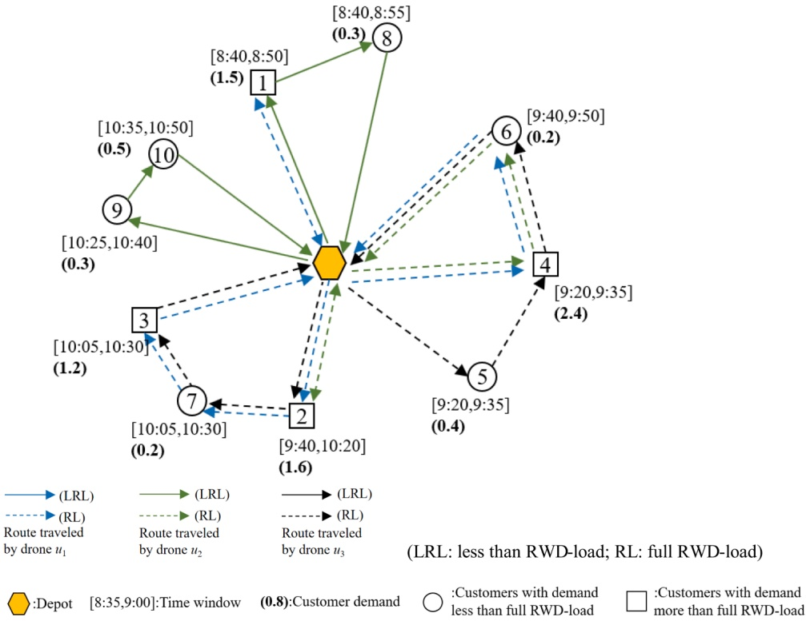

Fig. 1. Illustrative example of the DRP-SS. (LRL: less than RWD-load; RL: full RWD-load).

Table 2

Route details in the illustrative example.

| RWDu1 | Nodes in trip0-1-00-4-6-0 | Departure/Arrival time at nodes8:30-8:40-8:559:24-9:30-9:40-9:53 | Serviced demand1.01.0, 0 | Arcs for synchronization Arcs (0,1), and (0,4) for RWDs u1 and u2 Arcs (2,7), (7,3), and (3,0) for RWDs u1 and u3 |
| --- | --- | --- | --- | --- |
| u2u3 | 0-2-7-3-00-1-8-00-4-6-00-2-00-9-10-00-5-4-6-00-2-7-3-0 | 10:05-10:10-10:21-10:30-10:458:30-8:40-8:53-9:109:24-9:30-9:40-9:5310:05-10:10-10:2010:30-10:36-10:46-11:019:15-9:20-9:30-9:40-9:5310:05-10:10-10:21-10:30-10:45 | 0.6, 0.2, 0.20.5, 0.31.0, 01.00.3. 0.50.4, 0.4, 0.20, 0, 1.0 | Arcs (0,2), (4,6) and (6,0) for RWDs u1, u2 and u3 |

Note: "\_"denotes that no parcel is unloaded from the RWD at the customer.

## 3.2. Mathematical formulation

The sets, parameters, and variables involved in the DRP-SS mathematical formulation are listed in Table 3.

## 3.2.1. Objective function

The objective function (1) is to minimize costs, which includes the fixed and variable costs of the RWDs in use. $\sum _ { u _ { 1 } \in U , u _ { 1 } \neq u } z _ { u u _ { 1 } \ddot { y } }$ denotes the number of all other RWDs that are included in the swarm including RWD u, and fly on arc $( i , j )$ . That is, $N _ { u \bar { y } } = \sum _ { u _ { 1 } \in U , u _ { 1 } \neq u } z _ { u u _ { 1 } \bar { y } } .$

minλ∑yu + ∑∑(bxuij − a ∑zuu1 ij)cij u∈U i,j∈Vu∈U u1∈U,u1∕=u

(1)

## 3.2.2. Constraints

All constraints are listed in (2)-(27).

$$
\sum_ {i \in V} x _ {u i j} = \sum_ {i \in V} x _ {u j i}, \forall u \in U, j \in V\tag{2}
$$

$$
\sum_ {i \in V} x _ {u 0 i} / M \leq y _ {u}, \forall u \in U\tag{3}
$$

$$
\sum_ {i \in V} x _ {u i j} \leq 1, \forall u \in U, j \in C\tag{4}
$$

$$
f _ {u i} \leq y _ {u}, \forall u \in U, i \in C
$$

$$
\sum_ {i \in V} x _ {u i j} \geq f _ {u j}, \forall u \in U, j \in C\tag{5}
$$

$$
\sum_ {u \in U} p _ {u i} = q _ {i}, \forall i \in C\tag{6}
$$

$$
p _ {u i} \leq Q f _ {u i}, \forall i \in C, u \in U\tag{7}
$$

(8)

$$
\sum_ {i \in V} r _ {u i j} - \sum_ {i \in V} r _ {u j i} = p _ {u j}, \forall j \in C, u \in U\tag{9}
$$

$$
r _ {u i j} \leq Q x _ {u i j}, \forall i, j \in V, u \in U\tag{10}
$$

Table 3

Sets, parameters, and variables.

| Notation | Meaning |
| --- | --- |
| Sets |  |
| C | Customer set |
| V = | Set of nodes in the network, where 0 denotes the depot |
| {0}∪C |  |
| U | RWD set |
| G =(V,A) | Directed complete graph, where A={(i,j)\|i,j∈V}denotes the set of arcs in G |
| Parameters |  |
| dij | RWD flying distance on arc (i, j) (i,j∈V) |
| Q | RWD capacity |
| LT | Maximum flying time of one departure from the depot |
| V | Average velocity of RWD |
| λ | RWD fixed cost |
| τ | Servicing preparation time between two successive trips of an RWD |
| qi | Weight of parcels required by customer i (i∈C) |
| si | Service time required by customer i |
| [ei,li] | Time window of customer i or the depot |
| M | Large enough positive number, whose value is calculated by M = max{⃒⃒C⃒⃒,l0+LT} |

<table><tr><td colspan="2">Variables</td></tr><tr><td> $x_{uij}$ </td><td>Binary variable that is 1 only if RWD  $u \in U$  flies on arc (i, j)</td></tr><tr><td> $y_u$ </td><td>Binary variable that is 1 only if  $u \in U$  is in use</td></tr><tr><td> $w_{uij}$ </td><td>Binary variable that is 1 only if  $u \in U$  returns to the depot after visiting customer i, it then departs from the depot to visit customer j</td></tr><tr><td> $z_{u_1 u_2 ij}$ </td><td>Binary variable that can identify the RWD swarm, only if RWDs  $u_1 \in U$  and  $u_2 \in U (u_1 \neq u_2)$  swarm to fly on arc (i, j) is  $z_{u_1 u_2 ij} = 1$ </td></tr><tr><td> $f_{ui}$ </td><td>Binary variable that is 1 only if RWD  $u \in U$  delivers parcels to customer i</td></tr><tr><td> $p_{ui}$ </td><td>Continuous variable that denotes the volume of parcels delivered by  $u \in U$  at customer i</td></tr><tr><td> $r_{uij}$ </td><td>Continuous variable that denotes the volume of parcels on RWD  $u \in U$  when it flies on arc (i, j). To ensure that all parcels have been delivered to the intended customers when  $u \in U$  returns to the depot, it is required that  $r_{ui0} = 0 (\forall i \in C, u \in U)$ </td></tr><tr><td> $g_{uij}$ </td><td>Continuous variable that denotes the available flying time of RWD  $u \in U$  when it leaves from node  $i \in V$  and goes towards node  $j \in V$ , and  $g_{uij} \geq 0$ . RWDs departing from the depot are equipped with fresh battery units, as indicated by  $L^T - M(1 - x_{u0j}) \leq g_{u0j} \leq L^T + M(1 - x_{u0j}), \forall j \in C, u \in U$ </td></tr><tr><td> $t_{ui}^{a}$ </td><td>Continuous variable that denotes the arrival time of RWD  $u \in U$  at node  $i \in V$  if u arrives at i only to swarm, or denotes the service-starting time of u at customer  $i \in C$  if u delivers parcels to i</td></tr><tr><td> $t_{ui}^{d}$ </td><td>Leaving time of  $u \in U$  at  $i \in V$ </td></tr><tr><td> $t_{ui}^{dd}$ </td><td>Continuous variable that denotes the departure time of  $u \in U$  from the depot, while  $i \in C$  is the first customer visited by u</td></tr></table>

$$
g _ {u i j} \leq L ^ {T} x _ {u i j}, \forall i, j \in V, u \in U\tag{11}
$$

$$
g _ {u j 0} \geq x _ {u j 0} d _ {j 0} / v, \forall j \in V, u \in U\tag{12}
$$

$$
\sum_ {i \in V} g _ {u i j} - \sum_ {i \in V} g _ {u j i} = \sum_ {i \in V} x _ {u u j} d _ {i j} / v + f _ {u j} s _ {j}, \forall j \in C, u \in U\tag{13}
$$

$$
\sum_ {j \in C} w _ {u i j} \leq x _ {u i 0}, \forall u \in U, i \in C\tag{14}
$$

$$
\sum_ {i \in C} w _ {u i j} \leq x _ {u 0 j}, \forall u \in U, j \in C\tag{15}
$$

$$
\sum_ {i, j \in C} w _ {u i j} \geq \sum_ {j \in C} x _ {u 0 j} - 1, \forall u \in U\tag{16}
$$

$$
t _ {u i} ^ {d} + \tau + \left(d _ {i 0} + d _ {0 j}\right) / v - M \left(1 - w _ {u i j}\right) \leq t _ {u j} ^ {a}, \forall i, j \in C, u \in U\tag{17}
$$

$$
t _ {u i} ^ {d} + d _ {i j} / v - M \left(1 - x _ {u i j}\right) \leq t _ {u j} ^ {a}, \forall i \in C, j \in V, u \in U\tag{18}
$$

$$
t _ {i j} ^ {d d} + d _ {i j} / v - M \left(1 - x _ {i u 0}\right) \leq t _ {i j} ^ {a}, \forall j \in C, u \in U\tag{19}
$$

$$
\begin{array}{l} t _ {u i} ^ {d} \geq t _ {u i} ^ {d} + s f _ {u i}; \forall i \in C, u \in U \end{array}\tag{20}
$$

$$
t _ {u i} ^ {A} + M (1 - f _ {u i}) \geq e _ {i}, \forall i \in C, u \in U\tag{21}
$$

$$
t _ {u i} ^ {a} - M (1 - f _ {u i}) \leq l, \forall i \in C, u \in U\tag{22}
$$

$$
t _ {u _ {1} i} ^ {a} - M \left(2 - f _ {u _ {1} i} - f _ {u _ {2} i}\right) \leq t _ {u _ {2} i} ^ {a} \leq t _ {u _ {1} i} ^ {a} + M \left(2 - f _ {u _ {1} i} - f _ {u _ {2} i}\right), \forall i \in C, u _ {1}, u _ {2} \in U\tag{23}
$$

$$
\left(2 - x _ {u _ {1} i j} - x _ {u _ {2} i j}\right) - M \left(1 - z _ {u _ {1} u _ {2} i j}\right) \leq 0, \forall i, j \in V, u _ {1}, u _ {2} \in U, u _ {1} \neq u _ {2}\tag{24}
$$

$$
\begin{array}{r} \left| t _ {u _ {1} i} ^ {d} - M \left(1 - z _ {u _ {1} u _ {2} i j}\right) \right| \leq t _ {u _ {2} i} ^ {d} \leq t _ {u _ {1} i} ^ {d} + M \left(1 - z _ {u _ {1} u _ {2} i j}\right) \end{array}
$$

$$
\forall i \in C, j \in V, u _ {1}, u _ {2} \in U, u _ {1} \neq u _ {2}\tag{25}
$$

$$
t _ {u j} ^ {d d} - M \left(1 - z _ {u _ {1} u _ {2} 0}\right) \leq t _ {u j} ^ {d d} \leq t _ {u _ {1} j} ^ {d d} + M \left(1 - z _ {u _ {1} u _ {2} 0}\right)
$$

$$
\forall j \in V, u _ {1}, u _ {2} \in U, u _ {1} \neq u _ {2}\tag{26}
$$

$$
\sum_ {u _ {1} \in U: u _ {1} \neq u} z _ {u u _ {1} i j} \leq (| U | - 1) x _ {u i j}, \forall i, j \in V, u \in U\tag{27}
$$

Constraint (2) ensures the degree balance at a node, that $\mathbf { i } \mathbf { s } ,$ the number of times an RWD arriving at a node is equal to that the RWD leaving from the node. Constraint (3) identifies whether an RWD is in use. Constraint (4) guarantees that one customer must not be visited more than once by the same RWD. Constraint (5) indicates that only if an RWD is in use, one or several customers can be assigned to this RWD. Constraint (6) indicates that if an RWD serves a customer, the customer must be included in the route of the RWD; although this is not necessarily true from the opposite side, i.e., a customer included in the route of an RWD may not need the delivery service by the RWD.

Constraint (7) ensures that customer demand, concerning parcel volume, is satisfied. Constraint (8) indicates the relationship between $f _ { u i }$ and $p _ { u i } .$ If customer i is not assigned to RWD $^ { \mathrm { ~ \scriptsize ~ \prime ~ } } u ,$ then no parcel is delivered by u to i. The volume of parcels delivered by u to i must not exceed the RWD capacity. Constraint (9) requires that the volume of parcels arriving at customer j must equal the sum of the volume of parcels leaving, and delivered to, j. Constraint (10) indicates the relationship between $r _ { u i j }$ and $x _ { u \dot { y } } ,$ Constraints (9) and (10) correspond to RWD capacity.

Constraint (11) requires that the available flying time of $\operatorname { R W D } u \in U$ on an arc does not exceed $L ^ { T } .$ Constraint (12) indicates that the available flying time of u ∈ U must cover u returning to the depot. Constraint (13)

estimates the consumed flying time of $u \in U$ flying on arc $( i , j )$

Constraints (14) and (15) identify two successive trips traveled by RWD u by referring to $w _ { u i j ^ { * } }$ Only if arcs $( i , 0 )$ and $( 0 , j )$ travel successively does $w _ { u \dot { u } \dot { j } }$ equal 1. Constraint (16) indicates that an RWD has multiple trips if its departure times at the depot are more than once. Constraint (17) indicates the time continuity between two successive trips of an RWD.

Constraints (18) and (19) specify the relationship between the arrival and leaving times of an RWD at two successive nodes on a trip. Constraint (20) indicates that the leaving time of an RWD at a customer should be after arrival of the RWD at the customer; if parcels are delivered to the customer, the leaving time of the RWD will follow service delivery. Constraints (21) and (22) respect the customer time windows. The time window of the customer is respected only if parcels are delivered to the customer. Constraint (23) requires that the delivery services are provided simultaneously by RWDs in a swarm to a customer.

Constraints (24)-(27) identify an RWD swarm. Constraint (24) indicates that if two RWDs fly on arc $( i , j ) ,$ a swarm that includes the two RWDs can be formed. Constraints (25) and (26) require that the leaving time of the RWDs included in a swarm at node i must be the same, and the swarm flies on arc $( i , j ) .$ Constraint (27) ensures that there are at most |U| RWDs to form a swarm.

## 4. ALNS heuristic

The DRP-SS model is very complex because swarm synchronization, multiple trips, split delivery, and time continuity constraints are involved. From the methodological perspective, constructing swarming RWD routes is very challenging because these routes interact with each other in the included arcs as well as temporally. Moreover, multiple trips require continuity between two successive RWD trips. Herein, the RWD route is expressed as a sequence of visited nodes. Fig. 2 shows route examples, where 0 denotes the depot, and numbers 1 to 7 denote customers. The route traveled by RWD $u _ { 1 }$ includes one trip: 0–2–1–7–3–0. The route traveled by RWD $u _ { 2 }$ includes two trips: 0–4–5–0 and $\scriptstyle 0 - 3 - 0 .$ The route traveled by RWD $u _ { 3 }$ includes one trip: 0–4–6–0. Two RWD swarms are observed. One consists of RWDs $u _ { 1 }$ and u2 that are formed at customer $^ { 3 , }$ whereas $u _ { 1 }$ makes a detour at customer 3 to swarm. The other consists of RWDs u2 and $u _ { 3 } ,$ which are formed at the depot, and this swarm is decoupled at customer 4. A feasible trip must respect the RWD capacity, maximum flying time of one departure from the depot, and time windows of serviced customers. In addition, route selection must consider the servicing preparation time.

The literature suggests that ALNS is one of the most effective heuristic tools for solving many VRP variants $( \mathbf { e . g . } ,$ Ropke & Pisinger, 2006; Demir et al., 2012; Ha \` et al., 2020; Li et al., 2020b; Sarasola & Doerner, 2020) because of its adaptability and flexibility in exploring large search spaces. The ALNS uses multiple destroy-and-repair operators, and an adaptive probabilistic mechanism is used to select a destroy-and-repair operator. In this section, we design several problem-specific operators tailored to address the swarm synchronization, split delivery, and multi-trip characteristics of the DRP-SS. Subsequently, we provide an ALNS heuristic to attain solutions. For convenience, we list the parameters involved in the ALNS in Table 4.

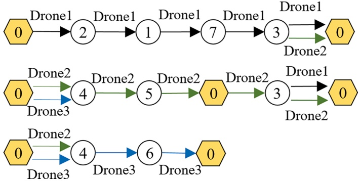

Fig. 2. DRP-SS route examples.

Table 4 ALNS parameters.

| Parameter | Meaning |
| --- | --- |
| $S^{initial}, S^{delete}, S, S',$$S^*$ | Initial solution, solution with destroyed routes, current solution, currently best solution, globally best solution |
| $C^{untreated}$ | Set of customers that are not included in routes |
| $C^{delete}$ | Set of removed customers with their unserved demand |
| $q_i^{remain}$ | Partial demand that needs service at customer $i$, named residual demand |
| $q_{ui}^{served}$ | Volume of parcels delivered by RWD $u$ at customer $i$ |
| $q^{residual}$ | RWD residual capacity en a trip, which equals to the RWD capacity minus the volume of parcels delivered to serviced customers |
| $c(S)$ | Objective function value of solution $S$ |
| $c_{ih}^{increase}$ | Increase of cost when customer $i$ is inserted into position $h$ |
| $H$ | Set of positions for customer insertion |
| $h_i^{best}, h_i^{2-best},$$h_i^{3-best}$ | For customer $i$, the best position for customer insertion, second-best position for customer insertion, third-best position for customer insertion |

## 4.1. Customer insertion operators

In the ALNS, customer insertion is the most basic and necessary operation. As shown in Fig. 2, there are several customers serviced en a route; and some are not, the RWD visits such customers only to swarm with other RWDs. We introduce several operators for customer insertion that are classified by considering whether the delivery service is involved.

## 4.1.1. Operators for customers with delivery service

Considering that customer demand can be split among the members of one RWD swarm and that the RWD members must arrive simultaneously at the customer, one customer can be included in one or several routes. i) When a customer to be inserted is not included in a selected route, we adopt four operators for the insertion of the customer who receives parcels from RWDs, which include constructing a new route (named NRI), insertion into a constructed route (named CRI), and constructing a new trip before or after a constructed route (named BTI and FTI, respectively). NRI and CRI are common operators suitable for solving VRP variants, BTI and FTI are designed to handle the characteristic of multi trips. Fig. 3 shows illustrative examples of these four operators. Fig. 3(a) presents a new route 0–3–0 constructed to serve the inserted customer. In Fig. 3(b), customer 3 is inserted into the feasible position of constructed route 0–2–1–0; thus, a new route 0–2–3–1–0 is constructed. In Fig. 3(c) and 3(d), a new trip 0–3–0 is constructed for the inserted customer, and the new trip is combined with one constructed route 0–2–1–0; thus, a new route 0–3–0–2–1–0 or 0–2–1–0–3–0 is constructed. ii) When a customer for insertion is already included in a selected route, we adopt two operators (named MI), to insert the residual demand of the customer into the selected route, which include customer insertion into a constructed route and the construction of a new trip for combination with a constructed route. Fig. 4 shows illustrative examples of these two operators. In Fig. 4(a), the RWD has sufficient capacity to accommodate the residual demand of the customer to be inserted $\mathbf { ( i . e . , }$ customer 3); therefore, the residual demand is inserted into route 0–4–3–0, and the route form does not change. In Fig. 4(b), if the RWD does not have enough capacity to load the residual demand, route 0–4–3–0 is adjusted by inserting the depot; thus, another trip is added, and a new route 0–4–0–3–0 appears. The demand of the customer (e.g., customer i) for insertion is split by referring to the residual capacity of RWD u that serves the selected route; therefore, the volume of parcels delivered by u at i is governed by $q _ { u i } ^ { s e r v e d } = \operatorname* { m i n } \{ q _ { i } ^ { r e m a i n } , q ^ { r e s i d u a l } \}$

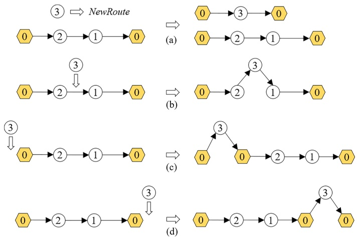

Fig. 3. Illustrative examples of the operators for the insertion of a customer that receives parcels.

## 4.1.2. Operators for customers without delivery service

An RWD is permitted to make a detour to form a swarm with other RWDs. To generate detours, we adopt two operators (named DI), for inserting customers that do not need delivery services: customer insertion into swarm routes, and customer insertion to form a new swarm. Fig. 5 shows illustrative examples of these two operators. The operator illustrated in Fig. 5(a) aims to add new arcs traveled by the RWD swarms into interacting routes. In Fig. 5(a), two routes, 0–4–3–0 and 0–3–0, interact with each other because a swarm flies on arc (3, 0). When a customer without a delivery service $\mathbf { ( i . e . }$ , customer 4) is inserted into route $\scriptstyle 0 - 3 - 0 ,$ the swarm flies on all arcs in the two routes, which is expected to reduce the total costs. The operator illustrated in Fig. 5(b) aims to add new arcs traveled by the RWD swarms into routes that do not interact with each other. In Fig. 5(b), the two routes, 0–2–1–0 and 0–3–0, do not interact with each other. When a customer without a delivery service $( \mathbf { i . e . } ,$ customer 2) is inserted into route 0–3–0, a swarm is formed to fly on arc (0, 2).

To construct a detour in the current solution, $S ,$ an enumeration algorithm, as presented in Algorithm 1 (Fig. 6), is proposed. When operators for customers without delivery services are adopted, all positions for the insertion of every customer are enumerated. Customer i inserted into position h of a route without a delivery service is accepted by considering the following conditions: first, the route remains feasible; second, after customer i is inserted, a swarm appears and flies on at least one arc; and third, $c _ { i h } ^ { i n c r e a s e } \leq 0 .$ In the ALNS iteration of adopting repair operators to insert one customer, Algorithm 1 is executed by referring to probability α to obtain good solutions within an acceptable computation time.

## 4.1.3. Adjustment of RWD arrival time at nodes

The customer insertion operation can change the RWD arrival time at the nodes. If the changed arrival time at nodes cannot be adjusted to ensure that the starting time for servicing a customer by swarm members is the same, the solution generated by the customer insertion operation is not feasible. Corresponding to customer insertion, we provide a method for adjusting RWD arrival time at nodes, which includes the following steps.

Step 1: For the route selected for the insertion of a customer, the RWD departure time at the depot is adjusted as the opening time of the depot. Subsequently, the RWD arrival time at nodes en the selected route is initialized to ensure the feasibility of the selected route.

Step 2: The feasibility of the solution with the inserted customer is checked. If there are not RWD routes servicing one customer $( \mathbf { e . g . } ,$ customer i) with different arrival time at customer i, stop and return the

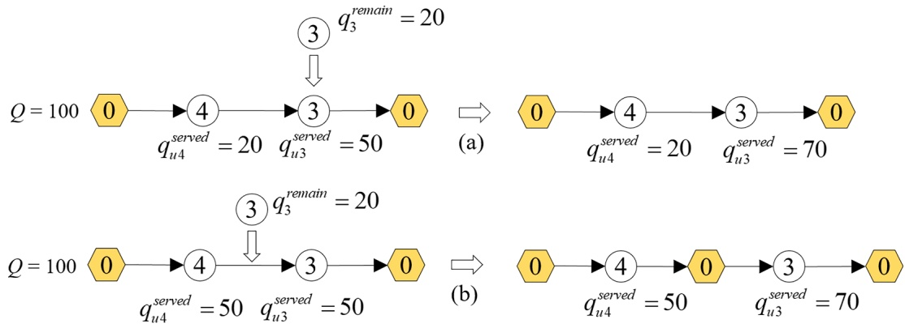

Fig. 4. Illustrative examples of the operators for the insertion of residual demand.

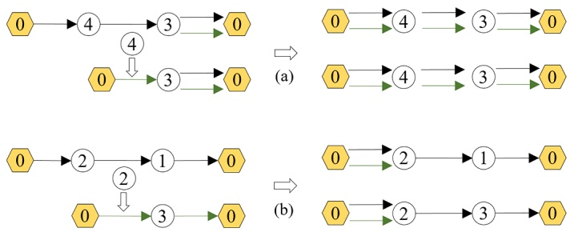

Fig. 5. Illustrative examples of the operators for the insertion of a customer without delivery service.

## Algorithm 1

Adding detour into current solution.

Input: $S$
Output: $S$

Initialize $H = \emptyset$
    For each customer $i$ Do
        For every insertion position $h$ in each route in $S$ Do
            If all constraints are satisfied &amp;&amp; a swarm flies on at least one arc &amp;&amp;
            $c_{ih}^{increase} \leq 0$ Do
                Add $h$ into $H$, and the corresponding $c_{ih}^{increase}$ is recorded
            End If
        End For
    End For
    Referring to the minimum $c_{ih}^{increase}$, customer $i$ is inserted at position $h$
    Return $S$

current solution; otherwise, go to Step 3.

Step 3: The arrival time of the RWD members at customer i is adjusted to $t_{ui}^{a} = \max\{t_{ui}^{a} | p_{ui} > 0, u \in U(i)\}$ , where $U ( i )$ denotes the set of RWD members at customer i. The RWD arrival time at nodes en the selected route is then adjusted.

Step 4: If the solution with the inserted customer is feasible, proceed to Step 2 and check other customers in the selected route; otherwise, stop.

The method for adjusting the RWD arrival time at nodes is likely to change the RWD arrival time at some nodes. When these nodes are involved in swarm synchronization, the RWD arrival time at nodes en another one or several routes also needs adjustment, and Fig. 7 shows illustrative examples of the adjustment method. There are two routes traveled by RWDs $u _ { 1 }$ and $u _ { 2 } .$ When customer 3 is inserted into the route traveled by $u _ { 2 } , u _ { 1 }$ and $u _ { 2 }$ need to form a swarm to serve customers 3 and $5 ,$ respectively. The RWD arrival time at nodes en each route is shown in Fig. 7(a). Because $t _ { u _ { 1 } 3 } ^ { a } \neq t _ { u _ { 2 } 3 } ^ { a }$ causes an infeasible solution, the RWD $u _ { 2 }$ arrival time at customer 3 is adjusted as $t_{u_{2}3}^{a} = \max\{t_{u3}^{a} \mid p_{u3} > 0,$ u ∈

$U ( { \bf 3 } ) \} = t _ { u _ { 1 } 3 } ^ { a } ,$ as shown in Fig. 7(b). The adjustment of RWD u2 arrival time at customer 3 affects the RWD arrival time at customer 5, so that $t _ { u _ { 1 } 5 } ^ { a } \neq t _ { u _ { 2 } 5 } ^ { a } .$ . RWD u1 arrival time at customer 5 is adjusted using $t _ { u _ { 1 } 5 } ^ { a } =$ max $\{ t _ { u 5 } ^ { a } | p _ { u 5 } > 0 , u \in U ( 5 ) \} = t _ { u 2 5 } ^ { a } ,$ as shown in Fig. 7(c). Notably, in extreme cases, swarm synchronization may require the adjustment of the RWD arrival time at nodes en each route of the DRP-SS solution.

For the DRP-SS model involving a swarm with RWD members simultaneously leaving the launch node, to form a swarm on arc $( i , j ) ,$ the RWD members must leave node i at the same time. Let $U ^ { F } ( i , j )$ be the set of RWDs that travel on arc (i, j); the latest leaving time of these RWDs at node i is denoted as max $\{ t _ { u i } ^ { d } \big | u \in U ^ { F } ( i , j ) \}$ . Then, at node i, the leaving time of each RWD u in $U ^ { F } ( i , j )$ is adjusted to $t _ { u i } ^ { d } = \max \{ t _ { u i } ^ { d } | u \in U ^ { F } ( i , j ) \}$ . The swarm is formed only if the time adjustment results in a feasible solution, and the new solution is accepted.

## 4.2. An initial solution

A feasible solution is initialized by ignoring the detours and decision of the RWDs in use. If the set of customers excluded in the routes (i.e., $\mathbb { C } ^ { u n t r e a t e d } )$ is not empty, the customer (denoted as i) with the minimum latest-service-starting time is selected for insertion. All the feasible positions for the insertion of customer i are enumerated. If there is no position for the insertion, a new route 0-i-0 is constructed. Considering the increase in the total costs caused by the insertion of customer i, the best position for customer insertion, that is, $h _ { i } ^ { b e s t } ;$ is found. Then, the residual demand of customer i, that is, $q _ { i } ^ { r e m a i n }$ , is calculated. $\mathrm { I f }   q _ { i } ^ { \mathrm { r e m a i n } } = 0 ,$ customer i is removed from $C ^ { u n t r e a t e d }$ . If $q _ { i } ^ { r e m a i n } \neq 0 ,$ customer i is not removed from $C ^ { u n t r e a t e d } ,$ Considering that the demand of certain customers exceeds the RWD capacity, when customer i is inserted in position $h _ { i } ^ { b e s t }$ and $q ^ { r e s i d u a l }$ cannot satisfy all the demands of customer i, the parcels delivered to customer i are $q ^ { r e s i d u a l } ,$ A heuristic, as presented in Algorithm 2 (Fig. 8), is used to construct the initial solution.

## 4.3. Destroy operators and repair operators

Destroy operators are adopted to remove a number of customers so that a solution with destroyed routes (denoted as $S ^ { d e l e t e } )$ and the set of removed customers with their unserved demand (denoted as $C ^ { d e l e t e } )$ are generated. Because one customer is likely to be serviced by an RWD swarm, the same customer can be selected and removed from multiple routes. All removed customers are added to $C ^ { d e l e t e } ,$ In $C ^ { d e l e t e }$ , the same customer cannot repeat and the partial demand of the same customer is integrated. A dynamic number of removal customers is used to explore the neighborhood. At the early stage of iterations, a large number of customers. e.g., 50 %\*|C| will be removed. The number of removal customers decreases as the number of iterations increases, e.g., 5 % shrinking per 2000 iterations. The minimum number of removal customers is specified, $\mathrm{e.g.,} 5\%^{\ast} \left| C \right|$ . The perturbation mechanism proposed

$$
H = \emptyset
$$

$$
c _ {i h} ^ {\text {increase}} \leq 0
$$

$$
\left| \begin{array}{c} \mathcal {C} _ {i h} ^ {\text {increase}} \end{array} \right|
$$

$$
c _ {i h} ^ {\text {increase}}
$$

Fig. 6. Pseudocode of algorithm for adding a detour into the current solution.

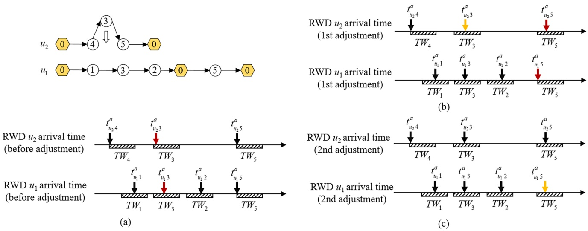

Fig. 7. Example of the adjustment of RWD arrival time at nodes.

by Lim et al. (2017) and Ropke and Pisinger (2006) adopt other ways, compared with the dynamic number of removal customers used in this paper. In the computational experiments, we compare the performance of various ways, and the computational results are presented in $\mathbf { A p } -$ pendix B.

Several types of destroy operators are used. That is, random removal, worst removal, Shaw removal considering RWD swarm, longest route removal, and visits in long routes removal. Details on these are found in Ropke and Pisinger (2006) and Wang et al. (2020). At each iteration of the random removal operator, one customer is randomly chosen and removed. The worst removal operator aims to remove one customer whose removal results in the highest savings. In an iteration, the customer that is removed is the one with the largest difference in the objective values of the two types of solutions that do or do not include the customer. The Shaw removal operator refers to the degree of similarity between two customers (i and j). The degree of similarity is estimated by considering $\begin{array} { r l r l r } { | t _ { u i } ^ { a } \mathrm { ~ - ~ } } & { { } } & { t _ { u j } ^ { a } | , } & { { } } & { d _ { i j } , } \end{array}$ and $\left| \sum _ { u _ { 1 } \in U } \sum _ { u _ { 2 } \in U _ { j } } \sum _ { \substack { i \in V } } z _ { u _ { 1 } u _ { 2 } i j } - \sum _ { u _ { 1 } \in U } \sum _ { u _ { 2 } \in U _ { j } } \sum _ { \substack { i \in V } } z _ { u _ { 1 } u _ { 2 } j j } \right|$ that indicates the drone number difference in RWD swarms. Besides, one customer can be serviced by an RWD swarm or needs to be serviced by multiple RWDs simultaneously, the Shaw removal operator can remove the same customer from more than one route. If a removed customer already exists in $C ^ { d e l e t e }$ , the unserved demand of the customer is merged. This results in the demand of a customer being split again in the course of adopting repair operators. To adopt the Shaw removal operator, one customer is first randomly chosen and removed. If there is only one removed customer in $C ^ { d e l e t e } ;$ , the customer nearest to the removed customer is selected and removed. If there is a set of removed customers, a randomly selected customer is referred to find the nearest customer for removal. Longest route removal, and visits in long routes removal remove all customers or partial customers in the longest route (longest route, i.e., the route with the maximum number of included customers), respectively.

Repair operators are adopted to insert the removed customers into suitable routes to generate a new solution. Several types of repair operators, $\mathbf { e . g . } ,$ the greedy, regret-2, and regret-3 repair operators, are adopted. i) Greedy repair operator. Compared with Algorithm 2, which involves a locally greedy insertion method, the greedy repair operator aims to insert one customer from a global perspective. Fig. 9 shows illustrative examples for comparing the greedy insertion in Algorithm 2 (Fig. 9(a)) and greedy repair operator (Fig. 9(b)). Based on Algorithm $^ { 2 , }$ a customer is chosen for insertion according to its order in $C ^ { \bar { d } e l e t e }$ and a chosen customer is inserted into the best position. The greedy repair operator selects one customer from $| C ^ { d e l e t e } |$ customers by comparing the best position for every customer’s insertion and the increase in total costs when each customer is inserted into its best position. In addition, the greedy repair operator has two variants that involve a randomselection mechanism to use the second-best or third-best position for customer insertion. The probability of customer insertion into the best or second-best position is 50 $\% ,$ whereas in the other variant, the probability for the best, second-best, or third-best position is 33 %. The heuristic for the greedy repair operator is presented in Algorithm 3 (Fig. 10). In line 16, “Update $S ^ { \flat \flat }$ involves the adjustment of swarms. When a customer $( \mathbf { e . g . } ,$ customer k) is inserted into arc (i, j) and serviced/visited by an RWD, the RWD swarms need to be checked due to the destroyed arc (i, j) and the changed arrival time after node i. All arcs after node i in S should be examined to form new RWD swarms through the method presented in Section 4.1.3. ii) The regret-2 or regret-3 repair operator (that was usually adopted in the literature) refers to a regret value that is related to the best and second-best positions or the best and third-best positions for customer insertion. The cost change in the solution incurred by inserting a removed customer into each feasible position is calculated. A customer with the maximum regret value is selected for insertion into its best position.

Input: All customers
Output: $S^{initial}$

All customers, ordered by the ascending order of $l_i$, are included in $G^{untreated}$
While $|C^{untreated}| &gt; 0$, do
The first customer (denoted as $i$) in $C^{untreated}$ is selected
If $|S^{initial}| = 0$, then
Route 0-i-0 is constructed and added to $S^{initial}$
End If
If $|S^{initial}| &gt; 0$, then
If $q_i^{remain} &gt; 0$, then
All feasible positions in all routes in $S^{initial}$ are enumerated, and $h_i^{best}$ is found
Customer $i$ is inserted in position $h_i^{best}$, and $S^{initial}$ updated
$q_i^{remain} - q_{ui}^{served}$
End If
Customer $i$ is removed from $C^{untreated}$ when $q_i^{remain} = 0$
End If
End While
Return $S^{initial}$

Besides, we adjust the usual regret repair operators to propose other operators, named local regret repair operators. The local regret repair operators choose randomly one customer from the set of unserved customers and calculate the cost change in the solution incurred by inserting the chosen customer into each feasible position. The regret value is calculated for each route in the current solution. Subsequently, the route with the maximum regret value is selected to insert the chosen customer into the best position. Compared with the usual regret repair operators, the local regret repair operator may explore a smaller neighborhood while it can be less time-consuming. Based on computational experiments, the effectiveness of the local regret repair operators is analyzed, and the detailed results are shown in Appendix C. iii) Customer insertion operators, i.e., BTI, FTI, and DI, are designed to handle the characteristics of multi-trip and RWD swarms. DI caters to RWD swarms but it is time-consuming. Every iteration a repair operator is executed, the customer insertion operators except for DI will be adopted subsequently, and DI will be used under the condition of probability α. Most of the repair operators use DI with a low probability. Besides, a greedy repair operator with α = 1 is adopted to construct

Algorithm 2. Heuristic for initializing a solution
Input: All customers
Output: $S^{initial}$
All customers, ordered by the ascending order of $l_i$, are included in $C^{untreated}$
While $|C^{untreated}| &gt; 0$, do
The first customer (denoted as $i$) in $C^{untreated}$ is selected
If $|S^{initial}| = 0$, then
Route 0-$i$-0 is constructed and added to $S^{initial}$
End If
If $|S^{initial}| &gt; 0$, then
If $q_i^{remain} &gt; 0$, then
All feasible positions in all routes in $S^{initial}$ are enumerated, and $h_i^{best}$ is found
Customer $i$ is inserted in position $h_i^{best}$, and $S^{initial}$ updated
$q_i^{remain} := q_i^{remain} - q_{ui}^{served}$
End If
Customer $i$ is removed from $C^{untreated}$ when $q_i^{remain} = 0$
End If
End While
Return $S^{initial}$

Fig. 8. Pseudocode of heuristic for constructing an initial solution.

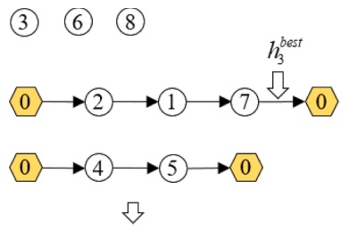

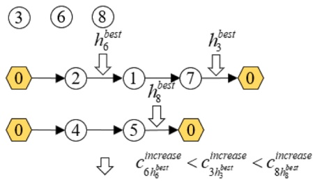

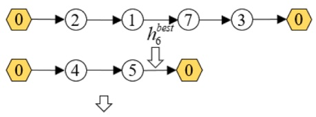

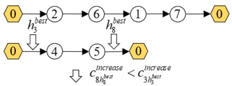

③

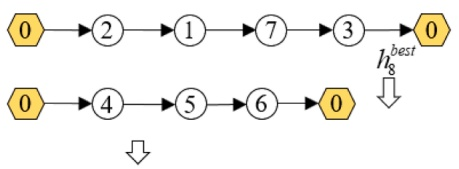

(a)

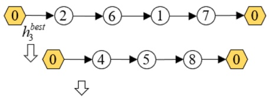

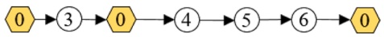

Fig. 9. Examples for comparing the greedy insertion.

(b)

Input: $S^{delete}, C^{delete}$
Output: $S$

$S = S^{delete};$
Repeat
    Initialize $H = \emptyset$
    For customer $i$ in $C^{delete}$, do
        Estimate the increase in total costs for customer $i$ insertion, and find $h_i^{best}$, $h_i^{2-best}$, and $h_i^{3-best}$
        Switch
            Case 1:
                Add $h_i^{best}$ into $H$
            Case 2:
                Select randomly $h_i^{best}$ or $h_i^{2-best}$ and add it into $H$
            Case 3:
                Select randomly $h_i^{best}, h_i^{2-best}$ or $h_i^{3-best}$ and add it into $H$
        End Switch
    End For
    The position in $H$ corresponding to the minimum cost is selected for customer insertion
    Update $S$ and $C^{delete}$
Until $|C^{delete}| = 0$
Return $S$

RWD swarms.

## 4.4. Adaptive mechanism and termination criterion

The search heuristic includes several optimization phases, and each optimization phase includes a predetermined number of iterations. The

ALNS selects a destroy-and-repair operator based on an adaptive probabilistic mechanism. At each iteration, the probability of selecting a given destroy-and-repair operator depends on how well it has performed in the previous optimization phase. Referring to Demir et al. (2012), the probability of a destroy operator (or repair operator) being selected is initialized as $1 / N ^ { o p } ~ ( N ^ { o p }$ denotes the number of destroy operators (or repair operators)). In one iteration, the probability of the m-th destroy operator (or repair operator) $P _ { m }$ is updated by $P _ { m } : = \mathrm { ~ ( 1 ~ - ~ } \beta _ { 1 } \mathrm { ) } P _ { m } +$ $\beta _ { 1 } \pi _ { m } / \omega _ { m } ,$ where $\beta _ { 1 }$ is a predetermined parameter, $\pi _ { m }$ is the score of the m-th destroy operator (or repair operator), which indicates how well it has performed, and $\omega _ { m }$ is the number of times the m-th destroy operator (or repair operator) being selected in the optimization phase. $\pi _ { m }$ is updated by the following rules: If a destroy-and-repair operator finds a new best solution, the score of the destroy operator and repair operator is increased by $\sigma _ { 1 } ,$ respectively. If a destroy-and-repair operator finds a better solution than the current one, the score of the destroy operator and repair operator is increased by $\sigma _ { 2 } ,$ respectively. If a destroy-and-repair operator finds a non-improving solution that is accepted according to the simulated annealing criterion, the score of the destroy operator and repair operator is increased by $\sigma _ { 3 } ,$ respectively. Generally, $\sigma _ { 1 } \geq \sigma _ { 2 } \geq \sigma _ { 3 }$ . The ALNS involves a simulated annealing framework. A non-improving solution is accepted with probability $e ^ { - ( c ( \mathcal { S } ) - c ( \mathcal { S } ^ { ' } ) ) / T }$ , where T denotes the current temperature and is updated by $T : = \beta _ { 2 } T$ (where $0 < \beta _ { 2 } < 1 )$

We adopt two stopping criteria for the ALNS. The first is when a maximum number of iterations, denoted as $\beta ^ { \mathrm { m a x \_ i t e r } }$ , is reached. The second is when the objective values obtained by using $\beta ^ { \mathrm { c o n t \_ i t e r } }$ consecutive iterations are not improved.

Algorithm 3. Heuristic for greedy repair operator
Input: $S^{delete}$, $C^{delete}$
Output: $S$
$S = S^{delete}$;
Repeat
    Initialize $H = \emptyset$
    For customer $i$ in $C^{delete}$, do
        Estimate the increase in total costs for customer $i$ insertion, and find $h_i^{best}$, $h_i^{2-best}$, and $h_i^{3-best}$
        Switch
            Case 1:
                Add $h_i^{best}$ into $H$
            Case 2:
                Select randomly $h_i^{best}$ or $h_i^{2-best}$ and add it into $H$
            Case 3:
                Select randomly $h_i^{best}$, $h_i^{2-best}$ or $h_i^{3-best}$ and add it into $H$
        End Switch
    End For
    The position in $H$ corresponding to the minimum cost is selected for customer insertion
    Update $S$ and $C^{delete}$
Until $|C^{delete}| = 0$
Return $S$

Fig. 10. Pseudocode of heuristic for the greedy repair operator.

## 4.5. Parameter tuning

We choose randomly twelve large-scale instances in Section 5.1 to calibrate parameter values in the ALNS. The method of one factor at a time is adopted (Vincent et al., 2021). Computational trials indicate that α and $\beta _ { 1 }$ are sensitive parameters, and sensitivity analysis is conducted for these two parameters to reflect the influence on the final performance. Firstly, several values for each parameter are chosen, i.e., a = 0 %, 5 %, 10 %, β1=0.05, 0.1, 0.2. The values of a and β1 are randomly chosen to form nine sets of parameter values, i.e., 0 %-0.05, 0 $\% -0.1, \ldots,$ 10 %-0.2. Then, the best combination that obtains the lowest average value of the objective function for the chosen instances is selected. Each chosen large-scale instance is solved for 10 times. Let Avg. Obj and Avg.T denote the average objective value and average computation time, and the computational results are shown in Fig. 11. From the perspective of overall solutions, the values of $\alpha = 1 0 \%$ and $\beta _ { 1 }$ = 0.05 correspond to the best objective values in a relatively short computation time, and we choose them as the best parameter setting.

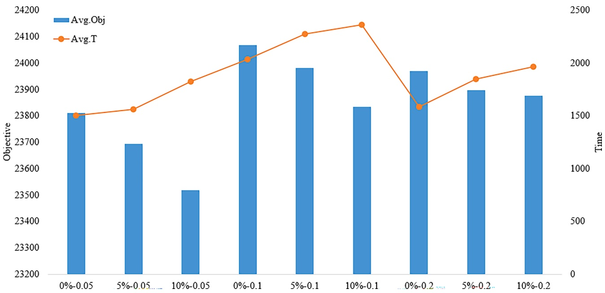

Fig. 11. Computational results of ALNS parameter tuning.

In the computational experiments, the values of several parameters involved in the ALNS are as follows: $\alpha = 10\%, \sigma_{1} = 5, \sigma_{2} = 1, \sigma_{3} = 0, \beta_{1} =$ $0.05, \beta_{2} = 0.99975, \beta^{ max\_iter } = 10000, \beta^{ control\_iter } = 2000.$

## 5. Computational experiments

In the computational experiments, we use 71 small-scale instances and 116 large-scale instances to evaluate the effectiveness of the mathematical formulation and the ALNS. To the best of our knowledge, there have been no test instances that are directly applicable to the DRP-SS model. Considering the DRP-SS as a new variant of the VRPTW, we choose the test instances from Solomon (1987) benchmark instances with 100 customers and convert them to DRP-SS instances.

In small-scale instances, we directly use the exact method via the CPLEX 12.9 solver to solve the DRP-SS formulation. The ALNS provided in Section 4 is coded in C++. For each instance, the heuristic is repeated 10 times, and the best solution of the 10 results is reported. The codes for the heuristic and the exact method are run on a computer with a Windows 10 operating system configured with an Intel(R) Core(TM) i5–10400F CPU @ 2.90 GHz with RAM 16.00 GB.

## 5.1. Test instances

We select Solomon benchmark instances (C/RC/R)101 and C108 to generate small-scale instances, and instances C101–C109, R101–R112, and RC101–RC108 to generate large-scale instances. The depots in the chosen instances still act as depots in the converted instances. The customer locations, time windows, and service time remain unchanged. The benchmark cost of arc $$( i , j ) ,$$ that is, $c _ { i j } ,$ is estimated using the Euclidean distance. The RWD average velocity, v, is equal to 1. To ensure that all customers can be serviced by RWDs departing from the depot, the maximum flying time of one departure, $L ^ { T } ,$ should not be less than $2 d ^ { \operatorname* { m a x } } / \nu + s _ { i }$ (where $d ^ { m a x }$ denotes the maximum distance between the depot and customers). The RWD capacity is set to 100. The fixed cost of each RWD, λ, is 1000. In estimating the variable cost for the RWD in a swarm flying along arcs, parameters a and b are 0.05 and 1, respectively. i) Small-scale instances. The small-scale instances are named (C/RC/R) $101 - f - N^{C}, \; C108 - f - N^{C}, \; ( C / RC / R ) 101 - r - N^{C},$ , and $\scriptstyle { \mathrm { C } } 1 0 8 - { \mathrm { r } } - N _ { \mathrm { ~ i ~ } } ^ { C }$ , where $N ^ { C }$ denotes the number of customers in the network, $N ^ { C } = 3 , 4 , \ldots , 1 2 . \mathrm { ~ ` f ` }$ and ${ } ^ { \circ } \mathbf { \dot { r } } ^ { \circ }$ denote the methods of customer selection. ${ } ^ { \circ } \mathbf { \dot { \Gamma } } ^ { \flat }$ denotes that the former $N ^ { C }$ customers in a Solomon benchmark instance are selected, so that the structure of the Solomon benchmark instances is maintained; and $\mathbf { \nabla } ^ { \epsilon } \mathbf { \hat { r } } ^ { s }$ denotes that customers are randomly selected from a Solomon bench mark instance. Customer demand remains the same as that in benchmark instances, except for some randomly selected customers with additional demand of 0.5 or 1.0 times the RWD capacity. In small-scale instances of the C type, customer service time $s _ { i } { = } 9 0 _ { i }$ the maximum flying time of one departure from the depot is $L ^ { T } { = } 5 0 0 ;$ and the servicing preparation time $\tau   =   9 0$ . For the R and RC types of instances, $s _ { i } { = } 1 0 _ { i }$ $L ^ { T } { = } 2 0 0 ,$ , and $\tau   = 1 0 . \mathrm { i i ) }$ Large-scale instances. Each large-scale instance includes 100 customers. For each Solomon benchmark instance, a total of 10, 20, or 30 customers are randomly selected, whose demand is added by one time the RWD capacity. Each of the large-scale instances is named $(C/RC/R)10X-(O/P1/P2/P3)$ where “(C/RC/R)10X” denotes the name of the Solomon benchmark instance, $( O/P1/P2/P3 )$ denotes the instance character indicated by the customer demand, “O” denotes that the customer demand of DRP-SS instance is the same as that of Solomon benchmark instance, and $\mathrm{P1/P2/P3}$ denotes that there are 10, 20, or 30 customers whose demand exceeds the RWD capacity. For (C/R/RC)10X-(O/P1/P2/P3), the values of si and τ remain the same with those of the small-scale instances, the value of $L ^ { T }$ of the C type and R/RC types of instances is set 1000 and 200, respectively.

## 5.2. Exact and heuristic results of small-scale instances

## 5.2.1. Effectiveness of the mathematical formulation and ALNS

For every small-scale instance, the CPLEX 12.9 solver runs in default settings until it finds the exact solution or until it stops because the computer memory or predetermined computation time is exhausted; the predetermined computation time is set to 14400s. In addition, the ALNS is used to find the heuristic solution for each small-scale instance.

The exact and heuristic results for the C type of small-scale instances are listed in Table $^ { 5 , }$ and the results of the R/RC types of small-scale instances are presented in Table A1 in Appendix A. In Table 6, column $\mathrm { { ^ \mathrm { { c o b j } } ^ { \mathrm { { M } , \mathrm { {  } } } } } }$ shows the objective value of the exact solution found by the CPLEX 12.9 solver; column $\mathrm { { ^ { \mathrm { { \textleftarrow } } } T ^ { M , \mathrm { { \textleftarrow } } } } }$ shows the computational time (s) of the CPLEX 12.9 solver; column “Gap1” shows the gap output by the CPLEX 12.9 solver, and Gap1 = 100 % × |best bound− best integer| $\mathcal { N } ( 1 \times e ^ { - 1 0 }$ + |best integer|); column $\mathrm { { ^ \mathrm { { ^ \mathrm { { c } } } O b j } ^ { A L \dot { N } S , } } }$ shows the objective value of the heuristic solution attained by the ALNS; and column $\mathrm { { { \bf { \bar { T } } } ^ { A L N S , \gamma } } }$ shows the computational time (s) of the ALNS. Column $\mathtt { G a p 2 }$ shows the percentage gap between $\mathrm { o b j ^ { M } }$ and $\mathsf { O b j ^ { A L N S } }$ , where $\mathrm{Gap2} = 100\ \% \times$ $\mathrm{(Obj^{ALNS}-Obj^{M})/Obj^{M}}$ . Column ${ { } ^ { \leftarrow }   N } ^ { U \prime \prime }$ shows the number of RWDs in use; column $\text{" }N \text{" }$ shows the number of arcs traveled by RWD swarms.

In the computational experiments on the C type of small-scale instances, the exact method using the CPLEX 12.9 solver can find exact solutions of instances with up to 12 customers in less than 4.0 h, whereas most instances with 11–12 customers cannot be solved optimally because of the limited computation time. The CPLEX computational time fluctuates with the number of customers. In the computational experiments on the R/RC types of small-scale instances, the exact method using the CPLEX 12.9 solver can find exact solutions of instances with up to 6 and 5 customers, respectively. The computational results indicate that the difficulty of solving $\mathbf { C } , \mathbf { \nabla } \mathbf { R } ,$ and RC types of instances increases sequentially, and the randomly-chosen-customer instances are hardly to solve than sequentially-chosen-customer ones.

In terms of the solution quality, the ALNS performs well, considering that the 43 small-scale instances with the obtained optimal solutions can be solved optimally by the ALNS. Compared with the exact method using the CPLEX 12.9 solver, the ALNS can output an optimal solution very quickly. The ALNS can solve each of the 71 small-scale instances in less than $5 . 0 0 ~ s ;$ the average computational time is 0.89 s.

The CPLEX12.9 solver requires the full predetermined computation time for 26 instances, and in solving instance C108-f-7 and $\mathrm { R 1 0 1 \_ r \_ 9 } ,$ the computer memory is exhausted, which indicates that none of the solutions to the formulation are provably optimal. Of the 28 instances in which the CPLEX 12.9 solver may not find the exact solutions, Gap2 is 0.00 % in 25 cases, and Gap2 is less than 0.00 % in 3 cases, that is, instances C101-f-12, C108-r-12, and RC101-f-8, which indicates that better upper bound is obtained by the ALNS.

## 5.2.2. Influence of detours permitted

In the DRP-SS model, RWDs are permitted to make detours to provide more opportunities for RWDs to form swarms. In computational experiments on the C type of small-scale instances, an analysis is conducted to evaluate the effect of permitted detours. Based on the DRP-SS model expressed by (1)-(27), we introduce constraint (28); thus, the model expressed by (1)-(28), named DRP-SS-L, is a DRP-SS variant that does not involve detours.

$$
\sum_ {u \in U} \sum_ {j \in V} x _ {u i j} \leq \left\lceil \frac {q _ {i}}{Q} \right\rceil , i \in C\tag{28}
$$

The exact method using the CPLEX 12.9 solver is used to solve the DRP-SS-L formulation, and the exact results are listed in Table $6 .$ Notably, the gap output by the CPLEX 12.9 solver, that is, Gap1, is equal to zero in the exact result of every small-scale instance. $\mathrm{Colum} \mathrm{~^{\circ}Obj^{\hat{M}-L}}$ shows the objective value of the exact solution found by the CPLEX 12.9 solver, and column $\mathrm { { ^ \mathrm { { ^ \mathrm { { c o } } } T } ^ { \mathrm { { M - L } , \mathrm { { ^ \mathrm { { ^ { \prime } } } T } } } } } }$ shows the computational time (s). Column $\text{" }N^{U-L, \text{" }}$ shows the number of RWDs in use; column ${ } ^ { \leftarrow }   N ^ { F - L , \ast }$ shows the number of arcs traveled by RWD swarms. Column ${ { } ^ { \leftarrow } } { { C } } ^ { V \cdot L , \cdot }$ shows the total variable cost and $C ^ { V \cdot L } = \mathrm {  { \mathring { O } b j ^ { M \cdot L } } } - N ^ { U \cdot L } \bullet \lambda$ . In addition, we introduce $C ^ { V }$ to denote the total variable cost for the condition of the DRP-SS formulation, and $C ^ { V } = \mathrm { O b j } ^ { \mathrm { M } } - N ^ { U } \bullet \lambda$ . To compare the change in variable cost under the condition of the same number of RWDs in use, we introduced $\mathrm { G a p 3 } = C ^ { V \cdot L } - C ^ { V }$

Table 5

Results of small-scale instances of the C type.

| Instance | Mathematical ObjM | formulation TM | Gap1 | NU | NF | ALNS ObjALNS | TALNS | Gap2 | NU | NF |
| --- | --- | --- | --- | --- | --- | --- | --- | --- | --- | --- |
| C101-f-3 | 3142.06 | 0.28 | 0 | 3 | 4 | 3142.06 | 0.43 | 0 | 3 | 4 |
| C101-f-4 | 3178.66 | 1.08 | 0 | 3 | 4 | 3178.66 | 0.67 | 0 | 3 | 4 |
| C101-f-5 | 3207.95 | 44.24 | 0 | 3 | 5 | 3207.95 | 0.74 | 0 | 3 | 5 |
| C101-f-6 | 3248.46 | 242.95 | 0 | 3 | 5 | 3248.46 | 0.97 | 0 | 3 | 5 |
| C101-f-7 | 3280.11 | 14400 | 0.10 | 3 | 7 | 3280.11 | 1.63 | 0 | 3 | 7 |
| C101-f-8 | 2215.32 | 19.41 | 0 | 2 | 3 | 2215.32 | 0.78 | 0 | 2 | 3 |
| C101-f-9 | 2187.08 | 108.94 | 0 | 2 | 2 | 2187.08 | 1.23 | 0 | 2 | 2 |
| C101-f-10 | 2164.23 | 239.80 | 0 | 2 | 2 | 2164.23 | 0.71 | 0 | 2 | 2 |
| C101-f-11 | 3182.39 | 14400 | 30.60 | 3 | 2 | 3182.39 | 1.20 | 0 | 3 | 2 |
| C101-f-12 | 3226.04 | 14400 | 31.63 | 3 | 3 | 3224.60 | 1.26 | -0.04 | 3 | 5 |
| C108-f-3 | 2149.12 | 0.09 | 0 | 2 | 2 | 2149.12 | 0.54 | 0 | 2 | 2 |
| C108-f-4 | 3146.80 | 1.18 | 0 | 3 | 5 | 3146.80 | 1.23 | 0 | 3 | 5 |
| C108-f-5 | 3206.89 | 51.55 | 0 | 3 | 6 | 3206.89 | 1.32 | 0 | 3 | 6 |
| C108-f-6 | 3246.97 | 5725.45 | 0 | 3 | 8 | 3246.97 | 4.17 | 0 | 3 | 8 |
| C108-f-7 | 3277.05 | 5090.55 | 0.96* | 3 | 9 | 3277.05 | 2.07 | 0 | 3 | 9 |
| C108-f-8 | 2212.81 | 19.30 | 0 | 2 | 4 | 2212.81 | 1.56 | 0 | 2 | 4 |
| C108-f-9 | 2182.18 | 16.95 | 0 | 2 | 2 | 2182.18 | 1.01 | 0 | 2 | 2 |
| C108-f-10 | 2164.23 | 231.42 | 0 | 2 | 2 | 2164.23 | 0.97 | 0 | 2 | 2 |
| C108-f-11 | 2187.41 | 2085.26 | 0 | 2 | 2 | 2187.41 | 1.39 | 0 | 2 | 2 |
| C108-f-12 | 2226.09 | 12230.27 | 0 | 2 | 2 | 2226.09 | 0.71 | 0 | 2 | 2 |
| C101-r-3 | 4369.87 | 1.20 | 0 | 4 | 5 | 4369.87 | 0.70 | 0 | 4 | 5 |
| C101-r-4 | 4331.52 | 19.17 | 0 | 4 | 4 | 4331.52 | 0.88 | 0 | 4 | 4 |
| C101-r-5 | 3364.86 | 8.94 | 0 | 3 | 5 | 3364.86 | 0.94 | 0 | 3 | 5 |
| C101-r-6 | 2348.62 | 15.39 | 0 | 2 | 2 | 2348.62 | 0.69 | 0 | 2 | 2 |
| C101-r-7 | 2360.02 | 50.55 | 0 | 2 | 2 | 2360.02 | 0.64 | 0 | 2 | 2 |
| C101-r-8 | 2413.80 | 131.97 | 0 | 2 | 1 | 2413.80 | 0.79 | 0 | 2 | 1 |
| C101-r-9 | 3319.32 | 14400 | 27.71 | 3 | 2 | 3319.32 | 0.91 | 0 | 3 | 2 |
| C101-r-10 | 3359.70 | 14400 | 28.61 | 3 | 0 | 3359.70 | 0.68 | 0 | 3 | 0 |
| C101-r-11 | 3403.95 | 14400 | 29.94 | 3 | 1 | 3403.95 | 1.01 | 0 | 3 | 1 |
| C101-r-12 | 3401.85 | 14400 | 29.45 | 3 | 1 | 3401.85 | 0.76 | 0 | 3 | 1 |
| C108-r-3 | 2399.00 | 0.08 | 0 | 2 | 6 | 2399.00 | 0.48 | 0 | 0 | 6 |
| C108-r-4 | 3331.52 | 0.86 | 0 | 3 | 4 | 3331.52 | 0.86 | 0 | 3 | 4 |
| C108-r-5 | 2376.29 | 0.70 | 0 | 2 | 4 | 2376.29 | 1.60 | 0 | 2 | 4 |
| C108-r-6 | 2277.70 | 0.70 | 0 | 2 | 1 | 2277.70 | 0.43 | 0 | 2 | 1 |
| C108-r-7 | 2289.10 | 0.59 | 0 | 2 | 1 | 2289.10 | 0.53 | 0 | 2 | 1 |
| C108-r-8 | 2359.90 | 11.25 | 0 | 2 | 1 | 2359.90 | 0.64 | 0 | 2 | 1 |
| C108-r-9 | 2373.92 | 438.92 | 0 | 2 | 2 | 2373.92 | 0.73 | 0 | 2 | 2 |
| C108-r-10 | 2423.80 | 12372.25 | 0 | 2 | 0 | 2423.80 | 0.75 | 0 | 2 | 0 |
| C108-r-11 | 2464.35 | 14400 | 2.53 | 2 | 1 | 2464.35 | 1.14 | 0 | 2 | 1 |
| C108-r-12 | 3397.35 | 14400 | 29.97 | 3 | 1 | 2512.60 | 0.96 | -26.04 | 2 | 2 |

Note: "\*" denotes that computer memory is exhausted before the predetermined computation time is exhausted. Several numbers in column $\mathsf { O b j ^ { A L N S } }$ are highlighted in bold, corresponding to that the ALNS outperforms the upper bound found through CPLEX solver.

Table 7 shows details of routes in the exact solutions of instance C108-f-8 on the condition of the DRP-SS and DRP-SS-L models. In each of the exact solutions, two RWDs are in use, which indicates the fixed cost remains the same. When detours are not permitted, there are three arcs that are traveled by RWD swarms. When detours are permitted, there are four arcs that are traveled by RWD swarms, especially RWD u2 makes a detour to form a swarm with RWD u1 at customer 7. From the variable cost perspective, permitting detours can yield competitive solutions with 0.40 savings. In a real application, even a small reduction in the cost in a planning period can yield great savings in the enterprise operation course.

In the computational experiments for the DRP-SS-L model, the exact method using the CPLEX 12.9 solver can find the exact solutions of all the C type of small-scale instances with up to 12 customers in less than 2600s, and the average of the CPLEX computational time of the DRP-SS-L formulation is 122.61 s. This indicates that preventing detours can significantly decrease the computational burden.

Ignoring the fixed cost of RWDs, we introduce Gap3 to indicate the change in variable cost with and without detours. For 25 small-scale instances, permitting detours leads to a decrease in the variable cost. For 24 small-scale instances, permitting detours leads to an increase in the number of arcs traveled by the RWD swarms.

## 5.3. Heuristic results of large-scale instances

## 5.3.1. Performance of the ALNS based on VRPTW benchmark instances

We employ the provided ALNS to solve the VRPTW benchmark instances and evaluate the ALNS performance. To solve the VRPTW benchmark instances, the objective function involved in the ALNS is adjusted to minimize the traveling distance, and the BTI, FTI, MI, and DI operators included in the ALNS is removed. The adjusted ALNS is adopted to solve Solomon benchmark instances (C/R/RC)-10X and (C/ R/RC)-20X. The average results obtained by the adjusted ALNS, the optimal results and heuristic results provided in the literature are listed in Table 8, and the detailed results are presented in Table A2 in $\mathbf { A } \mathbf { p } -$ pendix A. Column “Avg.Optimum” shows the average optimal results achieved by the exact algorithms proposed in Pecin et al. (2017) and Pessoa et al. (2020). Columns “Avg.HGSADC” and “Avg.bALNS” present the average of the best results attained in Vidal et al. (2013) and Frey et al. (2023), respectively. Let $\mathrm { O b j ^ { A L N S - B } }$ denote the best result of 10 repetitions obtained by the adjusted ALNS, and $\mathbf { T } ^ { \mathrm { A L N S - B } }$ denotes the corresponding computation time (s). Column “Avg.ALNS-B” shows the average $\mathrm { O b j ^ { A \tilde { L } N S - B } }$ and TALNS-B. “Gap4” is calculated as 100 % × (Avg. $\mathrm { O b j ^ { A L N S - B } }$ − Avg.Optimum)/ Avg.Optimum. Column “#opt” indicates the number of instances that are optimally solved using the adjusted ALNS, with comparison of the total instances.

Table 6

Exact results of the C type small-scale instances in the condition of DRP-SS-L model.

| Instance | ObjM-L | TM-L | NU-L | NF-L | CV-L | CV | Gap3 |
| --- | --- | --- | --- | --- | --- | --- | --- |
| C101-f-3 | 3147.56 | 0.14 | 3 | 3 | 147.56 | 142.06 | 5.50 |
| C101-f-4 | 3184.61 | 0.53 | 3 | 3 | 184.61 | 178.66 | 5.95 |
| C101-f-5 | 3214.91 | 2.64 | 3 | 3 | 214.91 | 207.95 | 6.96 |
| C101-f-6 | 3255.42 | 9.53 | 3 | 3 | 255.42 | 248.46 | 6.96 |
| C101-f-7 | 3289.11 | 21.72 | 3 | 4 | 289.11 | 280.11 | 9.00 |
| C101-f-8 | 2216.22 | 2.66 | 2 | 2 | 216.22 | 215.32 | 0.90 |
| C101-f-9 | 2187.08 | 6.36 | 2 | 2 | 187.08 | 187.08 | 0 |
| C101-f-10 | 2164.43 | 5.95 | 2 | 1 | 164.43 | 164.23 | 0.20 |
| C101-f-11 | 3184.11 | 142.94 | 3 | 2 | 184.11 | 182.39 | 1.72 |
| C101-f-12 | 3226.59 | 1409.53 | 3 | 2 | 226.59 | 226.04 | 0.55 |
| C108-f-3 | 2149.12 | 0.11 | 2 | 2 | 149.12 | 149.12 | 0 |
| C108-f-4 | 3154.02 | 0.61 | 3 | 2 | 154.02 | 146.80 | 7.22 |
| C108-f-5 | 3213.30 | 7.77 | 3 | 4 | 213.30 | 206.89 | 6.41 |
| C108-f-6 | 3252.44 | 52.38 | 3 | 6 | 252.44 | 246.97 | 5.47 |
| C108-f-7 | 3283.03 | 34.67 | 3 | 6 | 283.03 | 277.05 | 5.98 |
| C108-f-8 | 2213.21 | 1.63 | 2 | 3 | 213.21 | 212.81 | 0.40 |
| C108-f-9 | 2182.18 | 2.44 | 2 | 2 | 182.18 | 182.18 | 0 |
| C108-f-10 | 2164.43 | 5.89 | 2 | 1 | 164.43 | 164.23 | 0.20 |
| C108-f-11 | 2187.41 | 43.42 | 2 | 2 | 187.41 | 187.41 | 0 |
| C108-f-12 | 2227.60 | 164.02 | 2 | 1 | 227.60 | 226.09 | 1.51 |
| C101-r-3 | 4374.70 | 0.14 | 4 | 3 | 374.70 | 369.87 | 4.83 |
| C101-r-4 | 4336.35 | 0.59 | 4 | 3 | 336.35 | 331.52 | 4.83 |
| C101-r-5 | 3368.28 | 0.45 | 3 | 4 | 368.28 | 364.86 | 3.42 |
| C101-r-6 | 2350.00 | 0.39 | 2 | 1 | 350.00 | 348.62 | 1.38 |
| C101-r-7 | 2361.40 | 0.58 | 2 | 1 | 361.40 | 360.02 | 1.38 |
| C101-r-8 | 2413.80 | 2.42 | 2 | 1 | 413.80 | 413.80 | 0 |
| C101-r-9 | 3321.20 | 6.56 | 3 | 0 | 321.20 | 319.32 | 1.88 |
| C101-r-10 | 3359.70 | 29.64 | 3 | 0 | 359.70 | 359.70 | 0 |
| C101-r-11 | 3403.95 | 86.95 | 3 | 1 | 403.95 | 403.95 | 0 |
| C101-r-12 | 3401.85 | 162.75 | 3 | 1 | 401.85 | 401.85 | 0 |
| C108-r-3 | 2399.00 | 0.08 | 2 | 6 | 399.00 | 399.00 | 0 |
| C108-r-4 | 3336.25 | 0.38 | 3 | 3 | 336.25 | 331.52 | 4.73 |
| C108-r-5 | 2376.66 | 0.28 | 2 | 3 | 376.66 | 376.29 | 0.37 |
| C108-r-6 | 2277.70 | 0.28 | 2 | 1 | 277.70 | 277.70 | 0 |
| C108-r-7 | 2289.10 | 0.28 | 2 | 1 | 289.10 | 289.10 | 0 |
| C108-r-8 | 2359.90 | 0.75 | 2 | 1 | 359.90 | 359.90 | 0 |
| C108-r-9 | 2375.80 | 1.48 | 2 | 0 | 375.80 | 373.92 | 1.88 |
| C108-r-10 | 2423.80 | 23.94 | 2 | 0 | 423.80 | 423.80 | 0 |
| C108-r-11 | 2464.35 | 89.61 | 2 | 1 | 464.35 | 464.35 | 0 |
| C108-r-12 | 2512.60 | 2581.83 | 2 | 2 | 512.60 | 397.35 | - |

Note: “–” denotes that the estimation of Gap3 is not reasonable because of the different numbers of RWDs in use.

The adjusted ALNS developed in this study can find the optimal solutions for 24 out of 29 (C/R/RC)-10X instances and for 13 out of 27 (C/ R/RC)-20X instances in a comparatively short computation time. All instances of the C type can be solved optimally, while the RC type of instances indicates an obvious difficulty. The adjusted ALNS outperforms the heuristics proposed in Vidal et al. (2013) and Frey et al. (2023). The average difference between ObjALNS-B and “Optimum” is less than 0.35 %, and the average Gap4 is 0.11 %. The computational results of the VRPTW benchmark instances indicate good performance of the provided ALNS.

## 5.3.2. Results of large-scale instances

Table 9 shows the average of heuristic solutions of the large-scale instances attained by the provided ALNS, and details of the heuristic solutions are given in Tables A3, A4, A5, and A6 in Appendix A. Considering that the DRP-SS model guarantees that each customer is serviced exactly once, when the number of customers whose demand exceeds the RWD capacity increases, more RWD swarms should be formed to serve these customers, and the number of arcs traveled by the RWD swarms increases. This conclusion is indicated by the tendency of the average of $i N ^ { F }$ and $N ^ { A U }$ for various types of instances (i.e., types O, P1, P2, or P3), where $N ^ { A U }$ denotes the average number of RWDs on each arc traveled by the RWD swarm. Moreover, as the number of customers whose demand exceeds the RWD capacity increases, ALNS computation time increases. Longer computation time is required to optimize swarm synchronization and to ensure time continuity constraints.

Table 8

Results of VRPTW benchmark instances.

| Benchmark instances | Avg. Optimum | Avg. HGSADC | Avg. bALNS | Avg. ALNS-B | Gap4 | #opt |
| --- | --- | --- | --- | --- | --- | --- |
| C1 | 826.7 | 828.38 | 944.36 | 826.7 \| 37.56 | 0 | 9/9 |
| C2 | 587.38 | 589.86 | - | 587.38 \| 35.95 | 0 | 8/8 |
| R1 | 1173.61 | 1210.69 | 1258.68 | 1174.19 \| 85.42 | 0.05 | 10/12 |
| R2 | 872.51 | 951.51 | - | 875.23 \| 135.10 | 0.31 | 4/8 |
| RC1 | 1334.49 | 1384.17 | 1444.39 | 1335.33 \| 56.47 | 0.06 | 5/8 |
| RC2 | 1000.68 | 1119.24 | - | 1002.49 \| 117.97 | 0.18 | 1/11 |

Table 9

Average results of large-instances obtained by the ALNS.

| Instance | Avg. ObjALNS | Avg. TALNS | Avg. NU | Avg.CV | Avg. NF | Avg. NAU |
| --- | --- | --- | --- | --- | --- | --- |
| (C/RC/R) | 16,005.20 | 605.86 | 15 | 1522.44 | 11 | 2.6 |
| 10X-O |  |  |  |  |  |  |
| (C/RC/R) | 20,751.57 | 1744.49 | 19 | 2061.91 | 20 | 2.8 |
| 10X-P1 |  |  |  |  |  |  |
| (C/RC/R) | 25,912.78 | 3143.51 | 24 | 2740.37 | 31 | 2.9 |
| 10X-P2 |  |  |  |  |  |  |
| (C/RC/R) | 29,983.42 | 6211.39 | 27 | 3155.84 | 39 | 3.2 |
| 10X-P3 |  |  |  |  |  |  |

Table 7

Route details in the exact solutions of instance C108-f-8.

<table><tr><td>Model</td><td>RWD</td><td>Nodes in trip</td><td>Departure/Arrival time at nodes</td><td>Serviced demand</td><td>Arcs for synchronization</td></tr><tr><td rowspan="6">DRP-SS</td><td rowspan="3"> $u_1$ </td><td>0-5-3-7-0</td><td>0-15.1-106.1-198.1-608.0</td><td>20, 60, 20</td><td>(0, 4), (0, 5), (1, 0), (7, 0)</td></tr><tr><td>0-4-0</td><td>698.0-716.1-824.2</td><td>100</td><td></td></tr><tr><td>0-1-0</td><td>914.2-932.9-1041.6</td><td>50</td><td></td></tr><tr><td rowspan="3"> $u_2$ </td><td>0-5-0</td><td>0-15.1-120.2</td><td>90</td><td></td></tr><tr><td>0-8-6-7-0</td><td>210.2-228.3-499.0-592.0-608.0</td><td>70, 20, 0</td><td></td></tr><tr><td>0-4-2-1-0</td><td>698.0-716.1-809.7-932.9-1041.6</td><td>10, 30, 60</td><td></td></tr><tr><td rowspan="6">DRP-SS-L</td><td rowspan="3"> $u_1$ </td><td>0-5-3-0</td><td>0-15.1-106.1-212.2</td><td>40, 60</td><td>(0, 4), (0, 5), (1, 0)</td></tr><tr><td>0-4-6-0</td><td>517.1-643.0-735.2-844.2</td><td>60, 20</td><td></td></tr><tr><td>0-1-0</td><td>934.2-952.9-1061.6</td><td>100</td><td></td></tr><tr><td rowspan="3"> $u_2$ </td><td>0-5-0</td><td>0-15.1-120.2</td><td>70</td><td></td></tr><tr><td>0-7-8-0</td><td>210.2-226.2-319.0-427.2</td><td>20, 70</td><td></td></tr><tr><td>0-4-2-1-0</td><td>517.1-643.0-756.0-952.9-1061.6</td><td>50, 30, 10</td><td></td></tr></table>

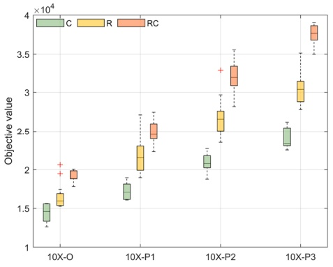

(a)

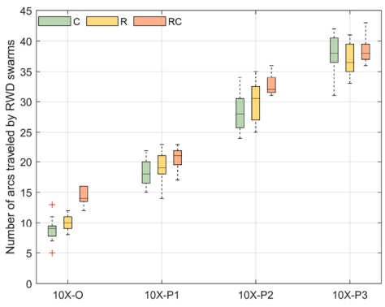

(b)

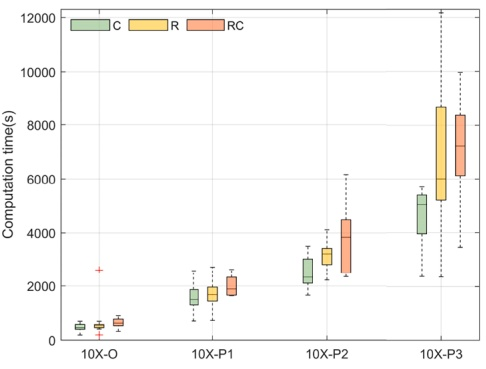

(c)

Fig. 12. Boxplots (a) Instance characteristics and costs; (b) Instance characteristics and $N ^ { F } ;$ (c) Instance characteristics and computation time.

For each large-scale instance, we use the best solution obtained by the ALNS to measure the impact of the instance characteristics on the performance of the ALNS. Fig. 12 reports the results in the form of a boxplot. i) From the objective function value (i.e., costs) perspective, the costs of C type instances are generally the least, and the costs of RC type instances are generally the most. Including more customers with demand exceeding the RWD capacity leads to more costs. ii) When more customers with demand exceeding the RWD capacity are included, more arcs are traveled by RWD swarms. However, there is no obvious relationship between the customer distribution feature and the number of arcs traveled by RWD swarms. iii) From the computational burden perspective, the computation times of RC type instances are generally the longest, and the computation times of C type instances are generally the shortest. Including more customers with demand exceeding the RWD capacity leads to more computational burden.

To show the effect of permitting detours, and to show the effectiveness of the DI operator, we refer to the ALNS not including Algorithm 1 as the ALNS-E. Table 10 shows the average of heuristic solutions of the large-scale instances obtained by the ALNS-E, and details of the heuristic solutions are given in Tables A7, A8, A9, and A10 in Appendix A. Column “ObjALNS-E” shows the objective value of the solution attained by the ALNS-E, and column “TALNS-E” shows the computational time (s) of the ALNS-E. We introduce Gap5 to denote the percentage gap between ObjALNS and ObjALNS-E, and $\mathrm{Gap5} = 100\ \% \times (\mathrm{Obj}^{\mathrm{ALNS-E}} -$ $\mathrm{Obj^{ALNS})/\mathring{O}bj^{ALNS}}$ . For each large-scale instance, Gap5 is larger than zero, which indicates that permitting detours can save costs, and Algorithm 1 in the ALNS is effective. Generally, the ALNS computation time is longer than the ALNS-E computation time. Permitting detours provides more opportunities for forming swarms (indicated by the comparison of the average of N and $N ^ { A U }$ obtained by the ALNS and ALNS-E); thus, the swarm synchronization and time continuity constraints for swarms require longer computation time for the neighborhood search process. Introducing detours into routing problems makes the developed models complex, which, along with large-scale instances, lead to a high computational burden for the solution algorithms. Although permitting detours is necessary to save costs, both practitioners and researchers are suggested identifying suitable situations for adopting the RWD swarm mode for parcel deliveries.

Average results of large-instances obtained by the ALNS-E.

Table 10

| Instance | Avg. ObjALNS-E | Avg. TALNS-E | Avg. NU | Avg.CV | Avg. NF | Avg. NAU | Gap5 |
| --- | --- | --- | --- | --- | --- | --- | --- |
| (C/RC/ | 16,261.35 | 306.56 | 15 | 1537.21 | 5 | 2.0 | 1.63 |
| R)10X- |  |  |  |  |  |  |  |
| O |  |  |  |  |  |  |  |
| (C/RC/ | 21,229.56 | 428.70 | 20 | 2091.62 | 11 | 2.3 | 2.32 |
| R)10X- |  |  |  |  |  |  |  |
| P1 |  |  |  |  |  |  |  |
| (C/RC/ | 26,480.43 | 546.46 | 24 | 2756.30 | 19 | 2.4 | 2.25 |
| R)10X- |  |  |  |  |  |  |  |
| P2 |  |  |  |  |  |  |  |
| (C/RC/ | 30,736.44 | 640.89 | 28 | 3288.16 | 27 | 2.5 | 2.55 |
| R)10X- |  |  |  |  |  |  |  |
| P3 |  |  |  |  |  |  |  |

To show the advantage of the RWD swarm delivery mode, computational results of the DRP-SS model and that of the traditional truck delivery mode are compared. We name the ALNS without RWD swarms as ALNS-W. The average results are shown in Table 11, and details of the heuristic solutions are listed in Tables $\mathrm { A 1 1 ,   A 1 2 ,   A 1 3 } ,$ and A14 in Appendix A. Column $\mathrm{ODj^{ALNS-W}}$ and column “TALNS-W” show the objective value and the computational time (s) attained by the ALNS-W, respectively. We introduce Gap6 to denote the percentage gap between $\mathsf { O b j ^ { A L N S } }$ and $\mathrm{Obj}^{\mathrm{ALNS-W}}$ , and $\mathrm{Gap6} = 100\% \times (\mathrm{Obj}^{\mathrm{ALNS-W}} - \mathrm{Obj}^{\mathrm{ALNS}})/$ $\mathbf { O } \mathbf { \check { b } } \mathbf { \check { j } } ^ { \mathrm { A L N S } _ { 2 } }$ and Gap7 to denote the percentage gap between $\mathrm { O b j ^ { A L N S - E } }$ and $\mathrm{Obj}^{\mathrm{ALNS-W}}$ , and $\mathrm{Gap}7=100\%\times(\mathrm{Obj}^{\mathrm{ALNS-W}}-\mathrm{Obj}^{\mathrm{ALNS-E}})/\mathrm{Obj}^{\mathrm{ALNS-E}}$ . The computational results of Gap6 indicate that allowing RWD swarms can achieve cost savings, compared with the traditional truck delivery system. The difference between Gap6 and Gap7 indicates the effectiveness of permitting detours, considering that Gap6 is 2 to 3 times more than Gap7. The average of TALNS-W shows that the calculation burden can be reduced greatly without considering RWD swarms.

To show the effectiveness of the multi-trip related operators, we name the ALNS without the BTI, FTI, and MI operators as the ALNS-T. Table 12 shows the average results of the large-scale instances obtained by the ALNS-T, and the detailed results are listed in Tables A15, $\mathrm { A 1 6 , A 1 7 , }$ and A18 in Appendix A. Columns “Avg.ObjALNS-T” and “Avg. $\mathbf { T } ^ { \dot { \mathrm { A L N S - T } } , \mathrm { { , } } }$ show the average of objective value and computational time (s) attained by the ALNS-T, respectively. We introduce Gap8 to denote the percentage gap between $\mathbf { O } \mathbf { \dot { b } } \mathbf { \dot { j } } ^ { \mathrm { A L N S } }$ and $\mathrm { O b j ^ { A L N S - T } }$ , and Gap8 = 100 % × $\mathrm{(Obj^{ALNS-T}-Obj^{ALNS})/Obj^{ALNS}}$ . The multi-trip related operators within the ALNS perform well, considering cost savings and the curtailment of used RWDs. The cost savings increase along with the number of customers with the demand surpassing RWD capacity growing. When dissecting the cost components, the realized cost savings predominantly stem from the reduction of fixed costs. Moreover, the average utilization of RWDs decreases by 2, 8, 13, and 20, respectively, for the O, P1, P2, and P3 types of instances.

Table 11

Average results of large-instances obtained by the ALNS-W.

| Instance | Avg. ObjALNS-W | Avg. TALNS-W | Avg. NU | Avg.CV | Gap6 | Gap7 |
| --- | --- | --- | --- | --- | --- | --- |
| (C/RC/R) | 16,531.63 | 82.62 | 15 | 1600.59 | 3.42 | 1.77 |
| 10X-O |  |  |  |  |  |  |
| (C/RC/R) | 21,522.16 | 185.95 | 20 | 2177.33 | 3.79 | 1.44 |
| 10X-P1 |  |  |  |  |  |  |
| (C/RC/R) | 26,765.11 | 223.91 | 24 | 2868.56 | 3.39 | 1.11 |
| 10X-P2 |  |  |  |  |  |  |
| (C/RC/R) | 31,125.66 | 323.68 | 28 | 3401.52 | 3.92 | 1.34 |
| 10X-P3 |  |  |  |  |  |  |

Table 12

Average results of large-instances obtained by the ALNS-T.

| Instance | Avg.ObjALNS-T | Avg.TALNS-T | Avg.NU | Avg.CV | Avg.NF | Avg.NAU | Gap8 |
| --- | --- | --- | --- | --- | --- | --- | --- |
| (C/RC/R)10X-O | 18,824.53 | 1114.65 | 17 | 1445.22 | 15 | 2.5 | 19.88 |
| (C/RC/R)10X-P1 | 29,001.84 | 3474.41 | 27 | 1898.39 | 27 | 3.3 | 43.73 |
| (C/RC/R)10X-P2 | 39,061.44 | 8689.52 | 37 | 1992.47 | 38 | 4.4 | 56.32 |
| (C/RC/R)10X-P3 | 48,324.01 | 13,294.16 | 47 | 1255.04 | 45 | 5.3 | 67.14 |

## 5.4. Challenges

Effective route planning of RWD swarms requires the optimal solving of VRP variants that consider the synchronization between RWDs, while the pricing problems for RWDs become interdependent. Solving the DRP-SS precisely using typical exact methods such as the branch-and-price algorithm is a significant challenge because the pricing problem does not remain an elementary shortest-path problem with resource constraints. To explore an exact solution method, the DRP-SS model developed in Section 3.3 is reformulated as a set partitioning model (29)-(33). The routes in DRP-SS solutions are classified into two types: single route traveled by a single-unit RWD, and group routes traveled by an RWD swarm. The latter involves various routes interact with each other because of the swarm synchronization. In model (29)-(33), F denotes the set of all feasible routes. Single routes and group routes are included in $F . \operatorname { L e t } f ( f \in F )$ denote a route. xf is a binary variable equal to 1 only if route f is included in the optimal solution. cf denotes the costs of route f. If f is a single route, let $R ^ { f } = f ;$ otherwise $R ^ { f }$ denotes a set that contains all the synchronized routes.

$$
\min \sum_ {f \in F} c _ {f} x _ {f}\tag{29}
$$

$$
\sum_ {f \in F} \delta_ {f i} x _ {f} \geq q _ {i}, \forall i \in C\tag{30}
$$

$$
\sum_ {f \in F} \alpha_ {f i} x _ {f} \geq \left\lceil \frac {q _ {i}}{Q} \right\rceil , \forall i \in C\tag{31}
$$

$$
\sum_ {f \in F} x _ {f} \beta_ {f} \leq | U |\tag{32}
$$

$$
x _ {f} \in \{0, 1 \}, \forall f \in F\tag{33}
$$

The objective function (29) minimizes the costs, where $c _ { f } = \sum _ { r \in R ^ { f } } c _ { r } =$ $\sum_{r \in R^{f}} \left( \lambda y_{r} + \sum_{i,j \in V} c_{ij} \left( b x_{rij} - a \sum_{r_{1} \in R^{f}, r_{1} \neq r} z_{rr_{1}ij} \right) \right)$ . Constraint (30) requires that customer demand must be satisfied. $\delta _ { \hat { H } }$ denotes the volume of parcels delivered by f at customer i. Constraint (31) specifies that the number of RWDs serving customer i is larger than the lower bound $\begin{array} { r } { \left[ \frac { q _ { i } } { Q } \right] .   \alpha _ { f i } } \end{array}$ denotes the number of swarm members serving customer i. Constraint (32) specifies that the number of RWDs in use does not exceed the number of available RWDs. $\beta _ { f }$ denotes the number of RWDs in use in $f .$ Constraint (33) is the integrality constraint.

For the subproblem of the set partitioning model, the objective is to minimize the reduced cost of f, i.e.,mincf − $\sum _ { i \in f } \delta _ { f i } { \cdot } \pi _ { i } ^ { ' } - \sum _ { i \in f } \alpha _ { f i } { \cdot } \pi _ { i } ^ { '' } - \pi ^ { 0 } ,$ , in which $\pi _ { i } ^ { ' } , \pi _ { i } ^ { '' } , ( i \in C )$ , and $\pi ^ { 0 }$ denote dual variables of constraints (30), (31), and (32) respectively. The constraints of the subproblem include all the constraints of the DRP-SS model except for constraint (7). In usual VRP and variants, the constraints of the subproblem can eliminate the dimension of the vehicle in the decision process because only one vehicle is used in a column. The dimension of the vehicle in variables cannot be eliminated for the DRP-SS because the RWD swarms require more than one RWD to interact with each other. Thus, the complexity of the subproblem is similar to the DRP-SS model except for constraint (7).

Based on instance C101-f-12, C108-f-12, C101-r-12, and C108-8-12, we perform some computational experiments to test the complexity of the subproblem, and the four instances are solved once without considering the dual variables. Let $\mathrm { o b j ^ { S } }$ denote the objective of the subproblem, $\mathbb { T } ^ { \mathcal { S } }$ denote the computational time (s) of the subproblem when solved once, $\mathbf { L B } ^ { \mathbf { M } }$ denotes the lower bound of the DRP-SS. The computational results are listed in Table 13. Because constraint (7) is relaxed in the subproblem, the objective value is a lower bound for the original DRP-SS. The lower bounds of instances C101-r-12 and C108-r-12 are invalid because the time limitation is reached and the optimality is not proven. The lower bounds of instances C101-r-12 and C108-r-12 are valid, but they are worse than LBM. TS of instances C101-r-12 and C108-r-12 is less than $\mathrm { T } ^ { \mathrm { M } } ,$ which indicates the complexity of the subproblem is lower than the DRP-SS.

Applying a column generation procedure to obtain a linear lower bound for the DRP-SS is impractical, considering the subproblem needs to be solved dozens or hundreds of times. In the literature, columns are usually priced out via dynamic programming using a labeling algorithm that is adopted to find at least one route with negative reduced costs or to prove that no such route exists. We briefly analyze the complexity of the labeling algorithm and show the challenges of solving the subproblem containing interacted routes. Considering that one customer can be serviced by an RWD swarm and this RWD swarm can be decoupled after the assigned delivery task, the extension of one label can generate the number of $N ^ { D e l i v e r \stackrel { \circ } { \times } } N ^ { R e l e a s e }$ new labels. $N ^ { D e l i v e r }$ denotes the number of ways for splitting the demand, $\mathbf { e . g . } ,$ less than RWD-load, full RWD-load, and zero (corresponding to a detour). $N ^ { R e l e a s e }$ denotes the number of ways for decoupling the swarm. To decouple an RWD swarm with n RWDs, there can be the number of $\mathrm { C } _ { n } ^ { 0 } + \mathrm { C } _ { n } ^ { 1 } + \ldots + \mathrm { C } _ { n } ^ { \lfloor n / 2 \rfloor }$ ways to decouple an RWD swarm. At most $3 \cdot ( \mathrm { C } _ { n } ^ { 0 } + \mathrm { C } _ { n } ^ { 1 } + \ldots + \mathrm { C } _ { n } ^ { \lfloor n / 2 \rfloor } )$ new labels may be generated when one label extends to a new node. Moreover, dominance conditions are designed to reduce the number of labels and are the core element of the labeling algorithm. Because there are both single routes and synchronized routes, dominance rules should be applied to both kinds of routes separately. Only if all labels corresponding to partial paths included in synchronized routes $G _ { 1 }$ dominate all labels corresponding to partial paths included in synchronized routes $G _ { 2 } , G _ { 1 }$ can dominate $G _ { 2 } .$ And the dominance rule of synchronized routes is very inefficient.

In short, there are great challenges in designing an efficient exact algorithm for the DRP-SS. For example, the master problem and subproblem should be divided carefully to balance the complexity of both problems; to solve the subproblem, some innovations are necessary to tackle the curse of dimensionality; effective dominance rules and valid inequalities dedicated to the characteristics of interacted routes should be developed.

Computational results of the subproblem (solved once).

| Instance | ObjS | LBM | TS | TM |
| --- | --- | --- | --- | --- |
| C101-f-12 | 2174.79 | 2205.64 | 9336.03 | 14,400 |
| C108-f-12 | 2172.37 | 2226.09 | 8872.66 | 12,230.27 |
| C101-r-12 | 3410.55 | 2400.01 | 14,400 | 14,400 |
| C108-r-12 | 3390.15 | 2379.16 | 14,400 | 14,400 |

## 6. Conclusions

RWD delivery mode is a compelling alternative to traditional lastmile parcel deliveries in time-sensitive situations. Single-unit RWDs do not completely solve real problems in last-mile parcel deliveries because of their limited payload capacity. Several strategies have been proposed to address the limited payload capacity of RWDs, one of which is the RWD swarm mode. An RWD swarm can deliver heavy or multiple packages to customers. The practical focus of this study is last-mile parcel deliveries using RWD swarm delivery modes. The RWD swarm mode has a dynamic characteristic that permits the RWD members in the swarm to change through coupling/decoupling operations at nodes. The methodological focus of this study is to define a new VRPTW variant named the DRP-SS. To the best of our knowledge, there are no studies that target the variant considering swarm synchronization, which requires vehicle routes to interact with each other by one or several arcs.

We define the DRP-SS, which considers the decision on RWD swarm synchronization and multi trips, and develop a mixed-integer linear programming model. The decision on RWD swarms guarantees both delivery service for customers whose demand exceeds the single-unit RWD capacity and swarm synchronization. We provide an ALNS that involves problem-specific operators. Based on the converted instances, we experimentally evaluate the effectiveness of the DRP-SS mathematical formulation and applicability of the ALNS algorithm to small- and large-scale instances. The exact method using the CPLEX solver is adopted to verify the effectiveness of the mathematical formulation and the effect of permitting detours in the DRP-SS model. After the ALNS is tested based on the VRPTW benchmark instances, large-scale instances are used to evaluate the effectiveness of ALNS. The heuristic results of large-scale instances indicate that, i) when the number of customers whose demand exceeds the RWD capacity increases, the number of arcs traveled by the RWD swarms increases, necessitating swarm synchronization; ii) Permitting detours provides more opportunities for forming RWD swarms, resulting in cost savings, but swarm synchronization and time continuity constraints for swarms require longer computation time.

The DRP-SS model cannot definitively answer all the macrocosmic and microcosmic operation questions arising in RWD swarm delivery modes. However, the DRP-SS model can be used to estimate the performance of RWD swarm selection in actual situations. Owing to increased interest in this field, effective exact algorithms for DRP-SS are expected. In addition, the developed model can be extended in several directions, for example, by incorporating RWD flight dynamics in threedimensional environments, considering the swarm speed and energy consumption, or involving continuous split.

## Acknowledgment

This research was supported by the Research Grant from the National Natural Science Foundation of China (grant numbers 71972007).

## Supplementary materials

Supplementary material associated with this article can be found, in the online version, at [doi:10.1016/j.ejor.2023.10.015](https://doi.org/10.1016/j.ejor.2023.10.015).

## References

[Ahmed, G., Sheltami, T., Mahmoud, A., et al. (2020). IoD swarms collision avoidance via improved particle swarm optimization. Transportation Research Part A, 142, 260–278](http://refhub.elsevier.com/S0377-2217%2823%2900772-5/sbref0001).

[Ali, Z. A., & Han, Z. (2021). Multi-unmanned aerial vehicle swarm formation control using hybrid strategy. Transactions of the Institute of Measurement and Control, 43(12), 2689–2701](http://refhub.elsevier.com/S0377-2217%2823%2900772-5/sbref0002).

[Alkouz, B., Bouguettaya, A., & Mistry, S. (2020). Swarm-based drone-as-a-service (SDaaS) for delivery. In , 2020. In: 2020 IEEE International Conference on Web Services (ICWS). IEEE; (pp. 441–448)](http://refhub.elsevier.com/S0377-2217%2823%2900772-5/sbref0003).

[Bianchessi, N., & Irnich, S. (2019). Branch-and-cut for the split delivery vehicle routing problem with time windows. Transportation Science, 53(2), 442–462](http://refhub.elsevier.com/S0377-2217%2823%2900772-5/sbref0004).

[Bortfeldt, A., & Yi, J. (2020). The split delivery vehicle routing problem with threedimensional loading constraints. European Journal of Operational Research, 282(2), 545–558](http://refhub.elsevier.com/S0377-2217%2823%2900772-5/sbref0005).

[Boysen, N., Fedtke, S., & Schwerdfeger, S. (2020). Last-mile delivery concepts: A survey from an operational research perspective. OR Spectrum, 1–58](http://refhub.elsevier.com/S0377-2217%2823%2900772-5/sbref0006).

[Chen, Y. B., Yu, J. Q., Su, X. L., et al. (2015). Path planning for multi-UAV formation. Journal of Intelligent & Robotic Systems, 77(1), 229–246](http://refhub.elsevier.com/S0377-2217%2823%2900772-5/sbref0007).

[Cheng, C., Adulyasak, Y., & Rousseau, L. M. (2020). Drone routing with energy function: Formulation and exact algorithm. Transportation Research Part B, 139, 364–387](http://refhub.elsevier.com/S0377-2217%2823%2900772-5/sbref0008).

[Chung, S. H., Sah, B., & Lee, J. (2020). Optimization for drone and drone-truck combined operations: A review of the state of the art and future directions. Computers & Operations Research, Article 105004](http://refhub.elsevier.com/S0377-2217%2823%2900772-5/sbref0009).

[Coelho, B. N., Coelho, V. N., Coelho, I. M., et al. (2017). A multi-objective green UAV routing problem. Computers & Operations Research, 88, 306–315](http://refhub.elsevier.com/S0377-2217%2823%2900772-5/sbref0010).

[D’Amato, E., Mattei, M., & Notaro, I. (2019). Bi-level flight path planning of UAV formations with collision avoidance. Journal of Intelligent & Robotic Systems, 93(1), 193–211](http://refhub.elsevier.com/S0377-2217%2823%2900772-5/sbref0011).

[Dasdemir, E., Koksalan, ¨ M., & Oztürk, ¨ D. (2019). A flexible reference point-based multi-objective evolutionary algorithm: An application to the UAV route planning problem. Computers & Operations Research, Article 104811](http://refhub.elsevier.com/S0377-2217%2823%2900772-5/sbref0012).

Demir, E., Bektaş, T., & Laporte, G. (2012). An adaptive large neighborhood search [heuristic for the pollution-routing problem. European Journal of Operational Research, 223(2), 346–359](http://refhub.elsevier.com/S0377-2217%2823%2900772-5/sbref0013).

[Di Puglia Pugliese, L., Macrina, G., & Guerriero, F. (2021). Trucks and drones cooperation in the last-mile delivery process. Networks, 78(4), 371–399](http://refhub.elsevier.com/S0377-2217%2823%2900772-5/sbref0014).

[Dorling, K., Heinrichs, J., Messier, G. G., et al. (2017). Vehicle routing problems for drone delivery. IEEE Transactions on Systems, Man, and Cybernetics: Systems, 47(1), 70–85](http://refhub.elsevier.com/S0377-2217%2823%2900772-5/sbref0015).

[Drexl, M. (2012). Synchronization in vehicle routing—A survey of VRPs with multiple synchronization constraints. Transportation Science, 46(3), 297–316](http://refhub.elsevier.com/S0377-2217%2823%2900772-5/sbref0016).

Fazi, S., Choudhary, S. K., & Dong, J. X. (2023). The multi-trip container drayage problem with synchronization for efficient empty containers re-usage. European Journal of Operational Research. [https://doi.org/10.1016/j.ejor.2023.02.041](https://doi.org/10.1016/j.ejor.2023.02.041)

[Fink, M., Desaulniers, G., Frey, M., Kiermaier, F., Kolisch, R., & Soumis, F. (2019). Column generation for vehicle routing problems with multiple synchronization constraints. European Journal of Operational Research, 272(2), 699–711](http://refhub.elsevier.com/S0377-2217%2823%2900772-5/sbref0018).

[Frey, C. M., Jungwirth, A., Frey, M., & Kolisch, R. (2023). The vehicle routing problem with time windows and flexible delivery locations. European Journal of Operational Research, 308(3), 1142–1159](http://refhub.elsevier.com/S0377-2217%2823%2900772-5/sbref0019).

[Guerriero, F., Surace, R., Loscri, V., et al. (2014). A multi-objective approach for unmanned aerial vehicle routing problem with soft time windows constraints. Applied Mathematical Modelling, 38(3), 839–852](http://refhub.elsevier.com/S0377-2217%2823%2900772-5/sbref0020).

[H\`a, M. H., Nguyen, T. D., Duy, T. N., Pham, H. G., Do, T., & Rousseau, L. M. (2020). A new constraint programming model and a linear programming-based adaptive large neighborhood search for the vehicle routing problem with synchronization constraints. Computers & Operations Research, 124, Article 105085](http://refhub.elsevier.com/S0377-2217%2823%2900772-5/sbref0021).

[Habib, D., Jamal, H., & Khan, S. A. (2013). Employing multiple unmanned aerial vehicles for co-operative path planning. International Journal of Advanced Robotic Systems, 10 (5), 235](http://refhub.elsevier.com/S0377-2217%2823%2900772-5/sbref0022).

[Hashemi Doulabi, H., Pesant, G., & Rousseau, L. M. (2020). Vehicle routing problems with synchronized visits and stochastic travel and service times: Applications in healthcare. Transportation Science, 54(4), 1053–1072](http://refhub.elsevier.com/S0377-2217%2823%2900772-5/sbref0023).

[He, P., & Hao, J. K. (2023). General edge assembly crossover-driven memetic search for split delivery vehicle routing. Transportation Science, 57(2), 482–511](http://refhub.elsevier.com/S0377-2217%2823%2900772-5/sbref0024).

[Khorsi, M., Chaharsooghi, S. K., Husseinzadeh Kashan, A., & Bozorgi-Amiri, A. (2022). Solving the humanitarian multi-trip cumulative capacitated routing problem via a grouping metaheuristic algorithm. Annals of Operations Research, 1–38](http://refhub.elsevier.com/S0377-2217%2823%2900772-5/sbref0025).

[Kratky, V., Alcantara, A., Capitan, J., et al. (2021). Autonomous aerial filming with distributed lighting by a team of unmanned aerial vehicles. IEEE Robotics and Automation Letters, 6(4), 7580–7587](http://refhub.elsevier.com/S0377-2217%2823%2900772-5/sbref0026).

[Li, H., Chen, J., Wang, F., & Bai, M. (2021). Ground-vehicle and unmanned-aerial-vehicle routing problems from two-echelon scheme perspective: A review. European Journal of Operational Research, 294(3), 1078–1095](http://refhub.elsevier.com/S0377-2217%2823%2900772-5/sbref0027).

[Li, J., Luo, Z., Baldacci, R., Qin, H., et al. (2023). A new exact algorithm for singlecommodity vehicle routing with split pickups and deliveries. INFORMS Journal on Computing, 35(1), 31–49](http://refhub.elsevier.com/S0377-2217%2823%2900772-5/sbref0028).

[Li, J., Qin, H., Baldacci, R., & Zhu, W. (2020a). Branch-and-price-and-cut for the synchronized vehicle routing problem with split delivery, proportional service time and multiple time windows. Transportation Research Part E, 140, Article 101955](http://refhub.elsevier.com/S0377-2217%2823%2900772-5/sbref0029).

[Li, H., Wang, H., Chen, J., & Bai, M. (2020b). Two-echelon vehicle routing problem with time windows and mobile satellites. Transportation Research Part B, 138, 179–201](http://refhub.elsevier.com/S0377-2217%2823%2900772-5/sbref0030).

[Li, H., & Wang, F. (2023). Branch-price-and-cut for the truck–drone routing problem with time windows. Naval Research Logistics (NRL), 70(2), 184–204](http://refhub.elsevier.com/S0377-2217%2823%2900772-5/sbref0031).

[Lim, A., Zhang, Z., & Qin, H. (2017). Pickup and delivery service with manpower planning in Hong Kong public hospitals. Transportation Science, 51(2), 688–705](http://refhub.elsevier.com/S0377-2217%2823%2900772-5/sbref0032).

[Liu, Y. (2019). An optimization-driven dynamic vehicle routing algorithm for on-demand meal delivery using drones. Computers & Operations Research, 111, 1–20](http://refhub.elsevier.com/S0377-2217%2823%2900772-5/sbref0033).

[Macrina, G., Pugliese, L. D. P., Guerriero, F., & Laporte, G. (2020). Drone-aided routing: A literature review. Transportation Research Part C: Emerging Technologies, 120, Article 102762](http://refhub.elsevier.com/S0377-2217%2823%2900772-5/sbref0034).

[Murray, C. C., & Chu, A. G. (2015). The flying sidekick traveling salesman problem: Optimization of drone-assisted parcel delivery. Transportation Research Part C: Emerging Technologies, 54, 86–109](http://refhub.elsevier.com/S0377-2217%2823%2900772-5/optUrIU3hjRST).

[Nagasawa, R., Mas, E., Moya, L., et al. (2021). Model-based analysis of multi-UAV path planning for surveying postdisaster building damage. Scientific Reports, 11(1), 1–14](http://refhub.elsevier.com/S0377-2217%2823%2900772-5/sbref0035).

[Otto, A., Agatz, N., Campbell, J., Golden, B., & Pesch, E. (2018). Optimization approaches for civil applications of unmanned aerial vehicles (UAVs) or aerial drones: A survey. Networks, 72(4), 411–458](http://refhub.elsevier.com/S0377-2217%2823%2900772-5/opthNyxefpydf).

[Pan, B., Zhang, Z., & Lim, A. (2021). Multi-trip time-dependent vehicle routing problem with time windows. European Journal of Operational Research, 291(1), 218–231](http://refhub.elsevier.com/S0377-2217%2823%2900772-5/sbref0036).

[Pecin, D., Contardo, C., Desaulniers, G., & Uchoa, E. (2017). New enhancements for the exact solution of the vehicle routing problem with time windows. INFORMS Journal on Computing, 29(3), 489–502](http://refhub.elsevier.com/S0377-2217%2823%2900772-5/sbref0037).

[Pessoa, A., Sadykov, R., Uchoa, E., & Vanderbeck, F. (2020). A generic exact solver for vehicle routing and related problems. Mathematical Programming, 183, 483–523](http://refhub.elsevier.com/S0377-2217%2823%2900772-5/sbref0038).

[Rajaei, M., Moslehi, G., & Reisi-Nafchi, M. (2022). The split heterogeneous vehicle routing problem with three-dimensional loading constraints on a large scale. European Journal of Operational Research, 299(2), 706–721](http://refhub.elsevier.com/S0377-2217%2823%2900772-5/sbref0039).

[Ropke, S., & Pisinger, D. (2006). An adaptive large neighborhood search heuristic for the pickup and delivery problem with time windows. Transportation Science, 40(4), 455–472](http://refhub.elsevier.com/S0377-2217%2823%2900772-5/sbref0040).

[Sarasola, B., & Doerner, K. F. (2020). Adaptive large neighborhood search for the vehicle routing problem with synchronization constraints at the delivery location. Networks, 75(1), 64–85](http://refhub.elsevier.com/S0377-2217%2823%2900772-5/sbref0041).

[Shao, S., Peng, Y., He, C., et al. (2020). Efficient path planning for UAV formation via comprehensively improved particle swarm optimization. ISA transactions, 97, 415–430](http://refhub.elsevier.com/S0377-2217%2823%2900772-5/sbref0042).

[Shao, Z., Yan, F., Zhou, Z., et al. (2019). Path planning for multi-UAV formation rendezvous based on distributed cooperative particle swarm optimization. Applied Sciences, 9(13), 2621](http://refhub.elsevier.com/S0377-2217%2823%2900772-5/sbref0043).

[Shetty, V. K., Sudit, M., & Nagi, R. (2008). Priority-based assignment and routing of a fleet of unmanned combat aerial vehicles. Computers & Operations Research, 35(6), 1813–1828](http://refhub.elsevier.com/S0377-2217%2823%2900772-5/sbref0044).

[Solomon, M. M. (1987). Algorithms for the vehicle routing and scheduling problem with time window constraints. Operations Research, 35(2), 254–265](http://refhub.elsevier.com/S0377-2217%2823%2900772-5/sbref0045).

[Song, B. D., Park, K., & Kim, J. (2018). Persistent UAV delivery logistics: MILP formulation and efficient heuristic. Computers & Industrial Engineering, 120, 418–428](http://refhub.elsevier.com/S0377-2217%2823%2900772-5/sbref0046).

[Vidal, T., Crainic, T. G., Gendreau, M., & Prins, C. (2013). A hybrid genetic algorithm with adaptive diversity management for a large class of vehicle routing problems with time-windows. Computers & Operations Research, 40(1), 475–489](http://refhub.elsevier.com/S0377-2217%2823%2900772-5/sbref0047).

[Vincent, F. Y., Jodiawan, P., Hou, M. L., et al. (2021). Design of a two-echelon freight distribution system in last-mile logistics considering covering locations and occasional drivers. Transportation Research Part E, 154, Article 102461](http://refhub.elsevier.com/S0377-2217%2823%2900772-5/sbref0048).

[Wang, L., Kinable, J., & Van Woensel, T. (2020). The fuel replenishment problem: A splitdelivery multi-compartment vehicle routing problem with multiple trips. Computers & Operations Research, 118, Article 104904](http://refhub.elsevier.com/S0377-2217%2823%2900772-5/sbref0049).

[Zhen, L., Ma, C., Wang, K., et al. (2020). Multi-depot multi-trip vehicle routing problem with time windows and release dates. Transportation Research Part E, 135, Article 101866](http://refhub.elsevier.com/S0377-2217%2823%2900772-5/sbref0050).