# A Power Consumption Model for Multi-rotor Small Unmanned Aircraft Systems

Zhilong Liu Email: lzl200102109@berkeley.edu

Raja Sengupta

Email: rajasengupta@berkeley.edu

Alex Kurzhanskiy Email: akurzhan@berkeley.edu

Cal Unmanned Laboratory

University of California, Berkeley

Berkeley California 94720, USA

**Abstract—We develop a theoretical power consumption model for multi-rotor Unmanned Aircraft Systems (UAS), estimate the model parameters, and validate it by flying an IRIS+ quadrotor UAS and measuring its energy consumption experimentally. The model is derived from the helicopter literature. Such models are required to create UAS flight planning systems.**

## I. INTRODUCTION

Any aircraft in flight needs to estimate its energy needs, energy availability, and have a flight plan executable with the energy remaining on-board. Flight planning systems used today, include a component that transforms a planned aircraft trajectory into an estimate of the fuel required to fly it [1]. Flight planning systems for UAS will require a similar component, i.e, a power consumption model able to transform a planned UAS trajectory into the energy required to fly it [2]. However, to the best of the authors’ knowledge, the power consumption modeling literature for multi-rotor sUAS is small. This paper is intended to fill in this gap.

The paper is organized as follows. First, we review the relevant literature in Section II. The UAS power consumption model is developed in Section III. Section IV describes how to identify the model parameters using experimental data, and V is concerned with model validation.

## II. LITERATURE REVIEW

We focus on modeling the power consumption of multi-rotor UAS. This is the most popular kind of UAS today. [3] studies the energy consumption of multirotors with different numbers of rotors. They study rotor force as a function of rotor speed, and measure the power consumption of a single rotor. [4] decomposes the power consumption of a PCB quadrotor into avionic and payload power. Power is studied as a function of thrust only, and flight time is studied as a function of weight. [5] has collected power consumption data for a variety of motors and measures the power draw as a function of thrust. All of this work is empirical and data driven. We develop a theoretical model following the helicopter literature and [6] because UAS flight data is likely to be inadequate for years to come.

[6] develops a theoretical power consumption model for a customized research platform - called small convertible UAV. The author separates the aerodynamic forces into thrust, inplane force, and in-plane torque. An analytical model with six non-dimensional parameters is identified experimentally with UIUC wind tunnel measurements. The power model accounts for both thrust and drag in different vehicle configurations. We adopt a similar modeling approach but based on helicopter theory [7], [8]. Our model is most closely related to [7].

## III. PROPOSED POWER CONSUMPTION MODEL

We focus on estimating the energy consumption of a multirotor UAS on long trips. The flight paths consists of a vertical-take-off segment, a combination of horizontal straight line segments, and a vertical-landing segment. We assume the vehicle is in steady state most of the time, and the external forces are in static equilibrium, yielding zero net acceleration. This avoids a dynamic model and renders a static map from commanded speed and thrust to energy. The model can also capture the impact of wind on energy consumption, but it requires wind data as a model input. Low altitude wind data is not mature currently. Therefore, wind effect on energy is left as future work.

Our model decomposes the consumed power into three components, namely induced power $( P _ { i } ) ,$ profile power $( P _ { p } ) ,$ and parasite power $( P _ { p a r } )$ . The induced power produces thrust by propelling air downward. The profile power overcomes the rotational drag encountered by rotating propeller blades. The parasite power resists body drag when there is relative translational motion between the vehicle and wind. In this section, we first derive the model from first principles. The model is similar to the one presented in [7] with minor modifications. We then summarize the model and list the parameters to be identified experimentally under steady-state condition.

## A. Induced Power

We base our modeling of induced power consumption on actuator disk theory [7]. Here we are only concerned with the vertical flow, which is assumed to be uniformly distributed over the propeller disks, inviscid, incompressible, and irrotational. Figure 1 shows the control volume (CV) of the air mass around the quadrotor during vertical flight. The quadrotor’s propellers divide the air mass into two parts. The boundaries of interest are indicated by numbers $i = \{ 0 , 1 , 2 , \infty \}$ . Let

• $p _ { i }$ be the pressure at each boundary.

• $V _ { i }$ be the vertical speed at each boundary.

$T$ be the total thrust.

• A be the total propeller area.

$\rho$ be the density of air.

• ṁ be the mass flow rate.

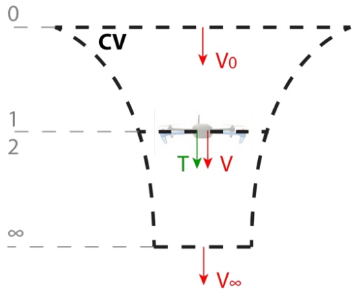

Fig. 1: Control volume (CV) of the air mass of interest.

We also define $V : = V _ { 1 } = V _ { 2 }$ and $p : = p _ { 0 } = p _ { \infty }$ From energy conservation,

$$
\begin{array}{r} P _ {i} = T V = \frac {1}{2} \dot {m} V _ {\infty} ^ {2} - \frac {1}{2} \dot {m} V _ {0} ^ {2} \\ = \frac {1}{2} \dot {m} (V _ {\infty} - V _ {0}) (V _ {\infty} + V _ {0}) \end{array}\tag{1}
$$

From momentum conservation,

$$
T = \dot {m} \left(V _ {\infty} - V _ {0}\right)\tag{2}
$$

Substitute equation (2) into (1) and simplify, we have

$$
V = \frac {1}{2} \left(V _ {\infty} + V _ {0}\right)\tag{3}
$$

The mass flow rate is,

$$
\dot {m} = \rho A V\tag{4}
$$

Substitute (4) into (2), and then substitute (3), we get

$$
T = \frac {1}{2} \rho A (V _ {\infty} ^ {2} - V _ {0} ^ {2})\tag{5}
$$

Solve for $V _ { \infty }$ , we have

$$
V _ {\infty} = \sqrt {\frac {2 T}{\rho A} + V _ {0} ^ {2}}\tag{6}
$$

Therefore, by substituting (3) to (1) and then substituting (6), we obtain the analytical expression for the idealized induced power.

$$
\begin{array}{c} P _ {i} = T V = T \left(\frac {1}{2} \left(V _ {\infty} + V _ {0}\right)\right) \\ = T \left(\sqrt {\frac {T}{2 \rho A} + \left(\frac {V _ {0}}{2}\right) ^ {2}} + \frac {V _ {0}}{2}\right) \end{array}\tag{7}
$$

Since the CV is moving together with the quadrotor, and air is at rest at boundary 0, the vertical speed of the vehicle $V _ { v e r t }$ is the same as the speed at boundary 0, or $V _ { v e r t } : =$ $V _ { 0 }$ . In addition, we account for the deviation between the idealized uniform air flow and actual flow by multiplying a scaling factor $k _ { 1 }   \in   [ 0 , 1 ]$ to the whole expression, which yields the first equation in (14), with $k _ { 2 }$ defined in Table I.

## B. Profile Power

We derive the profile power consumed by a rotating rotor blade from blade element theory. Figure 2 shows an infinitely small section of a full rotor blade of radius R at a radial location $r < R ,$ Then the linear speed of the blade at location r for rotor $i = \{ 1 , 2 , . . . , M \}$ is $V _ { i } ( r ) = \Omega _ { i } r$ , with $\Omega _ { i }$ and M being the angular speed of each rotor and the total number of rotors, respectively. Assuming small angles, we can obtain the profile power for the $i ^ { t h }$ rotor in hover mode by integrating the drag force $F _ { p , i }$ along the blades.

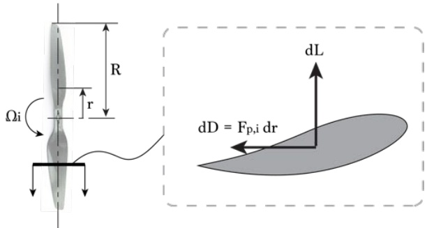

Fig. 2: Diagram of a quadrotor propeller, with a section view of a blade showing the infinitesimal forces.

$$
\begin{array}{r l} & {\left| P _ {p, h o v e r, i} = N \int_ {0} ^ {R} d D = N \int_ {0} ^ {R} F _ {p, i} V _ {i} (r) d r \right.} \\ & {\qquad = N \int_ {0} ^ {R} \left(\frac {1}{2} c _ {d} \rho (\Omega_ {i} r) ^ {2} c\right) (\Omega_ {i} r) d r} \\ & {\qquad = \frac {N c c _ {d} \rho R ^ {4}}{8} \Omega_ {i} ^ {3}} \end{array}\tag{8}
$$

where

• N is the total number of blades in a single propeller.

$c _ { d }$ is the drag coefficient of the blade.

• c is the blade chord width.

In horizontal flight, a similar procedure shows that the profile power becomes

$$
\begin{array}{c} \left| P _ {p, i} = P _ {p, h o v e r, i} (1 + \mu_ {i} ^ {2}) \right| \\ \mu_ {i} = \frac {V _ {a i r} c o s \alpha_ {i}}{\Omega_ {i} R} \end{array}\tag{9}
$$

where

$\mu _ { i }$ is the advance ratio for propeller i.

$V _ { a i r }$ is the horizontal airspeed.

• $\alpha _ { i }$ is the angle of attack of the propeller disk i.

For a multi-rotor UAS, it is common to assume that the thrust generated is proportional to the angular speed squared, or $T _ { i } = k _ { 3 } \Omega _ { i } ^ { 2 }$ , where $k _ { 3 }$ is a scaling factor converting from rotor angular speed ⌦ to thrust T. In addition, all angles of attack are identical, or $\alpha : = \alpha _ { i }$ , for $i = \{ 1 , . . . , M \}$ . Then the total profile power is

$$
\left| \begin{array}{l} P _ {p} = \sum_ {i = 1} ^ {M} P _ {p, i} = \sum_ {i = 1} ^ {M} \left(\frac {N c c _ {d} \rho R ^ {4}}{8} \Omega_ {i} ^ {3} (1 + \mu_ {i} ^ {2})\right) \\ = \sum_ {i = 1} ^ {M} \left(\frac {N c c _ {d} \rho R ^ {4}}{8} \left(\Omega_ {i} ^ {3} + (V _ {a i r} c o s \alpha_ {i} / R) ^ {2} \Omega_ {i}\right)\right) \\ \approx c _ {2} T ^ {3 / 2} + c _ {3} (V _ {a i r} c o s \alpha) ^ {2} T ^ {1 / 2} \end{array} \right|\tag{10}
$$

The last approximation lumps all M rotors into a single rotor. Hence the second equation in (14), with $c _ { 2 }$ and $c _ { 3 }$ defined in Table I. From [7], the second term in (10) contributes very little, so we assume $c _ { 3 } = 0$ to simplify the identification process.

## C. Parasite Power

The parasite power is obtained by assuming that the body drag $( F _ { p a r } )$ is proportional to airspeed $( V _ { a i r } )$ squared.

$$
P _ {p a r} = F _ {p a r} V _ {a i r} = \frac {1}{2} C _ {d} \rho A _ {q u a d} V _ {a i r} ^ {3}\tag{11}
$$

where

$C _ { d }$ is the drag coefficient of the vehicle body.

$A _ { q u a d }$ is the cross-sectional area of the vehicle when against wind.

Equation (11) is re-written and summarized in the third equation in (14), with $c _ { 4 }$ defined in Table I. In general, $C _ { d }$ and $A _ { q u a d }$ are complex functions of the vehicle geometry and flight direction, making $c _ { 4 }$ is hard to identify.

## D. External Forces at Steady State

In all the experiments, we only extract data when the UAS is at steady state, and in force equilibrium. Figure 3 shows all the external forces, where

• $L$ is the lift generated from horizontal movement.

• $D$ is the parasite drag.

$\alpha$ is the angle of attack.

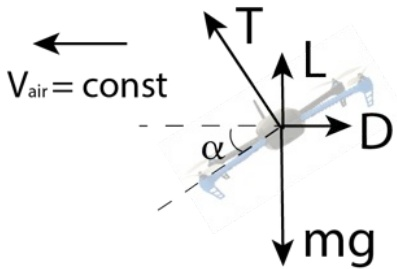

Fig. 3: The UAS is under force equilibrium in horizontal and vertical directions.

Therefore, the thrust at steady state is computed from

$$
T = \sqrt {(m g - L) ^ {2} + D ^ {2}}\tag{12}
$$

Although small, we would like to model the lift L because we observed a thrust reduction in horizontal flight. The lift L in equation (13) is derived by integrating infinitesimal forces. The parasite drag is discussed in Section III-C.

$$
\begin{array}{l} L = c _ {5} (V _ {a i r} \cos \alpha) ^ {2} + c _ {6} T \\ c _ {5} := N c c _ {l} \rho R / 4, \quad c _ {6} := k _ {3} N c c _ {l} \rho R ^ {3} / 6 \approx 0 \\ D = c _ {4} V _ {a i r} ^ {2} \end{array}\tag{13}
$$

with $c _ { l }$ being the lift coefficient.

Theoretically, we can solve for thrust T by solving a complicated quadratic equation, by substituting equation (13) into (12). However, we are only interested in modeling lift as a function horizontal airspeed. It allows us to match the thrust reduction observed in horizontal flight. Therefore, we further assume that $c _ { 6 } = 0 ,$ , to simplify the identification process.

When the UAS is hovering or ascending/descending slowly, the thrust reduces to gravity, or $T = m g$

## E. Model Summary

The power consumption model is summarized in equation (14). The analytical expressions of the parameters are shown in Table I.

TABLE I: Analytical Expressions for the Parameters

| parameter | analytical expression |
| --- | --- |
| k1k2 | constpan2t⇢2A[0,1] |
| c1 | k1/k2 |
| c2 | k31.5Nccd⇢R4/8 |
| c3 | k30.5Nccd⇢R2/8 ⇡ 0 |
| c4 | Cd⇢Aquad/2 |
| c5 | Ncc4l⇢R |
| c6 | k3Nc6cl⇢R3 ⇡ 0 |

$$
P _ {i} (T, V _ {v e r t}) = k _ {1} T \left[ \frac {V _ {v e r t}}{2} + \sqrt {\left(\frac {V _ {v e r t}}{2}\right) ^ {2} + \frac {T}{k _ {2} ^ {2}}} \right]\tag{14}
$$

$$
\begin{array}{c} P _ {p} (T, V _ {a i r}) = c _ {2} T ^ {3 / 2} + c _ {3} (V _ {a i r} \cos \alpha) ^ {2} T ^ {1 / 2} \\ P _ {p a r} (V _ {a i r}) = c _ {4} V _ {a i r} ^ {3} \end{array}
$$

$$
\begin{array}{c} V _ {a i r} = | | \boldsymbol {V} _ {a i r} | | = | | \boldsymbol {V} _ {g r o u n d} - \boldsymbol {V} _ {w i n d} | | \\ T = \sqrt {(m g - (c _ {5} (V _ {a i r} c o s \alpha) ^ {2} + c _ {6} T)) ^ {2} + (c _ {4} V _ {a i r} ^ {2}) ^ {2}} \end{array}
$$

where

$\boldsymbol { V } _ { a i r } , \boldsymbol { V } _ { g r o u n d } , \boldsymbol { V } _ { w i n d }$ are the horizontal air velocity, ground velocity, and wind velocity, respectively.

$k _ { 1 } , k _ { 2 } , c _ { 1 } , c _ { 2 } , c _ { 4 } , c _ { 5 }$ are parameters to be identified in experiments.

When hovering $( V _ { v e r t } = 0 )$ , the induced power is reduced to

$$
P _ {i, h o v e r} (T) = \frac {k _ {1}}{k _ {2}} T ^ {3 / 2} \triangleq c _ {1} T ^ {3 / 2}\tag{15}
$$

For a typical helicopter, The three power components account for more than 95% of the total power consumed [7]. The model should be valid for multi-rotor UAS without rotor interference, true for a quadrotor without overlapping propeller disks [7]. The next question is how much each individual power component contributes to the total power, which we address in Section IV.

## IV. MODEL IDENTIFICATION BY EXPERIMENTS

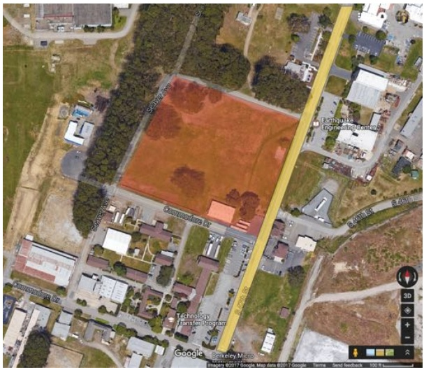

Fig. 4: The test sites at the Richmond Field Station. Experiment 1 and 2 were performed at the red area, while experiment 3 was at the yellow area.

From equation (14) and (15), the power components are super-linear functions of payload and airspeed. Thus, we will focus on these two important factors in this section. To identify the unknown coefficients, we perform three simple experiments, namely hover, steady-state ascend/descend, and cyclic straight-line mission, on an IRIS+ from 3D Robotics [9]. To minimize the effect of wind, the experiments were performed in a field partially surrounded by plants at the Richmond Field Station [10]. Figure 4 shows the site configuration and highlights the two test areas.

In each experiment, the total power draw is computed by multiplying voltage and current measurements from the onboard power module. The ground speed and Euler angles from GPS and IMU are computed by an extended Kalman filter (EKF) in the autopilot, to estimate the airspeed $V _ { a i r }$ and angle of attack ↵, respectively. All data is collected at 10Hz. For consistency, each experiment is repeated three times.

## A. Experiment 1: Hover

In this experiment, the IRIS+ sUAS is loaded with different payloads to hover (Figure 5). Data is collected from the vehicle self weight 14.3N to 22N total with payload, close to the handling limit of the vehicle. The total power is given by equation (16). Figure 6 shows a least-square (LS) fit, giving $c _ { 1 } + c _ { 2 } = 2 . 8 4 ( m / k g ) ^ { 1 / 2 }$

$$
P _ {e x p 1} = P _ {i, h o v e r} (m g) + P _ {p} (m g, 0) = (c _ {1} + c _ {2}) (m g) ^ {3 / 2}\tag{16}
$$

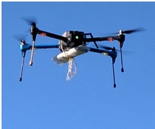

Fig. 5: IRIS+ hovering with different payloads.

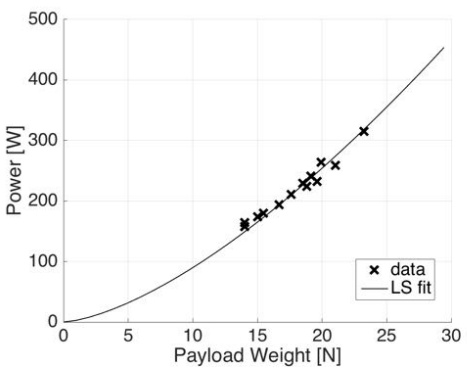

Fig. 6: Least square fit of IRIS+ hovering with different payloads.

## B. Experiment 2: Steady-state ascend/descend

In this experiment, the IRIS+ sUAS is commanded to ascend and descend at constant vertical speed of $V _ { v e r t } \: = \:$ $2 . 5 m / s$ between 0m and 100m altitude without payloads (Figure 7). The total power is given by equation (17). The measurement is shown in Table II. The reported values are averages of the time-series data at steady state. The standard deviation (stdev) is also shown for comparison purpose. Together with Experiment 1, we have four equations (hover, ascend, descend, and $c _ { 1 } = k _ { 1 } / k _ { 2 } ) ,$ , and four unknown parameters $( k _ { 1 } , k _ { 2 } , c _ { 1 }$ , and c2). The identified parameters are shown in Table III. Note that the value of $c _ { 1 } + c _ { 2 } = 3 . 1 1$ It is slightly larger than the one reported from Experiment 1 but still acceptable (⇠ 10% error).

$$
P _ {e x p 2} = P _ {i} (m g, V _ {v e r t}) + P _ {p} (m g, 0)\tag{17}
$$

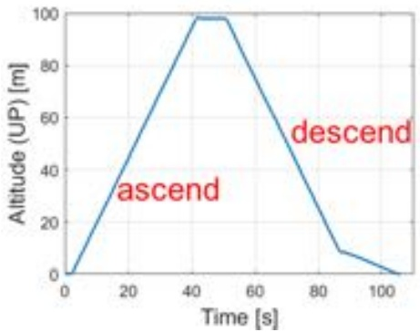

Fig. 7: Steady-state ascend and descend altitude trajectory.

## C. Experiment 3: Cyclic straight line

The goal of this experiment is to quantify the effect of parasite drag. The total power is given by equation (18), with the thrust T, and lift L and drag D defined by equation (12) and (13), respectively. The parameter $c _ { 3 }$ is assumed to be 0 to simplify the identification process (Section III-B). This is a typical assumption for helicopters [7].

TABLE II: Data from Experiment 2

| scenario | vertical speed [m/s] | power (avg.) [W] | power (stdev) [W] |
| --- | --- | --- | --- |
| ascend | 2.5 | 180 | 6.3 |
| hover | 0 | 164 | 1.7 |
| descend | -2.5 | 150 | 4.9 |

$$
\begin{array}{r l} & P _ {e x p 3} = P _ {i} (T, 0) + P _ {p} (T, V _ {a i r}) + P _ {p a r} (V _ {a i r}) \\ & \quad = (c _ {1} + c _ {2}) T ^ {3 / 2} + c _ {3} (V _ {a i r} c o s \alpha) ^ {2} T ^ {1 / 2} + c _ {4} V _ {a i r} ^ {3} \\ & \quad \approx (c _ {1} + c _ {2}) T ^ {3 / 2} + c _ {4} V _ {a i r} ^ {3} \end{array}\tag{18}
$$

The mission is setup in Mission Planner [11] and performed by the autopilot autonomously. The IRIS+ sUAS is commanded to follow a 345-meter-long straight-line path back and forth between two waypoints (Figure 8a), with a 20-second hovering duration after reaching the waypoints. In each test, the sUAS is commanded to follow a different desired horizontal ground speed $V _ { d e s }$ , ranging from 5m/s to $2 5 m / s$

Although the airspeed is not measured, it could be estimated from the high-speed test sets by assuming constant wind speed. Figure 8b is an example showing the time history plots of power and ground speed. One forward and backward flight cycle is highlighted in red to illustrate wind speed estimation. In this test, the desired ground speed $V _ { d e s }$ is set to $2 5 m / s ,$ , but the actual ground speed never reaches this value due to parasite drag. At steady state, the actual ground speed is higher when traveling in one direction than the other, while the power consumption stays almost constant. It implies that the vehicle is traveling at the same terminal airspeed in both the forward and backward flights. Therefore, the speed difference between the two flights is twice the horizontal wind speed. In this case, the horizontal wind velocity is about 2m/s along/against the flight direction. In our tests, the cross wind (perpendicular to the flight directions) is assumed negligible. We can thus obtain an estimate of the airspeed.

The test results are summarized in Figure 8c. The horizontal axis is the corrected airspeed along the flight direction. The power consumption data is sampled at hovering and steady-state traveling. Note that the power consumption stays essentially constant for airspeed less than $1 0 m / s .$ A least square fit is performed to the data using equation (18), which yields the value of $c _ { 4 }$ and $c _ { 5 }$ in Table III. When the airspeed is between 5 and $1 0 m / s$ , we observe slight power/thrust reduction due to lift generation (Figure 3). With the identified parameter $c _ { 5 }$ , the lift is 2.5N at 10m/s airspeed.

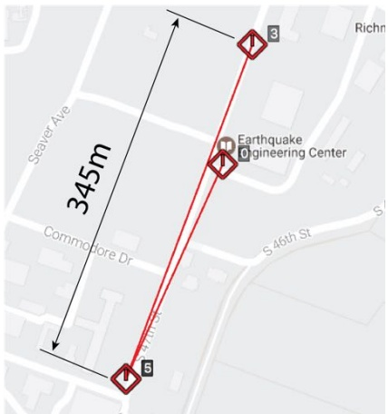

(a) cyclic straight line mission.

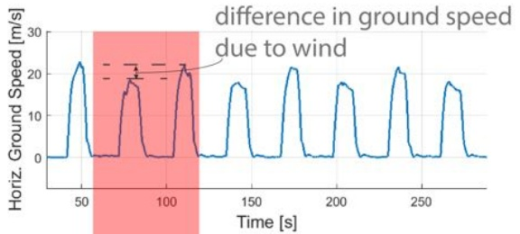

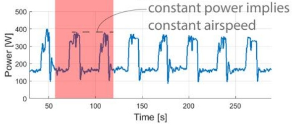

(b) time history plot for 25m/s test to estimate wind speed.

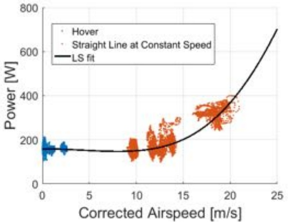

(c) power consumption plot of tests at different airspeeds.

Fig. 8: Experiment 3 setup and result.

## V. MODEL VALIDATION

The proposed power consumption model at steady state is validated by a separate experiment (Figure 9). The sUAS was first commanded to ascend to 70m above ground level (AGL), then complete a rectangular loop at constant altitude, and finally land. At each edge of the loop, the sUAS was commanded to travel at various ground speeds, ranging from 10 to $2 0 m / s$ . The altitude is significant higher than Experiment 3, but it is necessary to ensure obstacle-free flights.

TABLE III: Identified Parameters

| parameter | value |
| --- | --- |
| k1 | 0.8554 |
| k2 | 0.3051(kg/m)1/2 |
| c1 = k1/k2 | 2.8037(m/kg)1/2 |
| c2 | 0.3177(m/kg)1/2 |
| c3 | ⇠ 0 |
| c4 | 0.0296kg/m |
| c5 | 0.0279Ns/m |
| c6 | ⇠ 0 |

The validation results are presented in Table IV. The first column represents different stages of the flight. The second column lists the energy computed from voltage and current data from the power module. The third column shows the energy computed from the proposed power consumption model. The model inputs are again from the EKF. The airspeed is treated to be the ground speed. We do not use the desired trajectory for energy computation because the actual speed deviates from the desired speed quite a bit. One reason is that the wind speed at this altitude is much larger than close to the ground. The last column shows the percent differences between measurements and model simulations.

The take off and landing phase matches the model reasonably well, with 10.7% and 2.2% differences, respectively. The horizontal loop, however, has a larger percent error (16.5%). Several reasons contribute to the deviations. First, our model only accounts for the steady-state behavior, while the drone in this short trip accelerates and decelerates quite a bit, and thus the energy actually consumed is higher than our simulation. For longer trips where the steady-state phase dominates, the prediction should be more accurate. Second, the wind speed at this altitude is more significant than near the ground. But we assume zero wind speed in the validation, which introduce larger errors when the UAS is flying at higher speed $( > 1 0 m / s )$ . Good wind estimation is thus an important future goal to improve the accuracy.

TABLE IV: Validation Results

<table><tbody><tr><td rowspan="2">Phase</td><td rowspan="2">Energy from Measurement [J]</td><td rowspan="2">Energy from Model [J]</td><td rowspan="2">% Difference[%]</td></tr><tr></tr><tr><td>take off</td><td>4.43e3</td><td>3.95e3</td><td>10.7</td></tr><tr><td>landing</td><td>5.07e3</td><td>5.18e3</td><td>2.2</td></tr><tr><td>loop</td><td>1.47e4</td><td>1.23e4</td><td>16.5</td></tr></tbody></table>

## VI. CONCLUSION

In summary, we proposed a power consumption model for a multirotor sUAS. We focus on the steady state behavior of the UAS. The model consists of three components, namely induced power, profile power, and parasite power. We designed three experiments to identify the model parameters. Lastly, the model is validated in a full flight.

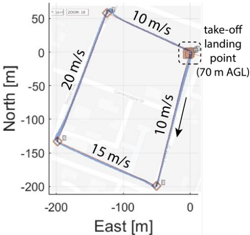

Fig. 9: The validation experiment is a rectangular loop at 70m AGL. The waypoints are shown as red squares, and the actual path in blue is overlaid with the desired path in black.

To improve the model accuracy, we need good estimates of wind speed, especially at higher flight speeds. This will be the emphasis in future work.

## ACKNOWLEDGMENT

This research was supported by the University Affiliated Research Center (UARC) at NASA Ames (Contract number: UCSCMCA-14-020) and the National Science Foundation (NSF) (Contract number: CNS-1136141).

## REFERENCES

[1] Jeppesen Commercial Flight Planning and Dispatch. (Date last accessed 26-Feburary-2017). [Online]. Available: http://ww1.jeppesen.com/personal-solutions/aviation/general-aviation-flight-planning.jsp

[2] Z. Liu, “An energy-based flight planning system for unmanned traffic management,” in Systems Conference (SysCon), 2016 IEEE International. IEEE, 2016.

[3] D. Aleksandrov and I. Penkov, “Energy consumption of mini uav helicopters with different number of rotors,” in 11th International Symposium” Topical Problems in the Field of Electrical and Power Engineering, 2012, pp. 259–262.

[4] J. F. Roberts, J.-C. Zufferey, and D. Floreano, “Energy management for indoor hovering robots,” in Intelligent Robots and Systems, 2008. IROS 2008. IEEE/RSJ International Conference on. IEEE, 2008, pp. 1242–1247.

[5] Y. Mulgaonkar, M. Whitzer, B. Morgan, C. M. Kroninger, A. M. Harrington, and V. Kumar, “Power and weight considerations in small, agile quadrotors,” in SPIE Defense+ Security. International Society for Optics and Photonics, 2014, pp. 90 831Q–90 831Q.

[6] D.-K. Phung and P. Morin, “Modeling and energy evaluation of small convertible uavs,” IFAC Proceedings Volumes, vol. 46, no. 30, pp. 212–219, 2013.

[7] W. Johnson, Helicopter theory. Courier Corporation, 2012.

[8] G. J. Leishman, Principles of helicopter aerodynamics with CD extra. Cambridge university press, 2006.

[9] 3D Robotics IRIS+. (Date last accessed 14-October-2016). [Online]. Available: http://3dr.com/support/articles/207358106/iris/

[10] Richmond Field Station, UC Berkeley. (Date last accessed 26- Feburary-2017). [Online]. Available: http://rfs-env.berkeley.edu/index.html

[11] Mission Planner from Ardupilot (Open Source). (Date last accessed 26-Feburary-2017). [Online]. Available: http://ardupilot.org/planner/docs/mission-planner-overview.html