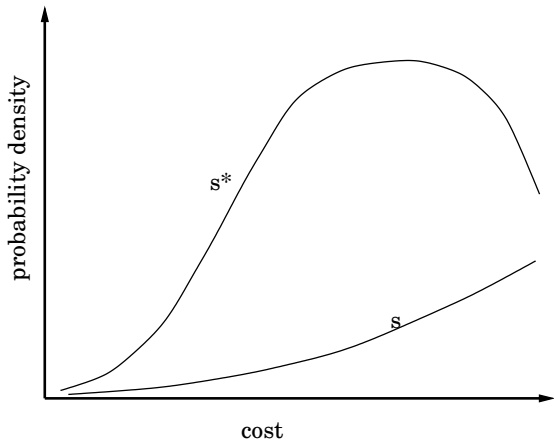
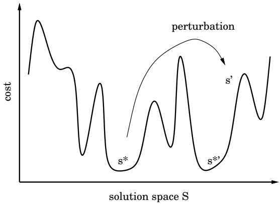
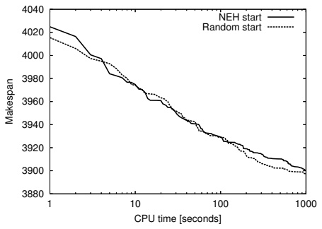
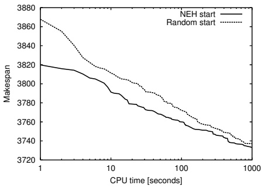
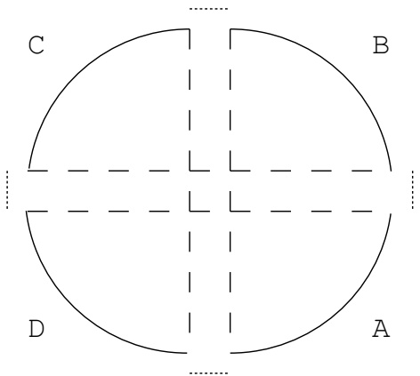

# Iterated Local Search: Framework and Applications

Helena Ramalhinho Lourenço, Olivier C. Martin, and Thomas Stützle

Abstract The key idea underlying iterated local search is to focus the search not on the full space of all candidate solutions but on the solutions that are returned by some underlying algorithm, typically a local search heuristic. The resulting search behavior can be characterized as iteratively building a chain of solutions of this embedded algorithm. The result is also a conceptually simple metaheuristic that nevertheless has led to state-of-the-art algorithms for many computationally hard problems. In fact, very good performance is often already obtained by rather straightforward implementations of the metaheuristic. In addition, the modular architecture of iterated local search makes it very suitable for an algorithm engineering approach where, progres-sively, the algorithms performance can be further optimized. Our purpose here is to give an accessible description of the underlying principles of iter-ated local search and a discussion of the main aspects that need to be taken into account for a successful application of it. In addition, we review the most important applications of this method and discuss its relationship to other metaheuristics.

## 1 Introduction

The importance of high performance algorithms for tackling difficult opti-mization problems cannot be understated, and in many cases the most effec-tive methods are metaheuristics. When designing a metaheuristic, simplicity

Helena Ramalhinho Lourenço, Universitat Pompeu Fabra, Barcelona, Spain, e-mail: helena.ramalhinho@upf.edu

Olivier C. Martin INRA, Université Paris-Sud, Orsay, France, e-mail: olivier.c.martin@inra.fr

Thomas Stützle, Université Libre de ~~Bruxelles (ULB), Brussels,~~ Belgium, e-mail: stuetzle@ulb.ac.be should be favored, both conceptually and in practice. Naturally, it must also lead to effective algorithms. If we think of a metaheuristic as simply a con-struction for guiding (problemspecific) heuristics, the ideal case is when the metaheuristic can be used without any problemdependent knowledge.

As metaheuristics have become more and more sophisticated, this ideal case has been pushed aside in the quest for greater performance. As a conse-quence, problem-specific knowledge (in addition to that built into the heuris-tic being guided) must now be incorporated into metaheuristic algorithms in order to reach state-of-the-art level. Unfortunately, this makes the boundary between heuristics and metaheuristics fuzzy, and we run the risk of loosing both simplicity and generality. To counter this, we appeal to modularity and try to decompose a metaheuristic algorithm into a few parts, each with its own specificity. In particular, we would like to have a totally general-purpose part, so that any problemspecific knowledge built into the metaheuristic would be restricted to another part. Finally, to the extent possible, we prefer to leave untouched the embedded heuristic (which is to be “guided”) because of its potential complexity. One can also consider the case where this heuristic is only available through an object module, the source code being proprietary; it is then necessary to be able to treat it as a “black-box” routine. Iterated local search provides a simple way to satisfy all these requirements.

The essence of iterated local search can be given in a nut-shell: one iter-atively builds a sequence of solutions generated by the embedded heuristic, leading to far better solutions than if one were to use repeated random trials of that heuristic. This simple idea [13] has a long history, and its rediscovery by many authors has led to many different names for iterated local search such as iterated descent [11, 12], large-step Markov chains [88], iterated Lin-Kernighan [68], chained local optimization [86], combinations of these [3] and so on. Readers interested in these historical developments should consult the review in [69]. For us, there are two main points that make an algorithm an iterated local search: (i) there must be a single chain that is being followed (this then excludes population-based algorithms); (ii) the search for better solutions occurs in a reduced space defined by the output of a black-box heuristic. In practice, local search has been the most frequently used embed-ded heuristic, but in fact any optimizer can be used, be it deterministic or not.

The purpose of this review is to give a detailed description of the ideas underlying iterated local search and to show where it stands in terms of performance. So far, in spite of its conceptual simplicity, it has led to a num-ber of state-of-the-art results without the use of too much problem-specific knowledge. Perhaps this is because iterated local search is very malleable, as many implementation choices are left to the developer and problem-specific knowledge can be incorporated in many different ways.

We have organized this chapter as follows. First we give a high-level pre-sentation of iterated local search in Section 2. Then we discuss the impor-tance of the different parts of the metaheuristic in Section 3, especially the

subtleties associated with perturbing the solutions. In Section 4 we go over past work aimed at testing iterated local search in practice, while in Sec-tion 5 we discuss similarities and differences between iterated local search and other metaheuristics. The chapter closes with a summary of what has been achieved so far and an outlook on what the near future may look like.

## 2 Iterating a local search

## 2.1 General framework

We assume we have been given a problem-specific heuristic optimization al-gorithm that from now on we shall refer to as a local search (even if in fact it is not a true local search). This algorithm is implemented via a computer routine that we call LocalSearch. The question we ask is “Can such an al-gorithm be improved by the use of iteration?”. Our answer is $``YES''$ , and in fact the improvements obtained in practice are usually significant. Only in rather pathological cases where the iteration method is “incompatible” with the local search will the improvement be minimal. In the same vein, in order to have the largest possible improvement, it is necessary to have some understanding of the way the LocalSearch works. However, to keep this presentation as simple as possible, we shall ignore for the time being these complications; the additional subtleties associated with tuning the iteration to the local search procedure will be discussed in Section 3. Furthermore, all issues associated with the actual speed of the algorithm are omitted in this first section as we wish to focus solely on the high-level architecture of iterated local search.

Let C be the cost function of our combinatorial optimization problem; C is to be minimized. We label candidate solutions or simply “solutions” by s, and denote by S the set of all s (for simplicity S is taken to be finite, but it does not matter much). Finally, for the purposes of this high-level presentation, we assume that the local search procedure is deterministic and memoryless:1for a given input s, it always outputs the same solution $s ^ { * }$ whose cost is less than or equal to $\mathcal { C } ( s )$ . LocalSearch then defines a many to one mapping from the set S to the smaller set $\mathcal { S } ^ { * } = \{ \dot { s ^ { * } } \}$ of locally optimal solutions. To have a pictorial view of this, we introduce the “basin of attraction” of a local minimum $s ^ { * }$ as the set of solutions s that are mapped to $s ^ { * }$ under the local search routine. LocalSearch then takes an $s \in S$ as a starting solution and produces a local optimum $s ^ { * } \in \mathcal { S } ^ { * }$ at the bottom of the corresponding basin of attraction.

<small>1 The reader can check that very little of what we say really uses this property, and in practice, many successful implementations of iterated local search have non-deterministic local searches or include memory.</small>

Fig. 1 Probability densities of costs. The curve labeled s indicates the left tail of the cost density function for all solutions, while the curve labeled $s ^ { * }$ indicates the cost density function for the solutions that are local optima.

Now take an s or an $s ^ { * }$ at random. Typically, the cost distribution has a very rapidly rising part at the lowest values. In Figure 1 we show the kind of distributions found in practice for combinatorial optimization problems having a finite solution space. The distribution of costs is bell-shaped, with a mean and variance that is significantly smaller for solutions in $\mathcal { S } ^ { * }$ than for those in $\mathcal { S } .$ As a consequence, it is much better to use local search than to sample randomly in S if one seeks low cost solutions. The essential ingredient necessary for local search is a neighborhood structure. This means that S is a “space” with some topological structure, not just a set. Having such a space allows one to move from one solution s to a better one in an intelligent way, something that would not be possible if S were just a set.

Now the question is how to $\mathbf { g } \mathbf { o }$ beyond this use of LocalSearch. More pre-cisely, given the mapping from $\mathcal { S }$ to $\mathcal { S } ^ { * }$ , how can one further reduce the costs found without opening up and modifying LocalSearch, leaving it as a “black box” routine?

## 2.2 Random restart

The simplest possibility to improve upon a cost found by LocalSearch is to repeat the search from another starting point. Every $s ^ { * }$ generated is then independent, and the use of multiple trials allows one to reach the lower part of the distribution. Although such a “random restart” approach with independent samplings is sometimes a useful strategy (in particular when all other options fail), it breaks down as the instance size grows because in the limit, the tail of the cost distribution collapses. Indeed, empirical studies [69] and general arguments [112] indicate that local search algorithms on large generic instances lead to costs that: (i) have a mean that is a fixed percentage above the optimum cost; (ii) have a distribution that becomes arbitrarily peaked around the mean when the instance size goes to infinity. This second property makes it impossible in practice to find an $s ^ { * }$ whose cost is even a little bit lower percentage-wise than the typical cost. Note, however, that there do exist many solutions of significantly lower cost, it is just that random sampling has a lower and lower probability of finding them as the instance size increases. To reach those configurations, a biased sampling is necessary; this is precisely what is accomplished by a stochastic search.

## 2.3 Searching in $\mathcal { S } ^ { * }$

To overcome the problem just mentioned associated with large instance sizes, reconsider what local search does: it takes one solution from S where C has a large mean to a solution in $\mathcal { S } ^ { * }$ where C has a smaller mean. It is then natural to invoke recursion: use local search to go from $\mathcal { S } ^ { * }$ to a smaller space $\mathcal { S } ^ { * * }$ where the mean cost is even lower! That would correspond to an algorithm with one local search nested inside another. Such a construction could be iterated for as many levels as desired, leading to a hierarchy of nested local searches. But upon closer scrutiny, we see that the problem is precisely how to formulate local search beyond the lowest level of the hierarchy: local search requires a neighborhood structure and this is not a priori given. The fundamental difficulty is to define neighbors in $\mathcal { S } ^ { * }$ so that they can be enumerated and accessed efficiently. Furthermore, it is desirable for neighbors in $\mathcal { S } ^ { * }$ to be relatively close according to the distance metric defined in space $\mathcal { S } ;$ if this were not the case, a stochastic search on $\mathcal { S } ^ { * }$ would have little chance of being effective.

Upon further thought, it transpires that one can introduce a good neighborhood structure on $\mathcal { S } ^ { * }$ as follows. First, one recalls that a neighborhood structure on set $\mathcal { S }$ directly induces a neighborhood structure on subsets of $\mathcal { S } ;$ two subsets are neighbors simply if they contain solutions that are neighbors. Second, take these subsets to be the basins of attraction of the solutions in $\mathcal { S } ^ { * }$ this leads us to associate any $s ^ { * } \in \mathcal { S } ^ { * }$ with its basin of attraction. Then, this immediately provides the “canonical” notion of neighborhood on $\mathcal { S } ^ { * }$ , which can be stated in a simple way: $s _ { 1 } ^ { * }$ and $s _ { 2 } ^ { * }$ are neighbors in $\mathcal { S } ^ { * }$ if their basins of attraction intersect $( i . e . ,$ they contain neighbor solutions in $\mathcal { S } )$ . Unfortunately this definition has the major drawback that one cannot in practice list the neighbors of $s ^ { * }$ because there is no computationally efficient method for finding all solutions s in the basin of attraction of $s ^ { * }$ . Nevertheless, we can stochastically generate neighbors as follows. Starting from $s ^ { * } ,$ create a randomized path in $\mathcal { S } ,   s _ { 1 } ,   s _ { 2 } ,   . . . ,   s _ { i }$ , where $s _ { j + 1 }$ is a neighbor of $s _ { j }$ . Determine the first $s _ { j }$ in this path that belongs to a different basin of attraction so that applying local search to $s _ { j }$ leads to $s ^ { * \prime } \neq s ^ { * }$ . Then $s ^ { * \prime }$ is a neighbor of $s ^ { * }$

Given this procedure, we can in principle perform a local search2in $\mathcal { S } ^ { * }$ Extending the argument recursively, we see that it would be possible to have an algorithm implementing nested searches, performing local search on $\mathcal { S } ,$ $\mathcal { S } ^ { * } ,   \mathcal { S } ^ { * * }$ , and so on, in a hierarchical way. Unfortunately, the implementation of a neighbor search at the level of $\mathcal { S } ^ { * }$ is too costly computationally because of the number of times one has to execute LocalSearch. Thus we are led to abandon the (stochastic) search for neighbors in $\mathcal { S } ^ { * }$ ; instead we use a weaker notion of closeness which then allows for a fast stochastic search in $\mathcal { S } ^ { * }$ . Our construction leads to a (biased) sampling of $\mathcal { S } ^ { * }$ . Such a sampling will be better than a random one if it is possible to find appropriate computational ways to $\mathtt { g O }$ from one $s ^ { * }$ to another. Finally, one last advantage of this modified notion of closeness is that it does not require basins of attraction to be defined; the local search can then incorporate memory or be non-deterministic, making the method far more general.

## 2.4 Iterated Local Search

We want to explore $\mathcal { S } ^ { * }$ using a walk that steps from one $s ^ { * }$ to a “nearby” one, without the constraint of using only neighbors as defined above. Iterated local search (ILS) achieves this heuristically as follows. Given the current $s ^ { * }$ we first apply a change or perturbation that leads to an intermediate state $s ^ { \prime }$ (which belongs to $\mathcal { S } )$ . Then LocalSearch is applied to $s ^ { \prime }$ and we reach a solution $s ^ { * \prime } \operatorname { i n } \mathcal { S } ^ { * } . \operatorname { I f } s ^ { * \prime }$ passes an acceptance test, it becomes the next element of the walk in ${ \mathcal { S } } ^ { * } ;$ otherwise, we return to $s ^ { * }$ . The resulting walk is a case of a stochastic search in $\mathcal { S } ^ { * }$ , but where neighborhoods are never explicitly introduced. This iterated local search procedure should lead to good biased sampling as long as the perturbations are neither too small nor too large. If they are too small, one will often fall back to $s ^ { * }$ and few new solutions of $\mathcal { S } ^ { * }$ will be explored. If on the contrary the perturbations are too large, $s ^ { \prime }$ will be random, there will be no bias in the sampling, and we will recover a random restart type algorithm.

The overall ILS procedure is pictorially illustrated in Figure 2. To be complete, let us note that generally the iterated local search walk will not be reversible; in particular one may sometimes be able to step from $s _ { 1 } ^ { * }$ to $s _ { 2 } ^ { * }$ but not from $s _ { 2 } ^ { * }$ to $s _ { 1 } ^ { * }$ . However, this “unfortunate” aspect of the procedure does not prevent ILS from being very effective in practice.

Since deterministic perturbations may lead to short cycles (for instance of length two), one should randomize the perturbations or make them adaptive to avoid this kind of cycling. If the perturbations depend on any of the previous $s ^ { * }$ , one has a walk in $\mathcal { S } ^ { * }$ with memory. Now the reader may have noticed that aside from the issue of perturbations (which use the structure on $\mathcal { S } )$ , our formalism reduces the problem to that of a stochastic search on $\mathcal { S } ^ { * }$ . Then all bells and whistles (diversification, intensification, tabu, adaptive perturbations and acceptance criteria, etc...) that are commonly used in that context may be applied here. This leads us to define iterated local search as a metaheuristic having the high level architecture given by Algorithm 1.

<small>s\*</small>

<small>2 Note that the local search finds neighbors stochastically; generally there is no efficient way to ensure that one has tested all the neighbors of any given s.</small>

Fig. 2 Pictorial representation of iterated local search. Starting with a local minimum $s ^ { * }$ we apply a perturbation leading to a solution $s ^ { \prime } .$ After applying LocalSearch, we find a new local minimum $s ^ { * \prime }$ that may be better than $s ^ { * }$

Algorithm 1 Iterated Local Search
$s_0 = \text{GenerateInitialSolution}$
$s^* = \text{LocalSearch}(s_0)$
repeat
    $s' = \text{Perturbation}(s^*, history)$
    $s^{*\prime} = \text{LocalSearch}(s')$
    $s^* = \text{AcceptanceCriterion}(s^*, s^{*\prime}, history)$
until termination condition met

In practice, much of the potential complexity of ILS is hidden in the history dependence. If there happens to be no such dependence, the walk has no memory:3the perturbation and acceptance criterion do not depend on any of the solutions visited previously during the walk, and one accepts or not $s ^ { * \prime }$ with a fixed rule. This leads to random walk dynamics on $\mathcal { S } ^ { * }$ that are “Markovian”, $\mathbf { i . e . } ,$ the probability of making a particular step from $s _ { 1 } ^ { * }$ to $s _ { 2 } ^ { * }$ depends only on $s _ { 1 } ^ { * }$ and $s _ { 2 } ^ { * } .$ . Most of the work using ILS has been of this type, though studies show that incorporating memory enhances performance [116].

Staying within Markovian walks, the most basic acceptance criteria will use only the difference in the costs of $s ^ { * }$ and $s ^ { * \prime } ;$ this type of dynamics for the walk is then very similar in spirit to what occurs in simulated annealing. A limiting case of this is to accept only improving moves, as happens in simulated annealing at zero temperature; the algorithm then does stochastic descent in S∗. If we add to such a method a termination criterion, the resulting algorithm pretty much has two nested local searches; to be precise, it has a local search operating on S embedded in a stochastic search operating on $\mathcal { S } ^ { * }$ . More generally, one can extend this type of algorithm to more levels of nesting, having a different stochastic search algorithm for S∗, S∗∗ and so on. Each level would be characterized by its own type of perturbation and stopping rule; to our knowledge, such a construction has never been attempted.

<small>3 Recall that to simplify this section’s presentation, the local search is assumed to have no memory.</small>

We can summarize this section by saying that the potential power of iterated local search lies in its biased sampling of the set of local optima. The efficiency of this sampling depends both on the kinds of perturbations and on the acceptance criteria. Interestingly, even with the most na¨ıve implementations of these components, iterated local search is much better than random restart. But still much better results can be obtained if the iterated local search modules are optimized. First, the acceptance criteria can be adjusted empirically as in simulated annealing without knowing anything about the problem being optimized. This kind of optimization will be familiar to any user of metaheuristics, though the questions of memory may become quite complex. Second, the perturbation can incorporate as much problem-specific information as the developer is willing to put into it. In practice, a rule of thumb can be used as a guide: “a good perturbation transforms one excellent solution into an excellent starting point for a local search”. Together, these different aspects show that iterated local search algorithms can have a wide range of complexity, but complexity may be added progressively and in a modular way. (Recall in particular that all of the fine-tuning that resides in the embedded local search can be ignored if one wants, and it does not appear in the metaheuristic per se.) This makes iterated local search an appealing metaheuristic for both academic and industrial applications. The cherry on the cake is speed: as we shall see soon, one can perform k local searches embedded within an iterated local search much faster than if the k local searches are run with random restart.

## 3 Getting high performance

Given all these advantages, we hope the reader is now motivated to go on and consider the more nitty-gritty details that arise when developing an ILS algorithm for a new application. In this section, we will illustrate the main issues that need to be tackled when optimizing an ILS algorithm in order to achieve high performance.

There are four components to consider: GenerateInitialSolution, LocalSearch, Perturbation, and AcceptanceCriterion. Before attempting to develop a stateof-the-art algorithm, it is relatively straightforward to develop a more basic version of ILS. Indeed, (i) one can start with a random solution or one returned by some greedy construction heuristic; (ii) for most problems a local search algorithm is readily available; (iii) for the perturbation, a random move in a neighborhood of higher order than the one used by the local search algorithm can be surprisingly effective; and (iv) a reasonable first guess for the acceptance criterion is to force the cost to decrease, corresponding to a stochastic first-improvement algorithm in $\mathcal { S } ^ { * }$ . Basic ILS implementations of this type usually lead to much better performance than random restart approaches. The developer can then run this basic ILS to build his intuition and try to improve the overall algorithm performance by improving each of the four modules. This should be particularly effective if it is possible to take into account the specificities of the combinatorial optimization problem under consideration. In practice, this tuning is easier for ILS than for other, less modular metaheuristics. The reason may be that the complexity of ILS is reduced by its modularity, the function of each component being relatively easy to understand. Finally, the last task to consider is the overall optimization of the ILS algorithm; indeed, the different components affect one another and so it is necessary to understand their interactions. However, because these interactions are so problem dependent, we wait till the end of this section before discussing that kind of “global” optimization.

Perhaps the main message here is that the developer can choose the level of optimization he wants. In the absence of any optimizations, ILS is a simple, easy to implement, and quite effective metaheuristic. But with further work on its four components, ILS can often be turned into a very competitive or even state-of-the-art algorithm.

## 3.1 Initial solution

Local search applied to the initial solution $s _ { 0 }$ gives the starting point $s _ { 0 } ^ { * }$ of the walk in $\mathcal { S } ^ { * }$ . Starting with a good $s _ { 0 } ^ { * }$ can be important if high-quality solutions are to be reached as $f a s t$ as possible.

Standard choices for $s _ { 0 }$ are either a random initial solution or a solution returned by a greedy construction heuristic. A greedy initial solution $s _ { 0 }$ has two main advantages over random starting solutions: (i) when combined with local search, greedy initial solutions often result in better quality solutions $s _ { 0 } ^ { * } ;$ (ii) a local search from greedy solutions takes, on average, less improvement steps and therefore the local search requires less CPU time.4

<small>4 Note that the best possible greedy initial solution need not be the best choice when combined with a local search. For example, in [69], it is shown that the combination of the Clarke-Wright starting tour (one of the best performing TSP construction heuristics)</small>

Fig. 3 The plots show the average solution cost (makespan on the y-axis) as a function of CPU time (given on the x-axis) for an ILS algorithm applied to the PFSP on instances ta051 and ta056.

The question of an appropriate initial solution for (random restart) local search carries over to ILS because of the dependence of the walk in $\mathcal { S } ^ { * }$ on $s _ { 0 } ^ { * } .$ Indeed, when starting with a random $s _ { 0 }$ , ILS may take several iterations to catch up in quality with runs using an $s _ { 0 } ^ { * }$ obtained by a greedy initial solution. Hence, for short computation times the initial solution is certainly important to achieve the highest possible solution quality. For larger computation times, the dependence on $s _ { 0 }$ of the final solution returned by ILS reflects just how fast, if at all, the memory of the initial solution is lost when performing the walk in $\mathcal { S } ^ { * }$

Let us illustrate the tradeoffs between random and greedy initial solutions when using an ILS algorithm for the permutation flow shop problem (PFSP) [114]. That ILS algorithm uses a straightforward local search implementation, random perturbations, and that only accepts better quality solutions in the acceptance test. In Figure 3 we show how the average solution cost (makespan) evolves with the number of iterations for two instances. The averages are for 10 independent runs when starting from random initial solutions or from initial solutions returned by the NEH heuristic [98]. (NEH is one of the best performing constructive heuristics for the PFSP.) For short runs, the curve for the instance on the right shows that the NEH initial solutions lead to better average solution cost than random initial solutions. But, for longer times, the picture is not so clear. Sometimes, random initial solutions lead to better average results as observed on the instance on the left. This kind of test was also performed for ILS applied to the TSP [3]. Again it was observed that the initial solution had a significant influence on quality for short to medium sized runs.

<small>with local search resulted in worse local optima than starting from random initial solutions when using 3-opt. Additionally, greedy algorithms which generate very high quality initial solutions can be quite time-consuming.</small>

In general, there will not always be a clear-cut answer regarding the best choice of an initial solution, but greedy initial solutions appear to be recommendable when one needs low-cost solutions quickly. For much longer runs, the initial solution seems to be less relevant, so the user can choose the initial solution which is the easiest to implement. If, however, one has an algorithm where the influence of the initial solution does persist for long times, the ILS walk is probably having difficulty in exploring S∗ and so other perturbations or acceptance criteria should be considered.

## 3.2 Perturbation

The main drawback of iterative improvement is that it gets trapped in local optima that are significantly worse than the global optimum. Much like simulated annealing, ILS escapes from local optima by applying perturbations to the current local minimum. We will refer to the strength of a perturbation as the number of solution components that are modified. For the TSP, for example, it is the number of edges that are modified in the tour, while in the flow shop problem, it is the number of jobs which are moved by the perturbation. Generally, the local search should not be able to undo the perturbation, otherwise one will fall back into the local optimum just visited. Surprisingly, a random move in a neighborhood of higher order than the one used by the local search algorithm can often achieve this and will lead to a satisfactory algorithm. Still better results can be obtained if the perturbations take into account properties of the problem and are well matched to the local search algorithm.

By how much should the perturbation change the current solution? If the perturbation is too strong, ILS may behave like a random restart, so better solutions will only be found with a very low probability. On the other hand, if the perturbation is too small, the local search will often fall back into the local optimum just visited and the diversification of the search will be very limited. An example of a simple but effective perturbation for the TSP is the doublebridge move. This perturbation cuts four edges (and is thus of “strength” four) and introduces four new ones as shown in Figure 4. Notice that each bridge is a two-change, but neither of the two-changes individually keeps the tour connected. Nearly all ILS studies of the TSP have incorporated this kind of perturbation, and it has been found to be effective for all instance sizes. This is almost certainly because it changes the topology of the tour and can operate on quadruples of very distant cities, whereas local search always modifies the tour among nearby cities. In effect, the double-bridge perturbation cannot be undone easily, neither by simple local search algorithms such as 2- opt or 3-opt, nor by most local search algorithms based on the Lin-Kernighan heuristic [80], which is currently the champion local search algorithm for the TSP. (Only very few local searches include such double-bridge changes in the search, the best known being the Lin-Kernighan implementation of Helsgaun [57, 58].) Furthermore, this perturbation does not increase much the tour length, so even if the current solution is very good, one is almost sure the next one will be good, too. These two properties of the perturbation—its small strength and its fundamentally different nature from the changes used in local search—make the TSP the perfect application for ILS.

Fig. 4 Schematic representation of the double-bridge move. The four dotted edges are removed and the remaining parts A, B, $\mathrm { C } ,$ D are reconnected by the dashed edges.

We will now consider optimizing the perturbation assuming the other modules to be fixed. In problems like the TSP, one can hope to have a satisfactory ILS when using perturbations of fixed size (independent of the instance size). On the contrary, for more difficult problems, fixed-strength perturbations may lead to poor performance. Of course, the strength of the perturbations used is not the whole story; their nature is almost always very important and will also be discussed. Finally we will close by pointing out that the perturbation strength has an effect on the speed of the local search: weak perturbations usually lead to faster execution of LocalSearch. All these different aspects need to be considered when optimizing this module.

## 3.2.1 Perturbation strength

For some problems, an appropriate perturbation strength is very small and seems to be rather independent of the instance size. This is the case for both the TSP and the PFSP, and, interestingly, ILS for these problems is very competitive with today’s best metaheuristic methods. We can also consider other problems where one is driven instead to large perturbation sizes. Consider the example of an ILS algorithm for the quadratic assignment problem (QAP). We use an embedded 2-opt local search algorithm, the perturbation is a random exchange of the location of k items, where k is an adjustable parameter, and the acceptance criterion only accepts better quality solutions. We applied this ILS algorithm to QAPLIB instances5from four different classes of $\mathrm { Q A P }$ instances [120]; computational results are given in Table 1. A first observation is that the best perturbation size is strongly dependent on the particular instance. For two of the instances, the best performance was achieved when as many as 75% of the solution components were altered by the perturbation. Additionally, when the perturbation strength is too small, the ILS performed worse than random restart (corresponding to the perturbation strength n). However, the fact that random restart for the $\mathrm { Q A P }$ may perform—on average—better than a basic ILS algorithm is a bit misleading: in the next section we will show that by modifying a bit the acceptance criterion, ILS becomes far better than random restart. Thus, one should keep in mind that the optimization of an ILS algorithm may require more than the optimization of the individual components.

Table 1 The first column gives the identifier of the $\mathrm { Q A P }$ instance; the number in the identifier gives its size n. The successive columns are for perturbation sizes 3, $n / 1 2 ,   \cdots ,$ n. A perturbation of size n corresponds to random restart. The table shows the average solution cost measured across 10 independent runs for each instance. The CPU-time for each trial is 30 sec. for kra30a, 60 sec. for tai60a and sko64, and 120 sec. for tai60b on a Pentium III 500 MHz PC.

| instance | 3 | n/12 | n/6 | n/4 | n/3 | n/2 | 3n/4 | n |
| --- | --- | --- | --- | --- | --- | --- | --- | --- |
| kra30a | 2.51 | 2.51 | 2.04 | 1.06 | 0.83 | 0.42 | 0.0 | 0.77 |
| sko64 | 0.65 | 1.04 | 0.50 | 0.37 | 0.29 | 0.29 | 0.82 | 0.93 |
| tai60a | 2.31 | 2.24 | 1.91 | 1.71 | 1.86 | 2.94 | 3.13 | 3.18 |
| tai60b | 2.44 | 0.97 | 0.67 | 0.96 | 0.82 | 0.50 | 0.14 | 0.43 |

## 3.2.2 Adaptive perturbations

The behavior of ILS for the QAP and also for other combinatorial optimization problems [59, 114, 115] shows that there is no a priori single best size for the perturbation. This observation motivates the possibility of modifying the perturbation strength and adapting it during the run.

To this end, one approach is to exploit the search history. For the development of such schemes, inspiration can be taken from what is done in the context of reactive search [9, 10]. In particular, Battiti and Protasi proposed a reactive search algorithm for MAX-SAT, which fits perfectly into the ILS framework [9]. They perform a perturbation scheme which is implemented by a tabu search algorithm and after each perturbation they apply a standard local improvement algorithm. An alternative is to use feedback from the search process to adapt the choice of the perturbation operators [19].

<small>5 QAPLIB is accessible at http://www.seas.upenn.edu/qaplib.</small>

Another way of adapting the perturbation is to change its strength during the search according to an a priori defined scheme. One particular example is employed in basic variable neighborhood search (basic VNS) [53, 95]; we refer to Section 5 for some explanations on VNS. Other examples arise in the context of tabu search [49]. In particular, ideas such as strategic oscillations may be useful to derive more effective perturbations.

## 3.2.3 More complex perturbation schemes

Perturbations can be more complex than random changes in a higher order neighborhood. One rather general procedure to generate $s ^ { \prime }$ from the current $s ^ { * }$ is as follows. First, gently modify the definition of the instance, e.g., via the parameters defining the various costs. Second, for this modified instance, run LocalSearch using $s ^ { * }$ as input; the output is the perturbed solution $s ^ { \prime } .$ Interestingly, this is the method proposed in the oldest ILS work we are aware of: Baxter tested this approach with success on a location problem [13]. This idea seems to have been rediscovered later by Codenotti et al. in the context of the TSP [25]. They first change slightly the city coordinates. Then they apply the local search to $s ^ { * }$ using the perturbed city locations, obtaining the new tour $s ^ { \prime } .$ Finally, running LocalSearch on $s ^ { \prime }$ using the unperturbed city coordinates, they obtain the new candidate tour $s ^ { * \prime }$

Other sophisticated ways to generate good perturbations consist in optimizing a sub-part of the problem. Such an approach was proposed by Lourenço [82] in the context of the job shop scheduling problem (JSP). Her perturbation schemes are based on defining one- or two-machine subproblems by fixing a number of variables in the current solution and solving these sub-problems, either heuristically [83] or to optimality using for instance Carlier’s exact algorithm [22] or the early-late algorithm [83]. These schemes work well because: (i) local search is unable to undo the perturbations; (ii) after the perturbation, the solutions tend to be very good and also have “new” parts that are optimized. Even evolutionary algorithms have been used to generate perturbations for ILS algorithms [85]. The idea in this approach is to generate a small initial population of solutions by perturbing the best-so-far solution, to perform a short run of a GA with this population and then to use the best solution found in this process as a new starting solution for the local search.

## 3.2.4 Speed

In the context of “easy” problems where ILS can work very well with weak (fixed size) perturbations, there is another reason why that metaheuristic can perform much better than random restart: Speed. Indeed, LocalSearch will usually execute much faster on a solution obtained by applying a small perturbation to a local optimum than on a random solution. As a consequence, iterated local search can run many more local searches than random restart for the same CPU time. As a qualitative example, consider again Euclidean TSPs. O(n) local changes have to be applied by the local search to reach a local optimum from a random starting solution, whereas empirically a nearly constant number is necessary in ILS when using the $s ^ { \prime }$ obtained with the double-bridge perturbation. Hence, in a given amount of CPU time, ILS can sample many more local optima than random restart can. This speed factor can give ILS a considerable advantage over other restart schemes.

Let us illustrate this speed factor quantitatively. We compared the number of local searches performed in a given amount of CPU time for the TSP by: (i) random restart; (ii) ILS using a double-bridge move; (iii) ILS using five simultaneous double-bridge moves. (For both ILS implementations, we used random starting solutions and the routine AcceptanceCriterion accepted only shorter tours.) For our numerical tests we used a 3-opt implementation with standard speed-up techniques. In particular, it used a fixed radius nearest neighbor search restricted to candidate lists with the 40 nearest neighbors of each city and “don’t look” bits [15, 69, 88]. Initially, all don’t look bits were turned off (set to 0). If no improving move was found for a given node, its don’t look bit was turned on (set to 1) and the node was not considered as a starting node for finding an improving move in the next iteration. When an arc incident to a node was changed by a move, the node’s don’t look bit was turned off again. In addition, after a perturbation we only turned off the don’t look bits of the 25 cities around each of the four breakpoints in the current tour. All three algorithms were run for 120 seconds on a 266 MHz Pentium II processor on a set of $\mathrm { T S P L I B ^ { 6 } }$ instances ranging from 100 up to 5915 cities. Results are given in Table 2. For the smallest instances, we see that iterated local search ran between 2 and 10 times as many local searches as random restart. This advantage of ILS grows fast with increasing instance size: for the largest instance, the first ILS algorithm ran approximately 260 times as many local searches as random restart in the available time. Obviously, this speed advantage of ILS over random restart is strongly dependent on the strength of the applied perturbation. The larger the perturbation size, the more the solution is modified and generally the longer the subsequent local search takes. This fact is intuitively obvious and it is confirmed in Table 2.

In summary, the optimization of the perturbations depends on many factors, and problem-specific characteristics play a central role. It is important to keep in mind that the perturbations interact with the other components of ILS. We will discuss these interactions in Section 3.5.

<small>6 TSPLIB is accessible at www.iwr.uni-heidelberg.de/groups/comopt/software/TSPLIB95.</small>

Table 2 The first column gives the identifier of the TSP instance, where the number in the identifier specifies the number of cities. The next columns give the number of local searches performed when using: (i) random restart $\left( \#  LS _{RR} \right)$ ; (ii) ILS with a single double-bridge perturbation $( \# \mathrm { L S } _ { 1 - D B } ) ;$ (iii) ILS with a five double-bridge perturbation $\left( \#  LS _{5-DB} \right)$ All algorithms were run for 120 seconds on a $\mathrm { P C }$ with a 266 MHz Pentium processor.

| instance | #LSRR | #LS1-DB | #LS5-DB |
| --- | --- | --- | --- |
| kroA100 | 17507 | 56186 | 34451 |
| d198 | 7715 | 36849 | 16454 |
| lin318 | 4271 | 25540 | 9430 |
| pcb442 | 4394 | 40509 | 12880 |
| rat783 | 1340 | 21937 | 4631 |
| pr1002 | 910 | 17894 | 3345 |
| pcb1173 | 712 | 18999 | 3229 |
| d1291 | 835 | 23842 | 4312 |
| fl1577 | 742 | 22438 | 3915 |
| pr2392 | 216 | 15324 | 1777 |
| pcb3038 | 121 | 13323 | 1232 |
| fl3795 | 134 | 14478 | 1773 |
| rl5915 | 34 | 8820 | 556 |

## 3.3 Acceptance criterion

ILS does a randomized walk in $\mathcal { S } ^ { * }$ , the space of local minima. The perturbation mechanism together with the local search defines the possible transitions between a current solution $s ^ { * }$ in $\mathcal { S } ^ { * }$ to a “neighboring” solution $s ^ { * \prime }$ also in $\mathcal { S } ^ { * }$ The procedure AcceptanceCriterion then determines whether $s ^ { * \prime }$ is accepted or not as the new current solution. AcceptanceCriterion has a strong influence on the nature and effectiveness of the walk in $\mathcal { S } ^ { * }$ . Roughly, it can be used to control the balance between intensification and diversification of that search. A simple way to illustrate this is to consider a Markovian acceptance criterion. A very strong intensification is achieved if only better solutions are accepted. We call this acceptance criterion Better and it is defined for minimization problems as:

$$
\text {Better} (s ^ {*}, s ^ {* \prime}, h i s t o r y) = \left\{ \begin{array}{l l} s ^ {* \prime} & \quad \text {if} \mathcal {C} (s ^ {* \prime}) <   \mathcal {C} (s ^ {*}) \\ s ^ {*} & \quad \text {otherwise.} \end{array} \right.\tag{1}
$$

At the opposite extreme is the random walk acceptance criterion (denoted by RW) which always applies the perturbation to the most recently visited local optimum, irrespective of its cost:

$$
\mathrm{RW} (s ^ {*}, s ^ {* \prime}, h i s t o r y) = s ^ {* \prime}.\tag{2}
$$

This criterion clearly favors diversification over intensification.

Many intermediate choices between these two extreme cases are possible. In one of the first ILS algorithms, the large-step Markov chain (LSMC) algorithm proposed by Martin, Otto, and Felten [88, 89], a simulated annealing type acceptance criterion was applied. We call it LSMC $( s ^ { * } , s ^ { * \prime }$ , history). In particular, $s ^ { * \prime }$ is always accepted if it is better than $s ^ { * }$ . Otherwise, if $s ^ { * \prime }$ is worse than $s ^ { * } , s ^ { * \prime }$ is accepted with probability $\exp \{ ( \mathcal { C } ( s ^ { * } ) - \mathcal { C } ( s ^ { * \prime } ) ) / T \}$ where $T$ is a parameter called temperature, which is usually lowered during the run as in simulated annealing. Note that LSMC approaches the RW acceptance criterion if $T$ is very high, while at very low temperatures LSMC is similar to the Better acceptance criterion. An interesting possibility for LSMC is to allow non-monotonic temperature schedules as proposed for simulated annealing [63] or tabu thresholding [46]. This can be most effective if it is done using memory: when further intensification no longer seems useful, increase the temperature to do diversification for a limited time, then resume intensification. Of course, just as in tabu search, it is desirable to do this in an automated and self-regulating manner [49].

A very limited usage of memory in the acceptance criterion is to restart the ILS algorithm when the intensification seems to become ineffective. (Of course, this is a rather extreme way to switch from intensification to diversification). For instance one can restart the ILS algorithm from a new initial solution if no improved solution has been found for a given number of iterations. The restart of the algorithm can easily be modeled by the acceptance criterion Restart $( s ^ { * } , s ^ { * \prime }$ , history). Let $i _ { l a s t }$ be the last iteration where a better solution has been found and i be the iteration counter. Then Restart $( s ^ { * } , s ^ { * \prime }$ , history) is defined as

$$
\text {Restart} (s ^ {*}, s ^ {* \prime}, h i s t o r y) = \left\{ \begin{array}{c l} s ^ {* \prime} & \quad \text {if} \mathcal {C} (s ^ {* \prime}) <   \mathcal {C} (s ^ {*}) \\ s & \quad \text {if} \mathcal {C} (s ^ {* \prime}) \geq \mathcal {C} (s ^ {*}) \text {and} i - i _ {l a s t} > i _ {r} \\ s ^ {*} & \quad \text {otherwise.} \end{array} \right.\tag{3}
$$

where $i _ { r }$ is a parameter that indicates that the algorithm should be restarted if no improved solution was found for $i _ { r }$ iterations. Typically, s can be generated in different ways. The simplest strategy is to generate a new solution randomly or by a greedy randomized heuristic. Clearly many other ways to incorporate memory may and should be considered, the overall efficiency of ILS being quite sensitive to the acceptance criterion applied. We now illustrate this with two examples.

Table 3 Influence of the acceptance criterion for various TSP instances. The first column gives the identifier of the TSP instance, where the number in the identifier specifies the number of cities. The next columns give the average percentage over the optimal tour length obtained using: random restart (RR), iterated local search with RW, and iterated local search with Better. The results are averaged over 10 independent runs. All algorithms were run for 120 seconds on a PC with a 266 MHz Pentium processor.

| instance | ∆avg(RR) | ∆avg(RW) | ∆avg(Better) |
| --- | --- | --- | --- |
| kroA100 | 0.0 | 0.0 | 0.0 |
| d198 | 0.003 | 0.0 | 0.0 |
| lin318 | 0.66 | 0.30 | 0.12 |
| pcb442 | 0.83 | 0.42 | 0.11 |
| rat783 | 2.46 | 1.37 | 0.12 |
| pr1002 | 2.72 | 1.55 | 0.14 |
| pcb1173 | 3.12 | 1.63 | 0.40 |
| d1291 | 2.21 | 0.59 | 0.28 |
| fl1577 | 10.3 | 1.20 | 0.33 |
| pr2392 | 4.38 | 2.29 | 0.54 |
| pcb3038 | 4.21 | 2.62 | 0.47 |
| fl3795 | 38.8 | 1.87 | 0.58 |
| rl5915 | 6.90 | 2.13 | 0.66 |

## 3.3.1 Example 1: TSP

Let us consider the effect of the two acceptance criteria RW and Better. We performed our tests on the TSP as summarized in Table 3. We give the average percentage over the known optimal solutions when using 10 independent runs on our set of benchmark instances. In addition, we also give this number for the random restart 3-opt algorithm. First, we observe that both ILS algorithms lead to a significantly better average solution quality than random restart using the same local search. This is particularly true for the largest instances, confirming the claims made in Section 2. Second, given that one expects good solutions for the TSP to cluster (see Section 3.5), a good strategy should incorporate intensification. It is thus not surprising to see that the Better criterion leads to shorter tours than the RW criterion.

The runs given in this example are rather short. For much longer runs, the Better strategy comes to a point where it no longer finds improved tours. In fact, an analysis of ILS algorithms based on the run-time distribution methodology [60] has shown that such stagnation situations effectively occur and that the performance of the ILS algorithm can be considerably improved by additional diversification mechanisms [117], an occasional restart of the ILS algorithm being the conceptually simplest case.

Table 4 Further tests on the QAP benchmark instances using the same perturbations and CPU times than for Table 1; given is the average solution cost measured across 10 independent runs for each instance. Here we consider three different choices for the acceptance criterion. Clearly, the inclusion of diversification significantly lowers the average cost found.

<table><tbody><tr><td>instanc</td><td>e acceptance</td><td colspan="2">3 n/12</td><td>n/6</td><td>n/4</td><td>n/3</td><td colspan="2">n/2 3n/4</td><td>n</td></tr><tr><td>kra30akra30akra30a</td><td>Better RW Restart</td><td>2.510.00.0</td><td>2.510.00.0</td><td>2.040.00.0</td><td>1.060.00.0</td><td>0.830.00.0</td><td>0.420.020.0</td><td>0.00.470.0</td><td>0.770.770.77</td></tr><tr><td>sko64</td><td>Better</td><td>0.65</td><td>1.04</td><td>0.50</td><td>0.37</td><td>0.29</td><td>0.29</td><td>0.82</td><td>0.93</td></tr><tr><td>sko64</td><td>RW</td><td>0.11</td><td>0.14</td><td>0.17</td><td>0.24</td><td>0.44</td><td>0.62</td><td>0.88</td><td>0.93</td></tr><tr><td>sko64</td><td>Restart</td><td>0.37</td><td>0.31</td><td>0.14</td><td>0.14</td><td>0.15</td><td>0.41</td><td>0.79</td><td>0.93</td></tr><tr><td>tai60a</td><td>Better</td><td>2.31</td><td>2.24</td><td>1.91</td><td>1.71</td><td>1.86</td><td>2.94</td><td>3.13</td><td>3.18</td></tr><tr><td>tai60a</td><td>RW</td><td>1.36</td><td>1.44</td><td>2.08</td><td>2.63</td><td>2.81</td><td>3.02</td><td>3.14</td><td>3.18</td></tr><tr><td>tai60a</td><td>Restart</td><td>1.83</td><td>1.74</td><td>1.45</td><td>1.73</td><td>2.29</td><td>3.01</td><td>3.10</td><td>3.18</td></tr><tr><td>tai60b</td><td>Better</td><td>2.44</td><td>0.97</td><td>0.67</td><td>0.96</td><td>0.82</td><td>0.50</td><td>0.14</td><td>0.43</td></tr><tr><td>tai60b</td><td>RW</td><td>0.79</td><td>0.80</td><td>0.52</td><td>0.21</td><td>0.08</td><td>0.14</td><td>0.28</td><td>0.43</td></tr><tr><td>tai60b</td><td>Restart</td><td>0.08</td><td>0.08</td><td>0.005</td><td>0.02</td><td>0.03</td><td>0.07</td><td>0.17</td><td>0.43</td></tr></tbody></table>

## 3.3.2 Example 2: QAP

Let us come back to ILS for the QAP. For this problem we found that the acceptance criterion Better together with a poor choice of the perturbation strength could result in worse performance than random restart. In Table 4 we give results for the same ILS algorithm except that we now also consider the use of the RW and Restart acceptance criteria. We see that the performance of the ILS algorithms using these acceptance criteria are much better than random restart, the only exception being for the ILS algorithm with RW for a small perturbation strength on tai60b.

This example shows that there are strong interdependencies between the perturbation strength and the acceptance criterion. This dependency is rarely completely understood. But, as a general rule of thumb, when it is necessary to allow for diversification, we believe it is best to do so by accepting numerous small perturbations rather than by accepting one large perturbation.

Most of the acceptance criteria applied so far in ILS algorithms are either fully Markovian or make use of the search history in a very limited way. We expect that there will be many more ILS applications in the future making strong use of the search history; in particular, alternating between intensification and diversification is likely to be an essential feature in these applications.

## 3.4 Local search

So far we have treated the local search algorithm as a black box, which is called many times by ILS. Since the behavior and performance of the overall ILS algorithm is quite sensitive to the choice of the embedded heuristic, one should optimize this choice whenever possible. In practice, there may be many quite different algorithms that can be used for the embedded heuristic. (As mentioned at the beginning of the chapter, the heuristic needs not even be a local search.) One might think that the better the local search, the better the corresponding ILS. Often this is true. For instance in the context of the TSP, Lin-Kernighan [80] is a better local search than 3-opt, which itself is better than 2-opt [69]. Using a fixed type of perturbation such as the double-bridge move, one finds that iterated Lin-Kernighan gives better solutions than iterated 3-opt which itself gives better solutions than iterated 2-opt [69, 117]. But if we assume that the total computation time is fixed, it might be better to apply more frequently a faster but less effective local search algorithm than a slower and more powerful one. Clearly, which choice is best depends on just how much more time is needed to run the better heuristic. If the speed difference is not large, for example if it is independent of the instance size, then it usually worth using the better heuristic. This is the most frequent case; in the TSP, 3-opt is a bit slower than 2-opt, but the improvement in quality of the tours is well worth the extra CPU time, be it using random restart or iterated local search. The same comparison applies to using Lin-Kernighan rather than 3-opt. However, there are other cases where the increase in CPU time is so large compared to the improvement in solution quality that it is best not to use the “better” local search. For example, again in the context of the TSP, it is known that 4-opt gives slightly better solutions than 3-opt, but in standard implementations it is O(n) times slower (n being the number of cities). It is then better not to use 4-opt as the local search embedded in ILS.

There are also other aspects that should be considered when selecting a local search. Clearly, there is not much point in having an excellent local search if it will systematically undo the perturbation; however this issue is one of globally optimizing iterated local search, so it will be postponed till the next subsection. Another important aspect is whether one can really get the speed-ups that were mentioned in Section 3.2. There we saw that a standard speed-up for local search was to introduce don’t look bits. They give a large gain in speed if the bits can also be reset after the application of the perturbation. This requires that the developer be able to access the source code of LocalSearch. A state-of-the-art ILS algorithm will take advantage of all possible speed-up tricks, and thus the LocalSearch most likely will not be a true black box.

Finally, there may be some advantages in allowing LocalSearch to sometimes generate worse solutions. For instance, if we replace the local search heuristic by tabu search or short simulated annealing runs, the corresponding

ILS may perform better. This seems most promising when standard iterative improvement algorithms perform poorly. This is indeed the case in the jobshop scheduling problem: the use of tabu search as the embedded heuristic gives rise to a very effective iterated local search [84].

## 3.5 Global optimization of ILS

So far, we have considered representative issues arising when optimizing separately each of the four components of an iterated local search. In particular, when illustrating various important characteristics of one component, we kept the other components fixed. But clearly the optimization of one component depends on the choices made for the others; as an example, we made it clear that a good perturbation must have the property that it cannot be easily undone by the local search. Thus, one should tackle the global optimization of an ILS. Since at present there is no significant theory for analyzing a metaheuristic such as iterated local search to support its configuration, we will first give a rough idea of how such a global optimization can be done in a manual algorithm engineering process. Over the recent years, the engineer-ing of effective algorithms has been made increasingly automated through the usage of automatic algorithm configuration techniques and we will also shortly discuss the possibilities these offer.

If we reconsider the subsection on the effect of the initial solution, we see that GenerateInitialSolution is to a large extent irrelevant when the ILS performs well and rapidly looses the memory of its starting point. Hereafter we assume that this is the case; then the optimization of GenerateInitialSolution can be ignored and we are left with the joint optimization of the three other components. Clearly the best choice of Perturbation depends on the choice of LocalSearch while the best choice of AcceptanceCriterion depends on the choices of LocalSearch and Perturbation. In practice, we can approximate this global optimization problem by successively optimizing each component, assuming the others are fixed until no improvements are found for any of the components [35]. Thus the only difference with what has been presented in the previous sub-sections is that the optimization has to be iterative. This does not guarantee global optimization of the ILS, but it should lead to an adequate optimization of the overall algorithm.

Given these approximations, we should be more precise about what we want to optimize. For most users, it will be the mean (over starting solu tions) of the best cost found during a run of a given length. Then the “best” choice for the different components is a well defined problem, though it is intractable without further restrictions. Furthermore, in general, the detailed instance that will be considered by the user is not known ahead of time, so it is important that the resulting ILS algorithm be robust. Thus it is preferable not to optimize it to the point where it is sensitive to the details of the instance. This robustness seems to be achieved in practice: researchers implement versions of iterated local search with a reasonable level of global optimization, and then test with some degree of success the performance on standard benchmarks.

At the risk of repeating ourselves, let us highlight the main dependencies of the components:

1. The perturbation should not be easily undone by the local search; if the local search has obvious shortcomings, a good perturbation should compensate for them.

2. The combination Perturbation–AcceptanceCriterion determines the relative balance of intensification and diversification; large perturbations are only useful if they can be accepted, which occurs only if the acceptance criterion is not too biased towards better solutions.

As a general guideline, LocalSearch should be as powerful as possible as long as it is not too costly in CPU time. Given such a choice, find a well adapted perturbation following the discussion in Section 3.2; to the extent possible, take advantage of the structure of the problem. Finally, set the Acceptance Criterion routine so that S∗is sampled adequately. With this point of view, the overall optimization of the ILS is nearly a bottom-up process, but with iteration. Perhaps the core issue is what to put into Perturbation. In particular, is it possible to consider only weak perturbations? From a theoretical point of view, the answer to this question depends on whether the best solutions “cluster” in S∗. In some problems (and the TSP is one of them), there is a strong correlation between the cost of a solution and its “distance” to the optimum: in effect, the best solutions cluster together, i.e., have many similar components. This has been referred to in many different ways: “Massif Central” phenomenon [43], principle of proximate optimality [49], and replica symmetry [93]. If the problem under consideration has this property, it is not unreasonable to hope to find the true optimum using a biased sampling of S∗. In particular, it is clear that it is useful to use intensification to improve the probability of hitting the global optimum.

There are, however, other types of problems where the clustering is incomplete, i.e., where very distant solutions can be nearly as good as the optimum. Examples of combinatorial optimization problems in this category are QAP, graph bi-section, and MAX-SAT. When the space of solutions has this property, new strategies have to be used. Clearly, it is still necessary to use intensification to get the best solution in one’s current neighborhood, but generally this will not lead to the optimum. After an intensification phase, one must explore other regions of S∗. This can be attempted by using “large” perturbations whose strength grows with the instance. Other possibilities are to restart the algorithm from scratch and repeat another intensification phase or by oscillating the acceptance criterion between intensification and diversification phases. Additional ideas on the tradeoffs between intensification and diversification are well discussed in the context of tabu search (see, for example, [49]). Clearly, finding an appropriate balance of intensification vs. diversification is very important but still a challenging problem.

The steps outlined above are those generally followed in a manual algorithm engineering process. In that case, it is important to carefully under-stand the main dependencies between the algorithm components and to re-duce the algorithm design space to the most promising part. Over the last few years, however, the availability of algorithmic techniques that automate the parameter setting and configuration of optimization algorithms and, in particular, metaheuristic algorithms has increased. Some early methods include the usage of F-races [16] and CALIBRA [1]. Over the recent years, a num-ber of powerful general-purpose algorithm configurators have been proposed such as irace [7, 81], ParamILS [65], gender-based genetic algorithms [2], or SMAC [64]. (Interestingly, one of these configurators, ParamILS, is actually itself again an ILS algorithm that searches the algorithm parameter space for highperforming algorithm configurations.) These configurators have shown to be powerful and for a given algorithm skeleton, they reach often signif-icant improvements over default algorithms settings or those obtained in a manual algorithm configuration effort [61, 118]. Maybe more importantly, effective algorithm configuration techniques have the potential to transform the metaheuristic development process and moving it actually towards an automated algorithm design process [62, 118]. When applying such a process to the design of an ILS algorithm, one would implement possible ILS algo-rithm components inside a freely configurable algorithm framework and then exploit automatic algorithm configuration techniques to search the design space for high-performing algorithm configurations. For more details on such a process, we refer to the chapter authored by Stützle and López-Ibáñez in this Handbook.

## 4 Selected applications of ILS

ILS algorithms have been applied successfully to a variety of combinatorial optimization problems. In some cases, these algorithms achieve extremely high performance and even constitute the current state-of-the-art algorithms, while in other cases the ILS approach is merely competitive with other metaheuristics. In this section, we give an overview of interesting ILS applications, presenting the core ideas of these algorithms to illustrate possible uses of ILS. We put a particular emphasis on the TSP, given its central role in the development of ILS algorithms.

## 4.1 ILS for the TSP

The TSP is probably the best-known combinatorial optimization problem. De facto, it is a standard test-bed for the development of new algorithmic ideas: a good performance on the TSP is taken as evidence of the value of such ideas. Like many other metaheuristic algorithms, some of the first ILS algorithms were introduced and tested on the TSP, the oldest case of this being due to Baum [11, 12]. He coined his method iterated descent; his tests used 2-opt as the embedded heuristic, random 3-changes as the perturbations, and imposed the tour length to decrease (thus the name of the method). His results were not impressive, in part because some algorithm components were probably not the most appropriate and also because he tackled non-Euclidean TSPs.

A major improvement in the performance of ILS algorithms came from the large-step Markov chain algorithm proposed by Martin, Otto, and Felten [88]. They used the LSMC acceptance criterion (see Section 3.3) from which the algorithm’s name is derived. They considered both the application of 3-opt local search and the Lin-Kernighan heuristic, which is the best performing local search algorithm for the TSP. But probably the key ingredient of their work is the introduction of the double-bridge move for the perturbation. This choice made the approach very powerful for the Euclidean TSP and encouraged much more work along these lines. In particular, Johnson [68, 69] coined the term “iterated Lin-Kernighan” (ILK) for his implementation of ILS using Lin-Kernighan as the local search. The main differences with the LSMC implementation are: (i) double-bridge moves are random rather than biased; (ii) the costs are improving (only better tours are accepted, corresponding to the choice Better in our notation). Since these initial studies, other ILS variants have been proposed; Johnson and McGeoch [69] give a summary of the situation as of 1997 and several additional ILS variants are covered in a 2002 book chapter, which summarizes early results from the 8th DIMACS implementation challenge on the TSP [70].

A high performing ILS algorithm is offered as part of the Concorde software package and it is available for download at http://www.tsp.gatech.edu/concorde/. This chained Lin-Kernighan code has been developed by Applegate, Bixby, Chvatal, and Cook and a detailed description of the code is given in their recent book on the TSP [4]; this book also contains details on an extensive computational study of this code. Noteworthy is also the experimental study by Applegate, Cook, and Rohe [3] who performed tests on very large TSP instances with up to 25 million cities. Recently, a new ILS variant has been proposed that further illustrates the impressive performance of ILS algorithms on very large TSP instances. Currently, the iterated Lin-Kernighan variant of Merz and Huhse [92] appears to be the best performing algorithm for very large TSP instances with several millions of cities when the computation times are relatively short (in the range of a few hours on a modern PC as of 2008).

A major leap in TSP solving stems from Helsgaun’s Lin-Kernighan implementation and its iterated version [57]. The main novelty of Helsgaun’s algorithm lies on the local search side: the Lin-Kernighan variant developed is based on more complex basic moves than previous implementations. His iterated version of the Lin-Kernighan heuristic is not really an ILS algorithm like the ones presented in this chapter since the generation of new starting solutions is through a solution construction method. However, the constructive mechanism is very strongly biased towards the incumbent solution, which makes this approach somehow similar to an ILS algorithm. The most recent version of this algorithm, along with an accompanying technical report describing the recent developments, is available for download at http://www.akira.ruc.dk/\~keld/research/LKH/.

There are a number of other ILS algorithms for the TSP that not necessarily offer the ultimate state-of-the-art performance but that illustrate various ideas that may be useful in ILS algorithms. One algorithm, which has already been mentioned before, is the one by Codenotti et al. [25]. It gives an example of a complex perturbation scheme, which is based on the modification of the instance data. Various perturbation sizes as well as population-based extensions of ILS algorithms for the TSP have been studied by Hong et al. [59]. The perturbation mechanism is also the focus of the work by Katayama and Narisha [71]. They introduce a new perturbation mechanism, which they called genetic transformation. The genetic transformation mechanism uses two tours, the best found so far, $s _ { b e s t } ^ { * } ,$ and a second, current local optimum, $s ^ { * }$ . First a random 4-opt move is performed on $s _ { b e s t } ^ { * } ,$ resulting in $s ^ { * \prime }$ . Then the subtours that are shared among $s ^ { * \prime }$ and $s ^ { * }$ are kept and the resulting parts are reconnected with a greedy algorithm. Computational experiments with an iterated Lin-Kernighan algorithm using the genetic transformation method instead of the standard double-bridge move have shown that the approach is effective.

An analysis of the run-time behavior of various ILS algorithms for the TSP is done by Stützle and Hoos [116, 117]; this analysis clearly shows that ILS algorithms with the Better acceptance criterion show a type of stagnation behavior for long run-times. To avoid such stagnation, restarts and a particular acceptance criterion to diversify the search were proposed. The goal of this latter strategy is to force the search, once search stagnation is detected, to continue from a high quality solution that is beyond a certain minimal distance from the current one [117]. As shown in [60], current state-of-the-art algorithms such as Helsgaun’s iterated Lin-Kernighan can also suffer from stagnation behavior and, hence, their performance can be further improved by similar ideas.

Finally, let us mention that ILS algorithms have been used as components of more complex algorithms. A clear example is the tour merging approach [4, 28]. The central idea is to generate a set G of high quality tours by using ILS and then to post-process these solutions further. In particular, in tour merging, the optimal tour (or, if this is not feasible in reasonable computation time, the best possible tour) is produced from fragments of tours occurring in G.

## 4.2 ILS for other routing problems

Besides the TSP, ILS algorithms have been applied increasingly often to other routing problems, in particular, vehicle routing problems (VRPs). Among the first ILS applications to VRPs, we find the prize-collecting VRP [121], timedependent VRPs [56], and VRPs with time penalty functions [66]. In the latter article, a dynamic programming algorithm is used to minimize penalties for violating time windows; experimental results with up to 1000 customers show that this ILS was able to reach very high performance and was also efficient. Various other variants of VRPs have been tackled. Vaz Penna et al consider a variant where the fleet of vehicles is heterogeneous, that is, it consists of vehicles with different characteristics such as different capacities [124]. Palhazi Cuervo et al. [101] propose an ILS algorithm for a VRP with backhauls, where apart from the customer deliveries, suppliers may send back goods to the depot. The proposed ILS algorithm exploits various neighbor-hoods and allows to move between feasible and infeasible solutions. A VRP with multiple, incompatible commodities and multiple trips per work day is tackled with an effective ILS algorithm by Cattaruzza et al. [23]: their algo-rithm is shown to outperform previous approaches. Integrating a tabu search algorithm into an ILS approach, Silvestrin and Ritt obtain a high-performing algorithm for the multi-compartment VRP, surpassing the performance of other, existing heuristic algorithms. Melo Silva et al. [90] tackle VRPs where split deliveries are allowed, that is, a customer demand may be served by deliveries from various vehicles or tours. Their ILS algorithm reached very high performance and for a large number of benchmark instances it could improve the best known solutions. Nguyen et al. [99] consider a two-echelon location-routing problem, which involves two types of trips. One type serves several subordinate depots, which have to be located suitably, from a main depot; a second type of trips delivers goods to customers from the subordi-nate depots. Laurent and Hao considered a multiple depot vehicle scheduling problem, which arises in public transport [77]. Cruz et al. [33] consider the re-positioning of bikes in a bike-sharing system among various stations using a single vehicle, where each station may be served in multiple visits. They develop an ILS algorithm for this problem, reaching very high performance competitive to other methods. Porumbel et al. [104] propose a matheuristic, in which an ILS algorithm and a column generation approach collaborate in parallel and communicate by exchanging routes. The example application of this approach to arc-routing problems shows very promising results.

## 4.3 ILS for scheduling problems

Scheduling is one of the widest spread application areas of ILS and much early progress has been achieved on such problems. In what follows we dis-cuss some earlier applications in increasing order of complexity of the un-derlying scheduling models, starting with single-machine problems, and give some pointers to more recent literature on the topic. Congram at al. have presented an ILS algorithm for the single machine total weighted tardiness problem (SMTWTP) [27] based on a dynasearch local search. The perturba-tion mechanism in their ILS algorithm applies a series of random interchange moves and additionally exploits specific properties of the SMTWTP. In the acceptance criterion, they introduced a backtrack step: after $\beta$ iterations in which every new local optimum is accepted, the algorithm restarts from the best solution found so far; the backtrack step is a particular choice for incorporating history dependence into the acceptance criterion. The performance of this ILS algorithm was excellent, solving almost all available benchmark instances in a few seconds on the available hardware. A further improvement over this algorithm, mainly based on an enlarged neighborhood being explored within the dynasearch local search, was presented by Grosso, Della Croce, and Tadei [52]. This approach outperformed the first iterated dynasearch algorithm, defining the state-of-the-art for solving the SMTWTP. Other applications of ILS to the SMTWTP have been reported in [35]. Later ILS algorithms have been applied with very good results to variants of the SMTWTP such as those including sequence-dependent setup times [119, 128].

Brucker, Hurink, and Werner [17, 18] applied early on the principles of ILS to a number of one-machine and parallel-machine scheduling problems. They introduce a local search method which is based on two types of neigh-borhoods. At each step one goes from one feasible solution to a neighboring one with respect to the secondary neighborhood. The main difference with standard local search methods is that this secondary neighborhood is defined on the set of locally optimal solutions of the first neighborhood. Thus, this is an ILS with two nested neighborhoods; searching in the primary neigh-borhood corresponds to our local search phase; searching in the secondary neighborhood is like our perturbation phase. The authors note that the sec-ond neighborhood is problem specific; this is what is observed in ILS where the perturbation should be adapted to the problem. The search at a higher level reduces the search space and at the same time leads to better results.

The first application of ILS to the permutation flow-shop scheduling (PFSP) under the makespan objective, which is the most widely studied flowshop scheduling problem, has been reported by Stützle [114]. This ILS algorithm is based on a straightforward first-improvement local search using the insert neighborhood while the perturbation is composed of swap moves, which exchange the positions of two adjacent jobs, and interchange moves, which have no adjacency constraint. This ILS algorithm was shown to be

the best performing metaheuristic algorithms for the PFSP in a later review article [109]; an adaptation of this ILS algorithm has also shown very good performance on the flow-shop problem with flow-time objective [36]. The ILS algorithm has been extended to an iterated greedy (IG) algorithm [110], a method closely related to ILS; this latter algorithm remained for a long time the state-of-the-art algorithm for the PFSP and significantly better performing extensions of it have only recently been proposed [39]. ILS has been used to solve flow-shop problems with other objectives than makespan such as total flow-time [102] and additional features that make it more difficult to solve. Yang, Kreipl and Pinedo [130] presented an ILS algorithm for a flow-shop with several stages in series, where at each stage a number of machines is available for processing the jobs. Pan et al. have recently applied ILS to the hybrid flowshop problem with due date windows and earliness and tardiness objectives, reporting very good results. The blocking flow-shop problem has been tackled by Ribas et al. [105], who combine, in the local search as well as in the perturbation, moves in different neighborhoods. An ILS variation em-bedding ILS in a biased multi-start approach, called biased-randomized ILS was applied to the flow-shop problem with failure-risk costs [42]. Urlings et al. proposed ILS algorithms that are interleaved with other techniques to tackle complex hybrid flexible flowline problems that tightly resemble scheduling tasks in realistic production shop floors [123].

Also the job-shop scheduling problem has received significant attention by researchers working with ILS. Lourenço [82] and Lourenço and Zwij-nenburg [84] used ILS to tackle the job shop scheduling problem under the makespan criterion. They performed extensive computational tests, compar-ing different ways to generate initial solutions, various local search algorithms, different perturbations, and three acceptance criteria. While they found that the initial solution had only a very limited influence, the other components turned out to be very important. Perhaps the heart of their work is the way they perform the perturbations, which has already been described in Section 3.2. Balas and Vazacopoulos [8] presented a variable depth search heuristic which they called guided local search (GLS). They developed ILS algorithms by embedding GLS within the shifting bottleneck (SB) procedure and by re-placing the reoptimization cycle of SB with a number of cycles of the GLS pro-cedure. They call this procedure SB-GLS1. The later SB-GLS2 variant works as follows. Once all machines have been sequenced, they iteratively remove one machine and apply GLS to a smaller instance defined by the remaining machines. Then again GLS is applied on the initial instance containing all machines. Hence, both heuristics are based on re-optimizing a part of the instance and then reapplying local search to the full one. Kreipl applied ILS to the total weighted tardiness job-shop scheduling problem [76]. His ILS algorithm uses a RW acceptance criterion and the local search consists of reversing critical arcs and arcs adjacent to them. One original aspect of this ILS is the perturbation step: Kreipl applies a few steps of a simulated annealing-like algorithm with constant temperature; in the perturbation phase a smaller

neighborhood than the one used in the local search phase is applied. The number of iterations performed during the perturbation phase depends on how good the incumbent solution is. In promising regions, only a few steps are applied to stay near good solutions, otherwise, a “large” perturbation is applied to escape from a poor region. Computational results with the ILS algorithm on a set of benchmark instances have shown a very promising performance. In fact, the algorithm performance is roughly similar to a later, more complex algorithm proposed by Essafi et al. [40]. Interestingly, this lat-ter approach integrates an ILS algorithm as a local search operator into an evolutionary algorithm, illustrating the fact that ILS can also be used as an improvement method inside other metaheuristics.

## 4.4 ILS for other problems

ILS algorithms have been applied to a large number of other problems, of-ten achieving excellent performance. The graph bipartitioning problem is among the earliest available ILS applications. Martin and Otto [87, 86] in-troduced an ILS for this problem following their earlier work on the TSP. For the local search, they used the Kernighan-Lin variable depth local search algorithm [73] which is the analog of the Lin-Kernighan algorithm for this problem. When considering possible perturbations, they noticed a particular weakness of the Kernighan-Lin local search: it frequently generates partitions with many “islands”, i.e., the two sets A and $B$ are typically highly frag-mented (disconnected). Thus, they introduced perturbations that exchanged vertices between these islands rather than between the whole sets A and B. Finally, for the acceptance criterion, Martin and Otto used the Better acceptance criterion. The overall algorithm significantly improved over the embedded local search (random restart of the Kernighan-Lin local search); it also improved over competing simulated annealing algorithms when the acceptance criterion was optimized.

Battiti and Protasi presented an application of reactive search to the MAX-SAT problem [9]. Their algorithm consists of two phases: a local search phase and a diversification (perturbation) phase, where a tabu search on the current local minimum guarantees that the modified solution s0is sufficiently differ-ent from the current solution $s ^ { * }$ . As LocalSearch, they use a standard iterative improvement algorithm appropriate for the MAX-SAT problem. Depending on the distance between $s ^ { * \prime }$ and $s ^ { * } ,$ the tabu list length for the perturbation phase is dynamically adjusted. The next perturbation phase is then started based on solution $s ^ { * \prime }$ — corresponding to the RW acceptance criterion. This work illustrates very nicely how one can adjust dynamically the perturbation strength in an ILS run. We conjecture that similar schemes will be useful to adapt the perturbation size while running an ILS algorithm. In later work, Smyth et al. [113] have developed an ILS algorithm based on a robust tabu

search algorithm that is used in both the local search phase and the perturbation phase. The main difference between the two phases is that the length of the tabu list is strongly increased in the perturbation to drive the search away from the current solution. Noteworthy is also the ILS algorithm of Yagiura and Ibaraki, which is based on large neighborhoods for MAX-SAT that are used in the local search phase [129]. A number of ILS approaches for coloring graphs have been proposed [21, 24, 103]; these approaches generally reach very high quality colorings and perform particularly well on some structured graphs.

ILS algorithms have also reached remarkable performance on the QAP [115]. Based on the insights gained through an analysis of the run-time behavior of a basic ILS algorithm with the Better acceptance criterion, a number of different ILS algorithms were proposed [115]. Population-based extensions of ILS that use restart-type criteria and additional criteria for maintaining solution diversity have been the best performing variants. An extensive experimental campaign has identified this population-based ILS variant as state-of-the-art for structured QAP instances. Recently, extension of ILS have been proposed to solve stochastic combinatorial optimization problems [51]. This extension, named SimILS, consists in a simulation-based framework that combines ILS with Monte Carlo Simulation, with the objective to obtain robust solution in presence of stochasticity.

The application of ILS to continuous optimization problems has been considered in few articles. Kramer proposed to embed Powell’s directionset method into an ILS algorithm for continuous optimization problems and reported promising results [75]. Liao and Stützle have used an ILS algorithm for continuous optimization as one component in their competition-based approach for continuous optimization, which was one of the two winners of the CEC 2013 benchmark competition for real-parameter optimization [79].

ILS has been applied to a number of other problems and we shortly men-tion here some of them without attempting to give an exhaustive enumera-tion. Very high performing ILS algorithms have been proposed for problems such as maximum clique [72], image registration [31], some loop layout prob-lems [14], partial Latin square extension [55], linear ordering [26, 111], logistic network design problems [29], generalized quadratic multiple knapsack prob-lem [5], maximum weight independent set [100], capacitated hub location problem [108], fixed-charge transportation problem [20], mirrored traveling tournament problem [107], car sequencing [30, 106], placement of irregular polygons in a rectangular surface [67], optimization problems arising in wire-less ad-hoc networks [127], Euclidean Steiner tree problem [78], Bayesian net-works structure learning [34], minimum sum-of-squares clustering [91], design of water distribution networks [32], and many others.

## 4.5 Summary

The examples we have chosen in this section stress several points that have already been mentioned. First, the choice of the local search algorithm is usually quite critical if one is to obtain peak performance. In most applications, the best performing ILS algorithms apply much more sophisticated local search algorithms than simple best- or first-improvement methods. Second, the other components of an ILS also need to be optimized if state-of-the-art results are to be achieved. This optimization should be global and should involve the use of problem-specific properties. Examples of this last point were given in scheduling applications where good perturbations were not simply random, but rather involved re-optimization of significant parts of the instance (c.f. the job-shop case).

The final picture is one where (i) ILS is a versatile metaheuristic, which can be easily adapted to different combinatorial optimization problems; (ii) it has shown to be aan effective way to boost the performance of simpler improvement methods; and (iii) sophisticated perturbation schemes and search diversification are essential ingredients to achieve the best possible ILS performance.

## 5 Relation to other metaheuristics

In this section, we highlight the similarities and differences between ILS and other well-known metaheuristics. We shall distinguish metaheuristics that are essentially variants of local search and those that generate solutions using a mechanism that is not necessarily based on an explicit neighborhood structure. Among the first class, which we call neighborhood-based metaheuristics, are methods like simulated annealing (SA) [125, 74], tabu search (TS) [49] or guided local search (GLS) [126]. The second class comprises metaheuristics such as GRASP [41], ant colony optimization (ACO) [37, 38], evolutionary and memetic algorithms [6, 94, 96], scatter search [47, 50], variable neighborhood search (VNS) [53, 54, 95] and ILS. Some metaheuristics of this second class, like evolutionary algorithms and ant colony optimization, do not necessarily make use of local search algorithms; however a local search can be embedded in them, in which case the performance is usually enhanced [37, 96, 97]. The other metaheuristics in this class explicitly use embedded local search algorithms as an essential part of their structure. For simplicity, we will assume in what follows that all the metaheuristics of this second class do incorporate local search algorithms. In this case, such metaheuristics generate iteratively input solutions that are passed to a local search; they can thus be interpreted as multi-start algorithms, in the most general meaning of that term. This is why we call them here multi-start-based metaheuristics.

## 5.1 Neighborhood-based metaheuristics

Neighborhood-based metaheuristics are extensions of iterative improvement algorithms. They avoid getting stuck in locally optimal solutions by allowing moves to worse solutions in the neighborhood of the current solution. Metaheuristics in this class differ mainly by their move strategies. In the case of SA, the neighborhood is sampled randomly and worse solutions are accepted with a probability, which depends on a temperature parameter and the degree of deterioration incurred; better neighboring solutions are usually accepted while much worse neighboring solutions are accepted with a low probability. In the case of (simple) TS strategies, the neighborhood is explored in an aggressive way and cycles are avoided by declaring tabu attributes of visited solutions. Finally, in the case of GLS, the evaluation function is dynamically modified by penalizing certain solution components. This allows the search to escape from a solution that is a local optimum of the original objective function.

Obviously, any of these neighborhood-based metaheuristics can be used as the local search procedure in ILS. In general, however, these metaheuristics do not halt, so it is necessary to limit their run time if they are to be embedded in ILS. One particular advantage of combining neighborhood-based metaheuristics with ILS is that they often obtain much better solutions than iterative improvement algorithms. But this advantage usually comes at the cost of larger computation times. Since these metaheuristics allow one to obtain better solutions at the expense of greater computation times, we are confronted with the following optimization problem when using them within an $\mathrm { I L S } { : } ^ { 7 }$ “For how long should one run the embedded search in order to achieve the best tradeoff between computation time and solution quality?” This is analogous to the question of whether it is best to have a fast but not so effective local search or a slower but a more powerful one. The answer depends of course on the total computation time available, and on how the costs improve with time.

A different type of connection between ILS, SA and TS arises from certain similarities in the algorithms. For example, SA can be seen as an ILS without a local search phase (SA samples the original space S and not the reduced space $S ^ { * } )$ and where the acceptance criteria is $\mathtt { L S M C } ( s ^ { * } , s ^ { * \prime } , \mathit { h i s t o r y } )$ While SA does not employ memory, the use of memory is the main feature of TS which makes a strong use of historical information at multiple levels. Given its effectiveness, we expect that the integration of memories will become widespread in future ILS applications.8 Furthermore, since TS is a prototype for memory intensive search procedures, it can be a valuable source of inspiration for deriving ILS variants with a more direct usage of memory; this can lead to a better balance between intensification and diversification in the search.9 Similarly, TS strategies may also be improved by features of ILS algorithms and by some insights gained from the research on ILS.

<small>7 This question is not specific to ILS; it arises for all multi-start-based metaheuristics.</small>

<small>8In early TS publications, proposals similar to the use of perturbations were put forward under the name random shakeup [44]. These procedures where characterized as a “randomized series of moves that leads the heuristic (away) from its customary path” [44]. The relationship to perturbations in ILS is obvious.</small>

## 5.2 Multi-start-based metaheuristics

Multi-start-based metaheuristics can be classified into constructive metaheuristics and perturbation-based metaheuristics.

Well-known examples of constructive metaheuristics are ACO and GRASP, which both use a probabilistic solution construction phase. An important difference between ACO and GRASP is that ACO has an indirect memory of the search process, which is used to bias the construction process, whereas GRASP does not use that kind of memory. An obvious difference between ILS and constructive metaheuristics is that ILS does not construct solutions. However, both generate a sequence of solutions, and if the constructive metaheuristic uses an embedded local search, both go from one local minimum to another. So it might be said that the perturbation phase of an ILS is replaced by a (memory-dependent) construction phase in these constructive metaheuristics. But another connection can be made: ILS can be used instead of the embedded “local search” in ACO or GRASP. (This is exactly what is done, for example, in [107].) This is one way to generalize ILS, but it is not specific to these kinds of metaheuristics: whenever one has an embedded local search, one can try to replace it by an iterated local search.

Perturbation-based metaheuristics differ in the techniques they use to actually perturb solutions. Before going into details, let us introduce one additional feature for classifying metaheuristics: we will distinguish between population-based algorithms and those that use a single current solution (a population is of size one). For example, evolutionary algorithms, memetic algorithms, scatter search, and ACO are population-based, while ILS uses a single solution at each step. Whether or not a metaheuristics is populationbased is important for the type of perturbation that can be applied. If no population is used, new solutions are generated by applying perturbations to single solutions; this is what happens for ILS and VNS. If a population is present, one can also use the possibility of recombining several solutions into a new one. Such combinations of solutions are implemented by “crossover” operators in evolutionary algorithms or in the recombination of multiple solutions in scatter search.

VNS is the metaheuristic that is probably closest to ILS. VNS begins by observing that the concept of local optimality is conditional on the neighborhood structure used in a local search. Then VNS systemizes the idea of changing the neighborhood during the search to avoid getting stuck in poor quality solutions. Several VNS variants have been proposed. The most widely used one, basic VNS, can be seen as an ILS algorithm, which uses the Better acceptance criterion and a systematic way of varying the perturbation strength. To do so, basic VNS orders neighborhoods as $\mathcal { N } _ { 1 } , \ldots , \mathcal { N } _ { m }$ where the order is chosen according to the neighborhood size. Let k be a counter variable, $k = 1 , 2 , \ldots , m$ , initially set $k = 1$ . If the perturbation and the subsequent local search lead to a new best solution, then k is reset to 1, otherwise k is increased by one. We refer to [53, 54] for a description of other VNS variants.

<small>9Indeed, in [45], Glover uses “strategic oscillation” whereby one cycles over these procedures: the simplest moves are used till there is no more improvement, and then progressively more advanced moves are used.</small>

A major difference between ILS and VNS is the philosophy underlying the two metaheuristics: ILS has the explicit goal of building a walk in the set of locally optimal solutions, while VNS algorithms are derived from the idea of systematically changing neighborhoods during the search.

In general, population-based metaheuristics are more complex to use than those following a single solution: they require mechanisms to manage a population of solutions and more importantly it is necessary to find effective operators for the combination of solutions. Most often, this last task is a real challenge. The complexity of population-based local search methods can be justified if they lead to better performance than non population-based methods. Therefore, one question of interest is whether using a population of solutions is really useful. Clearly, for some problems such as the TSP with high cost-distance correlations, the use of a single element in the population leads to good results, so the advantage of population-based methods is small or may become only noticeable if very high computation times are invested. However, for other problems, the use of a population can be an appealing way to achieve search diversification. Thus, population-based methods may be desirable if their complexity is not overwhelming. Because of this, populationbased extensions of ILS are promising approaches.

To date, several population-based extensions of ILS have been proposed [59, 115, 116, 122]. The approaches in [59, 116] keep the simplicity of ILS algorithms by maintaining unchanged the perturbations: one parent is perturbed to give one child. More complex population-based ILS extensions with mechanisms for maintaining diversity in the population are considered in [115]. A population of solutions is used in [122] to restrict the perturbation to explore only parts of solutions where pairs of solutions differ (similar in spirit to the genetic transformations [71]) and to reduce the size of the neighborhood in the local search.

Clearly, there are major points in common between most of today’s high performance metaheuristics. Is there a way to summarize how ILS differs from the others? We shall proceed by enumeration as the diversity of to day’s metaheuristics seems to forbid any simpler approach. When compared to ACO and GRASP, we see that ILS uses perturbations to create new solutions; this is quite different in principle and in practice from using construction. When compared to evolutionary algorithms, memetic algorithms, and scatter search, we see that ILS, as we defined it, has a population of size one; therefore no recombination operators need be defined. We could continue like this, but we cannot expect the boundaries between all metaheuristics to be clear-cut. Not only are hybrid methods very often the way to go, but most often one can smoothly go from one metaheuristic to another. In addition, as mentioned at the beginning of this chapter, the distinction between heuristic and metaheuristic is rarely unambiguous. So our point of view is not that ILS has essential features that are absent in other metaheuristics; rather, when considering the basic structure of ILS, some simple yet powerful ideas transpire, and these can be of use in most metaheuristics, being close or not in spirit to ILS.

## 6 Conclusions

ILS has many of the desirable features of a metaheuristic: it is simple, easy to implement, robust, and highly effective. The essential idea of ILS lies in focusing the search not on the full space of solutions but on a smaller subspace defined by the solutions that are locally optimal for a given optimization engine. The success of ILS lies in the biased sampling of this set of local optima. How effective this approach turns out to be depends mainly on the choice of the local search, the perturbation, and the acceptance criterion. Interestingly, even when using the most naive implementations of these components, ILS can do much better than random restart. But, with further work to carefully adapt the components to the problem at hand, ILS can often become a competitive or even state-of-the-art algorithm. This dichotomy is important because the optimization of the algorithm can be done progressively, and so ILS can be kept at any desired level of simplicity. This, plus the modular nature of ILS, leads to short development times and gives ILS an edge over more complex metaheuristics in the world of industrial applications. As an example of this, recall that ILS essentially treats the embedded heuristic as a black box; then upgrading an ILS to take advantage of a new and better local search algorithm is nearly immediate. In addition, the modular nature of ILS also makes it amenable as an underlying template for the automated design of metaheuristic algorithms, a trend that will become more prominent in the future. Because of all these features, we believe that ILS is a promising and powerful algorithm to solve real complex problems in industry and services, in areas ranging from finance to production management and logistics. Finally, let us note that even if this review was presented in the context of tackling combinatorial optimization problems, in reality much of what we covered can be extended in a straightforward manner to continuous optimization problems.

The ideas and results presented in this chapter leave many questions unanswered. Clearly, more work needs to be done to better understand the interplay between the ILS modules GenerateInitialSolution, Perturbation, Lo calSearch, and AcceptanceCriterion. Other directions for improving ILS performance are to consider the intelligent use of memory, explicit intensification and diversification strategies, and greater problem-specific tuning. The exploration of these issues will certainly lead to higher performance iterated local search algorithms.

## Acknowledgements

Helena Ramalhinho Lourenço acknowledges support from the Spanish Ministry of Economy and Competitiveness (TRA2013-48180-C3-P, TRA2015-71883-REDT), and Thomas Stützle acknowledges support from the F.R.S.- FNRS, of which he is a research director. This work received support from the COMEX project P7/36 within the Interuniversity Attraction Poles Programme of the Belgian Science Policy Office.

## References

1. B. Adenso-D´ıaz and M. Laguna. Fine-tuning of algorithms using fractional experimental design and local search. Operations Research, 54(1):99–114, 2006.

2. C. Ansótegui, M. Sellmann, and K. Tierney. A gender-based genetic algorithm for the automatic configuration of algorithms. In I. P. Gent, editor, Principles and Practice of Constraint Programming, CP 2009, volume 5732 of Lecture Notes in Computer Science, pages 142–157. Springer, Heidelberg, Germany, 2009.

3. D. Applegate, W. J. Cook, and A. Rohe. Chained Lin-Kernighan for large traveling salesman problems. INFORMS Journal on Computing, 15(1):82–92, 2003.

4. D. L. Applegate, R. E. Bixby, V. Chvátal, and W. J. Cook. The Traveling Salesman Problem: A Computational Study. Princeton University Press, Princeton, NJ, 2006.

5. M. Avci and S. Topaloglu. A multi-start iterated local search algorithm for the generalized quadratic multiple knapsack problem. Computers & Operations Research, 83:54–65, 2017.

6. T. Bäck. Evolutionary Algorithms in Theory and Practice. Oxford University Press, Oxford, UK, 1996.

7. P. Balaprakash, M. Birattari, and T. Stützle. Improvement strategies for the F-race algorithm: Sampling design and iterative refinement. In T. Bartz-Beielstein, M. J. Blesa, C. Blum, B. Naujoks, A. Roli, G. Rudolph, and M. Sampels, editors, Hybrid Metaheuristics, volume 4771 of Lecture Notes in Computer Science, pages 108–122. Springer, Heidelberg, Germany, 2007.

8. E. Balas and A. Vazacopoulos. Guided local search with shifting bottleneck for job shop scheduling. Management Science, 44(2):262–275, 1998.

9. R. Battiti and M. Protasi. Reactive search, a history-based heuristic for MAX-SAT. ACM Journal of Experimental Algorithmics, 2, 1997.

10. R. Battiti and G. Tecchiolli. The reactive tabu search. ORSA Journal on Computing, 6(2):126–140, 1994.

11. E. B. Baum. Iterated descent: A better algorithm for local search in combinatorial optimization problems. Technical report, Caltech, Pasadena, CA, 1986. manuscript.

12. E. B. Baum. Towards practical “neural” computation for combinatorial optimization problems. In J. Denker, editor, Neural Networks for Computing, pages 53–64, 1986. AIP conference proceedings.

13. J. Baxter. Local optima avoidance in depot location. Journal of the Operational Research Society, 32(9):815–819, 1981.

14. J. A. Bennell, C. N. Potts, and J. D. Whitehead. Local search algorithms for the minmax loop layout problem. Journal of the Operational Research Society, 53(10):1109–1117, 2002.

15. J. L. Bentley. Fast algorithms for geometric traveling salesman problems. ORSA Journal on Computing, 4(4):387–411, 1992.

16. M. Birattari, T. Stützle, L. Paquete, and K. Varrentrapp. A racing algorithm for configuring metaheuristics. In W. B. Langdon et al., editors, Proceedings of the Genetic and Evolutionary Computation Conference, GECCO 2002, pages 11–18. Morgan Kaufmann Publishers, San Francisco, CA, 2002.

17. P. Brucker, J. Hurink, and F. Werner. Improving local search heuristics for some scheduling problems — part I. Discrete Applied Mathematics, 65(1–3):97–122, 1996.

18. P. Brucker, J. Hurink, and F. Werner. Improving local search heuristics for some scheduling problems — part II. Discrete Applied Mathematics, 72(1–2):47–69, 1997.

19. E. K. Burke, M. Gendreau, G. Ochoa, and J. D. Walker. Adaptive iterated local search for cross-domain optimisation. In N. Krasnogor and P. L. Lanzi, editors, Proceedings of the 13th Annual Genetic and Evolutionary Computation Conference, pages 1987–1994. ACM Press, New York, NY, 2011.

20. E. Buson, R. Roberti, and P. Toth. A reduced-cost iterated local search heuristic for the fixed-charge transportation problem. Operations Research, 62(5):1095–1106, 2014.

21. M. Caramia and P. Dell’Olmo. Coloring graphs by iterated local search traversing feasible and infeasible solutions. Discrete Applied Mathematics, 156(2):201–217, 2008.

22. J. Carlier. The one-machine sequencing problem. European Journal of Operational Research, 11(1):42–47, 1982.

23. D. Cattaruzza, N. Absi, D. Feillet, and D. Vigo. An iterated local search for the multi-commodity multi-trip vehicle routing problem with time windows. Computers & Operations Research, 51:257–267, 2014.

24. M. Chiarandini and T. Stützle. An application of iterated local search to the graph coloring problem. In A. M. D. S. Johnson and M. Trick, editors, Proceedings of the Computational Symposium on Graph Coloring and its Generalizations, pages 112–125, Ithaca, NY, 2002.

25. B. Codenotti, G. Manzini, L. Margara, and G. Resta. Perturbation: An efficient technique for the solution of very large instances of the Euclidean TSP. INFORMS Journal on Computing, 8(2):125–133, 1996.

26. R. K. Congram. Polynomially Searchable Exponential Neighbourhoods for Sequencing Problems in Combinatorial Optimization. PhD thesis, Southampton University, Faculty of Mathematical Studies, Southampton, UK, 2000.

27. R. K. Congram, C. N. Potts, and S. van de Velde. An iterated dynasearch algorithm for the single-machine total weighted tardiness scheduling problem. INFORMS Journal on Computing, 14(1):52–67, 2002.

28. W. J. Cook and P. Seymour. Tour merging via branch-decomposition. INFORMS Journal on Computing, 15(3):233–248, 2003.

29. J.-F. Cordeau, G. Laporte, and F. Pasin. An iterated local search heuristic for the logistics network design problem with single assignment. International Journal of Production Economics, 113(2):626–640, 2008.

30. J.-F. Cordeau, G. Laporte, and F. Pasin. Iterated tabu search for the car sequencing problem. European Journal of Operational Research, 191(3):945–956, 2008.

31. O. Cordón and S. Damas. Image registration with iterated local search. Journal of Heuristics, 12(1–2):73–94, 2006.

32. A. D. Corte and K. Sörensen. An iterated local search algorithm for water distribution network design optimization. Networks, 67(3):187–198, 2016.

33. F. Cruz, A. Subramanian, B. P. Bruck, and M. Iori. A heuristic algorithm for a single vehicle static bike sharing rebalancing problem. Computers & Operations Research, 79:19–33, 2017.

34. L. M. de Campos, J. M. Fernández-Luna, and J. M. Puerta. An iterated local search algorithm for learning Bayesian networks with restarts based on conditional independence tests. International Journal of Intelligent Systems, 18(2):221–235, 2003.

35. M. L. den Besten, T. Stützle, and M. Dorigo. Design of iterated local search algorithms: An example application to the single machine total weighted tardiness problem. In E. J. W. Boers et al., editors, Applications of Evolutionary Computing, Proceedings of EvoWorkshops 2001, volume 2037 of Lecture Notes in Computer Science, pages 441–452. Springer, Heidelberg, Germany, 2001.

36. X. Dong, H. Huang, and P. Chen. An iterated local search algorithm for the permutation flowshop problem with total flowtime criterion. Computers & Operations Research, 36(5):1664–1669, 2009.

37. M. Dorigo and T. Stützle. Ant Colony Optimization. MIT Press, Cambridge, MA, 2004.

38. M. Dorigo, M. Birattari, and T. Stützle. Ant colony optimization: Artificial ants as a computational intelligence technique. IEEE Computational Intelligence Magazine, 1(4):28–39, 2006.

39. J. Dubois-Lacoste, F. Pagnozzi, and T. Stützle. An iterated greedy algorithm with optimization of partial solutions for the permutation flowshop problem. Computers & Operations Research, 81:160–166, 2017.

40. I. Essafi, Y. Mati, and S. Dauzère-Pèréz. A genetic local search algorithm for minimizing total weighted tardiness in the job-shop scheduling problem. Computers & Operations Research, 35(8):2599–2616, 2008.

41. T. A. Feo and M. G. C. Resende. Greedy randomized adaptive search procedures. Journal of Global Optimization, 6:109–133, 1995.

42. A. Ferrer, D. Guimarans, H. Ramalhinho Lourenço, and A. A. Juan. A BRILS metaheuristic for non-smooth flow-shop problems with failure-risk costs. Expert Systems with Applications, 44:177–186, 2016.

43. C. Fonlupt, D. Robilliard, P. Preux, and E.-G. Talbi. Fitness landscape and performance of meta-heuristics. In S. Voss, S. Martello, I. Osman, and C. Roucairol, editors, Meta-Heuristics: Advances and Trends in Local Search Paradigms for Optimization, pages 257–268. Kluwer Academic Publishers, Boston, MA, 1999.

44. F. Glover. Future paths for integer programming and links to artificial intelligence. Computers & Operations Research, 13(5):533–549, 1986.

45. F. Glover. Tabu Search – Part I. ORSA Journal on Computing, 1(3):190–206, 1989.

46. F. Glover. Tabu thresholding: Improved search by nonmonotonic trajectories. ORSA Journal on Computing, 7(4):426–442, 1995.

47. F. Glover. Scatter search and path relinking. In D. Corne, M. Dorigo, and F. Glover, editors, New Ideas in Optimization, pages 297–316. McGraw Hill, London, UK, 1999.

48. F. Glover and G. Kochenberger, editors. Handbook of Metaheuristics. Kluwer Academic Publishers, Norwell, MA, 2002.

49. F. Glover and M. Laguna. Tabu Search. Kluwer Academic Publishers, Boston, MA, USA, 1997.

50. F. Glover, M. Laguna, and R. Mart´ı. Scatter search and path relinking: Advances and applications. In Glover and Kochenberger [48], pages 1–35.

51. A. Grasas, A. A. Juan, and H. Ramalhinho Lourenço. SimILS: A simulation-based extension of the iterated local search metaheuristic for stochastic combinatorial optimization. Journal of Simulation, 10(1):69–77, 2016.

52. A. Grosso, F. Della Croce, and R. Tadei. An enhanced dynasearch neighborhood for the single-machine total weighted tardiness scheduling problem. Operations Research Letters, 32(1):68–72, 2004.

53. P. Hansen and N. Mladenović. Variable neighborhood search: Principles and applications. European Journal of Operational Research, 130(3):449–467, 2001.

54. P. Hansen, N. Mladenović, J. Brimberg, and J. A. M. Pérez. Variable Neighborhood Search. In M. Gendreau and J.-Y. Potvin, editors, Handbook of Metaheuristics, volume 146 of International Series in Operations Research & Management Science, pages 61–86. Springer, New York, NY, 2 edition, 2010.

55. K. Haraguchi. Iterated local search with Trellis-neighborhood for the partial Latin square extension problem. Journal of Heuristics, 22(5):727–757, 2016.

56. H. Hashimoto, M. Yagiura, and T. Ibaraki. An iterated local search algorithm for the time-dependent vehicle routing problem with time windows. Discrete Optimization, 5(2):434–456, 2008.

57. K. Helsgaun. An effective implementation of the Lin-Kernighan traveling salesman heuristic. European Journal of Operational Research, 126(1):106–130, 2000.

58. K. Helsgaun. General k-opt submoves for the Lin-Kernighan TSP heuristic. Mathematical Programming Computation, 1(2–3):119–163, 2009.

59. I. Hong, A. B. Kahng, and B. R. Moon. Improved large-step Markov chain variants for the symmetric TSP. Journal of Heuristics, 3(1):63–81, 1997.

60. H. H. Hoos and T. Stützle. Stochastic Local Search—Foundations and Applications. Morgan Kaufmann Publishers, San Francisco, CA, 2005.

61. H. H. Hoos. Automated algorithm configuration and parameter tuning. In Y. Hamadi, E. Monfroy, and F. Saubion, editors, Autonomous Search, pages 37–71. Springer, Berlin, Germany, 2012.

62. H. H. Hoos. Programming by optimization. Communications of the ACM, 55(2):70–80, February 2012.

63. T. C. Hu, A. B. Kahng, and C.-W. A. Tsao. Old bachelor acceptance: A new class of non-monotone threshold accepting methods. ORSA Journal on Computing, 7(4):417–425, 1995.

64. F. Hutter, H. H. Hoos, and K. Leyton-Brown. Sequential model-based optimization for general algorithm configuration. In C. A. Coello Coello, editor, Learning and Intelligent Optimization, 5th International Conference, LION 5, volume 6683 of Lecture Notes in Computer Science, pages 507–523. Springer, Heidelberg, Germany, 2011.

65. F. Hutter, H. H. Hoos, K. Leyton-Brown, and T. Stützle. ParamILS: an automatic algorithm configuration framework. Journal of Artificial Intelligence Research, 36:267–306, October 2009.

66. T. Ibaraki, S. Imahori, K. Nonobe, K. Sobue, T. Uno, and M. Yagiura. An iterated local search algorithm for the vehicle routing problem with convex time penalty functions. Discrete Applied Mathematics, 156(11):2050–2069, 2008.

67. T. Imamichi, M. Yagiura, and H. Nagamochi. An iterated local search algorithm based on nonlinear programming for the irregular strip packing problem. Discrete Optimization, 6(4):345–361, 2009.

68. D. S. Johnson. Local optimization and the travelling salesman problem. In Proceedings of the 17th Colloquium on Automata, Languages, and Programming, volume 443 of Lecture Notes in Computer Science, pages 446–461. Springer, Heidelberg, Germany, 1990.

69. D. S. Johnson and L. A. McGeoch. The traveling salesman problem: A case study in local optimization. In E. H. L. Aarts and J. K. Lenstra, editors, Local Search in Combinatorial Optimization, pages 215–310. John Wiley & Sons, Chichester, UK, 1997.

70. D. S. Johnson and L. A. McGeoch. Experimental analysis of heuristics for the STSP. In G. Gutin and A. Punnen, editors, The Traveling Salesman Problem and its Variations, pages 369–443. Kluwer Academic Publishers, Dordrecht, The Netherlands, 2002.

71. K. Katayama and H. Narihisa. Iterated local search approach using genetic transformation to the traveling salesman problem. In W. Banzhaf, J. Daida, A. E. Eiben, M. H. Garzon, V. Honavar, M. Jakiela, and R. E. Smith, editors, Proceedings of the Genetic and Evolutionary Computation Conference (GECCO-1999), volume 1, pages 321–328. Morgan Kaufmann Publishers, San Francisco, CA, 1999.

72. K. Katayama, M. Sadamatsu, and H. Narihisa. Iterated k-opt local search for the maximum clique problem. In C. Cotta and J. van Hemert, editors, Evolutionary Computation in Combinatorial Optimization, volume 4446 of Lecture Notes in Computer Science, pages 84–95. Springer, Heidelberg, Germany, 2007.

73. B. W. Kernighan and S. Lin. An efficient heuristic procedure for partitioning graphs. Bell Systems Technology Journal, 49(2):213–219, 1970.

74. S. Kirkpatrick, C. D. G. Jr., and M. P. Vecchi. Optimization by simulated annealing. Science, 220:671–680, 1983.

75. O. Kramer. Iterated local search with Powell’s method: A memetic algorithm for continuous global optimization. Memetic Computing, 2(1):69–83, 2010.

76. S. Kreipl. A large step random walk for minimizing total weighted tardiness in a job shop. Journal of Scheduling, 3(3):125–138, 2000.

77. B. Laurent and J.-K. Hao. Iterated local search for the multiple depot vehicle scheduling problem. Computers and Industrial Engineering, 57(1):277–286, 2009.

78. V. Leal do Forte, F. M. Tavares Montenegro, J. A. de Moura Brito, and N. Maculan. Iterated local search algorithms for the Euclidean Steiner tree problem in n dimensions. International Transactions in Operational Research, 23(6):1185–1199, 2016.

79. T. Liao and T. Stützle. Benchmark results for a simple hybrid algorithm on the CEC 2013 benchmark set for real-parameter optimization. In Proceedings of the 2013 Congress on Evolutionary Computation (CEC 2013), pages 1938–1944. IEEE Press, Piscataway, NJ, 2013.

80. S. Lin and B. W. Kernighan. An effective heuristic algorithm for the traveling salesman problem. Operations Research, 21(2):498–516, 1973.

81. M. López-Ibáñez, J. Dubois-Lacoste, L. Pérez Cáceres, T. Stützle, and M. Birattari. The irace package: Iterated racing for automatic algorithm configuration. Operations Research Perspectives, 3:43–58, 2016.

82. H. R. Lourenço. Job-shop scheduling: Computational study of local search and largestep optimization methods. European Journal of Operational Research, 83(2):347–364, 1995.

83. H. R. Lourenço. A polynomial algorithm for a special case of the one–machine scheduling problem with time–lags. Technical Report Economic Working Papers Series, No. 339, Universitat Pompeu Fabra, 1998.

84. H. R. Lourenço and M. Zwijnenburg. Combining the large-step optimization with tabu-search: Application to the job-shop scheduling problem. In I. H. Osman and J. P. Kelly, editors, Meta-Heuristics: Theory & Applications, pages 219–236. Kluwer Academic Publishers, Boston, MA, 1996.

85. M. Lozano and C. Garc´ıa-Mart´ınez. An evolutionary ILS-perturbation technique. In M. J. Blesa, C. Blum, C. Cotta, A. J. Fernández, J. E. Gallardo, A. Roli, and M. Sampels, editors, Hybrid Metaheuristics, 5th International Workshop, HM 2008, volume 5296 of Lecture Notes in Computer Science, pages 1–15. Springer, Heidelberg, Germany, 2008.

86. O. Martin and S. W. Otto. Combining simulated annealing with local search heuristics. Annals of Operations Research, 63:57–75, 1996.

87. O. Martin and S. W. Otto. Partitioning of unstructured meshes for load balancing. Concurrency: Practice and Experience, 7(4):303–314, 1995.

88. O. Martin, S. W. Otto, and E. W. Felten. Large-step Markov chains for the traveling salesman problem. Complex Systems, 5(3):299–326, 1991.

89. O. Martin, S. W. Otto, and E. W. Felten. Large-step Markov chains for the TSP incorporating local search heuristics. Operations Research Letters, 11(4):219–224, 1992.

90. M. Melo Silva, A. Subramanian, and L. S. Ochi. An iterated local search heuristic for the split delivery vehicle routing problem. Computers & Operations Research, 53:234–249, 2015.

91. P. Merz. An iterated local search approach for minimum sum-of-squares clustering. In M. R. Berthold, H.-J. Lenz, E. Bradley, R. Kruse, and C. Borgelt, editors, Advances in Intelligent Data Analysis V, IDA 2003, volume 2810 of Lecture Notes in Computer Science, pages 286–296. Springer, Heidelberg, Germany, 2003.

92. P. Merz and J. Huhse. An iterated local search approach for finding provably good solutions for very large TSP instances. In G. Rudolph, T. Jansen, S. M. Lucas, C. Poloni, and N. Beume, editors, Parallel Problem Solving from Nature–PPSN X, volume 5199 of Lecture Notes in Computer Science, pages 929–939. Springer, Heidelberg, Germany, 2008.

93. M. Mézard, G. Parisi, and M. A. Virasoro. Spin-Glass Theory and Beyond, volume 9 of Lecture Notes in Physics. World Scientific, Singapore, 1987.

94. Z. Michalewicz and D. B. Fogel. How to Solve it: Modern Heuristics. Springer Verlag, Berlin, Germany, 2000.

95. N. Mladenović and P. Hansen. Variable neighborhood search. Computers & Operations Research, 24(11):1097–1100, 1997.

96. P. Moscato and C. Cotta. Memetic algorithms. In T. F. González, editor, Handbook of Approximation Algorithms and Metaheuristics, Computer and Information Science Series, chapter 27. Chapman & Hall/CRC, Boca Raton, FL, 2007.

97. H. Mühlenbein. Evolution in time and space – the parallel genetic algorithm. In Foundations of Genetic Algorithms, pages 316–337. Morgan Kaufmann, San Mateo, CA, 1991.

98. M. Nawaz, E. Enscore, Jr, and I. Ham. A heuristic algorithm for the m-machine, n-job flow-shop sequencing problem. Omega, 11(1):91–95, 1983.

99. V.-P. Nguyen, C. Prins, and C. Prodhon. A multi-start iterated local search with tabu list and path relinking for the two-echelon location-routing problem. Engineering Applications of Artificial Intelligence, 25(1):56–71, 2012.

100. B. Nogueira, R. G. S. Pinheiro, and A. Subramanian. A hybrid iterated local search heuristic for the maximum weight independent set problem. Optimization Letters, In press.

101. D. Palhazi Cuervo, P. Goos, K. Sörensen, and E. Arráiz. An iterated local search algorithm for the vehicle routing problem with backhauls. European Journal of Operational Research, 237(2):454–464, 2014.

102. Q.-K. Pan and R. Ruiz. Local search methods for the flowshop scheduling problem with flowtime minimization. European Journal of Operational Research, 222(1):31–43, 2012.

103. L. Paquete and T. Stützle. An experimental investigation of iterated local search for coloring graphs. In S. Cagnoni, J. Gottlieb, E. Hart, M. Middendorf, and G. Raidl, editors, Applications of Evolutionary Computing, volume 2279 of Lecture Notes in Computer Science, pages 122–131. Springer, Heidelberg, Germany, 2002.

104. D. Porumbel, G. Goncalves, H. Allaoui, and T. Hsu. Iterated local search and column generation to solve arc-routing as a permutation set-covering problem. European Journal of Operational Research, 256(2):349–367, 2017.

105. I. Ribas, R. Companys, and X. Tort-Martorell. An iterated greedy algorithm for the flowshop scheduling problem with blocking. Omega, 39(3):293 – 301, 2011.

106. C. C. Ribeiro, D. Aloise, T. F. Noronha, C. Rocha, and S. Urrutia. A hybrid heuristic for a multi-objective real-life car sequencing problem with painting and assembly line constraints. European Journal of Operational Research, 191(3):981–992, 2008.

107. C. C. Ribeiro and S. Urrutia. Heuristics for the mirrored traveling tournament problem. European Journal of Operational Research, 179(3):775–787, 2007.

108. I. Rodr´ıguez-Mart´ın and J. J. S. González. Solving a capacitated hub location problem. European Journal of Operational Research, 184(2):468–479, 2008.

109. R. Ruiz and C. Maroto. A comprehensive review and evaluation of permutation flowshop heuristics. European Journal of Operational Research, 165(2):479–494, 2005.

110. R. Ruiz and T. Stützle. A simple and effective iterated greedy algorithm for the permutation flowshop scheduling problem. European Journal of Operational Research, 177(3):2033–2049, 2007.

111. T. Schiavinotto and T. Stützle. The linear ordering problem: Instances, search space analysis and algorithms. Journal of Mathematical Modelling and Algorithms, 3(4):367–402, 2004.

112. G. R. Schreiber and O. C. Martin. Cut size statistics of graph bisection heuristics. SIAM Journal on Optimization, 10(1):231–251, 1999.

113. K. Smyth, H. H. Hoos, and T. Stützle. Iterated robust tabu search for MAX-SAT. In Y. Xiang and B. Chaib-draa, editors, Advances in Artificial Intelligence, 16th Conference of the Canadian Society for Computational Studies of Intelligence, volume 2671 of Lecture Notes in Computer Science, pages 129–144. Springer, Heidelberg, Germany, 2003.

114. T. Stützle. Applying iterated local search to the permutation flow shop problem. Technical Report AIDA–98–04, FG Intellektik, TU Darmstadt, Darmstadt, Germany, Darmstadt, Germany, August 1998.

115. T. Stützle. Iterated local search for the quadratic assignment problem. European Journal of Operational Research, 174(3):1519–1539, 2006.

116. T. Stützle. Local Search Algorithms for Combinatorial Problems: Analysis, Improvements, and New Applications, volume 220 of Dissertations in Artificial Intelligence. IOS Press, Amsterdam, The Netherlands, 1999.

117. T. Stützle and H. H. Hoos. Analysing the run-time behaviour of iterated local search for the travelling salesman problem. In P. Hansen and C. Ribeiro, editors, Essays and Surveys on Metaheuristics, Operations Research/Computer Science Interfaces Series, pages 589–611. Kluwer Academic Publishers, Boston, MA, 2001.

118. T. Stützle and M. López-Ibáñez. Automatic (offline) configuration of algorithms. In J. L. J. Laredo, S. Silva, and A. I. Esparcia-Alcázar, editors, GECCO (Companion), pages 681–702. ACM Press, New York, NY, 2015.

119. A. Subramanian, M. Battarra, and C. N. Potts. An iterated local search heuristic for the single machine total weighted tardiness scheduling problem with sequencedependent setup times. International Journal of Production Research, 52(9):2729–2742, 2014.

120. E. D. Taillard. Comparison of iterative searches for the quadratic assignment problem. ´ Location Science, 3(2):87–105, 1995.

121. L. Tang and X. Wang. Iterated local search algorithm based on a very large-scale neighborhood for prize-collecting vehicle routing problem. The International Journal of Advanced Manufacturing Technology, 29(11–12):1246–1258, 2006.

122. D. Thierens. Population-based iterated local search: Restricting the neighborhood search by crossover. In K. Deb et al., editors, Genetic and Evolutionary Computation– GECCO 2004, Part II, volume 3102 of Lecture Notes in Computer Science, pages 234–245. Springer, Heidelberg, Germany, 2004.

123. T. Urlings, R. Ruiz, and T. Stützle. Shifting representation search for hybrid flexible flowline problems. European Journal of Operational Research, 207(2):1086–1095, 2010.

124. P. H. Vaz Penna, A. Subramanian, and L. S. Ochi. An iterated local search heuristic for the heterogeneous fleet vehicle routing problem. Journal of Heuristics, 19(2):201–232, 2013.

125. V. Cerný. A thermodynamical approach to the traveling salesman problem: An ˇ efficient simulation algorithm. Journal of Optimization Theory and Applications, 45(1):41–51, 1985.

126. C. Voudouris and E. P. K. Tsang. Guided local search. In Glover and Kochenberger [48], pages 185–218.

127. S. Wolf and P. Merz. Iterated local search for minimum power symmetric connectivity in wireless networks. In C. Cotta and P. Cowling, editors, Proceedings of EvoCOP 2009 – 9th European Conference on Evolutionary Computation in Combinatorial Optimization, volume 5482 of Lecture Notes in Computer Science, pages 192–203. Springer, Heidelberg, Germany, 2009.

128. H. Xu, Z. Lü, and T. C. E. Cheng. Iterated local search for single-machine scheduling with sequence-dependent setup times to minimize total weighted tardiness. Journal of Scheduling, 17(3):271–287, 2014.

129. M. Yagiura and T. Ibaraki. Efficient 2 and 3-flip neighborhood search algorithms for the MAX SAT: Experimental evaluation. Journal of Heuristics, 7(5):423–442, 2001.

130. Y. Yang, S. Kreipl, and M. Pinedo. Heuristics for minimizing total weighted tardiness in flexible flow shops. Journal of Scheduling, 3(2):89–108, 2000.