# An effective hybrid evolutionary algorithm for the set orienteering problem

Yongliang Lu a, Una Benlic b, Qinghua Wu c,∗

a School of Economics and Management, Fuzhou University, 350116 Fuzhou, China

b Tesco PLC, Lever Building, 85 Clerkenwell Rd, Holborn, London EC1R 5AR, UK

c School of Management, Huazhong University of Science and Technology, 430074 Wuhan, China

## A R T I C L E I N F O

Keywords: Heuristics Orienteering problem Tabu search Hybrid evolutionary algorithm

## A B S T R A C T

The Set Orienteering Problem (SOP) is a variant of the popular Orienteering Problem (OP) arising from a number of real-life applications. The aim is to find a tour across a subset of customers, while maximizing the collected profit within a given travel time limit. In SOP, vertices (customers) are partitioned into clusters, where a profit is associated to each cluster. The profit of a cluster is collected only if at least one vertex belonging to the cluster is contained in the tour. For this NP-hard problem, we present a highly effective hybrid evolutionary algorithm that integrates a cluster-based crossover operator, a randomized mutation operator to generate multiple distinct promising offspring solutions, and a two-phase local refinement procedure that explores both feasible and infeasible solutions in search of high-quality local optima. Extensive experiments on 192 large benchmark instances show that the proposed algorithm significantly outperforms all the existing approaches from the SOP literature. In particular, it reports improved best-known solutions (new lower bounds) for 54 instances, while matching the existing best-known result for 133 instances. We further investigate the contribution of the key algorithmic elements to the success of the proposed approach.

## 1. Introduction

The Set Orienteering Problem (SOP) is an extension of the classic Orienteering Problem (OP), initially proposed by Archetti et al. [1], that aims at finding a tour across a subset of customers (starting from the depot and finishing at the depot) so as to maximize the collected profit within a given travel time budget $T _ { m a x } .$ Unlike the classic OP, each customer belongs to a cluster, while the profit is associated to each cluster rather than to each customer.

Like many OP problems, SOP arises from a number of real-life applications. As referred in [1,35], an important application of SOP comes from mass distribution products, where a carrier chooses to serve one retailer within a supply chain (cluster), followed by an internal distribution of products among all the retailers in the chain (cluster). SOP can additionally be used to formulate a number of practical applications discussed in [16] where the salesman has a limited travel time budget, the customers are divided into different areas (clusters) and the clusters’ profit is used for prioritization.

Note that SOP is equivalent to the classic OP for the case where each cluster contains exactly one vertex. However, the general SOP contains additional constraints, which makes it more difficult to solve than the classic OP. Therefore, SOP is NP-hard and computationally challenging. Based on investigations in [1,35], only small SOP instances could be solved to optimality using CPLEX. For large-scale instances, heuristics are known for returning high quality (but not necessarily optimal) solutions within an acceptable computation time.

<small>\* Corresponding author.</small>

<small>E-mail addresses: [luyonglianglyl@gmail.com](mailto:luyonglianglyl@gmail.com) (Y. Lu), [unaben@gmail.com](mailto:unaben@gmail.com) (U. Benlic), [qinghuawu1005@gmail.com](mailto:qinghuawu1005@gmail.com) (Q. Wu).</small>

Numerous heuristics are available in the OP literature (see a survey in [16]). On the other hand, only five heuristic-based algorithms have been studied for SOP according to our literature review (see Section 2), including a matheuristic algorithm [1], a variable neighborhood search algorithm [35], a biased random-key genetic algorithm [5], an ant colony system algorithm [15], and a new adaptive memory matheuristic algorithm [11]. While these approaches constitute a valuable contribution to the SOP literature, they fail in providing consistently good performance in terms of both the solution quality and the computation time (see Section 2 for a summary of the existing solution methods for SOP).

Meanwhile, we observe that hybrid evolutionary algorithms (HEAs) have shown to be highly effective in tackling a variety of difficult combinatorial optimization problems [14,23,25,29,30], including OP [26] and some of its variants [10,31]. As described in [21,34], HEAs provide a powerful computational framework that combines the strengths of the population-based global search and the neighborhood-based local search. It is generally believed that population-based global search has a greater ability in diversification, while local search provides a greater intensification. By mixing the two complementary search processes, HEAs are able to ensure a good trade-off between intensification and diversification. However, such strategies have not been investigated so far for SOP.

Motivated by the above observations, we present the first hybrid evolutionary algorithm (HEA) dedicated to SOP, which integrates several complementary key components, including a randomized greedy construction procedure, a two-phase local refinement procedure, a cluster-based crossover operator and a randomized mutation operator. According to our computational experiments, the proposed HEA competes very favorably with the existing SOP heuristic algorithms in terms of both the solution quality and the computation time. The main contributions are as follows:

The proposed approach has two original features. First, HEA adopts a powerful two-phase local refinement procedure for an effective search intensification. The local refinement couples a feasible with an infeasible local search phase, where the feasible local search is used for attaining high-quality local optima, while the infeasible search allows a controlled exploration of infeasible solutions to help in reaching high-quality local optima that would have been hard to attain by feasible search alone. Indeed, it has been observed that the consideration of both feasible and infeasible search space regions can greatly enhance the neighborhood search for SOP. Second, HEA uses a cluster-based crossover operator and a randomized mutation operator to guarantee a valid search diversification. The design of the cluster-based crossover operator is motivated by the observation that high quality local optima always include a large number of common clusters, which need to be inherited from parents to offspring.

Experiments on 192 commonly used large benchmark instances from the literature [1,35,5,11] demonstrate a highly competitive performance of HEA - it reports improved results (new lower bounds) for 54 instances while matching the best solutions from the literature for 133 instances. The new lower bounds attained by HEA are valuable for assessment of new SOP algorithms. In case of some large instances, the improvements reported by HEA are very significant. Additionally, we provide an analysis on the impact of the key algorithmic components to the overall algorithm performance.

The remainder of the paper is organized as follows. Section 2 provides a literature review, while Section 3 presents the problem and its mathematical formulation. Section 4 provides a detailed description of HEA. Computational results and comparisons with the state-of-art heuristics are given in Section 5. Section 6 analyzes and discusses some key ingredients of HEA. Section 7 presents a real-case example to evaluate the proposed algorithm. Finally, the concluding remarks are given in Section 8.

## 2. Literature review

Given that SOP belongs to a large family of the orienteering problems (OPs), we provide (i) a brief literature review of the closely related problems, (ii) the recent studies of SOP, and (iii) the solution methods for OPs.

**Literature review of the closely related problems:** Among different OP variants, the Clustered Orienteering Problem (COP) [2] and the Orienteering Problem with Neighborhoods (OPN) [13] share similarities with SOP. In COP, the vertices are grouped into clusters and a profit is associated to each cluster. Unlike SOP, the profit of a cluster is collected only if all the vertices of the corresponding cluster are visited. In OPN, the profit of a vertex can be collected by traveling anywhere within the circular neighborhood of the vertex location, where the position samples within the circular neighborhood of the original vertex’s location can be regarded as a cluster in SOP. Another closely related problem is known as the Generalized Traveling Salesman Problem (GTSP) [33], where the set of vertices is partitioned into clusters and the goal is to find a minimum cost cycle that visits exactly one vertex from each cluster. Unlike in SOP, every cluster in GTSP has to be visited exactly once. Recently, the authors in [9] introduced an extension of GTSP, called the selective GTSP (SGTSP), which excludes the constraint that requires the tour to visit each cluster exactly once. The aim of SGTSP is to find a tour of a limited length that visits exactly one vertex from a subset of clusters, while maximizing the total profit collected across the vertices visited by the tour. The main difference between SGTSP and SOP is that SGTSP associates a profit to each vertex, while the profit is associated with each cluster in SOP. In addition, the Family Traveling Salesman Problem (FTSP) [4] also shares some similarities with the SOP studied in this work. In FTSP, the set of vertices is partitioned into several clusters which are called families, and the objective is to find a tour of a minimum cost that visits a predefined number of vertices in each family. Unlike in SOP, a predefined number of vertices in every cluster has to be visited.

**Literature review of the recent studies on SOP:** To the best of our knowledge, SOP has only been studied in [1,35,5,15,11]. The problem was first introduced by Archetti et al. [1] in 2018, along with a set of benchmark instances with up to 1084 vertices. The authors also proposed a mathematical formulation and a matheuristic algorithm (named MA-SOP) for SOP that embeds a mixed integer linear programming (MILP) formulation within a tabu search procedure. The MILP-based move is used when the tabu search procedure fails at finding a new non-tabu feasible solution. It consists in removing a set of visited clusters from the tour, followed by the insertion of a selection of non-visited clusters by solving the MILP reallocation model.

Recently, Peni ˇ cka ˇ et al. [35] presented a novel integer linear programming (ILP) formulation for SOP that requires fewer decision variables than the mathematical formulation from [1]. It can thus be solved to optimality within less computational time with CPLEX 12.6.1 for small benchmark instances $( n \leq 1 9 8 )$ . As the model still does not provide optimal solutions for large instances $( n \geq 2 0 0 )$ within a time budget of 9 hours (except in four cases), the authors further introduced a variable neighborhood search algorithm (named VNS-SOP) that employs two local search operators (cluster move and cluster exchange) and two shake operators (path move and path exchange).

More recently, Carrabs [5] proposed a biased random-key genetic algorithm (BRKGA) for SOP that uses three local search procedures for offspring improvement. Moreover, a hash-table and a three-dimensional matrix are incorporated to avoid redundant computations. Golmankhaneh and Keshtkaran [15] developed an ant colony system algorithm for SOP (named ACS-SOP). Finally, Dontas et al. [11] developed a new adaptive memory matheuristic (named AMMH) for SOP. AMMH is a local search algorithm, which incorporates mathematical programming components for dealing with various subproblems, and an adaptive memory structure for generating high-quality starting solutions.

In summary, further research on effective algorithms for SOP is still necessary as the current mathematical models [1,35] can only solve small SOP instances, while the existing heuristics fail to achieve a consistent performance on large size instances. For instance, BRKGA [5] (currently the fastest heuristic for SOP) outperforms the existing heuristics in terms of the solution quality only on a selection of large SOP instances. On the other hand, VNS-SOP [35] is significantly faster than MA-SOP [1] and AMMH [11], but yields lower quality solutions. MA-SOP and AMMH are time consuming due to the combined use of mathematical programming and local search, while ACS-SOP [15] is even more computationally expensive.

**Literature review on solution methods for OPs:** Due to the NP-hardness of OPs, most solution methods considered in the literature are based on heuristic search. These representative heuristic algorithms can be grouped into two main categories, namely the local search algorithms (e.g., tabu search [8], variable neighborhood search [38], and iterated local search [18]) and the population algorithms (e.g., evolutionary algorithm [28] and artificial bee colony algorithm [27]). A recent survey on the solution approaches for OP and its variants can be found in [16].

According to the reported computational results, population-based evolutionary algorithms integrating local search generally pro vide a more competitive performance than the other heuristic algorithms. For instance, Kobeaga et al. [26] proposed an evolutionary algorithm for OP, which combines an edge recombination crossover operator with several local search operators such as 2-opt and 3-opt. The proposed algorithm performs competitively with respect to the existing heuristic approaches on the set of popular OP benchmark instances. He et al. [22] developed a new hybrid genetic algorithm for OP, which combines an extended edge-assembly crossover operator for solution recombination and an effective local search for solution improvement. Their algorithm is further enforced by a specific diversification-oriented mutation operator for promoting diversity and a dedicated population-diversity management strategy for population updating. Computational results show that this algorithm can improve many current best bounds for OP. Lu et al. [31] proposed a memetic algorithm for a variant of OP that combines a backbone-based crossover operator and a tabu search-based local refinement procedure. Their tabu search procedure makes use of four neighborhood operators, namely Add, Swap, Drop and 3-Opt. Computational results reveal that the algorithm clearly outperforms the existing OP heuristics. For the OP with hotel selection, Divsalar et al. [10] designed a memetic algorithm which combines (i) two problem-specific crossover operators, (ii) one problem-specific mutation operator to find a good permutation of intermediate hotels, and (iii) six local search operators (Insert, Move-Best, 2-Opt, Swap-Best, Extract-Insert, Extract2-Insert) embedded in a variable neighborhood structure to improve the selection and sequencing of vertices between the hotels. Computational results show that this algorithm outperforms the existing heuristics for the given OP variant.

From the literature review, most of the basic local search operators (such as Add, Swap, Drop, 2-Opt, 3-Opt, etc) used for OPs also seem to be suitable for SOP, while the problem-specific genetic operators (mutation and crossover) dedicated to OPs are not directly applicable to SOP due to the differences between the two problems. Inspired by the above examples of successful applications of evolutionary algorithms to OPs, this work provides a highly effective hybrid evolutionary algorithm for SOP that makes use of a cluster-based crossover operator and a two-phase tabu search procedure.

## 3. Problem statement and mathematical formulation

Formally, SOP is defined on a symmetric complete weighted graph $G = ( V , E )$ with a set of vertices $V = \{ 0 , 1 , 2 , . . . , n \}$ and a set of edges $E = \{ ( i , j ) : i , j \in V , i \neq j \}$ , where the first vertex 0 represents the depot and the remaining vertices represent the locations of customers. The vertex set $V \setminus \{ 0 \}$ is partitioned into disjoint clusters $C _ { 1 } , C _ { 2 } , . . . , C _ { m } \; ( C _ { 1 } \cup C _ { 2 } \cup . . . \cup C _ { m } = V \setminus$ {0} and $C _ { i } \cap C _ { j } = \emptyset$ for $i \neq j , \; 1 \leq i , j \leq m )$ . The depot vertex can be considered as a single cluster consisting of one vertex $( \mathrm { i . e . , ~ } C _ { 0 } = \{ 0 \} )$ . Each cluster $C _ { i }$ $( i = 1 , 2 , . . . , m )$ is associated with a non-negative profit $p _ { i } ,$ while $C _ { 0 }$ is associated with zero profit $( p _ { 0 }   =   0 )$ . The profit of a cluster $C _ { i }$ is collected only if at least one vertex $v \in C _ { i }$ is included in the tour. The profit of each cluster can be collected at most once. Moreover, each edge $( i , j ) \in E ( i , j \in V )$ has a weight $t _ { i j }$ representing the travel time between two corresponding vertices 𝑖 and $j ,$ and satisfies the triangle inequality rule. An example of a SOP tour is shown in Fig. 1.

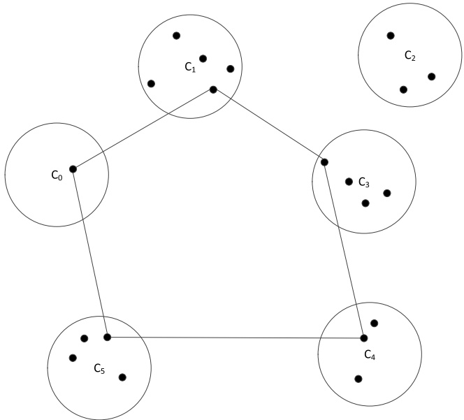

Fig. 1. An example of a SOP tour.

In [35], the authors provide the following integer linear programming (ILP) model for SOP, where $M = \{ C _ { 0 } , C _ { 1 } , . . . , C _ { m } \}$ is the set of all the clusters.

Decision Variables

$$
y _ {q} = \left\{ \begin{array}{l l} 1, & \text {if at least one vertex is visited in the cluster C_{q}} \\ 0, & \text {otherwise} \end{array} \right.\tag{1}
$$

$$
x _ {i j} = \left\{ \begin{array}{l l} 1, & \text {if edge (i,j) is traversed} \\ 0, & \text {otherwise} \end{array} \right.\tag{2}
$$

ILP Model

$$
\max f = \sum_ {q = 1} ^ {m} p _ {q} y _ {q}\tag{3}
$$

subject to:

$$
\sum_ {i \in V} \sum_ {j \in V} t _ {i j} x _ {i j} \leq T _ {\max}\tag{4}
$$

$$
\sum_ {i \in \mathcal {V} \backslash C _ {q}} x _ {i j} = \sum_ {i \in \mathcal {V} \backslash C _ {q}} x _ {j i} \quad \forall C _ {q} \in M, \forall j \in C _ {q}\tag{5}
$$

$$
\left| \sum_ {i \in \mathcal {V} \backslash C _ {q}} \sum_ {j \in C _ {q}} x _ {i j} = y _ {q} \quad \forall C _ {q} \in M \right.\tag{6}
$$

$$
\sum_ {i \in V \backslash C _ {q}} \sum_ {j \in C _ {q}} x _ {j i} = y _ {q} \quad \forall C _ {q} \in M\tag{7}
$$

$$
\left| \sum_ {i \in U} \sum_ {j \in U} x _ {i j} \leq \sum_ {C _ {q} \in U \setminus \{C _ {t} \}} y _ {q} \quad \forall U \subset M \setminus \{C _ {0} \}, \forall C _ {t} \in U \right|\tag{8}
$$

$$
y _ {0} = 1\tag{9}
$$

$$
\left| y _ {q} \in \{0, 1 \}, \quad C _ {q} \in M \right|\tag{10}
$$

$$
x _ {i j} \in \{0, 1 \}, \qquad i, j = 0, 1, 2, \dots n\tag{11}
$$

The objective function (3) is to maximize the total collected profit. Constraint (4) imposes the maximum time limit on the duration of the path. Constraints (5) ensure that each vertex has the same number of entering and leaving arcs, while constraints (6) and (7) make sure that each visited cluster must have one entering and one leaving arc. Constraints (8) are the subtour elimination constraints. Constraint (9) assures that the single depot cluster is visited. The remaining constraints are related to the decision variables.

## 4. Hybrid evolutionary algorithm for SOP

## 4.1. Main scheme

The proposed hybrid evolutionary algorithm (HEA) for SOP follows the general memetic framework [21,34] that combines the diversification strength of population algorithms and the intensification power of local refinement. From an algorithmic perspective, HEA includes five main elements: a construction method for initial solution generation (Section 4.3), a cluster-based crossover operator (Section 4.4), a randomized mutation operator (Section 4.5), a local refinement procedure (Section 4.6), and a population updating rule (Section 4.7).

Algorithm 1 Hybrid evolutionary algorithm for SOP.
Require: $G = (V, E)$: a SOP instance; $p$: population size
Ensure: $S^*$: best solution found so far
$P = \{S_1, S_2, ..., S_p\} \leftarrow Initial\_Population()$ /* Section 4.3 */
for $i = \{1, 2, ...p\}$ do
    $S_i \leftarrow Local\_refinement(S_i)$ /* Section 4.6 */
end for
$S^* \leftarrow Best(P)$ /*record the best solution found so far*/
while stop condition is not met do
    Randomly select $S_1$ and $S_2$ from $P$
    $(o_1, o_2) \leftarrow Crossover(S_1, S_2)$ /* Section 4.4 */
    for each offspring $o \in (o_1, o_2)$ do
        if $o$ not diverse then
            $o \leftarrow Mutate(o)$ /* Section 4.5 */
        end if
        $S_0 \leftarrow Local\_refinement(o)$ /* Section 4.6 */
        if $f(S_0) &gt; f(S^*)$ then
            $S^* \leftarrow S_0$
        end if
        $P \leftarrow Population\_Update(P, S_0)$ /* Section 4.7 */
    end for
end while
return $S^*$

As summarized in Algorithm 1, HEA first initializes a population consisting of 𝑝 solutions (Line 1 of Algorithm 1) where each one is improved by the local refinement procedure (Lines 2 to 4). It then performs a series of cycles (called generations) (Lines 6 to 19). Before entering the main cycle, the best solution $S ^ { * }$ from the population is recorded as the best-found solution (Line 5). At each cycle (generation) of HEA, two solutions from the population are randomly selected from the population (Line $7 ) ,$ followed by a cluster-based crossover operator to generate two offspring solutions (Line 8). If the resulting offspring are similar to their parents, a randomized mutation operator is applied for diversification (Lines 10 to 12). The local refinement is next applied to improve the two offspring solutions (Line 13). Finally, the population and the best recorded solution $S ^ { * }$ are updated with the offspring in case of improvement in Line 17 and Lines 14-16 respectively. The algorithm stops and returns the best solution $S ^ { * }$ found (Line 20) once a time limit has been reached. A more detailed description of the algorithmic components is provided in the following sections.

## 4.2. Notations and solution representation

For the sake of simplicity, we use several basic notations throughout the paper. Given a tour 𝑆, let $C ( S )$ be the set of clusters visited in $S ( \mathrm { i . e . } ,$ , the set of clusters for which at least one vertex is visited in 𝑆), and let $t ( S )$ be the duration of 𝑆. For a given SOP instance $G = \{ V , E \}$ , let $M = \{ C _ { 0 } , C _ { 1 } , C _ { 2 } , . . . , C _ { m } \}$ be the set of clusters of size $m   +   1$ (including the depot cluster $C _ { 0 } = \{ 0 \} )$ . Furthermore, let 𝐶(𝑣) denote the cluster to which $v \in V$ belongs. Each solution 𝑆 is represented as a permutation of vertices $( 0 , v _ { 1 } , v _ { 2 } , . . . , v _ { k } , 0 )$ $\left( k \leq m \right)$ , where the depot is the starting and the ending vertex in the sequence.

A vertex 𝑘 is inserted at the best position in 𝑆 according to the following function:

$$
e _ {k} = \underset {(i, j) \in \mathcal {S}} {\mathrm{m}} \{t _ {i k} + t _ {k j} - t _ {i j} \},\tag{12}
$$

where $e _ { k }$ is the least additional travel cost and $( i , j ) \in S$ is a pair of two consecutive vertices in the tour 𝑆.

For a non-visited cluster 𝐶 from the set $M \setminus C ( S )$ , we evaluate all the possible insertions of all the vertices in $C ,$ and consider $v \in C$ that results in the shortest tour, i.e., $v = \arg \min_{k \in C} \{ e_k \}$ . We refer to $v \in C$ as the best vertex in $C .$

## 4.3. Population initialization

To create an initial population of 𝑝 solutions, we propose a randomized greedy constructive procedure (RGCP) which constructs each solution in the following stages.

**Create a partial solution.** For a given SOP instance $G ,$ randomly pick 20% of the clusters (including the depot cluster) to construct a GTSP instance, which is then solved using the state-of-the-art LKH TSP solver (called GLKH1) [20]. The GTSP solution 𝑆 visits exactly one vertex from each of the 20% randomly selected clusters of $G ,$ which is equivalent to a partial solution for $G.\  If \ t(S)>T_{max},$ remove from 𝑆 the vertices that belong to clusters of the smallest profit until $t ( S ) \leq T _ { m a x } .$ . More precisely, each iteration of this removal procedure consists in removing from 𝑆 a vertex 𝑣 associated to cluster $C _ { l } ,$ where $C _ { l }$ is the cluster with the smallest profit in $C ( S ) ,$ $\mathrm{i.e.,} C_{l}=\arg \min _{C_{f} \in C(S)}\{p_{f}\}$

**Complete the partial solution in a greedy way.** Sort all the non-visited clusters $C _ { g } \in M \setminus C ( S )$ by a decreasing value of the ratio $\frac { p _ { g } } { e _ { v } }$ (where 𝑣 is the best vertex in $C _ { g } ) _ { : }$ and try to insert them in 𝑆 in the given order such that the solution feasibility is maintained. For a given non-visited cluster $C ,$ select the best vertex 𝑣 from 𝐶 that can lead to a feasible tour $( \mathrm { i . e . , } ~ t ( S ) + e _ { v } \leq T _ { m a x } )$ and insert 𝑣 at the best position in 𝑆. Finally, use the tour improvement procedure (see Section $4 . 6 . 4 )$ to shorten the tour length.

Each solution in the population is further improved with a local refinement procedure detailed in Section 4.6.

## 4.4. Cluster-based crossover operator

Inspired by the observation that high quality solutions of SOP always share a large number of clusters in common, we adopt a cluster-based crossover operator to copy vertices that belong to the common clusters from parents to offspring.

Given two parent solutions $S _ { 1 }$ and $S _ { 2 } ,$ two offspring $o _ { 1 }$ and $o _ { 2 }$ are constructed in the following steps:

(1) Determine the common clusters visited in both $S _ { 1 }$ and $S_{2}, \mathrm{i.e.}, \mathrm{CM} = C(S_{1}) \cap C(S_{2})$

(2) Copy the vertices that belong to the common clusters 𝐶𝑀 from $S _ { 1 }$ to $o _ { 1 }$ by keeping their order as in $S _ { 1 }$ . Similarly, copy the vertices $\{ v : v   \in   S _ { 2 } , C ( v )   \in   C M \}$ to $o _ { 2 }$ by keeping their order as in $S _ { 2 }$

(3) Complete the partial solutions $o _ { 1 }$ and $o _ { 2 }$ in a greedy way. For each partial solution, this is achieved by selecting a non-visited cluster $C _ { g }$ with the largest value $\underline { { p _ { g } } }$ (where 𝑣 is the best vertex in $C _ { g } )$ and inserting the best vertex $v   \in   C _ { g }$ at the best position in the tour $S ,$ such that $t ( S ) + e _ { v } \leq T _ { m a x } ^ { ^ v } .$ . This process is repeated until no vertex from a non-visited cluster can be inserted without violating the maximum time budget $T _ { m a x }$

Notice that unlike an ordinary crossover that transfers to the offspring the common vertices shared in both parents, our clusterbased crossover transfers to the offspring vertices that belong to the common clusters visited by both parents.

Fig. 2 shows an example to illustrate the main steps of the cluster-based crossover operator, where 33 vertices are grouped into 8 disjoint clusters. Given two parent solutions $S _ { 1 }$ and $S _ { 2 } ,$ two offspring solutions $o _ { 1 }$ and $o _ { 2 }$ are created from parents $S _ { 1 }$ and $S _ { 2 }$ in three steps. First, we identify all the common clusters visited in both parents - $\{ C _ { 3 } , C _ { 4 } , C _ { 5 } , C _ { 6 } \}$ . Second, we copy the vertices that belong to the common clusters from $S _ { 1 }$ and $S _ { 2 }$ to $o _ { 1 }$ and $o _ { 2 }$ by keeping their order as in $S _ { 1 }$ and $S _ { 2 }$ respectively. Third, we complete the partial offspring $o _ { 1 }$ and $o _ { 2 }$ by inserting a selection of the best vertices from the non-visited clusters without violating the maximum time limit (vertices 2 and 6 are added to $o _ { 1 } ;$ vertex 27 is added to $o _ { 2 } )$ .

## 4.5. Randomized mutation operator

If both parent solutions share more than 80% of the clusters in common, the diversity of offspring will be low. In that case, we apply a randomized mutation procedure on offspring 𝑜 that consists in performing $\eta$ random 𝐴𝑑𝑑 or 𝐼𝑛𝑡𝑒𝑟𝑐ℎ𝑎𝑛𝑔𝑒 moves (see Section 4.6.1), where $\eta$ is a parameter called the mutation strength. If the resulting mutation breaks the maximum tour duration constraint, we randomly delete a vertex from 𝑜 until $t ( o ) \leq T _ { m a x }$

## 4.6. Local refinement procedure

As observed on several TSP, VRP and OP problems $\left[ 6 { , } 7 { , } 3 1 \right]$ , the consideration of intermediary infeasible solutions by constraint relaxation can improve the exploration of the search space. Based on these studies, we propose a two-phase local refinement procedure, where the first phase is a feasible local search phase (only considers feasible solutions), while the second phase permits a controlled exploration of infeasible solutions by relaxing the maximum travel time constraint. Both phases are based on the tabu search framework [17].

The general scheme of the local refinement procedure is summarized in Algorithm 2. Starting with a feasible solution, the procedure first performs the feasible local search phase (Line 2 of Algorithm 2), followed by the infeasible local search phase on the best solution $S _ { b e s t }$ found in the first phase (Line 4). As confirmed by the computational experiments in Section 6.1, the infeasible local search phase helps to further improve on the quality of the solution obtained by the feasible local search.

## 4.6.1. Move operators

The following three move operators are used in local refinement.

<small>1 The source code of GLKH is publicly available at [http://akira.ruc.dk/\~keld/research/GLKH/](http://akira.ruc.dk/~keld/research/GLKH/).</small>

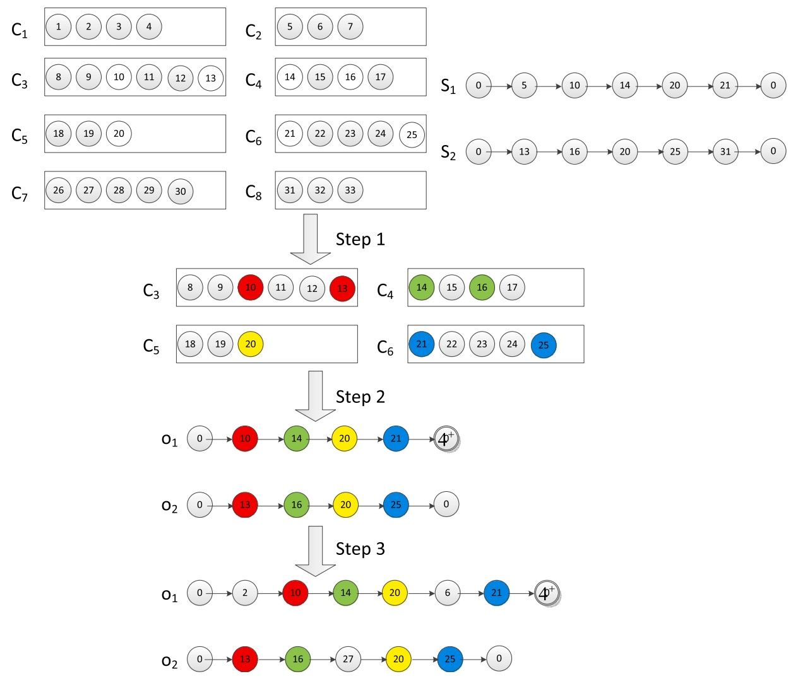

Fig. 2. An illustrative example of the cluster-based crossover steps.

Algorithm 2 Local refinement procedure.

Require: A SOP instance, an initial feasible solution $S_0$
Ensure: Best solution $S_{best}$ found so far
/* Feasible local search phase */
$S_{best} \leftarrow feasible\_local\_search(S_0)$ /* Section 4.6.2 */
/* Infeasible local search phase */
$S_{best} \leftarrow infeasible\_local\_search(S_{best})$ /* Section 4.6.3 */
Return $S_{best}$

• Add operator $( N _ { 1 } ) { : }$ insert the best vertex from a non-visited cluster at the best position in $S ;$

• Deletion operator $( N _ { 2 } ) ;$ delete a vertex from $S ;$

• Interchange operator $( N _ { 3 } ) \cdotp$ replace a vertex 𝑢 in 𝑆 with the best vertex 𝑣 from a non-visited cluster. Next, move 𝑣 to the best position in the current solution 𝑆.

We use $N _ { 1 } , \; N _ { 2 } ,$ , and $N _ { 3 }$ to denote the three neighborhoods induced by the Add, Deletion, and Interchange move operators, respectively.

## 4.6.2. The feasible local search phase

The feasible local search procedure tries to attain a high-quality local optimum by examining feasible solutions only. Algorithm 3 outlines the feasible local search procedure for SOP. Following the initialization of variables including the tabu list (Lines 1 to 4), the procedure performs a series of iterations (Lines 5 to 17). At each iteration, it replaces the current solution 𝑆 with the best admissible feasible neighboring solution $S ^ { \prime }$ induced by the Add, Deletion, and Interchange move operators (see Section 4.6.1) (Lines 6 to 7). The tabu list and the iteration counter are then updated accordingly (Lines 8 to 9). Every $u _ { c }$ iterations, the tour improvement procedure (see Section 4.6.4) is called to shorten the tour length of the current solution 𝑆 (Lines 10 to 12). Finally, the best-found feasible solution $S ^ { * }$ is updated with 𝑆 if $f ( S )   > f ( S ^ { * } )$ (Lines 13 to 16). The search stops and returns the best found feasible solution $S ^ { * }$ (Line 18) if $S ^ { * }$ has not been improved in the last 𝐿 consecutive iterations.

Algorithm 3 Feasible local search.
Require: A SOP instance, an initial feasible solution $S_0$, search depth $L$, frequency $u_c$ of using the tour improvement procedure
Ensure: best feasible solution $S^*$
$S \leftarrow S_0$, $S^* \leftarrow S_0$
Iter $\leftarrow 0$ /* Iteration counter */
$NI \leftarrow 0$ /*number of consecutive iterations without improvement of $S^{**}$
Initialize tabu_list and tabu tenure
while $NI &lt; L$ do
    Choose the best admissible feasible neighboring solution $S'$ from neighborhoods $N_1 \cup N_2 \cup N_3$ of $S$
    $S \leftarrow S'$
    Update tabu_list
    Iter $\leftarrow \text{Iter} + 1$, $NI \leftarrow NI + 1$
    if Iter mod $u_c = 0$ then
        $S \leftarrow \text{Tour\_Improvement}(S)$ /* see Section 4.6.4 */
    end if
    if $f(S) &gt; f(S^*)$ then
        $S^* \leftarrow S$
        $NI \leftarrow 0$
    end if
end while
Return $S^*$

To avoid short-term search cycling, each time a vertex 𝑣 is removed from (or added to) the current tour 𝑆, it is then forbidden to apply a move involving vertices in the cluster $C ( v )$ for the next 𝑡𝑙 iterations (tabu tenure), unless the move leads to a feasible solution of improved quality compared to $S ^ { * }$ (aspiration criterion). The tabu tenure 𝑡𝑙 is determined as: 𝑡𝑙 = 𝛼 × 𝑚 + 𝑟𝑎𝑛𝑑𝑜𝑚(10), where 𝑚 is the total number of clusters in a SOP instance, 𝑟𝑎𝑛𝑑𝑜𝑚(10) is a random integer between 0 and 9, and 𝛼 is the tabu tenure management factor.

## 4.6.3. The infeasible local search phase

Algorithm 4 Infeasible local search.
Require: A SOP instance, an initial feasible solution $S_0$, search depth $L$, frequency $u_c$ of using the tour improvement procedure, frequency $u_p$ of updating the penalty parameter
Ensure: Best feasible solution $S^*$ found
$S \leftarrow S_0, S^* \leftarrow S_0$
$Iter \leftarrow 0$ /* Iteration counter */
$NI \leftarrow 0$ /*number of consecutive iterations without improvement of $S^{**}$
Initialize $tabu\_list$ and tabu tenure
while $NI &lt; L$ do
    Choose the best admissible neighboring solution $S'$ from neighborhoods $N_1 \cup N_2$ of $S$ in terms of the extended evaluation function $F$ (see Eq. (13))
    $S \leftarrow S'$
    Update $tabu\_list$
    $NI \leftarrow NI + 1, Iter \leftarrow Iter + 1$
    if $Iter \mod u_c = 0$ then
        $S \leftarrow \text{Tour\_Improvement}(S)$ /* see Section 4.6.4 */
    end if
    if $Iter \mod u_p = 0$ then
        Update penalty factor $\varphi$
    end if
    if $S$ is a feasible solution and $f(S) &gt; f(S^*)$ then
        $S^* \leftarrow S$
        $NI \leftarrow 0$
    end if
end while
Return $S^*$

The infeasible local search phase uses an extended penalty-based evaluation function 𝐹 to evaluate the quality of both feasible and infeasible solutions. The evaluation function 𝐹 is defined as:

$$
F (S) = f (S) - \varphi \times E X (S)\tag{13}
$$

where $f ( S )$ is the objective function, $EX(S)=\max\{t(S)-T_{max},0\}$ is the total excess path duration of $S ,$ and $\varphi$ is a self-adjusting penalty coefficient.

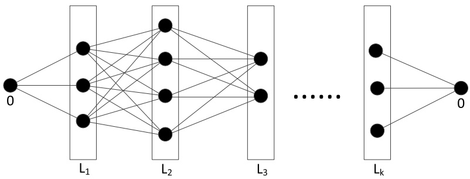

Fig. 3. An illustrative example of the DP procedure.

The general scheme of the infeasible local search procedure is described in Algorithm 4. The procedure performs a series of iterations until no improved feasible solution has been found in the 𝐿 consecutive iterations (Lines 5 to 20). At each iteration, the procedure replaces the current solution 𝑆 with the best admissible neighboring solution induced by the Add and Deletion move operators (see Section 4.6.1) according to Eq. (13) (Lines 6 to 7). During the search process, the value of 𝜑 is halved (doubled) if feasible (infeasible) solutions were achieved in the last consecutive iterations $u _ { p }$ (Lines 13 to 15) (initially, $\begin{array} { r } { \varphi = \frac { f ( S ) } { t ( S ) } ) } \end{array}$ . As in the feasible local search phase, the tour improvement procedure (see Section $4 . 6 . 4 )$ is applied periodically to shorten the tour length of 𝑆 (Lines 10 to 12), and the same tabu rule is employed. Finally, the best feasible solution $S ^ { * }$ found is updated with 𝑆 if 𝑆 is a feasible solution and $f ( S )   > f ( S ^ { * } )$ (Lines 16 to 19). At the end of the infeasible local search procedure, $S ^ { * }$ is returned as the final output (Line 21).

## 4.6.4. Tour improvement procedure

To improve on the permutation of vertices of 𝑆, the tour improvement procedure is an iterative execution of a dynamic programming (DP) heuristic and a Lin-Kernighan TSP heuristic until no improvement with respect to 𝑆 is found.

**Dynamic programming technique.** Given a SOP tour $S = ( 0 , v _ { 1 } , v _ { 2 } , . . . , v _ { k } , 0 )$ where 0 is the depot, we apply the dynamic programming (DP) procedure to improve the length of 𝑆 by replacing each vertex $v _ { i } \in S , 1 \leq i \leq k$ with another vertex from the corresponding cluster $C ( v _ { i } )$ . Let $( L _ { 0 } , L _ { 1 } , L _ { 1 } , . . . , L _ { k } ) \; ( L _ { i } = C ( v _ { i } ) , \; 1 \leq i \leq k , \; L _ { 0 } = \{ 0 \} )$ be the permutation of clusters visited by the tour 𝑆, and let $f _ { i } ( v )$ denote the length of the shortest path linking vertex 𝑣 (belonging to cluster $L _ { i } )$ to the ending vertex (depot 0), while passing via exactly one vertex from each cluster $L _ { i + 1 } ,   L _ { i + 2 } , . . . ,   L _ { k }$ . Then, the optimal travel cost $f _ { 0 } ( 0 )$ can be calculated recursively as:

$$
f _ {k} (v) = c _ {v, 0} \quad v \in L _ {k}\tag{14}
$$

$$
f _ {i} (u) = \min _ {v \in L _ {j + 1}} \left\{c _ {u, v} + f _ {j + 1} (v) \right\} \quad 0 \leq i \leq k - 1, u \in L _ {i}\tag{15}
$$

It is easy to optimally determine the re-arrangement of vertices generated from each cluster $L _ { i } , 1 \leq i \leq k$ by applying a backtrack procedure. Fig. 3 shows an example of the DP procedure.

**Lin-Kernighan TSP heuristic.** The Lin-Kernighan heuristic [32] has been considered for many years as one of the most powerful TSP approaches. In [19], Helsgaun developed a highly efficient implementation of the Lin-Kernighan heuristic whose source code is publicly available at [http://akira.ruc.dk/\~keld/research/LKH/](http://akira.ruc.dk/~keld/research/LKH/).

## 4.7. Population updating rule

For each offspring 𝑆 generated by the cluster-based crossover and the randomized mutation operators followed by improvement with the two-phase local refinement procedure, we employ a classic updating strategy to decide whether 𝑆 should be inserted into the population. The worst solution $S _ { w }$ from the population 𝑃 is replaced by 𝑆 if one of the two following criteria is satisfied: (1) 𝑆 ∉ 𝑃 and $f ( S )   >   f ( S _ { w } ) ;$ (2) 𝑆 ∉ 𝑃 , $f ( S )   =   f ( S _ { w } ) ,$ , and $t ( S )   <   t ( S _ { w } )$

## 4.8. Computational complexity of the proposed algorithm

We first discuss the computational complexity of the two-phase local refinement procedure, which consists of the first-phase tabu search procedure (denoted as TS1, see Algorithm 3) and the second-phase tabu search procedure (denoted as $\mathrm { T S 2 } ,$ see Algorithm 4). Let 𝑚 and 𝑛 be the total number of clusters (except for the single depot cluster) and the total number of vertices (except for the depot vertex) in a given SOP instance, respectively.

In both TS1 and TS2, the tour improvement procedure (iterative execution of a dynamic programming (DP) heuristic and a Lin-Kernighan (LK) TSP heuristic - see Section 4.6.4) is called every $u _ { c }$ iterations to improve the permutation of vertices of a given solution $S = ( 0 , v _ { 1 } , v _ { 2 } , . . . , v _ { k } , 0 ) ( k \leq m )$ . Assuming that a cluster contains at most 𝑤 vertices as shown in Section 4.6.4, DP can be implemented with a worst-case time complexity of $O ( n w )$ . However, DP runs on average in $O ( \frac { n ^ { 2 } } { m } )$ time, considering that the number of vertices in each cluster is approximately $\frac { n } { m }$

As explained in [24], the time complexity of LK is $O ( N \times s t e p s \times C ^ { K } + K \times | E | )$ , where 𝑁 is the number of vertices in the test | |instance, 𝑠𝑡𝑒𝑝𝑠 is the maximum number of iterations, 𝐶 is the size of the candidate set of each vertex, 𝐾 is the depth of search, and |𝐸| is the number of edges in the test instance. In our work, we used the default parameter setting for LK given in [19], where the values of 𝑠𝑡𝑒𝑝𝑠, 𝐶 and 𝐾 are constants. The time complexity of LK thus becomes $O ( m + m \times m ) = O ( m ^ { 2 } )$

As described in Algorithm 3, each iteration of TS1 selects the best feasible non-tabu move (corresponding to the best admissible feasible neighboring solution) induced by Add, Deletion and Interchange move operators. The worst-case time complexity of choosing the best move induced by the three move operators is $O ( m n ) ,   O ( m ) ,$ , and $O ( m ^ { 2 } \times n )$ , respectively. Hence, the total complexity of TS1 is $O ( T S 1 ) = O ( m ^ { 2 } \times n \times m a x I t e r _ { 1 } + ( m ^ { 2 } + \frac { n ^ { 2 } } { m } ) \times \frac { m a x I t e r _ { 1 } } { u _ { c } } ) = O ( ( m ^ { 2 } \times n + m ^ { 2 } + \frac { n ^ { 2 } } { m } ) \times m a x I t e r _ { 1 } ) ,$ , where 𝑚𝑎𝑥 $I t e r _ { 1 }$ is the maximum number of TS1 iterations. As described in Algorithm $4 ,$ each iteration of TS2 selects the best non-tabu move induced by two move operators (Add and Deletion). The worst-case time complexity of choosing the best move obtained with the two move operators is 𝑂(𝑚𝑛) and $O ( m )$ respectively. Similarly, the total complexity of TS2 is thus $O ( T S 2 ) = O ( ( m \times n + m ^ { 2 } + \frac { n ^ { 2 } } { m } ) \times m a x I t e r _ { 2 } )$ , where $m a x I t e r _ { 2 }$ is the maximum number of TS2 iterations. Therefore, the overall time complexity of the two-phase local refinement procedure can be bounded by $O ( T S 1 ) + O ( T S 2 )$

We next consider the time complexity of the population initialization RGCP algorithm (see Section 4.3), the cluster-based crossover operator (see Section 4.4) and the randomized mutation operator (see Section 4.5). RGCP employs the state-of-the-art LKH TSP solver (an iterated variant of the LK where the maximum number of iterations of LK is set to 20 in our work) to create a partial solution in $O ( m ^ { 2 } )$ time and then to complete the partial solution in 𝑂(𝑚𝑛) time. Therefore, the computational time of RGCP is bounded by 𝑂(𝑚𝑛). The cluster-based crossover operator identifies and copies the common clusters in 𝑂(𝑚) time, while selecting non-visited clusters and inserting them in 𝑂(𝑚𝑛) time. Therefore, the time complexity of the cluster-based crossover operator is 𝑂(𝑚𝑛). Since the randomized mutation procedure performs a constant number of random 𝐴𝑑𝑑 or 𝐼𝑛𝑡𝑒𝑟𝑐ℎ𝑎𝑛𝑔𝑒 moves (see Section 4.6.1) to generate offspring, the time complexity of the mutation operator can also be bounded by 𝑂(𝑚𝑛).

As for the proposed hybrid evolutionary algorithm (HEA) (see Algorithm 1), it starts with an initial population of $p$ solutions generated with RGCP in 𝑂(𝑚𝑛) (Line 1, Algorithm 1). At each generation of HEA, the cluster-based crossover operator generates two offspring solution in $O ( m n )$ time (Line $^ { 8 , }$ Algorithm 1), followed by the randomized mutation of the two offspring solution for diversification in 𝑂(𝑚𝑛) time (Line 11, Algorithm 1). Next, the local refinement is applied to improve the two offspring solutions (Line 13, Algorithm 1) in $O ( T S 1 ) + O ( T S 2 )$ time. Finally, the population is updated with the improved offspring solutions (Line 17, Algorithm 1) in 𝑂(𝑚) time. Consequently, the total time complexity of each generation of HEA is bounded by $O ( T S 1 ) + O ( T S 2 )$

## 5. Computational experiments

We present extensive computational results of the proposed HEA and show comparisons with three state-of-the-art heuristic algorithms from the literature specifically designed for SOP.

## 5.1. Benchmark instances

Our computational assessments are based on the 192 benchmark instances, introduced in [1], that were constructed by modifying a set of 51 GTSP benchmark instances from [12] with 52 to 1084 vertices. More precisely, the first vertex of each given instance was removed from its original cluster to form a single depot cluster. The profit $p _ { i }$ assigned to each cluster 𝑖 and the time budget $T _ { m a x }$ were then determined as follows.

$p _ { i } ;$ The profit of each cluster was created in two ways: (i) set the profit of a cluster to be equal to the number of vertices it contains; (ii) assign a profit $1 + ( 7 1 4 1 \times j + 7 3 ) m o d ( 1 0 0 )$ to each vertex $j \in V \setminus \{ 0 \}$ following the same rules as in [2]. Then, set the profit of a cluster to be equal to the sum of the profits of the vertices contained in the given cluster.

$T _ { m a x } \colon T _ { m a x } = w \times c _ { b k } ,$ where $c _ { b k }$ is the best-known cost of the GTSP solution (a minimum cost cycle that includes exactly one vertex from each cluster) taken from [12], and 𝑤 is set to 0.4, 0.6, 0.8, and 1.0, respectively.

In [1], the instances with $w = 1 . 0$ were created such that all the cluster profit is expected to be collected. However, this is not feasible due to the newly created depot cluster.

According to [1], instances can be grouped into two groups: small-size instances with $| V | \leq 1 9 8$ and large-size instances with $2 0 0 \leq | V | \leq 1 0 8 4$ | |. As no appreciable difference in results was observed for the small instance group, we provide comparisons with the | |existing heuristics only on the large instance group consisting of 192 instances.

## 5.2. Experimental settings

The proposed HEA is coded in C++ and tested on a computer with an Intel Xeon(R) E5-2695 (2.1 GHz) CPU and 4 GB RAM. The stopping condition of the algorithm is a fixed cutoff time limit set to $\frac { n   \times   m } { 1 0 0 0 }$ seconds, where 𝑛 and 𝑚 is the number of vertices and the clusters contained in the given instance respectively. Considering the stochastic nature of HEA, we perform 20 independent runs for each instance, with the above stopping criterion.

To assess the performance of HEA, we perform comparisons with four state-of-art SOP heuristics from the literature:

Table 1

Parameter tuning results.

| Parameter | Section | Description | Considered values | Final value |
| --- | --- | --- | --- | --- |
| 𝑝 | 4.3 | Population size | {5, 10, 15, 20, 30} | 5 |
| 𝐿 | 4.6 | Search depth during local refinement | {100, 200, 300, 400, 500} | 400 |
| 𝛼 | 4.6 | Tabu tenure management factor | {0.01, 0.05, 0.1, 0.15, 0.2} | 0.05 |
| 𝑢𝑐 | 4.6 | Frequency of using tour improvement | {10, 20, 30, 40, 50} | 30 |
| 𝑢𝑝 | 4.6 | Frequency of updating 𝜑 | {5, 10, 15, 20, 25} | 5 |
| 𝜂 | 4.5 | Mutation strength | {1, 5, 10, 15, 20} | 5 |

Table 2

Computational results on large instances with $w   =   0 . 4$

<table><tr><td rowspan="2">Instance</td><td rowspan="2"> $|V|$ </td><td rowspan="2"> $m$ </td><td colspan="3">MA-SOP</td><td colspan="3">VNS-SOP</td><td colspan="3">BRKGA</td><td colspan="4">HEA</td></tr><tr><td> $f_{best}$ </td><td> $f_{avg}$ </td><td> $t(s)$ </td><td> $f_{best}$ </td><td> $f_{avg}$ </td><td> $t(s)$ </td><td> $f_{best}$ </td><td> $f_{avg}$ </td><td> $t(s)$ </td><td> $f_{best}$ </td><td> $f_{avg}$ </td><td> $t(s)$ </td><td>Gap(%)</td></tr><tr><td>40kroa200T40p1</td><td>200</td><td>40</td><td>92</td><td>92.0</td><td>19.1</td><td>92</td><td>92.0</td><td>3.9</td><td>92</td><td>92.0</td><td>4.2</td><td>92</td><td>92.0</td><td>8.6</td><td>0.00</td></tr><tr><td>40kroa200T40p2</td><td>200</td><td>40</td><td>4550</td><td>4550.0</td><td>21.0</td><td>4550</td><td>4550.0</td><td>4.1</td><td>4550</td><td>4550.0</td><td>4.1</td><td>4550</td><td>4550.0</td><td>8.9</td><td>0.00</td></tr><tr><td>40krob200T40p1</td><td>200</td><td>40</td><td>87</td><td>87.0</td><td>14.4</td><td>87</td><td>87.0</td><td>4.0</td><td>87</td><td>87.0</td><td>4.1</td><td>87</td><td>87.0</td><td>8.7</td><td>0.00</td></tr><tr><td>40krob200T40p2</td><td>200</td><td>40</td><td>4348</td><td>4348.0</td><td>16.8</td><td>4348</td><td>4348.0</td><td>4.1</td><td>4348</td><td>4348.0</td><td>4.0</td><td>4348</td><td>4348.0</td><td>8.4</td><td>0.00</td></tr><tr><td>45ts225T40p1</td><td>225</td><td>45</td><td>101</td><td>101.0</td><td>15.7</td><td>101</td><td>101.0</td><td>5.6</td><td>101</td><td>101.0</td><td>4.2</td><td>101</td><td>101.0</td><td>10.3</td><td>0.00</td></tr><tr><td>45ts225T40p2</td><td>225</td><td>45</td><td>5037</td><td>5037.0</td><td>24.2</td><td>5037</td><td>4945.0</td><td>6.2</td><td>5037</td><td>5037.0</td><td>4.7</td><td>5037</td><td>5037.0</td><td>10.6</td><td>0.00</td></tr><tr><td>45tsp225T40p1</td><td>225</td><td>45</td><td>80</td><td>80.0</td><td>17.1</td><td>80</td><td>80.0</td><td>4.3</td><td>80</td><td>80.0</td><td>3.6</td><td>80</td><td>80.0</td><td>11.1</td><td>0.00</td></tr><tr><td>45tsp225T40p2</td><td>225</td><td>45</td><td>4297</td><td>4297.0</td><td>21.5</td><td>4297</td><td>4297.0</td><td>4.2</td><td>4297</td><td>4297.0</td><td>3.6</td><td>4297</td><td>4297.0</td><td>10.5</td><td>0.00</td></tr><tr><td>46pr226T40p1</td><td>226</td><td>46</td><td>86</td><td>85.4</td><td>20.1</td><td>86</td><td>86.0</td><td>3.8</td><td>86</td><td>86.0</td><td>3.8</td><td>86</td><td>86.0</td><td>10.9</td><td>0.00</td></tr><tr><td>46pr226T40p2</td><td>226</td><td>46</td><td>4403</td><td>4394.6</td><td>19.7</td><td>4403</td><td>4403.0</td><td>3.6</td><td>4403</td><td>4403.0</td><td>3.8</td><td>4403</td><td>4403.0</td><td>10.7</td><td>0.00</td></tr><tr><td>53gil262T40p1</td><td>262</td><td>53</td><td>105</td><td>104.8</td><td>25.9</td><td>105</td><td>104.2</td><td>7.4</td><td>105</td><td>104.7</td><td>6.7</td><td>105</td><td>105.0</td><td>14.1</td><td>0.00</td></tr><tr><td>53gil262T40p2</td><td>262</td><td>53</td><td>5330</td><td>5330.0</td><td>27.9</td><td>5330</td><td>5284.9</td><td>7.7</td><td>5330</td><td>5330.0</td><td>6.7</td><td>5330</td><td>5330.0</td><td>14.4</td><td>0.00</td></tr><tr><td>53pr264T40p1</td><td>264</td><td>53</td><td>128</td><td>128.0</td><td>48.7</td><td>128</td><td>128.0</td><td>6.9</td><td>127</td><td>127.0</td><td>4.7</td><td>128</td><td>128.0</td><td>15.0</td><td>0.00</td></tr><tr><td>53pr264T40p2</td><td>264</td><td>53</td><td>6423</td><td>6423.0</td><td>51.2</td><td>6423</td><td>6423.0</td><td>7.1</td><td>6397</td><td>6383.5</td><td>4.7</td><td>6423</td><td>6423.0</td><td>14.7</td><td>0.00</td></tr><tr><td>56a280T40p1</td><td>280</td><td>56</td><td>107</td><td>107.0</td><td>25.4</td><td>106</td><td>105.1</td><td>7.5</td><td>107</td><td>107.0</td><td>4.9</td><td>107</td><td>107.0</td><td>16.5</td><td>0.00</td></tr><tr><td>56a280T40p2</td><td>280</td><td>56</td><td>5630</td><td>5611.3</td><td>30.9</td><td>5630</td><td>5605.0</td><td>8.4</td><td>5630</td><td>5606.3</td><td>5.3</td><td>5630</td><td>5622.6</td><td>16.3</td><td>0.00</td></tr><tr><td>60pr299T40p1</td><td>299</td><td>60</td><td>131</td><td>131.0</td><td>38.9</td><td>131</td><td>130.6</td><td>9.0</td><td>131</td><td>131.0</td><td>5.4</td><td>131</td><td>131.0</td><td>18.9</td><td>0.00</td></tr><tr><td>60pr299T40p2</td><td>299</td><td>60</td><td>6600</td><td>6600.0</td><td>42.5</td><td>6600</td><td>6600.0</td><td>9.2</td><td>6600</td><td>6600.0</td><td>5.7</td><td>6600</td><td>6600.0</td><td>18.7</td><td>0.00</td></tr><tr><td>64lin318T40p1</td><td>318</td><td>64</td><td>169</td><td>169.0</td><td>38.5</td><td>169</td><td>168.8</td><td>12.4</td><td>169</td><td>169.0</td><td>10.0</td><td>169</td><td>169.0</td><td>21.1</td><td>0.00</td></tr><tr><td>64lin318T40p2</td><td>318</td><td>64</td><td>8600</td><td>8600.0</td><td>47.8</td><td>8600</td><td>8593.1</td><td>9.6</td><td>8600</td><td>8600.0</td><td>9.6</td><td>8600</td><td>8600.0</td><td>21.1</td><td>0.00</td></tr><tr><td>80rd400T40p1</td><td>400</td><td>80</td><td>208</td><td>206.5</td><td>86.7</td><td>209</td><td>208.2</td><td>21.9</td><td>208</td><td>207.6</td><td>15.2</td><td>209</td><td>208.7</td><td>32.6</td><td>0.00</td></tr><tr><td>80rd400T40p2</td><td>400</td><td>80</td><td>10825</td><td>10752.3</td><td>79.5</td><td>10966</td><td>10858.8</td><td>22.5</td><td>10874</td><td>10816.6</td><td>17.0</td><td>10971</td><td>10966.0</td><td>32.8</td><td>-0.05</td></tr><tr><td>84fl417T40p1</td><td>417</td><td>84</td><td>201</td><td>175.5</td><td>64.1</td><td>201</td><td>201.0</td><td>19.3</td><td>201</td><td>200.6</td><td>14.8</td><td>201</td><td>201.0</td><td>35.2</td><td>0.00</td></tr><tr><td>84fl417T40p2</td><td>417</td><td>84</td><td>10133</td><td>9375.4</td><td>62.3</td><td>10163</td><td>10119.6</td><td>19.9</td><td>10133</td><td>10123.4</td><td>16.6</td><td>10163</td><td>10163.0</td><td>35.8</td><td>0.00</td></tr><tr><td>88pr439T40p1</td><td>439</td><td>88</td><td>334</td><td>333.9</td><td>96.1</td><td>333</td><td>332.4</td><td>45.3</td><td>334</td><td>329.0</td><td>27.5</td><td>335</td><td>334.1</td><td>39.6</td><td>-0.30</td></tr><tr><td>88pr439T40p2</td><td>439</td><td>88</td><td>17037</td><td>17013.5</td><td>161.5</td><td>17022</td><td>16804.6</td><td>41.5</td><td>17082</td><td>16944.6</td><td>30.5</td><td>17082</td><td>17034.8</td><td>38.8</td><td>0.00</td></tr><tr><td>89pcb442T40p1</td><td>442</td><td>89</td><td>223</td><td>222.2</td><td>87.8</td><td>223</td><td>220.9</td><td>33.1</td><td>224</td><td>221.9</td><td>19.0</td><td>224</td><td>223.6</td><td>40.1</td><td>0.00</td></tr><tr><td>89pcb442T40p2</td><td>442</td><td>89</td><td>11565</td><td>11546.3</td><td>106.7</td><td>11627</td><td>11502.1</td><td>29.7</td><td>11627</td><td>11587.6</td><td>19.9</td><td>11627</td><td>11588.6</td><td>39.4</td><td>0.00</td></tr><tr><td>99d493T40p1</td><td>493</td><td>99</td><td>278</td><td>277.7</td><td>122.8</td><td>278</td><td>275.9</td><td>33.9</td><td>278</td><td>278.0</td><td>21.5</td><td>278</td><td>278.0</td><td>49.4</td><td>0.00</td></tr><tr><td>99d493T40p2</td><td>493</td><td>99</td><td>14131</td><td>14083.3</td><td>111.0</td><td>13992</td><td>13992.0</td><td>33.5</td><td>14131</td><td>14131.0</td><td>20.3</td><td>14131</td><td>14131.0</td><td>49.8</td><td>0.00</td></tr><tr><td>115rat575T40p1</td><td>575</td><td>115</td><td>262</td><td>259.5</td><td>255.3</td><td>264</td><td>258.9</td><td>48.7</td><td>264</td><td>260.9</td><td>27.4</td><td>264</td><td>261.9</td><td>68.3</td><td>0.00</td></tr><tr><td>115rat575T40p2</td><td>575</td><td>115</td><td>13300</td><td>13203.0</td><td>395.5</td><td>13203</td><td>12950.8</td><td>54.7</td><td>13367</td><td>13293.0</td><td>29.2</td><td>13367</td><td>13310.0</td><td>67.4</td><td>0.00</td></tr><tr><td>115u574T40p1</td><td>574</td><td>115</td><td>275</td><td>270.2</td><td>163.1</td><td>270</td><td>265.1</td><td>52.5</td><td>274</td><td>269.7</td><td>30.2</td><td>277</td><td>276.8</td><td>66.9</td><td>-0.73</td></tr><tr><td>115u574T40p2</td><td>574</td><td>115</td><td>13969</td><td>13739.6</td><td>165.4</td><td>13782</td><td>13407.2</td><td>49.8</td><td>14046</td><td>13823.3</td><td>31.1</td><td>14094</td><td>14036.7</td><td>66.4</td><td>-0.34</td></tr><tr><td>131p654T40p1</td><td>654</td><td>131</td><td>315</td><td>315.0</td><td>257.8</td><td>315</td><td>315.0</td><td>53.0</td><td>315</td><td>313.0</td><td>34.0</td><td>315</td><td>315.0</td><td>85.9</td><td>0.00</td></tr><tr><td>131p654T40p2</td><td>654</td><td>131</td><td>16003</td><td>16003.0</td><td>347.2</td><td>15983</td><td>15958.9</td><td>47.4</td><td>16003</td><td>15902.5</td><td>34.2</td><td>16003</td><td>16003.0</td><td>87.3</td><td>0.00</td></tr><tr><td>132d657T40p1</td><td>657</td><td>132</td><td>304</td><td>303.0</td><td>328.5</td><td>300</td><td>295.0</td><td>62.3</td><td>305</td><td>299.3</td><td>36.9</td><td>308</td><td>307.7</td><td>87.5</td><td>-0.98</td></tr><tr><td>132d657T40p2</td><td>657</td><td>132</td><td>15855</td><td>15790.2</td><td>415.2</td><td>15141</td><td>14633.2</td><td>62.4</td><td>15903</td><td>15738.4</td><td>36.7</td><td>15974</td><td>15945.3</td><td>89.7</td><td>-0.45</td></tr><tr><td>145u724T40p1</td><td>724</td><td>145</td><td>324</td><td>321.8</td><td>231.0</td><td>315</td><td>303.1</td><td>86.6</td><td>323</td><td>317.0</td><td>47.6</td><td>329</td><td>326.0</td><td>107.0</td><td>-1.54</td></tr><tr><td>145u724T40p2</td><td>724</td><td>145</td><td>17230</td><td>17127.2</td><td>288.1</td><td>16616</td><td>15998.6</td><td>92.0</td><td>17094</td><td>16974.3</td><td>48.1</td><td>17364</td><td>17291.5</td><td>105.1</td><td>-0.78</td></tr><tr><td>157rat783T40p1</td><td>783</td><td>157</td><td>348</td><td>344.9</td><td>300.6</td><td>346</td><td>331.2</td><td>107.9</td><td>349</td><td>342.8</td><td>57.2</td><td>350</td><td>347.0</td><td>123.3</td><td>-0.29</td></tr><tr><td>157rat783T40p2</td><td>783</td><td>157</td><td>18018</td><td>17720.8</td><td>420.3</td><td>17889</td><td>17088.8</td><td>98.6</td><td>18216</td><td>17838.8</td><td>59.0</td><td>18244</td><td>18186.2</td><td>125.9</td><td>-0.15</td></tr><tr><td>201pr1002T40p1</td><td>1002</td><td>201</td><td>535</td><td>532.6</td><td>869.5</td><td>519</td><td>491.4</td><td>199.2</td><td>535</td><td>507.2</td><td>118.6</td><td>539</td><td>533.9</td><td>204.3</td><td>-0.75</td></tr><tr><td>201pr1002T40p2</td><td>1002</td><td>201</td><td>26239</td><td>26086.2</td><td>1022.0</td><td>25357</td><td>24632.4</td><td>199.1</td><td>27189</td><td>26369.8</td><td>119.2</td><td>27458</td><td>26999.7</td><td>204.4</td><td>-0.99</td></tr><tr><td>212u1060T40p1</td><td>1060</td><td>212</td><td>559</td><td>532.8</td><td>965.0</td><td>535</td><td>521.2</td><td>249.6</td><td>563</td><td>538.0</td><td>144.1</td><td>574</td><td>553.9</td><td>226.1</td><td>-1.95</td></tr><tr><td>212u1060T40p2</td><td>1060</td><td>212</td><td>27348</td><td>26638.9</td><td>1028.9</td><td>26463</td><td>25952.5</td><td>242.6</td><td>28221</td><td>27458.3</td><td>147.5</td><td>28324</td><td>27565.2</td><td>227.4</td><td>-0.36</td></tr><tr><td>217vm1084T40p1</td><td>1084</td><td>217</td><td>666</td><td>656.9</td><td>618.4</td><td>574</td><td>551.9</td><td>303.1</td><td>663</td><td>655.6</td><td>129.9</td><td>672</td><td>668.5</td><td>237.2</td><td>-0.90</td></tr><tr><td>217vm1084T40p2</td><td>1084</td><td>217</td><td>34291</td><td>33818.5</td><td>947.7</td><td>31473</td><td>27875.1</td><td>289.8</td><td>34398</td><td>33799.6</td><td>126.8</td><td>34388</td><td>34297.6</td><td>238.4</td><td>0.03</td></tr><tr><td>Avg.</td><td></td><td></td><td></td><td></td><td>220.1</td><td></td><td></td><td>56.9</td><td></td><td>32.6</td><td></td><td></td><td></td><td>63.2</td><td>-0.22</td></tr><tr><td>#Improve</td><td></td><td></td><td></td><td></td><td></td><td></td><td></td><td></td><td></td><td></td><td></td><td>15</td><td></td><td></td><td></td></tr><tr><td>#Match</td><td></td><td></td><td></td><td></td><td></td><td></td><td></td><td></td><td></td><td></td><td></td><td>32</td><td></td><td></td><td></td></tr><tr><td>#Worse</td><td></td><td></td><td></td><td></td><td></td><td></td><td></td><td></td><td></td><td></td><td></td><td>1</td><td></td><td></td><td></td></tr></table>

\- A matheuristic algorithm (named MA-SOP) from [1](2018). The algorithm was coded in C++ and tested on an Intel Core i7 2.80 GHz processor with 16 GB RAM. However, the number of runs per test instance is not specified.

\- A variable neighborhood search algorithm (named VNS-SOP) from [35](2019). The algorithm was implemented in C++, while the statistical results were obtained across 20 executions per instance on a PC with an Intel Core i7 3.40 GHz processor and 16 GB RAM.

\- A biased random-key genetic algorithm (named BRKGA) from [5](2020). The results reported by BRKGA were obtained after 10 executions per instance under the same machine and testing protocols as used in [1].

\- An adaptive memory matheuristic (named AMMH) from [11](2023). The algorithm was implemented in C#, while the results were obtained after 5 executions per instance on a Windows 10 machine with 16 GB RAM and an Intel Core i7-8700 3.20 GHz CPU.

As the results of the ACS-SOP algorithm [15] on these large SOP benchmark instances are not available, we do not include them in our comparison. For a fair comparison in terms of the run-times, we scale the computing times of the four recent SOP algorithms reported in the corresponding papers using a procedure described in [7].

Computational results on large instances with 𝑤 = 0.6.

<table><tr><td rowspan="2">Instance</td><td rowspan="2"> $|V|$ </td><td rowspan="2"> $m$ </td><td colspan="3">MA-SOP</td><td colspan="3">VNS-SOP</td><td colspan="3">BRKGA</td><td colspan="3">HEA</td><td rowspan="2">Gap(%)</td></tr><tr><td> $f_{best}$ </td><td> $f_{avg}$ </td><td> $t(s)$ </td><td> $f_{best}$ </td><td> $f_{avg}$ </td><td> $t(s)$ </td><td> $f_{best}$ </td><td> $f_{avg}$ </td><td> $t(s)$ </td><td> $f_{best}$ </td><td> $f_{avg}$ </td><td> $t(s)$ </td></tr><tr><td>40kroa200T60p1</td><td>200</td><td>40</td><td>142</td><td>141.7</td><td>24.1</td><td>142</td><td>141.1</td><td>6.7</td><td>142</td><td>141.4</td><td>6.3</td><td>142</td><td>142.0</td><td>8.2</td><td>0.00</td></tr><tr><td>40kroa200T60p2</td><td>200</td><td>40</td><td>7105</td><td>7104.6</td><td>23.1</td><td>7105</td><td>7062.4</td><td>6.5</td><td>7105</td><td>7104.6</td><td>6.4</td><td>7105</td><td>7105.0</td><td>9.0</td><td>0.00</td></tr><tr><td>40krob200T60p1</td><td>200</td><td>40</td><td>138</td><td>137.3</td><td>20.2</td><td>138</td><td>137.1</td><td>8.0</td><td>138</td><td>137.4</td><td>6.7</td><td>138</td><td>138.0</td><td>8.4</td><td>0.00</td></tr><tr><td>40krob200T60p2</td><td>200</td><td>40</td><td>6943</td><td>6943.0</td><td>19.4</td><td>6943</td><td>6884.8</td><td>8.0</td><td>6943</td><td>6940.0</td><td>6.8</td><td>6943</td><td>6943.0</td><td>8.5</td><td>0.00</td></tr><tr><td>45ts225T60p1</td><td>225</td><td>45</td><td>152</td><td>151.1</td><td>8.5</td><td>152</td><td>151.0</td><td>10.4</td><td>152</td><td>151.2</td><td>6.8</td><td>152</td><td>151.9</td><td>10.9</td><td>0.00</td></tr><tr><td>45ts225T60p2</td><td>225</td><td>45</td><td>7948</td><td>7896.7</td><td>11.9</td><td>7948</td><td>7853.5</td><td>9.7</td><td>7948</td><td>7918.2</td><td>7.0</td><td>7948</td><td>7945.8</td><td>10.5</td><td>0.00</td></tr><tr><td>45tsp225T60p1</td><td>225</td><td>45</td><td>146</td><td>146.0</td><td>28.6</td><td>147</td><td>146.3</td><td>6.5</td><td>146</td><td>145.7</td><td>7.9</td><td>148</td><td>148.0</td><td>10.3</td><td>-0.68</td></tr><tr><td>45tsp225T60p2</td><td>225</td><td>45</td><td>7603</td><td>7603.0</td><td>25.4</td><td>7603</td><td>7584.0</td><td>6.6</td><td>7603</td><td>7603.0</td><td>7.3</td><td>7603</td><td>7603.0</td><td>10.7</td><td>0.00</td></tr><tr><td>46pr226T60p1</td><td>226</td><td>46</td><td>162</td><td>162.0</td><td>13.6</td><td>162</td><td>161.4</td><td>7.6</td><td>162</td><td>162.0</td><td>6.9</td><td>162</td><td>162.0</td><td>11.4</td><td>0.00</td></tr><tr><td>46pr226T60p2</td><td>226</td><td>46</td><td>8280</td><td>8280.0</td><td>16.8</td><td>8280</td><td>8233.0</td><td>6.4</td><td>8280</td><td>8280.0</td><td>7.0</td><td>8280</td><td>8280.0</td><td>10.9</td><td>0.00</td></tr><tr><td>53gil262T60p1</td><td>262</td><td>53</td><td>176</td><td>176.0</td><td>23.4</td><td>176</td><td>173.3</td><td>11.5</td><td>177</td><td>175.9</td><td>10.7</td><td>177</td><td>177.0</td><td>14.6</td><td>0.00</td></tr><tr><td>53gil262T60p2</td><td>262</td><td>53</td><td>8864</td><td>8854.6</td><td>46.4</td><td>8864</td><td>8862.4</td><td>11.5</td><td>8864</td><td>8863.4</td><td>10.9</td><td>8864</td><td>8864.0</td><td>14.8</td><td>0.00</td></tr><tr><td>53pr264T60p1</td><td>264</td><td>53</td><td>162</td><td>161.5</td><td>39.3</td><td>162</td><td>160.4</td><td>9.9</td><td>162</td><td>161.4</td><td>9.4</td><td>162</td><td>162.0</td><td>14.3</td><td>0.00</td></tr><tr><td>53pr264T60p2</td><td>264</td><td>53</td><td>8404</td><td>8404.0</td><td>40.1</td><td>8404</td><td>8397.0</td><td>9.7</td><td>8404</td><td>8404.0</td><td>8.8</td><td>8404</td><td>8404.0</td><td>14.6</td><td>0.00</td></tr><tr><td>56a280T60p1</td><td>280</td><td>56</td><td>164</td><td>163.5</td><td>31.7</td><td>164</td><td>163.8</td><td>12.4</td><td>164</td><td>161.9</td><td>11.0</td><td>164</td><td>163.8</td><td>16.2</td><td>0.00</td></tr><tr><td>56a280T60p2</td><td>280</td><td>56</td><td>8470</td><td>8468.1</td><td>34.4</td><td>8470</td><td>8330.7</td><td>12.9</td><td>8470</td><td>8468.1</td><td>10.7</td><td>8470</td><td>8470.0</td><td>15.8</td><td>0.00</td></tr><tr><td>60pr299T60p1</td><td>299</td><td>60</td><td>187</td><td>187.0</td><td>34.0</td><td>177</td><td>175.0</td><td>12.5</td><td>187</td><td>187.0</td><td>11.1</td><td>187</td><td>187.0</td><td>18.4</td><td>0.00</td></tr><tr><td>60pr299T60p2</td><td>299</td><td>60</td><td>9544</td><td>9544.0</td><td>31.6</td><td>9495</td><td>8939.9</td><td>14.1</td><td>9544</td><td>9496.3</td><td>11.0</td><td>9544</td><td>9544.0</td><td>18.8</td><td>0.00</td></tr><tr><td>64lin318T60p1</td><td>318</td><td>64</td><td>256</td><td>255.1</td><td>29.3</td><td>256</td><td>249.4</td><td>21.1</td><td>256</td><td>255.1</td><td>16.9</td><td>256</td><td>256.0</td><td>20.8</td><td>0.00</td></tr><tr><td>64lin318T60p2</td><td>318</td><td>64</td><td>13188</td><td>13188.0</td><td>28.3</td><td>13185</td><td>13038.3</td><td>20.0</td><td>13188</td><td>13188.0</td><td>16.6</td><td>13188</td><td>13188.0</td><td>20.5</td><td>0.00</td></tr><tr><td>80rd400T60p1</td><td>400</td><td>80</td><td>291</td><td>288.5</td><td>54.7</td><td>294</td><td>287.5</td><td>33.1</td><td>295</td><td>286.4</td><td>24.6</td><td>298</td><td>293.9</td><td>32.1</td><td>-1.02</td></tr><tr><td>80rd400T60p2</td><td>400</td><td>80</td><td>15051</td><td>14983.9</td><td>50.9</td><td>15147</td><td>15009.8</td><td>29.3</td><td>15118</td><td>14901.9</td><td>25.1</td><td>15241</td><td>15168.3</td><td>32.3</td><td>-0.62</td></tr><tr><td>84fl417T60p1</td><td>417</td><td>84</td><td>288</td><td>285.9</td><td>47.1</td><td>286</td><td>254.3</td><td>23.6</td><td>288</td><td>284.9</td><td>20.8</td><td>290</td><td>289.7</td><td>35.4</td><td>-0.69</td></tr><tr><td>84fl417T60p2</td><td>417</td><td>84</td><td>14937</td><td>14937.0</td><td>57.6</td><td>14812</td><td>12890.8</td><td>22.4</td><td>14937</td><td>14826.8</td><td>21.9</td><td>15007</td><td>14969.6</td><td>36.0</td><td>-0.47</td></tr><tr><td>88pr439T60p1</td><td>439</td><td>88</td><td>385</td><td>384.1</td><td>63.0</td><td>385</td><td>383.5</td><td>48.4</td><td>384</td><td>382.7</td><td>38.1</td><td>385</td><td>384.5</td><td>38.9</td><td>0.00</td></tr><tr><td>88pr439T60p2</td><td>439</td><td>88</td><td>19640</td><td>19613.2</td><td>109.5</td><td>19601</td><td>19489.7</td><td>53.6</td><td>19642</td><td>19516.9</td><td>39.8</td><td>19642</td><td>19623.2</td><td>39.2</td><td>0.00</td></tr><tr><td>89pcb442T60p1</td><td>442</td><td>89</td><td>325</td><td>322.8</td><td>77.7</td><td>326</td><td>314.1</td><td>45.4</td><td>323</td><td>319.0</td><td>29.3</td><td>327</td><td>326.2</td><td>39.9</td><td>-0.31</td></tr><tr><td>89pcb442T60p2</td><td>442</td><td>89</td><td>16523</td><td>16455.4</td><td>82.5</td><td>16341</td><td>16099.6</td><td>47.8</td><td>16644</td><td>16463.7</td><td>31.3</td><td>16593</td><td>16544.3</td><td>40.3</td><td>0.31</td></tr><tr><td>99d493T60p1</td><td>493</td><td>99</td><td>406</td><td>404.1</td><td>110.4</td><td>402</td><td>399.1</td><td>90.6</td><td>405</td><td>399.6</td><td>48.2</td><td>407</td><td>406.3</td><td>49.2</td><td>-0.25</td></tr><tr><td>99d493T60p2</td><td>493</td><td>99</td><td>20574</td><td>20481.5</td><td>98.9</td><td>20348</td><td>20060.5</td><td>81.9</td><td>20376</td><td>20216.1</td><td>46.9</td><td>20618</td><td>20576.9</td><td>49.5</td><td>-0.21</td></tr><tr><td>115rat575T60p1</td><td>575</td><td>115</td><td>396</td><td>391.6</td><td>136.9</td><td>392</td><td>377.9</td><td>79.0</td><td>394</td><td>383.2</td><td>46.4</td><td>396</td><td>394.9</td><td>66.6</td><td>0.00</td></tr><tr><td>115rat575T60p2</td><td>575</td><td>115</td><td>19962</td><td>19817.6</td><td>137.9</td><td>19811</td><td>18977.7</td><td>84.7</td><td>19933</td><td>19530.3</td><td>48.4</td><td>20131</td><td>19996.4</td><td>68.7</td><td>-0.85</td></tr><tr><td>115u574T60p1</td><td>574</td><td>115</td><td>442</td><td>441.0</td><td>102.7</td><td>435</td><td>427.2</td><td>93.3</td><td>440</td><td>434.1</td><td>54.6</td><td>447</td><td>444.4</td><td>66.7</td><td>-1.13</td></tr><tr><td>115u574T60p2</td><td>574</td><td>115</td><td>22606</td><td>22149.3</td><td>100.7</td><td>21688</td><td>20976.8</td><td>85.0</td><td>22542</td><td>22032.8</td><td>54.1</td><td>22812</td><td>22626.9</td><td>66.1</td><td>-0.91</td></tr><tr><td>131p654T60p1</td><td>654</td><td>131</td><td>529</td><td>528.9</td><td>158.3</td><td>476</td><td>470.4</td><td>53.6</td><td>529</td><td>518.1</td><td>64.3</td><td>529</td><td>529.0</td><td>87.5</td><td>0.00</td></tr><tr><td>131p654T60p2</td><td>654</td><td>131</td><td>26905</td><td>26904.4</td><td>179.4</td><td>26636</td><td>24064.8</td><td>66.1</td><td>26905</td><td>25828.1</td><td>62.6</td><td>26905</td><td>26905.0</td><td>87.4</td><td>0.00</td></tr><tr><td>132d657T60p1</td><td>657</td><td>132</td><td>478</td><td>474.1</td><td>194.1</td><td>463</td><td>456.6</td><td>121.4</td><td>468</td><td>459.3</td><td>69.3</td><td>479</td><td>476.5</td><td>87.1</td><td>-0.21</td></tr><tr><td>132d657T60p2</td><td>657</td><td>132</td><td>24132</td><td>24013.7</td><td>195.7</td><td>23867</td><td>23225.9</td><td>121.8</td><td>24135</td><td>23644.3</td><td>67.1</td><td>24520</td><td>24169.0</td><td>87.4</td><td>-1.60</td></tr><tr><td>145u724T60p1</td><td>724</td><td>145</td><td>514</td><td>510.9</td><td>161.0</td><td>494</td><td>476.6</td><td>152.7</td><td>508</td><td>502.2</td><td>79.9</td><td>518</td><td>515.7</td><td>107.7</td><td>-0.78</td></tr><tr><td>145u724T60p2</td><td>724</td><td>145</td><td>26510</td><td>26302.3</td><td>231.8</td><td>25459</td><td>24562.6</td><td>148.1</td><td>26564</td><td>25945.0</td><td>80.2</td><td>26698</td><td>26577.4</td><td>106.5</td><td>-0.50</td></tr><tr><td>157rat783T60p1</td><td>783</td><td>157</td><td>524</td><td>517.4</td><td>343.3</td><td>515</td><td>495.4</td><td>174.6</td><td>521</td><td>503.5</td><td>92.9</td><td>529</td><td>522.0</td><td>123.6</td><td>-0.95</td></tr><tr><td>157rat783T60p2</td><td>783</td><td>157</td><td>26740</td><td>26516.8</td><td>280.5</td><td>25512</td><td>25076.3</td><td>184.3</td><td>26739</td><td>25794.7</td><td>94.1</td><td>26847</td><td>26651.1</td><td>124.7</td><td>-0.40</td></tr><tr><td>201pr1002T60p1</td><td>1002</td><td>201</td><td>770</td><td>762.6</td><td>332.5</td><td>736</td><td>716.3</td><td>358.3</td><td>751</td><td>740.5</td><td>208.5</td><td>772</td><td>764.4</td><td>204.3</td><td>-0.26</td></tr><tr><td>201pr1002T60p2</td><td>1002</td><td>201</td><td>39123</td><td>38537.7</td><td>308.9</td><td>37133</td><td>36207.1</td><td>352.2</td><td>38336</td><td>37611.0</td><td>207.3</td><td>39287</td><td>39031.1</td><td>202.3</td><td>-0.42</td></tr><tr><td>212u1060T60p1</td><td>1060</td><td>212</td><td>827</td><td>821.8</td><td>380.1</td><td>790</td><td>753.6</td><td>407.5</td><td>812</td><td>790.9</td><td>246.8</td><td>835</td><td>829.0</td><td>226.8</td><td>-0.97</td></tr><tr><td>212u1060T60p2</td><td>1060</td><td>212</td><td>41362</td><td>41042.7</td><td>578.9</td><td>38921</td><td>37879.5</td><td>464.4</td><td>40311</td><td>39577.9</td><td>246.3</td><td>41422</td><td>41097.6</td><td>227.5</td><td>-0.15</td></tr><tr><td>217vm1084T60p1</td><td>1084</td><td>217</td><td>871</td><td>867.3</td><td>358.7</td><td>822</td><td>779.0</td><td>547.3</td><td>860</td><td>834.8</td><td>192.3</td><td>873</td><td>871.4</td><td>236.9</td><td>-0.23</td></tr><tr><td>217vm1084T60p2</td><td>1084</td><td>217</td><td>44573</td><td>44325.9</td><td>455.6</td><td>41730</td><td>40052.2</td><td>487.3</td><td>43938</td><td>42925.3</td><td>195.5</td><td>44631</td><td>44536.1</td><td>237.9</td><td>-0.13</td></tr><tr><td>Avg.</td><td></td><td></td><td></td><td></td><td>123.3</td><td></td><td></td><td>97.3</td><td></td><td>54.6</td><td></td><td></td><td></td><td>63.2</td><td>-0.28</td></tr><tr><td>#Improve</td><td></td><td></td><td></td><td></td><td></td><td></td><td></td><td></td><td></td><td></td><td></td><td>23</td><td></td><td></td><td></td></tr><tr><td>#Match</td><td></td><td></td><td></td><td></td><td></td><td></td><td></td><td></td><td></td><td></td><td></td><td>24</td><td></td><td></td><td></td></tr><tr><td>#Worse</td><td></td><td></td><td></td><td></td><td></td><td></td><td></td><td></td><td></td><td></td><td></td><td>1</td><td></td><td></td><td></td></tr></table>

## 5.3. Parameter tuning

The parameter settings of HEA are given in Table 1. All the parameters were tuned with the popular racing algorithm (F-race) [3] for automatic configuration of parameterized algorithms. The tuning was performed on a random selection of 24 large SOP instances with the tuning budget set to 1000 runs of HEA using the above stop criterion.

## 5.4. Computational results and comparisons

Tables 2-5 provide the results of our HEA algorithm on the 192 large benchmark instances with $w = 0.4, \; 0.6, \; 0.8,$ and 1.0, together with the results of the three reference algorithms MA-SOP [1], VNS-SOP [35] and BRKGA [5]. The first three columns indicate the instance name, the number of vertices, and the number of clusters. Columns 4-15 list the results obtained by each algorithm, including the best $( f _ { b e s t } )$ and the average objective value $( f _ { a v g } ) _ { ; }$ , as well as the average run time (𝑡(𝑠)) in seconds. The last column ‘Gap(%)’ denotes the percentage gap between the best result $f _ { b k }$ found by the MA-SOP, VNS-SOP and BRKGA algorithms and the best result $f _ { b e s t }$ obtained with HEA, computed as $1 0 0 \times ( f _ { b k } - f _ { b e s t } ) / f _ { b k } .$ The entries in bold indicate the cases where HEA improves on the best result $f _ { b k }$ found by the three algorithms (MA-SOP, VNS-SOP and BRKGA) $( \mathbf { i . e . } ,$ when the percentage gap is negative). Furthermore, row $\mathbf { ^ { \epsilon } A v g . ^ { \prime } }$ provides the average results, followed by the number of cases for which HEA reports a better, equal and worse $f _ { b e s t }$ value compared to the best result $f _ { b k }$ found by MA-SOP, VNS-SOP and BRKGA heuristics. Note that the average results reported by MA-SOP, as well as the results of BRKGA on large instances with $w = 1 . 0 ,$ , are missing in Table 5 as they were not provided in [1,5].

From Tables $2 - 5 ,$ we observe a highly competitive performance of HEA compared to the three recent heuristics. More specifically, HEA reports improved $f _ { b k }$ for 81 out of the 192 large instances, while matching the existing best results $f _ { b k }$ (found by MA-SOP, VNS-SOP and BRKGA) for 107 instances. Compared to the three recent heuristics, HEA reports an improved average solution for 144 out of the 192 instances within a shorter computing time. Furthermore, for most cases with $| V | < 5 0 0$ , the average objective value | |across 20 independent runs equals to the best objective value, which shows the stability of the proposed algorithm.

Computational results on large instances with 𝑤 = 0.8.

<table><tr><td rowspan="2">Instance</td><td rowspan="2"> $|V|$ </td><td rowspan="2"> $m$ </td><td colspan="3">MA-SOP</td><td colspan="3">VNS-SOP</td><td colspan="3">BRKGA</td><td colspan="4">HEA</td></tr><tr><td> $f_{best}$ </td><td> $f_{avg}$ </td><td> $t(s)$ </td><td> $f_{best}$ </td><td> $f_{avg}$ </td><td> $t(s)$ </td><td> $f_{best}$ </td><td> $f_{avg}$ </td><td> $t(s)$ </td><td> $f_{best}$ </td><td> $f_{avg}$ </td><td> $t(s)$ </td><td>Gap(%)</td></tr><tr><td>40kroa200T80p1</td><td>200</td><td>40</td><td>184</td><td>184.0</td><td>17.7</td><td>184</td><td>183.7</td><td>6.9</td><td>184</td><td>184.0</td><td>8.2</td><td>184</td><td>184.0</td><td>8.2</td><td>0.00</td></tr><tr><td>40kroa200T80p2</td><td>200</td><td>40</td><td>9338</td><td>9338.0</td><td>20.6</td><td>9338</td><td>9331.8</td><td>7.4</td><td>9338</td><td>9338.0</td><td>8.5</td><td>9338</td><td>9338.0</td><td>8.4</td><td>0.00</td></tr><tr><td>40krob200T80p1</td><td>200</td><td>40</td><td>179</td><td>178.1</td><td>22.3</td><td>179</td><td>177.1</td><td>9.9</td><td>179</td><td>177.3</td><td>8.5</td><td>179</td><td>179.0</td><td>8.6</td><td>0.00</td></tr><tr><td>40krob200T80p2</td><td>200</td><td>40</td><td>9077</td><td>9077.0</td><td>20.2</td><td>9077</td><td>8876.9</td><td>7.2</td><td>9077</td><td>9066.4</td><td>8.0</td><td>9077</td><td>9077.0</td><td>9.0</td><td>0.00</td></tr><tr><td>45ts225T80p1</td><td>225</td><td>45</td><td>188</td><td>187.1</td><td>6.4</td><td>192</td><td>188.5</td><td>12.3</td><td>193</td><td>188.5</td><td>8.6</td><td>193</td><td>191.2</td><td>11.0</td><td>0.00</td></tr><tr><td>45ts225T80p2</td><td>225</td><td>45</td><td>9888</td><td>9752.4</td><td>9.0</td><td>9888</td><td>9785.2</td><td>13.5</td><td>9888</td><td>9748.4</td><td>9.0</td><td>9888</td><td>9888.0</td><td>10.6</td><td>0.00</td></tr><tr><td>45tsp225T80p1</td><td>225</td><td>45</td><td>196</td><td>195.9</td><td>25.4</td><td>198</td><td>197.9</td><td>10.0</td><td>196</td><td>195.8</td><td>10.9</td><td>198</td><td>198.0</td><td>10.3</td><td>0.00</td></tr><tr><td>45tsp225T80p2</td><td>225</td><td>45</td><td>9934</td><td>9921.4</td><td>27.2</td><td>10030</td><td>10024.4</td><td>9.3</td><td>9934</td><td>9927.4</td><td>11.5</td><td>10030</td><td>10030.0</td><td>10.8</td><td>0.00</td></tr><tr><td>46pr226T80p1</td><td>226</td><td>46</td><td>213</td><td>213.0</td><td>17.1</td><td>213</td><td>213.0</td><td>6.8</td><td>213</td><td>213.0</td><td>10.2</td><td>213</td><td>213.0</td><td>11.1</td><td>0.00</td></tr><tr><td>46pr226T80p2</td><td>226</td><td>46</td><td>10770</td><td>10770.0</td><td>13.4</td><td>10770</td><td>10734.6</td><td>7.4</td><td>10770</td><td>10770.0</td><td>10.2</td><td>10770</td><td>10770.0</td><td>11.2</td><td>0.00</td></tr><tr><td>53gil262T80p1</td><td>262</td><td>53</td><td>226</td><td>225.0</td><td>23.2</td><td>226</td><td>225.0</td><td>14.3</td><td>226</td><td>224.5</td><td>14.4</td><td>226</td><td>225.9</td><td>14.2</td><td>0.00</td></tr><tr><td>53gil262T80p2</td><td>262</td><td>53</td><td>11606</td><td>11586.6</td><td>27.6</td><td>11606</td><td>11439.0</td><td>15.2</td><td>11606</td><td>11586.6</td><td>15.5</td><td>11606</td><td>11606.0</td><td>14.2</td><td>0.00</td></tr><tr><td>53pr264T80p1</td><td>264</td><td>53</td><td>238</td><td>238.0</td><td>31.6</td><td>233</td><td>233.0</td><td>7.9</td><td>238</td><td>237.5</td><td>15.9</td><td>238</td><td>238.0</td><td>14.1</td><td>0.00</td></tr><tr><td>53pr264T80p2</td><td>264</td><td>53</td><td>12048</td><td>12048.0</td><td>41.3</td><td>12048</td><td>11824.5</td><td>8.7</td><td>12048</td><td>12022.7</td><td>15.2</td><td>12048</td><td>12048.0</td><td>14.8</td><td>0.00</td></tr><tr><td>56a280T80p1</td><td>280</td><td>56</td><td>232</td><td>231.8</td><td>30.7</td><td>232</td><td>228.7</td><td>16.4</td><td>232</td><td>231.3</td><td>16.6</td><td>232</td><td>232.0</td><td>16.5</td><td>0.00</td></tr><tr><td>56a280T80p2</td><td>280</td><td>56</td><td>11984</td><td>11898.5</td><td>28.8</td><td>11984</td><td>11911.4</td><td>16.9</td><td>11952</td><td>11925.6</td><td>16.7</td><td>11984</td><td>11958.4</td><td>16.2</td><td>0.00</td></tr><tr><td>60pr299T80p1</td><td>299</td><td>60</td><td>270</td><td>269.5</td><td>35.1</td><td>269</td><td>267.3</td><td>21.1</td><td>270</td><td>269.2</td><td>19.3</td><td>270</td><td>269.9</td><td>18.7</td><td>0.00</td></tr><tr><td>60pr299T80p2</td><td>299</td><td>60</td><td>13653</td><td>13619.2</td><td>40.1</td><td>13653</td><td>13533.8</td><td>21.8</td><td>13653</td><td>13649.5</td><td>19.0</td><td>13653</td><td>13649.5</td><td>18.0</td><td>0.00</td></tr><tr><td>64lin318T80p1</td><td>318</td><td>64</td><td>295</td><td>294.1</td><td>29.6</td><td>295</td><td>291.5</td><td>23.7</td><td>295</td><td>291.8</td><td>22.6</td><td>295</td><td>295.0</td><td>21.3</td><td>0.00</td></tr><tr><td>64lin318T80p2</td><td>318</td><td>64</td><td>15103</td><td>15055.9</td><td>43.4</td><td>15103</td><td>14981.5</td><td>25.5</td><td>15103</td><td>15012.9</td><td>21.6</td><td>15103</td><td>15081.4</td><td>20.9</td><td>0.00</td></tr><tr><td>80rd400T80p1</td><td>400</td><td>80</td><td>363</td><td>360.7</td><td>49.6</td><td>359</td><td>354.3</td><td>48.8</td><td>356</td><td>350.6</td><td>32.9</td><td>366</td><td>363.4</td><td>33.0</td><td>-0.83</td></tr><tr><td>80rd400T80p2</td><td>400</td><td>80</td><td>18529</td><td>18438.3</td><td>54.2</td><td>18239</td><td>18040.7</td><td>50.0</td><td>18519</td><td>18225.9</td><td>33.6</td><td>18681</td><td>18579.9</td><td>32.7</td><td>-0.82</td></tr><tr><td>84fl417T80p1</td><td>417</td><td>84</td><td>399</td><td>398.8</td><td>89.8</td><td>399</td><td>395.1</td><td>27.8</td><td>398</td><td>397.4</td><td>32.5</td><td>399</td><td>399.0</td><td>35.9</td><td>0.00</td></tr><tr><td>84fl417T80p2</td><td>417</td><td>84</td><td>20248</td><td>20245.2</td><td>72.6</td><td>20220</td><td>19885.6</td><td>29.3</td><td>20220</td><td>20152.2</td><td>35.3</td><td>20258</td><td>20258.0</td><td>35.5</td><td>-0.05</td></tr><tr><td>88pr439T80p1</td><td>439</td><td>88</td><td>419</td><td>418.9</td><td>107.0</td><td>415</td><td>412.5</td><td>50.8</td><td>414</td><td>412.1</td><td>44.9</td><td>419</td><td>419.0</td><td>38.8</td><td>0.00</td></tr><tr><td>88pr439T80p2</td><td>439</td><td>88</td><td>21134</td><td>21094.3</td><td>103.1</td><td>21068</td><td>21017.6</td><td>58.4</td><td>21068</td><td>20951.4</td><td>46.0</td><td>21134</td><td>21120.1</td><td>39.1</td><td>0.00</td></tr><tr><td>89pcb442T80p1</td><td>442</td><td>89</td><td>401</td><td>399.2</td><td>71.7</td><td>394</td><td>385.4</td><td>59.3</td><td>399</td><td>389.5</td><td>40.1</td><td>402</td><td>400.9</td><td>39.7</td><td>-0.25</td></tr><tr><td>89pcb442T80p2</td><td>442</td><td>89</td><td>20214</td><td>20159.4</td><td>74.5</td><td>20099</td><td>19693.5</td><td>56.4</td><td>20120</td><td>19688.9</td><td>39.8</td><td>20243</td><td>20156.9</td><td>40.0</td><td>-0.14</td></tr><tr><td>99d493T80p1</td><td>493</td><td>99</td><td>468</td><td>467.0</td><td>58.7</td><td>467</td><td>458.6</td><td>99.5</td><td>466</td><td>462.1</td><td>61.0</td><td>469</td><td>468.0</td><td>49.4</td><td>-0.21</td></tr><tr><td>99d493T80p2</td><td>493</td><td>99</td><td>23726</td><td>23645.9</td><td>69.3</td><td>23646</td><td>23233.3</td><td>105.2</td><td>23511</td><td>23361.6</td><td>65.6</td><td>23769</td><td>23722.2</td><td>48.9</td><td>-0.18</td></tr><tr><td>115rat575T80p1</td><td>575</td><td>115</td><td>495</td><td>493.0</td><td>105.8</td><td>487</td><td>478.1</td><td>107.4</td><td>486</td><td>478.2</td><td>63.9</td><td>499</td><td>495.7</td><td>86.1</td><td>-0.81</td></tr><tr><td>115rat575T80p2</td><td>575</td><td>115</td><td>25072</td><td>24891.3</td><td>126.8</td><td>24875</td><td>24434.6</td><td>101.6</td><td>24779</td><td>24498.0</td><td>65.2</td><td>25340</td><td>24957.4</td><td>66.9</td><td>-1.07</td></tr><tr><td>115u574T80p1</td><td>574</td><td>115</td><td>539</td><td>537.4</td><td>116.3</td><td>533</td><td>527.2</td><td>137.1</td><td>532</td><td>521.5</td><td>74.2</td><td>541</td><td>539.5</td><td>66.4</td><td>-0.37</td></tr><tr><td>115u574T80p2</td><td>574</td><td>115</td><td>27389</td><td>27293.9</td><td>150.2</td><td>26828</td><td>26308.3</td><td>130.1</td><td>27077</td><td>26586.6</td><td>74.9</td><td>27399</td><td>27331.2</td><td>66.3</td><td>-0.04</td></tr><tr><td>131p654T80p1</td><td>654</td><td>131</td><td>636</td><td>636.0</td><td>127.1</td><td>636</td><td>632.0</td><td>60.8</td><td>636</td><td>633.0</td><td>105.3</td><td>637</td><td>636.8</td><td>87.1</td><td>-0.16</td></tr><tr><td>131p654T80p2</td><td>654</td><td>131</td><td>32335</td><td>32331.6</td><td>143.2</td><td>32216</td><td>32030.2</td><td>66.4</td><td>32227</td><td>32074.9</td><td>106.2</td><td>32335</td><td>32335.0</td><td>88.4</td><td>0.00</td></tr><tr><td>132d657T80p1</td><td>657</td><td>132</td><td>592</td><td>589.3</td><td>129.8</td><td>575</td><td>561.1</td><td>163.9</td><td>575</td><td>565.1</td><td>97.3</td><td>597</td><td>592.7</td><td>88.1</td><td>-0.84</td></tr><tr><td>132d657T80p2</td><td>657</td><td>132</td><td>30497</td><td>30372.7</td><td>147.9</td><td>30123</td><td>29311.8</td><td>147.3</td><td>29962</td><td>29437.6</td><td>97.2</td><td>30636</td><td>30460.5</td><td>88.4</td><td>-0.46</td></tr><tr><td>145u724T80p1</td><td>724</td><td>145</td><td>645</td><td>639.4</td><td>113.3</td><td>626</td><td>603.1</td><td>227.4</td><td>634</td><td>621.1</td><td>114.7</td><td>650</td><td>645.4</td><td>105.4</td><td>-0.78</td></tr><tr><td>145u724T80p2</td><td>724</td><td>145</td><td>32935</td><td>32768.9</td><td>155.6</td><td>31863</td><td>31633.2</td><td>220.7</td><td>32357</td><td>31830.0</td><td>111.7</td><td>33145</td><td>32956.1</td><td>105.2</td><td>-0.64</td></tr><tr><td>157rat783T80p1</td><td>783</td><td>157</td><td>661</td><td>653.8</td><td>199.4</td><td>652</td><td>643.3</td><td>251.8</td><td>641</td><td>632.1</td><td>134.2</td><td>666</td><td>658.5</td><td>124.3</td><td>-0.76</td></tr><tr><td>157rat783T80p2</td><td>783</td><td>157</td><td>34081</td><td>33731.1</td><td>226.7</td><td>32613</td><td>31793.5</td><td>270.5</td><td>32972</td><td>32383.5</td><td>137.0</td><td>34047</td><td>33789.8</td><td>124.3</td><td>0.10</td></tr><tr><td>201pr1002T80p1</td><td>1002</td><td>201</td><td>928</td><td>925.1</td><td>245.5</td><td>896</td><td>884.4</td><td>537.7</td><td>909</td><td>874.5</td><td>285.3</td><td>926</td><td>921.0</td><td>203.1</td><td>0.22</td></tr><tr><td>201pr1002T80p2</td><td>1002</td><td>201</td><td>46800</td><td>46719.9</td><td>195.7</td><td>45394</td><td>44801.6</td><td>561.1</td><td>45404</td><td>44720.2</td><td>288.5</td><td>46835</td><td>46658.6</td><td>202.7</td><td>-0.07</td></tr><tr><td>212u1060T80p1</td><td>1060</td><td>212</td><td>1001</td><td>994.5</td><td>304.3</td><td>967</td><td>958.3</td><td>635.5</td><td>960</td><td>945.0</td><td>330.2</td><td>1007</td><td>999.2</td><td>226.1</td><td>-0.60</td></tr><tr><td>212u1060T80p2</td><td>1060</td><td>212</td><td>50704</td><td>50152.4</td><td>310.8</td><td>48879</td><td>47680.8</td><td>754.7</td><td>48602</td><td>47784.1</td><td>330.7</td><td>50799</td><td>50276.5</td><td>227.9</td><td>-0.19</td></tr><tr><td>217vm1084T80p1</td><td>1084</td><td>217</td><td>1004</td><td>1001.8</td><td>158.9</td><td>979</td><td>968.4</td><td>918.3</td><td>979</td><td>965.3</td><td>260.8</td><td>1006</td><td>1002.8</td><td>237.6</td><td>-0.20</td></tr><tr><td>217vm1084T80p2</td><td>1084</td><td>217</td><td>51485</td><td>51323.3</td><td>247.8</td><td>49635</td><td>48736.8</td><td>806.7</td><td>49233</td><td>48523.5</td><td>249.3</td><td>51669</td><td>51463.2</td><td>236.4</td><td>-0.36</td></tr><tr><td>Avg.</td><td></td><td></td><td></td><td></td><td>93.0</td><td></td><td></td><td>144.7</td><td></td><td>75.6</td><td></td><td></td><td></td><td>63.2</td><td>-0.20</td></tr><tr><td>#Improve</td><td></td><td></td><td></td><td></td><td></td><td></td><td></td><td></td><td></td><td></td><td></td><td>22</td><td></td><td></td><td></td></tr><tr><td>#Match</td><td></td><td></td><td></td><td></td><td></td><td></td><td></td><td></td><td></td><td></td><td></td><td>24</td><td></td><td></td><td></td></tr><tr><td>#Worse</td><td></td><td></td><td></td><td></td><td></td><td></td><td></td><td></td><td></td><td></td><td></td><td>2</td><td></td><td></td><td></td></tr></table>

In addition, we perform statistical hypothesis testing by applying 𝑡-test on the best and the average solutions obtained with HEA and each reference algorithm. Table 6 provides the 𝑡-value, the degree of freedom $d f ,$ and the $p ^ { - }$ value from the 𝑡-test. From Table 6, we observe very small 𝑝-values (𝑝-value < 0.05) for all the benchmark groups, which indicates a significant statistical difference between the compared results. The 𝑡-values are positive for each instance group, which implies that the mean value of the results obtained by HEA is significantly greater than the mean value of the results obtained by each reference algorithm. These statistical hypothesis results further imply that HEA outperforms the reference algorithms in a pronounced way.

We further provide boxplot graphs to compare the average solution quality of the four heuristics. The average objective value $f _ { a v g }$ of the four algorithms is normalized according to the following relation: $y = 1 0 0 \times ( f _ { B K } - f _ { a v g } ) / f _ { B K }$ , where $f _ { B K }$ is the best objective value found among each of the compared algorithms (see Tables 2-5). From Fig. 4, a significant difference in performances is evident, which further confirms the advantage of the proposed algorithm.

Table 7 summarizes the statistical results for the four compared algorithms on the 192 large instances with $w = 0 . 4 ,   0 . 6 ,   0 . 8 ,$ and 1.0. For each algorithm, we show the number of instances for which the corresponding algorithm improves or matches the best result among the remaining approaches, the average gap between the best result $f _ { B K }$ across all the compared algorithms and the best reported result $f _ { b e s t } ,$ , and the average computing time (in seconds). The above results thus demonstrate that HEA competes very favorably with the reference algorithms for SOP.

## 5.5. Comparative results given a long time limit

To further assess the performance of the proposed HEA, we include to our comparison another more recent reference algorithm AMMH [11]. Given the fact that AMMH [11] is time consuming and requires a relatively long run-time, we use a long time limit of $\frac { n \times m } { 4 0 0 }$ seconds as the stopping condition for HEA. Note that the long time limit is roughly comparable with the computation time of AMMH [11].

Tables 8-9 provide the results of AMMH and HEA with the extended time limit on the 192 large benchmark instances with $w =$ 0.4, 0.6, 0.8, and 1.0. The entries in bold indicate the cases where HEA improves on the best objective value found by AMMH [11]. Furthermore, row ‘Avg.’ indicates the average result, while the last three rows show the number of cases for which HEA reports a better, equal and worse $f _ { b e s t }$ value compared to the best objective value found by AMMH. Note that the average results of AMMH are missing in Tables 8-9 as they are not provided in [11].

Computational results on large instances with $w   =   1 . 0 .$

<table><tr><td rowspan="2">Instance</td><td rowspan="2"> $|V|$ </td><td rowspan="2">m</td><td colspan="2">MA-SOP</td><td colspan="3">VNS-SOP</td><td colspan="4">HEA</td></tr><tr><td> $f_{best}$ </td><td> $t(s)$ </td><td> $f_{best}$ </td><td> $f_{avg}$ </td><td> $t(s)$ </td><td> $f_{best}$ </td><td> $f_{avg}$ </td><td> $t(s)$ </td><td>Gap(%)</td></tr><tr><td>40kroa200T100p1</td><td>200</td><td>40</td><td>198</td><td>30.4</td><td>198</td><td>198.0</td><td>6.3</td><td>198</td><td>198.0</td><td>0.5</td><td>0.00</td></tr><tr><td>40kroa200T100p2</td><td>200</td><td>40</td><td>10010</td><td>32.7</td><td>10010</td><td>9976.0</td><td>6.2</td><td>10010</td><td>10010.0</td><td>1.7</td><td>0.00</td></tr><tr><td>40krob200T100p1</td><td>200</td><td>40</td><td>198</td><td>26.5</td><td>198</td><td>198.0</td><td>8.6</td><td>198</td><td>198.0</td><td>0.8</td><td>0.00</td></tr><tr><td>40krob200T100p2</td><td>200</td><td>40</td><td>9990</td><td>38.1</td><td>9990</td><td>9982.7</td><td>9.9</td><td>9990</td><td>9990.0</td><td>2.4</td><td>0.00</td></tr><tr><td>45ts225T100p1</td><td>225</td><td>45</td><td>221</td><td>46.3</td><td>221</td><td>220.8</td><td>12.5</td><td>221</td><td>221.0</td><td>2.1</td><td>0.00</td></tr><tr><td>45ts225T100p2</td><td>225</td><td>45</td><td>11187</td><td>34.9</td><td>11225</td><td>11158.4</td><td>13.4</td><td>11225</td><td>11223.1</td><td>4.3</td><td>0.00</td></tr><tr><td>45tsp225T100p1</td><td>225</td><td>45</td><td>219</td><td>22.3</td><td>220</td><td>219.1</td><td>10.5</td><td>221</td><td>220.6</td><td>6.3</td><td>-0.45</td></tr><tr><td>45tsp225T100p2</td><td>225</td><td>45</td><td>11103</td><td>21.9</td><td>11124</td><td>11063.9</td><td>12.2</td><td>11124</td><td>11122.9</td><td>5.6</td><td>0.00</td></tr><tr><td>46pr226T100p1</td><td>226</td><td>46</td><td>224</td><td>35.9</td><td>224</td><td>224.0</td><td>6.2</td><td>224</td><td>224.0</td><td>0.5</td><td>0.00</td></tr><tr><td>46pr226T100p2</td><td>226</td><td>46</td><td>11368</td><td>35.2</td><td>11368</td><td>11358.1</td><td>7.9</td><td>11368</td><td>11368.0</td><td>0.5</td><td>0.00</td></tr><tr><td>53gil262T100p1</td><td>262</td><td>53</td><td>258</td><td>36.3</td><td>258</td><td>254.2</td><td>14.2</td><td>258</td><td>258.0</td><td>7.5</td><td>0.00</td></tr><tr><td>53gil262T100p2</td><td>262</td><td>53</td><td>13050</td><td>34.5</td><td>13050</td><td>13003.6</td><td>13.4</td><td>13050</td><td>13041.8</td><td>10.5</td><td>0.00</td></tr><tr><td>53pr264T100p1</td><td>264</td><td>53</td><td>262</td><td>45.3</td><td>262</td><td>262.0</td><td>12.2</td><td>262</td><td>262.0</td><td>1.1</td><td>0.00</td></tr><tr><td>53pr264T100p2</td><td>264</td><td>53</td><td>13277</td><td>49.2</td><td>13277</td><td>13277.0</td><td>12.7</td><td>13277</td><td>13277.0</td><td>0.8</td><td>0.00</td></tr><tr><td>56a280T100p1</td><td>280</td><td>56</td><td>273</td><td>44.7</td><td>273</td><td>270.8</td><td>17.8</td><td>273</td><td>272.3</td><td>12.2</td><td>0.00</td></tr><tr><td>56a280T100p2</td><td>280</td><td>56</td><td>13971</td><td>49.3</td><td>13971</td><td>13834.9</td><td>17.0</td><td>13971</td><td>13958.0</td><td>10.8</td><td>0.00</td></tr><tr><td>60pr299T100p1</td><td>299</td><td>60</td><td>296</td><td>41.7</td><td>296</td><td>295.0</td><td>20.6</td><td>296</td><td>296.0</td><td>5.0</td><td>0.00</td></tr><tr><td>60pr299T100p2</td><td>299</td><td>60</td><td>15005</td><td>49.1</td><td>15005</td><td>14974.4</td><td>20.7</td><td>15036</td><td>15009.7</td><td>9.2</td><td>-0.21</td></tr><tr><td>64lin318T100p1</td><td>318</td><td>64</td><td>315</td><td>57.9</td><td>316</td><td>313.8</td><td>18.2</td><td>316</td><td>315.5</td><td>14.0</td><td>0.00</td></tr><tr><td>64lin318T100p2</td><td>318</td><td>64</td><td>16013</td><td>103.1</td><td>16013</td><td>15948.0</td><td>19.2</td><td>16013</td><td>16013.0</td><td>10.6</td><td>0.00</td></tr><tr><td>80rd400T100p1</td><td>400</td><td>80</td><td>397</td><td>102.3</td><td>398</td><td>394.3</td><td>48.3</td><td>398</td><td>397.6</td><td>21.3</td><td>0.00</td></tr><tr><td>80rd400T100p2</td><td>400</td><td>80</td><td>20055</td><td>64.1</td><td>20140</td><td>19942.2</td><td>50.4</td><td>20140</td><td>20109.7</td><td>33.0</td><td>0.00</td></tr><tr><td>84fl417T100p1</td><td>417</td><td>84</td><td>415</td><td>138.0</td><td>415</td><td>414.4</td><td>30.9</td><td>415</td><td>415.0</td><td>2.1</td><td>0.00</td></tr><tr><td>84fl417T100p2</td><td>417</td><td>84</td><td>21030</td><td>152.9</td><td>21030</td><td>20956.0</td><td>31.0</td><td>21042</td><td>21042.0</td><td>3.8</td><td>-0.06</td></tr><tr><td>88pr439T100p1</td><td>439</td><td>88</td><td>437</td><td>210.7</td><td>437</td><td>432.4</td><td>58.1</td><td>437</td><td>436.8</td><td>21.5</td><td>0.00</td></tr><tr><td>88pr439T100p2</td><td>439</td><td>88</td><td>22110</td><td>177.1</td><td>22110</td><td>22032.2</td><td>56.7</td><td>22127</td><td>22110.9</td><td>12.4</td><td>-0.08</td></tr><tr><td>89pcb442T100p1</td><td>442</td><td>89</td><td>440</td><td>172.7</td><td>440</td><td>438.2</td><td>66.2</td><td>440</td><td>440.0</td><td>13.5</td><td>0.00</td></tr><tr><td>89pcb442T100p2</td><td>442</td><td>89</td><td>22300</td><td>126.7</td><td>22300</td><td>22116.3</td><td>62.1</td><td>22300</td><td>22300.0</td><td>17.6</td><td>0.00</td></tr><tr><td>99d493T100p1</td><td>493</td><td>99</td><td>490</td><td>161.1</td><td>490</td><td>487.1</td><td>115.4</td><td>491</td><td>490.6</td><td>40.3</td><td>-0.20</td></tr><tr><td>99d493T100p2</td><td>493</td><td>99</td><td>24827</td><td>204.1</td><td>24840</td><td>24708.3</td><td>113.7</td><td>24854</td><td>24847.3</td><td>51.9</td><td>-0.06</td></tr><tr><td>115rat575T100p1</td><td>575</td><td>115</td><td>562</td><td>121.6</td><td>563</td><td>555.0</td><td>131.1</td><td>565</td><td>563.6</td><td>125.0</td><td>-0.36</td></tr><tr><td>115rat575T100p2</td><td>575</td><td>115</td><td>28497</td><td>87.9</td><td>28361</td><td>28043.5</td><td>129.6</td><td>28594</td><td>28488.4</td><td>149.0</td><td>-0.34</td></tr><tr><td>115u574T100p1</td><td>574</td><td>115</td><td>571</td><td>272.7</td><td>571</td><td>569.9</td><td>137.7</td><td>572</td><td>571.3</td><td>64.6</td><td>-0.18</td></tr><tr><td>115u574T100p2</td><td>574</td><td>115</td><td>28888</td><td>283.6</td><td>28888</td><td>28866.5</td><td>123.8</td><td>28888</td><td>28888.0</td><td>45.1</td><td>0.00</td></tr><tr><td>131p654T100p1</td><td>654</td><td>131</td><td>652</td><td>474.7</td><td>652</td><td>650.6</td><td>78.7</td><td>652</td><td>652.0</td><td>4.0</td><td>0.00</td></tr><tr><td>131p654T100p2</td><td>654</td><td>131</td><td>32991</td><td>480.1</td><td>32950</td><td>32894.9</td><td>75.8</td><td>32991</td><td>32991.0</td><td>9.0</td><td>0.00</td></tr><tr><td>132d657T100p1</td><td>657</td><td>132</td><td>649</td><td>168.1</td><td>649</td><td>642.1</td><td>186.7</td><td>654</td><td>652.5</td><td>125.2</td><td>-0.77</td></tr><tr><td>132d657T100p2</td><td>657</td><td>132</td><td>32974</td><td>207.9</td><td>33022</td><td>32901.6</td><td>171.9</td><td>33144</td><td>33061.3</td><td>152.3</td><td>-0.37</td></tr><tr><td>145u724T100p1</td><td>724</td><td>145</td><td>716</td><td>132.8</td><td>717</td><td>708.6</td><td>302.7</td><td>721</td><td>718.5</td><td>134.8</td><td>-0.56</td></tr><tr><td>145u724T100p2</td><td>724</td><td>145</td><td>36288</td><td>155.6</td><td>36316</td><td>35964.8</td><td>293.8</td><td>36503</td><td>36350.1</td><td>163.8</td><td>-0.51</td></tr><tr><td>157rat783T100p1</td><td>783</td><td>157</td><td>767</td><td>372.3</td><td>760</td><td>750.4</td><td>386.9</td><td>771</td><td>767.9</td><td>238.1</td><td>-0.52</td></tr><tr><td>157rat783T100p2</td><td>783</td><td>157</td><td>38953</td><td>194.0</td><td>38487</td><td>37999.8</td><td>399.6</td><td>39112</td><td>38926.3</td><td>245.7</td><td>-0.41</td></tr><tr><td>201pr1002T100p1</td><td>1002</td><td>201</td><td>994</td><td>406.5</td><td>994</td><td>981.8</td><td>823.5</td><td>999</td><td>998.3</td><td>236.9</td><td>-0.50</td></tr><tr><td>201pr1002T100p2</td><td>1002</td><td>201</td><td>50453</td><td>1323.6</td><td>50172</td><td>49760.9</td><td>916.6</td><td>50570</td><td>50537.4</td><td>240.7</td><td>-0.23</td></tr><tr><td>212u1060T100p1</td><td>1060</td><td>212</td><td>1057</td><td>1164.7</td><td>1057</td><td>1056.3</td><td>1165.5</td><td>1058</td><td>1057.3</td><td>137.6</td><td>-0.09</td></tr><tr><td>212u1060T100p2</td><td>1060</td><td>212</td><td>53450</td><td>1064.7</td><td>53437</td><td>53391.8</td><td>1100.2</td><td>53517</td><td>53517.0</td><td>124.0</td><td>-0.13</td></tr><tr><td>217vm1084T100p1</td><td>1084</td><td>217</td><td>1078</td><td>652.7</td><td>1070</td><td>1059.7</td><td>1426.3</td><td>1082</td><td>1080.8</td><td>244.2</td><td>-0.37</td></tr><tr><td>217vm1084T100p2</td><td>1084</td><td>217</td><td>54642</td><td>874.0</td><td>54363</td><td>53744.2</td><td>1257.8</td><td>54700</td><td>54690.9</td><td>293.1</td><td>-0.11</td></tr><tr><td>Avg.</td><td></td><td></td><td></td><td>224.6</td><td></td><td></td><td>208.3</td><td></td><td></td><td>64.2</td><td>-0.14</td></tr><tr><td>#Improve</td><td></td><td></td><td></td><td></td><td></td><td></td><td></td><td>21</td><td></td><td></td><td></td></tr><tr><td>#Match</td><td></td><td></td><td></td><td></td><td></td><td></td><td></td><td>27</td><td></td><td></td><td></td></tr><tr><td>#Worse</td><td></td><td></td><td></td><td></td><td></td><td></td><td></td><td>0</td><td></td><td></td><td></td></tr></table>

From Tables 8-9, we observe that the proposed algorithm significantly dominates over AMMH. Out of the 144 large benchmark instances, it yields a better, equal, and worse result in terms of $f _ { b e s t }$ on 37, 102 and 5 instances respectively. Note that the results of AMMH on large instances with $w = 1 . 0$ are not reported in [11]. It is worth noting that even with the extended time limit, the average computation time of HEA is still shorter than that of AMMH on large instances with $w   =   0 . 6$ and $w   =   0 . 8$

In addition, Table 10 shows the statistical hypothesis result using 𝑡-test on the best results $( f _ { b e s t } )$ obtained by HEA and AMMH, where positive 𝑡-values indicate that the mean value of the results obtained by HEA is significantly greater than the mean value of the results obtained by AMMH. Table 10 reveals that there exist a significant statistical difference (𝑝-value < 0.05) between the best results $( f _ { b e s t } )$ obtained by HEA and AMMH on the large instances with 𝑤 = 0.6 and $w   =   0 . 8 .$

Table 6

Statistical hypothesis testing using the 𝑡-test on the best $( f _ { b e s t } )$ and the average $( f _ { a v g } )$ results obtained by HEA and each reference algorithm.

<table><tr><td rowspan="2">Pair algorithms</td><td rowspan="2">Instance</td><td colspan="3">Best solutions ( $f_{best}$ )</td><td colspan="3">Average solutions ( $f_{avg}$ )</td></tr><tr><td>t-value</td><td>df</td><td>p-value</td><td>t-value</td><td>df</td><td>p-value</td></tr><tr><td rowspan="4">HEA vs. MA-SOP</td><td>w = 0.4</td><td>2.1211</td><td>47</td><td>0.039220</td><td>2.9589</td><td>47</td><td>0.004823</td></tr><tr><td>w = 0.6</td><td>3.2537</td><td>47</td><td>0.002113</td><td>3.2208</td><td>47</td><td>0.002322</td></tr><tr><td>w = 0.8</td><td>2.9626</td><td>47</td><td>0.004774</td><td>3.7925</td><td>47</td><td>0.000425</td></tr><tr><td>w = 1.0</td><td>3.3424</td><td>47</td><td>0.001636</td><td>-</td><td>-</td><td>-</td></tr><tr><td rowspan="4">HEA vs. VNS-SOP</td><td>w = 0.4</td><td>2.4051</td><td>47</td><td>0.020160</td><td>2.2805</td><td>47</td><td>0.027150</td></tr><tr><td>w = 0.6</td><td>2.9690</td><td>47</td><td>0.004691</td><td>3.5975</td><td>47</td><td>0.000769</td></tr><tr><td>w = 0.8</td><td>3.0550</td><td>47</td><td>0.003701</td><td>3.5962</td><td>47</td><td>0.000772</td></tr><tr><td>w = 1.0</td><td>2.5654</td><td>47</td><td>0.013560</td><td>3.2869</td><td>47</td><td>0.001921</td></tr><tr><td rowspan="4">HEA vs. BRKGA</td><td>w = 0.4</td><td>2.4377</td><td>44</td><td>0.018620</td><td>3.0989</td><td>47</td><td>0.003276</td></tr><tr><td>w = 0.6</td><td>2.6659</td><td>47</td><td>0.010490</td><td>3.432</td><td>47</td><td>0.001259</td></tr><tr><td>w = 0.8</td><td>2.8705</td><td>47</td><td>0.006126</td><td>3.2295</td><td>47</td><td>0.002265</td></tr><tr><td>w = 1.0</td><td>-</td><td>-</td><td>-</td><td>-</td><td>-</td><td>-</td></tr></table>

Table 7

Summary of results.

<table><tr><td rowspan="2">Instance</td><td colspan="3">MA-SOP</td><td colspan="3">VNS-SOP</td><td colspan="3">BRKGA</td><td colspan="3">HEA</td></tr><tr><td>#Best sol.</td><td>Average Gap (%)</td><td>Average time (s)</td><td>#Best sol.</td><td>Average Gap (%)</td><td>Average time (s)</td><td>#Best sol.</td><td>Average Gap (%)</td><td>Average time (s)</td><td>#Best sol.</td><td>Average Gap (%)</td><td>Average time (s)</td></tr><tr><td>w = 0.4</td><td>25/48</td><td>0.52</td><td>220.1</td><td>26/48</td><td>1.60</td><td>56.9</td><td>29/48</td><td>0.32</td><td>32.6</td><td>47/48</td><td>0.00</td><td>63.2</td></tr><tr><td>w = 0.6</td><td>22/48</td><td>0.38</td><td>123.3</td><td>16/48</td><td>1.97</td><td>97.3</td><td>23/48</td><td>0.70</td><td>54.6</td><td>47/48</td><td>0.01</td><td>63.2</td></tr><tr><td>w = 0.8</td><td>23/48</td><td>0.30</td><td>93.0</td><td>18/48</td><td>1.27</td><td>144.7</td><td>17/48</td><td>1.21</td><td>75.6</td><td>46/48</td><td>0.01</td><td>63.2</td></tr><tr><td>w = 1.0</td><td>22/48</td><td>0.19</td><td>224.6</td><td>26/48</td><td>0.23</td><td>208.3</td><td>-</td><td>-</td><td>-</td><td>48/48</td><td>0.00</td><td>64.2</td></tr></table>

Finally, to assess the performance of the proposed algorithm under shorter and longer computing time budgets, Table 11 indicates the number of times that HEA reports a better, equal, or worse result, in terms of both the best and the average result given an extended run-time limit. These values indicate a higher quality overall performance given more computing time. In terms of the average and the best objective values, HEA manages to report further improvements for 107 and 44 out of the 192 instances respectively.

## 6. Analyses and discussions

This section analyzes several key ingredients of HEA: the two-phase local search procedure, the cluster-based crossover operator, the mutation operator, and the population-based framework. Furthermore, we provide a sensitivity analysis of the algorithmic parameters, as well as an analysis of the convergence of the proposed algorithm and an open source SOP algorithm. All experiments were conducted on the 48 large benchmark instances with $w = 0 . 8$ (except for the experiment in Section 6.6), under the same conditions as specified in Section 5.2.

## 6.1. Advantage of hybridizing two local search methods

As described in Section 4.6, the proposed local refinement is a two-phase tabu search procedure, where the first phase only examines the feasible search space, while the second phase further considers infeasible solutions by relaxing the maximum travel time budget constraint. This helps to further improve the local optima reached in the first phase.

To examine the merit of the combined use of the two tabu search phases, we compare three tabu search procedures outside of the population-based framework: (i) the first-phase tabu search procedure (denoted as TS1), (ii) the second-phase tabu search procedure (denoted as TS2), and (iii) the two-phase tabu search procedure (denoted as TS12). The starting point used for each of the three TS versions is generated by the RGCP construction procedure from Section 4.3.

The best and the average performances of the three TS procedures are plotted in Fig. 5, where the y-axis indicates the percentage gap to the updated best-known solution. From Fig. 5, we can observe that both the best and the average results of TS12 are better than those of TS1 and TS2. This experiment thus confirms the effectiveness of the two-phase tabu search procedure of HEA.

## 6.2. Effect of the cluster-based crossover operator

To study the efficiency of the cluster-based crossover operator (Section 4.4), we compared HEA with two of its variants. In the first variant, the cluster-based crossover is replaced by the uniform crossover, which is used by a biased random-key genetic algorithm for SOP proposed in [5]. In the second variant, the cluster-based crossover is replaced by the backbone-based crossover, which is used by a memetic algorithm [31] for a related OP problem. For more details on the uniform and on the backbone-based crossover, we refer the reader to [5,31].

Table 8

Computational results of HEA and AMMH given a long time limit on large instances with 𝑤 = 0.4 and $w   =   0 . 6 .$

|  | AMMH |  | HEA |  |  |  | AMMH |  | HEA |  |  |
| --- | --- | --- | --- | --- | --- | --- | --- | --- | --- | --- | --- |
| Instance (𝑤 = 0.4) | 𝑓𝑏𝑒𝑠𝑡 | 𝑡(𝑠) | 𝑓𝑏𝑒𝑠𝑡 | 𝑓𝑎𝑣𝑔 | 𝑡(𝑠) | Instance (𝑤 = 0.6) | 𝑓𝑏𝑒𝑠𝑡 | 𝑡(𝑠) | 𝑓𝑏𝑒𝑠𝑡 | 𝑓𝑎𝑣𝑔 | 𝑡(𝑠) |
| 40kroa200T40p1 | 92 | 6.4 | 92 | 92.0 | 20.0 | 40kroa200T60p1 | 142 | 7.3 | 142 | 142.0 | 22.5 |
| 40kroa200T40p2 | 4550 | 5.2 | 4550 | 4550.0 | 20.0 | 40kroa200T60p2 | 7105 | 7.6 | 7105 | 7105.0 | 20.3 |
| 40krob200T40p1 | 87 | 8.1 | 87 | 87.0 | 20.0 | 40krob200T60p1 | 138 | 7.2 | 138 | 138.0 | 22.3 |
| 40krob200T40p2 | 4348 | 9.6 | 4348 | 4348.0 | 20.0 | 40krob200T60p2 | 6943 | 8.1 | 6943 | 6943.0 | 22.5 |
| 45ts225T40p1 | 101 | 7.3 | 101 | 101.0 | 25.3 | 45ts225T60p1 | 152 | 14.8 | 152 | 152.0 | 27.1 |
| 45ts225T40p2 | 5037 | 7.8 | 5037 | 5037.0 | 25.3 | 45ts225T60p2 | 7948 | 11.3 | 7948 | 7948.0 | 26.1 |
| 45tsp225T40p1 | 80 | 5.6 | 80 | 80.0 | 25.3 | 45tsp225T60p1 | 148 | 10.2 | 148 | 148.0 | 27.6 |
| 45tsp225T40p2 | 4297 | 6.6 | 4297 | 4297.0 | 25.3 | 45tsp225T60p2 | 7603 | 14.2 | 7603 | 7603.0 | 27.1 |
| 46pr226T40p1 | 86 | 6.7 | 86 | 86.0 | 26.0 | 46pr226T60p1 | 162 | 6.6 | 162 | 162.0 | 28.2 |
| 46pr226T40p2 | 4403 | 6.6 | 4403 | 4403.0 | 26.0 | 46pr226T60p2 | 8280 | 8.4 | 8280 | 8280.0 | 27.5 |
| 53gil262T40p1 | 105 | 8.1 | 105 | 105.0 | 34.7 | 53gil262T60p1 | 177 | 12.5 | 177 | 177.0 | 36.7 |
| 53gil262T40p2 | 5330 | 9.4 | 5330 | 5330.0 | 34.7 | 53gil262T60p2 | 8864 | 13.7 | 8864 | 8864.0 | 36.0 |
| 53pr264T40p1 | 128 | 5.0 | 128 | 128.0 | 35.0 | 53pr264T60p1 | 162 | 10.1 | 162 | 162.0 | 36.5 |
| 53pr264T40p2 | 6423 | 5.5 | 6423 | 6423.0 | 35.0 | 53pr264T60p2 | 8404 | 15.7 | 8404 | 8404.0 | 35.5 |
| 56a280T40p1 | 107 | 10.1 | 107 | 107.0 | 39.2 | 56a280T60p1 | 164 | 13.4 | 164 | 164.0 | 40.2 |
| 56a280T40p2 | 5593 | 9.6 | 5630 | 5630.0 | 39.2 | 56a280T60p2 | 8470 | 12.6 | 8470 | 8470.0 | 41.0 |
| 60pr299T40p1 | 131 | 8.7 | 131 | 131.0 | 44.9 | 60pr299T60p1 | 187 | 15.1 | 187 | 187.0 | 45.4 |
| 60pr299T40p2 | 6600 | 13.1 | 6600 | 6600.0 | 44.9 | 60pr299T60p2 | 9544 | 21.8 | 9544 | 9544.0 | 45.1 |
| 64lin318T40p1 | 169 | 15.8 | 169 | 169.0 | 50.9 | 64lin318T60p1 | 256 | 30.8 | 256 | 256.0 | 52.4 |
| 64lin318T40p2 | 8600 | 11.4 | 8600 | 8600.0 | 50.9 | 64lin318T60p2 | 13188 | 23.6 | 13188 | 13188.0 | 53.4 |
| 80rd400T40p1 | 209 | 27.7 | 209 | 209.0 | 80.0 | 80rd400T60p1 | 298 | 29.9 | 298 | 295.7 | 81.0 |
| 80rd400T40p2 | 10971 | 32.9 | 10971 | 10966.7 | 80.0 | 80rd400T60p2 | 15211 | 41.3 | 15241 | 15199.7 | 80.8 |
| 84fl417T40p1 | 201 | 18.4 | 201 | 201.0 | 87.6 | 84fl417T60p1 | 290 | 21.5 | 290 | 290.0 | 89.8 |
| 84fl417T40p2 | 10163 | 37.5 | 10163 | 10163.0 | 87.6 | 84fl417T60p2 | 15007 | 29.6 | 15007 | 15007.0 | 90.1 |
| 88pr439T40p1 | 335 | 36.7 | 335 | 334.4 | 96.6 | 88pr439T60p1 | 385 | 67.7 | 385 | 384.7 | 97.1 |
| 88pr439T40p2 | 17037 | 38.7 | 17082 | 17043.0 | 96.6 | 88pr439T60p2 | 19642 | 82.4 | 19642 | 19623.2 | 98.1 |
| 89pcb442T40p1 | 224 | 30.8 | 224 | 223.9 | 98.3 | 89pcb442T60p1 | 327 | 58.1 | 327 | 326.9 | 98.6 |
| 89pcb442T40p2 | 11627 | 30.0 | 11627 | 11616.0 | 98.3 | 89pcb442T60p2 | 16601 | 62.5 | 16644 | 16581.4 | 100.6 |
| 99d493T40p1 | 278 | 19.4 | 278 | 278.0 | 122.0 | 99d493T60p1 | 407 | 61.6 | 407 | 406.9 | 122.3 |
| 99d493T40p2 | 14131 | 24.8 | 14131 | 14131.0 | 122.0 | 99d493T60p2 | 20618 | 75.6 | 20618 | 20615.8 | 122.8 |
| 115rat575T40p1 | 264 | 103.6 | 264 | 262.7 | 165.3 | 115rat575T60p1 | 397 | 149.5 | 397 | 395.8 | 165.6 |
| 115rat575T40p2 | 13367 | 108.3 | 13367 | 13327.2 | 165.3 | 115rat575T60p2 | 20156 | 181.2 | 20154 | 20102.1 | 167.1 |
| 115u574T40p1 | 277 | 99.2 | 277 | 277.0 | 165.0 | 115u574T60p1 | 446 | 147.7 | 447 | 446.3 | 167.3 |
| 115u574T40p2 | 14094 | 148.9 | 14094 | 14075.5 | 165.0 | 115u574T60p2 | 22703 | 192.8 | 22812 | 22782.5 | 166.0 |
| 131p654T40p1 | 315 | 110.8 | 315 | 315.0 | 214.2 | 131p654T60p1 | 529 | 131.4 | 529 | 529.0 | 214.7 |
| 131p654T40p2 | 16003 | 192.2 | 16003 | 16003.0 | 214.2 | 131p654T60p2 | 26905 | 131.7 | 26905 | 26905.0 | 214.4 |
| 132d657T40p1 | 308 | 128.0 | 308 | 308.0 | 216.8 | 132d657T60p1 | 481 | 163.2 | 481 | 479.7 | 219.3 |
| 132d657T40p2 | 15974 | 125.9 | 15974 | 15966.4 | 216.8 | 132d657T60p2 | 24520 | 228.4 | 24520 | 24253.8 | 219.3 |
| 145u724T40p1 | 328 | 189.9 | 329 | 328.5 | 262.5 | 145u724T60p1 | 518 | 268.3 | 519 | 517.2 | 264.5 |
| 145u724T40p2 | 17358 | 194.0 | 17368 | 17358.8 | 262.5 | 145u724T60p2 | 26829 | 317.6 | 26905 | 26698.3 | 264.2 |
| 157rat783T40p1 | 350 | 261.3 | 350 | 347.9 | 307.3 | 157rat783T60p1 | 528 | 310.6 | 531 | 526.4 | 308.6 |
| 157rat783T40p2 | 18244 | 303.2 | 18244 | 18215.8 | 307.3 | 157rat783T60p2 | 26916 | 432.0 | 26928 | 26796.8 | 308.8 |
| 201pr1002T40p1 | 538 | 557.1 | 539 | 534.5 | 503.5 | 201pr1002T60p1 | 780 | 580.4 | 780 | 771.5 | 505.3 |
| 201pr1002T40p2 | 27628 | 411.0 | 27628 | 27236.7 | 503.5 | 201pr1002T60p2 | 39445 | 786.3 | 39463 | 39255.0 | 504.3 |
| 212u1060T40p1 | 555 | 620.6 | 577 | 569.2 | 561.8 | 212u1060T60p1 | 836 | 973.9 | 835 | 831.3 | 563.3 |
| 212u1060T40p2 | 28899 | 545.2 | 28905 | 28212.6 | 561.8 | 212u1060T60p2 | 42033 | 1030.2 | 42075 | 41710.1 | 562.1 |
| 217vm1084T40p1 | 673 | 461.1 | 673 | 669.1 | 588.1 | 217vm1084T60p1 | 875 | 982.7 | 873 | 872.5 | 589.8 |
| 217vm1084T40p2 | 34400 | 574.5 | 34388 | 34297.6 | 588.1 | 217vm1084T60p2 | 44651 | 988.8 | 44665 | 44543.6 | 588.8 |
| Avg. |  | 116.6 |  |  | 157.9 |  |  | 183.2 |  |  | 159.3 |
| #Improve |  |  | 7 |  |  |  |  |  | 11 |  |  |
| #Match |  |  | 40 |  |  |  |  |  | 34 |  |  |
| #Worse |  |  | 1 |  |  |  |  |  | 3 |  |  |

For this experiment, HEA and two of its variants were respectively run 20 times on each of the 48 instances. The best and the average performances of the algorithms are plotted in Fig. $^ { 6 , }$ where the y-axis indicates the percentage gap from the updated best-known solution. This experiment highlights the usefulness of the cluster-based crossover operator.

## 6.3. Impact of the mutation operator

To evaluate the benefit of the mutation operator (Section 4.5) that helps avoid premature convergence of the population, we compare two HEA versions with and without the mutation operator. For this analysis, we conducted an experiment where each HEA version is run 20 times for each of the 48 instances.

Table 9

Computational results of HEA and AMMH given a long time limit on large instances with 𝑤 = 0.8 and 𝑤 = 1.0. Note that the results of AMMH on large instances with 𝑤 = 1.0 are missing as they are not reported in [11].

|  | AMMH |  | HEA |  |  |  | HEA |  |  |
| --- | --- | --- | --- | --- | --- | --- | --- | --- | --- |
| Instance (𝑤 = 0.8) | 𝑓𝑏𝑒𝑠𝑡 | 𝑡(𝑠) | 𝑓𝑏𝑒𝑠𝑡 | 𝑓𝑎𝑣𝑔 | 𝑡(𝑠) | Instance (𝑤 = 1.0) | 𝑓𝑏𝑒𝑠𝑡 | 𝑓𝑎𝑣𝑔 | 𝑡(𝑠) |
| 40kroa200T80p1 | 184 | 6.2 | 184 | 184.0 | 21.8 | 40kroa200T100p1 | 198 | 198.0 | 21.8 |
| 40kroa200T80p2 | 9338 | 7.9 | 9338 | 9338.0 | 21.8 | 40kroa200T100p2 | 10010 | 10010.0 | 20.8 |
| 40krob200T80p1 | 179 | 8.4 | 179 | 179.0 | 20.3 | 40krob200T100p1 | 198 | 198.0 | 21.5 |
| 40krob200T80p2 | 9077 | 7.5 | 9077 | 9077.0 | 21.5 | 40krob200T100p2 | 9990 | 9990.0 | 20.5 |
| 45ts225T80p1 | 192 | 18.0 | 193 | 192.0 | 27.6 | 45ts225T100p1 | 221 | 221.0 | 27.1 |
| 45ts225T80p2 | 9888 | 16.9 | 9888 | 9888.0 | 27.3 | 45ts225T100p2 | 11225 | 11225.0 | 27.8 |
| 45tsp225T80p1 | 198 | 17.2 | 198 | 198.0 | 26.3 | 45tsp225T100p1 | 221 | 220.8 | 27.1 |
| 45tsp225T80p2 | 10030 | 9.3 | 10030 | 10030.0 | 26.1 | 45tsp225T100p2 | 11124 | 11123.9 | 27.1 |
| 46pr226T80p1 | 213 | 6.9 | 213 | 213.0 | 28.0 | 46pr226T100p1 | 224 | 224.0 | 27.7 |
| 46pr226T80p2 | 10770 | 8.5 | 10770 | 10770.0 | 27.7 | 46pr226T100p2 | 11368 | 11368.0 | 27.7 |
| 53gil262T80p1 | 226 | 16.5 | 226 | 226.0 | 36.2 | 53gil262T100p1 | 258 | 258.0 | 36.7 |
| 53gil262T80p2 | 11606 | 22.2 | 11606 | 11606.0 | 35.0 | 53gil262T100p2 | 13050 | 13050.0 | 36.5 |
| 53pr264T80p1 | 238 | 16.2 | 238 | 238.0 | 36.0 | 53pr264T100p1 | 262 | 262.0 | 36.0 |
| 53pr264T80p2 | 12048 | 16.3 | 12048 | 12048.0 | 37.5 | 53pr264T100p2 | 13277 | 13277.0 | 35.5 |
| 56a280T80p1 | 232 | 16.3 | 232 | 232.0 | 40.0 | 56a280T100p1 | 273 | 272.4 | 40.7 |
| 56a280T80p2 | 11952 | 17.4 | 11984 | 11959.8 | 40.0 | 56a280T100p2 | 13971 | 13960.1 | 40.2 |
| 60pr299T80p1 | 270 | 16.3 | 270 | 270.0 | 45.1 | 60pr299T100p1 | 296 | 296.0 | 47.4 |
| 60pr299T80p2 | 13653 | 18.6 | 13653 | 13653.0 | 47.1 | 60pr299T100p2 | 15036 | 15009.7 | 46.6 |
| 64lin318T80p1 | 295 | 20.1 | 295 | 295.0 | 52.6 | 64lin318T100p1 | 316 | 316.0 | 53.1 |
| 64lin318T80p2 | 15103 | 34.4 | 15103 | 15100.3 | 52.6 | 64lin318T100p2 | 16013 | 16013.0 | 51.1 |
| 80rd400T80p1 | 366 | 40.4 | 366 | 365.4 | 81.3 | 80rd400T100p1 | 398 | 397.6 | 81.8 |
| 80rd400T80p2 | 18656 | 60.8 | 18681 | 18629.9 | 80.5 | 80rd400T100p2 | 20140 | 20111.2 | 80.3 |
| 84fl417T80p1 | 399 | 63.4 | 399 | 399.0 | 89.1 | 84fl417T100p1 | 415 | 415.0 | 89.6 |
| 84fl417T80p2 | 20258 | 59.3 | 20258 | 20258.0 | 87.8 | 84fl417T100p2 | 21042 | 21042.0 | 89.8 |
| 88pr439T80p1 | 419 | 62.0 | 419 | 419.0 | 96.8 | 88pr439T100p1 | 437 | 437.0 | 96.8 |
| 88pr439T80p2 | 21134 | 80.2 | 21134 | 21131.5 | 98.3 | 88pr439T100p2 | 22127 | 22113.4 | 98.6 |
| 89pcb442T80p1 | 403 | 48.6 | 403 | 402.4 | 99.6 | 89pcb442T100p1 | 440 | 440.0 | 99.8 |
| 89pcb442T80p2 | 20258 | 72.2 | 20319 | 20242.3 | 99.3 | 89pcb442T100p2 | 22300 | 22300.0 | 100.6 |
| 99d493T80p1 | 469 | 85.3 | 469 | 468.4 | 124.0 | 99d493T100p1 | 491 | 490.7 | 124.0 |
| 99d493T80p2 | 23746 | 107.1 | 23789 | 23750.2 | 124.0 | 99d493T100p2 | 24854 | 24849.9 | 124.3 |
| 115rat575T80p1 | 500 | 185.4 | 500 | 498.2 | 166.8 | 115rat575T100p1 | 568 | 564.7 | 167.6 |
| 115rat575T80p2 | 25340 | 196.3 | 25340 | 25108.2 | 167.1 | 115rat575T100p2 | 28594 | 28491.1 | 167.8 |
| 115u574T80p1 | 541 | 159.1 | 542 | 541.1 | 165.5 | 115u574T100p1 | 572 | 571.5 | 167.3 |
| 115u574T80p2 | 27420 | 172.5 | 27475 | 27402.8 | 167.0 | 115u574T100p2 | 28905 | 28889.7 | 167.0 |
| 131p654T80p1 | 636 | 200.8 | 637 | 636.9 | 215.4 | 131p654T100p1 | 652 | 652.0 | 216.4 |
| 131p654T80p2 | 32335 | 276.7 | 32335 | 32335.0 | 216.4 | 131p654T100p2 | 32991 | 32991.0 | 214.4 |
| 132d657T80p1 | 594 | 269.4 | 599 | 594.8 | 218.8 | 132d657T100p1 | 655 | 653.1 | 217.6 |
| 132d657T80p2 | 30581 | 322.6 | 30659 | 30563.5 | 219.1 | 132d657T100p2 | 33182 | 33115.8 | 219.3 |
| 145u724T80p1 | 651 | 307.5 | 654 | 649.5 | 263.0 | 145u724T100p1 | 722 | 719.6 | 263.7 |
| 145u724T80p2 | 33215 | 409.9 | 33216 | 33095.7 | 263.7 | 145u724T100p2 | 36518 | 36422.3 | 263.7 |
| 157rat783T80p1 | 668 | 377.3 | 669 | 663.2 | 307.8 | 157rat783T100p1 | 773 | 770.1 | 309.1 |
| 157rat783T80p2 | 34250 | 478.2 | 34301 | 33918.1 | 309.3 | 157rat783T100p2 | 39186 | 39029.0 | 309.1 |
| 201pr1002T80p1 | 930 | 1053.3 | 932 | 926.7 | 504.0 | 201pr1002T100p1 | 1000 | 999.0 | 505.5 |
| 201pr1002T80p2 | 47064 | 1026.6 | 47126 | 46898.8 | 504.8 | 201pr1002T100p2 | 50570 | 50550.0 | 504.5 |
| 212u1060T80p1 | 1007 | 1210.8 | 1009 | 1004.3 | 564.3 | 212u1060T100p1 | 1058 | 1057.6 | 563.6 |
| 212u1060T80p2 | 50808 | 1061.0 | 50828 | 50605.8 | 563.1 | 212u1060T100p2 | 53517 | 53517.0 | 564.1 |
| 217vm1084T80p1 | 1008 | 1222.4 | 1007 | 1005.3 | 588.8 | 217vm1084T100p1 | 1082 | 1080.9 | 589.1 |
| 217vm1084T80p2 | 51713 | 1310.2 | 51735 | 51578.8 | 590.6 | 217vm1084T100p2 | 54700 | 54691.3 | 588.8 |
| Avg. |  | 233.8 |  |  | 159.1 |  |  |  | 159.5 |
| #Improve |  |  | 19 |  |  |  |  |  |  |
| #Match |  |  | 28 |  |  |  |  |  |  |
| #Worse |  |  | 1 |  |  |  |  |  |  |

Table 10

Statistical hypothesis analysis using 𝑡-test on the best results $( f _ { b e s t } )$ obtained by HEA and AMMH.

| Instance | 𝑡-value | 𝑑𝑓 | 𝑝-value |
| --- | --- | --- | --- |
| 𝑤 = 0.4 | 1.7412 | 47 | 0.08819 |
| 𝑤 = 0.6 | 2.3839 | 47 | 0.02122 |
| 𝑤 = 0.8 | 3.3207 | 47 | 0.00174 |

The best and the average performances are plotted in Fig. 7, where the y-axis indicates the percentage gap from the updated best-known solution. The results clearly highlight the benefit of the mutation operator.

Table 11

HEA with long time limit $\left( \frac{n \times m}{400} \right.$ seconds) vs. HEA with short time limit $( \frac { n   \times   m } { 1 0 0 0 } )$ on the 192 large instances with $\stackrel { \leftrightarrow } { w } = 0 . 4 ,   0 . 6 ,   0 . 8 ,$ and 1.0.

<table><tr><td rowspan="2">Instance</td><td colspan="3">Best results</td><td colspan="3">Average results</td></tr><tr><td>Better</td><td>Equal</td><td>Worse</td><td>Better</td><td>Equal</td><td>Worse</td></tr><tr><td>w = 0.4</td><td>5</td><td>43</td><td>0</td><td>22</td><td>26</td><td>0</td></tr><tr><td>w = 0.6</td><td>12</td><td>36</td><td>0</td><td>28</td><td>20</td><td>0</td></tr><tr><td>w = 0.8</td><td>18</td><td>30</td><td>0</td><td>30</td><td>18</td><td>0</td></tr><tr><td>w = 1.0</td><td>9</td><td>39</td><td>0</td><td>27</td><td>21</td><td>0</td></tr></table>

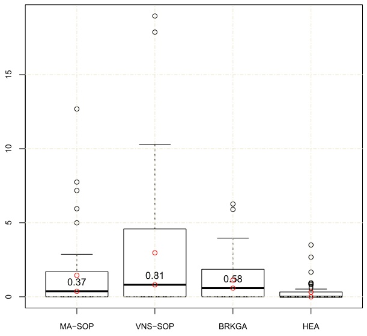

(a) Instances with $w = 0 . 4$

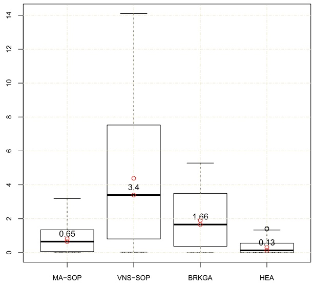

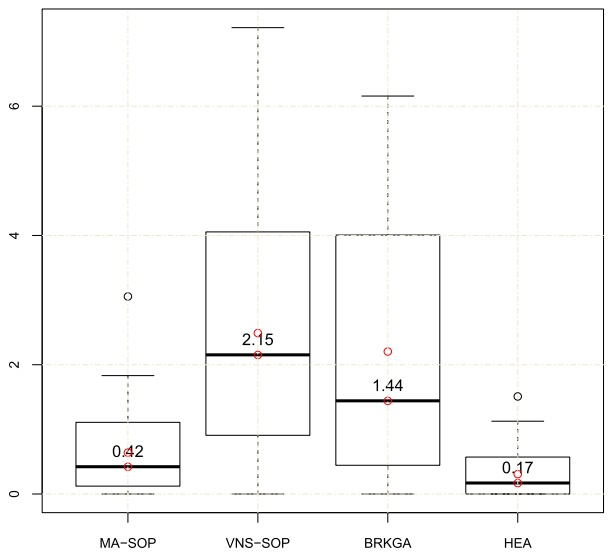

(c) Instances with $w = 0 . 8$

(b) Instances with $w = 0 . 6$

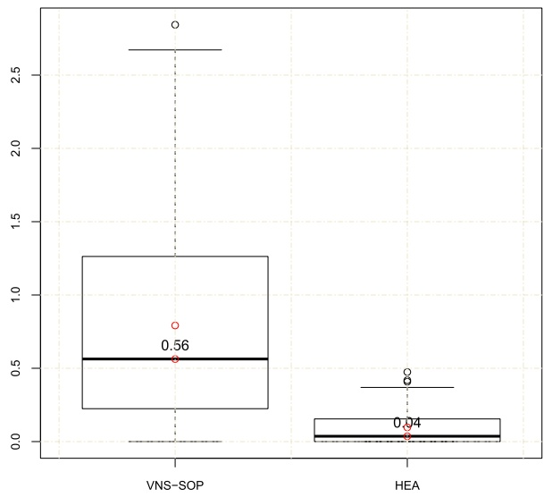

(d) Instances with $w = 1 . 0$

Fig. 4. Boxplots of the normalized average objective values.

## 6.4. Usefulness of the population-based framework

To analyze the impact of the population-based framework, we compare the proposed HEA with a multi-restart version of the local refinement procedure from Section 4.6 (we denote the version as MLR). Based on the general multi-restart framework [36,37], MLR performs a number of iteration where each iteration first calls a randomized greedy constructive procedure (Section 4.3) to generate an initial solution, which is then improved by local refinement (Section 4.6). For a fair assessment, we set the stopping criterion of MLR relative to our HEA algorithm.

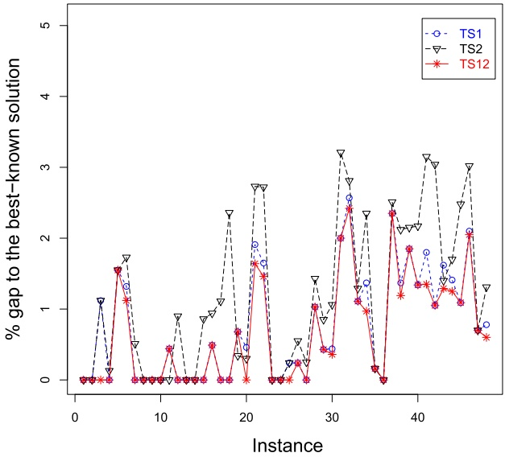

(a) Best results

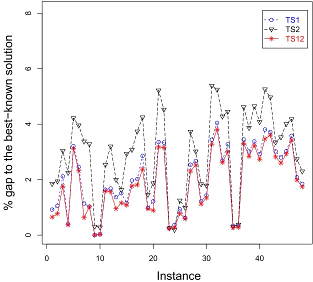

(b) Average results

Fig. 5. Comparison of three TS procedures used as single solution-based approaches.

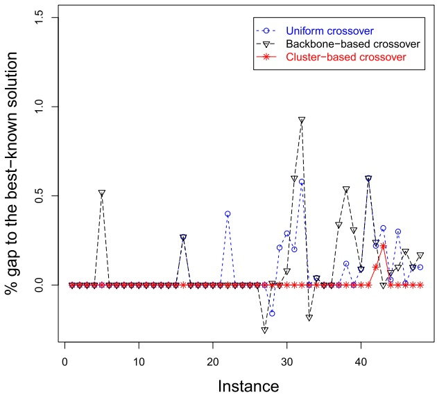

(a) Best results

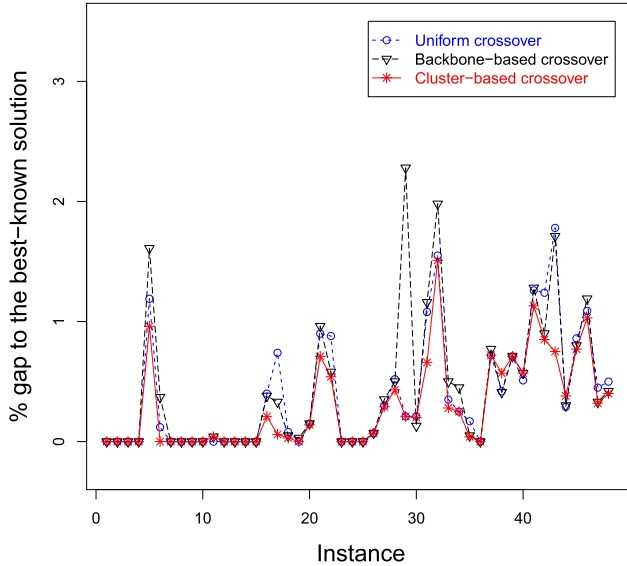

(b) Average results

Fig. 6. Comparison of three crossover operators.

In this experiment, both algorithms were executed 20 times per instance. The best and the average performances are plotted in Fig. 8, where the y-axis indicates the percentage gap to the updated best-known solution. The figure clearly demonstrates that the population-based framework positively contributes to the overall HEA performance.

## 6.5. Parameter sensitivity analysis

As shown in Table 1, the proposed algorithm requires six parameters: population size $( p ) ,$ search depth during local refinement (𝐿), tabu tenure management factor (𝛼), frequency of using tour improvement $( u _ { c } )$ , frequency of updating 𝜑 $\textit { p } ( u _ { p } ) _ { \circ }$ and mutation strength $( \eta )$ . To evaluate the sensitivity of each parameter, we test a subset of reasonable settings for the given parameter (see Table 1), while fixing the other parameters to their final values (see Table 1). In this experiment, we perform 20 independent runs per instance for each setting.

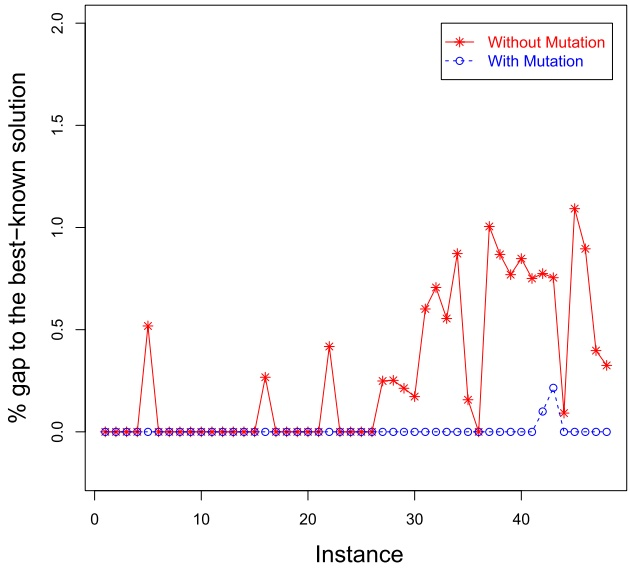

(a) Best results

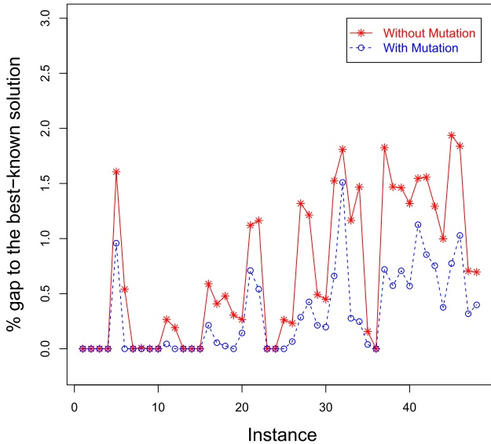

(b) Average results

Fig. 7. Comparisons of two HEA versions with and without the mutation operator.

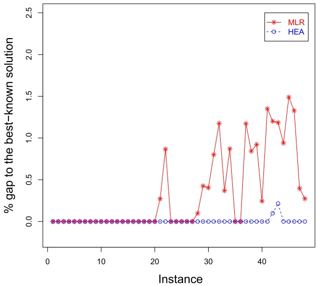

(a) Best results

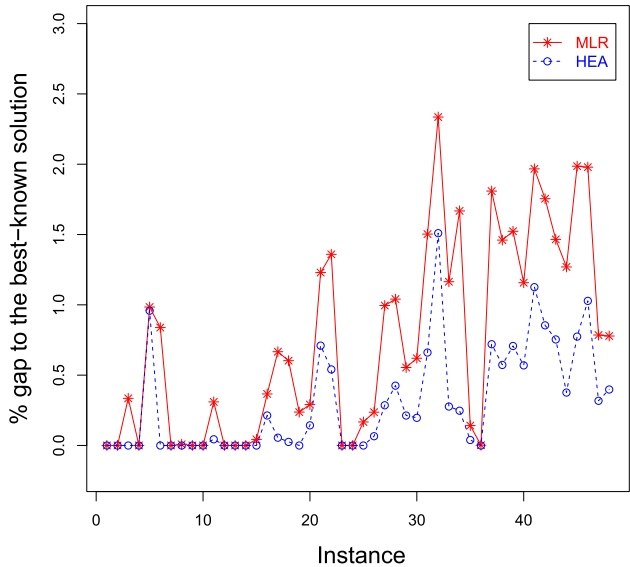

(b) Average results

Fig. 8. Comparisons of HEA with MLR (a multi-restart version).

The distribution and range of the normalized average results for each parameter and each corresponding setting are shown in the box and whisker plots (see Fig. 9). Furthermore, we show in Fig. 9 the 𝑝-values of the Friedman rank sum test to determine whether there are statistically significant differences between different settings of a given parameter. The test reveals a statistically significant difference between settings of parameters $p ,$ 𝛼 and $u _ { c } ,$ while the other parameters do not exhibit sensitivity. This means that a greater performance can be achieved by carefully adjusting these significant parameters. From Fig. 9, we observe that the setting of parameters determined by F-race (see Table 1) is in line with the results reported in this experiment.

## 6.6. Convergence analysis

This section investigates the convergence ability of HEA and an open source SOP algorithm VNS-SOP [35] (available at: [https://github.com/ctu-mrs/vns-sop](https://github.com/ctu-mrs/vns-sop)). We provide convergence graphs comparing the two algorithms on four representative instances (157rat783T80p1, 201pr1002T80p1, 212u1060T80p1, and 217vm1084T80p1) selected from the set of large benchmark instances with $w   =   0 . 8$ . A convergence graph is given as a function $t \rightarrow f ,$ where 𝑡 is the running time and 𝑓 is the best objective value found at time 𝑡.

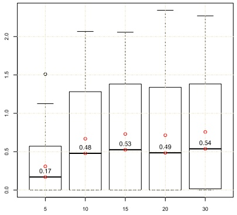

(a) p:Friedman p-value = 1.68e-15

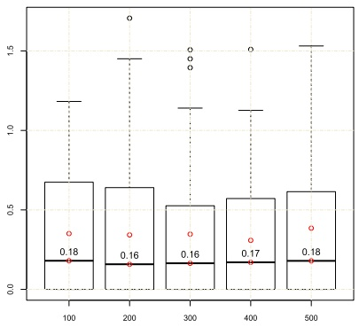

(b) L:Friedman p-value = 0.07166

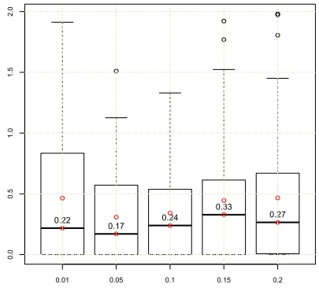

(c) α:Friedman p-value = 2.01e-08

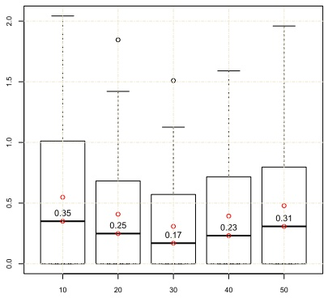

(d) $u _ { c } ;$ Friedman p-value = 2.84e-13

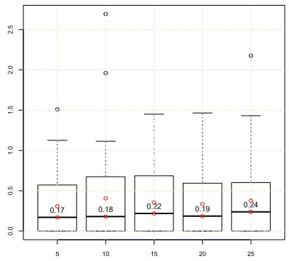

(e) up:Friedman p-value = 0.1488

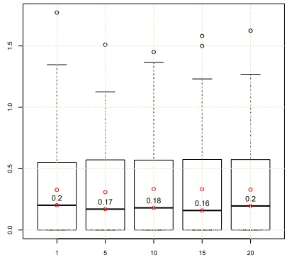

(f) η:Friedman p-value = 0.8782

Fig. 9. Boxplots of the normalized average objective values for each considered value of a given parameter.

In this experiment, we use the same cutoff time of 300 seconds per run for both algorithms, and record the best objective values reached during the process. The convergence graphs in Fig. 10 not only show a faster convergence of HEA compared to VNS-SOP, but also a better performance in terms of the quality of the converged solutions.

## 7. Real-world example

To demonstrate the practical usefulness of the proposed algorithm, we apply it to a real-world trip planning case for a one-day tour in Wuhan city at China. Wuhan is one of the biggest cities in middle China. It has many points of interest (POIs) that attract a large number of tourists every year. These POIs can be divided into different clusters by categories $( \mathbf { e . g . } ,$ museums, theaters, parks, historic sites, etc), which represent different types of attraction sites. The real data-set of POIs for Wuhan is extracted from Hubei Kanghui Travel Agency. The travel time between any two POIs is computed by Google map. The purpose is to maximize the total collected score of visited POIs under time constraints. We assume that at most one POI can be visited for each cluster and that one hotel is provided as the start point. Consequently, this problem is equivalent to the SOP studied in this work. Fig. 11 shows a trip, planned for one day starting from the Mayflower Hotel at 8:00 AM and ending at the Mayflower Hotel at 19:30 PM.

Based on the provided real data of POIs, we generated five real-world SOP instances with 50 POIs, where the POIs are divided into 10 different categories (clusters). To evaluate the performance of the proposed algorithm on these instances, we compare it against a greedy heuristic (GH) that is currently being used by Hubei Kanghui Travel Agency. Table 12 presents the solutions obtained by HEA and GH as well as the percentage gap 𝐺𝑎𝑝(%) between the solutions obtained with HEA and GH.

From Table $^ { 1 2 , }$ we observe that HEA strongly outperforms the greedy heuristic (GH) with an average improvement of 5.72%. Besides, it can be easily adapted to solve the multi-day trip planning case. This real-world application thus confirms the practical significance of the proposed algorithm.

## 8. Conclusion

The Set Orienteering Problem (SOP) is an extension of the classic Orienteering Problem (OP) derived from a number of practical situations. In this paper, we developed a highly effective hybrid evolutionary algorithm (HEA) for SOP that combines a powerful local refinement procedure with a cluster-based crossover operator and a randomized mutation procedure. The local refinement iterates between a feasible and an infeasible local search for an improved search intensification. The computational results show that the proposed algorithm significantly outperforms the best performing heuristics from the SOP literature. The advantage of HEA is particularly evident on the set of 192 large benchmark instances with at least 200 vertices, where HEA found new improved solutions (lower bounds) for 54 instances while matching the existing best-know results for 133 cases. These new lower bounds can serve as a reference for assessments of the future SOP algorithms.

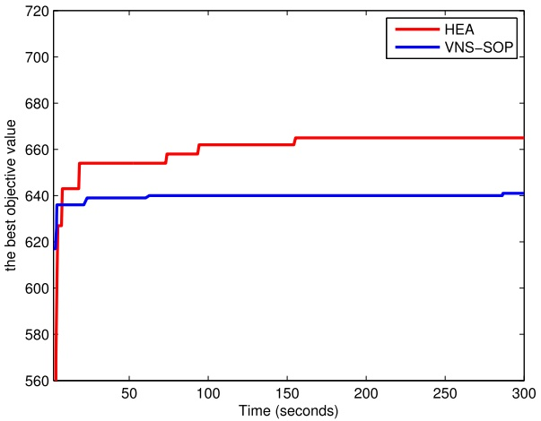

(a)

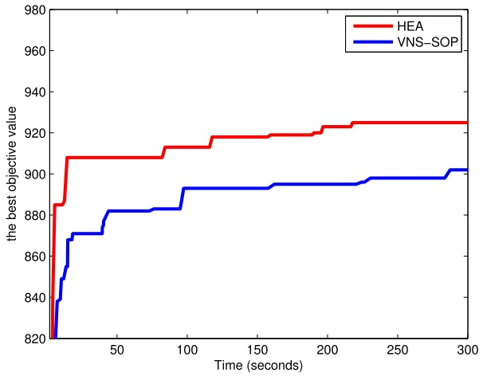

(b)

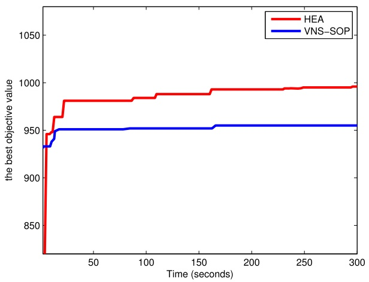

(c)

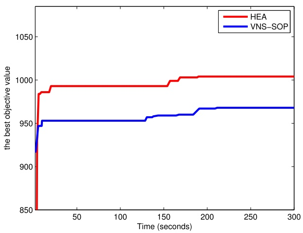

(d)

Fig. 10. Convergence graphs of HEA and VNS-SOP on four selected instances.

Table 12

Computational results of HEA and GH.

| Instance | GH | HEA | 𝐺𝑎𝑝(%) |
| --- | --- | --- | --- |
| 1 | 608 | 626 | 2.96 |
| 2 | 723 | 766 | 5.95 |
| 3 | 539 | 571 | 5.94 |
| 4 | 674 | 706 | 4.75 |
| 5 | 1023 | 1115 | 8.99 |
| Avg. |  |  | 5.72 |

For future work on SOP, it could be beneficial to design new components of a population-based framework (e.g., crossover operators, move operators, diversification strategies) based on exploitation of the problem-specific knowledge. Additionally, it would be interesting to investigate whether HEA could be adapted to tackle problems that are related to SOP, including the multiple salesmen with additional constraints such as the maximum capacity of vehicles and the time windows of customers.

## CRediT authorship contribution statement

**Yongliang Lu:** Conceptualization, Methodology, Software, Writing – original draft. **Una Benlic:** Writing – review & editing. **Qinghua Wu:** Supervision, Validation, Writing – review & editing.

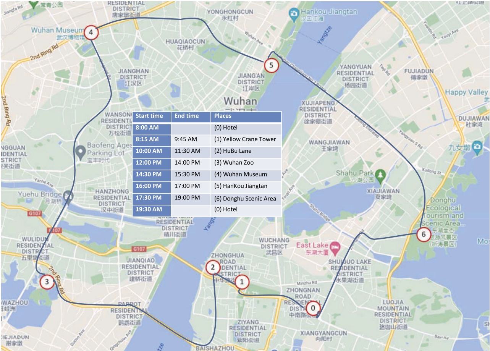

Fig. 11. A solution for 6 selected places for one day.

## Declaration of competing interest

The authors declare that they have no known competing financial interests or personal relationships that could have appeared to influence the work reported in this paper.

## Data availability

Data will be made available on request.

## Acknowledgement

We are grateful to the reviewers for their useful comments, which helped us to significantly improve the paper. This work is partially supported by the National Natural Science Foundation Program of China [Grant No. 72122006, 71771099, 72371076, 71821001].

## References

[1] [C. Archetti, F. Carrabs, R. Cerulli, The set orienteering problem, Eur. J. Oper. Res. 267 (1) (2018) 264–272.](http://refhub.elsevier.com/S0020-0255%2823%2901398-1/bibDAE6F5CD0BECBDA6CA574653347B65A6s1)

[2] [E. Angelelli, C. Archetti, M. Vindigni, The clustered orienteering problem, Eur. J. Oper. Res. 238 (2) (2014) 404–414.](http://refhub.elsevier.com/S0020-0255%2823%2901398-1/bib806A0981CB507C9E2B6A3DD8D2A5DEEBs1)

[3] [M. Birattari, Z. Yuan, P. Balaprakash, T. Stützle, F-race and iterated F-race: an overview, in: Experimental Methods for the Analysis of Optimization Algorithms, Springer, Berlin Heidelberg, 2010, pp. 311–336.](http://refhub.elsevier.com/S0020-0255%2823%2901398-1/bibF0FCEF4DB0B334B540FE355BC6518AD9s1)

[4] [R. Bernardino, A. Paias, Solving the family traveling salesman problem, Eur. J. Oper. Res. 267 (2) (2018) 453–466.](http://refhub.elsevier.com/S0020-0255%2823%2901398-1/bibF97CB519F22787B38F9B9342D7D112FCs1)

[5] [F. Carrabs, A biased random-key genetic algorithm for the set orienteering problem, Eur. J. Oper. Res. 292 (3) (2021) 830–854](http://refhub.elsevier.com/S0020-0255%2823%2901398-1/bib838E878BC1245699020BF7A70E84679Bs1).

[6] [M. Castro, K. Sörensen, P. Vansteenwegen, P. Goos, A memetic algorithm for the travelling salesperson problem with hotel selection, Comput. Oper. Res. 40 (7) (2013) 1716–1728.](http://refhub.elsevier.com/S0020-0255%2823%2901398-1/bib7B1622168D8ECE187DAA20308A41CCE8s1)

[7] [Y. Chen, J.K. Hao, F. Glover, A hybrid metaheuristic approach for the capacitated arc routing problem, Eur. J. Oper. Res. 253 (1) (2016) 25–39.](http://refhub.elsevier.com/S0020-0255%2823%2901398-1/bibCC5926191E055B0E27D746992079BA8Ds1)

[8] [X. Chou, L.M. Gambardella, R. Montemanni, A tabu search algorithm for the probabilistic orienteering problem, Comput. Oper. Res. 126 (2021) 105107](http://refhub.elsevier.com/S0020-0255%2823%2901398-1/bibFAF03860665AC9D67DB5E57E65DB30C9s1).

[9] [T. Derya, E. Dinler, B. Kececi, Selective generalized travelling salesman problem, Math. Comput. Model. Dyn. Syst. 26 (1) (2020) 80–118.](http://refhub.elsevier.com/S0020-0255%2823%2901398-1/bibCAD721EE131208127665BE512860CB4Cs1)

[10] [A. Divsalar, P. Vansteenwegen, K. Sörensen, D. Cattrysse, A memetic algorithm for the orienteering problem with hotel selection, Eur. J. Oper. Res. 237 (1) (2014) 29–49.](http://refhub.elsevier.com/S0020-0255%2823%2901398-1/bib8B2C1461DE29BB8768301055BC62825Bs1)

[11] [M. Dontas, G. Sideris, E.G. Manousakis, E.E. Zachariadis, An adaptive memory matheuristic for the set orienteering problem, Eur. J. Oper. Res. 309 (3) (2023) 1010–1023.](http://refhub.elsevier.com/S0020-0255%2823%2901398-1/bib4D695298223BCBABB9567AC7878692D3s1)

[12] [M. Fischetti, J.J. Gonzalez, P. Toth, A branch-and-cut algorithm for the symmetric generalized traveling salesman problem, Oper. Res. 45 (3) (1997) 378–394.](http://refhub.elsevier.com/S0020-0255%2823%2901398-1/bib409620AC532AE9FF295B44F7542C5166s1)

[13] [J. Faigl, R. Peni ˇ cka, ˇ G. Best, Self-organizing map-based solution for the orienteering problem with neighborhoods, in: IEEE International Conference on Systems, Man and Cybernetics, 2016, pp. 1315–1321](http://refhub.elsevier.com/S0020-0255%2823%2901398-1/bibDD5D3331C837F4AF9187E61300A8ECA1s1).

[14] [O. Goudet, J.K. Hao, A massively parallel evolutionary algorithm for the partial Latin square extension problem, Comput. Oper. Res. 158 (2023) 106284.](http://refhub.elsevier.com/S0020-0255%2823%2901398-1/bib7D376A29F34E8FD9068F33904B7D8774s1)

[15] [M.A. Golmankhaneh, M. Keshtkaran, ACS-SOP: a new solution method to the set orienteering problem, in: 2020 10th International Conference on Computer and Knowledge Engineering, ICCKE, IEEE, 2020, pp. 644–647.](http://refhub.elsevier.com/S0020-0255%2823%2901398-1/bibBC69A69D214D60B6C69027C2039FFCE1s1)

[16] [A. Gunawan, H.C. Lau, P. Vansteenwegen, Orienteering problem: a survey of recent variants, solution approaches and applications, Eur. J. Oper. Res. 255 (2) (2016) 315–332.](http://refhub.elsevier.com/S0020-0255%2823%2901398-1/bib7D4912E5A68F60C858EF2C0F880F3A9Fs1)

[17] [F. Glover, Tabu search - part I, ORSA J. Comput. 1 (3) (1989) 190–260.](http://refhub.elsevier.com/S0020-0255%2823%2901398-1/bib9DCD2538D4413DFE26F60E9A2A5B5689s1)

[18] [A. Gunawan, K.M. Ng, G. Kendall, J. Lai, An iterated local search algorithm for the team orienteering problem with variable profits, Eng. Optim. 50 (7) (2018) 1148–1163.](http://refhub.elsevier.com/S0020-0255%2823%2901398-1/bib40AA3E7D97DCDB787448B35C79059A60s1)

[19] [K. Helsgaun, General k-opt submoves for the Lin-Kernighan TSP heuristic, Math. Program. Comput. 1 (2–3) (2009) 119–163.](http://refhub.elsevier.com/S0020-0255%2823%2901398-1/bib53E492F203D6011D242351F30F5B0AA3s1)

[20] [K. Helsgaun, Solving the equality generalized traveling salesman problem using the Lin-Kernighan-Helsgaun Algorithm, Math. Program. Comput. 7 (3) (2015) 269–287.](http://refhub.elsevier.com/S0020-0255%2823%2901398-1/bib2BCD16785A0D672D2F3CFB855E462E6As1)

[21] [J.K. Hao, Memetic algorithms in discrete optimization, in: Neri, et al. (Eds.), Handbook of Memetic Algorithms, Springer, Berlin Heidelberg, 2012, pp. 73–94.](http://refhub.elsevier.com/S0020-0255%2823%2901398-1/bib6D9FD0B36A6D44F2E084564AF0A3D32Bs1)

[22] [P. He, J.K. Hao, Q. Wu, Hybrid genetic algorithm for undirected traveling salesman problems with profits, Networks 82 (3) (2023) 189–221.](http://refhub.elsevier.com/S0020-0255%2823%2901398-1/bibCCFEA563E85FEFB430A10277A5F654CBs1)

[23] [P. He, J.K. Hao, Q. Wu, Grouping memetic search for the colored traveling salesmen problem, Inf. Sci. 570 (2021) 689–707](http://refhub.elsevier.com/S0020-0255%2823%2901398-1/bib4D1B3F1C2DD4BFD210CD12D9356A4BCCs1).

[24] [H. Ismkhan, Effective three-phase evolutionary algorithm to handle the large-scale colorful traveling salesman problem, Expert Syst. Appl. 67 (2017) 148–162](http://refhub.elsevier.com/S0020-0255%2823%2901398-1/bib13826190E640310398AEC33746ADD8BCs1).

[25] [Y. Jin, J.K. Hao, Hybrid evolutionary search for the minimum sum coloring problem of graphs, Inf. Sci. 352 (2016) 15–34.](http://refhub.elsevier.com/S0020-0255%2823%2901398-1/bibDDB99A8247B8D37E3D0DE3AF95BBF9F3s1)

[26] [G. Kobeaga, M. Merino, J.A. Lozano, An efficient evolutionary algorithm for the orienteering problem, Comput. Oper. Res. 90 (2018) 42–59](http://refhub.elsevier.com/S0020-0255%2823%2901398-1/bib3738FE816F833A8AF0823FFCD8736C46s1).

[27] [E. Kaya, B. Gorkemli, B. Akay, D. Karaboga, A review on the studies employing artificial bee colony algorithm to solve combinatorial optimization problems, Eng. Appl. Artif. Intell. 115 (2022) 105311.](http://refhub.elsevier.com/S0020-0255%2823%2901398-1/bib4D14EDAADADE12A81B30B5E02B99507Es1)

[28] [W. Liu, R. Wang, T. Zhang, K. Li, W. Li, H. Ishibuchi, Hybridization of evolutionary algorithm and deep reinforcement learning for multi-objective orienteering optimization, IEEE Trans. Evol. Comput. (2022).](http://refhub.elsevier.com/S0020-0255%2823%2901398-1/bib3F80E851F5A190D0AA7B5893466FBF1Fs1)

[29] [Y. Lu, J.K. Hao, Q. Wu, Hybrid evolutionary search for the traveling repairman problem with profits, Inf. Sci. 502 (2019) 91–108.](http://refhub.elsevier.com/S0020-0255%2823%2901398-1/bibAC13AD63A1F4E67CC63477253CBD7741s1)

[30] [Y. Lu, U. Benlic, Q. Wu, A highly effective hybrid evolutionary algorithm for the covering salesman problem, Inf. Sci. 564 (2021) 144–162.](http://refhub.elsevier.com/S0020-0255%2823%2901398-1/bib5666571985C8F9D48279723250DF2323s1)

[31] [Y. Lu, U. Benlic, Q. Wu, A memetic algorithm for the orienteering problem with mandatory visits and exclusionary constraints, Eur. J. Oper. Res. 268 (1) (2018) 54–69.](http://refhub.elsevier.com/S0020-0255%2823%2901398-1/bib57036FE6D9B4F1445B648C17C5EA0108s1)

[32] [S. Lin, B.W. Kernighan, An effective heuristic algorithm for the traveling-salesman problem, Oper. Res. 21 (2) (1973) 498–516.](http://refhub.elsevier.com/S0020-0255%2823%2901398-1/bib31F9A16464491E429DA3A186D2D75C4Cs1)

[33] [C.E. Noon, J.C. Bean, An efficient transformation of the generalized traveling salesman problem, Inf. Syst. Oper. Res. 31 (1) (1993) 39–44.](http://refhub.elsevier.com/S0020-0255%2823%2901398-1/bib3CDD9BB029F74580801C9707A7304E28s1)

[34] [F. Neri, C. Cotta, P. Moscato, Handbook of Memetic Algorithms, Springer, Berlin Heidelberg, 2012](http://refhub.elsevier.com/S0020-0255%2823%2901398-1/bib534D3F55146EF23DB9FF9607EB8E601As1).

[35] [R. Peni ˇ cka, ˇ J. Faigl, M. Saska, Variable neighborhood search for the set orienteering problem and its application to other orienteering problem variants, Eur. J. Oper. Res. 276 (3) (2019) 816–825.](http://refhub.elsevier.com/S0020-0255%2823%2901398-1/bib9718AFA58EA9AED5152BCA1B05B78560s1)

[36] [W. Sun, W. Li, J.K. Hao, Q. Wu, Learning-based multi-Start iterated local search for the profit maximization set covering problem, Inf. Sci. 119404 (2023).](http://refhub.elsevier.com/S0020-0255%2823%2901398-1/bib5F5E1EA87DE589A623A3630B7C30B673s1)

[38] [A. Urrutia-Zambrana, G. Tirado, A. Mateos, Variable neighborhood search to solve the generalized orienteering problem, Int. Trans. Oper. Res. 28 (1) (2021) 142–167.](http://refhub.elsevier.com/S0020-0255%2823%2901398-1/bib6BE0DEF7E0753F4B6A287483623B1130s1)

[37] [I.G. Tsoulos, A. Tzallas, An improved multi-start-based method for global optimisation problems, Int. J. Comput. Intell. Stud. 11 (2) (2022) 73–93.](http://refhub.elsevier.com/S0020-0255%2823%2901398-1/bib41BB0A7F7E9A7DC07BB1B2A6ABCAC36As1)