# The Parallel Drone Scheduling Problem with Multiple Drones and Vehicles

Raïssa G. Mbiadou Saleu $^{a,*}$ , Laurent Deroussi $^{a}$ , Dominique Feillet $^{b}$ , Nathalie Grangeon $^{a}$ , Alain Quilliot $^{a}$

$^{a}$ Université Clermont Auvergne, LIMOS UMR CNRS 6158, 1 Rue de la Chebarde, 63178 Aubière Cedex, France  
$^{b}$ Mines Saint-Etienne, Univ. Clermont Auvergne, LIMOS UMR CNRS 6158, Centre CMP, F-13541 Gardanne, France

## Abstract

Delivery of goods into urban areas constitutes an important issue for logistics service providers. One of the most talked-about developments in recent years has been the potential use of unmanned aerial vehicles, or drones, for transporting packages, food, medicine, and other goods. Delivery by drones offers new possibilities, but also induces new challenging routing problems. In this paper, we address and extend the so-called Parallel Drone Scheduling Traveling Salesman Problem. Basically, in this problem, deliveries are split between a vehicle and one or several drones. The vehicle performs a classical delivery tour from the depot, while the drones are constrained to perform back and forth trips. The objective is to minimize the completion time. We extend the problem by considering several vehicles. We call it Parallel Drone Scheduling Multiple Traveling Salesman Problem. We propose a hybrid metaheuristic for its solution. The procedure starts by building a giant tour visiting all customers. Then, the giant tour is split in order to determine a set of vehicles tours (each vehicle tour following the order defined by the giant tour) and a set of customers assigned to drones. Thirdly, an improvement step moves customers between vehicles or between vehicles and drones. We also propose a Mixed Integer Linear Programming formulation and a simple branch-and-cut approach. The proposed approach is validated via an experimental campaign on instances taken from the CVRPLIB $^{1}$ library. Computational experiments comparing several variants of the hybrid metaheuristic give some insights on this drone delivery system.

Keywords: routing, drone delivery, city logistics, m-TSP, ILS, dynamic programming

## 1. Introduction

The E-commerce boom and new urban restrictions on truck traffic have led to innovative models of parcel distribution. In December 2013, the chief executive officer of the largest online retailer Amazon Jeff Bezos shared with the world his vision of using flying robots to deliver products. «I know this looks like science fiction. It’s not» he assured of the service called Amazon Prime Air [3]: a drone designed to deliver packages in just 30 minutes (Figure 1). Using unmanned aerial vehicles (UAVs) for door-to-door deliveries seemed like a laughable pipe dream when Amazon tossed out that fanciful idea. Even though, some people didn’t find the concept so far-fetched, many other companies and logistics providers started getting interested in experimenting with drone delivery. In August 2014, Google revealed its drone delivery project called wing [47], with experiments run in Australia (Figure 2). In September 2014, DHL Deutsche Post, Germany’s privatized postal system, launched its parcelcopter, a helicopter-style drone which could deliver medications and urgently needed goods to the remote North Sea island of Juist [13] (Figure 3). In 2016, the American courier company UPS has launched tests on the use of drones to deliver parcels to remote or hard-to-reach areas. In February 2017, they successfully tested a drone delivery method in which a drone (called HorseFly) is launched from the roof of a delivery truck [1] (Figure 4). Many other companies like Alibaba [22], Australia

<small>\*Corresponding author</small>

<small>Email addresses: raissa.saleu@isima.fr (Raïssa G. Mbiadou Saleu), laurent.deroussi@uca.fr (Laurent Deroussi), feillet@emse.fr (Dominique Feillet), nathalie.grangeon@uca.fr (Nathalie Grangeon), alain.quilliot@isima.fr (Alain Quilliot)</small>

<small>$^{1}$ Capacited Vehicle Routing Problem LIBrary</small>

Post [17] or DPD Group [15] have launched similar projects. Drones have also been deployed for humanitarian logistics [49].

Different types of integration of drones into last-mile delivery have been investigated by companies and academics. Drones can be used alone or in combination with other means of delivery such as traditional trucks. In the combined operations of aerial drones and trucks, synchronization may or may not be required:

\- Synchronization occurs when UAVs travel on trucks that not only perform their delivery tours but also serve as a mobile depot for UAVs. In this process, a UAV can be loaded with a package from a truck, deliver the package and return to a truck (potentially the same) for a next delivery. In the meanwhile, trucks continue their tours.

\- Synchronization is not required when UAVs and vehicles perform independent tasks. Typically, both execute independent deliveries from a central distribution center.

Most studies have been carried out with the prospect of making drones and trucks work in tandem, drones taking off from the trucks and next landing back while those trucks are themselves involved into delivery tasks. This approach is likely to prevail when distribution centers are far from customers. But, as pointed out in [28], if distribution centers are small, deeply embedded in a urban area and close to customers, direct deliveries with drones are possible. This process is simpler to implement by the logistics provider since it will not require any synchronization protocol. The provider will just have to split tasks between trucks and drones. In addition, having drones and trucks working in parallel will also ensure more robustness to the global delivery process.

In this paper, we are interested in the latter, that is, deliveries performed by drones and vehicles (trucks) in parallel, without synchronization. Vehicles perform classical parcel delivery tours; drones repeat single-customer back-and-forth trips. We propose a hybrid metaheuristic combining Iterated Local Search and Dynamic Programming. This heuristic is inspired from a heuristic that we developed previously for a simplified problem, where the fleet of trucks was limited to a single vehicle [29]. Note that generalizing the heuristic necessitates significant changes, as will be seen in Section 4.

The paper is structured as follows. In Section 2, we discuss upon the most relevant related literature. Section 3 defines our problem formally and provides a Mixed Integer Linear Programming (MILP) formulation. We propose a hybrid metaheuristic to solve the problem in Section 4. Section 5 presents experimental results. Section 6 concludes the paper.

## 2. Related work

The problem of parcel delivery with drones has received increasing attention these last years. Proposals for drone delivery vary widely, with drones being used independently or in conjunction with deliveries by trucks. This review focuses on routing problems involving truck-drone combination for parcel delivery. However, we note that works on drone-only delivery systems can be found in  $[14, 39, 42, 8, 43, 7, 41]$ . Most of these studies assume that a drone can lift multiple packages within its maximum payload and serve customers in a service area of given radius. The main constraints are on weight, battery energy and customers time windows. Additionally, apart from package delivery applications, many works investigate the potential of UAVs in other non-military applications like disaster management, rescue operations, agriculture or healthcare. A survey about the use of UAVs for civil applications is provided by Otto et al.  $[33]$ .

The problem of combining a drone with a traditional delivery truck for parcel delivery was first formally defined by Murray and Chu [31]. They introduced two different problems: the Flying Sidekick Traveling Salesman Problem (FSTSP), where deliveries are performed by a single vehicle and a single drone working in tandem (the drone travels on the truck and can temporarily fly to make a delivery on its own) and the Parallel Drone Scheduling Traveling Salesman Problem (PDSTSP), where a vehicle and a fleet of drones operate separately from the depot. Figure 5 illustrates a standard delivery system with a truck and the two proposed delivery systems with drones. MILP formulations and greedy construction heuristics for both problems were provided.

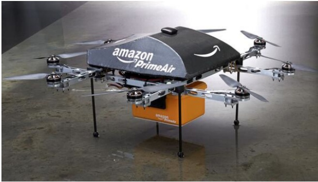

Figure 1 Amazon Prime Air

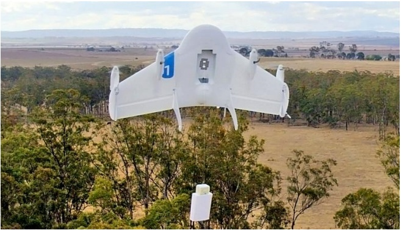

Figure 2 Google Wing

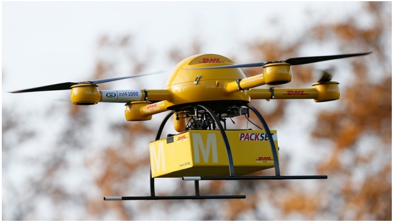

Figure 3 DHL Parcelcopter

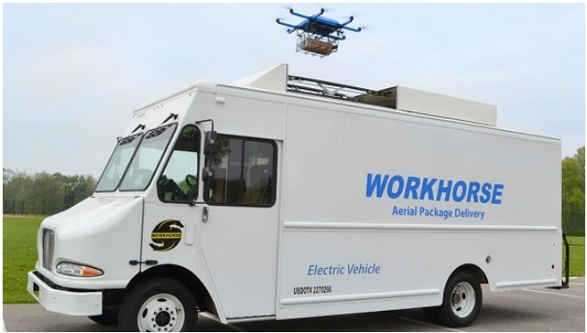

Figure 4 UPS HorseFly

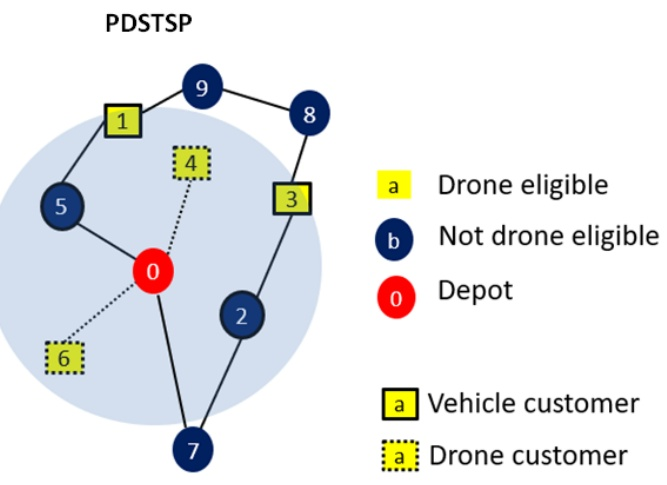

Truck-only tour Truck-drone working in tandem

Truck-drone working in parallel

Figure 5 Illustration of FSTSP and PDSTSP vs truck-only delivery

Since then, many studies have explored different variants of truck-drone combination for parcel delivery. Considering works related to the FSTSP, the single-truck single-drone variant (also called TSP with drone, TSP-D) is addressed in many papers. Agatz et al. [2] provided a MILP formulation and a route first - cluster second heuristic. Ponza [37], Daknama and Kraus [10], Marinelli et al. [27], Ha et al. [19], Yurek and Ozmutlu [48], freitas et al. [18], and Schermer et al. [40] proposed neighborhood-search based heuristics. Bouman et al. [5] provide exact solution approaches based on dynamic programming.

Other works consider a single-truck and multiple UAV's. Problems in this class assume that from each truck stop one or several drones can be launched. Chang et al. [6] and Ferrandez et al. [30] proposed clustering based heuristics to find truck stops from where drones are launched. Tu et al. [44] called this problem TSP-mD and they proposed an adaptive large neighborhood search (ALNS) heuristic. In [32], the same problem is called mFSTSP and the authors provided a MILP formulation and a three-phases heuristic solution approach.

The case involving both multiple trucks and multiple UAVs is considered in [24] where autonomous drones are allowed to fly from a delivery truck, make deliveries, and fly to any available truck nearby. A MILP formulation and an algorithm based on insertion heuristics are provided. Wang et al. [46] studied the so-called Vehicle Routing Problem with Drones (VRPD) in which a drone launched from a truck must be picked up by the same truck at the same or at a different location. A worst-case analysis on the benefits achieved using drones is provided. This line of research is pursued by the same authors in [36]. Pugliese and Guerriero [38] extended the VRPD by considering time window constraints. The problem is modeled as a variant of the vehicle routing problem with time windows (VRPTW) where each vehicle is equipped with drones (VDRPTW). A MILP formulation is proposed.

Literature related to the PDSTSP is more limited. In our previous work [29], we proposed an iterative two-step heuristic, composed of: a coding step that transforms a solution into a customer sequence, and a decoding step that decomposes the customer sequence into a tour for the vehicle and series of trips for the drone(s). Decoding was expressed as a bicriteria shortest path problem and carried out by dynamic programming. Dell'Amico et al. [12] presented a set of matheuristic methods. Kim and Moon [23] considered a variant of the PDSTSP in which UAVs can not only be deployed from the depot but also from dedicated drone stations.

Ham [20] studied a multi-truck multi-depot variant of the PDSTSP considering two different types of drone tasks: drop-off and pickup. After a drone finishes a delivery task, it can either fly back to the depot to deliver the next parcels or fly directly to another customer to pick up a returned parcel. The problem is solved with a constraint programming approach.

Ulmer and Thomas [45] studied a dynamic version of the PDSTSP. They called their problem Same-Day Delivery Routing Problem with Heterogeneous Fleets (SDDPHF). The SDDPHF considers two fleets of vehicles and drones that deliver goods from the depot to customers who dynamically request services. When a new customer request arrives, a dispatcher has to decide whether or not to accept the customer for the same-day delivery and determine the according assignment and routing decisions. The SDDPHF takes into account a time window for each request, the loading time for both vehicles and drones, the time to drop off a package from a vehicle or a drone as well as the recharging or battery swap time for drones. The objective is to maximize the expected number of customers served the same day. To solve the problem, the authors proposed an adaptive dynamic programming approach called parametric policy function approximation (PFA).

In another class of truck-drone combination problems, all deliveries are assigned to UAVs: trucks are only used to carry the UAVs. Mathew et al. [28] called this problem Heterogeneous Delivery Problem (HDP). They proved that the HDP is NP-hard and proposed an efficient reduction to the Generalized Traveling Salesman Problem. In [35], Poikonen introduced the multi-visit drone routing problem (MVDRP) which considers a tandem between a truck and a drone. The drone can take off from the truck with one or more packages to deliver to customers. The drone may return to the truck to swap/recharge batteries, pick up a new set of packages, and launch again to customer locations. The goal of the MVDRP is to minimize completion time. To solve the problem, the author proposed a flexible heuristic. The solution method is extended to a truck and multi-drones model, named k-MVDRP. In [4], Othman et al. introduced two settings of the problem. In the first setting, while the drone is making a delivery, the truck is not allowed to wait at the last rendez-vous point nor to intercept the drone at any rendez-vous point more than once. Conversely, in the second setting, the truck is allowed to wait for the drone at the last rendez-vous point or to re-visit a rendez-vous point multiple times. They modeled this problem as a problem of finding a special type of path in a graph with a special structure, and proposed a polynomial-time approximation algorithm for each of the problem settings. Luo et al. [26] studied the two-echelon cooperated ground vehicle and its carried UAV routing problem (2E-GU-RP) which considers a set of targets, each of whom must be served exactly once by the UAV. They provided an integer programming model and two heuristics.

Dayarian et al. [11] introduced another original truck-drone combination problem where delivery vehicles are regularly resupplied by drones. Resupply can take place whenever a delivery vehicle is stationary and a drone can land on the vehicle's roof. The problem is named Vehicle Routing Problem with Drone Resupply (VRPDR). The authors presented several policy function approximations to analyze different routing and assignment strategies.

Table 1 reports the main papers dealing with UAVs and vehicles performing independent tasks. Columns #V and #D indicate the number of vehicles and drones, respectively.

| Reference | Problem | #V | #D | Drone capacity | Solution methods |
| --- | --- | --- | --- | --- | --- |
| Murray and Chu [31] | PDSTSP | 1 | m | 1 | MILP, heuristics |
| Saleu et al. [29] | PDSTSP | 1 | m | 1 | MILP, iterative two-step heuristic |
| Dell'Amico et al. [12] | PDSTSP | 1 | m | 1 | MILP, matheuristic |
| Ulmer and Thomas [45] | SDDPHF | k | m | 1 | Adaptive dynamic programming |
| Ham [20] | PDSTSP drop&amp;pickup | k | m | $\geq 1$ | Constraint programming |
| This work | PDSMTSP | k | m | 1 | MILP, hybrid metaheuristic |

Table 1 UAVs and vehicles performing independent tasks

The table clearly shows that when the fleet is limited to a single truck, authors have focused on the PDSTSP. Furthermore, it shows that the natural extension of this problem to a fleet composed of multiple trucks have not been investigated so far. In this paper, we fill this gap by investigating this extension.

## 3. The Parallel Drone Scheduling Multiple Traveling Salesman Problem

In this section, we introduce the Parallel Drone Scheduling Multiple Traveling Salesman Problem (PDSMTSP), provide a MILP formulation and describe a simple branch-and-cut solution method.

## 3.1. Problem statement

Let $G = (N \cup \{0\}, A)$ be a complete directed graph where $N = \{1, \dots, n\}$ is the customer set and 0 is the depot. A fleet of $K$ vehicles and a fleet of $M$ drones are available. Each vehicle delivers customers with a single tour starting from the depot, visiting a subset of customers and returning back to the depot. Drones are constrained to perform back and forth trips between the depot and the customers, delivering a single customer in each trip. Some customers are not eligible for drone delivery, because of practical constraints such as the limited payload or the flying range of drones. The subset of customers that can be served by a drone is denoted $N_d$. These customers are consistently called drone-eligible in the rest of the paper. Figure 6 depicts a solution of the PDSMTSP on an instance with 10 customers, among which 5 are drone-eligible.

A travel time $t_{ij}$ is incurred when a vehicle goes through an arc $(i,j)\in A$. A travel time $\widehat{t}_i$ is incurred when a drone serves a customer $i\in N_d$ ($\widehat{t}_i$ includes take-off, back and forth flight trips, service and landing times). Assuming that both the vehicles and the drones can start from the depot at time 0, the objective of the PDSMTSP is to minimize the delivery completion time, i.e., the time at which all the vehicles and all drones are back to the depot, with the service of all customers carried out.

Clearly, the choice of completion time for the objective function is motivated by previous works on the subject and is somehow academic. In practice, service quality or other types of costs are likely to be considered, among which those related to: vehicle usage, energy, human resources, maintenance, logistics operations... Even so, completion time nicely reflects the objective of limiting as much as possible the time devoted to distribution and could equivalently represent a constraint on the time available for deliveries.

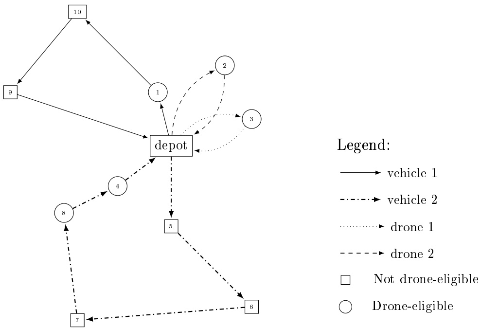

Figure 6 A set of 10 customers served by 2 vehicles and 2 drones.

## 3.2. MILP formulation

In this section, we express the PDSMTSP with a MILP formulation. We introduce the following decision variables:

\- $z_{i} = 1$ if customer $i$ is visited by a vehicle, 0 if it is visited by a drone ($i \in N$);

\- $x_{ijk} = 1$ if arc $(i,j)$ belongs to vehicle tour $k$, 0 otherwise $((i,j) \in A, 1 \leq k \leq K)$;

\- $w_{ij} = 1$ if arc $(i,j)$ belongs to a vehicle tour, 0 otherwise $((i,j) \in A)$;

\- $y_{im} = 1$ if customer $i$ is assigned to drone $m$, 0 otherwise ($i \in N_d, 1 \leq m \leq M$);

\- $T \geq 0$ indicating the completion time.

The model is:

(1)

subject to

$$
T \geq \sum_ {(i, j) \in A} t _ {i j} x _ {i j k} \quad (1 \leq k \leq K)\tag{2}
$$

$$
T \geq \sum_ {i \in N _ {d}} \widehat {t _ {i}} y _ {i m} \quad (1 \leq m \leq M)\tag{3}
$$

$$
z _ {i} = 1 \quad (i \in N \setminus N _ {d})\tag{4}
$$

$$
\sum y _ {i m} = 1 - z _ {i}
$$

$$
(i \in N _ {d})\tag{5}
$$

$$
w _ {i j} = \sum_ {1 \leq k \leq K} x _ {i j k} \quad ((i, j) \in A)\tag{6}
$$

$$
\sum_ {(i, j) \in A} w _ {i j} = z _ {i} \quad (i \in N)\tag{7}
$$

$$
\sum_ {(0, j) \in A} x _ {0 j k} \leq 1 \quad (1 \leq k \leq K)\tag{8}
$$

$$
\sum_ {(i, j) \in A} x _ {i j k} = \sum_ {(j, i) \in A} x _ {j i k} \quad (i \in N, 1 \leq k \leq K)\tag{9}
$$

$$
\sum_ {j \in S} \sum_ {l \in N \cup \{0 \} \setminus S} w _ {j l} \geq z _ {i} \quad (S \subseteq N, S \neq \emptyset , i \in S)\tag{10}
$$

$$
z _ {i} \in \{0, 1 \} \quad (i \in N)\tag{11}
$$

$$
x _ {i j k} \in \{0, 1 \} \quad ((i, j) \in A, 1 \leq k \leq K)\tag{12}
$$

$$
w _ {i j} \in \{0, 1 \} \quad ((i, j) \in A)\tag{13}
$$

$$
y _ {i m} \in \{0, 1 \} \quad (i \in N _ {d}, 1 \leq m \leq M)
$$

$$
T \geq 0\tag{14}
$$

(15)

The objective (1) is to minimize completion time $T$. Constraints (2) and (3) give lower bounds on $T$ expressed by completion times of each vehicle and drone. Constraints (4) ensure that customers that are not drone-eligible are served by a vehicle. Constraints (5) guarantee that every drone-eligible customer is also served, either by a vehicle or a drone. Constraints (6) and (7) express that if a customer is served by a vehicle, it is assigned to a vehicle tour. Constraints (8) stipulate that each vehicle leaves the depot at most once. Constraints (9) ensure flow conservation for vehicle tours. Subtour Elimination Constraints (SEC) are provided by constraints (10). These constraints ensure that given a non empty subset of customers $S \subseteq N$, if at least one customer in $S$ is visited by a vehicle, there exists at least one outgoing arc from $S$. Finally, constraints (11) to (15) define decision variables.

## 3.3. Branch-and-cut procedure

The model described in the previous section could be used to solve exactly the problem with a MILP solver, but, because of the weak LP relaxation quality and the exponential size of subtour elimination constraints (9), it may only allow solving very small-size instances. In order to address slightly larger instances, we implemented a simple branch-and-cut algorithm in which subtour elimination constraints (SECs) are dynamically added to the formulation. When, at any node of the branch-and-bound tree, the flow supported by the linear relaxation contains a subtour, the corresponding SEC is added to the formulation.

The branch-and-cut is implemented with CPLEX and exploits the possibilities offered by this solver. We respectively use Lazy Constraint Callbacks and User Cut Callbacks to add SECs when incumbent solutions are integer or fractional. We implemented two separation algorithms to cover these two cases.

The separation of SECs for integer solutions amounts to detecting a circuit in a graph. This is achieved by a simple search algorithm on the graph defined by arcs $(i,j)$ with $w_{ij} > 0$. Any circuit not connected to the depot gives a new SEC.

When the incumbent solution is fractional, we build an auxiliary graph $G_{aux} = (V_{aux}, A_{aux})$ such that $V_{aux} = \{0\} \cup \{i \in N : z_i > 0\}$ and $A_{aux} = \{(i,j) \in A : w_{ij} > 0\}$. With each arc $(i,j) \in A_{aux}$, we associate a capacity $c_{ij} = w_{ij}$. Then, for each customer $i \in V_{aux}$, we apply Ford and Fulkerson algorithm [16] to compute the maximal flow between the depot and $i$. Given $i \in V_{aux}$, capacity constraints ensure that the maximal flow cannot exceed $z_i$. If it is less than $z_i$, the customers not reached during the search for an augmenting chain form a set $S$ from which a new SEC is generated.

## 4. Hybrid Metaheuristic

In this section we describe the solution approach that we proposed. As already explained, it extends a procedure developed in [29] for the case with a single vehicle (PDSTSP). We quickly recall this procedure below.

The procedure starts by building a TSP tour $\tau$ (also called giant tour) visiting all the customers. This tour is then decomposed into a subsequence $\tau_{vehicle}$ and a complementary subset $\pi_{drones}$, which respectively give a tour for the vehicle and a set of customers assigned to the drones. This decomposition is performed by dynamic programming, with a labeling mechanism. Vehicle tour $\tau_{vehicle}$ is then reoptimized with the Lin-Kernighan heuristic [21]. The assignment of customers from $\pi_{drones}$ to individual drones is solved as a Parallel Machine Scheduling (PMS) problem with a greedy heuristic. The next step is to reconstruct a new giant tour that will be used for the subsequent iteration. This is carried out by inserting in the vehicle tour all the customers served by drones, with a randomized best insertion strategy.

The solution method developed for the PDSMTSP basically follows the same idea, but with some important changes. Decomposing the giant tour $\tau$ becomes much harder because a tour is expected for each one of the $K$ vehicles. To preserve acceptable computing times, we heavily restrict the possibilities in the decomposition. Roughly speaking, vehicle tours will correspond to successive subsequence of $\tau$: having two subsequences that overlap is not allowed. For that reason, the quality of the decomposition cannot be entirely ensured and we introduce some quick local search operators to intensify the search. The heuristic is coined hybrid metaheuristic to reflect the fact that it combines components from different paradigms (a global framework similar to an iterated local search, dynamic programming to decompose the giant tour, a greedy algorithm to optimize drone operations...) as will be detailed hereafter.

In Section 4.1, we describe in more details the general scheme of the heuristic. Section 4.2 presents the different local search moves implemented. The decoding procedure, decomposing the giant tour, is detailed in Section 4.3.

## 4.1. General scheme of the hybrid metaheuristic

We adopt the following notation. A solution $S$ is represented as a vector of $K$ customer sequences and $M$ sets $(\tau_1, \tau_2, \ldots, \tau_K, \pi_1, \ldots, \pi_M)$, where $\tau_1, \tau_2, \ldots, \tau_K$ indicate the visit order of the customers for the $K$ vehicles and $\pi_1$ to $\pi_M$ the sets of assigned customers for the $M$ drones. We denote $c_k^1(S)$ the completion time for vehicle $k$ in solution $S$ and $c_m^2(S)$ the completion time for drone $m$. Finally, $c(S) = \max(c_1^1(S), \ldots, c_K^1(S), c_1^2(S), \ldots, c_M^2(S))$ is the solution cost. To illustrate the notation, let us consider the solution depicted in Figure 6: the solution vector is $((1, 10, 9), (5, 6, 7, 8, 4), (3), (2))$.

The general scheme of the heuristic is summarized in Algorithm 1 and is explained hereafter.

Initialization (Lines 1 and 2). We initialize the algorithm with a giant TSP tour $\tau$ where a vehicle is visiting the depot and all the customers. This tour is obtained with a nearest-neighbor construction procedure. It provides a starting solution ($\tau_1 = \tau, \tau_2 = \emptyset, \dots, \tau_K = \emptyset, \pi_1 = \emptyset, \dots, \pi_M = \emptyset$), where all the customers are visited by the first vehicle in the order of sequence $\tau$. No customers are assigned to other vehicles nor to the drones.

Decoding (Line 4). Procedure split decomposes sequence $\tau$ in $K$ complementary subsequences: $\tau_1, \tau_2, \ldots, \tau_K$ for customers assigned to the $K$ vehicles and a set $\pi_{\text{drones}}$ for customers assigned to the fleet of drones. This complex procedure is detailed in Subsection 4.3.

Algorithm 1 General scheme of the hybrid metaheuristic
$\tau \leftarrow solveTSP()$
$bestSol \leftarrow (\tau_1^{rec} = \tau, \tau_2^{rec} = \emptyset, \dots, \tau_K^{rec} = \emptyset, \pi_1^{rec} = \emptyset, \dots, \pi_M^{rec} = \emptyset)$
while the computing time limit is not reached do
    $(\tau_1, \tau_2, \dots, \tau_K, \pi_{drones}) \leftarrow split(\tau)$
    $(\tau_1^{opt}, \tau_2^{opt}, \dots, \tau_K^{opt}) \leftarrow reoptimizeTSP(\tau_1, \tau_2, \dots, \tau_K)$
    $(\pi_1^{opt}, \dots, \pi_M^{opt}) \leftarrow optimizePMS(\pi_{drones})$
    $(\tau_1^{imp}, \tau_2^{imp}, \dots, \tau_K^{imp}, \pi_1^{imp}, \dots, \pi_M^{imp}) \leftarrow improveSol(\tau_1^{opt}, \tau_2^{opt}, \dots, \tau_K^{opt}, \pi_1^{opt}, \dots, \pi_M^{opt})$
    if solution $(\tau_1^{imp}, \tau_2^{imp}, \dots, \tau_K^{imp}, \pi_1^{imp}, \dots, \pi_M^{imp})$ is better than $bestSol$ then
        $bestSol \leftarrow (\tau_1^{imp}, \tau_2^{imp}, \dots, \tau_K^{imp}, \pi_1^{imp}, \dots, \pi_M^{imp})$
    end if
    $\tau \leftarrow buildGiantTour(bestSol)$
end while

Route reoptimization (Line 5). Every vehicle route $\tau_{1}$ to $\tau_{K}$ is reoptimized with the TSP Lin-Kernighan heuristic, using Helsgaun's implementation [21].

Drone assignment (Line 6). The output of the decoding procedure does not provide a detailed planning for the drones; it only indicates which customers will be served by drones. The assignment of customers to individual drones is a PMS problem and is solved with the well-known longest processing time heuristic [34].

Local search (Line 7). Procedure improveSol performs local search moves to improve the current solution. These moves and the local search strategy are described in Subsection 4.2.

Update of the current solution (Lines 8 and 10). The new solution $(\tau_1^{imp},\tau_2^{imp},\dots,\tau_K^{imp},\pi_1^{imp},\dots,\pi_M^{imp})$ is compared with bestSol and the latter is updated if needed. A solution $S$ is considered to be better than another solution $S'$ if one of the two following conditions hold:

$$
\bullet c (S) = c (S ^ {\prime}) \text {and} \sum_ {k = 1} ^ {K} c _ {k} ^ {1} (S) + \sum_ {m = 1} ^ {M} c _ {m} ^ {2} (S) <   \sum_ {k = 1} ^ {K} c _ {k} ^ {1} (S ^ {\prime}) + \sum_ {m = 1} ^ {M} c _ {m} ^ {2} (S ^ {\prime})
$$

This way, when two solutions have the same objective value, the one that minimizes the sum of completion times is preferred.

Construction of the new giant tour (Line 11). The tours of the best solution are first concatenated in a random order. Then, customers assigned to drones are randomly inserted. The resulting giant tour is optimized with 2-opt.

Note that this algorithm can be interpreted as an Iterated Local Search [25] (ILS). Each iteration of the algorithm ends with a local optimum. This local optimum is perturbed by randomly constructing a new giant tour and decoding this giant tour. The new solution is then improved by local search until a new local optimum is found. The main focus, and originality, of our algorithm is the way the perturbed solution is obtained. The objective at this step is to both avoid restarting from a random solution and being attracted to the same local optimum. The giant tour construction procedure ensures that a large quantity of information from the best solution is preserved. The projection to the space of permutations enables large moves in the solution space, and thus limits the risk that the same local optima are repeatedly explored.

The drawback of this approach is the time spent when decoding solutions. Different mechanisms have been implemented to limit this time. However, this step remains the bottleneck of the algorithm. Seeing the complexity of each iteration, we decided to accept new solutions according to a better-walk mechanism, that is, only improving solutions are accepted.

The three main novelties of this algorithm compared to the one developed in our previous work [29] are:

\- The introduction of ad hoc local search moves to complement the decomposition procedure and converge towards better solutions.

\- The modification of the split procedure to handle multiple vehicles, with new label definition, extension rules, lower bounds and upper bounds.

\- The introduction of the Iterated Local Search framework to improve the exploration of the search space.

## 4.2. Local search

Figures 7 and 8 describe the different types of local search moves that we implemented, respectively between a vehicle and a drone, or between two vehicles:

\- Tranfer move (Figure 7(a), Figure 7(b)): a drone-eligible customer is transferred from a vehicle to a drone or from a drone to a vehicle.

\- Exchange move drone-veh (Figure 7(c)): a drone-eligible customer in a vehicle tour and a drone customer are exchanged.

\- Relocate move (F Figure 8(a)): a customer located in a vehicle route is moved to another vehicle route.

\- Exchange move veh-veh (Figure 8(b)): two customers of two different vehicle routes are interchanged.

\- Cross move (Figure 8(c)): two sequences of customers are exchanged by crossing two edges in two different routes.

The moves are applied until a local optimum is obtained. If the maximal completion time is due to a vehicle, the above order is followed when applying moves. If it is by a drone, the search is limited to the transfer and exchange moves, in this order. A first improvement strategy is employed: as soon as an improving move is found, the solution is updated and the neighborhoods are explored again from the beginning.

In all cases, the search is restricted to neighbor solutions that involve the vehicle or drone with the maximal completion time. Indeed, no improvement is possible otherwise. When a customer is moved from this vehicle/drone, it is first tentatively moved to the vehicles/drones with minimum completion time.

The transfer neighborhood has a size $O(n \times M)$ when the transfer is from a vehicle to a drone, $O(n \times |N_d|)$ otherwise. The size for the exchange move between a drone and a vehicle is also $O(n \times |N_d|)$. Other neighborhoods have a size $O(n^2)$. Every solution in every neighborhood can be evaluated in constant time $O(1)$.

## 4.3. Decoding procedure split(τ)

In this section, we explain how $K$ vehicle tours and a set of customers assigned to drones are extracted from a sequence $\tau$ with the split procedure. We introduce the following notation. $i <_{\tau} j$ indicates that $i$ precedes $j$ in $\tau$; $j = pred_{\tau}(i)$ means that $j$ is the direct predecessor of $i$ in $\tau$; equivalently, $j = succ_{\tau}(i)$ means that $j$ is the direct successor of $i$. Given $i$ and $j$ with $i <_{\tau} j$, $time_{\tau}(i,j)$ is the path length (in terms of the sum of travel times) from $i$ to $j$ by following arcs in $\tau$; to simplify further notation, $time_{\tau}(i,i)$ is also introduced and set to 0.

Procedure  $split(\tau)$  decomposes sequence  $\tau$  by assigning each customer to one of the vehicles (sequences  $\tau_{1},\ldots,\tau_{K}$ ) or to the set of drone customers (set  $\pi_{drones}$ ). It respects the following constraints: if  $i<_{\tau}j$  and  $i,j\in\tau_{k}$  then  $i<_{\tau_{k}}j$ ; if  $i<_{\tau}j$ ,  $i\in\tau_{k}$  and  $j\in\tau_{l}$  with  $k\neq l$ , then k<l. Intuitively, these constraints mean that the decoding procedure cut sequence  $\tau$  in K pieces: each piece contains the customers assigned to a vehicle plus some other customers assigned to drones.

We perform this decomposition by introducing an acyclic directed graph and solving a multi-criteria shortest path problem [9] by dynamic programming.

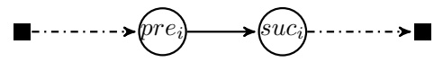

drone

drone

(a) transfer from a vehicle to a drone

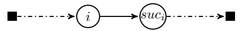

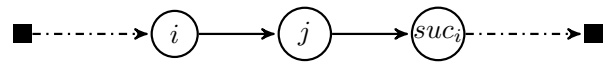

drone

drone

(b) transfer from a drone to a vehicle

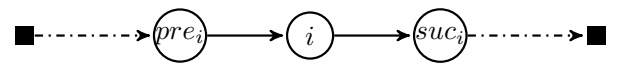

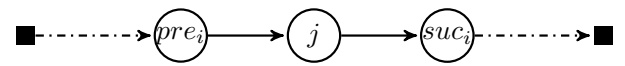

drone

drone

(c) exchange move drone-veh

Figure 7 Local search operators between a vehicle and a drone (left-hand side: before the move; right-hand side: after the move)

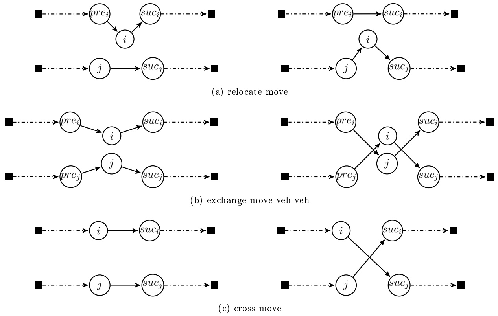

Figure 8 Local search operators between two vehicles (left-hand side: before the move; right-hand side: after the move)

Definition of the acyclic graph

We introduce $G^{\tau} = (V^{\tau}, A^{\tau})$ an acyclic graph defined as follows. $V^{\tau} = \{0, 1, 2, \dots, n, n + 1\}$ represents the set of customers completed by two copies of the depot: the original depot 0 and its copy $n + 1$. In the multi-creteria shortest path problem, 0 will be the origin and $n + 1$ the destination. Given $i$ and $j$ in $V^{\tau}$, with $i \neq j$, arc $(i,j)$ exists in $A^{\tau}$ if and only if the two following conditions are both satisfied:

\- $i <_{\tau} j$

\- all the customers between $i$ and $j$ in $\tau$ are drone-eligible: $i <_{\tau} \mu <_{\tau} j \Rightarrow \mu \in N_d$

With every arc $(i,j)\in A^{\tau}$, we associate a cost vector $(c_{ij}^{1},c_{ij}^{2})$. The first cost component $c_{ij}^{1}$ represents the cost incurred if a vehicle travels directly from $i$ to $j$: $c_{ij}^{1} = t_{ij}$. The second cost component $c_{ij}^{2}$ represents the corresponding cost induced for the drones. If the vehicle travels directly from $i$ to $j$, all customers $\mu$ in-between (which by definition of $A^{\tau}$ are all drone-eligible) are assigned to the drones: $c_{ij}^{2} = \frac{1}{M}\times \sum_{\{\mu \in V^{\tau}:i < _{\tau}\mu < _{\tau j}\}}\widehat{t}_{\mu}$.

This value does not exactly give the contribution of these customers to the completion time of the drones, which could only be obtained by solving a PMS problem, but provides an optimistic (lower-bound) value and a good approximation.

Figure 9 shows an illustrative example for an instance with 5 customers. Customers 2 and 4 are not drone-eligible. The vehicle travel cost matrix is reported in Table 2(a) in which we add the copy of the depot (node 6). Table 2(b) presents the drone-trip costs for drone-eligible customers. We assume  $\tau = (1, 2, 3, 4, 5)$  and a single drone.

## Dynamic programming scheme

Paths starting from node 0 in graph $G^{\tau}$ can be matched with partial decompositions of sequence $\tau$. The information about this decomposition is captured in a label associated with the path. A label is defined with

<table><tr><td></td><td>0</td><td>1</td><td>2</td><td>3</td><td>4</td><td>5</td><td>6</td><td rowspan="3" colspan="4"></td></tr><tr><td>0</td><td>0</td><td>8</td><td>9</td><td>11</td><td>6</td><td>8</td><td>0</td></tr><tr><td>1</td><td></td><td>0</td><td>10</td><td>7</td><td>10</td><td>12</td><td>8</td></tr><tr><td>2</td><td></td><td></td><td>0</td><td>13</td><td>8</td><td>6</td><td>8</td><td>Customer</td><td>1</td><td>3</td><td>5</td></tr><tr><td>3</td><td></td><td></td><td></td><td>0</td><td>11</td><td>7</td><td>11</td><td>Drone cost</td><td>16</td><td>12</td><td>20</td></tr><tr><td>4</td><td></td><td></td><td></td><td></td><td>0</td><td>5</td><td>6</td><td rowspan="3" colspan="4">(b) Drone cost vector  $\widehat{t_i}$ </td></tr><tr><td>5</td><td></td><td></td><td></td><td></td><td></td><td>0</td><td>8</td></tr><tr><td>6</td><td></td><td></td><td></td><td></td><td></td><td></td><td>0</td></tr></table>

(a) Vehicle cost matrix $t_{ij}$

Table 2 Illustrative instance

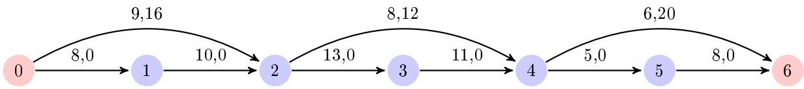

Figure 9 Graph $G^{\tau}$ for the instance of tables 2(a) and 2(b), with $\tau = (1,2,3,4,5)$.

the following attributes:

\- $n^{veh}$ is the index of the current vehicle; the tours (sequences $\tau_k$) of vehicles with index $k < n^{veh}$ are known; the tours of vehicles with index $k > n^{veh}$ are still empty;

\- $c^{preVeh}$ is the cost of the longest of the tours that are already known ;

\- $c^{curVeh}$ is the cost of the current vehicle tour;

\- $c^{drone}$ is the approximated drone cost;

\- $pred$ is the label from which this label was obtained.

We note $L = (n^{veh}, c^{preVeh}, c^{curVeh}, c^{drone}, pred)$. Equivalently, the attributes of a label $L$ are denoted $n^{veh}(L)$, $c^{preVeh}(L)$ and so on.

The dynamic programming procedure is described in Algorithm 2. The principle is to progressively associate a list of labels $\mathcal{L}(i)$ with each node $i$ of $G^{\tau}$. At the initialization, $\mathcal{L}(i)$ is set to $\emptyset$ for every node $i$ (Line 1). The procedure then starts by assigning label $(1,0,0,0,\emptyset)$ to $\mathcal{L}(0)$ (Line 2).

The procedure goes through the graph from the origin depot node 0 to the destination depot node $n + 1$ by following the order defined in sequence $\tau$. Function increment on Line 5 is introduced for this purpose. The list of labels $\mathcal{L}(i)$ of a given node $i$ is obtained by extending labels in the list of labels of its predecessor nodes (Lines 6-19). For any predecessor node $j$ and any label $L$ of $\mathcal{L}(j)$, two possible extensions may occur:

1. A first extension is to add arc $(j,i)$ to the current vehicle tour. The new generated label $L'$ is defined by (Line 8):

$$
\left\{ \begin{array}{l} n ^ {v e h} (L ^ {\prime}) = n ^ {v e h} (L) \\ c ^ {p r e V e h} (L ^ {\prime}) = c ^ {p r e V e h} (L) \\ c ^ {c u r V e h} (L ^ {\prime}) = c ^ {c u r V e h} (L) + c _ {j i} ^ {1} \\ c ^ {d r o n e} (L ^ {\prime}) = c ^ {d r o n e} (L) + c _ {j i} ^ {2} \\ p r e d (L ^ {\prime}) = L \end{array} \right.
$$

2. A second extension consists in closing the tour of the current vehicle and starting a new vehicle tour with an available vehicle. This extension is not allowed when: $j = 0$, $i = n + 1$ or $n^{veh}(L) = K$; furthermore, the extension is not considered when pursuing with the current vehicle does not increase the current global cost: indeed, it would then be suboptimal to start the tour of a new vehicle (Line 12). When the extension is carried out, the new label $L'$ is given by (Line 13):

$\left\{ \begin{array}{l}n^{veh}(L^{\prime}) = n^{veh}(L) + 1\\ c^{preVeh}(L^{\prime}) = \max (c^{preVeh}(L),c^{curVeh}(L) + t_{j,0})\\ c^{curVeh}(L^{\prime}) = t_{0,i}\\ c^{drone}(L^{\prime}) = c^{drone}(L) + c_{ji}^{2}\\ pred(L^{\prime}) = L \end{array} \right.$

In order to limit the number of labels generated in the lists as the procedure advances in the graph, some bounding mechanisms (Lines 9 and 14) and a dominance rule (Lines 10 and 15) are introduced. These two components are detailed below.

At the end, the vehicle tours are retrieved through a backtracking mechanism based on attribute pred and starting with the best label found in  $\mathcal{L}(n+1)$ , i.e., the label that minimizes  $\max(c^{preVeh}(L), c^{curVeh}(L), c^{drone}(L))$ . Nodes that are not in the vehicle tours are assigned to the drones.

Algorithm 2 Procedure $split(\tau)$
$\mathcal{L}(i) \leftarrow \emptyset$ for $0 \leq i \leq n + 1$
$\mathcal{L}(0) \leftarrow \{(1, 0, 0, 0, \emptyset)\}$
$i \leftarrow 0$
while $i &lt;_{\tau} n + 1$ do
    increment $i$
    for all $j$ subject to $(j, i) \in A^{\tau}$ do
        for all $L \in \mathcal{L}(j)$ do
            $L' \leftarrow$ extend $L$ by adding arc $(j, i)$ to the current tour
            if $L'$ is not pruned by bounding mechanisms then
                insert with dominance $L'$ in $\mathcal{L}(i)$
            end if
            if extending $L$ by starting a new vehicle tour should be considered then
                $L' \leftarrow$ extend $L$ by adding arc $(j, 0)$ to the current tour and starting a new tour with arc $(0, i)$
                if $L'$ not pruned by bounding mechanisms then
                    insert with dominance $L'$ in $\mathcal{L}(i)$
            end if
        end if
    end for
end for
end while
$L^* \leftarrow$ best label in $\mathcal{L}(n + 1)$
derive $\tau_1, \tau_2, \dots, \tau_K$ by backtracking from $L^*$
$\pi_{drones} \leftarrow$ nodes not in $\tau_1 \cup \tau_2 \cup \dots \cup \tau_K$

## Insertion with dominance

When a label has to be added to a list of labels, dominance tests are tried. These tests are done with all the labels in the list, both to check whether the new label should be discarded or if an existing label should be removed. The dominance rule is very simple. Given a node $i \in \tau$ and two labels $L_{a}$ and $L_{b}$ in $\mathcal{L}(i)$, $L_{a}$ dominates $L_{b}$ if the following inequalities are all satisfied:

$$
\left\{ \begin{array}{l} n _ {a} ^ {v e h} \leq n _ {b} ^ {v e h} \\ \max \left(c ^ {p r e V e h} (L _ {a}), c ^ {c u r V e h} (L _ {a}) + t _ {i, 0}, c ^ {d r o n e} (L _ {a})\right) \leq \max \left(c ^ {p r e V e h} (L _ {b}), c ^ {c u r V e h} (L _ {b}) + t _ {i, 0}, c ^ {d r o n e} (L _ {b})\right) \\ c ^ {c u r V e h} (L _ {a}) \leq c ^ {c u r V e h} (L _ {b}) \\ c ^ {d r o n e} (L _ {a}) \leq c ^ {d r o n e} (L _ {b}) \end{array} \right.
$$

## Upper bound generation

The bounding mechanisms rely on three upper bounds that are computed before starting the dynamic programming algorithm, for a given sequence $\tau$. A first upper bound $UB_{1}$ is given by the value of the best solution found so far by the hybrid algorithm. The other bounds rely on Algorithm 3. This algorithm computes the minimal cost $\chi(i,k)$ that can be achieved to serve all customers up to $i$ in the order of sequence $\tau$ using $k$ vehicles ($i \in \tau$, $1 \leq k \leq K$). Compared to Algorithm 2 the possibility to serve customers with drones is ignored. Algorithm 3 applies the following recursion:

$$
\left\{ \begin{array}{l} \chi (i, 1) = t i m e _ {\tau} (0, i) + t _ {i, 0} \quad (i \in \tau), \\ \chi (0, k) = 0 \quad (2 \leq k \leq K), \\ \chi (i, k) = \underset {j <   _ {\tau} i} {\min} \left(\max \left(\chi (j, k - 1), t _ {0, s u c c _ {\tau} (j)} + t i m e _ {\tau} (s u c c _ {\tau} (j), i) + t _ {i, 0}\right)\right) \quad (i \in \tau : i \neq 0, 2 \leq k \leq K). \end{array} \right.\tag{16}
$$

The recursion introduces vertex $j$ at which the last route starts, computes the associated completion time and states that $\chi(i,k)$ is given by the best splitting point $j$.

Algorithm 3 Procedure $decompose(\tau)$

$\chi(i,1) \leftarrow time_{\tau}(0,i) + t_{i,0}, \forall i \in \tau$
$\chi(0,k) \leftarrow 0, \forall k = 2..K$
for $k = 2..K$ do
    $i \leftarrow 0$
    while $i \neq n + 1$ do
        $i \leftarrow succ_{\tau}(i)$
        $\chi(i,k) \leftarrow \min_{j &lt; \tau i} \left( \max \left( \chi(j,k - 1), t_{0,succ_{\tau}(j)} + time_{\tau}(succ_{\tau}(j), i) + t_{i,0}) \right) \right)$
    end while
end for
return $\chi$

Upper bounds $UB_{2}$ and $UB_{3}$ try to circumvent the extra difficulty of having multiple vehicles. They both aggregate the $K$ vehicles into a single one. To do so, we introduce what we call the vehicle acceleration coefficient $\alpha = \alpha(K)$, which approximates the speedup needed for a single vehicle to execute the same set of deliveries than a fleet of $K$ vehicles in the same amount of time. The two bounds differ in the value of this coefficient. Then, a heuristic split procedure is used to determine the customers assigned to drones and those assigned to the speedy vehicle. Algorithm 3 is finally used to determine the $K$ vehicle tours for the latter.

More precisely, the second upper bound $UB_{2}$ works as follows:

1. Determine the acceleration coefficient $\alpha = \frac{\chi(n + 1,1)}{\chi(n + 1,K)}$; this coefficient approximates the gains obtained when $K$ vehicles are used instead of 1;

2. Apply procedure $split(\tau)$ assuming a single vehicle, changing costs $c_{ij}^{1}$ to $\frac{t_{ij}}{\alpha}$ to account for the acceleration, deactivating the bounding mechanisms and keeping only the best label at each node;

3. Consider the subsequence $\tau'$ obtained with this procedure and re-apply Algorithm 3 to decompose it into $K$ vehicles tours $\tau_1, \tau_2, ..., \tau_K$ (these tours can be obtained backwardly from $\chi(n + 1, K)$);

4. Solve the PMS problem with the longest processing time heuristic for the remaining customers;

5. Compute the completion time and set $UB_{2}$ to this value.

The third upper bound $UB_{3}$ is obtained as $UB_{2}$ but changing the acceleration coefficient $\alpha$ to $K$. $UB$ is set as the best (minimal) upper bound among these three bounds: $UB = \min(UB_{1}, UB_{2}, UB_{3})$.

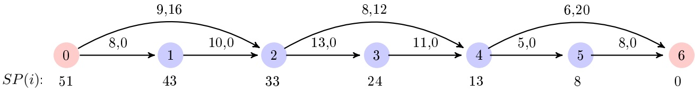

Figure 10 Values $SP(i)$ for the graph of Figure 9 ($M = 1$).

Lower bound generation

We introduce a lower bound $LB^{tot}(i,L)$ on the minimal completion time that can be achieved when extending a label $L$ associated with a customer node $i$. $LB^{tot}(i,L)$ requires to precompute value $SP(i)$ of the shortest path in $G^{\tau}$ between $i$ and $n + 1$, with modified arc costs set to $c_{ij}^{1} + M \times c_{ij}^{2}$. Values $SP(i)$ are computed for all nodes $i$ with a single backward exploration of the acyclic (topologically-ordered) graph $G^{\tau}$. They indicate the minimal total distance that will be traveled by the vehicles and drones between $i$ and $n + 1$ in the solution space defined by the split($\tau$) procedure. Figure 10 reports $SP(i)$ for the example introduced with Figure 9.

Then, given $i \in \tau$ and $L \in \mathcal{L}(i)$, the total distance traveled by vehicles $n^{veh}(L)$ to $K$ and by the $M$ drones is at least $c^{curVeh}(L) + M \times c^{drone}(L) + SP(i)$. Hence, at least one of those vehicles or drones cannot complete its duty before time $LB^{tot}(i,L)$ with:

$$
L B ^ {t o t} (i, L) = \frac {c ^ {c u r V e h} (L) + M \times c ^ {d r o n e} (L) + S P (i)}{K - n ^ {v e h} (L) + 1 + M}
$$

Bounding mechanism

A label $L \in \mathcal{L}(i)$ is pruned if one the following rules applies:

\- R1: $\max \left(c^{preVeh}(L), c^{curVeh}(L) + t_{i,0}, c^{drone}(L)\right) \geq UB$;

\- R2: $LB^{tot}(i,l)\geq UB$.

Rule R1 identifies labels whose completion time is already at least UB. Rule R2 applies lower bound  $LB^{tot}(i,L)$ .

Figure ?? illustrates the  $split(\tau)$  subroutine on the graph presented in Figure 9, with K=2 and M=1. List  $\mathcal{L}(i)$  is reported under every node i. In Figure ??(a), the bounding mechanisms are not applied. Labels can only be removed by dominance. Dominated labels are crossed out. The best label is indicated in red with a '\*' symbol beside in list  $\mathcal{L}(6)$ , as well as labels from which it inherits (and that allow to reconstruct the different vehicle tours). In Figure ??(b), the bounding mechanisms are reinserted. Applied on this sequence, the upper bound generation algorithms provide an upper bound UB=27. The bounding rules enabling to delete a label are reported at the right of the strikethrough label. In this figure,  $\mathcal{L}(6)=\emptyset$  because the upper bound cannot be improved. In both cases, the vehicle tours obtained with the procedure are:  $\tau_{1}=(0,1,2,0)$  and  $\tau_{2}=(0,4,5,0)$ . Customer 3 is assigned to the drone. The cost of the solution is 27.

## 5. Experiments and results

In this section, the effectiveness of the proposed solution method is examined. The environment used for the computational work is Intel core(TM) i5-6200U CPU @ 2.30Ghz 2.40Ghz; 8GB RAM; Windows 10; 64 bits. Solution methods are implemented in C++ language.

The MILP of Section 3.2 is solved by using IBM Concert Technology and CPLEX 12.6 on an Intel(R) Xeon(R) CPU E5-2670 0 @ 2.60 GHz with 2x8 cores 25M cache and 62.5GB of RAM.

| 0 | 8,0 | 1 | 9,16 | 2 | 8,12 | 3 | 4 | 5,0 | 6,20 | 6 |
| --- | --- | --- | --- | --- | --- | --- | --- | --- | --- | --- |
| (1,0,0,0)* |  | (1,0,8,0)* |  | (1,0,18,0)* | (1,0,31,0) | (1,0,42,0) | (1,0,47,0) | (1,0,55,0) |  |  |
|  |  |  | (2,16,9,0) | (2,27,11,0) | (2,42,6,0) | (2,48,8,0) | (2,48,16,0) |  |  |  |
|  |  |  | (1,0,9,16) | (2,16,22,0) | (2,27,22,0) | (2,42,11,0) | (2,42,19,0) |  |  |  |
|  |  |  |  | (1,0,22,16) | (2,16,33,0) | (2,27,27,0) | (2,27,35,0) |  |  |  |
|  |  |  |  | (2,18,11,16) | (1,0,33,16) | (1,0,31,12) | (1,0,39,12) |  |  |  |
|  |  |  |  |  | (2,33,6,16) | (2,32,8,12) | (2,32,16,12) |  |  |  |
|  |  |  |  |  | (2,18,22,16) | (2,27,11,12)* | (2,27,19,12)* |  |  |  |
|  |  |  |  |  | (1,0,26,12) | (2,16,22,12) | (2,16,30,12) |  |  |  |
|  |  |  |  |  | (2,27,6,12)* | (1,0,22,28) | (1,0,30,28) |  |  |  |
|  |  |  |  |  | (2,16,17,12) | (2,23,8,28) | (2,23,16,28) |  |  |  |
|  |  |  |  |  | (1,0,17,28) |  | (1,0,48,20) |  |  |  |
|  |  |  |  |  | (2,18,6,28) |  | (2,42,12,20) |  |  |  |
|  |  |  |  |  |  |  | (2,27,28,20) |  |  |  |
|  |  |  |  |  |  |  | (1,0,32,32) |  |  |  |
|  |  |  |  |  |  |  | (2,27,12,32) |  |  |  |
|  |  |  |  |  |  |  | (2,16,23,32) |  |  |  |
|  |  |  |  |  |  |  | (1,0,23,48) |  |  |  |

(b)

Figure 11 Illustration of the split procedure on the graph of Figure 9, without or with the bounding mechanisms ($K = 2$, $M = 1$). The last element of the definition of a label (pred) has not been represented for the sake of simplicity

## 5.1. Problem instances

Not being aware of any instances in the literature for the PDSMTSP, we have selected 20 instances from the CVRPLIB (a repository of instances for the Capacited Vehicle Routing Problem). Instances have been chosen among those with the depot near the barycenter of all customers. Instance size varies between 50 and 199 customers. The 20 instances are:

\- 5 instances from set CMT (Christofides, Mingozzi and Toth, 1979): CMT1, CMT2, CMT3, CM4, CMT5

\- 3 instances from set E (Christofides and Eilon, 1969): E-n51-k5, E-n76-k8, E-n101-k8

\- 2 instances from set M (Christofides, Mingozzi and Toth, 1979): M-n151-k12, M-n200-k16

\- 7 instances from set P (Augerat, 1995):
    P-n51-k10, P-n55-k7, P-n60-k10, P-n65-k10, P-n70-k10, P-n76-k5, P-n101-k4

\- 3 instances from Uchoa et al. (2014) benchmark: X-n110-k13, X-n115-k10, X-n139-k10

The number of customers in instances CMT1 to CMT5 is 50, 75, 100, 150 and 199, respectively. In other instances, the number of nodes (customers and depot) is indicated in the name, after letter 'n'. To adapt these instances to our problem, we modified the fleet size and introduced drones. Precisely, we arbitrarily set $K = \lceil \frac{\text{fleet size}}{2} \rceil$ and $M = \lfloor \frac{\text{fleet size}}{2} \rfloor$. These values are reported in result tables. For all instances, we assume that all customers are drone eligible. We use the Manhattan distance for the vehicles and the Euclidean distance for drones. This is made possible because customers are represented by their coordinates $x$ and $y$ in all instances.

## 5.2. Limitation of the number of labels in procedure split(τ)

Seeing that the number of generated labels in procedure $split(\tau)$ can grow exponentially according to instance sizes, we proposed a method to limit this number. This method complements bounding mechanisms, previously presented, that might not be enough. The method is based on a threshold $\mathcal{T}_{max}$ that will limit the number of labels at a node $x \in \tau$ to at most $K \times \mathcal{T}_{max}$. To do so, we first group labels according to their value $n^{veh}(L)$. Then, in each group, we sort labels in the increasing order of value $c^{preVeh}(L) + c^{curVeh}(L) + c^{drone}(L)$ and only keep the $\mathcal{T}_{max}$ first labels.

To analyze the efficiency of this method, we conducted a set of experiments by varying parameter $\mathcal{T}_{max}$. We only considered the five CMT instances, which represents a sample of instances with different sizes. For each instance, we generated 25 sequence $\tau$ with a randomized version of the nearest neighbor heuristic. Then, for each sequence, we applied procedure $split(\tau)$ with different values of $\mathcal{T}_{max}$. Table 3 presents aggregated results. In the table, we report the average (Avg), maximum (Max) and standard deviation (SD) of the number of labels generated in the procedure, the relative error related to the difference of completion time value without and with limitation of labels and the computing time.

As expected, results show that when  $T_{max}$  increases, the number of labels generated in procedure  $split(\tau)$  and the computing time increase while the relative error decreases. In view of these results, we considered that the best trade-off between solution quality (low error rate) and execution time was obtained with  $T_{max} = 60$ . For the remainder of the experiments, when it is indicated that labels are limited, we keep this value.

## 5.3. Solution with the branch-and-cut algorithm

In this section, we report the results obtained when solving the PDSMTSP with the branch-and-cut algorithm presented in Section 3.2. We limit these experiments to the smallest instances ($n \leq 100$). The time limit is set to 3 hours (10800 seconds). Results are detailed in Table 4.

<table><tr><td rowspan="2">Instance</td><td rowspan="2"> $T_{max}$ </td><td colspan="3">#LabGen</td><td colspan="3">Error (%)</td><td colspan="3">CPU (s)</td></tr><tr><td>Avg</td><td>Max</td><td>SD</td><td>Avg</td><td>Max</td><td>SD</td><td>Avg</td><td>Max</td><td>SD</td></tr><tr><td rowspan="8">CMT1 (50,3,2)</td><td>10</td><td>32592.76</td><td>41065</td><td>3221.32</td><td>11.96</td><td>22.61</td><td>6.32</td><td>0.05</td><td>0.06</td><td>0.004</td></tr><tr><td>20</td><td>58203.16</td><td>71635</td><td>5515.62</td><td>10.44</td><td>27.54</td><td>6.79</td><td>0.06</td><td>0.07</td><td>0.01</td></tr><tr><td>30</td><td>77896.36</td><td>96438</td><td>7897.76</td><td>9.22</td><td>27.54</td><td>6.32</td><td>0.09</td><td>0.12</td><td>0.02</td></tr><tr><td>40</td><td>93623.92</td><td>116711</td><td>10518.46</td><td>7.86</td><td>19.40</td><td>6.06</td><td>0.08</td><td>0.10</td><td>0.013</td></tr><tr><td>50</td><td>105935.48</td><td>134491</td><td>12916.17</td><td>6.99</td><td>19.40</td><td>5.98</td><td>0.09</td><td>0.13</td><td>0.019</td></tr><tr><td>60</td><td>116271.88</td><td>148682</td><td>14477.09</td><td>5.72</td><td>19.40</td><td>5.62</td><td>0.13</td><td>0.20</td><td>0.03</td></tr><tr><td>70</td><td>125979.28</td><td>161281</td><td>15664.12</td><td>4.88</td><td>19.40</td><td>5.37</td><td>0.12</td><td>0.16</td><td>0.02</td></tr><tr><td>80</td><td>135242.32</td><td>171434</td><td>16660.01</td><td>4.71</td><td>16.69</td><td>5.11</td><td>0.13</td><td>0.20</td><td>0.03</td></tr><tr><td rowspan="8">CMT2 (75,5,5)</td><td>10</td><td>119888.48</td><td>145406</td><td>12242.51</td><td>18.66</td><td>29.76</td><td>5.06</td><td>0.12</td><td>0.16</td><td>0.01</td></tr><tr><td>20</td><td>224724.88</td><td>259763</td><td>22649.44</td><td>13.41</td><td>25.28</td><td>4.93</td><td>0.17</td><td>0.22</td><td>0.02</td></tr><tr><td>30</td><td>317329.20</td><td>360712</td><td>29324.43</td><td>11.03</td><td>24.42</td><td>4.90</td><td>0.28</td><td>0.38</td><td>0.05</td></tr><tr><td>40</td><td>398036.44</td><td>442525</td><td>34354.79</td><td>9.48</td><td>20.93</td><td>4.50</td><td>0.32</td><td>0.46</td><td>0.06</td></tr><tr><td>50</td><td>467528.88</td><td>525287</td><td>40268.87</td><td>8.84</td><td>21.40</td><td>5.02</td><td>0.41</td><td>0.59</td><td>0.09</td></tr><tr><td>60</td><td>529162.64</td><td>605701</td><td>46719.84</td><td>6.96</td><td>19.75</td><td>4.04</td><td>0.66</td><td>0.99</td><td>0.15</td></tr><tr><td>70</td><td>586593.72</td><td>676084</td><td>51625.91</td><td>6.17</td><td>17.44</td><td>3.70</td><td>0.58</td><td>0.90</td><td>0.13</td></tr><tr><td>80</td><td>639260.80</td><td>733429</td><td>55147.65</td><td>5.67</td><td>17.44</td><td>3.71</td><td>0.68</td><td>1.15</td><td>0.16</td></tr><tr><td rowspan="8">CMT3 (100,4,4)</td><td>10</td><td>170724.80</td><td>217266</td><td>16096.19</td><td>16.43</td><td>25.62</td><td>4.83</td><td>0.19</td><td>0.25</td><td>0.02</td></tr><tr><td>20</td><td>314293</td><td>393205</td><td>32492.02</td><td>14.18</td><td>21.49</td><td>4.37</td><td>0.24</td><td>0.32</td><td>0.03</td></tr><tr><td>30</td><td>448786.28</td><td>549272</td><td>44498.56</td><td>12.80</td><td>22.03</td><td>4.82</td><td>0.42</td><td>0.71</td><td>0.09</td></tr><tr><td>40</td><td>567207.48</td><td>690704</td><td>58322.19</td><td>11.98</td><td>19.17</td><td>4.43</td><td>0.49</td><td>0.71</td><td>0.10</td></tr><tr><td>50</td><td>677780.20</td><td>824038</td><td>70712.04</td><td>11.45</td><td>17.95</td><td>4.55</td><td>0.65</td><td>0.96</td><td>0.13</td></tr><tr><td>60</td><td>779789.40</td><td>943959</td><td>81315.07</td><td>10.21</td><td>17.95</td><td>4.52</td><td>1.02</td><td>1.54</td><td>0.26</td></tr><tr><td>70</td><td>867494.60</td><td>1047865</td><td>91286.82</td><td>9.77</td><td>16.95</td><td>4.10</td><td>0.98</td><td>1.52</td><td>0.24</td></tr><tr><td>80</td><td>947767.12</td><td>1142010</td><td>102206.65</td><td>9.17</td><td>16.95</td><td>3.98</td><td>1.21</td><td>2.08</td><td>0.31</td></tr><tr><td rowspan="8">CMT4 (150,6,6)</td><td>10</td><td>547245.72</td><td>609538</td><td>39888.51</td><td>20.98</td><td>29.52</td><td>4.36</td><td>0.55</td><td>0.67</td><td>0.04</td></tr><tr><td>20</td><td>1045624.48</td><td>1172400</td><td>74623.51</td><td>19.64</td><td>27.11</td><td>4.42</td><td>0.77</td><td>0.88</td><td>0.06</td></tr><tr><td>30</td><td>1514593.56</td><td>1737610</td><td>115363.92</td><td>18.33</td><td>25.71</td><td>4.10</td><td>1.28</td><td>1.60</td><td>0.17</td></tr><tr><td>40</td><td>1947959.24</td><td>2246024</td><td>149516.15</td><td>17.14</td><td>26.04</td><td>4.84</td><td>1.57</td><td>1.96</td><td>0.18</td></tr><tr><td>50</td><td>2359557.20</td><td>2750357</td><td>177303.68</td><td>16.40</td><td>23.81</td><td>4.45</td><td>2.10</td><td>2.67</td><td>0.25</td></tr><tr><td>60</td><td>2730814.68</td><td>3206762</td><td>209068.25</td><td>15.36</td><td>23.81</td><td>4.41</td><td>2.63</td><td>3.30</td><td>0.32</td></tr><tr><td>70</td><td>3079424.64</td><td>3607688</td><td>233764.46</td><td>15.12</td><td>22.97</td><td>4.17</td><td>3.28</td><td>4.15</td><td>0.49</td></tr><tr><td>80</td><td>3396502.48</td><td>3996079</td><td>258893.28</td><td>13.83</td><td>20.95</td><td>3.94</td><td>3.73</td><td>4.74</td><td>0.47</td></tr><tr><td rowspan="8">CMT5 (199,9,8)</td><td>10</td><td>1419540.92</td><td>1643841</td><td>108970.19</td><td>22.94</td><td>33.33</td><td>3.94</td><td>1.58</td><td>2.13</td><td>0.20</td></tr><tr><td>20</td><td>2711808.24</td><td>3096235</td><td>195440.91</td><td>21.49</td><td>28.73</td><td>2.84</td><td>2.37</td><td>3.63</td><td>0.37</td></tr><tr><td>30</td><td>3929397.12</td><td>4468400</td><td>284471.40</td><td>20.36</td><td>27.59</td><td>2.73</td><td>3.22</td><td>4.36</td><td>0.47</td></tr><tr><td>40</td><td>5063679.84</td><td>5739811</td><td>348592.79</td><td>19.70</td><td>26.52</td><td>2.43</td><td>4.37</td><td>6.08</td><td>0.67</td></tr><tr><td>50</td><td>6142347.12</td><td>6936879</td><td>427684.42</td><td>18.71</td><td>27.31</td><td>2.53</td><td>5.80</td><td>8.99</td><td>1.16</td></tr><tr><td>60</td><td>7177526.08</td><td>8181177</td><td>486045.38</td><td>17.96</td><td>24.35</td><td>2.04</td><td>7.20</td><td>10.71</td><td>1.36</td></tr><tr><td>70</td><td>8146948.64</td><td>9243250</td><td>567250.70</td><td>16.91</td><td>24.14</td><td>2.94</td><td>9.24</td><td>15.42</td><td>2.08</td></tr><tr><td>80</td><td>9029270.76</td><td>10223006</td><td>635457.72</td><td>15.66</td><td>23.80</td><td>3.18</td><td>10.57</td><td>16.40</td><td>2.21</td></tr></table>

Table 3 Impact of parameter $\mathcal{T}_{max}$ on a set of five representative instances

The table is organized as follows. Gap1 is the percentage gap between the value of the linear relaxation $\mathbf{z}_{lr}$ at the root node (the integrity constraints are relaxed but the SECs are applied) and the cost of the best integer solution $\mathbf{z}_{ub}$ ($\mathrm{Gap1} = 100 \times \frac{\mathbf{z}_{ub} - \mathbf{z}_{lr}}{\mathbf{z}_{ub}}$). Gap2 is the percentage gap between the best lower bound $\mathbf{z}_{lb}$ and $\mathbf{z}_{ub}$ ($\mathrm{Gap2} = 100 \times \frac{\mathbf{z}_{ub} - \mathbf{z}_{lb}}{\mathbf{z}_{ub}}$). #Nodes gives the number of nodes explored in the branch-and-cut tree (a zero indicates that the process ended at the root node. #LC and #UC report the number of SECs added with LAZYCONSTRAINTCALLBACK (used to search for constraints violated by an integer solution) and USERCUTCALLBACK (used to search for constraints violated by a fractional solution), respectively. CPU is the computing time in seconds. #Veh and #Dro provide the number of vehicles and drones used in the best integer solution. #D.C. is the number of customers assigned to the drones in this solution. C.T. is its completion time ($\mathbf{z}_{ub}$).

<table><tr><td rowspan="2">Instance</td><td colspan="6">Branch-and-cut details</td><td colspan="4">Solution details</td></tr><tr><td>Gap1 (%)</td><td>Gap2 (%)</td><td>#Nodes</td><td>#LC</td><td>#UC</td><td>CPU (s)</td><td>#Veh.</td><td>#Dro.</td><td>#D.C.</td><td>C.T.</td></tr><tr><td>CMT1 (50,3,2)</td><td>22.79</td><td>22.41</td><td>20100</td><td>51</td><td>23726</td><td>10668.5</td><td>3</td><td>2</td><td>11</td><td>188</td></tr><tr><td>CMT2 (75,5,5)</td><td>97.20</td><td>97.20</td><td>957</td><td>49</td><td>20101</td><td>10653.8</td><td>0</td><td>1</td><td>75</td><td>3630.86</td></tr><tr><td>CMT3 (100,4,4)</td><td>96.45</td><td>96.45</td><td>732</td><td>44</td><td>14515</td><td>10650.8</td><td>1</td><td>4</td><td>94</td><td>4537.11</td></tr><tr><td>E-n51-k5 (50,3,2)</td><td>22.79</td><td>22.41</td><td>20210</td><td>50</td><td>23302</td><td>10668.8</td><td>3</td><td>2</td><td>11</td><td>188</td></tr><tr><td>E-n76-k8 (75,4,4)</td><td>95.73</td><td>95.73</td><td>2954</td><td>38</td><td>13712</td><td>10606</td><td>0</td><td>4</td><td>75</td><td>2975.51</td></tr><tr><td>E-n101-k8 (100,4,4)</td><td>96.45</td><td>96.45</td><td>732</td><td>44</td><td>14515</td><td>10650.4</td><td>1</td><td>4</td><td>94</td><td>4537.11</td></tr><tr><td>P-n51-k10 (50,5,5)</td><td>64.74</td><td>64.63</td><td>2896</td><td>47</td><td>26372</td><td>10616.4</td><td>4</td><td>5</td><td>13</td><td>230</td></tr><tr><td>P-n55-k7 (54,4,3)</td><td>67.24</td><td>67.05</td><td>5834</td><td>94</td><td>17239</td><td>10651.9</td><td>3</td><td>3</td><td>11</td><td>308</td></tr><tr><td>P-n60-k10 (59,5,5)</td><td>65.87</td><td>65.73</td><td>5842</td><td>48</td><td>23596</td><td>10560.4</td><td>5</td><td>5</td><td>12</td><td>246</td></tr><tr><td>P-n65-k10 (64,5,5)</td><td>83.69</td><td>83.68</td><td>2782</td><td>76</td><td>19446</td><td>10615.6</td><td>5</td><td>5</td><td>14</td><td>580</td></tr><tr><td>P-n70-k10 (69,5,5)</td><td>96.86</td><td>96.86</td><td>2570</td><td>44</td><td>18956</td><td>10644.1</td><td>1</td><td>5</td><td>68</td><td>3166.25</td></tr><tr><td>P-n76-k5 (75,3,2)</td><td>35.26</td><td>35.23</td><td>2776</td><td>70</td><td>15555</td><td>10620.2</td><td>3</td><td>2</td><td>11</td><td>280</td></tr><tr><td>P-n101-k4 (100,2,2)</td><td>93.20</td><td>93.19</td><td>991</td><td>39</td><td>14748</td><td>10581.5</td><td>1</td><td>2</td><td>99</td><td>4725.47</td></tr></table>

Table 4 Exact solution of the PDSMTSP with the branch-and-cut algorithm

In Table 4, we can see that the branch-and-cut algorithm largely fails to solve the PDSMTSP in 3 hours. No optimal solutions are found (or, at least, no proven optimal). Furthermore, after 3 hours, and even for the smaller instances, gaps remain very large.

## 5.4. Hybrid metaheuristic and variants

In this section, we finally evaluate the hybrid metaheuristic, called HM hereafter. In order to investigate how results are impacted by the different components in HM, we introduce several variants and compare our results to those obtained with these variants:

HMb. The reconstruction of the giant tour is modified (Line 11 of Algorithm 1). We consider a parameter $X$. The idea of this new giant tour reconstruction is to concatenate the first $X$ vehicle tours of the best solution in a random order and then insert the customers assigned to the drones and the customers of the remaining $K - X$ vehicles via best insertion. Initially the value of $X$ is set to $X = K$. This value changes and is updated as follows: if the current solution is better than bestSol (Line 8 of Algorithm 1), the value of $X$ is set to $K$ (we intensify the search around the new best solution) otherwise the value of $X$ is set to $\max(0, X - 1)$ (we decrement $X$ if $X > 0$ to diversify).

MS. The giant tour (Line 11 of Algorithm 1) is generated with a randomized nearest-neighbor heuristic. In our implementation, one of the three nearest neighbors is randomly chosen. This randomization is also introduced at the initialization of the algorithm (Line 1 of Algorithm 1). Compared to HM, the learning component is lost, and the iterative mechanism is that of a standard multi-start instead of an ILS (see Algorithm 4).

HM(LL), HMb(LL), MS(LL). The three heuristics HM, HMb and MS, are declined in a second version. In these new versions, labels are limited using the technique presented in Section 5.2. Every elementary iteration of the algorithm should then be less efficient but faster.

HM(UB), HMb(UB), MS(UB). The three heuristics HM, HMb and MS, are declined in a third version. In these new versions, the decoding procedure is restricted to the computation of the upper bounds: both the lower bound and the labeling algorithm are deactivated. Every elementary iteration of the algorithm should then be even less efficient but faster.

Algorithm 4 Multi-start heuristic MS
bestSol ← ($\tau_1^{rec} = \emptyset$, $\tau_2^{rec} = \emptyset$, ..., $\tau_K^{rec} = \emptyset$, $\pi_1^{rec} = \emptyset$, ..., $\pi_M^{rec} = \emptyset$)
while explorationTime ≤ timeLimit do
    $\tau \leftarrow solveTSP()$
    ($\tau_1, \tau_2, \ldots, \tau_K, \pi_{drones}$) ← split($\tau$)
    ($\tau_1^{opt}, \tau_2^{opt}, \ldots, \tau_K^{opt}$) ← reoptimizeTSP($\tau_1, \tau_2, \ldots, \tau_K$)
    ($\pi_1^{opt}, \ldots, \pi_M^{opt}$) ← optimizePMS($\pi_{drones}$)
    ($\tau_1^{imp}, \tau_2^{imp}, \ldots, \tau_K^{imp}, \pi_1^{imp}, \ldots, \pi_M^{imp}$) ← improveSol($\tau_1^{opt}, \tau_2^{opt}, \ldots, \tau_K^{opt}, \pi_1^{opt}, \ldots, \pi_M^{opt}$)
    if solution ($\tau_1^{imp}, \tau_2^{imp}, \ldots, \tau_K^{imp}, \pi_1^{imp}, \ldots, \pi_M^{imp}$) is better than bestSol then
        bestSol ← ($\tau_1^{imp}, \tau_2^{imp}, \ldots, \tau_K^{imp}, \pi_1^{imp}, \ldots, \pi_M^{imp}$)
    end if
end while

Table 5 presents the completion times (C.T.) obtained with the 9 heuristics, i.e., HM and the 8 variants, for the 20 instances and the branch-and-cut upper bounds found with a time limit of 3 hours. An additional column (LB) shows the values of the lower bound obtained at the end of the branch-and-cut. In the 9 heuristics, the computing time limit is set to 1000 seconds. Best solutions are highlighted in bold. An integer value for the completion time usually indicates that a vehicle is the critical resource. This is due to the use of the Manhattan distance for vehicles, with integer coordinates for customers. When the value of completion time is a real number, the critical resource is a drone.

Tables 6 to 8 give more details on the execution of the heuristics. In Table 6 details are provided for methods HM, HMb and MS. Table 7 is about variants with limited labels in procedure $split(\tau)$: HM(LL), HMb(LL) and MS(LL). Table 8 considers variants with upper bounds only: HM(UB), HMb(UB) and MS(UB).

In Tables 6 and 7, the following information is reported. Column #Split reports the average number of calls to procedure $split(\tau)$. #Lb gives the average number of labels generated in procedure $split(\tau)$ (summed over all nodes and including labels eventually deleted by the different labels pruning mechanisms). Del is the percentage of labels deleted with the label pruning mechanisms. Column gD gives the average gap between the drone completion time found by procedure $split(\tau)$ (assuming a single drone with a speed multiplied by $M$) and the completion time obtained after having applied the LPT heuristic. $\mathbf{T}_{Split}$, $\mathbf{T}_{Opt}$ and $\mathbf{T}_{LS}$ indicate the computing time spent in procedure $split(\tau)$, reoptimization ($reoptimizeTSP(\tau_1, \tau_2, \dots, \tau_K)$ and $optimizePMS(\pi_{drones})$) and local search ($improveSol(\tau_1^{opt}, \tau_2^{opt}, \dots, \tau_K^{opt}, \pi_1^{opt}, \dots, \pi_M^{opt})$), respectively. #D.C. is the number of customers assigned to the drones. C.T. gives the completion time.

In Table 8, column #Iter represents the number of iterations of the main loop, $\mathsf{T}_{UB}$ is the time spent to compute the upper bound. Other columns are labeled as in tables 6 and 7.

In these tables, we can see that the two giant tour construction methods show very similar behaviors (first line and second line of tables 6 to 8 for each instance). Both solution values and the set of execution parameters shown in the tables are very similar. On the contrary, the multi-start variant (third line) is not able to find solutions that are as good as those of these two methods. Not a single best solution is found with this approach. It demonstrates the gains provided by the learning technique introduced in the ILS. On the 13 instances for which the branch-and-cut was able to find a feasible solution (upper bound), we see that most solutions are very far from those obtained with the heuristics. In a few cases, the branch-and-cut finds solutions comparable with the worst heuristics. The lower bounds obtained with the branch-and-cut are not very helpful neither. They however confirm on some instances that the best heuristics find solutions that are at worst of reasonable quality.

Eliminating labels in the decoding procedure does not have a clear impact on solution values. In most cases results are very similar, even if most best values are found with the unrestricted  $split(\tau)$  procedure. It is however interesting to see that eliminating labels provide some robustness. For some difficult instances, like X-n139-k10, it avoid getting stuck in a difficult decoding. On our set of instances, methods with label elimination always reach at least 25 iterations in the imparted 1000 seconds. On the contrary, when the number of labels is not limited in procedure  $split(\tau)$ , several cases with very few iterations, sometimes a single, can be observed.

<table><tr><td rowspan="2">Instance</td><td rowspan="2">LB</td><td colspan="10">Method</td></tr><tr><td>HM</td><td>HMb</td><td>MS</td><td>HM(LL)</td><td>HMb(LL)</td><td>MS(LL)</td><td>HM(UB)</td><td>HMb(UB)</td><td>MS(UB)</td><td>B&amp;C</td></tr><tr><td>CMT1 (50,3,2)</td><td>145.86</td><td>168</td><td>168</td><td>188</td><td>166</td><td>168</td><td>196</td><td>174</td><td>174</td><td>204</td><td>188</td></tr><tr><td>CMT2 (75,5,5)</td><td>101.54</td><td>130.23</td><td>133.60</td><td>148</td><td>132</td><td>133.41</td><td>152</td><td>140</td><td>140</td><td>152</td><td>3630.86</td></tr><tr><td>CMT3 (100,4,4)</td><td>160.86</td><td>184</td><td>186</td><td>208</td><td>187.04</td><td>186.17</td><td>204</td><td>195.42</td><td>197.24</td><td>216</td><td>4537.11</td></tr><tr><td>CMT4 (150,6,6)</td><td>115.62</td><td>160.38</td><td>150</td><td>184</td><td>162</td><td>162</td><td>180</td><td>166</td><td>164</td><td>192</td><td></td></tr><tr><td>CMT5 (199,9,8)</td><td>72.65</td><td>138</td><td>139.29</td><td>152</td><td>140</td><td>138</td><td>154</td><td>142.04</td><td>140</td><td>152</td><td></td></tr><tr><td>E-n51-k5 (50,3,2)</td><td>145.86</td><td>168</td><td>168</td><td>182</td><td>168</td><td>168</td><td>180</td><td>168.86</td><td>174</td><td>196</td><td>188</td></tr><tr><td>E-n76-k8 (75,4,4)</td><td>126.95</td><td>154</td><td>154</td><td>168</td><td>156</td><td>156</td><td>182</td><td>161.86</td><td>174</td><td>196</td><td>2975.51</td></tr><tr><td>E-n101-k8 (100,4,4)</td><td>160.86</td><td>186</td><td>184</td><td>208</td><td>188</td><td>190.17</td><td>224</td><td>196</td><td>196</td><td>216</td><td>4537.11</td></tr><tr><td>M-n151-k12 (150,6,6)</td><td>116.23</td><td>154</td><td>158.96</td><td>186</td><td>164</td><td>162</td><td>182</td><td>168</td><td>169.88</td><td>182</td><td></td></tr><tr><td>M-n200-k16 (199,8,8)</td><td>80.69</td><td>144</td><td>148</td><td>162</td><td>148</td><td>146</td><td>156</td><td>152</td><td>152</td><td>168</td><td></td></tr><tr><td>P-n51-k10 (50,5,5)</td><td>81.34</td><td>111.07</td><td>114</td><td>118</td><td>112.69</td><td>114</td><td>122</td><td>118</td><td>118</td><td>133.25</td><td>230</td></tr><tr><td>P-n55-k7 (54,4,3)</td><td>101.46</td><td>128</td><td>128</td><td>138</td><td>128</td><td>126</td><td>142</td><td>130</td><td>132</td><td>148</td><td>308</td></tr><tr><td>P-n60-k10 (59,5,5)</td><td>84.30</td><td>114</td><td>116</td><td>124</td><td>114.86</td><td>116</td><td>124</td><td>122</td><td>120</td><td>124</td><td>246</td></tr><tr><td>P-n65-k10 (64,5,5)</td><td>94.62</td><td>126</td><td>126</td><td>138</td><td>128</td><td>126</td><td>142</td><td>134</td><td>131.36</td><td>154</td><td>580</td></tr><tr><td>P-n70-k10 (69,5,5)</td><td>99.23</td><td>129.29</td><td>128</td><td>138</td><td>136</td><td>132</td><td>146</td><td>138</td><td>136.56</td><td>158</td><td>3166.25</td></tr><tr><td>P-n76-k5 (75,3,2)</td><td>181.34</td><td>202</td><td>200</td><td>214</td><td>202</td><td>202</td><td>243.44</td><td>210</td><td>210</td><td>258</td><td>280</td></tr><tr><td>P-n101-k4 (100,2,2)</td><td>321.74</td><td>342.69</td><td>342</td><td>396</td><td>346</td><td>348</td><td>388</td><td>353.26</td><td>354</td><td>422</td><td>4725.47</td></tr><tr><td>X-n110-k13 (109,7,6)</td><td>1189.78</td><td>1864</td><td>1898</td><td>2080</td><td>1898</td><td>1898</td><td>2044</td><td>1926</td><td>1960</td><td>1970</td><td></td></tr><tr><td>X-n115-k10 (114,5,5)</td><td>1676.05</td><td>2258</td><td>2300</td><td>2658</td><td>2262</td><td>2274</td><td>2504</td><td>2316</td><td>2332</td><td>2862</td><td></td></tr><tr><td>X-n139-k10 (138,5,5)</td><td>1582.46</td><td>2928.64</td><td>2740</td><td>3144</td><td>2534</td><td>2492</td><td>2696</td><td>2594</td><td>2550</td><td>3022</td><td></td></tr></table>

Table 5 Solution values

Completely avoiding exploration is however not enough. When decoding is only based on upper bounds, solution quality significantly decreases. Again, no best values are found with this setting.

Going into more details, with table 6 we can see that the number of calls to procedure $split(\tau)$ decreases when the size of the instance increases. This was expected because the larger the size of the instance, the larger the number of labels generated in the decoding procedure and the longer the computing time of procedure $split(\tau)$. Table 6 also shows that dominance and bounding procedures are essential. They enable to prune more than $95\%$ of the labels in most cases. Unfortunately, for some instances, up to millions of labels remain. For this reason, on large-sized instances ($n > 60$), about 70 to $90\%$ of the computing time is spent in the decoding procedure, 10 to $30\%$ in the optimization step and 1 to $4\%$ only in the local search. On the contrary, when instances are smaller ($n \leq 60$), the heuristics spend more time in the optimization step (50 to $80\%$ of the computing time). Finally, for almost all instances, gD has a value of less than $5\%$ except for a few cases with HM and HMb. It shows that aggregating drones in the decoding procedure has a limited impact.

From Table 7, we can make the following additional observations. For instances of size $n < 100$, the time spent in the decoding procedure is less than $35\%$ of the running time. On the other hand, it takes about $40\%$ to $70\%$ of the running time for the decoding procedure to be completed on larger instances ($n \geq 100$). It shows that eliminating labels in the decoding procedure surely accelerates the procedure. When the larger part of the computing time was initially spent in procedure $split(\tau)$, it enables a large increase in the number of iterations. Having an accelerated decoding with labels limitation leads to a lost of efficiency of this decoding and an increase in the time spent in the optimization step.

Finally Table 8 shows that, for the 3 variants, approximately $80\%$ of the execution time is spent in the optimization step. The computation of the upper bound is very fast (less than $30\%$ of the execution time in most cases). Most of the running time is spent in the optimization step. This was expected due to the simplicity of the upper bound computation scheme which may lead to solution of low quality.

From Tables 6, 7 and 8, another important observation to be made is the few time spent in local search. This shows that decoding and optimization components together are quite good enough to lead to solutions

<table><tr><td colspan="2" rowspan="2">Instance</td><td colspan="7">Execution details</td><td colspan="2">Solution details</td></tr><tr><td>#Split</td><td>#Lb</td><td>Del(%)</td><td>gD(%)</td><td> $T_{Split}$ </td><td> $T_{Opt}$ </td><td> $T_{LS}$ </td><td>#D.C.</td><td>C.T.</td></tr><tr><td rowspan="3">CMT1 (50,3,2)</td><td>HM</td><td>1920</td><td>169688</td><td>96.27</td><td>2.16</td><td>290.45</td><td>606.22</td><td>18.14</td><td>8</td><td>168</td></tr><tr><td>HMb</td><td>1755</td><td>203593</td><td>96.26</td><td>2.03</td><td>340.73</td><td>566.92</td><td>19.48</td><td>8</td><td>168</td></tr><tr><td>MS</td><td>2548</td><td>881</td><td>97.69</td><td>0.001</td><td>70.51</td><td>852.54</td><td>14.81</td><td>10</td><td>188</td></tr><tr><td rowspan="3">CMT2 (75,5,5)</td><td>HM</td><td>527</td><td>865676</td><td>97.78</td><td>3.89</td><td>651.69</td><td>279.33</td><td>8.85</td><td>11</td><td>130.23</td></tr><tr><td>HMb</td><td>453</td><td>1009351</td><td>97.88</td><td>3.68</td><td>723.42</td><td>242.75</td><td>6.23</td><td>13</td><td>133.60</td></tr><tr><td>MS</td><td>1375</td><td>401662</td><td>98.72</td><td>2.62</td><td>323.19</td><td>626.44</td><td>6.30</td><td>16</td><td>148</td></tr><tr><td rowspan="3">CMT3 (100,4,4)</td><td>HM</td><td>195</td><td>2501797</td><td>98.20</td><td>2.49</td><td>881.77</td><td>105.99</td><td>2.04</td><td>17</td><td>184</td></tr><tr><td>HMb</td><td>135</td><td>3089482</td><td>98.22</td><td>2.55</td><td>930.39</td><td>72.42</td><td>1.72</td><td>15</td><td>186</td></tr><tr><td>MS</td><td>1696</td><td>22831</td><td>99.07</td><td>0.01</td><td>156.16</td><td>772.92</td><td>8.07</td><td>16</td><td>208</td></tr><tr><td rowspan="3">CMT4 (150,6,6)</td><td>HM</td><td>51</td><td>9172075</td><td>98.97</td><td>3.03</td><td>955.19</td><td>42.57</td><td>1.00</td><td>17</td><td>160.38</td></tr><tr><td>HMb</td><td>40</td><td>9611465</td><td>98.97</td><td>3.72</td><td>966.96</td><td>32.58</td><td>0.73</td><td>18</td><td>150</td></tr><tr><td>MS</td><td>234</td><td>3990575</td><td>99.31</td><td>0.05</td><td>848.35</td><td>138.38</td><td>1.32</td><td>24</td><td>184</td></tr><tr><td rowspan="3">CMT5 (199,9,8)</td><td>HM</td><td>33</td><td>17588386</td><td>99.29</td><td>4.60</td><td>959.96</td><td>44.89</td><td>0.78</td><td>19</td><td>138</td></tr><tr><td>HMb</td><td>23</td><td>19889825</td><td>99.29</td><td>5.77</td><td>987.09</td><td>28.56</td><td>0.57</td><td>14</td><td>139.29</td></tr><tr><td>MS</td><td>25</td><td>15430506</td><td>99.45</td><td>0.28</td><td>978.73</td><td>27.86</td><td>0.37</td><td>27</td><td>152</td></tr><tr><td rowspan="3">E-n51-k5 (50,3,2)</td><td>HM</td><td>1927</td><td>167681</td><td>96.32</td><td>2.08</td><td>277.97</td><td>616.89</td><td>19.09</td><td>9</td><td>168</td></tr><tr><td>HMb</td><td>1709</td><td>204593</td><td>96.27</td><td>2.02</td><td>348.56</td><td>560.89</td><td>19.15</td><td>9</td><td>168</td></tr><tr><td>MS</td><td>2864</td><td>1109</td><td>97.98</td><td>0.001</td><td>76.31</td><td>846.46</td><td>9.44</td><td>8</td><td>182</td></tr><tr><td rowspan="3">E-n76-k8 (75,4,4)</td><td>HM</td><td>555</td><td>876503</td><td>97.61</td><td>2.82</td><td>713.09</td><td>247.92</td><td>6.01</td><td>13</td><td>154</td></tr><tr><td>HMb</td><td>454</td><td>1020952</td><td>97.69</td><td>2.56</td><td>766.15</td><td>201.69</td><td>5.90</td><td>12</td><td>154</td></tr><tr><td>MS</td><td>1983</td><td>174313</td><td>98.56</td><td>3.87</td><td>215.29</td><td>719.07</td><td>4.89</td><td>14</td><td>168</td></tr><tr><td rowspan="3">E-n101-k8 (100,4,4)</td><td>HM</td><td>162</td><td>2706778</td><td>98.17</td><td>2.56</td><td>897.93</td><td>87.58</td><td>1.81</td><td>16</td><td>186</td></tr><tr><td>HMb</td><td>145</td><td>2890459</td><td>98.21</td><td>2.43</td><td>904.11</td><td>82.45</td><td>2.01</td><td>15</td><td>184</td></tr><tr><td>MS</td><td>1758</td><td>25273</td><td>99.06</td><td>0.004</td><td>165.52</td><td>760.12</td><td>8.55</td><td>16</td><td>208</td></tr><tr><td rowspan="3">M-n151-k12 (150,6,6)</td><td>HM</td><td>45</td><td>9457220</td><td>98.95</td><td>3.25</td><td>958.30</td><td>37.46</td><td>0.80</td><td>25</td><td>154</td></tr><tr><td>HMb</td><td>41</td><td>10503649</td><td>98.96</td><td>2.67</td><td>965.91</td><td>34.80</td><td>0.65</td><td>17</td><td>158.96</td></tr><tr><td>MS</td><td>193</td><td>4395453</td><td>99.29</td><td>0.34</td><td>844.65</td><td>145.07</td><td>1.34</td><td>24</td><td>186</td></tr><tr><td rowspan="3">M-n200-k16 (199,8,8)</td><td>HM</td><td>25</td><td>18639347</td><td>99.26</td><td>3.97</td><td>983.16</td><td>30.20</td><td>0.62</td><td>20</td><td>144</td></tr><tr><td>HMb</td><td>16</td><td>22132150</td><td>99.28</td><td>4.61</td><td>1010.45</td><td>20.36</td><td>0.42</td><td>19</td><td>148</td></tr><tr><td>MS</td><td>24</td><td>16384011</td><td>99.45</td><td>1.01</td><td>991.39</td><td>22.97</td><td>0.41</td><td>25</td><td>162</td></tr><tr><td rowspan="3">P-n51-k10 (50,5,5)</td><td>HM</td><td>1221</td><td>223455</td><td>96.83</td><td>6.16</td><td>317.52</td><td>607.45</td><td>12.10</td><td>11</td><td>111.07</td></tr><tr><td>HMb</td><td>1095</td><td>254528</td><td>96.94</td><td>5.98</td><td>352.82</td><td>579.69</td><td>11.86</td><td>10</td><td>114</td></tr><tr><td>MS</td><td>1825</td><td>118732</td><td>98.16</td><td>0.02</td><td>154.68</td><td>790.60</td><td>7.95</td><td>11</td><td>118</td></tr><tr><td rowspan="3">P-n55-k10 (54,5,5)</td><td>HM</td><td>1624</td><td>183464</td><td>96.99</td><td>3.68</td><td>232.50</td><td>672.05</td><td>15.44</td><td>7</td><td>128</td></tr><tr><td>HMb</td><td>1459</td><td>229487</td><td>96.99</td><td>3.55</td><td>293.84</td><td>621.46</td><td>16.16</td><td>7</td><td>128</td></tr><tr><td>MS</td><td>2168</td><td>3839</td><td>98.60</td><td>0.005</td><td>68.51</td><td>862.47</td><td>10.54</td><td>8</td><td>138</td></tr><tr><td rowspan="3">P-n60-k10 (59,5,5)</td><td>HM</td><td>973</td><td>361918</td><td>97.23</td><td>5.18</td><td>424.83</td><td>509.61</td><td>10.46</td><td>11</td><td>114</td></tr><tr><td>HMb</td><td>932</td><td>403321</td><td>97.39</td><td>4.99</td><td>457.95</td><td>481.91</td><td>10.16</td><td>11</td><td>116</td></tr><tr><td>MS</td><td>1442</td><td>160015</td><td>98.42</td><td>0.01</td><td>174.40</td><td>768.30</td><td>9.02</td><td>14</td><td>124</td></tr><tr><td rowspan="3">P-n65-k10 (64,5,5)</td><td>HM</td><td>783</td><td>504060</td><td>97.43</td><td>5.09</td><td>509.63</td><td>399.71</td><td>11.12</td><td>11</td><td>126</td></tr><tr><td>HMb</td><td>709</td><td>582851</td><td>97.51</td><td>4.81</td><td>579.55</td><td>371.07</td><td>8.39</td><td>12</td><td>126</td></tr><tr><td>MS</td><td>1554</td><td>276576</td><td>98.44</td><td>0.01</td><td>282.48</td><td>661.43</td><td>8.03</td><td>14</td><td>138</td></tr><tr><td rowspan="3">P-n70-k10 (69,5,5)</td><td>HM</td><td>646</td><td>694435</td><td>97.61</td><td>4.21</td><td>626.20</td><td>327.40</td><td>7.47</td><td>11</td><td>129.29</td></tr><tr><td>HMb</td><td>569</td><td>778133</td><td>97.69</td><td>3.98</td><td>666.11</td><td>295.18</td><td>7.12</td><td>13</td><td>128</td></tr><tr><td>MS</td><td>1439</td><td>310237</td><td>98.59</td><td>0.01</td><td>293.67</td><td>655.65</td><td>5.33</td><td>15</td><td>138</td></tr><tr><td rowspan="3">P-n76-k5 (75,3,2)</td><td>HM</td><td>883</td><td>696083</td><td>97.37</td><td>1.20</td><td>628.64</td><td>309.95</td><td>9.73</td><td>11</td><td>202</td></tr><tr><td>HMb</td><td>657</td><td>842403</td><td>97.35</td><td>1.11</td><td>707.73</td><td>246.43</td><td>9.25</td><td>10</td><td>200</td></tr><tr><td>MS</td><td>2747</td><td>1367</td><td>96.81</td><td>0.40</td><td>123.94</td><td>781.10</td><td>12.49</td><td>11</td><td>214</td></tr><tr><td rowspan="3">P-n101-k4 (100,2,2)</td><td>HM</td><td>149</td><td>2403670</td><td>97.37</td><td>0.69</td><td>923.65</td><td>68.45</td><td>1.22</td><td>17</td><td>342.69</td></tr><tr><td>HMb</td><td>96</td><td>2757296</td><td>97.29</td><td>0.59</td><td>945.61</td><td>50.45</td><td>1.07</td><td>17</td><td>342</td></tr><tr><td>MS</td><td>1818</td><td>5678</td><td>97.45</td><td>0.002</td><td>154.54</td><td>767.80</td><td>9.78</td><td>20</td><td>396</td></tr><tr><td rowspan="3">X-n110-k13 (109,7,6)</td><td>HM</td><td>71</td><td>6129616</td><td>98.48</td><td>5.68</td><td>945.97</td><td>52.87</td><td>1.42</td><td>16</td><td>1864</td></tr><tr><td>HMb</td><td>56</td><td>6810276</td><td>98.54</td><td>6.80</td><td>952.17</td><td>42.57</td><td>1.49</td><td>12</td><td>1898</td></tr><tr><td>MS</td><td>254</td><td>3235309</td><td>99.09</td><td>0.05</td><td>831.01</td><td>156.30</td><td>1.31</td><td>17</td><td>2080</td></tr><tr><td rowspan="3">X-n115-k10 (114,5,5)</td><td>HM</td><td>26</td><td>8970734</td><td>98.37</td><td>3.39</td><td>986.31</td><td>14.70</td><td>0.45</td><td>15</td><td>2258</td></tr><tr><td>HMb</td><td>24</td><td>8953906</td><td>98.44</td><td>4.31</td><td>1009.97</td><td>13.59</td><td>0.61</td><td>17</td><td>2300</td></tr><tr><td>MS</td><td>295</td><td>2263434</td><td>99.04</td><td>0.04</td><td>854.58</td><td>131.20</td><td>1.52</td><td>20</td><td>2658</td></tr><tr><td rowspan="3">X-n139-k10 (138,5,5)</td><td>HM</td><td>1</td><td>77374287</td><td>98.56</td><td>1.18</td><td>3056.25</td><td>0.70</td><td>0.08</td><td>23</td><td>2928.64</td></tr><tr><td>HMb</td><td>1</td><td>82009638</td><td>98.55</td><td>5.85</td><td>3726.85</td><td>0.68</td><td>0.13</td><td>23</td><td>2740</td></tr><tr><td>MS</td><td>1</td><td>47270494</td><td>98.07</td><td>2.18</td><td>1798.23</td><td>0.56</td><td>0.05</td><td>24</td><td>3144</td></tr><tr><td rowspan="3">CMT1 (50,3,2)</td><td>HM(LL)</td><td>2231</td><td>102388</td><td>94.05</td><td>2.90</td><td>164.58</td><td>706.18</td><td>32.57</td><td>8</td><td>166</td></tr><tr><td>HMb(LL)</td><td>1853</td><td>107130</td><td>93.57</td><td>2.88</td><td>158.58</td><td>653.23</td><td>43.40</td><td>7</td><td>168</td></tr><tr><td>MS(LL)</td><td>2696</td><td>3114</td><td>98.39</td><td>0.001</td><td>72.44</td><td>853.68</td><td>12.66</td><td>7</td><td>196</td></tr><tr><td rowspan="3">CMT2 (75,5,5)</td><td>HM(LL)</td><td>1071</td><td>419731</td><td>96.24</td><td>3.57</td><td>338.56</td><td>565.05</td><td>26.75</td><td>14</td><td>132</td></tr><tr><td>HMb(LL)</td><td>902</td><td>428728</td><td>96.45</td><td>3.34</td><td>310.76</td><td>558.85</td><td>33.29</td><td>13</td><td>133.41</td></tr><tr><td>MS(LL)</td><td>1284</td><td>241493</td><td>97.87</td><td>0.007</td><td>192.13</td><td>760.15</td><td>5.93</td><td>15</td><td>152</td></tr><tr><td rowspan="3">CMT3 (100,4,4)</td><td>HM(LL)</td><td>920</td><td>630959</td><td>93.05</td><td>4.23</td><td>407.14</td><td>496.82</td><td>27.10</td><td>18</td><td>187.04</td></tr><tr><td>HMb(LL)</td><td>883</td><td>647251</td><td>93.08</td><td>3.59</td><td>410.27</td><td>457.01</td><td>26.71</td><td>17</td><td>186.17</td></tr><tr><td>MS(LL)</td><td>1692</td><td>26008</td><td>97.89</td><td>0.01</td><td>135.04</td><td>794.69</td><td>8.17</td><td>17</td><td>204</td></tr><tr><td rowspan="3">CMT4 (150,6,6)</td><td>HM(LL)</td><td>401</td><td>2209683</td><td>96.24</td><td>3.59</td><td>616.58</td><td>322.68</td><td>16.54</td><td>18</td><td>162</td></tr><tr><td>HMb(LL)</td><td>405</td><td>2238685</td><td>96.87</td><td>3.03</td><td>594.03</td><td>314.67</td><td>17.48</td><td>20</td><td>162</td></tr><tr><td>MS(LL)</td><td>778</td><td>817197</td><td>98.24</td><td>0.01</td><td>376.63</td><td>574.26</td><td>4.85</td><td>28</td><td>180</td></tr><tr><td rowspan="3">CMT5 (199,9,8)</td><td>HM(LL)</td><td>180</td><td>5645118</td><td>98.02</td><td>4.21</td><td>743.80</td><td>223.56</td><td>7.97</td><td>23</td><td>140</td></tr><tr><td>HMb(LL)</td><td>188</td><td>5711948</td><td>98.4297</td><td>3.25</td><td>720.29</td><td>229.33</td><td>8.68</td><td>21</td><td>138</td></tr><tr><td>MS(LL)</td><td>304</td><td>3507043</td><td>98.82</td><td>0.09</td><td>647.20</td><td>332.00</td><td>1.70</td><td>35</td><td>154</td></tr><tr><td rowspan="3">E-n51-k5 (50,3,2)</td><td>HM(LL)</td><td>2242</td><td>100780</td><td>94.29</td><td>3.12</td><td>160.78</td><td>705.68</td><td>33.02</td><td>7</td><td>168</td></tr><tr><td>HMb(LL)</td><td>2141</td><td>108046</td><td>93.49</td><td>2.77</td><td>172.09</td><td>649.58</td><td>34.40</td><td>8</td><td>168</td></tr><tr><td>MS(LL)</td><td>2323</td><td>2001</td><td>97.86</td><td>0.50</td><td>67.30</td><td>868.55</td><td>5.66</td><td>10</td><td>180</td></tr><tr><td rowspan="3">E-n76-k8(75,4,4)</td><td>HM(LL)</td><td>1313</td><td>345500</td><td>94.57</td><td>3.14</td><td>319.37</td><td>564.96</td><td>34.84</td><td>15</td><td>156</td></tr><tr><td>HMb(LL)</td><td>1250</td><td>349315</td><td>94.66</td><td>2.96</td><td>317.68</td><td>523.16</td><td>33.00</td><td>16</td><td>156</td></tr><tr><td>MS(LL)</td><td>1573</td><td>130334</td><td>98.21</td><td>5.33</td><td>146.87</td><td>791.73</td><td>7.77</td><td>20</td><td>182</td></tr><tr><td rowspan="3">E-n101-k8 (100,4,4)</td><td>HM(LL)</td><td>921</td><td>629648</td><td>93.06</td><td>4.15</td><td>405.20</td><td>497.80</td><td>26.59</td><td>18</td><td>188</td></tr><tr><td>HMb(LL)</td><td>826</td><td>654237</td><td>93.05</td><td>3.87</td><td>415.56</td><td>453.82</td><td>25.66</td><td>18</td><td>190.17</td></tr><tr><td>MS(LL)</td><td>1490</td><td>247410</td><td>98.53</td><td>0.004</td><td>211.90</td><td>725.76</td><td>6.92</td><td>17</td><td>224</td></tr><tr><td rowspan="3">M-n151-k12 (150,6,6)</td><td>HM(LL)</td><td>401</td><td>2228103</td><td>96.43</td><td>3.46</td><td>613.81</td><td>323.70</td><td>18.07</td><td>23</td><td>164</td></tr><tr><td>HMb(LL)</td><td>410</td><td>2258814</td><td>96.84</td><td>2.63</td><td>600.45</td><td>310.26</td><td>17.16</td><td>20</td><td>162</td></tr><tr><td>MS(LL)</td><td>849</td><td>888681</td><td>98.09</td><td>0.01</td><td>368.20</td><td>583.89</td><td>5.08</td><td>26</td><td>182</td></tr><tr><td rowspan="3">M-n200-k16 (199,8,8)</td><td>HM(LL)</td><td>202</td><td>5140018</td><td>97.76</td><td>3.75</td><td>724.95</td><td>237.31</td><td>10.03</td><td>24</td><td>148</td></tr><tr><td>HMb(LL)</td><td>208</td><td>5258553</td><td>98.30</td><td>3.06</td><td>705.40</td><td>236.05</td><td>9.69</td><td>20</td><td>146</td></tr><tr><td>MS(LL)</td><td>434</td><td>2347860</td><td>98.69</td><td>1.37</td><td>544.48</td><td>421.49</td><td>2.76</td><td>31</td><td>156</td></tr><tr><td rowspan="3">P-n51-k10 (50,5,5)</td><td>HM(LL)</td><td>1495</td><td>160311</td><td>95.84</td><td>5.92</td><td>206.31</td><td>694.00</td><td>23.35</td><td>10</td><td>112.69</td></tr><tr><td>HMb(LL)</td><td>1425</td><td>171177</td><td>95.99</td><td>5.72</td><td>212.75</td><td>648.58</td><td>21.99</td><td>10</td><td>114</td></tr><tr><td>MS(LL)</td><td>1826</td><td>112113</td><td>97.75</td><td>1.50</td><td>135.88</td><td>812.67</td><td>6.47</td><td>12</td><td>122</td></tr><tr><td rowspan="3">P-n55-k10 (54,5,5)</td><td>HM(LL)</td><td>1747</td><td>139775</td><td>95.84</td><td>4.75</td><td>168.45</td><td>720.44</td><td>25.52</td><td>8</td><td>128</td></tr><tr><td>HMb(LL)</td><td>1690</td><td>150711</td><td>95.52</td><td>4.39</td><td>178.89</td><td>667.40</td><td>25.66</td><td>8</td><td>126</td></tr><tr><td>MS(LL)</td><td>2389</td><td>14359</td><td>98.48</td><td>0.01</td><td>78.90</td><td>852.62</td><td>10.24</td><td>11</td><td>142</td></tr><tr><td rowspan="3">P-n60-k10 (59,5,5)</td><td>HM(LL)</td><td>1311</td><td>235830</td><td>96.25</td><td>5.19</td><td>253.27</td><td>648.90</td><td>23.03</td><td>12</td><td>114.86</td></tr><tr><td>HMb(LL)</td><td>1303</td><td>250511</td><td>96.37</td><td>4.79</td><td>258.56</td><td>605.59</td><td>21.65</td><td>10</td><td>116</td></tr><tr><td>MS(LL)</td><td>1787</td><td>116243</td><td>98.14</td><td>0.01</td><td>132.04</td><td>809.75</td><td>8.28</td><td>12</td><td>124</td></tr><tr><td rowspan="3">P-n65-k10 (64,5,5)</td><td>HM(LL)</td><td>1234</td><td>299012</td><td>96.11</td><td>4.81</td><td>296.03</td><td>606.55</td><td>24.45</td><td>11</td><td>128</td></tr><tr><td>HMb(LL)</td><td>1188</td><td>306392</td><td>96.45</td><td>4.56</td><td>285.63</td><td>583.53</td><td>22.02</td><td>9</td><td>126</td></tr><tr><td>MS(LL)</td><td>1594</td><td>189110</td><td>97.84</td><td>0.63</td><td>175.28</td><td>769.47</td><td>7.49</td><td>15</td><td>142</td></tr><tr><td rowspan="3">P-n70-k10 (69,5,5)</td><td>HM(LL)</td><td>1179</td><td>354052</td><td>95.99</td><td>3.81</td><td>326.20</td><td>574.87</td><td>26.53</td><td>12</td><td>136</td></tr><tr><td>HMb(LL)</td><td>1058</td><td>361613</td><td>96.42</td><td>3.65</td><td>313.53</td><td>562.61</td><td>23.10</td><td>10</td><td>132</td></tr><tr><td>MS(LL)</td><td>1603</td><td>208460</td><td>97.86</td><td>0.16</td><td>188.34</td><td>754.99</td><td>7.18</td><td>15</td><td>146</td></tr><tr><td rowspan="3">P-n76-k5 (75,3,2)</td><td>HM(LL)</td><td>1655</td><td>262675</td><td>94.42</td><td>2.09</td><td>259.27</td><td>613.38</td><td>31.95</td><td>11</td><td>202</td></tr><tr><td>HMb(LL)</td><td>1440</td><td>275681</td><td>93.89</td><td>1.81</td><td>276.87</td><td>569.41</td><td>28.21</td><td>10</td><td>202</td></tr><tr><td>MS(LL)</td><td>2236</td><td>1101</td><td>96.51</td><td>0.002</td><td>90.35</td><td>839.46</td><td>4.58</td><td>9</td><td>243.44</td></tr><tr><td rowspan="3">P-n101-k4 (100,2,2)</td><td>HM(LL)</td><td>1179</td><td>439302</td><td>93.36</td><td>0.78</td><td>292.53</td><td>604.22</td><td>18.60</td><td>18</td><td>346</td></tr><tr><td>HMb(LL)</td><td>1138</td><td>463067</td><td>93.09</td><td>0.78</td><td>299.16</td><td>559.76</td><td>19.74</td><td>16</td><td>348</td></tr><tr><td>MS(LL)</td><td>1276</td><td>1366</td><td>96.43</td><td>0.75</td><td>64.43</td><td>882.19</td><td>6.85</td><td>19</td><td>388</td></tr><tr><td rowspan="3">X-n110-k13 (109,7,6)</td><td>HM(LL)</td><td>508</td><td>1502768</td><td>96.31</td><td>7.16</td><td>583.05</td><td>350.33</td><td>21.81</td><td>19</td><td>1898</td></tr><tr><td>HMb(LL)</td><td>510</td><td>1491711</td><td>96.47</td><td>6.06</td><td>577.05</td><td>328.85</td><td>21.97</td><td>15</td><td>1898</td></tr><tr><td>MS(LL)</td><td>933</td><td>734380</td><td>98.14</td><td>0.01</td><td>342.45</td><td>612.55</td><td>4.78</td><td>18</td><td>2044</td></tr><tr><td rowspan="3">X-n115-k10 (114,5,5)</td><td>HM(LL)</td><td>616</td><td>1207908</td><td>93.83</td><td>5.92</td><td>592.19</td><td>327.68</td><td>29.34</td><td>17</td><td>2262</td></tr><tr><td>HMb(LL)</td><td>653</td><td>1204199</td><td>94.22</td><td>4.02</td><td>568.99</td><td>310.53</td><td>31.50</td><td>18</td><td>2274</td></tr><tr><td>MS(LL)</td><td>1376</td><td>284800</td><td>97.98</td><td>0.006</td><td>251.63</td><td>683.53</td><td>6.86</td><td>17</td><td>2504</td></tr><tr><td rowspan="3">X-n139-k10 (138,5,5)</td><td>HM(LL)</td><td>385</td><td>2069330</td><td>92.49</td><td>7.73</td><td>690.26</td><td>207.10</td><td>34.70</td><td>26</td><td>2534</td></tr><tr><td>HMb(LL)</td><td>296</td><td>1986166</td><td>92.49</td><td>7.61</td><td>670.71</td><td>218.65</td><td>40.42</td><td>19</td><td>2492</td></tr><tr><td>MS(LL)</td><td>1409</td><td>48399</td><td>98.81</td><td>0.006</td><td>208.41</td><td>719.99</td><td>7.14</td><td>25</td><td>2696</td></tr></table>

Table 6 Decoding with procedure split(τ) (complete decoding)

<table><tr><td rowspan="2" colspan="2">Instance</td><td colspan="5">Execution details</td><td colspan="2">Solution details</td></tr><tr><td>#Iter</td><td>gD(%)</td><td> $T_{UB}$ </td><td> $T_{Opt}$ </td><td> $T_{LS}$ </td><td>#D.C.</td><td>C.T.</td></tr><tr><td rowspan="3">CMT1 (50,3,2)</td><td>HM(UB)</td><td>2299</td><td>1.80</td><td>58.74</td><td>784.98</td><td>51.70</td><td>10</td><td>174</td></tr><tr><td>HMb(UB)</td><td>2275</td><td>1.72</td><td>51.63</td><td>830.11</td><td>37.41</td><td>10</td><td>174</td></tr><tr><td>MS(UB)</td><td>2228</td><td>0.003</td><td>54.62</td><td>891.56</td><td>10.13</td><td>9</td><td>204</td></tr><tr><td rowspan="3">CMT2 (75,5,5)</td><td>HM(UB)</td><td>1318</td><td>2.85</td><td>67.49</td><td>800.17</td><td>42.48</td><td>14</td><td>140</td></tr><tr><td>HMb(UB)</td><td>1371</td><td>2.81</td><td>64.33</td><td>827.78</td><td>33.03</td><td>16</td><td>140</td></tr><tr><td>MS(UB)</td><td>1367</td><td>0.01</td><td>70.08</td><td>885.80</td><td>6.89</td><td>15</td><td>152</td></tr><tr><td rowspan="3">CMT3 (100,4,4)</td><td>HM(UB)</td><td>1068</td><td>2.17</td><td>86.60</td><td>780.01</td><td>38.91</td><td>17</td><td>195.42</td></tr><tr><td>HMb(UB)</td><td>1307</td><td>2.18</td><td>88.23</td><td>787.96</td><td>34.99</td><td>17</td><td>197.24</td></tr><tr><td>MS(UB)</td><td>1621</td><td>0.005</td><td>114.62</td><td>824.06</td><td>7.81</td><td>21</td><td>216</td></tr><tr><td rowspan="3">CMT4 (150,6,6)</td><td>HM(UB)</td><td>710</td><td>2.52</td><td>166.51</td><td>696.51</td><td>46.37</td><td>25</td><td>166</td></tr><tr><td>HMb(UB)</td><td>718</td><td>2.51</td><td>172.37</td><td>713.95</td><td>34.37</td><td>22</td><td>164</td></tr><tr><td>MS(UB)</td><td>992</td><td>0.02</td><td>211.78</td><td>728.63</td><td>5.40</td><td>27</td><td>192</td></tr><tr><td rowspan="3">CMT5 (199,9,8)</td><td>HM(UB)</td><td>430</td><td>3.19</td><td>297.64</td><td>611.46</td><td>24.33</td><td>26</td><td>142.04</td></tr><tr><td>HMb(UB)</td><td>424</td><td>3.05</td><td>310.84</td><td>613.63</td><td>16.58</td><td>27</td><td>140</td></tr><tr><td>MS(UB)</td><td>615</td><td>0.02</td><td>378.96</td><td>576.42</td><td>3.56</td><td>34</td><td>152</td></tr><tr><td rowspan="3">E-n51-k5 (50,3,2)</td><td>HM(UB)</td><td>2250</td><td>1.80</td><td>54.27</td><td>813.95</td><td>39.84</td><td>10</td><td>168.82</td></tr><tr><td>HMb(UB)</td><td>2153</td><td>1.68</td><td>50.34</td><td>833.54</td><td>37.28</td><td>9</td><td>174</td></tr><tr><td>MS(UB)</td><td>3177</td><td>0.17</td><td>79.70</td><td>835.66</td><td>13.94</td><td>13</td><td>196</td></tr><tr><td rowspan="3">E-n76-k8(75,4,4)</td><td>HM(UB)</td><td>1604</td><td>2.23</td><td>66.60</td><td>807.95</td><td>37.60</td><td>14</td><td>161.86</td></tr><tr><td>HMb(UB)</td><td>1382</td><td>2.21</td><td>61.48</td><td>829.50</td><td>34.21</td><td>14</td><td>162</td></tr><tr><td>MS(UB)</td><td>2077</td><td>0.005</td><td>95.73</td><td>828.64</td><td>9.55</td><td>16</td><td>186</td></tr><tr><td rowspan="3">E-n101-k8 (100,4,4)</td><td>HM(UB)</td><td>1317</td><td>2.20</td><td>90.14</td><td>782.18</td><td>36.48</td><td>19</td><td>196</td></tr><tr><td>HMb(UB)</td><td>1211</td><td>2.13</td><td>86.73</td><td>797.36</td><td>33.91</td><td>17</td><td>196</td></tr><tr><td>MS(UB)</td><td>1604</td><td>0.01</td><td>121.34</td><td>811.58</td><td>7.8</td><td>20</td><td>216</td></tr><tr><td rowspan="3">M-n151-k12 (150,6,6)</td><td>HM(UB)</td><td>698</td><td>2.66</td><td>174.18</td><td>710.21</td><td>34.59</td><td>26</td><td>168</td></tr><tr><td>HMb(UB)</td><td>671</td><td>2.53</td><td>172.67</td><td>731.71</td><td>25.73</td><td>25</td><td>169.88</td></tr><tr><td>MS(UB)</td><td>861</td><td>0.01</td><td>204.83</td><td>746.78</td><td>4.27</td><td>27</td><td>182</td></tr><tr><td rowspan="3">M-n200-k16 (199,8,8)</td><td>HM(UB)</td><td>423</td><td>2.85</td><td>289.41</td><td>625.17</td><td>20.70</td><td>29</td><td>152</td></tr><tr><td>HMb(UB)</td><td>407</td><td>2.88</td><td>289.58</td><td>626.62</td><td>21.08</td><td>29</td><td>152</td></tr><tr><td>MS(UB)</td><td>545</td><td>0.77</td><td>307.89</td><td>651.94</td><td>3.68</td><td>30</td><td>168</td></tr><tr><td rowspan="3">P-n51-k10 (50,5,5)</td><td>HM(UB)</td><td>1342</td><td>5.04</td><td>41.89</td><td>862.75</td><td>27.59</td><td>14</td><td>118</td></tr><tr><td>HMb(UB)</td><td>1195</td><td>4.91</td><td>45.17</td><td>826.71</td><td>55.80</td><td>13</td><td>118</td></tr><tr><td>MS(UB)</td><td>1882</td><td>0.43</td><td>56.55</td><td>889.16</td><td>7.15</td><td>14</td><td>133.25</td></tr><tr><td rowspan="3">P-n55-k10 (54,5,5)</td><td>HM(UB)</td><td>1262</td><td>2.87</td><td>52.25</td><td>831.88</td><td>35.11</td><td>10</td><td>130</td></tr><tr><td>HMb(UB)</td><td>1678</td><td>2.91</td><td>51.91</td><td>795.34</td><td>67.06</td><td>7</td><td>132</td></tr><tr><td>MS(UB)</td><td>2413</td><td>0.002</td><td>74.88</td><td>853.80</td><td>11.24</td><td>11</td><td>148</td></tr><tr><td rowspan="3">P-n60-k10 (59,5,5)</td><td>HM(UB)</td><td>1381</td><td>4.42</td><td>51.95</td><td>841.48</td><td>30.17</td><td>13</td><td>122</td></tr><tr><td>HMb(UB)</td><td>1564</td><td>4.39</td><td>56.32</td><td>822.68</td><td>36.12</td><td>14</td><td>120</td></tr><tr><td>MS(UB)</td><td>1722</td><td>0.02</td><td>63.50</td><td>879.45</td><td>7.93</td><td>12</td><td>124</td></tr><tr><td rowspan="3">P-n65-k10 (64,5,5)</td><td>HM(UB)</td><td>1369</td><td>4.09</td><td>56.85</td><td>817.76</td><td>39.89</td><td>12</td><td>134</td></tr><tr><td>HMb(UB)</td><td>1489</td><td>3.96</td><td>59.04</td><td>815.87</td><td>39.92</td><td>15</td><td>131.36</td></tr><tr><td>MS(UB)</td><td>1510</td><td>0.007</td><td>63.82</td><td>883.64</td><td>6.59</td><td>17</td><td>154</td></tr><tr><td rowspan="3">P-n70-k10 (69,5,5)</td><td>HM(UB)</td><td>1314</td><td>3.12</td><td>62.40</td><td>792.90</td><td>53.37</td><td>15</td><td>138</td></tr><tr><td>HMb(UB)</td><td>1414</td><td>3.12</td><td>62.92</td><td>809.69</td><td>41.53</td><td>13</td><td>136.56</td></tr><tr><td>MS(UB)</td><td>1358</td><td>0.004</td><td>65.22</td><td>884.86</td><td>6.18</td><td>20</td><td>158</td></tr><tr><td rowspan="3">P-n76-k5 (75,3,2)</td><td>HM(UB)</td><td>1782</td><td>1.09</td><td>74.51</td><td>749.87</td><td>54.73</td><td>11</td><td>210</td></tr><tr><td>HMb(UB)</td><td>1808</td><td>1.07</td><td>72.22</td><td>778.88</td><td>47.46</td><td>14</td><td>210</td></tr><tr><td>MS(UB)</td><td>1547</td><td>1.23</td><td>73.03</td><td>868.26</td><td>7.40</td><td>13</td><td>258</td></tr><tr><td rowspan="3">P-n101-k4 (100,2,2)</td><td>HM(UB)</td><td>1471</td><td>0.65</td><td>75.15</td><td>775.19</td><td>34.40</td><td>19</td><td>353.26</td></tr><tr><td>HMb(UB)</td><td>1491</td><td>0.62</td><td>71.99</td><td>791.42</td><td>34.22</td><td>17</td><td>354</td></tr><tr><td>MS(UB)</td><td>2369</td><td>1.39</td><td>119.92</td><td>784.19</td><td>11.01</td><td>20</td><td>422</td></tr><tr><td rowspan="3">X-n110-k13 (109,7,6)</td><td>HM(UB)</td><td>922</td><td>5.35</td><td>116.61</td><td>763.39</td><td>38.94</td><td>17</td><td>1926</td></tr><tr><td>HMb(UB)</td><td>751</td><td>5.29</td><td>111.39</td><td>783.22</td><td>35.63</td><td>18</td><td>1960</td></tr><tr><td>MS(UB)</td><td>963</td><td>0.02</td><td>138.06</td><td>816.56</td><td>4.69</td><td>18</td><td>1970</td></tr><tr><td rowspan="3">X-n115-k10 (114,5,5)</td><td>HM(UB)</td><td>1005</td><td>2.79</td><td>116.02</td><td>730.93</td><td>55.49</td><td>20</td><td>2316</td></tr><tr><td>HMb(UB)</td><td>961</td><td>2.68</td><td>116.86</td><td>752.25</td><td>47.41</td><td>19</td><td>2332</td></tr><tr><td>MS(UB)</td><td>1121</td><td>0.67</td><td>136.63</td><td>808.88</td><td>5.44</td><td>24</td><td>2862</td></tr><tr><td rowspan="3">X-n139-k10 (138,5,5)</td><td>HM(UB)</td><td>1029</td><td>3.03</td><td>152.88</td><td>696.88</td><td>54.09</td><td>25</td><td>2594</td></tr><tr><td>HMb(UB)</td><td>806</td><td>2.96</td><td>152.67</td><td>711.63</td><td>51.821</td><td>22</td><td>2550</td></tr><tr><td>MS(UB)</td><td>1144</td><td>0.1</td><td>208.01</td><td>731.57</td><td>5.71</td><td>29</td><td>3022</td></tr></table>

Table 8 Decoding with upper bounds only

of good quality. However, local search still helps improving the solution.

## 5.5. Additional experiments

In order to go deeper into the evaluation of the methods and the understanding of the results, we carried out two additional experiments. First, we ran HM on all instances changing the position of the depot (now located at the bottom left corner) in order to see how our heuristic behaves when the depot is on the outskirts. Second, to discuss the benefit of adding drones in delivery operations, we ran HM on all instances considering that all deliveries are made only by vehicles (0 % of drone eligible customers). Table 9 presents these results, with reported information similar to that of previous tables.

When analyzing Table 9, several observations can be made. When the depot is located on the outskirts, the completion time increases and the number of customers assigned to the drones decreases as expected. We also notice that the number of iterations of the algorithm increases as well as the time spent at each iteration on reoptimization and on local search. The latter can certainly be explained by the fact that, with less customers served by drones, vehicle tours are longer. The decrease of the time spent in the split procedure, with a significant decrease in the number of generated labels, is more difficult to interpret. Probably, returns to the depot are more impacting on label values, which helps dominance.

Considering the case of only using trucks, we generally observe a decrease of completion time ranging from $20\%$ to $25\%$, except for instance X-n139-k10 which exhibits a particular behavior (a better completion time). This is however easily explained by the fact that $HM$ is not effective on this instance as already discussed. Compared to the best heuristic (with value 2492), the result is consistent.

For the two rounds on experiments, it is however difficult to comment about the absolute completion times computed by our algorithms. Surely, it would be interesting to pursue these experiments with real instances, in order to better interpret those values in terms of added-value of drone delivery for logistics providers.

## 6. Conclusion

The idea of parcel delivery by drones is gradually becoming a reality all over the world. This paper investigated an extension of the PDSTSP where several vehicles and drones are combined for parcel delivery. We coined this problem as PDSMTSP.

We proposed a hybrid metaheuristic adapted from the iterative two-step heuristic described in [29] for the PDSTSP. Firstly, a giant tour visiting all customers is built. A second step uses dynamic programming for efficiently partitioning the customers of the giant tour between the set of vehicles and the fleet of drones with the restriction that each vehicle route follows the order defined by the giant tour. Introducing several vehicles has a huge computational impact on this step. To circumvent this difficulty, we introduced several upper bounding and lower bounding techniques. In addition, the restriction imposed in the order of vehicle routes can be very detrimental on effectiveness. In a thrid step, we apply local search to relax this constraint and converge towards better solutions. The general scheme of the hybrid metaheuristic can be interpreted as an Iterated Local Search.

Experiments conducted on instances taken from CVRPLIB allowed us to assess the performance of the proposed heuristic. They demonstrated the importance of the decoding procedure, the bounding techniques in this procedure and the learning mechanism of ILS in the heuristic. Unfortunately, this work being the first paper on the PDSMTSP, no comparison with the literature was possible. We implemented a simple branch-and-cut algorithm in an attempt of obtaining a comparison basis, but, unfortunately, no competitive results could be obtained with this branch-and-cut.

A perspective of this work is to develop an exact solution framework. Branch-and-price could be a promising approach. The partitioning between vehicles and drones would easily be managed, as it would only affect the master problem, but the completion time objective would certainly be more challenging. Another perspective is to better control the combinatorial explosion in procedure  $split(\tau)$ . Better compromises between decoding quality and number of labels generated can certainly be achieved.

Among possible prospects, we are also thinking about casting our model or the split procedure into the Constraint Programming (CP) framework and handle it through the use of CP tools. Still, we must take

<table><tr><td rowspan="2">Instance</td><td rowspan="2">Depot,%DE</td><td colspan="7">Execution details</td><td colspan="2">Solution details</td></tr><tr><td>#Split</td><td>#Lb</td><td>Del(%)</td><td>gD(%)</td><td> $T_{Split}$ </td><td> $T_{Opt}$ </td><td> $T_{LS}$ </td><td>#D.C.</td><td>C.T.</td></tr><tr><td rowspan="3">CMT1 (50,3,2)</td><td>center,100%</td><td>1920</td><td>169688</td><td>96.27</td><td>2.16</td><td>290.45</td><td>606.22</td><td>18.14</td><td>8</td><td>168</td></tr><tr><td>corner,100%</td><td>2414</td><td>71763</td><td>96.06</td><td>3.55</td><td>132.83</td><td>639.94</td><td>41.95</td><td>5</td><td>232</td></tr><tr><td>center,0%</td><td>2676</td><td>215</td><td>19.30</td><td>0</td><td>78.72</td><td>691.69</td><td>35.78</td><td>0</td><td>212</td></tr><tr><td rowspan="3">CMT2 (75,5,5)</td><td>center,100%</td><td>527</td><td>865676</td><td>97.78</td><td>3.89</td><td>651.69</td><td>279.33</td><td>8.85</td><td>11</td><td>130.23</td></tr><tr><td>corner,100%</td><td>937</td><td>505802</td><td>97.50</td><td>12.45</td><td>441.98</td><td>423.35</td><td>31.68</td><td>6</td><td>218</td></tr><tr><td>center,0%</td><td>1571</td><td>349</td><td>20.43</td><td>0</td><td>91.14</td><td>702.71</td><td>43.78</td><td>0</td><td>168</td></tr><tr><td rowspan="3">CMT3 (100,4,4)</td><td>center,100%</td><td>195</td><td>2501797</td><td>98.20</td><td>2.49</td><td>881.77</td><td>105.99</td><td>2.04</td><td>17</td><td>184</td></tr><tr><td>corner,100%</td><td>179</td><td>1529291</td><td>98.10</td><td>5.10</td><td>744.16</td><td>200.81</td><td>11.46</td><td>10</td><td>258.27</td></tr><tr><td>center,0%</td><td>1378</td><td>544</td><td>16.19</td><td>0</td><td>122.06</td><td>660.72</td><td>27.57</td><td>0</td><td>232</td></tr><tr><td rowspan="3">CMT4 (150,6,6)</td><td>center,100%</td><td>51</td><td>9172075</td><td>98.97</td><td>3.03</td><td>955.19</td><td>42.57</td><td>1.00</td><td>17</td><td>160.38</td></tr><tr><td>corner,100%</td><td>134</td><td>5410515</td><td>98.91</td><td>10.13</td><td>859.57</td><td>114.24</td><td>6.74</td><td>12</td><td>250</td></tr><tr><td>center,0%</td><td>796</td><td>827</td><td>14.85</td><td>0</td><td>233.37</td><td>581.12</td><td>22.48</td><td>0</td><td>178</td></tr><tr><td rowspan="3">CMT5 (199,9,8)</td><td>center,100%</td><td>33</td><td>17588386</td><td>99.29</td><td>4.60</td><td>959.96</td><td>44.89</td><td>0.78</td><td>19</td><td>138</td></tr><tr><td>corner,100%</td><td>47</td><td>13699887</td><td>99.25</td><td>20.79</td><td>925.43</td><td>63.14</td><td>5.55</td><td>16</td><td>234</td></tr><tr><td>center,0%</td><td>415</td><td>1215</td><td>14.53</td><td>0</td><td>363.56</td><td>518.59</td><td>16.91</td><td>0</td><td>156</td></tr><tr><td rowspan="3">E-n51-k5 (50,3,2)</td><td>center,100%</td><td>1927</td><td>167681</td><td>96.32</td><td>2.08</td><td>277.97</td><td>616.89</td><td>19.09</td><td>9</td><td>168</td></tr><tr><td>corner,100%</td><td>2609</td><td>68470</td><td>96.13</td><td>3.56</td><td>131.11</td><td>646.93</td><td>39.44</td><td>4</td><td>228</td></tr><tr><td>center,0%</td><td>2588</td><td>196</td><td>18.31</td><td>0</td><td>76.33</td><td>706.57</td><td>31.60</td><td>0</td><td>202</td></tr><tr><td rowspan="3">E-n76-k8 (75,4,4)</td><td>center,100%</td><td>555</td><td>876503</td><td>97.61</td><td>2.82</td><td>713.09</td><td>247.92</td><td>6.01</td><td>13</td><td>154</td></tr><tr><td>corner,100%</td><td>1200</td><td>465044</td><td>97.53</td><td>7.26</td><td>443.33</td><td>410.24</td><td>25.72</td><td>6</td><td>230</td></tr><tr><td>center,0%</td><td>1857</td><td>321</td><td>16.82</td><td>0</td><td>92.14</td><td>726.62</td><td>17.66</td><td>0</td><td>192</td></tr><tr><td rowspan="3">E-n101-k8 (100,4,4)</td><td>center,100%</td><td>162</td><td>2706778</td><td>98.17</td><td>2.56</td><td>897.93</td><td>87.58</td><td>1.81</td><td>16</td><td>186</td></tr><tr><td>corner,100%</td><td>1242</td><td>366864</td><td>98.41</td><td>2.99</td><td>197.77</td><td>622.66</td><td>35.81</td><td>3</td><td>266</td></tr><tr><td>center,0%</td><td>1581</td><td>632</td><td>13.36</td><td>0</td><td>115.76</td><td>697.33</td><td>21.04</td><td>0</td><td>234</td></tr><tr><td rowspan="3">M-n151-k12 (150,6,6)</td><td>center,100%</td><td>45</td><td>9457220</td><td>98.95</td><td>3.25</td><td>958.30</td><td>37.46</td><td>0.80</td><td>25</td><td>154</td></tr><tr><td>corner,100%</td><td>118</td><td>5424366</td><td>98.90</td><td>10.06</td><td>868.84</td><td>110.75</td><td>4.84</td><td>11</td><td>250</td></tr><tr><td>center,0%</td><td>681</td><td>828</td><td>15.36</td><td>0</td><td>192.97</td><td>535.44</td><td>154.47</td><td>0</td><td>182</td></tr><tr><td rowspan="3">M-n200-k16 (199,8,8)</td><td>center,100%</td><td>25</td><td>18639347</td><td>99.26</td><td>3.97</td><td>983.16</td><td>30.20</td><td>0.62</td><td>20</td><td>144</td></tr><tr><td>corner,100%</td><td>52</td><td>12862411</td><td>99.22</td><td>15.07</td><td>916.17</td><td>73.03</td><td>4.55</td><td>16</td><td>238</td></tr><tr><td>center,0%</td><td>382</td><td>1284</td><td>13.80</td><td>0</td><td>296.87</td><td>460.01</td><td>153.16</td><td>0</td><td>162</td></tr><tr><td rowspan="3">P-n51-k10 (50,5,5)</td><td>center,100%</td><td>1221</td><td>223455</td><td>96.83</td><td>6.16</td><td>317.52</td><td>607.45</td><td>12.10</td><td>11</td><td>111.07</td></tr><tr><td>corner,100%</td><td>1528</td><td>147259</td><td>95.67</td><td>17.45</td><td>265.27</td><td>551.97</td><td>53.83</td><td>7</td><td>194</td></tr><tr><td>center,0%</td><td>2087</td><td>193</td><td>22.98</td><td>0</td><td>66.18</td><td>765.55</td><td>31.43</td><td>0</td><td>140</td></tr><tr><td rowspan="3">P-n55-k10 (54,5,5)</td><td>center,100%</td><td>1624</td><td>183464</td><td>96.99</td><td>3.68</td><td>232.50</td><td>672.05</td><td>15.44</td><td>7</td><td>128</td></tr><tr><td>corner,100%</td><td>2133</td><td>104852</td><td>96.78</td><td>8.66</td><td>152.52</td><td>644.42</td><td>33.98</td><td>4</td><td>200</td></tr><tr><td>center,0%</td><td>2166</td><td>210</td><td>22.14</td><td>0</td><td>71.32</td><td>756.38</td><td>22.05</td><td>0</td><td>152</td></tr><tr><td rowspan="3">P-n60-k10 (59,5,5)</td><td>center,100%</td><td>973</td><td>361918</td><td>97.23</td><td>5.18</td><td>424.83</td><td>509.61</td><td>10.46</td><td>11</td><td>114</td></tr><tr><td>corner,100%</td><td>1554</td><td>183807</td><td>96.99</td><td>16.66</td><td>218.55</td><td>586.51</td><td>52.13</td><td>7</td><td>198</td></tr><tr><td>center,0%</td><td>1748</td><td>268</td><td>21.61</td><td>0</td><td>72.08</td><td>763.35</td><td>23.55</td><td>0</td><td>144</td></tr><tr><td rowspan="3">P-n65-k10 (64,5,5)</td><td>center,100%</td><td>783</td><td>504060</td><td>97.43</td><td>5.09</td><td>509.63</td><td>399.71</td><td>11.12</td><td>11</td><td>126</td></tr><tr><td>corner,100%</td><td>1323</td><td>278130</td><td>97.04</td><td>13.80</td><td>322.02</td><td>513.30</td><td>37.16</td><td>6</td><td>206</td></tr><tr><td>center,0%</td><td>1434</td><td>299</td><td>21.52</td><td>0</td><td>79.64</td><td>744.78</td><td>28.78</td><td>0</td><td>160</td></tr><tr><td rowspan="3">P-n70-k10 (69,5,5)</td><td>center,100%</td><td>646</td><td>694435</td><td>97.61</td><td>4.21</td><td>626.20</td><td>327.40</td><td>7.47</td><td>11</td><td>129.29</td></tr><tr><td>corner,100%</td><td>1157</td><td>371786</td><td>97.26</td><td>14.75</td><td>391.59</td><td>451.33</td><td>41.45</td><td>7</td><td>218</td></tr><tr><td>center,0%</td><td>1327</td><td>316</td><td>20.34</td><td>0</td><td>85.44</td><td>733.31</td><td>27.77</td><td>0</td><td>160</td></tr><tr><td rowspan="3">P-n76-k5 (75,3,2)</td><td>center,100%</td><td>883</td><td>696083</td><td>97.37</td><td>1.20</td><td>628.64</td><td>309.95</td><td>9.73</td><td>11</td><td>202</td></tr><tr><td>corner,100%</td><td>1841</td><td>291512</td><td>97.49</td><td>3.33</td><td>285.25</td><td>515.62</td><td>29.24</td><td>4</td><td>260</td></tr><tr><td>center,0%</td><td>1640</td><td>395</td><td>15.39</td><td>0</td><td>74.30</td><td>767.52</td><td>12.25</td><td>0</td><td>258</td></tr><tr><td rowspan="3">P-n101-k4 (100,2,2)</td><td>center,100%</td><td>149</td><td>2403670</td><td>97.37</td><td>0.69</td><td>923.65</td><td>68.45</td><td>1.22</td><td>17</td><td>342.69</td></tr><tr><td>corner,100%</td><td>462</td><td>1283694</td><td>97.37</td><td>1.61</td><td>689.36</td><td>252.76</td><td>5.78</td><td>9</td><td>382</td></tr><tr><td>center,0%</td><td>1011</td><td>757</td><td>6.67</td><td>0</td><td>55.75</td><td>822.14</td><td>5.30</td><td>0</td><td>420</td></tr><tr><td rowspan="3">X-n110-k13 (109,7,6)</td><td>center,100%</td><td>71</td><td>6129616</td><td>98.48</td><td>5.68</td><td>945.97</td><td>52.87</td><td>1.42</td><td>16</td><td>1864</td></tr><tr><td>corner,100%</td><td>145</td><td>3875320</td><td>98.34</td><td>21.02</td><td>888.09</td><td>81.53</td><td>15.19</td><td>10</td><td>3296</td></tr><tr><td>center,0%</td><td>1039</td><td>663</td><td>18.13</td><td>0</td><td>155.93</td><td>671.96</td><td>33.96</td><td>0</td><td>2066</td></tr><tr><td rowspan="3">X-n115-k10 (114,5,5)</td><td>center,100%</td><td>26</td><td>8970734</td><td>98.37</td><td>3.39</td><td>986.31</td><td>14.70</td><td>0.45</td><td>15</td><td>2258</td></tr><tr><td>corner,100%</td><td>129</td><td>4273478</td><td>98.24</td><td>10.82</td><td>919.12</td><td>60.80</td><td>6.91</td><td>8</td><td>3624</td></tr><tr><td>center,0%</td><td>1260</td><td>817</td><td>15.44</td><td>0</td><td>162.89</td><td>635.10</td><td>35.77</td><td>0</td><td>2636</td></tr><tr><td rowspan="3">X-n139-k10 (138,5,5)</td><td>center,100%</td><td>1</td><td>77374287</td><td>98.56</td><td>1.18</td><td>3056.25</td><td>0.70</td><td>0.08</td><td>23</td><td>2928.64</td></tr><tr><td>corner,100%</td><td>69</td><td>8206711</td><td>98.64</td><td>5.99</td><td>952.10</td><td>37.62</td><td>3.17</td><td>15</td><td>3750</td></tr><tr><td>center,0%</td><td>1030</td><td>1677</td><td>10.61</td><td>0</td><td>210.46</td><td>594.70</td><td>34.21</td><td>0</td><td>2844</td></tr></table>

Table 9 HM with different parameters (depot at the left corner, $0\%$ of drone eligible customers)

care of the fact that the model we have been studying here is weakly constrained: if we remove constraints related to drone eligibility, we are mainly dealing with partition and permutation constraints, that means cumulative constraints which are difficult to propagate.

On another hand, another perspective of this work is to investigate more realistic models, taking account of customer time windows, real-time traffic or drone recharging for example. Then, these additional constraints might be difficult to integrate in our approach while they would easily be added to a CP model and help propagation.

Finally, another interesting perspective would be to find more insights on the added-value of drone delivery and on the respective sizing of the drone and vehicle fleets. This would basically require additional experiments with modified values for the two fleets, but would only be meaningful with more realistic instances and problem definition.

## Acknowledgments

This work was sponsored by a public grant overseen by the French National Research Agency as part of the "Investissements d'Avenir" through the IMobS3 Laboratory of Excellence (ANR-10-LABX-0016) and the IDEX-ISITE initiative CAP 20-25 (ANR-16-IDEX-0001). Financial support was also received from the European Union through the European Regional Development Fund program (ERDF – AURA region) and by the Auvergne-Rhône-Alpes region.

We thank reviewers for very accurate comments that helped a lot improving the quality of this paper.

## References

[1] ABCNews, 2017. UPS tests launching drones from trucks equipped with battery chargers. https://abcnews.go.com/Business/ups-tests-launching-drones-trucks-equipped-battery-chargers/story?id=45650029. Accessed: 2021-04-01.

[2] Agatz, N., Bouman, P., Schmidt, M., 2018. Optimization approaches for the traveling salesman problem with drone. Transportation Science 52, 965–981.

[3] Amazon, 2013. Amazon.com, Inc. Amazon Prime Air. http://www.amazon.com/primeair. Accessed: 2021-04-01.

[4] Bin Othman, M.S., Shurbevski, A., Nagamochi, H., 2017. Routing of carrier-vehicle systems with dedicated last-stretch delivery vehicle and fixed carrier route. Journal of Information Processing 25, 655–666.

[5] Bouman, P., Agatz, N., Schmidt, M., 2018. Dynamic programming approaches for the traveling salesman problem with drone. Networks 72, 528–542.

[6] Chang, Y.S., Lee, H.J., 2018. Optimal delivery routing with wider drone-delivery areas along a shorter truck-route. Expert Systems with Applications 104, 307–317.

[7] Cheng, C., Adulyasak, Y., Rousseau, L.M., 2018. Formulations and exact algorithms for drone routing problem. CIRRELT, Centre interuniversitaire de recherche sur les réseaux d'entreprise.

[8] Choi, Y., Schonfeld, P.M., 2017. Optimization of multi-package drone deliveries considering battery capacity, in: Proceedings of the 96th Annual Meeting of the Transportation Research Board, Washington, DC, USA, pp. 8–12.

[9] Climaco, J.C.N., Martins, E.Q.V., 1982. A bicriterion shortest path algorithm. European Journal of Operational Research 11, 399–404.

[10] Daknama, R., Kraus, E., 2017. Vehicle routing with drones. arXiv preprint arXiv:1705.06431 .

[11] Dayarian, I., Savelsbergh, M., Clarke, J.P., 2020. Same-day delivery with drone resupply. Transportation Science 54, 229–249.

[12] Dell'Amico, M., Montemanni, R., Novellani, S., 2020. Matheuristic algorithms for the parallel drone scheduling traveling salesman problem. Annals of Operations Research, 1–16.

[13] DHL, 2014. DHL International GmbH. (2014, Sep.) DHL parcelcopter launches initial operations for research purposes. http://www.dhl.com/en/press/releases/releases\_2014/group/dhl\_parcelcopter\_launches\_initial\_operations\_for\_research\_purposes.html. Accessed: 2021-04-01.

[14] Dorling, K., Heinrichs, J., Messier, G.G., Magierowski, S., 2017. Vehicle routing problems for drone delivery. IEEE Transactions on Systems, Man, and Cybernetics: Systems 47, 70–85.

[15] Dpdgroup, 2014. DPDGroup Drone Delivery. https://www.dpd.com/home/insights/drone\_delivery. Accessed: 2021-04-01.

[16] Ford Jr, L.R., Fulkerson, D.R., 2015. Flows in networks. volume 54. Princeton University Press.

[17] Francis, H., 2016. Australia Post tests drones for parcel delivery. http://www.smh.com.au/technology/innovation/australia-post-tests-drones-for-parcel-delivery-20160415-go77a4.html. Accessed: 2021-04-01.

[18] de Freitas, J.C., Penna, P.H.V., 2020. A variable neighborhood search for flying sidekick traveling salesman problem. International Transactions in Operational Research 27, 267–290.

[19] Ha, Q.M., Deville, Y., Pham, Q.D., Hà, M.H., 2018. On the min-cost traveling salesman problem with drone. Transportation Research Part C: Emerging Technologies 86, 597–621.

[20] Ham, A.M., 2018. Integrated scheduling of m-truck, m-drone, and m-depot constrained by time-window, drop-pickup, and m-visit using constraint programming. Transportation Research Part C: Emerging Technologies 91, 1–14.

[21] Helsgaun, K., 2000. An effective implementation of the Lin-Kernighan traveling salesman heuristic. European Journal of Operational Research 126, 106–130.

[22] Kelion, L., 2015. Alibaba begins drone delivery trials in China. http://www.bbc.com/news/technology-31129804. Accessed: 2021-04-01.

[23] Kim, S., Moon, I., 2018. Traveling salesman problem with a drone station. IEEE Transactions on Systems, Man, and Cybernetics: Systems 49, 42–52.

[24] Kitjacharoenchai, P., Ventresca, M., Moshref-Javadi, M., Lee, S., Tanchoco, J.M., Brunese, P.A., 2019. Multiple traveling salesman problem with drones: Mathematical model and heuristic approach. Computers & Industrial Engineering 129, 14–30.

[25] Lourenço, H.R., Martin, O.C., Stützle, T., 2003. Iterated local search, in: Handbook of metaheuristics. Springer, pp. 320–353.

[26] Luo, Z., Liu, Z., Shi, J., 2017. A two-echelon cooperated routing problem for a ground vehicle and its carried unmanned aerial vehicle. Sensors 17, 1144.

[27] Marinelli, M., Caggiani, L., Ottomanelli, M., Dell'Orco, M., 2017. En route truck–drone parcel delivery for optimal vehicle routing strategies. IET Intelligent Transport Systems 12, 253–261.

[28] Mathew, N., Smith, S.L., Waslander, S.L., 2015. Planning paths for package delivery in heterogeneous multirobot teams. IEEE Transactions on Automation Science and Engineering 12, 1298–1308.

[29] Mbiadou Saleu, R.G., Deroussi, L., Feillet, D., Grangeon, N., Quilliot, A., 2018. An iterative two-step heuristic for the parallel drone scheduling traveling salesman problem. Networks 72, 459–474.

[30] Mourelo Ferrandez, S., Harbison, T., Webwer, T., Sturges, R., Rich, R., 2016. Optimization of a truck-drone in tandem delivery network using k-means and genetic algorithm. Journal of Industrial Engineering and Management 9, 374–388.

[31] Murray, C.C., Chu, A.G., 2015. The flying sidekick traveling salesman problem: Optimization of drone-assisted parcel delivery. Transportation Research Part C: Emerging Technologies 54, 86–109.

[32] Murray, C.C., Raj, R., 2020. The multiple flying sidekicks traveling salesman problem: Parcel delivery with multiple drones. Transportation Research Part C: Emerging Technologies 110, 368–398.

[33] Otto, A., Agatz, N., Campbell, J., Golden, B., Pesch, E., 2018. Optimization approaches for civil applications of unmanned aerial vehicles (UAVs) or aerial drones: A survey. Networks 72, 411–458.

[34] Pinedo, M., Hadavi, K., 1992. Scheduling: Theory, algorithms and systems development, in: Operations Research Proceedings 1991. Springer, pp. 35–42.

[35] Poikonen, S., Golden, B., 2020. Multi-visit drone routing problem. Computers & Operations Research 113, 104802.

[36] Poikonen, S., Wang, X., Golden, B., 2017. The vehicle routing problem with drones: Extended models and connections. Networks 70, 34–43.

[37] Ponza, A., 2016. Optimization of drone-assisted parcel delivery. Master's thesis. University of Padova. Italy.

[38] Pugliese, L.D.P., Guerriero, F., 2017. Last-mile deliveries by using drones and classical vehicles, in: International Conference on Optimization and Decision Science, Springer. pp. 557–565.

[39] San, K.T., Lee, E.Y., Chang, Y.S., 2016. The delivery assignment solution for swarms of UAVs dealing with multi-dimensional chromosome representation of genetic algorithm, in: Ubiquitous Computing, Electronics & Mobile Communication Conference (UEMCON), IEEE Annual, IEEE. pp. 1–7.

[40] Schermer, D., Moeini, M., Wendt, O., 2018. Algorithms for solving the vehicle routing problem with drones, in: Asian Conference on Intelligent Information and Database Systems, Springer. pp. 352–361.

[41] Song, B.D., Park, K., Kim, J., 2018. Persistent UAV delivery logistics: MILP formulation and efficient heuristic. Computers & Industrial Engineering 120, 418–428.

[42] Sundar, K., Rathinam, S., 2014. Algorithms for routing an unmanned aerial vehicle in the presence of refueling depots. IEEE Trans. Automation Science and Engineering 11, 287–294.

[43] Troudi, A., Addouche, S.A., Dellagi, S., Mhamedi, A., 2018. Sizing of the drone delivery fleet considering energy autonomy. Sustainability 10, 3344.

[44] Tu, P.A., Dat, N.T., Dung, P.Q., 2018. Traveling salesman problem with multiple drones, in: Proceedings of the Ninth International Symposium on Information and Communication Technology, ACM. pp. 46–53.

[45] Ulmer, M.W., Thomas, B.W., 2018. Same-day delivery with heterogeneous fleets of drones and vehicles. Networks 72, 475–505.

[46] Wang, X., Poikonen, S., Golden, B., 2017. The vehicle routing problem with drones: several worst-case results. Optimization Letters 11, 679–697.

[47] XCompany, 2014. Wing : Transforming the way goods are transported. https://x.company/projects/wing/. Accessed: 2021-04-01.

[48] Yurek, E.E., Ozmutlu, H.C., 2018. A decomposition-based iterative optimization algorithm for traveling salesman problem with drone. Transportation Research Part C: Emerging Technologies 91, 249–262.

[49] Zipline, 2016. The future of healthcare is out for delivery. http://flyzipline.com/. Accessed: 2021-04-01.