# The multi-visit drone routing problem for pickup and delivery services

Shanshan Meng a, Xiuping Guo b,c,\*, Dong Li d, Guoquan Liu e

a School of Economics and Management, Southwest Jiaotong University, Chengdu, China

b School of Economics and Management, Beijing University of Posts and Telecommunications, Beijing, China

c Service Science and Innovation Key Laboratory of Sichuan Province, Chengdu, China

d School of Business and Economics, Loughborough University, Loughborough LE11 3TU, UK

e International Business School Suzhou, Xi’an Jiaotong-Liverpool University, Suzhou, China

## A R T I C L E I N F O

Keywords: Multi-visit drone routing problem Vehicle routing problem Simultaneous pickup and delivery Load-dependent energy consumption Maximum payload method

## A B S T R A C T

Unmanned aerial vehicles, commonly known as drones, have gained wide attention in recent years due to their potential of revolutionizing logistics and transportation. In this paper, we consider a variant of the combined truck-drone routing problem, which allows drones to serve multiple customers and provide both pickup and delivery services in each flight. The problem concerns the deployment and routing of a fleet of trucks, each equipped with a supporting drone, to serve all the pickup and delivery demands of a set of customers with minimal total cost. We explicitly model the energy consumption of drones by their travel distance, curb weight and the carrying weight of parcels, develop a mixed-integer linear programming model (MILP) with problem-customized inequalities, and show a sufficient condition for the benefit of the combined truck-drone mode over the truck-only mode. Considering the complexity of the MILP model, we propose a novel two-stage heuristic algorithm in which a maximum payload method is developed to construct the initial solutions, followed by an improved simulated annealing algorithm with problem-specific neighborhood operators and tailored acceleration strategies. Furthermore, two methods are developed to test the feasibility for both trucks and drones in each solution. The proposed algorithm outperforms two benchmark heuristics in our numerical experiments, which also demonstrate the considerable benefit of allowing multiple visits and both pickup and delivery operations in each drone flight.

## 1. Introduction

Drones have recently attracted considerable interest from industrial practitioners and researchers due to their potential superiority in last-mile delivery. Drones are faster, more autonomous, and consume less energy than road vehicles (Stolaroff et al., 2018), which contributes to low-cost and time-efficient delivery. However, drones are limited to a small load capacity and short flying range; as a result, approaches that combine trucks (i.e., traditional vehicles) and drones provide a promising delivery mode (Boysen et al., 2021). Some enterprises have started to explore a synchronized and collaborative system that combines trucks with drones (Chen et al., 2021). Furthermore, in light of the growing demand and practical importance of reverse logistics, introducing drone pickup service to this novel combined mode could yield a practical and promising last- mile solution.

Drone pickup services have been successfully tested in certain scenarios. For example, Matternet, an American aerial drone company, has been testing drones in different countries to transport medical supplies and specimens (such as blood samples) between facilities (see Dillow, 2015; Ling and Draghic, 2019; Bogue, 2020; Jaller et al., 2020; Poljak and Sterbenc, ˇ 2020). In China, Antwork has tested drones to pick up nucleic acid samples as part of an effort to quickly detect coronavirus in urban areas (Wu and Zhu, 2022; Lv, 2022). More recently in Shenzhen, China, the boom in instant retail has accelerated the adoption of drones, which are used to deliver goods/food from stores/restaurants to customers, providing a new service experience of $^ { \circ } 3$ km and 15 min” for residents near the business district (Wen, 2022). While these testing studies are aimed at addressing the technological challenges for drone pickup services, some researchers have investigated the problem from an operational perspective. Kim et al. (2017) focus on the planning of a drone-aided healthcare service, in which the drones are used to deliver medicine to patients and pick up exam kits, such as blood or urine samples, from the patients. Ham (2018) extends the parallel drone scheduling traveling salesman problem (PDSTSP) with the consideration of drone delivery and pickup, i.e., after delivery, a drone can either $\mathrm { f l y }$ back to the depot for the next delivery or fly directly to another customer for pickup. Similarly, Wikarek et al. (2019) study the capacitated vehicle routing problem with drones (CVRPD), in which a drone can not only deliver a parcel to a customer but also pick up a parcel from the customer, and several mobile distribution centers are employed for drone launch and retrieval. Pachayappan and Sudhakar (2021) propose a drone pickup and delivery service system in which a docking station acts as a base facility location for communication and resource support within a definite grid size. A case study in Delhi, a densely populated region in India, is conducted for real-world scenario application.

Despite the benefits of using drones for both delivery and pickup operations, the current implementation of drones for pickup services are still in the early stage, restricted to some special situations. There remain several barriers for wider adoption. For example, the infrastructure, i.e., the system or suitable environment for drone operation, such as unmanned aprons/hubs, is still immature for drone pickup. The relevant regulations of commercial applications of drones are still developing. However, it will not be surprising that such services would become more applicable with the continuous development of technology and regulation solutions.

Although drone pickup has been explored by a few researchers in the literature (as mentioned above), in their research, drones pick up and deliver goods independently, rather than in a combined mode where trucks and drones are synchronously combined to serve customers. For such combined problems, existing studies primarily focus on delivery-only operations (to name a few, Murray and Chu, 2015; Luo et al., 2017; Poikonen et al., 2017; Marinelli et al., 2018; Wang and Sheu, 2019; Poikonen and Golden, 2020; Dukkanci et al., 2021; Roberti and Ruthmair, 2021; Masone et al., 2022). In response to this, Karak and Abdelghany (2019) introduce pickup activities and present a hybrid vehicle-drone routing problem (HVDRP) to maximize the utilization of drones. However, the HVDRP assumes the following: (i) customers are served only by drones, which are launched and retrieved at special stations, (ii) the battery capacity of drones is measured by a constant flight distance, which is independent of the load, and (iii) trucks have a sufficient capacity to carry all packages. In light of these limitations, we propose a new truck-drone pickup and delivery problem, which relaxes the assumptions above. Our problem incorporates some technically feasible operations to improve the utilization of drones, such as allowing them to carry multiple packages per flight, providing simultaneous pickup and delivery (SPD) services rather than delivery only, and allowing a drone to be collected at the location where it is launched.

Some important and practical considerations are also included, and in particular the load-dependent battery energy consumption of drones. Few studies have applied a more realistic battery endurance model related to payloads to the problem of SPD, where the energy consumption of drones varies with the sequence of parcel delivery and pickup. Fig. 1 shows an example in which the energy consumption is different even for two routes of the same length but in opposite directions. Let the maximum load capacity of a drone be 3 kg. If customer 3 is visited before customer $2 ,$ the load will decrease (see the left graph). However, when the drone travels in the opposite direction, the load will increase, leading to more energy consumption or even an infeasible route as the load exceeds the maximum load capacity (see the right graph). Therefore, considering the directions of the routes and the variation in the payload at each node, the problem complexity is significantly increased compared with normal truck-drone routing problems, which only consider delivery and do not have directional differences.

Therefore, we believe this paper is the first to consider both pickup and delivery operations in a multi-visit truck-drone mode while simultaneously considering the truck capacity and load-dependent energy consumption of drones. The problem is defined as a multi-visit drone routing problem with pickup and delivery (MDRP-PD), which is an extension to the vehicle routing problem with drones (VRP-D) for pickup and delivery while taking cost minimization as the objective.

We develop a mathematical formulation for the MDRP-PD and capture all the features mentioned above. Considering the difficulty of solving large-size instances and the complexity of the problem, we propose a two-stage solution approach as follows. First, a maximum payload (MP) method is developed to construct an initial solution. Second, an improved simulated annealing (ISA) algo rithm, which includes problem-specific neighborhood operators, two acceleration strategies and feasibility tests, is proposed for further optimization. The effectiveness of the proposed algorithm and the significant cost advantages over the truck-only mode and other truck-drone modes are experimentally shown. We undertake a detailed sensitivity analysis with respect to several key factors and provide practical insights.

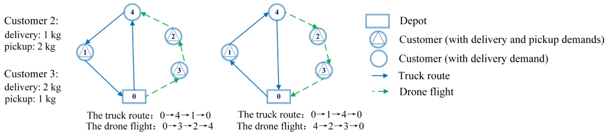

Fig. 1. Truck-drone routes in opposite directions.

The remainder of this paper is organized as follows: Section 2 presents a review of the relevant literature, followed by the mathematical formulation for the problem in Section 3. Section 4 and Section 5 describe the proposed solution approach and computational results, respectively. Section 6 concludes this work and suggests potential extensions for future studies.

## 2. Related literature

In this section, we provide a brief overview of the previous studies on combined routing problems that are most relevant to this work. For a comprehensive review of the main research issues and applications, readers can refer to Otto et al. (2018), Chung et al. (2020), Macrina et al. (2020) and Moshref-Javadi and Winkenbach (2021).

Murray and Chu (2015) first introduce the so-called flying sidekick traveling salesman problem (FSTSP), in which a combination of a single truck and a single drone is utilized for parcel delivery with the objective of minimizing total time. These researchers also propose a mixed-integer linear programming (MILP) model and solution approaches for this problem. The traveling salesman problem with drone (TSP-D) defined by Agatz et al. (2018) is similar to the FSTSP, with the relaxation that the truck can wait at the launch node for the returning drone. These authors provide theoretical perspectives, mathematical models and some heuristics. In what follows, Ha et al. (2018) examine the operational cost of the TSP-D and propose two heuristics, TSP-local search (TSP-LS) and greedy randomized adaptive search procedure (GRASP), to solve the problem. Meanwhile, Yurek and Ozmutlu (2018) provide a decomposition-based iterative algorithm to address medium-size TSP-D. The work by Marinelli et al. (2018) considers the possibility of en route operations in the TSP-D, that is, launch and retrieval operations can occur along the edge. The authors modify the GRASP heuristic to solve instances with up to 30 customers. Jeong et al. (2019) extend the FSTSP with energy consumption and no-fly zones (FSTSP-ECNZ). In particular, a two-phased heuristic algorithm is provided to solve problems with up to 50 customers. In addition, some works focus on exploring exact methods for the FSTSP/TSP-D (e.g., Bouman et al., 2018; Boccia et al., 2021; Vasquez ´ et al., 2021). Schermer et al. (2020) propose a branch-and-cut (BC) algorithm, MILP-BC-VI, for the TSP-D, which can optimally solve several instances with up to 20 customers within an hour. Roberti and Ruthmair (2021) investigate a branch-and-price approach with dynamic programming recursions, which can solve the TSP-D with up to 39 customers to optimality.

Murray and Raj (2020) investigate a variant of the FSTSP with multiple drones (MFSTSP) and model the energy consumption of drones as a function of parcel weight, speed and operation time. Moreover, they propose a three-phased iterative heuristic for instances with up to 100 customers. Moshref-Javadi et al. (2020a) provide a metaheuristic solution algorithm, TDRA, to minimize the customer waiting times for a combined problem of a single truck with multiple drone uses, called the simultaneous traveling repairman problem with drones (STRPD). Moshref-Javadi et al. (2020) propose the multi-trip traveling repairman problem with drones (MTRPD), which assumes that a single truck can stop at one customer location to launch drones multiple times but must wait there for all their returns before moving to the next stop. Moreover, adaptive tabu search-simulated annealing (ATSA) is developed for the problem.

Luo et al. (2017) mathematically model a two-echelon combined routing problem (2E-GU-RP), in which a drone serves all customers, with the capability of serving multiple customers per dispatch, i.e., multiple visits per flight, and a set of rendezvous nodes (i.e., parking lots) is dedicated to drone launch and retrieval. The authors provide two heuristics to address problems with up to 200 customers. Liu et al. (2020) investigate a similar problem (2E-RP-T&D), while the truck launches and retrieves the drone at the depot or the customer nodes it serves, and a linear energy consumption model is deployed with the assumption that the truck must reach rendezvous nodes before the drone. The authors design a two-staged approach to address instances with up to 100 customers. The work by Gonzalez-R et al. (2020) extends the FSTSP with multi-visit consideration, called the truck-drone team logistic (TDTL) problem, and an iterated greedy (IG) heuristic is developed to solve problems with up to 250 customers.

Luo et al. (2021) investigate the multi-visit traveling salesman problem with multiple drones (MTSP-MD) and assume that the energy consumption of a drone relates to the flying time, its self- weight and the payload. Moreover, they propose a multi-start tabu search (MSTS) to solve problems with up to 100 customers. The work by Poikonen and Golden (2020) develops the k-multi-visit drone routing problem (k-MVDRP), which consists of a combination of a truck and k drones that are capable of multi-visit operation. Additionally, the drone power consumption is modeled as a piecewise linear function of the load, and a three-phased heuristic approach (RTS) is proposed for the problem. In a follow-up paper, Masone et al. (2022) extend the MVDRP with edge launches (MVDRP-EL) to minimize the completion time, in which an edge launch ability is exploited and a drone energy depletion function based on the payload is deployed. The authors propose the RTS-EL approach, which integrates three improvements with the RTS heuristic to solve the problem. The work by Leon-Blanco et al. (2022) extends the TDTL with multiple drones (TmDTL), and an agentbased method is developed to solve problems containing 500 locations with up to 8 drones.

Wang et al. (2017) introduce the VRP-D, which considers multiple trucks and drones with the objective of minimizing the operation time. Next, Sacramento et al. (2019) analyze the operational cost of the VRP-D and propose an adaptive large neighborhood search (ALNS) for problems with up to 250 customers. Euchi and Sadok (2021) provide a hybrid genetic-sweep algorithm to address the VRP-D with up to 200 customers. Kitjacharoenchai et al. (2019) investigate the multiple traveling salesman problem with drones (mTSPD), in which multiple trucks and drones are deployed to make deliveries and drones can be retrieved by any trucks nearby. In particular, an adaptive insertion algorithm (ADI) is designed to solve large-size problems involving up to 100 customers. Schermer et al. (2019) extend the VRP-D with en route operations (VRPDERO) and deploy a hybrid variable neighborhood search/tabu search (VNS/TS)

algorithm to solve problems with up to 50 customers. In Kuo et al. (2022), an extension of VRP-D with customer time windows (VRPTWD) is explored to minimize the travel cost, and a VNS procedure provided can solve instances consisting of 50 customers.

Wang and Sheu (2019) extend the VRP-D to a multi-visit scenario in which drones can take off from any stops of trucks but must land at docking hubs (i.e., transfer stations for drones) or the depot. The authors propose a path-based model and branch-and-price algorithm for the problem. Kitjacharoenchai et al. (2020) propose a two-echelon vehicle routing problem with drones (2EVRPD), which deploys multiple trucks and drones with the capability of multiple visits. These investigators provide two algorithms to effectively address large-size problems.

As mentioned above, one paper considers drone pickups in the combined routing problem. Karak and Abdelghany (2019) consider a combination problem of a single truck with multiple drones, in which drones are capable of multiple visits and are launched and retrieved by the truck at specific stations for all pickup and delivery demands. The authors improve a Clarke and Wright algorithm for solving instances with up to 100 customers and 24 stations.

In conclusion, the above review indicates that a new variant of the VRP-D has not yet been studied. Current VRP-D studies primarily focus on efficient delivery-only operations and seldom consider SPD. In addition, the MDRP-PD is more practical, as it allows multiple customers to be served in one drone flight and considers the load capacity constraint of trucks and the effect of payload on the energy consumption of drones. Therefore, the flexibility of MDRP-PD contributes to a new pickup and delivery mode. We summarize recent studies in this area in Table 1.

D denotes the number of drones for each truck/total number of drones when trucks are independently operated or are not being used, T represents the number of trucks and m is the abbreviation for “Multiple”. Column SV/MV represents the number of customers per flight (i.e., single visit or multiple visits). Column PU defines whether the problem considers a pickup operation. Column ER indicates whether the drone endurance range is a fixed value independent of the load. Column TC indicates whether the capacity of trucks is considered. The last column indicates whether a truck is allowed to wait at a launch node for drones to return in a combined problem.

Summary of related studies.

| References | Problem | D | T | SV/MV | PU | ER | TC | LR |
| --- | --- | --- | --- | --- | --- | --- | --- | --- |
| Murry and Chu (2015), Ha et al. (2018), Marinelli et al. (2018), Yurek and Ozmutlu | FSTSP/ TSP- | 1 | 1 | 1 | × | fixed | × | × |
| (2018), Boccia et al. (2021) | D |  |  |  |  |  |  |  |
| Agatz et al. (2018), Bouman et al. (2018), Schermer et al. (2020), V́asquez et al. (2021) | TSP-D | 1 | 1 | 1 | × | fixed | × | √ |
| Roberti and Ruthmair (2021) | TSP-D | 1 | 1 | 1 | × | varying | × | √ |
| Jeong et al. (2019) | FSTSP-ECNZ | 1 | 1 | 1 | × | varying | × | × |
| Murray and Raj. (2020), Raj and Murray (2020) | MFSTSP | m | 1 | 1 | × | varying | × | × |
| Moshref-Javadi et al. (2020a) | STRPD | m | 1 | 1 | × | fixed | × | × |
| Moshref-Javadi et al. (2020) | MTRPD | m | 1 | 1 | × | fixed | × | √ |
| Luo et al. (2017) | 2E-GU-RP | 1 | 1 | m | × | fixed | × | × |
| Liu et al. (2020) | 2E-RP-T&amp;D | 1 | 1 | m | × | varying | × | √ |
| Gonzalez-R et al. (2020) | TDTL | 1 | 1 | m | × | fixed | × | × |
| Leon-Blanco et al. (2022) | TmDTL | m | 1 | m | × | fixed | × | × |
| Karak and Abdelghany (2019) | HVDRP | m | 1 | m | √ | fixed | × | √ |
| Luo et al. (2021) | MTSP-MD | m | 1 | m | × | varying | × | × |
| Poikonen and Golden (2020) | k-MVDRP | m | 1 | m | × | varying | × | √ |
| Masone et al (2022) | MVDRP-EL | 1 | 1 | m | × | varying | × | × |
| Ham, 2018 | PDSTSP+DP | 1 | 1 | m | √ | fixed | × | × |
| Kim et al., 2017, Pachayappan and Sudhakar, 2021 | DRPPD | m | 0 | m | √ | fixed | × | × |
| Wikarek et al., 2019 | CVRP-D | m | 1 | m | √ | fixed | × | × |
| Dorling et al. (2017), Song et al. (2018), Torabbeigi et al. (2019) | DDPs | m | 0 | m | × | varying | × | × |
| Wang et al. (2017) | VRP-D | m | m | 1 | × | fixed | √ | × |
| Sacramento et al. (2019), Euchi and Sadok (2021) | VRP-D | 1 | m | 1 | × | fixed | √ | × |
| Kuo et al. (2022) | VRPTWD | 1 | m | 1 | × | fixed | √ | × |
| Kitjacharoenchai et al. (2019) | mTSPD | m | m | 1 | × | fixed | × | × |
| Schermer et al. (2019) | VRPDERO | m | m | 1 | × | fixed | × | × |
| Wang and Sheu. (2019) | VRP-D | m | m | m | × | fixed | √ | × |
| Kitjacharoenchai et al. (2020) | 2EVRPD | m | m | m | × | fixed | √ | × |
| This paper | MDRP-PD | 1 | m | m | √ | varying | √ | √ |

## 3. Model

We present the problem description and introduce all the notation used in the model in Section 3.1. The mathematical model itself is described in Section 3.2, followed by additional valid inequalities in Section 3.3. In Section 3.4, we provide a sufficient condition for the benefits of using the combined mode over the truck-only mode.

## 3.1. Problem description

The MDRP-PD considers a combined last-mile logistics system with a fleet of homogeneous trucks each equipped with one drone to serve a given set of customers with pickup and/or delivery demands. All drones are assumed to be identical. If a truck-drone pair (or vehicle pair) is deployed, a fixed cost is incurred. The transportation cost is calculated differently for trucks and drones. For the former, it is proportional to the travel distance, while for the latter, it is proportional to the consumed battery energy. The objective of MDRP-PD is to determine the optimal fleet size to deploy and the optimal routes to serve all demands with the minimal total cost. An illustrative example is depicted in Fig. 2. The relevant assumptions of the problem are listed as follows:

• Every customer (node) needs to be served exactly once by either a truck or a drone. Pickup and delivery consume different times for trucks and drones.

• Each truck and its drone are deployed in pairs and must depart from and return to a single depot once. For each pair, the drone must only be launched and retrieved at the same truck.

• Each truck has a limited load capacity and constant speed.

• Each drone can serve multiple customers per flight as long as its load and battery capacities allow.

• Each drone can conduct multiple nonoverlapping flights, launched and retrieved at most once at each customer location.

• A drone can be dispatched before its truck leaves the launch node.

• The launch and retrieval times are negligible.

• The energy consumption of a drone depends on the weight of the parcels it carries. As soon as a drone is retrieved, its battery is replaced with a fully charged one. The replacement time is constant.

• When a truck and its drone reconvene at the retrieval node, whichever arrives first will wait for the other. A drone that arrives early will consume additional energy to hover and wait for the truck to arrive, and therefore, it must be retrieved before the battery energy runs out.

• Considering the road network for trucks, the travel distances are computed by the Manhattan metric and Euclidean metric for trucks and drones, respectively.

The filled nodes indicate the customers that can only be served by trucks when the pickup or delivery demand of each exceeds the load capacity of drones (truck-only nodes). The emptied nodes denote the customers that can be served by either a truck or a drone (drone-eligible nodes).

Table 2 lists all the notation to be used in the mathematical model. Throughout this paper, we use $[ i : j ]$ to denote the running indices $\{ i , \cdots , j \}$ for any nonnegative integer $i \leq j .$

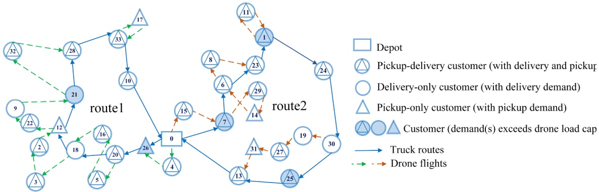

Fig. 2. A feasible solution to an MDRP-PD problem with 33 customers.

Table 2 Notation.

<table><tr><td>Notation</td><td>Description</td></tr><tr><td colspan="2">Sets:</td></tr><tr><td> $N_c$ </td><td>Set of all customer nodes, where  $N_c = [1:n], |N_c| = n$ .</td></tr><tr><td> $N_o$ </td><td>Subset of all customers and the starting depot, from which a truck/drone can depart, $N_o = \{0\} \cup N_c$ .</td></tr><tr><td> $N_e$ </td><td>Subset of all customers and the ending depot, at which a truck/drone can arrive, $N_e = N_c \cup \{n+1\}$ .</td></tr><tr><td> $N$ </td><td>Set of all nodes,  $N = \{0\} \cup N_c \cup \{n+1\}$ , where 0 and  $n+1$  correspond to the same depot location, denoting the starting depot and ending depot, respectively.</td></tr><tr><td> $A$ </td><td>Set of all arcs,  $A = \{(i,j) | i \in N_o, j \in N_e, i \neq j\}$ .</td></tr><tr><td> $N_d$ </td><td>Subset of drone-eligible customers.</td></tr><tr><td colspan="2">Parameters:</td></tr><tr><td> $K$ </td><td>Total number of available truck-drone pairs. Each pair is indexed by  $k \in [1:K]$ .</td></tr><tr><td> $Q$ </td><td>Maximum load capacity of each truck (unit: kg).</td></tr><tr><td> $W$ </td><td>Maximum load capacity of each drone (unit: kg).</td></tr><tr><td> $E$ </td><td>Maximum battery capacity of each drone (i.e., total energy a battery can provide) (unit: Wh).</td></tr><tr><td> $w_0$ </td><td>Curb weight of each drone (unit: kg).</td></tr><tr><td> $\alpha$ </td><td>Battery energy consumption per distance per weight of each drone (unit: Wh/(km·kg)).</td></tr><tr><td> $c^0$ </td><td>Fixed cost of deploying a truck-drone pair (unit: \$).</td></tr><tr><td> $P$ </td><td>Output power (output energy per hour) of the drone&#x27;s battery throughout their flights (unit: W).</td></tr><tr><td> $d_i$ </td><td>Delivery demand quantity at node  $i$  (unit: kg).</td></tr><tr><td> $p_i$ </td><td>Pickup demand quantity at node  $i$  (unit: kg).</td></tr><tr><td> $c^T$ </td><td>Travel cost per distance for each truck (unit: \$/km).</td></tr><tr><td> $c^F$ </td><td>Energy consumption cost per unit for each drone (unit: \$/Wh).</td></tr><tr><td> $r_{ij}(r_{ij}')$ </td><td>Manhattan (Euclidean) distance of arc  $(i,j) \in A$  (unit: km).</td></tr><tr><td> $v^T$ </td><td>Constant speed of each truck (unit: km/h).</td></tr><tr><td> $BR$ </td><td>Required time for battery replacement (unit: h).</td></tr><tr><td> $u_i$ </td><td>Required time for serving customer  $i$  by a truck (unit: h), which includes three kinds of times (i.e., pickup time, delivery time and pickup + delivery time), corresponding to three sets of customers (i.e., pickup-only customers, delivery-only customers and pickup-delivery customers).</td></tr><tr><td> $u_i'$ </td><td>Required time for serving customer  $i$  by a drone (unit: h), which also contains three kinds of times, corresponding to three sets of customers.</td></tr><tr><td> $M$ </td><td>A sufficiently large positive integer.</td></tr><tr><td colspan="2">Decision variables:</td></tr><tr><td> $x_{ij}^{0k} \in \{0,1\}$ </td><td>Equal to 1 if truck  $k$  traverses arc  $(i,j) \in A$  with its drone on board, and 0 otherwise.</td></tr><tr><td> $x_{ij}^{1k} \in \{0,1\}$ </td><td>Equal to 1 if truck  $k$  traverses arc  $(i,j) \in A$  by itself, and 0 otherwise.</td></tr><tr><td> $x_{ij}^{2k} \in \{0,1\}$ </td><td>Equal to 1 if drone  $k$  traverses arc  $(i,j) \in A$  by itself, and 0 otherwise.</td></tr><tr><td> $z_i^{1k} \in \{0,1\}$ </td><td>Equal to 1 if node  $i$  is served by truck  $k$ , and 0 otherwise.</td></tr><tr><td> $z_i^{2k} \in \{0,1\}$ </td><td>Equal to 1 if node  $i$  is served by drone  $k$ , and 0 otherwise.</td></tr><tr><td> $s_i^{1k} \geq 0$ </td><td>Arrival time of truck  $kat$  node  $i$ .</td></tr><tr><td> $s_i^{1k} \geq 0$ </td><td>Departure time of truck  $k$  from node  $i$ .</td></tr><tr><td> $s_i^{2k} \geq 0$ </td><td>Arrival time of drone  $k$  at node  $i$  in a flight.</td></tr><tr><td> $s_i^{2k} \geq 0$ </td><td>Departure time of drone  $k$  from node  $i$  in a flight.</td></tr><tr><td> $t_{ij}^k \in [0,E/P]$ </td><td>Time that drone  $k$  spends to fly along arc  $(i,j) \in A$  (unit: h).</td></tr><tr><td> $t_{h,i}^k \in [0,E/P]$ </td><td>Hovering time of drone  $k$  at node  $i$  (unit: h).</td></tr><tr><td> $e_{ij}^k \in [0,E]$ </td><td>Energy consumption of drone  $k$  over arc  $(i,j) \in A$  (unit: Wh).</td></tr><tr><td> $e_i^k \in [0,E]$ </td><td>Energy drone  $k$  has consumed when it leaves node  $i$  in a flight (unit: Wh).</td></tr><tr><td> $w_i^k \in [0,W]$ </td><td>Total parcel weight carried on drone  $k$  when it leaves node  $i$  (unit: kg).</td></tr><tr><td> $w_i^{dk} \in [0,W]$ </td><td>Delivery weight carried on drone  $k$  when it leaves node  $i$  (unit: kg).</td></tr><tr><td> $v_i^k \in [0,Q]$ </td><td>Load carried on truck  $k$  when it leaves node  $i$  (unit: kg).</td></tr></table>

## 3.2. Mathematical model

Due to its complexity, we describe the mathematical model of the MDRP-PD in blocks. We first present the objective function in Section 3.2.1, followed by the routing constraints in Section 3.2.2 and timing constraints in Section 3.2.3. The energy consumption constraints of drones are introduced in Section 3.2.4, and the demand flow constraints for drones and trucks are introduced in Sections 3.2.5 and $3 . 2 . 6 ,$ respectively.

## 3.2.1. Objective function

$$
\text {minc} ^ {T} \sum_ {k \in [ 1: K ]} \sum_ {(i, j) \in A \setminus (0, n + 1)} \left(x _ {i j} ^ {0 k} + x _ {i j} ^ {1 k}\right) r _ {i j} + c ^ {F} \sum_ {k \in [ 1: K ]} \left(\sum_ {(i, j) \in A} e _ {i j} ^ {k} + P \bullet \sum_ {i \in N _ {d}} z _ {i} ^ {2 k} u _ {i} ^ {\prime} + P \sum_ {i \in N _ {c}} t _ {h, i} ^ {k}\right) + c ^ {0} \sum_ {k \in [ 1: K ]} \left(1 - x _ {0, n + 1} ^ {0 k}\right)\tag{1}
$$

Objective function (1) minimizes the total cost for the entire pickup and delivery operation. The first two terms are the transportation cost for trucks and drones, and the last term captures the fixed cost of deploying vehicle pairs. Note that if a vehicle pair k is undeployed, we have $x _ { 0 , n + 1 } ^ { 0 k }   = 1 ;$ otherwise $x _ { 0 , n + 1 } ^ { 0 k } = 0$ . Therefore, $\textstyle \sum _ { k \in [ 1 : K ] } ( 1 - x _ { 0 , n + 1 } ^ { 0 k }$ )captures the number of deployed vehicle pairs.

## 3.2.2. Routing constraints

$$
\sum_ {j \in N _ {e}} \left(x _ {0 j} ^ {0 k} + x _ {0 j} ^ {1 k}\right) = \sum_ {i \in N _ {o}} \left(x _ {i, n + 1} ^ {0 k} + x _ {i, n + 1} ^ {1 k}\right) = 1, k \in [ 1: K ]\tag{2a}
$$

$$
\sum_ {j \in N _ {e}} \left(x _ {0 j} ^ {0 k} + x _ {0 j} ^ {2 k}\right) = \sum_ {i \in N _ {o}} \left(x _ {i, n + 1} ^ {0 k} + x _ {i, n + 1} ^ {2 k}\right) = 1, k \in [ 1: K ]\tag{2b}
$$

$$
\sum_ {k \in [ 1: K ]} (x _ {i j} ^ {0 k} + x _ {i j} ^ {1 k} + x _ {i j} ^ {2 k}) \leq 1, (i, j) \in A \backslash (0, n + 1)\tag{3}
$$

$$
\sum_ {i \in N _ {a}} (x _ {i j} ^ {0 k} + x _ {i j} ^ {1 k}) = \sum_ {i \in N _ {e}} \left(x _ {j i} ^ {0 k} + x _ {j i} ^ {1 k}\right) = z _ {j} ^ {1 k}, j \in N _ {c}, k \in [ 1: K ]\tag{4a}
$$

$$
\sum_ {i \in N _ {o}} \left(x _ {i j} ^ {0 k} + x _ {i j} ^ {2 k}\right) = \sum_ {i \in N _ {e}} \left(x _ {j i} ^ {0 k} + x _ {j i} ^ {2 k}\right), j \in N _ {c}, k \in [ 1: K ]\tag{4b}
$$

$$
2 ^ {*} z _ {j} ^ {2 k} \leq \sum_ {i \in N _ {o}} x _ {i j} ^ {2 k} + \sum_ {i \in N _ {e}} x _ {j i} ^ {2 k}, j \in N _ {d}, k \in [ 1: K ]\tag{5a}
$$

$$
\sum_ {k \in [ 1: K ]} \left(z _ {j} ^ {1 k} + z _ {j} ^ {2 k}\right) = 1, j \in N _ {c}\tag{5b}
$$

$$
\sum_ {k \in [ 1: K ]} z _ {j} ^ {1 k} = 1, j \in N \backslash N _ {d}\tag{5c}
$$

$$
z _ {i} ^ {1 k} \geq \sum_ {j \in N _ {e}} x _ {i j} ^ {2 k} - z _ {i} ^ {2 k}, i \in N _ {c}, k \in [ 1: K ]\tag{5d}
$$

$$
z _ {i} ^ {1 k} \geq \sum_ {j \in N _ {o}} x _ {j i} ^ {2 k} - z _ {i} ^ {2 k}, i \in N _ {c}, k \in [ 1: K ]\tag{5e}
$$

$$
z _ {j} ^ {2 k} \geq x _ {i j} ^ {2 k} + \sum_ {j \in N _ {e}} x _ {i j} ^ {0 k} + \sum_ {j \in N _ {e}} x _ {i j} ^ {1 k} - 1, i \in N _ {o}, j \in N _ {c}, k \in [ 1: K ]\tag{5f}
$$

$$
\sum_ {k \in [ 1: K ]} \sum_ {j \in N _ {e}} x _ {i j} ^ {2 k} \leq 1, i \in N _ {c}\tag{6a}
$$

$$
\sum_ {k \in [ 1: K ]} \sum_ {j \in N _ {0}} x _ {j i} ^ {2 k} \leq 1, i \in N _ {c}\tag{6b}
$$

Constraints (2a) and (2b) ensure that each vehicle pair starts from depot 0 and ends at depot n +1 exactly once. Note that if a vehicle pair departs from the depot and directly returns to the depot, it is undeployed. Constraint (3) ensures that each arc is traversed by either a truck, a drone or both at most once, which is not applicable to arc $( 0 ,   n   +   1 )$ . Constraints (4a) and (4b) ensure flow conservation for each truck and each drone at all customer nodes. Note that if a node is visited by a truck, it must be served by that truck. However, this is not the case for drones, as they could just be launched/retrieved at that node. Constraint (5a) ensures that if a customer is served by a drone, it must be visited by the same drone. Constraint (5b) ensures that each customer must be served exactly once by either a truck or a drone, and Constraint (5c) ensures that truck-only customers must be served by trucks. Constraints (5d) and (5e)indicate that if a drone departs from/arrives at node i but does not serve it, its truck must visit this node. Constraint (5f) ensures that at least one customer is served in a drone flight. Constraints (6a) and (6b) restrict all the drones to leave or arrive at each customer node once at most.

## 3.2.3. Timing constraints

$$
s _ {i} ^ {\prime 1 k} + \frac {r _ {i j}}{\nu^ {T}} + M \left(1 - x _ {i j} ^ {0 k} - x _ {i j} ^ {1 k}\right) \geq s _ {j} ^ {1 k} \geq s _ {i} ^ {\prime 1 k} + \frac {r _ {i j}}{\nu^ {T}} - M \left(1 - x _ {i j} ^ {0 k} - x _ {i j} ^ {1 k}\right), (i, j) \in A, k \in [ 1: K ] (7 a)\tag{7a}
$$

$$
s _ {i} ^ {1 k} \geq s _ {i} ^ {1 k} + u _ {i} \cdot z _ {i} ^ {1 k} + B R \cdot \sum_ {j \in N _ {d}} x _ {j i} ^ {2 k}, i \in N _ {c}, k \in [ 1: K ]\tag{7b}
$$

$$
s _ {i} ^ {\prime 2 k} + t _ {i j} ^ {k} + M \Big (1 - x _ {i j} ^ {2 k} \Big) \geq s _ {j} ^ {2 k} \geq s _ {i} ^ {\prime 2 k} + t _ {i j} ^ {k} - M \Big (1 - x _ {i j} ^ {2 k} \Big), (i, j) \in A, k \in [ 1: K ]\tag{7c}
$$

$$
s _ {i} ^ {2 k} + u _ {i} ^ {\prime} + M \left(1 - z _ {i} ^ {2 k}\right) \geq s _ {i} ^ {\prime 2 k} \geq s _ {i} ^ {2 k} + u _ {i} ^ {\prime} - M \left(1 - z _ {i} ^ {2 k}\right), i \in N _ {d}, k \in [ 1: K ]\tag{7d}
$$

$$
s _ {i} ^ {\prime 2 k} \geq s _ {i} ^ {2 k} + B R - M \left(3 - \sum_ {j \in N _ {o}} x _ {j i} ^ {1 k} - \sum_ {j \in N _ {d}} x _ {j i} ^ {2 k} - \sum_ {j \in N _ {d}} x _ {i j} ^ {2 k}\right), i \in N _ {c}, k \in [ 1: K ]\tag{7e}
$$

$$
s _ {i} ^ {2 k} \geq s _ {i} ^ {\prime 2 k} - M \left(3 - \sum_ {j \in N _ {o}} x _ {j i} ^ {0 k} - \sum_ {j \in N _ {d}} x _ {i j} ^ {2 k} - \sum_ {j \in N _ {d}} x _ {j i} ^ {2 k}\right), i \in N _ {c}, k \in [ 1: K ]\tag{7f}
$$

$$
s _ {i} ^ {\prime 1 k} \geq s _ {i} ^ {\prime 2 k} - M \left(2 - \sum_ {j \in N _ {e}} x _ {i j} ^ {0 k} - \sum_ {j \in N _ {e}} x _ {i j} ^ {1 k} - \sum_ {j \in N _ {d}} x _ {i j} ^ {2 k}\right), i \in N _ {o}, k \in [ 1: K ]\tag{7 g}
$$

$$
s _ {i} ^ {\prime 2 k} \geq s _ {i} ^ {1 k} + B R \cdot \sum_ {j \in N _ {d}} x _ {j i} ^ {2 k} - M \left(2 - z _ {i} ^ {1 k} - \sum_ {j \in N _ {d}} x _ {i j} ^ {2 k}\right), i \in N _ {c}, k \in [ 1: K ]\tag{7 h}
$$

$$
s _ {i} ^ {\prime 1 k} \geq s _ {i} ^ {2 k} + B R - M \left(2 - \sum_ {j \in N _ {d}} x _ {j i} ^ {2 k} - z _ {i} ^ {1 k}\right), i \in N _ {c}, k \in [ 1: K ]\tag{7i}
$$

The time synchronization for the trucks and drones is maintained by (7). Constraints $( 7 a )$ and (7b) track the arrival and departure times of a truck at every node. Similarly, Constraints (7c) and (7d) track the arrival and departure times of a drone at each node it serves. Constraint (7e) ensures that if a drone is launched again from node i after its arrival at it, the time the drone departs from this node is no earlier than the total of its arrival time and the battery replacement time. Similarly, Constraint (7f) ensures that if a drone performs a loop flight at node $i ,$ its latest arrival time at node i is no earlier than its launch time from node i. Constraints $( 7 g )$ and (7h) mean that the time for launching a drone should be earlier than the departure time but later than the arrival time of its truck plus the battery replacement time (if the drone is also retrieved at this node). Constraint (7i) ensures that the truck cannot leave the retrieval node before its drone arrives and the battery is replaced at this node.

## 3.2.4. Drone energy consumption constraints

In practical applications, the impact of payload on the energy consumption of a drone during flight should not be neglected (Dorling et al., 2017; Song et al., 2018; Torabbeigi et al., 2020). We extend the drone energy model proposed in Liu et al. (2020) and Xiao et al. (2012) and assume that the drones operate at a constant power P throughout their flights and the battery energy consumption of drones is positively linear with the flying distance and the carried weight of the packages (Xiao et al., 2012; Torabbeigi et al., 2020; Roberti and Ruthmair, 2021; Zhang et al., 2021). For the sake of generality, we do not consider other factors such as weather conditions. For a drone, the energy consumed in a flight consists of three parts, i.e., flying, serving and hovering. The energy consumed to fly from node i to j is $\alpha \cdot \left( w _ { 0 }   +   w _ { i } ^ { k } \right) \cdot r _ { i j } ^ { \prime } .$ . The flying time $t _ { i j } ^ { k }$ from node i to j is calculated as follows:

$$
t _ {i j} ^ {k} = \frac {\alpha \cdot \left(w _ {0} + w _ {i} ^ {k}\right) \cdot r _ {i j} ^ {\prime}}{P}.
$$

The energy consumption of drone k must satisfy:

$$
0 \leq e _ {i j} ^ {k} \leq E \bullet x _ {i j} ^ {2 k}, (i, j) \in A, k \in [ 1: K ]\tag{8a}
$$

$$
\alpha \cdot \left(w _ {0} + w _ {i} ^ {k}\right) \cdot r ^ {\prime} _ {i j} - E \left(1 - x _ {i j} ^ {2 k}\right) \leq e _ {i j} ^ {k} \leq \alpha \cdot \left(w _ {0} + w _ {i} ^ {k}\right) \cdot r ^ {\prime} _ {i j}, (i, j) \in A, k \in [ 1: K ]\tag{8b}
$$

$$
0 \leq t _ {h, j} ^ {k} \leq \frac {E}{P} \bullet t _ {j} ^ {k}, j \in N _ {c}, k \in [ 1: K ]\tag{9a}
$$

$$
s _ {j} ^ {1 k} \geq s _ {j} ^ {2 k} - M \left(1 - t _ {j} ^ {k}\right), s _ {j} ^ {1 k} \leq s _ {j} ^ {2 k} + M \bullet t _ {j} ^ {k}, j \in N _ {c}, k \in [ 1: K ]\tag{9b}
$$

$$
\left(s _ {j} ^ {1 k} - s _ {j} ^ {2 k}\right) - M \left(1 - t _ {j} ^ {k}\right) \leq t _ {h, j} ^ {k} \leq \left(s _ {j} ^ {1 k} - s _ {j} ^ {2 k}\right) + M \left(1 - t _ {j} ^ {k}\right), j \in N _ {c}, k \in [ 1: K ]\tag{9c}
$$

$$
0 \leq e _ {i} ^ {k} \leq E \left(2 - \sum_ {j \in N _ {e}} x _ {i j} ^ {0 k} - \sum_ {j \in N _ {e}} x _ {i j} ^ {1 k} - \sum_ {j \in N _ {d}} x _ {i j} ^ {2 k}\right), i \in N _ {o}, k \in [ 1: K ]\tag{10}
$$

$$
e _ {i} ^ {k} + e _ {i j} ^ {k} + P \cdot u _ {j} ^ {\prime} - M \left(2 - x _ {i j} ^ {2 k} - z _ {j} ^ {2 k}\right) \leq e _ {j} ^ {k}, i \in N _ {o}, j \in N _ {d}, k \in [ 1: K ]\tag{11}
$$

$$
e _ {i} ^ {k} + e _ {i j} ^ {k} + P \cdot t _ {h, j} ^ {k} \cdot z _ {j} ^ {1 k} - M \left(2 - x _ {i j} ^ {2 k} - \sum_ {i \in N _ {o}} x _ {i j} ^ {0 k} - \sum_ {i \in N _ {o}} x _ {i j} ^ {1 k}\right) \leq E, i \in N _ {d}, j \in N _ {e}, k \in [ 1: K ]\tag{12}
$$

Constraints (8a) and (8b) determine the energy consumption of drone k on every arc. Constraints (9a)- (9c) linearize the hovering time $t _ { h j } ^ { k } = \operatorname* { m a x } \{ 0 , s _ { j } ^ { 1 k } - s _ { j } ^ { 2 k } \}$ of drone k at each customer j, where $t _ { j } ^ { k } \in \{ 0 , 1 \}$ is an auxiliary binary decision variable in retrieval node j. Constraint (10) resets the energy consumption to zero whenever a drone is launched, that is, the drone’s battery is fully charged. Constraint (11) ensures energy consumption conservation when a drone flies from node i to serve node j. Constraint (12) ensures that the total energy consumed at the retrieval node does not exceed the battery capacity. Note that if drone k is retrieved at the depot, it need not wait for its truck.

## 3.2.5. Demand flow constraints for drones

$$
w _ {i} ^ {d k} - W \left(2 - \sum_ {j \in N _ {e}} x _ {i j} ^ {0 k} - \sum_ {j \in N _ {e}} x _ {i j} ^ {1 k} - \sum_ {j \in N _ {d}} x _ {i j} ^ {2 k}\right) \leq w _ {i} ^ {k} \leq w _ {i} ^ {d k} + W \left(2 - \sum_ {j \in N _ {e}} x _ {i j} ^ {0 k} - \sum_ {j \in N _ {e}} x _ {i j} ^ {1 k} - \sum_ {j \in N _ {d}} x _ {i j} ^ {2 k}\right), i \in N _ {o}, k \in [ 1: K ]\tag{13a}
$$

$$
0 \leq w _ {i} ^ {d k} \leq W \left(2 - x _ {i j} ^ {2 k} - \sum_ {i \in N _ {o}} x _ {i j} ^ {0 k} - \sum_ {i \in N _ {o}} x _ {i j} ^ {1 k}\right), i \in N _ {d}, j \in N _ {e}, k \in [ 1: K ]\tag{13b}
$$

$$
w _ {i} ^ {d k} - d _ {j} - M \left(2 - x _ {i j} ^ {2 k} - z _ {j} ^ {2 k}\right) \leq w _ {j} ^ {d k} \leq w _ {i} ^ {d k} - d _ {j} + M \left(2 - x _ {i j} ^ {2 k} - z _ {j} ^ {2 k}\right), i \in N _ {o}, j \in N _ {d}, k \in [ 1: K ]\tag{13c}
$$

$$
w _ {i} ^ {k} - d _ {j} + p _ {j} - M \left(2 - x _ {i j} ^ {2 k} - z _ {j} ^ {2 k}\right) \leq w _ {j} ^ {k} \leq w _ {i} ^ {k} - d _ {j} + p _ {j} + M \left(2 - x _ {i j} ^ {2 k} - z _ {j} ^ {2 k}\right), i \in N _ {o}, j \in N _ {d}, k \in [ 1: K ]\tag{13d}
$$

Constraints (13a) and (13b) ensure that both the pickup weight that a drone carries from launch nodes and its delivery weight to retrieval nodes are zeros. Constraints (13c) and (13d)trace the delivery and total weights that drone k loads at each node that it serves.

## 3.2.6. Demand flow constraints for trucks

$$
\sum_ {i \in N _ {c}} z _ {i} ^ {1 k} d _ {i} + \sum_ {i \in N _ {d}} z _ {i} ^ {2 k} d _ {i} - w _ {0} ^ {k} \sum_ {i \in N _ {d}} x _ {0 i} ^ {2 k} \leq v _ {0} ^ {k} \leq Q \left(\sum_ {i \in N _ {c}} x _ {0 i} ^ {0 k} + \sum_ {i \in N _ {c}} x _ {0 i} ^ {1 k}\right), k \in [ 1: K ]\tag{14a}
$$

$$
\nu_ {i} ^ {k} + \left(p _ {j} - d _ {j}\right) - M \left(1 + \sum_ {i \in N _ {d}} x _ {j i} ^ {2 k} + \sum_ {i \in N _ {d}} x _ {i j} ^ {2 k} - x _ {i j} ^ {0 k} - x _ {i j} ^ {1 k}\right) \leq \nu_ {j} ^ {k} \leq \nu_ {i} ^ {k} + \left(p _ {j} - d _ {j}\right) + M \left(1 + \sum_ {i \in N _ {d}} x _ {j i} ^ {2 k} + \sum_ {i \in N _ {d}} x _ {i j} ^ {2 k} - x _ {i j} ^ {0 k} - x _ {i j} ^ {1 k}\right), i \in N _ {o}, j \in N _ {c}, k\tag{14b}
$$

$$
\begin{array}{c} v _ {i} ^ {k} + \left(p _ {j} - d _ {j} - w _ {j} ^ {k}\right) - M \left(2 + \sum_ {i \in N _ {d}} x _ {i j} ^ {2 k} - \sum_ {i \in N _ {d}} x _ {j i} ^ {2 k} - x _ {i j} ^ {0 k}\right) \leq v _ {j} ^ {k} \leq v _ {i} ^ {k} + \left(p _ {j} - d _ {j} - w _ {j} ^ {k}\right) + M \left(2 + \sum_ {i \in N _ {d}} x _ {i j} ^ {2 k} - \sum_ {i \in N _ {d}} x _ {j i} ^ {2 k} - x _ {i j} ^ {0 k}\right), i \in N _ {o}, j \in N _ {c}, k \\ \in [ 1: K ] \end{array}\tag{14c}
$$

$$
\boxed {v _ {i} ^ {k} + \left(p _ {j} - d _ {j} + w _ {i ^ {\prime}} ^ {k}\right) - M \left(2 + \sum_ {i \in N _ {d}} x _ {j i} ^ {2 k} - x _ {i ^ {\prime} j} ^ {2 k} - x _ {i j} ^ {1 k}\right) \leq v _ {j} ^ {k} \leq v _ {i} ^ {k} + \left(p _ {j} - d _ {j} + w _ {i ^ {\prime}} ^ {k}\right) + M \left(2 + \sum_ {i \in N _ {d}} x _ {j i} ^ {2 k} - x _ {i ^ {\prime} j} ^ {2 k} - x _ {i j} ^ {1 k}\right), i ^ {\prime} \in N _ {d}, i \in N _ {o}, j \in N _ {c}, k}\tag{14d}
$$

$$
\begin{array}{c} v _ {i} ^ {k} + \left(p _ {j} - d _ {j} + w _ {i ^ {\prime}} ^ {k} - w _ {j} ^ {k}\right) - M \left(3 - x _ {i ^ {\prime} j} ^ {2 k} - \sum_ {i \in N _ {d}} x _ {j i} ^ {2 k} - x _ {i j} ^ {0 k} - x _ {i j} ^ {1 k}\right) \leq v _ {j} ^ {k} \leq v _ {i} ^ {k} + \left(p _ {j} - d _ {j} + w _ {i ^ {\prime}} ^ {k} - w _ {j} ^ {k}\right) + M \left(3 - x _ {i ^ {\prime} j} ^ {2 k} - \sum_ {i \in N _ {d}} x _ {j i} ^ {2 k} - x _ {i j} ^ {0 k} - x _ {i j} ^ {1 k}\right), i ^ {\prime} \\ \in N _ {d}, i \in N _ {o}, j \in N _ {c}, k \in [ 1: K ] \end{array}\tag{14e}
$$

<small>Constraint (14a) ensures that the load of truck k from the depot does not exceed the maximum load capacity. Constraint (14b) ensures the demand flow balance when a truck visits a node that is not used for drone launch and retrieval. Constraints (14c) and (14d) capture the payload balance when a truck visits a launch-only node and retrieval-only node, respectively. Constraint (14e) ensures the demand flow balance when a truck serves a node for both launch and retrieval.</small>

## 3.3. Valid inequalities

Based on the idea of branch-and-cut, we introduce additional valid inequalities to strengthen the model and accelerate the solution process. Section 3.3.1 introduces the inequalities for the number of vehicle pairs needed, Section 3.3.2 introduces the lower bounds for the time variables, and Section 3.3.3 introduces problem-specific cuts.

## 3.3.1. Inequalities for the number of vehicle pairs needed (INV)

In the optimal solutions, the number of vehicle pairs needed can be bounded as follows:

$$
\sum_ {k \in [ 1: K ]} \left(1 - x _ {0, n + 1} ^ {0 k}\right) \geq \max \left\{\left\lceil \frac {\sum_ {i \in N _ {c}} d _ {i}}{Q} \right\rceil , \left\lceil \frac {\sum_ {i \in N _ {c}} p _ {i}}{Q} \right\rceil \right\}\tag{15a}
$$

$$
\sum_ {k \in [ 1: K ]} \left(1 - x _ {0, n + 1} ^ {0 k}\right) \leq \left[ \frac {\sum_ {i \in N _ {c}} d _ {i} + \sum_ {i \in N _ {c}} \max \left\{0 , p _ {i} - d _ {i} \right\}}{Q} \right]\tag{15b}
$$

Inequalities (15a)-(15b) ensure that the number of vehicle pairs deployed is no less than the minimum number of trucks needed for all delivery and pickup demands and no more than the number of trucks needed for the “maximum payload” of visiting all customers (refer to Section 4.2).

## 3.3.2. Lower bounds for the time variables (LBT)

The large M− coefficients in the temporal constraints presented in Section 3.2.3 may deteriorate the quality of the linear relaxation and retard the convergence of the algorithm. Therefore, several lower bounds are identified and introduced to tighten the solution space and achieve more efficiency.

Before proceeding further, we let variable $l _ { i } ^ { k } \in \mathbb { N } ^ { ^ { \star } } , 1 \leq l _ { i } ^ { k } \leq$ n be the relative position of customer i in the visit sequence of truck k. In other words, if customer i is visited before customer j by truck k, then $l _ { i } ^ { k } < l _ { j } ^ { k }$ . Let $b _ { i j } ^ { k }$ be a binary variable, and $b _ { i j } ^ { k } = 1$ if node $i \in N _ { o }$ is visited before node $j \in N _ { e }$ by truck $k ,$ and $0$ otherwise. Therefore, it is valid to add the following constraints.

$$
l _ {i} ^ {k} - l _ {j} ^ {k} + n \left(x _ {i j} ^ {0 k} + x _ {i j} ^ {1 k}\right) + (n - 2) \left(x _ {j i} ^ {0 k} + x _ {j i} ^ {1 k}\right) \leq n - 1, i, j \in N _ {c}, k \in [ 1: K ]\tag{16a}
$$

$$
n \cdot b _ {i j} ^ {k} - (n - 1) \leq \lfloor_ {j} ^ {k} - \lfloor_ {i} ^ {k}, i, j \in N _ {c}, k \in [ 1: K ]\tag{16b}
$$

$$
z _ {i} ^ {1 k} = k _ {0 i} ^ {k} = b _ {i, n + 1} ^ {k}, i \in N _ {c}, k \in [ 1: K ]\tag{16c}
$$

Constraint (16a) is adapted from the Miller-Tucker-Zemlin (MTZ) subtour elimination constraints (Miller et al., 1960); it de termines variable lkand indicates that if truck k travels directly from customer i to customer j, then $l _ { i } ^ { k } + 1 = l _ { j } ^ { k }$ . Constraint (16b) ensures that if node j is visited after node i on the truck route, then $l _ { j } ^ { k } > l _ { i } ^ { k }$ . Note that the variable $l _ { i } ^ { k }$ defined here is primarily used to determine $b _ { i j } ^ { k } ,$ which will be utilized below. Constraint (16c) ensures that if customer i is served by truck k, this customer must be visited between the starting depot and the ending depot.

Assuming the departure time of truck k from the depot to be zero, we introduce

$$
s _ {n + 1} ^ {1 k} \geq \sum_ {(i, j) \in A} \left(x _ {i j} ^ {0 k} + x _ {i j} ^ {1 k}\right) \frac {r _ {i j}}{\nu^ {T}} + \sum_ {i \in N _ {c}} z _ {i} ^ {1 k} \cdot u _ {i}, k \in [ 1: K ]\tag{17a}
$$

as a lower bound on the arrival time of truck k back to the depot, i.e., the makespan of truck k. The inequality (17a) ensures that the makespan of truck k is no less than the total of the truck travel time and the time spent by the truck serving customers. Similarly,

$$
s _ {n + 1} ^ {2 k} \geq \sum_ {(i, j) \in A} x _ {i j} ^ {2 k} t _ {i j} ^ {k} + \sum_ {i \in N _ {d}} z _ {i} ^ {2 k} \cdot u _ {i} ^ {\prime} - M \left(1 - \sum_ {i \in N _ {d}} x _ {i, n + 1} ^ {2 k}\right), k \in [ 1: K ]\tag{17b}
$$

defines a lower bound on the arrival time of drone k back to the depot. The inequality (17b) ensures that the makespan of drone k is no less than the total of the drone flying time and the time spent by the drone serving customers.

Apart from the lower bounds on the makespan, we provide three lower bounds for the time variables based on the relationship with visiting and routing variables. The inequality

$$
s _ {n + 1} ^ {1 k} \geq s _ {i} ^ {\prime 1 k} + \sum_ {j \in N _ {e}} \left(\frac {r _ {i j}}{v ^ {T}} + u _ {j} + \frac {r _ {j , n + 1}}{v ^ {T}}\right) \left(x _ {i j} ^ {0 k} + x _ {i j} ^ {1 k}\right) - M \left(1 - z _ {i} ^ {1 k}\right), i \in N _ {c}, k \in [ 1: K ]\tag{18a}
$$

defines a lower bound on the arrival time of vehicle pair k back to the depot. It ensures that if truck k departs from node $i ,$ the earliest time to reach the depot must allow the travel time from node i to node j (the node directly visited by truck k from node $i ) ,$ the service time at node j, and the travel time from node j to the ending depot. Note that node j can be the ending depot. Moreover, we have

$$
s _ {i} ^ {\prime 1 k} \geq \sum_ {j \in N _ {o}} \left(\frac {r _ {0 j}}{v ^ {T}} + u _ {j} + \frac {r _ {j i}}{v ^ {T}} + u _ {i}\right) \left(x _ {j i} ^ {0 k} + x _ {j i} ^ {1 k}\right) - M \left(1 - z _ {i} ^ {1 k}\right), i \in N _ {c}, k \in [ 1: K ]\tag{18b}
$$

which is a lower bound on the departure time of truck k from a node it visits. This inequality ensures that the earliest time for truck k to depart from node i must allow the travel time from node j (the last node that truck k visits before node i) to node $i ,$ the travel time from the starting depot to node $j ,$ and the service times for nodes i and j. Note that node j can be the starting depot.

Additionally, we provide a lower bound for the arrival time of truck k at node i,

$$
s _ {j} ^ {1 k} \geq s _ {i} ^ {\prime 1 k} + \frac {r _ {i j}}{\nu^ {T}} - M \left(1 - b _ {i j} ^ {k}\right), i, j \in N _ {c}, k \in [ 1: K ]\tag{18c}
$$

which ensures that if node j is visited after node i along the route of truck k, i.e., $k ,$ $b _ { i j } ^ { k } = 1$ , the arrival time of truck k at node j is no earlier than the departure time from node i plus the travel time between them.

## 3.3.3. Problem specific cuts for the MDRP-PD(PSC)

To strengthen the relationship between routing variables and visiting variables, we introduce the following inequalities to reduce the solution space.

$$
z _ {i} ^ {1} + z _ {j} ^ {1 k} \leq 2 - \gamma_ {i j} ^ {2 k}, i, j \in N _ {c}, k \in [ 1: K ]\tag{19a}
$$

$$
z _ {i} ^ {2 k} + z _ {j} ^ {2 k} \geq x _ {i j} ^ {2}, i, j \in N _ {c}, k \in [ 1: K ]\tag{19b}
$$

$$
z _ {i} ^ {1 k} \geq \sum_ {j \in N _ {d}} x _ {i j} ^ {2 k} - \sum_ {j \in N _ {o}} x _ {j i} ^ {2 k}, i \in N _ {c}, k \in [ 1: K ]\tag{19c}
$$

$$
z _ {i} ^ {1 k} \geq \sum_ {j \in N _ {d}} x _ {j i} ^ {2 k} - \sum_ {j \in N _ {e}} x _ {i j} ^ {2 k}, i \in N _ {c}, k \in [ 1: K ]\tag{19d}
$$

The cut (19a) imposes that if drone k flies from customer i to customer $i j ,$ these two customers cannot be both served by truck k. At least one of them is served by drone $k ,$ as imposed in (19b). The cut (19c) ensures that if drone k flies from node i but does not return to it, this customer must be served by truck k. Similarly, (19d) ensures that if drone k only returns to node i but does not fly from $\mathbf { i t } ,$ this customer must be served by truck k.

Moreover, if any customer j is visited by either truck k or drone $k , \mathrm { i . e . } , z _ { j } ^ { 1 k } = 1 \mathrm { o r } z _ { j } ^ { 2 k } = 1$ , the artificial route from the starting depot to the ending depot is not traversed by this vehicle pair. We therefore introduce

$$
x _ {0, n + 1} ^ {0 k + 1} + z _ {j} ^ {1 k} \leq 1, j \in N _ {c}, k \in [ 1: K ]\tag{20a}
$$

$$
x _ {0, n + 1} ^ {0 k} + z _ {j} ^ {2 k} \leq 1, j \in N _ {d}, k \in [ 1: K ]\tag{20b}
$$

## 3.4. A sufficient condition for the benefit of the combined mode

Before proceeding further, we study the conditions under which cost savings can be achieved by the combined mode. For any feasible solution, define by $n ^ { k }$ the number of customers assigned to vehicle pair $k ,$ among which the number of truck-only customers is $\widehat { \boldsymbol { n } } ^ { k } ,   ( \widehat { \boldsymbol { n } } ^ { k } \leq \boldsymbol { n } ^ { k } )$ . Let $D ^ { k }$ be the set of drone flights of vehicle pair k. We have the following results:

**Lemma 1**. $0 \leq | D ^ { k } | \leq n ^ { k } - \widehat { n } ^ { k } , \mathrm { f o r } \; k \in [ 1 : K ] .$

**Proof.** The validity of the left side of the inequality is straightforward since the number of drone flights of k is a nonnegative integer. In a special case, if the solution does not contain any drone service, then $| D ^ { k } |$ is equal to zero. For the right side of the inequality, $n ^ { k } - \widehat { n } ^ { k }$ denotes the number of drone-eligible customers of $k ;$ since each flight serves at least one customer, $| D ^ { k } |$ ⃒⃒must be no more than $n ^ { k } - \widehat { n } ^ { k }$

When $\begin{array} { r } { \widehat { n } ^ { k } \leq \frac { n ^ { k } } { 2 } , } \end{array}$ , a tighter upper bound of $| D ^ { k } | \mathtt { c a n }$ be found as stated in the following proposition.

**Proposition 1**. $\begin{array} { r } { \int _ { \mathbb { T } } \widehat { n } ^ { k } \leq \frac { n ^ { k } } { 2 } , \; 0 \leq | D ^ { k } | \leq \left\lceil \frac { n ^ { k } } { 2 } \right\rceil , \; \mathrm { f o r } \; k \in [ 1 : K ] . } \end{array}$

**Proof.** We assume that the number of customers served by truck k is $\hat { \boldsymbol { n } } ^ { k } + \boldsymbol { i } ,   ( \boldsymbol { i } \geq 0 , \boldsymbol { i } \in \mathbb { Z } ) ;$ ; thus, the number of customers served by its drone is $n ^ { k }   -   \widehat { n } ^ { k }   -   i .$ The upper bound of $| D ^ { k } |$ can be denoted as min $\{ \widehat { \boldsymbol { n } } ^ { k }   +   \boldsymbol { i }   +   1 , \boldsymbol { n } ^ { k }   -   \widehat { \boldsymbol { n } } ^ { k }   -   \boldsymbol { i } \}$ . Therefore, when $( { \widehat { \pmb n } } ^ { k } + { \pmb i } + { \pmb 1 } ) - ( { \pmb n } ^ { k } - { \widehat { \pmb n } } ^ { k } - { \pmb i } ) =$ ±1 or $\hat { \pmb { n } } ^ { k } + \pmb { i } + \pmb { 1 } { = } \pmb { n } ^ { k } - \hat { \pmb { n } } ^ { k } - \pmb { i } ,$ the value of min $\{ \widehat { \boldsymbol { n } } ^ { k }   +   i   +   1 , \boldsymbol { n } ^ { k }   -   \widehat { \boldsymbol { n } } ^ { k }   -   i \}$ is maximized. For the former, $i = \frac{n^{k} - 2n^{k} - 2}{2} \geq 0   or   i = \frac{n^{k} - 2n^{k}}{2} \geq 0$ $\textstyle { \widehat { n } } ^ { k } \leq { \frac { n ^ { k } } { 2 } }   -   1$ or $\begin{array} { r } { \widehat { n } ^ { k } \leq \frac { n ^ { k } } { 2 } , } \end{array}$ the upper bound of $\begin{array} { r } { \left| D ^ { k } \right|   \mathrm { i s }   \frac { n ^ { k } } { 2 } ; } \end{array}$ for the latter, $i = \frac{n^{k} - 2\widehat{n}^{k} - 1}{2} \geq 0, \mathrm{i.e.}, \widehat{n}^{k} \leq \frac{n^{k} - 1}{2}$ , the upper bound of $\left| D ^ { k } \right| \mathrm { i s } \frac { n ^ { k } + 1 } { 2 }$ . We combine these two cases as follows: If $\begin{array} { r } { \widehat { n } ^ { k } \leq \frac { n ^ { k } } { 2 } , } \end{array}$ then $\begin{array} { r } { \left| D ^ { k } \right| \leq \left[ \frac { n ^ { k } } { 2 } \right] } \end{array}$ . By applying Lemma 1, we can conclude that if $\begin{array} { r } { \widehat { n } ^ { k } \leq \frac { n ^ { k } } { 2 } , 0 \leq | D ^ { k } | \leq \left\lceil \frac { n ^ { k } } { 2 } \right\rceil } \end{array}$

We now present a sufficient condition for the benefit of the combined truck-drone mode over the truck-only mode.

**Proposition 2**. A sufficient condition to achieve cost savings of the combined truck-drone mode over the truck-only mode is expressed as

follows: $\frac{1}{2}f\hat{n}^{k} \leq \frac{n^{k}}{2}, \quad 0 < c^{F} < \frac{\Delta R^{k} \cdot c^{T} - c^{F0}}{E \cdot \left[ n^{k} / 2 \right]};$ otherwise, $\begin{array} { r } { 0 < c ^ { F } < \frac { \Delta R ^ { k } \cdot c ^ { T } - c ^ { F 0 } } { E \cdot \left( n ^ { k } - \widehat { n } ^ { k } \right) } , } \end{array}$ where $c ^ { F 0 }$ is the fixed cost of deploying a drone.

**Proof.** For $\pmb { k } \in [ \pmb { 1 } : \pmb { K } ] ,$ , let $R _ { 0 } ^ { k }$ and $R _ { 1 } ^ { k }$ be the travel distance of truck k in the truck-only mode and combined mode, respectively. Then, $\Delta R ^ { k }   =   R _ { 0 } ^ { k }   -   R _ { 1 } ^ { k }$ represents the distance difference of truck k between these two modes. Moreover, denote by $E ^ { k }$ the total energy consumption of drone k in the combined mode; then, the total costs (including fixed cost) for the two modes $C _ { 0 } ^ { k }$ and $C _ { 1 } ^ { k }$ are calculated as $c ^ { 0 } - c ^ { F 0 } + R _ { 0 } ^ { k } \cdot c ^ { T }$ and $\begin{array} { r } { \boldsymbol { c } ^ { 0 } + R _ { 1 } ^ { k } \cdot \boldsymbol { c } ^ { T } + \boldsymbol { E } ^ { k } \cdot \boldsymbol { c } ^ { F } , } \end{array}$ respectively. Since a drone is used only when it contributes to a cost reduction, $\mathrm { i . e . , } C _ { 0 } ^ { k } > C _ { 1 } ^ { k } ,$ we can derive the inequality: $c^{F} < \frac{\left( R_{0}^{k} - R_{1}^{k} \right) \cdot c^{T} - c^{F0}}{E^{k}} = \frac{\Delta R^{k} \cdot c^{T} - c^{F0}}{E^{k}}$ . Since $E ^ { k } \leq E \cdot \left| D ^ { k } \right|$ , according to Lemma 1 and Proposition 1, the sufficient condition for the validity of the problem model is.

$$
0 <   c ^ {F} <   \frac {\Delta R ^ {k} \cdot c ^ {T} - c ^ {F 0}}{E \cdot [ n ^ {k} / 2 ]}, \widehat {n} ^ {k} \leq \frac {n ^ {k}}{2}; 0 <   c ^ {F} <   \frac {\Delta R ^ {k} \cdot c ^ {T} - c ^ {F 0}}{E \cdot (n ^ {k} \widehat {n} ^ {k})}, \widehat {n} ^ {k} > \frac {n ^ {k}}{2}.
$$

## 4. Solution approach

Considering the NP-hard nature of the vehicle routing problem (VRP), the addition of drones, as well as the incorporation of pickup and delivery services, makes MDRP-PD much more complex and challenging. In this section, we introduce a two-stage approach, referred to as MP-ISA. In the first stage, an initial solution is constructed using a maximum payload (MP) method. In the second stage, an improved simulated annealing (ISA) algorithm is proposed for further improvement. The pseudocode for MP-ISA is presented in Algorithm 1.

Algorithm 1. (MP-ISA)

Inputs: $r_{ij}, r_{ij}', d_i, p_i, Q, W, E, P, w_0, \alpha, c^T, c^F, v^T, u_i, u_i', BR$
Outputs: Best truck-drone solution $SI^* 1$: Truck-only routes (TSP/CVRP) $\leftarrow$ MP method
Initial solution $SI \leftarrow$ Split and insertion operations
Best solution $SI^* \leftarrow$ ISA algorithm
return $SI^*$

The details are presented in the following sections. Section 4.1 illustrates the solution representation for each vehicle pair. Section 4.2 is devoted to the procedure of the initial solution construction. Then, the ISA with problem-specific neighborhood operators and acceleration strategies is proposed in Section 4.3. Finally, we provide two feasibility checking methods for trucks and drones in Section 4.4 and Section 4.5, respectively.

## 4.1. Solution representation

A solution of the MDRP-PD is encoded as a group of parallel vehicle pairs. Each vehicle pair includes a truck route and a set of ordered drone flights. Taking the instance in Fig. 2 as an example, a vehicle pair is presented as shown in Fig. 3 (Luo et al., 2021). Part 1 is the truck route that contains the starting depot (0), a sequence of customers served by the truck and the ending depot (n + 1). Part 2 includes the drone flights that collaborate with the truck; each flight involves a launch node, a sequence of customers served by the drone, and a node for retrieval.

In addition, to facilitate the two-stage approach, we introduce several definitions for a given route of truck k and its associated drone flights.

• Joint nodes: the nodes along the truck route that are employed for drone launch/retrieval, which include the launch nodes $N _ { L } ^ { k } \left( \mathbf { i . e . } , \right.$ nodes for launching a drone), retrieval nodes $N _ { R } ^ { k } \left( \mathbf { i . e . } \right.$ , nodes for retrieving a drone), and mixed nodes $( \mathbf { i } . \mathbf { e } . )$ , nodes for both launching and retrieving). Moreover, the mixed nodes consist of two types: nodes that host launch and retrieval for the same flight $N _ { M 1 } ^ { k }$ and the nodes that provide launch and retrieval for two adjacent flights $N _ { M 2 } ^ { k }$

• Truck service nodes: the nodes along the truck route that are not used for drone launch and retrieval, denoted by $N _ { S ^ { \prime } } ^ { k }$

• Drone nodes: the nodes served by the drone, denoted by $N _ { D } ^ { k }$

Part2: drone flights

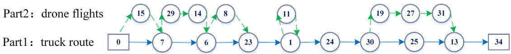

Part1 : truck route

Fig. 3. Solution representation for the second vehicle pair (route 2) in Fig. 2.

## 4.2. Initial solution construction

The construction process starts with a procedure designed to build the truck-only routes for all customers, followed by a drone insertion operation to reassign some customers to drones.

Since truck load capacity must be respected throughout the pickup and delivery process, existing basic greedy algorithms or random methods (Moshref-Javadi et al., 2020; Liu et al., 2020) for generating the truck-only solution may result in a tight solution space for subsequent neighborhood searches in each route, and truck capacity must be checked in every iteration, thus increasing the computational time. Considering the features of the MDRP-PD, we develop the MP method to construct truck-only routes. The implementation of truck-only routes construction is presented in Algorithm 2.

Algorithm 2. (Truck-only routes construction)
Inputs: $r_{ij}, d_i, p_i, Q$
Outputs: Truck-only routes (TSP/CVRP)
$\sum_{i \in N_c} d_i \leftarrow$ Calculate the total delivery demand
$\sum_{i \in N_c} \max\{0, q_i\} \leftarrow$ Calculate the total positive net demand
$mp_{N_c} = \sum_{i \in N_c} d_i + \sum_{i \in N_c} \max\{0, q_i\} \leftarrow$ Calculate the maximum payload for all customers
if $mp_{N_c} \leq Q$ then
TSP $\leftarrow$ MP (MP_GR)
return TSP
else
if $\lceil mp_{N_c}/Q \rceil &gt; max\{\left\lceil \sum_{i \in N_c} d_i/Q \right\rceil, \left\lceil \sum_{i \in N_c} p_i/Q \right\rceil\}$ then
CVRP $\leftarrow$ MP (MP_CL)
else
CVRP $\leftarrow$ MP (MP_MP)
end if
return CVRP
end if

Let $q _ { i }   =   p _ { i }   -   d _ { i }$ be the net demand of customer i (i.e., load increment after visiting customer $i ) ; w d _ { i } ^ { k }$ be the sum of the delivery demand that truck k has served after visiting customer i; $\widehat { w } _ { i } ^ { k }$ be the sum of the load increment after truck k visits customer $i ;$ and $\widehat { w } _ { i } ^ { k + }$ be the sum of the positive load increment after truck k visits customer i. Here, we define $m p _ { i } ^ { k } = w d _ { i } ^ { k } + \widehat { w } _ { i } ^ { k + }$ as the “maximum payload” after truck k visits customer i and the “maximum payload” after visiting all customers as $mp_{N_{c}}, \mathrm{i.e.},mp_{N_{c}} = \sum_{i \in N_{c}} d_{i} + \sum_{i \in N_{c}} \max\{0, q_{i}\}$

The MP method is described as follows: If the maximum payload $m p _ { N _ { c } }$ for visiting all customers does not exceed the truck load capacity, then a TSP tour of a truck serving all customers will be created using Gurobi (i.e., MP(MP\_GR), Line 5 in Algorithm 2). Otherwise, if the minimum number of needed trucks calculated by $mp_{N_{c}}\left(\mathrm{i.e.}, \left[mp_{N_{c}} / Q\right]\right)$ is greater than that calculated by the delivery and pickup demands (i.e., max $\{ \left[ { \textstyle \sum _ { i \in N _ { c } } } d _ { i } / Q \right] , \left[ { \textstyle \sum _ { i \in N _ { c } } } p _ { i } / Q \right] \} )$ , then the truck-only routes are constructed by procedure MP(MP\_CL) (i.e., Line 9 in Algorithm 2). Otherwise, the truck routes are built by procedure MP(MP\_MP) (Line 11 in Algorithm 2).

The procedures of MP(MP\_CL) and MP(MP\_MP) both use the SA algorithm to solve the CVRP with the constraints $w d _ { i } ^ { k } + \max \left\{ 0 , \widehat { w } _ { i } ^ { k } \right\} \leq Q$ and wd $\begin{array} { r } { \hat { \mathbf { \mathit { i } } } ^ { k } + \widehat { \mathbf { \mathit { w } } } _ { i } ^ { k + } \leq Q _ { s } } \end{array}$ respectively. More precisely, the nearest customer i is added to the route with the condition $w d _ { i } ^ { k } + \max \left\{ 0 , \widehat { w } _ { i } ^ { k } \right\} \leq Q$ (or $w d _ { i } ^ { k } + \widehat { w } _ { i } ^ { k + } \leq Q _ { s }$ , for the MP\_MP procedure). Otherwise, a new truck route is started from the depot. This process is then repeated until all nodes are visited. The generated truck routes are then optimized by the SA algorithm. A pseudocode for the procedures of MP\_CL and MP\_MP is shown in Appendix C. Note that the MP(MP\_CL) procedure may save the usage of vehicle pairs while leading to a tighter restriction for the subsequent optimization process. Therefore, the capacity feasibility of trucks must be checked in the following optimization (detailed in Section 4.4). However, in the MP(MP\_MP) procedure, as long as the maximum payload exceeds the load capacity, a new route will start, and as such, for each route, the truck load feasibility can be ensured when generating neighborhood solutions.

Next, split and insertion operations are carried out to obtain drone flights. For each truck-only route, the drone-eligible nodes are first selected $( \mathbf { i } . \mathbf { e } . ,$ drone-eligible node list), and then we attempt to reassign them to the drone in the order of the truck visits. Note that these shifts will only be employed if cost savings exist and the solution is feasible. Specifically, we first build a drone flight for the first node in the list, with its adjacent nodes in the route as the launch and retrieval nodes. Then, we check whether the second customer in the list can be assigned to the drone. If it can be added to the flight, then we select its adjacent node in the route as a new retrieval node; otherwise, we try to construct a new flight for it. If the node cannot be loaded on the drone, then it will still be serviced by the truck. This process will be repeated until all the customers in the list are attempted.

## 4.3. Improved simulated annealing (ISA)

In this section, we design an improved simulated annealing (ISA) algorithm to optimize the obtained initial solution. The ISA algorithm is improved upon the simulated annealing (SA) algorithm (Kirkpatrick et al., 1983; Cernỳ, ˇ 1985) with four problem-specific neighborhood structures and two acceleration strategies, and a taboo list is introduced to avoid revisiting the same solution. The SA algorithm has been widely applied to many VRP variants (e.g., Wang et al., 2015; Wei et al., 2017; Normasari et al., 2019; Yagmur ˘ and Kesen, 2021; Vincent et al., 2022) and is highly adaptable to new problems. Considering the tightly constrained feature of MDRP-PD, it is much easier to trap in local optima; thus, the SA frame is selected to guide the search and allows us to accept worse solutions during iterations. The pseudocode for the ISA algorithm is presented in Algorithm 3. The start temperature T is gradually decreased by updating $T   =   \beta   ^ { \star }   T$ at each Iter of the iterations. $\beta \in [ 0 , 1 ]$ is the cooling rate of ISA, and the size of the taboo list is equal to the number of iterations at each temperature (i.e., Iter).

Algorithm 3. (ISA algorithm)
Inputs: $r_{ij}, r_{ij}', d_i, p_i, Q, W, E, P, w_0, \alpha, c^T, c^F, v^T, u_i, u_i, BR$, initial solution $SI, T_f, Iter, \beta$
Outputs: Best truck-drone solution $SI^*$
for $S \in SI$ do
Initialization: $T$
$S^* \leftarrow S, S_{cur} \leftarrow S, T \leftarrow T_0$
taboo list = []
while $T &lt; T_f$ do
for $k = 1$ to Iter do
$S_1, S_2, S_3, S_4 \leftarrow SR(S_{cur}), TE(S_{cur}), MR(S_{cur}), BE(S_{cur})$
$S' \leftarrow Solution with minimal cost among S_1, S_2, S_3, S_4$
Add $S'$ to taboo list
if $cost(S') &lt; cost(S_{cur})$ then
$S_{cur} = S'$
if $cost(S') &lt; cost(S^*)$ then
$S^* = S'$
end if
else
Set $S_{cur} = S'$ with probability $p$, where $p = \exp(-(cost(S') - cost(S_{cur})) / T)$
end if
end for
$T = T^*\beta$
Release taboo list
end while
end for
return $SI^*$

## 4.3.1. Neighborhood search procedures for ISA

In this section, we introduce sixteen neighborhood operators based on four structures employed as parts of the ISA algorithm, as listed in Table 3. In each iteration, four neighborhood structures are invoked in sequential order to generate neighbor solutions, and the best feasible one will be accepted as the new candidate; if no feasible neighborhood is identified in this process, the old solution will be kept. Note that all the operators are applied within the same vehicle pair.

The single relocation (SR) relocates a randomly selected customer to the most promising position in either the truck route or a drone flight, which relies on three operators targeting the type of the selected node. The relocation of either a truck service node or a drone node resembles the basic operators in VRP problems but allows the construction of a new flight for the relocated node. For joint node relocation, one case is to relocate a joint node to a drone flight and search for a new launch or/and retrieval node for the affected flights. Fig. 4(a) presents two situations in which a mixed node is relocated to a drone flight. Note that it allows us to create a new flight for the relocated node. Another case is to relocate the joint node (excluding mixed nodes) to the truck route and set its adjacent node in the route as a new launch/retrieval node for the affected flight (Fig. 4(b)).

Table 3

Summary of neighborhood structures for ISA.

<table><tr><td>Neighborhood structure</td><td>Type</td><td>Operator</td></tr><tr><td rowspan="3">Single relocation (SR)</td><td>Truck service node relocation</td><td>SR1: A truck service node → truck routeSR2: A truck service node → drone flight</td></tr><tr><td>Drone node relocation</td><td>SR3: A drone node → truck routeSR4: A drone node → drone flight</td></tr><tr><td>Joint node relocation</td><td>SR5: A joint node → truck routeSR6: A joint node → drone flight</td></tr><tr><td rowspan="4">Two-exchange (TE)</td><td>Truck service nodes exchange</td><td>TE1: A truck service node ↔ a truck service node</td></tr><tr><td>Truck-drone nodes exchange</td><td>TE2: A truck service node ↔ a drone node</td></tr><tr><td>Drone nodes exchange</td><td>TE3: A drone node ↔ a drone node</td></tr><tr><td>Joint node(s) exchange</td><td>TE4: A truck service node ↔ a joint nodeTE5: A drone node ↔ a joint nodeTE6: A joint node ↔ a joint node</td></tr><tr><td>Multiple relocation (MR)</td><td>Multiple nodes relocation</td><td>MR: Multiple relocations of joint nodes and drone nodes</td></tr><tr><td>Block exchange (BE)</td><td>Multiple nodes exchange</td><td>BE1: A drone node ↔ two consecutive drone nodesBE2: A truck service node ↔ two consecutive drone nodesBE3: A drone node ↔ two consecutive truck service nodes</td></tr></table>

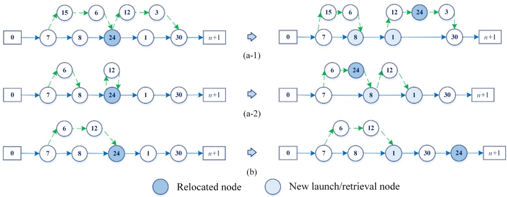

Fig. 4. SR operator: Relocation of a joint node to either the truck route or a drone flight.

The two-exchange (TE) invokes a position exchange of two randomly selected nodes. Six exchange operations are randomly applied to generate candidates in the ISA. Truck service nodes exchange works similarly to the basic two-exchange operator, as does truckdrone nodes exchange. When exchanging two drone nodes, the nodes can be selected from different flights. When an exchange involves a joint node, all correlative nodes in the affected flights need to be exchanged.

In multiple relocation (MR), two nodes are randomly selected from the set of joint nodes (excluding truck-only nodes) and drone nodes and relocated to the truck route or drone flights. Note that if a joint node is selected, the affected flights will be deleted, and all drone nodes in them need to be relocated. We first check whether the number of potential launch nodes $( \mathbf { i . e . } ,$ nodes are available for drone launch) is sufficient to generate flights for each relocated node. Otherwise, we randomly relocate nodes to the least-cost positions in the truck route until the number of potential launch nodes is enough for flight construction. Then, random-feasible drone flights are constructed for the remaining relocated nodes. As shown in Fig. 5, since joint nodes 8 and 12 are chosen to be relocated, flight (7, 6, 8) will be deleted. Considering that only two launch nodes (i.e., nodes 0 and 7) can provide for the relocated nodes, we relocate node 6 to the truck route and then generate two new flights for nodes 8 and 12.

The block exchange (BE) operator involves the random exchange of a drone node/truck service node with two consecutive drone nodes from another flight or a drone node with two consecutive truck service nodes.

## 4.3.2. Acceleration strategies

To accelerate the ISA procedure, unnecessary searches should be avoided. Therefore, regional setting (RS) methods are developed to decrease the search and feasibility checking effort, thus saving considerable computational time.

One of the RS methods is to restrict the search area of a new launch/retrieval node to a node set that excludes the existing launch/ retrieval nodes and only keeps the new launch-retrieval combinations whose orders are consistent with the direction of the truck route. The other RS method limits the selection area to the set of drone-eligible nodes and rules out the possible exchanges between drone nodes and truck-only nodes before performing exchanges associated with drone nodes.

To show the effectiveness of the RS methods, we take the first method to create launch-retrieval combinations as an example. For vehicle pair $k ,$ let the number of customers served by the truck be $m ^ { k }$ . In each search, $\mathbf { \nabla _ { \mathbf { \nabla } } ( } m ^ { k } + 1 \mathbf { ) } ^ { 2 }$ combinations can be formed if the strategy is not used; otherwise, a maximum of $( m ^ { k } - \left| D ^ { k } \right| + 1 ) ^ { 2 }$ combinations (without considering directionality) can be formed. Then, the difference between them is $\Delta \boldsymbol{y} = - \left| \boldsymbol{D}^{k} \right|^{2} + 2 \left| \boldsymbol{D}^{k} \right| \left( \boldsymbol{m}^{k} + 1 \right)$ . Since $\Delta y$ monotonically increases with variable $| D ^ { k } |$ in the feasible region $( \mathrm { i . e . } ,   0 \leq | D ^ { k } | \leq m ^ { k } + 1 )$ , the computational time will continuously increase when more drone flights are built. Furthermore, the quality of the solution may deteriorate due to massively invalid searches and checks.

## 4.4. Feasibility test on trucks

If the truck-only routes in Section 4.2 are constructed by MP\_CL, the capacity feasibility of trucks must be checked in the ISA algorithm. We define the truck route of vehicle pair k as an ordered set of arcs

$$
R ^ {k} := \left\{\left(0, j _ {0}\right), \left(i _ {1}, j _ {1}\right), \dots , \left(i _ {g}, j _ {g}\right), \dots , \left(i _ {G}, n + 1\right) \right\}
$$

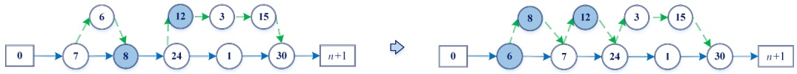

Fig. 5. MR operator.

with $j _ { g - 1 } = i _ { g }$ for all $\pmb { g } = 1 , . . . , G$ and all $\left( i _ { g } , j _ { g } \right) \in A _ { z }$ where G is the number of customers served by the truck.

Denote by $V ^ { k }$ the total delivery demands for vehicle pair k at the starting depot, and $f _ { k } = \left| D ^ { k } \right|$ the last flight of k. Let $f _ { i _ { g } } \in D ^ { k }$ be the index of the flight launched/retrieved at joint node $i _ { g } ,$ and $q _ { f _ { i g } }$ and $\widehat { q } _ { f _ { i g } }$ be the total delivery and total pickup demands for flight $i f _ { i g }$ . Note that if node $i _ { g }$ is the second type of mixed node, i.e., $i _ { g } \in N _ { M 2 } ^ { k } ,$ the above three variables $( \mathrm { i . e . } , f _ { i _ { g } } , q _ { f _ { i _ { g } } }$ and $\widehat { q } _ { f _ { i g } } )$ only represent those of the first of the two adjacent flights. Then, the load of truck k departing the depot is

$$
v _ {0} ^ {k} = \left\{ \begin{array}{c} V ^ {k}, 0 \in N _ {S} ^ {k}, k \in [ 1: K ] \\ V ^ {k} - q _ {f _ {0}}, 0 \in N _ {L} ^ {k}, f _ {0} \in D ^ {k}, k \in [ 1: K ] \end{array} \right.
$$

and the departing load of truck k from node $j _ { g }$ is

$$
\nu_ {j _ {g}} ^ {k} = \left\{ \begin{array}{c} v _ {i _ {g}} ^ {k} + q _ {j _ {g}}, j _ {g} \in N _ {S} ^ {k}, k \in [ 1: K ] \\ v _ {i _ {g}} ^ {k} + q _ {j _ {g}}, j _ {g} \in N _ {L} ^ {k}, j _ {g} \not \in N _ {R} ^ {k}, f _ {j _ {g}} \in D ^ {k}, k \in [ 1: K ] \\ v _ {i _ {g}} ^ {k} + q _ {j _ {g}} + \widehat {q} _ {f _ {j _ {g}}}, j _ {g} \in N _ {R} ^ {k}, j _ {g} \not \in N _ {L} ^ {k}, f _ {j _ {g}} \in D ^ {k}, k \in [ 1: K ] \\ v _ {i _ {g}} ^ {k} + q _ {j _ {g}} - q _ {f _ {j _ {g}}} + \widehat {q} _ {f _ {j _ {g}}}, j _ {g} \in N _ {M 1} ^ {k}, f _ {j _ {g}} \in D ^ {k}, k \in [ 1: K ] \\ v _ {i _ {g}} ^ {k} + q _ {j _ {g}} + \widehat {q} _ {f _ {j _ {g}}} - q _ {f _ {(j _ {g} + 1)}}, j _ {g} \in N _ {M 2} ^ {k}, f _ {j _ {g}} \in D ^ {k} \backslash \{f _ {k} \}, k \in [ 1: K ] \end{array} \right.
$$

Therefore, only if $\nu _ { 0 } ^ { k } \leq Q$ and $\mathcal { V } _ { j _ { g } } ^ { k } \leq Q ,   g = 1 , . . . , G ,$ is the route capacity-feasible for the truck.

## 4.5. Feasibility test on drones and time calculation

The feasibility test on drones is more complicated for an MDRP-PD solution since the feasibility not only depends on every single flight but also relates to each truck route and its drone flight schedule. The load capacity feasibility check is straightforward, so we focus on testing the battery capacity feasibility. The pseudocode of the drone feasibility test is shown in Algorithm 4.

Algorithm 4. (Drone feasibility test for each vehicle pair)
Inputs: $r_{ij}, r_{ij}^{\prime}, d_i, p_i, W, E, P, w_0, \alpha, v^T, u_i, u_i, BR$, a vehicle pair routeS
Outputs: 0 (infeasible) or makespan (feasible)
1: Feasibility check for each flight $f$ of $S$
2: if infeasible then
3: return 0
4: end if
5: $ss \leftarrow$ Modify $S$
6: $T_f^k = (E - e_f^k)/P \leftarrow$ Calculate the maximum hovering time for each flight $f$
7: $tt, tk, td \leftarrow$ Calculate the duration of each section
8: $\eta, \eta', \widehat{\eta} \leftarrow$ Time calculation ($ss, tt, tk, td$)
9: if $\widehat{\eta} &lt; \eta$ at a retrieval node (except the ending depot) and $T_f^k &lt; \eta - \widehat{\eta}$ then
10: return 0
11: end if
12: return $\eta'(\widehat{e})$

For each vehicle pair k, we first check the load feasibility for each flight f of k and confirm whether the energy consumption $e _ { f } ^ { k }$ when the drone arrives at each retrieval node violates the battery capacity (Line 1 in Algorithm 4). If feasible, then we modify the vehicle pair route (Line 5 in Algorithm 4) and precalculate the maximum hovering time $T _ { f } ^ { k } , ( T _ { f } ^ { k } = \frac { E - e _ { f } ^ { k } } { P } )$ of each flight and the relevant information of the modified route: 1) each duration (tt) that the truck travels with its drone on board; 2) each duration (tk) that the truck travels by itself; and 3) the duration (td) that the drone spends in each flight (Lines 6–7 in Algorithm 4). Note that each duration only contains the travel and service times. Last, we apply the prejudgment rule to the time calculation (Line 8 in Algorithm 4) and check whether the battery energy runs out prematurely when a hover occurs.

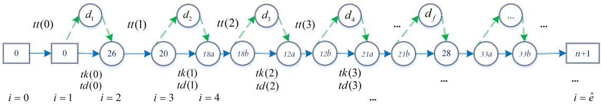

Fig. 6. Modified route of the first vehicle pair (route 1) in Fig. 2.

The route modification procedure for each vehicle pair is expressed as follows: We only keep the starting depot, ending depot and joint nodes and aggregate each flight into a node, denoted as $\text{" }d_{f} \text{" }$ . The mixed nodes are split into two nodes, representing the preceding operation (a) and following operation (b), and the distance between them is zero. If the depot launches/retrieves the drone, then an extra depot $0 / n   +   1$ is added, and the distance between them is also $\mathtt { Z e r o } ,$ as shown in Fig. 6.

The prejudgment rule allows a drone to leave a launch node earlier than its truck, which differs from the assumptions in most papers (Sacramento et al., 2019; Kitjacharoenchai et al., 2020; Euchi and Sadok, 2021) and is well suited for reducing the makespan. We define ordered sets $\eta ( i ) ,   \eta ^ { \prime } ( i )$ and $\widehat { \eta } ( i )$ for storing the truck arrival time, truck departure time and departure/arrival time of the drone at launch/retrieval node $i ( \mathbf { i } . \mathbf { e } _ { \cdot } )$ , the index $i = 0 { , } 1 { , } { \cdots } { , } { \widehat { e } } )$ , denote by $o ( i )$ the customer in the original route $( \mathrm { i . e . } , 0 , 2 6 , \ldots )$ corresponding to i and assume $\eta ( 0 )   = \eta ^ { \prime } ( 0 )   = \widehat { \eta } ( 0 )   = 0 .$ . The following rules apply:

**R1:** If tk and td from a launch node $i   ( \mathrm { i . e . } , i \% 2   =   1 )$ satisfy td $\geq t k + u _ { o ( i ) } , o ( i ) \in N _ { c }$ , then the truck launches its drone at their arrival time at $i , \mathrm { i . e . }$ , before serving customer $o ( i )$ . Otherwise, they will concurrently leave i.

**R2:** If η and $\widehat { \eta }$ at a retrieval node $i   ( \mathrm { i . e . } , i \% 2 = 0 )$ satisfy $\eta < \widehat { \eta } , o ( i ) \in N _ { M 2 } ^ { k } , \mathrm { i . e . }$ ., the truck arrives at node i earlier than its drone, then the service time is added at node i, i.e., the truck departs from i after serving $o ( i )$ . Otherwise, the service time is added at $i + 1 , \mathrm { i . e . }$ , this customer is served at node i + 1. Note that i and i +1 are two split nodes corresponding to the same customer, $\mathrm { i . e . , } o ( i ) \; = \; o ( i   +   1 )$

Therefore, $\mathrm{if} i \% 2 = 0 (\mathrm{i.e.}$ , starting depot/retrieval node), the time calculation at $i + 1 ( \mathrm { i . e . }$ , launch node/ending depot) is expressed as follows:

$$
\eta (i + 1) = \eta^ {\prime} (i) + t t (i / 2),
$$

$$
\eta^ {\prime} (i + 1) = \left\{ \begin{array}{c} \eta (i + 1), \big (\eta (i) <   \widehat {\eta} (i), o (i) \in N _ {M 2} ^ {k} \big) \bigvee o (i + 1) \notin N _ {c} \\ \eta (i + 1) + u _ {o (i + 1)}, e l s e \end{array} \right.
$$

$$
\widehat {\eta} (i + 1) = \left\{ \begin{array}{c} \eta (i + 1), t d (i / 2) \geq \big (t k (i / 2) + u _ {o (i + 1)} \big), o (i + 1) \in N _ {c} \\ \eta^ {\prime} (i + 1), e l s e \end{array} . \right.
$$

Otherwise, the times at $i + 1 ( \mathrm { i . e . }$ , retrieval node) are calculated as

$$
\eta (i + 1) = \eta^ {\prime} (i) + t k (j), j = (i - 1) / 2
$$

$$
\widehat {\eta} (i + 1) = \widehat {\eta} (i) + t d (j), j = (i - 1) / 2
$$

$$
\eta^ {\prime} (i + 1) = \left\{ \begin{array}{c} \max \{\eta (i + 1), \widehat {\eta} (i + 1) \} + B R, o (i) \in N _ {M 1} ^ {k} \bigvee (\eta (i + 1) \geq \widehat {\eta} (i + 1), o (i + 1) \in N _ {M 2} ^ {k}) \bigvee o (i + 1) \notin N _ {c} \\ \max \left\{\eta (i + 1) + u _ {o (i + 1)}, \widehat {\eta} (i + 1) \right\} + B R. e l s e \end{array} \right.
$$

Then, the makespan of vehicle pair k is $\eta ^ { \prime } ( \pmb { x } _ { \widehat { e } } )$ . For all $\eta ( i ) > \widehat { \eta } ( i )$ , where $i \% 2 = 0$ and $o ( i ) \neq n + 1 , \mathrm { i f } \eta ( i ) - \widehat { \eta } ( i ) \leq T _ { f } ^ { k } , f \in D ^ { k }$ , then the vehicle pair route is energy-feasible. The feasibility test can reduce the possible waiting times of trucks without any additional cost.

## 5. Computational results

In this section, we evaluate the effectiveness of the proposed solution approach, MP-ISA, and investigate the benefits of MDRP-PD by conducting various computational experiments with different problem sizes. We first modify some benchmark datasets to generate the test instances in Section 5.1 and perform parameter tuning and operator analysis in Section 5.2. The detailed computational results are presented in Section 5.3. We analyze the advantage of the MDRP-PD over single-visit and delivery-only combined modes in Section 5.4. A sensitivity analysis on three critical parameters is conducted in Section $5 . 5 .$

MP-ISA was coded in Python 3.8.5, and all computations were executed on a Windows 10 operating system equipped with an Intel (R) Core (TM) i7-10750H processor (2.60 GHz) and 32 GB of RAM. The mathematical model was solved with Gurobi (version 9.1.2). Note that for this section, the term solution refers to the transportation cost.

## 5.1. Test instances

As the MDRP-PD is a new problem, there are no existing benchmark problems, we conducted numerical experiments on the modified CVRP benchmark instances from Augerat et al. (1995) (sets A and P), which are available online at the Capacitated Vehicle Routing Problem Library (VRP Web ([dorronsoro.es](http://dorronsoro.es))). Since the instances of set B are similar to those of set A in Augerat et al. (1995), we choose sets A and P for the following experiments.

Considering the actual situation and drone technology constraints, we adapted the range of coordinates to 20 by 20 for each instance by dividing the original coordinates by 5, randomly modified the delivery demand of 90 % of the customers within the range of (0, 2.3], and set that of the remaining 10 % to zero. We randomly generated pickup quantities for 90 % of the customers within the same range to avoid bias related to the data generation. Then, 10 % of the nodes were randomly chosen as truck-only customers, and their pickup or delivery demand was adjusted within the range of (3, 10], which relates to the statements made by Amazon that 86 % of its parcels are no heavier than five pounds (approximately 2.27 kg) (Allain, 2013). If the calculated number of the chosen customers was fractional, then it was rounded up. As such, a total of 43 instances were generated.

In the numerical experiment, the values of the parameters related to trucks and drones are set partly with reference to public reports and current practice. The curb weight (w0) and load capacity (W) of each drone are assumed to be 6 kg and 3 kg, respectively, and the unit energy consumption (α) is set to 3.5 Wh$kg ⋅ km). The flight range under maximum load condition is assumed to be 10 miles \(( \mathbf { i } . \mathbf { e } . ,$ 16 km) (Salama and Srinivas, 2020); therefore, the total energy that a drone battery can provide (E) is 504 Wh. The maximum flying duration is set to 0.5 h (Wang and Sheu, 2019; Sacramento et al., 2019; Kuo et al., 2022), and then the output power of the battery (P) is calculated as 1008 W. To adapt to the truck-drone mode, each truck is assumed to have a capacity limit (Q) of 90 kg and a speed $( \boldsymbol { \nu } ^ { T } )$ of 30 km/h (Nguyen et al., 2022). We set the unit traveling cost for trucks $( c ^ { T } )$ to \$0.78\km (Campbell et al., 2017), which is 10 times (i.e., $\sigma { = } 1 0 )$ that of a full drone (Sacramento et al., 2019; Kuo et al., 2022; Huang et al., 2022). Therefore, the unit energy cost for drones $( c ^ { F } )$ is calculated as $\S 2 . 4 8 \times 1 0 ^ { - 3 } \mathrm { W h }$ . Each vehicle pair is assumed to incur a fixed cost $( c ^ { 0 } )$ of \$22, i.e., the fixed costs of each truck and its drone are \$20 and $\mathbf { \mathfrak { H } 2 } ,$ respectively. The battery replacement time (BR) is assumed to be 1/60 h, pickup and delivery times for trucks are set to 1/20 h and $1 / 3 0   \mathrm { h } ,$ and those for drones are set to 1/30 h and 1/60 h, respectively. Note that the speeds for full drones and empty drones are calculated as 32 km/h and 48 km/h, and the costs per km for full drones and empty drones are \$0.078 and \$0.052, respectively.

## 5.2. Parameter tuning and operator analysis

The key parameters in ISA are tuned by using the parameter combination design (PCD), which is consistent with the methods in the literature (Jie et al., 2019; Sadati and Çatay, 2021). Specifically, we randomly selected ten instances and conducted MP-ISA with different values for each parameter. The parameter value that produced the smallest average percentage deviation (over 10 runs) from the best-average solution (dev%) was kept and used for the following tuning. The initial parameter values were set according to several experiments, and the chosen instances are A-n33-k6, A-n37-k6, A-n38-k5, A-n39-k6, A-n60-k9, A-n63-k9, A-n63-k10, P-n20-k2, P-n55- k7 and P-n60-k10. The results are reported in Table $4 ,$ in which the final values are marked in bold.

To ensure that all the proposed operators contribute to the performance of the ISA algorithm, we performed a sensitivity analysis for these sixteen operators on the ten selected instances. The average results (over 10 runs) are reported in Table 5, in which base operators indicate all designed operators, and the other columns indicate the base-operator setting after individually removing each operator (corresponding to the order in Table 3). G1 and G2 are the gaps in the average solution $( C _ { a v g } )$ and average run time $( T _ { a v g } )$ compared with base operators, respectively. The results demonstrate that operators TE5 and SR2 have a stronger improvement in the ISA algorithm, as removing them deteriorates the solutions and increases the run time, while removing operators of SR1, SR3, SR5 and BE2 hardly worsens the quality of the solutions. Moreover, all other operators have a positive effect on the performance of ISA, although they may increase the run time. As such, we remove these four operators in the following experiments.

## 5.3. Experiments and results

We assess the performance of MP-ISA on 30 randomly generated instances in Section 5.3.1 and present the results on instances of sets A and P in Section 5.3.2. We discuss the features of the number of drone flights in the best solutions obtained in Section 5.3.3 and explore the effectiveness of the acceleration strategies in Section 5.3.4.

## 5.3.1. Comparison analysis on small-scale instances

Due to the NP-hardness of the MDRP-PD as previously discussed, only small-size problems can be solved by the model within a reasonable timeframe. We randomly generated 30 small instances with the same ranges of coordinates and demands as discussed in Section 5.1, each containing a truck-only node, and conducted tests by both MP-ISA and the Gurobi Solver for comparison. The time limit of the Gurobi solver was set to 2 h. Without a loss of generality, we set the number of available trucks K to 3. The results are summarized in Table 6. For the solver solution, the table reports the best solution obtained within 2 h by the model without valid inequalities $( C _ { b e s t } ^ { G _ { 0 } } )$ and that with valid inequalities $( C _ { b e s t } ^ { G } ) _ { , }$ , along with the corresponding solution times $( T ^ { G _ { 0 } }$ and $T ^ { G } )$ . For MP-ISA, the table reports the best solution $( C _ { b s f } ^ { M } )$ among 10 runs and total computational time $( T ^ { M } )$ . The gaps between them are defined as $G a p _ { b e s t } ^ { 1 } \%$ $\begin{array} { r } { = \frac { C _ { b e s t } ^ { G } - C _ { b e s t } ^ { G _ { 0 } } } { C _ { b e s t } ^ { G _ { 0 } } } 1 0 0 , \; G a p _ { b e s t } ^ { 2 } \% = \frac { C _ { b s f } ^ { M } - C _ { b e s t } ^ { G } } { C _ { b e s t } ^ { G } } 1 0 0 . } \end{array}$

The results show that MP-ISA identifies the optimal solutions for all instances with 8 customers $( \mathbf { i . e . } ,$ A-n8-01 to A-n8-10) and consumes less time than Gurobi on average. When the number of customers increases to 10 (i.e., B-n10-01 to B-n10-10), even though

Parameter tuning.

<table><tr><td>Parameter</td><td>Definition</td><td></td><td>Initial value</td><td colspan="4">Tested values</td></tr><tr><td rowspan="2"> $T_0$ </td><td rowspan="2">Initial temperature</td><td>Value</td><td>150</td><td>50</td><td>100</td><td>200</td><td>250</td></tr><tr><td>dev%</td><td>1.99</td><td>2.47</td><td>0.00</td><td>1.57</td><td>0.84</td></tr><tr><td rowspan="2">Iter</td><td rowspan="2">Number of iterations</td><td>Value</td><td>15</td><td>5</td><td>10</td><td>20</td><td>25</td></tr><tr><td>dev%</td><td>0.00</td><td>7.04</td><td>1.05</td><td>0.80</td><td>0.77</td></tr><tr><td rowspan="2">β</td><td rowspan="2">Cooling rate</td><td>Value</td><td>0.92</td><td>0.85</td><td>0.90</td><td>0.95</td><td>0.98</td></tr><tr><td>dev%</td><td>1.74</td><td>5.96</td><td>4.04</td><td>0.00</td><td>0.74</td></tr></table>

Table 5

Sensitivity analysis on the operators.

<table><tr><td colspan="2">Base operators</td><td>Gap%</td><td>NSR1</td><td>NSR2</td><td>NSR3</td><td>NSR4</td><td>NSR5</td><td>NSR6</td><td>NTE1</td><td>NTE2</td></tr><tr><td> $C_{avg}$ </td><td>75.49</td><td>G1</td><td>-0.30</td><td>1.97</td><td>-0.83</td><td>2.03</td><td>-1.21</td><td>2.16</td><td>0.03</td><td>0.66</td></tr><tr><td> $T_{avg}$ </td><td>193.21</td><td>G2</td><td>-5.91</td><td>19.77</td><td>27.61</td><td>-7.86</td><td>-0.84</td><td>-43.10</td><td>-4.47</td><td>-1.07</td></tr><tr><td colspan="2">Base operators</td><td>Gap%</td><td>NTE3</td><td>NTE4</td><td>NTE5</td><td>NTE6</td><td>NMR</td><td>NBE1</td><td>NBE2</td><td>NBE3</td></tr><tr><td> $C_{avg}$ </td><td>75.49</td><td>G1</td><td>1.30</td><td>0.49</td><td>10.55</td><td>1.05</td><td>1.53</td><td>0.48</td><td>-0.18</td><td>0.29</td></tr><tr><td> $T_{avg}$ </td><td>193.21</td><td>G2</td><td>-0.72</td><td>-9.49</td><td>9.65</td><td>-2.81</td><td>-7.79</td><td>-6.62</td><td>-0.42</td><td>-5.46</td></tr></table>

Table 6

MP-ISA vs solver solution for small instances.

| Instance | Solver solution$C_{best}^{G_0}$ ($) | $T^{G_0}$(s) | $C_{best}^{G}$ ($) | $T^G$(s) | MP-ISAC$C_{bsf}^{M}$ ($) | $T^M$(s) | $Gap_{best}^{1} \%$ | $Gap_{best}^{2} \%$ |
| --- | --- | --- | --- | --- | --- | --- | --- | --- |
| A-n8-1 | 46.92 | 164.12 | 46.92 | 63.22 | 46.92 | 53.40 | 0.00 | 0.00 |
| A-n8-2 | 53.76 | 804.28 | 53.76 | 248.07 | 53.76 | 44.10 | 0.00 | 0.00 |
| A-n8-3 | 54.51 | 93.91 | 54.51 | 57.10 | 54.51 | 57.21 | 0.00 | 0.00 |
| A-n8-4 | 47.30 | 106.46 | 47.30 | 42.34 | 47.30 | 40.73 | 0.00 | 0.00 |
| A-n8-5 | 55.94 | 491.39 | 55.94 | 182.41 | 55.94 | 66.01 | 0.00 | 0.00 |
| A-n8-6 | 51.48 | 144.11 | 51.48 | 71.11 | 51.48 | 56.34 | 0.00 | 0.00 |
| A-n8-7 | 56.53 | 89.34 | 56.53 | 37.09 | 56.53 | 49.09 | 0.00 | 0.00 |
| A-n8-8 | 56.52 | 564.40 | 56.52 | 95.21 | 56.52 | 63.21 | 0.00 | 0.00 |
| A-n8-9 | 55.37 | 428.05 | 55.37 | 51.13 | 55.37 | 45.18 | 0.00 | 0.00 |
| A-n8-10 | 53.22 | 111.31 | 53.22 | 46.37 | 53.22 | 48.23 | 0.00 | 0.00 |
| Avg. |  | 299.74 |  | 89.41 |  | 52.35 | 0.00 | 0.00 |
| B-n10-1 | 59.24 | 2200.41 | 59.24 | 1712.11 | 59.24 | 98.01 | 0.00 | 0.00 |
| B-n10-2 | 53.23 | 3126.12 | 53.23 | 932.28 | 53.23 | 89.23 | 0.00 | 0.00 |
| B-n10-3 | 49.29 | 6943.23 | 49.29 | 2851.19 | 49.29 | 75.11 | 0.00 | 0.00 |
| B-n10-4 | 46.10 | 6610.09 | 46.10 | 561.06 | 46.10 | 89.81 | 0.00 | 0.00 |
| B-n10-5 | 46.64 | 387.13 | 46.64 | 79.84 | 46.64 | 75.12 | 0.00 | 0.00 |
| B-n10-6 | 49.47 | 424.41 | 49.47 | 232.09 | 49.47 | 91.07 | 0.00 | 0.00 |
| B-n10-7 | 49.47 | 1260.30 | 49.47 | 708.01 | 49.47 | 77.28 | 0.00 | 0.00 |
| B-n10-8 | 44.72* | 7200.00 | 44.26 | 2728.31 | 45.13 | 67.26 | -1.03 | 1.97 |
| B-n10-9 | 55.44 | 6805.15 | 55.44 | 3003.22 | 55.96 | 73.04 | 0.00 | 0.94 |
| B-n10-10 | 54.40 | 4588.61 | 54.40 | 1321.41 | 54.40 | 117.39 | 0.00 | 0.00 |
| Avg. |  | 3954.55 |  | 1412.95 |  | 85.33 | -0.10 | 0.29 |
| C-n11-1 | 53.20* | 7200.00 | 53.20* | 7200.00 | 53.20 | 93.26 | 0.00 | 0.00 |
| C-n11-2 | 43.39* | 7200.00 | 43.37 | 3946.29 | 43.37 | 91.03 | -0.06 | 0.00 |
| C-n11-3 | 49.15 | 5767.23 | 49.15 | 3728.07 | 49.20 | 92.81 | 0.00 | 0.10 |
| C-n11-4 | 47.31 | 3094.56 | 47.31 | 2537.34 | 47.31 | 89.30 | 0.00 | 0.00 |
| C-n11-5 | 52.79* | 7200.00 | 52.72* | 7200.00 | 52.76 | 86.09 | -0.13 | 0.08 |
| C-n11-6 | 46.81 | 7080.08 | 46.81 | 6046.16 | 46.81 | 86.11 | 0.00 | 0.00 |
| C-n11-7 | 45.60* | 7200.00 | 45.48* | 7200.00 | 45.48 | 94.31 | -0.26 | 0.00 |
| C-n11-8 | 53.50 | 5006.36 | 53.50 | 4001.30 | 53.50 | 95.10 | 0.00 | 0.00 |
| C-n11-9 | 47.23* | 7200.00 | 47.23 | 6996.19 | 47.23 | 98.63 | 0.00 | 0.00 |
| C-n11-10 | 46.75* | 7200.00 | 46.75* | 7200.00 | 46.75 | 94.14 | 0.00 | 0.00 |
| Avg. |  | 6414.82 |  | 5605.54 |  | 92.08 | -0.05 | 0.02 |

\*The optimal solution cannot be obtained within a time limit of 2 h.

Gurobi can still obtain the optimal solutions for all instances within the given time limit, the execution time increases sharply. MP-ISA can efficiently provide the same results, with the exception of two instances with small gaps. For instances with 11 customers (i.e., Cn11-01 to C-n11-10), Gurobi is unable to solve 4 out of 10 instances to optimality within 2 h, while MP-ISA can still obtain almost the same results in a relatively short time (two minor gaps of 0.1 and 0.08).

In addition, the number of instances cannot be solved by Gurobi in 2 h is decreased from 7 to 4 with the valid inequalities, which also yield better results and highly reduce the computational time. Notably, the solver solution is still computationally expensive, and operationally, it is necessary to provide an efficient heuristic algorithm for large-size problems.

## 5.3.2. Comparison analysis on large-size instances

To further explore the effectiveness of MP-ISA for moderate- and large-size problems, various numerical experiments based on the instances of sets A and P were conducted. We ran the algorithm 10 times for each instance and presented the best results in Table 7-1and Table 7-22, which report the number of vehicle pairs needed (U), the best solution obtained by Gurobi in 2 h $( C _ { b e s t } ^ { G } ) _ { ; }$ , transportation costs $( C _ { v 0 } , C _ { v 1 }$ and $C _ { \gamma 2 } )$ and truck travel distances $( R _ { 0 } , R _ { 1 }$ and $R _ { 2 } )$ in the truck-only solution, initial solution and final solution. They also report the gaps between the two stages (calculated as $\Delta 1\% = \frac{C_{v1} - C_{v2}}{C_{v1}}100$ and $\Delta 2\% = \frac{R_{1} - R_{2}}{R_{1}}100$ , makespan $\mathbf { ( i . e . }$ , duration from start to all vehicles to return to the depot) (Dur), execution time (T) and the specific algorithm employed in the first stage (Method).

Table 7–1

Results for instances of set A by MP-ISA.

<table><tr><td>Id</td><td>Instance</td><td>U</td><td> $C_{best}^{G}$  ($)</td><td> $C_{st}^{G}$  ($)</td><td> $C_{st}^{A}$  ($)</td><td> $C_{st}^{2}$  ($)</td><td> $\Delta 1\%$ </td><td> $R_0(km)$ </td><td> $R_1(km)$ </td><td> $R_2(km)$ </td><td> $\Delta 2\%$ </td><td>Dur(h)</td><td>T(s)</td><td>Method</td></tr><tr><td>1</td><td>A-n32-k5</td><td>1</td><td>-</td><td>92.35</td><td>79.11</td><td>69.26</td><td>12.45</td><td>118.40</td><td>97.60</td><td>81.20</td><td>16.80</td><td>5.41</td><td>160.34</td><td>MP_GR</td></tr><tr><td>2</td><td>A-n33-k5</td><td>1</td><td>-</td><td>84.86</td><td>73.82</td><td>57.32</td><td>22.35</td><td>108.80</td><td>89.60</td><td>64.00</td><td>28.57</td><td>4.89</td><td>111.16</td><td>MP_GR</td></tr><tr><td>3</td><td>A-n33-k6</td><td>1</td><td>-</td><td>92.04</td><td>72.69</td><td>64.36</td><td>11.46</td><td>118.00</td><td>87.60</td><td>71.20</td><td>18.72</td><td>4.91</td><td>92.46</td><td>MP_GR</td></tr><tr><td>4</td><td>A-n34-k5</td><td>1</td><td>-</td><td>97.97</td><td>87.49</td><td>65.31</td><td>25.35</td><td>125.60</td><td>108.80</td><td>73.60</td><td>32.35</td><td>5.82</td><td>138.02</td><td>MP_GR</td></tr><tr><td>5</td><td>A-n36-k5</td><td>1</td><td>-</td><td>92.98</td><td>79.25</td><td>61.88</td><td>21.92</td><td>119.20</td><td>95.20</td><td>68.00</td><td>28.57</td><td>4.83</td><td>95.68</td><td>MP_GR</td></tr><tr><td>6</td><td>A-n37-k5</td><td>1</td><td>-</td><td>99.53</td><td>84.73</td><td>61.98</td><td>26.85</td><td>127.60</td><td>101.60</td><td>66.80</td><td>34.25</td><td>5.75</td><td>167.68</td><td>MP_GR</td></tr><tr><td>7</td><td>A-n37-k6</td><td>1</td><td>-</td><td>97.34</td><td>79.38</td><td>70.44</td><td>11.26</td><td>124.80</td><td>95.60</td><td>81.20</td><td>15.06</td><td>5.39</td><td>153.79</td><td>MP_GR</td></tr><tr><td>8</td><td>A-n38-k5</td><td>1</td><td>-</td><td>88.61</td><td>83.07</td><td>66.23</td><td>20.27</td><td>113.60</td><td>101.60</td><td>76.00</td><td>25.20</td><td>5.05</td><td>157.57</td><td>MP_GR</td></tr><tr><td>9</td><td>A-n39-k5</td><td>1</td><td>-</td><td>102.34</td><td>86.69</td><td>66.49</td><td>23.30</td><td>131.20</td><td>103.20</td><td>73.60</td><td>28.68</td><td>5.72</td><td>242.17</td><td>MP_GR</td></tr><tr><td>10</td><td>A-n39-k6</td><td>1</td><td>-</td><td>106.08</td><td>96.55</td><td>77.45</td><td>19.78</td><td>136.00</td><td>118.40</td><td>88.00</td><td>25.68</td><td>6.63</td><td>156.46</td><td>MP_GR</td></tr><tr><td>11</td><td>A-n44-k7</td><td>1</td><td>-</td><td>113.57</td><td>94.18</td><td>79.13</td><td>15.98</td><td>145.60</td><td>113.60</td><td>92.00</td><td>19.01</td><td>5.81</td><td>201.57</td><td>MP_GR</td></tr><tr><td>12</td><td>A-n45-k6</td><td>1</td><td>-</td><td>122.62</td><td>99.76</td><td>81.70</td><td>18.10</td><td>157.20</td><td>121.60</td><td>93.60</td><td>23.03</td><td>6.91</td><td>468.55</td><td>MP_CL</td></tr><tr><td>13</td><td>A-n45-k7</td><td>1</td><td>-</td><td>111.07</td><td>87.19</td><td>75.32</td><td>13.61</td><td>142.40</td><td>102.40</td><td>84.00</td><td>17.97</td><td>5.76</td><td>446.42</td><td>MP_CL</td></tr><tr><td>14</td><td>A-n46-k7</td><td>1</td><td>-</td><td>117.94</td><td>94.18</td><td>75.84</td><td>19.47</td><td>151.20</td><td>112.00</td><td>84.80</td><td>24.29</td><td>6.39</td><td>409.01</td><td>MP_CL</td></tr><tr><td>15</td><td>A-n48-k7</td><td>1</td><td>-</td><td>121.68</td><td>94.80</td><td>78.39</td><td>17.31</td><td>156.00</td><td>112.80</td><td>89.60</td><td>20.57</td><td>5.84</td><td>534.13</td><td>MP_CL</td></tr><tr><td>16</td><td>A-n53-k7</td><td>1</td><td>-</td><td>119.50</td><td>104.39</td><td>86.63</td><td>17.01</td><td>153.20</td><td>126.00</td><td>98.80</td><td>21.59</td><td>6.89</td><td>535.16</td><td>MP_CL</td></tr><tr><td>17</td><td>A-n54-k7</td><td>1</td><td>-</td><td>126.05</td><td>97.95</td><td>76.82</td><td>21.57</td><td>161.60</td><td>116.00</td><td>83.20</td><td>28.28</td><td>6.76</td><td>423.53</td><td>MP_CL</td></tr><tr><td>18</td><td>A-n55-k9</td><td>2</td><td>-</td><td>114.82</td><td>99.40</td><td>85.84</td><td>13.64</td><td>147.20</td><td>121.20</td><td>99.60</td><td>17.82</td><td>4.37</td><td>286.53</td><td>MP_MP</td></tr><tr><td>19</td><td>A-n60-k9</td><td>2</td><td>-</td><td>129.17</td><td>105.98</td><td>92.13</td><td>13.07</td><td>165.60</td><td>128.00</td><td>106.40</td><td>16.87</td><td>4.33</td><td>323.35</td><td>MP_MP</td></tr><tr><td>20</td><td>A-n61-k9</td><td>2</td><td>-</td><td>124.80</td><td>104.29</td><td>78.47</td><td>24.76</td><td>160.00</td><td>125.60</td><td>83.20</td><td>33.76</td><td>4.59</td><td>323.51</td><td>MP_MP</td></tr><tr><td>21</td><td>A-n62-k8</td><td>2</td><td>-</td><td>133.22</td><td>118.77</td><td>106.65</td><td>10.20</td><td>170.80</td><td>144.80</td><td>124.80</td><td>13.81</td><td>4.98</td><td>323.43</td><td>MP_MP</td></tr><tr><td>22</td><td>A-n63-k9</td><td>2</td><td>-</td><td>149.14</td><td>121.60</td><td>99.38</td><td>18.27</td><td>191.20</td><td>147.20</td><td>108.80</td><td>26.09</td><td>5.90</td><td>405.67</td><td>MP_MP</td></tr><tr><td>23</td><td>A-n63-k10</td><td>2</td><td>-</td><td>136.34</td><td>114.88</td><td>93.95</td><td>18.22</td><td>174.80</td><td>138.00</td><td>108.80</td><td>21.16</td><td>4.67</td><td>345.57</td><td>MP_MP</td></tr><tr><td>24</td><td>A-n64-k9</td><td>2</td><td>-</td><td>142.90</td><td>125.80</td><td>100.55</td><td>20.07</td><td>183.20</td><td>151.20</td><td>116.80</td><td>22.75</td><td>6.12</td><td>446.35</td><td>MP_MP</td></tr><tr><td>25</td><td>A-n65-k9</td><td>2</td><td>-</td><td>137.28</td><td>121.17</td><td>100.93</td><td>16.70</td><td>176.00</td><td>147.20</td><td>116.80</td><td>20.65</td><td>4.47</td><td>307.17</td><td>MP_MP</td></tr><tr><td>26</td><td>A-n69-k9</td><td>2</td><td>-</td><td>152.26</td><td>124.60</td><td>99.72</td><td>19.97</td><td>195.20</td><td>150.00</td><td>111.20</td><td>25.87</td><td>4.17</td><td>242.97</td><td>MP_MP</td></tr><tr><td>27</td><td>A-n80-k10</td><td>2</td><td>-</td><td>176.59</td><td>145.70</td><td>120.94</td><td>16.99</td><td>226.40</td><td>172.80</td><td>137.60</td><td>20.37</td><td>5.64</td><td>564.24</td><td>MP_MP</td></tr><tr><td colspan="7">Avg.</td><td>18.15</td><td></td><td></td><td></td><td>23.25</td><td></td><td></td><td></td></tr></table>

Table 7–2

Results for instances of set P by MP-ISA.

<table><tr><td>Id</td><td>Instance</td><td>U</td><td> $C_{best}^{G}$ ($)</td><td> $C_{no}$ ($)</td><td> $C_{n1}$ ($)</td><td> $C_{n2}$ ($)</td><td>Δ1%</td><td> $R_0(km)$ </td><td> $R_1(km)$ </td><td> $R_2(km)$ </td><td>Δ2%</td><td>Dur(h)</td><td>T(s)</td><td>Method</td></tr><tr><td>28</td><td>P-n16-k8</td><td>1</td><td>16.35*</td><td>30.58</td><td>25.62</td><td>16.15</td><td>36.96</td><td>39.20</td><td>30.80</td><td>15.60</td><td>49.35</td><td>2.20</td><td>12.21</td><td>MP_GR</td></tr><tr><td>29</td><td>P-n19-k2</td><td>1</td><td>23.51*</td><td>34.01</td><td>25.52</td><td>21.78</td><td>14.66</td><td>43.60</td><td>29.20</td><td>23.20</td><td>20.55</td><td>1.87</td><td>31.91</td><td>MP_GR</td></tr><tr><td>30</td><td>P-n20-k2</td><td>1</td><td>22.58*</td><td>34.94</td><td>28.73</td><td>22.41</td><td>22.00</td><td>44.80</td><td>34.40</td><td>24.00</td><td>30.23</td><td>2.01</td><td>29.37</td><td>MP_GR</td></tr><tr><td>31</td><td>P-n21-k2</td><td>1</td><td>24.93*</td><td>35.26</td><td>30.53</td><td>22.27</td><td>27.06</td><td>45.20</td><td>36.00</td><td>20.80</td><td>42.22</td><td>2.61</td><td>35.20</td><td>MP_GR</td></tr><tr><td>32</td><td>P-n22-k2</td><td>1</td><td>24.31*</td><td>36.60</td><td>31.20</td><td>21.80</td><td>30.13</td><td>46.80</td><td>37.60</td><td>20.00</td><td>46.81</td><td>2.63</td><td>42.11</td><td>MP_GR</td></tr><tr><td>33</td><td>P-n23-k8</td><td>1</td><td>26.27*</td><td>36.82</td><td>32.14</td><td>21.38</td><td>33.48</td><td>47.20</td><td>37.60</td><td>20.80</td><td>44.68</td><td>2.28</td><td>34.93</td><td>MP_GR</td></tr><tr><td>34</td><td>P-n40-k5</td><td>1</td><td>-</td><td>72.07</td><td>58.74</td><td>46.45</td><td>20.92</td><td>92.40</td><td>70.00</td><td>48.40</td><td>30.86</td><td>4.93</td><td>111.89</td><td>MP_GR</td></tr><tr><td>35</td><td>P-n45-k5</td><td>1</td><td>-</td><td>87.36</td><td>68.80</td><td>50.71</td><td>26.29</td><td>112.00</td><td>80.80</td><td>52.80</td><td>34.65</td><td>4.83</td><td>391.21</td><td>MP_CL</td></tr><tr><td>36</td><td>P-n50-k7</td><td>1</td><td>-</td><td>82.06</td><td>67.11</td><td>49.48</td><td>26.27</td><td>105.20</td><td>78.80</td><td>50.80</td><td>35.53</td><td>5.06</td><td>567.32</td><td>MP_CL</td></tr><tr><td>37</td><td>P-n51-k10</td><td>1</td><td>-</td><td>94.22</td><td>71.74</td><td>53.44</td><td>25.51</td><td>120.80</td><td>84.00</td><td>52.40</td><td>37.62</td><td>5.89</td><td>479.23</td><td>MP_CL</td></tr><tr><td>38</td><td>P-n55-k7</td><td>2</td><td>-</td><td>87.98</td><td>68.57</td><td>55.92</td><td>18.45</td><td>112.80</td><td>80.00</td><td>59.20</td><td>26.00</td><td>4.04</td><td>212.34</td><td>MP_MP</td></tr><tr><td>39</td><td>P-n60-k10</td><td>2</td><td>-</td><td>99.22</td><td>78.79</td><td>62.29</td><td>20.94</td><td>127.20</td><td>91.60</td><td>66.80</td><td>27.07</td><td>3.28</td><td>213.43</td><td>MP_MP</td></tr><tr><td>40</td><td>P-n65-k10</td><td>2</td><td>-</td><td>109.82</td><td>86.15</td><td>57.55</td><td>33.20</td><td>140.80</td><td>100.40</td><td>56.00</td><td>44.22</td><td>3.54</td><td>275.98</td><td>MP_MP</td></tr><tr><td>41</td><td>P-n70-k10</td><td>2</td><td>-</td><td>113.88</td><td>89.85</td><td>66.55</td><td>25.93</td><td>146.00</td><td>104.80</td><td>69.60</td><td>33.59</td><td>3.74</td><td>413.23</td><td>MP_MP</td></tr><tr><td>42</td><td>P-n76-k4</td><td>2</td><td>-</td><td>116.38</td><td>92.90</td><td>75.30</td><td>18.95</td><td>149.20</td><td>108.40</td><td>80.40</td><td>25.83</td><td>3.65</td><td>501.45</td><td>MP_MP</td></tr><tr><td>43</td><td>P-n101-k4</td><td>2</td><td>-</td><td>146.33</td><td>110.80</td><td>86.27</td><td>22.14</td><td>187.60</td><td>126.40</td><td>88.00</td><td>30.38</td><td>5.32</td><td>843.21</td><td>MP_MP</td></tr><tr><td colspan="7">Avg.</td><td>25.18</td><td></td><td></td><td></td><td>34.97</td><td></td><td></td><td></td></tr></table>

\* The optimal solution cannot be obtained within a time limit of 2 h.

In most instances, the transportation cost of the final solution is approximately 15–20 % less than that of the initial solution, and the reduction rate of the truck travel distance ranges from 35 % to 20 %, demonstrating the effectiveness of MP-ISA to reduce the transportation cost within a short execution time. The relatively stable gaps between the two stages indicate the consistency of the performance of MP-ISA in solving instances of different sizes. In contrast, Gurobi is unable to find optimal solutions for all instances within 2 h. More specifically, Gurobi can only find best feasible solutions for the first six instances of set P within $2   \mathbf { h } ,$ but there is still a certain gap from the results of MP-ISA. The other instances cannot be solved within the time limit, as even a small increase in the instance size may lead to much more time and memory consumption for Gurobi.

Moreover, the route durations largely range from 3 to 6 h; they are affected by the number of deployed vehicle pairs and the number of customers of each instance. Specifically, when the number of vehicle pairs increases, the route duration generally decreases because more vehicle pairs can be used to serve customers in parallel. In addition, it is indicative that the run times for instances 12–17 and 35–37 are longer than those of instances with a similar scale. Since the truck-only routes for them are constructed by MP\_CL, the truck capacity feasibility must be checked in each subsequent search, thus significantly increasing the calculation time.

In comparison with the truck-only solution, overall, the total cost (calculated as detailed in Section 3.4) is reduced by 24.31 % on average, and the average saving ratio of the truck travel distance is more than 40 % (44.01 %). Even the initial solution shows a certain reduction. It is confirmed that the combined delivery mode appears to produce obvious savings over the truck-only mode, which is a particularly relevant insight that should be considered in last-mile delivery.

In addition, to further evaluate the performance of MP-ISA in solving large-size problems, we compared the performance of our MP-ISA algorithm with the iterated greedy (IG) approach of Gonzalez-R et al. (2020) and large neighborhood search (LNS) of Kitjacharoenchai et al. (2020) in obtaining solutions to MDRP-PD on set A. To adapt these two algorithms to MDRP-PD, the two feasibility tests in MP-ISA were deployed. The execution time constraint $t i m e _ { m a x }$ of the LNS was set to 5 min. We ran each algorithm 10 times for each instance and reported the best solution, average solution and average run time in Table 8. We defined $G_{best}^{IG}\% = \frac{C_{best}^{IG} - C_{best}}{C_{best}}$ 100 and $G_{best}^{LNS} = \frac{C_{best}^{LNS} - C_{best}}{C_{best}}100$ , where $C _ { b e s t } ^ { I G }$ and $C _ { b e s t } ^ { L N S }$ are the best solutions obtained by the IG approach and LNS, respectively. As we show in Table 8, overall, MP-ISA outperforms the IG approach and LNS in addressing MDRP-PD. It is also observed that, on average, LNS obtains a lower gap value than the IG approach in terms of solution quality, while the run time quickly rises as the problem size increases.

Last, Fig. 7 and Fig. 8 show the initial and final routes of the best solution for instances A-n33-k5 and P-n76-k4, respectively.

## 5.3.3. Number of drone flights

In this section, we investigated the number of drone flights in the best solution identified for each instance in set A. If more than one vehicle pair was deployed in an instance, we calculated the upper bound of $\left| D ^ { k } \right|   \left( \left| D ^ { k } \right| ^ { u b } \right)$ for each vehicle pair k by Proposition 1 and

## Table 8

Comparison of MP-ISA with IG and LNS on set A.

| Id | MP-ISA Cbest($) | Cavg($) | Tavg(s) | IG CIbGest($) | CIaGvg($) | TIaGvg(s) | GIbGest% | LNS CLbeNsSt($) | CLaNvgS($) | TLaNvgS(s) | GLbeNsSt% |
| --- | --- | --- | --- | --- | --- | --- | --- | --- | --- | --- | --- |
| 1 | 69.26 | 72.61 | 146.01 | 72.91 | 82.05 | 144.06 | 5.27 | 71.76 | 74.61 | 329.50 | 3.61 |
| 2 | 57.32 | 61.13 | 120.01 | 67.87 | 74.57 | 167.33 | 18.41 | 57.34 | 71.86 | 374.03 | 0.03 |
| 3 | 64.36 | 69.48 | 93.87 | 71.26 | 75.33 | 149.49 | 10.72 | 68.22 | 74.73 | 313.56 | 6.00 |
| 4 | 65.31 | 71.97 | 153.57 | 73.45 | 79.39 | 169.53 | 12.46 | 66.76 | 73.64 | 328.09 | 2.22 |
| 5 | 61.88 | 65.68 | 98.13 | 72.76 | 78.19 | 186.81 | 17.58 | 66.36 | 72.08 | 313.42 | 7.24 |
| 6 | 61.98 | 66.60 | 151.01 | 69.44 | 79.29 | 187.23 | 12.04 | 67.98 | 69.44 | 356.81 | 9.68 |
| 7 | 70.44 | 72.29 | 141.35 | 79.32 | 84.24 | 198.26 | 12.61 | 75.04 | 76.42 | 312.01 | 6.53 |
| 8 | 66.23 | 71.45 | 173.35 | 74.51 | 81.23 | 201.53 | 12.50 | 69.99 | 75.86 | 347.85 | 5.68 |
| 9 | 66.49 | 72.01 | 257.90 | 80.99 | 91.30 | 219.08 | 21.81 | 73.62 | 77.37 | 335.78 | 10.72 |
| 10 | 77.45 | 82.69 | 148.12 | 79.99 | 88.67 | 224.38 | 3.28 | 79.48 | 84.24 | 323.56 | 2.62 |
| 11 | 79.13 | 83.85 | 194.45 | 88.63 | 98.19 | 278.34 | 12.01 | 82.51 | 88.47 | 432.14 | 4.27 |
| 12 | 81.70 | 87.29 | 486.35 | 94.46 | 102.84 | 327.46 | 15.62 | 83.45 | 89.57 | 369.23 | 2.14 |
| 13 | 75.32 | 82.17 | 467.32 | 82.02 | 87.70 | 413.24 | 8.90 | 79.85 | 86.68 | 387.46 | 6.01 |
| 14 | 75.84 | 82.12 | 394.08 | 90.79 | 94.56 | 466.04 | 19.71 | 80.30 | 85.38 | 404.27 | 5.88 |
| 15 | 78.39 | 83.50 | 564.78 | 87.35 | 94.89 | 501.45 | 11.43 | 81.85 | 86.36 | 507.45 | 4.41 |
| 16 | 86.63 | 91.09 | 515.65 | 100.35 | 106.81 | 646.57 | 15.84 | 90.32 | 97.74 | 466.32 | 4.26 |
| 17 | 76.82 | 82.01 | 408.03 | 97.46 | 104.63 | 669.45 | 26.87 | 77.63 | 86.68 | 579.49 | 1.05 |
| 18 | 85.84 | 91.03 | 267.53 | 99.11 | 107.41 | 404.57 | 15.46 | 91.04 | 97.60 | 701.35 | 6.06 |
| 19 | 92.13 | 97.98 | 304.56 | 109.21 | 115.49 | 545.76 | 18.54 | 96.06 | 103.42 | 994.42 | 4.27 |
| 20 | 78.47 | 83.24 | 305.46 | 107.90 | 116.87 | 547.78 | 37.50 | 85.69 | 90.39 | 910.21 | 9.20 |
| 21 | 106.65 | 110.51 | 343.12 | 118.67 | 127.90 | 679.56 | 11.27 | 111.49 | 120.63 | 1064.21 | 4.54 |
| 22 | 99.38 | 105.17 | 398.45 | 106.91 | 112.42 | 589.57 | 7.58 | 107.51 | 111.03 | 798.34 | 8.18 |
| 23 | 93.95 | 98.63 | 334.10 | 104.39 | 115.74 | 663.52 | 11.11 | 96.95 | 104.28 | 949.13 | 3.19 |
| 24 | 100.55 | 107.28 | 435.95 | 104.02 | 116.58 | 657.46 | 3.45 | 104.20 | 111.42 | 987.92 | 3.63 |
| 25 | 100.93 | 108.87 | 323.75 | 103.03 | 115.71 | 625.35 | 2.08 | 104.91 | 112.08 | 1219.08 | 3.94 |
| 26 | 99.72 | 106.35 | 213.80 | 119.90 | 129.13 | 704.57 | 20.24 | 104.12 | 109.84 | 1204.46 | 4.41 |
| 27 | 120.94 | 127.32 | 573.56 | 135.40 | 140.33 | 894.07 | 11.96 | 123.94 | 131.67 | 2256.43 | 2.48 |
| Avg. |  |  |  |  |  |  | 13.94 |  |  |  | 4.90 |

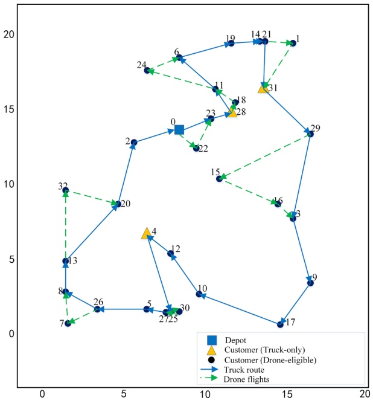

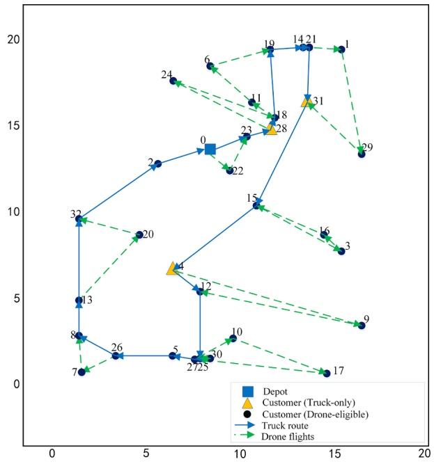

Fig. 7. Best solution for instance A-n33-k5: (left) initial solution and (right) final solution.

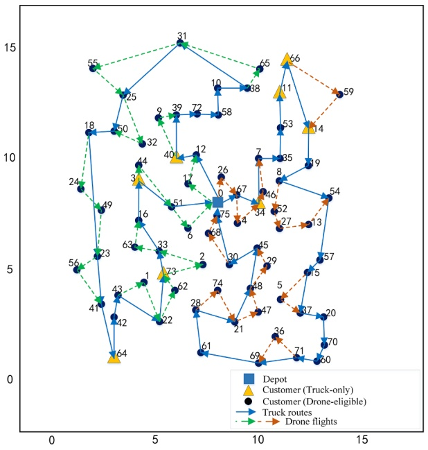

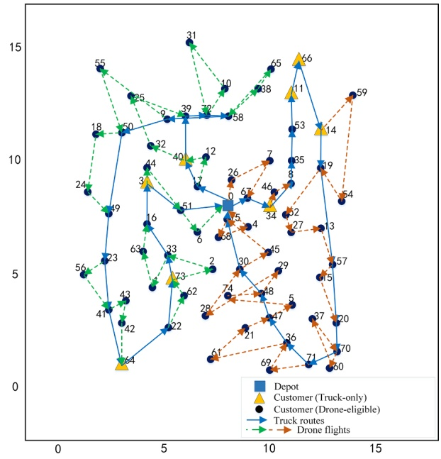

Fig. 8. Best solution for instance P-n76-k4: (left) initial solution and (right) final solution.

then calculated the sum of $\left| D ^ { k } \right|   ( \mathbb { S }   \left| D ^ { k } \right| )$ and that of $\left| D ^ { k } \right| ^ { u b }   ( \mathbb { S }   \left| D ^ { k } \right| ^ { u b } )$ across all vehicle pairs (refer to Appendix A). Fig. 9 validates Proposition 1 and indicates that the number of drone flights in the best solution is nearly 60 % of its upper bound on average. The value of $| D ^ { k } |$ may be related to drone capacities. A detailed sensitivity test for these parameters is performed in Section 5.5.

## 5.3.4. Effect of using acceleration strategies (RS)

In this section, the method without the RS (No RS) was applied for comparison with MP-ISA. Fig. 10 (left) displays the average execution time among 10 runs for each instance of set A. Two observations are made. First, the computing time generally increases with the problem size. Second, the execution time of MP-ISA is much less than that of the No RS method on average and slowly increases with the problem size, while the execution time of the No RS method experiences more significant increases. Regarding the

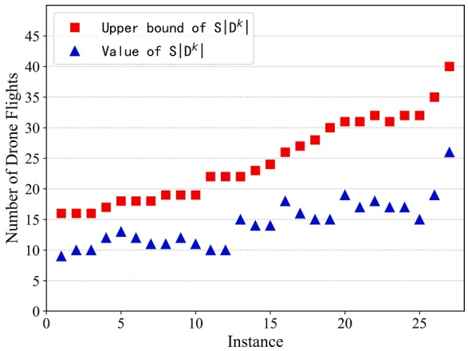

Fig. 9. Number of drone flights for each best solution.

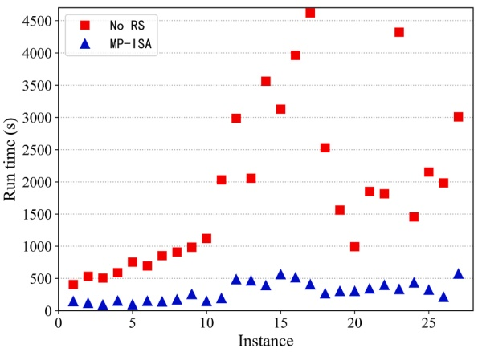

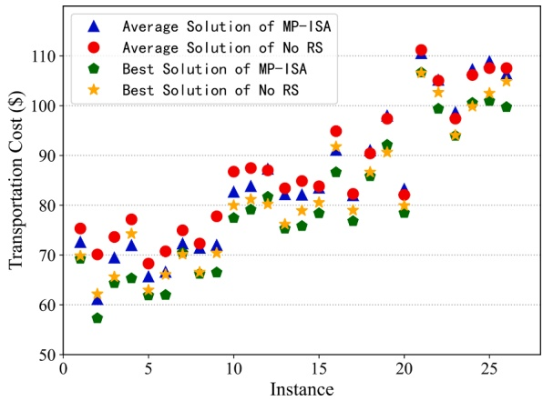

Fig. 10. MP-ISA and No RS result comparisons for computational time and solutions.

Table 9

MV and SV mode result comparisons for set P.

| Instance | U | MV$n_d$ | $C_v(\$)$ | R(km) | SV$n_d$ | $C_v(\$)$ | R(km) | $\Delta n_d\%$ | $\Delta C_v\%$ | $\Delta R\%$ |
| --- | --- | --- | --- | --- | --- | --- | --- | --- | --- | --- |
| P-n16-k8 | 1 | 10 | 16.15 | 15.60 | 4 | 24.10 | 28.80 | -60.00 | 49.23 | 84.62 |
| P-n19-k2 | 1 | 10 | 21.78 | 23.20 | 7 | 26.07 | 29.60 | -30.00 | 19.70 | 27.59 |
| P-n20-k2 | 1 | 11 | 22.41 | 24.00 | 6 | 27.74 | 33.20 | -45.45 | 23.78 | 38.33 |
| P-n21-k2 | 1 | 13 | 22.27 | 20.80 | 7 | 26.11 | 30.00 | -46.15 | 17.24 | 44.23 |
| P-n22-k2 | 1 | 14 | 21.80 | 20.00 | 8 | 27.55 | 31.60 | -42.86 | 26.38 | 58.00 |
| P-n23-k8 | 1 | 14 | 21.38 | 20.80 | 9 | 27.06 | 30.80 | -35.71 | 26.57 | 48.08 |
| P-n40-k5 | 1 | 22 | 46.45 | 48.40 | 14 | 53.79 | 62.00 | -36.36 | 15.80 | 28.10 |
| P-n45-k5 | 1 | 26 | 50.71 | 52.80 | 18 | 63.02 | 71.60 | -30.77 | 24.28 | 35.61 |
| P-n50-k7 | 1 | 29 | 49.48 | 50.80 | 17 | 59.01 | 66.40 | -41.38 | 19.26 | 30.71 |
| P-n51-k10 | 1 | 33 | 53.44 | 52.40 | 22 | 62.20 | 68.80 | -33.33 | 16.39 | 31.30 |
| P-n55-k7 | 2 | 29 | 55.92 | 59.20 | 19 | 66.28 | 76.00 | -34.48 | 18.53 | 28.38 |
| P-n60-k10 | 2 | 32 | 62.29 | 66.80 | 20 | 73.16 | 84.80 | -37.50 | 17.45 | 26.95 |
| P-n65-k10 | 2 | 39 | 57.55 | 56.00 | 27 | 74.84 | 82.00 | -30.77 | 30.04 | 46.43 |
| P-n70-k10 | 2 | 36 | 66.55 | 69.60 | 25 | 79.31 | 89.20 | -30.56 | 19.17 | 28.16 |
| P-n76-k4 | 2 | 41 | 75.30 | 80.40 | 26 | 89.31 | 103.60 | -36.59 | 18.61 | 28.86 |
| P-n101-k4 | 2 | 61 | 86.27 | 88.00 | 40 | 103.50 | 116.40 | -34.43 | 19.97 | 32.27 |
| Avg. |  |  |  |  |  |  |  | -37.90 | 22.65 | 38.60 |

quality of the solutions, MP-ISA returns slightly better results than those of the No RS method for most of the test instances (Fig. 10 (right)). These results strongly demonstrate the validity of the RS in reducing computational time and obtaining better solutions.

## 5.4. Comparisons with different modes

## 5.4.1. MV vs SV

To further investigate the advantages of the multi-visit mode (MDRP-PD) over the single-visit mode, we solved each instance of set P 10 times with each mode. The best results are illustrated in Table 9, in which $n _ { d }$ denotes the number of customers served by drones, $C _ { \gamma }$ is the transportation cost, R is the truck travel distance, and $\Delta n_{d}\%,\Delta C_{v}$ % and ΔR% are the gaps between these two modes for the above three quantities.

Notably, drones serve more customers in the MV mode, and both the cost and truck travel distance are reduced. More specifically, the number of customers served by drones is decreased by nearly 40 % on average in the SV mode, resulting in a cost increase of more than 20 % and a nearly 40 % increase in the truck travel distance.

## 5.4.2. SPD vs DOM

In this section, we investigated the impact of the SPD operation of drones in the MDRP-PD. As the proportion of customers with pickup demands (denoted as “pick”) has a prominent impact on the solution, we compared MDRP-PD with delivery-only mode (DOM) (i.e., mode in which drones provide delivery service only) for instances P-n16-k8, P-n22-k2, P-n40-k5 and P-n60-k10, each with five levels of “pick”. The best solutions over 10 runs are reported in Table 10.

DOM is sensitive to the level of “pick” and cannot fully utilize drones. As the level of “pick” increases, the number of customers served by drones rapidly decrease, and the cost and truck travel distance quickly increase. In contrast, SPD is more robust. As the level of $\because \neg p i c k$ increases, the above three quantities are relatively stable, which helps produce more cost savings. Together with the comparison from Section 5.4.1, these findings motivate further research on drone properties and functions allowing for multiple visits and simultaneous pickup and delivery.

## 5.5. Sensitivity analysis

To further study the impact of critical factors on the output of the model, we performed a series of tests on the instances of P-n22-k2, P-n45-k5, P-n51-k10 and P-n76-k4 by altering the values of certain parameters of interest, which included drone load capacity (W), battery capacity (E) and unit travel cost ratio of truck to drone (σ). In addition, we compared the SV mode for different σ values to further investigate the impact of drone cost on the results. Then, a total of 96 scenarios were generated with each parameter set to six levels for these four instances. For a clear comparison, we only changed the value of one parameter in a scenario while keeping the values of the remaining parameters at the main setup level, and the average results $( \mathbf { i } . \mathbf { e } . ,$ total cost saving percentage over truck-only mode, the number of flights and the number of customers served by drones) over 10 runs were recorded (detailed in Appendix B). The sensitivity analysis offers preliminary insights into the cooperative approach for SPD operations.

The impact of the drone load capacity is presented in Fig. 11(a). As the load capacity of drones increases, more customers are served by them, while the number of flights becomes relatively stable after the load capacity increases to $^ { 4 , }$ and the cost undergoes a distinct decline, especially when the load capacity increases from 0 to 6. It is inferred that a certain increase in drone load capacity would enable drones to serve more customers who were previously only served by trucks, which obviously contributes to a cost reduction. However, a further increase may not always lead to obvious cost savings, since the battery capacity now becomes the limitation that prevents drones from serving more customers even though extra carrying capacity exists.

Similarly, as shown in Fig. 11(b), improving the battery capacity of drones might facilitate the use of drones and improve cost efficiency. As the battery capacity of drones increases, the number of flights and the number of customers served by drones experience similar changes as those to the load capacity, as a larger battery capacity allows more customers being served in each flight. However, as the battery capacity of drones exceeds 500, the cost is essentially fixed. In such situations, the load capacity becomes the limitation for a drone to visit more customers, although its battery energy has not been depleted.

Fig. 12 shows that as the unit distance cost ratio of truck to drone declines, the advantage of these two combined modes gradually wanes, which validates Proposition 2 and indicates that the collaboration between trucks and drones is an innovative and preferable approach for reducing costs, depending on the condition of a much lower drone cost. Moreover, MDRP-PD enables drones to serve more customers with fewer flights, resulting in greater cost savings, compared with the SV mode. For example, at the main setup level $( \mathrm { i . e . , }   \sigma   =   1 0 )$ , in the MDRP-PD, 25 customers are served by drones with 15 flights on average, producing an average total cost savings of 22.03 % over the truck-only mode. In contrast, in the SV mode, drones provide an average of 17 flights for 17 customers, resulting in only 16.90 % total cost savings over the truck-only mode on average.

## 6. Conclusion

In this paper, we investigated a combined truck-drone system for simultaneous pickup and delivery services. This is an important extension of the VRP-D for pickup and delivery that simultaneously considers multiple visits per flight, the load-dependent energy consumption of drones, and the constraints for the collaboration of trucks and drones. A mathematical formulation was constructed, several valid inequalities were introduced to strengthen the model, and a sufficient condition for the benefits of the combined mode over the truck-only mode was identified. To address large-size instances, we developed a novel two-stage solution approach (MP-ISA)

Table 10

Best results by two modes on different “pick” levels.

<table><tr><td rowspan="2">Instance</td><td rowspan="2">pick%</td><td colspan="3">SPD</td><td colspan="3">DOM</td><td rowspan="2"> $\Delta n_d\%$ </td><td rowspan="2"> $\Delta C_v\%$ </td><td rowspan="2"> $\Delta R\%$ </td></tr><tr><td> $n_d$ </td><td> $C_v(\$)$ </td><td>R(km)</td><td> $n_d$ </td><td> $C_v(\$)$ </td><td>R(km)</td></tr><tr><td rowspan="5">P-n16-k8</td><td>15</td><td>11</td><td>14.80</td><td>14.40</td><td>9</td><td>16.80</td><td>18.40</td><td>-18.18</td><td>13.51</td><td>27.78</td></tr><tr><td>30</td><td>10</td><td>15.34</td><td>15.60</td><td>5</td><td>22.72</td><td>27.60</td><td>-50.00</td><td>48.11</td><td>76.92</td></tr><tr><td>45</td><td>10</td><td>15.51</td><td>15.60</td><td>5</td><td>22.71</td><td>27.60</td><td>-50.00</td><td>46.42</td><td>76.92</td></tr><tr><td>60</td><td>10</td><td>15.96</td><td>15.60</td><td>3</td><td>27.17</td><td>34.00</td><td>-70.00</td><td>70.24</td><td>117.95</td></tr><tr><td>75</td><td>10</td><td>16.14</td><td>15.60</td><td>0</td><td>30.58</td><td>39.20</td><td>-100.00</td><td>89.47</td><td>151.28</td></tr><tr><td rowspan="5">P-n22-k2</td><td>15</td><td>15</td><td>18.87</td><td>18.40</td><td>14</td><td>21.89</td><td>24.00</td><td>-6.67</td><td>16.00</td><td>30.43</td></tr><tr><td>30</td><td>14</td><td>18.10</td><td>18.00</td><td>9</td><td>27.96</td><td>33.60</td><td>-35.71</td><td>54.48</td><td>86.67</td></tr><tr><td>45</td><td>15</td><td>18.47</td><td>17.20</td><td>9</td><td>28.99</td><td>35.80</td><td>-40.00</td><td>56.96</td><td>108.14</td></tr><tr><td>60</td><td>14</td><td>18.92</td><td>18.00</td><td>5</td><td>32.85</td><td>40.80</td><td>-64.29</td><td>73.63</td><td>126.67</td></tr><tr><td>75</td><td>15</td><td>20.25</td><td>18.40</td><td>3</td><td>33.97</td><td>42.80</td><td>-80.00</td><td>67.75</td><td>132.61</td></tr><tr><td rowspan="5">P-n40-k5</td><td>15</td><td>26</td><td>45.04</td><td>48.80</td><td>22</td><td>47.42</td><td>53.20</td><td>-15.38</td><td>5.28</td><td>9.02</td></tr><tr><td>30</td><td>22</td><td>44.17</td><td>45.20</td><td>18</td><td>52.71</td><td>61.20</td><td>-18.18</td><td>19.33</td><td>35.40</td></tr><tr><td>45</td><td>22</td><td>45.68</td><td>48.00</td><td>10</td><td>59.38</td><td>72.40</td><td>-54.55</td><td>29.99</td><td>50.83</td></tr><tr><td>60</td><td>24</td><td>43.37</td><td>43.60</td><td>11</td><td>62.41</td><td>76.40</td><td>-54.17</td><td>43.90</td><td>75.23</td></tr><tr><td>75</td><td>21</td><td>45.12</td><td>48.40</td><td>7</td><td>64.32</td><td>80.00</td><td>-66.67</td><td>42.55</td><td>65.29</td></tr><tr><td rowspan="5">P-n60-k10</td><td>15</td><td>31</td><td>63.19</td><td>71.60</td><td>26</td><td>71.57</td><td>83.20</td><td>-16.13</td><td>13.26</td><td>16.20</td></tr><tr><td>30</td><td>30</td><td>61.88</td><td>67.60</td><td>20</td><td>77.15</td><td>93.20</td><td>-33.33</td><td>24.68</td><td>37.87</td></tr><tr><td>45</td><td>33</td><td>57.44</td><td>60.80</td><td>15</td><td>77.22</td><td>94.40</td><td>-54.55</td><td>34.44</td><td>55.26</td></tr><tr><td>60</td><td>34</td><td>62.09</td><td>67.60</td><td>14</td><td>79.39</td><td>97.60</td><td>-58.82</td><td>27.86</td><td>44.38</td></tr><tr><td>75</td><td>30</td><td>63.04</td><td>68.00</td><td>7</td><td>89.20</td><td>112.0</td><td>-76.67</td><td>41.50</td><td>64.71</td></tr></table>

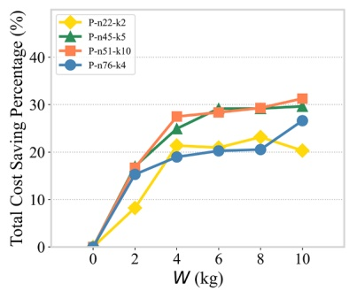

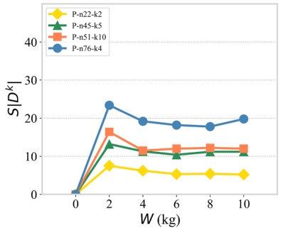

(a) Impact of the maximum load capacity of drone.

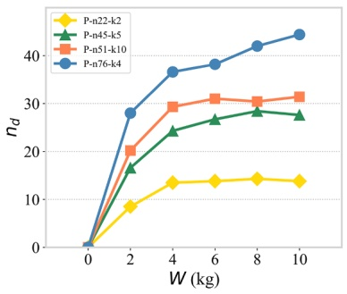

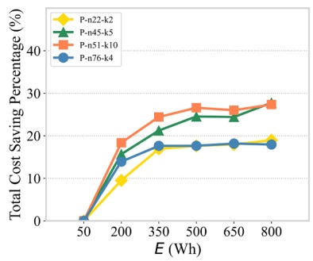

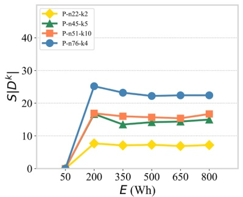

(b) Impact of the maximum battery capacity of drone.

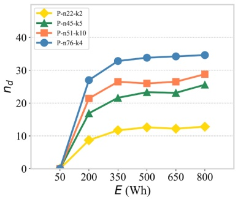

Fig. 11. Impact of drone capacities on the results of MDRP-PD.

that consists of three main components: (1) a maximum payload (MP) method to construct initial solutions, (2) an improved simulated annealing (ISA) algorithm with customized local searches for reoptimization, and (3) feasibility tests on both trucks and drones. Extensive experiments were conducted to validate the effectiveness of MP-ISA on a number of instances modified from certain CVRP benchmark datasets. Our results indicate the good performance of the proposed solution approach over two existing heuristics in the literature. The results also show the remarkable benefits of allowing multiple visits per flight and SPD operations in the combined truck-drone system.

We provide interesting extensions for future study here. First, battery output power optimization could be a straightforward extension for follow-up studies, as it affects drone flying speed and time, and thus energy consumption and cost. Second, this paper assumes at most one launch and one retrieval at each customer node. Future research could consider allowing multiple launches and retrievals at the same location to yield more flexible routing schedules and greater cost savings. Third, in a practical setting, it may be interesting to solve a real-time scenario, where the demands of pickup/delivery may be stochastic and uncertain. Considering the value of the MDRP-PD in logistics, technology, transportation, and the environment, we expect our research to raise awareness and promote continuous and further exploration and development in this area.

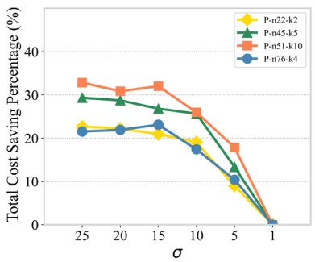

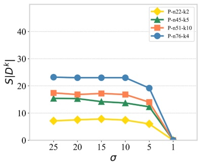

(a) Impact of the unit distance cost ratio on MDRP-PD.

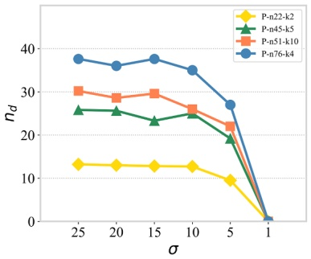

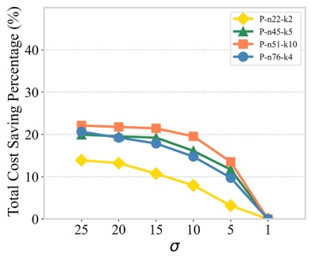

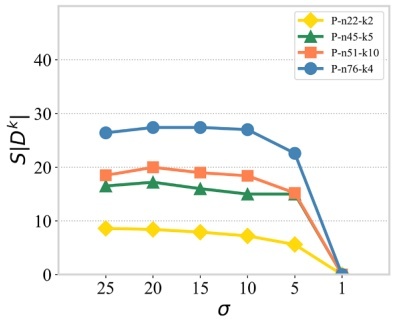

(b) Impact of the unit distance cost ratio on single-visit mode.

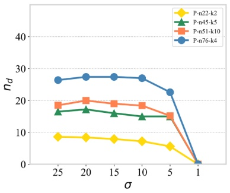

Fig. 12. Impact of the unit cost ratio on the results of the MDRP-PD and SV mode.

## CRediT authorship contribution statement

**Shanshan Meng:** Conceptualization, Methodology, Visualization, Validation, Formal analysis, Software, Data curation, Writing – original draft, Writing – review & editing. **Xiuping Guo:** Conceptualization, Formal analysis, Methodology, Supervision, Writing – review & editing. **Dong Li:** Conceptualization, Methodology, Formal analysis, Validation, Writing – review & editing. **Guoquan Liu:** Formal analysis, Validation, Methodology.

## Declaration of Competing Interest

The authors declare that they have no known competing financial interests or personal relationships that could have appeared to influence the work reported in this paper.

## Data availability

Data will be made available on request.

## Acknowledgments

The authors thank anonymous reviewers and the editor for their valuable comments and suggestions, which helped to improve the quality of this paper.

This work was supported by the Open Foundation of State Key Laboratory of Networking and Switching Technology of China [Grant SKLNST-2021-2-01] and Service Science and Innovation Key Laboratory of Sichuan Province of China [Grant KL2106].

## References

[Agatz, N., Bouman, P., Schmidt, M., 2018. Optimization approaches for the traveling salesman problem with drone. Transp. Sci. 52 (4), 965–981](http://refhub.elsevier.com/S1366-5545%2822%2900367-2/h0005).

Allain, R., 2013. Physics of the amazon octocopter drone. https://www.wired.com/2013/12/physics-of-the-amazon-prime-air-drone/.

Boccia, M., Masone, A., Sforza, A., Sterle, C., 2021. A column-and-row generation approach for the flying sidekick travelling salesman problem. Transp. Res. Pt. C-Emerg. Technol. 124, 102913 [https://doi.org/10.1016/j.trc.2020.102913](https://doi.org/10.1016/j.trc.2020.102913).

Bogue, R., 2020. Robots in a contagious world, 673–642 Ind. Robot. 47 (5). [https://doi.org/10.1108/IR-05-2020-0101](https://doi.org/10.1108/IR-05-2020-0101).

Bouman, P., Agatz, N., Schmidt, M., 2018. Dynamic programming approaches for the traveling salesman problem with drone. Networks 72 (4), 528–542. [https://doi.org/10.1002/net.21864](https://doi.org/10.1002/net.21864).

Boysen, N., Fedtke, S., Schwerdfeger, S., 2021. Last-mile delivery concepts: A survey from an operational research perspective. Or Spectrum 43 (1), 1–58. [https://doi.org/10.1007/s00291-020-00607-8](https://doi.org/10.1007/s00291-020-00607-8).

Campbell, J.F., Sweeney II, D.C., Zhang, J., Pan, D., 2018. Strategic design for delivery with linked transportation assets: Trucks and drones. Technical Report Midwest Transportation Center. [http://www.intrans.iastate.edu/research/documents/research-reports/delivery\_w\_linked\_trucks\_and\_drones\_w\_cvr.pdf](http://www.intrans.iastate.edu/research/documents/research-reports/delivery_w_linked_trucks_and_drones_w_cvr.pdf).

Cernỳ, ˇ V., 1985. Thermodynamical approach to the traveling salesman problem: An efficient simulation algorithm. J. Optim. Theory Appl. 45 (1), 41–51. [https://doi.org/10.1007/BF00940812](https://doi.org/10.1007/BF00940812).

Chen, C., Demir, E., Huang, Y., Qiu, R., 2021. The adoption of self-driving delivery robots in last mile logistics. Transp. Res. Pt. E- Logist. Transp. Rev. 146, 102214 [https://doi.org/10.1016/j.tre.2020.102214](https://doi.org/10.1016/j.tre.2020.102214).

Chung, S.H., Sah, B., Lee, J., 2020. Optimization for drone and drone-truck combined operations: A review of the state of the art and future directions. Comput. Oper. Res. 123, 105004 [https://doi.org/10.1016/j.cor.2020.105004](https://doi.org/10.1016/j.cor.2020.105004).

Dillow, C., 2015. Fortune. meet Matternet, the drone delivery startup that’s actually delivering. https://fortune.com/2015/05/01/matternet-drone%20delivery/.

Dorling, K., Heinrichs, J., Messier, G.G., Magierowski, S., 2017. Vehicle routing problems for drone delivery. IEEE Trans. Syst. Man Cybernet. 47 (1), 70–85. [https://doi.org/10.1109/TSMC.2016.2582745](https://doi.org/10.1109/TSMC.2016.2582745).

Dukkanci, O., Kara, B.Y., Bektaş, T., 2021. Minimizing energy and cost in range-limited drone deliveries with speed optimization. Transp. Res. Pt. C- Emerg. Technol. 125, 102985 [https://doi.org/10.1016/j.trc.2021.102985](https://doi.org/10.1016/j.trc.2021.102985).

Euchi, J., Sadok, A., 2021. Hybrid genetic-sweep algorithm to solve the vehicle routing problem with drones. Phys. Commun. 44, 101236. https://doi.org/ 10.1016/j. phycom.2020.101236.

Gonzalez-R, P.L., Canca, D., Andrade-Pineda, J.L., Calle, M., Leon-Blanco, J.M., 2020. Truck-drone team logistics: A heuristic approach to multi-drop route planning. Transp. Res. Pt. C- Emerg. Technol. 114, 657–680. [https://doi.org/10.1016/j.trc.2020.02.030](https://doi.org/10.1016/j.trc.2020.02.030).

Ha, Q.M., Deville, Y., Pham, Q.D., Ha, \` M.H., 2018. On the min-cost traveling salesman problem with drone. Transp. Res. Pt. C- Emerg. Technol. 86, 597–621. [https://doi.org/10.1016/j.trc.2017.11.015](https://doi.org/10.1016/j.trc.2017.11.015).

Ham, A.M., 2018. Integrated scheduling of m-truck, m-drone, and m-depot constrained by time-window, drop-pickup, and m-visit using constraint programming. Transp. Res. Pt. C- Emerg. Technol. 91, 1–14. [https://doi.org/10.1016/j.trc.2018.03.025](https://doi.org/10.1016/j.trc.2018.03.025).

Huang, S.-H., Huang, Y.-H., Blazquez, C.A., Chen, C.-Y., 2022. Solving the vehicle routing problem with drone for delivery services using an ant colony optimization algorithm. Adv. Eng. Inform. 51, 101536 [https://doi.org/10.1016/j.aei.2022.101536](https://doi.org/10.1016/j.aei.2022.101536).

Jaller, M., Otero-Palencia, C., Pahwa, A., 2020. Automation, electrification, and shared mobility in urban freight: opportunities and challenges. Transp. Res. Procedia 46, 13–20. [https://doi.org/10.1016/j.trpro.2020.03.158](https://doi.org/10.1016/j.trpro.2020.03.158).

Jeong, H.Y., Song, B.D., Lee, S., 2019. Truck-drone hybrid delivery routing: Payload-energy dependency and no-fly zones. Int. J. Prod. Econ. 214, 220–233. [https://doi.org/10.1016/j.ijpe.2019.01.010](https://doi.org/10.1016/j.ijpe.2019.01.010).

Jie, W., Yang, J., Zhang, M., Huang, Y., 2019. The two-echelon capacitated electric vehicle routing problem with battery swapping stations: Formulation and efficient methodology. Eur. J. Oper. Res. 272 (3), 879–904. [https://doi.org/10.1016/j.ejor.2018.07.002](https://doi.org/10.1016/j.ejor.2018.07.002).

Karak, A., Abdelghany, K., 2019. The hybrid vehicle-drone routing problem for pick-up and delivery services. Transp. Res. Pt. C- Emerg. Technol. 102, 427–449. [https://doi.org/10.1016/j.trc.2019.03.021](https://doi.org/10.1016/j.trc.2019.03.021).

Kim, S.J., Lim, G.J., Cho, J., Cot ˆ é, M.J., 2017. Drone-aided healthcare services for patients with chronic diseases in rural areas. J. Intell. Robot. Syst. 88 (1), 163–180. [https://doi.org/10.1007/s10846-017-0548-z](https://doi.org/10.1007/s10846-017-0548-z).

Kirkpatrick, S., Gelatt, C.D., Vecchi, M.P., 1983. Optimization by simulated annealing. Science 220 (4598), 671–680. [https://doi.org/10.1126/science.220. 4598.671](https://doi.org/10.1126/science.220.%204598.671).

Kitjacharoenchai, P., Ventresca, M., Moshref-Javadi, M., Lee, S., Tanchoco, J.M., Brunese, P.A., 2019. Multiple traveling salesman problem with drones: Mathematical model and heuristic approach. Comput. Ind. Eng. 129, 14–30. [https://doi.org/10.1016/j.cie.2019.01.020](https://doi.org/10.1016/j.cie.2019.01.020).

Kitjacharoenchai, P., Min, B.-C., Lee, S., 2020. Two echelon vehicle routing problem with drones in last mile delivery. Int. J. Prod. Econ. 225, 107598 [https://doi.org/10.1016/j.ijpe.2019.107598](https://doi.org/10.1016/j.ijpe.2019.107598).

Kuo, R., Lu, S.-H., Lai, P.-Y., Mara, S.T.W., 2022. Vehicle routing problem with drones considering time windows. Expert Syst. Appl. 191, 116264 [https://doi.org/10.1016/j.eswa.2021.116264](https://doi.org/10.1016/j.eswa.2021.116264).

Leon-Blanco, J.M., Gonzalez-R, P., Andrade-Pineda, J.L., Canca, D., Calle, M., 2022. A multi-agent approach to the truck multi-drone routing problem. Expert Syst. Appl. 195, 116604 [https://doi.org/10.1016/j.eswa.2022.116604](https://doi.org/10.1016/j.eswa.2022.116604).

Ling, G., Draghic, N., 2019. Aerial drones for blood delivery. Transfusion 59 (S2), 1608–1611. [https://doi.org/10.1111/trf.15195](https://doi.org/10.1111/trf.15195).

Liu, Y., Liu, Z., Shi, J., Wu, G., Pedrycz, W., 2020. Two-echelon routing problem for parcel delivery by cooperated truck and drone. IEEE Trans. Syst. Man Cybernet. 51 (12), 7450–7465. [https://doi.org/10.1109/tsmc.2020.2968839](https://doi.org/10.1109/tsmc.2020.2968839).

Luo, Z., Liu, Z., Shi, J., 2017. A two-echelon cooperated routing problem for a ground vehicle and its carried unmanned aerial vehicle. Sensors 17 (5), 1144. [https://doi.org/10.3390/s17051144](https://doi.org/10.3390/s17051144).

Luo, Z., Poon, M., Zhang, Z., Liu, Z., Lim, A., 2021. The multi-visit traveling salesman problem with multi-drones. Transp. Res. Pt. C- Emerg. Technol. 128, 103172 [https://doi.org/10.1016/j.trc.2021.103172](https://doi.org/10.1016/j.trc.2021.103172).

Lv, Z., 2022. Hangzhou opened the mode of drone transportation of nucleic acid samples; 1000 samples were delivered within 5 minutes (in Chiese). https://zj.zjol.com.cn/video.html?id=1865193&height=1080/.

Macrina, G., Pugliese, L.D.P., Guerriero, F., Laporte, G., 2020. Drone-aided routing: A literature review. Transp. Res. Pt. C- Emerg. Technol. 120, 102762 [https://doi.org/10.1016/j.trc.2020.102762](https://doi.org/10.1016/j.trc.2020.102762).

Marinelli, M., Caggiani, L., Ottomanelli, M., Dell’Orco, M., 2018. En route truck–drone parcel delivery for optimal vehicle routing strategies. IET Intell. Transp. Syst. 12 (4), 253–261. [https://doi.org/10.1049/iet-its.2017.0227](https://doi.org/10.1049/iet-its.2017.0227).

Masone, A., Poikonen, S., Golden, B.L., 2022. The multivisit drone routing problem with edge launches: An iterative approach with discrete and continuous improvements. Networks 80 (2), 193–215. [https://doi.org/10.1002/net.22087](https://doi.org/10.1002/net.22087).

Miller, C., Tucker, A., Zemlin, R., 1960. Integer programming formulations and traveling salesman problems. J. ACM 7 (4), 326–329. [https://doi.org/10.1145/321043.321046](https://doi.org/10.1145/321043.321046).

Moshref-Javadi, M., Hemmati, A., Winkenbach, M., 2020a. A truck and drones model for last-mile delivery: A mathematical model and heuristic approach. Appl. Math. Model. 80, 290–318. [https://doi.org/10.1016/j.apm.2019.11.020](https://doi.org/10.1016/j.apm.2019.11.020).

Moshref-Javadi, M., Lee, S., Winkenbach, M., 2020b. Design and evaluation of a multi-trip delivery model with truck and drones. Transp. Res. Pt. E- Logist. Transp. Rev. 136, 101887 [https://doi.org/10.1016/j.tre.2020.101887](https://doi.org/10.1016/j.tre.2020.101887).

Moshref-Javadi, M., Winkenbach, M., 2021. Applications and research avenues for drone-based models in logistics: A classification and review. Expert Syst. Appl. 177, 114854 [https://doi.org/10.1016/j.eswa.2021.114854](https://doi.org/10.1016/j.eswa.2021.114854).

Murray, C.C., Chu, A.G., 2015. The flying sidekick traveling salesman problem: Optimization of drone-assisted parcel delivery. Transp. Res. Pt. C- Emerg. Technol. 54, 86–109. [https://doi.org/10.1016/j.trc.2015.03.005](https://doi.org/10.1016/j.trc.2015.03.005).

Murray, C.C., Raj, R., 2020. The multiple flying sidekicks traveling salesman problem: Parcel delivery with multiple drones. Transp. Res. Pt. C- Emerg. Technol. 110, 368–398. [https://doi.org/10.1016/j.trc.2019.11.003](https://doi.org/10.1016/j.trc.2019.11.003).

Nguyen, M.A., Dang, G.-T.-H., H\`a, M.H., Pham, M.-T., 2022. The min-cost parallel drone scheduling vehicle routing problem. Eur. J. Oper. Res. 299 (3), 910–930. [https://doi.org/10.1016/j.ejor.2021.07.008](https://doi.org/10.1016/j.ejor.2021.07.008).

Normasari, N. M. E., Yu, V. F., Bachtiyar, C., Sukoyo, 2019. A simulated annealing heuristic for the capacitated green vehicle routing problem. Math. Probl. Eng. 2019. https://doi.org/10.1155/2019/2358258.

Otto, A., Agatz, N., Campbell, J., Golden, B., Pesch, E., 2018. Optimization approaches for civil applications of unmanned aerial vehicles (UAVs) or aerial drones: A survey. Networks 72 (4), 411–458. [https://doi.org/10.1002/net.21818](https://doi.org/10.1002/net.21818).

Pachayappan, M., Sudhakar, V., 2021. A solution to drone routing problems using docking stations for pickup and delivery services. Transp. Res. Record 2675 (12), 1056–1074. [https://doi.org/10.1177/03611981211032219](https://doi.org/10.1177/03611981211032219).

Poikonen, S., Golden, B., 2020. Multi-visit drone routing problem. Comput. Oper. Res. 113, 104802 [https://doi.org/10.1016/j.cor.2019.104802](https://doi.org/10.1016/j.cor.2019.104802).

[Poikonen, S., Wang, X., Golden, B., 2017. The vehicle routing problem with drones: Extended models and connections. Networks 70 (1), 34–43](http://refhub.elsevier.com/S1366-5545%2822%2900367-2/h0240).

Poljak, M., Sterbenc, ˇ A., 2020. Use of drones in clinical microbiology and infectious diseases: current status, challenges and barriers. Clin. Microbiol. Infect. 26 (4), 425–430. [https://doi.org/10.1016/j.cmi.2019.09.014](https://doi.org/10.1016/j.cmi.2019.09.014).

Raj, R., Murray, C., 2020. The multiple flying sidekicks traveling salesman problem with variable drone speeds. Transp. Res. Pt. C- Emerg. Technol. 120, 102813 [https://doi.org/10.1016/j.trc.2020.102813](https://doi.org/10.1016/j.trc.2020.102813).

Roberti, R., Ruthmair, M., 2021. Exact methods for the traveling salesman problem with drone. Transp. Sci. 55 (2), 315–335. [https://doi.org/10.1287/trsc.2020.1017](https://doi.org/10.1287/trsc.%202020.1017).

Sacramento, D., Pisinger, D., Ropke, S., 2019. An adaptive large neighborhood search metaheuristic for the vehicle routing problem with drones. Transp. Res. Pt. C-Emerg. Technol. 102, 289–315. [https://doi.org/10.1016/j.trc.2019.02.018](https://doi.org/10.1016/j.trc.2019.02.018).

Sadati, M.E.H., Çatay, B., 2021. A hybrid variable neighborhood search approach for the multi-depot green vehicle routing problem. Transp. Res. Pt. E- Logist. Transp. Rev. 149, 102293 [https://doi.org/10.1016/j.tre.2021.102293](https://doi.org/10.1016/j.tre.2021.102293).

Salama, M., Srinivas, S., 2020. Joint optimization of customer location clustering and drone-based routing for last-mile deliveries. Transp. Res. Pt. C- Emerg. Technol. 114, 620–642. [https://doi.org/10.1016/j.trc.2020.01.019](https://doi.org/10.1016/j.trc.2020.01.019).

Schermer, D., Moeini, M., Wendt, O., 2019. A hybrid VNS/Tabu search algorithm for solving the vehicle routing problem with drones and en route operations. Comput. Oper. Res. 109, 134–158. [https://doi.org/10.1016/j.cor.2019.04.021](https://doi.org/10.1016/j.cor.2019.04.021).

Schermer, D., Moeini, M., Wendt, O., 2020. A branch-and-cut approach and alternative formulations for the traveling salesman problem with drone. Networks 76 (2), 164–186. [https://doi.org/10.1002/net.21958](https://doi.org/10.1002/net.21958).

[Song, B.D., Park, K., Kim, J., 2018. Persistent UAV delivery logistics: MILP formulation and efficient heuristic. Comput. Ind. Eng. 120, 418–428](http://refhub.elsevier.com/S1366-5545%2822%2900367-2/h0285).

Stolaroff, J.K., Samaras, C., O’Neill, E.R., Lubers, A., Mitchell, A.S., Ceperley, D., 2018. Energy use and life cycle greenhouse gas emissions of drones for commercial package delivery. Nat. Commun. 9 (1), 1–13. [https://doi.org/10.1038/s41467-017-02411-5](https://doi.org/10.1038/s41467-017-02411-5).

Torabbeigi, M., Lim, G.J., Kim, S.J., 2020. Drone delivery scheduling optimization considering payload-induced battery consumption rates. J. Intell. Robot. Syst. 97 (3), 471–487. [https://doi.org/10.1007/s10846-019-01034-w](https://doi.org/10.1007/s10846-019-01034-w).

V´asquez, S.A., Angulo, G., Klapp, M.A., 2021. An exact solution method for the TSP with drone based on decomposition. Comput. Oper. Res. 127, 105127 [https://doi.org/10.1016/j.cor.2020.105127](https://doi.org/10.1016/j.cor.2020.105127).

Vincent, F.Y., Susanto, H., Jodiawan, P., Ho, T.-W., Lin, S.-W., Huang, Y.-T., 2022. A simulated annealing algorithm for the vehicle routing problem with parcel lockers. IEEE Access 10, 20764–20782. [https://doi.org/10.1109/ACCESS.2022.3152062](https://doi.org/10.1109/ACCESS.2022.3152062).

Wang, C., Mu, D., Zhao, F., Sutherland, J.W., 2015. A parallel simulated annealing method for the vehicle routing problem with simultaneous pickup–delivery and time windows. Comput. Ind. Eng. 83, 111–122. [https://doi.org/10.1016/j.cie.2015.02.005](https://doi.org/10.1016/j.cie.2015.02.005).

Wang, X., Poikonen, S., Golden, B., 2017. The vehicle routing problem with drones: Several worst-case results. Optim. Lett. 11 (4), 679–697. [https://doi.org/10.1007/s11590-016-1035-3](https://doi.org/10.1007/s11590-016-1035-3).

Wang, Z., Sheu, J.-B., 2019. Vehicle routing problem with drones. Transp. Res. Pt. B- Methodol. 122, 350–364. [https://doi.org/10.1016/j.trb.2019.03.005](https://doi.org/10.1016/j.trb.2019.03.005).

Wei, L., Zhang, Z., Zhang, D., Leung, S.C., 2017. A simulated annealing algorithm for the capacitated vehicle routing problem with two-dimensional loading constraints. Eur. J. Oper. Res. 265 (3), 843–859. [https://doi.org/10.1016/j.ejor.2017.08.035](https://doi.org/10.1016/j.ejor.2017.08.035).

Wen, K., 2022. Low-altitude economic development in Shenzhen is accelerating (in Chinese). https://baijiahao.baidu.com/s?id=1743179880205866376&wfr=spider&for=pc/.

[Wikarek, J., Sitek, P., Zawarczynski, ´ Ł., 2019. An integer programming model for the capacitated vehicle routing problem with drones. In: International Conference on Computational Collective Intelligence. Springer, pp. 511–520](http://refhub.elsevier.com/S1366-5545%2822%2900367-2/h0335).

Wu, Y., Zhu, X., 2022. Three questions to normalize the drone transport of nucleic acid samples (in Chinese). https://www.thepaper.cn/newsDetail\_forward\_18199822/.

Xiao, Y., Zhao, Q., Kaku, I., Xu, Y., 2012. Development of a fuel consumption optimization model for the capacitated vehicle routing problem. Comput. Oper. Res. 39 (7), 1419–1431. [https://doi.org/10.1016/j.cor.2011.08.013](https://doi.org/10.1016/j.cor.2011.08.013).

Yagmur, ˘ E., Kesen, S.E., 2021. Multi-trip heterogeneous vehicle routing problem coordinated with production scheduling: Memetic algorithm and simulated annealing approaches. Comput. Ind. Eng. 161, 107649 [https://doi.org/10.1016/j.cie.2021.107649](https://doi.org/10.1016/j.cie.2021.107649).

Yurek, E.E., Ozmutlu, H.C., 2018. A decomposition-based iterative optimization algorithm for traveling salesman problem with drone. Transp. Res. Pt. C- Emerg. Technol. 91, 249–262. [https://doi.org/10.1016/j.trc.2018.04.009](https://doi.org/10.1016/j.trc.2018.04.009).

Zhang, J., Campbell, J.F., Sweeney II, D.C., Hupman, A.C., 2021. Energy consumption models for delivery drones: A comparison and assessment. Transp. Res. Pt. D-Transp. Environ. 90, 102668 [https://doi.org/10.1016/j.trd.2020.102668](https://doi.org/10.1016/j.trd.2020.102668).