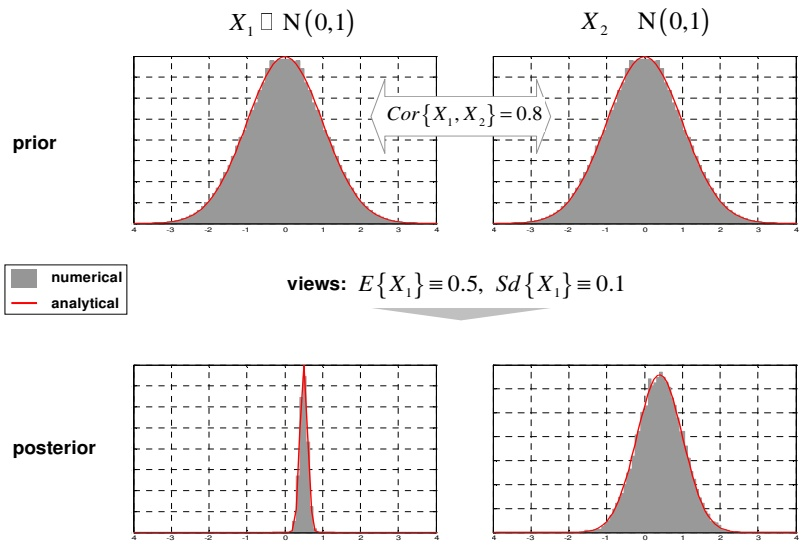
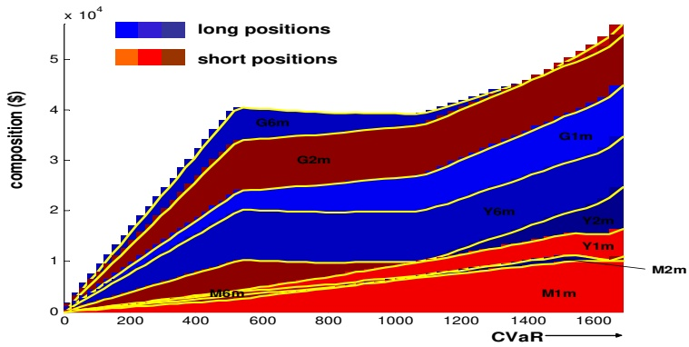
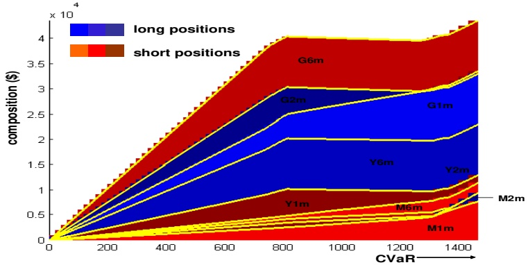
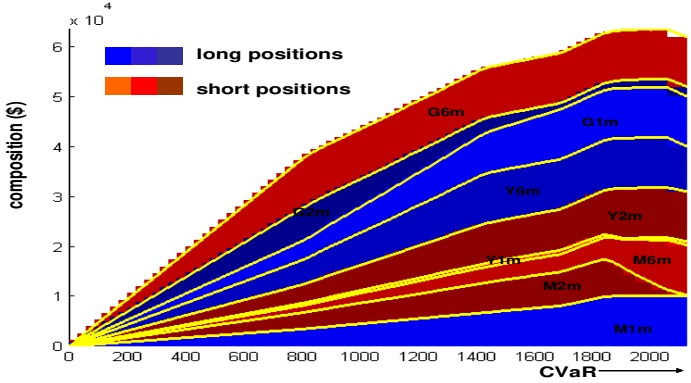

# Fully Flexible Views: Theory and Practice1

**Attilio Meucci**<strong>2</strong> **attilio meucci@symmys.com**

**this version: December 13 2010 latest version available at** http://ssrn.com/abstract=1213325

## Abstract

**We propose a unified methodology to input non-linear views from any number of users in fully general non-normal markets, and perform, among others, stresstesting, scenario analysis, and ranking allocation. We walk the reader through the theory and we detail an extremely efficient algorithm to easily implement this methodology under fully general assumptions. As it turns out, no repricing is ever necessary, hence the methodology can be readily applied to books with complex derivatives. We also present an analytical solution, useful for benchmarking, which per se generalizes notable previous results. Code illustrating this methodology in practice is available at**

http://www.mathworks.com/matlabcentral/fileexchange/21307.

**JEL Classification: C1, G11**

**Keywords: Black-Litterman, stress-test, scenario analysis, entropy, opinion pooling, Bayesian theory, change of measure, Kullback-Leibler, Monte Carlo simulations, importance sampling, fat-tails, median, regime shift, normal mixtures, multi-manager, skill, ranking, ordering information, option trading, macro views.**

## 1 Introduction

**Scenario analysis allows the practitioner to explore the implications on a given portfolio of a set of subjective views on possible market realizations, see e.g. Mina and Xiao (2001). The pathbreaking approach pioneered by Black and Litterman (1990) (BL in the sequel) generalizes scenario analysis, by adding uncertainty on the views and on the reference risk model. Further generalizations have been proposed in recent years. Qian and Gorman (2001) provide a framework to stress-test volatilities and correlations in addition to expectations. Pezier (2007) processes partial views on expectations and covariances based on least discrimination. Meucci (2009) extends the above models to act on risk factors instead of returns, and thus covers highly non-linear derivative markets and views on external factors that influence the p&l only statistically.**

**In the above techniques, the reference distribution of the risk factors is normal. The COP in Meucci (2006) explores non-normal markets, but correlation stress-testing and non-linear views are not allowed. Furthermore, the COP relies on ad-hoc manipulations.**

**Here we present the entropy pooling approach (EP in the sequel) which fully generalizes the above and related techniques. The inputs are an arbitrary market model, which we call ”prior”, and fully general views or stress-tests on that market. The output is a distribution, which we call ”posterior”, that incorporates all the inputs and can be used for risk management and portfolio optimization.**

**To obtain the posterior, we interpret the views as statements that distort the prior distribution, in such a way that the least possible amount of spurious structure is imposed. The natural index for the structure of a distribution is its entropy. Therefore we define the posterior distribution as the one that minimizes the entropy relative to the prior. Then by opinion pooling we assign different confidence levels to different views and users.**

**Among others, the EP handles non-normal markets; views on non-linear combinations of risk factors that impact the p&l directly or only statistically through correlations; views on expectations, but also medians, to handle fat tails; views on volatilities, correlations, tail behaviors, etc.; lax views, such as ranking, on all of the above, thereby generalizing Almgren and Chriss (2006); inputs from multiple users and multiple confidence levels for different views.**

**Furthermore, in its most general implementation the reference model is represented by Monte Carlo simulations, and the posterior which incorporates all the inputs is represented by the same simulations with new probabilities. Hence the most complex securities can be handled without costly repricing.**

**In Section 2 we introduce the EP theoretical framework. In Section 3 we present an analytical formula, which generalizes the previous results and provides a benchmark for the numerical implementation. In Section 4 we discuss the numerical routine to implement the EP in full generality. In Section 5 we illustrate a case study: option trading in a non-normal environment with non-linear and ranking views on realized volatility, implied volatility and external macro factors. In Section 6 we conclude, comparing the EP to other related techniques.**

**Fully documented code for this and other case studies, such as portfolios from ranking, can be downloaded at MATLAB Central File Exchange.**

## 2 The entropy pooling approach

**We consider a book driven by an N-dimensional vector of risk factors X. In other words, denoting by t the current time, by** $\mathcal { I } _ { t }$ **the information currently available, and by τ the time to the investment horizon, there exists a deterministic function** $P$ **that maps the realizations of X and the information** $\mathbb { Z } _ { t }$ **into the price** $P _ { t + \tau }$ **of each security in the book at the horizon:**

$$
P _ {t + \tau} \equiv P (\mathbf {X}, \mathcal {I} _ {t}).\tag{1}
$$

**This framework is completely general. For instance, in a book of options X can represent the changes in all the underlyings and implied volatilities: in this case (1) is approximated by a second-order Taylor expansion whose coefficients are the ”deltas”, ”vegas”, ”gammas”, ”vannas”, ”volgas”, etc. Also, X can represent a set of risk factors behind a computationally expensive full Monte-Carlo pricing function, such as interest rate values at different monitoring times for mortgage derivatives. Furthermore, X can be augmented with a set of external risk factors that do not feed directly the pricing function (1), but that still influence the p&l statistically through correlation. We explore a detailed example in these directions in Section 5. In any case, we emphasize that X can be, but by no means is restricted to, returns on a set of securities.**

## The reference model

**We assume the existence of a risk model, i.e. a model for the joint distribution of the risk factors, as represented by its probability density function (pdf)**

$$
\mathbf {X} \sim f _ {\mathbf {X}}.\tag{2}
$$

**In BL, this is the ”prior” factor distribution. More in general, this is a model that risk managers use to perform risk analyses, such as the computation of the volatility, tracking error, VaR, expected shortfall of a portfolio, along with the contributions to such measures from the different sources of risk. Portfolio managers and traders on the other hand use this model to optimize their positions. They specify a subjective index of satisfaction** $\mathcal { S } ,$ **such as the mean-(C)VaR trade-off, or the certainty equivalent stemming from a utility function, or a spectral measure, etc., see examples in Meucci (2005). Satisfaction depends both on the market distribution** $f _ { \mathbf { X } }$ **through the prices (1) and on the positions** in the book, represented by a vector w. Then the optimal book $\mathbf { w } ^ { * }$ **is defined as**

$$
\left| \mathbf {w} ^ {*} \equiv \underset {\mathbf {w} \in \mathcal {C}} {\operatorname{argmax}} \left\{\mathcal {S} \left(\mathbf {w}; f _ {\mathbf {X}}\right) \right\}, \right.\tag{3}
$$

**where C is a given set of investment constraints. The reference model** $( 2 )$ **can be estimated from historical analysis, or calibrated to current market observables, see Meucci (2009).**

## The views

**In the most general case, the user expresses views on generic functions of the market** $g _ { 1 } \left( \mathbf { X } \right) , \ldots , g _ { K } \left( \mathbf { X } \right)$ **. These functions constitute a K-dimensional random variable whose joint distribution is implied by the reference model (2):**

$$
\mathrm{V} \equiv \mathrm{g} (\mathrm{X}) \sim f _ {\mathrm{V}}.\tag{4}
$$

**We emphasize that, unlike in BL, in EP we do not assume that the functions** $g _ { k }$ **be linear. Notice that, as a special case, one can express views also on the securities values (1).**

**The views, or the stress-tests, are statements on the variables (4) which can clash with the reference model. In a stochastic environment, this means statements on their distribution. Therefore, the most detailed possible view specification is a complete, subjective joint distribution for those variables:**

$$
\mathbf {V} \sim \widetilde {f} _ {\mathbf {V}} \neq f _ {\mathbf {V}}.\tag{5}
$$

**However, views in general are statements on only select features of the distribution of V.**

**• The classical views a-la BL are statements on** $\widetilde { \mathbb { E } } \left\{ V _ { k } \right\}$ **, the expectations of** each of the $V _ { k }   ^ { \flat } \mathrm { s }$ e according to the new distribution $f _ { \mathbf { V } }$ . Since for distribue**tions such as stable distributions the expectation is not defined, in EP we consider views on a more general location measure m** $\{ V _ { k } \}$ **, which can be** e**the expectation or the median. The views are then set as**

$$
\widetilde {m} \left\{V _ {k} \right\} \stackrel {{\geqslant}} {{\leqslant}} m _ {k}, \quad k = 1, \ldots , K,\tag{6}
$$

The values $m _ { k }$ can be determined exogenously. If the user has only qual**itative views, it is convenient to set as in Meucci (2010)**

$$
m _ {k} \equiv m \left\{V _ {k} \right\} + \varkappa \sigma \left\{V _ {k} \right\}.\tag{7}
$$

**In this expression σ is a measure of volatility in the reference model, such as the standard deviation or, in fat-tailed markets with infinite variance, the interquartile range; and κ is an ad-hoc multiplier, such as** $-2,-1$ **,** 1, **and 2 for ”very bearish”, ”bearish”, ”bullish” and ”very bullish” respectively.**

**• The generalized BL views (6) are not necessarily expressed as equality constraint: EP can process views expressed as inequalities. In particular, EP can process ordering information, frequent in stock and bond management:**

$$
\widetilde {m} \left\{V _ {1} \right\} \geq \widetilde {m} \left\{V _ {2} \right\} \geq \dots \geq \widetilde {m} \left\{V _ {K} \right\}.\tag{8}
$$

**• Views can be expressed on the volatilities. A convenient formulation reads:**

$$
\widetilde {\sigma} \left\{V _ {k} \right\} \geqslant \varkappa \sigma \left\{V _ {k} \right\}, \quad k = 1, \dots , K.\tag{9}
$$

**• Correlation stress-tests are also views. Convenient specifications for the** correlation matrix $\widetilde { \mathbb { C } } \left\{ \mathbf { V } \right\}$ are the homogeneous shrinkage

$$
\widetilde {\mathbb {C}} \left\{\mathbf {V} \right\} \equiv \rho_ {1} \mathbf {I} + \rho_ {2} \mathbb {C} \left\{\mathbf {V} \right\} + \rho_ {3} \mathbf {1 1 ^ {\prime}},\tag{10}
$$

**where** $0 \leq \rho _ { 1 } , \rho _ { 2 } , \rho _ { 3 } < 1 , \: \rho _ { 1 } + \rho _ { 2 } + \rho _ { 3 } \equiv 1$ **, I is the identity matrix and 1 is a vector of ones. For different structures see e.g. Brigo and Mercurio (2001).**

**• The user can input views on the lower (upper) tail behavior, as represented e.g. by** $\tilde { Q } _ { V } \left( u \right)$ **,** the quantile of $V _ { k }$ according to the new distribution $\widetilde { f } _ { \mathbf { V } }$ e e**where the tail level u is close to zero (one). A convenient specification is**

$$
\widetilde {Q} _ {V} (u) \underset {\leqslant} {\geqslant} Q _ {V} (u),\tag{11}
$$

where $Q _ { V }$ is the reference quantile induced by $f _ { \mathbf { V } }$ , or alternatively bench**mark quantiles such as the normal or the Student t.**

**• Lower (upper) tail codependence, as represented by** $\tilde { C } _ { \mathbf { V } } \left( \mathbf { u } \right)$ **, the cdf of the** e**copula of V at joint threshold levels u close to zero (one). A convenient specification reads**

$$
\widetilde {C} _ {\mathbf {V}} \left(\mathbf {u}\right) \underset {<  } {\geqslant} \varkappa C _ {\mathbf {V}} \left(\mathbf {u}\right),\tag{12}
$$

where $C _ { \mathbf { V } }$ is the reference copula cdf induced by $f _ { \mathbf { V } }$ , or alternatively bench**mark copula cdf’s such as normal or Student t.**

**The above is a very partial list of all the possible features on which the user can wish to express views, and which can be handled by the EP.**

## The posterior

**The posterior distribution should satisfy the views without adding additional structure and should be as close as possible to the reference model (2).**

The relative entropy between a generic distribution $\widetilde { f } _ { \mathbf { X } }$ and a reference distribution $f _ { \mathbf { X } }$

$$
\mathcal {E} \left(\widetilde {f} _ {\mathbf {X}}, f _ {\mathbf {X}}\right) \equiv \int \widetilde {f} _ {\mathbf {X}} \left(\mathbf {x}\right) \left[ \ln \widetilde {f} _ {\mathbf {X}} \left(\mathbf {x}\right) - \ln f _ {\mathbf {X}} \left(\mathbf {x}\right) \right] d \mathbf {x}.\tag{13}
$$

**is a natural measure of the amount of structure in** $\widetilde { f } _ { \mathbf { X } } ;$ **furthermore, it also** measures how distorted $\widetilde { f } _ { \mathbf { X } }$ is with respect to $f _ { \mathbf { X } }$ e. Indeed, if the two distributions e**coincide, relative entropy is zero; by imposing constraints on** $\widetilde { f } _ { \mathbf { X } }$ **this distribution departs from** $f _ { \mathbf { X } }$ **and relative entropy increases.**

**Therefore, we define the posterior market distribution as**

$$
\left| \widetilde {f} _ {\mathbf {X}} \equiv \underset {f \in \mathbb {V}} {\mathrm{argmin}} \left\{\mathcal {E} \left(f, f _ {\mathbf {X}}\right) \right\}, \right.\tag{14}
$$

**where** $f \in \mathbb { V }$ **s**tands for all the distributions consistent with the views statements **such as (6)-(12).**

**Entropy minimization is widely applied in physics and statistics, see Cover and Thomas (2006). For applications to finance, see e.g. Avellaneda (1999), D’Amico, Fusai, and Tagliani (2003), Cont (2007) and Pezier (2007). In our context, entropy minimization is even more natural, as it generalizes Bayesian updating, see Caticha and Giffin (2006).**

## The confidence

One last step is required: the posterior $\widetilde { f } _ { \mathbf { X } }$ follows by assuming that the practie**tioner has full confidence in his statements. If the confidence is less than full, the posterior distribution of the factors must shrink towards the reference factor distribution. This is easily achieved as in Meucci (2006) by opinion-pooling the reference model and the full-confidence posterior:**

$$
\widetilde {f} _ {\mathbf {X}} ^ {c} \equiv (1 - c) f _ {\mathbf {X}} + c \widetilde {f} _ {\mathbf {X}}.\tag{15}
$$

**The pooling parameter** $c   \in   [ 0 , 1 ]$ **represents the confidence level in the views: in the extreme case when the confidence is total, the full-confidence posterior is recovered; on the other hand, in the absence of confidence, the reference risk model is recovered.**

**Opinion pooling becomes very useful in a multi-manager context. Indeed, consider** $S$ **users that input their separate views on (possibly, but not necessarily) different functions of the market. As in (14), we obtain S full-confidence pos**terior distributions $\widetilde { f } _ { \mathbf { X } } ^ { ( s ) } ,   s = 1 , \ldots , S .$ **. Then the posterior distribution results** e**naturally as the confidence-weighted average of the individual full-confidence posteriors:**

$$
\widetilde {f} _ {\mathbf {X}} ^ {\mathbf {c}} \equiv \sum_ {s = 1} ^ {S} c _ {s} \widetilde {f} _ {\mathbf {X}} ^ {(s)}.\tag{16}
$$

**These confidence levels can be linked naturally to the track-record of the respective manager, i.e. the s-th confidence** $c _ { s }$ **can be set as an increasing function of the number of past views, i.e. seniority, and of the correlation of these views with the actual market realization, in the same spirit as the ”skill” measure in Grinold and Kahn (1999).**

**The definitions (15)-(16) follow from a probabilistic interpretation of the confidence: one can easily specify different confidence levels for the different views of the same user and integrate these within a multi-user context. As it turns out, this amounts to specifying a probability measure on the power set of the views: we discuss these simple rules in detail in Appendix A.4.**

**We emphasize that, unlike in BL, in EP the confidence in the views (15) and the views on volatility (9) are modeled separately: indeed, being sure about future volatility and being uncertain about future market realizations are two very different issues.**

## Limit cases

**If the practitioner has no views, i.e. V is the empty set in (14), then the** confidence-weighted posterior distribution equals the reference model $f _ { \mathbf { X } }$

**On the other extreme, if the views fully specify a joint distribution (5) the minimization (14) is not necessary. Indeed, consistently with the principle of** **minimum discrimination information, the full-confidence posterior follows from its conditional-marginal decomposition:**

$$
\widetilde {f} _ {\mathbf {X}} (\mathbf {x}) \equiv \int f _ {\mathbf {X} | \mathbf {v}} (\mathbf {x}) \widetilde {f} _ {\mathbf {V}} (\mathbf {v}) d \mathbf {v}.\tag{17}
$$

**In particular, this is the case in scenario analysis, where the user associates full probability to one single scenario** $\mathbf { g } \left( \mathbf { X } \right) \equiv \widetilde { \mathbf { v } } \mathbf { : }$ **the views are represented with a Dirac delta centered on the scenario** $\widetilde { f } _ { \mathbf { V } } \left( \mathbf { v } \right) \equiv \delta \left( \mathbf { v } - \widetilde { \mathbf { v } } \right)$ **, which, substituted in** (17), yields $\tilde { f } _ { \mathbf { X } }   \equiv   f _ { \mathbf { X } | \widetilde { \mathbf { v } } }$ e      e**. In words, the full-confidence posterior distribution is** e**simply the reference distribution, conditioned on** $\mathbf { g } \left( \mathbf { X } \right)$ **assuming the scenario values** $\widetilde { \mathbf { v } } .$ **Therefore, EP includes full-distribution specification and standard** e**scenario analysis as special cases.**

## 3 An analytical formula

**Consider as in BL a normal reference model**

$$
\mathbf {X} \sim \mathrm{N} (\boldsymbol {\mu}, \boldsymbol {\Sigma}).\tag{18}
$$

**Consider views on the expectations of arbitrary linear combinations QX and on the covariances of arbitrary, potentially different, linear combinations GX**

$$
\mathbb {V}: \left\{ \begin{array}{l} \widetilde {\mathbb {E}} \left\{\mathbf {Q X} \right\} \equiv \widetilde {\mu} _ {\mathbf {Q}} \\ \widetilde {\mathbb {C}} o v \left\{\mathbf {G X} \right\} \equiv \widetilde {\boldsymbol {\Sigma}} _ {\mathbf {G}}, \end{array} \right.\tag{19}
$$

where $\mathbf { Q } ,   \mathbf { G } ,   \widetilde { \Sigma } _ { \mathbf { G } }$ and $\widetilde { \mu } _ { \mathbf { Q } }$ are conformable matrices/vector.

e e**As we show in Appendix A.1, the full-confidence posterior distribution (14) is normal:**

$$
\mathbf {X} \sim \mathrm{N} \left(\widetilde {\mu}, \widetilde {\boldsymbol {\Sigma}}\right),\tag{20}
$$

**where**

$$
\widetilde {\mu} \equiv \mu + \boldsymbol {\Sigma} \mathbf {Q} ^ {\prime} \left(\mathbf {Q} \boldsymbol {\Sigma} \mathbf {Q} ^ {\prime}\right) ^ {- 1} \left(\widetilde {\mu} _ {\mathbf {Q}} - \mathbf {Q} \mu\right),\tag{21}
$$

$$
\widetilde {\boldsymbol {\Sigma}} \equiv \boldsymbol {\Sigma} + \boldsymbol {\Sigma} \mathbf {G} ^ {\prime} \left(\left(\mathbf {G} \boldsymbol {\Sigma} \mathbf {G} ^ {\prime}\right) ^ {- 1} \widetilde {\boldsymbol {\Sigma}} _ {\mathbf {G}} \left(\mathbf {G} \boldsymbol {\Sigma} \mathbf {G} ^ {\prime}\right) ^ {- 1} - \left(\mathbf {G} \boldsymbol {\Sigma} \mathbf {G} ^ {\prime}\right) ^ {- 1}\right) \mathbf {G} \boldsymbol {\Sigma}.\tag{22}
$$

**Then the confidence-weighted posterior distribution (15) is a normal mixture:**

$$
\begin{array}{c c c c} & & \text {N} (\mu , \boldsymbol {\Sigma}) & \text {(probability: 1 - c)} \\ \mathbf {X} \sim & \nearrow & & \\ & \searrow & & \\ & & \text {N} \left(\widetilde {\mu}, \widetilde {\boldsymbol {\Sigma}}\right) & \text {(probability: c)} \end{array}\tag{23}
$$

**This distribution is suitable for instance to stress-test market crashes, where high volatilities, high correlations and low expectations in** $\widetilde { \mu } , \widetilde { \Sigma }$ **are expected to** occur with probability $c \ll 1$

**Formula (23) generalizes results in Pezier (2007). Also, the special case of** full-confidence $c \equiv 1$ on only one set of linear combinations $\mathbf { Q } \equiv \mathbf { G }$ yields the re**sult in Qian and Gorman (2001): this is not surprising, as the authors’ approach is equivalent to the decomposition (17). Finally, the further specialization to null dispersion in the views** $\widetilde { \Sigma } _ { \mathbf { G } } \; \rightarrow \; \mathbf { 0 }$ **, yields scenario analysis as in Meucci** e**(2005), which in turn generalizes the standard regression-based approach that appears e.g. in Mina and Xiao (2001).**

## 4 Numerical implementation

**Except for the special case in Section 3, the EP cannot be implemented analytically. However, the numerical implementation of the** $\mathrm { E P }$ **in full generality is extremely simple and computationally efficient.**

**First, we represent the reference distribution (2) of the market X in terms of a** $J \times N$ **panel X of simulations: the generic j-th row of X represents one in a very large number of joint scenarios for the N variables** $\mathbf { X } ,$ **whereas the generic** n-th column of $\mathcal { X }$ represents the marginal distribution of the n-th factor $X _ { n } .$ With the scenarios we associate the $J \times 1$ **vector of the respective probabilities** $\mathbf { p } ,$ **whose each entry typically, but not necessarily, equals** $1 / J$ **, see Glasserman and Yu (2005) for a variety of methods to determine p.**

**We assume that each of the joint scenarios in X has been mapped into the respective joint price scenarios for the I securities in the market considered by the user, by means of the potentially costly function (1), thereby generating a** $J \times I$ **panel of prices** $\mathcal { P } ,$ **. The panel of the security prices** $\mathcal { P } ,$ **along with the respective probabilities** $\mathbf { p } ,$ **is then analyzed for risk management purposes, or it is fed into an optimization algorithm to perform the asset allocation step (3).**

**The user expresses views on generic non-linear functions of the market (4). Their distribution as implied by the reference model is readily represented by the** $J \times K$ **panel V defined entry-wise as follows:**

$$
\mathcal {V} _ {j, k} \equiv g _ {k} \left(\mathcal {X} _ {j, 1}, \dots , \mathcal {X} _ {j, N}\right),\tag{24}
$$

**To represent the posterior distribution of the market that includes the views, instead of generating new simulations, we use the same scenarios with different probabilities** $\widetilde { \mathbf { p } } .$ **Then, as we show in Appendix A.2, general views such as** $(6) - (12)$ **e** can be written as a set of linear constraints on the new, yet to be **determined, probabilities**

$$
\underline {{\mathsf {a}}} \leq \mathrm{A} \widetilde {\mathsf {p}} \leq \overline {{\mathsf {a}}},\tag{25}
$$

**where A, a and** $\overline { { \mathbf { a } } }$ **are simple expressions of the panel (24). For instance, for standard views on expectations** $\mathbf { A } \equiv \mathcal { V } ^ { \prime }$ **and** $\underline { { \underline { { \mathbf { a } } } } } \equiv \overline { { \mathbf { a } } }$ **quantify the views.**

**Furthermore, the relative entropy (13) becomes its discrete counterpart**

$$
\mathcal {E} \left(\widetilde {\mathbf {p}}, \mathbf {p}\right) \equiv \sum_ {j = 1} ^ {J} \widetilde {p} _ {j} \left[ \ln \left(\widetilde {p} _ {j}\right) - \ln \left(p _ {j}\right) \right].\tag{26}
$$

Figure 1: Entropy pooling: numerical approach matches analytical solution

**Therefore, the full-confidence posterior distribution (14) is defined as**

$$
\widetilde {\mathbf {p}} \equiv \underset {\mathbf {a} \leq \mathbf {A f} \leq \overline {{\mathbf {a}}}} {\operatorname{argmin}} \left\{\mathcal {E} \left(\mathbf {f}, \mathbf {p}\right) \right\}.\tag{27}
$$

**This optimization can be solved very efficiently: as we show in Appendix A.3, the dual formulation is a simple linearly constrained convex program in a number of variables equal to the number of views, not the number of Monte Carlo simulations, which can be kept large. Therefore we can achieve an excellent accuracy even under extreme views, see Figure 1.**

**Now it is immediate to compute the opinion-pooling, confidence-weighted posterior (15): this is represented by** $( \mathcal { X } , \mathbf { p } _ { c } )$ **, the same simulations as for the reference model, but with new probabilities**

$$
\mathbf {p} _ {c} \equiv (1 - c) \mathbf {p} + c \widetilde {\mathbf {p}}.\tag{28}
$$

**A similar expression holds for the more general multi-user, multi-confidence posterior discussed in Appendix A.4.**

**Since the posterior factor distribution is obtained by tweaking the relative probabilities of the scenarios X without affecting the scenarios themselves, the posterior distribution of the market prices is represented by** $( \mathcal { P } , \mathbf { p } _ { c } )$ **, the original panel of joint prices and the new probabilities. Hence no repricing is necessary to process views and stress-tests.**

## 5 Case study: option trading

**As in Meucci (2009), we consider a trader of butterflies, defined as long positions in one call and one put with the same strike, underlying, and time to maturity. The price** $P _ { t + \tau }$ **of the butterfly at the investment horizon can be written in the format (1) as a deterministic non-linear function of a set of risk factors and current information. Indeed**

$$
P _ {t + \tau} = B S \left(y _ {t} e ^ {X _ {y}}, h \left(y _ {t} e ^ {X _ {y}}, \sigma_ {t} + X _ {\sigma}, K, T - \tau\right); K, T - \tau , r\right).\tag{29}
$$

In this expression $\tau$ is the investment horizon; $y _ { t }$ **is the current value and** $X _ { y } \equiv$ ln $( y _ { t + \tau } / y _ { t } )$ is the log-change of the underlying; $\sigma _ { t }$ is the current value and $X _ { \sigma } \: \equiv \: \sigma _ { t + \tau } \: - \: \sigma _ { t }$ **is the change in ATM implied volatility; BS is the Black-Scholes formula**

$$
B S (y, \sigma ; K, T, r) \equiv y [ \Phi (d _ {1}) - \Phi (- d _ {1}) ] - K e ^ {- r T} [ \Phi (d _ {2}) - \Phi (- d _ {2}) ],\tag{30}
$$

**where** $\Phi$ **is the standard normal cdf;** $K$ **is the strike;** $T$ **is the time to expiry;** $r$ is the risk-free rate; $d _ { 1 } { \thinspace \equiv \thinspace } \bigl ( \operatorname { l n } { ( y / K ) } + \left( r + \sigma ^ { 2 } / 2 \right) T \bigr ) / \sigma \sqrt { T } , { \thinspace } d _ { 2 } { \thinspace \equiv \thinspace } d _ { 1 } - \tilde { \sigma \sqrt { T } }$ **; and** $h$ **is a skew/smile map**

$$
h \left(y, \sigma ; K, T\right) \equiv \sigma + \alpha \frac {\ln \left(y / K\right)}{\sqrt {T}} + \beta \left(\frac {\ln \left(y / K\right)}{\sqrt {T}}\right) ^ {2},\tag{31}
$$

for coefficients α and $\beta$ which depend on the underlying and are fitted empirically, similarly to Malz (1997). If the investment horizon $\tau$ is short, a delta**gamma-vega approximation of (29) would suffice. However, we leave the exact formulation to demonstrate how the present approach does not require costly repricing.**

**Consider a portfolio represented by the vector w, whose generic i-th entry is the number of contracts in the respective butterfly. The p&l then reads**

$$
\Pi_ {\mathbf {w}} \equiv \sum_ {i = 1} ^ {I} w _ {i} \left(P _ {i} \left(\mathbf {X}, \mathcal {I} _ {t}\right) - P _ {i, t}\right),\tag{32}
$$

**where** $P _ { i } \left( \mathbf { X } , \mathcal { I } _ { t } \right)$ **is the price at the horizon (29) and** $P _ { i , t }$ **is the currently traded price of the i-th butterfly. We assume that, in order to account for market asymmetries and downside risk, the trader optimizes the mean-CVaR trade-off. Therefore (3) becomes**

$$
\mathbf{w}_{\lambda}\equiv \operatorname *{argmax}_{\substack{\underline{\mathbf{b}}\leq \mathrm{B}\mathbf{w}\leq \overline{\mathbf{b}}}}\left\{\mathbb{E}\left\{\Pi_{\mathbf{w}}\right\} -\lambda   \mathrm{CVaR}_{\gamma}\left\{\Pi_{\mathbf{w}}\right\} \right\} ,\tag{33}
$$

**where** $\gamma$ **is the CVaR tail level; and B, b, and** $\overline { { \mathbf { b } } }$ **are a matrix and vectors that represent investment constraints.**

**To illustrate, we set** $\gamma \equiv 9 5 \%$ **, we impose that the long-short positions offset to a zero delta and a zero initial budget, and that the absolute investment in** **each option does not exceed a fixed threshold. We set the investment horizon as** $\tau \equiv 1$ **day. We consider a limited market of** $I \equiv 9$ **securities: 1-month, 2-month and 6-month butterflies on the three technology stocks Microsoft (M), Yahoo (Y) and Google (G).**

**In addition to the respective underlyings and implied volatilities, we include the possibility of views on growth or inflation, as represented by the slope of the interest rate curve: therefore we add the changes in the two- and ten-year points of the curve, for a total of** $N \equiv 1 4$ **factors:**

$$
\mathbf {X} \equiv \left(X ^ {M}, X _ {1 m} ^ {M}, X _ {2 m} ^ {M}, X _ {6 m} ^ {M}, \ldots ,, X _ {6 m} ^ {G}, X _ {2 y}, X _ {1 0 y}\right) ^ {\prime}.\tag{34}
$$

**To determine the reference distribution** $( 2 )$ **of these factors we consider the panel of joint observations of the factors over a three-year horizon: this amounts to** 700 observations. To achieve $J   \equiv   1 0 ^ { 5 }$ **joint simulations we kernel-bootstrap** the historical scenarios: for each historical observation $\mathbf { x } _ { t }$ , we draw $1 0 ^ { 5 } / 7 \dot { 0 0 }$ observations from the multivariate normal distribution $\mathrm { N } \left( \mathbf { x } _ { t } , \epsilon \widehat { \Sigma } \right)$ , where $\widehat { \Sigma }$ **is the sample covariance and we set** $\epsilon \: \equiv \: 0 . 1 5$ **The juxtaposition of the above simulations yields the desired** $J \times N$ **panel** $\mathcal { X } ,$ **where each scenario has equal** probability $p _ { j } \equiv 1 / J$

**Then we input each scenario of X into the pricing function (30), obtaining the joint** $\mathrm { p } \& \mathrm { l }$ **scenarios** $\mathcal { P }$ **with equal probabilities** $\mathbf { p } .$ **The sample counterpart of the mean-CVaR efficient frontier (33) reads**

$$
\mathbf {w} _ {\lambda} \equiv \underset {\underline {{\mathbf {b}}} \leq \mathrm{B} \mathbf {w} \leq \overline {{\mathbf {b}}}} {\operatorname{argmax}} \left\{\left(\mathbf {w} ^ {\prime} \mathcal {P} ^ {\prime} \mathbf {p}\right) + \lambda \frac {[ \mathbf {p} ] ^ {\prime} [ \mathcal {P} \mathbf {w} ]}{[ \mathbf {p} ] ^ {\prime} [ \mathbf {1} ]} \right\},\tag{35}
$$

**where the operator** $[ \mathbf { x } ]$ **selects in the generic vector x only the entries that correspond to the** $\left( 1 - \gamma \right) J$ **smallest entries of** $\mathcal { P } \mathbf { w }$ **. If J is not too large this can be solved by linear programming as in Rockafellar and Uryasev (2000). For very large J we solve this heuristically as in Meucci (2005) by a two-step approach: first determine the mean-variance efficient frontier, then perform a uni-variate grid search for the optimal trade-off (35).**

**In Figure 2 we display the frontier ensuing from the reference market model in our example. For the extreme case of zero risk appetite, not investing at all is optimal. As the risk appetite increases, leverage increases, always respecting the constraint of a zero net initial investment, as well as delta-neutrality. When the risk appetite increases further, the remaining constraints enter the picture.**

**Now we consider the views of three distinct analysts. The first one is bearish about the 2m-6m implied volatility spread for Google. From (6)-(7) this means**

$$
\widetilde {\mathbb {E}} \left\{X _ {6 m} ^ {G} - X _ {2 m} ^ {G} \right\} \leq \mathbb {E} \left\{X _ {6 m} ^ {G} - X _ {2 m} ^ {G} \right\} - \sigma \left\{X _ {6 m} ^ {G} - X _ {2 m} ^ {G} \right\}.\tag{36}
$$

**This view is represented in the form (25) as**

$$
\sum_ {j = 1} ^ {J} \widehat {p} _ {j} ^ {(1)} \left(X _ {j, 6 m} ^ {G} - X _ {j, 2 m} ^ {G}\right) \leq \widehat {m} _ {6 | 2} - \widehat {\sigma} _ {6 | 2},\tag{37}
$$

Figure 2: Mean-CVaR long-short efficient frontier: prior risk model

**where** $\widehat { m } _ { 6 | 2 }$ **and** $\widehat { \sigma } _ { 6 | 2 }$ **are the sample counterparts of the respective terms in** b b(36). We can compute $\widetilde { \mathbf { p } } ^ { ( 1 ) }$ **as in (27), under the constraint (37). To illustrate,** e**we show In Figure 3 the mean-CVaR efficient frontier (35) when this view is processed: as expected, the G6m-G2m spread, previously long, is now short.**

Figure 3: Mean-CVaR long-short efficient frontier: view on G6m-G2m spread

**The second analyst is bullish on the realized volatility of Microsoft, defined as** $\left| X ^ { M } \right|$ **, the absolute log-change in the underlying: this is the variable such that, if larger than a threshold, a long position in the butterfly turns into a profit. Since this variable displays thick tails and the expectation might not be defined, see e.g. Rachev (2003), we issue a relative statement on the median, comparing it with the third quintile implied by the reference market model:**

$$
\widetilde {\mathbb {M}} \left\{\left| X ^ {M} \right| \right\} \geq Q _ {| X ^ {M} |} \left(\frac {3}{5}\right).\tag{38}
$$

**This view is represented in the form (25) as**

$$
\sum_ {j \in \widetilde {\mathcal {J}}} \widetilde {p} _ {j} ^ {(2)} \leq \frac {1}{2},\tag{39}
$$

**where** $\widetilde { J }$ **is the set of indices** $j$ **such that** $\left| X _ { j } ^ { M } \right|$ **is smaller than the sample third** e**quintile of** $\left| X ^ { M } \right|$ , see Appendix A.2. Now we can compute $\widetilde { \mathbf { p } } ^ { ( 2 ) }$ **as in (27) under the constraint (39).**

**The third analyst believes that the slope of the curve will increase by five basis points. Therefore he formulates the view a-la BL, using in (6) expectations and binding constraints:**

$$
\sum_ {j = 1} ^ {J} \widetilde {p} _ {j} ^ {(3)} \left(X _ {j, 1 0 y} - X _ {j, 2 y}\right) \equiv 0. 0 0 0 5.\tag{40}
$$

and $\widetilde { \mathbf { p } } ^ { ( 3 ) }$ **can be computed as in (27).**

Figure 4: Mean-CVaR long-short efficient frontier: all views

The management committee attributes $c_{1} \equiv 0.20,   c_{2} \equiv 0.25$ and $c _ { 3 } \equiv 0 . 2 0$ **confidence on the analysts’ views, the remaining portion being attributed to the reference model. Then the uncertainty-weighted posterior probabilities read**

$$
\left| \widetilde {\mathbf {p}} _ {\mathbf {c}} \equiv \sum_ {s = 0} ^ {3} c _ {s} \widetilde {\mathbf {p}} ^ {(s)} \right|\tag{41}
$$

where $c _ { 0 } \equiv 1 - c _ { 1 } - c _ { 2 } - c _ { 3 }$ and $\widetilde { \mathbf { p } } ^ { ( 0 ) } \equiv \mathbf { p }$ **. We show in Figure 4 the combined** e**effects of all the views on the frontier (35).**

**We emphasize that in this case study the market has a non-parametric, thick-tailed, non-normal distribution; two views are expressed as inequalities; one view acts on a non-linear function, the absolute value, of a factor; the slope of the curve in one view is an external factor that appears nowhere in the pricing function of the securities; features different from expectations are being assessed, namely the median; and no repricing was ever necessary.**

## 6 Conclusions

**We present the EP, a unified framework to perform trading, portfolio management and generalized stress-testing in markets with complex derivatives driven by non-normal factors. The inputs are a possibly non-normal reference market model and a set of very general equality or inequality views on a variety of features of the market. The output is a posterior distribution that incorporates all the inputs. As it turns out, the EP avoids costly repricing by representing the posterior distribution in terms of the same scenarios as the reference model, but with different probabilities whose computation is extremely efficient.**

**We summarize in the table below the capabilities of the EP as compared to Black and Litterman (1990), Almgren and Chriss (2006), Qian and Gorman (2001), Pezier (2007), Meucci (2009) and the COP in Meucci (2006).**

|  | BL | AC | QG | P | M | COP | EP |
| --- | --- | --- | --- | --- | --- | --- | --- |
| normal market &amp; linear views | ✓ | · | ✓ | ✓ | ✓ | ✓ | ✓ |
| scenario analysis | · | · | ✓ | ✓ | ✓ | ✓ | ✓ |
| correlation stress-test | · | · | ✓ | ✓ | ✓ | · | ✓ |
| trading desk: non-linear pricing | · | · | · | · | ✓ | ✓ | ✓ |
| external factors: macro, etc. | · | · | · | · | ✓ | ✓ | ✓ |
| partial specifications | · | · | · | ✓ | · | · | ✓ |
| non-normal market | · | · | · | · | · | ✓ | ✓ |
| multiple users | · | · | · | · | · | ✓ | ✓ |
| non-linear views | · | · | · | · | · | · | ✓ |
| trading desk: costly pricing | · | · | · | · | · | · | ✓ |
| lax constraints: ranking | · | ✓ | · | · | · | · | ✓ |

## References

Almgren, R., and N. Chriss, 2006, Optimal portfolios from ordering information, Journal of Risk 9, 1–47.

Avellaneda, M., 1999, Minimum-entropy calibration of asset-pricing models, International Journal of Theoretical and Applied Finance 1, 447–472.

Black, F., and R. Litterman, 1990, Asset allocation: combining investor views with market equilibrium, Goldman Sachs Fixed Income Research.

Brigo, D., and F. Mercurio, 2001, Interest Rate Models (Springer).

Caticha, A., and A. Giffin, 2006, Updating probabilities, Bayesian Inference and Maximum Entropy Methods in Science and Engineering, AIP Conf. Proc.

Cont, R. Ans Tankov, P., 2007, Recovering exponential lévy models from option prices: Regularization of an ill-posed inverse problem, SIAM Journal on Control and Optimization 45, 1–25.

Cover, T. M., and J. A. Thomas, 2006, Elements of Information Theory (Wiley) 2nd edn.

D’Amico, M., G. Fusai, and A. Tagliani, 2003, Valuation of exotic options using moments, Operational Research 2, 157–186.

Glasserman, P., and B. Yu, 2005, Large sample properties of weighted Monte Carlo estimators, Operations Research 53, 298–312.

Grinold, R. C., and R. Kahn, 1999, Active Portfolio Management. A Quantitative Approach for Producing Superior Returns and Controlling Risk (McGraw-Hill) 2nd edn.

Malz, A.M., 1997, Option-implied probability distributions and currency excess returns, Federal Reserve Bank of New York - Staff Reports.

Meucci, A., 2005, Risk and Asset Allocation (Springer).

, 2006, Beyond Black-Litterman in practice: A five-step recipe to input views on non-normal markets, Risk 19, 114–119 Extended version available at http://ssrn.com/abstract=872577.

, 2009, Enhancing the Black-Litterman and related approaches: Views and stress-test on risk factors, Journal of Asset Management 10, 89–96 Extended version available at http://ssrn.com/abstract=1213323.

, 2010, The Black-Litterman approach: Original model and extensions, Encyclopedia of Quantitative Finance Extended version available at http://ssrn.com/abstract=1117574.

Mina, J., and J.Y. Xiao, 2001, Return to RiskMetrics: The evolution of a standard, RiskMetrics publications.

Minka, T. P., 2003, Old and new matrix algebra useful for statistics, Working Paper.

Pezier, J., 2007, Global portfolio optimization revisited: A least discrimination alternantive to Black-Litterman, ICMA Centre Discussion Papers in Finance.

Qian, E., and S. Gorman, 2001, Conditional distribution in portfolio theory, Financial Analyst Journal 57, 44–51.

Rachev, S. T., 2003, Handbook of Heavy Tailed Distributions in Finance (Elsevier/North-Holland).

Rockafellar, R.T., and S. Uryasev, 2000, Optimization of conditional value-atrisk, Journal of Risk 2, 21–41.

## A Appendix

**In this appendix we present proofs, results and details that can be skipped at first reading.**

## A.1 The analytical solution

**Using the explicit expression for the multivariate normal pdf**

$$
\ln f _ {\mu , \boldsymbol {\Sigma}} (\mathbf {x}) \equiv - \frac {N}{2} \ln (2 \pi) - \frac {1}{2} \ln | \boldsymbol {\Sigma} | - \frac {1}{2} (\mathbf {x} - \mu) ^ {\prime} \Sigma^ {- 1} (\mathbf {x} - \mu)\tag{42}
$$

**we can compute the Kullback-Leibler divergence between normal distributions:**

$$
\begin{array}{l} D _ {K L} \left(f _ {\widetilde {\mu}, \widetilde {\boldsymbol {\Sigma}}}, f _ {\mu , \boldsymbol {\Sigma}}\right) \equiv \int_ {\mathbb {R} ^ {N}} f _ {\widetilde {\mu}, \widetilde {\boldsymbol {\Sigma}}} (\mathbf {x}) \ln f _ {\widetilde {\mu}, \widetilde {\boldsymbol {\Sigma}}} (\mathbf {x}) d \mathbf {x} \\ \quad - \int_ {\mathbb {R} ^ {N}} f _ {\widetilde {\mu}, \widetilde {\boldsymbol {\Sigma}}} (\mathbf {x}) \ln f _ {\mu , \boldsymbol {\Sigma}} (\mathbf {x}) d \mathbf {x} \\ \quad = - \frac {N}{2} \ln (2 \pi) - \frac {1}{2} \ln | \widetilde {\boldsymbol {\Sigma}} | - \frac {1}{2} \widetilde {\mathbb {E}} \left\{\left(\mathbf {X} - \widetilde {\mu}\right) ^ {\prime} \widetilde {\boldsymbol {\Sigma}} ^ {- 1} \left(\mathbf {X} - \widetilde {\mu}\right) \right\} \\ \quad + \frac {N}{2} \ln (2 \pi) + \frac {1}{2} \ln | \boldsymbol {\Sigma} | + \frac {1}{2} \widetilde {\mathbb {E}} \left\{\left(\mathbf {X} - \mu\right) ^ {\prime} \boldsymbol {\Sigma} ^ {- 1} \left(\mathbf {X} - \mu\right) \right\} \\ \quad = \frac {1}{2} \ln \left| \widetilde {\boldsymbol {\Sigma}} ^ {- 1} \boldsymbol {\Sigma} \right| - \frac {1}{2} \operatorname{tr} \left[ \widetilde {\mathbb {E}} \left\{\left(\mathbf {X} - \widetilde {\mu}\right) \left(\mathbf {X} - \widetilde {\mu}\right) ^ {\prime} \right\} \widetilde {\boldsymbol {\Sigma}} ^ {- 1} \right] \\ \quad + \frac {1}{2} \operatorname{tr} \left[ \widetilde {\mathbb {E}} \left\{\left(\mathbf {X} - \mu\right) \left(\mathbf {X} - \mu\right) ^ {\prime} \right\} \boldsymbol {\Sigma} ^ {- 1} \right] \\ \quad = \frac {1}{2} \ln \left| \widetilde {\boldsymbol {\Sigma}} ^ {- 1} \boldsymbol {\Sigma} \right| - \frac {N}{2} + \frac {1}{2} \operatorname{tr} \left[ \left(\widetilde {\boldsymbol {\Sigma}} + (\widetilde {\mu} - \mu) (\widetilde {\mu} - \mu) ^ {\prime}\right) \boldsymbol {\Sigma} ^ {- 1} \right] \\ \quad = \frac {1}{2} \ln \left| \widetilde {\boldsymbol {\Sigma}} ^ {- 1} \boldsymbol {\Sigma} \right| - \frac {N}{2} + \frac {1}{2} \operatorname{tr} \left[ \widetilde {\boldsymbol {\Sigma}} \boldsymbol {\Sigma} ^ {- 1} \right] \\ \quad + \frac {1}{2} (\widetilde {\mu} - \mu) ^ {\prime} \boldsymbol {\Sigma} ^ {- 1} (\widetilde {\mu} - \mu) \end{array} \tag {4}\tag{43}
$$

**Our purpose is to minimize the Kullback-Leibler divergence (43) under the constraints (19). Using the following matrix identity**

$$
\mathrm{vec} \left(\mathbf {\Gamma}\right) ^ {\prime} \mathrm{vec} \left(\mathbf {A}\right) \equiv \sum_ {i, k} \Gamma_ {k i} A _ {k i} = \mathrm{tr} \left(\mathbf {\Gamma} ^ {\prime} \mathbf {A}\right),\tag{44}
$$

**we write the Lagrangian as**

$$
\begin{array}{r l} & {\mathcal {L} = \frac {1}{2} \left(\widetilde {\mu} - \mu\right) ^ {\prime} \boldsymbol {\Sigma} ^ {- 1} \left(\widetilde {\mu} - \mu\right) + \frac {1}{2} \mathrm{tr} \left(\boldsymbol {\Sigma} ^ {- 1} \widetilde {\boldsymbol {\Sigma}}\right) - \frac {1}{2} \ln \left(\left| \boldsymbol {\Sigma} ^ {- 1} \widetilde {\boldsymbol {\Sigma}} \right|\right)} \\ & {\quad - \lambda^ {\prime} \left(\mathbf {Q} \widetilde {\mu} - \widetilde {\mu} _ {\mathbf {Q}}\right) - \frac {1}{2} \mathrm{tr} \left(\boldsymbol {\Gamma} ^ {\prime} \left(\mathbf {G} \widetilde {\boldsymbol {\Sigma}} \mathbf {G} ^ {\prime} - \widetilde {\boldsymbol {\Sigma}} _ {\mathbf {G}}\right)\right).} \end{array}\tag{45}
$$

The first order conditions for $\widetilde { \mu }$ read

$$
\mathbf {0} \equiv \frac {\partial \mathcal {L}}{\partial \widetilde {\mu}} = \boldsymbol {\Sigma} ^ {- 1} \left(\widetilde {\mu} - \mu\right) - \mathbf {Q} ^ {\prime} \lambda ,\tag{46}
$$

**or equivalently**

$$
\widetilde {\mu} - \mu = \Sigma \mathbf {Q} ^ {\prime} \lambda .\tag{47}
$$

e**Pre-multiplying by Q both sides this implies**

$$
\lambda = \left(\mathbf {Q} \boldsymbol {\Sigma} \mathbf {Q} ^ {\prime}\right) ^ {- 1} \left(\widetilde {\mu} _ {\mathbf {Q}} - \mathbf {Q} \mu\right).\tag{48}
$$

**Substituting this in (47) we obtain**

$$
\widetilde {\mu} = \mu + \boldsymbol {\Sigma} \mathbf {Q} ^ {\prime} \left(\mathbf {Q} \widetilde {\boldsymbol {\Sigma}} \mathbf {Q} ^ {\prime}\right) ^ {- 1} (\widetilde {\mu} _ {\mathbf {Q}} - \mathbf {Q} \mu)\tag{49}
$$

**To determine the first order conditions for** $\widetilde { \mathbf { \Sigma } }$ **we first use the identity in Minka (2003)**

$$
d \ln | \mathbf {X} | = \operatorname{tr} \left(\mathbf {X} ^ {- 1} d \mathbf {X}\right)\tag{50}
$$

**and the symmetry of Γ to express the differential of the Lagrangian with respect** to $\widetilde { \mathbf { \Sigma } }$ as follows:

$$
d \mathcal {L} = \frac {1}{2} \operatorname{tr} \left(\boldsymbol {\Sigma} ^ {- 1} d \widetilde {\boldsymbol {\Sigma}}\right) - \frac {1}{2} \operatorname{tr} \left(\widetilde {\boldsymbol {\Sigma}} ^ {- 1} d \widetilde {\boldsymbol {\Sigma}}\right) - \frac {1}{2} \operatorname{tr} \left(\mathbf {G} ^ {\prime} \mathbf {T} \mathbf {G} d \widetilde {\boldsymbol {\Sigma}}\right).\tag{51}
$$

**Using again (44) to setting (51) to zero we obtain:**

$$
\widetilde {\Sigma} ^ {- 1} = \Sigma^ {- 1} - \mathbf {G} ^ {\prime} \mathbf {T} \mathbf {G}\tag{52}
$$

**Using the following matrix identity (A and D invertible, B and C conformable)**

$$
\left(\mathbf {A} - \mathbf {B D} ^ {- 1} \mathbf {C}\right) ^ {- 1} = \mathbf {A} ^ {- 1} - \mathbf {A} ^ {- 1} \mathbf {B} \left(\mathbf {C A} ^ {- 1} \mathbf {B} - \mathbf {D}\right) ^ {- 1} \mathbf {C A} ^ {- 1},\tag{53}
$$

**we can write (52) as**

$$
\begin{array}{r l} \widetilde {\boldsymbol {\Sigma}} & = \left(\boldsymbol {\Sigma} ^ {- 1} - \mathbf {G} ^ {\prime} \boldsymbol {\Gamma} \mathbf {G}\right) ^ {- 1} \\ & = \boldsymbol {\Sigma} - \boldsymbol {\Sigma} \mathbf {G} ^ {\prime} \left(\mathbf {G} \boldsymbol {\Sigma} \mathbf {G} ^ {\prime} - \boldsymbol {\Gamma} ^ {- 1}\right) ^ {- 1} \mathbf {G} \boldsymbol {\Sigma}. \end{array}\tag{54}
$$

**Using the constraints**

$$
\widetilde {\Sigma} _ {\mathbf {G}} \equiv \mathbf {G} \widetilde {\Sigma} \mathbf {G} ^ {\prime} = \mathbf {G} \Sigma \mathbf {G} ^ {\prime} - \mathbf {G} \Sigma \mathbf {G} ^ {\prime} \left(\mathbf {G} \Sigma \mathbf {G} ^ {\prime} - \Gamma^ {- 1}\right) ^ {- 1} \mathbf {G} \Sigma \mathbf {G} ^ {\prime}\tag{55}
$$

**or**

$$
\left(\mathbf {G} \boldsymbol {\Sigma} \mathbf {G} ^ {\prime} - \boldsymbol {\Gamma} ^ {- 1}\right) ^ {- 1} = \left(\mathbf {G} \boldsymbol {\Sigma} \mathbf {G} ^ {\prime}\right) ^ {- 1} - \left(\mathbf {G} \boldsymbol {\Sigma} \mathbf {G} ^ {\prime}\right) ^ {- 1} \tilde {\boldsymbol {\Sigma}} _ {\mathbf {G}} \left(\mathbf {G} \boldsymbol {\Sigma} \mathbf {G} ^ {\prime}\right) ^ {- 1}\tag{56}
$$

**Substituting this result back into (54) yields**

$$
\widetilde {\boldsymbol {\Sigma}} = \boldsymbol {\Sigma} + \boldsymbol {\Sigma} \mathbf {G} ^ {\prime} \left(\left(\mathbf {G} \boldsymbol {\Sigma} \mathbf {G} ^ {\prime}\right) ^ {- 1} \widetilde {\boldsymbol {\Sigma}} _ {\mathbf {G}} \left(\mathbf {G} \boldsymbol {\Sigma} \mathbf {G} ^ {\prime}\right) ^ {- 1} - \left(\mathbf {G} \boldsymbol {\Sigma} \mathbf {G} ^ {\prime}\right) ^ {- 1}\right) \mathbf {G} \boldsymbol {\Sigma}.\tag{57}
$$

## A.2 Views as linear constraints on the probabilities

**Since this change is fully defined by the reference and the posterior distribution of the views V, to determine** $\widetilde { \mathbf { p } }$ **we need only focus on this lower dimensional** e**space instead of the whole market X.**

## A.2.1 Partial information views

**• Views a-la Black Litterman**

**The generalized BL bullish/bearish view reads**

$$
\widetilde {m} \left\{V _ {k} \right\} \geq m _ {k}.\tag{58}
$$

**We can define** $m _ { k }$ **exogenously. Alternatively, as in (7) we set**

$$
m _ {k} \equiv \widehat {m} _ {k} + \varkappa \widehat {\sigma} _ {k},\tag{59}
$$

**where** $\widehat { m } _ { k }$ **is the sample mean of the k-th column of the panel V based on the** b**prior probability**

$$
\widehat {m} _ {k} \equiv \sum_ {j = 1} ^ {J} p _ {j} \mathcal {V} _ {j, k},\tag{60}
$$

**and** $\widehat { \sigma } _ { k }$ **is its sample standard deviation of the k-th column of the panel V based** b**on the prior probability**

$$
\left| \widehat {\sigma} _ {k} ^ {2} \equiv \sum_ {j = 1} ^ {J} p _ {j} \left(\mathcal {V} _ {j, k} - \widehat {m} _ {k}\right) ^ {2} \right|.\tag{61}
$$

**Alternatively, we set** $m _ { k }$ **in (58) as the sample** $\textstyle { \left( { \frac { 1 } { 2 } } + { \frac { \kappa } { 5 } } \right) }$ **-tile of the k-th column of the panel V based on the prior probability**

$$
m _ {k} \equiv \mathcal {V} _ {s (\overline {{I}}), k}.\tag{62}
$$

In this expression s is the sorting function of the k-th column of the panel $\mathcal { V } ,$ i.e. denoting by $\mathcal { V } _ { i : J , k }$ **the i-th order statistics of the k-th column the function s is defined as**

$$
\mathcal {V} _ {s (i), k} \equiv \mathcal {V} _ {i: J, k}, \quad i = 1, \dots , J;\tag{63}
$$

**and the index** $\overline { I }$ **s**atisfies

$$
\overline {{I}} \equiv \underset {I} {\operatorname{argmax}} \left\{\sum_ {i = 1} ^ {I} p _ {s (i)} \leq \left(\frac {1}{2} + \frac {\kappa}{5}\right) \right\}.\tag{64}
$$

**To express (58) as in (25) we first consider the case where** $\widetilde { m } \left\{ V _ { k } \right\}$ **is the** e**expectation. Then its sample counterpart is the sample mean and (58) reads**

$$
\sum_ {j = 1} ^ {J} \widetilde {p} _ {j} \mathcal {V} _ {j, k} \stackrel {\geqslant} {\leqslant} m _ {k},\tag{65}
$$

On the other hand, if m $\{ V _ { k } \}$ in (58) is the median, then the view reads

$$
\left| \sum_ {j \in I _ {k}} \widetilde {p} _ {j} \geqslant \frac {1}{2}, \right|\tag{66}
$$

where $I _ { k }$ denotes the indices of the scenarios in $\mathcal { V } _ { \cdot , k }$ larger than $m _ { k }$

**• Relative ranking**

**The relative ordering view**

$$
\widetilde {m} \left\{V _ {1} \right\} \geq \widetilde {m} \left\{V _ {2} \right\} \geq \dots \geq \widetilde {m} \left\{V _ {K} \right\},\tag{67}
$$

**when the location parameter is expectation translates into the following set of linear constraints:**

$$
\sum_ {j = 1} ^ {J} \widetilde {p} _ {j} \left(\mathcal {V} _ {j, 1} - \mathcal {V} _ {j, 2}\right) \geq 0\tag{68}
$$

$$
\sum_ {j = 1} ^ {J} \widetilde {p} _ {j} \left(\mathcal {V} _ {j, K - 1} - \mathcal {V} _ {j, K}\right) \geq 0.
$$

**• Views on volatility**

**A view on volatility reads**

$$
\widetilde {\sigma} \left\{V _ {k} \right\} \stackrel {{\geq}} {{<  }} \sigma_ {k}.\tag{69}
$$

**First we consider the case where** $\widetilde { \sigma } \left\{ V _ { k } \right\}$ **is the standard deviation. Then (69) can be expressed as in (25) as**

$$
\sum_ {j = 1} ^ {J} \widetilde {p} _ {j} \mathcal {V} _ {j, k} ^ {2} \stackrel {{\geq}} {{<  }} \widehat {m} _ {k} ^ {2} + \sigma_ {k} ^ {2},\tag{70}
$$

**where** $\widehat { m } _ { k }$ **is the sample mean of the k-th column of the panel V. The benchmark** $\sigma _ { k }$ bcan be set exogenously. Alternatively, we set

$$
\sigma_ {k} \equiv \varkappa \widehat {\sigma} _ {k},\tag{71}
$$

where $\widehat { \sigma } _ { k }$ is the sample standard deviation of the k-th column of the panel V.

bWhen $\widetilde { \sigma } \left\{ V _ { k } \right\}$ in (69) is the range between the $\left( { \frac { 1 } { 2 } } - \gamma \right)$ -tile and the $( \textstyle { \frac { 1 } { 2 } } + \gamma )$ etile of the distribution of $V _ { k }$ we proceed as follows. First, compute the sample $$\left( { \frac { 1 } { 2 } } - \kappa \gamma \right)$-time $\underline { { \mathcal { V } } } _ { k }$$ of the k-th column of the panel V as in (62) and similarly the sample $\textstyle \left( { \frac { 1 } { 2 } } + \kappa \gamma \right)$ -tile $\overline { { \mathcal { V } } } _ { k }$ **.** Then the view reads

$$
\sum_ {j \in \underline {{I}} _ {k}} \widetilde {p} _ {j} \stackrel {{\geq}} {{<  }} \frac {1}{2} - \gamma , \quad \sum_ {j \in \overline {{I}} _ {k}} \widetilde {p} _ {j} \stackrel {{\geq}} {{<  }} \frac {1}{2} - \gamma .\tag{72}
$$

**where** $\underline { { I } } _ { k }$ **denotes the scenarios in the k-th column of** $\mathcal { V }$ **that are smaller than** $\underline { { \mathcal { V } _ { k } } }$ and $\underline { { I } } _ { k }$ **denotes the scenarios that are larger than** $\overline { { \mathcal { V } } } _ { k }$ **.**

**• Views on correlations**

**To stress test the correlations with a pre-defined matrix such as (10) we impose**

$$
\sum_ {j = 1} ^ {J} \widetilde {p} _ {j} \mathcal {V} _ {j, k} \mathcal {V} _ {j, l} \equiv \widehat {m} _ {k} \widehat {m} _ {l} + \widehat {\sigma} _ {k} \widehat {\sigma} _ {l} \widetilde {\mathbb {C}} _ {k, l},\tag{73}
$$

**where** $\widehat { m } _ { k }$ **is the sample mean and** $\widehat { \sigma } _ { k }$ **is the sample standard deviation of the** b**k-th column of the panel** $\mathcal { V }$ **.**

## • Views on tail codependence

**First we extract the empirical copula from the panel V as in Meucci (2006): we sort the columns of** $\mathcal { V }$ **in ascending order; then we define a panel** $\mathcal { U } ,$ **whose generic** $( j , k )$ **-th entry is the normalized ranking of** $\mathcal { V } _ { j , k }$ **within the k-th column** (for instance, if $\mathcal { V } _ { 5 , 7 }$ is the 423-th smallest simulation in column $^ { 7 , }$ then $\mathcal { U } _ { 5 , 7 } \equiv$ $4 2 3 / J )$ **.** Each row of U represents a simulation from the copula of $f _ { \mathbf { V } }$

**Stress-testing the tail codependence means**

$$
\widetilde {C} _ {\mathbf {V}} \left(\mathbf {u}\right) \underset {<  } {\geqslant} \widetilde {C},\tag{74}
$$

where $\widetilde { C }$ can be set exogenously. This translates into

$$
\sum_ {j \in I _ {\mathbf {u}}} \widetilde {p} _ {j} \stackrel {{\geq}} {{<  }} \widetilde {C},\tag{75}
$$

**where** $I _ { \mathbf { u } }$ **denotes the scenarios in U that lie jointly below u. To better tweak** $\widetilde { C }$ **a convenient formulation is as the sample counterpart of** $\varkappa C _ { \mathbf { V } } \left( \mathbf { u } \right)$ **e**, for a reference **copula** $C _ { \mathbf { V } }$ **computed as above.**

## A.2.2 Full-information views

**• Views on copula**

**If a full copula is specified, we draw a** $J \times K$ **panel of simulations** $\tilde { u }$ **from** it. To do so, we can fit to $\mathcal { U }$ **a** parametric copula $\mathbf { U } _ { \theta }$ ethat depends on a set of parameters $\theta ;$ then $\tilde { u }$ is obtained by drawing from the copula $\mathbf { U } _ { \widetilde { \theta } } ,$ where $\widetilde { \theta }$ is a eperturbation of estimated parameters $\theta .$

Then $\widetilde { \mathbf { p } }$ is determined by matching all the cross moments

$$
\sum_ {j = 1} ^ {J} \widetilde {p} _ {j} \mathcal {U} _ {j, k} \mathcal {U} _ {j, l} = \sum_ {j = 1} ^ {J} p _ {j} \widetilde {\mathcal {U}} _ {j, k} \widetilde {\mathcal {U}} _ {j, l}, \quad k > l = 1, \dots , K\tag{76}
$$

$$
\sum_ {j = 1} ^ {J} \widetilde {p} _ {j} \mathcal {U} _ {j, k} \mathcal {U} _ {j, l} \mathcal {U} _ {j, i} = \sum_ {j = 1} ^ {J} p _ {j} \widetilde {\mathcal {U}} _ {j, k} \widetilde {\mathcal {U}} _ {j, l} \widetilde {\mathcal {U}} _ {j, i}, \quad k > l > i = 1, \dots , K\tag{77}
$$

**and as well as all the marginal moments of the uniform distribution**

$$
\left| \sum_ {j = 1} ^ {J} \widetilde {p} _ {j} \mathcal {U} _ {j, k} = \frac {1}{2} \right|\tag{78}
$$

$$
\left| \sum_ {j = 1} ^ {J} \widetilde {p} _ {j} \mathcal {U} _ {j, k} ^ {2} = \frac {1}{3} \right|\tag{79}
$$

**up to a given order.**

**• Views on marginal distributions**

If a full marginal distribution for the k-th view is specified, we draw a $J \times 1$ vector of simulations $\widetilde { \mathcal { V } } _ { \cdot , k }$ **from it. Then** $\widetilde { \mathbf { p } }$ **is determined by matching all the** e**moments up to a given order:**

$$
\sum_ {j = 1} ^ {J} \widetilde {p} _ {j} \mathcal {V} _ {j, k} = \sum_ {j = 1} ^ {J} p _ {j} \widetilde {\mathcal {V}} _ {j, k},\tag{80}
$$

$$
\sum_ {j = 1} ^ {J} \widetilde {p} _ {j} \left(\mathcal {V} _ {j, k}\right) ^ {2} = \sum_ {j = 1} ^ {J} p _ {j} \left(\widetilde {\mathcal {V}} _ {j, k}\right) ^ {2}\tag{81}
$$

$$
\sum_ {j = 1} ^ {J} \widetilde {p} _ {j} \left(\mathcal {V} _ {j, k}\right) ^ {3} = \sum_ {j = 1} ^ {J} p _ {j} \left(\widetilde {\mathcal {V}} _ {j, k}\right) ^ {3}\tag{82}
$$

**• Views on joint distribution**

**If a full joint view distribution (5) is specified, we draw a** $J \times K$ **panel of simulations** $\widetilde { \nu }$ **from it. This can be done in one shot, or by paring a desired** e**copula with desired marginals as in Meucci (2006). Then** $\widetilde { \mathbf { p } }$ **is determined by matching all the cross moments up to a given order:**

$$
\sum_ {j = 1} ^ {J} \widetilde {p} _ {j} \mathcal {V} _ {j, k} = \sum_ {j = 1} ^ {J} p _ {j} \widetilde {\mathcal {V}} _ {j, k}, \quad k = 1, \dots , K\tag{83}
$$

$$
\sum_ {j = 1} ^ {J} \widetilde {p} _ {j} \mathcal {V} _ {j, k} \mathcal {V} _ {j, l} = \sum_ {j = 1} ^ {J} p _ {j} \widetilde {\mathcal {V}} _ {j, k} \widetilde {\mathcal {V}} _ {j, l}, \quad k \geq l = 1, \dots , K\tag{84}
$$

$$
\sum_ {j = 1} ^ {J} \widetilde {p} _ {j} \mathcal {V} _ {j, k} \mathcal {V} _ {j, l}, \mathcal {V} _ {j, i} = \sum_ {j = 1} ^ {J} p _ {j} \widetilde {\mathcal {V}} _ {j, k} \widetilde {\mathcal {V}} _ {j, l} \widetilde {\mathcal {V}} _ {j, i}, \quad k \geq l \geq i = 1, \dots , K\tag{85}
$$

## A.3 Numerical entropy minimization

**The entropy minimization problem (27) reads explicitly**

$$
\widetilde{\mathbf{p}}\equiv \operatorname *{argmin}_{\substack{\mathbf{F}\mathbf{x}\leq \mathbf{f}\\ \mathbf{H}\mathbf{x}\equiv \mathbf{h}}}\left\{\sum_{j = 1}^{J}x_{j}\left(\ln \left(x_{j}\right) - \ln \left(p_{j}\right)\right)\right\} ,\tag{86}
$$

**where we have collected all the inequality constraints in the matrix-vector pair (F, f), all the equality constraints in the matrix-vector pair (H, h) and where we do not include the extra-constraint**

$$
\mathrm{x} \geq 0\tag{87}
$$

**because it will be automatically satisfied.**

**The Lagrangian for (86) reads**

$$
\mathcal {L} \left(\mathbf {x}, \lambda , \nu\right) \equiv \mathbf {x} ^ {\prime} \left(\ln \left(\mathbf {x}\right) - \ln \left(\mathbf {p}\right)\right) + \lambda^ {\prime} \left(\mathbf {F x} - \mathbf {f}\right) + \nu^ {\prime} \left(\mathbf {H x} - \mathbf {h}\right).\tag{88}
$$

**The first order conditions for x read**

$$
\mathbf {0} \equiv \frac {\partial \mathcal {L}}{\partial \mathbf {x}} = \ln (\mathbf {x}) - \ln (\mathbf {p}) + \mathbf {1} + \mathbf {F} ^ {\prime} \lambda + \mathbf {H} ^ {\prime} \nu .\tag{89}
$$

**The solution is**

$$
\mathbf {x} (\lambda , \nu) = e ^ {\ln (\mathbf {p}) - 1 - \mathbf {F} ^ {\prime} \lambda - \mathbf {H} ^ {\prime} \nu}.\tag{90}
$$

**Notice that the solution is always positive, which justifies not considering (87).**

**The Lagrange dual function is defined as**

$$
\mathcal {G} (\lambda , \nu) \equiv \mathcal {L} \left(\mathbf {x} (\lambda , \nu), \lambda , \nu\right).\tag{91}
$$

**This function can be computed explicitly. The optimal Lagrange multipliers follow from the numerical maximization of the Lagrange dual function**

$$
\left(\lambda^ {*}, \nu^ {*}\right) \equiv \underset {\lambda \geq \mathbf {0}, \nu} {\operatorname{argmax}} \left\{\mathcal {G} \left(\lambda , \nu\right) \right\}.\tag{92}
$$

**Notice that, whereas the Lagrangian should be minimized, the dual Lagrangian must be maximized. Also notice that both gradient and Hessian can be easily computed (the former from the envelope theorem) in order to speed up the efficiency of the algorithm.**

**Finally, the solution to the original problem (86) reads**

$$
\widetilde {\mathbf {p}} = \mathbf {x} \left(\lambda^ {*}, \nu^ {*}\right).\tag{93}
$$

**The numerical optimization (92) acts on a very limited number of variables, equal to the number of views. It does not act directly on the very large number of variables of interest, namely the probabilities of the Monte Carlo scenarios: this feature guarantees the numerical feasibility of entropy optimization.**

## A.4 Confidence specification

**We consider five increasingly complex cases. First, there is only one user with equal confidence in all his views. Second, there is only one user, but each view can potentially have a different confidence. Third, there are multiple users, where each user has equal confidence in their own views. Fourth, there are multiple users, but each view of each user can potentially have a different confidence. Fifth, we propose a general framework to accommodate all possible specifications.**

## A.4.1 One user, equal confidence in all views

**This is the case considered in the pooling expression (15). The confidence c can be interpreted as the subjective probability that the views be correct, instead of the reference market model. Indeed, consider the mixture market**

$$
\hat {\mathbf {X}} \stackrel {d} {=} (1 - B) \mathbf {X} + B \tilde {\mathbf {X}},\tag{94}
$$

**where X is distributed according to the reference model (2) and** $\widetilde { \mathbf { X } }$ **according to** e**the regime shift (17) implied by the views. If B is a 0-1 Bernoulli variable that decides between the two regimes with probabilities 1 − c and c respectively, the** pdf of $\widehat { \mathbf { X } }$ is exactly (15).

b**Alternatively, we can represent the Bernoulli variable in (94) as follows:**

$$
\hat {\mathbf {X}} \stackrel {{d}} {{=}} I _ {1 - c} (U) \mathbf {X} + I _ {c} (U) \tilde {\mathbf {X}},\tag{95}
$$

**where** $U$ **is a uniform random variable; and** $I _ { c }$ **and** $I _ { 1 - c }$ **are indicator functions** of non-overlapping intervals of size c and $1 - c$

## A.4.2 One user, views with different confidences

**Consider the case where different views have different confidence levels. Each view is a statement such as (6)-(12).**

**We illustrate this situation with an example**

$$
\begin{array}{c c c} \text {index} & \text {view} & \text {confidence} \\ 1 & \widetilde {m} \left\{V _ {1} \right\} \geq \widetilde {m} \left\{V _ {2} \right\} & 10 \% \\ 2 & \widetilde {m} \left\{V _ {2} \right\} \geq \widetilde {m} \left\{V _ {3} \right\} & 30 \% \end{array}\tag{96}
$$

**One could model this situation in a way similar to (94): in 10% of the cases only the first view is satisfied and in 30% of the cases only the second view satisfied. However, this is not correct. Instead, in 10% of the cases both views are satisfied and in 20% of the cases only the second view is satisfied.**

**In other words, we are assigning probabilities to the subsets of views combinations as follows:**

$$
\begin{array}{c c} \text {subset} & \text {confidence} \\ \{1, 2 \} & c _ {\{1, 2 \}} \equiv 10 \% \\ \{1 \} & c _ {\{1 \}} \equiv 0 \% \\ \{2 \} & c _ {\{2 \}} \equiv 20 \% \\ \varnothing & c _ {\varnothing} \equiv 70 \% \end{array}\tag{97}
$$

**Then, the posterior reads**

$$
\widetilde {\mathbf {X}} \stackrel {{d}} {{=}} I _ {c _ {\varnothing}} (U) \widetilde {\mathbf {X}} _ {\varnothing} + I _ {c _ {\{1 \}}} (U) \widetilde {\mathbf {X}} _ {\{1 \}} + I _ {c _ {\{2 \}}} (U) \widetilde {\mathbf {X}} _ {\{2 \}} + I _ {c _ {\{1, 2 \}}} (U) \widetilde {\mathbf {X}} _ {\{1, 2 \}}.\tag{98}
$$

**In this expression** $\widetilde { \mathbf { X } } _ { \mathcal { Q } }$ **is a random variable distributed according to the reference model** $(2); $\widetilde { \mathbf { X } } _ { \{ 1 \} }$$ **e**is an independent random variable, distributed according to e**the posterior with only the first view, whose pdf, which follows from (14), we** denote by ${ \widetilde { f } } _ { \{ 1 \} } ;$ similarly for $\widetilde { \mathbf { X } } _ { \{ 2 \} } ;   \widetilde { \mathbf { X } } _ { \{ 1 , 2 \} }$ **is an independent random variable,** e e e**distributed according to the posterior from both views, whose pdf we denote** by $\tilde { f } _ { \{ 1 , 2 \} } ; U$ **is a uniform random variable; and the** $I _ { c } ^ { \mathrm { ~   ~ } } { } ^ { \prime }$ **s** are indicators functions e**of the on non-overlapping intervals with size c as in Table 97: in particular** $I _ { c _ { \{ 1 \} } } \left( U \right)$ **is always zero. Then the pdf of (98) reads**

$$
\widetilde {f} _ {\mathbf {X}} = c _ {\varnothing} f _ {\mathbf {X}} + c _ {\{1 \}} \widetilde {f} _ {\{1 \}} + c _ {\{2 \}} \widetilde {f} _ {\{2 \}} + c _ {\{1, 2 \}} \widetilde {f} _ {\{1, 2 \}}.\tag{99}
$$

In general, we start from a set of $L$ views with $L$ potentially different confi**dences**

$$
\begin{array}{c c c} \text {index} & \text {view} & \text {confidence} \\ 1 & \ldots & c _ {1} \\ 2 & \ldots & c _ {2} \\ \vdots & \vdots & \vdots \\ L & \ldots & c _ {L} \end{array}\tag{100}
$$

**From this, we obtain a probability** $c _ { A }$ **for each subset A of** $\{ 1 , 2 , \ldots , L \}$ **as follows:**

$$
\left| \begin{array}{c} \{1, 2, \ldots , L \} \mapsto c _ {\{1, 2, \ldots L \}} \equiv \min \left(c _ {l} | l \in \{1, 2, \ldots , L \}\right) \\ \{1, 2, \ldots , L - 1 \} \mapsto c _ {\{1, 2, \ldots , L - 1 \}} \equiv \min \left(c _ {l} | l \in \{1, 2, \ldots , L - 1 \}\right) \\ - c _ {\{1, 2, \ldots L \}} \\ \vdots \\ \{2, \ldots , L \} \mapsto c _ {\{2, \ldots , L \}} \equiv \min \left(c _ {l} | l \in \{2, \ldots , L \}\right) - c _ {\{1, 2, \ldots L \}} \\ \{1, 2, \ldots , L - 2 \} \mapsto c _ {\{1, 2, \ldots , L - 2 \}} \equiv \min \left(c _ {l} | l \in \{1, 2, \ldots , L - 2 \}\right) \\ - c _ {\{1, 2, \ldots , L - 1 \}} - c _ {\{1, 2, \ldots L \}} \\ \vdots \end{array} \right|\tag{101}
$$

$$
\varnothing \mapsto c _ {\varnothing} \equiv 1 - \sum_ {l = 1} ^ {L} c _ {l}
$$

The set of subsets is known as the ”power se $\mathrm{t}^{77}$ and is denoted $2 ^ { \{ 1 , \ldots , L \} }$ **. Therefore, the views and their confidences are mapped into a probability on the power set of the views.**

**The posterior is defined in distribution as follows**

$$
\widetilde {\mathbf {X}} \stackrel {{d}} {{=}} \sum_ {A \in 2 ^ {\{1, \dots , L \}}} I _ {c _ {A}} (U) \widetilde {\mathbf {X}} _ {A},\tag{102}
$$

**where U is a uniform random variable; the** $I _ { c }$ **’s are indicators functions of the on non-overlapping intervals with size** $c _ { A }$ **as in (101); the** $\widetilde { \mathbf { X } } _ { A } !$ **’s are independent** e**random variables, distributed according to the posterior with only the views in** the set $A ,$ whose pdf we denote by $\widetilde { f } _ { A }$

e**The pdf of the posterior (102) then reads**

$$
\overline {{\widetilde {f} _ {\mathbf {X}} = \sum_ {A \in 2 ^ {\{1 , \ldots , L \}}} c _ {A} \widetilde {f} _ {A}.}}\tag{103}
$$

**Notice that in practice the vast majority of the potentially** $2 ^ { L }$ **subsets will have null probability** $c _ { A }$ **and therefore those terms will not appear in (102) or (103).**

## A.4.3 Multiple users, equal confidence levels in their views

**This is the case considered in the pooling expression (16), which we report here**

$$
\widetilde {f} _ {\mathbf {X}} ^ {\mathbf {c}} \equiv \sum_ {s = 0} ^ {S} \widetilde {c} _ {s} \widetilde {f} _ {\mathbf {X}} ^ {(s)}.\tag{104}
$$

## A.4.4 Multiple users, different confidence levels in their views

**More in general, consider S users. The generic s-th user has** $L _ { s }$ **views with potentially different relative confidences, modeled as in (103). On the other hand, each user has been given an overall confidence level as in (104). The pdf of the posterior follows from integrating the bottom-up approach (103) and the top-down approach (104) as follows:**

$$
\widetilde {f} _ {\mathbf {X}} = \sum_ {s = 0} ^ {S} \widetilde {c} _ {s} \sum_ {A _ {s} \in 2 ^ {\{1, \dots , L _ {s} \}}} c _ {A _ {s}} \widetilde {f} _ {A _ {s}}.\tag{105}
$$

**We remark that in practice the vast majority of the potentially large number** of the terms $c _ { A _ { i } }$ **in (105) is null. Also this model can be embedded in the framework of a probability on the power set of the views, as in (102)-(103), see Appendix A.4.5.**

## A.4.5 General case

We can interpret the multi-user, multi-confidence framework as a set of $L \equiv L _ { 1 } +$ · **· ·** $L _ { S }$ **views with confidences defined as the product of the overall confidence in** **the user times the relative confidence of the user in his different views.**

$$
\text {user 1:} \left\{ \begin{array}{c c c} \text {index} & \text {view} & \text {conf.} \\ (1, 1) & \dots & c _ {1, 1} \\ (1, 2) & \dots & c _ {1, 2} \\ \vdots & \vdots & \vdots \\ (1, L _ {1}) & \dots & c _ {1, L _ {1}} \end{array} \right.\tag{106}
$$

$$
\text {user} S: \left\{ \begin{array}{c c c} \text {index} & \text {view} & \text {conf.} \\ (S, 1) & \dots & c _ {S, 1} \\ (S, 2) & \dots & c _ {S, 2} \\ \vdots & \vdots & \vdots \\ (S, L _ {S}) & \dots & c _ {S, L _ {S}} \end{array} \right\}
$$

**Consider the power set**

$$
\mathcal {A} \equiv 2 ^ {\{(1, 1), \dots , (S, L _ {S}) \}}.\tag{107}
$$

**The sum in (105) can be expressed as**

$$
\widetilde {f} _ {\mathbf {X}} = \sum_ {A \in \mathcal {A}} c _ {A} \widetilde {f} _ {A},\tag{108}
$$

**where the coefficients** $c _ { A }$ **are determined by the integration of the bottom-up approach (103) and the top-down approach (104): due to this integration only** very few among all the possible elements $A \in { \mathcal { A } }$ have a non-null coefficient $c _ { A }$

**However, there are many choices of the** $c _ { A }$ **’s consistent with (106). According to any such choice, the posterior is expressed in distribution as**

$$
\widetilde {\mathbf {X}} \stackrel {{d}} {{=}} \sum_ {A \in \mathcal {A}} I _ {c _ {A}} (U) \widetilde {\mathbf {X}} _ {A},\tag{109}
$$

**where the same notation as (102) applies, and the pdf reads**

$$
\widetilde {f} _ {\mathbf {X}} = \sum_ {A \in \mathcal {A}} c _ {A} \widetilde {f} _ {A}.\tag{110}
$$