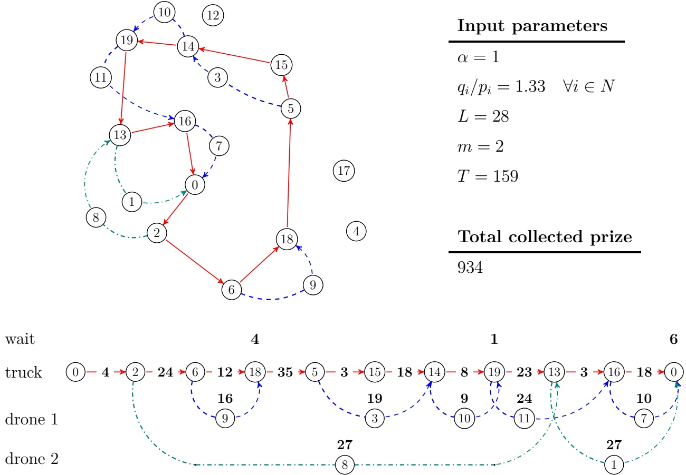
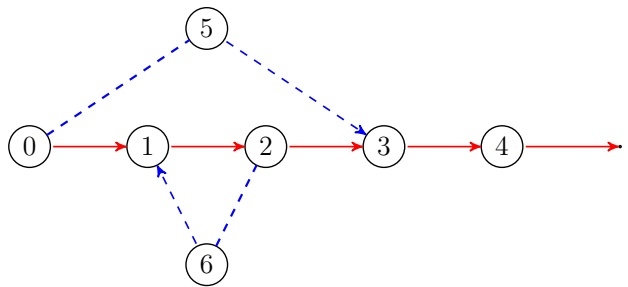
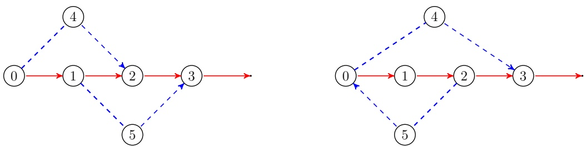
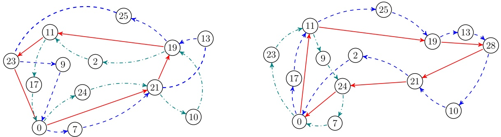
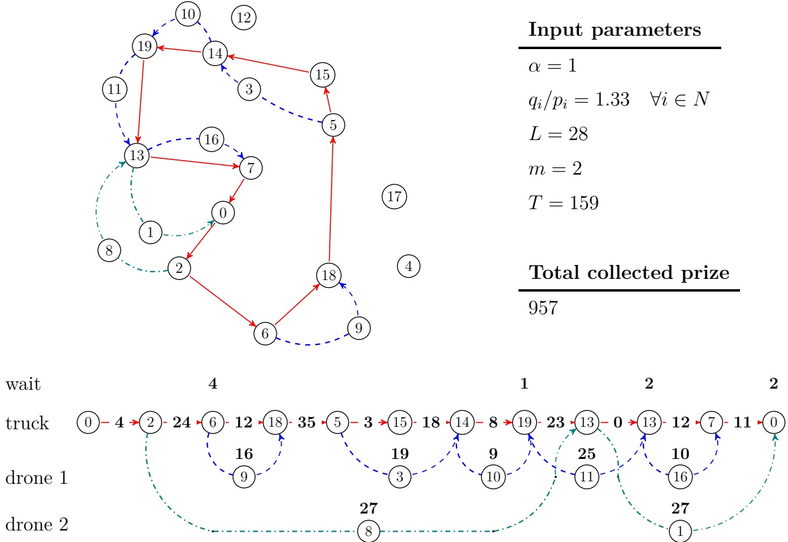

# The Orienteering Problem with drones

Nicola Morandi⋆, Roel Leus, Hande Yaman

Research Centre for Operations Research and Statistics, KU Leuven

⋆nicola.morandi@kuleuven.be

## Abstract

We extend the classical problem setting of the Orienteering Problem (OP) so as to incorporate multiple drones that cooperate with a truck to visit a subset of the input nodes. We call this problem the OP with multiple drones (OP-mD). Drones have a limited battery endurance, and thus, they can either move together with the truck at no energy cost for the battery, or be launched by the truck onto short flights, that must start and end at different customer locations. A drone serves exactly one customer per flight. Moreover, the truck and the drones must wait for each other at the landing locations. A customer prize can be collected at most once, either upon visiting it by the truck, or upon serving it by a drone. Similarly to the OP, we maximize the total collected prize, under the condition that the truck and the drones return to the depot within a given amount of time. We provide a mixed-integer linear programming formulation for the OP-mD, and devise a tailored branch-and-cut algorithm, based on a novel decomposition of the problem. We solve instances of the OP-mD with up to 50 nodes within one hour of CPU time, with a standard computational setup. Finally, we adapt our framework to solve closely-related problems in the literature, and compare the resulting computational performance with that of previous studies.

## 1 Introduction

We are, at the time of writing, in the middle of what Forbes refers to as the “Drone Explosion” (Forbes, 2022). From 2020 to 2022, drone technology saw an influx of \$5 billion worth of investments, which led to the development of hundreds of new prototypes. In the United States alone, relevant authorities report no fewer than 860 000 legally registered drones, 36% of which for commercial purposes (Federal Aviation Administration, 2022). The numerous applications of drones, most notably to logistics, surveillance, and disaster relief (Otto et al., 2018), have fostered a rapid development of the relevant scientific literature.

Given a directed graph with lengths on the arcs, the Flying Sidekick Traveling Salesman Problem (FSTSP, Murray and Chu, 2015) is the problem of finding routes for a truck and a drone so as to visit all the nodes in the minimum amount of time. The truck route must be a cycle that contains the depot, while the drone routes consist of a number of sorties, i.e., short flights, that contain precisely one customer. The drone can only be launched and retrieved by the truck at the nodes of the input graph, and the length of the sorties must not exceed a given battery endurance value. Upon landing, the battery of the drone gets swapped with a fully-charged one in a negligible amount of time. When not airborne, the drone travels in tandem with the truck at no energy cost for its battery.

In real-world applications, it is common for truck and drone operations to be limited by a budget on a relevant resource, which is usually time. For example, in last-mile delivery, a truck driver’s shift might be strictly regulated by contract or by law, implying that the truck and the drones should be back at the depot within a predetermined time period. Moreover, the truck could also be an electric vehicle whose battery needs to be periodically recharged at the depot. Additionally, to prevent noise pollution, city regulations might only allow drones to fly above urban areas for a limited amount of time per day. In surveillance applications, the truck and the drones might be dispatched to monitor the highest feasible number of targets only during the night. In search and rescue operations in the aftermath of a natural disaster, it might be more important to visit the highest number of potential rescue locations within the estimated survivable time than to find the fastest route through all of them.

The problem of routing a single vehicle under a budget constraint was addressed in the seminal work by Tsiligirides (1984), who introduced the Orienteering Problem (OP). In a graph with lengths on the arcs and prizes on the nodes, the OP seeks to find a cycle that contains the depot, whose total length does not exceed a given budget, and that maximizes the total prize of the nodes it visits. In this paper, we extend the problem setting of the OP so as to incorporate multiple drones that cooperate with a truck to visit the nodes, with analogous operative assumptions to those of the FSTSP. The total time it takes for the truck and the drones to complete their routes must not exceed a given budget. We maximize the total prize collected by serving the nodes, either by the truck or by a drone. To the best of our knowledge, no previous studies in the literature have tackled this problem, and we call it the Orienteering Problem with multiple drones (OP-mD). We propose a mixed-integer linear program (MILP) with exponentially-many constraints. We then devise a tailored branchand-cut framework for solving the OP-mD; by this algorithm, we solve instances with up to 50 nodes within one hour of CPU time. Finally, we adapt our formulation to solve the extension of the FSTSP to multiple drones, and validate our algorithm by comparing the results with relevant previous work in the literature.

The remaining part of this study is organized as follows. In Section 2, we give an overview of previous related work. We formally define the OP-mD in Section 3, and devise a branchand-cut method for solving it in Section 4. We provide a summary of our computational experiments in Section 5, and conclude with Section 6.

## 2 Related literature

The FSTSP was introduced by Murray and Chu (2015). The authors provided an MILP formulation, and solved the problem with heuristic methods. The high applicability of the FSTSP to logistics, surveillance and disaster relief fostered a remarkably fast growth of the related literature, as described, among many other extensive surveys, by Macrina, Pugliese, and Guerriero (2020), and Otto et al. (2018). Exact methods for solving FSTSP instances with up to 20 nodes began to emerge with the two-stage decomposition method by Yurek and Ozmutlu (2018). Considerable progress in the strength of the formulations for the FSTSP was made in Dell’Amico, Montemanni, and Novellani (2021b, 2022); the same authors also solved instances with up to 19 nodes within one hour of CPU time via a branch-and-bound algorithm (Dell’Amico, Montemanni, and Novellani, 2021a). More recently, Freitas, Penna, and Toffolo (2023) solved instances with up to 12 nodes and a time limit of half an hour via a novel mixed-integer programming (MIP) formulation for the FSTSP. Schermer, Moeini, and Wendt (2020) and El-Adle, Ghoniem, and Haouari (2021) solved instances with up 20 and 24 customers, respectively. Finally, Roberti and Ruthmair (2021) showed how a branchand-price algorithm can effectively solve large instances, i.e., with up to 39 nodes, within one hour of CPU time.

Numerous variants and extensions of the FSTSP appeared in the literature, such as, e.g., the FSTSP where sorties can serve multiple customers (Luo et al., 2019; González-R et al., 2020; Ha et al., 2021), the FSTSP with sorties having the same starting and ending locations (Vásquez, Angulo, and Klapp, 2021; Boccia et al., 2021a,b), and the FSTSP where the truck is also electric and needs to recharge periodically (Zhu, Boyles, and Unnikrishnan, 2022). The route of the truck is a cycle for most problem settings in the literature; there are exceptions, however, where revisiting a node is allowed (Agatz, Bouman, and Schmidt, 2018; Bouman, Agatz, and Schmidt, 2018; Tang, van Hoeve, and Shaw, 2019), and the truck route is a closed walk (Morandi et al., 2023). A natural extension of the FSTSP is to consider multiple drones, as in the problem settings of Seifried (2019), and Murray and Raj (2020). Dell’Amico, Montemanni, and Novellani (2021c) pointed out that multiple drones may give rise to a nested scheduling problem at customer locations. Jeong, Song, and Lee (2019), and Luo et al. (2021) studied the multiple drones variant where sorties can serve multiple customers. Finally, Cavani, Iori, and Roberti (2021) solved the FSTSP with multiple drones to optimality within two hours of CPU time via a branch-and-cut algorithm that was run on instances with up to 25 nodes.

The problem that we tackle in this paper is an extension of the OP, with analogous operative assumptions to those in the FSTSP literature. The OP was introduced decades ago by Tsiligirides (1984), who solved it via heuristic methods. Since then, numerous extensions have been proposed, e.g., the Team OP (TOP, with multiple vehicles on separate routes) and the OP with time windows. Exhaustive surveys on the OP and its variants were written, among many other ones, by Vansteenwegen, Souffriau, and Van Oudheusden (2011) and Gunawan, Lau, and Vansteenwegen (2016). The problem setting of the OP was recently extended so as to incorporate a single or multiple drones, without supporting ground vehicles. For example, the work by Bayliss et al. (2020) and Panadero et al. (2020) introduced variants of the TOP where the vehicles are drones, and solved them via (meta)heuristic methods. Similar problem settings were studied by Sundar, Sanjeevi, and Montez (2022) and Zhang et al. (2020), and solved via exact methods. Masmoudi et al. (2022) tackled a variant of the FSTSP with multiple trucks and multiple drones, and solved it via a metaheuristic method. In their problem, sorties can deliver multiple and heterogeneous packages to the customers, and the total profit is maximized; contrary to the OP, however, the total profit is computed as the difference between the revenue for delivering to the customers minus the routing costs. Finally, Zhang et al. (2021) proposed a column-generation-based heuristic method to solve a variant of the single-drone FSTSP, where sorties can visit multiple nodes, and profits are associated to both nodes and arcs of the instance; the aim is to find a cycle that maximizes the collected profit within a total assessment time. To the best of our knowledge, no previous work has solved this problem via exact methods.

## 3 Problem statement

In the OP-mD, a truck and multiple drones cooperate to collect the maximum amount of total prize from a given set N of customers. The truck travels along a cycle $C _ { f }$ that contains the depot $0 \in N$ and some of the customers in $N$ , the choice of which is part of the problem. We call these nodes visited. The drones are homogeneous, and equipped with a battery with a finite endurance L. They can travel together with the truck at no energy cost for the battery, or be launched onto airborne routes, which we hereafter refer to as sorties. A drone is launched onto a sortie by the truck operator, from a customer location in N, and later retrieved at a different customer location, when the truck visits it. Consequently, sorties with the same location for both takeoff and landing are not feasible; this restriction is in line with most of the existing work in the related literature. We show in Section 4.5 that these sorties can also be included by enlarging the input graph.

Between takeoff and landing, a drone serves one customer that is not part of the truck route $C _ { f }$ . For every $i \in N$ , prizes $p _ { i }$ and $q _ { i }$ can be collected if customer i is visited by the truck and served by a drone, respectively. The case where $q _ { i }   \leq   p _ { i }$ , for every $i   \in   N$ corresponds to, e.g., applications in disaster relief, where serving a node via a drone might lead to a smaller amount of humanitarian aid delivered. Conversely, the relation $q _ { i }   >   p _ { i }$ accurately models applications of drones to surveillance, where the elevation of the drones can offer a wider view on the targets.

At every visited customer location i in the cycle $C _ { f }$ , the truck must rendezvous with the drones that are planned to land there; when the truck and a drone do not arrive in i at the same time, they must wait for each other there, before continuing on their respective routes. The operation is complete when the truck and all the drones return to the depot. The completion time, i.e., the amount of time elapsed from the departure to the return to the depot, must not exceed a non-negative value $T$ , which is part of the input. In this work, we measure the completion time as the total travel time plus the total waiting time of the truck. As a consequence, we do not need to explicitly keep track of the waiting times of the drones. For this reason, in the remainder of this work, when we mention any waiting times, we implicitly refer to those of the truck.

An instance of the OP-mD is entirely defined by the sets and the parameters listed in Table 1. For any pair of distinct nodes $i , j \in N$ , the trajectories of the truck and a drone that travel directly from i to $j$ are not necessarily the same. Indeed, a drone typically travels in a straight line from i to $j ,$ while the truck must move within the given road network.

Input sets and parameters

N set of nodes, representing the customer and depot locations  
$0 \in N$ depot  
A set of arcs, representing couples of locations  
$G = (N, A)$ network of customer and depot locations  
$p_i \geq 0$ prize collected by visiting customer $i$, for all $i \in N \setminus \{0\}$  
$q_i \geq 0$ prize collected by serving customer $i$, for all $i \in N \setminus \{0\}$  
$\alpha &gt; 0$ speed of the drones  
$t_a \geq 0$ time to traverse arc $a$ by the truck, for all $a \in A$  
$t'_a \geq 0$ time to traverse arc $a$ by a drone, for all $a \in A$  
$L \geq 0$ maximum sortie length allowed by the battery  
$T \geq 0$ maximum completion time  
$m \geq 0$ number of available drones

Table 1: List of the parameters and sets that define an OP-mD instance.

As a result, the lengths of these trajectories might differ; we denote these lengths by the symbols $\ell _ { i j }$ and $\ell _ { i j } ^ { \prime }$ , for the truck and the drones, respectively, and for every pair of distinct nodes $i , j \in N$ . Moreover, we denote the time it takes to travel directly from i to $j$ by $t _ { i j }$ and $t _ { i j } ^ { \prime } .$ , for the truck and a drone, respectively. Without loss of generality, we assume that the truck travels at unit speed, and the drones travel at a given speed $\alpha > 0$ , which is part of the input. Accordingly, for every pair of distinct nodes $i , j \in N$ , it holds that $t _ { i j }   =   \ell _ { i j }$ and $t _ { i j } ^ { \prime } = \ell _ { i j } ^ { \prime } / \alpha$ . The distinction, for every arc $a \in A$ , between the drone traversal time $t _ { a } ^ { \prime }$ and length $\hat { \ell } _ { a } ^ { \prime }$ is functional to impose a maximum sortie length that does not depend on the parameter $\alpha .$ Additionally, in line with the related literature, we require that $t _ { i j } = t _ { j i }$ and $t _ { i j } ^ { \prime } = t _ { j i } ^ { \prime }$ , for every pair of distinct nodes $i , j \in N$

A feasible sortie is represented by a triple $( i , k , j )$ of distinct nodes $i , j , k$ in N that satisfies $\ell _ { ( i , k , j ) } ^ { \prime } : = \ell _ { i k } ^ { \prime } + \ell _ { k j } ^ { \prime } \leq L ;$ we call i and $j$ the starting and ending nodes of the sortie, respectively. We denote the set of the feasible sorties by H. For every sortie, we assume that takeoff and landing take place in a negligible amount of time. For applications where this is not the case, we can adjust the values $t _ { h } ^ { \prime }$ for every $h \in H$ accordingly (see, for example, Roberti and Ruthmair, 2021). If the truck arrives at the ending node of one or multiple sorties before any of the drones performing these sorties, then it waits for them there, and the waiting time of the truck is included in the total completion time. Conversely, if a sortie takes a shorter time to perform than the time it takes for the truck to travel from the starting to the ending nodes of the sortie, then the relevant drone must wait on the ground. This might give rise to security concerns, which can be addressed as follows. If the particular practical application that we consider already requires the drones to land at intermediate nodes of sorties, $\mathrm { e . g . }$ , to deliver a package, then we can let the drones wait there without exposing them to further security risks. Otherwise, by choosing a suitable value for $L ,$ we can keep a sufficient level of energy in the battery at the end of every sortie to operate the drone sensors and wireless connection until the truck arrives. This policy is not restrictive in the long term; in fact, preventing the drones from completely depleting their batteries is also desirable for extending the batteries’ durability.

We explicitly exclude solutions where two sorties serve the same nodes, or a node is visited by the truck and served by a drone. Indeed, we assume that a node prize can only be collected once, and thus, there always exists an optimal solution where a node is served at most once, and only if it is not visited.

A feasible solution for the OP-mD is uniquely identified by a triple of sets $( S _ { f } , C _ { f } , H _ { f } )$ such that

i. $S _ { f } \subseteq N$ is the subset of visited nodes (including the depot);

ii. $C _ { f } \subseteq A$ is the truck route, i.e., a directed simple cycle over the nodes in $S _ { f } ;$

iii. $H _ { f } \subseteq H$ is the set of performed sorties, i.e., a subset of feasible sorties that start and end at distinct nodes in $S _ { f }$ , and visit one node in $N \setminus S _ { f }$ The sorties do not overlap, i.e., for every node $k \in N \setminus S _ { f }$ , there is at most one sortie in $H _ { f }$ that serves $k$

The solution space $\mathcal { X }$ of the OP-mD is the set of all these triples. For every sortie $h \in H _ { f }$ the support of $h$ is the truck subroute that is traversed by the truck while the relevant drone flies along $h ;$ it includes the starting and ending nodes of $h$

We maximize the total collected prize:

$$
\max \left\{\sum_ {i \in S _ {f}} p _ {i} + \sum_ {h \in H _ {f}} q _ {h}: (S _ {f}, C _ {f}, H _ {f}) \in \mathcal {X} \right\},\tag{1}
$$

where, by a slight abuse of the notation, $q _ { h }$ denotes the prize collected by serving the unique node in the sortie $h \in H$ that is not in $S _ { f }$ . Figure 1 shows a feasible solution for an instance with 20 nodes. In the bottom part of the figure, a chart shows the route of the truck and the sorties of the drones, by connecting the relevant nodes via arcs that represent the direction of travel. All the numbers inside a node represent the corresponding node index; all the other numbers are in bold font and represent times. In particular, the numbers 4, 1, and 6 above the nodes 18, 19, and $0 ,$ respectively, represent the amount of time the truck waits for a drone to land at these nodes. The numbers on the truck route arcs represent the corresponding arc traversal times for the truck. Finally, the numbers above the nodes served by the drones, e.g., 16, 19, 9, etc., represent the drone flying times along the relevant sorties.

Notice that multiple sorties with the same landing location can be selected, provided that there are enough available drones to perform them. If at least one of the relevant drones arrives at the common landing location after the truck, then the truck must wait until the last of these drones lands there. In most problem settings in the literature, like the one in Cavani, Iori, and Roberti (2021), it is implicitly assumed that no drone can be launched from the previous landing location until the truck is ready to leave, i.e., until every drone that must land there is retrieved. In Appendix A.1, we discuss in detail why this restriction might lead to suboptimal solutions. In this work, we instead allow the drones that land at the same location to be dispatched as soon as they are available, and thus independently from the landing of the other drones. We refer to the policy of allowing the resulting solutions as independent waiting times policy, and we directly implement it in our formulation in Section 4.1.

Figure 1: A feasible solution for the instance poi-20-1 described in Section 5.1 and the input parameters shown on the right.

## 4 A branch-and-cut method

In this section, we describe our branch-and-cut method for solving the OP-mD. Our algorithm is based on the solution of the non-compact MILP model that we provide in Section 4.1. Contrary to the existing formulations in the literature, we impose a number of constraints on every directed path of the input digraph. Accordingly, this approach resorts to an exponential number of constraints; we describe these constraints in detail in Section 4.2, and provide a scheme for their separation in Section 4.3. Furthermore, to enhance the computational performance of the model, we identify valid, lifted, and symmetry-breaking inequalities in Section 4.4. Finally, in Section 4.5, we discuss how to adapt our framework to a number of extensions and variants of the OP-mD, which include the FSTSP with multiple drones. We describe how to derive a compact model for the OP-mD from an existing one in the FSTSP literature in Appendix A.2.

| Variable | Definition |  |
| --- | --- | --- |
| xa ∈ {0,1} | 1 if and only if arc a is part of the truck route | ∀a∈A |
| yi ∈ {0,1} | 1 if and only if node i is visited by the truck | ∀i∈N |
| zhd ∈ {0,1} | 1 if and only if drone d performs sortie h | ∀h∈H ∀d∈D |
| wid ≥ 0 | amount of time the truck waits for drone d to land at i | ∀i∈N ∀d∈D |
| Wi ≥ 0 | total amount of time the truck waits at i | ∀i∈N |

Table 2: Definition of the variables in model (2)-(17).

## 4.1 A non-compact MILP model

We provide an MILP model for the OP-mD, with the binary and continuous variables listed in Table 2. Similarly to the work by Dell’Amico, Montemanni, and Novellani (2022), the binary variables define the truck route and the sorties of the drones. Continuous variables, on the other hand, quantify the amount of time that the truck waits at a given location.

We enumerate the drones via an index $d   \in   D : = \{ 1 , \ldots , m \}$ . For all nodes $i   \in   N$ , we distinguish between the waiting time by the truck for a specific drone $d \in D$ that lands at $i ,$ and the total waiting time by the truck at i. This distinction is necessary to implement the independent waiting time policy described in Section 3 and in Appendix A.1.

In Table 3, we list all the abbreviations that, for ease of notation, we use in our MILP model. Similarly to the model proposed by Fischetti, Salazar González, and Toth (1998) for the OP, we only include feasible solutions where the truck route contains at least three arcs. Indeed, all the other feasible solutions necessarily require the truck to traverse a couple of arcs with the same endpoints, and such solutions can be enumerated in $O \big ( | N | ^ { 2 } \log | \tilde { N } | \big )$ time. In practice, these solutions can be enumerated in a negligible amount of CPU time when the parameters L and $T$ are set to values that are reasonable for practical applications, as we explain in Section 5.1.

The OP-mD can be formulated as follows.

$$
\max \sum_ {i \in N} p _ {i} y _ {i} + \sum_ {d \in D} \sum_ {h \in H} q _ {h} z _ {h} ^ {d}\tag{2}
$$

s.t.

$$
y _ {0} = 1\tag{3}
$$

$$
H _ {i..} := \{(i, k, j) \in H : j, k \in N \} \quad \forall i \in N
$$

$$
H _ {. k.} := \{(i, k, j) \in H : i, j \in N \} \quad \forall k \in N
$$

$$
H _ {.. j} := \{(i, k, j) \in H : i, k \in N \} \quad \forall j \in N
$$

$$
H _ {S..} := \cup_ {i \in S} H _ {i..} \quad \forall S \subseteq N
$$

$$
H _ {S k.} := H _ {S..} \cap H _ {. k.}
$$

$$
\forall k \in N \quad \forall S \subseteq N
$$

$$
(S, Q) := \{(i, j) \in A : i \in S, j \in Q \} \quad \forall S, Q \subseteq N
$$

$$
x (S, Q) := \sum_ {a \in (S, Q)} x _ {a} \quad \forall S, Q \subseteq N
$$

$$
y (S) := \sum_ {r \in S} y _ {r}
$$

$$
W (S) := \sum_ {r \in S} W _ {r}
$$

$$
z ^ {d} (H ^ {\prime}) := \sum_ {h \in H ^ {\prime}} z _ {h} ^ {d}
$$

$$
\forall H ^ {\prime} \subseteq H \forall d \in D
$$

$$
x (i, N) := x (\{i \}, N \setminus \{i \}) \quad \forall i \in N
$$

Table 3: Definition of the abbreviations used in model (2)-(17).

$$
x (i, N) = x (N, i) = y _ {i}
$$

∀i ∈ N (4)

$$
\sum_ {a \in A} \ell_ {a} x _ {a} + W (N) \leq T\tag{5}
$$

$$
x _ {i 0} + x _ {0 i} + \sum_ {d \in D} z ^ {d} (H _ {0 i.} \cup H _ {. i 0}) \leq 1
$$

$$
\forall i \in N \smallsetminus \{0 \}\tag{6}
$$

$$
z ^ {d} (H _ {i..}) \leq y _ {i}
$$

$$
\forall i \in N, \forall d \in D\tag{7}
$$

$$
\sum_ {d \in D} z ^ {d} (H _ {. k.}) + y _ {k} \leq 1
$$

$\forall k \in N$ (8)

$$
z ^ {d} (H _ {.. j}) \leq y _ {j}
$$

$$
\forall j \in N, \forall d \in D\tag{9}
$$

$$
x (N \smallsetminus S, S) \geq y _ {k} + \sum_ {d \in D} z ^ {d} (H _ {S k.} \cup H _ {. k S})
$$

$$
\forall S \subseteq N \setminus \{0 \}: | S | \in \{2, \dots , | N | - 2 \}, \forall k \in S\tag{10}
$$

$$
W _ {i} \geq w _ {i} ^ {d}
$$

$$
\forall i \in N, \forall d \in D\tag{11}
$$

$$
(\text {conditions on the feasible sorties})\tag{12}
$$

$$
x _ {a} \in \{0, 1 \}
$$

$\forall a \in A$ (13)

$$
y _ {i} \in \{0, 1 \}
$$

∀i ∈ N (14)

$$
z _ {h} ^ {d} \in \{0, 1 \}
$$

$$
\forall h \in H, \forall d \in D\tag{15}
$$

$$
w _ {i} ^ {d} \geq 0
$$

∀i ∈ N, ∀d ∈ D (16)

$$
W _ {i} \geq 0
$$

$\forall i \in N$ (17)

The objective function (2) maximizes the total collected prize, as defined in formula (1). Constraints (3)-(6) are a straightforward adaptation to the OP-mD of the constraints for the OP by Fischetti, Salazar González, and Toth (1998). In particular, constraint (3) imposes that the truck route contains the depot. Constraints (4) impose that if a node $i   \in   N$ is visited by the truck, then there are exactly one incoming and one outgoing arc in and from i, respectively. Constraint (5) imposes that the completion time does not exceed the given time threshold T. In line with our assumption that at least two non-depot nodes are visited, constraints (6) impose that the arcs $( 0 , i )$ and $( i , 0 )$ are never in the same truck route, for every non-depot node $i   \in   N \setminus \{ 0 \}$ ; the left-hand side of these constraints is lifted with the z variables corresponding to sorties that require a drone to fly along the same two arcs. Constraints (7)-(9) require a solution sortie to start and end at visited nodes only. Moreover, a node $k \in N$ cannot be at the same time visited by the truck and served by a drone, nor served by multiple drones. These constraints already appeared in an analogous form in, among other ones, Dell’Amico, Montemanni, and Novellani (2022). Constraints (10) impose connectivity. Indeed, let k and S be a node and a subset like in constraints (10), respectively. Notice that, by constraints (8), the right-hand side of constraints (10) is never higher than one. If no drone serves node k via any sortie that either starts or ends at a node in $S ,$ then the quantity $\begin{array} { r } { \sum _ { d \in D } z ^ { d } ( H _ { S , k , . } \cup H _ { . , k , S } )   =   0 } \end{array}$ , and the constraints reduce to standard connectivity constraints. Otherwise, there must be another node $k _ { 0 } \in S$ that is visited by the truck, and hence the left-hand side of constraints (10) is correctly constrained to be greater than or equal to one, by connectivity. Constraints (10) dominate standard connectivity constraints, and in analogous forms, have already been introduced in the routing literature (see, for example, Labbé et al., 2004; Ozbaygin, Yaman, and Ekin Karasan, 2016; Morandi, Leus, and Yaman, 2022). At any location $i   \in   N$ in the truck route, the truck must wait for all the drones that land there; constraints (11) impose that the total waiting time at node i is not shorter than that exclusively due to drone $d ,$ for every $d \in D$ . To correctly define our solution space, further constraints on the feasible sorties need to be imposed. These constraints, however, require a number of intermediate results. Thus, for sake of clarity, we group all these constraints together in the generic constraints (12), and describe them in detail in Section 4.2.

## 4.2 Conditions on the sorties

In this section, we explicitly describe the constraints that we bundled together in constraint (12), and we prove that they correctly define our solution space. In particular, we identify a linear expression involving the variables x and $y ,$ and make use of its properties to impose constraints on every directed path of the input subgraph. For every subset $U \subseteq A$ of arcs in $A ,$ we define the notation $x ^ { - 1 } ( U )   : =   \{ a \in U \; : \; x _ { a } = 1 \}$ , and analogously $y ^ { - 1 } ( S ) : = \{ i \in S \; : \; y _ { i } = 1 \}$ , for every subset $S \subseteq N$ of nodes.

**Lemma 4.1.** Let $( x , y , z , w , W )$ be a feasible solution to the OP-mD. Then, for every subset $S \subseteq N$ , and every pair of distinct nodes $i , j \in S$ , it holds that

$$
x (S \setminus \{j \}, S \setminus \{i \}) \leq 1 + y (S \setminus \{i, j \}).\tag{18}
$$

Moreover, inequality (18) is satisfied with equality if and only if the subset of arcs

$$
\{(j, i) \} \cup x ^ {- 1} (S \setminus \{j \}, S \setminus \{i \})\tag{19}
$$

is a directed cycle over the subset of nodes

$$
\{i, j \} \cup y ^ {- 1} (S \setminus \{i, j \}).\tag{20}
$$

Proof. We prove Lemma 4.1 by the following four steps. For all $S   \subseteq   N$ and all pairs of distinct nodes $i , j \in S$ , we want to show that

i. inequality (18) holds;

ii. if the subset of arcs $\{ ( j , i ) \} \; \cup \; x ^ { - 1 } ( S \setminus \{ j \}   , S \setminus \{ i \} )$ is a directed cycle over the node subset $\{ i , j \} \cup y ^ { - 1 } ( S \setminus \{ i , j \} )$ , then inequality (18) holds with equality;

iii. if inequality (18) holds with equality and $y _ { i } = y _ { j } = 1$ , then the subset of arcs $\{ ( j , i ) \} \; \cup \; x ^ { - 1 } ( S \setminus \{ j \}   , S \setminus \{ i \} )$ is a directed cycle over $y ^ { - 1 } ( S )$

iv. if inequality (18) holds with equality, then $y _ { i } = y _ { j } = 1$

The proof of step (ii.) is trivial, and for sake of brevity, is omitted. Proof of (i.) If $y _ { i } = y _ { j } = 0$ , then inequality (18) reduces to

$$
x (S \smallsetminus \{i, j \}, S \smallsetminus \{i, j \}) \leq 1 + y (S \smallsetminus \{i, j \}),\tag{21}
$$

which is satisfied because of constraints (4) and (10). Otherwise, at least one of the nodes $i$ and $j$ is visited. Suppose then by contradiction that inequality (18) is not satisfied. Then, the following chain of inequalities must instead be satisfied:

$$
x (S, S) \geq x (S \setminus \{j \}, S \setminus \{i \}) \geq 2 + y (S \setminus \{i, j \}) \geq y (S),\tag{22}
$$

which implies that $x ( S , S ) = y ( S )$ , and consequently, that the equation

$$
x (S, S) = x (S \setminus \{j \}, S \setminus \{i \}) = y (S)\tag{23}
$$

holds. Therefore, the subset of arcs $x ^ { - 1 } ( S , S ) = x ^ { - 1 } ( S \setminus \left\{ j \right\} , S \setminus \left\{ i \right\} )$ contains a cycle that visits at least one node between $i$ and $j ,$ which is a contradiction, because there are no arcs going out from $j$ nor incoming in i in the subset $( S \setminus \{ j \}   , S \setminus \{ i \} )$

Proof of $( i i i . )$ The subset of arcs $\{ ( j , i ) \} \; \cup \; x ^ { - 1 } ( S \setminus \{ j \}   , S \setminus \{ i \} )$ , being a subset of (S, S), is $\mathbf { a }$ directed cycle over the nodes in $y ^ { - 1 } ( S )$ if and only if the following inequality is satisfied:

$$
1 + x (S \setminus \{j \}, S \setminus \{i \}) = y (S),\tag{24}
$$

which is equivalent to inequality (18) with equality, when both i and $j$ are visited.

Proof of $( i v . )$ Suppose by contradiction that $y _ { i } = 0$ . Then, inequality (18) reduces to:

$$
x (S \setminus \{j \}, S) = 1 + y (S \setminus \{j \}).\tag{25}
$$

If $y _ { j } = 1$ , then the left-hand side of the equation above is equal to $y ( S )$ , and thus, the subset of arcs $( S \setminus \left\{ j \right\} , S )$ must contain a cycle that visits j, which is a contradiction. On the other hand, if $y _ { j } = 0$ , then inequality (18) further reduces to $x ( S , S ) = 1   +   y ( S )$ , which contradicts constraints (4) and (10). □

To simplify the notation, for every subset $S \subseteq N$ and every pair of distinct nodes $i , j \in S$ we define

$$
\Delta_ {i j} ^ {S} := 1 + y (S \setminus \{i, j \}) - x (S \setminus \{j \}, S \setminus \{i \}).\tag{26}
$$

Notice that, by Lemma 4.1, $\Delta _ { i j } ^ { S } \geq 0$ for every $S \subseteq N$ and every pair of distinct nodes $i , j \in S$ We summarize the implications of Lemma 4.1 for the OP-mD in the following result.

**Proposition 4.1.** For every subset $S \subseteq N$ and every pair of distinct nodes $i , j   \in   S$ , the following three conditions are equivalent.

i. If a drone $d \in D$ performs a sortie $h \in H _ { i . j }$ , then the support of h is the truck subroute identified by the visited nodes in S and the arcs in $x ^ { - 1 } ( S \setminus \{ j \}   , S \setminus \{ i \} )$ ;

ii. the subset of arcs $\{ ( j , i ) \} \cup x ^ { - 1 } ( S \setminus \{ j \}   , S \setminus \{ i \} )$ is a directed cycle over the nodes contained in $\{ i , j \} \cup y ^ { - 1 } ( S \setminus \{ i , j \} )$

iii. $\Delta _ { i j } ^ { S } = 0 .$

The equivalence between conditions (i.) and (ii.) follows immediately from the definition of the support of a sortie. Conditions (ii.) and (iii.) are equivalent by Lemma 4.1. By Proposition 4.1, equation (26) provides a linear combination of the x and y variables whose value indicates whether a subset $S \subseteq N$ can be the support of a sortie or not.

**Corollary 4.1.** For every node $j \in N$ , let $M _ { j } : = \operatorname* { m a x } \{ t _ { h } ^ { \prime } \; : \; h \in H _ { S , N \setminus S , j } \}$ , and consider the following constraints.

$$
W (S \setminus \{j \}) + w _ {j} ^ {d} - w _ {i} ^ {d} + \sum_ {a \in (S \setminus \{j \}, S \setminus \{i \})} t _ {a} x _ {a} \geq \sum_ {h \in H _ {S, N \setminus S, j}} t _ {h} ^ {\prime} z _ {h} ^ {d} - M _ {j} \Delta_ {i j} ^ {S}\tag{27a}
$$

$$
\forall S \subset N: | S | \in \{2, \dots , | N | - 1 \}, \forall i, j \in S: i \neq j, i \neq 0, \forall d \in D
$$

$$
W (S \setminus \{0, j \}) + w _ {j} ^ {d} + \sum_ {a \in (S \setminus \{j \}, S \setminus \{0 \})} t _ {a} x _ {a} \geq \sum_ {h \in H _ {S, N \setminus S, j}} t _ {h} ^ {\prime} z _ {h} ^ {d} - M _ {j} \Delta_ {0 j} ^ {S}\tag{27b}
$$

$$
\forall S \subset N: | S | \in \{2, \dots , | N | - 1 \}, 0 \in S, \forall j \in S \setminus \{0 \}, \forall d \in D
$$

For every drone $d \in D$ , every subset $S   \subseteq   N$ , and every pair of distinct nodes $i , j   \in   N$ constraints (27a) impose that if S contains the support of any solution sortie in $H _ { i , j }$ performed by drone $d ,$ then the corresponding waiting time $w _ { j } ^ { d }$ is not lower than the difference of the travel times between the truck and drone d. Constraints (27b) refer to the analogous case where $i = 0$

Figure 2: Example of solution eliminated by constraints (28).

Proof. We prove the statement for constraints (27a), i.e., for the case where $i   \neq   0 ;$ the proof is analogous for constraints (27b). Notice that the left-hand side of constraints (27a) is never negative. Indeed, it incorporates the term $W _ { i } - w _ { i } ^ { d }$ , which is always non-negative because of constraints (11). Hence, constraints (27a) are not implied only if $\Delta _ { i j } ^ { S } = 0$ and $z ^ { d } ( H _ { S , N \setminus S , j } ) = 1$ . If $z ^ { d } ( H _ { i , N \setminus S , j } ) = 1$ , Proposition 4.1 implies that $S$ contains the support of a sortie that start in i and ends in $j .$ Thus, constraints (27a) imply that the waiting time for drone d at the ending node $j$ must be high enough to compensate for the difference in travel times between the truck and drone $d ,$ including the time the truck waits at intermediate nodes in $S \setminus \{ i , j \}$ . If, on the other hand, $z ^ { d } \Big ( H _ { S \setminus \{ i \} , N \setminus S , j } \Big )   =   1$ , i.e., the selected sortie in $H _ { S , N \setminus S , j }$ starts at a certain node $i _ { 0 } \in S \setminus \{ i \}$ , then the relevant constraint (27a) is implied by the constraint (27a) corresponding to $i _ { 0 } , \; j$ , and the subset of nodes in the truck route from $i _ { 0 }$ to $j$

The additional term $W _ { i } - w _ { i } ^ { d }$ on the left-hand side of constraints (27a) accounts for the possibility for drone $d$ to start the sortie before the truck leaves node $i ,$ according to the waiting time policy described in Section 5. □

The truck visits the depot before and after every other visited node. Therefore, there cannot be sorties with non-depot starting and ending nodes, and whose supports contain the depot. Indeed, if these sorties would be selected, then the truck would visit their ending node before their starting node.

**Corollary 4.2.** By the following constraints, a sortie is not selected if its starting and ending nodes are not the depot, and its support contains the depot.

$$
z ^ {d} (H _ {i. j}) \leq \Delta_ {i j} ^ {S}
$$

$$
\forall S \subset N : 0 \in S,   \forall i, j \in S \setminus \{0 \} : i \neq j,   \forall d \in D\tag{28}
$$

Proof. Constraints (28) are implied if their right-hand side is nonzero. On the other hand, when their right-hand side is zero and their left-hand side is not, Proposition 4.1 implies that the visited nodes in $S$ are in the support of a selected sortie that starts in $i \neq 0$ and ends in $j \neq 0$ . Because the support contains the depot, the truck must visit $j$ before $i ,$ so constraints (28) correctly eliminate the relevant solutions. □

Figure 2 shows a solution that is made infeasible by constraints (28). In particular, sortie (2, 6, 1) does not start nor end at the depot, but its support contains it.

Figure 3: Comparison between two solutions with incompatible sorties.

We say that two solution sorties are incompatible if and only if they are performed by the same drone, and their supports have arcs in common, i.e., if they would in practice require a drone to fly simultaneously along both of them. We prevent incompatible sorties from being selected in the same solution via two sets of constraints, which tackle two distinct types of incompatible sorties, respectively.

**Proposition 4.2.** The following constraints prevent any two incompatible sorties from being selected in the same solution, if at least one of them does not land in, or take off from the depot.

$$
z ^ {d} (H _ {S,.., N \setminus S}) \leq x (S, N \setminus S)
$$

$$
\forall S \subset N : | S | \in \{2, \dots , | N | - 1 \}, \forall d \in D\tag{29}
$$

Proof. We first prove that constraints (29) are satisfied by every feasible solution. Let $n$ be the number of selected sorties in $H _ { S , . , N \smallsetminus S }$ . Then, by constraints (7) and (9), there must exist distinct nodes $a _ { 1 } , \ldots , a _ { n } \in S$ and $b _ { 1 } , \ldots , b _ { n } \in N \smallsetminus S$ that represent the starting and ending nodes of these sorties, respectively. Then, by constraints (10), there must be a connected subroute of the truck from $a _ { k }$ to $b _ { k }$ , for all $k = 1 , \ldots , n$ . So constraints (29) are satisfied by all the feasible solutions.

Suppose that two distinct sorties $h _ { 1 } , h _ { 2 } \in H$ are not both in $H _ { . . 0 } \cup H _ { 0 }$ and are simultaneous. We call its starting and ending nodes $a _ { 1 } , a _ { 2 }$ and $b _ { 1 } , b _ { 2 }$ , respectively. Because of constraints $( 7 )$ and $(9), $a _ { 1 } \neq a _ { 2 }$$ and $b _ { 1 } \neq b _ { 2 }$ . Without loss of generality then, we suppose that the truck visits $a _ { 1 }$ before $a _ { 2 }$ . Since the sorties are simultaneous, $a _ { 2 }$ must be contained in the support of sortie $h _ { 1 }$ , that goes from $a _ { 1 }$ to $b _ { 1 }$ . We call $S$ the subset of nodes in the support of $h _ { 1 }$ that are visited by the truck after (and including) $a _ { 1 }$ and before (and including) $a _ { 2 }$ . If $b _ { 2 } \in S$ , by hypothesis we can exclude that $a _ { 1 } = b _ { 2 } = 0 ;$ in all the other cases, constraints (28) prevent $h _ { 1 }$ and $h _ { 2 }$ from being selected at the same time. Finally, if $b _ { 2 } \notin S$ , then there is only one arc outgoing from $S ,$ but $h _ { 1 } , h _ { 2 } \in H _ { S , . , N \smallsetminus S } ;$ thus, the constraint (29) corresponding to $S$ prevents $h _ { 1 }$ and $h _ { 2 }$ from being selected at the same time. □

Figure 3 shows two solutions with incompatible sorties; only the solution shown on the left, by the choice of the appropriate subset $S = \{ 0 , 1 \}$ , can be eliminated via constraints (29). It is not straightforward to adapt constraints (29) to couples of incompatible sorties $( h _ { 1 } , h _ { 2 } )$ such that $h _ { 1 } \in H _ { . . 0 }$ and $h _ { 2 }   \in   H _ { 0 } _ { 1 }$ .. Although, we can apply Proposition 4.1 to selectively eliminate solutions where these couples are selected.

**Corollary 4.3.** The following constraints prevent any two incompatible sorties $h _ { 1 }   \in   H _ { \cdot \cdot }$ 0 and $h _ { 2 } \in H _ { 0 } ,$ . from being part of the same solution.

$$
z ^ {d} \left(H _ {0. j}\right) + z ^ {d} \left(H _ {S \setminus \{0, j \}. 0}\right) \leq 1 + \Delta_ {0 j} ^ {S} \quad \forall S \subset N: 0 \in S, \forall j \in S \setminus \{0 \}, \forall d \in D\tag{30}
$$

This result follows from Proposition 4.1, in an analogous way to Corollary 4.2. Our MILP formulation for the OP-mD is thus explicitly given by model (2)-(17), with constraint (12) replaced by constraints (27)-(30).

## 4.3 Separation scheme

We solve the OP-mD exactly, via a branch-and-cut algorithm based on model (2)-(17). Constraints (10) and (27)-(30) are exponentially many, and it is not computationally viable to keep all of them in the model from the start of the solution process. Thus, we iteratively find the necessary cuts to add via the following separation scheme:

i. **Fractional solutions.** Similarly to Fischetti, Salazar González, and Toth (1998) and Ozbaygin, Yaman, and Ekin Karasan (2016), we construct the support graph Γ made by all the nodes $i \in N$ and the arcs $a   \in   A$ such that $y _ { i } \; > \; 0$ and $x _ { a } \; > \; 0$ respectively. If Γ is disconnected, then, for every connected component S that does not contain the depot, and for every node $k \in S$ , we add the corresponding constraint (10). Moreover, we add a further constraint (10) corresponding to the union of the connected components that do not contain the depot, and to every node contained therein. This separation of constraint (10) is not exact.

ii. **Integer solutions.** We construct the support graph Γ like in step (i.) above. If Γ is disconnected, we add constraints (10) as above. Otherwise, for every drone $d \in D$ and for every sortie $h \in H$ , if h is performed by drone $d ,$ then we check by inspection whether, in this order, constraints (30), (29), (28), and (27) are violated.

The pseudocode of this separation scheme can be found in Algorithm 1.

## 4.4 Strengthening the model

We strengthen model (2)-(17) by adding valid, lifted, and symmetry-breaking inequalities. For example, as noted by Vásquez, Angulo, and Klapp (2021) and Cavani, Iori, and Roberti (2021) in an analogous setting, by inverting the order of visit for the nodes in the truck route, we always obtain a symmetric solution; to break the resulting symmetry, we choose one of the two senses of traversal of the truck route. Assuming that the set of node indices is of the form $N = \{ 1 , \ldots , | N | \}$ , we impose that

$$
\sum_ {i \in N \setminus \{0 \}} i \cdot x _ {0 i} + 1 \leq \sum_ {i \in N \setminus \{0 \}} i \cdot x _ {i 0}.\tag{31}
$$

Moreover, any permutation of the drone indices leads to an equivalent solution space. We break part of the symmetry by imposing that the total flying time for every drone cannot increase as its index increases:

Algorithm 1: Separation scheme for constraints (10) and (27)-(30)
    Data: solution vectors $x, y, z, w, W$
    construct the support graph $\Gamma$;
    construct the family $\mathcal{F}$ of the connected components of $\Gamma$;
    if $|\mathcal{F}| \geq 2$ then
        $S_0 \leftarrow \emptyset$;
        for $S \in \mathcal{F}, 0 \notin S$ do
            for $k \in S$ do
                add constraint (10) corresponding to $S$ and $k$;
                $S_0 \leftarrow S_0 \cup S$;
        for $k \in S_0$ do
            add constraint (10) corresponding to $S_0$ and $k$;
    else
        if $x, y, z$ are integral then
            for $d \in D$ do
                for $(i, k, j) \in H$ do
                    if $z_{(i,k,j)}^d = 1$ then
                        $S \leftarrow$ nodes in the support of sortie $(i, k, j)$;
                        for $r \in S \setminus \{i, j\}$ do
                            for $h' \in H_{r..}$ do
                                if $z_{h'}^d = 1$ then
                                    if $h' \in H_{r.0}$ and $i = 0$ then
                                    add constraint (30) corresponding to $d, S$, and $j$;
                                    add constraint (29) corresponding to $d$ and $S$;
                                if $i \neq 0, j \neq 0$, and $0 \in S$ then
                                    add constraint (28) corresponding to $i, j$, and $S$;
                                if constraint (27) is violated then
                                    add constraint (27) corresponding to $d, i, j$, and $S$;
    return;

$$
\sum_ {h \in H} t _ {h} ^ {\prime} z _ {h} ^ {d} \leq \sum_ {h \in H} t _ {h} ^ {\prime} z _ {h} ^ {d + 1},\tag{32}
$$

for every drone $d \in \{ 1 , \ldots , m - 1 \}$ . For the case $d = m$ , we can impose an upper bound on the left-hand side as follows (see, for example, Roberti and Ruthmair, 2021):

$$
\sum_ {h \in H} t _ {h} ^ {\prime} z _ {h} ^ {m} \leq \sum_ {a \in A} t _ {a} x _ {a} + W (N).\tag{33}
$$

Finally, constraint (5) might be satisfied by an optimal solution with a nonzero slack. As it happens for the OP, the maximum total prize could be collected by a truck route that is not the shortest cycle over the visited nodes. Moreover, in the OP-mD, we might observe optimal solutions where the truck waiting times are larger than the feasible minimum, which is required to wait for the drones. This type of solutions is undesirable from the practical point of view. Without loss of generality, we can prevent the truck from waiting when it is not necessary: for every drone $d \in D$ and every node $j \in N$

$$
w _ {j} ^ {d} \leq \sum_ {(i, k, j) \in H.. j} \left(t _ {(i, k, j)} ^ {\prime} - t _ {i j}\right) ^ {+} \cdot z _ {i k j} ^ {d},\tag{34}
$$

and, for every node $j \in N$

$$
W _ {j} \leq \sum_ {d \in D} w _ {j} ^ {d}.\tag{35}
$$

In the remainder of this section, we describe polynomially-many inequalities that can be used to reduce the number of constraints to add during the solution process. For example, by the following proposition, we eliminate solutions where the truck traverses an arc $( i , j )$ in the subset of arcs $\left( N \setminus \left\{ 0 \right\} , N \setminus \left\{ 0 \right\} \right)$ , while a sortie in $H _ { j . i }$ is performed. These solutions would also be eliminated by constraints (28); we observe, however, that it is computationally beneficial to reduce the number of cuts (28) added during the solution process.

**Proposition 4.3.** For every $d _ { 0 } \in D ,   i \in N \setminus \{ 0 \}$ , and $j \in N \setminus \{ 0 , i \}$ such that $H _ { j . i } \neq \emptyset$ the following inequality is valid.

$$
x _ {i j} + \sum_ {d \in D} z ^ {d} (H _ {i j.} \cup H _ {. j i}) + z ^ {d _ {0}} (H _ {j. i}) \leq y _ {i}\tag{36}
$$

Proof. If $y _ { i } = 0$ , then constraints (36) are implied; we can then assume that $y _ { i } = 1$ . Furthermore, if $z ^ { d _ { 0 } } ( H _ { j . i } ) = 0$ , then constraints (36) are implied by the constraints (10) corresponding to $S = \{ i , j \}$ . Finally, if $z ^ { d _ { 0 } } ( H _ { j . i } ) = 1$ , then selecting the arc $( i , j )$ would be infeasible because of constraints (28). Moreover, j would be visited, and thus, no sortie in $H _ { i j . } \cup H _ { . j i }$ can be performed. □

For $i \in N \setminus \{ 0 \}$ , if arc $( i , 0 )$ is the last arc of the truck route, then no drone can take off at i to land in a location different than the depot.

**Proposition 4.4.** For every node $i \; \in \; N \setminus \{ 0 \}$ and every drone $d   \in   D$ , the following inequalities are valid.

$$
x _ {i 0} + z ^ {d} \left(H _ {i,.., N \setminus \{0, i \}}\right) \leq y _ {i}\tag{37}
$$

$$
x _ {0 i} + z ^ {d} \Big (H _ {N \setminus \{0, i \},.., i} \Big) \leq y _ {i}\tag{38}
$$

Proof. If $y _ { i } \; = \; 0$ , then constraints (37) are implied. Moreover, if arc (i, 0) and a sortie $h \in H _ { i , . , N \setminus \{ 0 , i \} }$ were selected, then the support of h would have to contain the depot. An analogous argument applies to inequalities (38). □

Constraints (27) are exponentially-many big-M constraints. Preliminary computational results have shown that most of the constraints (27) that we add in the solution process correspond to subsets $S   \subseteq   N$ containing just two nodes. To improve our computational results, we add constraints that dominate the constraints (27) with $| S | = 2$

**Proposition 4.5.** For every pair of distinct non-depot nodes $i , j \in N   \setminus   \{ 0 \}$ , let the constant $M _ { i j } = \operatorname { m a x } _ { h \in H _ { i . j } } \left\{ \left( t _ { h } ^ { \prime } - t _ { i j } \right) ^ { + } \right\}$ . For every drone $d \in D$ , the following inequality holds.

$$
w _ {j} ^ {d} + W _ {i} - w _ {i} ^ {d} \geq M _ {i j} \cdot \left(x _ {i j} + x _ {j i} - y _ {j} + z ^ {d} (H _ {j i.} \cup H _ {. i j})\right) + \sum_ {h \in H _ {i. j}} (t _ {h} ^ {\prime} - t _ {i j}) ^ {+} \cdot z _ {h} ^ {d}\tag{39}
$$

Proof. Notice that, by the constraints (10) that correspond to $S \; = \; \{ i , j \}$ , the quantity $x _ { i j } + x _ { j i } - y _ { j } + z ^ { d } ( H _ { j i . } \cup H _ { . i j } ) \leq 0$ . Thus, if $z ^ { d } ( H _ { i . j } ) = 0$ , constraints (39) are implied. As a consequence, we can assume that there exists a node $k \neq i , j$ such that $z _ { i k j } ^ { d } = 1$ . Therefore, $y _ { j } = 1$ and $z ^ { d } ( H _ { j i . } \cup H _ { . i j } ) = 0$ . If the equation $x _ { i j } + x _ { j i } = 0$ holds, then the right-hand side of constraints (39) is smaller than zero, and they are implied. Otherwise, the right-hand reduces to the inequality $w _ { j } ^ { d } + W _ { i } - w _ { i } ^ { d } \geq t _ { ( i , k , j ) } ^ { \prime } - t _ { i j }$ □

## 4.5 Flexibility of our branch-and-cut framework

In this section, we briefly discuss how to adapt our branch-and-cut framework to a number of extensions and variants of the OP-mD from the literature.

**FSTSP with multiple drones.** The differences between the OP-mD and the FSTSP can be summarized as follows. In the FSTSP, only a single drone is available, and there is no upper bound on the completion time; instead, the completion time is minimized, and, contrary to the OP-mD, the input does not include any node prizes. Our branch-and-cut algorithm can be easily adapted to solve the FSTSP with multiple drones. We relax constraint (5), and set its left-hand side as a minimization objective. We further remove constraints (34) and (35), which would act as rather inefficient optimality cuts for the FSTSP. As described in Section 3, our problem setting incorporates the independent waiting policy for the drones that land at the same location. Thus, by adapting our framework to the FSTSP with multiple drones, we are effectively tackling a variant of the problem described by Cavani, Iori, and Roberti (2021). Nevertheless, to the best of our knowledge, the work by Cavani, Iori, and Roberti (2021) reported the solution times of the largest solved instances of the FSTSP with multiple drones in the literature. Thus, in Section 5, we validate our branchand-cut framework by adapting it to the FSTSP with multiple drones, and by comparing our computational results with those by Cavani, Iori, and Roberti (2021).

**Sorties that serve multiple customers.** In the problem setting defined in Zhang et al. (2021), sorties that can serve multiple customers are feasible, and the drones collect a prize also for the arcs they traverse while airborne. Sorties with multiple customers can be incorporated in our model, by expanding the set H of feasible sorties so as to include tuples of nodes in N. This approach, however, is of practical use only when the value of the input parameter L is sufficiently low, to guarantee that the resulting size of H can be effectively handled by the solver. In the opposite case, a more natural approach would be to resort to a branch-and-price-and-cut algorithm, with analogous cuts, and where every column corresponds to a feasible sortie. Finally, prizes on the arcs traversed by a drone can easily be incorporated in the total prize $q _ { h }$ collected by a sortie $h \in H$ , by summing them to the prizes for serving the nodes in h.

**Node revisits and loop sorties.** By imposing that the truck route be a cycle, we prevent the truck from visiting the same nodes more than once. This restriction is also im plicitly imposed, for example, by Zhang et al. (2021), in their subtour-elimination constraints. Even if a node prize is never collected more than once upon revisiting, this restriction can lead to suboptimal solutions, as proven by the examples provided in Agatz, Bouman, and Schmidt (2018) and in Morandi et al. (2023). Indeed, if we allow the truck to visit the same node multiple times or to travel along a closed walk, then there exist instances that only admit optimal solutions where certain nodes are visited multiple times, or certain arcs are traversed multiple times by the truck. A natural way to extend the OP-mD so as to incorporate closed walks is to consider several copies of every node. In this case, it is important to define whether a node or an arc prize is collected only upon first serving or traversing it, or every time the truck does so. This approach can also model loop sorties, i.e., feasible sorties with the same node as both starting and ending location. Considering multiple copies of the same nodes, however, increases the size of the underlying digraph very rapidly; finding efficient methods for these comparatively large digraphs is outside the scope of this study, and we do not explore the approach further.

**Incompatibility between a node and the truck or the drones.** A node might not be suitable for a visit by the truck. For example, it might represent a narrow passage or crossing that prevents the truck from physically being present at the node, and from traversing any of the arcs adjacent to it. Similarly, in the aftermath of a natural disaster, a node might not be safe to reach for a human operator. Following the notation by Morandi et al. (2023), who considered analogous operative restrictions, we denote the set of the nodes that can be reached by the truck by $N ^ { t r } \subseteq N$ By adding the following constraints to model (2)-(17), we prevent the truck route from visiting any of the nodes in $N \setminus N ^ { t r }$ where the truck is not allowed:

$$
y _ {i} = 0
$$

$$
\forall i \in N \smallsetminus N ^ {t r}.\tag{40}
$$

Analogously, as noted by, among others, Roberti and Ruthmair (2021) and Cavani, Iori, and Roberti (2021), a drone might not be suitable to visit a certain node. For example, the parcel to be delivered at the node might be too heavy for any drone to carry, or the node could lie in a no-fly zone over the urban area of a city, or the node service requires human intervention. For all these cases, we need to prevent the drones from performing a sortie that visits one of the relevant nodes. We denote the nodes that can be served by a drone by $N ^ { d r } \subseteq N$ , and we replace the set H by the set $H ^ { \prime }$ of the feasible sorties that do not serve any node in $N \setminus N ^ { d r }$ in the model (2)-(17). In particular,

$$
H ^ {\prime} = H \setminus \left(\cup_ {k \in N \setminus N ^ {d r}} H _ {. k.}\right).\tag{41}
$$

Contrary to what a similar variant of the FSTSP might require, if no drone can serve a certain node, then the truck does not necessarily have to visit it. Notice that, to ensure the feasibility of our model, it must always hold that $0   \in   N ^ { t r } \cap N ^ { d r }$ . We do not discuss this extension of the OP-mD further in this work.

## 5 Computational results

We implement our branch-and-cut algorithm using the framework provided by Gurobi 9, and we run our computational experiments on an Intel i7-8850H CPU at 2.60 GHz, 12 cores and 31.2 GB RAM machine. We impose a time limit of one hour for all our instances; all the other solver settings are at their default values. With this experimental setup, we solve instances with up to 50 nodes. We describe these instances in Section 5.1. In Section 5.2, we discuss the computational performance of a compact MILP model on small OP-mD instances with seven nodes; we show how to derive this model from an existing one in the FSTSP literature in Appendix A.2. In Section 5.3, we summarize the computational results for all the OP mD instances that we solved via our branch-and-cut algorithm. As we have discussed in Section 4.5, our algorithm can be easily adapted to solve the FSTSP with multiple drones. We compare the resulting algorithm with the work by Cavani, Iori, and Roberti (2021) in Section 5.4. In the remainder of this work, all the CPU times are measured in seconds.

## 5.1 Test instances

To the best of our knowledge, the OP-mD was never solved exactly before. Hence, for our instances, we resort to the FSTSP literature, by complementing the FSTSP instances with the input sets and parameters listed in Table 1. Analogously to Roberti and Ruthmair (2021) and Cavani, Iori, and Roberti (2021), we consider the instances named $\mathbf { p o i - } [ \mathbf { x } ] - [ \mathbf { y } ]$ from Poikonen, Golden, and Wasil (2019), where **[x]** and **[y]** stand for the instance size and identifier, which in our case take the values 10, 20, 30, 40, 50, and from 1 to $5 ,$ respectively. This amounts to five instances per size, and to a total of 25 FSTSP instances, which we refer to as baseline instances. They consist of a list of randomly generated coordinates $( X ( i )   , \; Y ( i ) )$ , for every node $i \in N$ . In addition to these baseline instances, we consider a further FSTSP instance with seven nodes, namely, **poi-7-1**, which we obtain by removing the three nodes with the highest indices from instance **poi-10-1**. We only use this instance to assess the effectiveness of the compact model in Section 5.2.

For every location $i   \in   N \setminus \{ 0 \}$ , we generate the prize pi of every baseline instance1 $p _ { i }$ randomly, as an integer number between $0$ and 99. As proposed in similar prize-collecting settings (see, for example, Ozbaygin, Yaman, and Ekin Karasan, 2016, and Morandi, Leus, and Yaman, 2022), we assume that the prize of visiting a node by the truck, and for serving it by a drone, are proportional, i.e., $q _ { i } = \beta \cdot p _ { i }$ for every $i   \in   N$ , and for a constant $\beta > 0$ that is part of the input. We choose three values for $\beta ,$ namely, 0.67, 1.00, and 1.33. Furthermore, we test two different values for the speed of the drones, namely, $\alpha   =   1$ and $\alpha = 2$ We motivate the choice of $\alpha \geq 1$ by observing that, in most practical applications of the OP-mD, the truck is slower than the drones. This is not a strict requirement for our branch-and-cut method, however. Finally, we test our algorithm with one, two, and three available drones.

<small>1The baseline instances, together with their node prizes, can be found in the online repository [https://github.com/nm05119/OP-mD](https://github.com/nm05119/OP-mD)</small>

<table><tr><td>N</td><td>L/ [AVG]</td><td>solved</td><td>|H|</td><td>GAP</td><td>CPU</td><td>nodes</td></tr><tr><td rowspan="5">10</td><td>1/4</td><td>180</td><td>1.6</td><td>0</td><td>0.03</td><td>0.6</td></tr><tr><td>1/2</td><td>180</td><td>6.2</td><td>0</td><td>0.04</td><td>7.2</td></tr><tr><td>3/4</td><td>180</td><td>20.0</td><td>0</td><td>0.06</td><td>12.8</td></tr><tr><td>1</td><td>180</td><td>50.9</td><td>0</td><td>0.09</td><td>20.2</td></tr><tr><td>5/4</td><td>180</td><td>93.9</td><td>0</td><td>0.12</td><td>48.9</td></tr><tr><td rowspan="5">20</td><td>1/4</td><td>180</td><td>3.6</td><td>0</td><td>0.25</td><td>44.3</td></tr><tr><td>1/2</td><td>180</td><td>43.2</td><td>0</td><td>0.39</td><td>105.2</td></tr><tr><td>3/4</td><td>180</td><td>154.4</td><td>0</td><td>0.97</td><td>554.1</td></tr><tr><td>1</td><td>180</td><td>446.8</td><td>0</td><td>12.40</td><td>3429.1</td></tr><tr><td>5/4</td><td>172</td><td>862.6</td><td>5.9%</td><td>91.78</td><td>14328.1</td></tr></table>

Table 4: Impact of parameter $L$ on the computational performance.

For every baseline instance, and for every arc $( i , j ) \in A$ , we use the Manhattan distance to compute the truck travel times:

$$
t _ {(i, j)} = \lfloor | X (i) - X (j) | + | Y (i) - Y (j) | \rfloor ,\tag{42}
$$

and the Euclidean distance for the drones travel times:

$$
t _ {(i, j)} ^ {\prime} = \left\lfloor \sqrt {(X (i) - X (j)) ^ {2} + (Y (i) - Y (j)) ^ {2}} \Big / \alpha \right\rfloor ,\tag{43}
$$

rounded down to integer numbers, as was proposed by Roberti and Ruthmair (2021).

We then compute, for every baseline instance, the TSP optimal solution with the Manhattan distance (42). We set the value of the input parameter $T = \left[ { \textstyle { \frac { 1 } { 3 } } } \mathrm { T S P } \right]$ , and $\begin{array} { r } { T = \left[ \frac { 2 } { 3 } \mathrm { T S P } \right] } \end{array}$ In our preliminary computational experiments, we compute the average Euclidean distance (AVG) between two locations in the instance, and set the battery endurance value $L$ to $\begin{array} { r } { \left[ \frac { 1 } { 4 } \mathrm { A V G } \right] , ~ \left[ \frac { 1 } { 2 } \mathrm { A V G } \right] , ~ \left[ \frac { 3 } { 4 } \mathrm { A V G } \right] } \end{array}$ , ⌊AVG⌋, and $\boxed { { \textstyle { \frac { 5 } { 4 } } } \mathrm { A V G } }$ We consider all the aforementioned baseline instances with 10 and 20 nodes. We group the resulting 1800 instances by their value of $L .$ Table 4 shows, for each group, the number of solved instances (out of 180), the number $| H |$ of feasible sorties, the solver GAP upon hitting the time limit, the CPU time, and the number of explored nodes. The solver GAP is the average over the instances that were not solved. For all the other quantities, we show the average over the solved instances. Given the results of these preliminary computational results, we opt for setting $\begin{array} { r } { L = \left[ \frac { 1 } { 2 } \mathrm { A V G } \right] } \end{array}$ and $L = \left\lfloor \mathrm { A V G } \right\rfloor$ in our main computational experiments. Indeed, these two values appear to be close to the extremes of the interval in which the length of the feasible sorties is neither impractically short nor unreasonably long.

Table 5 summarizes our choices for the input parameters in our main computational experiments. The combination of the considered values for the parameters $\alpha ,   \beta ,   m ,$ , L and $T$ results in 1800 unique OP-mD instances. We report the computational results for these instances in Section 5.3. We validate our branch-and-cut framework by adapting it to the

| Parameter | Values | # choices |
| --- | --- | --- |
| α | 1, 2 | 2 |
| β | 0.67, 1.00, 1.33 | 3 |
| L | j12AVGk, ⌊AVG⌋ | 2 |
| T | j13TSPk, j23TSPk | 2 |
| m | 1, 2, 3 | 3 |

Table 5: Scheme to generate the input parameters of an OP-mD instance.

| Parameter | Values | # choices |
| --- | --- | --- |
| α | 2 | 1 |
| L | 0.2 · MAX, 0.4 · MAX | 2 |
| m | 1, 2, 3 | 3 |

Table 6: Scheme to generate the input parameters of an FSTSP instance.

FSTSP with multiple drones, as we have described in Section 4.5. We compare the resulting branch-and-cut with the part of the work by Cavani, Iori, and Roberti (2021) that considers a finite value for the battery endurance. We then select the instances named **poi-[x]-[y]** from Poikonen, Golden, and Wasil (2019) with **[x]**= 20, 25, and **[y]** ranging from 1 to 10. This choice involves 20 baseline instances, for which we generate random prizes $p _ { i }$ for every node $i \in N \setminus \{ 0 \}$ . We choose the input parameters $\alpha ,   L ,$ and $m ,$ and the distances ℓ and $\ell ^ { \prime }$ like in Cavani, Iori, and Roberti (2021), as shown in Table 6. Accordingly, L is chosen as a fraction of the quantity $\begin{array} { r } { \mathrm { M A X } : = \operatorname* { m a x } _ { i , j , k \in N } \Bigl \{ \ell _ { i k } ^ { \prime } + \ell _ { k j } ^ { \prime } \Bigr \} } \end{array}$

## 5.2 Performance of a compact model for the OP-mD

In this section, we discuss the effectiveness of solving the OP-mD with a compact model and a standard commercial solver, in order to assess the performance of our branch-and-cut method. In particular, we consider the compact model for the OP-mD that we derive in Appendix A.2 from that by Cavani, Iori, and Roberti (2021), which solves a variant of the FSTSP with multiple drones. We solve 48 OP-mD instances via the compact model; we obtain this collection of instances from baseline instance **poi-7-1** by choosing a subset of the input parameters described in Table 5. We group these instances by their number of available drones. In Table 7, we show the number of solved instances per group (out of 16), and the average solver gap for the instances that were not solved after one hour. For the solved instances, we show the averages of the CPU time of the solution process and the number of explored nodes. Under the header B&C, we show the average CPU time for solving the same instances via our branch-and-cut method. The compact model can solve

<table><tr><td rowspan="2">N</td><td rowspan="2">m</td><td rowspan="2">solved</td><td colspan="3">compact model</td><td>B&amp;C</td></tr><tr><td>GAP</td><td>CPU</td><td>nodes</td><td>CPU</td></tr><tr><td>7</td><td>1</td><td>16</td><td>0</td><td>0.06</td><td>204.8</td><td>0.006</td></tr><tr><td></td><td>2</td><td>16</td><td>0</td><td>6.03</td><td>17010.6</td><td>0.004</td></tr><tr><td></td><td>3</td><td>8</td><td>63%</td><td>249.26</td><td>360900.4</td><td>0.005</td></tr></table>

Table 7: Computational results of the compact model.

40 out of 48 instances within one hour, while our method solves all of the instances with seven nodes in a fraction of the time. In line with the results of the related literature, this compact model does not appear to be a suitable option for solving large OP-mD instances, and we do not investigate this approach further.

## 5.3 Performance of the branch-and-cut for the OP-mD

In this section, we show that our method, together with our setup, is capable of solving most of the OP-mD instances with up to 40 nodes, and in nearly half of the cases, with up to 50 nodes, within one hour of CPU time. In Tables 8 and 9, we cluster our instances in 15 groups, one for each instance size and number of available drones. In Table 8, for every instance group, we indicate the number of instances solved to optimality (out of 120) and the average solver gap for those instances that were not solved within one hour of computations. We then report the average CPU time and explored nodes, over all the solutions that we solved to guaranteed optimality. Finally, we show the average GAP and CPU time of the LP relaxation, for all the instances that we solved; we compute the LP gap as the ratio (a − b) /b, where a and b stand for the LP optimal value and the lower bound at the end of the solution process, respectively.

In Table 9, for every instance group, we show the average CPU, number of calls, and added cuts for the separation scheme of Section 4.3, both at fractional and integral solutions. Finally, we show the average number of constraints (27) added during the solution process. All the averages are computed over the instances solved to optimality.

The full description of all the computed solutions is available online2. Given the size of our instances, and the number that were solved to optimality, we can conclude that our branch-and-cut is an effective method to solve the OP-mD exactly. In particular, we believe that the effectiveness of our method is partially due to the comparatively low number of constraints (27) that we need to add during the solution process. Indeed, as shown in Table 9, we have only added up to 24 constraints of type (27) on average to the root-node model, even for the largest instances. On the other hand, the performance of our method might be negatively impacted by the existence of multiple optimal solutions. Figure 4 compares a pair of distinct optimal solutions, which differ in the completion times, the waiting times, and the performed sorties, but collect the same total prize.

<small>2[https://github.com/nm05119/OP-mD](https://github.com/nm05119/OP-mD)</small>

<table><tbody><tr><td colspan="6">solution</td><td colspan="2">LP</td></tr><tr><td>N</td><td>m</td><td>solved</td><td>GAP</td><td>CPU</td><td>nodes</td><td>GAP</td><td>CPU</td></tr><tr><td>10</td><td>123</td><td>120120120</td><td>000</td><td>0.060.060.07</td><td>8.412.120.5</td><td>11%11%11%</td><td>0.030.040.04</td></tr><tr><td>20</td><td>123</td><td>120120120</td><td>000</td><td>3.128.867.15</td><td>1463.91802.72034.9</td><td>24%20%18%</td><td>0.590.810.90</td></tr><tr><td>30</td><td>123</td><td>108105106</td><td>6%12%29%</td><td>97.5086.53107.68</td><td>5824.04482.79047.1</td><td>26%25%24%</td><td>2.178.027.44</td></tr><tr><td>40</td><td>123</td><td>109106106</td><td>7%225%295%</td><td>154.45238.73354.99</td><td>7210.45843.210586.9</td><td>17%15%14%</td><td>4.7927.9318.60</td></tr><tr><td>50</td><td>123</td><td>634947</td><td>253%426%510%</td><td>620.66457.16444.74</td><td>12388.37746.510367.0</td><td>23%21%21%</td><td>30.607.6217.60</td></tr></tbody></table>

Table 8: Computational results on the 15 instance groups considered, part one.

<table><tbody><tr><td colspan="5">fractional</td><td colspan="3">integral</td><td>constrs.</td></tr><tr><td>N</td><td>m</td><td>CPU</td><td>calls</td><td>cuts</td><td>CPU</td><td>calls</td><td>cuts</td><td>(27)</td></tr><tr><td>10</td><td>1</td><td>0.00</td><td>13.7</td><td>1.9</td><td>0.00</td><td>4.3</td><td>2.6</td><td>0.3</td></tr><tr><td></td><td>2</td><td>0.00</td><td>15.0</td><td>2.1</td><td>0.00</td><td>4.2</td><td>2.8</td><td>0.3</td></tr><tr><td></td><td>3</td><td>0.00</td><td>20.0</td><td>2.6</td><td>0.00</td><td>3.9</td><td>2.9</td><td>0.4</td></tr><tr><td>20</td><td>1</td><td>0.05</td><td>872.7</td><td>179.9</td><td>0.02</td><td>27.2</td><td>108.4</td><td>5.1</td></tr><tr><td></td><td>2</td><td>0.06</td><td>1115.1</td><td>177.3</td><td>0.03</td><td>30.8</td><td>126.1</td><td>8.2</td></tr><tr><td></td><td>3</td><td>0.06</td><td>1316.2</td><td>179.5</td><td>0.03</td><td>29.6</td><td>111.4</td><td>8.7</td></tr><tr><td>30</td><td>1</td><td>0.34</td><td>3393.5</td><td>1454.3</td><td>0.19</td><td>52.2</td><td>415.6</td><td>12.7</td></tr><tr><td></td><td>2</td><td>0.25</td><td>2808.9</td><td>1239.6</td><td>0.22</td><td>60.9</td><td>381.9</td><td>19.3</td></tr><tr><td></td><td>3</td><td>0.42</td><td>5430.7</td><td>1222.4</td><td>0.26</td><td>65.0</td><td>420.8</td><td>22.8</td></tr><tr><td>40</td><td>1</td><td>0.62</td><td>4280.1</td><td>1985.6</td><td>0.44</td><td>64.5</td><td>532.0</td><td>12.0</td></tr><tr><td></td><td>2</td><td>0.60</td><td>3771.8</td><td>1883.4</td><td>0.80</td><td>92.1</td><td>659.3</td><td>31.2</td></tr><tr><td></td><td>3</td><td>1.25</td><td>6658.3</td><td>2975.0</td><td>0.82</td><td>90.9</td><td>569.7</td><td>24.2</td></tr><tr><td>50</td><td>1</td><td>1.95</td><td>7392.5</td><td>5510.2</td><td>1.15</td><td>68.5</td><td>880.7</td><td>13.5</td></tr><tr><td></td><td>2</td><td>2.23</td><td>5096.4</td><td>7922.6</td><td>2.24</td><td>105.4</td><td>1227.4</td><td>21.0</td></tr><tr><td></td><td>3</td><td>1.89</td><td>6757.3</td><td>4592.7</td><td>2.19</td><td>100.8</td><td>1045.8</td><td>19.74</td></tr></tbody></table>

Table 9: Computational results on the 15 instance groups considered, part two.

Figure 4: Comparison of two optimal solutions for the instance poi-30-1 described in Section 5.1, with $\alpha   =   1 , \; \beta   =   1 . 3 3 , \; L   =   4 1 , \; T   =   8 6 ,$ , and two drones. Only nodes visited by the truck or a drone are shown. Both solutions collect a total prize of 779, but they have different completion and total waiting times (83 and 14, respectively, for the solution on the left, and 85 and 2, respectively, on the right).

## 5.4 Performance of the branch-and-cut for the FSTSP

In this section, we further validate our algorithm by comparing its performance with that of the branch-and-cut by Cavani, Iori, and Roberti (2021), which is based on the enhancement of the model discussed in Section 5.2 by the separation of exponentially-many valid cuts. As we show in Section 4.5, our method can be adapted to solve the FSTSP with multiple drones, and Table 10 summarizes the resulting computational performance on the instances considered in Cavani, Iori, and Roberti (2021). Our aim is to show that our solution procedure, which is actually tailored to solve OP-mD instances, can also be effectively applied to existing problems from the FSTSP literature. Although we follow the computational experiments reported in Cavani, Iori, and Roberti (2021) as closely as possible, a direct comparison of the two methods would be unfair to both our algorithm and that by Cavani, Iori, and Roberti (2021), for a number of different reasons. Firstly, the waiting times policy described in Section 3 makes our solution space larger, by also allowing, e.g., solutions such as the one shown in Figure 5. Moreover, we limit our CPU time to one hour per instance, whereas Cavani, Iori, and Roberti (2021) set this time limit to two hours. On the other hand, the work by Cavani, Iori, and Roberti (2021) only considered a finite battery endurance in a comparatively smaller part of their computational results; thus, we effectively compare our algorithm with only a part of their work. They also allowed only one thread for computations, while we instead leave Gurobi free to use any number of available threads. Their smaller integer tolerance might also bias the comparison in favor of our algorithm. The processor used by Cavani, Iori, and Roberti (2021) clocks at a 35% higher frequency than ours, although the performance of our solver might be better on average. Finally, we notice that the input drone travel times t′in Cavani, Iori, and Roberti (2021) are reportedly computed in a non-standard way, which might partially compromise the diversity of the test instances. Indeed, despite defining the parameter α as the speed of the drones, this value is actually brought under the square root in formula (43), effectively making α represent the square of the actual

drone speed. Despite the differences with the setting of Cavani, Iori, and Roberti (2021), Table 10 shows that we can solve the largest instances within the same order of magnitude of CPU time.

<table><tbody><tr><td colspan="6">Cavani, Iori, and Roberti (2021)</td><td colspan="3">Our branch-and-cut</td></tr><tr><td>|N|</td><td>L/MAX</td><td>m</td><td>solved</td><td>GAP</td><td>CPU</td><td>solved</td><td>GAP</td><td>CPU</td></tr><tr><td>20</td><td>0.2</td><td>1</td><td>10</td><td>0</td><td>11</td><td>10</td><td>0</td><td>1.6</td></tr><tr><td></td><td></td><td>2</td><td>10</td><td>0</td><td>8</td><td>10</td><td>0</td><td>2.7</td></tr><tr><td></td><td></td><td>3</td><td>10</td><td>0</td><td>4</td><td>10</td><td>0</td><td>2.0</td></tr><tr><td></td><td>0.4</td><td>1</td><td>10</td><td>0</td><td>177</td><td>10</td><td>0</td><td>71.8</td></tr><tr><td></td><td></td><td>2</td><td>10</td><td>0</td><td>240</td><td>10</td><td>0</td><td>275.5</td></tr><tr><td></td><td></td><td>3</td><td>10</td><td>0</td><td>101</td><td>10</td><td>0</td><td>524.1</td></tr><tr><td>25</td><td>0.2</td><td>1</td><td>10</td><td>0</td><td>410</td><td>10</td><td>0</td><td>10.8</td></tr><tr><td></td><td></td><td>2</td><td>10</td><td>0</td><td>46</td><td>10</td><td>0</td><td>30.8</td></tr><tr><td></td><td></td><td>3</td><td>10</td><td>0</td><td>24</td><td>10</td><td>0</td><td>16.6</td></tr><tr><td></td><td>0.4</td><td>1</td><td>7</td><td>2.7%</td><td>2763</td><td>10</td><td>0</td><td>1356.4</td></tr><tr><td></td><td></td><td>2</td><td>8</td><td>9.6%</td><td>2441</td><td>4</td><td>8.7%</td><td>1727.4</td></tr><tr><td></td><td></td><td>3</td><td>7</td><td>6.1%</td><td>1865</td><td>3</td><td>8.4%</td><td>1587.4</td></tr></tbody></table>

Table 10: Comparison between the computational results of our branch-and-cut and those by Cavani, Iori, and Roberti (2021) on the FSTSP with multiple drones.

## 6 Conclusion

In this paper, we have addressed a gap in the literature by introducing the Orienteering Problem with multiple drones (OP-mD), and by proposing a branch-and-cut method for solving it. Our algorithm is based on a novel formulation with a number of constraints for every directed path in the input digraph. We have shown that our formulation can easily be adapted to related problems, such as, e.g., the Flying Sidekick Traveling Salesman Problem (FSTSP) with multiple drones. Additionally, our method can be implemented within the framework of a commercial solver in a rather straightforward way, which is a considerable advantage for applications from the emerging drone industry. Notwithstanding the flexibility and the ease of implementation, we have shown that the computational performance of our method, when adapted to related problems in the literature, is in line with existing exact algorithms. Moreover, by this branch-and-cut, we have solved 94% of the OP-mD instances with up to 40 nodes, and 44% of the instances with 50 nodes, within one hour of CPU time on a standard laptop; these are comparatively well-performing results in the related literature.

This study could be improved by devising a more effective separation scheme at the fractional solutions of the underlying enumeration tree. The separation of more constraints, however, does not necessarily improve the computational performance, because of the negative impact of the big-M constants in some of the exponentially-many constraints of our model. An effective technique to separate these constraints at fractional solutions, without adding them too aggressively, does not seem to follow in a straightforward way from the results discussed in this work.

Another important line of improvement could be the extension of the OP-mD to closed walks as truck routes, and to feasible sorties that serve multiple customers each. Extending our model to these cases, as we have discussed in Section 4.5, would lead to a number of variables that likely requires a branch-and-cut-and-price method. At the time of writing, however, an efficient pricing problem for which our separation scheme is robust does not appear to exist in the related literature.

## Acknowledgments

The authors wish to thank Bernard Fortz (Université Libre de Bruxelles), Ivana Ljubić (ESSEC Business School, Paris), and Jannik Matuschke (KU Leuven) for their valuable comments and suggestions on a preliminary draft of this work.

## A Adapting a framework for solving the FSTSP to the OP-mD

## A.1 Independent waiting times policy

In the work by Cavani, Iori, and Roberti (2021), the formulation of the FSTSP with multiple drones implicitly imposes a suboptimal policy on the time the truck spends waiting for the drones at the customer locations. Indeed, if two drones are planned to land at the same location, and they arrive there after the truck but at different times, then the earlier drone must wait until the later one lands before it can take off again. This policy is, in fact, enforced by the constraints that control the value of the total elapsed time in Cavani, Iori, and Roberti (2021). Figure 5 shows that it might be beneficial to let a drone take off again as soon as the truck retrieves it, which in some cases is before the truck can leave. In the chart of this figure, every node corresponds to a customer visit by the truck, or to a drone taking off or landing. Analogously to the chart of Figure 1, the labels of these nodes represent the indices of the corresponding locations. By allowing multiple drones to take off from the same location at different times, however, two nodes of this chart may possess the same label, which is the case, e.g., for the label 13 in the nodes of Figure 5. Indeed, in this solution, drone 2 is retrieved at node 13 as soon as the truck arrives there, and can be launched onto its last sortie immediately afterwards. Drone 1, however, lands at 13 two units of time later than the arrival of the truck. As a consequence, the truck leaves node 13 two units of time later than drone 2 takes off. The earlier takeoff of drone 2 effectively shortens the completion time by two units of time.

Figure 5: An optimal solution for the instance poi-20-1 described in Section 5.1: This solution would be infeasible if we did not adhere to the independent waiting times policy.

## A.2 A compact model for the OP-mD

Our model (2)-(17) has an exponential number of constraints. A number of compact models have already been proposed in the FSTSP literature, and can be adapted to the OP-mD. In particular, we consider the compact model by Cavani, Iori, and Roberti (2021), who tackled a multiple-drones variant of the FSTSP, and we modify it with the following steps.

i. The problem by Cavani, Iori, and Roberti (2021) minimizes the total completion time. Thus, we replace their objective function, which they denote by (1a), with objective (2) of this work. We can, in fact, replace the objective function as is, because the x and y variables represent the same quantities in both our model and that by Cavani, Iori, and Roberti (2021).

ii. We impose that the completion time does not exceed T by adding the following constraint:

$$
a _ {0 ^ {\prime}} \leq T,\tag{44}
$$

where the variable $a _ { 0 ^ { \prime } }$ of Cavani, Iori, and Roberti (2021) represents the time at which the truck and all the drones have returned to the depot.

iii. In the OP-mD, we impose that a node cannot be visited by both the truck and a drone via constraints (8). In the problem setting by Cavani, Iori, and Roberti (2021), however, no node can be left unvisited, and they impose this requirement via their constraints (1e), which are of the form of our constraints (8) but with an equality sign. Consequently, we adopt those constraints by substituting $\leq$ for the equality sign.

iv. To implement the independent waiting times policy, we modify our OP-mD instances by making m copies of the non-depot nodes. For every non-depot node $i \in N \setminus \{ 0 \}$ we denote the set of the copies of i by $S ( i )$ . For every original node set $N$ , the modified node set $N ^ { \prime }$ is given by

$$
N ^ {\prime} = \cup_ {i \in N \setminus \{0 \}} S (i)  .\tag{45}
$$

Following the notation by Cavani, Iori, and Roberti (2021), node set $N ^ { \prime }$ does not contain the depot, which in turn is replaced by two distinct nodes 0 and $0 ^ { \prime } .$ , representing the starting and the ending locations of the truck route, respectively, as if they were distinct. Thus, the resulting modified instances contain $2 + | N ^ { \prime } |   =   2 + ( | N | - 1 )$ m nodes. All the copies of a non-depot node have the same coordinates, but only one of the copies keeps the original non-zero prize, to prevent the truck and the drones from collecting the same prize multiple times. By enlarging our instances with m copies of the non-depot nodes, two drones that are planned to land at the same location i in the original OP-mD instance can now land at two distinct nodes in $S ( i )$

v. To prevent loop sorties, i.e., sorties that start and end at the same location, we replace the set H of the feasible sorties by a smaller set $H ^ { \prime }$ defined by

$$
H ^ {\prime} = H \setminus \cup_ {i \in N \setminus \{0 \}} H _ {S (i),., S (i)}.\tag{46}
$$

vi. In the compact model by Cavani, Iori, and Roberti (2021), the variables a represent, for every node $i   \in   N ^ { \prime }$ , the time at which the truck can leave $i .$ If the time that it takes for the truck to travel between any pair of nodes is not zero, as it happens in their instances, these variables strictly increase in value along the truck route, and thus eliminate subtours. Because of step (iv.) above, however, we introduce pairs of distinct nodes with null distance. We eliminate the resulting subtours via the following Miller-Tucker-Zemlin constraints:

$$
u _ {0} = 0\tag{47}
$$

$$
u _ {j} \geq u _ {i} + x _ {i j} - \left| N ^ {\prime} \right| \left(1 - x _ {i j}\right) \quad \forall i \in N ^ {\prime} \cup \{0 \}, j \in N ^ {\prime} \cup \left\{0 ^ {\prime} \right\}, i \neq j\tag{48}
$$

$$
u _ {i} \geq 0
$$

$$
\forall i \in N ^ {\prime} \cup \{0 ^ {\prime} \}\tag{49}
$$

## References

Agatz N, Bouman P, Schmidt M (2018) Optimization Approaches for the Traveling Salesman Problem with Drone. Transportation Science 52(4):965–981.

Bayliss C, Juan AA, Currie CSM, Panadero J (2020) A learnheuristic approach for the team orienteering problem with aerial drone motion constraints. Applied Soft Computing 92:106280.

Boccia M, Masone A, Sforza A, Sterle C (2021a) A column-and-row generation approach for the flying sidekick travelling salesman problem. Transportation Research Part C: Emerging Technologies 124:102913.

Boccia M, Masone A, Sforza A, Sterle C (2021b) An Exact Approach for a Variant of the FS-TSP. Transportation Research Procedia 52:51–58, 23rd EURO Working Group on Transportation Meeting, EWGT 2020, 16-18 September 2020, Paphos, Cyprus.

Bouman P, Agatz N, Schmidt M (2018) Dynamic programming approaches for the traveling salesman problem with drone. Networks 72(4):528–542.

Cavani S, Iori M, Roberti R (2021) Exact methods for the traveling salesman problem with multiple drones. Transportation Research Part C: Emerging Technologies 130:103280.

Dell’Amico M, Montemanni R, Novellani S (2021a) Algorithms based on branch and bound for the flying sidekick traveling salesman problem. Omega 104:102493.

Dell’Amico M, Montemanni R, Novellani S (2021b) Drone-assisted deliveries: New formula tions for the flying sidekick traveling salesman problem. Optimization Letters 15(5):1617–1648.

Dell’Amico M, Montemanni R, Novellani S (2021c) Modeling the flying sidekick traveling salesman problem with multiple drones. Networks 78(3):303–327.

Dell’Amico M, Montemanni R, Novellani S (2022) Exact models for the flying sidekick traveling salesman problem. International Transactions in Operational Research 29(3):1360–1393.

El-Adle AM, Ghoniem A, Haouari M (2021) Parcel delivery by vehicle and drone. Journal of the Operational Research Society 72(2):398–416.

Federal Aviation Administration (2022) Drones by the Numbers. [https://www.faa.gov/uas/resources/by\_the\_numbers/](https://www.faa.gov/uas/resources/by_the_numbers/), last accessed: 14-July-2022.

Fischetti M, Salazar González JJ, Toth P (1998) Solving the Orienteering Problem through Branch-and-Cut. INFORMS Journal on Computing 10(2):133–148.

Forbes (2022) Drone Explosion: \$ 5B Investment In 2 Years, 129 Startups, 170 New Craft. [https://www.forbes.com/sites/johnkoetsier/2022/02/07/drone-innovation-check-up-5b-investment-129-companies-170-craft/?sh=538ef1b438f6](https://www.forbes.com/sites/johnkoetsier/2022/02/07/drone-innovation-check-up-5b-investment-129-companies-170-craft/?sh=538ef1b438f6), last accessed: 14-July-2022.

Freitas JC, Penna PHV, Toffolo TA (2023) Exact and heuristic approaches to Truck–Drone Delivery Problems. EURO Journal on Transportation and Logistics 12:100094.

González-R PL, Canca D, Andrade-Pineda JL, Calle M, León-Blanco JM (2020) Truckdrone team logistics: A heuristic approach to multi-drop route planning. Transportation Research Part C: Emerging Technologies 114:657–680.

Gunawan A, Lau HC, Vansteenwegen P (2016) Orienteering Problem: A survey of recent variants, solution approaches and applications. European Journal of Operational Research 255(2):315–332.

Ha QM, Vu DM, Le XT, Hoang MH (2021) The traveling salesman problem with multi-visit drone. Journal of Computer Science and Cybernetics 37(4):465–493.

Jeong HY, Song BD, Lee S (2019) Truck-drone hybrid delivery routing: Payload-energy dependency and No-Fly zones. International Journal of Production Economics 214:220–233.

Labbé M, Laporte G, Rodr´ıguez Mart´ın I, Salazar González JJ (2004) The Ring Star Problem: Polyhedral analysis and exact algorithm. Networks 43(3):177–189.

Luo H, Zhang P, Wang J, Wang G, Meng F (2019) Traffic Patrolling Routing Problem with Drones in an Urban Road System. Sensors 19(23):5164.

Luo Z, Poon M, Zhang Z, Liu Z, Lim A (2021) The Multi-visit Traveling Salesman Problem with Multi-Drones. Transportation Research Part C: Emerging Technologies 128:103172.

Macrina G, Pugliese LDP, Guerriero F (2020) The Green-Vehicle Routing Problem: A Survey. Derbel H, Jarboui B, Siarry P, eds., Modeling and Optimization in Green Logistics, 1–26 (Cham: Springer International Publishing).

Masmoudi AM, Mancini S, Baldacci R, Kuo Y (2022) Vehicle routing problems with drones equipped with multi-package payload compartments. Transportation Research Part E: Logistics and Transportation Review 164:102757.

Morandi N, Leus R, Matuschke J, Yaman H (2023) The Traveling Salesman Problem with Drones: The Benefits of Retraversing the Arcs. Transportation Science 57(5):1340–1358.

Morandi N, Leus R, Yaman H (2022) Exact algorithms for budgeted prize-collecting covering subgraph problems. Computers & Operations Research 144:105798.

Murray CC, Chu AG (2015) The flying sidekick traveling salesman problem: Optimization of drone-assisted parcel delivery. Transportation Research Part C: Emerging Technologies 54:86–109.

Murray CC, Raj R (2020) The multiple flying sidekicks traveling salesman problem: Parcel delivery with multiple drones. Transportation Research Part C: Emerging Technologies 110:368–398.

Otto A, Agatz N, Campbell J, Golden B, Pesch E (2018) Optimization approaches for civil applications of unmanned aerial vehicles (UAVs) or aerial drones: A survey. Networks 72(4):411–458.

Ozbaygin G, Yaman H, Ekin Karasan O (2016) Time constrained maximal covering salesman problem with weighted demands and partial coverage. Computers & Operations Research 76:226–237.

Panadero J, Juan A, Bayliss C, Currie CSM (2020) Maximizing Reward from a Team of Surveillance Drones: a Simheuristic Approach to the Stochastic Team Orienteering Problem. European Journal of Industrial Engineering 14(4):485–516.

Poikonen S, Golden B, Wasil EA (2019) A Branch-and-Bound Approach to the Traveling Salesman Problem with a Drone. INFORMS Journal on Computing 31(2):335–346.

Roberti R, Ruthmair M (2021) Exact Methods for the Traveling Salesman Problem with Drone. Transportation Science 55(2):315–335.

Schermer D, Moeini M, Wendt O, (2020) A branch-and-cut approach and alternative formulations for the traveling salesman problem with drone. Networks 76(2):164–186.

Seifried K (2019) The traveling salesman problem with one truck and multiple drones. Available at SSRN: [https://ssrn.com/abstract=3389306](https://ssrn.com/abstract=3389306), last accessed: 06-July-2022.

Sundar K, Sanjeevi S, Montez C (2022) A branch-and-price algorithm for a team orienteering problem with fixed-wing drones. EURO Journal on Transportation and Logistics 11:100070.

Tang Z, van Hoeve WJ, Shaw P (2019) A Study on the Traveling Salesman Problem with a Drone. Rousseau LM, Stergiou K, eds., Integration of Constraint Programming, Artificial Intelligence, and Operations Research, 557–564 (Cham: Springer International Publishing).

Tsiligirides T (1984) Heuristic Methods Applied to Orienteering. The Journal of the Operational Research Society 35(9):797–809.

Vansteenwegen P, Souffriau W, Van Oudheusden D (2011) The orienteering problem: A survey. European Journal of Operational Research 209(1):1–10.

Vásquez SA, Angulo G, Klapp MA (2021) An exact solution method for the TSP with Drone based on decomposition. Computers & Operations Research 127:105127.

Yurek EE, Ozmutlu HC (2018) A decomposition-based iterative optimization algorithm for traveling salesman problem with drone. Transportation Research Part C: Emerging Technologies 91:249–262.

Zhang G, Zhu N, Ma S, Xia J (2021) Humanitarian relief network assessment using collaborative truck-and-drone system. Transportation Research Part E: Logistics and Transportation Review 152:102417.

Zhang W, Wang K, Wang S, Laporte G (2020) Clustered coverage orienteering problem of unmanned surface vehicles for water sampling. Naval Research Logistics 67(5):353–367.

Zhu T, Boyles SD, Unnikrishnan A (2022) Electric Vehicle Traveling Salesman Problem with Drone. Available at arXiv: [https://arxiv.org/abs/2201.07992](https://arxiv.org/abs/2201.07992), last accessed: 06-July-2022.